# From Vectors to Images: Integrated Mathematics for Visual Computing

This is the new integrated teaching edition of continuous volumes 06–11. Every source section, equation, code/trace block, figure and evidence record is retained. The six source books are preserved in the verified archive; this is the active continuous mathematics volume. The order follows what a concept needs: geometry and maps, constraints and solvers, change and probability, singular directions, numerical computation, sampling, and cameras. Original numbered-source coverage and reconstructed/source-reported distinctions remain visible in the retained records.

New worked bridges and first-use explanations give the meaning of a term before it is needed. Internal lesson links jump directly within this book. Concept graph links and original-volume provenance are collected at the end. A repeated explanation is retained deliberately when it carries a different example, derivation, condition or failure case; no deduplication deletes source content.

**Convention passport.** Each example declares its coordinate system, units and domain. A graphics camera looking along −Z and a computer-vision camera with positive optical Z are different local conventions; do not copy a sign or projection matrix between them without the stated conversion. Matrix row/column indexing, storage order, and vector convention are separate choices. Complete C++ programs with separate main functions are independent laboratories.

## Reading route

- [[#Movement becomes geometry|Movement becomes geometry]]
- [[#A matrix is a rule acting on geometry|A matrix is a rule acting on geometry]]
- [[#Measurements become constraints and computable answers|Measurements become constraints and computable answers]]
- [[#Change and uncertainty acquire a mathematical language|Change and uncertainty acquire a mathematical language]]
- [[#Singular directions explain reconstruction and variation|Singular directions explain reconstruction and variation]]
- [[#Continuous models meet numerical computation|Continuous models meet numerical computation]]
- [[#Samples become estimates with defensible uncertainty|Samples become estimates with defensible uncertainty]]
- [[#Geometry becomes an image and an inverse problem|Geometry becomes an image and an inverse problem]]
- [[#The mathematics becomes a reliable implementation|The mathematics becomes a reliable implementation]]
- [[#Teaching reconstruction, source records, and research navigation|Teaching reconstruction, source records, and research navigation]]


# Movement becomes geometry

Start with what a number measures, how a displacement differs from a point, and how dot products, projections and orientation answer geometric questions. The initial Euclidean projection formulas assume an orthonormal coordinate basis; the later Gram-matrix section makes the metric explicit for a slanted basis.

## From Movement to Meaning: Vectors, Geometry, and Reliable Code

Phase 6 asks one large question: **how do we turn a physical relationship into a calculation whose meaning survives a change of coordinates, a floating-point computation, and an engine API?**

We will answer it by building a small robot workcell. A robot must inspect a triangular metal panel, move a sensor over it, illuminate it, and avoid nearby obstacles. The same panel gives us a reason to learn numbers, vectors, lengths, projections, orientations, surface frames, interpolation, collision geometry, and reliable C++.

### Immediate footing — field

A field is a number system in which addition, subtraction, and multiplication follow the familiar algebraic rules, and every nonzero number has a reciprocal. The real numbers form a field: $3/2$ is defined, while division by zero is not. Vector spaces use field elements as scalars. In graphics, calculations are modeled over the real numbers, while code stores rounded finite-precision approximations. The identity $a(b+c)=ab+ac$ holds exactly in the model, though floating-point evaluation can round.

[[#Numbers become a system of permitted operations|Full explanation and worked examples in this book]]


### Immediate footing — matrix

A matrix is a rectangular table that defines an input-output rule formed from weighted sums after input and output coordinates are chosen. With column vectors, its columns are the images of the input coordinate directions. For example, $A=\begin{bmatrix}2&1\\1&3\end{bmatrix}$ maps $\begin{bmatrix}1\\2\end{bmatrix}$ to $\begin{bmatrix}4\\7\end{bmatrix}$ because $A\begin{bmatrix}1\\2\end{bmatrix}=\begin{bmatrix}2+2\\1+6\end{bmatrix}$. The matrix shape determines which inputs it accepts. Row-major and column-major describe memory layout, not a different mathematical map.

[[#A linear rule is determined by its basis images|Full explanation and worked examples in this book]]


### Immediate footing — determinant

The determinant of a square matrix is its signed volume scale. For two columns $u=(a,b)$ and $v=(c,d)$ in 2D, $\det\begin{bmatrix}a&c\\b&d\end{bmatrix}=ad-bc$ is their signed parallelogram area. The identity matrix has determinant $1$; swapping its columns gives $-1$, indicating reversed orientation. A zero determinant means the columns are dependent and the map is not invertible. Determinants explain orientation, area scaling, and invertibility, but determinant formulas are usually a numerically fragile way to compute an inverse.

[[#Determinant measures oriented volume and exposes lost dimensions|Full explanation and worked examples in this book]]


### Immediate footing — inner product

An inner product pairs two vectors to produce a scalar and defines lengths and angles. In ordinary real orthonormal coordinates, $\langle u,v\rangle=\sum_i u_i v_i$. For $u=(1,0)$ and $v=(3,4)$, the value is $3$, the component of $v$ along the unit direction $u$. The induced length is $\|u\|=\sqrt{\langle u,u\rangle}$, and perpendicular vectors have inner product zero. In a slanted basis, include the metric or Gram matrix; the plain coordinate dot product may not represent geometric measurement.

[[#The dot product turns two movements into a measurement|Full explanation and worked examples in this book]]


### Immediate footing — linear map

A linear map $T$ preserves vector addition and scalar multiplication: $T(u+v)=T(u)+T(v)$ and $T(cu)=cT(u)$. Scaling and rotation about the origin are linear; translation by a nonzero offset is not, because it moves the zero vector. A map is determined by its action on a basis. If $T(e_1)=(2,1)$ and $T(e_2)=(1,3)$, then $T(3e_1+2e_2)=3(2,1)+2(1,3)=(8,5)$. Once bases are selected, the basis images form the columns of its matrix.

[[#The robot needs a rule for moving every direction|Full explanation and worked examples in this book]]


### Immediate footing — covector and dual space

A covector is a linear measurement that takes a vector to a scalar; in coordinates it can be written as a row $n^T$ acting on displacement $t$ by $n^Tt$. The dual space contains all such linear measurements. A normal to a surface can be defined as a covector that returns zero on every tangent displacement: $n^Tt=0$. Under a basis change, vector and covector coordinates transform differently so their pairing stays the same. In an orthonormal Euclidean frame a covector is often identified with a normal column vector, but that identification depends on the metric.

[[#A normal is a measuring rule before it is an arrow|Full explanation and worked examples in this book]]


### Immediate footing — transpose and adjoint

The transpose $A^T$ swaps matrix rows and columns and obeys $(AB)^T=B^TA^T$. For real Euclidean inner products it is the adjoint: $\langle Ax,y\rangle=\langle x,A^Ty\rangle$. For complex vectors with the standard Hermitian inner product, the adjoint is the conjugate transpose $A^H=\overline{A}^T$. With coordinate Gram matrices $G_X$ and $G_Y$ on the input and output spaces, the adjoint matrix is $A^*=G_X^{-1}A^HG_Y$ (for real spaces, replace $A^H$ by $A^T$). State the scalar field and metrics before using the identity.

[[#Transpose lets us compare measurements and structure|Full explanation and worked examples in this book]]

## The panel gives us a reason to learn

### Figure G0 - The robot and its inspection panel

![[Visual Recall/geometry_robot_panel.png]]

**Figure G0.** This original AI-generated scene gives the robot, triangular panel and sensor task a physical setting. It is a qualitative illustration, not calibrated geometry: use the coordinates and equations below for measurements, axes, corner identities and numerical work. The cyan cone schematically indicates the camera's field of view; it does not represent a measured beam or active emitted light. The following figures turn this scene into explicit mathematical relationships.

Place the panel's corners at

$$
A=(0,0,0),\qquad B=(4,0,0),\qquad C=(0,3,0).
$$

Coordinates are in metres in the workcell frame. A sensor touches the panel at

$$
P=(1,1,0).
$$

We deliberately choose simple numbers first. They make intermediate steps visible. Later we will tilt the panel, change its coordinate frame, stretch it, and move the workcell far from the origin. Those changes reveal assumptions that a tidy first example can hide.

At the beginning, the robot knows only three coordinate tuples. That is not enough. Which tuple is a location? Which is a movement? Which direction is the front face? Do the coordinates refer to the robot, panel, or camera? Is a number a metre, a second, or a dimensionless ratio?

Our central habit is to ask four questions before using a formula:

1. What does each input mean?
2. Which coordinates and units describe it?
3. What must be true for the operation to exist?
4. What can the machine lose while computing it?

You do not need a matrix course before reading this chapter. When matrices appear, read a matrix as a compact arrangement of coefficients that reconstructs or measures vectors. We explain the necessary rows, columns, transpose, determinant, and inverse at their first use.

## Numbers become a system of permitted operations

The robot moves a distance, waits a time, and adjusts a speed. Each quantity has a numeric amount. In vector algebra, a number used to scale a vector is called a [[#Numbers become a system of permitted operations|scalar]]. Scalar describes a role. It does not mean “a `float`,” “dimensionless,” or “exactly one machine word.” A complex number can be a scalar in a complex vector space.

### Why ordinary algebra needs a field

A **set** is a collection of elements. The integers form $\mathbb Z$, rational numbers form $\mathbb Q$, real numbers form $\mathbb R$, and complex numbers form $\mathbb C$. Rational means a ratio of integers with a nonzero denominator.

A **field** is a set with addition and multiplication that support consistent ordinary algebra. The rules are worth understanding, not merely reciting:

| Rule | What it allows us to do |
|---|---|
| Closure | Adding or multiplying two allowed scalars produces another allowed scalar. |
| Associativity | Parentheses may move in a sum or product without changing the exact mathematical result. |
| Commutativity | The order of two scalar addends or factors may be exchanged. |
| Identities | Adding $0$ and multiplying by $1$ preserve the value. |
| Inverses | Every value has an additive opposite; every nonzero value has a multiplicative reciprocal. |
| Distributivity | Multiplication can expand across addition. |

For scalars $a,b,c$ these last relationships include

$$
a+(-a)=0,\qquad aa^{-1}=1\quad(a\ne0),\qquad a(b+c)=ab+ac.
$$

The reciprocal rule explains the familiar solution of $ax=b$: multiply by $a^{-1}$ to obtain $x=b/a$, provided $a\ne0$.

Why exclude zero? Distributivity implies

$$
0a=(0+0)a=0a+0a.
$$

Subtract $0a$ from both sides to obtain $0a=0$. No number can therefore multiply zero into $1$.

The integers are not a field: $2$ has no integer reciprocal. Integer-coordinate objects still have useful addition and scaling, but they are not vector spaces over the integers in the field-based sense used here. The corresponding algebraic structure is called a **module**; we do not need its further theory yet.

### Why graphics uses real-number models

The reals form an **ordered field**. The order agrees with arithmetic: adding the same value preserves an inequality, and multiplying by a positive number preserves its direction. Multiplication by a negative number reverses it. This supports interval checks, positive distances, and bounds.

The reals also have **completeness**: every nonempty set of real numbers that has an upper bound has a least upper bound. An upper bound lies at or above every member; the least upper bound is the smallest such bound. It need not be a member of the set.

For example, positive rational numbers whose squares are below $2$ have no rational least upper bound, but have the real least upper bound $\sqrt2$. To see why $\sqrt2$ is not rational, suppose it equals $p/q$ in lowest terms. Then $p^2=2q^2$, so $p$ is even. Write $p=2r$; then $q^2=2r^2$, so $q$ is even too. This contradicts lowest terms.

This is not a demand to construct real numbers inside an engine. It explains why our ideal geometry can describe roots, continuous movement, and limiting processes without holes in its number line.

For a real scalar $x$, **absolute value** $|x|$ is its nonnegative distance from zero. An **interval** selects values between endpoints: $[a,b]$ includes both endpoints, while $(a,b)$ excludes them. A function assigns an output to each allowed input; its **domain** is the set of allowed inputs. A square-root function on the reals needs a nonnegative input. A reciprocal needs a nonzero input. These domain restrictions will reappear as API contracts.

Complex numbers cannot be ordered like an ordered field. In any ordered field a nonzero square is positive. But $i^2=-1$ for the imaginary unit $i$, which would force a negative number to be positive.

### The machine is a model of the field, not the field

Finite floating-point values do not obey all field laws. Their range is bounded, division can produce non-finite results, and addition is not associative. An illustrative binary32 calculation is

$$
\operatorname{fl}\!\left(\operatorname{fl}(10^8+(-10^8))+1\right)=1,
$$

while the other grouping can produce

$$
\operatorname{fl}\!\left(10^8+\operatorname{fl}(-10^8+1)\right)=0.
$$

$\operatorname{fl}$ means rounding an operation to the chosen floating-point format. The small $1$ disappears in the second grouping before the final addition. The ideal law is useful for derivation; it does not authorize arbitrary compiler reassociation when result reproducibility matters. See [[Floating-point reassociation]] and [[Dot and cross-product rounding]].

A scalar may carry units. Multiplying velocity in metres per second by time in seconds gives a displacement in metres:

$$
\left(\frac{\mathrm m}{\mathrm s}\right)\mathrm s=\mathrm m.
$$

Type, units, finite-state policy, and mathematical role are four different pieces of information. A `double` alone tells us only one of them.

## An arrow is not the address written beside it

The robot moves from $A$ to $B$. The location $A$ is a **point**. The movement is a [[#An arrow is not the address written beside it|displacement vector]]:

$$
\mathbf e_1=B-A=(4,0,0).
$$

Similarly $\mathbf e_2=C-A=(0,3,0)$. Bold letters denote vectors; ordinary uppercase letters denote points when the context is geometric. This notation helps, but meaning still comes from the declared role.

A **free vector** represents magnitude and direction without a fixed starting point. Move its drawing elsewhere without rotating or stretching it and it still represents the same vector. A displacement therefore survives a translation of the coordinate origin. A point does not.

### First movement, then coordinate arithmetic

Walk along $\mathbf a$, then along $\mathbf b$. The complete movement is $\mathbf a+\mathbf b$. Drawing both from the same starting point makes a parallelogram; its diagonal is the same result. Scaling $\mathbf a$ by a positive scalar stretches or shrinks it; a negative scalar also reverses its direction. Scaling by zero produces the zero movement.

Once a common basis has been chosen, these operations become componentwise:

$$
(a_x,a_y,a_z)+(b_x,b_y,b_z)
=(a_x+b_x,a_y+b_y,a_z+b_z),
$$

$$
s(a_x,a_y,a_z)=(sa_x,sa_y,sa_z).
$$

A **tuple** is an ordered list. A **component** is one entry of that list. Order matters: $(4,3)$ and $(3,4)$ are generally different coordinate descriptions. A tuple may describe a displacement, color, texture coordinate, or arbitrary measurements. Its storage shape does not choose its meaning.

Subtraction means adding the opposite movement. For two points, $Q-P$ is the displacement from $P$ to $Q$. Swapping them reverses the direction:

$$
P-Q=-(Q-P).
$$

The robot's velocity is $\mathbf v=(2,0,0)\,\mathrm{m/s}$. After $\Delta t=0.5\,\mathrm s$, its displacement is $(1,0,0)\,\mathrm m$. Its new location is old point plus displacement. We do not add a velocity directly to a position; the units would not match.

### Affine points do not have an intrinsic zero

An **affine space** has points and displacement vectors but no preferred origin. We may subtract two points, or translate a point by a vector. The natural operations are

$$
Q-P=\mathbf d,\qquad P+\mathbf d=Q,\qquad P-\mathbf d=\text{another point}.
$$

Point plus point is not an intrinsic affine operation. If we choose an origin $O$, the **position vector** of $P$ is $P-O$. Changing the origin changes this vector's coordinates. But a difference cancels the origin:

$$
(Q-O)-(P-O)=Q-P.
$$

This is the first safety lesson for C++: `Point3` and `Vec3` may both contain three floating-point values, yet deserve different operations. Do not turn a storage coincidence into a semantic promise.

A **direction** answers “which way?” A nonzero displacement also contains “how far?” A zero displacement is valid; a zero direction cannot specify a way to travel. A **unit vector** has length one, so it keeps direction while removing the original length. We will earn normalization rather than assume it is always possible.

## A basis is a measuring arrangement, not the vector itself

The panel has its own coordinate frame. The workcell has another. A vector does not change merely because we describe it in a different frame.

An ordered **basis** is a set of independent vectors that can reconstruct every vector in the space. **Ordered** matters: the first coordinate multiplies the first basis vector. In the familiar standard basis,

$$
\mathbf e_x=(1,0,0),\quad
\mathbf e_y=(0,1,0),\quad
\mathbf e_z=(0,0,1),
$$

we reconstruct $\mathbf v=(x,y,z)$ as $x\mathbf e_x+y\mathbf e_y+z\mathbf e_z$.

These symbols mean coordinate axes, not universal physical directions. A screen may use increasing vertical coordinates downward. A camera may look along either sign of its depth axis. “Standard basis” alone does not mean “up,” “forward,” or a particular API convention.

### The same arrow can have different coordinates

Use a two-dimensional slanted basis

$$
\mathbf b_1=(1,0),\qquad \mathbf b_2=(1,1).
$$

The world-coordinate vector $\mathbf v=(3,2)$ has coordinates $(1,2)$ in this basis, because

$$
1\mathbf b_1+2\mathbf b_2=(1,0)+(2,2)=(3,2).
$$

The vector is the same arrow. $(3,2)$ and $(1,2)$ are two descriptions. Conversely, the tuple $(1,2)$ in the world basis describes a different arrow from $(1,2)$ in the slanted basis.

We write $[\mathbf v]_B$ for the coordinate column in basis $B$. Place basis vectors into the columns of a matrix $B$:

$$
B=\begin{pmatrix}1&1\\0&1\end{pmatrix},\qquad
\mathbf v=B[\mathbf v]_B.
$$

Here matrix multiplication is simply weighted column addition. To change to another basis $C$, solve

$$
C[\mathbf v]_C=B[\mathbf v]_B.
$$

If $C$ is an invertible square basis matrix, this becomes

$$
[\mathbf v]_C=C^{-1}B[\mathbf v]_B.
$$

An **inverse** undoes a mapping. We display it to explain the relationship, not to recommend explicitly forming inverses for every numerical solve.

A **passive change** changes the description while preserving the physical vector. An **active transform** moves or changes the physical object while keeping the describing frame fixed. They may use related matrices but answer different questions.

### G1 - One movement, two descriptions

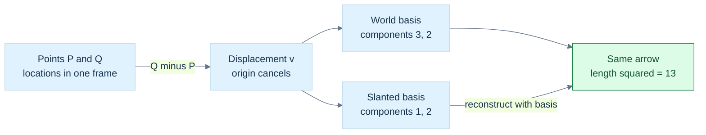

**Figure G1.** The two coordinate lists encode the same movement because $\mathbf b_1=(1,0)$ and $\mathbf b_2=(1,1)$ give $\mathbf v=1\mathbf b_1+2\mathbf b_2=(3,2)$. Points carry locations; their difference carries movement. **Limit:** all inputs must refer to a common frame before subtraction. Squaring slanted-basis coefficients gives $5$, which is not the physical squared length; use $c^\mathsf TGc=13$. See [[#The same arrow can have different coordinates|the reconstruction]] and [[#A Gram matrix remembers the geometry of a slanted basis|the metric calculation]].

### Why a basis can become unreliable

Suppose two basis directions are nearly parallel:

$$
\mathbf b_1=(1,0),\qquad \mathbf b_2=(1,\delta),\qquad 0<|\delta|\ll1.
$$

To represent $(0,1)$, coefficients must satisfy $c_2\delta=1$ and $c_1+c_2=0$. Therefore $c_2=1/\delta$ and $c_1=-1/\delta$. A modest vector requires huge cancelling coefficients. Small errors in $\delta$ can produce large coefficient errors.

This is [[#An inverse can exist and still amplify uncertainty|conditioning]]: sensitivity of the answer to small changes in the input. When $\delta=0$, the directions are dependent and cannot form a two-dimensional basis. The mapping is **singular**, meaning it cannot be uniquely inverted.

A small determinant alone is not a scale-independent conditioning test. Uniformly shrinking a perfectly perpendicular basis shrinks its determinant but does not make its directions nearly parallel. Inspect relative geometry, residuals, and appropriate condition estimates.


## The reachable movements form a vector space

Why does the previous reasoning work? Because movements form a [[#The reachable movements form a vector space|vector space]] over a field. Such a space has vector addition and scalar multiplication. The rules make combined movement consistent:

$$
\mathbf u+\mathbf v=\mathbf v+\mathbf u,\qquad
(\mathbf u+\mathbf v)+\mathbf w=\mathbf u+(\mathbf v+\mathbf w),
$$

$$
\mathbf v+\mathbf0=\mathbf v,\qquad
\mathbf v+(-\mathbf v)=\mathbf0,
$$

$$
1\mathbf v=\mathbf v,\qquad
a(b\mathbf v)=(ab)\mathbf v,
$$

$$
a(\mathbf u+\mathbf v)=a\mathbf u+a\mathbf v,\qquad
(a+b)\mathbf v=a\mathbf v+b\mathbf v.
$$

Both operations must stay inside the space. These are exact mathematical laws. A machine representation approximates them.

The rules imply $0\mathbf v=\mathbf0$: expand $(0+0)\mathbf v$ and subtract one copy of $0\mathbf v$. Similarly $a\mathbf0=\mathbf0$ and $(-1)\mathbf v=-\mathbf v$. They are consequences, not extra magic rules.

Vectors need not be arrows. Polynomials of degree at most two form a real vector space with basis $1,x,x^2$. Matrices of a fixed shape form a vector space. Real-valued functions on a fixed domain also support pointwise addition and scaling. Complex numbers form a one-dimensional vector space over $\mathbb C$, but a two-dimensional one over $\mathbb R$. **Dimension depends on the field.**

Unit vectors do not form a vector space: adding two can change the length, and multiplying by zero leaves the set. Nonnegative light values are also not closed under arbitrary real scaling. Useful constrained sets should not be mislabeled vector spaces.

### A subspace is a complete movement system inside a larger one

The panel lies in the workcell's plane $z=0$. Movements restricted to this plane still support addition and arbitrary real scaling. This set is a **subspace** of $\mathbb R^3$.

The compact subspace test is: a nonempty set $W$ inside a vector space is a subspace if

$$
a\mathbf u+b\mathbf v\in W
\quad\text{for every }\mathbf u,\mathbf v\in W
\text{ and scalars }a,b.
$$

Choosing both scalars zero puts $\mathbf0$ in $W$. Choosing $a=-1$ gives additive inverses. The remaining addition rules are inherited from the larger space.

The plane $z=1$ is not a subspace. It lacks the zero vector, and adding two of its points gives depth $2$. It is an affine plane: a translated subspace. A quadrant fails closure under negative scaling. A circle boundary fails addition. Intersections of subspaces remain subspaces, but unions need not: the union of the two coordinate axes excludes $(1,1)$ even though it contains $(1,0)$ and $(0,1)$.

### Combinations describe what the robot can reach

A **linear combination** is a weighted sum of vectors:

$$
\mathbf v=\sum_{j=1}^{k}c_j\mathbf b_j.
$$

The weights $c_j$ may be negative and need not sum to one. If the robot can move along the panel edges, then

$$
\mathbf v=s(4,0,0)+t(0,3,0)=(4s,3t,0).
$$

Every in-plane movement is reachable, but no movement with nonzero depth is. The **span** of the generators is the set of all such combinations. It is the smallest subspace containing the generators: any subspace containing them must also contain their combinations. “Smallest” concerns set inclusion, not a finite count of vectors. The span normally contains infinitely many vectors.

Repeated or already-reachable generators do not enlarge the span. The span of only the zero vector is the zero subspace. By the empty-sum convention, the span of no generators is also the zero subspace.

### Independence removes redundant controls

Generators are [[#Coordinates can change while the geometric object stays still|linearly independent]] if

$$
\sum_jc_j\mathbf b_j=\mathbf0
\quad\Longrightarrow\quad c_j=0\text{ for every }j.
$$

If a nonzero collection of coefficients produces zero, at least one generator can be expressed using the others. It is redundant. For example, $(2,0)=2(1,0)$ adds no new direction. Any generator set containing the zero vector is dependent.

Independence also proves coordinate uniqueness. If two coefficient lists reconstruct the same vector, subtract them. Their difference reconstructs zero; independence forces every coefficient difference to vanish.

A basis must both span and be independent. Independence alone may leave unreachable directions; spanning alone may allow multiple coefficient lists. The **dimension** of a finite-dimensional space is the number of vectors in a basis. The panel's movement plane has dimension two even though its coordinates are stored in three components. The zero subspace has dimension zero.

Before continuing, ask a learner to distinguish three things: a set of generators, the span they produce, and a basis extracted by removing redundancy. Confusing them makes later matrices look much more mysterious than they are.


### Immediate footing — norm

A norm measures vector size and obeys nonnegativity, vanishing only at zero, scaling, and the triangle inequality. The Euclidean norm is $\|x\|_2=\sqrt{\sum_i x_i^2}$; therefore $\|(3,4)\|_2=5$. Length depends on the coordinate metric, and normalization $x/\|x\|$ is undefined when $x=0$. A stable implementation scales components before squaring to reduce overflow or underflow risk. A residual norm measures equation error, whose meaning also depends on units and problem scale.

[[#A ruler needs more than coordinate components|Full explanation and worked examples in this book]]

## A ruler needs more than coordinate components

The robot must measure how far the sensor travels. In perpendicular unit axes, the [[#A ruler needs more than coordinate components|Euclidean length]] of $\mathbf v=(x,y,z)$ is

$$
\|\mathbf v\|_2=\sqrt{x^2+y^2+z^2}.
$$

This follows by applying Pythagoras first to the horizontal components, then to the remaining depth component. The positive square root gives a nonnegative length. For $(3,4,12)$ the squared length is $9+16+144=169$, so the length is $13$.

The hidden assumption is important: these must be orthonormal Euclidean coordinates. In a slanted basis, blindly squaring coefficients measures the wrong geometry. We will restore the missing geometry with a Gram matrix.

### What makes a norm a norm?

A **norm** assigns a nonnegative size to a vector and satisfies

$$
\|\mathbf v\|=0\iff\mathbf v=\mathbf0,\qquad
\|a\mathbf v\|=|a|\|\mathbf v\|,
$$

$$
\|\mathbf u+\mathbf v\|\le\|\mathbf u\|+\|\mathbf v\|.
$$

The last rule is the **triangle inequality**: the direct combined movement cannot be longer than walking the two movements separately, according to that norm.

Common coordinate norms are

$$
\|\mathbf v\|_1=\sum_i|v_i|,\qquad
\|\mathbf v\|_2=\sqrt{\sum_iv_i^2},\qquad
\|\mathbf v\|_\infty=\max_i|v_i|.
$$

For $(3,-4)$ they give $7$, $5$, and $4$. The first is often called Manhattan length: travel along coordinate-aligned streets. The infinity norm counts the largest component movement, useful when one step may advance all coordinates at once.

In two dimensions their unit balls are a diamond, circle, and axis-aligned square. A **unit ball** contains vectors of norm at most one. Rotating Euclidean coordinates preserves the circle and Euclidean length. It generally changes the coordinate-defined Manhattan and infinity lengths.

To check the infinity triangle inequality, use $|u_i+v_i|\le|u_i|+|v_i|\le\|\mathbf u\|_\infty+\|\mathbf v\|_\infty$ for every component, then take the maximum. The first norm follows by summing the scalar inequalities. The Euclidean proof will follow from Cauchy–Schwarz below.

For a finite coordinate vector and $p\ge1$, $\|\mathbf v\|_p=(\sum_i|v_i|^p)^{1/p}$. If $M=\max_i|v_i|$, then $M\le\|\mathbf v\|_p\le n^{1/p}M$. As $p$ grows, $n^{1/p}$ approaches one. That explains the infinity notation without invoking an infinite component value.

### Distance compares points through a movement

A norm induces a **metric**, or distance rule:

$$
d(P,Q)=\|Q-P\|.
$$

It is nonnegative, vanishes only for equal points, is symmetric, and obeys a triangle inequality. These follow from the norm's rules. Translating both points equally leaves their difference unchanged.

The choice changes which object is nearest. From the origin, $(3,0)$ is closer than $(2,2)$ in the first norm because $3<4$, but farther in the Euclidean norm because $3>\sqrt8$. A spatial-query algorithm must know which distance it is optimizing.

**Squared length** is useful but is not a norm: doubling a vector quadruples its squared length. Squared Euclidean distance is not a metric either. On a line, the squared distance from $0$ to $2$ is $4$,apls larger than the sum $1+1$ through the intermediate point $1$.

For a nonnegative radius $r$, the mathematical comparison

$$
\|Q-P\|_2\le r
\iff\|Q-P\|_2^2\le r^2
$$

avoids a square root. It remains necessary to consider overflow and underflow in the squared quantities. Never compare a squared distance in square metres with an ordinary radius in metres.

## Reading the C++ laboratories

A `double` stores an approximation to a real number. An `int` stores an integer in a finite range. `std::array` has a fixed element count; `std::vector` owns a resizable sequence. A reference such as `T&` refers to an existing object, while a value normally represents an independent object. `const` restricts modification through that access path. A pointer or `std::span` can borrow storage without owning it; the owner must outlive every use of the borrowed view.

A `template` describes a family of types or functions. An overload lets the same function name accept different declared parameter types. `size_t` is an unsigned size/index type, so a negative sentinel is not an ordinary valid index. An `assert` checks a condition only when assertions are enabled; it is not a replacement for an explicit runtime input contract. `std::isfinite` rejects infinities and NaNs where a formula requires finite values.

Each complete program in this book is a separate laboratory with its own `main`. Compile it independently. Smaller snippets illustrate a particular operation and may depend on nearby declarations. Distinguish a mathematical assumption, a checked precondition, an asserted invariant, and a source-reported claim that has not been independently tested.

-----

### Immediate footing — unit roundoff

Unit roundoff describes the scale of relative rounding error in a floating-point operation. Under the usual model, $\operatorname{fl}(a\circ b)=(a\circ b)(1+\delta)$ with $|\delta|\le u$ for round-to-nearest when the exact result is finite and normal and no exceptional case occurs. Unit roundoff is not the smallest positive number and does not bound accumulated error by itself. Repeated operations, cancellation, overflow, underflow, and ill-conditioning matter. Use scale-aware tolerances and state assumptions rather than treating a tiny residual as exact zero.

[[#Floating-point answers: error, conditioning, stability, and stable arithmetic|Full explanation and worked examples in this book]]
## A direction can exist even when the naive length overflows

[[#A direction can exist even when the naive length overflows|Normalization]] asks for a unit vector pointing the same way as a nonzero vector:

$$
\widehat{\mathbf v}=\frac{\mathbf v}{\|\mathbf v\|_2}.
$$

For $(3,4,0)$ this is $(0.6,0.8,0)$. Its squared length is $0.36+0.64=1$. Normalization removes the original magnitude and its units. It is not linear: normalizing a sum is not the sum of normalized inputs.

Zero has no direction. Dividing its components by zero cannot invent one. A safe API should report failure, enforce a documented nonzero precondition, or apply a caller-chosen fallback. Silently returning zero under a “unit direction” promise is false.

### Scale first, then measure

Finite components can still produce overflowing squares. In binary32, components around $10^{20}$ have representable values, but their squares need not. Tiny values can have the opposite problem: their squares round to zero.

For a finite nonzero vector, set

$$
m=\max(|x|,|y|,|z|),\qquad
\mathbf s=\mathbf v/m.
$$

Each scaled component has magnitude at most one, and at least one has magnitude one. Therefore

$$
1\le\mathbf s\cdot\mathbf s\le3.
$$

Compute the unit direction as

$$
\widehat{\mathbf v}=\frac{\mathbf s}{\sqrt{\mathbf s\cdot\mathbf s}}.
$$

We never need to form the potentially unrepresentable original length. For $(10^{300},10^{300},0)$ in a suitable binary64 implementation, scaling gives $(1,1,0)$ and the direction $(1/\sqrt2,1/\sqrt2,0)$.

To compute an actual length, multiply the scaled length by $m$, or use `std::hypot`. The final length can genuinely exceed the result type's range; robust intermediates do not make an impossible final result representable. See [[Robust norm and intermediate range]].

There are two different rejection decisions:

- **Numerical existence:** is the vector finite and nonzero, so a direction can be computed?
- **Application meaning:** is its length large enough relative to measurement noise or scene scale to be trusted?

A mathematically nonzero displacement may be too small for a noisy sensor to define a stable direction. Specify that policy in metres or as a scale-relative threshold. Machine epsilon describes spacing near one, not a universal geometry tolerance.

Under flush-to-zero modes, very small components may already be erased or treated as zero by hardware. The scaled method cannot recover those inputs. Tests and documented assumptions must cover [[Flush-to-zero and denormals-are-zero]].

## The dot product turns two movements into a measurement

The robot needs to know how much a movement follows its guide rail. A [[#The dot product turns two movements into a measurement|dot product]] measures alignment, weighted by the magnitudes.

In orthonormal real coordinates,

$$
\mathbf a\cdot\mathbf b=\sum_i a_i b_i.
$$

It is symmetric and linear in each argument, and $\mathbf v\cdot\mathbf v$ is nonnegative, vanishing only at zero. These properties make it an **inner product**. A general vector space does not automatically arrive with one. Complex inner products require conjugation and convention choices; the real formulas here must not be copied unchanged into a complex library.

### Derive the angle relationship

Expand the squared length of a difference using component arithmetic:

$$
\|\mathbf a-\mathbf b\|^2
=\|\mathbf a\|^2+\|\mathbf b\|^2-2\mathbf a\cdot\mathbf b.
$$

For the triangle formed by the two arrows, the cosine rule gives

$$
\|\mathbf a-\mathbf b\|^2
=\|\mathbf a\|^2+\|\mathbf b\|^2
-2\|\mathbf a\|\|\mathbf b\|\cos\theta.
$$

Comparing them yields

$$
\mathbf a\cdot\mathbf b=\|\mathbf a\|\|\mathbf b\|\cos\theta.
$$

For nonzero vectors, a positive dot means an acute angle, zero means a right angle, and a negative dot means an obtuse angle. It equals the cosine only when both inputs are unit length.

For $\mathbf a=(3,4,0)$ and $\mathbf b=(2,0,0)$, the dot is $6$. The lengths are $5$ and $2$, so $\cos\theta=6/10=0.6$. The dot itself was not an angle and not a cosine.

**Orthogonal** means zero inner product. In Euclidean geometry, nonzero orthogonal vectors are perpendicular. The zero vector is algebraically orthogonal to every vector but has no direction, so “its angle is ninety degrees” is not meaningful.

### A useful inequality and the missing norm proof

For nonzero $\mathbf b$, the squared length of $\mathbf a-t\mathbf b$ cannot be negative. Choose $t=(\mathbf a\cdot\mathbf b)/(\mathbf b\cdot\mathbf b)$, expand, and obtain

$$
0\le\|\mathbf a\|^2-
\frac{(\mathbf a\cdot\mathbf b)^2}{\|\mathbf b\|^2}.
$$

Hence the **Cauchy–Schwarz inequality**:

$$
|\mathbf a\cdot\mathbf b|\le\|\mathbf a\|\|\mathbf b\|.
$$

It is also true when either vector is zero. Now expand a sum's squared length and bound its dot term:

$$
\|\mathbf a+\mathbf b\|^2
\le\|\mathbf a\|^2+2\|\mathbf a\|\|\mathbf b\|+\|\mathbf b\|^2
=(\|\mathbf a\|+\|\mathbf b\|)^2.
$$

Taking nonnegative square roots proves the Euclidean triangle inequality.

For an approximate orthogonality test, a dimensionless criterion is

$$
\frac{|\mathbf a\cdot\mathbf b|}{\|\mathbf a\|\|\mathbf b\|}
\le\varepsilon_\theta.
$$

Handle zero and non-finite inputs separately; scale or safely normalize before evaluating the ratio when ranges are large. An absolute threshold on the raw dot changes its meaning when vector lengths change.

### Immediate footing — least squares

Least squares chooses parameters that minimize the sum of squared residuals, where a residual is predicted minus measured value. For a matrix model it minimizes $\lVert Ax-b\rVert_2^2$. Fitting one constant $x$ to measurements $1$ and $3$ minimizes $(x-1)^2+(x-3)^2$, so the answer is $x=2$. A zero residual is possible only if the model can match every measurement. Rank deficiency can give multiple minimizing parameter vectors. Weights, measurement units, outliers and noise assumptions affect which squared-error problem is appropriate.

[[#QR turns least squares into a triangular solve plus an irreducible residual|Full explanation and worked examples in this book]]

## Projection separates useful movement from sideways movement

The rail follows a nonzero vector $\mathbf b$. The robot's requested movement is $\mathbf a$. We want the part along the rail and the part left over.

The along-rail part must have form $\alpha\mathbf b$. Require the remainder to be perpendicular:

$$
(\mathbf a-\alpha\mathbf b)\cdot\mathbf b=0.
$$

Distribute and solve:

$$
\alpha=\frac{\mathbf a\cdot\mathbf b}{\mathbf b\cdot\mathbf b},\qquad
\operatorname{proj}_{\mathbf b}\mathbf a=\alpha\mathbf b.
$$

This is [[#Projection separates useful movement from sideways movement|vector projection]]. The **rejection** is

$$
\mathbf r=\mathbf a-\operatorname{proj}_{\mathbf b}\mathbf a.
$$

The **signed scalar projection** is a different output:

$$
s=\frac{\mathbf a\cdot\mathbf b}{\|\mathbf b\|}.
$$

It measures signed length along the target direction. The coefficient $\alpha$ multiplies the target vector; the vector projection is a vector. These three quantities coincide only in special ways, not by definition.

### An execution trace you can teach at the board

Take $\mathbf a=(3,4,0)$ and rail vector $\mathbf b=(2,0,0)$:

| Step | Result |
|---|---|
| Dot with the rail | $\mathbf a\cdot\mathbf b=6$ |
| Rail squared length | $\mathbf b\cdot\mathbf b=4$ |
| Coefficient | $\alpha=6/4=1.5$ |
| Vector projection | $1.5(2,0,0)=(3,0,0)$ |
| Rejection | $(3,4,0)-(3,0,0)=(0,4,0)$ |
| Signed scalar projection | $s=6/2=3$ |

The remainder dotted with the rail is zero. The squared lengths satisfy $25=9+16$. Scaling the rail vector to $(20,0,0)$ changes the coefficient but not the vector projection: the geometric line is unchanged.

### G2 - Split the request into rail travel and sideways travel

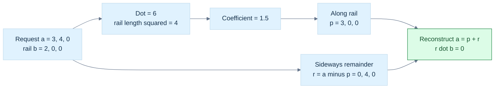

**Figure G2.** Each box is a checkable stage, not a drawing to scale. The coefficient $1.5$ is dimensionless here; the signed along-rail length is $3$, and the projected vector is $(3,0,0)$. **Limit:** $\mathbf b\ne\mathbf0$ and Euclidean measurement are required. For a unit axis $\widehat{\mathbf b}$, use $\mathbf p=(\mathbf a\cdot\widehat{\mathbf b})\widehat{\mathbf b}$. Extreme arithmetic ranges and a tiny cancellation residual still need the policies explained below.

Projection onto zero is undefined because zero defines no line. Projecting zero onto a valid line is fine and gives zero.

Why is the projection the closest rail movement? Every candidate $t\mathbf b$ differs from $\mathbf a$ by

$$
\mathbf a-t\mathbf b=\mathbf r+(\alpha-t)\mathbf b.
$$

The two terms are perpendicular, so

$$
\|\mathbf a-t\mathbf b\|^2
=\|\mathbf r\|^2+(\alpha-t)^2\|\mathbf b\|^2.
$$

The smallest value occurs at $t=\alpha$. This is a **least-squares** problem: choose a parameter that minimizes the sum of squared coordinate errors.

Projection is **idempotent**: projecting an already-projected vector changes nothing. For a fixed target line it is linear in the input. Rejection is also linear and idempotent. Reflection will reverse the rejected or projected portion according to which geometric mirror we choose; rejection itself is not reflection.

On a unit normal $\mathbf n$, removing the normal component gives surface-sliding movement:

$$
\mathbf v_{\mathrm{slide}}=\mathbf v-(\mathbf v\cdot\mathbf n)\mathbf n.
$$

If the requested movement is almost entirely normal, the small tangential remainder can be sensitive to cancellation. Correct decomposition does not guarantee high relative accuracy in a tiny residual.

### A camera-framing trace uses the same angle

In camera-local coordinates with forward along $+z$, a point in front of the camera at $(x,y,z)$ has vertical angle $\theta=\operatorname{atan2}(y,z)$. Points $(0,3,4)$ and $(0,-1,5)$ have angles about $36.87^\circ$ and $-11.31^\circ$. A fixed axis needs a full vertical field of view of about $73.74^\circ$ to include both. A sphere of radius $r$ at center distance $d>r$ adds angular radius $\arcsin(r/d)$. Freya Holmér's trigonometry lesson develops the right-triangle camera-FOV relation; the selected interpolation lesson covers multiple-target camera fitting and the sphere angular radius. Behind-camera points and horizontal aspect constraints still need explicit treatment. [Freya Holmér, Trigonometry](https://www.youtube.com/watch?v=1NLekEd770w), [Freya Holmér, Interpolation & Velocity](https://www.youtube.com/watch?v=-Ii3MrJFBkQ)

### Immediate footing — radians

A radian measures angle as arc length divided by radius. One full circle is $2\pi$ radians, so a quarter-turn is $\pi/2$. The unit-circle point at angle $\theta$ is $(\cos\theta,\sin\theta)$; at $\theta=\pi/2$ it is $(0,1)$. Rotation formulas and calculus conventionally use radians. Convert degrees using $\theta_{\mathrm{rad}}=\theta_{\mathrm{deg}}\pi/180$. For a signed planar angle, $\operatorname{atan2}(y,x)$ retains quadrant information, while $\operatorname{atan}(y/x)$ does not and is undefined at $x=0$.

[[#Rotation first becomes understandable in a plane|Full explanation and worked examples in this book]]

## Rotation first becomes understandable in a plane

Before constructing the panel's three-dimensional frame, rotate its sensor sweep within a plane. [[#Rotation first becomes understandable in a plane|Complex numbers]] provide a compact explanation.

Write a complex number as $z=x+iy$, where $i^2=-1$. Its real and imaginary components locate a point in a two-dimensional diagram. Addition adds these components. Multiplication follows distributivity:

$$
(a+ib)(x+iy)=(ax-by)+i(ay+bx).
$$

Multiplication by $i$ sends $(x,y)$ to $(-y,x)$. Applying it twice sends the vector to $(-x,-y)$, because $i^2=-1$. In conventional upward-positive Cartesian coordinates, one application is a counterclockwise quarter-turn.


For an arbitrary angle, use the unit complex number

$$
r=\cos\theta+i\sin\theta.
$$

Multiplying a coordinate pair by $r$ gives

$$
x'=x\cos\theta-y\sin\theta,\qquad
y'=x\sin\theta+y\cos\theta.
$$

For $(1,0)$ and $\theta=\pi/2$, the result is $(0,1)$. For $(2,1)$, the same quarter-turn gives $(-1,2)$. Trigonometric functions in our code use radians: $\pi$ radians equal $180^\circ$.

The **conjugate** of $z=x+iy$ is $\overline z=x-iy$. It satisfies

$$
z\overline z=x^2+y^2=|z|^2.
$$

Therefore $z^{-1}=\overline z/|z|^2$ when $z\ne0$. For a unit rotation, the inverse is just the conjugate. Multiplying two unit rotations composes them; angle-addition identities show that their angles add.

A non-unit multiplier rotates and scales, rather than only rotating. Repeated floating-point composition can gradually change the stored magnitude. Re-normalize under an explicit drift policy when the representation promises a rotation. The complex zero is not a valid rotation: multiplication by it collapses every point.

There is a numerical warning in the inverse formula. Squaring very large components can overflow even when a useful reciprocal exists; squaring tiny ones can underflow. Use a range-aware complex division algorithm rather than treating the displayed derivation as a universally safe implementation.

```cpp
struct Complex2 {
    double real{}, imag{};
};
constexpr Complex2 multiply(Complex2 a, Complex2 b) noexcept {
    return {a.real * b.real - a.imag * b.imag,
            a.real * b.imag + a.imag * b.real};
}
```

This excerpt implements multiplication, not a validated rotation type. The later laboratory uses a separate unit-vector wrapper for the same reason: a representation and a validated promise are different things.

## Oriented area tells us which side of the panel is front

The panel needs a facing direction. Its edge vectors lie in its plane, so their dot product alone cannot provide an out-of-plane direction. We need [[#Oriented area tells us which side of the panel is front|oriented area]].

### The cross product and its definition

In an oriented three-dimensional Euclidean space, the **cross product** $\mathbf a\times\mathbf b$ is perpendicular to both inputs. Its magnitude is the parallelogram area, and its sign follows the chosen orientation. Parallel inputs produce zero.

For a positively oriented orthonormal basis, the component rule is

$$
\mathbf a\times\mathbf b=
\begin{pmatrix}
a_yb_z-a_zb_y\\
a_zb_x-a_xb_z\\
a_xb_y-a_yb_x
\end{pmatrix}.
$$

This explicitly supplies the Part 542 definition absent as a standalone source. We now derive rather than merely memorize its components.

The signed area spanned by two coordinate pairs in the first two axes is the $2\times2$ determinant

$$
\det\begin{pmatrix}a_x&b_x\\a_y&b_y\end{pmatrix}
=a_xb_y-a_yb_x.
$$

It is positive for the ordered pair of standard axes and changes sign when the arrows swap. Similar area measurements in the other coordinate planes give the three components above. The familiar symbolic determinant containing basis vectors is a mnemonic for these three signed minors, not a new unexplained arithmetic object.

Check perpendicularity directly: expand $\mathbf a\cdot(\mathbf a\times\mathbf b)$. Each product cancels a matching term of opposite sign, leaving zero. The same calculation with $\mathbf b$ also gives zero. The construction is linear in each input and changes sign under exchange:

$$
\mathbf a\times\mathbf b=-\mathbf b\times\mathbf a.
$$

### The panel's normal and area

For the panel edges,

$$
(B-A)\times(C-A)=(4,0,0)\times(0,3,0)=(0,0,12).
$$

The raw result has magnitude $12\,\mathrm{m}^2$, the parallelogram area. The triangular panel occupies half of that, so its area is $6\,\mathrm{m}^2$. Its unit front normal is $(0,0,1)$ under this vertex ordering.

The identity

$$
\|\mathbf a\times\mathbf b\|^2
=\|\mathbf a\|^2\|\mathbf b\|^2-(\mathbf a\cdot\mathbf b)^2
$$

follows by expanding both sides into products of components and cancelling matching terms. Insert the cosine relation to obtain

$$
\|\mathbf a\times\mathbf b\|=\|\mathbf a\|\|\mathbf b\|\sin\theta
\quad(0\le\theta\le\pi).
$$

This is base times perpendicular height. It connects cross products, Gram determinants, area, and angle rather than introducing unrelated facts.

The cross components of nearly parallel inputs subtract nearly equal products. Their small result may be sensitive to rounding. The area identity is not automatically a numerically safer alternative: its right side can suffer severe cancellation too. Scale-aware nonparallelness is expressed by

$$
\frac{\|\mathbf a\times\mathbf b\|}{\|\mathbf a\|\|\mathbf b\|}=\sin\theta,
$$

with nonzero inputs and range-safe evaluation. A tiny raw cross magnitude alone may mean tiny geometry rather than nearly parallel directions.

### Orientation is not storage order in memory

An ordered frame $(\mathbf x,\mathbf y,\mathbf z)$ is right-handed relative to our chosen positive orientation when

$$
(\mathbf x\times\mathbf y)\cdot\mathbf z>0.
$$

It is left-handed when the sign is negative; zero means a degenerate frame, not a third handedness. Swapping two axes reverses the sign. Cyclic permutation preserves it. An orientation-preserving rotation cannot turn a right-handed frame into a left-handed one; a reflection can.

[[#Oriented area tells us which side of the panel is front|Handedness]] does not specify which axis is up, whether a camera looks toward positive or negative depth, or whether a matrix is stored by rows or columns. Define all these conventions separately.

For an orthogonal transform $R$,

$$
(R\mathbf a)\times(R\mathbf b)
=\det(R)R(\mathbf a\times\mathbf b).
$$

A proper rotation has determinant $1$. A reflection has determinant $-1$, so the oriented-area vector gains an extra sign. This explains why blindly treating a cross-derived normal as an ordinary direction through a mirror can reverse mesh orientation.

The same component cross formula encodes a chosen positive orientation. When using a basis of opposite orientation, decide whether the code's algebraic convention or the external geometric orientation is authoritative and convert consistently. Calling a whole graphics API “left-handed” does not settle every stage of that pipeline.

### Why three dimensions are special, but not the whole story

In two dimensions an oriented area has one independent component; it is not an in-plane perpendicular vector. The often-named “2D cross” is the scalar signed area $a_xb_y-a_yb_x$.

In $n$ dimensions, oriented two-dimensional areas have $n(n-1)/2$ independent components. In three dimensions that count equals three, allowing area components to be identified with a vector after a metric and orientation are chosen. In four dimensions there are six area components, not four. Also, two independent vectors in four-dimensional space have a two-dimensional perpendicular space rather than one uniquely oriented perpendicular direction.

There is an exceptional seven-dimensional binary cross product with additional structure. Do not turn the introductory three-dimensional explanation into the false claim that no such operation exists anywhere else. The ordinary graphics cross product remains the three-dimensional one described here.

## Signed volume extends the same idea into space

Move a test point above the panel to $D=(0,0,2)$. The [[#Signed volume extends the same idea into space|scalar triple product]] is

$$
(B-A)\cdot\big((C-A)\times(D-A)\big)=24.
$$

Equivalently, dot the area normal $(B-A)\times(C-A)$ with $D-A$; cyclic rearrangement preserves the scalar value. The signed parallelepiped volume is $24\,\mathrm{m}^3$. The tetrahedron formed by four corners has one sixth of it, so its ordinary volume is $4\,\mathrm{m}^3$.

Why area times height? The cross product contributes an area vector. Dotting with the third movement selects the signed component perpendicular to the base. A third vector lying in the base plane contributes zero height. Swapping two inputs reverses orientation, while taking absolute value gives ordinary volume.

In coordinates the triple product is a $3\times3$ determinant. A **determinant** measures oriented area or volume scaling for a square linear map. A zero determinant indicates lost dimensions. It is not a universal conditioning score.

### Nested cross products are not associative

The **vector triple-product identity** is

$$
\mathbf a\times(\mathbf b\times\mathbf c)
=\mathbf b(\mathbf a\cdot\mathbf c)-\mathbf c(\mathbf a\cdot\mathbf b).
$$

For its first component, expand the left side:

$$
a_y(b_xc_y-b_yc_x)-a_z(b_zc_x-b_xc_z)
=b_x(a_yc_y+a_zc_z)-c_x(a_yb_y+a_zb_z).
$$

Add the cancelling pair $b_xa_xc_x-c_xa_xb_x$ and recover the first component of the right side. The other components follow by cycling indices.

For the other grouping,

$$
(\mathbf a\times\mathbf b)\times\mathbf c
=\mathbf b(\mathbf a\cdot\mathbf c)-\mathbf a(\mathbf b\cdot\mathbf c).
$$

These generally differ. Parentheses are part of the geometry, not optional punctuation. For example, $\mathbf e_x\times(\mathbf e_x\times\mathbf e_y)=-\mathbf e_y$, but $(\mathbf e_x\times\mathbf e_x)\times\mathbf e_y=\mathbf0$.

For unit $\mathbf n$, the related identity

$$
\mathbf n\times(\mathbf v\times\mathbf n)
=\mathbf v-\mathbf n(\mathbf v\cdot\mathbf n)
$$

is precisely tangent-plane rejection. A nested cross has now become a previously understood projection operation.

### Immediate footing — derivative

A derivative is the best linear prediction of how a function changes near an input. For $f(x)=x^2$, $f(x+h)-f(x)=2xh+h^2$, so near $x=3$ the leading change is $6h$ and $f'(3)=6$. The derivative is local: the omitted $h^2$ term matters for larger steps. Derivative units are output units divided by input units. At corners or discontinuities an ordinary derivative may not exist, so algorithms that rely on smoothness must state that assumption.
[[#Functions, limits, continuity, and scalar change|Full explanation and worked examples in this book]]

## An angle is a question with a domain

The [[#An angle is a question with a domain|unsigned angle]] between nonzero vectors lies in $[0,\pi]$. The familiar expression is

$$
\theta=\arccos\left(
\frac{\mathbf a\cdot\mathbf b}{\|\mathbf a\|\|\mathbf b\|}
\right).
$$

After checking finite, nonzero inputs, clamp a small numerical overshoot of the computed cosine to $[-1,1]$. Clamping is not a substitute for valid inputs. Near parallel or antiparallel directions, the derivative of inverse cosine is large, so small cosine errors can produce relatively large angle errors.

Dot and cross provide cosine-like and sine-like information together. Therefore a useful alternative is

$$
\theta=\operatorname{atan2}
\left(\|\mathbf a\times\mathbf b\|,\mathbf a\cdot\mathbf b\right).
$$

$\operatorname{atan2}(y,x)$ determines an angle from both components and their signs. Using the nonnegative cross length makes this an unsigned angle. Identical directions give zero; opposite directions give $\pi$; perpendicular directions give $\pi/2$.

Scale each input by its own largest absolute component before computing dot and cross. Both quantities then acquire the same positive scale factor relative to the originals, leaving the angle unchanged while reducing overflow risk. This does not make cancellation disappear or recover already-rounded inputs.

A signed angle needs an orientation reference. For two vectors lying in a plane with unit positive normal $\mathbf n$,

$$
\theta_{\mathrm{signed}}=
\operatorname{atan2}\big(\mathbf n\cdot(\mathbf a\times\mathbf b),
\mathbf a\cdot\mathbf b\big).
$$

For arbitrary non-coplanar inputs, first define which plane or projected directions the signed angle refers to. A reference normal cannot resolve an unstated geometric question.

Often no angle is needed. To test whether unit directions differ by at most $\theta_{\max}$ in $[0,\pi]$, compare their dot product with $\cos\theta_{\max}$. This saves inverse trigonometry and states the actual decision.


<!-- end V06.14 -->

<!-- begin V06.15 -->
## Surface movement becomes a local frame

The robot needs a front-facing normal and two directions along the panel. A [[#Surface movement becomes a local frame|tangent]] lies in a surface's local tangent plane. A **normal** is perpendicular to that plane. A **bitangent** supplies a second tangent direction, often paired with increasing texture coordinates.

For a smooth parameterized surface $\mathbf p(u,v)$, the partial derivatives $\partial\mathbf p/\partial u$ and $\partial\mathbf p/\partial v$ are local tangent vectors when they are independent. “Partial derivative” means the rate of change while varying one parameter and holding the other fixed. On a triangle, edge vectors directly span the flat tangent plane.

For a sphere centered at $C$, the outward normal at a surface point $P$ follows $P-C$. For a plane through $A$ with normal $\mathbf n$, points obey

$$
\mathbf n\cdot(P-A)=0.
$$

A normal need not be unit length. If it is used as a signed distance ruler, it must be unit, otherwise the dot result contains an extra scale factor.

A **geometric normal** comes from the actual surface. A **shading normal** may be interpolated or modified to make lighting appear smooth. They can differ and have different responsibilities. Averaging unit normals usually yields a non-unit vector; re-normalize only after checking that the average has a usable direction. A collapsed triangle has no uniquely reliable face normal.

### Texture coordinates specify preferred tangents

Let the panel corners have texture coordinates $(0,0)$, $(1,0)$, and $(0,1)$. The panel's position changes by $(4,0,0)$ when its first texture parameter increases by one, and by $(0,3,0)$ when the second increases by one. The raw texture tangents therefore carry spatial stretch, not merely direction.

For general texture differences, write

$$
\mathbf e_1=\Delta u_1\mathbf t+\Delta v_1\mathbf b,
\qquad
\mathbf e_2=\Delta u_2\mathbf t+\Delta v_2\mathbf b.
$$

Eliminate one unknown at a time. With

$$
D=\Delta u_1\Delta v_2-\Delta u_2\Delta v_1,
$$

the result is

$$
\mathbf t=\frac{\Delta v_2\mathbf e_1-\Delta v_1\mathbf e_2}{D},
\qquad
\mathbf b=\frac{\Delta u_1\mathbf e_2-\Delta u_2\mathbf e_1}{D}.
$$

$D$ is the signed texture-area scale. Zero means the texture triangle has collapsed and cannot identify two distinct texture directions. Nearly zero can amplify input error. Spatial degeneracy and texture degeneracy are separate checks.

### Clean the frame without erasing its orientation

Given a unit normal $\mathbf n$ and raw tangent $\mathbf t$, remove normal contamination and normalize:

$$
\mathbf t'=\mathbf t-(\mathbf t\cdot\mathbf n)\mathbf n,
\qquad \widehat{\mathbf t}=\operatorname{normalize}(\mathbf t').
$$

To preserve a mirrored texture island, keep a handedness sign

$$
h=\operatorname{sign}\big((\mathbf n\times\widehat{\mathbf t})\cdot\mathbf b_{\mathrm{raw}}\big),
\qquad
\widehat{\mathbf b}=h(\mathbf n\times\widehat{\mathbf t}).
$$

When the sign test is zero or too uncertain, the input frame does not reliably determine handedness. Do not quietly invent a positive sign while claiming the original frame was valid.

The resulting **TBN frame** consists of tangent, bitangent, and normal. It converts a texture-local normal into the surface's frame through weighted column addition. Document whether $h$ is encoded with this convention or its opposite.

The distinction between geometric and shading frames is used in real rendering systems; PBRT's triangle implementation separately constructs these quantities and accounts for orientation reversal. That reference is an implementation anchor, not evidence that our simplified lab covers every seam and interpolation rule. [PBRT, Triangle Meshes](https://www.pbr-book.org/4ed/Shapes/Triangle_Meshes).


<!-- end V06.15 -->


### Immediate footing — rank and nullspace

The rank of a map is the number of independent output directions it can produce. Its nullspace (kernel) contains inputs mapped to zero. For $A=\begin{bmatrix}1&1\\2&2\end{bmatrix}$, only one output direction is independent, so $\operatorname{rank}(A)=1$; every vector $(t,-t)$ lies in the nullspace. Rank plus nullity equals the input dimension: $\operatorname{rank}(A)+\dim\ker(A)=n$. In solving $Ax=b$, rank shows which constraints are independent and which input directions remain free. In floating-point work, numerical rank uses a tolerance because an exact zero may appear as a small computed singular value.

[[#Rank, the four spaces, and the shape of the answer|Full explanation and worked examples in this book]]

<!-- begin V06.16 -->
## Orthonormal frames make reconstruction simple

A [[#Orthonormal frames make reconstruction simple|frame is orthonormal]] when all its axes have length one and are mutually perpendicular. Its Gram matrix is identity. Coordinates of a vector are simply its dot products with the axes:

$$
\mathbf v=\sum_i(\mathbf v\cdot\mathbf q_i)\mathbf q_i.
$$

Orthonormality is why local lighting directions can be measured without solving a slanted-basis system each time.

### Build a frame from one direction

A unit normal does not uniquely specify two tangent axes: they may rotate around it. We must choose a convention.

Choose a coordinate axis $\mathbf h$ least aligned with the normal. In practice, select the axis corresponding to the smallest absolute component of $\mathbf n$. Then compute

$$
\mathbf t=\operatorname{normalize}(\mathbf h\times\mathbf n),
\qquad \mathbf b=\mathbf n\times\mathbf t.
$$

Because one squared component of a unit normal is at most $1/3$, this helper has

$$
\|\mathbf h\times\mathbf n\|^2
=1-(\mathbf h\cdot\mathbf n)^2\ge\frac23.
$$

So this exact-arithmetic helper cannot become almost parallel to the normal. For $\mathbf n=(0,0,1)$ and helper $(1,0,0)$, tangent is $(0,-1,0)$ and bitangent $(1,0,0)$. These are valid axes even though they differ from a texture-preferred orientation.

This construction is easy to teach, but its selected helper can change abruptly at tie boundaries. That matters for animated or spatially coherent frames. Robustness against division by a small quantity does not guarantee continuity of the output convention.

Research on orthonormal-basis construction investigates such numerical behavior. Duff and colleagues' *Building an Orthonormal Basis, Revisited* is a useful comparison target for a faster specialized construction. We use the transparent helper-axis method here; we do not claim to have benchmarked or implemented that paper's algorithm. [Duff et al., 2017](https://graphics.pixar.com/library/OrthonormalB/paper.pdf).

### Gram–Schmidt is repeated rejection

Given independent generators $\mathbf v_1,\mathbf v_2,\mathbf v_3$, first normalize $\mathbf v_1$ to $\mathbf q_1$. Then remove its component from the second generator:

$$
\mathbf u_2=\mathbf v_2-(\mathbf v_2\cdot\mathbf q_1)\mathbf q_1,
\qquad \mathbf q_2=\mathbf u_2/\|\mathbf u_2\|.
$$

For the third,

$$
\mathbf u_3=\mathbf v_3
-(\mathbf v_3\cdot\mathbf q_1)\mathbf q_1
-(\mathbf v_3\cdot\mathbf q_2)\mathbf q_2,
\qquad \mathbf q_3=\mathbf u_3/\|\mathbf u_3\|.
$$

Each new axis keeps only movement not represented by previous axes. Because we subtract combinations of earlier generators, the span is preserved. A zero residual reveals dependence. A very small residual may reveal near dependence and unreliable input geometry.

Use $\mathbf v_1=(1,1,0)$ and $\mathbf v_2=(1,0,0)$. The first axis is $(1,1,0)/\sqrt2$. The projection of the second is $(1/2,1/2,0)$. The residual is $(1/2,-1/2,0)$, yielding axis $(1,-1,0)/\sqrt2$. Both original generators remain in the reconstructed span.

### Modified order changes floating-point behavior

Classical Gram–Schmidt evaluates every projection coefficient against the original current generator, then subtracts the combined projections. **Modified Gram–Schmidt** repeatedly measures and subtracts from the updated residual:

```text
r = current generator
for each earlier unit axis q:
    coefficient = dot(q, r)
    r = r - coefficient * q
validate the residual, then normalize it
```

They agree in exact arithmetic when previous axes are exactly orthonormal. Floating-point axes and subtractions are not exact, so the order matters. Modified Gram–Schmidt often retains orthogonality better, but it cannot repair fundamentally uncertain near-dependent inputs. A second orthogonalization pass can help; rank detection and tolerance remain deliberate policies.

Validate both $\|Q^\mathsf TQ-I\|$ and $\|V-QR\|$ under declared norms. The first checks axis orthogonality; the second checks reconstruction. A small reconstruction error alone does not prove good orthogonality.

For dense general-purpose solves, Householder QR is an important alternative. LAPACK represents the orthogonal factor through elementary reflectors rather than simply materializing a Gram matrix. This is the next-depth connection, not a new dependency for this vault's small laboratory. [LAPACK, QR Factorization](https://www.netlib.org/lapack/lug/node40.html).


<!-- end V06.16 -->

<!-- begin V06.17 -->
## Light uses the same decomposition in a new role

Our panel is now a surface, not just a movement plane. A ray approaches it with unit direction $\mathbf i$ pointing **toward** the interface. Choose a unit normal $\mathbf n$ pointing back into the incident medium, so front-side incidence obeys $\mathbf i\cdot\mathbf n\le0$.

### Reflection reverses the normal component

The tangential part is unchanged and the normal part reverses. Therefore [[#Light uses the same decomposition in a new role|reflection across the surface plane]] gives

$$
\mathbf r=\mathbf i-2(\mathbf i\cdot\mathbf n)\mathbf n.
$$

For $\mathbf i=(0.6,0,-0.8)$ and $\mathbf n=(0,0,1)$, the result is $(0.6,0,0.8)$. The length stays one in exact arithmetic. At normal incidence, $\mathbf i=-\mathbf n$ reflects to $\mathbf n$.

If the normal is not unit, use the general projection denominator:

$$
\mathbf r=\mathbf i-2\frac{\mathbf i\cdot\mathbf n}{\mathbf n\cdot\mathbf n}\mathbf n.
$$

Reflection across a line instead preserves the along-line component and reverses the perpendicular component. State which mirror you mean. “Reflect around the normal” is otherwise ambiguous.

### Refraction changes the tangent amount

For a transparent material with scalar refractive indices $n_1,n_2$, define $\eta=n_1/n_2$ and $c_i=-\mathbf i\cdot\mathbf n$. Snell's law is

$$
n_1\sin\theta_i=n_2\sin\theta_t.
$$

The incident tangential vector is $\mathbf i+c_i\mathbf n$ and has length $\sin\theta_i$. The transmitted tangent must therefore be $\eta(\mathbf i+c_i\mathbf n)$. To complete a unit transmitted direction, its normal magnitude must be

$$
c_t=\sqrt{k},\qquad k=1-\eta^2(1-c_i^2).
$$

Choose its normal component into the second medium, opposite $\mathbf n$:

$$
\mathbf t=\eta\mathbf i+(\eta c_i-\sqrt{k})\mathbf n.
$$

For air-to-glass indices $1$ and $1.5$ at $45^\circ$ incidence, the transmitted sine is $\sqrt2/3$ and the angle is approximately $28.1^\circ$. The ray bends toward the normal. These indices are a simplified example, not a wavelength-dependent material model.

If $k<0$, no real transmitted direction satisfies Snell's law: **total internal reflection** occurs. When $n_1>n_2$, the critical angle obeys

$$
\theta_c=\arcsin(n_2/n_1).
$$

At the threshold, tiny arithmetic errors can change the sign of $k$. A physically chosen uncertainty policy may treat a narrow interval specially. Unconditionally clamping every negative $k$ to zero destroys the distinction between rounding and genuine total internal reflection.

When a ray leaves rather than enters, orient the normal against the incident direction and use the correct incident/transmitted index ratio. Snell's law computes a direction, not Fresnel energy splitting, absorption, dispersion, or full material appearance.

The sign conventions and formulas agree with the GLSL reflection/refraction definitions when their input requirements are met; the shader specification's zero-return convention for total internal reflection differs from our explicit failure result. [GLSL 4.60, Geometric Functions](https://registry.khronos.org/OpenGL/specs/gl/GLSLangSpec.4.60.html#geometric-functions).

### A half-vector is a bisector only after its inputs are understood

For shading, let $\mathbf l$ point from the surface toward the light and $\mathbf v$ toward the viewer. Both are unit directions, which differs from the incident-travel convention above. The **half-vector** is

$$
\mathbf h=\frac{\mathbf l+\mathbf v}{\|\mathbf l+\mathbf v\|}.
$$

Because $\mathbf l\cdot(\mathbf l+\mathbf v)=1+\mathbf l\cdot\mathbf v$ and the same expression holds for $\mathbf v$, the normalized sum makes equal angles with both directions. If the directions are opposite, their sum is zero and no unique half-vector exists.

If the inputs have unequal magnitudes, their sum is biased toward the larger one and is not the desired angular bisector. The half-vector supports certain specular-lighting models; it does not by itself define a physically complete reflectance law. The panel's geometry gives a direction, while material modeling determines what that direction means for brightness.


<!-- end V06.17 -->


### Immediate footing — gradient

For a differentiable scalar function, the gradient is the vector of partial derivatives. Under the ordinary Euclidean metric it points in the direction of steepest increase. For $f(x,y)=x^2+3y$, $\nabla f=(2x,3)$, so at $(1,2)$ it is $(2,3)$. A small displacement $\delta$ changes the function approximately by $\nabla f\cdot\delta$. In a non-orthonormal metric, the gradient vector depends on that metric even though the differential is a covector. Gradient descent moves opposite the gradient, with step size controlling progress and stability.

[[#Multivariable derivatives and sensitivity|Full explanation and worked examples in this book]]

<!-- begin V06.18 -->
## The sensor needs coordinates inside the triangle

Cartesian coordinates tell us where the sensor is in the workcell. [[#The sensor needs coordinates inside the triangle|Barycentric coordinates]] tell us how it sits relative to the panel's three corners.

We seek weights satisfying

$$
P=\alpha A+\beta B+\gamma C,
\qquad \alpha+\beta+\gamma=1.
$$

This is shorthand for an affine construction, not permission for unrestricted point arithmetic. Translate all coordinate origins by a vector $\mathbf t$. The weighted expression changes by $(\alpha+\beta+\gamma)\mathbf t=\mathbf t$, exactly as a point should. Without the sum-to-one constraint, it would depend incorrectly on the origin.

Subtract $A$ to obtain a purely vector equation:

$$
P-A=\beta(B-A)+\gamma(C-A).
$$

For our panel, $P-A=(1,1,0)$, so $4\beta=1$ and $3\gamma=1$. Therefore

$$
\beta=\frac14,\qquad\gamma=\frac13,\qquad
\alpha=1-\frac14-\frac13=\frac5{12}.
$$

All weights are nonnegative, so the sensor lies inside or on the triangle. An edge has one zero weight; a vertex has one weight equal to one and the others zero. The triangle's **centroid**, its uniform geometric center, has three equal weights $1/3$. A **barycenter**, also spelled barycentre, is a weighted center. With nonnegative masses at the corners, normalized mass weights describe their center of mass. Barycentric weights in general are not distances, and need not be mass fractions. Do not confuse a triangle's centroid with an unweighted average of vertices for every possible shape.

### G3 - Reconstruct a sensor location from the corners

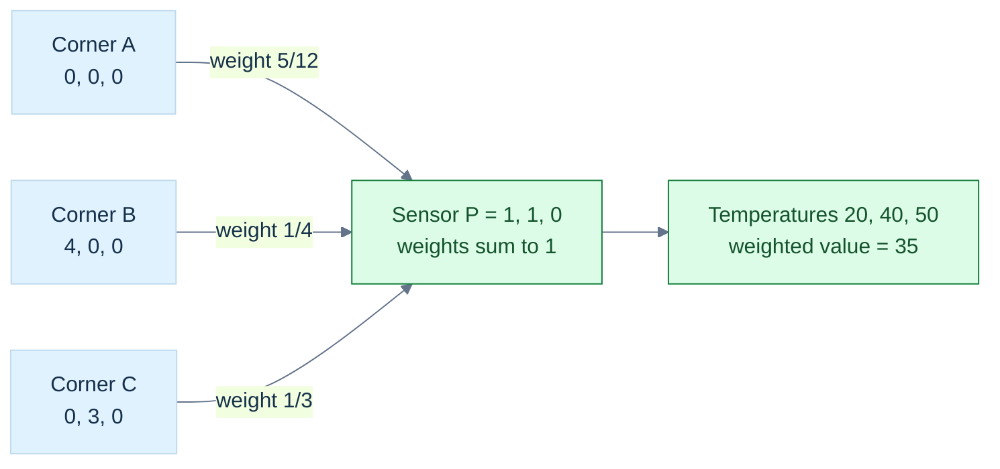

**Figure G3.** This is a weighted reconstruction diagram, not a perspective view of the panel. The point equation is $P=\frac5{12}A+\frac14B+\frac13C$; the same weights interpolate an attribute assumed affine on the triangle. **Limit:** corners must be noncollinear and $P$ must lie in their plane for an exact point reconstruction. Nonnegative weights then locate the point in the closed triangle. For an off-plane input, the Gram solve gives its planar projection; check the residual. Screen-space interpolation under perspective needs [[#Perspective changes the interpolation weights|reciprocal clip-depth correction]].

### Derive the weights in a tilted triangle

Let $\mathbf e_1=B-A$, $\mathbf e_2=C-A$, and $\mathbf q=P-A$. Dot the reconstruction equation with each edge:

$$
\begin{pmatrix}
\mathbf e_1\cdot\mathbf e_1&\mathbf e_1\cdot\mathbf e_2\\
\mathbf e_1\cdot\mathbf e_2&\mathbf e_2\cdot\mathbf e_2
\end{pmatrix}
\begin{pmatrix}\beta\\\gamma\end{pmatrix}
=\begin{pmatrix}\mathbf e_1\cdot\mathbf q\\\mathbf e_2\cdot\mathbf q\end{pmatrix}.
$$

This is the two-edge Gram system. Define $g_{11},g_{12},g_{22}$ from its left side and $r_1,r_2$ from its right side. Eliminating the unknowns gives

$$
D=g_{11}g_{22}-g_{12}^2,
\qquad
\beta=\frac{g_{22}r_1-g_{12}r_2}{D},
\qquad
\gamma=\frac{g_{11}r_2-g_{12}r_1}{D}.
$$

$D=\|\mathbf e_1\times\mathbf e_2\|^2$. It vanishes for a degenerate triangle. Near degeneracy, solving for weights is sensitive even if a denominator happens to be nonzero in machine arithmetic.

If $P$ is off the plane, this system returns coordinates of its orthogonal projection onto the plane, not proof that $P$ belongs to the triangle. Check the reconstruction residual or signed plane distance separately.

### Signed area also answers which side we are on

For two-dimensional points, define

$$
\operatorname{orient}_2(A,B,C)
=(B_x-A_x)(C_y-A_y)-(B_y-A_y)(C_x-A_x).
$$

It is the signed doubled area. Positive means counterclockwise in an upward-positive, positively oriented Cartesian drawing; negative means clockwise. Reverse vertical screen coordinates and the visual interpretation reverses too.

The barycentric weights can be written as signed area ratios:

$$
\alpha=\frac{\operatorname{orient}_2(P,B,C)}{\operatorname{orient}_2(A,B,C)},\quad
\beta=\frac{\operatorname{orient}_2(A,P,C)}{\operatorname{orient}_2(A,B,C)},\quad
\gamma=\frac{\operatorname{orient}_2(A,B,P)}{\operatorname{orient}_2(A,B,C)}.
$$

For the panel in its plane, the denominator is $12$. The three numerators are $5$, $3$, and $4$, reproducing the earlier weights. With a fixed base, a subtriangle's area scales with the opposite point's perpendicular height. That is why an area ratio gives an affine coordinate.

In three dimensions the four-point orientation quantity is

$$
\operatorname{orient}_3(A,B,C,D)
=\big((B-A)\times(C-A)\big)\cdot(D-A).
$$

It tells which side of the oriented plane contains $D$. Some libraries define the opposite ordering and hence the opposite sign. Match the documented definition rather than comparing function names.

### A predicate needs a trustworthy sign

A **predicate** answers a categorical question, such as left/right or inside/outside. A measurement estimates a magnitude. A slightly inaccurate area may be acceptable; a wrong sign used to connect a mesh can corrupt topology.

Near cancellation, ordinary floating-point determinants may have the wrong sign. Wider arithmetic helps but is not a universal certificate. Nor is replacing “small” values with zero: that changes the geometry and can make decisions inconsistent.

[[#The sensor needs coordinates inside the triangle|Adaptive predicates]] first use a fast calculation with a justified error bound, then use more exact arithmetic when the sign is uncertain. Shewchuk's work supplies orientation and incircle implementations and discusses the required arithmetic environment. This protects decisions about the stored coordinates; it cannot restore physical accuracy lost before those coordinates were stored. [Shewchuk, Robust Geometric Predicates](https://www.cs.cmu.edu/~quake/robust.html).

Our laboratory tests well-conditioned examples with ordinary arithmetic. It does **not** implement certified orientation predicates, watertight triangle intersection, or shared-edge rasterization ownership. Those are next-depth topics with stricter contracts.

### The same weights interpolate attributes

Suppose corner temperatures are $20$, $40$, and $50$ degrees Celsius. An affine interpolation gives

$$
T(P)=\frac5{12}(20)+\frac14(40)+\frac13(50)=35.
$$

The weights reconstruct any attribute assumed to vary affinely across this triangle: texture coordinates, scalar fields, and suitable vector-valued data. At a vertex the formula returns that vertex's attribute. Along an edge the opposite attribute contributes nothing.

Interpolation preserves linear constraints, not all nonlinear ones. A weighted average of unit normals need not be unit. Colors stored in nonlinear transfer-encoded channels need conversion to a linear-light representation before physical light interpolation; see [[Color encoding and linear-light operations]]. A unit-direction interpolation needs a specified path and a zero/antiparallel policy, not just a call to `lerp`.

The barycentric gradients are constant over a flat affine triangle. For our panel, $\beta=x/4$, $\gamma=y/3$, and $\alpha=1-x/4-y/3$. This means the temperature gradients are

$$
\frac{\partial T}{\partial x}=\frac{40-20}{4}=5,
\qquad
\frac{\partial T}{\partial y}=\frac{50-20}{3}=10
$$

in degrees Celsius per metre. A derivative is not an extra decoration: it tells the robot how the interpolated measurement changes as the sensor moves.

### Perspective changes the interpolation weights

Screen-space barycentric weights $\lambda_i$ are not generally the original affine surface weights after perspective projection. For an attribute $a_i$ and clip-space coordinates $w_i$ at the three vertices, perspective-correct interpolation has the form

$$
a(P)=\frac{\sum_i\lambda_i a_i/w_i}{\sum_i\lambda_i/w_i}.
$$

To see the weighting issue without a full rasterizer, consider two endpoints with $w_0=1,w_1=2$ and equal screen weights $1/2$. Their corrected weights are $(1/2)/(3/4)=2/3$ and $(1/4)/(3/4)=1/3$, not equal halves. A texture that ignores this correction can appear to swim or bend incorrectly.

This formula requires a valid projected configuration and clipping policy. A denominator near zero or a primitive crossing the camera's projective boundary cannot be repaired by casually dividing. The projective story below explains why.


<!-- end V06.18 -->

<!-- begin V06.19 -->
## Weighted points lead from affine geometry to collision shapes

We have now met three kinds of combinations. They answer different questions:

| Combination | Restrictions | Meaning |
|---|---|---|
| Linear combination of vectors | Arbitrary scalar weights | Reachable movement in a span. |
| Affine combination of points | Weights sum to one | Origin-independent location, including extrapolation. |
| Convex combination of points | Weights sum to one and are nonnegative | Weighted location inside the contributors' convex hull. |

An affine combination can lie outside a segment or triangle. For example, $2B-A$ extrapolates beyond $B$. A combination whose weights sum to zero transforms as a displacement rather than a point. These statements follow by translating every contributor and tracking the total translation coefficient.

### Convex means every straight connection stays inside

A [[#Weighted points lead from affine geometry to collision shapes|convex set]] contains the complete line segment joining any two of its points:

$$
(1-t)P+tQ\in C\qquad(P,Q\in C,\ 0\le t\le1).
$$

A filled disk is convex; its circular boundary alone is not. A rectangle is convex; a crescent-shaped region generally is not. Repeatedly applying the segment property gives closure under any finite convex combination.

The **convex hull** of a point set is all of its finite convex combinations. It is the smallest convex set containing those points. Imagine a taut rubber band around two-dimensional samples; in three dimensions imagine a tight enclosing convex shell. Interior samples do not necessarily become hull vertices.

The triangular panel is its corners' convex hull. Convex models simplify collision queries, but a convex hull may fill holes and concavities in the original object. Faster geometry does not mean identical geometry.

### Sweeping an object is a set addition

For sets expressed relative to a common frame and origin, the [[#Weighted points lead from affine geometry to collision shapes|Minkowski sum]] is

$$
A\oplus B=\{\mathbf a+\mathbf b:\mathbf a\in A,\mathbf b\in B\}.
$$

Here point locations are represented by position coordinates; the set operation is not an unrestricted intrinsic point-plus-point API. A singleton offset translates a shape. A horizontal segment plus a vertical segment makes a rectangle. A line-segment path plus a radius-$r$ disk makes a capsule-shaped swept region in the plane.

For a circular robot moving around an obstacle $O$, forbidden center positions are $O\oplus(-R)$, where $R$ is the robot shape centered at its reference point. A symmetric disk equals its own reflection, so this becomes expansion of the obstacle by the robot radius. Non-symmetric robot shapes need the reflection explicitly.

Convexity is preserved. For $x=a_1+b_1$ and $y=a_2+b_2$, their convex mixture is

$$
(1-t)x+ty=[(1-t)a_1+ta_2]+[(1-t)b_1+tb_2].
$$

Both bracketed terms remain in their respective convex sets, so the result stays in the sum. A naive vertex-pair construction produces $mn$ candidate sums for $m$ and $n$ vertices; support queries can avoid materializing that whole set.

### Collision becomes a question about the origin

In collision detection, the commonly named **Minkowski difference** is

$$
A-B=A\oplus(-B)=\{\mathbf a-\mathbf b\}.
$$

It is not ordinary set subtraction, and some mathematical sources use “difference” for erosion instead. Always check the definition.

The shapes intersect exactly when their difference contains zero:

$$
A\cap B\ne\varnothing\iff\mathbf0\in A-B.
$$

If they share point $p$, choose $a=b=p$ and obtain zero. Conversely, zero difference means some $a=b$, a shared point. This proof works for arbitrary sets; convexity is an additional condition used by algorithms such as GJK.

For intervals $A=[2,4]$ and $B=[3,5]$, the difference is $[-3,1]$, which contains zero. For $A=[0,1]$ and $B=[3,4]$, it is $[-4,-2]$, which does not. The abstract construction has become a visible one-dimensional collision trace.

### Support queries inspect the boundary without constructing it

For a nonempty compact set $C$, its **support function** is

$$
h_C(\mathbf d)=\max_{\mathbf x\in C}\mathbf d\cdot\mathbf x.
$$

Compact means closed and bounded in this finite-dimensional setting; it ensures a continuous linear measurement attains its maximum. For more general sets one uses a supremum, which may be infinite or unattained.

A **support point** is any location attaining the maximum. The function returns a scalar; the mapping returns a point. In a square and direction $(1,0)$, every point on the right edge is a maximizer. A deterministic implementation must define its tie rule if repeatability matters.

For a sphere with center $c$ and radius $r$,

$$
\operatorname{support}_C(\mathbf d)=c+r\frac{\mathbf d}{\|\mathbf d\|},
\qquad h_C(\mathbf d)=\mathbf d\cdot c+r\|\mathbf d\|
$$

for nonzero $\mathbf d$. For an axis-aligned box, independently choose each coordinate's upper endpoint for a positive direction component and lower endpoint for a negative one. For a finite convex hull, scan vertex dot products; one maximizer suffices.

Because choices in two sets are independent,

$$
h_{A\oplus B}(\mathbf d)=h_A(\mathbf d)+h_B(\mathbf d),
$$

$$
\operatorname{support}_{A-B}(\mathbf d)
=\operatorname{support}_A(\mathbf d)-\operatorname{support}_B(-\mathbf d).
$$

This lets GJK explore the difference shape on demand. GJK stands for Gilbert–Johnson–Keerthi. Its full simplex update, termination, degeneracy, and contact policies are not supplied by this identity; they belong to later collision lessons. Zero direction also needs a separate support-query policy.


<!-- end V06.19 -->


# A matrix is a rule acting on geometry

Now turn a rule for one vector into a rule for every vector. Keep the map, coordinate frame, geometric metric and storage layout separate. Determinants, inverses, dual measurements and composed rotations each have a precise job.

<!-- begin V07.00 -->
<details>
<summary>Original source metadata</summary>

```yaml
---
tags: [continuous-notes, phase-7, matrices, transforms, quaternions]
coverage: "Received Parts 601–634 and 651–700; affine bridge reconstructed"
---
```

</details>


## From Basis Images to Moving Worlds: Matrices, Transforms and Quaternions

The robot in [[#The panel gives us a reason to learn|Phase 6]] could measure directions and inspect one triangular panel. Now place that panel on a moving tool, mount the tool on a robot, and view both through a camera. A point must survive several changes of description before it becomes a screen sample. A normal must remain perpendicular after deformation. An orientation must turn smoothly without confusing a storage format with a geometric rule.

This volume develops the machinery needed to answer those questions. We begin with the images of basis vectors, derive matrix multiplication from composition, discover when information is lost, then add origins and coordinate frames. Quaternions arrive when the controller needs an orientation that composes and interpolates cleanly. The last step is a computational contract: what the data means, how it is stored, how failure is reported, and what our tests actually establish.

**Coverage:** six supplied excerpts contain 84 standalone numbered lessons, Parts 601–634 and 651–700. Parts 635–650 have no standalone lesson in these uploads. Their prerequisite bridge is explicitly reconstructed below without assigning invented canonical titles. The [[Supplementary/Foundations#Phase 7 - Parts 601-700|coverage ledger]] preserves that distinction. The narrative develops the phase's connected subject; it does not mark missing source lessons as received.

**How to teach from this file:** read the worked numbers aloud, pause at each figure to predict the next state, then change one assumption. The derivations, essential traces, independent examples and complete reference laboratory remain here. [[Visual Recall/07 - Matrices, Transforms and Quaternions - Visual Recall|The compact recall companion]] links directly to the figures and their explanations.


<!-- end V07.00 -->


### Immediate footing — quaternion

A quaternion has one scalar and three vector components, written $q=(w,\mathbf v)$. Unit quaternions can represent three-dimensional rotations. For unit axis $\mathbf a$ and angle $\theta$, use $q=(\cos(\theta/2),\mathbf a\sin(\theta/2))$. Applying the corresponding rotation to a vector uses the quaternion product $q(0,\mathbf x)q^{-1}$. The multiplication law makes composition possible and noncommutative. The values $q$ and $-q$ represent the same rotation; arbitrary component-wise interpolation therefore needs care. State the multiplication order, frame convention and normalization contract.

[[#Orientation needs a state that can be composed|Full explanation and worked examples in this book]]

<!-- begin V07.01 -->
## Keep the promises visible while moving between representations

| Question | Vocabulary and promise |
|---|---|
| What does the table mean? | [[Matrices as linear maps and basis images]]; [[#Jacobians, curvature, and local approximation\|Matrix multiplication and composition order]]; [[Matrix transpose symmetry and trace]]. Shape and basis determine meaning before layout does. |
| Can the operation be undone reliably? | [[Determinants orientation and volume]]; [[Matrix inversion pivoting and residuals]]; [[#An inverse can exist and still amplify uncertainty\|Conditioning and singularity]]. Algebraic invertibility and numerical usefulness are separate questions. |
| Which frame describes the point? | [[Linear affine and projective transformations]]; [[#A camera model must close the loop\|Coordinate frames and change of basis]]; [[#A camera model must close the loop\|Camera view and clip-space pipeline]]. Name the input and output spaces. |
| Where do the entries live? | [[Matrix storage indexing and strides]]; [[Matrix SIMD tiling and cache reuse]]. Memory layout, ownership and execution order need explicit contracts. |
| Which orientation operation is intended? | [[Quaternion algebra and Hamilton product]]; [[Quaternion rotation and double cover]]; [[Quaternion matrix and axis-angle conversion]]; [[Quaternion interpolation and shortest paths]]. Component order and multiplication convention are independent. |
| What can the representation retain? | [[Euler angles and gimbal singularity]]; [[Dual quaternions and rigid motion]]; [[Transform hierarchies TRS and shear]]. A compact representation has a domain, not unlimited expressive power. |


<!-- end V07.01 -->


### Immediate footing — expectation

Expectation is the probability-weighted average of a random quantity. For a fair die, $\mathbb{E}[X]=\sum_{k=1}^6 k/6=3.5$, although no single roll shows $3.5$. It describes the model's long-run center, not a guarantee about one sample. For a continuous variable with density $p(x)$, $\mathbb{E}[X]=\int x p(x)\,dx$ when the integral exists. Linearity gives $\mathbb{E}[aX+bY]=a\mathbb{E}[X]+b\mathbb{E}[Y]$ without requiring independence. A finite-sample estimate has sampling error, distinct from model error and floating-point rounding.

[[#3. Expected values describe centers; covariance describes dependence|Full explanation and worked examples in this book]]


### Immediate footing — covariance

The mean of a random quantity is its expectation: for a random vector $X$, write $\mu=\mathbb{E}[X]$. Covariance measures how deviations from these means vary together: $\operatorname{Cov}(X,Y)=\mathbb{E}[(X-\mathbb{E}[X])(Y-\mathbb{E}[Y])]$. Positive covariance means deviations tend to share a sign; negative covariance means they tend to have opposite signs. The vector covariance matrix is $\Sigma=\mathbb{E}[(X-\mu)(X-\mu)^T]$; it is symmetric positive semidefinite. For centered observations $x_i-\bar{x}$, estimate it by averaging their outer products, with divisor $N$ for the observed-cloud covariance or often $N-1$ for an unbiased population estimate under independent sampling. Its eigenvectors give principal variation directions and eigenvalues give variance along them.

[[#3. Expected values describe centers; covariance describes dependence|Full explanation and worked examples in this book]]

<!-- begin V07.02 -->
## The robot needs a rule for moving every direction

The panel from Phase 6 is still on the workbench. We know how to describe a point, a displacement, a tangent and a normal. Now the robot needs to turn an entire tool, stretch a model, express measurements in a different frame, or reverse a calibration. Storing a new answer for every possible input would be impossible. We need a compact rule that determines all those answers.

A **matrix** starts as a rectangular arrangement of scalars. The word *scalar* means one value from the number system being used; here the mathematical model uses real numbers, while the implementation stores floating-point approximations. The notation $A\in\mathbb R^{m\times n}$ says that $A$ has $m$ rows and $n$ columns. The entry $a_{ij}$ is in row $i$, column $j$. Mathematical subscripts usually start at one; our C++ accessors use zero-based `A(row, column)`.

Consider

$$
A=\begin{bmatrix}1&2&3\\4&5&6\end{bmatrix}.
$$

This is a $2\times3$ matrix, not a $3\times2$ matrix. Its shape is rows first, columns second. It has six scalar positions, and its two rows each contain three values. A matrix does not need to be square. Square means only that the two dimensions agree.

The rectangular table does not announce its meaning. It could hold coefficients of equations, a linear map, a covariance, or image samples. A transform interpretation needs an additional contract: what the input coordinates mean, what the output coordinates mean, which bases are used, and how the matrix acts. This is the same lesson as the earlier bit story: a representation acquires meaning through an interpretation.

### The convention contract for this volume

Unless a section explicitly changes the convention, vectors are columns and a map acts on the left:

$$
\mathbf y=A\mathbf x.
$$

The geometric coordinate frame is right-handed, positive rotations follow the right-hand rule, and rotation examples are **active**: the vector moves while the coordinate axes stay fixed. Angles used by code are in radians. Thus $90^\circ=\pi/2$ radians. Each of these choices is independent of how the scalars are arranged in memory.

Under this convention, $A\in\mathbb R^{m\times n}$ represents a linear map from an $n$-component input to an $m$-component output. It needs one column for each input basis direction, and each column contains the $m$ coordinates of that direction's output. Shape is therefore a mathematical type contract. A $2\times3$ map accepts a three-component vector and produces a two-component vector; equal byte counts do not make incompatible shapes interchangeable.

We also need to distinguish a vector's role from its written orientation. A row of coefficients can represent a measurement, or it can be the row-vector convention's representation of a vector. Those roles should not be inferred from the fact that three numbers happen to be horizontal. Later, a frame change will reveal why the distinction matters.


<!-- end V07.02 -->

<!-- begin V07.03 -->
## A linear rule is determined by its basis images

A **map** assigns an output to each permitted input. A map $T$ is **linear** when it preserves addition and scalar multiplication:

$$
T(a\mathbf u+b\mathbf v)=aT(\mathbf u)+bT(\mathbf v).
$$

This is a rule about the behavior of the map, not about how straight its graph looks. In particular, $T(\mathbf0)=\mathbf0$: substitute zero for the scalar in the scaling rule. Translation by a nonzero vector therefore cannot be a linear map on ordinary point coordinates. Moving every point by $\mathbf t$ moves the origin to $\mathbf t$. We will add a larger representation when we need translation.

Every vector in a chosen basis has an expansion. In the standard two-dimensional basis,

$$
\mathbf x=x_1\mathbf e_1+x_2\mathbf e_2.
$$

Apply linearity:

$$
T(\mathbf x)=x_1T(\mathbf e_1)+x_2T(\mathbf e_2).
$$

So knowing the two basis images determines the output of every vector. Suppose the calibration sends

$$
T(\mathbf e_1)=\begin{bmatrix}2\\1\end{bmatrix},\qquad
T(\mathbf e_2)=\begin{bmatrix}-1\\3\end{bmatrix}.
$$

Put those images into the columns:

$$
A=\begin{bmatrix}2&-1\\1&3\end{bmatrix}.
$$

The columns tell us where the input basis directions go. For $\mathbf x=(4,2)^{\mathsf T}$, retain the same input coefficients but combine the new directions:

$$
A\mathbf x
=4\begin{bmatrix}2\\1\end{bmatrix}
+2\begin{bmatrix}-1\\3\end{bmatrix}
=\begin{bmatrix}8\\4\end{bmatrix}+\begin{bmatrix}-2\\6\end{bmatrix}
=\begin{bmatrix}6\\10\end{bmatrix}.
$$

This is matrix-vector multiplication. The arithmetic comes directly from preserving the vector's basis expansion. In general, if $\mathbf c_j$ is column $j$ of $A$,

$$
A\mathbf x=\sum_{j=1}^{n}x_j\mathbf c_j.
$$

### Figure M1 - Coordinates weight the new basis directions

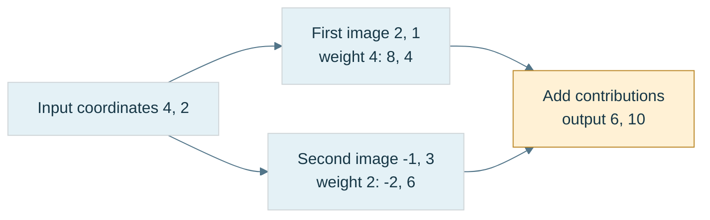

**Figure M1.** The diagram expands a vector into its input-basis coefficients and then recombines the stored output directions. It is an arithmetic trace rather than a scale drawing. Its coordinates are tied to the declared bases; changing a basis changes the table representing the same geometric map.

### Rows describe how to compute one output coordinate

Read the same example row by row:

$$
y_1=2x_1-x_2,\qquad y_2=x_1+3x_2.
$$

Each row supplies the coefficients of one output measurement. The component formula is

$$
y_i=\sum_{j=1}^{n}a_{ij}x_j.
$$

In standard orthonormal Euclidean coordinates this is the familiar row dot input calculation. More generally it is a row acting as a linear functional on the coordinate tuple; do not silently replace a geometric inner product in a skew basis with an ordinary component dot product. Phase 6's Gram matrix is still needed when that is the actual measurement question.

A rectangular example makes the dimensions visible:

$$
B=\begin{bmatrix}2&1&-1\\0&3&4\end{bmatrix},\qquad
\mathbf x=\begin{bmatrix}5\\2\\-1\end{bmatrix}.
$$

The output is $B\mathbf x=(13,2)^{\mathsf T}$ because the row sums are $10+2+1=13$ and $0+6-4=2$. A fourth input coordinate would have no matching coefficient; a two-component input would leave a coefficient unused. The shape mismatch is an undefined mathematical request, not a small implementation inconvenience.

### One projection, two coordinate descriptions

Projecting onto $y=x$ has standard-coordinate matrix
$$
P=\begin{bmatrix}1/2&1/2\\1/2&1/2\end{bmatrix}.
$$
Both $(1,0)$ and $(0,1)$ map to $(1/2,1/2)$. In the adapted orthonormal basis $v_1=(1,1)/\sqrt2$, $v_2=(-1,1)/\sqrt2$, the same map keeps $v_1$ and removes $v_2$, so its matrix is $\operatorname{diag}(1,0)$. In either basis $P^2=P$. The geometric map is unchanged; only its coordinate description changes. The basis-image principle is illustrated in MIT 18.06 Lecture 30. [MIT 18.06 Lecture 30, official notes](https://ocw.mit.edu/courses/18-06-linear-algebra-spring-2010/71bffaffa75c005516ee010daf17868b_MIT18_06S10_L30.pdf)

The derivative is another linear map whose matrix depends on the chosen input and output bases. For $D:P_2\to P_1$, use input basis $(1,x,x^2)$ and output basis $(1,x)$. Since $D(c_0+c_1x+c_2x^2)=c_1+2c_2x$, the matrix is
$$
[D]=\begin{bmatrix}0&1&0\\0&0&2\end{bmatrix}.
$$
This is the basis-image rule applied to a function space, as in MIT 18.06 Lecture 30. [MIT 18.06 Lecture 30, official notes](https://ocw.mit.edu/courses/18-06-linear-algebra-spring-2010/71bffaffa75c005516ee010daf17868b_MIT18_06S10_L30.pdf)


<!-- end V07.03 -->

<!-- begin V07.04 -->
## Keep the transformation separate from its storage

The logical element `A(0, 1)` means row zero, column one regardless of the memory layout. For the $2\times3$ table with rows $(1,2,3)$ and $(4,5,6)$, two compact layouts are

```text
row-major:    [1][2][3][4][5][6]
column-major: [1][4][2][5][3][6]
```

For $m$ rows and $n$ columns, zero-based compact row-major indexing uses $rn+c$, while compact column-major indexing uses $cm+r$. These are element offsets; multiply by the element size to obtain byte offsets. Bounds still require $0\le r<m$ and $0\le c<n$. A stride is the number of elements or bytes advanced when an index increases by one; an API must state which unit it uses. Padding and views can make the actual stride larger than the logical row or column length.

Row-major does not mean row-vector mathematics. Column-vector multiplication works with either storage layout when the accessor returns the correct logical element. Conversely, changing from column-vector mathematics to an equivalent row-vector representation requires transposing the represented map:

$$
\mathbf y=A_c\mathbf x
\quad\Longrightarrow\quad
\mathbf y^{\mathsf T}=\mathbf x^{\mathsf T}A_c^{\mathsf T}.
$$

Thus $A_r=A_c^{\mathsf T}$ represents the same map with row vectors relative to the same corresponding bases. That is an algebraic conversion, not a decision to store the old table in a different order.

The matrix itself has $mn$ scalar entries. A particular C++ object may also have padding or chosen alignment. If the component really occupies four bytes, a compact $4\times4$ component payload contains 64 bytes. Neither that arithmetic nor `sizeof` proves a shader interface contract. At a CPU/GPU boundary, check the component type, logical row/column interpretation, declared shader layout, stride and upload behavior together.

For a layout diagnostic, use distinct asymmetric values. Identity is a poor diagnostic because its transpose is identical. Applying a matrix to standard basis vectors isolates its columns: $A\mathbf e_j$ must reproduce column $j$. That test can locate a transposition mistake before camera or hierarchy code makes it harder to see.


<!-- end V07.04 -->

<!-- begin V07.05 -->
## Combining rules explains the multiplication law

Addition and scalar multiplication are the simplest matrix operations. They act entry by entry:

$$
(A+B)_{ij}=A_{ij}+B_{ij},\qquad
(\lambda A)_{ij}=\lambda A_{ij}.
$$

Addition needs the same shape. Scalar multiplication preserves shape. The meaning is also direct: $(A+B)\mathbf x=A\mathbf x+B\mathbf x$, and $(\lambda A)\mathbf x=\lambda(A\mathbf x)$. Adding two maps adds their outputs; it does not apply one after the other. Two rotations generally do not add to a rotation, and multiplying every entry of a rotation by two doubles output lengths.

All $m\times n$ real matrices form a vector space of dimension $mn$: one basis matrix has a one at each chosen position and zero everywhere else. This vector-space structure is useful, but special families inside it can have extra constraints. The family of rotation matrices is constrained by orthonormality and positive orientation; arbitrary sums do not preserve those constraints.

To apply one rule after another, we need composition. Let $B:\mathbb R^n\to\mathbb R^p$ and $A:\mathbb R^p\to\mathbb R^m$. The output of $B$ is a valid input to $A$, so the combined map is $A\circ B$. We want a matrix $C$ satisfying $C\mathbf x=A(B\mathbf x)$ for every permitted input.

Expand one component:

$$
y_k=\sum_{j=1}^{n}B_{kj}x_j,
\qquad
z_i=\sum_{k=1}^{p}A_{ik}y_k
=\sum_{j=1}^{n}\left(\sum_{k=1}^{p}A_{ik}B_{kj}\right)x_j.
$$

Comparing coefficients gives the product rule:

$$
C=AB,\qquad C_{ij}=\sum_{k=1}^{p}A_{ik}B_{kj}.
$$

The inner dimension is the intermediate coordinate space. In the product $(m\times p)(p\times n)$ it must match, and the result has shape $m\times n$. Equivalently, each column of $AB$ is $A$ applied to the corresponding column of $B$. This is why row-column multiplication is the rule: it makes the stored table agree with composed linear maps.

For

$$
A=\begin{bmatrix}1&2\\3&4\end{bmatrix},\qquad
B=\begin{bmatrix}5&6\\7&8\end{bmatrix},
$$

the product is

$$
AB=\begin{bmatrix}1(5)+2(7)&1(6)+2(8)\\3(5)+4(7)&3(6)+4(8)\end{bmatrix}
=\begin{bmatrix}19&22\\43&50\end{bmatrix}.
$$

The reverse product is $BA=\begin{bmatrix}23&34\\31&46\end{bmatrix}$. Both products are defined here, but they differ. With rectangular matrices, one order may not even be defined.

### Order describes actions; parentheses describe grouping

Take $\mathbf p=(1,1)^{\mathsf T}$, an X stretch $S=\operatorname{diag}(2,1)$, and a quarter-turn $R=\begin{bmatrix}0&-1\\1&0\end{bmatrix}$. Applying scale then rotation gives

$$
\mathbf p\xrightarrow{S}(2,1)^{\mathsf T}\xrightarrow{R}(-1,2)^{\mathsf T}.
$$

The product is $RS\mathbf p$. Reverse the actions and the result is $SR\mathbf p=(-2,1)^{\mathsf T}$. Matrix multiplication is **noncommutative**: order is not generally interchangeable. Some pairs commute, including diagonal matrices with each other and uniform scaling with any compatible linear map. Noncommutative does not mean that every pair fails to commute.

### Figure M2 - The same operations give different results in different orders

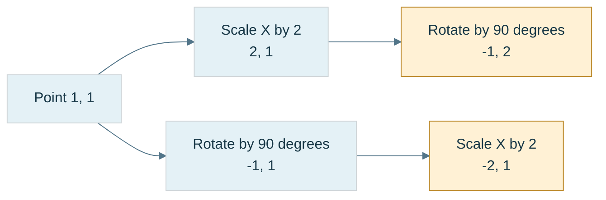

**Figure M2.** The arrows show execution order. In column-vector notation the upper path is $RS\mathbf p$ and the lower path is $SR\mathbf p$. Both stretches use the declared fixed coordinate axes. A hierarchy may instead ask for a local-axis operation, so name the space before choosing multiplication order.

Grouping is different. Exact real matrix multiplication is **associative**: $(AB)C=A(BC)$ when shapes permit the products. Both sides apply $C$, then $B$, then $A$. Expanding either component produces the same finite double sum. In floating-point arithmetic, different grouping can change rounding and overflow, so algebraic equality is not a bitwise reproducibility guarantee.

Grouping also changes cost. If $A$ is $1000\times10$, $B$ is $10\times1000$, and $C$ is $1000\times1$, the classical algorithm uses about 11 million multiply-accumulate terms for $(AB)C$, versus 20 thousand for $A(BC)$. The first route also creates a million-entry intermediate; the second creates ten entries. These are arithmetic counts, not measured timings.

For a classical dense product of shapes $(M\times K)(K\times N)$, there are $MN$ output entries and $K$ terms per entry, giving $\Theta(MKN)$ work. Matrix-vector multiplication costs $\Theta(MN)$ for an $M\times N$ map. Addition, scalar multiplication and transpose touch $MN$ entries and take $\Theta(MN)$ work. Layout and loop ordering change data reuse; they do not change these mathematical shapes or classical asymptotic counts.


<!-- end V07.05 -->


## A mathematical object is more than its coordinates

A graphics calculation begins with an object in a space and a question about that object. A point, a direction, a color, a velocity, a pixel measurement, and a list of unknown parameters may all be stored as arrays of numbers. They do not thereby become the same kind of thing. The meaning of each array depends on the operations it supports, the units of its entries, and the coordinate frame in which those entries were measured.

A vector space supplies operations for adding vectors and multiplying them by scalars. If $u$ and $v$ are vectors and $a$ and $b$ are real numbers, then $au+bv$ is another vector. A basis is a collection of independent vectors that lets every vector be expressed uniquely as a weighted sum. In a chosen basis $B=(b_1,\ldots,b_n)$, the coordinate tuple $[v]_B$ records those weights; it is a description of $v$, not the vector itself. Changing the basis changes the tuple while leaving the represented geometric object unchanged.

A linear map $T$ preserves addition and scalar multiplication:

$$
T(au+bv)=aT(u)+bT(v).
$$

Once input and output bases are chosen, the map has a matrix representation. Its $j$th column is the coordinate vector of $T(b_j)$, the image of the $j$th input basis vector. This fact is the simplest way to understand what a matrix means: each column records where one basis direction goes. Matrix multiplication follows function composition. If $S$ acts first and $T$ second, the composite is $T\circ S$, represented by the product $[T][S]$ when the coordinate conventions agree.

This interpretation prevents a common error in graphics: treating a matrix as a bag of numbers divorced from its input frame, output frame, and storage convention. A transform may map object coordinates to world coordinates, world coordinates to camera coordinates, or one basis representation to another. Those maps have different semantic directions even if they happen to use the same dimensions. Multiplying in the wrong order is not a minor coding mistake; it composes different functions.

Coordinates become measurements only after geometry is specified. A dot product gives a way to measure length and angle. In an orthonormal Euclidean basis, $u\cdot v=u^Tv$ and $\|u\|_2=\sqrt{u^Tu}$. In a non-orthonormal basis, the coordinate dot product is generally not the geometric dot product. If the basis matrix is $B$, then the Gram matrix $G=B^TB$ stores the basis inner products, and

$$
\langle u,v\rangle = [u]_B^T G [v]_B.
$$

The metric is therefore part of the problem. It says what counts as a unit of distance and which directions are orthogonal. This becomes essential when parameter vectors combine quantities with different units, when a fit weights some residuals more strongly, or when PCA is applied to differently scaled measurements.

For an approachable numerical example, let a 2D linear map send $e_1=(1,0)$ to $(2,1)$ and $e_2=(0,1)$ to $(-1,1)$. Its matrix is

$$
A=\begin{bmatrix}2&-1\\1&1\end{bmatrix}.
$$

A point with coordinates $(3,2)$ maps to $A(3,2)^T=(4,5)^T$. This result can be reconstructed from the columns: $3(2,1)+2(-1,1)=(4,5)$. If the input coordinates had instead been expressed in a skew basis, the same geometric point would have different coordinates, and the matrix entries would have to describe the map relative to that basis. The picture is unchanged; its numerical description is not.


### Immediate footing — eigenpair

An eigenpair is a nonzero vector $v$ and scalar $\lambda$ satisfying $Av=\lambda v$. The map preserves the direction of $v$ and scales it by $\lambda$; a negative value also reverses orientation. For $A=\operatorname{diag}(2,3)$, the coordinate directions $e_1=(1,0)$ and $e_2=(0,1)$ have eigenvalues $2$ and $3$. Not every matrix has a full basis of real eigenvectors. Real symmetric matrices have real eigenvalues and can be diagonalized with orthonormal eigenvectors. Eigenvectors of a general matrix may be sensitive to perturbations, especially when eigenvalues are close.

[[#Eigenvectors reveal the directions a square map does not turn|Full explanation and worked examples in this book]]


### Immediate footing — symmetric positive definite

A real symmetric matrix $A$ is positive definite when $x^TAx>0$ for every nonzero $x$. For $A=\operatorname{diag}(2,5)$, $x^TAx=2x_1^2+5x_2^2$, which is positive except at zero. This property makes the associated quadratic form bowl-shaped and guarantees a unique solution to $Ax=b$. Positive definite matrices admit a Cholesky factorization $A=LL^T$ in exact arithmetic. Symmetry alone is insufficient: $\operatorname{diag}(1,-1)$ is symmetric but indefinite. Finite-precision algorithms must check symmetry and handle loss of positive definiteness.

[[#Positive definiteness is a structural promise|Full explanation and worked examples in this book]]


### Immediate footing — singular value and SVD

For any real $m\times n$ matrix, the singular value decomposition is $A=U\Sigma V^T$. The columns of $V$ are orthonormal input directions; $A$ maps each to an orthogonal output direction in $U$, scaled by a nonnegative singular value in $\Sigma$. For $A=\operatorname{diag}(3,1)$, the coordinate directions are scaled by $3$ and $1$. A zero singular value marks an erased direction; a very small one marks a direction that is hard to invert reliably. Unlike eigendecomposition, SVD applies to rectangular matrices.

[[#Singular value decomposition covers every rectangular map|Full explanation and worked examples in this book]]


### Immediate footing — condition number

A condition number measures how strongly a problem's answer can change when its input changes slightly. For an invertible matrix in the 2-norm, $\kappa_2(A)=\sigma_{\max}/\sigma_{\min}$. Thus $\operatorname{diag}(100,1)$ has condition number $100$, while $\operatorname{diag}(100,0.001)$ has condition number $100{,}000$; solving can amplify error along the weakly scaled direction. Conditioning is a property of the mathematical problem and chosen norm, not proof that an algorithm is inaccurate. Stability describes whether an algorithm adds excessive error; both matter when interpreting residuals.

[[#Conditioning: weak singular directions amplify uncertainty|Full explanation and worked examples in this book]]

<!-- begin V06.10 -->
## A Gram matrix remembers the geometry of a slanted basis

In the slanted basis from earlier, dotting coordinate lists directly gives the wrong answer. Let basis columns be $\mathbf b_1,\ldots,\mathbf b_k$. The [[#A Gram matrix remembers the geometry of a slanted basis|Gram matrix]] stores all pairwise inner products:

$$
G_{ij}=\mathbf b_i\cdot\mathbf b_j.
$$

The diagonal holds squared lengths; off-diagonal entries hold alignment. With $\mathbf b_1=(1,0)$ and $\mathbf b_2=(1,1)$,

$$
G=\begin{pmatrix}1&1\\1&2\end{pmatrix}.
$$

If $\mathbf v=\sum_i c_i\mathbf b_i$ and $\mathbf w=\sum_jd_j\mathbf b_j$, distribute the dot product:

$$
\mathbf v\cdot\mathbf w
=\sum_{i,j}c_iG_{ij}d_j=c^\mathsf TGd.
$$

The superscript $\mathsf T$ means **transpose**: exchange rows and columns. It lets a column coordinate list act as the row that weights the next expression.

For $c=(1,2)^\mathsf T$, compute $Gc=(3,5)^\mathsf T$, then $c^\mathsf TGc=3+10=13$. The reconstructed vector is $(3,2)$, whose Euclidean squared length is also $13$. Blindly squaring the coordinates would give $5$.

$G$ is symmetric. It is **positive semidefinite** because

$$
c^\mathsf TGc=\left\|\sum_i c_i\mathbf b_i\right\|^2\ge0.
$$

For independent columns it is **positive definite**: this quantity is positive for every nonzero coefficient vector. For dependent columns a nonzero coefficient list can reconstruct zero, so $G$ is singular. An orthonormal basis has $G=I$, the identity matrix, explaining why ordinary coordinate dotting is then correct.

The Gram determinant measures squared area for two vectors and squared volume for three. But it does not retain orientation; reflecting every basis vector can preserve every dot product. A Gram matrix remembers metric geometry, not the complete physical frame.

To project onto a multi-vector span, require the residual to be perpendicular to every generator. In matrix notation this produces

$$
Gc=B^\mathsf T\mathbf v.
$$

This explains the system, but forming $G=B^\mathsf TB$ can square the two-norm condition number of a full-column-rank $B$:

$$
\kappa_2(B^\mathsf TB)=\kappa_2(B)^2.
$$

QR-based solves are usually a better route when numerical conditioning matters. We will build the orthogonalization intuition shortly rather than hide this behind a matrix recipe.


<!-- end V06.10 -->

<!-- begin V07.06 -->
## Special matrices tell us what information a rule preserves

The **identity** $I_n$ has ones on the diagonal and zeros elsewhere. It sends every basis direction to itself, so $I_n\mathbf x=\mathbf x$. For an $m\times n$ matrix, use $I_mA=A$ and $AI_n=A$. A transform product must begin with identity, while an accumulation of additions begins with the zero matrix. Starting a product at zero destroys every later contribution.

The **zero matrix** maps every input to zero. It is the additive identity, but it destroys all information as a map. From $AB=AC$ one cannot generally cancel $A$; if $A$ is zero the equality tells us nothing about $B$ and $C$.

A **diagonal matrix** permits nonzero entries only on the main diagonal. In $D=\operatorname{diag}(d_1,d_2,d_3)$, each output coordinate is $d_ix_i$; coordinates do not mix. An ordinary three-axis scaling matrix has exactly this form. Uniform nonzero scaling preserves angles, while nonuniform scaling can change angles between arbitrary directions. A negative scale reverses a basis direction; a zero scale erases the corresponding coordinate and cannot be undone.

A **shear** changes one coordinate in proportion to another. The elementary planar example

$$
H=\begin{bmatrix}1&k\\0&1\end{bmatrix}
\quad\Longrightarrow\quad(x,y)\mapsto(x+ky,y)
$$

slides higher layers farther sideways, like a stack of cards. It sends $\mathbf e_1$ to $(1,0)$ and $\mathbf e_2$ to $(k,1)$, preserving area but generally changing angles. Off-diagonal entries mean coordinate coupling, but they are not by themselves proof of shear: rotation also mixes coordinates. Nor does a general matrix with all diagonal entries equal to one automatically have determinant one. For example $\begin{bmatrix}1&2\\3&1\end{bmatrix}$ has determinant $-5$; it is not the area-preserving elementary shear above.


<!-- end V07.06 -->

<!-- begin V07.07 -->
## Derive rotations from the directions that stay fixed

A **proper rotation** preserves Euclidean lengths, angles and orientation. In two dimensions, rotate the first unit axis through angle $\theta$. Its image is $(\cos\theta,\sin\theta)^{\mathsf T}$. The second unit axis began at angle $\pi/2$, so its image is

$$
\begin{bmatrix}\cos(\pi/2+\theta)\\\sin(\pi/2+\theta)\end{bmatrix}
=\begin{bmatrix}-\sin\theta\\\cos\theta\end{bmatrix}.
$$

Place the two images into columns. Writing $c=\cos\theta$ and $s=\sin\theta$ gives

$$
R(\theta)=\begin{bmatrix}c&-s\\s&c\end{bmatrix},\qquad
x'=cx-sy,\quad y'=sx+cy.
$$

At $\theta=\pi/2$, $\mathbf e_x$ goes to $\mathbf e_y$, and $\mathbf e_y$ goes to $-\mathbf e_x$. These basis tests expose a wrong sign immediately. A general vector $(2,3)^{\mathsf T}$ goes to $(-3,2)^{\mathsf T}$.

Why is this truly length preserving? Expand the squared output length:

$$
(cx-sy)^2+(sx+cy)^2
=x^2(c^2+s^2)+y^2(c^2+s^2)=x^2+y^2.
$$

The cross terms cancel and $c^2+s^2=1$. The columns are also unit length and mutually perpendicular, summarized by $R^{\mathsf T}R=I$. Therefore $R^{-1}=R^{\mathsf T}=R(-\theta)$. Multiplying two such matrices and applying the angle-addition identities gives $R(\alpha)R(\beta)=R(\alpha+\beta)$, so planar rotations commute.

### The oriented plane explains the Y-rotation signs

In three dimensions, rotation about an axis leaves that axis fixed. Choose the ordered perpendicular-plane coordinates so their basis cross product points along the positive rotation axis. For X use $(y,z)$ because $\mathbf e_y\times\mathbf e_z=\mathbf e_x$. For Y use $(z,x)$ because $\mathbf e_z\times\mathbf e_x=\mathbf e_y$. For Z use $(x,y)$ because $\mathbf e_x\times\mathbf e_y=\mathbf e_z$.

Insert the same planar rotation into each ordered plane. For X,

$$
y'=cy-sz,\quad z'=sy+cz,\quad x'=x,
\qquad
R_x=\begin{bmatrix}1&0&0\\0&c&-s\\0&s&c\end{bmatrix}.
$$

For Y, first rotate the ordered pair $(z,x)$:

$$
z'=cz-sx,\qquad x'=sz+cx,\qquad y'=y.
$$

Then return to the usual output order $(x',y',z')$:

$$
R_y=\begin{bmatrix}c&0&s\\0&1&0\\-s&0&c\end{bmatrix}.
$$

The differing-looking signs are consequences of choosing an oriented plane, not exceptions to the two-dimensional rule. Finally,

$$
R_z=\begin{bmatrix}c&-s&0\\s&c&0\\0&0&1\end{bmatrix}.
$$

Use the actual vector $\mathbf v=(2,3,4)^{\mathsf T}$ at a positive quarter-turn:

$$
R_x\mathbf v=(2,-4,3)^{\mathsf T},\qquad
R_y\mathbf v=(4,3,-2)^{\mathsf T},\qquad
R_z\mathbf v=(-3,2,4)^{\mathsf T}.
$$

For the Y case, explicitly read the rows: $x'=0(2)+0(3)+1(4)=4$, $y'=3$, and $z'=-1(2)+0(3)+0(4)=-2$. Its squared length is $16+9+4=29$, matching the input's $4+9+16=29$. The right-hand rule agrees: positive Y sends positive Z toward positive X and positive X toward negative Z.

Arbitrary rotations in three dimensions do not share one axis. For example, with $\mathbf e_z$ and quarter-turns, $R_yR_x\mathbf e_z=-\mathbf e_y$ while $R_xR_y\mathbf e_z=\mathbf e_x$. This is why a rotation API must state the axes, the coordinate space and the composition order.

A diagonal matrix can represent some nonidentity rotations: in two dimensions $\operatorname{diag}(-1,-1)$ is a half-turn, and in three dimensions $\operatorname{diag}(-1,-1,1)$ is a half-turn about Z. What a diagonal matrix cannot do is continuous general coordinate mixing. Do not turn a useful pattern-recognition shortcut into an absolute claim.

Repeated floating-point rotation products can drift away from orthonormality. Check $R^{\mathsf T}R$ against identity with a meaningful residual. Finite entries alone do not prove that a matrix remains a rotation. Later quaternion normalization gives a compact orientation-maintenance method, with its own preconditions.


<!-- end V07.07 -->

<!-- begin V07.08 -->
## Transpose lets us compare measurements and structure

The **transpose** exchanges logical indices: $(A^{\mathsf T})_{ij}=A_{ji}$. A $2\times3$ table becomes $3\times2$. This operation is not a physical rotation of the represented geometry, nor is it merely a memory-layout conversion. For real columns $\mathbf x,\mathbf y$ in an orthonormal Euclidean basis, $\mathbf x^{\mathsf T}\mathbf y$ is their dot product.

Transpose twice returns the original matrix; it distributes over addition and scalar multiplication. Products reverse order:

$$
(AB)^{\mathsf T}=B^{\mathsf T}A^{\mathsf T}.
$$

Indeed, the $(i,j)$ entry on the left is $\sum_kA_{jk}B_{ki}$, which is the $(i,j)$ entry of the right side after commuting each pair of real scalars. The dimensions also force the reversed order. This identity will support the inverse-transpose normal rule later.

A real square matrix is **symmetric** when $A^{\mathsf T}=A$. Its opposite-side entries match; only $n(n+1)/2$ values are independent. A covariance matrix is symmetric because exchanging the two variables leaves the covariance unchanged. The product $A^{\mathsf T}A$ is symmetric by the transpose identity, though using it to solve systems can worsen conditioning and is not a universal numerical recommendation.

A matrix is **skew-symmetric** when $K^{\mathsf T}=-K$. Over the reals its diagonal is zero because $k_{ii}=-k_{ii}$. In three dimensions,

$$
[\boldsymbol\omega]_\times=
\begin{bmatrix}0&-\omega_z&\omega_y\\\omega_z&0&-\omega_x\\-\omega_y&\omega_x&0\end{bmatrix}
\quad\Longrightarrow\quad
[\boldsymbol\omega]_\times\mathbf v=\boldsymbol\omega\times\mathbf v.
$$

For $\boldsymbol\omega=(1,2,3)^{\mathsf T}$ and $\mathbf v=(4,5,6)^{\mathsf T}$, both calculations give $(-3,6,-3)^{\mathsf T}$. This connects a cross product to a linear operator. A small rotation has the form $I+\theta[\widehat{\mathbf a}]_\times+O(\theta^2)$; dropping the higher terms gives a first-order approximation, not an exactly orthogonal finite rotation.

Every real square matrix separates uniquely into symmetric and skew parts:

$$
A=\underbrace{\frac{A+A^{\mathsf T}}2}_{S}
+\underbrace{\frac{A-A^{\mathsf T}}2}_{K}.
$$

For $A=\begin{bmatrix}1&4\\2&3\end{bmatrix}$, these are $S=\begin{bmatrix}1&3\\3&3\end{bmatrix}$ and $K=\begin{bmatrix}0&1\\-1&0\end{bmatrix}$. This is an additive decomposition of coefficients. It is not a rotation-times-stretch factorization.

The **trace** of a square matrix is $\operatorname{tr}A=\sum_i a_{ii}$. For compatible rectangular $A$ and $B$ with square products, expanding the sums gives $\operatorname{tr}(AB)=\operatorname{tr}(BA)$. This permits cyclic reorderings of longer products when dimensions permit, not arbitrary permutations. If $P$ is an invertible change-of-basis matrix,

$$
\operatorname{tr}(P^{-1}AP)=\operatorname{tr}(APP^{-1})=\operatorname{tr}(A).
$$

Trace is therefore independent of the chosen basis for the same endomorphism, meaning a linear map from a vector space to itself. It summarizes one invariant; it does not identify the complete transformation. Eigenvalue interpretations will be developed when those terms have their own foundations.


<!-- end V07.08 -->

<!-- begin V07.09 -->
## Determinant measures oriented volume and exposes lost dimensions

In two dimensions, the columns of $A=\begin{bmatrix}a&b\\c&d\end{bmatrix}$ are the images of the unit square's edge directions. Their oriented parallelogram area is

$$
\det A=ad-bc.
$$

For $A=\begin{bmatrix}3&1\\2&4\end{bmatrix}$, the determinant is $12-2=10$: ordinary areas scale by ten and orientation is preserved. A reflection $\operatorname{diag}(-1,1)$ has determinant $-1$: area magnitude is preserved but orientation reverses. The singular table $\begin{bmatrix}1&2\\2&4\end{bmatrix}$ has dependent columns and zero area.

In three dimensions, let the columns be $\mathbf u,\mathbf v,\mathbf w$ in that order. Their oriented parallelepiped volume is

$$
\det A=\mathbf u\cdot(\mathbf v\times\mathbf w).
$$

This is the scalar triple product from Phase 6: base area times signed height. For a general table,

$$
\det\begin{bmatrix}a&b&c\\d&e&f\\g&h&i\end{bmatrix}
=a(ei-fh)-b(di-fg)+c(dh-eg).
$$

Use one calibration throughout the following inversion examples:

$$
A=\begin{bmatrix}1&2&3\\0&1&4\\5&6&0\end{bmatrix}.
$$

Expansion gives $-24+40-15=1$. Independently, its columns are $(1,0,5)^{\mathsf T}$, $(2,1,6)^{\mathsf T}$ and $(3,4,0)^{\mathsf T}$. The cross product of the last two is $(-24,18,5)^{\mathsf T}$, whose dot product with the first is $-24+25=1$.

This map preserves volume and orientation, but not necessarily lengths or angles. A determinant of one does not prove rotation. Proper rotations additionally satisfy $R^{\mathsf T}R=I$. Elementary shears also have determinant one while distorting angles.

In $n$ dimensions, $|\det A|$ is the ordinary $n$-volume scale. The sign records orientation. Composition multiplies the scales: $\det(AB)=\det A\det B$. Therefore $\det(A^{-1})=1/\det A$ when an inverse exists. A scale $\operatorname{diag}(2,3,4)$ multiplies volume by 24; its inverse multiplies it by $1/24$.

### Figure M3 - Three different questions answered by one determinant

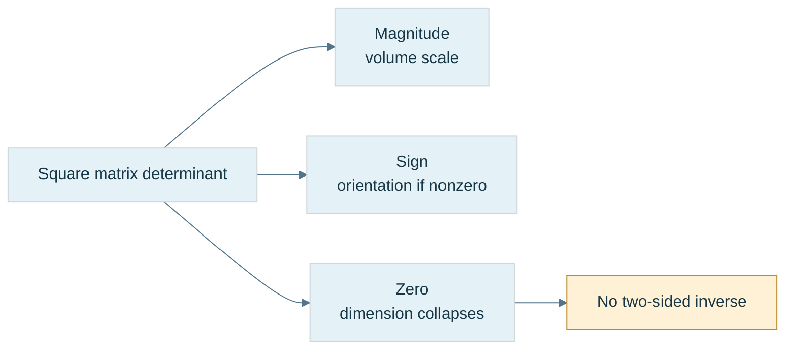

**Figure M3.** These are distinct interpretations. None gives a reliable condition estimate by itself. Orientation is defined for a full-dimensional nonsingular map; a collapsed image does not retain a full ordered basis. In a renderer, a negative model determinant may reverse winding, but rasterizer front-face settings and the complete viewing/projection convention still determine actual culling behavior.

A square matrix is **singular** when it has no two-sided inverse. The matrix $\begin{bmatrix}1&2\\2&4\end{bmatrix}$ sends both $(2,0)^{\mathsf T}$ and $(0,1)^{\mathsf T}$ to $(2,4)^{\mathsf T}$. Its nonzero vector $(2,-1)^{\mathsf T}$ maps to zero. An inverse could not distinguish the original inputs. For a square matrix over the reals, these are equivalent: nonzero determinant, independent columns, no nonzero null vector, and existence of an inverse. Rectangular maps need separate questions about left inverses, right inverses, injectivity and surjectivity; do not apply the square determinant test to them.


<!-- end V07.09 -->

<!-- begin V07.10 -->
## Recovering an input has an algebraic route and a computational route

An inverse $A^{-1}$ must satisfy both $A^{-1}A=I$ and $AA^{-1}=I$ for a square map. It undoes the same specified input/output relationship; it does not reverse lost information. When $C=AB$, undoing $A$ must happen before undoing $B$, so $(AB)^{-1}=B^{-1}A^{-1}$. Scale inverses reciprocate nonzero scales. Rotation inverses transpose an orthogonal matrix. Use known structure when it is guaranteed rather than invoking an unnecessary general inverse.

### Minors and cofactors build a symbolic inverse

The **minor** $M_{ij}$ is the determinant remaining after deleting row $i$ and column $j$. The **cofactor** is $C_{ij}=(-1)^{i+j}M_{ij}$, adding alternating signs. The **adjugate** is the cofactor matrix transposed, $\operatorname{adj}A=C^{\mathsf T}$. Do not confuse adjugate with a conjugate-transpose adjoint used elsewhere.

For our determinant-one calibration, the cofactor matrix is

$$
C=\begin{bmatrix}-24&20&-5\\18&-15&4\\5&-4&1\end{bmatrix}.
$$

For instance, deleting row one and column two leaves $\begin{bmatrix}0&4\\5&0\end{bmatrix}$, with minor $-20$ and cofactor $+20$. The resulting inverse is

$$
A^{-1}=\frac{\operatorname{adj}A}{\det A}
=\begin{bmatrix}-24&18&5\\20&-15&-4\\-5&4&1\end{bmatrix}.
$$

Why does the formula work? A diagonal entry of $A\operatorname{adj}A$ is a row's cofactor expansion, hence $\det A$. An off-diagonal entry has the same expansion with a different row inserted, producing a determinant with repeated rows, hence zero. Therefore $A\operatorname{adj}A=(\det A)I$. Division is valid only when $\det A\ne0$.

Verify rather than trust the table. The first row of $AA^{-1}$ is $(-24+40-15,\ 18-30+12,\ 5-8+3)=(1,0,0)$. The second row is $(20-20,-15+16,-4+4)=(0,1,0)$; the third is $(-120+120,90-90,25-24)=(0,0,1)$. The reverse product also equals identity. A left-side check alone is insufficient as a general software interface test, even though exact square algebra makes the two-sided relationship follow.

For a $2\times2$ matrix this construction reduces to

$$
\begin{bmatrix}a&b\\c&d\end{bmatrix}^{-1}
=\frac1{ad-bc}\begin{bmatrix}d&-b\\-c&a\end{bmatrix}.
$$

Closed formulas are useful for symbolic reasoning and some carefully implemented small matrices. Recursive cofactor expansion is not an appropriate general dense-matrix inversion algorithm. A compact formula does not automatically minimize numerical error.

### Row reduction makes the inverse observable

Form the augmented table $[A\mid I]$ and apply each row operation to both halves. A row operation is multiplication on the left by an invertible **elementary matrix**. If their combined operation is $E$ and $EA=I$, then $E=A^{-1}$; the right half becomes $EI=A^{-1}$.

For the same calibration, the complete useful trace is:

| Operation | Left half after operation | Right half after operation |
|---|---|---|
| Start | $\begin{bmatrix}1&2&3\\0&1&4\\5&6&0\end{bmatrix}$ | $I$ |
| $R_3\leftarrow R_3-5R_1$ | $\begin{bmatrix}1&2&3\\0&1&4\\0&-4&-15\end{bmatrix}$ | $\begin{bmatrix}1&0&0\\0&1&0\\-5&0&1\end{bmatrix}$ |
| $R_3\leftarrow R_3+4R_2$ | $\begin{bmatrix}1&2&3\\0&1&4\\0&0&1\end{bmatrix}$ | $\begin{bmatrix}1&0&0\\0&1&0\\-5&4&1\end{bmatrix}$ |
| $R_2\leftarrow R_2-4R_3$ | $\begin{bmatrix}1&2&3\\0&1&0\\0&0&1\end{bmatrix}$ | $\begin{bmatrix}1&0&0\\20&-15&-4\\-5&4&1\end{bmatrix}$ |
| $R_1\leftarrow R_1-3R_3$ | $\begin{bmatrix}1&2&0\\0&1&0\\0&0&1\end{bmatrix}$ | $\begin{bmatrix}16&-12&-3\\20&-15&-4\\-5&4&1\end{bmatrix}$ |
| $R_1\leftarrow R_1-2R_2$ | $I$ | $\begin{bmatrix}-24&18&5\\20&-15&-4\\-5&4&1\end{bmatrix}$ |

A **pivot** is the entry used to eliminate other entries in its column. An initial zero pivot does not prove singularity: $\begin{bmatrix}0&1\\2&3\end{bmatrix}$ is invertible with determinant $-2$. A row swap brings the two into the first pivot position. **Partial pivoting** chooses the largest available absolute entry in the current column among the remaining rows, reducing unnecessary division by small pivots. It improves many calculations but does not guarantee tiny error for every matrix or cure a sensitive problem.

Dense Gauss–Jordan inversion takes $\Theta(n^3)$ arithmetic and $\Theta(n^2)$ storage. To solve $A\mathbf x=\mathbf b$ for one or several right-hand sides, a factorization and direct solve is usually preferable to forming $A^{-1}$ and multiplying. A transform inverse remains useful when the inverse map itself is the object required, such as a cached world-to-local transform. The requirement decides the operation.


<!-- end V07.10 -->

<!-- begin V07.11 -->
## An inverse can exist and still amplify uncertainty

An **ill-conditioned problem** is one whose exact answer changes greatly when its input changes slightly, measured relative to the stated input/output scales. **Algorithmic stability** describes how much additional error an algorithm introduces. A stable algorithm cannot erase uncertainty already inherent in an ill-conditioned problem.

Take

$$
A_\varepsilon=\begin{bmatrix}1&1\\1&1+\varepsilon\end{bmatrix},\qquad
A_\varepsilon^{-1}=\frac1\varepsilon\begin{bmatrix}1+\varepsilon&-1\\-1&1\end{bmatrix}.
$$

The columns approach parallel directions as $\varepsilon\to0$. For $\varepsilon=0.001$, the input $(1,1)^{\mathsf T}$ produces $(2,2.001)^{\mathsf T}$. Change only the second observed output to $2.002$. The exact recovered input becomes $(0,2)^{\mathsf T}$: the equations give $x_1+x_2=2$ and $0.001x_2=0.002$. The output perturbation is small, but the reconstructed input changes substantially. No implementation bug is needed to produce this effect.

### Figure M4 - Uncertainty can be amplified by a reversible map

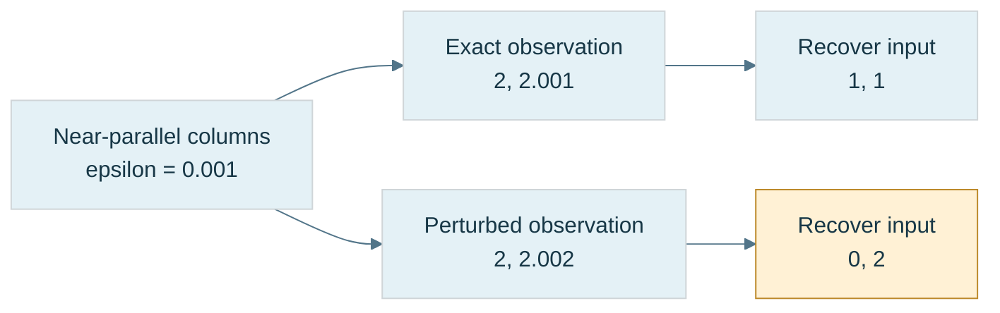

**Figure M4.** Both paths solve the same invertible matrix. The different answers follow from different observations. This separates problem sensitivity from an algorithm defect. Values are exact decimal examples for reasoning; floating-point storage adds another approximation layer.

A compatible induced matrix norm measures the largest amplification relative to a chosen vector norm. A corresponding normwise condition number for a nonsingular square matrix is

$$
\kappa(A)=\|A\|\,\|A^{-1}\|.
$$

For a fixed matrix and a perturbed right-hand side, the relative solution error is bounded by the relative right-hand-side error multiplied by $\kappa(A)$, in the same compatible norm. When both matrix and right-hand side change, additional terms and smallness conditions enter the bound. A condition number is tied to a problem and scaling; it is not an unqualified quality score for every possible downstream use.

In the 2-norm, $\kappa_2(A)=\sigma_{\max}/\sigma_{\min}$, where the singular values describe the largest and smallest directional stretches. This is a preview of later SVD, not a requirement to learn its full construction now. Equal stretches have condition one; a huge ratio means one direction was compressed relative to another.

This immediately disproves a determinant-only numerical threshold. Compare two matrices with the same determinant:

$$
U=\operatorname{diag}(10^{-10},10^{-10}),\qquad
V=\operatorname{diag}(1,10^{-20}).
$$

Both determinants equal $10^{-20}$, yet $\kappa_2(U)=1$ and $\kappa_2(V)=10^{20}$. The first scales every direction equally; the second nearly erases one direction relative to the other. The source's earlier comparison used different determinant magnitudes; this equal-determinant pair makes the intended argument exact.

Uniform tiny scaling can still create absolute range problems or amplify an absolute measurement error. Relative conditioning one does not promise that an application can ignore those issues. Similarly, a determinant of one does not imply good conditioning: $\operatorname{diag}(10^{10},10^{-10})$ has determinant one and condition $10^{20}$.

An inverse API should therefore return a failure state or diagnostic result when it cannot meet its contract. Check finite inputs and outputs, use scale-aware pivot/condition information, and inspect an inverse residual such as $\|I-A\widehat{A^{-1}}\|$. A small residual supports the computed relationship, but by itself does not guarantee small forward error in every recovered input. Choose tolerances from the represented units, precision and use case; a global determinant epsilon hides those decisions.

### Reconstruct the machine before adding translation

At the board, start with two basis images and rebuild a matrix. Apply it by column weights and by row sums. Compose it with a second map and explain why the product order follows the action order. Rebuild the rotation matrices from the three oriented planes, then test the unit axes and one asymmetric vector. Finally, use the determinant-one calibration to derive an inverse by cofactors and by row reduction, and use the near-parallel example to explain why obtaining an inverse is only the beginning of the numerical question.

The remaining limitation is now visible. Every linear map still fixes the origin. The robot must also place its tool at a location, carry it through parent frames and look at it from a camera. That need leads to affine transforms and coordinate-frame matrices rather than another arbitrary matrix formula.


<!-- end V07.11 -->

<!-- begin V06.21 -->
## A normal is a measuring rule before it is an arrow

The panel is scaled nonuniformly. Its edges transform as ordinary movements. Its normal must remain perpendicular to those transformed edges. Why does the same transform not always work?

A [[#Normals undo scale before following rotation|linear functional]] is a rule $\omega$ that turns a vector into a scalar and obeys

$$
\omega(a\mathbf u+b\mathbf v)=a\omega(\mathbf u)+b\omega(\mathbf v).
$$

“Functional” simply means a scalar-valued function in this setting. A **covector** is such a linear measurement rule. The **dual space** $V^*$ is the vector space of these rules on $V$.

For $\omega(x,y)=2x+y$, movement $(3,2)$ gives measurement $8$. Think of a price list applied to a quantity basket: the price list is not another basket even though both can be stored as two numbers. A covector's units can be reciprocal to the vector's units.

Its **kernel** is the set of vectors it measures as zero. Saying the rule **annihilates** a tangent only means it returns zero for that tangent. This vocabulary is useful only after the ordinary meaning is clear.

A plane normal defines such a rule: $\omega_{\mathbf n}(\mathbf v)=\mathbf n\cdot\mathbf v$. Tangent vectors lie in its kernel. In orthonormal Euclidean coordinates we identify the measurement with a vector using the inner product, hiding the distinction. In general basis coordinates, the conversion uses the metric: a coordinate vector $n$ represents covector coefficients $Gn$.

### Derive the inverse transpose

Let an invertible active linear map send tangents to $\mathbf v'=A\mathbf v$. To preserve the measurement relationship, require

$$
\mathbf n'^\mathsf TA\mathbf v=\mathbf n^\mathsf T\mathbf v
\quad\text{for every }\mathbf v.
$$

Therefore $\mathbf n'^\mathsf TA=\mathbf n^\mathsf T$, and

$$
\mathbf n'=A^{-\mathsf T}\mathbf n.
$$

The inverse compensates for transformed motion; the transpose converts row measurement coefficients back into the column storage convention. This is a derived requirement, not a special shader incantation.

Use tangent $\mathbf t=(1,1,0)$ and normal $\mathbf n=(1,-1,0)$. Their dot is zero. Under $A=\operatorname{diag}(2,1,1)$, the tangent becomes $(2,1,0)$. Naively applying $A$ to the normal gives $(2,-1,0)$, whose dot with the new tangent is $3$. The correct normal $(1/2,-1,0)$ gives dot zero.

Re-normalize if a unit shading normal is needed. Translation does not enter this tangent calculation. Under a pure rotation, $A^{-\mathsf T}=A$, which explains why the bug stays hidden until nonuniform scale or shear appears.

### G4 - Transform the normal and prove the relationship survived

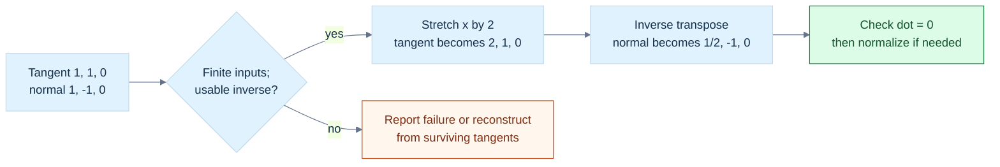

**Figure G4.** The inverse transpose compensates for the tangent stretch: $(2,1,0)\cdot(1/2,-1,0)=0$. Applying the original stretch to both instead gives dot product $3$, breaking perpendicularity. **Limit:** an invertible matrix is mathematically sufficient, but an ill-conditioned numerical inverse can still be unreliable. Check finite output, conditioning and an appropriate normalized dot residual. Reconstructed normals require independent transformed tangents; collapsed surfaces have no unique normal. Cross-derived area normals also retain the determinant's area scale and orientation sign, as derived below.

If $A$ is singular, the inverse does not exist. Some surviving surfaces still have geometric normals that can be reconstructed from transformed tangents, but there is no general invertible normal-map formula. Decide how collapsed geometry is represented rather than forcing an inverse.

An area normal computed by crossing transformed edges obeys the fuller identity

$$
(A\mathbf u)\times(A\mathbf v)
=\det(A)A^{-\mathsf T}(\mathbf u\times\mathbf v)
$$

when $A$ is invertible. The determinant retains area scaling and orientation, including a mirror sign. A plane-measurement normal and a cross-derived oriented area normal are closely related, but not identical in every transformation policy.

![[Visual Recall/Math Foundations/M06-1_vector-reflection.png]]

**M06-1. Reflection across the horizontal mirror normal.** The shown incident vector has v dot n=-1 and reflected vector r=(2,1); both squared norms are 5.
For velocity $\mathbf v=(3,4)$ and unit surface normal $\mathbf n=(0,1)$, $\mathbf v\cdot\mathbf n=4$ is signed normal speed: positive means movement toward the chosen normal side. The tangent component is $(3,0)$. This applies projection without assuming a collision response or sign convention. Freya Holmér also uses a velocity projected onto a surface normal for collision-audio intensity; the chosen absolute or inward component depends on the application. [Freya Holmér, Vectors & Dot Product](https://www.youtube.com/watch?v=MOYiVLEnhrw)


<!-- end V06.21 -->

<!-- begin V06.22 -->
## Oriented areas deserve their own representation

The cross product encodes area as a vector only in a special setting. [[#Oriented areas deserve their own representation|Exterior algebra]] keeps the area itself. Its **wedge product** $\mathbf a\wedge\mathbf b$ is bilinear and antisymmetric:

$$
\mathbf a\wedge\mathbf b=-\mathbf b\wedge\mathbf a,
\qquad \mathbf a\wedge\mathbf a=0.
$$

In three-dimensional coordinates,

$$
\mathbf a\wedge\mathbf b
=(a_xb_y-a_yb_x)\mathbf e_x\wedge\mathbf e_y
+(a_xb_z-a_zb_x)\mathbf e_x\wedge\mathbf e_z
+(a_yb_z-a_zb_y)\mathbf e_y\wedge\mathbf e_z.
$$

A **bivector** represents oriented area; it is not merely two independent vectors stored together. A **grade** counts the dimensional character: scalars have grade zero, vectors grade one, area elements grade two, and volume elements grade three. A decomposable wedge of two vectors is a **simple bivector**. In higher dimensions, a sum of simple bivectors need not describe one single plane.

Expand the wedge in a basis to obtain those signed area coefficients. If the inputs are dependent, all two-dimensional minors vanish and the wedge is zero. In an appropriate Euclidean metric, its squared magnitude is the two-vector Gram determinant. A metric and orientation supply the **Hodge dual** identification that turns a three-dimensional bivector into the familiar cross-product vector. This identification is extra structure, not part of the wedge's definition.

### Geometric algebra unifies measurement and area

In Euclidean geometric algebra, the product of two vectors combines their inner and exterior products:

$$
\mathbf a\mathbf b=\mathbf a\cdot\mathbf b+\mathbf a\wedge\mathbf b.
$$

The symmetric and antisymmetric pieces recover the two operations:

$$
\mathbf a\cdot\mathbf b=\frac{\mathbf a\mathbf b+\mathbf b\mathbf a}{2},\qquad
\mathbf a\wedge\mathbf b=\frac{\mathbf a\mathbf b-\mathbf b\mathbf a}{2}.
$$

In two orthonormal axes, the plane element $I=\mathbf e_1\mathbf e_2$ has

$$
I^2=\mathbf e_1\mathbf e_2\mathbf e_1\mathbf e_2=-1.
$$

This reconnects planar rotation to complex-number behavior. A **rotor** encodes rotation as a sandwich action, for example $\mathbf v'=R\mathbf v\widetilde R$, where the reverse $\widetilde R$ reverses product order. In one oriented plane we can use $R=\cos(\theta/2)-I\sin(\theta/2)$ with the corresponding convention. The half-angle appears because the rotor acts on both sides.

With unit plane normal $\mathbf n$, reflection of a vector in the plane can be written $-\mathbf n\mathbf v\mathbf n$. Expanding the geometric product recovers $\mathbf v-2(\mathbf v\cdot\mathbf n)\mathbf n$, the earlier formula. Composition of reflections naturally produces rotations.

This chapter establishes motivation and basic identities, not a complete geometric-algebra implementation or performance claim. Matrices and quaternions remain useful representations with established engine interfaces. The gain here is understanding why vectors, areas, measurements, and orientations should not all be collapsed into an unqualified `Vec3`.


<!-- end V06.22 -->


### Immediate footing — homogeneous coordinates

Homogeneous coordinates append a scale component to ordinary coordinates. An affine point can be written $(x,y,z,1)$ and a direction $(d_x,d_y,d_z,0)$. Multiplying a homogeneous tuple by a nonzero common scale leaves the represented projective point unchanged. A tuple with nonzero last component $w$ returns to an affine chart by dividing the first components by $w$. A zero last component represents an ideal direction, so that division is invalid. This representation lets translation and perspective participate in matrix operations, while their geometric meanings remain distinct.

[[#Homogeneous coordinates preserve the role of a location|Full explanation and worked examples in this book]]

<!-- begin V06.20 -->
## Homogeneous coordinates preserve the role of a location

Translation affects a point but not a free direction. [[#Figure M6 - Follow one point through named spaces|Homogeneous coordinates]] make that distinction visible in an extra component:

$$
P_h=(x,y,z,1),\qquad \mathbf d_h=(d_x,d_y,d_z,0).
$$

For an affine transform with linear part $A$ and translation $t$, the rule on a homogeneous pair is

$$
(x,w)\longmapsto(Ax+wt,w).
$$

When $w=1$, translation is added; when $w=0$, it is not. Subtract two canonical point representatives and the result has $w=0$. Add a direction to a point and the result retains $w=1$. This is the affine algebra from earlier, not an arbitrary convention.

### A projective point has many representatives

A nonzero tuple $H=(X,Y,Z,W)$ represents the same projective point as $\lambda H$ for any nonzero scalar $\lambda$. We write $H\sim\lambda H$. If $W\ne0$, divide to select a finite representative:

$$
(x,y,z)=\left(\frac XW,\frac YW,\frac ZW\right).
$$

For example, $(2,4,6,2)$ and $(1,2,3,1)$ represent the same finite point. The all-zero homogeneous tuple is invalid: it describes no projective line through the origin.

Nonzero tuples with $W=0$ describe projective points at infinity. They encode directions of parallel lines. This is the formal origin of vanishing-point intuition. However, a projective point identifies $H$ with $-H$, so it forgets an oriented direction's sign and magnitude. A physical direction represented as $(\mathbf d,0)$ retains vector information in the affine transform pipeline; treating it as a projective equivalence class is a different semantic step.

Adding two canonical point representatives gives $(P+Q,2)$; dividing by the last component gives their midpoint. But projective representatives may be independently rescaled, so adding arbitrary representatives is not a well-defined projective point operation. Define affine weights before combining them.

### NDC is not unit-vector normalization

After a camera projection, a point may have clip coordinates $(X_c,Y_c,Z_c,W_c)$. **Normalized device coordinates**, or NDC, typically follow from perspective division:

$$
x_n=X_c/W_c,\qquad y_n=Y_c/W_c,\qquad z_n=Z_c/W_c.
$$

“Normalized” here means mapped to a canonical coordinate range, not length one. Depth conventions and clipping ranges depend on the chosen API and projection. State them rather than infer them from the letters NDC.

The division is not linear. If $F(X,W)=X/W$, then $F(1,1)=1$, yet $F((1,1)+(1,1))=F(2,2)=1$, not $2$. A homogeneous matrix stage can be linear while the complete dehomogenized mapping is not.

Clip primitives in the proper homogeneous domain before division. In particular, negative common scaling is valid projective equivalence but does not preserve an oriented clip representative's inequalities. Do not rescale clip coordinates arbitrarily and assume rasterization is unchanged.

For a viewport of width $W$ and height $H$ with downward-positive pixel coordinates, one common mapping is

$$
x_{\mathrm{pixel}}=\frac{x_n+1}{2}W,\qquad
y_{\mathrm{pixel}}=\frac{1-y_n}{2}H.
$$

For $x_n=-0.5$ and $W=1920$, the horizontal coordinate is $480$. This maps continuous boundaries; the last pixel index is $W-1$, and sample-center conventions require their own care. Apply this to NDC, not raw clip coordinates.


<!-- end V06.20 -->

<!-- begin V07.12 -->
## The origin exposes the limit of an ordinary linear map

Our robot can now rotate, stretch and shear a displacement. But it still cannot place the panel somewhere else in the workcell using a three-by-three linear map alone. The reason is already inside the definition of linearity. A linear map $L$ obeys $L(a\mathbf u+b\mathbf v)=aL(\mathbf u)+bL(\mathbf v)$. Set both coefficients to zero and we obtain $L(\mathbf0)=\mathbf0$. The origin is fixed. A translation by a nonzero vector $\mathbf t$ sends zero to $\mathbf t$, so translation is not linear in ordinary three-dimensional coordinates.

This is a useful boundary, rather than a defect in matrices. We were asking a displacement-only operation to answer a location question. A **point** names a location; a **free vector** names a displacement independently of where its arrow is drawn. Changing the panel's position should move its points, while a displacement between two of its points should receive no extra translation. If $P'=AP+\mathbf t$ and $Q'=AQ+\mathbf t$, then

$$
Q'-P'=A(Q-P).
$$

The translations cancel because a displacement measures the difference between locations. That cancellation is the bridge from the vector-space material in Phase 6 to the affine transformations needed for scenes.

**Source boundary:** the supplied excerpts contain standalone lessons for Parts 601–634 and 651–700. They do not contain standalone lessons for Parts 635–650. The affine bridge in this section is explicitly reconstructed prerequisite material, using the neighboring lessons and elementary derivations. It is not a claim that sixteen missing numbered lessons were received, nor an invented assignment of a topic to each missing number.

### Homogeneous coordinates give points and directions different roles

An **affine map** has the form

$$
P'=AP+\mathbf t,
$$

where $A$ is its linear part and $\mathbf t$ is its translation. $A$ may rotate, scale, reflect, shear or collapse directions. An affine map need not be invertible; we will require invertibility when it is used as a full coordinate frame or when an inverse is requested.

Append a fourth coordinate and write an ordinary finite point as $\widetilde P=(P_x,P_y,P_z,1)^{\mathsf T}$. Write a displacement as $\widetilde{\mathbf v}=(v_x,v_y,v_z,0)^{\mathsf T}$. The affine matrix is

$$
F(A,\mathbf t)=
\begin{bmatrix}
A&\mathbf t\\
\mathbf0^{\mathsf T}&1
\end{bmatrix}.
$$

Multiplication makes the roles explicit:

$$
F\begin{bmatrix}P\\1\end{bmatrix}
=\begin{bmatrix}AP+\mathbf t\\1\end{bmatrix},
\qquad
F\begin{bmatrix}\mathbf v\\0\end{bmatrix}
=\begin{bmatrix}A\mathbf v\\0\end{bmatrix}.
$$

The final coordinate is not a flag that authorizes arbitrary operations. In projective geometry a finite point also has representatives $(wP,w)$ for any nonzero $w$, and recovering ordinary coordinates requires division by $w$. For the present affine matrices, the conventional representatives with $w=1$ for points and $w=0$ for directions make translation behavior especially easy to inspect. A general four-by-four matrix may change $w$ and need not be an affine frame at all.

### Figure M5 - The same frame moves a point and redirects a displacement

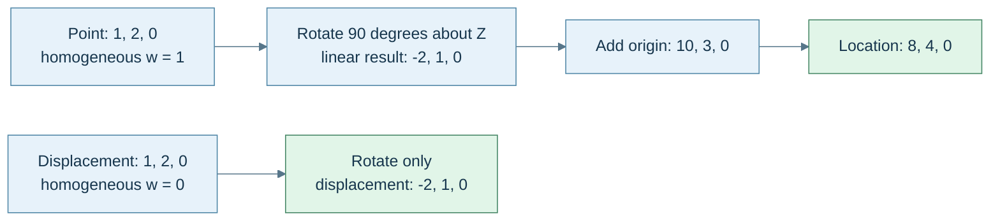

**Caption:** this uses active, right-handed positive rotation about $Z$, column vectors and a fixed parent frame. The two equal three-component tuples begin with different geometric roles. Translation changes only the point result. The arrows describe calculation dependencies; they are not a drawing of the coordinate axes to scale.


<!-- end V07.12 -->

<!-- begin V07.13 -->
## A frame combines directions with a place to stand

A **basis** supplies independent direction vectors. A **coordinate frame** supplies a basis and an origin. Its origin answers “where is local zero?”; its basis answers “what does one unit along each local axis mean in the parent frame?” Those answers can be encoded together:

$$
F=\begin{bmatrix}B&\mathbf o\\\mathbf0^{\mathsf T}&1\end{bmatrix},
\qquad B=[\,\mathbf b_x\ \mathbf b_y\ \mathbf b_z\,].
$$

The upper-left three-by-three block contains the three basis columns; the rightmost upper column contains the local origin expressed in the parent frame. The basis columns must be independent for a full three-dimensional frame. An affine matrix with dependent columns can still map points, but it cannot uniquely convert every parent coordinate back into local coordinates.

For the frame in Figure M5,

$$
F=
\begin{bmatrix}
0&-1&0&10\\
1&0&0&3\\
0&0&1&0\\
0&0&0&1
\end{bmatrix}.
$$

Read column zero: local $+X$ points along parent $+Y$. Read column one: local $+Y$ points along parent $-X$. Read column three: the local origin lies at parent position $(10,3,0)$. A local point $(1,2,0)$ therefore means “start at that origin, take one local $X$ step, and two local $Y$ steps,” giving $(8,4,0)$. Reading columns this way is often faster than guessing which Euler angles produced a matrix.

### Composition follows the dependency of locations

Suppose one transform first applies $P_1=BP+\mathbf u$, and a second applies $P_2=AP_1+\mathbf t$. Substitute before memorizing any product formula:

$$
P_2=A(BP+\mathbf u)+\mathbf t
=ABP+(A\mathbf u+\mathbf t).
$$

Consequently,

$$
F(A,\mathbf t)F(B,\mathbf u)
=F(AB,A\mathbf u+\mathbf t).
$$

The earlier translation $\mathbf u$ is also transformed by the later linear map. Merely adding translation columns is incorrect when the later transform rotates or scales their frame. With our column-vector convention, $M_2M_1P$ means apply $M_1$ first. A notation change to row vectors would change how the same composition is written; a storage-layout change would not.

If an object should be scaled in local axes, then rotated, then placed in world coordinates, its matrix is $M=TRS$. The rightmost operation acts first. If it should rotate about a pivot $\mathbf c$ expressed in the same coordinate frame as the points, use $T(\mathbf c)RT(-\mathbf c)$: move the pivot to zero, rotate, move back. For a door hinge at $\mathbf c=(1,0,0)$, a point $P=(2,0,0)$ rotated $90^\circ$ about $Z$ follows $(2,0,0)\to(1,0,0)\to(0,1,0)\to(1,1,0)$. That trace explains the order more clearly than naming a “pivot matrix.”

A **transform hierarchy** stores relationships such as panel relative to robot base, then base relative to world. If $L$ maps child-local to parent-local and $W_p$ maps parent-local to world, the child's world matrix is $W_c=W_pL$. This is ordinary composition with meaningful endpoints.

If world matrices are cached, a **dirty flag** means “this cached result no longer agrees with the data it depends on.” Changing a parent's local transform invalidates its own world matrix and the world matrices of dependent descendants. A correct update evaluates the parent before the child or ensures the parent is current on demand. The invariant is explicit: whenever a world matrix is consumed, it equals the current parent world matrix times the current local matrix. The word “dirty” is bookkeeping for that invariant, not a mathematical property of a matrix.

Do not assume arbitrary hierarchy products remain expressible as translation, rotation and diagonal scale without shear. A rotated child under a nonuniformly scaled parent can produce a linear block whose transformed basis columns are not perpendicular. A four-by-four affine matrix preserves that full result; a restricted TRS representation may require decomposition, approximation, or rejection. Later quaternion operations do not remove this closure problem.

### Undo the linear action before undoing its translated origin

From $Q=AP+\mathbf t$, subtract the translation and solve:

$$
P=A^{-1}(Q-\mathbf t)=A^{-1}Q-A^{-1}\mathbf t.
$$

Therefore, if $A$ is invertible,

$$
F(A,\mathbf t)^{-1}
=F(A^{-1},-A^{-1}\mathbf t).
$$

The inverse translation is generally not just $-\mathbf t$; it is expressed after the inverse linear action. For a rigid frame whose linear block $R$ is an orthonormal rotation, $R^{-1}=R^{\mathsf T}$, and the inverse is $F(R^{\mathsf T},-R^{\mathsf T}\mathbf t)$. That shortcut does not apply to a basis containing nonunit scale or shear. Check the actual promise, not the variable name `rotation`.


<!-- end V07.13 -->

<!-- begin V07.14 -->
## Coordinates can change while the geometric object stays still

A basis matrix $B=[\mathbf b_1\ \mathbf b_2\ \mathbf b_3]$ converts coefficients in that basis into the surrounding reference coordinates:

$$
\mathbf v=B[\mathbf v]_B.
$$

The coordinate tuple $[\mathbf v]_B$ says how much of each basis direction to combine. It is a description, not a second geometric vector wandering somewhere else in the world. For $\mathbf b_1=(1,0)$ and $\mathbf b_2=(1,1)$, the coefficients $(2,3)$ reconstruct $(5,3)$ because $2(1,0)+3(1,1)=(5,3)$.

Now describe one vector using two full bases $B$ and $C$. Both reconstructions must agree:

$$
B[\mathbf v]_B=C[\mathbf v]_C.
$$

Solving for the new coordinates gives

$$
[\mathbf v]_C=C^{-1}B[\mathbf v]_B.
$$

The direction of this conversion matters. $C^{-1}B$ takes $B$-coordinates to $C$-coordinates. Multiplying it by a tuple already expressed in the wrong frame is a semantic error even when the matrix dimensions match.

For a concrete check, let $B=I$ and

$$
C=\begin{bmatrix}1&-1\\1&1\end{bmatrix},
\qquad
C^{-1}=\frac12\begin{bmatrix}1&1\\-1&1\end{bmatrix}.
$$

The fixed vector with standard coordinates $(4,2)$ receives new coordinates $(3,-1)$. Reconstruction gives $3(1,1)-(-1,1)=(4,2)$. The vector did not rotate. Its coefficients changed because our measuring directions changed.

An **active transformation** moves the geometric vector while keeping the reference axes fixed. A **passive transformation** changes the coordinates used to describe the same vector. If axes are actively rotated by $R$ relative to the old axes, a fixed vector's components in those new axes are $R^{-1}\mathbf v$. For orthonormal rotations this inverse is $R^{\mathsf T}$. Thus active rotation by $+90^\circ$ takes world $+X$ to world $+Y$, whereas describing unchanged world $+X$ in axes rotated by $+90^\circ$ gives local $(0,-1)$.

The same distinction applies to whole frames, including their different origins. If $F_B$ and $F_C$ map frame-local points into one common parent/world frame, then

$$
[P]_C=F_C^{-1}F_B[P]_B
$$

using homogeneous point representatives. The inverse is needed because we first leave one local description and then enter the other. This is why endpoint names such as `world_from_object` and `camera_from_world` are more useful than an unexplained name such as `matrix1`.

![[Visual Recall/Math Foundations/M07-1_rotated-coordinate-chart.png]]

**M07-1. A point expressed in a rotated local chart.** For the quarter-turn basis at (1,1), point (3,2) has local coordinates (1,-2) and reconstructs the original point.


<!-- end V07.14 -->

<!-- begin V07.15 -->
## A camera is another frame, so viewing uses its inverse

**Object space** is the model's authoring frame. A mesh vertex near its own origin does not say where that mesh instance is in the scene. Its origin may be a wheel axle, door hinge, character root, or artist-chosen pivot. The object's model matrix $M$ maps those local points into **world space**, the shared scene frame used to compare separate objects.

Two vertices both stored as $(1,0,0)$ need not coincide: their model matrices may place them far apart. Compare $M_A P_A$ with $M_B P_B$, not their unrelated local tuples. Large absolute world coordinates can also lose small differences through floating-point spacing; a shared frame solves meaning, not every precision problem. Camera-relative coordinates, origin rebasing and higher precision are design responses that require their own contracts.

Let $C$ be the camera's world frame. It maps camera-local points into world coordinates. Rendering asks the reverse question: “what are these world points in camera coordinates?” The **view matrix** is therefore $V=C^{-1}$. A camera at world $(10,0,0)$ with no rotation sees world point $(13,2,-5)$ at view coordinates $(3,2,-5)$. Nothing in the world moved; the description became relative to the camera. If the camera rotates, its inverse orientation appears in $V$ for the same reason.

### Figure M6 - Follow one point through named spaces

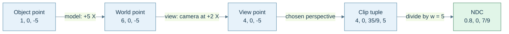

**Caption:** these are numerical states of one point under an explicitly chosen projection, not a picture of its motion. The camera has no rotation. The point stays in front of a right-handed camera looking along $-Z$. The projection below uses an illustrative normalized depth range of $[-1,1]$; it is not an assertion that every graphics API or every engine uses that range.

### Clip coordinates retain the divisor

With a projection matrix $P$, the full vertex chain is

$$
\widetilde P_{\mathrm{clip}}=PVM\widetilde P_{\mathrm{object}}.
$$

**Clip space** contains the four homogeneous components $(x_c,y_c,z_c,w_c)$. **Normalized device coordinates**, abbreviated NDC, are the three components $(x_c/w_c,y_c/w_c,z_c/w_c)$ after perspective division. They are different stages. Applying a four-by-four matrix does not automatically include the divide in a CPU helper, and a helper named `transformPoint` must say whether it performs affine transformation or a projective transformation with a checked divide.

For Figure M6, choose a symmetric $90^\circ$ vertical field of view, aspect ratio one, near distance $1$, far distance $10$, and the right-handed $-Z$ viewing convention just stated. One suitable educational projection is

$$
P=\begin{bmatrix}
1&0&0&0\\
0&1&0&0\\
0&0&-11/9&-20/9\\
0&0&-1&0
\end{bmatrix}.
$$

For view point $(4,0,-5,1)$, multiplication gives $(4,0,35/9,5)$, and division yields $(0.8,0,7/9)$. At view depth $z=-1$, the same matrix gives normalized depth $-1$; at $z=-10$, it gives $+1$. Those endpoint checks tell us what depth convention the matrix actually implements.

A view-space point at $z=0$ would have $w_c=0$ with this matrix, so it would not supply a finite NDC point. A pipeline sketch that blindly divides such a point is incomplete. A CPU projection routine must handle a zero, nonfinite, or policy-defined too-small divisor. A negative divisor or an out-of-volume point also requires appropriate visibility/clipping handling; dividing its numbers is not proof it should be displayed.

Graphics pipelines typically clip primitives using homogeneous inequalities before perspective division and rasterization. Clipping an edge can create new vertices; simply dropping every outside vertex would damage a triangle crossing the boundary. Different API and backend conventions affect depth range, viewport orientation, front-face rules and related setup. Preserve a declared convention through the CPU matrix, shader interface and backend rather than applying a remembered transpose or sign flip until one scene looks right.

### Tangent space supplies a surface-local measuring frame

At a surface point, a tangent $T$, bitangent $B$ and normal $N$ can form a local **TBN frame**. When stored as columns in parent coordinates, $F_{TBN}=[T\ B\ N]$ converts tangent-frame coefficients into that parent description. A normal-map sample decoded to $(0,0,1)$ should map to the local surface normal, because it selects the third basis column.

For $T=(1,0,0)$, $B=(0,0,1)$ and $N=(0,1,0)$,

$$
F_{TBN}=\begin{bmatrix}1&0&0\\0&0&1\\0&1&0\end{bmatrix}.
$$

Its third column is $(0,1,0)$, so the expected mapping works. Notice that this basis has determinant $-1$: it is orthonormal but left-handed. Orthonormality and positive orientation are separate properties. If reconstructing the bitangent as $B=h(N\times T)$, this example needs $h=-1$. A stored tangent handedness sign records precisely that relationship; it is not a disposable decorative attribute.

Interpolation, compression and deformation can disturb unit lengths and perpendicularity. Renormalizing a vector repairs its length when valid, but does not alone make three arbitrary axes perpendicular. Decide whether the surface frame needs re-orthogonalization, how the handedness sign is retained, and which geometric or shading normal the operation uses. Applying an ordinary basis expansion to a tangent-space direction and transforming a general geometric normal through an arbitrary deformation are related but distinct tasks.


<!-- end V07.15 -->

<!-- begin V07.16 -->
## A normal transforms as a measurement that must still vanish on tangents

Suppose a surface tangent $\mathbf u$ and normal $\mathbf n$ obey $\mathbf n^{\mathsf T}\mathbf u=0$. Under the object's linear transform $A$, the tangent becomes $\mathbf u'=A\mathbf u$. We want a new normal satisfying $\mathbf n'^{\mathsf T}\mathbf u'=0$ for every transformed tangent. Choose

$$
\mathbf n'=A^{-\mathsf T}\mathbf n.
$$

Then

$$
\mathbf n'^{\mathsf T}\mathbf u'
=\mathbf n^{\mathsf T}A^{-1}A\mathbf u
=\mathbf n^{\mathsf T}\mathbf u=0.
$$

That is the **inverse-transpose normal transform**. Translation does not enter because the tangent is a displacement and a normal measures directions. For $\mathbf u=(1,1,0)$, $\mathbf n=(1,-1,0)$ and $A=\operatorname{diag}(2,1,1)$, the transformed tangent is $(2,1,0)$ and the correct normal is $(1/2,-1,0)$, whose dot product remains zero. Transforming the normal with $A$ instead gives $(2,-1,0)$; its dot product with the tangent is $3$, exposing the error.

After a valid transform, normalize a shading normal when the shading model requires a unit direction. Normalization cannot repair a normal produced by the wrong matrix, and an inverse cannot be obtained for a singular $A$. If independent transformed tangents still define a surface, their cross product may reconstruct a normal; if the surface collapses, there may be no unique normal to reconstruct. An almost singular transform also needs a conditioning policy, not merely an exact determinant-zero check. The earlier inversion chapter supplies the numerical reason.


<!-- end V07.16 -->

<!-- begin V07.20 -->
## Orientation needs a state that can be composed

The robot now knows where its local axes point. A rotation matrix records those three axis images explicitly, which is ideal when many vertices must pass through the same transform. But the robot's controller also needs to store an orientation, add a small turn, and interpolate toward a target. These are related operations with different representation needs.

A proper rotation matrix has nine scalar entries but only three continuous degrees of freedom: its columns must be orthonormal and its determinant must be positive one. Three Euler angles use only three entries, but their coordinate chart becomes singular at certain orientations. A unit quaternion takes a useful middle route: four real numbers constrained to unit length. It represents orientation compactly and composes without choosing three sequential angle coordinates for every update.

We keep the chapter's conventions throughout: active rotations of geometric vectors, a right-handed coordinate system, and column-vector matrix action. A quaternion is written scalar first, $q=(w,x,y,z)$. Multiplication is Hamilton multiplication. Under these choices, first applying $q_A$, then $q_B$, is represented by $q_Bq_A$. An external library may expose components in a different order or use another convention. Convert at that boundary; do not repair an unexplained discrepancy by randomly transposing or negating values.

### A quaternion is an algebra before it is an orientation

A quaternion is a number of the form

$$
q=w+xi+yj+zk,
\qquad w,x,y,z\in\mathbb R.
$$

The basis symbols obey $i^2=j^2=k^2=-1$ and the cyclic rules $ij=k$, $jk=i$, $ki=j$. Reversing one of those mixed products changes its sign: $ji=-k$, $kj=-i$, $ik=-j$. Addition and multiplication by an ordinary real scalar remain componentwise. Quaternion multiplication is the extra structure; it is associative but generally not commutative.

The four coefficients form a vector in $\mathbb R^4$, but ordinary four-dimensional vector addition is not rotation composition. It helps to group the imaginary coefficients as a three-vector $\mathbf u=(x,y,z)$ and write $q=(w,\mathbf u)$. A quaternion with zero scalar part, $(0,\mathbf v)$, is called a **pure quaternion**. It lets a three-dimensional vector enter the algebra without claiming that the vector gained another geometric coordinate.

To derive the product, expand $(w_1+x_1i+y_1j+z_1k)(w_2+x_2i+y_2j+z_2k)$. Products of matching imaginary basis units contribute $-x_1x_2-y_1y_2-z_1z_2$. Mixed imaginary products collect into the cross product because their signs are antisymmetric. The remaining mixed scalar/vector terms are ordinary scalar multiples. Thus

$$
(w_1,\mathbf u_1)(w_2,\mathbf u_2)=
\left(w_1w_2-\mathbf u_1\cdot\mathbf u_2,
w_1\mathbf u_2+w_2\mathbf u_1+\mathbf u_1\times\mathbf u_2\right).
$$

The minus dot product records $i^2=j^2=k^2=-1$; the cross product records the order-sensitive mixed products. This is a reconstruction method for the formula, not a mnemonic detached from it. For implementation, its vector coefficients are

$$
\begin{aligned}
x&=w_1x_2+x_1w_2+y_1z_2-z_1y_2,\\
y&=w_1y_2-x_1z_2+y_1w_2+z_1x_2,\\
z&=w_1z_2+x_1y_2-y_1x_2+z_1w_2.
\end{aligned}
$$

A general quaternion is not automatically an orientation. Identity rotation uses $(1,0,0,0)$, the multiplicative identity. The zero quaternion $(0,0,0,0)$ is an additive zero with no inverse; accepting it as a rotation silently changes the input contract.

Four stored coefficients do not tell a caller which contract applies. A useful API distinguishes a general algebraic quaternion, a checked unit orientation, and a borrowed four-component view. The general type permits addition and arbitrary multiplication. The orientation type promises finite unit coefficients, so inverse-by-conjugate and optimized rotation become legal operations. A view promises only access to coefficients; it does not enforce a rotation invariant. A packed network or animation format additionally needs declared component order, scale, quantization and sign policy. Sixteen bytes on one ABI are a storage observation, not a serialized representation contract.

### Conjugation gives the inverse and its precondition

Conjugation keeps the scalar and reverses the imaginary part: $q^*=(w,-\mathbf u)$. Multiply once using the derived product:

$$
qq^*=(w^2+\mathbf u\cdot\mathbf u,\mathbf0)
=\|q\|^2.
$$

The vector terms cancel and $\mathbf u\times\mathbf u=\mathbf0$. Therefore, for $q\ne0$,

$$
q^{-1}=\frac{q^*}{\|q\|^2},
\qquad
\|q\|=\sqrt{w^2+x^2+y^2+z^2}.
$$

For example, $q=(1,2,2,1)$ has squared norm $10$, so its inverse is $(1,-2,-2,-1)/10$. A unit quaternion has norm one, and only then is conjugation alone the inverse. Conjugation reverses product order: $(ab)^*=b^*a^*$. Norms multiply, so exact multiplication of two unit quaternions produces a unit quaternion.

The norm multiplication rule can itself be reconstructed. Compute $(ab)(ab)^*=abb^*a^*$. Since $bb^*=\|b\|^2$ is real, it commutes with $a$ and $a^*$, giving $\|b\|^2aa^*=\|a\|^2\|b\|^2$. Taking nonnegative square roots yields $\|ab\|=\|a\|\|b\|$. This explains unit closure using the same conjugate identity that supplied the inverse; it does not require memorizing another unrelated rule.

Computing the norm naively can overflow before the final answer would be problematic. A checked normalization routine first rejects nonfinite inputs, finds $m=\max(|w|,|x|,|y|,|z|)$, rejects $m=0$, forms $s=q/m$, and returns $s/\|s\|$. Its intermediate squares are bounded. This validates a finite direction in four-dimensional coefficient space; it does not prove that arbitrary source data was intended to be an orientation.


<!-- end V07.20 -->

<!-- begin V07.21 -->
## The sandwich turns half angles into a full rotation

Complex multiplication already rotates a plane: multiplying $x+iy$ by $\cos\theta+i\sin\theta$ produces the familiar sine/cosine rotation. For three dimensions, a single left multiplication generally sends a pure quaternion out of the pure subspace. The rotation action uses both sides:

$$
(0,\mathbf v')=q(0,\mathbf v)q^{-1}.
$$

For the normal orientation representation, $q$ is unit and $q^{-1}=q^*$. For a nonzero quaternion of arbitrary magnitude the action with the **true inverse** is still a pure rotation: write $q=m\widehat q$, where $m=\|q\|>0$, and the factors $m$ and $1/m$ cancel. By contrast, replacing the inverse with the conjugate for that nonunit input gives $q(0,\mathbf v)q^*=m^2\widehat q(0,\mathbf v)\widehat q^*$, which scales the rotated vector by $m^2$. These two operations must not be conflated.

### Derive the axis-angle mapping by deriving its action

Let $\mathbf a$ be a unit rotation axis and try $q=(c,s\mathbf a)$, with $c^2+s^2=1$. The first Hamilton product is

$$
q(0,\mathbf v)=
\left(-s\mathbf a\cdot\mathbf v,
c\mathbf v+s\mathbf a\times\mathbf v\right).
$$

Multiplying that result by $(c,-s\mathbf a)$ cancels its scalar part. The vector part is

$$
\mathbf v'=(c^2-s^2)\mathbf v
+2cs(\mathbf a\times\mathbf v)
+2s^2\mathbf a(\mathbf a\cdot\mathbf v).
$$

To check the algebra, the term involving two crosses reduces using $(\mathbf a\times\mathbf v)\times\mathbf a=\mathbf v-\mathbf a(\mathbf a\cdot\mathbf v)$. Now choose $c=\cos(\theta/2)$ and $s=\sin(\theta/2)$. The double-angle identities give $c^2-s^2=\cos\theta$, $2cs=\sin\theta$, and $2s^2=1-\cos\theta$. Consequently,

$$
q=\left(\cos\frac\theta2,\mathbf a\sin\frac\theta2\right),
\qquad
\mathbf v'=\mathbf v\cos\theta
+(\mathbf a\times\mathbf v)\sin\theta
+\mathbf a(\mathbf a\cdot\mathbf v)(1-\cos\theta).
$$

This is Rodrigues' rotation formula. The axis-parallel component stays fixed, while the perpendicular component rotates in its plane. The half angle appears because the two-sided action combines its sine and cosine through double-angle identities. It is not a spare convention to change independently.

For a $90^\circ$ turn around positive Z, let $h=\sqrt2/2$ and $q_Z=(h,0,0,h)$. Acting on $\mathbf e_x$ gives a first pure product $(0,h,h,0)$, then the final vector $(h^2-h^2,2h^2,0)=(0,1,0)$. The original basis vector has turned toward positive Y as required by the right-hand rule.

### Figure M8 - One orientation, several checkable actions

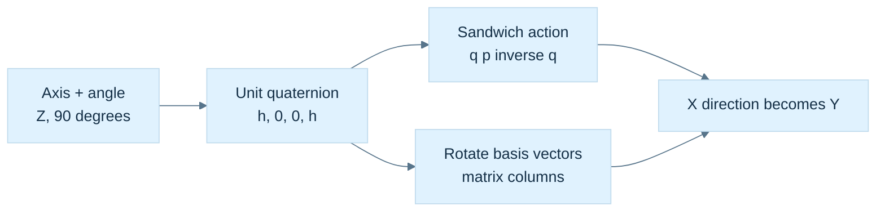

**Caption:** $h=\sqrt2/2$; the sandwich label means $qpq^{-1}$, in that order. This diagram compares representations of the same active rotation. It is not a picture of four-dimensional space. The unit invariant permits conjugation in place of the inverse.

### Recover the axis while admitting when it is undefined

For a normalized orientation $q=(w,\mathbf u)$, a useful angle is $\theta=2\operatorname{atan2}(\|\mathbf u\|,w)$. When $\mathbf u\ne0$, its normalized direction is the axis. If the quaternion is the identity, the rotation angle is zero and every axis gives the same action; there is no unique physical axis to recover. A routine may return a documented arbitrary axis with a status describing that degeneracy.

Choosing the sign of $q$ changes the reported axis-angle representative. For a shortest-angle report, one may choose the representative with $w\ge0$, giving an angle in $[0,\pi]$, with an additional tie rule at $w=0$. This is a reporting convention. It can jump near the boundary and should not be imposed blindly on every frame of a continuous animation.

### Remove the redundant arithmetic only after preserving the proof

Write a unit quaternion as $q=(w,\mathbf u)$. Expanding the sandwich gives

$$
\mathbf v'=(w^2-\mathbf u\cdot\mathbf u)\mathbf v
+2\mathbf u(\mathbf u\cdot\mathbf v)
+2w(\mathbf u\times\mathbf v).
$$

Use $w^2+\mathbf u\cdot\mathbf u=1$ and $\mathbf u\times(\mathbf u\times\mathbf v)=\mathbf u(\mathbf u\cdot\mathbf v)-\mathbf v(\mathbf u\cdot\mathbf u)$. Then define $\mathbf t=2\mathbf u\times\mathbf v$ to obtain

$$
\mathbf v'=\mathbf v+w\mathbf t+\mathbf u\times\mathbf t.
$$

For $q_Z$ and $\mathbf v=(1,0,0)$, $\mathbf t=(0,\sqrt2,0)$, $w\mathbf t=(0,1,0)$, and $\mathbf u\times\mathbf t=(-1,0,0)$; the sum is $(0,1,0)$. The optimized form is a useful computational result because we can explain its agreement with the literal sandwich. Off the unit sphere it is generally neither the true-inverse action nor simply the conjugate sandwich; validate or restore the input invariant instead of assuming one error model.

One adversarial input makes the three contracts visible. Double every coefficient of $q_Z$, obtaining $q=2q_Z=(\sqrt2,0,0,\sqrt2)$, and keep $\mathbf v=(1,0,0)$. The true inverse is $q^{-1}=q_Z^*/2$, so the two scale factors cancel and the action still gives $(0,1,0)$. The conjugate-only sandwich instead produces $(0,4,0)$, because $\|q\|^2=4$. In the unit-optimized formula, however, $\mathbf t=(0,2\sqrt2,0)$, $w\mathbf t=(0,4,0)$, and $\mathbf u\times\mathbf t=(-4,0,0)$. Its answer is $(-3,4,0)$, whose length is five. It is not even the same direction as the conjugate-sandwich result.

This counterexample explains why a debug norm assertion and a checked construction boundary are worthwhile. The optimized routine has a legitimate narrow precondition; it is not defective for requiring unit inputs. The API becomes defective when it exposes unrestricted coefficients while presenting the routine as valid for every quaternion. A test with only identity and a single normalized quarter turn would miss this failure entirely.


<!-- end V07.21 -->

<!-- begin V07.22 -->
## Composition remembers which frame a new turn belongs to

Apply $q_A$, then $q_B$:

$$
q_B\bigl(q_Apq_A^{-1}\bigr)q_B^{-1}
=(q_Bq_A)p(q_Bq_A)^{-1}.
$$

Associativity lets the products regroup; it never permits reversing them. The rightmost turn happens first under our action. As a complete check, take $q_Z=(h,0,0,h)$ and $q_Y=(h,0,h,0)$. Their product is

$$
q_Yq_Z=\left(\frac12,\frac12,\frac12,\frac12\right).
$$

It is unit length and encodes $120^\circ$ about $(1,1,1)/\sqrt3$. It sends X to Y, Y to Z, and Z to X. In reverse order, $q_Zq_Y=(1/2,-1/2,1/2,1/2)$; X first goes to negative Z under the Y turn and stays there under the Z turn. The product order changes the physical result.

Suppose $q$ maps an object's local directions into world space. A delta expressed in the object's local axes acts before that existing map, so $q_{\mathrm{new}}=q\,\Delta q$. A delta expressed in fixed world axes acts afterward, so $q_{\mathrm{new}}=\Delta q\,q$. Neither multiplication side is universally correct; the delta's frame determines it. The same rule explains why world-space angular velocity uses $\dot q=\tfrac12(0,\boldsymbol\omega_W)q$, while local angular velocity uses $\dot q=\tfrac12q(0,\boldsymbol\omega_L)$ under these conventions.

### The sign changes the stored value without changing the orientation

The inverse of $-q$ is $-q^{-1}$, so $(-q)p(-q)^{-1}=qpq^{-1}$. Thus $q$ and $-q$ are different algebraic values with the same three-dimensional rotation action. Unit quaternion coefficients lie on $S^3$, the unit sphere in four-dimensional coefficient space; opposite points correspond to the same physical orientation. This is the **double cover**.

A $360^\circ$ axis-angle turn gives $(-1,0,0,0)$ and therefore identity action, while $720^\circ$ returns the coefficients to $(1,0,0,0)$. A chosen continuous quaternion trajectory can record the path between those representatives, but a final orientation does not record an object's accumulated number of turns. Keep turn count separately if the application needs it.

Component equality and orientation equality therefore answer different questions. For normalized $a,b$, the shortest relative angle is

$$
\delta=2\arccos\bigl(\min(1,|a\cdot b|)\bigr).
$$

An angular tolerance on $\delta$ has a physical interpretation. Clamping here handles small numerical excess only after finite normalized inputs have been established. Near equality, an appropriately sign-aligned relative quaternion and an $\operatorname{atan2}$ extraction can be more informative than an $\arccos$ of a nearly-one dot product.


<!-- end V07.22 -->

<!-- begin V07.23 -->
## A matrix and a quaternion should agree on every basis direction

To derive quaternion-to-matrix conversion, rotate $\mathbf e_x$, $\mathbf e_y$, and $\mathbf e_z$ with the expanded action. Put those results in the columns. With normalized $q=(w,x,y,z)$ this yields

$$
R(q)=\begin{bmatrix}
1-2(y^2+z^2)&2(xy-wz)&2(xz+wy)\\
2(xy+wz)&1-2(x^2+z^2)&2(yz-wx)\\
2(xz-wy)&2(yz+wx)&1-2(x^2+y^2)
\end{bmatrix}.
$$

For example, the first column follows from $\mathbf u\cdot\mathbf e_x=x$ and $\mathbf u\times\mathbf e_x=(0,z,-y)$. Its result is $(1-2y^2-2z^2,2xy+2wz,2xz-2wy)$. Nothing about row-major or column-major **memory storage** enters this derivation; those choices only determine how the logical entries are indexed in memory.

For $q_Z$, the matrix is exactly the familiar $\begin{bmatrix}0&-1&0\\1&0&0\\0&0&1\end{bmatrix}$ in real arithmetic. For $(1/2,1/2,1/2,1/2)$, its columns are Y, Z and X. Tests should compare the matrix and quaternion actions on multiple vectors, not compare a screenshot that happens to look plausible from one camera.

### Recover a large component instead of dividing by a nearly-zero one

Inverting the representation map requires choosing one of $q,-q$. From the matrix diagonal,

$$
\begin{aligned}
4w^2&=1+r_{00}+r_{11}+r_{22},\\
4x^2&=1+r_{00}-r_{11}-r_{22},\\
4y^2&=1-r_{00}+r_{11}-r_{22},\\
4z^2&=1-r_{00}-r_{11}+r_{22}.
\end{aligned}
$$

If the $w$ expression is well conditioned, choose $w>0$ from its square root and recover $x=(r_{21}-r_{12})/(4w)$, $y=(r_{02}-r_{20})/(4w)$, $z=(r_{10}-r_{01})/(4w)$. Near a $180^\circ$ turn, $w$ approaches zero; those divisions become poor choices. Choose the largest of the four squared-component expressions instead. If $x$ is selected, recover it first, then use

$$
w=\frac{r_{21}-r_{12}}{4x},\quad
y=\frac{r_{01}+r_{10}}{4x},\quad
z=\frac{r_{02}+r_{20}}{4x}.
$$

The Y and Z branches follow the same diagonal/symmetric-entry logic. At an exact $180^\circ$ X turn, $R=\operatorname{diag}(1,-1,-1)$, so the X expression is $4$ and the branch safely produces $(0,1,0,0)$ without dividing by $w=0$.

The input must be a finite matrix close to a **proper rotation**, with $R^TR\approx I$ and $\det R\approx1$. A scale, shear or reflection is outside that conversion contract. Tiny negative radicands caused by rounding can be handled with a narrow documented numerical policy; blindly clamping arbitrary invalid matrices hides the wrong input. Extracting a nearest rotation from a general affine matrix is a separate problem, for which polar decomposition or SVD supplies principled tools later.


<!-- end V07.23 -->

<!-- begin V07.24 -->
## Animation asks for a path, not merely an intermediate tuple

An animation needs orientations between unit endpoints $q_0$ and $q_1$. Componentwise matrix averaging can collapse an object: the midpoint between the 2D identity and a $180^\circ$ rotation is the zero matrix. Raw quaternion linear interpolation stays on a chord, not the sphere:

$$
\ell(t)=(1-t)q_0+tq_1,\qquad 0\le t\le1.
$$

From identity to a $180^\circ$ Z quaternion, the midpoint is $(1/2,0,0,1/2)$ with norm $1/\sqrt2$. Normalized linear interpolation, **NLERP**, divides that chord point by its length. It follows the same short great-circle route after suitable sign handling, but its parameter does not advance at constant angular speed.

Before either NLERP or SLERP, choose consistent endpoint signs. If $q_0\cdot q_1<0$, negate the target. This selects a nearer representative of the same target orientation. Otherwise interpolating $q_0$ and $-q_0$ would reach the zero quaternion at the midpoint despite both endpoints meaning the same orientation. At a physical relative angle of exactly $180^\circ$, the dot is zero and there are two equally short rotation paths; an application that needs stable direction must choose a tie-breaking or continuity policy.

### Derive SLERP in a two-dimensional plane inside four dimensions

After sign alignment, let $d=q_0\cdot q_1=\cos\Omega$, with $0\le\Omega\le\pi/2$. For distinct endpoints, define

$$
u=\frac{q_1-q_0\cos\Omega}{\sin\Omega}.
$$

This $u$ is a unit vector in quaternion coefficient space, perpendicular to $q_0$. It is not a three-dimensional rotation axis. The endpoint decomposition is $q_1=q_0\cos\Omega+u\sin\Omega$. Advancing a fraction $t$ along the unit circle in this plane gives $q(t)=q_0\cos(t\Omega)+u\sin(t\Omega)$. Substitute $u$ and use the sine-subtraction identity:

$$
\operatorname{slerp}(q_0,q_1,t)=
\frac{\sin((1-t)\Omega)}{\sin\Omega}q_0
+\frac{\sin(t\Omega)}{\sin\Omega}q_1.
$$

At the endpoints the weights reduce to $(1,0)$ and $(0,1)$. The orthogonal-plane form proves its norm stays one. The physical rotation advances through angle $2t\Omega$, so the ideal path has constant angular speed when $t$ advances uniformly. Easing the parameter deliberately changes that speed.

Take identity and a $120^\circ$ Z rotation: $q_1=(1/2,0,0,\sqrt3/2)$. At $t=1/4$, SLERP gives a $30^\circ$ physical turn. NLERP normalizes $(0.875,0,0,\sqrt3/8)$; its angle is $2\operatorname{atan2}(\sqrt3/8,0.875)\approx27.7958^\circ$. NLERP reaches the same endpoints with different speed. Neither numerical choice is universally preferable; the motion contract decides whether constant speed matters.

The halfway case alone is therefore a weak test: on a common short arc NLERP and SLERP agree at the midpoint by symmetry, even though their quarter points differ. Test a quarter point as well as both endpoints. Also test equivalent opposite-sign endpoints, a tiny separation, and a physical half turn. Compare orientation action and unit norm, not just raw coefficient equality. A routine may legitimately return $-q_1$ at $t=1$ after shortest-path sign alignment because it reaches the same target orientation. If the application promises raw coefficient interpolation instead, that is a different function.

When $\Omega\to0$, $\sin(t\Omega)/\sin\Omega\to t$. A normalized linear blend therefore supplies a stable small-angle fallback. A practical implementation validates and normalizes both endpoints, sign-aligns them, clamps the dot against rounding excess, takes a documented near-equality branch, and checks the final finite norm. A threshold such as $0.9995$ is a numerical design choice, not a geometric law. The statements here assume interpolation over $0\le t\le1$; extrapolation requires its own conditioning and behavior policy.

### Figure M9 - Choose a representative before choosing a path

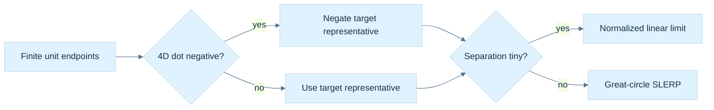

**Caption:** Sign alignment preserves the target orientation while changing its coefficient representative. The short-path tie at a physical half turn needs a chosen policy. The figure assumes valid unit endpoints and an interpolation parameter in $[0,1]$; it does not validate arbitrary four-float input by drawing it on a sphere.

### Norm repair and sign selection solve different problems

Floating-point composition perturbs the unit constraint. Explicit Euler integration also leaves the unit sphere even in exact arithmetic because it follows a tangent-line approximation to curved motion. A renormalization policy can normalize after each update or when the measured squared-norm error exceeds a justified threshold. Use finite/range-safe normalization; a NaN can evade an ordinary `if (n2 <= 0)` test, and squaring extreme finite coefficients can overflow.

Normalization restores unit length. Canonicalization chooses a sign representative, for example $w\ge0$. It does not restore length and can introduce a discontinuity at $w=0$. For sampled animation continuity, a common approach aligns each quaternion's sign with the previous stored sample. For a single serialized orientation, a deterministic canonical sign may be useful. Different tasks call for different choices.


<!-- end V07.24 -->

<!-- begin V07.25 -->
## Euler coordinates remain useful when their chart is explicit

Editors often expose roll, pitch and yaw because people can reason about named controls. The names do not specify an equation. Here roll $\phi$ is about X, pitch $\theta$ about Y, and yaw $\psi$ about Z, with

$$
R=R_Z(\psi)R_Y(\theta)R_X(\phi).
$$

With active column-vector action this means fixed-axis X, then Y, then Z. Three distinct axes form a Tait–Bryan sequence, informally included under “Euler angles”; a proper Euler sequence repeats its first axis, such as ZXZ. State the actual matrix product rather than relying on an ambiguous “XYZ” label.

Writing $c_\phi=\cos\phi$, $s_\phi=\sin\phi$ and similarly for the other angles, multiplication gives

$$
R=\begin{bmatrix}
c_\psi c_\theta&c_\psi s_\theta s_\phi-s_\psi c_\phi&c_\psi s_\theta c_\phi+s_\psi s_\phi\\
s_\psi c_\theta&s_\psi s_\theta s_\phi+c_\psi c_\phi&s_\psi s_\theta c_\phi-c_\psi s_\phi\\
-s_\theta&c_\theta s_\phi&c_\theta c_\phi
\end{bmatrix}.
$$

At $\theta=\pi/2$, this reduces to

$$
R=\begin{bmatrix}
0&\sin(\phi-\psi)&\cos(\phi-\psi)\\
0&\cos(\phi-\psi)&-\sin(\phi-\psi)\\
-1&0&0
\end{bmatrix}.
$$

Only the difference $\phi-\psi$ remains. The triples $(0^\circ,90^\circ,30^\circ)$ and $(10^\circ,90^\circ,40^\circ)$ consequently give the same orientation. The Euler parameterization has lost local independence between two controls; the physical orientation and its matrix remain valid. This is the coordinate singularity called **gimbal lock**. Storing a quaternion avoids that Euler chart singularity, but converting back to Euler controls reintroduces it. No representation can change the mechanical constraints of real nested gimbals.

### Conversion cannot recover a historical sequence that was discarded

Construct Euler-to-quaternion conversion from $q=q_Z(\psi)q_Y(\theta)q_X(\phi)$. Let $c_r,s_r$ denote cosine/sine of $\phi/2$, $c_p,s_p$ of $\theta/2$, and $c_y,s_y$ of $\psi/2$. Hamilton multiplication gives

$$
q=(c_rc_pc_y+s_rs_ps_y,
s_rc_pc_y-c_rs_ps_y,
c_rs_pc_y+s_rc_ps_y,
c_rc_ps_y-s_rs_pc_y).
$$

For $(\phi,\theta,\psi)=(0,90^\circ,90^\circ)$, this is $(1/2,-1/2,1/2,1/2)$. The X coefficient is not a stored X angle; it arises from the product. This is another useful cross-check against the misconception that quaternion components are axis rotations.

In the ordinary extraction branch, choose $\theta\in[-\pi/2,\pi/2]$. Then

$$
\theta=\arcsin(-r_{20}),\quad
\phi=\operatorname{atan2}(r_{21},r_{22}),\quad
\psi=\operatorname{atan2}(r_{10},r_{00}).
$$

Clamp $-r_{20}$ only for small roundoff after validating the matrix. Near $\cos\theta=0$, the ordinary roll/yaw equations have nearly-zero arguments and cannot pick a unique original pair. One explicit singular reporting convention is to choose $\phi=0$ and return $\psi=\operatorname{atan2}(-r_{01},r_{11})$, along with the signed limiting pitch. This yields an equivalent orientation at either pitch singularity for this particular sequence. A threshold and continuity policy are still needed nearby. Test the reconstructed rotation, rather than demanding the original typed angle triple: periodicity, alternative Euler branches and singularity make that demand impossible.


<!-- end V07.25 -->

<!-- begin V07.26 -->
## Rigid motion adds translation without adding scale or shear

A rigid transform acts as $\mathbf p'=R\mathbf p+\mathbf t$, preserving lengths and relative angles. It is perfectly reasonable to store a position vector and a unit quaternion separately. A dual quaternion packages the same rigid motion into one composable algebraic object.

Introduce a commuting symbol $\varepsilon$ with $\varepsilon^2=0$ but $\varepsilon\ne0$. A dual quaternion is $\widehat q=q_r+\varepsilon q_d$, where both $q_r$ and $q_d$ are ordinary quaternions. The subscript “real” here distinguishes the two quaternion parts; $q_r$ is not generally a scalar-only quaternion.

For unit rotation $q_r$ and translation pure quaternion $T=(0,\mathbf t)$, use

$$
q_d=\tfrac12Tq_r,\qquad T=2q_dq_r^*.
$$

The order is part of the convention. Multiplying two dual quaternions gives

$$
(a_r+\varepsilon a_d)(b_r+\varepsilon b_d)
=a_rb_r+\varepsilon(a_rb_d+a_db_r).
$$

The second-order term vanishes because $\varepsilon^2=0$. This matches rigid-transform composition when the rotation and translation encodings above are used. For pure translation $(2,0,0)$ with identity rotation, $q_r=(1,0,0,0)$ and $q_d=(0,1,0,0)$; recovery doubles the vector part of $q_d$ and obtains the original translation.

For the same translation combined with the positive-Z quarter turn, $q_r=(h,0,0,h)$ and $q_d=(0,h,-h,0)$. The dual part's negative Y coefficient does not mean that the body translated in negative Y. It is a coefficient in the coupled encoding. Multiplication by $q_r^*$ recovers $(0,1,0,0)$, and the factor two recovers $(2,0,0)$. Treating the dual vector coefficients directly as a position would be as mistaken as treating quaternion $x,y,z$ directly as Euler angles.

We can verify the composition rule without appealing to its name. For transforms A and B, substitute $a_d=\tfrac12T_Aa_r$ and $b_d=\tfrac12T_Bb_r$ into the dual product. Its dual part becomes $\tfrac12(a_rT_Bb_r+T_Aa_rb_r)$. Multiply on the right by $(a_rb_r)^*=b_r^*a_r^*$ and double. The result is $T_A+a_rT_Ba_r^*$: translation A plus translation B rotated into A's frame. The real part is $a_rb_r$. These are exactly the ordinary rigid composition equations, in the same order.

### Two coupled constraints make the eight coefficients a rigid motion

An arbitrary pair of quaternions is not automatically a valid rigid dual quaternion. The unit rigid constraints are

$$
\|q_r\|=1,\qquad q_r\cdot q_d=0,
$$

where the dot is the ordinary four-component dot product. The second condition makes the recovered translation pure: the scalar part of $q_dq_r^*$ is $q_d\cdot q_r$. The translation construction satisfies this condition because $T$ is pure.

Blending dual quaternions requires aligning signs of both halves together and restoring the coupled constraints. Normalizing $q_r$ and $q_d$ independently is incorrect and fails even for zero translation, whose $q_d$ is zero. Given finite blended $(r,d)$ with $a=\|r\|\ne0$, one projection to the constraints is $r'=r/a$, $d_0=d/a$, $d'=d_0-r'(r'\cdot d_0)$. It removes the dual component parallel to the real part. Degenerate cancellation and application-specific skinning weights still require an explicit failure policy.

Dual-quaternion blending can reduce characteristic matrix-blend twisting artifacts in suitable rigid skinning problems. It does not make an arbitrary weighted blend an exact physical interpolation, and a conventional rigid dual quaternion cannot encode general nonuniform scaling, shear or reflection. Choose it for the rigid domain it actually represents.

### Figure M10 - Representation follows the permitted operation

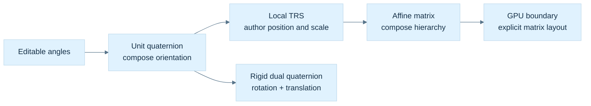

**Caption:** The branches reflect different contracts. Euler coordinates carry chart choices; a quaternion carries proper rotation; a rigid dual quaternion carries proper rotation plus translation; a general affine matrix can also carry scale, shear and reflection. Data conversions must check those domain boundaries.


<!-- end V07.26 -->

<!-- begin V07.27 -->
## A transform type must say what its stored fields mean

For a local authoring transform, choose finite translation $\mathbf t$, unit orientation $q$, and axis scales $\mathbf s=(s_x,s_y,s_z)$, with matrix convention $M=TRS$. The **Hadamard product** $\odot$ means componentwise multiplication. A local point and direction then follow different paths:

$$
\mathbf p'=\mathbf t+R(q)(\mathbf s\odot\mathbf p),
\qquad
\mathbf v'=R(q)(\mathbf s\odot\mathbf v).
$$

Translation applies to points because their location changes; a free vector has no location to translate. The transform's linear part is $A=RS$. Its matrix columns are the rotated local basis directions multiplied by their respective scales, and its last homogeneous column contains translation.

For a point inverse, solve the steps backward:

$$
\mathbf p=\mathbf s^{-1}\odot R(q)^T(\mathbf p'-\mathbf t),
$$

requiring each scale component to be nonzero. The inverse operation is well defined under those conditions even when its result cannot be stored as another transform with the same restricted $TRS$ field convention. Finite input does not promise a finite or usable inverse: very small scales can overflow reciprocals or amplify uncertainty severely. Return a status when the requested operation is invalid or outside the numerical contract.

### Normals undo scale before following rotation

A normal is a measurement covector whose zero action identifies tangent directions. Preserving that relation requires $\mathbf n'=A^{-T}\mathbf n$. For $A=RS$ and orthogonal $R$,

$$
A^{-T}=\left(S^{-1}R^T\right)^T=RS^{-1}.
$$

Therefore apply reciprocal scale to the normal, rotate, and normalize when a unit shading direction is wanted. Never translate a normal. Zero scale makes the inverse-transpose undefined; an implementation may reconstruct a geometric normal from surviving transformed tangents when they remain independent, but that is a separate operation with its own degeneracy case.

For example, use tangent $(1,1,0)$ and normal $(1,-1,0)$ with $S=\operatorname{diag}(2,1,1)$ and identity rotation. The tangent becomes $(2,1,0)$ while the unnormalized normal becomes $(1/2,-1,0)$; their dot is zero. Transforming both with $S$ instead would give dot $3$ and break perpendicularity. Negative determinant additionally reverses orientation: a cross-derived area normal carries determinant sign as well as inverse-transpose direction. Keep face winding, geometric area and shading-normal policies distinct.

### The world result may no longer fit the local authoring fields

Rigid transforms are closed under composition. Applying local transform B and then parent A gives $R_C=R_AR_B$ and $\mathbf t_C=\mathbf t_A+R_A\mathbf t_B$, or $q_C=q_Aq_B$. This is why position plus quaternion is such a convenient rigid representation.

With nonuniform scale, the linear product becomes $R_AS_AR_BS_B$. The middle factors generally cannot be swapped, and the result need not equal any proper rotation times a diagonal scale. A concrete planar example makes the issue measurable. Let $S=\operatorname{diag}(2,1)$ and $R$ be a $45^\circ$ rotation. The columns of $SR$ are $(\sqrt2,\sqrt2/2)$ and $(-\sqrt2,\sqrt2/2)$. Their dot is $-2+1/2=-3/2$, so they are not perpendicular. The columns of any $R'D'$ with orthogonal $R'$ and diagonal $D'$ must be perpendicular. Consequently this composed map cannot be represented exactly by that restricted rotation/diagonal-scale form.

The same structural problem affects inverse storage: $(RS)^{-1}=S^{-1}R^T$, while storing inverse fields in the original order would yield $R^TS^{-1}$. Uniform scale commutes with rotation; arbitrary nonuniform scale does not. Some particular rotations and scale patterns also commute, but they are conditions to verify, not a default assumption.

The failure is a property of the restricted representation, rather than an inability to invert the underlying map. A general invertible affine matrix remains closed under inversion. A TRS object can consequently provide `inverseTransformPoint` by reversing its operations, or provide an inverse affine matrix, while correctly declining to promise another exact TRS object. Returning a transform with guessed reciprocal scales and inverse orientation silently changes the operation. The return type and name should express whether the result is exact, approximate, or potentially unavailable.

Store editable local transforms as TRS when useful, and compute general world affine matrices by hierarchy multiplication:

$$
M_{\mathrm{world,child}}=M_{\mathrm{world,parent}}M_{\mathrm{local,child}}.
$$

If an editor requests world TRS, disclose whether decomposition is exact, includes shear, or returns an approximation. A quaternion cannot absorb a reflection because its rotation has determinant positive one. A zero-scale matrix can still map points forward but has no inverse. These are API facts, not exceptional nuisances to hide behind a default identity result.


<!-- end V07.27 -->

<!-- begin V07.28 -->
## A cached matrix is a dependency promise

Suppose local position, orientation and scale are canonical, while the matrix is cached for repeated use. A setter changes position but leaves the old matrix bytes in place until recomputation. The flag `localDirty` means exactly that those bytes no longer represent the current canonical fields. It does not mean that the transform data is corrupt.

World state has another dependency: parent world times local. If a door rotates on a car, the door's local and world values become dirty. A mirror attached to the door keeps the same local placement relative to the door, so its local matrix remains valid; its world matrix becomes dirty. The car's local and world matrices need not change. Cached world inverses and normal matrices become stale whenever their underlying world matrix changes.

### Figure M11 - Invalidate the values that actually depend on the edit

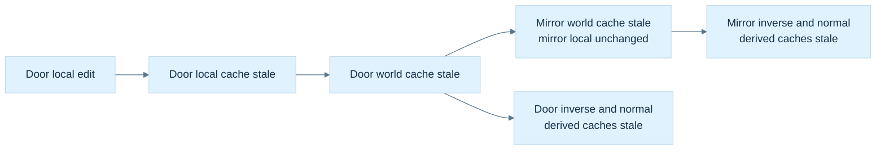

**Caption:** Local and world dirtiness name different dependencies. The hierarchy must be acyclic; the update order must make parents current before children. This figure describes invalidation, not a thread-safety mechanism or a complete transform-system scheduler.

Lazy recomputation rebuilds a cache only when read, potentially merging several edits into one rebuild. Immediate recomputation simplifies state but may rebuild repeatedly. Either strategy needs one authoritative representation. Independently writable TRS and matrix fields create conflicting truths.

Boolean propagation can mark an affected subtree. Skipping a node already marked dirty is valid only if the system guarantees that its descendants were invalidated under the same strategy, including after reparenting or insertion. An alternative stores local/world version counters and the parent/local versions used by each cache. On access, first refresh the parent, compare dependencies, then rebuild if necessary. Version wrap, stale handles, concurrent readers and writes, and graph cycles still need system-level policies. A `mutable` lazy cache is not automatically safe to access from multiple threads.

Reparenting is a useful stress test because it changes a dependency without necessarily changing the child's local coefficients. If a node is attached to a different parent while retaining its local TRS, its local matrix can stay valid while its world matrix must be invalidated. If the editor instead promises to preserve the world pose, it must solve for a new local affine map using the new parent's inverse, and then determine whether that map fits the allowed local TRS representation. A singular parent can make the requested operation impossible; nonuniform scale can make an exact local result require shear. A robust interface reports that situation instead of disguising it as a successful unchanged pose.

A cache reference also has a lifetime and mutation contract. Returning `const Mat4&` avoids a copy, but later recomputation can change the referenced object. A caller that needs a stable snapshot across updates should take a value or use a documented read phase. The word `const` limits writes through that reference; it does not stop the owner or another thread from changing the cache. This connects the transform system directly to the earlier C++ borrowing and logical-constness lessons.

The controller can now choose representations deliberately: Euler angles for specified editing controls, a checked unit quaternion for orientation, TRS for local authoring, an affine matrix for arbitrary world composition, inverse transpose for normal measurements, and optionally a constrained dual quaternion for rigid-motion blending. The useful result is not a winning representation. It is an explicit contract at every conversion and a test that can reveal when that contract was broken.

There is also a workload reason to keep these representations together. Composing an orientation once per object update and transforming a large vertex buffer are different tasks. A compact quaternion is convenient state for the first; a matrix prepared once can amortize conversion over the second and match a shader interface directly. This is a design possibility, not a benchmark result. Measure actual update counts, batch sizes, layout, precision and target instructions before asserting which path is faster. Avoid rebuilding the same matrix for every vertex or normalizing the same checked orientation redundantly at every inner-loop operation. Keep validation at trustworthy boundaries, then make the narrower inner-loop preconditions visible in names, types and tests.

### Quaternion and transform reconstruction desk

Derive the Hamilton product from the imaginary multiplication table, then derive the inverse from $qq^*=\|q\|^2$. Execute the positive-Z quarter turn on X and check both the literal sandwich and the optimized cross-product form. Compose Z then Y and recover the $120^\circ$ diagonal-axis result. Change the order and predict the changed basis image before running code.

Rebuild the quaternion matrix from its three basis images. At an exact half turn, demonstrate why dividing by the scalar component fails and a largest-component branch succeeds. Compare orientation actions after a matrix round trip, allowing $q$ or $-q$ as the coefficient result.

Finally, derive SLERP in its coefficient-space plane, expose the Euler chart singularity by substitution, verify the two dual-quaternion constraints, and exhibit the nonperpendicular columns of the composed nonuniform-scale example. For the car/door/mirror hierarchy, trace which canonical fields changed and which cached values became stale. Those questions connect algebraic understanding to an implementable transform system.


<!-- end V07.28 -->


# Measurements become constraints and computable answers

A system of equations describes measurements that must hold together. Rank explains which answers exist; norms give errors a scale; elimination, pivoting and structured decompositions make the answer computable.

<!-- begin V08.00 -->
<details>
<summary>Original source metadata</summary>

```yaml
---
tags:
  - continuous-notes
  - linear-algebra
coverage: Parts 701–800
---
```

</details>


## From Constraints to Spectra: Systems, Decompositions, and Matrix Functions


<!-- end V08.00 -->


### Immediate footing — principal component analysis

Principal component analysis (PCA) finds directions along which centered measurements vary most. Subtract the mean from each observation, form its covariance matrix, and choose orthonormal eigenvectors in decreasing eigenvalue order. For covariance $\operatorname{diag}(9,1)$, the first coordinate direction has variance $9$ and the second has variance $1$. Keeping only the first direction is a lossy one-dimensional description. The result depends on centering, units and scaling. Variance explains a dataset; a large principal component does not by itself establish a causal mechanism.

[[#PCA turns a cloud of points into measured variation|Full explanation and worked examples in this book]]

<!-- begin V08.01 -->
## The graphics problem hiding inside a matrix equation

Imagine a graphics engine fitting a flat surface to noisy depth samples, solving for a camera correction, estimating the dominant direction in a point cloud, or integrating a small deformation over time. Every one of these tasks asks a related question: what does a collection of linear measurements allow us to know, and how can we compute that answer without inventing information the data did not contain?

We will follow one chain. A row of a matrix is a measurement or constraint. A system asks for an input satisfying many such measurements. Elimination reveals which constraints are independent and which degrees of freedom remain. Factorizations organize that elimination so it can be reused and made stable. Eigenvectors identify directions preserved by a square map; singular vectors do the more general job of identifying input directions that are stretched into mutually perpendicular output directions. From that picture come least squares, pseudoinverses, PCA, low-rank approximation, polar decomposition, and a principled view of matrix functions. The final question is practical: how should a graphics library represent, compute, and validate these operations?

This phase builds directly on the earlier geometry and transform stories. [[#The panel gives us a reason to learn|Phase 6]] supplies vectors, dot products, Gram matrices, projections, and the meaning of orthogonality. [[#Keep the promises visible while moving between representations|Phase 7]] supplies matrix maps, basis images, determinants, composition, and storage/layout contracts. Phase 8 asks what can be recovered when those maps are observed through measurements, and what numerical risk remains when a direction is almost lost.

The connecting question is always the same: **what information enters, what information can the map preserve, and what evidence tells us the computed answer is trustworthy?** This chapter combines the supplied Phase 8 lessons into a concept-led teaching sequence. The exact canonical titles remain in [[Supplementary/Foundations#Phase 8 - Parts 701-800|the coverage ledger]], while this chapter teaches them as one story.


<!-- end V08.01 -->


## Constraints, rank, and what data can determine

Many graphics tasks ask for an unknown vector $x$ that satisfies measured constraints. A collection of linear measurements has the form

$$
Ax=b,
$$

where each row of $A$ describes one scalar measurement of $x$, and the matching entry of $b$ is the observed value. A single equation in three unknowns usually describes a plane; several equations describe the intersection of planes. The intersection can be one point, a line or plane of solutions, or empty if the observations conflict.

Rank is the number of independent constraints, equivalently the number of independent rows or columns. If $A$ has $n$ columns and rank $r$, then its nullspace has dimension $n-r$. A vector $z$ in this nullspace satisfies $Az=0$, so $x$ and $x+z$ produce the same measurements. This is the algebraic form of ambiguity: the data cannot distinguish those alternatives. Rank is not merely a property of a matrix algorithm. It says which degrees of freedom the experiment observes.

Consider two measurements of a three-component unknown:

$$
\begin{bmatrix}1&0&1\\0&1&1\end{bmatrix}
\begin{bmatrix}x_1\\x_2\\x_3\end{bmatrix}
=
\begin{bmatrix}4\\5\end{bmatrix}.
$$

There are two independent equations and three unknowns. Let $x_3=t$; then $x_1=4-t$ and $x_2=5-t$. Every value of $t$ gives a solution. The free parameter is not a defect of elimination. It is a direction the measurements do not determine. A regularizer, prior, extra view, or physical constraint can choose among solutions, but that choice adds information or preference that was not present in the original equations.

When noisy observations make exact equality impossible, choose $x$ to minimize the residual $r=Ax-b$. Least squares minimizes $\|Ax-b\|_2^2$. Orthogonal transformations preserve Euclidean lengths, which is why QR factorization is valuable: writing $A=QR$ separates the component of $b$ explained by the columns of $A$ from the orthogonal residual that no parameter choice can remove. The residual measures mismatch; it does not alone tell whether the estimated parameters are trustworthy. If small changes in $b$ cause large changes in $x$, the problem is ill-conditioned even when the computed residual is tiny.

Singular values make this distinction visible. For $A\in\mathbb R^{m\times n}$, a singular value decomposition has the form

$$
A=U\Sigma V^T,
$$

where the columns of $U$ and $V$ are orthonormal directions and the diagonal entries $\sigma_i\ge 0$ of $\Sigma$ are the stretch factors along paired input and output directions. A zero singular value marks a direction erased by the map. A very small singular value marks a direction that is almost erased: inversion along it amplifies noise by approximately $1/\sigma_i$. Thus numerical rank depends on a tolerance tied to scale and uncertainty; it is not always a crisp count encoded by exact zeros.

The Moore–Penrose pseudoinverse chooses a least-squares solution, and among tied least-squares solutions chooses the one with minimum Euclidean norm. This is a mathematically precise convention, but “minimum norm” depends on the metric and parameter units. If one parameter is measured in meters and another in micrometers, an unweighted Euclidean norm silently treats their raw numbers as comparable. Rescaling or weighting changes the preferred answer. Keep the units and metric beside the optimization objective.

<!-- begin V08.03 -->
## A linear equation is a measurement, and several equations are geometry

Start with one equation in two unknowns:

$$
2x+y=5.
$$

Each pair $(x,y)$ is a point in the plane. The equation selects a line: every point on it satisfies the same measurement. In three variables one nontrivial linear equation selects a plane, and in $n$ variables it selects a hyperplane. Here *hyperplane* means the flat set one dimension lower than the ambient space. The coefficients $(2,1)$ set the measurement direction; the right side $5$ moves the set without changing its orientation.

Several equations ask for the intersection of their constraint sets. Parallel distinct lines have no common point; distinct lines crossing once have one; repeated equations leave a whole line of answers. This geometric picture explains why the number of equations alone does not tell us how many independent facts we have. We need rank.

Write the [[#A system is an intersection of constraints|linear system]] compactly as

$$
A\mathbf x=\mathbf b,
\qquad A\in\mathbb R^{m\times n},\quad
\mathbf x\in\mathbb R^n,\quad\mathbf b\in\mathbb R^m.
$$

The row view says each row of $A$ tests the unknown vector and produces one scalar measurement. The column view says $A\mathbf x$ is a weighted sum of the columns of $A$. Therefore an exact solution exists precisely when $\mathbf b$ can be made from those columns:

$$
A\mathbf x=\mathbf b\text{ is consistent}
\quad\Longleftrightarrow\quad
\mathbf b\in\operatorname{Col}(A).
$$

This is a powerful diagnostic. If a measured target lies outside the reachable column space, no amount of more careful elimination will make an exact solution exist. We must instead change the model, accept an approximation, or report failure.

Use the running system

$$
\begin{aligned}
x+y+z&=6,\\
2x-y+z&=3,\\
x+2y-z&=2.
\end{aligned}
$$

Its matrix form is $A\mathbf x=\mathbf b$ with rows $(1,1,1)$, $(2,-1,1)$, $(1,2,-1)$ and target $(6,3,2)^\mathsf T$. The solution $(1,2,3)^\mathsf T$ can be checked by substituting into the original measurements. Keeping this direct check in view matters: a transformed system is only useful if it preserves the same solution set.


<!-- end V08.03 -->

<!-- begin V08.04 -->
## A system is an intersection of constraints

One nontrivial equation $a_1x_1+\cdots+a_nx_n=b$ describes an $(n-1)$-dimensional hyperplane in $\mathbb R^n$. Its normal vector is $a=(a_1,\ldots,a_n)^\mathsf T$: moving parallel to the hyperplane changes the point while keeping the dot product with $a$ fixed. The scalar $b$ selects which parallel hyperplane is meant. For $a\ne0$, the plane's signed offset along its chosen unit normal is $b/\|a\|_2$, and its closest point to the origin is $ba/\|a\|_2^2$: that point is parallel to the normal and satisfies $a^\mathsf Tx=b$. If $a=0$, the equation is exceptional: it says either $0=b$, which is always true when $b=0$, or an impossibility when $b\ne0$.

Stacking $m$ equations gives $Ax=b$, with $A\in\mathbb R^{m\times n}$, $x\in\mathbb R^n$, and $b\in\mathbb R^m$. Each row is a constraint on the same unknown. Geometrically, solutions are points in the intersection of those hyperplanes. The intersection can be empty, a single point, or an affine flat with positive dimension. More equations do not necessarily mean more information: a duplicate or a linear combination of earlier rows adds no independent constraint.

The [[#A system is an intersection of constraints|fundamental-subspace view]] keeps the reachable outputs and invisible inputs distinct.

There is a second view that is equally useful. Writing the columns as $a_1,\ldots,a_n$, the product is $Ax=x_1a_1+\cdots+x_na_n$. Thus a solution exists exactly when $b$ is in the column space of $A$. The row view explains the constraints; the column view explains which outputs are reachable. For an overdetermined data fit, an observed target may lie outside that reachable space, so an exact solution does not exist even though an approximate fit does.

For example,

$$
\begin{bmatrix}1&2&1\\2&4&2\\1&1&0\end{bmatrix}
\begin{bmatrix}x\\y\\z\end{bmatrix}
=\begin{bmatrix}4\\8\\1\end{bmatrix}
$$

has three equations but only two independent constraints. The first two rows and right-hand sides repeat the same equation at double scale. From $x+y=1$, write $x=t$ and $y=1-t$; then $x+2y+z=4$ gives $z=t+2$. Thus every solution is $(t,1-t,t+2)^\mathsf T$. The solution set is a line, not one point. If the second target changes from $8$ to $9$, the first two equations demand both $x+2y+z=4$ and $2x+4y+2z=9$, an inconsistency.


<!-- end V08.04 -->


### Immediate footing — gauge freedom

Gauge freedom means different parameter values describe the same observable configuration, so the parameters are not uniquely determined without a convention or anchor. Translating and rotating an entire scene and all cameras together may leave every image unchanged; absolute world pose is therefore unobservable. Fix a reference camera pose to choose world origin and orientation, and fix a baseline or known length when scale is also free. These choices select a representative solution, not an absolute truth. Gauge freedom produces singular directions in the equations, which calibration and optimization must identify and handle.

[[#Calibration needs informative observations and a fixed gauge|Full explanation and worked examples in this book]]

<!-- begin V08.05 -->
## Rank separates what the measurements determine from what they leave free

The **[[#A system is an intersection of constraints|row space]]** is the span of the measurement rows. It records the independent linear tests the system can make. The **[[#A system is an intersection of constraints|column space]]** is the set of outputs the map can produce. The **[[#A system is an intersection of constraints|null space]]** is the set of input changes invisible to every measurement:

$$
\operatorname{Null}(A)=\{\mathbf z:A\mathbf z=\mathbf0\}.
$$

If $\mathbf x_0$ is one solution, every solution is $\mathbf x_0+\mathbf z$ for some $\mathbf z\in\operatorname{Null}(A)$. The null vector is not measurement error; it is a direction the system cannot observe. In graphics, this can represent a gauge freedom, an unconstrained parameter, or a motion that does not change the sampled data.

The **rank** $r$ is the number of independent rows, equivalently the dimension of the row space or column space. Rank-nullity says

$$
\operatorname{rank}(A)+\dim\operatorname{Null}(A)=n.
$$

The input space splits into $r$ observable degrees of freedom and $n-r$ invisible ones. This immediately predicts the solution shape. For a consistent system, full column rank ($r=n$) gives a unique solution. If $r<n$, there are free directions and infinitely many solutions. If $\mathbf b$ lies outside the column space, there is no exact solution regardless of the number of free variables.

The row space is perpendicular to the null space: every row $\mathbf a_i^\mathsf T$ satisfies $\mathbf a_i^\mathsf T\mathbf z=0$ for every null vector. Thus the unobservable motions are precisely those orthogonal to all measurement directions. The left null space, $\operatorname{Null}(A^\mathsf T)$, instead describes dependencies among the rows and therefore among the measurement equations. These are distinct spaces with distinct jobs.

Do not infer rank from a determinant except in the narrow square case, and do not infer reliable rank from exact floating-point equality. In exact arithmetic rank is algebraic. In finite precision, *numerical rank* needs a scale and a tolerance or a singular-value threshold. A tiny singular value may mean weakly observed information rather than a truly absent dimension. This distinction returns when we build the pseudoinverse and truncate an SVD.

### Figure L2 - Consistency, freedom, and the four fundamental spaces

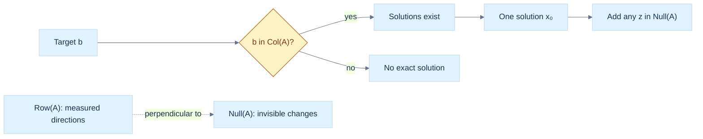

> **How to read Figure L2.** First ask whether the target is reachable. Only after consistency is established do we count the family's free directions; rank-nullity gives their number.


<!-- end V08.05 -->

<!-- begin V08.06 -->
## Rank, the four spaces, and the shape of the answer

The rank $r$ is the dimension of the row space and, by the row-column rank theorem, also the dimension of the column space. It counts independent constraints and independent reachable output directions. It is bounded by $r\le\min(m,n)$, not automatically equal to either dimension. The four fundamental spaces describe different sides of the map:

| Space | Ambient space | Meaning |
|---|---:|---|
| $\operatorname{Row}(A)$ | $\mathbb R^n$ | input directions tested by rows |
| $\operatorname{Null}(A)$ | $\mathbb R^n$ | input changes invisible to the map |
| $\operatorname{Col}(A)$ | $\mathbb R^m$ | outputs the map can produce |
| $\operatorname{Null}(A^\mathsf T)$ | $\mathbb R^m$ | dependencies among row constraints |

For any $z\in\operatorname{Null}(A)$, every row $a_i^\mathsf T$ obeys $a_i^\mathsf Tz=0$. Therefore $\operatorname{Null}(A)=\operatorname{Row}(A)^\perp$. Likewise, a vector $y\in\mathbb R^m$ is perpendicular to every column of $A$ exactly when $A^\mathsf Ty=0$, so $\operatorname{Null}(A^\mathsf T)=\operatorname{Col}(A)^\perp$. If $r=\operatorname{rank}(A)$, their dimensions are $n-r$ and $m-r$, respectively. These are useful geometric facts: invisible input motions lie parallel to all constraint hyperplanes through the origin, while left-null vectors express dependencies among output coordinates or equations.

If $x_p$ is one solution to $Ax=b$, then $x$ is another precisely when $A(x-x_p)=0$. Hence every solution is

$$
x=x_p+z,\qquad z\in\operatorname{Null}(A).
$$

This is the complete description, not only a way to generate examples. The solution set is a translated null space, an affine subspace whose dimension is the nullity. Rank-nullity follows from the dimension theorem for the map $A:\mathbb R^n\to\mathbb R^m$:

$$
\operatorname{rank}(A)+\operatorname{nullity}(A)=n.
$$

The input has $r$ independent directions that affect the output and $n-r$ independent directions that the map erases. A consistent system with $r=n$ has a unique solution. A consistent system with $r<n$ has infinitely many solutions over the reals because at least one free parameter can vary continuously. If $b$ lies outside $\operatorname{Col}(A)$, there are no exact solutions, regardless of nullity.

Here is a constructive proof of rank-nullity, with the domain made explicit. Choose a basis $v_1,\ldots,v_k$ for $\operatorname{Null}(A)$, where $k=\operatorname{nullity}(A)$. Extend it to a basis of the full input space by adding $w_1,\ldots,w_s$. The images $Aw_1,\ldots,Aw_s$ span the column space: any input is a combination of the null basis and the added vectors, and the null basis maps to zero. They are also independent. If $c_1Aw_1+\cdots+c_sAw_s=0$, then $c_1w_1+\cdots+c_sw_s$ belongs to the null space, so it is a combination of $v_1,\ldots,v_k$. That would be a dependence among the extended input basis unless every $c_i=0$. Thus $s=\operatorname{rank}(A)=r$. The extended basis has $k+s=n$ members, proving $k+r=n$. The proof also explains the result: choose null directions first, then each remaining independent input direction contributes exactly one independent output direction.

This also explains several common misdiagnoses. A square matrix can be singular; its dimensions alone do not determine rank. For square $A$, $\det(A)=0$ is equivalent to rank deficiency and to a nontrivial null space, but determinant is not a useful general rank measure for rectangular or badly scaled matrices. Likewise, exact algebraic rank and floating-point numerical rank differ. A tiny perturbation can turn an exactly rank-one matrix into full rank, while a tiny singular value may still represent practically unobservable information. Numerical rank requires an explicit scale-aware threshold.

Suppose measurements differ by noise near machine precision. If the second pivot produced during elimination is $10^{-14}$ while the first is order one, declaring rank two solely because the pivot is not bitwise zero can expose an enormous apparent coefficient in the solution. Conversely, treating every small pivot as zero can discard a meaningful variable if the entire matrix is scaled near $10^{-20}$. A defensible numerical decision compares pivots or singular values against both a global scale and an application tolerance. Row scaling can help when equations have different units, but it changes the metric in least squares; scaling therefore needs a model-based interpretation rather than being a cosmetic preprocessing trick.


<!-- end V08.06 -->

<!-- begin V08.65 -->
## Matrix norms give scale to residuals and error claims

A vector norm measures vector size. A [[#Matrix norms put scale into error statements|matrix norm]] measures matrix size, but there is more than one useful choice. The induced 1-norm is the largest absolute column sum; the induced infinity norm is the largest absolute row sum. They bound how much a matrix can enlarge vectors under corresponding vector norms. The Frobenius norm is the square root of the sum of squared entries; it behaves like treating all entries as one long vector. The spectral norm is the largest singular value and equals the maximum 2-norm stretch:

$$
\|A\|_2=\sigma_{\max}(A).
$$

Frobenius and spectral norms answer different questions. The Frobenius norm accounts for energy across all singular directions; the spectral norm asks for the single most amplified direction. They satisfy $\|A\|_2\le\|A\|_F\le\sqrt{\operatorname{rank}(A)}\,\|A\|_2$. A condition number becomes concrete in norm language: $\kappa_2(A)=\|A\|_2\|A^{-1}\|_2$ for invertible square $A$.

This language also clarifies why “the residual is small” needs a denominator and a data scale. Absolute residuals have units and change when the entire problem is scaled. Relative residuals can compare proportionally, but zero and near-zero inputs require an explicit policy. Norm choice is part of the measurement contract, not merely notation.


<!-- end V08.65 -->

<!-- begin V08.66 -->
## Matrix norms put scale into error statements

A norm assigns a nonnegative size to a matrix, vanishes only for the zero matrix, scales as $\|\alpha A\|=|\alpha|\|A\|$, and satisfies the triangle inequality. An induced norm based on vector norm $\|\cdot\|_p$ is

$$
\|A\|_p=\max_{x\ne0}\frac{\|Ax\|_p}{\|x\|_p}
=\max_{\|x\|_p=1}\|Ax\|_p.
$$

It is the largest stretch of a unit input according to that length measure, so $\|Ax\|_p\le\|A\|_p\|x\|_p$. Induced norms are submultiplicative: $\|AB\|_p\le\|A\|_p\|B\|_p$, because first $B$ and then $A$ cannot stretch by more than their individual maxima.

For the vector 1-norm, triangle inequality applied to each output entry gives

$$
\|Ax\|_1=\sum_i\left|\sum_j a_{ij}x_j\right|
\le\sum_j |x_j|\sum_i|a_{ij}|
\le \left(\max_j\sum_i|a_{ij}|\right)\|x\|_1.
$$

The bound is attained by choosing a coordinate vector at a maximum column sum, hence $\|A\|_1=\max_j\sum_i|a_{ij}|$. By the analogous maximum-row argument, $\|A\|_\infty=\max_i\sum_j|a_{ij}|$. They are cheap to compute, but answer different questions: largest column sum versus largest row sum.

The Frobenius norm treats entries as one flattened vector:

$$
\|A\|_F=\sqrt{\sum_{ij}|a_{ij}|^2}
=\sqrt{\operatorname{tr}(A^*A)}
=\sqrt{\sum_k\sigma_k^2}.
$$

For real matrices $A^*=A^\mathsf T$. The trace identity follows because the diagonal entries of $A^\mathsf TA$ are squared column lengths. If $A=U\Sigma V^*$, orthogonal/unitary transformations preserve this sum of squares and $\Sigma$ has singular values on its diagonal, yielding the last identity. The Frobenius inner product $\langle A,B\rangle_F=\operatorname{tr}(A^*B)$ induces this norm. It measures total energy across directions, not the largest single stretch.

The spectral or operator 2-norm is $\|A\|_2=\max_{\|x\|_2=1}\|Ax\|_2$. SVD writes $Ax=U\Sigma V^*x$; $V^*$ and $U$ preserve Euclidean length, and $\Sigma$ stretches coordinates by singular values. Thus $\|A\|_2=\sigma_{\max}$. Equivalently, maximizing $\|Ax\|_2^2=x^*A^*Ax$ over unit vectors gives the largest eigenvalue of $A^*A$, so $\|A\|_2=\sqrt{\lambda_{\max}(A^*A)}$.

For $A=\begin{bmatrix}1&2\\3&4\end{bmatrix}$, the induced 1-norm is $\max(4,6)=6$ and infinity norm is $\max(3,7)=7$. The Frobenius norm is $\sqrt{30}\approx5.477$. Here $A^\mathsf TA=\begin{bmatrix}10&14\\14&20\end{bmatrix}$ has eigenvalues $15\pm\sqrt{221}$, so $\|A\|_2=\sqrt{15+\sqrt{221}}\approx5.465$. For the identity $I_2$, Frobenius norm is $\sqrt2$, but spectral norm is $1$: the map preserves every vector length, while its entries collectively have squared energy two. For rank $r$, $\sigma_1\le\sqrt{\sum_i\sigma_i^2}\le\sqrt r\,\sigma_1$, giving $\|A\|_2\le\|A\|_F\le\sqrt r\|A\|_2$.

Norm equivalence in finite dimensions means each norm bounds another up to dimension-dependent constants, not that their numerical values are interchangeable. A residual report must name its norm and scale. Absolute and relative residuals have different meanings; the denominator needs a policy when inputs are zero or near zero. See [[#Matrix norms put scale into error statements|matrix norms and numerical error]] for the broader error vocabulary.


<!-- end V08.66 -->

<!-- begin V08.07 -->
## Elimination turns the geometry into an auditable calculation

Three elementary row operations preserve the solutions when applied to the entire augmented matrix $[A\mid\mathbf b]$: swap two rows, multiply a row by a nonzero scalar, or add a multiple of one row to another. Geometrically, these replace constraints by equivalent combinations. They change the written system but not the intersection it describes.

In **row-echelon form (REF)**, nonzero rows appear first, each leading entry (pivot) moves right as we go down, and entries below pivots are zero. **Reduced row-echelon form (RREF)** additionally makes each pivot one and clears its column above. REF is enough for rank, consistency, and back substitution. RREF is uniquely determined and makes free-variable relationships easy to read, but production solvers rarely need to spend extra work reducing all the way.

[[#Elimination turns the geometry into an auditable calculation|Gaussian elimination]] derives each multiplier from the requirement that a pivot-column entry vanish. For pivot $a_{kk}\ne0$, row $i$ becomes

$$
R_i\leftarrow R_i-\frac{a_{ik}}{a_{kk}}R_k.
$$

If a pivot is zero, swap rows. **Partial pivoting** chooses the largest-magnitude candidate in the current column; this avoids dividing by a zero or unnecessarily tiny value. **Complete pivoting** searches the full remaining submatrix and may swap columns too, so it also permutes the unknown-variable order. It can reduce growth in some cases but costs more search and bookkeeping. Partial pivoting is common, not a universal guarantee against ill-conditioning or all element growth.

The familiar forward and back substitutions are triangular solves. For lower triangular $L$, solve the first row then move downward; for upper triangular $U$, solve from the last row upward. This costs $O(n^2)$ for one right-hand side after factorization. Explicitly constructing $A^{-1}$ is generally the wrong route: a solve uses the factorization directly, avoids extra work, and avoids turning a good problem into a less stable one.

Elimination naturally produces **[[#A runnable pivoted LU reference preserves the elimination history|LU factorization]]**. With pivoting, the convention used here is

$$
PA=LU,
$$

where $P$ records row swaps, $L$ stores elimination multipliers below its diagonal, and $U$ stores the resulting upper triangle. This convention matters: libraries may write an equivalent permutation on the other side. A solve becomes $L\mathbf y=P\mathbf b$, then $U\mathbf x=\mathbf y$. Doolittle's convention places ones on $L$'s diagonal; other LU conventions distribute scaling differently. Never compare factors without first comparing conventions.

For many right-hand sides sharing the same $A$, factor once and solve each new right-hand side with the triangular factors. This is why a factorization is more than a compact identity: it amortizes expensive work. The $O(n^3)$ factorization dominates the one-time setup; each additional solve is approximately $O(n^2)$ for a dense matrix.


<!-- end V08.07 -->

<!-- begin V08.08 -->
## Row operations preserve equations for a precise reason

The three elementary row operations are: exchange two rows; multiply a row by a nonzero scalar; add a multiple of one row to another. Each can be undone, so each is multiplication on the left by an invertible elementary matrix $E$. The transformed system is $EAx=Eb$. Since $E$ has an inverse, $Ax=b$ and $EAx=Eb$ have the same solution set. This is why every operation must be applied to the right-hand side as well as to the coefficient matrix. Acting on $A$ alone changes the equations.

Left multiplication mixes rows. It preserves the row space because each new row is a linear combination of old rows and invertibility lets us recover the old rows. It preserves rank for the same reason. It does not preserve the original column vectors: $EA$ applies a map to every column. A safe way to use an echelon form to select a basis for the original column space is to locate pivot-column indices in the reduced matrix and then take those same indexed columns from the original $A$.


<!-- end V08.08 -->

<!-- begin V08.09 -->
## REF and RREF expose pivots and free variables

In row-echelon form (REF), zero rows are at the bottom; each nonzero row's first nonzero entry, its pivot, is to the right of the pivot in the row above; and entries below each pivot are zero. Pivots need not be one, and entries above a pivot may remain nonzero. REF is enough to read rank, check consistency, and solve by back substitution.

Reduced row-echelon form (RREF) adds two conditions: each pivot equals one, and it is the only nonzero entry in its column. RREF makes the dependence of pivot variables on free variables explicit and is unique for a given row-equivalence class. For example,

$$
\begin{bmatrix}1&0&2&0&|&4\\0&1&-1&0&|&3\\0&0&0&0&|&0\end{bmatrix}
$$

has pivots in columns one and two, and free variables $x_3,x_4$. Its equations are $x_1+2x_3=4$ and $x_2-x_3=3$, so with $x_3=s,x_4=t$ the family is $(4-2s,3+s,s,t)^\mathsf T$. A bottom row $[0\ 0\ 0\ 0\ |\ 1]$ would instead be a contradiction. An all-zero coefficient row is harmless only when its right-hand side is also zero.

RREF is valuable for teaching and exact symbolic work, but it is not the default for large floating-point solves. Clearing above pivots takes extra operations and can increase roundoff exposure. A numerical solver usually stops at a triangular factor and uses substitution. RREF is an explanatory normal form, not a performance objective.

For a direct REF/RREF comparison, start from

$$
\begin{bmatrix}2&1&|&5\\4&3&|&11\end{bmatrix}.
$$

One elimination step $R_2\leftarrow R_2-2R_1$ gives the REF matrix $\begin{bmatrix}2&1&|&5\\0&1&|&1\end{bmatrix}$. Back substitution gives $y=1,x=2$. To obtain RREF, clear the entry above the second pivot with $R_1\leftarrow R_1-R_2$, then normalize the first row by two: $\begin{bmatrix}1&0&|&2\\0&1&|&1\end{bmatrix}$. The extra work exposes the answer immediately, but it contributes no new mathematical information about the solution set. On an $m\times n$ system, an elimination path is preferable when the goal is a solve rather than a symbolic description of all variables.


<!-- end V08.09 -->

<!-- begin V08.10 -->
## Elimination multipliers become stored factor data

For a pivot $a_{kk}\ne0$, the entry in row $i$ below it is removed using

$$
m_{ik}=\frac{a_{ik}}{a_{kk}},\qquad R_i\leftarrow R_i-m_{ik}R_k.
$$

The multiplier is chosen because the new pivot-column entry is $a_{ik}-m_{ik}a_{kk}=0$. In matrix form the operation is left multiplication by a lower-triangular elimination matrix with $-m_{ik}$ in the relevant position. Its inverse has $+m_{ik}$ there. Chaining these operations turns $A$ into upper triangular $U$; collecting their inverses yields a unit lower-triangular matrix $L$ containing the multipliers, so in the no-swap case $A=LU$.

This is the derivation behind [[#Elimination turns the geometry into an auditable calculation|Gaussian elimination and pivoting]].

For a concrete trace, use

$$
A=\begin{bmatrix}2&1&1\\4&-6&0\\-2&7&2\end{bmatrix},\qquad
b=\begin{bmatrix}5\\-2\\9\end{bmatrix}.
$$

The first-column multipliers are $m_{21}=2$ and $m_{31}=-1$. Subtract twice row one from row two, and add row one to row three. The result below the first pivot is $[0,-8,-2]$ and $[0,8,3]$, with right-hand values $-12$ and $14$. The second multiplier is $m_{32}=8/(-8)=-1$, so row three becomes row three plus row two, giving $[0,0,1]$ and right-hand value $2$. Back substitution gives $z=2$, $-8y-2z=-12$ hence $y=1$, and $2x+y+z=5$ hence $x=1$. The stored factors are

$$
L=\begin{bmatrix}1&0&0\\2&1&0\\-1&-1&1\end{bmatrix},\quad
U=\begin{bmatrix}2&1&1\\0&-8&-2\\0&0&1\end{bmatrix}.
$$

Multiplication verifies $LU=A$. The original equations also verify $(1,1,2)^\mathsf T$. Those checks catch sign mistakes in multipliers and confusion over which matrix stores them.


<!-- end V08.10 -->

<!-- begin V08.11 -->
## Pivoting separates algorithm failure from matrix failure

An unpivoted algorithm can fail on an invertible matrix. If

$$
A=\begin{bmatrix}0&2\\1&3\end{bmatrix},
$$

the first pivot is zero, so the multiplier formula divides by zero; yet the determinant is $-2$ and a row swap immediately permits elimination. That is algorithm failure, not singularity. Even a nonzero pivot may be too small: a pivot of $10^{-20}$ with an entry of size one creates a multiplier of $10^{20}$. Large multipliers can magnify rounding errors in subsequent subtraction.

Partial pivoting selects, at step $k$, the row $p$ maximizing $|a_{ik}|$ over active rows $i\ge k$, then swaps rows $k$ and $p$. It uses the best candidate in the current column. The absolute value matters because sign does not measure size. The search costs $O(n^2)$ comparisons over a dense factorization, small beside the $O(n^3)$ elimination.

Pivoting improves algorithmic stability; it does not fix a poorly conditioned problem. Conditioning describes how sensitive the exact answer is to small changes in data. Stability describes how much extra error the algorithm introduces. A stable solver cannot rescue information the input does not contain reliably. Partial pivoting is an excellent common trade-off, not a theorem that all growth is bounded by a small constant. The element-growth factor is $\rho=\max_{i,j,k}|a_{ij}^{(k)}|/\max_{i,j}|a_{ij}|$, where $A^{(k)}$ denotes the active matrix after elimination step $k$; equivalently, track the largest entry generated anywhere in the elimination process (including $U$) relative to the largest original entry. It is not merely the largest entry of $U$ if intermediate states are the quantity being measured. Certain matrices exhibit large growth even under partial pivoting.

The exact algebra says row operations preserve the solution set; floating-point arithmetic adds a second question, namely how faithfully the rounded operations represent those exact operations. This is why an algebraically legitimate elimination order can still be numerically poor. Pivoting controls one avoidable source of amplification, while condition estimates and residual checks describe the remaining limitations. These are complementary diagnostics, not competing definitions of correctness.

Complete pivoting searches the whole active submatrix and swaps both a row and a column. With row and column permutation matrices $P,Q$, the convention is $PAQ=LU$. A row permutation reorders equations; a column permutation reorders unknowns. To solve $Ax=b$, set $z=Q^\mathsf T x$. Then $LUz=Pb$, so solve for $z$ and recover $x=Qz$. Losing the column permutation can yield plausible values assigned to the wrong variables. Full searches add $O(n^3)$ comparisons and additional bookkeeping; complete pivoting is less common than partial pivoting. Rook pivoting is one practical compromise between search strength and cost.

For example, suppose the active block is $\begin{bmatrix}0&0&5\\0&2&1\\3&1&0\end{bmatrix}$. Partial pivoting in the first column selects the entry $3$ from the last row. Complete pivoting selects the magnitude-$5$ entry in column three, so it moves both that row and that column to the first pivot position. The resulting numerical factors describe a reordered variable vector. This extra freedom can reduce pivot growth, but the bookkeeping is not decorative: after a solve, the variable permutation must be undone. A correct complete-pivot implementation should test the original equation after unpermuting $x$, not just inspect its internally permuted triangular solve.


<!-- end V08.11 -->

<!-- begin V08.12 -->
## Triangular solves perform the cheap second half

For lower-triangular $L$, row $i$ gives $L_{ii}y_i+\sum_{j<i}L_{ij}y_j=b_i$. Therefore forward substitution is

$$
y_i=\frac{b_i-\sum_{j=0}^{i-1}L_{ij}y_j}{L_{ii}},\qquad i=0,1,\ldots,n-1.
$$

If $L$ is unit lower triangular, division disappears. For the example factor and $b=(5,-2,9)^\mathsf T$, the equations give $y_1=5$, then $2y_1+y_2=-2$ so $y_2=-12$, then $-y_1-y_2+y_3=9$ so $y_3=2$. Each new row depends on prior values, which creates a sequential dependency, though the dot-product update within one row can be vectorized.

For upper-triangular $U$, solve in reverse:

$$
x_i=\frac{y_i-\sum_{j=i+1}^{n-1}U_{ij}x_j}{U_{ii}},\qquad i=n-1,\ldots,0.
$$

The example gives $z=2$, then $-8y-2z=-12$ gives $y=1$, then $2x+y+z=5$ gives $x=1$. Each triangular solve costs about $n^2/2$ multiply-adds, or $O(n^2)$, compared with cubic factorization. This makes reusing a factorization worthwhile when several right-hand sides share the same matrix.

Compact kernels can make the dependency and failure condition explicit:

```text
forward(L, b):
  for i = 0 .. n-1:
    t = b[i] - dot(L[i, 0:i], y[0:i])
    if diagonal is unit: y[i] = t
    else require L[i,i] != 0; y[i] = t / L[i,i]
  return y

back(U, y):
  for i = n-1 .. 0:
    t = y[i] - dot(U[i, i+1:n], x[i+1:n])
    require U[i,i] != 0; x[i] = t / U[i,i]
  return x
```

The exact-zero check is illustrative for exact arithmetic. A floating-point library should use its scale, status, and singularity policy rather than treating an arbitrary universal epsilon as correct. Do not form $A^{-1}$ merely to compute $A^{-1}b$: factor and solve. An explicit inverse generally does more work, stores more data, and introduces avoidable error.


<!-- end V08.12 -->

<!-- begin V08.13 -->
## LU and Doolittle make elimination reusable

LU packages Gaussian elimination into $A=LU$, where $L$ is unit lower triangular and $U$ is upper triangular. For $Ax=b$, first solve $Ly=b$, then $Ux=y$. If rows were swapped, the correct relation is $PA=LU$ and the first solve is $Ly=Pb$. Factorization is roughly $2n^3/3$ floating-point operations for dense matrices, while each subsequent triangular solve is $O(n^2)$. This matters in graphics workloads where geometry, stiffness, or camera matrices are reused with new force or observation vectors.

See [[#A runnable pivoted LU reference preserves the elimination history|LU factorization and reusable solves]] for the library-facing view of the same contract.

Doolittle's convention fixes $L_{ii}=1$. The factor entries follow by equating the $(i,j)$ entry in $A=LU$:

$$
a_{ij}=\sum_{k=0}^{\min(i,j)} l_{ik}u_{kj}.
$$

For a given pivot column $j$, compute the upper row entries

$$
u_{ji}=a_{ji}-\sum_{k=0}^{j-1}l_{jk}u_{ki},\quad i\ge j,
$$

then the lower-column entries

$$
l_{ij}=\frac{a_{ij}-\sum_{k=0}^{j-1}l_{ik}u_{kj}}{u_{jj}},\quad i>j.
$$

The recurrence follows directly from the product, not from a memorized recipe. At $j=0$, $u_{00}=a_{00}$ and each $l_{i0}=a_{i0}/u_{00}$; later columns subtract contributions already explained by earlier outer products. A zero or unsafe $u_{jj}$ requires pivoting or a failure report. Doolittle is one scaling convention; Crout instead normalizes the diagonal of $U$. A factor's entries cannot be compared correctly until its convention is known.

An in-place LU implementation commonly stores $U$ on and above the diagonal and the strict lower part of $L$ beneath it. The diagonal ones of $L$ are implicit. This saves an extra matrix but makes the storage contract important: callers must know that the returned array is packed factors, not the original matrix or a full $L$.


<!-- end V08.13 -->

<!-- begin V08.14 -->
## LUP carries the row permutation through the solve

With partial pivoting, row exchanges are recorded in a permutation matrix $P$. Under the convention $PA=LU$, solve

$$
Ly=Pb,\qquad Ux=y.
$$

For example, take $A=\begin{bmatrix}0&2\\1&3\end{bmatrix}$ and $b=(4,7)^\mathsf T$. Swap rows, so $P=\begin{bmatrix}0&1\\1&0\end{bmatrix}$ and $PA=\begin{bmatrix}1&3\\0&2\end{bmatrix}$. Here $L=I$ and $U=PA$. Then $Pb=(7,4)^\mathsf T$, and back substitution gives $y=2$, $x=1$. Check the original order: $A(1,2)^\mathsf T=(4,7)^\mathsf T$. The permutation acts on the right-hand side because it acted on the equations.

For a larger matrix, a robust trace records the pivot row selected at every step, the row swaps, the multipliers, and the final factor arrays. The permutation matrix can be materialized, but production code usually stores a pivot vector. Be explicit about convention: some texts write $A=PLU$ with $P$ representing inverse swaps. Both can be valid if applied consistently; silently switching notation is a common source of wrong solves.

With multiple swaps, the permutation vector is updated as a sequence, not reconstructed from only the last pivot. For instance, swapping rows zero and two, then rows one and three, yields the final row order $[2,3,0,1]$ relative to the original. Applying those same swaps in the same order to $b$ produces $Pb$. The inverse permutation would undo them in reverse order. This is why a pivot vector's meaning must be documented: it may encode the final row order, or it may store the stepwise swap targets. Both representations are used, and their application code differs.

When swapping rows during in-place factorization at step $k$, swap the active row data in $U$ and the permutation bookkeeping. Also swap the already-computed entries $L_{k,0:k}$ with those in the pivot row: those multipliers belong to the rows whose identities just exchanged. Failure to exchange these previous $L$ columns can produce factors that do not multiply back to the permuted input even though the current $U$ looks triangular. This detail is easy to miss because a swap happens after earlier elimination has written meaningful data below the diagonal.

An auditable factorization kernel therefore has an invariant: after each completed step, the processed columns satisfy the recorded elimination history, the remaining active submatrix is the one to be factored next, and the permutation vector describes the same row order applied to the original matrix. At the end, validate $PA\approx LU$ and then validate the solve residual $Ax-b$. These are separate checks: correct factor reconstruction does not prove that the caller permuted $b$ correctly.

Repeated right-hand sides make the value of this contract easy to quantify. If ten vectors $b^{(1)},\ldots,b^{(10)}$ share the same $A$, independently eliminating ten augmented systems repeats cubic work. Factoring once and performing ten forward/back substitutions spends the cubic work once and adds roughly ten quadratic solves. The factors also expose singular pivots once, rather than allowing separate calls to make inconsistent rank decisions. If $A$ changes each frame, that reuse disappears; the correct choice then depends on matrix size, update structure, and whether a cheaper incremental factorization exists.


<!-- end V08.14 -->

<!-- begin V08.15 -->
## A runnable pivoted LU reference preserves the elimination history

This C++20 reference is a small executable teaching example, not a production numerical library. It factors a finite, nonempty square matrix with partial pivoting, stores $L$ multipliers and $U$ together, and follows the convention $PA=LU$. The pivot vector records the original row now occupying each factored row, so solving applies $Pb$ as `b[pivot[i]]`. The tolerance is a documented teaching rejection policy relative to the largest input entry; it is not a numerical-rank or condition estimator.

Save the code block as `/tmp/phase8-lu-lab-ready.cpp`, compile using the command below, then run it. The program prints each result status and exits nonzero if any assertion fails.

```cpp
#include <algorithm>
#include <cassert>
#include <cmath>
#include <cstddef>
#include <iostream>
#include <limits>
#include <stdexcept>
#include <string_view>
#include <utility>
#include <vector>
class LUMatrix {
public:
    LUMatrix() = default; // Empty shape is representable; factorization rejects it.
    LUMatrix(std::size_t rows, std::size_t cols) : rows_(rows), cols_(cols) {
        if (rows != 0 && cols > std::numeric_limits<std::size_t>::max() / rows)
            throw std::length_error("matrix element count overflows size_t");
        const std::size_t count = rows * cols;
        if (count > data_.max_size()) throw std::length_error("matrix is too large");
        data_.assign(count, 0.0);
    }
    std::size_t rows() const noexcept { return rows_; } std::size_t cols() const noexcept { return cols_; }
    double& operator()(std::size_t r, std::size_t c) { if (r >= rows_ || c >= cols_) throw std::out_of_range("matrix index"); return data_[r * cols_ + c]; }
    double operator()(std::size_t r, std::size_t c) const { if (r >= rows_ || c >= cols_) throw std::out_of_range("matrix index"); return data_[r * cols_ + c]; }
private:
    std::size_t rows_ = 0, cols_ = 0;
    std::vector<double> data_;
};
enum class Status { NotRun, Success, InvalidDimensions, InvalidTolerance, NonFiniteInput,
                    NonFiniteIntermediate, SingularOrUnsafePivot };
std::string_view name(Status s) {
    switch (s) {
    case Status::NotRun: return "NotRun"; case Status::Success: return "Success";
    case Status::InvalidDimensions: return "InvalidDimensions";
    case Status::InvalidTolerance: return "InvalidTolerance"; case Status::NonFiniteInput: return "NonFiniteInput";
    case Status::NonFiniteIntermediate: return "NonFiniteIntermediate";
    case Status::SingularOrUnsafePivot: return "SingularOrUnsafePivot";
    }
    return "Unknown";
}
struct LUResult { LUMatrix packed; std::vector<std::size_t> pivot; Status status = Status::NotRun; };
struct SolveResult { std::vector<double> x; Status status = Status::NotRun; };
LUResult factorLU(const LUMatrix& input, double relativePivotTolerance = 1e-12) {
    LUResult out;
    if (input.rows() == 0 || input.rows() != input.cols()) { out.status = Status::InvalidDimensions; return out; }
    if (!std::isfinite(relativePivotTolerance) || relativePivotTolerance < 0.0) { out.status = Status::InvalidTolerance; return out; }
    const std::size_t n = input.rows();
    double scale = 0.0;
    for (std::size_t i = 0; i < n; ++i) for (std::size_t j = 0; j < n; ++j) {
        const double a = input(i, j);
        if (!std::isfinite(a)) { out.status = Status::NonFiniteInput; return out; }
        scale = std::max(scale, std::abs(a));
    }
    const double threshold = relativePivotTolerance * scale;
    if (!std::isfinite(threshold)) { out.status = Status::NonFiniteIntermediate; return out; }
    out.packed = input; out.pivot.resize(n);
    for (std::size_t i = 0; i < n; ++i) out.pivot[i] = i;
    for (std::size_t k = 0; k < n; ++k) {
        std::size_t p = k;
        for (std::size_t i = k + 1; i < n; ++i)
            if (std::abs(out.packed(i, k)) > std::abs(out.packed(p, k))) p = i;
        if (!std::isfinite(out.packed(p, k))) { out.status = Status::NonFiniteIntermediate; return out; }
        if (std::abs(out.packed(p, k)) <= threshold) { out.status = Status::SingularOrUnsafePivot; return out; }
        if (p != k) {
            for (std::size_t j = 0; j < n; ++j) std::swap(out.packed(k, j), out.packed(p, j));
            std::swap(out.pivot[k], out.pivot[p]); // Whole row includes prior L columns.
        }
        for (std::size_t i = k + 1; i < n; ++i) {
            out.packed(i, k) /= out.packed(k, k);
            if (!std::isfinite(out.packed(i, k))) { out.status = Status::NonFiniteIntermediate; return out; }
            for (std::size_t j = k + 1; j < n; ++j) {
                out.packed(i, j) -= out.packed(i, k) * out.packed(k, j);
                if (!std::isfinite(out.packed(i, j))) { out.status = Status::NonFiniteIntermediate; return out; }
            }
        }
    }
    out.status = Status::Success;
    return out;
}
SolveResult solveLU(const LUResult& lu, const std::vector<double>& b) {
    SolveResult out;
    if (lu.status != Status::Success) { out.status = lu.status; return out; }
    const std::size_t n = lu.packed.rows();
    if (lu.packed.cols() != n || b.size() != n || lu.pivot.size() != n) { out.status = Status::InvalidDimensions; return out; }
    for (double v : b) if (!std::isfinite(v)) { out.status = Status::NonFiniteInput; return out; }
    std::vector<double> y(n), x(n);
    for (std::size_t i = 0; i < n; ++i) {
        double t = b[lu.pivot[i]];
        for (std::size_t j = 0; j < i; ++j) t -= lu.packed(i, j) * y[j];
        if (!std::isfinite(t)) { out.status = Status::NonFiniteIntermediate; return out; }
        y[i] = t; // L has an implicit unit diagonal.
    }
    for (std::size_t ri = 0; ri < n; ++ri) {
        const std::size_t i = n - 1 - ri;
        double t = y[i];
        for (std::size_t j = i + 1; j < n; ++j) t -= lu.packed(i, j) * x[j];
        const double d = lu.packed(i, i);
        if (!std::isfinite(t) || !std::isfinite(d)) { out.status = Status::NonFiniteIntermediate; return out; }
        if (d == 0.0) { out.status = Status::SingularOrUnsafePivot; return out; }
        x[i] = t / d;
        if (!std::isfinite(x[i])) { out.status = Status::NonFiniteIntermediate; return out; }
    }
    out.x = std::move(x); out.status = Status::Success; return out;
}
bool close(double a, double b, double tol = 1e-10) { return std::abs(a - b) <= tol; }
bool reconstructs(const LUMatrix& a, const LUResult& lu) {
    const std::size_t n = a.rows();
    for (std::size_t i = 0; i < n; ++i) for (std::size_t j = 0; j < n; ++j) {
        double product = 0.0;
        for (std::size_t k = 0; k < n; ++k) {
            product += (i == k ? 1.0 : (i > k ? lu.packed(i,k) : 0.0))
                     * (k <= j ? lu.packed(k,j) : 0.0);
        }
        if (!close(product, a(lu.pivot[i], j))) return false; // P A = L U.
    }
    return true;
}
int main() {
    LUMatrix a(3, 3);
    const double values[3][3] = {{4,1,1},{2,1,0},{1,3,2}};
    for (std::size_t i = 0; i < 3; ++i) for (std::size_t j = 0; j < 3; ++j) a(i,j) = values[i][j];
    LUResult lu = factorLU(a);
    std::cout << "main factor: " << name(lu.status) << '\n';
    assert(lu.status == Status::Success && reconstructs(a, lu));
    assert(lu.pivot[1] == 2 && close(lu.packed(1,0),0.25) && close(lu.packed(2,0),0.5));
    SolveResult s = solveLU(lu, {9,4,13});
    std::cout << "known solve: " << name(s.status) << '\n'; assert(s.status == Status::Success && close(s.x[0],1) && close(s.x[1],2) && close(s.x[2],3));
    SolveResult s2 = solveLU(lu, {9,3,3}); // Reuse factors for x=(2,-1,2).
    std::cout << "repeated RHS: " << name(s2.status) << '\n'; assert(s2.status == Status::Success && close(s2.x[0],2) && close(s2.x[1],-1) && close(s2.x[2],2));
    LUMatrix z(2,2); z(0,1)=2; z(1,0)=1; z(1,1)=3;
    auto zl = factorLU(z); auto zs = solveLU(zl,{4,7});
    std::cout << "zero-leading-pivot: " << name(zl.status) << '\n';
    assert(zl.status == Status::Success && zs.status == Status::Success && close(zs.x[0],1) && close(zs.x[1],2));
    LUMatrix singular(2,2); singular(0,0)=1; singular(0,1)=2; singular(1,0)=2; singular(1,1)=4;
    auto bad = factorLU(singular); std::cout << "singular: " << name(bad.status) << '\n';
    assert(bad.status == Status::SingularOrUnsafePivot);
    LUMatrix nonfinite(1,1); nonfinite(0,0)=std::numeric_limits<double>::infinity();
    auto nf = factorLU(nonfinite); std::cout << "nonfinite input: " << name(nf.status) << '\n';
    assert(nf.status == Status::NonFiniteInput);
    auto empty = factorLU(LUMatrix{}); std::cout << "empty dimensions: " << name(empty.status) << '\n'; assert(empty.status == Status::InvalidDimensions);
}
```

Compile and run:

```sh
/usr/bin/clang++ -std=c++20 -Wall -Wextra -Wpedantic -Werror \
  -fsanitize=address,undefined -fno-omit-frame-pointer \
  /tmp/phase8-lu-lab-ready.cpp -o /tmp/phase8-lu-lab-ready
/tmp/phase8-lu-lab-ready
```

Expected output is one `Success` for the main factorization, known solve, repeated right-hand side, and zero-leading-pivot solve; `SingularOrUnsafePivot` for the dependent matrix; `NonFiniteInput` for infinity; and `InvalidDimensions` for an empty matrix. The READY copy was compiled and run after extracting this exact block; the results are recorded in `/tmp/phase8-ready-fixes-b.md`.

### What the packed factors mean

The factor routine copies the input, so this example is out of place. Rows are swapped across the entire packed row, including columns before the active pivot. Those earlier entries already contain the multipliers of $L$. In the numeric example, first-column elimination writes $1/2$ and $1/4$ below the diagonal. At the next pivot, row 1 and row 2 exchange; these stored multipliers must exchange too. The implementation gets this right by swapping every column, not only the active suffix. Ignoring the old $L$ region can produce a triangular-looking buffer that no longer satisfies $PA=LU$.

For a packed entry, read $L_{ii}=1$, $L_{ij}=0$ above the diagonal, $L_{ij}=\text{packed}_{ij}$ below it, and $U_{ij}=\text{packed}_{ij}$ on or above it. The pivot vector represents the current row order: factored row $i$ came from input row `pivot[i]`. Therefore reconstruction checks $(PA)_{ij}=A_{pivot[i],j}$ against $(LU)_{ij}$.

The known system has $x=(1,2,3)^\mathsf T$. At the first elimination step, multipliers are $1/2$ and $1/4$; the active second-column candidates become $1/2$ and $11/4$, so partial pivoting exchanges rows 1 and 2. At the last row, the earlier $L$ values become $1/4$ and $1/2$ in that exchanged order. Forward substitution solves $Ly=Pb$, then reverse substitution solves $Ux=y$. A second vector uses the same factors, demonstrating why factorization state should be separated from per-right-hand-side state.

### Statuses and numerical limits

The matrix constructor checks the product of dimensions before allocation and also respects `vector::max_size`; allocation failure can still throw `std::bad_alloc`. A default empty matrix is representable to make the factor routine's invalid-dimension status observable. Rectangular matrices are also rejected by factorization. Result objects default to `NotRun`; factorization and solve set `Success` only on their successful completion. The API reports nonfinite input, invalid tolerance, singular-or-rejected pivot, and nonfinite intermediate separately enough for a teaching trace. It checks division results and trailing updates because finite inputs can still overflow during arithmetic.

The relative pivot rule compares the selected pivot magnitude with $\tau\max_{ij}|a_{ij}|$. Here the default $\tau=10^{-12}$ deliberately rejects a pivot that is tiny relative to the largest input entry. This is a conservative example policy, not an estimator of algebraic rank or condition number: row scaling, matrix structure, and the intended accuracy all affect whether such a pivot is useful. Production solvers use algorithm-specific thresholds, scaling, error estimates, and richer statuses. A rejected pivot says this teaching routine declined the factorization under its policy; it does not prove the exact matrix is singular.

The solver applies the recorded row order to $b$, performs unit-lower forward substitution and upper back substitution, and checks nonfinite intermediates and exact zero diagonal before division. Its precondition is an unchanged `LUResult` returned by a successful call to `factorLU`; this teaching struct is public and does not defend against callers forging or mutating packed factors or pivot data. The exact-zero check is a final structural guard; an ill-conditioned but finite solve can still return a large inaccurate answer. A separate residual and condition analysis is needed for that judgment. This lab demonstrates control flow and convention, not universal numerical reliability.

The tests assert $PA\approx LU$, the stated known solution, a second right-hand side with the same factors, successful recovery from an invertible zero-leading-pivot matrix, and rejection of singular, nonfinite, and empty inputs. Assertions in this executable are checks on this small reference example. They are not a broad solver test suite, a performance benchmark, or evidence about GPU behavior. The `LUMatrix` is row-major and uses bounds-checked `at`; that favors a clear teaching example over the highest performance. The code is intentionally self-contained and uses only the C++ standard library.

### Figure L3 - Elimination stores work for later solves

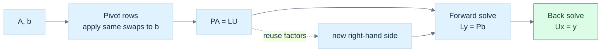

> **How to read Figure L3.** Pivoting changes row order, so the right-hand side must receive the same permutation. Once $L$ and $U$ exist, later solves reuse them.


<!-- end V08.15 -->

<!-- begin V08.16 -->
## Structure makes a decomposition a better tool than generic elimination

Before choosing an algorithm, ask what the matrix promises. Symmetry, positive definiteness, rectangular shape, sparsity, and repeated right-hand sides each change the most useful representation.

A real symmetric matrix satisfies $A=A^\mathsf T$. It is **positive definite (PD)** when $\mathbf x^\mathsf T A\mathbf x>0$ for every nonzero $\mathbf x$, and **positive semidefinite (PSD)** when the value is merely nonnegative. A Gram matrix $B^\mathsf T B$ is PSD because $\mathbf x^\mathsf T B^\mathsf T B\mathbf x=\|B\mathbf x\|_2^2\ge0$. If $B$ has a nontrivial null vector, the Gram matrix is singular. Covariance matrices are PSD for the same sum-of-squares reason.

For symmetric positive-definite $A$, **[[#Positive definiteness is a structural promise|Cholesky factorization]]** writes $A=LL^\mathsf T$ with lower-triangular $L$. It uses symmetry, stores less work than general LU, and avoids pivoting under the mathematical assumptions. If a computed diagonal square-root argument is nonpositive, that is diagnostic evidence: the input may not be PD, may be badly scaled, or roundoff may have exposed a fragile assumption. Do not silently clamp a materially negative value and claim a valid Cholesky factor.

For symmetric indefinite matrices, **LDL$^\mathsf T$** represents $A=LDL^\mathsf T$ without square roots in the diagonal factor. Robust practical algorithms may require symmetric permutations and 1-by-1 or 2-by-2 diagonal blocks; a bare unpivoted scalar LDL$^\mathsf T$ is not a universal indefinite solver. Positive semidefinite matrices can be singular, so a decomposition must handle zero pivots or use a method designed for rank deficiency.

**[[#Reflections and plane rotations build QR without losing lengths|QR factorization]]** writes $A=QR$, where the columns of $Q$ are orthonormal and $R$ is upper triangular (or trapezoidal for rectangular matrices). It separates a coordinate change that preserves lengths from the remaining triangular solve. Gram–Schmidt explains the geometry by repeatedly subtracting projections, but classical Gram–Schmidt can lose orthogonality in floating point. Modified Gram–Schmidt improves behavior; Householder reflectors are a stable dense workhorse; Givens rotations efficiently eliminate selected entries and are useful for incremental or structured problems.

For overdetermined measurements $A\mathbf x\approx\mathbf b$, least squares chooses $\mathbf x$ minimizing $\|A\mathbf x-\mathbf b\|_2$. With full column rank, QR gives $A=QR$ and orthogonality yields

$$
\|A\mathbf x-\mathbf b\|_2^2
=\|R\mathbf x-Q^\mathsf T\mathbf b\|_2^2
+\|(I-QQ^\mathsf T)\mathbf b\|_2^2.
$$

Here $Q$ is the reduced $m\times n$ factor with $Q^\mathsf TQ=I_n$. The second term is the part of the measurements outside the column space. It does not depend on $\mathbf x$, so minimizing the first term gives the same minimizer. The two objective functions generally have different minimum values; the unavoidable perpendicular residual must be retained when reporting fit quality.

The residual is perpendicular to the column space: $A^\mathsf T(A\widehat{\mathbf x}-\mathbf b)=0$. The **normal equations** solve $A^\mathsf T A\mathbf x=A^\mathsf T\mathbf b$, but $\kappa_2(A^\mathsf T A)=\kappa_2(A)^2$ for full-column-rank $A$. Squaring the condition number can destroy useful digits; QR is generally safer, while SVD handles rank deficiency more explicitly.

### Figure L4 - Matrix structure determines the useful factorization

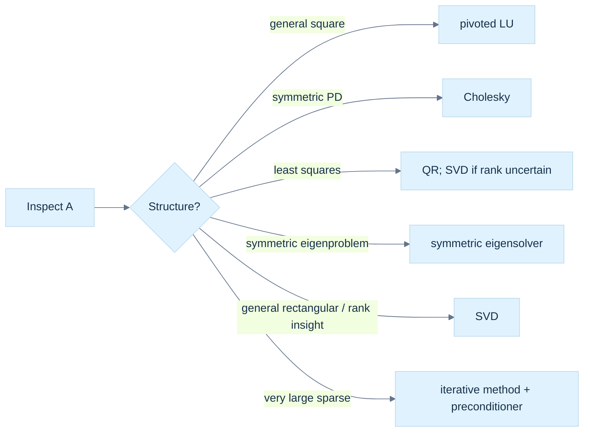

> **How to read Figure L4.** No decomposition wins on every matrix. The structural facts are inputs to algorithm selection, not implementation trivia.


<!-- end V08.16 -->


### Immediate footing — probability density

A probability density $p(x)$ describes a continuous random quantity. It is nonnegative and integrates to one; an interval probability is its area, $P(a\le X\le b)=\int_a^b p(x)\,dx$, not the density value at one point. A uniform density on $[0,1]$ has $p(x)=1$ there, giving $P(0.2\le X\le0.5)=0.3$. Densities have inverse units, such as per meter, so their values need not be at most one. Discrete probabilities instead assign mass to outcomes and sum to one.

[[#2. Random quantities and their probability laws|Full explanation and worked examples in this book]]


### Immediate footing — Gaussian distribution

A Gaussian (normal) distribution is a continuous bell-shaped probability model specified by mean $\mu$ and variance $\sigma^2$. Its density is $p(x)=\frac{1}{\sqrt{2\pi\sigma^2}}e^{-(x-\mu)^2/(2\sigma^2)}$. About $68\%$ of a one-dimensional Gaussian's probability lies within one standard deviation of its mean. In multiple dimensions, the mean is a vector and covariance controls spread and orientation. Gaussian assumptions are useful approximations, not universal facts; outliers, truncation, or multiple modes can make them misleading.

[[#4. Discrete and continuous distribution families|Full explanation and worked examples in this book]]


### Immediate footing — Monte Carlo estimation

Monte Carlo estimation uses random samples to approximate an expectation or integral. If independent samples $X_i$ follow the intended distribution, the average $N^{-1}\sum_{i=1}^N g(X_i)$ estimates $E[g(X)]$. With finite variance $\sigma^2$, the average has variance $\sigma^2/N$; four times as many samples halves its standard deviation. This describes random uncertainty, not model bias or arithmetic error. Sampling from a different density requires the appropriate weights and support. Repeating a fixed seed makes a computation reproducible, but does not prove independence or accuracy.

[[#8. Monte Carlo estimates trade computation for uncertainty|Full explanation and worked examples in this book]]

<!-- begin V08.17 -->
## Positive definiteness is a structural promise

A real symmetric matrix is positive definite (PD) when $x^\mathsf T A x>0$ for every nonzero $x$; positive semidefinite (PSD) replaces strict inequality with $\ge0$. The quadratic form is energy-like: positivity says no nonzero direction has zero or negative energy. For symmetric matrices, positive eigenvalues are equivalent to PD. A Gram matrix $B^\mathsf T B$ is PSD because $x^\mathsf T B^\mathsf T Bx=\|Bx\|_2^2\ge0$. It is PD exactly when $B$ has full column rank. Covariance and normal-equation matrices are common PSD examples; rank deficiency makes them singular.

The [[#Positive definiteness is a structural promise|Cholesky contract]] is valid only when this strict positivity promise holds.

Cholesky uses the stronger PD promise. It factors

$$
A=LL^\mathsf T
$$

with lower triangular $L$ and positive diagonal. Symmetry means only half the entries need be computed. Equating entries in the product yields the recurrence, for $j<i$,

$$
l_{ij}=\frac{a_{ij}-\sum_{k=0}^{j-1}l_{ik}l_{jk}}{l_{jj}},
$$

and on the diagonal,

$$
l_{ii}=\sqrt{a_{ii}-\sum_{k=0}^{i-1}l_{ik}^2}.
$$

A Schur complement is the remainder after eliminating one block: for $\begin{bmatrix}B&C\\C^\mathsf T&D\end{bmatrix}$ with invertible $B$, the trailing Schur complement is $D-C^\mathsf TB^{-1}C$. In Cholesky, the diagonal radicand $a_{ii}-\sum_{k<i}l_{ik}^2$ is the corresponding scalar remainder after removing contributions from earlier columns. If it is zero or negative, ordinary Cholesky cannot proceed as an SPD factorization. That may indicate a false structural promise, singular PSD input, bad scaling, or rounding. Silently replacing a negative value with zero changes the problem and can hide an important failure.

For a numerical trace, let

$$
A=\begin{bmatrix}4&2\\2&3\end{bmatrix}.
$$

Then $l_{11}=\sqrt4=2$, $l_{21}=2/2=1$, and $l_{22}=\sqrt{3-1^2}=\sqrt2$. Thus

$$
L=\begin{bmatrix}2&0\\1&\sqrt2\end{bmatrix},\qquad
LL^\mathsf T=\begin{bmatrix}4&2\\2&3\end{bmatrix}.
$$

To solve $Ax=(6,5)^\mathsf T$, first $Ly=b$: $y_1=3$, then $3+\sqrt2y_2=5$, so $y_2=\sqrt2$. Next solve $L^\mathsf Tx=y$: $\sqrt2x_2=\sqrt2$, hence $x_2=1$, and $2x_1+x_2=3$, hence $x_1=1$. The original equations return $(6,5)$.

Cholesky costs about half the leading arithmetic of general LU and needs no pivoting when the SPD assumption holds. It is usually the right dense solver for that structure. If a matrix is only nearly SPD due to measured noise, changing it through diagonal jitter or regularization is a modeling decision; it should be visible to the caller, not hidden inside a generic factor routine.

Positive definiteness can also be checked through leading principal minors for a symmetric matrix: every leading principal determinant must be positive. For the $2\times2$ example those checks are $4>0$ and $\det(A)=8>0$, consistent with the successful factorization. In practice, computing determinants is a poor standalone numerical test; Cholesky's pivots are a more useful operational test because they are the very quantities the factorization needs. For PSD matrices, strict positivity can fail. For instance $\begin{bmatrix}1&1\\1&1\end{bmatrix}$ has quadratic form $(x+y)^2$, is PSD, but has null vector $(1,-1)^\mathsf T$. Standard Cholesky reaches a zero final radicand. Rank-revealing or semidefinite-aware methods must decide how to represent that lost direction.

![[Visual Recall/Math Foundations/M08-1_cholesky-whitening.png]]

**M08-1. A covariance ellipse and its whitened coordinates.** For Sigma=[[4,1.2],[1.2,1]], L=[[2,0],[0.6,0.8]], mu=(3,-1), z=(1,1), x=(5,0.4), Mahalanobis squared distance 2, Euclidean squared distance 5.96, and density exp(-1)/(3.2 pi), about 0.0366 for an SPD 2D Gaussian.
This is an original Phase 10 teaching bridge: the Cholesky factor maps standard-normal coordinates into the covariance ellipse, and solving $Lz=x-\mu$ whitens them back. The complete numerical derivation is in [[#Original bridge: whiten a covariance ellipse|Phase 10]]. It is not an attributed Strang example.


<!-- end V08.17 -->

<!-- begin V08.18 -->
## LDLT reaches symmetric indefinite matrices

For symmetric matrices, an LDL$^\mathsf T$ factorization writes

$$
A=LDL^\mathsf T,
$$

where $L$ is unit lower triangular and $D$ is diagonal in the simplest no-pivot form. Equating entries in $A=LDL^\mathsf T$ gives the scalar recurrence $d_{jj}=a_{jj}-\sum_{k<j}l_{jk}^2d_{kk}$ and, for $i>j$, $l_{ij}=(a_{ij}-\sum_{k<j}l_{ik}l_{jk}d_{kk})/d_{jj}$. Unlike Cholesky, it uses no square roots, so negative diagonal entries in $D$ can represent negative curvature. For positive-definite $A$, diagonal $D$ entries are positive; for an indefinite matrix, signs reveal mixed curvature. A semidefinite matrix may have zero pivots and be singular. For example, with $A=\begin{bmatrix}2&4\\4&2\end{bmatrix}$, $d_{11}=2$, $l_{21}=4/2=2$, and $d_{22}=2-2^2\cdot2=-6$. Thus $L=\begin{bmatrix}1&0\\2&1\end{bmatrix}$ and $D=\operatorname{diag}(2,-6)$; direct multiplication verifies $LDL^\mathsf T=A$.

Consider the small indefinite matrix

$$
A=\begin{bmatrix}0&1\\1&0\end{bmatrix}.
$$

Its quadratic form is $2xy$, which is positive for some vectors and negative for others. It is invertible, but scalar unpivoted LDL$^\mathsf T$ would begin with a zero first pivot and fail. A symmetric pivoted method moves a suitable diagonal entry into place where possible. Some indefinite matrices require a 2-by-2 block in $D$: Bunch-Kaufman style factorizations use symmetric permutations and block diagonal $D$ so that the algorithm can pivot on a stable pair rather than divide by a weak scalar. Thus $A=LDL^\mathsf T$ with diagonal $D$ is a useful algebraic picture, not a universal robust recipe for every indefinite input.

This is a key contract distinction: Cholesky signals an SPD-specific method; pivoted block LDL$^\mathsf T$ is designed for symmetric indefinite systems. A routine should report permutation and block structure, singularity, and failure status. A bare scalar recurrence can be taught, but it should not be presented as production-safe for arbitrary symmetric matrices.


<!-- end V08.18 -->

<!-- begin V08.19 -->
## Orthogonal coordinates preserve the shape of the problem

The transition from elimination to QR is a transition from changing equations to changing coordinates. For a real matrix $A\in\mathbb R^{m\times n}$ with $m\ge n$, a [[#Reflections and plane rotations build QR without losing lengths|QR factorization]] writes

$$
A=QR.
$$

In the reduced form, $Q\in\mathbb R^{m\times n}$ has orthonormal columns, so $Q^\mathsf TQ=I_n$, and $R\in\mathbb R^{n\times n}$ is upper triangular. In the full form, $Q_f\in\mathbb R^{m\times m}$ is orthogonal and $R_f\in\mathbb R^{m\times n}$ has the triangular top block and zero rows beneath it; $A=Q_fR_f$. The full basis includes directions perpendicular to the columns of $A$, while reduced QR keeps just the basis for its column space. Only a square orthogonal matrix has a two-sided inverse identity, $Q^{-1}=Q^\mathsf T$ and $QQ^\mathsf T=Q^\mathsf TQ=I$. A thin rectangular $Q$ satisfies only $Q^\mathsf TQ=I_n$; $QQ^\mathsf T$ is the projector onto its column space, not an identity, so thin $Q$ has no two-sided inverse. In the square case, orthogonality implies length preservation: $\|Qx\|_2^2=x^\mathsf TQ^\mathsf TQx=\|x\|_2^2$. Thus the first factor changes coordinates without distorting Euclidean distances; $R$ holds the scaling and dependencies in triangular form.

Write the columns as $A=[a_1\;a_2\;\cdots\;a_n]$. Gram–Schmidt constructs $q_1,\ldots,q_n$ in sequence. At step $j$, subtract from $a_j$ its components along all already-built $q_i$, then normalize the remainder. If $u_j$ is this remainder, $r_{jj}=\|u_j\|_2$ and $q_j=u_j/r_{jj}$. The coefficient $r_{ij}$ records how much of $a_j$ lies along $q_i$. Since column $a_j$ uses only $q_1$ through $q_j$, entries below the diagonal of $R$ are zero. From $A=QR$ and $Q^\mathsf TQ=I$, $R=Q^\mathsf TA$: each entry is the coordinate of a column of $A$ measured along a basis vector.

For example, let $a_1=(1,1,0)^\mathsf T$ and $a_2=(1,0,1)^\mathsf T$. Then $r_{11}=\sqrt2$ and $q_1=(1,1,0)^\mathsf T/\sqrt2$. The first projection coefficient for the second column is $r_{12}=q_1^\mathsf Ta_2=1/\sqrt2$. Subtracting gives $u_2=a_2-r_{12}q_1=(1/2,-1/2,1)^\mathsf T$, with norm $\sqrt{3/2}=\sqrt6/2$. Therefore $q_2=(1,-1,2)^\mathsf T/\sqrt6$, and

$$
Q=\begin{bmatrix}1/\sqrt2&1/\sqrt6\\1/\sqrt2&-1/\sqrt6\\0&2/\sqrt6\end{bmatrix},\qquad
R=\begin{bmatrix}\sqrt2&1/\sqrt2\\0&\sqrt6/2\end{bmatrix}.
$$

Multiplying the factors recovers the two original columns. This example also shows why reduced $Q$ is rectangular: two independent columns in three-dimensional space need only two basis vectors, while a full orthogonal basis would add a third vector perpendicular to both.

Classical and modified Gram–Schmidt produce the same expressions in exact arithmetic but arrange the floating-point subtractions differently. Classical Gram–Schmidt computes the projections of the original $a_j$ against each $q_i$, then subtracts their sum: $u_j=a_j-\sum_{i<j}(q_i^\mathsf Ta_j)q_i$. Modified Gram–Schmidt starts with $v=a_j$, computes $r_{ij}=q_i^\mathsf Tv$, and immediately updates $v\leftarrow v-r_{ij}q_i$ before measuring the next projection. The next dot product therefore sees a residual from which the previous component has already been removed. In floating point, a dot product and subtraction are rounded; repeated projections of an almost dependent column can leave a small spurious component along an earlier direction. Classical Gram–Schmidt may reuse projection data that has not been updated to reflect those errors, so $Q^\mathsf TQ$ can drift appreciably from identity. Modified Gram–Schmidt usually controls this loss better because each new projection acts on the current residual. It is not immune when columns are extremely dependent, and a second reorthogonalization pass may be useful. Dense, general-purpose QR usually uses Householder reflectors, which maintain orthogonality more reliably and expose operations to efficient matrix kernels.

If $R_{jj}=0$, the current column lies in the span of earlier columns and this unpivoted procedure cannot append another normalized vector. Near zero is also a warning: dividing by a tiny norm magnifies roundoff. This is a rank question, not merely an exception condition. Pivoted QR can reorder columns to expose numerical rank; singular value methods provide a more explicit rank diagnostic. QR conventions may also choose signs differently: replacing a column of $Q$ and the matching row of $R$ by their negatives preserves $A=QR$.


<!-- end V08.19 -->

<!-- begin V08.20 -->
## Reflections and plane rotations build QR without losing lengths

A Householder reflector is a reflection across a hyperplane. Let nonzero $v$ be perpendicular to that plane. Decompose any $x$ into its in-plane part and its perpendicular part: $x=x_\parallel+x_\perp$, where $x_\perp=(v^\mathsf Tx)/(v^\mathsf Tv)\,v$. Reflection leaves the first part fixed and reverses the second, so $Hx=x_\parallel-x_\perp=x-2x_\perp$. Thus

$$
H=I-2\frac{vv^\mathsf T}{v^\mathsf Tv}.
$$

With unit $v$, this is $H=I-2vv^\mathsf T$. It is symmetric, $H^\mathsf T=H$, and self-inverse: $H^2=(I-2vv^\mathsf T)^2=I-4vv^\mathsf T+4v(v^\mathsf Tv)v^\mathsf T=I$. Hence $H^\mathsf TH=I$. This proof explains the numerical attraction: reflecting changes neither vector lengths nor angles, even though it can zero many entries at once.

To zero the tail of a vector $x\in\mathbb R^k$, seek a reflector taking it to $\alpha e_1$, where $e_1=(1,0,\ldots,0)^\mathsf T$. Set $u=x-\alpha e_1$ and reflect about the normal $u$. The reflector maps $x$ onto the target because $x$ and $\alpha e_1$ have the same norm and their difference defines the reflection direction. Choose $\alpha=-\operatorname{copysign}(\|x\|_2,x_1)$, which avoids cancellation by making $x_1-\alpha$ add magnitudes. Handle $x_1=0$ explicitly by taking $\alpha=-\|x\|_2$; if the entire active vector has zero norm, skip the reflector because its tail is already zero. If $x_1$ is positive and close to $\|x\|$, the alternative $u=x-\|x\|e_1$ subtracts two nearly equal numbers and can lose most significant digits. The negative sign instead makes the first component of $u$ add magnitudes. The norm itself must be computed with scaling or a stable norm routine so squaring huge or tiny components does not overflow or underflow. In a compact formulation, normalize the vector safely and store $H=I-\tau v v^\mathsf T$; applying it requires $z=v^\mathsf Tx$, then $x\leftarrow x-\tau vz$, without ever constructing the dense identity-sized matrix.

Householder QR applies such a reflector to the active part of each successive column. $H_1$ zeros rows 2 through $m$ in column 1. A reflector $H_2$ embedded in rows 2 through $m$ then zeros the entries below the diagonal in column 2 without disturbing the already-finished first column. Continuing gives $H_k\cdots H_2H_1A=R$. Since each reflector is orthogonal and its own inverse, $A=H_1H_2\cdots H_kR$; the product of reflectors is $Q$. Dense implementations do not form each $H_i$ or usually the full $Q$. They overwrite the upper triangle with $R$, store each reflector's tail below the diagonal (the leading one is implicit), and keep its scalar $\tau_i$ in a separate vector. Applying $Q$ or $Q^\mathsf T$ means applying these stored reflectors in the appropriate order. For $m\ge n$, dense Householder QR costs about $2mn^2-\tfrac23n^3$ floating point operations; its storage stays on the order of the original matrix rather than adding a second full square matrix. The orthogonal sequence is backward stable in the usual sense: the computed factors correspond closely to a nearby input, though the forward accuracy still depends on conditioning.

Givens rotations offer a local alternative. To annihilate $b$ beneath $a$, choose

$$
G=\begin{bmatrix}c&s\\-s&c\end{bmatrix},\quad
r=\operatorname{hypot}(a,b),\quad c=a/r,\quad s=b/r,
$$

If $r=0$, both entries already vanish and the rotation is skipped; otherwise $G(a,b)^\mathsf T=(r,0)^\mathsf T$. The function $\operatorname{hypot}$ computes $\sqrt{a^2+b^2}$ with scaling that avoids the overflow and underflow risks of the naive expression. The rotation touches just two selected rows and leaves all other rows unchanged. Householder is efficient for dense panels because one reflection removes a whole column tail; Givens can be better when the matrix is sparse, only a few entries need removal, or a new row arrives and the existing QR factor should be updated without rebuilding it. Both use orthogonal transformations, so both preserve Euclidean geometry.


<!-- end V08.20 -->

<!-- begin V08.21 -->
## QR turns least squares into a triangular solve plus an irreducible residual

For an overdetermined system $Ax\approx b$, with $A\in\mathbb R^{m\times n}$ and $m>n$, least squares seeks $\hat x$ minimizing $\|Ax-b\|_2$. Assume first that $A$ has full column rank and use reduced QR, $A=QR$. The columns of $Q$ form an orthonormal basis for $\operatorname{Col}(A)$. Decompose $b$ into its projection onto that column space, $QQ^\mathsf Tb$, and its perpendicular part $b_\perp=(I-QQ^\mathsf T)b$. Since $Q^\mathsf Tb_\perp=0$,

$$
Ax-b=Q(Rx-Q^\mathsf Tb)-b_\perp
$$

is a sum of perpendicular vectors. By Pythagoras,

$$
\|Ax-b\|_2^2=\|Rx-Q^\mathsf Tb\|_2^2+\|b_\perp\|_2^2.
$$

The second term is independent of $x$ and is generally nonzero: measurements may not lie exactly in the model's column space. Setting $Rx=Q^\mathsf Tb$ makes the first term zero and gives the minimizer. Because $R$ is triangular, solve it by back substitution. Crucially, the minimum residual norm is $\|b_\perp\|_2$, not zero. A derivation that replaces the least-squares objective by $\|Rx-Q^\mathsf Tb\|$ identifies the same minimizer but omits the constant perpendicular component and therefore does not give the original fit error.

At the solution, residual $r=A\hat x-b$ is perpendicular to every column of $A$, so $A^\mathsf Tr=0$, the normal-equation condition. Differentiating $f(x)=\|Ax-b\|_2^2$ gives $\nabla f=2A^\mathsf T(Ax-b)$, leading to $A^\mathsf TAx=A^\mathsf Tb$. This is a valid mathematical characterization, but explicitly forming $A^\mathsf TA$ can be a poor computational choice. In the 2-norm, the condition number $\kappa_2(A)=\|A\|_2\|A^{-1}\|_2$ for an invertible matrix measures the ratio of largest to smallest directional stretch. For full-column-rank rectangular $A$, the analogous ratio is $\sigma_{\max}/\sigma_{\min}$. Since the eigenvalues of $A^\mathsf TA$ are the squared singular values, $\kappa_2(A^\mathsf TA)=\kappa_2(A)^2$. Forming the product also rounds its dot products, which can erase the small differences distinguishing nearly dependent columns. QR avoids that squaring and is normally preferred for reliable least squares; normal equations plus Cholesky may be reasonable when speed and known-good conditioning justify them. SVD is useful when rank is uncertain or small directions must be examined.

A small [[Binary32|binary32]] example shows how forming the normal matrix can lose a direction before the solve starts. Let

$$
A=\begin{bmatrix}1&1\\0&10^{-4}\end{bmatrix},\qquad
A^\mathsf TA=\begin{bmatrix}1&1\\1&1+10^{-8}\end{bmatrix}.
$$

The columns of $A$ are independent, and its determinant is $10^{-4}$. Near one, binary32 spacing is about $1.19\times10^{-7}$, so the computed value $1+10^{-8}$ rounds to one under nearest rounding. The stored normal matrix can become $\begin{bmatrix}1&1\\1&1\end{bmatrix}$, which is singular. The original stored $A$ still distinguishes its columns; forming its Gram matrix erased the tiny squared difference. QR works on $A$ directly and avoids that particular loss, although the original problem's sensitivity still remains.

Conditioning belongs to the mathematical problem: it describes how much the answer can change under small input perturbations. Stability belongs to the algorithm: it describes whether the computation introduces errors beyond those inherent in the problem. A stable algorithm cannot recover information that an ill-conditioned input has already obscured. Conversely, even a well-conditioned problem can be damaged by an unstable algorithm. Orthogonal multiplication is unusually benign in 2-norm because it preserves lengths; it does not mean the whole problem has condition number one, nor does it remove sensitivity from a nearly rank-deficient $A$.


<!-- end V08.21 -->


### Immediate footing — Jacobian

The Jacobian is the matrix of first partial derivatives of a vector-valued function; it maps small input changes to first-order output changes. For $F(x,y)=(x^2+y,xy)$, $J_F(x,y)=\begin{bmatrix}2x&1\\y&x\end{bmatrix}$. At $(1,2)$, a small input change $(0.01,0)$ predicts output change $(0.02,0.02)$. This is a local approximation, not a global identity. The chain rule composes Jacobians in map order: $J_{G\circ F}(x)=J_G(F(x))J_F(x)$.

[[#Jacobians, curvature, and local approximation|Full explanation and worked examples in this book]]


### Immediate footing — Hessian

The Hessian is the matrix of second partial derivatives of a scalar function and describes how its gradient changes. For $f(x,y)=x^2+3y^2$, $H=\begin{bmatrix}2&0\\0&6\end{bmatrix}$. The second-order Taylor term along a small displacement $d$ is $\tfrac12d^THd$; the full approximation is $f(x+d)\approx f(x)+\nabla f(x)^Td+\tfrac12d^THd$. Positive curvature in every nonzero direction gives a strict local bowl. The Hessian requires appropriate second derivatives, and inaccurate curvature estimates can make optimization updates unstable.

[[#Jacobians, curvature, and local approximation|Full explanation and worked examples in this book]]

<!-- begin V08.22 -->
## Put the algorithms in a graphics context

The distinctions become concrete in engine work. If a constraint solver has fewer independent constraints than unknown impulses, nullity represents unconstrained combinations. A deformation map that collapses a dimension has a null direction. Camera reconstruction with weak parallax has near-null directions: exact rank may be full, but the estimate is sensitive. A noisy depth fit is often overdetermined; QR or SVD produces a least-squares answer rather than claiming exact consistency. A fixed symmetric positive-definite stiffness matrix reused across time steps invites Cholesky once and repeated triangular solves. An indefinite Hessian in optimization requires a method that recognizes negative curvature, not a Cholesky routine forced through it.

The useful workflow is therefore: characterize the system; distinguish exact inconsistency from rank deficiency and sensitivity; choose the factorization whose assumptions match; track permutations; solve with triangular routines; and report residual and status. Names such as “LU succeeded” are insufficient evidence unless factor convention, pivot behavior, dimensions, and residual are inspectable.

### Scoped algorithm kernels worth retaining

The following sketches are deliberately limited to dense square matrices in memory. They teach the invariants and do not define a complete production API, error policy, sparse algorithm, or GPU implementation.

```text
partial_pivot_LU(A, b):
  piv = [0,1,...,n-1]
  for k = 0 .. n-1:
    p = argmax(i=k..n-1, abs(A[i,k]))
    if A[p,k] is zero or rejected by scale policy: report singular/unsafe
    swap the complete packed rows k,p of A, including earlier L columns
    swap piv[k], piv[p]
    for i = k+1 .. n-1:
      A[i,k] /= A[k,k]                  # packed L multiplier
      for j = k+1 .. n-1:
        A[i,j] -= A[i,k] * A[k,j]       # update active U block
  y = forward solve with implicit unit diagonal, RHS b[piv[i]]
  x = back solve using packed upper triangle
  return packed factors, piv, x, status
```

The row swap is applied to the whole packed row before elimination, which automatically carries the previously stored multipliers with the row. Then factorization can be reused without the particular $b$.

For SPD input, the Cholesky kernel's invariant is that the already-computed columns reconstruct the corresponding leading block of $A$:

```text
cholesky(A):
  for j = 0 .. n-1:
    d = A[j,j] - sum(k=0..j-1, L[j,k]^2)
    require d > 0 under the routine's numeric policy
    L[j,j] = sqrt(d)
    for i = j+1 .. n-1:
      L[i,j] = (A[i,j] - sum(k=0..j-1, L[i,k]*L[j,k])) / L[j,j]
  return L, status
```

After either factorization, reconstruction and solve residuals test different obligations. For LU, compute a scaled measure such as $\|PA-LU\|/(\|A\|+\|L\|\|U\|)$, then separately evaluate $\|Ax-b\|$ against the original, unpermuted inputs. For Cholesky, check symmetry assumptions and $\|A-LL^\mathsf T\|$ plus the original-system residual. A small residual does not certify a well-conditioned answer; perturbation sensitivity remains a property of the problem.


<!-- end V08.22 -->


# Change and uncertainty acquire a mathematical language

Learn spectral directions before Hessian classifications, derivatives and integration before continuous probability densities, and expectation/covariance before statistical principal components. A Jacobian is the coordinate table of local change; a covariance matrix is a table of centered second moments.

<!-- begin V08.23 -->
## Eigenvectors reveal the directions a square map does not turn

For a square matrix $A$, an [[#Eigenvalues, eigenspaces, and the two kinds of multiplicity|eigenvector]] $\mathbf v\ne\mathbf0$ and eigenvalue $\lambda$ satisfy

$$
A\mathbf v=\lambda\mathbf v.
$$

The transformation may stretch, shrink, reverse, or annihilate this direction, but it does not turn it into a different direction. Eigenvectors are directions rather than unique vectors: any nonzero scalar multiple is also an eigenvector. The corresponding eigenspace is $\operatorname{Null}(A-\lambda I)$.

If a matrix has enough independent eigenvectors, it is diagonalizable: $A=V\Lambda V^{-1}$. This can simplify repeated powers and matrix functions, but $V$ may be poorly conditioned or not exist as a full basis. A repeated eigenvalue does not guarantee enough eigenvectors. Algebraic multiplicity counts the root's repetition in the characteristic polynomial; geometric multiplicity counts independent eigenvectors. The latter cannot exceed the former.

For real symmetric $A$, the spectral theorem gives an orthonormal eigenbasis: $A=Q\Lambda Q^\mathsf T$. The coordinate change by $Q$ is unusually safe because it preserves Euclidean length and does not magnify 2-norm error. This is the setting where Rayleigh quotients, PCA covariance analysis, and symmetric eigensolvers have especially clean meanings. Orthogonal does not mean error-free; it means the transformation itself does not add condition amplification in the 2-norm.

Iterative eigen methods seek selected spectral information without always computing every eigenpair. **Power iteration** repeatedly applies $A$ and renormalizes; when a unique dominant eigenvalue is separated and the initial vector has a component in its eigendirection, the dominant direction tends to take over. **Inverse iteration** solves shifted systems $(A-\mu I)\mathbf y=\mathbf x$ to emphasize eigenvalues near $\mu$; a good shift can make it fast, but a near-singular solve and factorization cost matter. The **Rayleigh quotient** $\rho(\mathbf x)=\mathbf x^\mathsf T A\mathbf x/(\mathbf x^\mathsf T\mathbf x)$ estimates the eigenvalue associated with a candidate vector for symmetric $A$; a small residual is evidence of an approximate eigenpair, while eigenvalue accuracy also depends on separation and conditioning.

QR iteration repeatedly factors and recombines a matrix to drive it toward a form whose diagonal exposes eigenvalues. Symmetric Jacobi methods apply plane rotations to reduce off-diagonal entries while maintaining orthogonal similarity. Stopping criteria should measure a scaled residual or off-diagonal norm, include a maximum iteration count, and report nonconvergence. A small residual says the computed pair nearly satisfies its equation; it does not, by itself, guarantee a uniquely accurate eigenvector when eigenvalues are tightly clustered. Eigenvalue sensitivity depends on both the problem and the perturbation model.

The characteristic polynomial $\det(A-\lambda I)$ explains eigenvalues algebraically and establishes multiplicity, but directly expanding and solving it is not generally a reliable numerical eigensolver for large matrices. It is a conceptual definition; stable algorithms use transformations and structured iterations.


<!-- end V08.23 -->

<!-- begin V08.24 -->
## Eigenvalues, eigenspaces, and the two kinds of multiplicity

For a square matrix $A$, an eigenvector is a nonzero vector $v$ whose image stays on the same line: $Av=\lambda v$. The scalar $\lambda$ is its eigenvalue. A positive value stretches that direction, a negative value reverses and scales it, and zero annihilates it. Thus zero is an eigenvalue exactly when $A$ has a nontrivial null space, which for a square matrix is equivalent to singularity. Eigenvectors describe directions rather than unique arrows: if $v$ is an eigenvector, every nonzero scalar multiple $cv$ is also one. Rearranging the equation gives $(A-\lambda I)v=0$, so all eigenvectors for $\lambda$ together with zero form the [[#Eigenvalues, eigenspaces, and the two kinds of multiplicity|eigenspace]] $E_\lambda=\operatorname{Null}(A-\lambda I)$.

The characteristic polynomial turns this null-space condition into an equation for possible eigenvalues. A nonzero solution to $(A-\lambda I)v=0$ exists only when $A-\lambda I$ is singular, hence $\det(A-\lambda I)=0$. Some conventions instead use $\det(\lambda I-A)$; its roots are identical, though its overall sign may differ. For $A=\begin{bmatrix}a&b\\c&d\end{bmatrix}$, expanding $\det(\lambda I-A)$ gives $\lambda^2-(a+d)\lambda+(ad-bc)$. Therefore the sum of the two roots is $\operatorname{tr}(A)$ and their product is $\det(A)$. In any dimension, trace and determinant respectively give the sum and product of eigenvalues counted with algebraic multiplicity. For a teaching-size example, $A=\begin{bmatrix}2&1\\1&2\end{bmatrix}$ yields $(\lambda-3)(\lambda-1)$; solving the associated null spaces gives directions $(1,1)^\mathsf T$ and $(1,-1)^\mathsf T$.

The algebraic multiplicity of $\lambda$ is how many times it is a root of the characteristic polynomial. Its geometric multiplicity is $\dim\operatorname{Null}(A-\lambda I)=n-\operatorname{rank}(A-\lambda I)$, by rank-nullity. It satisfies $1\le m_g\le m_a$. For $A=2I_2$, the characteristic polynomial is $(\lambda-2)^2$ and every vector is an eigenvector, so both multiplicities are two. For $J=\begin{bmatrix}2&1\\0&2\end{bmatrix}$, the same polynomial has algebraic multiplicity two, but $(J-2I)v=0$ forces $v_2=0$, leaving only one independent eigenvector. $J$ is defective: it cannot be diagonalized. Repetition alone is not the problem; a repeated eigenvalue is harmless if its eigenspace has enough independent directions.

This algebra also makes clear why directly expanding the characteristic polynomial is not a practical large-matrix eigensolver. Coefficients can be highly sensitive to rounding, and solving a high-degree polynomial is itself a numerical problem. The determinant equation defines the eigenvalues and supports exact small examples and theorems. Reliable numerical methods instead apply orthogonal or similarity transformations to the matrix and extract its spectrum from a structured form.


<!-- end V08.24 -->

<!-- begin V08.25 -->
## Diagonalization leads to the stronger symmetric spectral theorem

If an $n\times n$ matrix has $n$ independent eigenvectors $v_i$ with eigenvalues $\lambda_i$, place the vectors in $V=[v_1\;\cdots\;v_n]$ and values in diagonal $\Lambda$. Column by column, $Av_i=\lambda_i v_i$, hence $AV=V\Lambda$. Independence makes $V$ invertible, giving $A=V\Lambda V^{-1}$. This says: convert into eigenvector coordinates, scale each coordinate independently, then convert back. It also gives $A^k=V\Lambda^kV^{-1}$, which can make repeated applications or matrix functions easy to understand. If $V$ is ill-conditioned, however, converting into and out of these coordinates can magnify roundoff. A diagonal formula is not automatically a numerically safe representation.

Real symmetric matrices have a stronger guarantee from the [[#Eigenvalues, eigenspaces, and the two kinds of multiplicity|spectral theorem]]. Their eigenvalues are real, and they admit an orthonormal eigenbasis, so $A=Q\Lambda Q^\mathsf T$. One proof of reality begins with a possibly complex eigenvector $z$ satisfying $Az=\lambda z$. Because $A=A^\mathsf T$ is real symmetric, $z^*Az$ is real; but $z^*Az=\lambda z^*z$ and $z^*z>0$, so $\lambda$ is real. For eigenvectors $u,v$ with distinct eigenvalues $\lambda,\mu$, symmetry gives $u^\mathsf TAv=(Au)^\mathsf Tv$. Substitution yields $\mu u^\mathsf Tv=\lambda u^\mathsf Tv$, so $(\lambda-\mu)u^\mathsf Tv=0$ and therefore $u^\mathsf Tv=0$.

Distinct eigenspaces are orthogonal. If an eigenvalue repeats, choose an orthonormal basis within its eigenspace by orthogonalization; the resulting total set is still an eigenbasis. To see that this produces a complete basis rather than only orthogonal pairs, maximize $x^\mathsf TAx$ over the compact unit sphere. At a maximizer $v$, the constrained first-order condition gives $Av=\lambda v$ with real $\lambda$. The orthogonal complement $v^\perp$ is invariant because for $x\perp v$, $v^\mathsf TAx=(Av)^\mathsf Tx=\lambda v^\mathsf Tx=0$. Restrict $A$ to that complement and repeat by induction on dimension. This yields an orthonormal eigenbasis and proves the spectral theorem; the earlier distinct-eigenvalue calculation explains why its separate eigenspaces are orthogonal. The spectral theorem therefore rules out defectiveness for real symmetric matrices.

An orthogonal square matrix satisfies $Q^\mathsf TQ=I$. It preserves inner products because $(Qx)^\mathsf T(Qy)=x^\mathsf Ty$, so lengths and angles are preserved too. Its inverse is $Q^\mathsf T$, its singular values are all one, and thus $\kappa_2(Q)=1$. Taking determinants in $Q^\mathsf TQ=I$ gives $\det(Q)^2=1$, so $\det(Q)=\pm1$; rotations have determinant $+1$, while reflections reverse orientation and have determinant $-1$. These facts explain why orthogonal eigenvectors and transformations are so useful numerically, but they do not imply that every matrix being diagonalized is well-conditioned.

For symmetric $A$, the quadratic form exposes the spectral meaning directly. Write $x=Qy$; then $x^\mathsf TAx=y^\mathsf T\Lambda y=\sum_i\lambda_i y_i^2$. Thus $A$ is positive definite exactly when every eigenvalue is positive, and positive semidefinite exactly when none is negative. The axes of a covariance ellipsoid or inertia tensor are its orthonormal eigenvectors; the associated eigenvalues give variance or inertia along those axes. When eigenvalues are repeated, individual eigenvectors within that repeated subspace are not unique, though the subspace is.

### Figure L5 - Eigenanalysis is cleanest when the basis is orthonormal

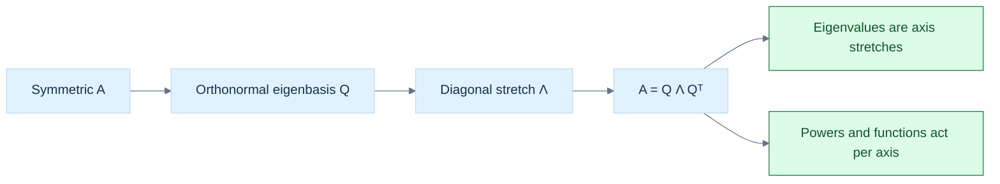

> **How to read Figure L5.** Symmetry guarantees perpendicular eigen-directions, so the diagonal form is a genuine orthonormal coordinate change rather than an unstable oblique one.


<!-- end V08.25 -->

<!-- begin V08.26 -->
## Iteration extracts selected eigenpairs without solving a polynomial

Power iteration is the simplest way to reveal a dominant eigenvector. Suppose $A$ is diagonalizable with eigenvectors $v_i$ and $|\lambda_1|>|\lambda_2|\ge\cdots$. Express an initial vector as $x_0=\sum_i c_i v_i$, with $c_1\ne0$. Repeated multiplication gives $A^kx_0=\lambda_1^k[c_1v_1+\sum_{i>1}c_i(\lambda_i/\lambda_1)^kv_i]$. The ratios shrink, so after normalizing to prevent overflow or underflow, the direction approaches $v_1$. The leading direction error is typically governed by $|\lambda_2/\lambda_1|^k$: a separated dominant magnitude converges quickly, while a ratio near one converges slowly. If $c_1=0$, the dominant direction is absent forever; if two eigenvalues tie in magnitude, oscillation or convergence to a mixture can occur. A negative dominant eigenvalue can flip the sign each step without changing the represented line. Once a normalized vector $x_k$ is available, estimate its eigenvalue with a Rayleigh quotient.

Inverse iteration targets a chosen spectral neighborhood. If $Av_i=\lambda_i v_i$, then $(A-\mu I)^{-1}v_i=(\lambda_i-\mu)^{-1}v_i$. Eigenvalues near shift $\mu$ become large in the transformed operator, so its dominant direction corresponds to the eigenvalue nearest the shift. The actual algorithm does not form the inverse: solve $(A-\mu I)y_k=x_k$ using a factorization, normalize $y_k$ to obtain the next vector, and repeat. A shift close to the desired eigenvalue improves selectivity but makes the linear system nearly singular; a factorization can be reused if the shift is fixed. Rayleigh quotient iteration updates the shift from the current vector and can converge very quickly for symmetric problems near an eigenvector, at the cost of a new shifted solve per step.

For symmetric $A$ and nonzero $x$, the Rayleigh quotient is $\rho(x)=x^\mathsf TAx/(x^\mathsf Tx)$. If $x$ is an eigenvector, substitution gives its exact eigenvalue. Expand a unit $x$ in an orthonormal eigenbasis, $x=\sum_i c_i v_i$, with $\sum_i c_i^2=1$. Then $\rho(x)=\sum_i\lambda_i c_i^2$, a weighted average of eigenvalues, so it lies between the smallest and largest. This makes it a useful estimate with a geometric interpretation: the quadratic form's value per unit squared length in direction $x$. For a symmetric matrix, if $x$ makes a small angle with a simple eigenvector, the eigenvalue estimate can be second-order accurate in that angle, while the vector's own directional error is first order.


<!-- end V08.26 -->

<!-- begin V08.27 -->
## QR iteration and Jacobi rotations preserve the spectrum while simplifying shape

QR iteration applies factorization repeatedly to drive a matrix toward a form revealing its eigenvalues. Starting with $A_k=Q_kR_k$, define $A_{k+1}=R_kQ_k$. Since $Q_k$ is orthogonal, $A_{k+1}=Q_k^\mathsf TA_kQ_k$, a similarity transform, so it has exactly the same eigenvalues. The accumulated basis $Z_{k+1}=Z_kQ_k$ tracks eigenvectors. For symmetric matrices, the iterates remain symmetric and, under suitable conditions, approach a diagonal matrix. Convergence is not automatic: a practical shifted QR solver checks subdiagonal residuals, uses deflation and a finite iteration budget, and returns a nonconvergence status if its target criterion is not met. For a general real matrix, a successful target is real Schur form: orthogonal similarity produces an upper quasi-triangular matrix with 1-by-1 blocks for real eigenvalues and 2-by-2 blocks for complex-conjugate pairs. Such a 2-by-2 block is a converged Schur representation, not an unfinished scalar diagonal. This is why “read the diagonal” is not a complete account for a real nonsymmetric problem.

A production QR eigensolver first reduces a dense matrix by Householder similarity transformations to Hessenberg form, where entries below the first subdiagonal are zero. This costs cubic work once; subsequent QR sweeps exploit the banded structure and cost quadratic work. For a symmetric matrix, reduction yields tridiagonal form. Shifts choose a nearby spectral target and accelerate convergence. When a subdiagonal coupling becomes tiny relative to neighboring diagonal scale, deflation treats it as zero and splits the active problem into smaller blocks. This preserves the practical spectrum to working precision while reducing future work. Accumulated orthogonal transformations allow eigenvectors to be recovered if requested. For a 2-by-2 real block with complex eigenvalues, the block itself is the meaningful real Schur representation; forcing two real scalar diagonal entries would be impossible.

The Jacobi algorithm is a direct symmetric alternative. For a selected off-diagonal pair $\gamma=a_{pq}=a_{qp}$, it constructs a plane rotation affecting only coordinates $p$ and $q$ and applies $A'=J^\mathsf TAJ$. Orthogonal similarity preserves eigenvalues, and symmetry is preserved because $(J^\mathsf TAJ)^\mathsf T=J^\mathsf TAJ$. To keep one consistent rotation convention, take the 2-by-2 block $B=\begin{bmatrix}\alpha&\gamma\\\gamma&\beta\end{bmatrix}$ and

$$
J=\begin{bmatrix}c&s\\-s&c\end{bmatrix},\qquad c=\cos\theta,\quad s=\sin\theta.
$$

Then the transformed off-diagonal entry is $\gamma'=(\alpha-\beta)cs+\gamma(c^2-s^2)$. Set it to zero and divide by $c^2$ (when $c\ne0$): with $t=s/c$, $\gamma t^2+(\beta-\alpha)t-\gamma=0$. Define $\tau=(\beta-\alpha)/(2\gamma)$. The stable small-magnitude root is

$$
t=\operatorname{sign}(\tau)\big/(|\tau|+\sqrt{1+\tau^2}),\qquad c=1/\sqrt{1+t^2},\qquad s=tc.
$$

When $\tau=0$, choose either equal-magnitude root consistently, for example $t=1$. Evaluate $\sqrt{1+\tau^2}$ as $\operatorname{hypot}(1,\tau)$ to avoid overflow; computing $\tau=(\beta-\alpha)/(2\gamma)$ also needs care if subtraction or doubling overflows or underflows, so scale the three block entries by a shared magnitude before forming the ratio. If $\gamma=0$, no rotation is needed. This convention gives $p'=cp-sq$ and $q'=sp+cq$ for the two rotated coordinates. The resulting diagonal values of the transformed block are its eigenvalues; the same rotation updates the corresponding rows and columns of the full matrix and the accumulated eigenvector matrix.

For example, with $\alpha=4$, $\beta=2$, and $\gamma=1$, $\tau=-1$, hence $t=-1/(1+\sqrt2)=-(\sqrt2-1)$. The angle has negative tangent under this declared $J$ convention, and substitution into $\gamma'=(4-2)cs+(c^2-s^2)$ gives zero. Signs in descriptions of Jacobi rotations vary because authors may transpose $J$ or define the coordinate update oppositely; the matrix and formula must be kept consistent. Each rotation removes one selected coupling, but modifies other entries in rows and columns $p$ and $q$. Repeated sweeps reduce off-diagonal energy. A common strategy annihilates the largest off-diagonal magnitude; cyclic sweeps visit every pair in a fixed order. The Frobenius norm of off-diagonal entries is a natural progress measure. Jacobi is simple, parallelizable in variants, and often gives excellent eigenvectors, while classical dense QR-based solvers are usually more efficient at large sizes.


<!-- end V08.27 -->

<!-- begin V08.28 -->
## Residuals distinguish backward accuracy from forward certainty

For an approximate eigenpair $(\hat\lambda,\hat v)$, its residual is $r=A\hat v-\hat\lambda\hat v$. If $r=0$, it is exact. A small residual means the pair is an exact eigenpair of a nearby matrix: for normalized $\hat v$, define $E=-r\hat v^\mathsf T$, so $(A+E)\hat v=\hat\lambda\hat v$ and $\|E\|_2=\|r\|_2$. This is a backward-error statement. It does not by itself say how close $\hat\lambda$ and $\hat v$ are to a particular exact eigenpair of the original matrix; that is forward error and depends on conditioning and spectral separation.

Residuals must be scaled. One dimensionless check is $\|A\hat v-\hat\lambda\hat v\|_2/((\|A\|_2+|\hat\lambda|)\|\hat v\|_2)$, with a safe zero-scale policy. For eigenvalue iteration, changes between successive estimates, $|\lambda_{k+1}-\lambda_k|$, can supplement the residual but cannot replace it: values can stagnate while the vector remains poor. Eigenvector comparisons must account for sign because $v$ and $-v$ are the same direction; for normalized vectors, $|v_k^\mathsf Tv_{k+1}|$ measures alignment independent of sign. For a symmetric decomposition $A\approx Q\Lambda Q^\mathsf T$, check reconstruction error and orthogonality error $\|Q^\mathsf TQ-I\|$ as distinct invariants. Checking only that each column has unit length misses non-orthogonality between columns. Jacobi may monitor $\operatorname{off}(A)/\|A\|_F$, where $\operatorname{off}(A)^2=\sum_{i\ne j}a_{ij}^2$. QR deflation checks subdiagonal entries against their local scale. All iterative methods need a maximum iteration or sweep count and a failure status; “not converged” is a meaningful result.

A small residual can coexist with a substantially uncertain eigenvector. If two eigenvalues are clustered, small perturbations can rotate the individual eigenvectors greatly within their nearly shared invariant subspace. The subspace may remain stable even though no particular basis vector is. This is why a solver's returned vectors need not match another implementation's signs or basis choices for repeated and clustered eigenvalues. Assess the invariant subspace and eigengap when that distinction matters.


<!-- end V08.28 -->

<!-- begin V08.29 -->
## Sensitivity depends on left and right eigenvectors

The condition number of a linear solve describes amplification in its input-output relation; eigenvalues have their own sensitivity. A right eigenvector satisfies $Av=\lambda v$. A left eigenvector satisfies $w^\mathsf TA=\lambda w^\mathsf T$, equivalently $A^\mathsf Tw=\lambda w$ for a real matrix. For a simple real eigenvalue $\lambda$ and its real left/right eigenvectors, under a small real perturbation $E$, suppose the eigenvalue and vector change by $\delta\lambda$ and $\delta v$. The first-order formula below is local to a simple eigenvalue; at a repeated or defective eigenvalue, eigenvalue branches may split and need not have this derivative. For a complex simple eigenvalue of a real matrix, use conjugate transpose $w^*$ in place of $w^\mathsf T$ and the corresponding complex left eigenvector. Keeping only first-order terms in $(A+E)(v+\delta v)=(\lambda+\delta\lambda)(v+\delta v)$ gives $(A-\lambda I)\delta v+Ev\approx\delta\lambda v$. Left-multiply by $w^\mathsf T$: since $w^\mathsf T(A-\lambda I)=0$, the vector-change term vanishes, leaving

$$
\delta\lambda\approx\frac{w^\mathsf TEv}{w^\mathsf Tv}.
$$

For a complex simple eigenvalue, the corresponding formula is $\delta\lambda\approx(w^*Ev)/(w^*v)$, with $w^*A=\lambda w^*$. For the simple real case, under the induced 2-norm, the eigenvalue sensitivity factor is $\|w\|_2\|v\|_2/|w^\mathsf Tv|$. If normalized left and right eigenvectors are nearly perpendicular, the denominator is tiny and small matrix perturbations can produce large eigenvalue changes. This is common for non-normal matrices, those not satisfying $AA^\mathsf T=A^\mathsf TA$. In a real symmetric problem, a normalized eigenvector can serve as both left and right vector, so $w^\mathsf Tv=v^\mathsf Tv=1$; eigenvalues are optimally conditioned to first order in the spectral norm. More generally, symmetric perturbations obey Weyl's bound: ordered eigenvalues move by no more than $\|E\|_2$.

The distinction between residual and forward accuracy follows directly. A computed eigenpair with a tiny residual is a good solution to a nearby problem. If its target eigenvalue is isolated and well-conditioned, that also supports a close answer for the original problem. If the matrix is non-normal or the eigenvalue is tightly clustered, the same residual may not determine a unique nearby vector. Report residual and, when needed, separation or a subspace error; do not infer exact vector accuracy from one scalar residual.

The story now connects constraints, decompositions, and spectra. QR uses orthogonal changes to avoid amplifying 2-norm errors; least squares projects onto the reachable column space and retains the irreducible perpendicular residual; normal equations square the stretch ratio and can lose information. Eigenvectors identify invariant directions, multiplicity counts how many independent such directions exist, and diagonalization uses them as coordinates. Symmetry upgrades that basis to an orthonormal one, making the spectral representation numerically clean. Iterative methods exploit dominant directions, shifts, or orthogonal similarities rather than expanding a polynomial. Convergence is evidenced by residuals and structure checks, while sensitivity explains what data precision can support.

Ordinary eigendecomposition still does not analyze every linear map. If $A$ is rectangular, $Av$ and $v$ live in different spaces, so $Av=\lambda v$ is not dimensionally defined. A square matrix can be defective and have too few eigenvectors. A diagonalizable matrix can still have a badly conditioned eigenvector basis. Its eigenvalues may also be complex even when its entries are real. The next general decomposition must describe input and output directions separately, work for rectangular maps, and use orthonormal directions with nonnegative stretches. That requirement motivates the singular value decomposition without needing its formula yet.


<!-- end V08.29 -->

<!-- begin V08.30 -->
## Why eigenvectors, coordinates, and condition numbers connect

Similarity explains why changing coordinates preserves eigenvalues. If $B=S^{-1}AS$ with invertible $S$ and $Av=\lambda v$, then $B(S^{-1}v)=S^{-1}Av=\lambda(S^{-1}v)$. Thus the corresponding eigenvector in the new coordinate system is $S^{-1}v$, while $\lambda$ is unchanged. The characteristic polynomial sees the same fact: $\det(B-\lambda I)=\det(S^{-1}(A-\lambda I)S)=\det(A-\lambda I)$ because determinants multiply and $\det(S^{-1})\det(S)=1$. The matrix may look different in the new basis, but the linear map's eigenvalues do not.

Distinct eigenvalues force independent eigenvectors. Suppose $v_1,\ldots,v_k$ correspond to distinct $\lambda_i$, and assume for contradiction there is a nontrivial dependence with the fewest terms, $\sum_{i=1}^k c_iv_i=0$, where all listed $c_i\ne0$. Apply $A-\lambda_kI$: the $k$th term vanishes and leaves $\sum_{i=1}^{k-1}c_i(\lambda_i-\lambda_k)v_i=0$. At least one coefficient remains nonzero, producing a dependence with fewer terms, a contradiction. Hence distinct-eigenvalue vectors are independent. Repeated values require a separate count: the algebraic multiplicity says how many roots occur, while geometric multiplicity says how many independent vectors actually exist. A matrix is diagonalizable exactly when it has a full basis of eigenvectors, equivalently the sum of geometric multiplicities across its distinct eigenvalues is $n$. For each eigenvalue, geometric multiplicity cannot exceed algebraic multiplicity, and the two are equal for every eigenvalue precisely when enough eigenvectors are available.

The condition number makes the danger of a skewed eigenbasis quantitative. If $A=V\Lambda V^{-1}$, then $A^kx=V\Lambda^kV^{-1}x$. In exact arithmetic this cleanly separates independent scalar powers. In floating point, the computed coordinates pass through $V^{-1}$ and then back through $V$. When columns of $V$ nearly point in the same direction, a small perturbation in the represented vector can cause large coordinate changes; $\kappa_2(V)=\|V\|_2\|V^{-1}\|_2$ measures that amplification. Thus the matrix may have a mathematically valid diagonalization while the decomposition is poor for computation. In the symmetric spectral theorem, $V$ can be chosen orthogonal, so $\kappa_2(V)=1$ and this source of amplification disappears.

For a linear solve, the same condition number follows from the perturbation equations. Starting from $Ax=b$ and perturbed $b+\delta b$, the solution change obeys $A\delta x=\delta b$. Therefore $\|\delta x\|\le\|A^{-1}\|\|\delta b\|$. Since $b=Ax$, $\|b\|\le\|A\|\|x\|$, which rearranges to $\|x\|\ge\|b\|/\|A\|$. Combining these gives the relative bound $\|\delta x\|/\|x\|\le\kappa(A)\,\|\delta b\|/\|b\|$. This is a worst-case first-order amplification bound, not a promise that every perturbation reaches the worst case. Geometrically, if $A$ stretches one unit direction by 1 and another by $10^{-6}$, inverting it magnifies the weak direction by $10^6$; the stretch ratio is the condition number. Normal equations square this ratio because $A^\mathsf TA$ has eigenvalues equal to squared stretches.

An error budget makes the distinction practical. Suppose a measurement has relative uncertainty around $10^{-8}$ and the system's condition number is about $10^6$. The worst-case relative solution change can be on the order of $10^{-2}$ before counting algorithmic rounding. A solver with tiny backward error cannot claim eight accurate solution digits, because input uncertainty has already made the answer sensitive. Conversely, if the problem is well-conditioned but an algorithm forms large cancelling quantities, poor forward accuracy can be caused by the computation rather than the problem. For eigensolvers, the analogous separation is residual (backward accuracy) versus eigenvalue/eigenvector sensitivity (forward accuracy).

A compact worked power iteration illustrates how the formulas predict actual steps. Let $A=\operatorname{diag}(4,1)$ and $x_0=(1,1)^\mathsf T$. Then $Ax_0=(4,1)^\mathsf T$, whose normalized direction is $(4,1)^\mathsf T/\sqrt{17}$. After another multiplication the unnormalized vector is $(16,1)^\mathsf T$, whose direction is closer to $(1,0)^\mathsf T$. After $k$ multiplies the ratio of the second coordinate to the first is $4^{-k}$, exactly the predicted $|\lambda_2/\lambda_1|^k$. The Rayleigh quotient at the first normalized step is $(4\cdot16+1\cdot1)/17=65/17$, close to 4 but not exact; as the second component decays, the quotient approaches 4. If instead the initial vector were $(0,1)^\mathsf T$, every iterate would remain there and return eigenvalue 1, demonstrating the missing-dominant-component failure concretely.

A two-by-two shifted inverse step shows why one solves rather than forms an inverse. For $A=\operatorname{diag}(4,1)$ and shift $\mu=0.9$, $(A-\mu I)y=x$ divides the first coordinate by $3.1$ and the second by $0.1$. After normalization, the component associated with eigenvalue 1 is amplified relative to the other by a factor $31$. Repeating rapidly isolates that direction. An explicit inverse would contain the same divisions but is unnecessary: factor once, solve each right-hand side, and retain the direct linear-system operation. If the shift were exactly 1, the matrix would be singular; near 1, roundoff and solve errors may be magnified. Shift selection is therefore both the mechanism of targeting and a conditioning decision.


<!-- end V08.30 -->

<!-- begin V09.00 -->
## From Local Change to Reliable Motion: Calculus and Optimization

#### How to read this volume

A reader can revisit the earlier geometry foundations through [[#The dot product turns two movements into a measurement|dot products and vector projections]], [[#A normal is a measuring rule before it is an arrow|normals]], and [[#Homogeneous coordinates preserve the role of a location|homogeneous coordinates]]. Phase 7 supplies the frame and rotation machinery used by local camera derivatives: [[#A frame combines directions with a place to stand|frames]], [[#A camera is another frame, so viewing uses its inverse|camera frames]], and [[#Composition remembers which frame a new turn belongs to|rotation composition]]. Phase 8 supplies numerical linear algebra for normal systems and conditioning: [[#QR turns least squares into a triangular solve plus an irreducible residual|QR least squares]], [[#Conditioning: weak singular directions amplify uncertainty|conditioning]], and [[#The exponential solves a linear differential equation|matrix exponentials]]. Independent graphics connections are in [[Continuous Notes/University - Worlds, Images and Inference - Graphics, Vision and Photography#Perspective projection links 3-D velocity to image flow|perspective image flow]], [[Continuous Notes/University - Worlds, Images and Inference - Graphics, Vision and Photography#Differentiating through a graphics pipeline|differentiable graphics]], and [[Continuous Notes/University - Worlds, Images and Inference - Graphics, Vision and Photography#Bundle adjustment objective and gauge|bundle adjustment and gauge freedom]]. These links are retrieval paths; the explanations needed here remain in this volume.

A derivative describes local change. A Jacobian carries that idea to vector outputs; a Hessian adds local curvature. Integration accumulates change, and an ordinary differential equation uses a rate law to define a trajectory. Numerical integrators approximate that trajectory. Automatic differentiation propagates sensitivities through the computations that implement it. Optimization uses those sensitivities to improve parameters, then checks whether each proposed update is valid, useful, and numerically representable.

The narrative follows that dependency chain. Original part IDs remain in the source ledger and provenance files rather than teaching headings. The source copies are retained beside this draft so every derivation, example, implementation specimen, caveat, and enrichment can be traced. Claims about repository state, compiler runs, and external program output in the pasted sources are not independently confirmed here; they require their own evidence before adoption as current vault facts.


<!-- end V09.00 -->


## Derivatives are local linear maps

A derivative answers a local question: if the input changes a little, how does the output change to first order? For a scalar function $f:\mathbb R\to\mathbb R$, differentiability at $x$ means there is a number $f'(x)$ such that

$$
f(x+h)=f(x)+f'(x)h+o(|h|)
$$

as $h\to0$. The remainder becomes small relative to $|h|$. The derivative is the slope of the best local linear approximation, not merely a ratio that is valid for every finite step.

For a vector-valued function $f:\mathbb R^n\to\mathbb R^m$, the derivative at $x$ is a linear map $Df(x)$ satisfying

$$
f(x+h)=f(x)+Df(x)h+o(\|h\|).
$$

After choosing input and output bases, its matrix is the Jacobian $J_f(x)\in\mathbb R^{m\times n}$, with entry $(i,j)$ equal to the partial derivative of output component $i$ with respect to input component $j$. With column-vector perturbations, the first-order output change is $\Delta y\approx J_f(x)\Delta x$. This convention fixes a common transpose ambiguity. A Jacobian is not a separate kind of magic object; it is the coordinate representation of the derivative map.

For example, perspective projection sends a camera-space point $(X,Y,Z)$ with $Z>0$ to image coordinates $(u,v)=(fX/Z,fY/Z)$. Its Jacobian is

$$
J=\begin{bmatrix}
f/Z & 0 & -fX/Z^2\\
0 & f/Z & -fY/Z^2
\end{bmatrix}.
$$

The matrix says how a small 3D displacement changes the two image coordinates near this point. A displacement in $X$ changes $u$ by about $(f/Z)\Delta X$; the same displacement has less image effect at larger depth. The $Z$ column captures the coupled change caused by moving toward or away from the camera. The approximation is local: if the step is large or crosses the invalid boundary $Z=0$, the first-order prediction is not reliable.

The chain rule composes local maps. If $g$ maps a parameter vector to a 3D point and $f$ projects the point into an image, then

$$
D(f\circ g)(x)=Df(g(x))\,Dg(x).
$$

The rightmost map acts first. This is the same composition law as ordinary matrices, now applied to local sensitivities. It is the foundation of backpropagation through geometry, differentiable rendering, and inverse problems. Hessians extend the idea to curvature by describing how the derivative itself changes.

<!-- begin V09.01 -->
## Functions, limits, continuity, and scalar change
### Local change: functions, derivatives, and differential geometry

#### Functions are mappings, not merely equations

Suppose Kairo's renderer is given a 3D point. It must compute where that point appears on the screen.

Mathematically, this is a function. But a function is not the equation that happens to implement it. A function is a rule that maps permitted inputs to uniquely determined outputs.

We write:

$$
f:A\rightarrow B
$$

where $A$ is the domain, the set of allowed inputs, and $B$ is the codomain, the set in which outputs are declared to live.

For every $x\in A$, there must be exactly one $f(x)\in B$. Multiple different inputs may produce the same output. Uniqueness is required in the input-to-output direction, not the reverse direction.

The image or range is the subset of $B$ actually produced:

$$
f(A)=\{f(x):x\in A\}.
$$

Consider:

$$
f:\mathbb R\rightarrow\mathbb R,\qquad f(x)=x^2.
$$

Its domain is all real numbers and its codomain is all real numbers, but its image is $[0,\infty)$. Negative output values belong to the codomain but cannot be produced.

This is not a useless mathematical distinction. Whether a function is invertible depends partly on its specified [[#Functions, limits, continuity, and scalar change|domain and codomain]]. Squaring cannot be inverted uniquely over all real numbers because both $2$ and $-2$ map to $4$. If we restrict the domain to $[0,\infty)$, the square-root operation becomes its inverse on that interval.

A function's domain must also reflect where its computation is meaningful. For example:

$$
p(X,Y,Z)= \begin{bmatrix} f_xX/Z+c_x\\ f_yY/Z+c_y \end{bmatrix}
$$

is not defined at $Z=0$. In a physical pinhole camera with a positive-forward camera convention, we commonly restrict the useful visible domain to $Z>0$, and clipping imposes additional constraints.

##### The four kinds of functions we will continually encounter

In graphics and physics, classify functions by their input and output dimensions.

| Function                          | Meaning          | Example                        |
| --------------------------------- | ---------------- | ------------------------------ |
| $f:\mathbb R\to\mathbb R$     | Scalar to scalar | Animation easing               |
| $f:\mathbb R\to\mathbb R^3$   | Scalar to vector | Position as a function of time |
| $f:\mathbb R^3\to\mathbb R$   | Vector to scalar | Signed-distance field          |
| $f:\mathbb R^3\to\mathbb R^2$ | Vector to vector | Camera projection              |

More generally:

$$
f:\mathbb R^n\rightarrow\mathbb R^m.
$$

The dimensions $n$ and $m$ tell us what kind of derivative structure to expect. Scalar-to-scalar functions have scalar derivatives. Scalar-valued multivariable functions have gradients. General vector-valued functions have Jacobians.

One subtlety: mathematical inputs need not be ordinary numbers or vectors. A function could map a mesh to a scalar loss, a rotation matrix to another matrix, a ray to an intersection record, or a complete scene to an image. These often have differentiable parameterizations even when the original objects do not form simple Euclidean vector spaces.

##### Functions have more properties than their formulas suggest

The following distinctions will matter later.

An injective function maps distinct inputs to distinct outputs. A surjective function reaches every element of its codomain. A bijective function has both properties and therefore possesses a two-sided inverse.

A linear function satisfies:

$$
f(\alpha x+\beta y)=\alpha f(x)+\beta f(y).
$$

An affine function adds a constant offset, as in $f(x)=Ax+b$.

A smooth function has continuous derivatives to the required order. Smoothness is stronger than continuity. Some functions are differentiable but have discontinuous derivatives; others are continuous yet nowhere differentiable.

A piecewise function uses different formulas over different regions. Collision response, visibility selection, LOD switching, ReLU activation, interpolation clamps, and signed-distance-field CSG operations frequently produce piecewise functions.

Finally, distinguish a function's mathematical purity from its implementation. A C++ function may modify memory, access mutable global state, or depend on the clock. Its result is not necessarily determined by its explicit arguments. Mathematical differentiation normally assumes a well-defined mapping between values, not arbitrary side effects.

#### Function composition: building complex systems from smaller ones

A graphics system rarely performs one isolated transformation.

A point begins in object space, moves into world space, enters camera space, and eventually maps to an image.

We might describe this as:

$$
\mathbf p_o \xrightarrow{M} \mathbf p_w \xrightarrow{V} \mathbf p_c \xrightarrow{\pi} \mathbf p\_{\text{image}}.
$$

Here $M$ is a model transform, $V$ is a view transform, and $\pi$ is perspective projection.

A composition combines these mappings:

$$
(g\circ f)(x)=g(f(x)).
$$

The inner function is evaluated first. If $f:A\to B$ and $g:B\to C$, then $g\circ f:A\to C$, provided the relevant outputs of $f$ belong to the domain of $g$.

For example, suppose an animation uses:

$$
q(t)=t^2,\qquad r(q)=\sin q.
$$

Then:

$$
(r\circ q)(t)=\sin(t^2).
$$

The outer function is sine. The inner function squares the input.

This becomes important because the rate at which the output changes depends on both transformations. If $t$ changes slightly, the intermediate $q$ changes; the output $r$ then responds to that change.

The [[#Functions, limits, continuity, and scalar change|chain rule]] will quantify this.

Notice also that composition is generally not commutative:

$$
f\circ g\ne g\circ f.
$$

For $f(x)=x^2$ and $g(x)=x+1$:

$$
f(g(x))=(x+1)^2, \qquad g(f(x))=x^2+1.
$$

This is the same reason changing the order of camera and object transformations changes what they do.

The supplied lesson makes a repository-specific connection here: it claims that KairoMath uses row-major CPU storage with column-vector multiplication and that `A * B * v` applies $B$ before $A$. That claim is unverified in this workspace. The mathematical point stands independently: composition order and memory layout are different choices and must not be confused.

#### Limits: understanding behavior without necessarily evaluating a point

A limit describes what a function approaches as its input approaches some value.

The notation is:

$$
\lim\_{x\to a}f(x)=L.
$$

It says that when $x$ is sufficiently close to $a$, $f(x)$ can be made arbitrarily close to $L$.

Importantly, the value of $f(a)$ may be different, or $f(a)$ may not even exist.

Consider:

$$
f(x)=\frac{x^2-4}{x-2}.
$$

Direct substitution at $x=2$ gives $0/0$, which is undefined. However, for $x\ne2$:

$$
f(x)=\frac{(x-2)(x+2)}{x-2}=x+2.
$$

Therefore:

$$
\boxed{\lim\_{x\to2}f(x)=4}.
$$

The limit exists although the original expression is undefined at that point.

##### The rigorous epsilon-delta definition

To understand limits beyond visual intuition, we need precise control of input and output error.

We say $\lim\_{x\to a}f(x)=L$ if, for every desired output tolerance $\varepsilon>0$, there exists an input tolerance $\delta>0$ such that:

$$
0<|x-a|<\delta \quad\Longrightarrow\quad |f(x)-L|<\varepsilon.
$$

The condition $0<|x-a|$ excludes the point $a$ itself. A limit concerns neighboring behavior.

For $f(x)=3x+2$ and $a=4$, the candidate limit is $14$. We compute:

$$
|f(x)-14|=|3x+2-14|=3|x-4|.
$$

To guarantee the output is within $\varepsilon$, choose:

$$
\delta=\frac{\varepsilon}{3}.
$$

Then $0<|x-4|<\delta$ implies $|f(x)-14|<\varepsilon$. That completes a rigorous proof.

The significance is not the Greek letters themselves. It is the idea of controllable error: if we need output accuracy, can we constrain input variation enough to guarantee it?

Later, when we use a Jacobian to predict pixel motion, we will again ask whether a sufficiently small 3D perturbation produces a controllably small approximation error.

##### Left, right, infinite, and nonexistent limits

A left-hand limit approaches $a$ using values $x\<a$, and a right-hand limit approaches using $x>a$. A two-sided finite limit exists exactly when both one-sided limits exist and agree.

The function $|x|$ has a perfectly valid limit at zero, but its left and right slopes differ. This distinction becomes critical when studying derivatives.

For $f(x)=1/x$, the function diverges positively approaching zero from the right and negatively from the left. There is no common two-sided finite limit.

For $f(x)=\sin(1/x)$, the function oscillates infinitely frequently as $x\to0$, never approaching a single value.

These cases appear in numerical systems as discontinuities, singularities, unstable expressions, or quantities whose limiting values depend on the direction of approach.

##### Why limits matter to graphics

A camera's perspective mapping contains $1/Z$. As $Z\to0^+$, projected coordinates can grow without bound when $X$ or $Y$ remains nonzero. This explains why perspective projection becomes numerically unstable near the camera plane.

In contrast, the function

$$
g(\theta)=\frac{\sin\theta}{\theta}
$$

has a removable singularity at zero because:

$$
\lim\_{\theta\to0}\frac{\sin\theta}{\theta}=1
$$

when angles are measured in radians.

Expressions of this kind occur in stable small-angle rotation formulas, exponential maps, and interpolation algorithms. A good implementation uses an appropriate limit or series approximation rather than evaluating a numerically dangerous $0/0$.

#### Continuity: when small input changes cannot cause finite output jumps

A function $f$ is continuous at $a$ when:

$$
\lim\_{x\to a}f(x)=f(a).
$$

This requires three things: $f(a)$ must exist, the limit must exist, and they must be equal.

At an intuitive level, continuity means that nearby inputs produce nearby outputs, with arbitrarily precise agreement as the inputs approach one another.

A stronger computational formulation is:

$$
x\to a \implies f(x)\to f(a).
$$

For a multivariable function, we use vector distance rather than absolute scalar distance.

##### Three discontinuity mechanisms

A removable discontinuity occurs when the limiting value exists but the point is missing or assigned incorrectly.

A jump discontinuity occurs when the left and right limits disagree, as with a threshold switching between two fixed values.

An essential or infinite discontinuity occurs when the function oscillates without settling or diverges.

Graphics examples include an abrupt LOD threshold, a hard visibility test, and a reciprocal approaching a singular depth.

##### Continuity does not imply differentiability

Consider:

$$
f(x)=|x|.
$$

This function is continuous everywhere. At zero, however, its left-hand slope is $-1$ and its right-hand slope is $+1$. Therefore its derivative at zero does not exist.

This matters in optimization because many useful objectives contain absolute values, maximum operations, clipping, collision activation, or robust losses.

For example:

$$
L(r)=|r|
$$

penalizes the magnitude of a residual $r$, but has a corner at $r=0$. Optimization methods can handle such functions using subgradients, smooth approximations, proximal methods, or formulations specifically designed for nonsmooth objectives.

A particularly relevant edge case is the length of a vector:

$$
f(\mathbf v)=\|\mathbf v\|\_2.
$$

It is continuous everywhere, but its ordinary gradient is undefined at the zero vector. Normalizing a zero-length direction therefore has a mathematical singularity, not merely a software inconvenience.

##### Differentiability implies continuity

Suppose $f$ is differentiable at $a$. By the derivative definition, near $a$:

$$
f(a+h)-f(a) = h\left(f'(a)+\epsilon(h)\right), \qquad \epsilon(h)\to0.
$$

As $h\to0$, the right side tends to zero. Thus:

$$
f(a+h)\to f(a).
$$

So every differentiable function is continuous at its differentiability point, but not every continuous function is differentiable there.

This implication will remain true in the multivariable setting when differentiability is defined as the existence of an appropriate total linear derivative.

#### The derivative as an instantaneous rate

Imagine an animation in Kairo in which the position of an object is:

$$
x(t)=t^2
$$

with $x$ measured in metres and $t$ in seconds.

At $t=2$, its position is $4$ metres. At $t=3$, its position is $9$ metres.

The average velocity over this one-second interval is:

$$
v\_{\text{average}}=\frac{9-4}{3-2}=5\ \text{m/s}.
$$

But what was its velocity at exactly $t=2$?

An instantaneous rate cannot be calculated from an interval of finite duration without making an approximation. We must study progressively smaller intervals.

Let the time interval be $h$:

$$
\frac{x(t+h)-x(t)}{h}.
$$

For our function:

$$
\begin{aligned} \frac{(t+h)^2-t^2}{h} &=\frac{t^2+2th+h^2-t^2}{h}\\ &=2t+h. \end{aligned}
$$

As $h\to0$:

$$
\boxed{x'(t)=\lim\_{h\to0}\frac{x(t+h)-x(t)}h=2t}.
$$

At $t=2$, instantaneous velocity is $4\ \text{m/s}$.

The derivative measures how rapidly the output changes with respect to its input.

It is not inherently velocity. Velocity is one particular derivative: position differentiated with respect to time.

Other examples include:

$$
\frac{dT}{dt} \quad\text{temperature change per second},
$$

$$
\frac{dE}{dx} \quad\text{energy change per metre},
$$

$$
\frac{dI}{d\theta} \quad\text{image-intensity change per unit angle}.
$$

The unit of a derivative is always the output unit divided by the input unit.

If a pixel position $u$ is measured in pixels and a 3D position $X$ in metres, then:

$$
\frac{\partial u}{\partial X}
$$

has units of pixels per metre.

##### The difference quotient is a secant slope

For two points on a graph,

$$
(a,f(a)),\qquad(a+h,f(a+h)),
$$

the line connecting them is a secant. Its slope is:

$$
\frac{f(a+h)-f(a)}h.
$$

Taking the limit produces the tangent slope, if that limit exists.

Geometrically, this means we continuously shrink the interval until the change ratio approaches its local value.

##### A real implementation cannot use an infinitely small interval

A computer cannot represent $h\to0$ as an actual arithmetic operation. It must choose a finite $h$:

$$
f'(x)\approx\frac{f(x+h)-f(x)}h.
$$

But reducing $h$ indefinitely does not monotonically improve numerical accuracy.

When $h$ is moderately large, the approximation has truncation error because the function bends over the interval. When $h$ becomes extremely small, the subtraction $f(x+h)-f(x)$ can lose significant digits through floating-point cancellation.

The result is an accuracy trade-off.

For sufficiently smooth $f$, forward differentiation has truncation error of order $O(h)$, whereas central differentiation:

$$
f'(x)\approx\frac{f(x+h)-f(x-h)}{2h}
$$

has truncation error of order $O(h^2)$. Under a standard floating-point error model, roundoff-related error often scales roughly as $O(\epsilon\_{\mathrm{mach}}/h)$ times an appropriate function scale.

Thus, for forward differences, balancing the leading error terms frequently suggests $h$ of order $\sqrt{\epsilon\_{\mathrm{mach}}}$ times a problem-dependent scale; central differences often suggest a cube-root scaling. These are heuristics, not universal fixed step sizes.

We will implement and compare these methods rigorously in M052.

#### The derivative is a local linear approximation

This is the most important conceptual transition in the first chunk.

The derivative is not merely the slope of a graph. It tells us which linear function best describes small changes around a particular point.

Suppose $f$ is differentiable at $a$. By definition:

$$
\lim\_{h\to0} \frac{f(a+h)-f(a)}h=f'(a).
$$

Rearranging the mathematical statement gives:

$$
f(a+h)-f(a)=f'(a)h+r(h),
$$

where:

$$
\lim\_{h\to0}\frac{r(h)}h=0.
$$

Equivalently:

$$
\boxed{f(a+h)=f(a)+f'(a)h+o(|h|)}.
$$

Here $o(|h|)$, pronounced little-o of $|h|$, means an error whose magnitude becomes negligible relative to $|h|$ as $h\to0$.

The approximation itself is:

$$
\boxed{f(a+h)\approx f(a)+f'(a)h}.
$$

This is the tangent-line approximation.

##### Numerical example: predicting nonlinear motion

Consider:

$$
f(x)=x^2,\qquad a=3.
$$

We have:

$$
f(3)=9,\qquad f'(3)=6.
$$

For a small change $h=0.01$, the local linear model predicts:

$$
f(3.01)\approx9+6(0.01)=9.06.
$$

The exact value is:

$$
f(3.01)=9.0601.
$$

The prediction misses by $0.0001$, because:

$$
(3+h)^2=9+6h+h^2.
$$

The linear approximation captures the constant and first-order terms, but discards $h^2$.

This immediately gives an intuition for accuracy. The neglected term shrinks quadratically in this example: making $h$ ten times smaller makes the approximation error one hundred times smaller.

For many twice-differentiable functions with bounded second derivatives, first-order approximation errors have this quadratic behavior locally.

##### Why this is more powerful than memorizing derivative rules

In real-time rendering, suppose a 3D point moves by $\Delta\mathbf p$. Instead of recomputing a complicated nonlinear mapping conceptually from scratch, we can locally approximate the change in its projected position.

The scalar formula:

$$
\Delta y\approx f'(x)\Delta x
$$

will become:

$$
\Delta\mathbf y\approx J_f(\mathbf x)\Delta\mathbf x.
$$

The scalar derivative becomes a matrix.

That matrix is the Jacobian, and it is the natural continuation of what you learned about linear transformations in Phase 7.

![[Visual Recall/Math Foundations/F09-1_tangent-linearization.png]]

**F09-1. Tangent prediction and local residual.** At h=0.2, the exact residual for the shown exponential is about 0.03529 and the quadratic leading term about 0.03297; this illustrates local-order behavior.

#### Deriving the elementary differentiation rules

We will derive these rules from limits rather than treating them as unrelated formulas.

##### Constants and linear functions

For $f(x)=c$, where $c$ is constant:

$$
\frac{f(x+h)-f(x)}h=\frac{c-c}h=0.
$$

Therefore:

$$
\frac d{dx}c=0.
$$

For $f(x)=mx+b$:

$$
\frac{m(x+h)+b-(mx+b)}h=m.
$$

Thus:

$$
\frac d{dx}(mx+b)=m.
$$

##### The power rule

We want to derive:

$$
\boxed{\frac d{dx}x^n=nx^{n-1}}.
$$

For a positive integer $n$:

$$
\frac d{dx}x^n = \lim\_{h\to0}\frac{(x+h)^n-x^n}{h}.
$$

Using the binomial theorem:

$$
(x+h)^n= x^n+nx^{n-1}h+ \binom n2x^{n-2}h^2+\cdots+h^n.
$$

Subtract $x^n$ and divide by $h$:

$$
nx^{n-1}+ \binom n2x^{n-2}h+\cdots+h^{n-1}.
$$

Every term containing a positive power of $h$ vanishes as $h\to0$. Only the first remains.

Therefore:

$$
\frac d{dx}x^n=nx^{n-1}.
$$

For $n=-1$, the quotient rule or direct algebra yields:

$$
\frac d{dx}\frac1x=-\frac1{x^2},\qquad x\ne0.
$$

The general real-exponent rule, for $x>0$, follows from writing:

$$
x^\alpha=e^{\alpha\ln x}.
$$

By the chain rule and exponential/logarithmic derivatives:

$$
\frac d{dx}x^\alpha =e^{\alpha\ln x}\frac{\alpha}{x} =\alpha x^{\alpha-1}.
$$

The domain restriction matters: noninteger real powers of negative numbers are not generally real-valued.

##### The product rule

Let:

$$
h(x)=f(x)g(x).
$$

Start with:

$$
h'(x)= \lim\_{\Delta x\to0} \frac{f(x+\Delta x)g(x+\Delta x)-f(x)g(x)}{\Delta x}.
$$

Insert and subtract the intermediate term $f(x)g(x+\Delta x)$:

$$
\begin{aligned} h'(x)=\lim\_{\Delta x\to0} \bigg[ &\frac{f(x+\Delta x)-f(x)}{\Delta x}g(x+\Delta x)\\ +{}&f(x)\frac{g(x+\Delta x)-g(x)}{\Delta x} \bigg]. \end{aligned}
$$

Because differentiability implies continuity:

$$
g(x+\Delta x)\to g(x).
$$

Taking the limit yields:

$$
\boxed{(fg)'=f'g+fg'}.
$$

Intuition: The product changes because the first factor changes, because the second factor changes, and because both change together. The product of the two small changes is second-order and disappears from the first-order derivative.

For example, the area of a rectangle is:

$$
A(t)=w(t)h(t).
$$

Its rate of area change is:

$$
A'(t)=w'(t)h(t)+w(t)h'(t).
$$

Both width growth and height growth contribute.

For a graphics example, let:

$$
L(t)=\alpha(t)C(t)
$$

where $\alpha$ is opacity and $C$ is radiance. Changing both requires both product-rule terms.

##### The quotient rule

For:

$$
q(x)=\frac{f(x)}{g(x)},\qquad g(x)\ne0,
$$

we can view division as multiplication by a reciprocal:

$$
q(x)=f(x)g(x)^{-1}.
$$

From the power and chain rules:

$$
\frac d{dx}g(x)^{-1} =-g(x)^{-2}g'(x).
$$

Apply the product rule:

$$
\begin{aligned} q'(x) &=f'(x)g(x)^{-1} -f(x)g'(x)g(x)^{-2}\\ &=\boxed{\frac{f'g-fg'}{g^2}}. \end{aligned}
$$

The order of terms in the numerator matters.

For example:

$$
q(x)=\frac{x^2+1}{x+2}.
$$

Then:

$$
q'(x)= \frac{2x(x+2)-(x^2+1)}{(x+2)^2} = \frac{x^2+4x-1}{(x+2)^2}.
$$

At $x=-2$, the quotient and its derivative are undefined.

This rule will reappear directly when we differentiate perspective division. A projected coordinate such as $u=f_xX/Z+c_x$ is a quotient of coordinate functions.

##### The chain rule

Consider:

$$
y=f(g(x)).
$$

Let $u=g(x)$. A small change $\Delta x$ produces:

$$
\Delta u\approx g'(x)\Delta x.
$$

The outer function then changes by:

$$
\Delta y\approx f'(u)\Delta u.
$$

Substitute:

$$
\Delta y\approx f'(g(x))g'(x)\Delta x.
$$

Therefore:

$$
\boxed{\frac d{dx}f(g(x))=f'(g(x))g'(x)}.
$$

This gives the right intuition, but the rigorous justification is through the local linear remainder definitions. We write:

$$
g(x+h)=g(x)+g'(x)h+o(|h|)
$$

and, letting $k=g(x+h)-g(x)$,

$$
f(g(x)+k)=f(g(x))+f'(g(x))k+o(|k|).
$$

Since differentiability of $g$ implies $k=O(|h|)$, the outer remainder is $o(|h|)$. Substituting the expression for $k$ gives the product of derivatives as the coefficient of $h$.

This proof also handles cases where $g'(x)=0$, without incorrectly dividing by an intermediate change that might vanish.

###### Worked example

Let:

$$
y(t)=\sin(3t^2+1).
$$

The inner function is:

$$
g(t)=3t^2+1,\qquad g'(t)=6t.
$$

The outer function is sine, with derivative cosine. Therefore:

$$
\boxed{y'(t)=6t\cos(3t^2+1)}.
$$

A common mistake is to write only $\cos(3t^2+1)$ and forget that the argument of sine itself changes.

##### The chain rule as a computational graph

A complex function can be decomposed into intermediate calculations:

At every intermediate operation, we know how its output responds to changes in its input. Multiplying these local derivatives gives the response of the entire composition.

The same idea governs automatic differentiation, reverse-mode gradient propagation, differentiable physics, and neural-network backpropagation.

We will explore the implementations in M052. For now, the essential insight is that derivatives compose because local changes compose.

#### Exponential functions

Exponential functions arise whenever the instantaneous rate of change is proportional to the current value.

Examples include radioactive decay, friction-like damping, transmission attenuation, and continuously compounded growth.

A common equation is:

$$
\frac{dy}{dt}=ky
$$

where $k$ is a constant with units of inverse time.

The solution is:

$$
y(t)=y_0e^{kt}.
$$

Its defining derivative property is:

$$
\boxed{\frac d{dx}e^x=e^x}.
$$

Why is $e$ special?

For a general base $a>0$, write:

$$
a^x=e^{x\ln a}.
$$

Then:

$$
\boxed{\frac d{dx}a^x=a^x\ln a}.
$$

When $a=e$, $\ln e=1$, so the derivative equals the original function.

We can also understand this from the limit definition:

$$
\frac d{dx}e^x =e^x\lim\_{h\to0}\frac{e^h-1}{h} =e^x.
$$

The final limit equals $1$, a defining characteristic of the natural exponential.

##### Example: exponential motion damping

Suppose velocity decays as:

$$
v(t)=v_0e^{-\lambda t},
$$

where $\lambda>0$ is a damping rate measured in $\mathrm{s}^{-1}$.

Its derivative is:

$$
\frac{dv}{dt}=-\lambda v_0e^{-\lambda t} =-\lambda v(t).
$$

This is exactly what the differential equation describes: the rate of velocity decay is proportional to the remaining velocity.

If $v_0=10\ \text{m/s}$, $\lambda=2\ \mathrm{s}^{-1}$, and $t=0.5\ \text{s}$:

$$
v(0.5)=10e^{-1}\approx3.6788\ \text{m/s}.
$$

The acceleration at that instant is:

$$
a(0.5)=-2(3.6788)\approx-7.3576\ \text{m/s}^2.
$$

An important production detail: damping written as multiplication by a fixed factor each frame is generally frame-rate dependent. A continuous exponential model permits correct elapsed-time scaling. We will revisit this when covering ordinary differential equations and numerical integration.

Exponential function arguments must be dimensionless. The expression $-\lambda t$ is dimensionless because $\lambda$ has units $\mathrm{s}^{-1}$ and $t$ has units $\mathrm{s}$.

#### Logarithms

A logarithm answers the inverse question of exponentiation.

If:

$$
y=e^x,
$$

then:

$$
x=\ln y,\qquad y>0.
$$

To derive the logarithmic derivative, differentiate $e^{\ln x}=x$:

$$
e^{\ln x}\frac d{dx}\ln x=1.
$$

Since $e^{\ln x}=x$:

$$
\boxed{\frac d{dx}\ln x=\frac1x},\qquad x>0.
$$

For any real $x\ne0$, the derivative of $\ln|x|$ is also $1/x$.

For a different logarithmic base:

$$
\log_a x=\frac{\ln x}{\ln a},
$$

so:

$$
\boxed{\frac d{dx}\log_a x=\frac1{x\ln a}}
$$

for $a>0$, $a\ne1$, and $x>0$.

##### Logarithmic differentiation

Sometimes it is easier to differentiate the logarithm of an expression than the expression itself.

Suppose:

$$
y(x)=x^x,\qquad x>0.
$$

Take logarithms:

$$
\ln y=x\ln x.
$$

Differentiate both sides:

$$
\frac{y'}y=\ln x+1.
$$

Therefore:

$$
\boxed{\frac d{dx}x^x=x^x(\ln x+1)}.
$$

This is useful when differentiating products, powers with variable exponents, determinants under suitable assumptions, likelihood functions, and expressions involving many positive factors.

##### Why logarithms are important in numerical computing

Consider the product of many small positive probabilities:

$$
P=\prod\_{i=1}^{N}p_i.
$$

With thousands of factors, $P$ may underflow to zero in floating-point arithmetic.

Taking logarithms transforms multiplication into addition:

$$
\ln P=\sum\_{i=1}^{N}\ln p_i.
$$

Instead of storing an extremely tiny probability, we can accumulate its log-probability.

For example, if $1000$ independent terms each contribute $p_i=0.01$:

$$
P=10^{-2000},
$$

which is far below the normal representable range of IEEE-754 binary64.

Yet:

$$
\ln P=1000\ln(0.01)\approx-4605.17
$$

is easily representable.

The logarithm also converts multiplicative relative changes into additive changes. This is useful for scale parameters, likelihood optimization, and positive-valued scene parameters.

#### Trigonometric differentiation

Trigonometric derivatives are essential for rotations, oscillations, animation, cameras, and physical motion.

The two fundamental identities are:

$$
\boxed{\frac d{dx}\sin x=\cos x}, \qquad \boxed{\frac d{dx}\cos x=-\sin x}.
$$

They depend on measuring angles in radians.

##### Why radians matter

The radian measure of an angle is arc length divided by radius:

$$
\theta=\frac{s}{r}.
$$

Because the length ratio is dimensionless, radians are a natural angular measure for calculus.

The standard limits are:

$$
\lim\_{h\to0}\frac{\sin h}{h}=1, \qquad \lim\_{h\to0}\frac{\cos h-1}{h}=0.
$$

These are true in their stated form for radians, not degrees.

##### Deriving the sine derivative

Start with the angle-addition identity:

$$
\sin(x+h)=\sin x\cos h+\cos x\sin h.
$$

Then:

$$
\begin{aligned} \frac{\sin(x+h)-\sin x}{h} =&\sin x\frac{\cos h-1}{h}\\ &+\cos x\frac{\sin h}{h}. \end{aligned}
$$

Taking $h\to0$:

$$
\frac d{dx}\sin x =\sin x(0)+\cos x(1) =\cos x.
$$

The cosine derivative follows similarly:

$$
\cos(x+h)=\cos x\cos h-\sin x\sin h,
$$

giving:

$$
\frac d{dx}\cos x=-\sin x.
$$

The derivative of tangent follows from the quotient rule:

$$
\tan x=\frac{\sin x}{\cos x}.
$$

Therefore:

$$
\frac d{dx}\tan x = \frac{\cos^2x+\sin^2x}{\cos^2x} = \boxed{\sec^2x}
$$

where $\cos x\ne0$.

##### Physical interpretation using circular motion

Consider:

$$
\mathbf p(t)= \begin{bmatrix} R\cos(\omega t)\\ R\sin(\omega t) \end{bmatrix}.
$$

Here $R$ is a radius in metres, and $\omega$ is angular velocity in radians per second.

Differentiate:

$$
\mathbf v(t)= \begin{bmatrix} -R\omega\sin(\omega t)\\ R\omega\cos(\omega t) \end{bmatrix}.
$$

Differentiate again:

$$
\mathbf a(t)= \begin{bmatrix} -R\omega^2\cos(\omega t)\\ -R\omega^2\sin(\omega t) \end{bmatrix} =-\omega^2\mathbf p(t).
$$

Several facts emerge directly:

The velocity is perpendicular to the radius because their dot product is zero. The speed is constant:

$$
\|\mathbf v\|=R|\omega|.
$$

The acceleration points toward the centre and has magnitude $R\omega^2$.

This is much more informative than memorizing sine and cosine derivatives independently.

It shows how derivatives describe the geometry of actual motion.

#### Inverse trigonometric differentiation

Inverse trigonometric functions reconstruct angles from ratios and geometric relationships.

They appear in angle recovery, IK, camera orientation, spherical coordinates, and rotation reconstruction.

##### Arcsine

Let:

$$
y=\arcsin x.
$$

Then:

$$
\sin y=x.
$$

Differentiate implicitly:

$$
\cos y\frac{dy}{dx}=1.
$$

Because $y\in[-\pi/2,\pi/2]$, we have $\cos y\ge0$, and:

$$
\cos y=\sqrt{1-\sin^2y}=\sqrt{1-x^2}.
$$

Therefore:

$$
\boxed{\frac d{dx}\arcsin x=\frac1{\sqrt{1-x^2}}}
$$

for $-1\<x<1$.

Notice what happens near $x=\pm1$: the derivative becomes unbounded. This tells us that a tiny input error near an endpoint can produce a relatively large angular error.

##### Arccosine

Let:

$$
y=\arccos x,\qquad\cos y=x.
$$

Differentiating:

$$
-\sin y\frac{dy}{dx}=1.
$$

For $y\in[0,\pi]$, $\sin y=\sqrt{1-x^2}$. Thus:

$$
\boxed{\frac d{dx}\arccos x=-\frac1{\sqrt{1-x^2}}}.
$$

Again, the ordinary derivative exists only for $-1\<x<1$.

This explains why recovering an angle using:

$$
\theta=\arccos(\mathbf a\cdot\mathbf b)
$$

for unit vectors can be sensitive when the vectors are almost parallel or antiparallel.

Input clamping can prevent accidental out-of-domain values caused by rounding, but it does not remove the mathematical conditioning problem near the endpoints.

A more robust angle computation often uses `atan2` with both sine-like and cosine-like information:

$$
\theta=\operatorname{atan2} \left(\|\mathbf a\times\mathbf b\|,\\, \mathbf a\cdot\mathbf b\right)
$$

for nonzero vectors, with the appropriate interpretation of the returned angle.

##### Arctangent

Let:

$$
y=\arctan x.
$$

Then:

$$
\tan y=x.
$$

Differentiate:

$$
\sec^2y\frac{dy}{dx}=1.
$$

Using $\sec^2y=1+\tan^2y=1+x^2$:

$$
\boxed{\frac d{dx}\arctan x=\frac1{1+x^2}}.
$$

Unlike arcsine and arccosine, the arctangent derivative is finite for every real $x$.

##### The derivative of `atan2`

The function $\operatorname{atan2}(y,x)$ determines an angle using both vector components and their signs.

Locally, away from the origin and the chosen angular branch cut:

$$
\theta=\operatorname{atan2}(y,x).
$$

Its partial derivatives are:

$$
\boxed{ \frac{\partial\theta}{\partial x} =-\frac{y}{x^2+y^2}, \qquad \frac{\partial\theta}{\partial y} =\frac{x}{x^2+y^2} }.
$$

One way to derive this is through the differential of the direction angle. Along a radial movement, the angle does not change; along a tangential movement, it changes proportionally to displacement divided by radius.

The corresponding local differential is:

$$
d\theta=\frac{-y\\,dx+x\\,dy}{x^2+y^2}.
$$

At the origin, the direction is undefined. The denominator makes this explicit.

The selected angle branch also introduces a discontinuity. Crossing the negative $x$-axis in the conventional principal-value representation can jump from approximately $+\pi$ to $-\pi$, even though the underlying physical direction changes continuously.

For continuous angle tracking, applications often unwrap angles or represent orientation using vectors, matrices, or quaternions instead of relying on a principal angle value.

##### Derivatives of inverse functions in general

Inverse trigonometric differentiation is an instance of a broader principle.

Suppose $f$ is locally invertible and differentiable, with $f'(x)\ne0$. If $g=f^{-1}$, then:

$$
f(g(y))=y.
$$

Differentiate:

$$
f'(g(y))g'(y)=1.
$$

Therefore:

$$
\boxed{g'(y)=\frac1{f'(g(y))}}.
$$

This theorem explains logarithmic differentiation, inverse trig differentiation, and eventually the Jacobian of an inverse coordinate transformation.

The condition $f'\ne0$ is important. If the original function has zero slope, the inverse may have an infinite derivative or fail to be differentiable.

**Concept link:** [[#Functions, limits, continuity, and scalar change|epsilon-delta limit]] — A limit describes the value a function approaches as….

**Concept link:** [[#Functions, limits, continuity, and scalar change|differential]] — The derivative measures first-order change.


<!-- end V09.01 -->

<!-- begin V09.02 -->
## Multivariable derivatives and sensitivity
###  Additional foundations: derivatives of vector operations

These are especially relevant because the next chunk uses vectors rather than individual scalar inputs.

For differentiable vector functions $\mathbf a(t)$ and $\mathbf b(t)$, differentiation acts componentwise.

The derivative of their dot product is:

$$
\frac d{dt}(\mathbf a\cdot\mathbf b) =\mathbf a'\cdot\mathbf b+\mathbf a\cdot\mathbf b'.
$$

The derivative of their cross product is:

$$
\frac d{dt}(\mathbf a\times\mathbf b) =\mathbf a'\times\mathbf b+\mathbf a\times\mathbf b'.
$$

If $A(t)$ is a matrix and $\mathbf x(t)$ a vector:

$$
\frac d{dt}(A\mathbf x) =A'\mathbf x+A\mathbf x'.
$$

Matrix multiplication is not generally commutative, so when differentiating a product $A(t)B(t)$, preserve factor order:

$$
\frac d{dt}(AB)=A'B+AB'.
$$

##### The derivative of a vector's length

Let:

$$
r(t)=\|\mathbf v(t)\| =\sqrt{\mathbf v(t)\cdot\mathbf v(t)}.
$$

By the chain and dot-product rules:

$$
r'(t)=\frac1{2\|\mathbf v\|} \left(2\mathbf v\cdot\mathbf v'\right).
$$

Thus, whenever $\mathbf v\ne0$:

$$
\boxed{\frac d{dt}\|\mathbf v\| =\frac{\mathbf v\cdot\mathbf v'}{\|\mathbf v\|}}.
$$

This has a physical interpretation: only the component of velocity change aligned with the vector contributes to the change of its length. A change perpendicular to the vector rotates it without changing its length to first order.

##### The derivative of normalization

Define:

$$
\mathbf n(t)=\frac{\mathbf v(t)}{\|\mathbf v(t)\|}.
$$

Using the product and chain rules:

$$
\mathbf n' = \frac{\mathbf v'}{\|\mathbf v\|} - \frac{\mathbf v(\mathbf v\cdot\mathbf v')}{\|\mathbf v\|^3}.
$$

Since $\mathbf n=\mathbf v/\|\mathbf v\|$:

$$
\boxed{ \mathbf n' = \frac1{\|\mathbf v\|} \left(I-\mathbf n\mathbf n^T\right)\mathbf v' }.
$$

Here $I$ is the identity matrix, and $\mathbf n\mathbf n^T$ is the outer product of the unit direction with itself.

The matrix:

$$
I-\mathbf n\mathbf n^T
$$

projects a vector onto the plane perpendicular to $\mathbf n$.

This is a remarkable connection: Differentiating normalization produces a projection matrix.

Why? A unit vector is constrained to remain on the unit sphere. Its instantaneous motion must therefore lie in the tangent plane of that sphere, not point radially outward.

At $\mathbf v=0$, normalization is undefined. Near zero, the factor $1/\|\mathbf v\|$ can become very large, revealing numerical sensitivity.

This formula later appears in normal-vector optimization, shading derivatives, geometry processing, and differentiable rendering.

##### Implicit differentiation as an additional bridge

Sometimes an output is not given by an explicit formula $y=f(x)$. Instead, it is defined by an equation:

$$
F(x,y)=0.
$$

If $y$ depends differentiably on $x$, differentiate both sides:

$$
F_x+F_y\frac{dy}{dx}=0.
$$

Provided $F_y\ne0$:

$$
\boxed{\frac{dy}{dx}=-\frac{F_x}{F_y}}.
$$

For a circle:

$$
F(x,y)=x^2+y^2-R^2=0,
$$

we obtain:

$$
2x+2y\frac{dy}{dx}=0, \qquad \frac{dy}{dx}=-\frac xy.
$$

At a point where $y=0$, this particular representation has a vertical tangent; it cannot locally express $y$ as a differentiable function of $x$.

Implicit differentiation is used extensively in constraint solvers, collision geometry, equilibrium problems, root-finding derivatives, and differentiable simulation.


We have established that the derivative of a scalar function measures its local response to a small input change.

Now we must generalize this idea.

A renderer does not usually receive a single scalar. A point has three coordinates. A material has multiple parameters. A camera has position, orientation, intrinsic parameters, and potentially distortion parameters. An optimization objective may depend on thousands or millions of variables.

We need a mathematical description of how all these inputs affect all the outputs.

Our underlying objective is to understand the general transformation:

$$
\mathbf y=F(\mathbf x), \qquad F:\mathbb R^n\rightarrow\mathbb R^m,
$$

and what happens when:

$$
\mathbf x\longrightarrow\mathbf x+\Delta\mathbf x.
$$

The answer will connect partial derivatives, gradients, total derivatives, Jacobians, Hessians, and Taylor expansions into one coherent system.

#### Multivariable functions and partial derivatives

Consider a function:

$$
f(x,y)=x^2y+3y^2.
$$

This function depends on two independent scalar inputs and produces one scalar output.

Geometrically, the function defines a surface in three-dimensional space:

$$
z=f(x,y).
$$

For every point $(x,y)$ on the input plane, the surface has a height $z$.

[Understanding Partial Differential Equations: From Surfaces to Relationships | by Tomio Kobayashi | May, 2026 | Medium](https://images.openai.com/static-rsc-4/GEWWaskcvDs-k2bsfVrRmlEzSQf7QE6m-7riYWFEmjdlQQz374f8l37I0H_qhF8skoNnV5akPnFXPgxsB0R5XVBdkVoZ4mggd_v0u-1BSl56lHDmRf8nQjxd5CDCdry1u_oubL3XSLuw5LwhNU2Y7wf0_B7wqYeZegMjquLa938?purpose=inline)

[MATH2111 Higher Several Variable Calculus: Partial derivatives definition](https://images.openai.com/static-rsc-4/e1nonwR6E_jbX1gzC3b2FD5d-QIIrLwkQhy-t7IFdjG_hoMsT-A2Sk6F_QM8Jwz3-lgOqkHr03ugrEHklNd7B963N8uKfSViTHdmD7gf3W2lUH6JaOU7qDr2e4h-BapYF6XNLyBGReGHnwMLCB0kubuwT4Ec80aioW9MUPw5IoA?purpose=inline)

[Directional Derivatives and the Gradient · Calculus](https://images.openai.com/static-rsc-4/MtStZWdgED9mKU6EnkX1k_zlh4L3TWo-GNfhGqa5OirCu2UqgHU1RDOc_KWqWGx4LvoxpyNeJD9le0CUU_moeDOftB-Tv5JU_33TqQg3AYkU_y2mzNrrzsQlPUtGln7B37nN0ug6FVtEWCW8T5tMoWrpR9uHgd9H2YPZXXUQm74?purpose=inline)

7

With one input, a graph is a curve. With two inputs and one output, it is a surface. With three inputs and one output, it is a scalar field in three-dimensional space, which we often visualize using contour surfaces rather than adding a fourth spatial axis.

A signed-distance field is an example:

$$
d:\mathbb R^3\rightarrow\mathbb R.
$$

A 3D velocity field is vector-valued:

$$
\mathbf v:\mathbb R^3\rightarrow\mathbb R^3.
$$

##### What does it mean to differentiate with respect to one variable?

Suppose we change $x$ but hold $y$ fixed.

The [[#Multivariable derivatives and sensitivity|partial derivative]] with respect to $x$ is:

$$
\frac{\partial f}{\partial x} = \lim\_{h\to0} \frac{f(x+h,y)-f(x,y)}h.
$$

Likewise, the partial derivative with respect to $y$ is:

$$
\frac{\partial f}{\partial y} = \lim\_{h\to0} \frac{f(x,y+h)-f(x,y)}h.
$$

The symbol $\partial$ is used because we are differentiating with respect to only one of several input coordinates.

For:

$$
f(x,y)=x^2y+3y^2,
$$

differentiate with respect to $x$, treating $y$ as constant:

$$
\boxed{f_x=2xy}.
$$

Differentiate with respect to $y$, treating $x$ as constant:

$$
\boxed{f_y=x^2+6y}.
$$

Here $f_x$ and $f_y$ are shorthand for the respective partial derivatives.

At $(x,y)=(2,1)$:

$$
f_x(2,1)=4, \qquad f_y(2,1)=10.
$$

This means that near this point, increasing $x$ by a small amount $h$, with $y$ unchanged, changes the output by approximately $4h$.

Increasing $y$ by the same amount, with $x$ unchanged, changes the output by approximately $10h$.

Notice that the partial derivatives can themselves be functions of all the input variables. Holding a variable constant during differentiation does not mean the derivative is globally independent of it.

##### Partial derivatives do not automatically establish full differentiability

This is a distinction many calculus introductions underemphasize.

Consider:

$$
f(x,y)= \begin{cases} \displaystyle\frac{xy}{x^2+y^2}, &(x,y)\ne(0,0),\\ 0,&(x,y)=(0,0). \end{cases}
$$

Along the $x$-axis, where $y=0$, the function equals zero. Along the $y$-axis, where $x=0$, it also equals zero.

Consequently, both partial derivatives at the origin exist and equal zero.

But along the diagonal $y=x$:

$$
f(x,x)=\frac{x^2}{2x^2}=\frac12
$$

for every nonzero $x$.

Thus, approaching the origin along that diagonal produces a limiting value of $1/2$, while approaching along an axis produces zero.

The function is not continuous at the origin and therefore cannot be differentiable there.

The lesson: Having valid derivatives along coordinate axes does not guarantee that a function behaves linearly under arbitrary multidimensional perturbations.

Even continuity plus the existence of directional derivatives in every direction is not, by itself, sufficient for total differentiability.

A useful sufficient condition is that all first partial derivatives exist in a neighborhood and are continuous there. This guarantees differentiability at the point, although it is stronger than strictly necessary.

#### The gradient: collecting every first-order sensitivity

For a differentiable scalar-valued function:

$$
f:\mathbb R^n\rightarrow\mathbb R,
$$

we collect its partial derivatives into a vector:

$$
\boxed{ \nabla f(\mathbf x)= \begin{bmatrix} \frac{\partial f}{\partial x_1}\\ \frac{\partial f}{\partial x_2}\\ \vdots\\ \frac{\partial f}{\partial x_n} \end{bmatrix} }.
$$

The symbol $\nabla$, pronounced nabla or del, is the gradient operator in this context.

For the earlier example:

$$
f(x,y)=x^2y+3y^2,
$$

we obtain:

$$
\nabla f(x,y)= \begin{bmatrix} 2xy\\ x^2+6y \end{bmatrix}.
$$

At $(2,1)$:

$$
\nabla f(2,1)= \begin{bmatrix}4\\10\end{bmatrix}.
$$

This one vector describes the first-order sensitivity of the scalar output to changes in all input coordinates.

##### Why is the gradient a vector?

Imagine a very small input displacement:

$$
\Delta\mathbf x= \begin{bmatrix} \Delta x\\ \Delta y \end{bmatrix}.
$$

If the function is differentiable, the first-order output change is:

$$
\Delta f \approx f_x\Delta x+f_y\Delta y.
$$

This is a dot product:

$$
\boxed{ \Delta f\approx\nabla f(\mathbf x)^T\Delta\mathbf x }.
$$

For our point $(2,1)$, suppose:

$$
\Delta\mathbf x= \begin{bmatrix} 0.01\\ -0.02 \end{bmatrix}.
$$

Then:

$$
\begin{aligned} \Delta f &\approx4(0.01)+10(-0.02)\\ &=0.04-0.20\\ &=-0.16. \end{aligned}
$$

The function's value should decrease by approximately $0.16$.

We can check this directly.

Initially:

$$
f(2,1)=2^2(1)+3(1)^2=7.
$$

At the new point:

$$
\begin{aligned} f(2.01,0.98) &=(2.01)^2(0.98)+3(0.98)^2\\ &=3.959298+2.8812\\ &=6.840498. \end{aligned}
$$

So the exact change is:

$$
\Delta f=-0.159502.
$$

The gradient prediction was $-0.16$, giving an error of $0.000498$.

That small error is the result of neglected nonlinear curvature.

##### Gradient versus derivative

We must distinguish two closely related mathematical objects.

The derivative of a scalar function of several variables is formally a linear functional: it takes a small displacement and produces a first-order scalar change.

For Euclidean coordinates, this linear functional can be represented as a row vector:

$$
Df(\mathbf x)= \begin{bmatrix} f\_{x_1}&f\_{x_2}&\cdots&f\_{x_n} \end{bmatrix}.
$$

The gradient is conventionally written as the corresponding column vector:

$$
\nabla f=(Df)^T.
$$

We identify these through the Euclidean inner product:

$$
Df[\mathbf h]=\nabla f\cdot\mathbf h.
$$

This distinction becomes significant in differential geometry, where a differential is naturally a covector, and converting it to a gradient vector requires a metric.

##### What if variables use different physical units?

Suppose an objective depends on camera translation in metres and rotation in radians:

$$
L=L(t_x,t_y,t_z,\theta_x,\theta_y,\theta_z).
$$

Then the partial derivatives have different units. A derivative with respect to translation has loss units per metre, while one with respect to angle has loss units per radian.

Comparing their raw magnitudes is not automatically meaningful.

Later optimization methods must take account of parameter scaling, physical interpretation, and possibly a metric or preconditioner. A naive Euclidean gradient over mixed units may favor changes simply because of how parameters were numerically encoded.

This connects calculus directly to the conditioning concepts you studied in Phase 8.

#### Directional derivatives

Partial derivatives tell us what happens when moving along individual coordinate axes.

But what happens when we move in an arbitrary direction?

Let $\mathbf u$ be a unit direction vector. The [[#Multivariable derivatives and sensitivity|directional derivative]] is:

$$
D\_{\mathbf u}f(\mathbf x) = \lim\_{h\to0} \frac{f(\mathbf x+h\mathbf u)-f(\mathbf x)}h.
$$

When $f$ is differentiable:

$$
\boxed{ D\_{\mathbf u}f(\mathbf x) = \nabla f(\mathbf x)\cdot\mathbf u }.
$$

This follows by substituting $\Delta\mathbf x=h\mathbf u$ into the local linear approximation:

$$
f(\mathbf x+h\mathbf u) = f(\mathbf x)+h\nabla f\cdot\mathbf u+o(|h|).
$$

Subtract $f(\mathbf x)$, divide by $h$, and take the limit.

##### Worked example: directional derivative at $(2,1)$

At $(2,1)$, our gradient is:

$$
\nabla f= \begin{bmatrix}4\\10\end{bmatrix}.
$$

Suppose we move along:

$$
\mathbf d= \begin{bmatrix}3\\4\end{bmatrix}.
$$

Its length is $5$, so the corresponding unit direction is:

$$
\mathbf u= \begin{bmatrix}3/5\\4/5\end{bmatrix}.
$$

Then:

$$
\begin{aligned} D\_{\mathbf u}f &=4\left(\frac35\right)+10\left(\frac45\right)\\ &=\frac{12}{5}+\frac{40}{5}\\ &=\boxed{10.4}. \end{aligned}
$$

The output increases at a local rate of $10.4$ per unit distance traveled in that direction.

Had we used $\mathbf d=(3,4)$ without normalization, the directional parameter would correspond to movement of five spatial units per unit parameter change. Its derivative would be $52$, not $10.4$.

Both calculations are mathematically meaningful, but they answer different questions.

##### Connection to contour lines

A level set of a scalar function is defined by:

$$
f(\mathbf x)=c
$$

for a constant $c$.

Imagine moving along a contour where the output value does not change. If the path is $\mathbf x(t)$, then:

$$
\frac d{dt}f(\mathbf x(t)) = \nabla f\cdot\mathbf x'(t)=0.
$$

Therefore, the gradient is perpendicular to the tangent direction of the contour whenever the gradient is nonzero.

[3.3. Optimality conditions — MMiDS Textbook](https://images.openai.com/static-rsc-4/v46Mm5YWBYnLwLfo1X8evI0zsZ6KQblMrBzNblf8TQLA-sQyDBWZ0mUgOBYe8xGNst9diAopOVwwDJp922HzIS0Wu6TtpLFzxPZjmFnZNX6_cmlh-XAHYLSntx-FivIjSE9LquhxX5wmwLGMb6B8x-zvsRNbuOiNaWWc-qQe2bE?purpose=inline)

[mmids-textbook.github.io](https://mmids-textbook.github.io/chap03_opt/03_optimality/roch-mmids-opt-optimality.html?utm_source=chatgpt.com)

In 3D, this means the gradient of a differentiable scalar field is normal to its level surface.

For a signed-distance field:

$$
d(\mathbf p)=0
$$

defines the surface itself. When the gradient exists and is nonzero, the surface normal is:

$$
\mathbf n= \frac{\nabla d}{\|\nabla d\|}.
$$

For a true signed-distance function, $\|\nabla d\|=1$ almost everywhere in regions where the nearest surface point is unique and the function is differentiable.

At corners, medial axes, or locations with multiple equally close surface points, differentiability can fail.

This explains why SDF normals become ambiguous at certain geometric features.

#### Why the gradient is the steepest-ascent direction

People often memorize that the gradient points uphill. We should prove it and understand its assumptions.

Suppose we want the direction $\mathbf u$ that maximizes the rate of increase of $f$, subject to:

$$
\|\mathbf u\|\_2=1.
$$

The directional derivative is:

$$
D\_{\mathbf u}f=\nabla f\cdot\mathbf u.
$$

Using the geometric dot-product definition:

$$
\nabla f\cdot\mathbf u = \|\nabla f\|\|\mathbf u\|\cos\theta.
$$

Since $\|\mathbf u\|=1$:

$$
D\_{\mathbf u}f = \|\nabla f\|\cos\theta.
$$

Its maximum occurs when:

$$
\cos\theta=1,
$$

meaning $\mathbf u$ points in the same direction as the gradient.

Thus, if $\nabla f\ne0$:

$$
\boxed{ \mathbf u\_{\max}= \frac{\nabla f}{\|\nabla f\|} }.
$$

The steepest-descent direction is the negative:

$$
\boxed{ \mathbf u\_{\min}= -\frac{\nabla f}{\|\nabla f\|} }.
$$

This is a direct consequence of the Cauchy–Schwarz inequality.

If the gradient is zero, all directional derivatives predicted by the first-order model are zero. That does not necessarily imply a minimum or maximum; the point could be a saddle.

##### A subtle limitation: steepest according to which distance?

The argument assumes Euclidean unit length.

Suppose distance is instead measured by a positive-definite metric matrix $G$:

$$
\|\mathbf u\|\_G^2=\mathbf u^TG\mathbf u.
$$

The steepest-ascent direction under this metric is proportional to:

$$
G^{-1}\nabla f.
$$

After normalization in the $G$-metric:

$$
\mathbf u\_{\max} = \frac{G^{-1}\nabla f} {\sqrt{\nabla f^TG^{-1}\nabla f}}.
$$

To see why, substitute $\mathbf v=G^{1/2}\mathbf u$ into the maximization problem. The constraint becomes $\|\mathbf v\|\_2=1$, while the objective becomes $(G^{-1/2}\nabla f)^T\mathbf v$. Ordinary Cauchy–Schwarz then gives the formula.

This generalized view is the mathematical foundation behind preconditioning, natural gradients, and optimization on curved spaces.

It will become important when we optimize rotations, camera poses, Gaussian covariances, or parameters with very different scales.

**The gradient is normal to a level set.** Let a differentiable curve $\mathbf r(s)$ remain on $f=c$. Differentiating the constant value gives
$$
\frac{d}{ds}f(\mathbf r(s))=\nabla f(\mathbf r(s))^T\mathbf r'(s)=0.
$$
Since $\mathbf r'(s)$ is tangent to the level set, the gradient is perpendicular to it. Where $\nabla f\ne0$, it gives the local normal direction. For a unit direction $\mathbf u$,
$$
D_{\mathbf u}f=\nabla f\cdot\mathbf u=\|\nabla f\|\cos\theta.
$$
The largest and smallest values are $\|\nabla f\|$ along the gradient and $-\|\nabla f\|$ opposite it. If the gradient is zero, every first-order directional derivative is zero and there is no unique steepest direction. This chain-rule proof appears in MIT 18.02SC Session 35; the selected captions were reviewed, but board visuals were not independently inspected. [Official Session 35 notes](https://ocw.mit.edu/courses/18-02sc-multivariable-calculus-fall-2010/6d4f46e89733b7291f86a22882aa2311_MIT18_02SC_notes_18.pdf), [selected caption clip](https://www.youtube.com/watch?v=2XraaWefBd8)

#### The total derivative

Partial derivatives examine one input while other independent coordinates remain fixed.

A total derivative accounts for the fact that several inputs may change together, possibly because they depend on another variable.

Suppose:

$$
z=f(x,y)
$$

and both $x$ and $y$ depend on time:

$$
x=x(t),\qquad y=y(t).
$$

Then:

$$
z(t)=f(x(t),y(t)).
$$

Applying the chain rule:

$$
\boxed{ \frac{dz}{dt} = \frac{\partial f}{\partial x}\frac{dx}{dt} + \frac{\partial f}{\partial y}\frac{dy}{dt} }.
$$

If $f$ also depends explicitly on time:

$$
f=f(x,y,t),
$$

the formula becomes:

$$
\boxed{ \frac{df}{dt} = f_x\frac{dx}{dt} + f_y\frac{dy}{dt} + f_t }.
$$

##### Numerical example: total derivative of a moving point

Suppose a scalar field is:

$$
T(x,y,t)=x^2+3y+t^2x.
$$

A moving particle follows:

$$
x(t)=t,\qquad y(t)=t^2.
$$

First substitute the trajectory into the field:

$$
T(t,t^2,t)=t^2+3t^2+t^3=4t^2+t^3.
$$

Differentiate directly:

$$
\boxed{\frac{dT}{dt}=8t+3t^2}.
$$

Now derive the same result using partial derivatives.

We have:

$$
T_x=2x+t^2,\qquad T_y=3,\qquad T_t=2tx.
$$

The trajectory derivatives are:

$$
x'(t)=1,\qquad y'(t)=2t.
$$

Thus:

$$
\begin{aligned} \frac{dT}{dt} &=(2x+t^2)(1)+3(2t)+2tx\\ &=2t+t^2+6t+2t^2\\ &=\boxed{8t+3t^2}. \end{aligned}
$$

Both approaches agree.

##### The material derivative in physics

Suppose $T(\mathbf x,t)$ represents temperature at a spatial location $\mathbf x$ and time $t$.

A stationary sensor measures the explicit time variation:

$$
\frac{\partial T}{\partial t}.
$$

But a particle moving with velocity $\mathbf v$ experiences an additional change because it travels into regions with different temperatures.

Its total rate of change is:

$$
\boxed{ \frac{DT}{Dt} = \frac{\partial T}{\partial t} + \mathbf v\cdot\nabla T }.
$$

The term $\mathbf v\cdot\nabla T$ is the advective contribution.

This is the same chain rule we just derived, expressed in a physical field.

The concept is fundamental in fluid mechanics, particle transport, heat transfer, and continuum simulation.


<!-- end V09.02 -->

<!-- begin V09.03 -->
## Jacobians, curvature, and local approximation
### The Jacobian: the matrix of local change

We now reach one of the central ideas of the entire graphics curriculum.

For:

$$
F:\mathbb R^n\rightarrow\mathbb R^m,
$$

write the output components as:

$$
F(\mathbf x)= \begin{bmatrix} f_1(x_1,\ldots,x_n)\\ f_2(x_1,\ldots,x_n)\\ \vdots\\ f_m(x_1,\ldots,x_n) \end{bmatrix}.
$$

The [[#Jacobians, curvature, and local approximation|Jacobian matrix]] is:

$$
\boxed{ J_F(\mathbf x)= \begin{bmatrix} \frac{\partial f_1}{\partial x_1}&\cdots& \frac{\partial f_1}{\partial x_n}\\ \vdots&\ddots&\vdots\\ \frac{\partial f_m}{\partial x_1}&\cdots& \frac{\partial f_m}{\partial x_n} \end{bmatrix} }.
$$

The shape is always:

$$
\boxed{m\times n}
$$

with the output dimensions as rows and input dimensions as columns.

Each entry:

$$
J\_{ij}=\frac{\partial f_i}{\partial x_j}
$$

answers: How sensitive is output component $i$ to input component $j$?

This is not a storage convention. It is a mathematical shape convention for column-vector inputs. A C++ implementation may choose any suitable physical memory layout while still respecting these mathematical indices.

#### Worked example: a nonlinear 2D transformation

Let:

$$
F(x,y)= \begin{bmatrix} x^2+y\\ xy \end{bmatrix}.
$$

The first output is:

$$
f_1(x,y)=x^2+y.
$$

The second output is:

$$
f_2(x,y)=xy.
$$

Differentiate each output with respect to each input:

$$
\frac{\partial f_1}{\partial x}=2x,\qquad \frac{\partial f_1}{\partial y}=1,
$$

$$
\frac{\partial f_2}{\partial x}=y,\qquad \frac{\partial f_2}{\partial y}=x.
$$

Therefore:

$$
\boxed{ J_F(x,y)= \begin{bmatrix} 2x&1\\ y&x \end{bmatrix} }.
$$

At $(2,3)$:

$$
J_F(2,3)= \begin{bmatrix} 4&1\\ 3&2 \end{bmatrix}.
$$

The original function produces:

$$
F(2,3)= \begin{bmatrix}7\\6\end{bmatrix}.
$$

Now perturb the input by:

$$
\Delta\mathbf x= \begin{bmatrix} 0.01\\-0.02 \end{bmatrix}.
$$

The Jacobian predicts:

$$
\Delta F\approx \begin{bmatrix} 4&1\\ 3&2 \end{bmatrix} \begin{bmatrix} 0.01\\-0.02 \end{bmatrix} = \begin{bmatrix} 0.02\\-0.01 \end{bmatrix}.
$$

Thus the predicted new output is:

$$
F(2.01,2.98)\approx \begin{bmatrix} 7.02\\5.99 \end{bmatrix}.
$$

Compute the exact values:

$$
F(2.01,2.98)= \begin{bmatrix} (2.01)^2+2.98\\ (2.01)(2.98) \end{bmatrix} = \begin{bmatrix} 7.0201\\ 5.9898 \end{bmatrix}.
$$

The Jacobian correctly predicts the leading changes. The remaining differences arise from second-order terms.

#### The Jacobian is not a global transformation matrix

The Jacobian depends on the point at which it is evaluated.

For the example:

$$
J_F(x,y)= \begin{bmatrix}2x&1\\y&x\end{bmatrix},
$$

changing the input changes the Jacobian.

A fixed linear transformation $F(\mathbf x)=A\mathbf x$ has:

$$
J_F(\mathbf x)=A
$$

everywhere.

An affine transformation $F(\mathbf x)=A\mathbf x+\mathbf b$ also has Jacobian $A$, because translation does not affect local displacement.

A nonlinear transformation generally has a different Jacobian at every point.

So you can think of the Jacobian as the best first-order linear transformation at a specific location.

The rigorous statement is:

$$
F(\mathbf x+\mathbf h) = F(\mathbf x)+J_F(\mathbf x)\mathbf h+\mathbf r(\mathbf h)
$$

where:

$$
\lim\_{\|\mathbf h\|\to0} \frac{\|\mathbf r(\mathbf h)\|}{\|\mathbf h\|}=0.
$$

This definition is known as Fréchet differentiability in Euclidean spaces.

It is stronger than merely requiring directional derivatives.

#### How the Jacobian transforms geometry

Imagine drawing a tiny circle around some input point in 2D.

A nonlinear transformation may distort this circle into a complicated curved shape. But as we shrink the circle, the first-order output shape approaches the image of that circle under the Jacobian.

A 2D linear map generally transforms circles into ellipses.

[Visualizing the Singular Value Decomposition (SVD) · Árni Sturluson](https://images.openai.com/static-rsc-4/snh-e19GotRQocePDuoqQRldKi909Wv3Ghn6oy7qF4vh-DmEyMU0aOYOrfy6z9hhcRviS00W0fgYnoU6OnDjUJDqI_E0F7jsn5R4hOfc-E6wNdPAnQTW2qd7NnlpFlxmOrTHzMeuPAv3DS5XmKmuNKw19bkuYGpa9H3DCFJSaeA?purpose=inline)

[surluson.github.io](https://surluson.github.io/blog/2021/01/11/visualizing-svd/?utm_source=chatgpt.com)

If:

$$
J=U\Sigma V^T
$$

is the singular-value decomposition of the Jacobian, then the right singular vectors in $V$ give input directions, the singular values give local stretch factors, and the left singular vectors in $U$ give the corresponding output directions.

This connects Phase 8's SVD directly to calculus.

For example, a $2\times3$ camera projection Jacobian maps small 3D displacements into a 2D image. Its rank is at most two, so at least one 3D direction lies in its nullspace.

For a pinhole camera, that null direction corresponds locally to motion along the ray passing through the camera centre and the 3D point. Moving the point along that ray changes depth but not image coordinates.

The Jacobian therefore reveals not only sensitivity but also which changes are invisible to a measurement.

This becomes important in calibration, reconstruction, bundle adjustment, and observability analysis.

#### The determinant also changes area

For a differentiable coordinate map $\Phi(u,v)=(x(u,v),y(u,v))$, a tiny rectangle is locally mapped to a parallelogram whose area is multiplied by $|\det D\Phi|$. The determinant sign records orientation; ordinary area uses its absolute value. The corresponding change-of-variables formula is
$$
\iint_D g(x,y)\,dx\,dy
=
\iint_{\Phi^{-1}(D)}g(\Phi(u,v))\,|\det D\Phi(u,v)|\,du\,dv.
$$
For $\Phi(u,v)=(2u+v,u-v)$, $\det D\Phi=-3$: area expands by three and orientation reverses; the inverse map contributes $1/3$. State the mapping direction before choosing the determinant or its reciprocal. MIT 18.02SC Session 101 Clip 1 is a selected 15:45 official-transcript excerpt from Lecture 35, not the full lecture; it reviews polar and general substitutions. [MIT 18.02SC Session 101, Clip 1](https://ocw.mit.edu/courses/18-02sc-multivariable-calculus-fall-2010/resources/clip-1-double-integrals-jacobian-triple-integrals/)

### Deriving the perspective-projection Jacobian

We will now derive the result used throughout camera geometry, 3D Gaussian splatting, visual reconstruction, and many inverse-rendering systems.

#### Establish the coordinate convention

For this mathematical derivation, use a camera-space coordinate system in which:

- $X$ increases to the right.
- $Y$ increases downward.
- $Z>0$ represents depth in front of the camera.
- $u,v$ are image coordinates in pixels.
- $f_x,f_y$ are focal lengths measured in pixels.
- $c_x,c_y$ locate the principal point in pixels.

This positive-$Z$, positive-downward-$Y$ convention is convenient for image geometry. It is not the same as every rendering API's view-space convention.

The ideal pinhole projection equations are:

$$
\boxed{ u=f_x\frac XZ+c_x }
$$

and:

$$
\boxed{ v=f_y\frac YZ+c_y }.
$$

The terms $X/Z$ and $Y/Z$ arise from similar triangles.

They explain perspective foreshortening: doubling a point's depth while keeping its lateral displacement unchanged halves its displacement from the image centre.

The mapping is:

$$
\pi:\mathbb R^3\rightarrow\mathbb R^2.
$$

Its Jacobian must therefore be a $2\times3$ matrix.

#### Differentiate the horizontal coordinate

Start with:

$$
u(X,Y,Z)=f_x\frac XZ+c_x.
$$

Differentiate with respect to $X$, holding $Y,Z$ fixed:

$$
\boxed{\frac{\partial u}{\partial X}=\frac{f_x}{Z}}.
$$

Differentiate with respect to $Y$:

$$
\boxed{\frac{\partial u}{\partial Y}=0}.
$$

This occurs because horizontal pixel position does not depend directly on vertical coordinate $Y$ in this ideal pinhole model without skew or distortion.

Differentiate with respect to $Z$:

$$
u=f_xXZ^{-1}+c_x.
$$

Therefore:

$$
\boxed{ \frac{\partial u}{\partial Z} =-\frac{f_xX}{Z^2} }.
$$

The negative sign is physically meaningful. Increasing depth moves the projection toward the principal point when the point is laterally offset.

#### Differentiate the vertical coordinate

Similarly:

$$
v(X,Y,Z)=f_y\frac YZ+c_y.
$$

The derivatives are:

$$
\frac{\partial v}{\partial X}=0,
$$

$$
\frac{\partial v}{\partial Y}=\frac{f_y}{Z},
$$

$$
\frac{\partial v}{\partial Z}=-\frac{f_yY}{Z^2}.
$$

Assemble the Jacobian, using one output coordinate per row:

$$
\boxed{ J\_\pi(X,Y,Z)= \begin{bmatrix} \frac{f_x}{Z}&0&-\frac{f_xX}{Z^2}\\[4pt] 0&\frac{f_y}{Z}&-\frac{f_yY}{Z^2} \end{bmatrix} }.
$$

Every term now has a clear interpretation.

The $f_x/Z$ and $f_y/Z$ terms convert lateral 3D movement into pixel movement.

The terms containing $X/Z^2$ and $Y/Z^2$ describe how changes in depth alter the apparent lateral position.

The zeros arise from the ideal projection's independence between horizontal and vertical image coordinates.

All entries have units of pixels per metre when $X,Y,Z$ are measured in metres.

#### A fully worked numerical example

Let the camera intrinsics and point be:

$$
f_x=800,\quad f_y=820, \quad c_x=640,\quad c_y=360,
$$

$$
\mathbf p= \begin{bmatrix} 0.2\\0.1\\2.0 \end{bmatrix}\mathrm{m}.
$$

The projected image coordinates are:

$$
u=800\left(\frac{0.2}{2}\right)+640=720,
$$

$$
v=820\left(\frac{0.1}{2}\right)+360=401.
$$

Therefore:

$$
\boxed{\pi(\mathbf p)=(720,401)\text{ pixels}}.
$$

Now evaluate the Jacobian:

$$
\frac{f_x}{Z}=\frac{800}{2}=400,
$$

$$
-\frac{f_xX}{Z^2} =-\frac{800(0.2)}{4}=-40,
$$

$$
\frac{f_y}{Z}=\frac{820}{2}=410,
$$

$$
-\frac{f_yY}{Z^2} =-\frac{820(0.1)}4=-20.5.
$$

Thus:

$$
\boxed{ J\_\pi= \begin{bmatrix} 400&0&-40\\ 0&410&-20.5 \end{bmatrix} }.
$$

Suppose the point moves by:

$$
\Delta\mathbf p= \begin{bmatrix} 0.001\\ -0.002\\ 0.01 \end{bmatrix}\mathrm m.
$$

The predicted pixel displacement is:

$$
\Delta\mathbf s \approx J\_\pi\Delta\mathbf p.
$$

Multiplying:

$$
\Delta u =400(0.001)-40(0.01)=0,
$$

$$
\Delta v =410(-0.002)-20.5(0.01)=-1.025.
$$

Therefore:

$$
\boxed{ \pi(\mathbf p+\Delta\mathbf p) \approx(720,399.975) }.
$$

We can calculate the actual projection at the new point:

$$
\mathbf p'=(0.201,0.098,2.01).
$$

Then:

$$
u'=800\frac{0.201}{2.01}+640=720,
$$

$$
v'=820\frac{0.098}{2.01}+360 \approx399.9800995.
$$

Our first-order prediction missed the vertical coordinate by only:

$$
\boxed{0.0050995\text{ pixels}}.
$$

The original function is nonlinear, but for this small perturbation, the Jacobian provides a close approximation.

#### Why the approximation breaks for large depth changes

The exact horizontal displacement is:

$$
\Delta u\_{\text{exact}} = f_x\left( \frac{X+\Delta X}{Z+\Delta Z} -\frac XZ \right).
$$

Combine the fractions:

$$
\Delta u\_{\text{exact}} = f_x\frac{Z\Delta X-X\Delta Z}{Z(Z+\Delta Z)}.
$$

The Jacobian prediction is:

$$
\Delta u\_{\text{linear}} = f_x\frac{Z\Delta X-X\Delta Z}{Z^2}.
$$

Subtract:

$$
\boxed{ \Delta u\_{\text{exact}}-\Delta u\_{\text{linear}} = -\frac{f_x(Z\Delta X-X\Delta Z)\Delta Z} {Z^2(Z+\Delta Z)} }.
$$

This is an exact expression for the horizontal [[#Jacobians, curvature, and local approximation|linearization error]], provided both projections are defined.

It reveals several important things.

If $\Delta Z=0$, then the projection is exactly linear in lateral displacement, so the error is zero.

If the perturbation follows the original viewing ray, meaning $Z\Delta X=X\Delta Z$, then the projected horizontal coordinate does not change at all. The Jacobian also predicts zero change.

If $|\Delta Z|/Z$ is small, the linearization error tends to be small relative to the first-order displacement.

But as $Z+\Delta Z\to0$, the exact projection becomes singular and the local approximation can fail catastrophically.

This is why a screen-space footprint cannot always be trusted for Gaussians or geometry extending near or through the camera plane.

### The chain rule for Jacobians

The scalar chain rule stated:

$$
(f\circ g)'=f'(g)g'.
$$

For multivariable functions, scalar multiplication becomes matrix multiplication.

Let:

$$
F:\mathbb R^n\rightarrow\mathbb R^m,
$$

$$
G:\mathbb R^m\rightarrow\mathbb R^k.
$$

The composition is:

$$
H=G\circ F:\mathbb R^n\rightarrow\mathbb R^k.
$$

The Jacobian chain rule is:

$$
\boxed{ J_H(\mathbf x) = J_G(F(\mathbf x))J_F(\mathbf x) }.
$$

Notice the multiplication order. The inner Jacobian acts first on the input perturbation; the outer Jacobian acts on the resulting intermediate perturbation.

##### Why matrix multiplication appears

For a small input displacement $\Delta\mathbf x$, the inner function changes approximately by:

$$
\Delta\mathbf y\approx J_F\Delta\mathbf x.
$$

The outer function responds with:

$$
\Delta\mathbf z\approx J_G\Delta\mathbf y.
$$

Substitute:

$$
\Delta\mathbf z \approx J_G(J_F\Delta\mathbf x).
$$

By associativity:

$$
\boxed{ \Delta\mathbf z \approx(J_GJ_F)\Delta\mathbf x }.
$$

The resulting composite Jacobian must therefore be $J_GJ_F$.

Check its dimensions:

$$
J_G\in\mathbb R^{k\times m}, \qquad J_F\in\mathbb R^{m\times n}.
$$

Their product is $k\times n$, exactly what is required for a mapping from $n$ inputs to $k$ outputs.

Dimension checking is one of the easiest ways to catch a wrongly ordered derivative expression.

#### Camera transformation chain

Suppose a world-space point is transformed to camera space using:

$$
\mathbf p_c=R\mathbf p_w+\mathbf t,
$$

where $R$ is a $3\times3$ rotation matrix and $\mathbf t$ is a translation vector.

Because this mapping is affine:

$$
\frac{\partial\mathbf p_c}{\partial\mathbf p_w}=R.
$$

Then the point is projected:

$$
\mathbf s=\pi(\mathbf p_c).
$$

By the chain rule:

$$
\boxed{ \frac{\partial\mathbf s}{\partial\mathbf p_w} = J\_\pi(\mathbf p_c)R }.
$$

This matrix is $2\times3$.

Its entries describe how a world-space motion affects image-space position after accounting for camera orientation.

Translation affects the camera-space point at which $J\_\pi$ is evaluated, but the derivative of the affine world-to-camera mapping with respect to point position is still $R$.

##### Including object transforms

Suppose:

$$
\mathbf p_w=A\mathbf p_o+\mathbf b,
$$

where $A$ is the linear part of an object transform.

Then:

$$
\boxed{ \frac{\partial\mathbf s}{\partial\mathbf p_o} = J\_\pi(\mathbf p_c)RA }.
$$

Each matrix acts on perturbations in its own coordinate space.

This is precisely why tracking coordinate spaces matters. Multiplying otherwise valid Jacobians in the wrong order, or using a Jacobian evaluated in the wrong frame, produces incorrect derivatives.

##### Extending the chain to camera-pose optimization

Suppose we perturb a camera-space point using a small translation $\delta\mathbf t$ and a small rotation vector $\delta\boldsymbol\omega$.

For a left-applied perturbation to the camera-space point:

$$
\mathbf p_c' = \exp([\delta\boldsymbol\omega]\_\times)\mathbf p_c +\delta\mathbf t.
$$

Here $[\mathbf a]\_\times$ is the skew-symmetric matrix satisfying:

$$
[\mathbf a]\_\times\mathbf b=\mathbf a\times\mathbf b.
$$

For small rotation:

$$
\exp([\delta\boldsymbol\omega]\_\times) \approx I+[\delta\boldsymbol\omega]\_\times.
$$

Therefore:

$$
\begin{aligned} \delta\mathbf p_c &\approx\delta\boldsymbol\omega\times\mathbf p_c +\delta\mathbf t\\ &=-[\mathbf p_c]\_\times\delta\boldsymbol\omega +\delta\mathbf t. \end{aligned}
$$

If we parameterize the perturbation as:

$$
\delta\boldsymbol\xi= \begin{bmatrix} \delta\boldsymbol\omega\\ \delta\mathbf t \end{bmatrix},
$$

then:

$$
\frac{\partial\mathbf p_c} {\partial\delta\boldsymbol\xi} = \begin{bmatrix} -[\mathbf p_c]\_\times&I_3 \end{bmatrix}.
$$

The projected-point Jacobian with respect to these six perturbation parameters becomes:

$$
\boxed{ J\_{\text{pose}} = J\_\pi \begin{bmatrix} -[\mathbf p_c]\_\times&I_3 \end{bmatrix} }.
$$

This is a $2\times6$ Jacobian.

It is directly relevant to visual odometry, SLAM, bundle adjustment, and camera tracking.

The formula depends on the chosen perturbation convention. Right-applied perturbations, camera-to-world parameterizations, and different twist ordering produce different expressions. One must derive the Jacobian for the exact pose convention rather than transplanting a formula blindly.

### Hessians and second derivatives

First derivatives describe local slope. Second derivatives describe how that slope changes.

For a scalar function $f:\mathbb R^n\to\mathbb R$, the Hessian matrix is:

$$
\boxed{ H_f(\mathbf x)= \begin{bmatrix} \frac{\partial^2f}{\partial x_1^2} & \cdots & \frac{\partial^2f}{\partial x_1\partial x_n} \\ \vdots&\ddots&\vdots\\ \frac{\partial^2f}{\partial x_n\partial x_1} & \cdots & \frac{\partial^2f}{\partial x_n^2} \end{bmatrix} }.
$$

It is the Jacobian of the gradient, using the ordinary Euclidean coordinate convention.

Its shape is:

$$
n\times n.
$$

#### A complete numerical example

Consider:

$$
f(x,y)=x^2+2xy+3y^2.
$$

The gradient is:

$$
\nabla f= \begin{bmatrix} 2x+2y\\ 2x+6y \end{bmatrix}.
$$

Differentiate each gradient component again:

$$
\frac{\partial^2f}{\partial x^2}=2, \qquad \frac{\partial^2f}{\partial x\partial y}=2,
$$

$$
\frac{\partial^2f}{\partial y\partial x}=2, \qquad \frac{\partial^2f}{\partial y^2}=6.
$$

Thus:

$$
\boxed{ H_f= \begin{bmatrix} 2&2\\ 2&6 \end{bmatrix} }.
$$

Because this function is quadratic, its Hessian is constant everywhere.

##### Why the Hessian is often symmetric

Under the usual sufficient assumption that the second partial derivatives are continuous near a point, mixed partials commute:

$$
\frac{\partial^2f}{\partial x_i\partial x_j} = \frac{\partial^2f}{\partial x_j\partial x_i}.
$$

This is commonly called Clairaut's or Schwarz's theorem.

Therefore:

$$
H_f=H_f^T.
$$

Symmetry is not an unconditional rule for every pathological function possessing some second partial derivatives. The required regularity assumptions matter.

A sufficiently smooth real-valued function has a symmetric Hessian. Small floating-point asymmetries in a computed Hessian may arise from numerical approximation, but large asymmetries often indicate an implementation error or inconsistent derivative calculations.

#### Directional curvature

For a unit vector $\mathbf u$, consider the one-dimensional function:

$$
g(t)=f(\mathbf x+t\mathbf u).
$$

Its first derivative is:

$$
g'(t)=\nabla f(\mathbf x+t\mathbf u)^T\mathbf u.
$$

Differentiating again:

$$
g''(t)=\mathbf u^TH_f(\mathbf x+t\mathbf u)\mathbf u.
$$

At $t=0$:

$$
\boxed{ g''(0)=\mathbf u^TH_f(\mathbf x)\mathbf u }.
$$

This quantity is the second directional derivative.

It measures how quickly the slope changes when moving along direction $\mathbf u$.

The Hessian therefore generalizes scalar curvature information to all possible directions.

##### Eigenvalues of the Hessian

For a symmetric Hessian, eigenvectors identify directions in which the quadratic curvature model acts without coupling to other eigenvector directions.

If:

$$
H\mathbf v_i=\lambda_i\mathbf v_i,
$$

then the second directional derivative along a unit eigenvector $\mathbf v_i$ is:

$$
\mathbf v_i^TH\mathbf v_i=\lambda_i.
$$

A positive eigenvalue means locally upward-bending quadratic behavior in that direction. A negative eigenvalue means downward-bending behavior.

At a stationary point, where $\nabla f=0$, the Hessian provides a familiar classification when it is definite:

| Hessian at a stationary point                     | Local interpretation                  |
| ------------------------------------------------- | ------------------------------------- |
| All eigenvalues positive                          | Strict local minimum                  |
| All eigenvalues negative                          | Strict local maximum                  |
| Both positive and negative eigenvalues            | Saddle point                          |
| One or more zero eigenvalues, without mixed signs | Second-order test may be inconclusive |

For our example:

$$
H= \begin{bmatrix}2&2\\2&6\end{bmatrix},
$$

the characteristic polynomial is:

$$
\det(H-\lambda I) =(2-\lambda)(6-\lambda)-4 =\lambda^2-8\lambda+8.
$$

Solving:

$$
\lambda=4\pm2\sqrt2.
$$

Both eigenvalues are positive, approximately $1.1716$ and $6.8284$. The quadratic function bends upward in every nonzero direction.

The ratio of these eigenvalues indicates how anisotropic the curvature is. This contributes to optimization conditioning: an algorithm using one uniform step size may make progress very differently along steep and shallow directions.

#### Hessian versus geometric surface curvature

The Hessian describes second derivatives in the chosen coordinate system. It does not automatically equal every differential-geometric notion of curvature.

For a surface written as $z=f(x,y)$, physical surface curvature also depends on the local surface metric and gradient.

For a signed-distance function, the Hessian helps describe how normals change, and its tangential restriction relates to surface curvature under appropriate assumptions.

For a nonlinear change of coordinates, the ordinary Hessian does not transform merely by a simple basis-change formula; additional terms from second derivatives of the coordinate map appear.

This is one reason differential geometry distinguishes ordinary coordinate Hessians from covariant Hessians on manifolds.

### Taylor series in one variable

We previously derived:

$$
f(a+h)=f(a)+f'(a)h+o(|h|).
$$

But a nonlinear function may need more than a straight-line approximation.

The next term accounts for curvature:

$$
f(a+h)\approx f(a)+f'(a)h+\frac12f''(a)h^2.
$$

Why the factor $1/2$?

Imagine a quadratic approximation:

$$
P_2(h)=c_0+c_1h+c_2h^2.
$$

We want the polynomial and the original function to have the same value, first derivative, and second derivative at $h=0$.

Matching values:

$$
P_2(0)=c_0=f(a).
$$

Matching first derivatives:

$$
P_2'(0)=c_1=f'(a).
$$

Matching second derivatives:

$$
P_2''(0)=2c_2=f''(a).
$$

Therefore:

$$
c_2=\frac{f''(a)}2.
$$

For a cubic coefficient, the third derivative of $c_3h^3$ at zero is $3!c_3$. This gives:

$$
c_3=\frac{f'''(a)}{3!}.
$$

The general degree-$n$ Taylor polynomial is:

$$
\boxed{ T_n(a+h)= \sum\_{k=0}^{n} \frac{f^{(k)}(a)}{k!}h^k }.
$$

The factorial appears because differentiating $h^k$ exactly $k$ times produces $k!$.

#### Maclaurin series

A Taylor expansion centered at zero is called a Maclaurin expansion.

Important examples are:

$$
e^x= 1+x+\frac{x^2}{2!}+\frac{x^3}{3!}+\cdots,
$$

$$
\sin x= x-\frac{x^3}{3!}+\frac{x^5}{5!}-\cdots,
$$

$$
\cos x= 1-\frac{x^2}{2!}+\frac{x^4}{4!}-\cdots.
$$

For $|x|<1$:

$$
\frac1{1-x} = 1+x+x^2+x^3+\cdots.
$$

The last expression is a geometric series and provides a useful example of a finite radius of convergence.

These formulas are not merely theoretical. Polynomial approximations are used in fast numerical functions, small-angle calculations, embedded systems, shader approximations, and numerically stable formulations near special values.

For instance:

$$
\sin x\approx x-\frac{x^3}{6}
$$

is often much more accurate near zero than the crude approximation $\sin x\approx x$.

##### A Taylor series is not always equal to its function

If a function possesses derivatives of every order, one can formally construct its Taylor coefficients. That does not guarantee that the resulting infinite Taylor series equals the function near the expansion point.

A classical example is:

$$
f(x)= \begin{cases} e^{-1/x^2},&x\ne0,\\ 0,&x=0. \end{cases}
$$

This function is infinitely differentiable, and all derivatives at zero vanish. Its Taylor series at zero is identically zero, yet the function is positive at every nonzero real $x$.

Such functions are smooth but not analytic at the point.

For numerical engineering, always distinguish a finite local approximation, convergence of an infinite series, and equality of the converged series to the target function.

### Multivariable Taylor approximation

The one-variable second-order model is:

$$
f(a+h) \approx f(a)+f'(a)h+\frac12f''(a)h^2.
$$

For a function of multiple variables, replace the first derivative with the gradient and the second derivative with the Hessian:

$$
\boxed{ f(\mathbf x+\mathbf h) \approx f(\mathbf x) + \nabla f(\mathbf x)^T\mathbf h + \frac12\mathbf h^TH_f(\mathbf x)\mathbf h }.
$$

The three pieces have distinct roles.

The first term is the current function value.

The second term predicts the first-order change.

The third term corrects that prediction using the local curvature.

#### Deriving the quadratic form

Suppose $f=f(x,y)$, and let:

$$
\mathbf h= \begin{bmatrix}h_x\\h_y\end{bmatrix}.
$$

The second-order part is:

$$
\frac12 \begin{bmatrix}h_x&h_y\end{bmatrix} \begin{bmatrix} f\_{xx}&f\_{xy}\\ f\_{yx}&f\_{yy} \end{bmatrix} \begin{bmatrix}h_x\\h_y\end{bmatrix}.
$$

Multiplying gives:

$$
\frac12\left( f\_{xx}h_x^2+ f\_{xy}h_xh_y+ f\_{yx}h_yh_x+ f\_{yy}h_y^2 \right).
$$

When mixed derivatives agree:

$$
\boxed{ \frac12\left( f\_{xx}h_x^2+ 2f\_{xy}h_xh_y+ f\_{yy}h_y^2 \right) }.
$$

The cross term $2f\_{xy}h_xh_y$ describes coupling between the two perturbation directions.

This is the second-order equivalent of how an off-diagonal matrix element couples coordinates in linear algebra.

#### Complete numerical trace

Use:

$$
f(x,y)=x^2+2xy+3y^2.
$$

Choose:

$$
\mathbf x= \begin{bmatrix} 1\\-1 \end{bmatrix}, \qquad \mathbf h= \begin{bmatrix} 0.1\\0.2 \end{bmatrix}.
$$

First compute the original value:

$$
f(1,-1)=1-2+3=2.
$$

The gradient is:

$$
\nabla f= \begin{bmatrix} 2x+2y\\ 2x+6y \end{bmatrix} = \begin{bmatrix} 0\\-4 \end{bmatrix}.
$$

The first-order correction is:

$$
\nabla f^T\mathbf h =0(0.1)-4(0.2)=-0.8.
$$

The Hessian is:

$$
H= \begin{bmatrix} 2&2\\2&6 \end{bmatrix}.
$$

Compute:

$$
H\mathbf h= \begin{bmatrix} 2(0.1)+2(0.2)\\ 2(0.1)+6(0.2) \end{bmatrix} = \begin{bmatrix} 0.6\\1.4 \end{bmatrix}.
$$

Then:

$$
\mathbf h^TH\mathbf h = 0.1(0.6)+0.2(1.4) =0.34.
$$

So the second-order correction is:

$$
\frac12\mathbf h^TH\mathbf h=0.17.
$$

The Taylor model predicts:

$$
f(\mathbf x+\mathbf h) \approx2-0.8+0.17=\boxed{1.37}.
$$

Compute the exact value at $(1.1,-0.8)$:

$$
f(1.1,-0.8) =1.21-1.76+1.92 =\boxed{1.37}.
$$

The second-order model is exactly correct here because the original function is a degree-two polynomial. There are no third- or higher-order terms to neglect.

##### Why this matters to optimization

Gradient descent uses first-order information to select a direction.

Newton's method uses Hessian information to account for curvature.

The local quadratic optimization model is:

$$
m(\mathbf h)= f(\mathbf x)+ \nabla f^T\mathbf h+ \frac12\mathbf h^TH\mathbf h.
$$

Differentiate with respect to $\mathbf h$, assuming symmetric $H$:

$$
\nabla\_{\mathbf h}m=\nabla f+H\mathbf h.
$$

Setting this equal to zero gives:

$$
\boxed{H\mathbf h=-\nabla f}.
$$

If $H$ is positive definite, this produces the unique minimizer of the quadratic model.

This is the origin of the Newton step. We will examine convergence, globalization, indefinite Hessians, and alternative methods fully in M053.

### First-order linearization

Linearization means replacing a nonlinear system near an operating point with its first-order affine approximation.

For:

$$
F:\mathbb R^n\rightarrow\mathbb R^m,
$$

around $\mathbf x_0$:

$$
\boxed{ F(\mathbf x)\approx F(\mathbf x_0)+ J_F(\mathbf x_0)(\mathbf x-\mathbf x_0) }.
$$

This expression is affine in $\mathbf x$.

An important distinction: the derivative $J_F$ is linear, but the tangent approximation of the function includes the offset $F(\mathbf x_0)$, so it is generally affine.

This distinction matters when discussing coordinate origins and transformed tangent spaces.

#### Local linear models in dynamic systems

Suppose a nonlinear continuous-time system obeys:

$$
\dot{\mathbf x}=F(\mathbf x,\mathbf u),
$$

where $\mathbf x$ is the system state and $\mathbf u$ is a control input.

Around an operating point $(\mathbf x_0,\mathbf u_0)$:

$$
F(\mathbf x,\mathbf u) \approx F(\mathbf x_0,\mathbf u_0) +A\delta\mathbf x+B\delta\mathbf u,
$$

where:

$$
A=\left.\frac{\partial F}{\partial\mathbf x}\right|\_0, \qquad B=\left.\frac{\partial F}{\partial\mathbf u}\right|\_0.
$$

If the operating point is an equilibrium satisfying $F(\mathbf x_0,\mathbf u_0)=0$, the perturbation dynamics become:

$$
\delta\dot{\mathbf x}\approx A\delta\mathbf x+B\delta\mathbf u.
$$

This connects nonlinear simulation to linear systems, eigenvalue stability analysis, control theory, and state estimation.

##### The Jacobian can expose instability

For a one-dimensional nonlinear dynamic system:

$$
\dot x=f(x),
$$

let $x^\ast$ be an equilibrium with $f(x^\ast)=0$.

For a small perturbation $\delta x$:

$$
\delta\dot x\approx f'(x^\ast)\delta x.
$$

The linearized solution is:

$$
\delta x(t)\approx\delta x(0)e^{f'(x^\ast)t}.
$$

If $f'(x^\ast)<0$, the perturbation decays locally.

If $f'(x^\ast)>0$, it grows locally.

If the derivative is zero, first-order linearization alone cannot decide stability.

In higher dimensions, the eigenvalues of the state Jacobian play a similar role. Eigenvalues with negative real parts indicate decay in the linearized continuous-time system; positive real parts indicate instability.

This is another direct connection between Phases 8 and 9.

### Error terms and the limits of local approximations

The usefulness of a local approximation depends on whether we can control its error.

Suppose:

$$
f(x+h)=f(x)+f'(x)h+r(h).
$$

Differentiability guarantees:

$$
r(h)=o(|h|).
$$

This means the error divided by $|h|$ tends to zero.

It does not automatically specify a useful numerical error bound at a particular finite $h$.

To obtain stronger statements, we need stronger smoothness assumptions.

#### Big-O and little-o are not interchangeable

We write:

$$
r(h)=O(h^2)
$$

when there exist constants $C>0$ and $\delta>0$ such that:

$$
|r(h)|\le C|h|^2
$$

whenever $0<|h|<\delta$.

We write:

$$
r(h)=o(h)
$$

when:

$$
\lim\_{h\to0}\frac{r(h)}{|h|}=0.
$$

A function can satisfy $o(h)$ without an $O(h^2)$ bound.

For example, $|h|^{3/2}=o(|h|)$, but it is not $O(h^2)$ near zero.

So differentiability alone does not guarantee quadratic first-order approximation error. Such a bound requires additional regularity, such as a locally Lipschitz-continuous gradient.

#### Error bound using a Hessian

For a twice continuously differentiable scalar function, if the Hessian operator norm satisfies:

$$
\|H_f(\mathbf z)\|\_2\le M
$$

throughout the line segment joining $\mathbf x$ and $\mathbf x+\mathbf h$, then the first-order Taylor error satisfies:

$$
\boxed{ \left| f(\mathbf x+\mathbf h) -f(\mathbf x) -\nabla f(\mathbf x)^T\mathbf h \right| \le \frac M2\|\mathbf h\|\_2^2 }.
$$

The constant $M$ bounds the maximum local curvature along the segment.

If a suitable third-derivative bound $K$ exists, the second-order approximation error can be bounded by a term of order:

$$
\frac K6\|\mathbf h\|^3,
$$

with the tensor norm and assumptions defined appropriately.

The key principle is that approximation validity depends on both perturbation size and local curvature.

A large perturbation in a nearly linear region may be acceptable. A tiny perturbation near a singularity may still be problematic.

#### Relative error versus absolute error

Absolute error is:

$$
E\_{\text{abs}}=|\hat y-y|.
$$

Relative error is:

$$
E\_{\text{rel}}=\frac{|\hat y-y|}{|y|},
$$

when $y\ne0$.

The difference matters whenever outputs vary greatly in magnitude.

An error of $0.01$ pixels may be negligible for some rendering tasks. An error of $0.01$ metres can be disastrous for a precision-measurement system.

Likewise, a tiny absolute error near a true value of zero can correspond to an enormous or undefined relative error.

For vectors, we often use norm-based errors:

$$
E=\|\hat{\mathbf y}-\mathbf y\|\_2.
$$

For multiple samples, additional metrics such as maximum error, RMS error, and percentile errors reveal different kinds of failure.

#### Conditioning versus approximation error

A local approximation may be mathematically accurate but still produce a sensitive output.

For a differentiable mapping:

$$
\Delta\mathbf y\approx J\Delta\mathbf x.
$$

A bound follows:

$$
\|\Delta\mathbf y\| \lesssim \|J\|\|\Delta\mathbf x\|.
$$

The operator norm $\|J\|$ measures the largest local amplification of input perturbations under the chosen norms.

If this norm is enormous, small input errors can produce large output changes.

Near a pinhole camera's $Z=0$ plane, the terms $f_x/Z$ and $f_xX/Z^2$ can grow without bound. The mapping becomes highly sensitive.

This is conditioning, a property of the mathematical problem, rather than necessarily a bug in the algorithm used to evaluate it.

Numerical stability is a separate issue: whether the computation introduces error beyond what the problem's sensitivity requires.

For engineering work, always distinguish mathematical approximation error, problem conditioning, and floating-point implementation error.

### Production C++23 implementation: a camera projection differential oracle

We now turn the mathematical framework into executable code.

The implementation below uses a standalone positive-forward camera convention and verifies both the analytical projection Jacobian and a second-order Taylor model.

It deliberately uses `double` for CPU-side numerical validation. A production renderer may use `float`, but a higher-precision reference implementation is useful for detecting numerical discrepancies.

The supplied source claims this program was compiled and executed as C++23 with optimization and strict warnings. That run has not been independently reproduced in this pass.

`phase9_m049_m050_demo.cpp`

Complete runnable reference

```cpp

#include <algorithm>
#include <array>
#include <cassert>
#include <cmath>
#include <iomanip>
#include <iostream>
#include <stdexcept>

// ---------------------------------------------------------------------
// CANONICAL MATH TYPES
// ---------------------------------------------------------------------
// These are simplified teaching types, not replacements for KairoMath.
// The purpose is to make storage, indexing and arithmetic explicit.

struct Vec2 {
    double x{}, y{};
};

struct Vec3 {
    double x{}, y{}, z{};
};

// A 2x3 Jacobian has:
//   2 rows = output components (u, v)
//   3 cols = input components (X, Y, Z)
//
// Storage: std::array of contiguous row arrays.
// J[outputIndex][inputIndex] is the mathematical Jacobian entry.

using Matrix2x3 = std::array<std::array<double, 3>, 2>;

// ---------------------------------------------------------------------
// IDEAL PINHOLE CAMERA
// ---------------------------------------------------------------------

struct PinholeCamera {
    double fx{}, fy{};  // Focal lengths, in pixels.
    double cx{}, cy{};  // Principal point, in pixels.

    // Convention:
    //   X = right, Y = down, Z = forward.
    //   Z must be strictly positive.
    //
    // This camera operates on CAMERA-space positions, not world-space.
    // Lens distortion and clipping are intentionally excluded.

    [[nodiscard]]
    Vec2 project(const Vec3& p) const {
        if (!std::isfinite(p.x) ||
            !std::isfinite(p.y) ||
            !std::isfinite(p.z) ||
            !(p.z > 0.0))
            throw std::domain_error(
                "Projection requires finite point with Z > 0"
            );

        // Similar-triangle perspective projection.
        return {
            fx * (p.x / p.z) + cx,
            fy * (p.y / p.z) + cy
        };
    }

    [[nodiscard]]
    Matrix2x3 jacobian(const Vec3& p) const {
        if (!std::isfinite(p.x) ||
            !std::isfinite(p.y) ||
            !std::isfinite(p.z) ||
            !(p.z > 0.0))
            throw std::domain_error(
                "Jacobian requires finite point with Z > 0"
            );

        // Avoid repeated division by Z.
        const double invZ = 1.0 / p.z;
        const double invZ2 = invZ * invZ;

        // Row 0: derivatives of horizontal pixel coordinate u.
        // Row 1: derivatives of vertical pixel coordinate v.
        //
        // du/dX = fx/Z       du/dY = 0    du/dZ = -fx*X/Z^2
        // dv/dX = 0          dv/dY = fy/Z dv/dZ = -fy*Y/Z^2

        return {{
            {fx * invZ, 0.0, -fx * p.x * invZ2},
            {0.0, fy * invZ, -fy * p.y * invZ2}
        }};
    }
};

// ---------------------------------------------------------------------
// NUMERICAL JACOBIAN VALIDATION
// ---------------------------------------------------------------------

[[nodiscard]]
Vec3 shifted(Vec3 p, int axis, double displacement) {
    if (axis == 0)
        p.x += displacement;
    else if (axis == 1)
        p.y += displacement;
    else
        p.z += displacement;

    return p;
}

[[nodiscard]]
Matrix2x3 numericJacobian(
    const PinholeCamera& camera,
    const Vec3& p,
    double h
) {
    Matrix2x3 result{};

    // Compute each Jacobian column independently by perturbing
    // exactly one input coordinate at a time.
    //
    // This is central finite differentiation:
    //
    // dF/dx_i ~= [F(x + h*e_i) - F(x - h*e_i)] / (2*h)
    //
    // It is a verification oracle, not a universal differentiation
    // implementation. The chosen h must respect scale and domain.

    for (int axis = 0; axis < 3; ++axis) {
        const Vec2 plus =
            camera.project(shifted(p, axis, +h));

        const Vec2 minus =
            camera.project(shifted(p, axis, -h));

        result[0][axis] =
            (plus.x - minus.x) / (2.0 * h);

        result[1][axis] =
            (plus.y - minus.y) / (2.0 * h);
    }

    return result;
}

// ---------------------------------------------------------------------
// APPLY LOCAL LINEAR MAP
// ---------------------------------------------------------------------

[[nodiscard]]
Vec2 multiply(const Matrix2x3& j, const Vec3& d) {
    // This performs:
    //
    //   deltaPixel = J * deltaPosition
    //
    // The matrix is dimensionally 2x3 and the input vector is 3x1.
    // The resulting displacement is a 2x1 pixel-space vector.

    return {
        j[0][0]*d.x + j[0][1]*d.y + j[0][2]*d.z,
        j[1][0]*d.x + j[1][1]*d.y + j[1][2]*d.z
    };
}

// ---------------------------------------------------------------------
// QUADRATIC FUNCTION WITH KNOWN GRADIENT AND HESSIAN
// ---------------------------------------------------------------------

[[nodiscard]]
double quadratic(Vec2 x) {
    return x.x*x.x + 2.0*x.x*x.y + 3.0*x.y*x.y;
}

[[nodiscard]]
Vec2 quadraticGradient(Vec2 x) {
    return {
        2.0*x.x + 2.0*x.y,
        2.0*x.x + 6.0*x.y
    };
}

// ---------------------------------------------------------------------
// TEST AND TRACE
// ---------------------------------------------------------------------

int main() {
    const PinholeCamera camera{
        800.0, 820.0, 640.0, 360.0
    };

    const Vec3 point{0.2, 0.1, 2.0};
    const Vec3 delta{0.001, -0.002, 0.01};

    // 1. Compute the exact original projection.
    const Vec2 uv = camera.project(point);

    // 2. Compute its analytically derived Jacobian.
    const auto analytic = camera.jacobian(point);

    // 3. Independently estimate the Jacobian by finite differences.
    const auto numeric =
        numericJacobian(camera, point, 1e-5);

    double maximumDifference = 0.0;

    for (int row = 0; row < 2; ++row) {
        for (int col = 0; col < 3; ++col) {
            maximumDifference = std::max(
                maximumDifference,
                std::abs(
                    analytic[row][col] - numeric[row][col]
                )
            );
        }
    }

    // 4. Predict the pixel displacement from the Jacobian.
    const Vec2 predictedChange = multiply(analytic, delta);

    const Vec2 predictedNext{
        uv.x + predictedChange.x,
        uv.y + predictedChange.y
    };

    // 5. Calculate the exact projected point after displacement.
    const Vec2 exactNext = camera.project({
        point.x + delta.x,
        point.y + delta.y,
        point.z + delta.z
    });

    // 6. Verify a second-order Taylor model for an exact quadratic.
    const Vec2 x{1.0, -1.0};
    const Vec2 displacement{0.1, 0.2};

    const Vec2 grad = quadraticGradient(x);

    // Hessian:
    // H = [2 2]
    //     [2 6]
    //
    // Second-order contribution = 0.5 * h^T * H * h.

    const double curvature =
        0.5 * (
            2.0*displacement.x*displacement.x +
            4.0*displacement.x*displacement.y +
            6.0*displacement.y*displacement.y
        );

    const double quadraticPrediction =
        quadratic(x)
        + grad.x*displacement.x
        + grad.y*displacement.y
        + curvature;

    const double quadraticExact = quadratic({
        x.x + displacement.x,
        x.y + displacement.y
    });

    std::cout << std::fixed << std::setprecision(9)
              << "Projected pixel: ("
              << uv.x << ", " << uv.y << ")\n"
              << "Analytic J row 0: ("
              << analytic[0][0] << ", "
              << analytic[0][1] << ", "
              << analytic[0][2] << ")\n"
              << "Analytic J row 1: ("
              << analytic[1][0] << ", "
              << analytic[1][1] << ", "
              << analytic[1][2] << ")\n"
              << "Max analytic/numeric J error: "
              << maximumDifference << "\n"
              << "Predicted pixel: ("
              << predictedNext.x << ", "
              << predictedNext.y << ")\n"
              << "Exact pixel: ("
              << exactNext.x << ", "
              << exactNext.y << ")\n"
              << "Quadratic predicted/exact: "
              << quadraticPrediction << " / "
              << quadraticExact << "\n";

    // Validation thresholds here are calibrated for this fixed
    // deterministic test case, not universal application tolerances.
    assert(maximumDifference < 1e-6);
    assert(std::abs(quadraticPrediction - quadraticExact) < 1e-12);
}

```

The supplied source reports a C++23 optimized build with strict warnings and passing assertions; this result has not been reproduced here. The following numbers are source-reported output, not independent verification.

Projected pixel: (720.000000000, 401.000000000)\
Analytic J row 0: (400.000000000, 0.000000000, -40.000000000)\
Analytic J row 1: (0.000000000, 410.000000000, -20.500000000)\
Max analytic/numeric J error: 0.000000002\
Predicted pixel: (720.000000000, 399.975000000)\
Exact pixel: (720.000000000, 399.980099502)\
Quadratic predicted/exact: 1.370000000 / 1.370000000

Download the complete C++23 source

#### Understanding the memory layout

The type:

```cpp
using Matrix2x3 = std::array<std::array<double, 3>, 2>;
```

contains six `double` elements.

On a common platform with 8-byte `double` and no additional array padding, the six values occupy 48 contiguous bytes.

The logical arrangement is:

```text
Matrix2x3
  ├─ row[0]
  │    ├─ J[0][0] = du/dX
  │    ├─ J[0][1] = du/dY
  │    └─ J[0][2] = du/dZ
  │
  └─ row[1]
       ├─ J[1][0] = dv/dX
       ├─ J[1][1] = dv/dY
       └─ J[1][2] = dv/dZ
```

For the numerical example, the six values in row-major order are:

```text
400.0  0.0  -40.0  0.0  410.0  -20.5
```

The analytical Jacobian uses a fixed number of arithmetic operations and requires no dynamic allocation.

The numerical Jacobian requires six camera projection evaluations: two evaluations for each of three input axes.

For a more complex function whose evaluation is expensive, computing a full numerical Jacobian can become costly. This is why automatic differentiation and custom analytic Jacobians matter in large optimization systems.

#### The two independent validations

The first validation compares the analytically derived Jacobian against central finite differences.

This catches errors such as a missing negative sign, incorrect denominator power, or transposed Jacobian storage.

The second validation checks a second-order Taylor expansion against an exact quadratic function.

Because the test function is quadratic, the second-order Taylor model should reproduce it to floating-point precision.

These tests verify different mathematical mechanisms. Passing one does not imply the other is correct.

A fuller production test suite would also include randomized valid points, scaled scenes, points near clipping boundaries, varying focal lengths, and failure cases. It would compare both componentwise errors and directional derivatives, rather than relying only on one maximum absolute-error threshold.

### Repository-grounded analysis: KairoMath and KairoRenderer — source claims pending independent repository verification

The supplied lesson identifies `KairoMath/Optimization.cppm` and `KairoMath/TensorAutograd.cppm` as repository anchors and says it inspected default-branch files. The following repository details are source claims only; no KairoMath or KairoRenderer checkout was inspected for this temporary draft.

#### KairoMath's actual matrix convention

In [KairoMath/Matrix.cppm](https://github.com/swayam8624/KairoMath/blob/master/Matrix.cppm?utm_source=chatgpt.com), lines 17–23, the module declares a row-major memory layout with column-vector multiplication.

This distinction matters for calculus because the mathematical Jacobian multiplication order and the CPU representation must agree semantically, even though storage layout and mathematical vector convention are independent choices.

Your camera Jacobian should therefore be interpreted as a mapping from column-vector position perturbations to column-vector pixel perturbations.

#### KairoRenderer's actual camera projection

In [KairoRenderer/Camera.cppm](https://github.com/swayam8624/KairoRenderer/blob/main/Camera.cppm?utm_source=chatgpt.com), the current `CameraPose` uses a right-handed coordinate convention, and `ShowcaseCamera` obtains view and projection matrices using KairoMath.

The implementation also applies a Y-axis sign flip once in its projection matrix for the selected viewport convention.

Meanwhile, [KairoMath/Matrix.cppm](https://github.com/swayam8624/KairoMath/blob/master/Matrix.cppm?utm_source=chatgpt.com), around lines 1758–1781, constructs a right-handed perspective matrix with a zero-to-one depth range and:

$$
w\_{\text{clip}}=-z\_{\text{view}}.
$$

This differs in representation from the positive-forward camera-space convention used in our canonical projection derivation.

For an ideal centered projection, we can convert between these conventions by using:

$$
X=X\_{\text{view}},\quad Y=-Y\_{\text{view}},\quad Z=-Z\_{\text{view}}
$$

when converting to a positive-forward, positive-downward image-camera frame, with the relevant viewport mapping applied.

Consequently, you should not paste the canonical $J\_\pi$ directly into an engine function without checking what coordinate space its input occupies and whether viewport or projection sign conventions have already been applied.

A robust engine API should either state the expected coordinate frame explicitly or expose a transformation that makes the conversion unambiguous.

#### How the Jacobian already appears in your optimization implementation

In [KairoMath/Optimization.cppm](https://github.com/swayam8624/KairoMath/blob/master/Optimization.cppm?utm_source=chatgpt.com), the internal helper `NormalEquationsGradient` computes the product:

```cpp
return jacobian.Transpose() * residual;
```

Why is that the correct gradient for a standard least-squares objective?

Suppose:

$$
E(\mathbf x)=\frac12\|\mathbf r(\mathbf x)\|^2 =\frac12\sum\_{i=1}^m r_i(\mathbf x)^2.
$$

Here $\mathbf r$ is a residual vector, such as the difference between predicted and observed image coordinates.

Differentiate with respect to parameter $x_j$:

$$
\frac{\partial E}{\partial x_j} = \sum\_{i=1}^m r_i \frac{\partial r_i}{\partial x_j}.
$$

The residual Jacobian has entries:

$$
J\_{ij}=\frac{\partial r_i}{\partial x_j}.
$$

Collecting all parameter derivatives produces:

$$
\boxed{ \nabla E=J^T\mathbf r }.
$$

That is precisely the mathematical operation expressed by the repository code.

Its transpose is not arbitrary. The Jacobian maps parameter changes into residual changes, while $J^T$ maps residual-space sensitivities back into parameter-space sensitivities.

##### The exact Hessian of least squares

This provides a useful bridge to future optimization chunks.

Since:

$$
\nabla E=J^T\mathbf r,
$$

differentiate again:

$$
\boxed{ \nabla^2E = J^TJ+ \sum\_{i=1}^m r_i\nabla^2r_i }.
$$

The term $J^TJ$ is positive semidefinite and describes the first-order residual sensitivity.

The remaining term depends on the residual values and second derivatives of the residual functions.

Gauss–Newton approximates the Hessian by:

$$
H\_{\mathrm{GN}}=J^TJ.
$$

This approximation is particularly attractive when the residuals are small near a solution.

We will derive the algorithm, solve strategies, and failure cases in M053.

#### KairoMath's automatic differentiation representation

In [KairoMath/TensorAutograd.cppm](https://github.com/swayam8624/KairoMath/blob/master/TensorAutograd.cppm?utm_source=chatgpt.com), the internal `Node` stores a tensor value, accumulated gradient, parent-node references, and a backward callback.

The source-described `Variable::Backward` implementation builds a graph traversal order and then processes it in reverse.

Your `AutogradMatMul` implements derivative accumulation corresponding to:

$$
C=AB.
$$

For an upstream sensitivity matrix $G=\partial L/\partial C$, the gradients are:

$$
\boxed{ \frac{\partial L}{\partial A}=GB^T, \qquad \frac{\partial L}{\partial B}=A^TG }.
$$

The actual implementation computes these products using nested loops, accumulating contributions into the participating nodes.

This is the same chain rule developed in this lesson, applied to a matrix-valued operation.

The supplied source claims its ReLU backward implementation sends zero gradient when an input value is nonpositive, including at zero; this repository behavior is unverified here. Mathematically, ReLU is not differentiable at zero, so any selected branch value is a convention rather than a uniquely determined classical derivative.

Automatic differentiation, computational graphs, gradient accumulation, and their implementation trade-offs are covered fully in M052.

### Research bridge: from Jacobians to 3D Gaussian splatting

This is where the current mathematics becomes directly applicable to your reconstruction and Gaussian-rendering work.

A three-dimensional Gaussian can be described using a mean:

$$
\boldsymbol\mu\in\mathbb R^3
$$

and a covariance matrix:

$$
\Sigma\in\mathbb R^{3\times3}.
$$

The mean describes its centre, while the covariance describes its spatial spread and correlations.

Suppose the Gaussian is already expressed in camera space. We want to approximate its two-dimensional footprint in image space.

A perspective projection is nonlinear, so a 3D Gaussian does not generally transform into an exact 2D Gaussian simply by applying the projection to its mean and multiplying its covariance by a fixed camera matrix.

However, we can linearize the projection around the mean:

$$
\pi(\mathbf p) \approx \pi(\boldsymbol\mu) + J\_\pi(\boldsymbol\mu) (\mathbf p-\boldsymbol\mu).
$$

Define the random perturbation:

$$
\boldsymbol\epsilon=\mathbf p-\boldsymbol\mu.
$$

Assume:

$$
\mathbb E[\boldsymbol\epsilon]=0, \qquad \operatorname{Cov}(\boldsymbol\epsilon)=\Sigma.
$$

Then the linearized image perturbation is:

$$
\delta\mathbf s=J\_\pi\boldsymbol\epsilon.
$$

Its covariance is:

$$
\begin{aligned} \operatorname{Cov}(\delta\mathbf s) &=\mathbb E[ (J\_\pi\boldsymbol\epsilon) (J\_\pi\boldsymbol\epsilon)^T ]\\ &=J\_\pi\\, \mathbb E[\boldsymbol\epsilon\boldsymbol\epsilon^T]\\, J\_\pi^T. \end{aligned}
$$

Therefore:

$$
\boxed{ \Sigma\_{\text{image}} \approx J\_\pi\Sigma J\_\pi^T }.
$$

If the original Gaussian covariance is defined in world space, and $R$ is the linear rotational part of the world-to-camera transformation:

$$
\boxed{ \Sigma\_{\text{image}} \approx J\_\pi R\Sigma\_{\text{world}}R^TJ\_\pi^T }.
$$

This is the first-order covariance projection used in 3D Gaussian splatting formulations. A survey of the field expresses this same Jacobian-based transformation and explains its role in approximating projective geometry.&#x20;

[image](https://www.google.com/s2/favicons?domain=https://doi.org\&sz=32)

ACM Computing Surveys


#### Numerical covariance example

Use our previously derived Jacobian:

$$
J\_\pi= \begin{bmatrix} 400&0&-40\\ 0&410&-20.5 \end{bmatrix}.
$$

Suppose the camera-space Gaussian has independent coordinate uncertainties with standard deviations:

$$
\sigma_X=0.01\ \mathrm m,\quad \sigma_Y=0.02\ \mathrm m,\quad \sigma_Z=0.05\ \mathrm m.
$$

Then its covariance is diagonal:

$$
\Sigma= \begin{bmatrix} 0.0001&0&0\\ 0&0.0004&0\\ 0&0&0.0025 \end{bmatrix}.
$$

Compute:

$$
\Sigma\_{\text{image}}=J\_\pi\Sigma J\_\pi^T.
$$

The top-left entry is:

$$
\begin{aligned} \sigma_u^2 &=400^2(0.0001)+(-40)^2(0.0025)\\ &=16+4\\ &=\boxed{20}. \end{aligned}
$$

The bottom-right entry is:

$$
\begin{aligned} \sigma_v^2 &=410^2(0.0004)+(-20.5)^2(0.0025)\\ &=67.24+1.050625\\ &=\boxed{68.290625}. \end{aligned}
$$

The off-diagonal term is:

$$
\begin{aligned} \operatorname{Cov}(u,v) &=(-40)(-20.5)(0.0025)\\ &=\boxed{2.05}. \end{aligned}
$$

Thus:

$$
\boxed{ \Sigma\_{\text{image}}= \begin{bmatrix} 20&2.05\\ 2.05&68.290625 \end{bmatrix} \text{ pixels}^2 }.
$$

Even though the original 3D covariance was diagonal, its image-space covariance contains an off-diagonal component.

This happens because uncertainty in depth simultaneously affects both horizontal and vertical projected positions.

That creates correlation between image-space coordinates.

The approximate marginal standard deviations are:

$$
\sigma_u=\sqrt{20}\approx4.472\text{ pixels},
$$

$$
\sigma_v=\sqrt{68.290625}\approx8.264\text{ pixels}.
$$

The image footprint is therefore more extended vertically than horizontally.

The eigenvectors of the projected covariance determine its principal orientations, and the eigenvalues determine the squared standard deviations along those principal axes.

This connects Jacobians, covariance, eigendecomposition, SVD, and Gaussian rendering in one pipeline.

#### Important limitation of the first-order covariance approximation

Perspective projection can become strongly nonlinear across a Gaussian with significant depth extent.

If the Gaussian is broad relative to its distance from the camera, the Jacobian at the mean may no longer adequately describe the entire footprint.

Furthermore, a mathematical Gaussian has unbounded support. If its depth distribution extends across the camera plane, the ideal unconditioned perspective division can produce problematic or undefined moments.

Real renderers therefore need practical handling for clipping, covariance conditioning, footprint bounds, and degenerate projections.

A useful research question is:

How does the error of Jacobian-based covariance projection depend on the ratio of a Gaussian's depth uncertainty to its mean depth?

One could compare first-order covariance projection against clipped high-quality numerical or Monte Carlo references over a controlled sweep of depth variance, viewing angle, covariance anisotropy, and mean depth.

Measurements could include footprint orientation error, covariance error, rendered-image discrepancy, and temporal instability.

This provides a falsifiable experiment directly tied to reconstruction and splatting accuracy rather than a vague claim about improving Gaussian rendering.

#### Beyond first-order: curvature-induced projection bias

The Jacobian predicts the mean projection as approximately:

$$
\mathbb E[\pi(\mathbf p)] \approx\pi(\boldsymbol\mu).
$$

But nonlinear projection introduces a second-order correction.

For a scalar component $f$ of the projection, Taylor expansion gives:

$$
f(\boldsymbol\mu+\boldsymbol\epsilon) \approx f(\boldsymbol\mu) + \nabla f^T\boldsymbol\epsilon + \frac12\boldsymbol\epsilon^TH_f\boldsymbol\epsilon.
$$

Taking expectations and using $\mathbb E[\boldsymbol\epsilon]=0$:

$$
\mathbb E[f(\mathbf p)] \approx f(\boldsymbol\mu) + \frac12\mathbb E[ \boldsymbol\epsilon^TH_f\boldsymbol\epsilon ].
$$

The quadratic expectation satisfies:

$$
\mathbb E[ \boldsymbol\epsilon^TH_f\boldsymbol\epsilon ] = \operatorname{tr}(H_f\Sigma).
$$

Therefore:

$$
\boxed{ \mathbb E[f(\mathbf p)] \approx f(\boldsymbol\mu)+ \frac12\operatorname{tr}(H_f\Sigma) }.
$$

This reveals something the first-order approximation misses: a nonlinear transformation can shift the expected output even when the input noise has zero mean.

For the horizontal projection $u=f_xX/Z+c_x$, the nonzero second derivatives include:

$$
u\_{XZ}=u\_{ZX}=-\frac{f_x}{Z^2}, \qquad u\_{ZZ}=\frac{2f_xX}{Z^3}.
$$

The second-order mean correction is:

$$
\boxed{ \Delta\bar u \approx -\frac{f_x}{Z^2}\operatorname{Cov}(X,Z) + \frac{f_xX}{Z^3}\operatorname{Var}(Z) }.
$$

For independent $X$ and $Z$, the covariance term vanishes, leaving the depth-variance contribution.

This does not mean second-order projection should automatically replace first-order projection in a renderer. It introduces additional computation and still has its own approximation regime.

But it gives a mathematically precise mechanism worth testing when depth uncertainty is large.

### Additional essential connections

Before closing, we should connect the first two chunks to several advanced concepts that otherwise tend to appear suddenly in later research papers.

#### The Hessian of a composition

The first derivative of $g(F(\mathbf x))$ is governed by the Jacobian chain rule.

For a scalar outer function $g:\mathbb R^m\to\mathbb R$ and a vector-valued inner function $F:\mathbb R^n\to\mathbb R^m$:

$$
\nabla(g\circ F)=J_F^T\nabla g.
$$

Differentiating again:

$$
\boxed{ H\_{g\circ F} = J_F^TH_gJ_F + \sum\_{k=1}^{m} \frac{\partial g}{\partial y_k}H\_{F_k} }.
$$

The first term transports the outer function's curvature through the inner Jacobian.

The second term accounts for curvature of the inner mapping itself.

This is the general structure behind the exact least-squares Hessian and many second-order differentiation formulas.

It also explains why dropping certain second-derivative terms is an approximation, not an identity.

#### The inverse Jacobian

Suppose:

$$
F:\mathbb R^n\to\mathbb R^n
$$

has an invertible Jacobian at a point and satisfies the assumptions of the inverse function theorem.

Then the inverse mapping exists locally, and:

$$
\boxed{ J\_{F^{-1}}(F(\mathbf x))= [J_F(\mathbf x)]^{-1} }.
$$

This is the multidimensional counterpart of:

$$
(f^{-1})'=\frac1{f'}.
$$

It matters when converting between parameterizations, inverting coordinate mappings, or recovering local motion from observed displacement.

If the Jacobian is singular, a differentiable local inverse generally cannot be constructed by this rule.

A rectangular Jacobian cannot be inverted ordinarily. One may instead use a pseudoinverse, but that solves a related least-squares or minimum-norm problem, not necessarily a true inverse mapping.

#### Differentiation on rotation manifolds

A rotation matrix $R\in SO(3)$ has nine stored entries but only three independent rotational degrees of freedom.

Treating its nine entries as independent optimization variables ignores the orthogonality and determinant constraints.

A more appropriate local update uses a three-dimensional tangent-space perturbation:

$$
R\_{\text{new}}=\exp([\delta\boldsymbol\omega]\_\times)R.
$$

The gradient and Jacobian are then expressed with respect to the local perturbation coordinates, rather than nine unconstrained matrix entries.

This is why derivatives with respect to quaternions, Euler angles, rotation matrices, and Lie-algebra coordinates require careful parameterization.

We will encounter these distinctions repeatedly in camera-pose optimization, rigid-body simulation, and differentiable transformations.

#### Coordinate changes and derivative transport

For a linear change of input coordinates:

$$
\mathbf x=A\mathbf z,
$$

the scalar function becomes:

$$
\tilde f(\mathbf z)=f(A\mathbf z).
$$

By the chain rule:

$$
\boxed{ \nabla\_{\mathbf z}\tilde f = A^T\nabla\_{\mathbf x}f }.
$$

If $A$ is constant, the Hessian transforms as:

$$
\boxed{ H\_{\mathbf z}=A^TH\_{\mathbf x}A }.
$$

These formulas show how gradients and Hessians depend on parameterization.

If $A$ is not orthogonal, the Euclidean steepest-descent direction in $\mathbf z$-coordinates generally maps to a different physical direction than Euclidean steepest descent in $\mathbf x$-coordinates.

This is not a contradiction. Steepest descent depends on the metric used to measure the size of a step.

### Debugging and failure-mode laboratory

Knowing the correct derivatives is only half the engineering problem. We must also recognize when an implementation violates their assumptions.

| Failure                                                          | Mathematical cause                                     | Diagnostic                                                                  |
| ---------------------------------------------------------------- | ------------------------------------------------------ | --------------------------------------------------------------------------- |
| Camera movement changes pixels in the wrong direction            | Incorrect depth or coordinate sign                     | Compare analytical Jacobian columns against controlled finite perturbations |
| Jacobian looks transposed                                        | Confused input/output dimensions                       | Assert shape $m\times n$, trace one column                              |
| Gradient descent moves uphill                                    | Incorrect sign or gradient                             | Evaluate directional derivative against actual objective change             |
| Derivatives explode near zero depth                              | Perspective singularity                                | Monitor $Z$, clipping, and Jacobian norms                               |
| Normal derivatives become unstable                               | Division by near-zero vector length                    | Test zero and near-zero vectors                                             |
| Hessian unexpectedly asymmetric                                  | Incorrect mixed derivatives or numerical approximation | Compare $H\_{ij}$ and $H\_{ji}$, inspect regularity                 |
| Finite differences disagree at tiny step sizes                   | Floating-point cancellation                            | Sweep step size logarithmically                                             |
| Linearization accurate nearby but fails farther away             | Neglected nonlinear terms                              | Plot error versus perturbation magnitude                                    |
| Gradient is zero but result is not a minimum                     | Stationary saddle or maximum                           | Inspect Hessian eigenvalues or directional behavior                         |
| Automatic differentiation produces a chosen gradient at a corner | Nonsmooth operation or branch convention               | Identify active branch and selected subgradient                             |

A particularly useful testing strategy is the directional derivative test.

For a function $F$, analytical Jacobian $J$, and direction $\mathbf d$, compare:

$$
J(\mathbf x)\mathbf d
$$

against:

$$
\frac{ F(\mathbf x+h\mathbf d) - F(\mathbf x-h\mathbf d) }{2h}.
$$

This checks the Jacobian's action without constructing the entire numerical matrix.

For a scalar objective, the corresponding test is:

$$
\nabla f(\mathbf x)^T\mathbf d \approx \frac{ f(\mathbf x+h\mathbf d) - f(\mathbf x-h\mathbf d) }{2h}.
$$

This technique is frequently valuable in optimization libraries. Ceres Solver, for instance, supports analytic, numerical, and automatic derivatives, and its documentation emphasizes the practical importance of correct Jacobian evaluation.&#x20;

[image](https://www.google.com/s2/favicons?domain=https://ceres-solver.readthedocs.io\&sz=32)

Ceres Solver+1


### Reconstructing the conceptual system

The complete progression from Parts 801–831 can be expressed as one chain:

The following formulas are the most important reconstruction anchors:

$$
\boxed{ \begin{aligned} f'(x)&=\lim\_{h\to0}\frac{f(x+h)-f(x)}h\\[3pt] Df(\mathbf x)[\mathbf h]&=\nabla f(\mathbf x)^T\mathbf h\\[3pt] F(\mathbf x+\mathbf h)&\approx F(\mathbf x)+J_F(\mathbf x)\mathbf h\\[3pt] J\_{G\circ F}&=J_GJ_F\\[3pt] f(\mathbf x+\mathbf h)&\approx f(\mathbf x)+\nabla f^T\mathbf h+ \frac12\mathbf h^TH_f\mathbf h\\[3pt] \Sigma\_{\text{image}}&\approx J\_\pi\Sigma J\_\pi^T \end{aligned} }
$$

Every formula is a different expression of how local changes propagate through a system.

#### Mastery challenge

Do these without consulting the explanations first.

1. Starting from the limit definition, derive the derivative of $f(x)=1/x$. Then explain why that derivative becomes sensitive near zero and distinguish sensitivity of the function from floating-point cancellation.
2. Derive the gradient and Hessian of $f(x,y)=x^2+3xy+4y^2$. Determine whether its stationary point at the origin is a strict minimum, maximum, or saddle.
3. Given $F(x,y)=(x^2+y,\sin(xy))$, derive its Jacobian, evaluate it at $(1,2)$, and predict the output change under $\Delta\mathbf x=(0.01,-0.02)$.
4. Starting from similar triangles, derive the $2\times3$ ideal perspective-projection Jacobian. Explain why it has a nontrivial nullspace and what that means physically.
5. Derive the covariance propagation formula $J\Sigma J^T$ and explain why it can become inaccurate for a Gaussian with large uncertainty in depth.

For implementation mastery, reconstruct the `PinholeCamera::jacobian()` function, write a central-difference checker without copying, and demonstrate empirically how the linearization error changes when you scale a perturbation by factors of $1/2$, $1/4$, and $1/8$. For generic smooth functions away from degeneracies, first-order error should show approximately quadratic scaling while truncation dominates.

**Concept link:** [[#Jacobians, curvature, and local approximation|second derivative matrix]] — The Hessian collects second partial derivatives of a scalar….


<!-- end V09.03 -->


### Immediate footing — ordinary differential equation

An ordinary differential equation (ODE) relates a changing state to its derivatives with respect to one independent variable, usually time. The initial-value problem $x^{\prime}(t)=2$ with $x(0)=1$ has solution $x(t)=1+2t$. A general system $\mathbf x^{\prime}=f(t,\mathbf x)$ usually needs a numerical method that advances the state in finite steps. The initial condition selects a trajectory; it is part of the problem. Existence, uniqueness, stiffness, stability and approximation error must be distinguished. A small step alone does not guarantee a correct simulation.

[[#ODEs and numerical simulation|Full explanation and worked examples in this book]]

<!-- begin V09.04 -->
## Integration and quadrature
### Accumulation and numerical simulation

#### Integration means accumulating infinitesimal contributions

Suppose an object moves in one dimension with velocity:

$$
v(t)=3t^2
$$

where $t$ is measured in seconds and $v$ in metres per second.

What distance does it travel between $t=0$ and $t=2$?

Velocity tells us how much position changes per second. If velocity were constant, displacement would be:

$$
\Delta x=v\Delta t.
$$

But our velocity changes continuously. Using only the initial or final velocity for the entire interval would be inaccurate.

We could divide the interval into small pieces. During each sufficiently short interval, the velocity is approximately constant, and the displacement is approximately:

$$
\Delta x_i\approx v(t_i)\Delta t.
$$

Add all the displacements:

$$
\Delta x\approx\sum\_{i=0}^{N-1}v(t_i)\Delta t.
$$

If we make the intervals increasingly small, their accumulated contribution approaches the definite integral:

$$
\boxed{\Delta x=\int_0^2v(t)\\,dt}.
$$

For our velocity:

$$
\int_0^2 3t^2\\,dt = \left[t^3\right]\_0^2=8.
$$

The object travels 8 metres.

The expression $[t^3]\_0^2$ means evaluate $t^3$ at the upper boundary and subtract its value at the lower boundary.

This is the fundamental meaning of integration: it calculates the net accumulation of a continuously varying quantity.

##### Integration is not inherently an area calculation

We often introduce integration as the area beneath a curve. That is a useful geometric model, but it is not the most general interpretation.

An integral can represent accumulated displacement, work, mass, electric charge, probability, radiance, or energy. The physical meaning depends on the quantity being integrated and the variable of integration.

For instance, work done by a variable force along a one-dimensional path is:

$$
W=\int\_{x_0}^{x_1}F(x)\\,dx.
$$

If force is measured in newtons and position in metres, the integral has units of newton-metres, or joules.

The impulse delivered by a time-varying force is:

$$
\mathbf J=\int\_{t_0}^{t_1}\mathbf F(t)\\,dt,
$$

with units of newton-seconds, equal to the change in linear momentum.

In volume rendering, radiance contributions accumulate along a ray, modulated by absorption and transmittance. In a physically based renderer, illumination involves integrals over directions on a hemisphere.

The geometric interpretation differs across these applications, but the principle is identical: many local contributions combine into one total quantity.

##### Definite versus indefinite integration

A definite integral has specified boundaries:

$$
\int_a^b f(x)\\,dx.
$$

It produces a scalar when $f$ is scalar-valued and integrable, or a vector when the integrand is vector-valued and the integral is defined componentwise.

An indefinite integral denotes a family of antiderivatives:

$$
\int f(x)\\,dx=F(x)+C,
$$

where:

$$
F'(x)=f(x).
$$

The constant $C$ exists because differentiation eliminates additive constants.

For example:

$$
\int 6x\\,dx=3x^2+C.
$$

There is no single unique antiderivative unless an additional condition fixes $C$.

That distinction will reappear in differential equations: knowing a derivative law does not uniquely determine a trajectory until an initial condition is supplied.

##### Signed accumulation versus total distance

One subtlety deserves attention.

The integral of velocity gives displacement, not necessarily total distance traveled.

If an object moves forward and then backward, positive and negative velocity contributions cancel in displacement.

For a differentiable one-dimensional trajectory:

$$
x(b)-x(a)=\int_a^b v(t)\\,dt.
$$

Total distance is:

$$
\boxed{D=\int_a^b|v(t)|\\,dt}.
$$

For a three-dimensional path $\mathbf x(t)$, its arc length is:

$$
\boxed{ L=\int_a^b\|\mathbf x'(t)\|\\,dt }.
$$

The norm converts velocity into nonnegative speed. This distinction matters in animation path lengths, odometry, physical travel distances, and path-following systems.

#### Riemann sums: constructing an integral from finite computations

A computer cannot literally sum an infinite number of infinitesimal contributions. It can only perform a finite sequence of operations.

To understand numerical integration, we need to reconstruct the integral using finite partitions.

Suppose we want:

$$
I=\int_a^b f(x)\\,dx.
$$

Divide the interval into $N$ subintervals:

$$
a=x_0\<x_1<\cdots\<x_N=b.
$$

Define the width of the $i$-th interval as:

$$
\Delta x_i=x\_{i+1}-x_i.
$$

Choose a sampling point $\xi_i\in[x_i,x\_{i+1}]$.

Then the Riemann sum is:

$$
S_N=\sum\_{i=0}^{N-1}f(\xi_i)\Delta x_i.
$$

For a Riemann-integrable function, as the maximum subinterval width tends to zero, the sum approaches the integral:

$$
\boxed{ \int_a^b f(x)\\,dx = \lim\_{\|\mathcal P\|\to0} \sum\_{i=0}^{N-1}f(\xi_i)\Delta x_i }.
$$

Here $\mathcal P$ denotes the partition, and its mesh width is:

$$
\|\mathcal P\|=\max_i\Delta x_i.
$$

The limit is taken over partitions whose maximum interval width tends to zero. We do not require every interval to have the same width.

For a continuous function on a closed bounded interval, the [[#Integration and quadrature|Riemann integral]] exists.

[Calculus: Left, Right, and Midpoint Riemann Sums Infographic | LivePhysics™](https://images.openai.com/static-rsc-4/t5MkAz-2qFGici8ndHfZur9gQtfdWJYL32F6n8G88ZHPGmAsnDRse5qe5xfYJJ4GJcZqh8uYwSaYHOu9cPkLr8aB6FomkHL4VOpXoOryLK4Ee1f_NR5LPcOGaSAMPsLd58tQ6P4H7c9PoHrfy0mY3unWO2wadUnb798uxKmCL0Y?purpose=inline)

[livephysics.com](https://livephysics.com/infographics/calculus-left-right-and-midpoint-riemann-sums/?utm_source=chatgpt.com)

##### Uniform partitions

For a uniform partition:

$$
h=\frac{b-a}{N},
$$

and:

$$
x_i=a+ih.
$$

A left-endpoint Riemann sum is:

$$
L_N=h\sum\_{i=0}^{N-1}f(x_i).
$$

A right-endpoint sum is:

$$
R_N=h\sum\_{i=1}^{N}f(x_i).
$$

A midpoint sum is:

$$
M_N=h\sum\_{i=0}^{N-1}f\left(x_i+\frac h2\right).
$$

All three approximate the same integral, but their error differs because they choose different representatives of the function within each interval.

##### Worked trace: integrating $x^2$

Consider:

$$
I=\int_0^2x^2\\,dx=\frac83\approx2.6666667.
$$

Take four equal intervals:

$$
N=4,\qquad h=0.5.
$$

The partition points are $0,0.5,1,1.5,2$.

For the left rule:

$$
\begin{aligned} L_4 &=0.5[f(0)+f(0.5)+f(1)+f(1.5)]\\ &=0.5[0+0.25+1+2.25]\\ &=\boxed{1.75}. \end{aligned}
$$

For the right rule:

$$
\begin{aligned} R_4 &=0.5[0.25+1+2.25+4]\\ &=\boxed{3.75}. \end{aligned}
$$

The left rule underestimates and the right rule overestimates because $x^2$ increases throughout the interval.

For the midpoint rule, the sample points are:

$$
0.25,\quad0.75,\quad1.25,\quad1.75.
$$

Then:

$$
\begin{aligned} M_4 &=0.5[0.0625+0.5625+1.5625+3.0625]\\ &=\boxed{2.625}. \end{aligned}
$$

The midpoint result is significantly closer to the exact value.

This is not merely because it looks more visually balanced. For sufficiently smooth functions, the midpoint rule cancels leading first-order error terms across each symmetric interval.

We will derive that behavior shortly.

#### The fundamental theorem of calculus

The relationship between integration and differentiation is much deeper than saying that one is the reverse of the other.

The fundamental theorem establishes two related statements.

##### Part I: Differentiating an accumulation function

Define an accumulation function:

$$
A(x)=\int_a^x f(t)\\,dt.
$$

The upper boundary changes with $x$, so $A(x)$ represents everything accumulated from $a$ to the current location $x$.

If $f$ is continuous, the fundamental theorem states:

$$
\boxed{A'(x)=f(x)}.
$$

Why?

For a small increment $h$:

$$
A(x+h)-A(x)=\int_x^{x+h}f(t)\\,dt.
$$

Divide by $h$:

$$
\frac{A(x+h)-A(x)}h = \frac1h\int_x^{x+h}f(t)\\,dt.
$$

The right side is the average value of $f$ over the tiny interval.

As $h\to0$, continuity ensures that the average approaches $f(x)$. Thus:

$$
A'(x)=f(x).
$$

The derivative of accumulated quantity is the current accumulation rate.

The dummy variable $t$ names the points being accumulated; the upper endpoint $x$ is the input to the accumulation function. Keeping these roles distinct makes the Fundamental Theorem easy to read: if $f$ is continuous and $G(x)=\int_a^x f(t)\,dt$, then $G'(x)=f(x)$. This also constructs the solution of the initial-value problem $y'=f(x)$, $y(a)=0$. The supplied MIT 18.01SC Session 51 notes make this exact connection between accumulation and an ODE: [MIT 18.01SC, Session 51a notes](https://ocw.mit.edu/courses/18-01sc-single-variable-calculus-fall-2010/2459faee7ec3308afd5cca2b95fad48e_MIT18_01SCF10_Ses51a.pdf).


For a physical trajectory:

$$
x(t)=x(t_0)+\int\_{t_0}^{t}v(s)\\,ds,
$$

we recover:

$$
\frac{dx}{dt}=v(t).
$$

For velocity obtained by accumulating acceleration:

$$
v(t)=v(t_0)+\int\_{t_0}^{t}a(s)\\,ds,
$$

differentiating recovers acceleration.

##### Part II: Evaluating an integral using an antiderivative

If $F'(x)=f(x)$, and $f$ satisfies the usual integrability assumptions, then:

$$
\boxed{\int_a^b f(x)\\,dx=F(b)-F(a)}.
$$

This converts an accumulation problem into two evaluations of an antiderivative.

For our earlier example:

$$
f(x)=x^2,\qquad F(x)=\frac{x^3}{3}.
$$

Therefore:

$$
\int_0^2x^2\\,dx = \frac{2^3}{3}-0 =\frac83.
$$

##### When the theorem is insufficient computationally

The theorem is exact, but it does not imply that every integral can be evaluated by a convenient elementary formula.

For example:

$$
\int e^{-x^2}\\,dx
$$

does not have an antiderivative expressible using only elementary functions.

Other integrals involve data sampled from a simulation, a procedural shader, a measured sensor signal, or a computationally expensive black-box model. In these cases, even if the integral mathematically exists, a symbolic antiderivative may not be available or useful.

That is why numerical quadrature is a fundamental engineering technique rather than an inferior workaround for symbolic calculus.

![[Visual Recall/Math Foundations/F09-2_ftc-accumulation.png]]

**F09-2. Accumulated area and the derivative that recovers the integrand.** For A(x)=x cubed/3 at x=1.8, A=1.944 and A prime=3.24=x squared.

#### Rectangle rules: the first numerical quadrature methods

Quadrature is the numerical approximation of definite integrals.

Rectangle rules assume that the function can be approximated as constant within each interval.

##### Deriving the left rule from Taylor expansion

Within one interval $[x_i,x_i+h]$, write:

$$
f(x_i+s)=f(x_i)+f'(x_i)s+\frac12f''(x_i)s^2+\cdots.
$$

Integrate over $s\in[0,h]$:

$$
\int\_{x_i}^{x_i+h}f(x)\\,dx = hf(x_i)+\frac{h^2}{2}f'(x_i)+O(h^3)
$$

under sufficient smoothness assumptions.

The left rectangle uses only:

$$
I_i^{\mathrm{left}}=hf(x_i).
$$

Its leading local error is therefore:

$$
\frac{h^2}{2}f'(x_i).
$$

There are approximately $N=(b-a)/h$ intervals. Accumulating $N$ errors of order $h^2$ gives a global error of order:

$$
\boxed{O(h)}.
$$

This is why halving the step size tends to halve the error in a typical first-order rectangle approximation.

##### Why the midpoint method is more accurate

For midpoint integration, expand about the interval centre $m_i$:

$$
f(m_i+s)= f(m_i)+f'(m_i)s+\frac12f''(m_i)s^2+\cdots
$$

for $s\in[-h/2,h/2]$.

Integrating the linear term:

$$
\int\_{-h/2}^{h/2}f'(m_i)s\\,ds=0.
$$

The positive and negative contributions cancel.

Consequently:

$$
\int\_{x_i}^{x\_{i+1}}f(x)\\,dx = hf(m_i)+\frac{h^3}{24}f''(m_i)+O(h^5)
$$

for sufficiently smooth $f$.

The leading local error is order $h^3$, and the global composite midpoint error is order:

$$
\boxed{O(h^2)}.
$$

This is a recurring numerical-analysis strategy: choose a symmetric approximation to cancel leading error terms.

##### A caveat about error orders

An order statement such as $O(h^2)$ depends on regularity and the problem being approximated.

If the integrand has discontinuities, singularities, severe oscillations, or insufficient smoothness, the expected convergence rate may not apply.

Likewise, reducing $h$ can increase floating-point accumulation error. Mathematical truncation error and arithmetic rounding error must be treated separately.

![[Visual Recall/Math Foundations/F09-3_quadrature-convergence.png]]

**F09-3. Quadrature error as sample intervals increase.** For exp(x) on [0,1] at N=16, left-rule error is about 0.053137, trapezoid error 5.593e-4, and Simpson error 1.456e-7; Simpson uses an even interval count.

#### Trapezoidal integration

A rectangle approximates the integrand as constant over each interval. The trapezoidal rule approximates it using the straight line connecting the endpoint values.

On $[a,b]$, let:

$$
h=b-a.
$$

The linear interpolant is:

$$
p(x)= f(a)+ \frac{f(b)-f(a)}h(x-a).
$$

Integrate:

$$
\begin{aligned} \int_a^b p(x)\\,dx &=hf(a)+ \frac{f(b)-f(a)}h\frac{h^2}{2}\\ &=\frac h2[f(a)+f(b)]. \end{aligned}
$$

Therefore the single-interval trapezoidal rule is:

$$
\boxed{ T=\frac{b-a}{2}[f(a)+f(b)] }.
$$

For a uniform partition, adding the trapezoids gives:

$$
\boxed{ T_N= h\left[ \frac{f(a)}2+ \sum\_{i=1}^{N-1}f(x_i)+ \frac{f(b)}2 \right] }.
$$

Interior sample points have weight one because each is shared by neighboring trapezoids. The two boundary points appear only once, so they have weight one-half.

For $f(x)=x^2$, over $[0,2]$ with $N=4$:

$$
\begin{aligned} T_4 &=0.5[ 0+0.25+1+2.25+2 ]\\ &=\boxed{2.75}. \end{aligned}
$$

The exact value is $2.6666667$.

##### Error and exactness

For a twice continuously differentiable function, the global error of the composite trapezoidal rule is bounded by:

$$
\boxed{ |I-T_N| \le \frac{(b-a)h^2}{12} \max\_{x\in[a,b]}|f''(x)| }.
$$

Thus, trapezoidal integration is globally second-order accurate under these assumptions.

If $f$ is affine, its second derivative is zero. The trapezoidal approximation is then exact regardless of the interval width.

This has an important interpretation: a quadrature rule is exact for every function belonging to the polynomial family it can represent perfectly.

#### Simpson's rule: integrating a local quadratic approximation

The trapezoidal rule uses a degree-one polynomial. Simpson's rule uses a degree-two interpolating polynomial over two adjacent subintervals.

Let three equally spaced nodes be:

$$
x_0=a,\quad x_1=a+h,\quad x_2=a+2h.
$$

Use the quadratic polynomial passing through the three sampled function values. Integrating that interpolating polynomial over $[a,a+2h]$ produces:

$$
\boxed{ S=\frac h3[f(x_0)+4f(x_1)+f(x_2)] }.
$$

The weights $1,4,1$ are not arbitrary. They arise from integrating the Lagrange polynomial basis.

##### Deriving the weights explicitly

Introduce a normalized coordinate:

$$
u=\frac{x-x_0}{h},
$$

so the sample nodes are $u=0,1,2$.

The corresponding Lagrange basis polynomials are:

$$
L_0(u)=\frac{(u-1)(u-2)}2,
$$

$$
L_1(u)=-u(u-2),
$$

$$
L_2(u)=\frac{u(u-1)}2.
$$

The quadratic interpolant is:

$$
p(u)=f(x_0)L_0(u)+f(x_1)L_1(u)+f(x_2)L_2(u).
$$

Because $dx=h\\,du$:

$$
\int\_{x_0}^{x_2}p(x)\\,dx = h\int_0^2p(u)\\,du.
$$

Evaluate each basis integral:

$$
\int_0^2L_0(u)\\,du=\frac13,
$$

$$
\int_0^2L_1(u)\\,du=\frac43,
$$

$$
\int_0^2L_2(u)\\,du=\frac13.
$$

Therefore:

$$
S=\frac h3[f(x_0)+4f(x_1)+f(x_2)].
$$

##### Composite Simpson's rule

For an even number $N$ of uniformly spaced intervals:

$$
\boxed{ S_N= \frac h3 \left[ f_0+f_N+ 4\sum\_{\substack{i=1\\\i\text{ odd}}}^{N-1}f_i+ 2\sum\_{\substack{i=2\\\i\text{ even}}}^{N-2}f_i \right] }.
$$

The number of subintervals must be even for the standard composite Simpson's $1/3$ rule because each quadratic interpolant spans two intervals.

For $x^2$ on $[0,2]$, taking $N=4$ gives:

$$
\begin{aligned} S_4 &=\frac{0.5}{3} [0+4(0.25)+2(1)+4(2.25)+4]\\ &=\frac{16}{6}\\ &=\boxed{\frac83}. \end{aligned}
$$

It is exact.

An interesting result is that Simpson's rule is exact for polynomials through degree three, even though the interpolation polynomial has degree two. Symmetry cancels the error contribution that would otherwise affect cubic terms.

Under sufficient smoothness:

$$
\boxed{ |I-S_N| \le \frac{(b-a)h^4}{180} \max\_{x\in[a,b]}|f^{(4)}(x)| }.
$$

Simpson's rule is therefore globally fourth-order accurate, compared with second order for midpoint and trapezoidal rules and first order for left/right rectangle rules.

##### Compare all five methods on the same problem

| Method          | Estimate | Absolute error | Global order |
| --------------- | -------- | -------------- | ------------ |
| Left rectangle  | 1.750000 | 0.916667       | $O(h)$   |
| Right rectangle | 3.750000 | 1.083333       | $O(h)$   |
| Midpoint        | 2.625000 | 0.041667       | $O(h^2)$ |
| Trapezoidal     | 2.750000 | 0.083333       | $O(h^2)$ |
| Simpson         | 2.666667 | 0              | $O(h^4)$ |

All estimates use four equal subintervals for $\int_0^2x^2\\,dx$. Orders assume sufficient smoothness and a fixed interval as $h\to0$.

Higher-order methods are not automatically better for every workload. Simpson's rule benefits from smoothness and regularly structured sampling. For discontinuous or noisy measurements, the extra polynomial approximation may have little advantage, and irregularly spaced data requires a modified formulation.

#### Ordinary differential equations: representing laws of continuous evolution

We now move from integrating a known function to a more difficult problem: the rate of change may itself depend on the state whose evolution we want to calculate.

Suppose a mass is attached to a spring.

If displaced from its equilibrium position, the spring produces a restoring force. Hooke's law is:

$$
F=-kx,
$$

where $x$ is displacement from equilibrium in metres, $k$ is spring stiffness in newtons per metre, and the minus sign means the force points opposite the displacement.

Newton's second law gives:

$$
F=ma=m\frac{d^2x}{dt^2}.
$$

Combining them:

$$
\boxed{m\frac{d^2x}{dt^2}=-kx}.
$$

This is an ordinary differential equation, abbreviated ODE.

It does not directly state the object's future position. Instead, it constrains how its position must evolve over time.

##### What makes an equation differential?

A differential equation relates an unknown function to one or more of its derivatives.

For example:

$$
\frac{dy}{dt}=-2y
$$

says the instantaneous rate of change of $y$ equals negative twice its current value.

If $y$ is large and positive, it decreases rapidly. As it approaches zero, its rate of decrease becomes smaller.

The function:

$$
y(t)=Ce^{-2t}
$$

satisfies this equation because:

$$
\frac{dy}{dt}=-2Ce^{-2t}=-2y.
$$

The constant $C$ is not determined by the differential equation alone.

Other examples include constant acceleration:

$$
\frac{d^2x}{dt^2}=g,
$$

linear damping:

$$
\frac{dv}{dt}=-\lambda v,
$$

and the damped spring:

$$
m\frac{d^2x}{dt^2}+c\frac{dx}{dt}+kx=0.
$$

Here $c$ is a damping coefficient in $\mathrm{kg/s}$.

##### Order, linearity, autonomy, and dimensions

The order of an ODE is the highest derivative appearing in it. The spring equation uses a second derivative, so it is second-order.

An ODE is linear in the unknown function when that function and its derivatives appear linearly, with coefficients that may depend on the independent variable. Thus:

$$
y''+a(t)y'+b(t)y=g(t)
$$

is a linear ODE, even when $a,b,g$ vary with time.

By contrast:

$$
y'=-y^3
$$

is nonlinear.

An ODE is autonomous if its derivative law has no explicit dependence on the independent variable:

$$
\dot y=f(y).
$$

It is nonautonomous if time appears explicitly:

$$
\dot y=f(t,y).
$$

This distinction matters for integrator APIs. A solver receiving only `derivative(y)` cannot directly represent every time-dependent forcing law. A general-purpose solver should accept `derivative(t, y)`.

##### Converting higher-order equations to first-order systems

Most general ODE solvers work with a first-order vector equation:

$$
\boxed{ \frac{d\mathbf y}{dt}=f(t,\mathbf y) }.
$$

How can a second-order spring equation fit this form?

Introduce velocity as an additional state variable:

$$
v=\frac{dx}{dt}.
$$

Then:

$$
\frac{dx}{dt}=v,
$$

$$
\frac{dv}{dt}=-\frac{k}{m}x.
$$

Combine position and velocity into one state vector:

$$
\mathbf y= \begin{bmatrix} x\\v \end{bmatrix}.
$$

Its derivative is:

$$
\boxed{ \frac{d\mathbf y}{dt} = \begin{bmatrix} v\\ -\frac{k}{m}x \end{bmatrix} }.
$$

For a damped spring receiving an external force $F\_{\mathrm{ext}}(t)$:

$$
\boxed{ \frac{d}{dt} \begin{bmatrix} x\\v \end{bmatrix} = \begin{bmatrix} v\\ \frac{F\_{\mathrm{ext}}(t)-cv-kx}{m} \end{bmatrix} }.
$$

This representation is fundamental to simulation architecture.

A rigid body's state can contain position, orientation, linear momentum, and angular momentum. A soft body's state can contain many particle positions and velocities. The governing equations determine the rate of change of those state variables.

The ODE solver advances the complete state through time.

##### State-space matrix representation

For an undamped spring:

$$
\dot{\mathbf y}=A\mathbf y,
$$

where:

$$
\boxed{ A= \begin{bmatrix} 0&1\\ -\omega^2&0 \end{bmatrix}, \qquad \omega=\sqrt{\frac{k}{m}} }.
$$

Here $\omega$ is the natural angular frequency in radians per second.

The eigenvalues satisfy:

$$
\det(A-\lambda I) = \lambda^2+\omega^2=0.
$$

Therefore:

$$
\lambda=\pm i\omega.
$$

These imaginary eigenvalues describe oscillatory behavior rather than exponential growth or decay.

This connects the ODE to Phase 8's eigenanalysis. Soon we will use the same eigenvalues to determine whether a numerical integration method is stable.

#### Initial-value problems: why a law does not determine a unique history

A differential equation tells us the permitted evolution of a system. We also need a starting state.

An initial-value problem, or IVP, consists of:

$$
\boxed{ \dot{\mathbf y}=f(t,\mathbf y), \qquad \mathbf y(t_0)=\mathbf y_0 }.
$$

The initial time is $t_0$, the initial state is $\mathbf y_0$, and the objective is to find a function $\mathbf y(t)$ satisfying the differential equation and the initial condition.

For:

$$
y'=-2y,
$$

the general solution is:

$$
y(t)=Ce^{-2t}.
$$

If:

$$
y(0)=5,
$$

then $C=5$, giving:

$$
\boxed{y(t)=5e^{-2t}}.
$$

A different initial state produces a different trajectory even though the governing differential equation remains unchanged.

For the harmonic oscillator, we generally need both an initial position and an initial velocity because the original equation is second-order.

##### Existence and uniqueness are separate questions

Does every differential equation have a solution? Is that solution unique?

Not necessarily.

A standard sufficient local condition is that $f(t,\mathbf y)$ is continuous in time and locally Lipschitz-continuous in the state. Roughly speaking, the Lipschitz condition bounds how rapidly the derivative law can change with state:

$$
\|f(t,\mathbf x)-f(t,\mathbf y)\| \le L\|\mathbf x-\mathbf y\|
$$

in a suitable neighborhood.

The constant $L\ge0$ is a Lipschitz bound.

Under the standard hypotheses of the Picard–Lindelöf theorem, the IVP has a unique local solution.

But continuity alone does not ensure uniqueness.

Consider:

$$
y'=\sqrt{|y|}, \qquad y(0)=0.
$$

The constant function $y(t)=0$ satisfies the IVP.

Yet we can also construct solutions that remain at zero until an arbitrary time $a\ge0$, then follow:

$$
y(t)=\frac{(t-a)^2}{4}, \qquad t\ge a.
$$

All these trajectories satisfy the same derivative law and initial condition for $t\ge0$.

The derivative law fails the relevant Lipschitz condition near zero.

This issue has practical analogues in discontinuous contact laws, friction models, nonsmooth optimization dynamics, and systems with switching behavior. A simulation algorithm cannot guarantee physical or mathematical uniqueness when the model itself does not provide it.

##### Integral form of an ODE

From the fundamental theorem of calculus:

$$
\boxed{ \mathbf y(t) = \mathbf y_0+ \int\_{t_0}^{t}f(s,\mathbf y(s))\\,ds }.
$$

This is a particularly powerful expression.

It says that future state equals initial state plus all the instantaneous changes accumulated along the trajectory.

But there is a complication: the integrand depends on $\mathbf y(s)$, the trajectory we are trying to find.

That is precisely why solving an ODE is more difficult than integrating a fully known function.

A numerical integrator must approximate both the evolving trajectory and the accumulated derivative.

For continuous forcing $f$, define
$$
G(x)=\int_a^x f(t)\,dt.
$$
The fundamental theorem gives $G'(x)=f(x)$ and $G(a)=0$, so $G$ solves $y'=f(x)$ with $y(a)=0$. For initial value $y(a)=y_0$,
$$
y(x)=y_0+\int_a^x f(t)\,dt.
$$
Here $t$ is a dummy integration variable and $x$ is the upper-limit input. This is the specific continuous-forcing construction in the brief official MIT 18.01SC Session 51 PDF; it does not establish existence or uniqueness for arbitrary nonlinear ODEs. [MIT 18.01SC Session 51 PDF](https://ocw.mit.edu/courses/18-01sc-single-variable-calculus-fall-2010/2459faee7ec3308afd5cca2b95fad48e_MIT18_01SCF10_Ses51a.pdf)

**Concept link:** [[#Integration and quadrature|integration rule]] — Quadrature approximates a definite integral from finitely many function….


<!-- end V09.04 -->


## Derivative, finite difference, and numerical error are different ideas

A mathematical derivative is defined by a limit. A numerical derivative estimates it from finite precision evaluations. The forward-difference estimate is

$$
f'(x)\approx\frac{f(x+h)-f(x)}{h}.
$$

A smaller $h$ reduces truncation error for a smooth function, but subtraction can cancel most significant digits when $f(x+h)$ and $f(x)$ are nearly equal. Dividing the remaining roundoff by a tiny $h$ magnifies that noise. A centered difference,

$$
f'(x)\approx\frac{f(x+h)-f(x-h)}{2h},
$$

has smaller leading truncation error under suitable smoothness, yet still faces roundoff. There is no rule that “smaller step is always better”; step size balances approximation and floating-point error and depends on scale.

Automatic differentiation (AD) uses the chain rule on the operations of a program. It can compute derivatives accurate to floating-point rounding for the executed computation, but it does not prove that the program expresses the intended mathematics, that the model is smooth, or that the output is well-conditioned. A branch, clamp, discontinuity, or unstable operation still has its mathematical consequences. Finite differences can independently check an AD implementation at selected points, but they are themselves approximate and can fail near nonsmooth points or under poor step choices.

Conditioning describes sensitivity of the mathematical problem to perturbed inputs. Stability describes whether the algorithm introduces errors beyond what the problem's sensitivity would cause. Roundoff is the finite-precision arithmetic error. Truncation or discretization error comes from replacing a continuous or infinite process with a finite approximation. These categories should not be collapsed into one “numerical error.” For a computed result $\hat y$ from input $x$, a perturbation may be amplified approximately according to the derivative: $\Delta y\approx Df(x)\Delta x$. If the derivative has a large operator norm in the chosen units and metric, small input errors can produce large output changes. A stable algorithm cannot make an ill-conditioned question insensitive; it can avoid adding unnecessary error.

An iterative solver's residual illustrates the distinction. If $A\hat x=b-r$, a small residual $r$ means $\hat x$ nearly solves a nearby right-hand side. It does not ensure $\hat x$ is near the exact solution when $A$ has a tiny singular value. Conversely, backward stability can mean the algorithm returns the exact solution to a slightly perturbed problem, while forward error may still be large because the original problem is sensitive. Always state scale-aware residuals, condition estimates, and the units or norms used.

<!-- begin V09.06 -->
## Numerical differentiation and automatic differentiation
### Numerical gradient checking

Suppose an objective depends on $n$ parameters:

$$
L:\mathbb R^n\rightarrow\mathbb R.
$$

An analytical or automatic differentiation implementation returns a gradient:

$$
\mathbf g= \nabla L(\mathbf x).
$$

How do we know that gradient is correct?

We can independently estimate each component using central finite differences:

$$
\boxed{ g_i^{\mathrm{numeric}} \approx \frac{ L(\mathbf x+h_i\mathbf e_i)- L(\mathbf x-h_i\mathbf e_i) }{2h_i} }.
$$

Here $\mathbf e_i$ is the $i$-th standard basis vector.

This produces an approximate numerical gradient.

We then compare it with the analytical or automatic gradient.

##### Why checking an entire gradient can be expensive

A full central-difference gradient requires approximately $2n$ objective evaluations.

For an optimizer with 10 parameters, this may be manageable.

For a neural network with millions of parameters, it is generally impractical.

For a renderer, each objective evaluation might require generating an entire image.

Therefore, gradient validation often uses a subset of variables or randomized directional checks.

##### Directional gradient checking

Choose a direction:

$$
\mathbf d\in\mathbb R^n.
$$

The chain rule predicts:

$$
\frac{d}{dh}L(\mathbf x+h\mathbf d)\bigg|\_{h=0} = \nabla L(\mathbf x)^T\mathbf d.
$$

Estimate the same quantity numerically:

$$
\boxed{ D_h= \frac{ L(\mathbf x+h\mathbf d)- L(\mathbf x-h\mathbf d) }{2h} }.
$$

Compare:

$$
D_h \quad\text{against}\quad \mathbf g^T\mathbf d.
$$

This requires only two objective evaluations regardless of parameter count.

It verifies the gradient's action along one direction, rather than individually checking every component.

Randomized directions provide broad coverage. However, a finite collection of checks cannot prove an arbitrary high-dimensional gradient is correct.

##### How should disagreement be measured?

Absolute error is:

$$
E\_{\mathrm{abs}}= |D_h-\mathbf g^T\mathbf d|.
$$

A scaled comparison can use:

$$
\boxed{ E\_{\mathrm{scaled}} = \frac{ |D_h-\mathbf g^T\mathbf d| }{ \max(s,\ |D_h|,\ |\mathbf g^T\mathbf d|) } }
$$

where $s>0$ is a scale chosen for the problem.

Do not choose the scale without considering units and expected magnitudes.

Near a true derivative of zero, a purely relative comparison can be misleading because its denominator becomes tiny.

Gradient checking should also use multiple step sizes. A wrong gradient may accidentally agree at one step size because truncation and implementation errors cancel.

##### Gradient-checking failure cases

A [[#Numerical differentiation and automatic differentiation|gradient check]] may fail even if the differentiation implementation is internally consistent.

If a perturbation crosses a visibility boundary, clipping threshold, collision event, `max` branch, or discontinuous LOD switch, a central difference samples different computational regimes on opposite sides of the point.

The classical derivative may not exist there.

If an objective includes randomness, evaluations at nearby parameters must be compared under controlled random streams or appropriate statistical methodology. Otherwise sampling noise can overwhelm the finite-difference signal.

For a differentiable renderer, it is often useful to first validate gradients on a smooth, fixed-visibility reference scene before introducing discontinuous visibility or stochastic sampling.

### Automatic differentiation: differentiating the program's operations

Automatic differentiation is neither symbolic algebra in the usual sense nor numerical finite differentiation.

It evaluates derivatives by applying the chain rule to the elementary operations executed by a program.

Consider:

$$
L(x,y)=\left(xy+\sin x\right)^2.
$$

Instead of manipulating this expression symbolically as one object, decompose its computation into elementary steps:

$$
a=xy,
$$

$$
b=\sin x,
$$

$$
c=a+b,
$$

$$
L=c^2.
$$

Each operation has a known local derivative.

Multiplication has derivative contributions from both inputs.

Sine contributes cosine.

Addition passes sensitivities unchanged.

Squaring contributes $2c$.

Automatic differentiation combines these local rules along the actual computation.

##### Differentiation as composition of linear maps

Suppose:

$$
F=F_k\circ F\_{k-1}\circ\cdots\circ F_1.
$$

The Jacobian chain rule gives:

$$
J_F = J\_{F_k}\cdots J\_{F_2}J\_{F_1}.
$$

There are two major strategies for computing the resulting derivative.

We can propagate an input perturbation forward through each local Jacobian.

Or we can propagate an output sensitivity backward through each transposed local Jacobian.

These are forward-mode and reverse-mode automatic differentiation.

##### Automatic differentiation and numerical precision

AD avoids the artificial perturbation step used by finite differences. It does not need to subtract nearly identical function values to estimate a derivative.

Under smooth operations, it computes derivatives of the executed computational composition using local derivative rules, subject to the floating-point behavior of those operations.

But it is not mathematically infallible.

Overflow, underflow, unstable formulas, branch boundaries, discontinuities, mutable state, inaccurate derivative rules for custom operations, and nondifferentiable primitives can still cause problems.

AD differentiates the mathematical operations represented by the program's differentiation rules. It does not automatically correct an inaccurate physical model or a numerically unstable underlying algorithm.

### Forward-mode automatic differentiation

Forward-mode AD answers:

> If the inputs change in a specified direction, how does every intermediate result change?

Each intermediate value carries two pieces of information.

The first is its ordinary value, often called its primal.

The second is its derivative in the selected input direction, called its tangent.

For one scalar variable:

$$
x\longrightarrow(x,\dot x).
$$

The dot here represents differentiation with respect to a chosen abstract perturbation parameter, not necessarily physical time.

For a function:

$$
z=f(x,y),
$$

the tangent is:

$$
\dot z=f_x\dot x+f_y\dot y.
$$

Choosing:

$$
\dot x=1,\qquad \dot y=0
$$

computes sensitivity with respect to $x$.

Choosing:

$$
\dot x=0,\qquad \dot y=1
$$

computes sensitivity with respect to $y$.

Choosing an arbitrary vector of input tangents computes a directional derivative.

#### Dual numbers: the mathematical foundation

A useful way to implement forward-mode AD is with dual numbers.

Introduce a special algebraic quantity $\varepsilon$ satisfying:

$$
\boxed{\varepsilon^2=0}
$$

while $\varepsilon\ne0$.

This is not an ordinary real number. It is a formal nilpotent element of the dual-number algebra.

Represent:

$$
a+b\varepsilon.
$$

The coefficient $a$ stores the primal value and $b$ stores its tangent.

##### Deriving dual-number addition

Let:

$$
u=a+b\varepsilon, \qquad v=c+d\varepsilon.
$$

Then:

$$
u+v=(a+c)+(b+d)\varepsilon.
$$

Therefore:

$$
\boxed{ (a,b)+(c,d)=(a+c,b+d) }.
$$

This is exactly the derivative rule for addition.

##### Deriving multiplication

Multiply:

$$
\begin{aligned} uv &=(a+b\varepsilon)(c+d\varepsilon)\\ &=ac+(ad+bc)\varepsilon+bd\varepsilon^2. \end{aligned}
$$

Because $\varepsilon^2=0$:

$$
\boxed{ uv=ac+(ad+bc)\varepsilon }.
$$

The tangent is:

$$
ad+bc.
$$

That is the product rule.

Notice that the derivative arises automatically from the algebra of the representation.

##### Deriving division

For:

$$
u=a+b\varepsilon,\qquad v=c+d\varepsilon,
$$

with $c\ne0$, seek a dual number $r+s\varepsilon$ satisfying:

$$
(c+d\varepsilon)(r+s\varepsilon) = a+b\varepsilon.
$$

Matching primal terms:

$$
cr=a \quad\Longrightarrow\quad r=\frac ac.
$$

Matching tangent terms:

$$
cs+dr=b.
$$

Therefore:

$$
s=\frac{b-dr}{c} =\frac{bc-ad}{c^2}.
$$

Thus:

$$
\boxed{ \frac{a+b\varepsilon}{c+d\varepsilon} = \frac ac+ \frac{bc-ad}{c^2}\varepsilon }.
$$

This is the quotient rule.

##### Elementary functions

For a sufficiently smooth scalar function:

$$
f(a+b\varepsilon) = f(a)+f'(a)b\varepsilon,
$$

because higher-order terms contain $\varepsilon^2$ and vanish.

Therefore:

$$
\boxed{ \sin(a+b\varepsilon) = \sin a+b\cos a\\,\varepsilon }
$$

and:

$$
\boxed{ e^{a+b\varepsilon} = e^a+be^a\varepsilon }.
$$

The same pattern applies to logarithms, square roots, and other differentiable primitives, subject to their domains.

#### Fully documented C++23 dual-number implementation

This is a compact but genuine forward-mode AD implementation.

```cpp
#include <cmath>
#include <stdexcept>

// A dual number represents a primal scalar value plus a tangent:
//      primal + tangent * epsilon
// where epsilon^2 = 0.
//
// This implementation propagates ONE directional derivative.
// For a function of n inputs, selecting a basis seed computes
// one column of the Jacobian at a time.
struct Dual {
    double primal{};
    double tangent{};
};

// Addition: (a + bε) + (c + dε)
Dual operator+(Dual a, Dual b) {
    return {
        a.primal + b.primal,
        a.tangent + b.tangent
    };
}

// Subtraction: derivative is the difference of tangents.
Dual operator-(Dual a, Dual b) {
    return {
        a.primal - b.primal,
        a.tangent - b.tangent
    };
}

// Product rule:
// d(ab) = (da)b + a(db)
Dual operator*(Dual a, Dual b) {
    return {
        a.primal * b.primal,
        a.tangent * b.primal +
        a.primal * b.tangent
    };
}

// Quotient rule, requiring a nonzero primal denominator.
Dual operator/(Dual a, Dual b) {
    if (b.primal == 0.0)
        throw std::domain_error("Division by zero");

    return {
        a.primal / b.primal,

        (a.tangent * b.primal -
         a.primal * b.tangent) /
        (b.primal * b.primal)
    };
}

// Chain rule for sine:
// d sin(x) = cos(x) dx
Dual sin(Dual x) {
    return {
        std::sin(x.primal),
        std::cos(x.primal) * x.tangent
    };
}

// Chain rule for exponential:
// d exp(x) = exp(x) dx
Dual exp(Dual x) {
    const double value = std::exp(x.primal);

    return {
        value,
        value * x.tangent
    };
}
```

##### Worked computational trace

Consider:

$$
L(x,y)=(xy+\sin x)^2.
$$

Evaluate it at:

$$
x=2,\qquad y=3.
$$

We want:

$$
\frac{\partial L}{\partial x}.
$$

Seed the dual inputs:

$$
x=(2,1),\qquad y=(3,0).
$$

The first tuple element is the primal, and the second is the tangent.

Multiplication:

$$
a=xy=(6,3).
$$

The primal is $6$. Its tangent is:

$$
1(3)+2(0)=3.
$$

Next:

$$
b=\sin x = (\sin2,\cos2).
$$

Approximately:

$$
b=(0.909297427,-0.416146837).
$$

Add:

$$
c=a+b.
$$

Its primal is:

$$
c_p=6.909297427.
$$

Its tangent is:

$$
c_d=3-0.416146837 =2.583853163.
$$

Finally:

$$
L=c^2.
$$

The primal is:

$$
L_p\approx47.738390932.
$$

The tangent is:

$$
L_d=2c_pc_d.
$$

Numerically:

$$
\boxed{ \frac{\partial L}{\partial x} \approx35.705220027 }.
$$

To compute the derivative with respect to $y$, use a different seed:

$$
x=(2,0),\qquad y=(3,1).
$$

Then:

$$
\boxed{ \frac{\partial L}{\partial y} \approx27.637189707 }.
$$

The complete gradient is:

$$
\boxed{ \nabla L(2,3) \approx \begin{bmatrix} 35.705220027\\ 27.637189707 \end{bmatrix} }.
$$

##### Generalization: Jacobian-vector products

For:

$$
F:\mathbb R^n\rightarrow\mathbb R^m,
$$

forward-mode differentiation propagates:

$$
\boxed{ J_F(\mathbf x)\mathbf v }
$$

for a chosen tangent direction $\mathbf v\in\mathbb R^n$.

This operation is called a Jacobian-vector product, or JVP.

You do not need to explicitly construct the entire Jacobian matrix to calculate it.

This matters in graphics, physics, and numerical optimization. A Jacobian may be enormous but sparse or only needed through its action on a vector.

If you want the full Jacobian, you can evaluate forward mode with each basis vector $\mathbf e_i$. Each evaluation produces the corresponding Jacobian column.

For a function with relatively few inputs and many outputs, forward mode is often attractive.

For a function with millions of inputs and one scalar output, computing the full gradient one input at a time becomes inefficient.

That motivates reverse mode.

The [JAX documentation on JVPs and VJPs](https://docs.jax.dev/en/latest/jacobian-vector-products.html?utm_source=chatgpt.com) develops the same linear-map interpretation and explains the practical trade-off between forward and reverse differentiation.&#x20;

[image](https://www.google.com/s2/favicons?domain=https://docs.jax.dev\&sz=32)

JAX documentation


### Reverse-mode automatic differentiation

Forward mode propagates input perturbations toward the outputs.

Reverse mode propagates output sensitivities back toward the inputs.

This direction is especially useful for optimization, where an enormous parameter vector produces one scalar loss.

Suppose:

$$
L:\mathbb R^n\rightarrow\mathbb R.
$$

We want:

$$
\nabla L.
$$

Reverse mode can obtain the entire gradient in one reverse traversal of a suitable computational graph, with arithmetic cost often proportional to the original computation, although actual memory and execution costs depend on the implementation.

#### Deriving reverse accumulation

Let:

$$
z=f(x,y).
$$

Suppose the final scalar loss $L$ depends on $z$.

By the chain rule:

$$
\frac{\partial L}{\partial x} = \frac{\partial L}{\partial z} \frac{\partial z}{\partial x},
$$

$$
\frac{\partial L}{\partial y} = \frac{\partial L}{\partial z} \frac{\partial z}{\partial y}.
$$

Define the adjoint:

$$
\bar z=\frac{\partial L}{\partial z}.
$$

Then:

$$
\boxed{ \bar x\mathrel{+}= \bar z\frac{\partial z}{\partial x} }
$$

and:

$$
\boxed{ \bar y\mathrel{+}= \bar z\frac{\partial z}{\partial y} }.
$$

The `+=` notation matters.

A variable may influence the output through several downstream paths, and the chain rule requires summing contributions from every path.

This is the reason reverse AD systems accumulate gradients rather than overwrite them.

##### Local reverse rules

For addition:

$$
z=x+y,
$$

the local derivatives are both one:

$$
\bar x\mathrel{+}=\bar z, \qquad \bar y\mathrel{+}=\bar z.
$$

For multiplication:

$$
z=xy,
$$

the local derivatives are:

$$
\frac{\partial z}{\partial x}=y, \qquad \frac{\partial z}{\partial y}=x.
$$

Thus:

$$
\boxed{ \bar x\mathrel{+}=\bar z\\,y, \qquad \bar y\mathrel{+}=\bar z\\,x }.
$$

For sine:

$$
z=\sin x,
$$

we propagate:

$$
\boxed{ \bar x\mathrel{+}=\bar z\cos x }.
$$

For a squared scalar:

$$
z=x^2,
$$

we propagate:

$$
\boxed{ \bar x\mathrel{+}=2x\bar z }.
$$

These local operations are sufficient to differentiate a complex program composed of supported primitives.

#### Reverse-mode example: manually backpropagating the complete graph

Use the same function:

$$
L(x,y)=(xy+\sin x)^2.
$$

Introduce the intermediate variables:

$$
a=xy,\qquad b=\sin x,\qquad c=a+b,\qquad L=c^2.
$$

The forward computation at $(2,3)$ is:

$$
a=6,
$$

$$
b\approx0.909297427,
$$

$$
c\approx6.909297427,
$$

$$
L\approx47.738390932.
$$

The computation graph is:

##### Start at the scalar loss

We initialize:

$$
\boxed{\bar L=1}
$$

because:

$$
\frac{\partial L}{\partial L}=1.
$$

From:

$$
L=c^2,
$$

we obtain:

$$
\bar c=\bar L(2c).
$$

Thus:

$$
\boxed{\bar c\approx13.818594853}.
$$

##### Backpropagate through addition

Because:

$$
c=a+b,
$$

the local derivatives are both one.

Therefore:

$$
\boxed{\bar a=13.818594853},
$$

$$
\boxed{\bar b=13.818594853}.
$$

##### Backpropagate through multiplication

The first branch is:

$$
a=xy.
$$

Thus:

$$
\bar x\_{\text{product}} = \bar a\\,y = 13.818594853(3).
$$

So:

$$
\bar x\_{\text{product}} \approx41.455784560.
$$

The gradient contribution to $y$ is:

$$
\bar y=\bar a\\,x.
$$

Therefore:

$$
\boxed{\bar y\approx27.637189707}.
$$

##### Backpropagate through sine

The other branch is:

$$
b=\sin x.
$$

Its contribution to $x$ is:

$$
\bar x\_{\text{sine}} = \bar b\cos x.
$$

At $x=2$, $\cos2\approx-0.416146837$, producing a negative contribution of approximately $-5.750565$.

##### Accumulate the two paths

The variable $x$ influences the loss through multiplication and sine.

Therefore:

$$
\bar x = \bar x\_{\text{product}} + \bar x\_{\text{sine}}.
$$

The final result is:

$$
\boxed{\bar x\approx35.705220027}.
$$

Together:

$$
\boxed{ \nabla L(2,3)= \begin{bmatrix} 35.705220027\\ 27.637189707 \end{bmatrix} }.
$$

This matches the forward-mode result.

The fact that both paths contribute to $x$ is central. An implementation that assigns rather than accumulates gradients can silently discard one contribution and return an incorrect derivative.

### Computational graphs and reverse traversal

A computational graph represents intermediate values as nodes and data dependencies as directed edges.

For a normal pure computation without feedback, the execution graph is a directed acyclic graph, or DAG.

The graph is acyclic because an operation depends on values computed earlier in the execution.

A node can contain the following information:

```cpp
struct Node {
    double value;       // Forward computed scalar value
    double adjoint;     // Accumulated reverse sensitivity
    size_t parentA;     // Index of first input node
    size_t parentB;     // Index of second input node
    double localA;      // d(node)/d(parentA)
    double localB;      // d(node)/d(parentB)
};
```

This is one possible representation, not a universal AD architecture.

More general systems may store operation types, tensor shapes, backward callbacks, saved tensors, recomputation metadata, device placement, and memory-management information.

#### Why reverse topological order is necessary

A node's gradient should be propagated to its parents only after the node has received all relevant downstream contributions.

If:

$$
x\rightarrow a\rightarrow L
$$

and:

$$
x\rightarrow b\rightarrow L,
$$

then $x$ must receive both contributions.

If a reverse traversal propagates a node's adjoint too early, before all its children have contributed, some gradient paths can be missed.

Topological ordering provides a systematic solution.

In a tape where every operation is appended after its operands, reversing insertion order is already a reverse topological order.

That is the approach used by the compact implementation below.

#### A working scalar reverse-mode tape in C++23

This implementation stores graph nodes in a contiguous `std::vector`, addressing parents by stable integer indices rather than raw pointers.

```cpp
#include <cmath>
#include <cstddef>
#include <limits>
#include <stdexcept>
#include <vector>

class Tape {
public:
    static constexpr std::size_t noParent =
        std::numeric_limits<std::size_t>::max();

    struct Node {
        double value{};
        double adjoint{};

        std::size_t a = noParent;
        std::size_t b = noParent;

        // Local derivatives saved from the forward computation.
        double da{};
        double db{};
    };

    // A variable is a leaf with no parent operations.
    std::size_t variable(double value) {
        return append({value, 0.0, noParent, noParent, 0, 0});
    }

    // z = a + b
    // dz/da = 1, dz/db = 1
    std::size_t add(std::size_t a, std::size_t b) {
        return append({
            nodes_.at(a).value + nodes_.at(b).value,
            0.0, a, b, 1.0, 1.0
        });
    }

    // z = a*b
    // dz/da = b, dz/db = a
    std::size_t multiply(std::size_t a, std::size_t b) {
        const double va = nodes_.at(a).value;
        const double vb = nodes_.at(b).value;

        return append({
            va * vb,
            0.0, a, b, vb, va
        });
    }

    // z = sin(a)
    // dz/da = cos(a)
    std::size_t sine(std::size_t a) {
        const double va = nodes_.at(a).value;

        return append({
            std::sin(va),
            0.0, a, noParent,
            std::cos(va), 0.0
        });
    }

    // Execute one reverse differentiation pass from a scalar output.
    void backward(std::size_t output) {
        nodes_.at(output);  // Validate the requested output.

        // Clear gradients from any previous backward traversal.
        for (Node& node : nodes_)
            node.adjoint = 0.0;

        // d(output)/d(output) = 1.
        nodes_[output].adjoint = 1.0;

        // Reverse insertion order is reverse topological order
        // because an operation is always appended after its parents.
        for (std::size_t i = nodes_.size(); i-- > 0;) {
            // Copy the current node so parent accumulation cannot
            // invalidate the values being read in this iteration.
            const Node node = nodes_[i];

            if (node.a != noParent) {
                nodes_[node.a].adjoint +=
                    node.adjoint * node.da;
            }

            if (node.b != noParent) {
                nodes_[node.b].adjoint +=
                    node.adjoint * node.db;
            }
        }
    }

    double value(std::size_t index) const {
        return nodes_.at(index).value;
    }

    double gradient(std::size_t index) const {
        return nodes_.at(index).adjoint;
    }

private:
    std::vector<Node> nodes_;

    std::size_t append(Node node) {
        nodes_.push_back(node);
        return nodes_.size() - 1;
    }
};
```

##### Construct the actual graph

Use:

```cpp
Tape tape;

// Leaf variables: x = 2, y = 3.
const auto x = tape.variable(2.0);
const auto y = tape.variable(3.0);

// a = x*y
const auto product = tape.multiply(x, y);

// b = sin(x)
const auto trig = tape.sine(x);

// c = a+b
const auto sum = tape.add(product, trig);

// L = c*c
// Passing the same node twice is intentional.
// Both incoming derivative paths must accumulate.
const auto loss = tape.multiply(sum, sum);

// Perform reverse differentiation.
tape.backward(loss);

// tape.gradient(x) gives dL/dx.
// tape.gradient(y) gives dL/dy.
```

An important case is:

```cpp
tape.multiply(sum, sum);
```

The same input node appears twice in the multiplication.

For:

$$
L=c\cdot c,
$$

the multiplication node stores two local derivatives, each equal to $c$.

During the reverse pass, both derivative paths contribute to the same parent:

$$
\bar c\mathrel{+}=\bar Lc,
$$

$$
\bar c\mathrel{+}=\bar Lc.
$$

Together:

$$
\bar c=2c\bar L.
$$

This is correct.

An implementation that uses a map keyed by parent identity and accidentally overwrites one duplicate edge would return only half the correct gradient for this operation.

#### Memory ownership and graph lifetime

The tape owns the entire node array.

The integer indices are identifiers into that array. A `std::vector` reallocation may move the node objects in memory, but the indices remain valid as long as the nodes retain their positions.

This avoids storing pointers to elements that might become dangling after reallocation.

However, the graph handles are meaningful only while the corresponding tape exists and has not been structurally reset in an incompatible way.

The minimal implementation is intentionally not thread-safe. Concurrent graph construction or adjoint accumulation would require synchronization, partitioning, or a different design.

Its reverse pass uses:

$$
O(N)
$$

time for $N$ graph nodes, assuming constant-cost scalar primitive operations, and:

$$
O(N)
$$

storage for saved node records.

For tensor operations, each node can represent an entire tensor operation, so storage and work costs also depend on tensor sizes and saved intermediate activations. Node count alone is insufficient.

### Full validated C++23 reference program

I prepared a complete standalone program incorporating the methods taught across M051 and M052.

It includes composite rectangle, midpoint, trapezoidal, and Simpson quadrature; explicit Euler, semi-implicit Euler, midpoint RK2, Heun RK2, and classical RK4; a mass-spring energy comparison; dual-number forward differentiation; a reverse-mode tape; and central finite-difference gradient validation.

M051 + M052 — Reference implementation

The source reports passing tests and points to a downloadable complete source file; that file is absent from the supplied attachment and the result is not independently verified here.

The supplied source reports it was compiled using (not reproduced here):

```bash
g++ -std=c++23 -O2 -Wall -Wextra -Wpedantic \
  phase9_m051_m052_reference.cpp \
  -o phase9_demo

./phase9_demo
```

The source reports the following executable output (not independently reproduced here):

Quadrature over $x^2$ from 0 to 2

| Exact           | 2.666666667 |
| --------------- | ----------- |
| Left rectangle  | 1.750000000 |
| Right rectangle | 3.750000000 |
| Midpoint        | 2.625000000 |
| Trapezoidal     | 2.750000000 |
| Simpson         | 2.666666667 |

Spring after one $0.1$-second step

| Exact position          | 0.980066578   |
| ----------------------- | ------------- |
| Explicit Euler position | 1.000000000   |
| Explicit Euler energy   | 2.080000000 J |
| Semi-implicit position  | 0.960000000   |
| Semi-implicit energy    | 1.923200000 J |
| Midpoint position       | 0.980000000   |
| RK4 position            | 0.980066667   |

Differentiation of $L=(xy+\sin x)^2$ at $(2,3)$

| Method             | $dL/dx$  | $dL/dy$  |
| ------------------ | ------------ | ------------ |
| Forward AD         | 35.705220027 | 27.637189707 |
| Reverse AD         | 35.705220027 | 27.637189707 |
| Central difference | 35.705220028 | 27.637189707 |

The supplied source reports that its assertions passed; that result has not been independently reproduced here.

The agreement is meaningful because the techniques use different derivative computations.

Forward mode propagates tangents through operations.

Reverse mode propagates adjoints through the graph in reverse order.

Central differences evaluate the original objective at perturbed inputs.

All three agree to the expected precision for this smooth test case.

That does not constitute proof that a general AD library is correct, but it is a valuable independent validation mechanism.

### Advanced AD: Jacobian-vector products versus vector-Jacobian products

We now need to understand the deeper linear-algebra structure behind forward and reverse differentiation.

Suppose:

$$
F:\mathbb R^n\rightarrow\mathbb R^m
$$

has Jacobian:

$$
J\in\mathbb R^{m\times n}.
$$

Forward-mode AD computes:

$$
\boxed{\mathbf u=J\mathbf v}
$$

for a chosen input tangent $\mathbf v\in\mathbb R^n$.

Reverse-mode AD computes:

$$
\boxed{\mathbf w=J^T\boldsymbol\lambda}
$$

for a chosen output sensitivity $\boldsymbol\lambda\in\mathbb R^m$.

This is the fundamental distinction.

Forward mode pushes changes through the computation.

Reverse mode pulls sensitivities backward through the computation.

The mathematical terminology is pushforward for a tangent vector and pullback for a cotangent vector.

##### Why reverse mode is efficient for scalar losses

Suppose a neural network or differentiable renderer has one million adjustable parameters and produces one scalar loss.

Then:

$$
J\in\mathbb R^{1\times1{,}000{,}000}.
$$

Forward mode with one tangent seed produces one directional derivative. Recovering every partial derivative separately would require one million basis-direction evaluations, barring additional batching or structural optimizations.

Reverse mode begins with one output sensitivity:

$$
\boldsymbol\lambda=[1].
$$

Then:

$$
J^T\boldsymbol\lambda
$$

produces the full one-million-component gradient in one reverse differentiation pass.

The cost is not independent of network size, but it is generally proportional to the executed computation rather than requiring one separately seeded execution per parameter.

Conversely, if a function has three inputs and one million outputs, forward mode may be advantageous for constructing its complete Jacobian.

The broad selection rule is:

| Situation                               | Often suitable                                           |
| --------------------------------------- | -------------------------------------------------------- |
| Few inputs, many outputs                | Forward mode                                             |
| Many inputs, few outputs                | Reverse mode                                             |
| One desired directional derivative      | Forward JVP                                              |
| One desired weighted output sensitivity | Reverse VJP                                              |
| Full Jacobian                           | Choose based on dimensions, sparsity, batching, and cost |
| Hessian-vector product                  | Mixed-mode or other matrix-free differentiation          |

This comparison assumes the operations support the chosen AD mode. Hardware, available kernels, memory, sparsity, and implementation details can change the best choice.

#### Differentiating matrix multiplication

Let:

$$
C=AB,
$$

where:

$$
A\in\mathbb R^{m\times k},\qquad B\in\mathbb R^{k\times n}.
$$

Then:

$$
C\in\mathbb R^{m\times n}.
$$

For small perturbations $dA,dB$, the product rule gives:

$$
\boxed{ dC=(dA)B+A(dB) }.
$$

Suppose a scalar loss $L$ depends on $C$, and its upstream gradient is:

$$
G=\frac{\partial L}{\partial C}.
$$

The scalar differential is:

$$
dL=\langle G,dC\rangle_F,
$$

where the Frobenius inner product is:

$$
\langle X,Y\rangle_F =\operatorname{tr}(X^TY).
$$

Substitute the product differential:

$$
dL=\langle G,(dA)B\rangle_F+ \langle G,A(dB)\rangle_F.
$$

Using trace cyclicity:

$$
\langle G,(dA)B\rangle_F =\langle GB^T,dA\rangle_F,
$$

and:

$$
\langle G,A(dB)\rangle_F =\langle A^TG,dB\rangle_F.
$$

Therefore:

$$
\boxed{ \frac{\partial L}{\partial A}=GB^T, \qquad \frac{\partial L}{\partial B}=A^TG }.
$$

These are the reverse-mode matrix-multiplication rules.

They explain a major performance consideration: gradient calculations often require matrix multiplications comparable in complexity to the forward matrix multiplication.

This is why modern deep-learning systems invest so heavily in efficient matrix kernels for both forward and backward execution.

#### Broadcasting requires gradient reduction

Suppose a matrix $X\in\mathbb R^{N\times D}$ receives a row-wise bias:

$$
Y\_{ij}=X\_{ij}+b_j.
$$

Here:

$$
b\in\mathbb R^D.
$$

Every row uses the same bias element.

Let the upstream gradient be:

$$
G\_{ij}=\frac{\partial L}{\partial Y\_{ij}}.
$$

The input gradient is:

$$
\frac{\partial L}{\partial X\_{ij}}=G\_{ij}.
$$

But the bias gradient is:

$$
\boxed{ \frac{\partial L}{\partial b_j} = \sum\_{i=1}^{N}G\_{ij} }.
$$

Why do we sum over rows?

Because each $b_j$ influences $N$ separate output elements. The chain rule accumulates all those paths.

A common automatic differentiation bug is forgetting to reduce a broadcasted gradient back to the original parameter shape.

This can produce wrong values, wrong tensor shapes, or accidental gradient replication.

### Differentiating a simulation through time

We can now connect the two chunks completely.

Suppose a physical system satisfies:

$$
\dot{\mathbf y}=f(t,\mathbf y,\boldsymbol\theta),
$$

where $\boldsymbol\theta$ contains parameters such as spring stiffness, damping, mass, or initial conditions.

We run a numerical simulation and obtain:

$$
\mathbf y(T;\boldsymbol\theta).
$$

We then evaluate a loss:

$$
L(\boldsymbol\theta) = \ell(\mathbf y(T;\boldsymbol\theta)).
$$

For example, the loss could measure the disagreement between simulated and observed object positions.

We want:

$$
\boxed{\frac{dL}{d\boldsymbol\theta}}.
$$

There are two conceptually distinct approaches.

We can differentiate the discrete numerical integrator that was executed.

Or we can derive continuous sensitivity equations and integrate those alongside the physical state.

These are related, but not always numerically identical.

#### Differentiating an Euler step

Suppose:

$$
\mathbf y\_{n+1} = \mathbf y_n+ h f(t_n,\mathbf y_n,\boldsymbol\theta).
$$

Differentiate with respect to one parameter $\theta$.

Define:

$$
S_n=\frac{\partial\mathbf y_n}{\partial\theta}.
$$

Assume, for now, that the timestep is constant and independent of $\theta$.

Then:

$$
\frac{\partial\mathbf y\_{n+1}}{\partial\theta} = \frac{\partial\mathbf y_n}{\partial\theta} + h\frac{d}{d\theta} f(t_n,\mathbf y_n,\theta).
$$

The total derivative of $f$ is:

$$
\frac{df}{d\theta} = \frac{\partial f}{\partial\mathbf y} \frac{\partial\mathbf y_n}{\partial\theta} + \frac{\partial f}{\partial\theta}.
$$

Therefore:

$$
\boxed{ S\_{n+1} = S_n+ h\left(J_fS_n+f\_\theta\right) }.
$$

Here $J_f=\partial f/\partial\mathbf y$ is the Jacobian of the dynamics with respect to state, and $f\_\theta=\partial f/\partial\theta$ is the direct parameter derivative.

This equation is the differentiated Euler update.

It propagates both the simulated state and its sensitivity.

#### Continuous sensitivity equations

For the exact continuous system:

$$
\dot{\mathbf y}=f(t,\mathbf y,\theta),
$$

differentiate with respect to $\theta$:

$$
\frac{d}{dt} \left( \frac{\partial\mathbf y}{\partial\theta} \right) = J_f \frac{\partial\mathbf y}{\partial\theta} + f\_\theta.
$$

Thus:

$$
\boxed{ \dot S=J_fS+f\_\theta }.
$$

This is an ODE in its own right.

We can integrate the physical state and sensitivity together:

$$
\frac d{dt} \begin{bmatrix} \mathbf y\\S \end{bmatrix} = \begin{bmatrix} f(t,\mathbf y,\theta)\\ J_fS+f\_\theta \end{bmatrix}.
$$

The extra sensitivity state can be large if there are many parameters.

For $n$ state variables and $p$ parameters, a full forward sensitivity matrix has $np$ elements.

This explains why forward sensitivity integration becomes expensive for models with many parameters.

#### Worked example: exponential damping

Consider:

$$
\dot y=-\lambda y, \qquad y(0)=y_0,
$$

where $\lambda>0$ is the damping parameter.

The exact solution is:

$$
y(t)=y_0e^{-\lambda t}.
$$

Differentiate with respect to $\lambda$:

$$
\boxed{ \frac{\partial y(t)}{\partial\lambda} = -ty_0e^{-\lambda t} }.
$$

Now derive the sensitivity equation independently.

Let:

$$
S=\frac{\partial y}{\partial\lambda}.
$$

The dynamics are:

$$
f(y,\lambda)=-\lambda y.
$$

Its derivatives are:

$$
f_y=-\lambda, \qquad f\_\lambda=-y.
$$

Therefore:

$$
\boxed{ \dot S=-\lambda S-y }.
$$

If the initial state is independent of $\lambda$:

$$
S(0)=0.
$$

The solution is:

$$
S(t)=-ty_0e^{-\lambda t}.
$$

Both derivations agree.

##### Differentiating the discrete Euler approximation

Explicit Euler gives:

$$
y\_{n+1}=(1-\lambda h)y_n.
$$

After $N$ steps:

$$
y_N=y_0(1-\lambda h)^N.
$$

Differentiate this discrete expression:

$$
\boxed{ \frac{\partial y_N}{\partial\lambda} = -Nhy_0(1-\lambda h)^{N-1} }.
$$

Compare this with the continuous derivative:

$$
\frac{\partial y(T)}{\partial\lambda} = -Ty_0e^{-\lambda T}, \qquad T=Nh.
$$

They are generally different at finite timestep.

As $h\to0$, under the usual convergence conditions, the discrete sensitivity approaches the continuous sensitivity.

This distinction is fundamental in differentiable simulation: AD through a numerical solver differentiates the implemented discrete computation. Continuous sensitivity analysis differentiates the mathematical differential equation and then numerically integrates the resulting sensitivity equations.

They need not agree exactly at a finite resolution.

#### Reverse adjoint sensitivity for continuous systems

Forward sensitivities are attractive when there are few parameters. But what if the simulation depends on millions of parameters and produces one scalar objective?

A reverse adjoint formulation may be more appropriate.

Suppose:

$$
\dot{\mathbf y}=f(t,\mathbf y,\boldsymbol\theta)
$$

and the objective is a terminal loss:

$$
L=\ell(\mathbf y(T)).
$$

Introduce an adjoint variable $\boldsymbol\lambda(t)$ with terminal condition:

$$
\boxed{ \boldsymbol\lambda(T)= \nabla\_{\mathbf y}\ell(\mathbf y(T)) }.
$$

The continuous adjoint satisfies:

$$
\boxed{ \dot{\boldsymbol\lambda} = -J_f(t,\mathbf y,\boldsymbol\theta)^T \boldsymbol\lambda }.
$$

Under appropriate smoothness assumptions and when the initial state does not depend on parameters, the parameter gradient is:

$$
\boxed{ \frac{dL}{d\boldsymbol\theta} = \int_0^T \left(\frac{\partial f}{\partial\boldsymbol\theta}\right)^T \boldsymbol\lambda(t)\\,dt }.
$$

If the initial state depends on parameters, an additional initial-condition sensitivity term appears. Explicit parameter dependence in the terminal loss also contributes directly, and running costs require further terms.

This is the continuous counterpart of reverse-mode differentiation through a sequence of integration steps.

The reverse computation depends on the forward trajectory, because $J_f$ must be evaluated along that trajectory.

That creates a memory problem: should the solver store every forward state or recompute states during the backward pass?

This motivates checkpointing, where selected forward states are preserved and intermediate states are reconstructed when needed.

For chaotic, stiff, discontinuous, or adaptively integrated systems, adjoint sensitivities require particular numerical care. Reconstructing the trajectory inaccurately can corrupt the reverse gradients.

The SUNDIALS CVODES package implements forward and [[#Numerical differentiation and automatic differentiation|adjoint sensitivity]] workflows for ODE systems, making it a useful production reference beyond this teaching implementation.&#x20;

[image](https://www.google.com/s2/favicons?domain=https://github.com\&sz=32)

GitHub


### Actual KairoMath automatic differentiation architecture

Your [KairoMath/TensorAutograd.cppm](https://github.com/swayam8624/KairoMath/blob/master/TensorAutograd.cppm?utm_source=chatgpt.com) provides a more sophisticated tensor-based implementation than the scalar tape we constructed.

The supplied source claims it inspected graph-node storage, gradient accumulation, `Backward`, addition, multiplication, matrix multiplication, checkpointing, and selected tensor operations.

##### Graph representation

The internal `Node` contains:

```cpp
Tensor<float> value;
Tensor<float> gradient;

bool requiresGradient = false;
bool hasGradient = false;

std::vector<std::shared_ptr<Node>> parents;

std::function<void(const Tensor<float>&)> backward;
```

The graph therefore stores tensor values rather than only scalars.

Parent relationships use shared ownership, and backward behavior is implemented using callable objects.

This has several consequences.

The architecture can define specialized backward rules for tensor operations without storing an individual graph node for every scalar arithmetic operation.

A matrix multiplication can be represented as one high-level operation while its backward function performs appropriately shaped matrix-gradient calculations.

However, shared ownership, heap allocations, callable storage, tensor temporaries, and graph traversal all affect memory use and performance.

The fact that an implementation uses automatic differentiation does not mean it has zero runtime overhead.

##### Actual gradient accumulation

Your `autograd_detail::Accumulate` validates the rank and shape of gradient contributions against the receiving variable.

If the node has no gradient storage yet, it constructs a zero-initialized gradient tensor.

It then adds incoming gradient values elementwise.

This is the tensor equivalent of:

$$
\bar x\mathrel{+}=\text{contribution}.
$$

The shape validation is important because broadcasting and reduction rules must be handled by the operation-specific backward functions before accumulation into a given input shape.

##### Actual backward execution

`Variable::Backward` constructs a topological ordering through the parent graph and processes nodes in reverse.

This is conceptually the same algorithm we implemented using a contiguous scalar tape.

The source supports both a scalar-output backward interface and a tensor-valued upstream-gradient interface.

The latter is the foundation for computing vector-Jacobian products, not merely gradients of scalar losses.

One important lifecycle distinction is that the implementation exposes `ZeroGradient()` explicitly, and its documentation notes gradient accumulation across calls.

For a training loop, the caller must manage gradient reset deliberately. Repeated backward execution through an existing graph also deserves regression testing to ensure intermediate adjoints do not produce unintended repeated propagation.

This is a property to test under the actual intended reuse pattern, rather than assuming every autograd engine has the same graph-retention and reset semantics.

##### Matrix multiplication in your repository

The source says the `AutogradMatMul` implementation computes gradients corresponding to:

$$
\frac{\partial L}{\partial A}=GB^T,
$$

$$
\frac{\partial L}{\partial B}=A^TG.
$$

Rather than express these derivatives using the higher-level matrix operators, the inspected implementation accumulates them through nested loops.

That gives us a direct connection between the mathematics and physical tensor accesses.

For example, the left operand's gradient entry is accumulated using:

$$
(\nabla_A L)\_{ri} = \sum_cG\_{rc}B\_{ic}.
$$

This is exactly the corresponding element of $GB^T$.

The right operand's gradient is:

$$
(\nabla_B L)\_{ic} = \sum_rA\_{ri}G\_{rc}.
$$

That is the corresponding element of $A^TG$.

A production optimization opportunity would be to benchmark these explicit loops against appropriate optimized tensor or matrix kernels, accounting for temporary allocations and tensor layouts rather than assuming one implementation must be faster.

##### Checkpointing

The source describes `AutogradCheckpoint` as evaluating a forward callback, stores its output value, and arranges for the callback to be recomputed when the backward operation receives an upstream gradient.

The intended trade-off is:

$$
\text{less saved activation memory} \quad\longleftrightarrow\quad \text{more recomputation}.
$$

This can be valuable when the forward computation produces large temporary tensors.

But recomputation must preserve the relevant forward semantics. Mutable parameters, changing random streams, non-deterministic execution, side effects, and stateful operations can invalidate a naive recomputation strategy.

Thus, checkpointing is not merely a memory-management technique. It changes the execution schedule and introduces additional invariants for reproducibility and differentiation correctness.

### Production numerical behavior: what can break?

We should collect the most important deeper failure mechanisms across both chunks.

##### Integrating the wrong state

A simulation may contain positions, velocities, accelerations, and forces stored in structures with similar scalar types.

Using an acceleration directly as a displacement, or using a timestep twice, produces physically incorrect units.

For example:

$$
\Delta v=a\Delta t,
$$

while:

$$
\Delta x=v\Delta t.
$$

The first quantity has units of metres per second; the second has units of metres.

Dimensional analysis should accompany equation derivation and code review.

##### Updating a coupled system in place incorrectly

For explicit Euler, every state derivative must be evaluated using the same old state.

Suppose the code does:

```cpp
state.v += acceleration(state.x) * dt;
state.x += state.v * dt;
```

This is not the fully simultaneous explicit Euler update. It is velocity-first semi-implicit Euler for the specified mechanical system.

That may be intentional, but it must be understood and documented.

For a large vector system, mutating one component before evaluating another component's derivative can accidentally create an inconsistent mixture of old and new state.

Double-buffering or explicitly staged state updates can prevent this.

##### Accuracy versus physical structure

RK4 may produce excellent short-term accuracy, but standard classical RK4 is not symplectic.

Semi-implicit Euler may be less accurate per step but preserve useful long-term phase-space structure in appropriate mechanical systems.

Implicit Euler can strongly damp high-frequency dynamics.

The method choice depends on what must be preserved: trajectory accuracy, energy behavior, constraints, stability, cost, or reproducibility.

No single integrator optimizes all these properties.

##### Nondifferentiable events

A physical simulator may include:

$$
\text{if penetration}>0: \quad\text{apply contact force}.
$$

At the activation boundary, the derivative of the complete update may change abruptly or fail to exist.

Reverse-mode AD can differentiate the branch taken during the actual execution, but that result need not represent a unique derivative at the switching surface.

For collision events, differentiating event time and reset maps may require additional hybrid-system sensitivity analysis.

Smooth penalty contacts and differentiable approximations can help in some research settings, but they also change the physical model and may allow penetration.

##### GPU implementation and memory cost

An RK4 GPU implementation may require several intermediate state buffers.

A reverse-mode differentiable simulation over thousands of steps may require storing or reconstructing a large number of forward states.

If a state has $N$ elements and there are $T$ simulation steps, naive full trajectory storage scales as:

$$
O(NT).
$$

Checkpointing reduces retained state storage at the cost of recomputation.

For a GPU implementation, we must also account for kernel launch costs, synchronization between RK stages, memory bandwidth, intermediate buffer lifetime, and register pressure.

Within an RK4 step, later stages depend on earlier stage results. These dependencies cannot be removed by treating every stage as independent.

However, derivative evaluation across many independent particles or spatial elements may be parallelized when its data dependencies permit it.

##### Floating-point determinism

Numerical integration accumulates changes over time.

Even small differences in arithmetic order or intermediate precision can affect trajectories, particularly in chaotic or collision-heavy systems.

Floating-point reassociation, fused multiply-add behavior, parallel reduction order, and hardware-specific math functions can produce differences between platforms.

This does not necessarily imply a broken implementation.

For research validation, distinguish bitwise reproducibility from tolerance-based numerical agreement and from agreement in statistical or physical observables.

A simulation may be scientifically reproducible within defined tolerances without producing bit-identical state arrays on every architecture.

### Research bridge: differentiable soft-body reconstruction

We can use M051 and M052 to formulate a concrete research problem relevant to physics simulation and inverse reconstruction.

Suppose a soft body has unknown stiffness $k$ and damping $c$.

We can observe its positions at selected times:

$$
\mathbf x\_{\mathrm{observed}}(t_1),\ldots, \mathbf x\_{\mathrm{observed}}(t_N).
$$

We simulate the soft body using parameters:

$$
\boldsymbol\theta= \begin{bmatrix} k\\c \end{bmatrix}.
$$

The simulator produces:

$$
\mathbf x\_{\mathrm{simulated}}(t_i;\boldsymbol\theta).
$$

Define an objective:

$$
\boxed{ L(\boldsymbol\theta)= \frac12\sum\_{i=1}^{N} \left\| \mathbf x\_{\mathrm{simulated}}(t_i;\boldsymbol\theta) - \mathbf x\_{\mathrm{observed}}(t_i) \right\|^2 }.
$$

The forward problem is to simulate motion from material parameters.

The inverse problem is to recover material parameters from observed motion.

The combined pipeline is:

$$
\boldsymbol\theta \rightarrow \text{forces} \rightarrow \text{ODE integration} \rightarrow \text{trajectory} \rightarrow L \rightarrow \nabla\_{\boldsymbol\theta}L.
$$

Forward simulation and differentiation are now connected.

#### A falsifiable research question

How does the choice of time integrator affect the accuracy and reliability of gradients used to recover material parameters?

A useful experiment would compare explicit Euler, semi-implicit Euler, RK4, and an appropriate implicit solver under controlled conditions.

The independent variables would include timestep, spring stiffness, damping, and integration method.

The dependent measurements would include trajectory error, energy behavior, parameter-gradient agreement against a high-accuracy reference, optimization convergence, runtime, and memory use.

The experiment should distinguish gradient correctness with respect to the discrete solver from gradient agreement with the underlying continuous model.

A finite-difference check of the discrete objective may show excellent agreement with reverse AD through the same discretization, even when both disagree with the gradient of the continuous physical system.

That distinction is central to evaluating differentiable simulation research.

For a valid comparison, all methods should use the same physical model, initial state, external forces, observation times, and loss definition.

If the problem includes contacts, those events should initially be excluded or carefully controlled before studying their separate derivative effects.

#### Connection to your Gaussian reconstruction work

The same idea applies to a reconstruction system.

Suppose projected observations depend on Gaussian means, covariance parameters, and camera pose:

$$
\mathbf s_i= \pi(\boldsymbol\mu_i,\Sigma_i,\mathbf T).
$$

A loss may compare predicted projected features with observed image features.

Automatic differentiation can provide gradients through the implemented projection and rendering pipeline.

But visibility changes, sorting decisions, clipping, opacity saturation, covariance conditioning, and numerical approximation can create important differentiation difficulties.

One experiment could compare analytical projection Jacobians, AD-generated derivatives, and central finite differences on smooth fixed-visibility scenes.

Another could quantify where gradients become unreliable as Gaussians approach clipping surfaces, become highly anisotropic, or cross visibility-ordering boundaries.

The objective would be to locate specific regimes where an approximation is inadequate, not merely report average gradient agreement over easy configurations.

### Final reconstruction: M051 + M052

The two chunks form one coherent mathematical-to-computational chain.


#### Reconstruction challenges

To establish mastery, try reconstructing the following without using the formulas above.

1\. Derive the trapezoidal rule by integrating a line between two endpoints, then derive Simpson's $1,4,1$ weights by integrating the quadratic Lagrange basis. Explain why midpoint and trapezoidal integration are second-order while Simpson's rule is fourth-order under suitable assumptions.

2\. Starting from $y'=f(t,y)$, derive explicit Euler, explicit midpoint RK2, and RK4. For $y'=-2y$, manually compute one step of each with $h=0.1$ and compare against the exact exponential solution.

3\. For the oscillator $x''=-\omega^2x$, derive the explicit and semi-implicit Euler update matrices. Use their eigenvalues to explain why their stability behavior differs.

4\. Write a dual-number type implementing addition, multiplication, division, sine, and exponential. Use it to differentiate $(xy+\sin x)^2$ in both input directions without deriving the final expression symbolically.

5\. Implement reverse differentiation for the same expression using a graph that stores primal values, local derivatives, parents, and adjoints. Explain why the graph must accumulate contributions and why reverse topological processing is required.

6\. Differentiate the discrete Euler update for $y'=-\lambda y$ with respect to $\lambda$, and explain why that derivative differs from the exact continuous sensitivity at finite timestep.

The practical capstone is to take the reference C++23 program, replace the constant-stiffness spring with a damped, externally forced oscillator, and make the spring stiffness a differentiable parameter. Independently verify its trajectory and parameter gradient against a high-accuracy baseline.

That single extension forces you to connect physical modeling, ODE state design, time integration, Jacobian propagation, numerical verification, and optimization.


<!-- end V09.06 -->

<!-- begin V10.00 -->
## From Uncertainty to Trustworthy Samples: Probability and Monte Carlo


<!-- end V10.00 -->


## Random measurements, expectation, and covariance

PCA and many estimation methods require a statistical description of a cloud of measurements. A random variable is a quantity whose value is not known until an outcome is observed. Its probability law assigns probabilities to possible values. For a scalar random variable $X$ with finite mean, its expectation is the probability-weighted average

$$
\mathbb E[X]=\sum_x x\,P(X=x)
$$

in the discrete case, or $\mathbb E[X]=\int x p(x)\,dx$ when it has density $p$. Expectation is a population property of the model. The average of a finite observed sample is an estimate of that property, not the same object.

For a random vector $X\in\mathbb R^d$ with mean $\mu=\mathbb E[X]$, define its centered form as $X-\mu$. Its covariance matrix is

$$
\Sigma=\mathbb E\big[(X-\mu)(X-\mu)^T\big].
$$

Entry $\Sigma_{ij}$ records how deviations in components $i$ and $j$ vary together. Diagonal entries are variances; off-diagonal entries are covariances. For any direction $v$, the variance of the projection $v^TX$ is

$$
\operatorname{Var}(v^TX)=v^T\Sigma v.
$$

This equation connects a cloud of data to a quadratic form: covariance measures spread as seen along every direction. Because $v^T\Sigma v\ge 0$, covariance is symmetric positive semidefinite. It therefore has an orthonormal eigenbasis, and its eigenvalues are nonnegative.

A worked two-point distribution makes the definition tangible. Let $X$ be $(1,0)^T$ or $(3,2)^T$, each with probability $1/2$. Then $\mu=(2,1)^T$. The centered outcomes are $(-1,-1)^T$ and $(1,1)^T$, so

$$
\Sigma=\tfrac12\begin{bmatrix}1&1\\1&1\end{bmatrix}
+\tfrac12\begin{bmatrix}1&1\\1&1\end{bmatrix}
=\begin{bmatrix}1&1\\1&1\end{bmatrix}.
$$

The eigenvector $(1,1)^T/\sqrt2$ has eigenvalue $2$, while $(1,-1)^T/\sqrt2$ has eigenvalue $0$. All variation lies along the diagonal direction; there is no variation perpendicular to it. The covariance matrix describes that fact without needing to inspect every sample individually.

Given $N$ observations $x_1,\ldots,x_N$, first compute the sample mean $\bar x=N^{-1}\sum_i x_i$, then center each observation. The empirical covariance often uses denominator $N$ when it describes the observed finite cloud, and denominator $N-1$ when estimating an unknown population covariance under the usual independent, identically distributed sampling assumptions. State which convention is used. Forgetting to center produces a second-moment matrix $N^{-1}\sum_i x_ix_i^T$, which mixes the cloud's offset from the origin with its variation around its center.

PCA takes the eigenvectors of a centered covariance matrix as principal directions. The eigenvalue gives variance along its eigenvector. Sorting eigenvalues from largest to smallest orders directions by captured variation. For a centered data matrix $X_c$ whose rows are observations, covariance is proportional to $X_c^TX_c$; the right singular vectors of $X_c$ are the PCA directions, and squared singular values are proportional to covariance eigenvalues. This connects PCA to SVD while often avoiding the numerical squaring of condition number that can occur when explicitly forming a Gram matrix.

PCA is not unit-free truth. If one axis records meters and another records millimeters, raw covariance gives the second axis a scale one thousand times larger in numerical coordinates. Standardizing variables or using a metric changes the question. Eigenvectors can also be unstable when neighboring eigenvalues are close: a small perturbation may rotate the corresponding subspace substantially even if the total variance captured is stable. Report the eigengap and measurement scale when interpreting principal directions. For a line or plane fit, the smallest-variance direction often supplies a normal, but if the smallest eigenvalues are nearly tied, that normal is poorly determined.

<!-- begin V10.02 -->
## 1. A probability model begins with possible outcomes

We have completed Phase 9's treatment of deterministic mathematics: functions, derivatives, integrals, differential equations, numerical integration, and optimization. Given an input and a deterministic function, we know how to compute the result, analyze how it changes, and optimize its parameters.

Phase 10 introduces something fundamentally different: uncertainty.

A renderer may need to evaluate an integral containing millions of possible light paths. A camera measurement may contain noise. A reconstructed 3D position may be uncertain. A physics simulation may contain stochastic forcing. An optimization algorithm may encounter measurements with different degrees of reliability.

It is tempting to describe these problems by saying that something is random. But randomness alone is not a sufficient mathematical description. We need to know what outcomes are possible, which events have probabilities, how different quantities depend on each other, and how those uncertainties propagate through computations.

The central object of this phase is a random variable:

$$
 X:\Omega\rightarrow\mathbb R, 
$$

where $\Omega$ is a set of possible outcomes.

Later, we will work with random vectors:

$$
 \mathbf X:\Omega\rightarrow\mathbb R^n, 
$$

and summarize their behavior through a mean vector:

$$
 \boldsymbol\mu=\mathbb E[\mathbf X] 
$$

and covariance matrix:

$$
 \Sigma= \mathbb E[ (\mathbf X-\boldsymbol\mu) (\mathbf X-\boldsymbol\mu)^T ]. 
$$

These equations connect probability to the gradients, matrices, camera projections, optimization solvers, and Gaussian representations we developed earlier.

### Experiments, outcomes, and sample spaces

Imagine a graphics engine running a stochastic visibility test.

A ray is sampled according to some distribution. Depending on its direction and the scene geometry, it may hit a light source, hit another object, or escape the scene.

Before writing any probability formula, we must identify what the random experiment actually produces.

An experiment is a procedure with an outcome that is not known in advance under the probabilistic model being used.

An outcome is one possible complete result of that experiment.

A [[#1. A probability model begins with possible outcomes|sample space]], conventionally written $\Omega$, is the set of all outcomes that the model permits.

For a coin toss:

$$
 \Omega=\{H,T\}. 
$$

For rolling one conventional six-sided die:

$$
 \Omega=\{1,2,3,4,5,6\}. 
$$

For sampling a continuous number between zero and one:

$$
 \Omega=[0,1]. 
$$

For sampling a two-dimensional direction in a local rendering parameterization:

$$
 \Omega=[0,1]^2 
$$

might represent the initial random parameters, even though the generated direction lives on a hemisphere or sphere.

This distinction is important. The sample space depends on which experiment and representation we choose to model.

#### 1 A sample space is not necessarily a collection of equally likely outcomes

Suppose a rendering experiment selects one of three lights:

$$
 \Omega=\{L_1,L_2,L_3\}. 
$$

We might assign:

$$
 P(L_1)=0.6,\qquad P(L_2)=0.3,\qquad P(L_3)=0.1. 
$$

The sample space only describes what can happen. It does not imply that every outcome has equal probability.

If we incorrectly assume uniform selection, we would use $1/3$ for every light and fundamentally change the probability model.

Whether that change produces a biased rendering result depends on how the estimator compensates for the sampling distribution. We will derive that relationship in the sampling and Monte Carlo chapters.

#### 2 Discrete versus continuous outcome spaces

For a finite sample space, individual outcomes can carry nonzero probabilities.

For an ideal continuous uniform variable on $[0,1]$:

$$
 P(X=0.3)=0. 
$$

This does not mean that $0.3$ is impossible. It means an individual exact real value carries zero probability under a continuous distribution.

Probability belongs to intervals or more general measurable sets, not necessarily to individual points.

For example:

$$
 P(0.2\le X\le0.5)=0.3 
$$

under the standard uniform model.

The difference between zero probability and logical impossibility is a foundational subtlety. An event can be possible within the sample space yet have probability zero.

#### 3 Randomness as a model, not a mystical property

A pseudorandom-number generator in C++ is a deterministic state machine.

Given its complete initial state and algorithm, its output sequence is determined.

Yet we model the resulting values probabilistically because the sequence is intended to approximate certain distributional properties, and because uncertainty about the state or sampling mechanism can justify a probability model.

Probability theory is a mathematical framework for uncertainty. It does not require us to prove that the underlying physical or computational process is metaphysically indeterministic.

This distinction matters for reproducible simulation and rendering experiments.

### Events and set operations

An event is a set of outcomes.

Suppose:

$$
 \Omega=\{1,2,3,4,5,6\}. 
$$

Define:

$$
 A=\{2,4,6\} 
$$

as the event that the die result is even.

Define:

$$
 B=\{4,5,6\} 
$$

as the event that the result is greater than three.

Then:

$$
 A\cap B=\{4,6\} 
$$

means both events occur.

The union:

$$
 A\cup B=\{2,4,5,6\} 
$$

means at least one event occurs.

The complement:

$$
 A^c=\{1,3,5\} 
$$

means $A$ does not occur.

The difference:

$$
 A\setminus B=\{2\} 
$$

means $A$ occurs but $B$ does not.

#### 1 Probability of a union

Suppose two events overlap.

If we add $P(A)+P(B)$, outcomes in the intersection are counted twice.

Therefore we subtract the intersection once:

$$
 \boxed{ P(A\cup B) = P(A)+P(B)-P(A\cap B) }. 
$$

For a fair die:

$$
 P(A)=\frac36=\frac12, 
$$

$$
 P(B)=\frac36=\frac12, 
$$

$$
 P(A\cap B)=\frac26=\frac13. 
$$

Thus:

$$
 P(A\cup B) = \frac12+\frac12-\frac13 =\boxed{\frac23}. 
$$

We can verify this by counting the union's four outcomes:

$$
 P(A\cup B)=\frac46=\frac23. 
$$

#### 2 Disjoint events

Two events are disjoint or mutually exclusive when:

$$
 A\cap B=\varnothing. 
$$

They cannot both occur in the same trial.

For example, when rolling one die, the events $X=2$ and $X=5$ are disjoint.

In that case:

$$
 P(A\cup B)=P(A)+P(B). 
$$

But disjointness should not be confused with independence. These concepts answer entirely different questions, as we will prove in the independence section.

#### 3 The formal measurable space

For finite examples, we can generally assign probabilities to every subset of $\Omega$.

For infinite outcome spaces, probability theory uses a collection of permitted events called a sigma-algebra, written $\mathcal F$.

A sigma-algebra satisfies three important closure properties: it includes the whole sample space, it is closed under complements, and it is closed under countable unions. These imply closure under countable intersections.

The pair:

$$
 (\Omega,\mathcal F) 
$$

is a measurable space.

Why not simply declare every conceivable subset of the real numbers measurable?

In fully general set theory, there exist subsets of $\mathbb R$ that cannot be assigned a translation-invariant length-like measure consistently with the usual axioms. A suitable measurable-event collection avoids that problem.

For most engineering distributions, the relevant sets are Borel sets or sets belonging to a completed probability sigma-algebra.

A complete treatment of measure theory is larger than the probability foundations chapter, but you should understand why probability is formally defined on events rather than indiscriminately on arbitrary collections of outcomes.

### The three probability axioms

A probability measure is a function:

$$
 P:\mathcal F\rightarrow[0,1] 
$$

satisfying the Kolmogorov axioms.

#### Axiom 1: Nonnegativity

For every event $A$:

$$
 \boxed{P(A)\ge0}. 
$$

Probabilities cannot be negative.

#### Axiom 2: Normalization

For the complete sample space:

$$
 \boxed{P(\Omega)=1}. 
$$

One of the model's permitted outcomes occurs.

#### Axiom 3: Countable additivity

For pairwise disjoint events $A_1,A_2,\ldots$:

$$
 \boxed{ P\left(\bigcup\_{i=1}^{\infty}A_i\right) = \sum\_{i=1}^{\infty}P(A_i) }. 
$$

This is stronger than merely requiring probabilities of two disjoint events to add.

Countable additivity is essential for deriving continuity properties of probability measures and constructing continuous probability distributions.

#### 1 Deriving $P(\varnothing)=0$

The empty event represents no possible outcomes.

Because:

$$
 \Omega=\Omega\cup\varnothing 
$$

and the two sets are disjoint:

$$
 P(\Omega)=P(\Omega)+P(\varnothing). 
$$

Subtract $P(\Omega)$:

$$
 \boxed{P(\varnothing)=0}. 
$$

#### 2 Deriving the complement rule

Since:

$$
 A\cup A^c=\Omega 
$$

and the events are disjoint:

$$
 P(A)+P(A^c)=1. 
$$

Therefore:

$$
 \boxed{P(A^c)=1-P(A)}. 
$$

#### 3 Deriving monotonicity

If:

$$
 A\subseteq B, 
$$

then:

$$
 B=A\cup(B\setminus A) 
$$

with disjoint components.

Therefore:

$$
 P(B)=P(A)+P(B\setminus A). 
$$

By nonnegativity:

$$
 \boxed{P(A)\le P(B)}. 
$$

A larger event cannot have a smaller probability than an event entirely contained within it.

#### 4 The union bound

For arbitrary events $A_1,\ldots,A_n$:

$$
 \boxed{ P\left(\bigcup\_{i=1}^{n}A_i\right) \le \sum\_{i=1}^{n}P(A_i) }. 
$$

The right side may overcount overlapping outcomes, but it provides an upper bound.

The result also extends to countable collections.

This inequality is useful in reliability analysis, randomized algorithms, and proofs about failure probabilities.

For instance, suppose a rendering pipeline contains four rare failure events, each with probability at most $10^{-5}$. Without assuming independence, the probability that at least one occurs is bounded above by $4\times10^{-5}$.

### Conditional probability

Suppose we are interested in an event $A$, but we have learned that another event $B$ occurred.

That knowledge may change how likely $A$ is.

The conditional probability of $A$ given $B$ is:

$$
 \boxed{ P(A\mid B) = \frac{P(A\cap B)}{P(B)} } 
$$

when $P(B)>0$.

The vertical bar means given that.

#### 1 Deriving the formula by restricting the sample space

Imagine rolling a fair die.

Let:

$$
 A=\{2,4,6\} 
$$

be the event that the outcome is even.

Let:

$$
 B=\{4,5,6\} 
$$

be the event that the outcome exceeds three.

Before receiving any information:

$$
 P(A)=\frac12. 
$$

Now suppose we know the outcome is in $B$.

The possible outcomes are restricted to:

$$
 \{4,5,6\}. 
$$

Among them, two are even:

$$
 \{4,6\}. 
$$

Thus:

$$
 P(A\mid B)=\frac23. 
$$

Using the formula:

$$
 P(A\cap B)=\frac26, \qquad P(B)=\frac36, 
$$

so:

$$
 P(A\mid B) = \frac{2/6}{3/6} =\boxed{\frac23}. 
$$

Conditional probability renormalizes the probability assigned to the intersection relative to the event we know occurred.

#### 2 The multiplication rule

Rearrange the definition:

$$
 P(A\cap B) = P(A\mid B)P(B). 
$$

Equivalently:

$$
 \boxed{ P(A\cap B) = P(B\mid A)P(A) }. 
$$

These two expressions describe the same joint event from different directions.

For several events:

$$
 \boxed{ P(A_1\cap\cdots\cap A_n) = P(A_1) \prod\_{k=2}^{n} P(A_k\mid A_1\cap\cdots\cap A\_{k-1}) } 
$$

provided the conditioning events have positive probability.

This is the chain rule of probability.

It is fundamental to probabilistic sequence models, graphical models, stochastic scene-generation processes, and the factorization of joint distributions.

#### 3 Conditioning can change the relevant probability distribution

Suppose an algorithm samples a ray direction $\omega$, then we learn that the ray hit a particular surface.

The distribution of directions conditioned on hitting that surface generally differs from the original sampling distribution.

Some directions become impossible under the condition; others receive a larger share of the renormalized probability.

This is exactly what conditional probability formalizes.

#### 4 Conditioning on a zero-probability event

The elementary ratio is undefined when $P(B)=0$.

For continuous random variables, the event $Y=y$ generally has probability zero for a fixed $y$, yet we routinely speak about conditional densities $p(x\mid y)$.

These are defined through density factorizations or more general regular conditional probability constructions, not by naively dividing two zero probabilities.

That distinction becomes essential when we derive conditional Gaussian distributions.

### Independence: when information does not change probability

Two events are independent if:

$$
 \boxed{ P(A\cap B)=P(A)P(B) }. 
$$

When $P(B)>0$, this is equivalent to:

$$
 P(A\mid B)=P(A). 
$$

Knowing that $B$ occurred does not change the probability of $A$.

#### 1 Independence versus mutually exclusive events

These are not the same thing.

Suppose $A$ and $B$ are disjoint, with both having positive probability.

Then:

$$
 P(A\cap B)=0. 
$$

But:

$$
 P(A)P(B)>0. 
$$

Therefore the independence condition fails.

In fact, learning that $B$ occurred tells us that $A$ cannot have occurred.

Disjoint positive-probability events are maximally incompatible in that sense, not independent.

#### 2 Independent coin tosses

Let $A$ mean the first toss is heads and $B$ mean the second toss is heads.

For independent fair tosses:

$$
 P(A)=\frac12, \qquad P(B)=\frac12. 
$$

The probability of both is:

$$
 P(A\cap B)=\frac14. 
$$

Since:

$$
 P(A)P(B)=\frac14, 
$$

the events are independent.

#### 3 Pairwise independence is not mutual independence

This is a subtle but essential distinction.

Consider two independent fair bits $U,V\in\{0,1\}$.

Define three random bits:

$$
 X=U, \qquad Y=V, \qquad Z=U\oplus V, 
$$

where $\oplus$ denotes exclusive OR.

Each bit is equally likely to be zero or one.

Any pair is independent.

But all three are not jointly independent because $Z$ is completely determined by $X$ and $Y$.

For instance:

$$
 P(X=0,Y=0,Z=0)=\frac14, 
$$

while the product of their marginal probabilities is:

$$
 \frac12\cdot\frac12\cdot\frac12=\frac18. 
$$

The probabilities differ.

Therefore pairwise independence does not imply mutual independence.

In randomized algorithms, it is essential to know which level of independence a statistical guarantee actually requires.

#### 4 Conditional independence

Two events can be independent after conditioning on another variable even when they are dependent marginally.

Suppose two sensors independently measure a physical quantity once the true state is known. Their readings may be conditionally independent given the true state, but correlated when that state is unknown.

This is a common structure in Bayesian sensor fusion, probabilistic graphical models, and uncertainty-aware reconstruction.

Conditional independence is written:

$$
 X\perp Y\mid Z. 
$$

It means the conditional joint distribution factors:

$$
 p(x,y\mid z)=p(x\mid z)p(y\mid z) 
$$

where these conditional densities are defined.

### Bayes' theorem

Bayes' theorem is not an additional axiom. It follows from the definition of conditional probability.

We have:

$$
 P(A\mid B)=\frac{P(A\cap B)}{P(B)} 
$$

and:

$$
 P(B\mid A)=\frac{P(A\cap B)}{P(A)}. 
$$

Rearrange the second:

$$
 P(A\cap B)=P(B\mid A)P(A). 
$$

Substitute into the first:

$$
 \boxed{ P(A\mid B) = \frac{P(B\mid A)P(A)}{P(B)} }. 
$$

This is Bayes' theorem.

The terminology is:

$$
 \underbrace{P(A\mid B)}\_{\text{posterior}} = \frac{ \underbrace{P(B\mid A)}\_{\text{likelihood}} \underbrace{P(A)}\_{\text{prior}} }{ \underbrace{P(B)}\_{\text{evidence}} }. 
$$

The prior describes the probability before seeing the new information.

The likelihood describes how probable the observed information would be under the hypothesis.

The evidence normalizes across all possible hypotheses.

The posterior describes the updated probability after observing the information.

#### 1 The law of total probability

Suppose mutually exclusive events $H_1,\ldots,H_n$ form a partition of the sample space:

$$
 \bigcup_iH_i=\Omega. 
$$

For any event $E$:

$$
 E=\bigcup_i(E\cap H_i) 
$$

with disjoint intersections.

Thus:

$$
 P(E)=\sum_iP(E\cap H_i). 
$$

Apply the multiplication rule:

$$
 \boxed{ P(E)=\sum_iP(E\mid H_i)P(H_i) }. 
$$

Bayes' theorem for hypothesis $H_j$ becomes:

$$
 \boxed{ P(H_j\mid E) = \frac{ P(E\mid H_j)P(H_j) }{ \sum_iP(E\mid H_i)P(H_i) } }. 
$$

The denominator accounts for all alternative explanations of the observation.

#### 2 Worked graphics example: a noisy visibility detector

Suppose only 10% of queried rays truly intersect a small target object.

Let:

$$
 H=\text{ray truly hits the object}. 
$$

Then:

$$
 P(H)=0.10. 
$$

Suppose an approximate visibility detector reports a hit correctly 95% of the time:

$$
 P(+\mid H)=0.95. 
$$

But it also reports a false hit for 8% of rays that actually miss:

$$
 P(+\mid H^c)=0.08. 
$$

The probability of a positive report is:

$$
 \begin{aligned} P(+) &=P(+\mid H)P(H) +P(+\mid H^c)P(H^c)\\ &=0.95(0.10)+0.08(0.90)\\ &=0.095+0.072\\ &=\boxed{0.167}. \end{aligned} 
$$

Now suppose the detector reports a hit. What is the probability that the ray really hit the object?

By Bayes:

$$
 P(H\mid+) = \frac{0.95(0.10)}{0.167}. 
$$

Therefore:

$$
 \boxed{ P(H\mid+)\approx0.568862 }. 
$$

Even though the detector identifies true hits with 95% sensitivity, a positive report is correct only about 56.9% of the time under this model.

Why? Because true hits are relatively rare, while false positives are drawn from the much larger population of misses.

#### 3 Posterior odds form

Bayes can also be written using odds:

$$
 \frac{P(H\mid E)}{P(H^c\mid E)} = \frac{P(H)}{P(H^c)} \frac{P(E\mid H)}{P(E\mid H^c)}. 
$$

The last ratio is the likelihood ratio.

For our example:

$$
 \text{prior odds}=\frac{0.1}{0.9}=\frac19. 
$$

The positive-result likelihood ratio is:

$$
 \frac{0.95}{0.08}=11.875. 
$$

The posterior odds are:

$$
 \frac19(11.875)\approx1.319444. 
$$

Convert odds $o$ into probability:

$$
 P=\frac{o}{1+o}, 
$$

which again gives approximately $0.568862$.

Odds form is useful when combining several conditionally independent observations, because likelihood ratios multiply and log-likelihood ratios add.

Bayesian updates are not merely formulas for classifiers. They provide a principled method for updating uncertainty as measurements arrive.

![[Visual Recall/Math Foundations/F10-1_dice-sum.png]]

**F10-1. Ordered outcomes and the exact two-dice sum PMF.** The supplied lesson already derives this example; the figure is a visual check of the 36 ordered pairs. PMF numerators sum to 36 and P(S=7)=1/6.


<!-- end V10.02 -->

<!-- begin V10.03 -->
## 2. Random quantities and their probability laws

### Random variables: turning outcomes into mathematical quantities

A probability space describes possible outcomes and assigns probabilities to events. But numerical algorithms usually do not operate directly on abstract outcomes. They operate on numbers and vectors derived from outcomes.

A random variable is a function that assigns a value to each outcome:

$$
 \boxed{X:\Omega\rightarrow\mathbb R}. 
$$

More precisely, it is a measurable function, meaning events of the form $X\le x$ belong to the probability space's event collection.

Consider rolling two dice. The complete outcome is an ordered pair:

$$
 \omega=(d_1,d_2). 
$$

The sample space has 36 outcomes:

$$
 \Omega=\{1,\ldots,6\}^2. 
$$

We might define a random variable:

$$
 X(d_1,d_2)=d_1+d_2. 
$$

Then $X$ represents the sum of the dice, with possible values from 2 to 12.

Notice that many outcomes produce the same random-variable value. For example:

$$
 X(1,3)=X(2,2)=X(3,1)=4. 
$$

The probability that $X=4$ is the total probability of all outcomes mapped to four.

For independent fair dice:

$$
 P(X=4)=\frac3{36}=\frac1{12}. 
$$

A random variable is therefore not the same as a single random outcome. It is a numerical measurement or transformation of the outcome.

#### 1 Random variables are functions, not mysterious changing numbers

The notation $X$ represents the entire function from outcomes to values. A realized value $X(\omega)$ is one number.

When we write:

$$
 P(X\le4), 
$$

we mean:

$$
 P(\{\omega\in\Omega:X(\omega)\le4\}). 
$$

This explains how events involving numerical values arise from the original probability space.

#### 2 Random vectors

A random vector is:

$$
 \mathbf X:\Omega\rightarrow\mathbb R^n. 
$$

For a noisy camera observation:

$$
 \mathbf X= \begin{bmatrix} U\\V \end{bmatrix} 
$$

could represent measured pixel coordinates.

Both coordinates arise from the same measurement process, so their uncertainties may be correlated.

A random vector allows us to represent the joint behavior of those coordinates instead of modeling each independently.

This becomes essential for multivariate Gaussians, Kalman filtering, sensor fusion, and uncertainty-aware geometry.

#### 3 A random variable need not have a density

Every real-valued random variable has a cumulative distribution function. It does not necessarily have a probability density function or a probability mass function covering all of its behavior.

Some variables are discrete, some continuous with a density, and some have mixed or singular distributions.

For example, suppose a detector returns exactly zero with probability $0.2$, but otherwise produces a continuous value.

Then the distribution has a point mass at zero and a continuous component elsewhere.

Such models are useful for zero-inflated measurements, contact activation, clipped observations, and sparse events.

We should not assume that every random variable is either purely discrete or purely continuous with a PDF.

### Discrete random variables

A discrete random variable takes values in a finite or countable set.

Examples include the number of rays that hit a light, the number of detected features, the number of failures before success, or the number of photons arriving in a time interval under an appropriate model.

Let:

$$
 X\in\{0,1,2,\ldots\}. 
$$

Its behavior is determined by the probabilities of its possible values:

$$
 P(X=k). 
$$

#### 1 Countably infinite distributions

Discrete does not necessarily mean finitely many outcomes.

A Poisson variable takes nonnegative integer values with no finite upper bound:

$$
 0,1,2,\ldots 
$$

A geometric variable can represent how many Bernoulli trials are needed before a first success.

These variables have countably infinitely many possible values.

Their probabilities must sum to one.

#### 2 An example with two dice

Let $X$ denote the sum of two fair dice.

The probability of each sum is not uniform.

| Sum $x$ | Number of outcomes | $P(X=x)$ |
| ----------- | ------------------ | ------------ |
| 2           | 1                  | $1/36$   |
| 3           | 2                  | $2/36$   |
| 4           | 3                  | $3/36$   |
| 5           | 4                  | $4/36$   |
| 6           | 5                  | $5/36$   |
| 7           | 6                  | $6/36$   |
| 8           | 5                  | $5/36$   |
| 9           | 4                  | $4/36$   |
| 10          | 3                  | $3/36$   |
| 11          | 2                  | $2/36$   |
| 12          | 1                  | $1/36$   |

The most probable sum is seven because more underlying outcomes map to seven than to any other sum.

This demonstrates that even uniformly sampled underlying outcomes can produce nonuniform distributions after applying a function.

### Continuous random variables

A continuous random variable with a probability density assigns probability to intervals through integration.

Suppose:

$$
 X\sim U(0,1), 
$$

meaning $X$ is uniformly distributed between zero and one.

Then:

$$
 P(0.2\le X\le0.5)=0.3. 
$$

But:

$$
 P(X=0.3)=0. 
$$

#### 1 Why individual exact values have zero probability

Imagine a tiny interval around $x$ of width $\Delta x$.

For a sufficiently smooth density:

$$
 P(x\le X\le x+\Delta x) \approx p_X(x)\Delta x. 
$$

As:

$$
 \Delta x\to0, 
$$

the probability approaches zero, provided the density remains finite near that point.

The density itself need not approach zero.

This is why a PDF value of $0.4$ is not a 40% probability.

A PDF is probability per unit of the variable, not probability assigned to one exact value.

#### 2 Units of a density

Suppose $X$ is a measured length in metres.

Its density $p_X(x)$ has units:

$$
 \mathrm m^{-1}. 
$$

Then:

$$
 p_X(x)\\,dx 
$$

is dimensionless because:

$$
 \mathrm m^{-1}\times\mathrm m=1. 
$$

If a random vector contains three spatial coordinates, its density with respect to 3D volume has units:

$$
 \mathrm m^{-3}. 
$$

This unit dependence is important in rendering.

A directional PDF defined with respect to solid angle has units of inverse steradians. A PDF defined with respect to surface area has units of inverse square metres.

They cannot be substituted into an estimator without accounting for the change of measure.

We will derive those conversions in the sampling and Monte Carlo chapters.

### Probability mass functions

For a discrete random variable, define the probability mass function, or PMF:

$$
 \boxed{ p_X(x)=P(X=x) }. 
$$

The PMF must satisfy:

$$
 p_X(x)\ge0 
$$

for every possible value, and:

$$
 \boxed{ \sum_xp_X(x)=1 }. 
$$

For a Bernoulli variable with success probability $p$:

$$
 p_X(0)=1-p, \qquad p_X(1)=p. 
$$

All other values have probability zero.

#### 1 PMFs can be represented explicitly or procedurally

For a small finite distribution, we can store every probability in an array.

For example, a light-selection distribution might use:

$$
 [p_0,p_1,p_2]=[0.5,0.3,0.2]. 
$$

For a Poisson or binomial distribution, calculating mass from a formula may be more convenient than storing a table.

For a large distribution with repeated sampling, an alias table can make sampling efficient, while cumulative sums or binary-search structures provide alternative trade-offs.

Those algorithms belong to the sampling and Monte Carlo chapters, but the critical invariant already comes from the PMF:

$$
 \sum_ip_i=1. 
$$

If we store unnormalized nonnegative weights $w_i$, we must convert them into probabilities:

$$
 \boxed{ p_i=\frac{w_i}{\sum_jw_j} } 
$$

provided the total is finite and positive.

#### 2 A PMF is not a histogram

A PMF is a property of a probability distribution.

A histogram is a numerical summary of observed samples.

Suppose we take 100 random samples and observe 32 successes.

The observed frequency:

$$
 \frac{32}{100}=0.32 
$$

is an estimate of the success probability, not proof that the true Bernoulli parameter equals $0.32$.

A histogram may approximate a distribution, but sampling variability and bin choices affect the result.

We will examine estimation and statistical error in the statistical validation chapters.

### Probability density functions

For a continuous random variable whose distribution is absolutely continuous with respect to Lebesgue measure, a probability density function, or PDF, is a nonnegative function $p_X$ satisfying:

$$
 \boxed{ P(a\le X\le b) = \int_a^bp_X(x)\\,dx }. 
$$

Normalization requires:

$$
 \boxed{ \int\_{-\infty}^{\infty}p_X(x)\\,dx=1 }. 
$$

#### 1 A density can exceed one

Consider:

$$
 X\sim U(0,0.1). 
$$

Its density is:

$$
 p_X(x)=10 
$$

inside the interval and zero elsewhere.

That PDF value exceeds one.

There is no contradiction because the density is not a probability.

Its integrated probability is:

$$
 \int_0^{0.1}10\\,dx=1. 
$$

#### 2 The probability associated with a small region

For a sufficiently smooth density:

$$
 P(x\le X\le x+h) \approx p_X(x)h. 
$$

The approximation error depends on how much the density varies over the interval.

In several dimensions:

$$
 P(\mathbf X\in R) = \int_Rp\_{\mathbf X}(\mathbf x)\\,d\mathbf x. 
$$

If $R$ is sufficiently small, we may approximate:

$$
 P(\mathbf X\in R) \approx p\_{\mathbf X}(\mathbf x_0)\operatorname{Volume}(R) 
$$

when the density is nearly constant over that region.

This is directly relevant to Gaussian footprints, spatial uncertainty, and local probability approximation.

#### 3 Densities depend on coordinates

Suppose:

$$
 Y=2X, 
$$

where $X\sim U(0,1)$.

Then:

$$
 Y\sim U(0,2). 
$$

The new density is:

$$
 p_Y(y)=\frac12 
$$

on $[0,2]$.

Why did the density decrease?

The transformation doubled interval lengths. To preserve total probability, density must be halved.

The general one-dimensional transformation rule for a smooth monotone invertible function $Y=g(X)$ is:

$$
 \boxed{ p_Y(y) = p_X(g^{-1}(y)) \left| \frac{d}{dy}g^{-1}(y) \right| }. 
$$

For an invertible multivariable mapping $\mathbf y=g(\mathbf x)$:

$$
 \boxed{ p\_{\mathbf Y}(\mathbf y) = p\_{\mathbf X}(g^{-1}(\mathbf y)) \left| \det J\_{g^{-1}}(\mathbf y) \right| }. 
$$

These formulas follow from conservation of probability under a change of variables. More general transformations may require summing contributions from multiple inverse branches.

This is the bridge between probability densities and Phase 9's Jacobians. It becomes central to importance sampling and probability-density transformations.

### Cumulative distribution functions

The cumulative distribution function, or CDF, is defined for every real-valued random variable:

$$
 \boxed{ F_X(x)=P(X\le x) }. 
$$

It measures all probability accumulated up to the threshold $x$.

Unlike a PDF or PMF, the CDF is defined for discrete, continuous, mixed, and singular distributions.

#### 1 Fundamental properties

A CDF is nondecreasing:

$$
 x_1\<x_2 \implies F_X(x_1)\le F_X(x_2). 
$$

It is right-continuous, and:

$$
 \lim\_{x\to-\infty}F_X(x)=0, 
$$

$$
 \lim\_{x\to+\infty}F_X(x)=1. 
$$

For a continuous distribution with density:

$$
 \boxed{ F_X(x)=\int\_{-\infty}^{x}p_X(t)\\,dt }. 
$$

Where differentiable:

$$
 \boxed{ F_X'(x)=p_X(x) }. 
$$

This is the fundamental theorem of calculus applied to probability accumulation.

#### 2 CDF of a uniform variable

For:

$$
 X\sim U(a,b), 
$$

the CDF is:

$$
 \boxed{ F_X(x)= \begin{cases} 0,&x\<a,\\ \dfrac{x-a}{b-a},&a\le x\<b,\\ 1,&x\ge b. \end{cases} } 
$$

The density is constant in the interval, so cumulative probability increases linearly.

#### 3 CDF of a discrete variable

For a discrete random variable:

$$
 F_X(x)= \sum\_{t\le x}p_X(t). 
$$

Its graph contains jumps at values with nonzero probability mass.

In fact:

$$
 \boxed{ P(X=x) = F_X(x)-F_X(x^-) } 
$$

where $F_X(x^-)$ denotes the left-hand limit.

This formula shows how discrete point masses are encoded by jumps in the CDF.

#### 4 Quantiles and inverse CDFs

A quantile function can be defined as:

$$
 \boxed{ Q(u)=\inf\{x:F_X(x)\ge u\} }, \qquad u\in(0,1). 
$$

For a continuous strictly increasing CDF, this reduces to:

$$
 Q(u)=F_X^{-1}(u). 
$$

If $U\sim U(0,1)$, then:

$$
 X=Q(U) 
$$

has the desired distribution under the standard inverse-transform construction.

This is a powerful connection: a uniform random number can be transformed into a random variable from another distribution using the inverse CDF.

We will implement this technique in the sampling and Monte Carlo chapters.

**Concept link:** [[#2. Random quantities and their probability laws|random law]] — A random variable is a measurable mapping from outcomes….


<!-- end V10.03 -->

<!-- begin V10.04 -->
## 3. Expected values describe centers; covariance describes dependence

### Expected value: what a random quantity averages to

The expected value describes a probability-weighted average.

For a discrete variable:

$$
 \boxed{ \mathbb E[X]=\sum_xx\\,p_X(x) } 
$$

when the sum is well defined.

For a continuous variable with PDF:

$$
 \boxed{ \mathbb E[X]= \int\_{-\infty}^{\infty}x\\,p_X(x)\\,dx } 
$$

when the expectation exists.

More generally:

$$
 \mathbb E[X]=\int\_\Omega X(\omega)\\,dP(\omega). 
$$

That last expression is the measure-theoretic definition and handles random variables without requiring a PDF.

#### 1 Expectation is not necessarily a possible outcome

For a fair six-sided die:

$$
 \mathbb E[X] = \frac{1+2+3+4+5+6}{6} =\boxed{3.5}. 
$$

The die can never actually show $3.5$.

Expected value is a summary of a distribution, not necessarily a realizable result.

#### 2 Deriving expectation of a function

Suppose we want:

$$
 \mathbb E[g(X)]. 
$$

For discrete $X$:

$$
 \boxed{ \mathbb E[g(X)] = \sum_xg(x)p_X(x) }. 
$$

For continuous $X$:

$$
 \boxed{ \mathbb E[g(X)] = \int g(x)p_X(x)\\,dx }. 
$$

This is often called the law of the unconscious statistician, or LOTUS.

We do not need to derive the full distribution of $Y=g(X)$ before calculating its expectation.

For example, if:

$$
 X\sim U(0,1), 
$$

then:

$$
 \mathbb E[X^2] = \int_0^1x^2\\,dx =\boxed{\frac13}. 
$$

#### 3 Linearity of expectation

For random variables $X,Y$ and constants $a,b,c$:

$$
 \boxed{ \mathbb E[aX+bY+c] = a\mathbb E[X]+b\mathbb E[Y]+c }. 
$$

This follows from linearity of summation or integration.

Independence is not required.

This is one of the most useful probability rules in algorithm analysis.

Suppose:

$$
 X=\sum\_{i=1}^NI_i 
$$

where each indicator $I_i\in\{0,1\}$ represents whether a ray hits a surface.

Then:

$$
 \mathbb E[X] = \sum_i\mathbb E[I_i] = \sum_iP(I_i=1). 
$$

The expected number of hits is the sum of the individual hit probabilities even when the hit events are dependent.

#### 4 Expectation of a product

For independent integrable random variables under suitable assumptions:

$$
 \boxed{ \mathbb E[XY]=\mathbb E[X]\mathbb E[Y] }. 
$$

But this factorization does not generally hold for dependent variables.

Its failure motivates covariance.

#### 5 Expected value as an integral: the rendering connection

Consider an integral:

$$
 I=\int_Df(x)\\,dx. 
$$

If we sample $X$ uniformly over a domain $D$ of finite volume $V$, its PDF is:

$$
 p_X(x)=\frac1V. 
$$

Then:

$$
 \mathbb E[f(X)] = \int_Df(x)\frac1V\\,dx. 
$$

Therefore:

$$
 \boxed{ I=V\\,\mathbb E[f(X)] }. 
$$

More generally, if a PDF $p(x)>0$ wherever the integrand contributes:

$$
 \boxed{ I= \mathbb E\_{X\sim p} \left[ \frac{f(X)}{p(X)} \right] }. 
$$

This identity is the mathematical foundation of Monte Carlo integration and importance sampling. It does not yet tell us how many samples we need, how accurate an estimator is, or how to minimize its variance; those belong to the sampling and Monte Carlo chapters.

Eric Veach's Robust Monte Carlo Methods for Light Transport Simulation develops this framework for light-transport integrals and multiple importance sampling.

### Variance: measuring spread around the mean

Expected value gives the distribution's centre in an average sense.

But two random variables can have the same mean and very different uncertainty.

Consider:

$$
 X=5 
$$

with probability one, and:

$$
 Y= \begin{cases} 0,&\text{probability }1/2,\\ 10,&\text{probability }1/2. \end{cases} 
$$

Both have expected value five.

Yet $X$ is perfectly predictable, while $Y$ varies substantially.

Variance captures that difference.

Define the mean:

$$
 \mu=\mathbb E[X]. 
$$

The variance is:

$$
 \boxed{ \operatorname{Var}(X)= \mathbb E[(X-\mu)^2] }. 
$$

The square makes deviations nonnegative and gives greater weight to larger deviations.

#### 1 Deriving the computational formula

Expand:

$$
 (X-\mu)^2=X^2-2\mu X+\mu^2. 
$$

Take expectation:

$$
 \operatorname{Var}(X) = \mathbb E[X^2] -2\mu\mathbb E[X] +\mu^2. 
$$

Because:

$$
 \mathbb E[X]=\mu, 
$$

we get:

$$
 \operatorname{Var}(X) = \mathbb E[X^2]-2\mu^2+\mu^2. 
$$

Thus:

$$
 \boxed{ \operatorname{Var}(X)= \mathbb E[X^2]-(\mathbb E[X])^2 }. 
$$

This identity is mathematically useful, but it can be numerically unstable when both terms are large and nearly equal.

For sampled data, a centered two-pass or online Welford-type method may be preferable to subtracting two nearly equal large numbers. We will examine that in the statistical validation chapters.

#### 2 Numerical example: variance of a two-point distribution

For $Y\in\{0,10\}$ with equal probabilities:

$$
 \mu=5. 
$$

Then:

$$
 \begin{aligned} \operatorname{Var}(Y) &=\frac12(0-5)^2+\frac12(10-5)^2\\ &=\frac12(25)+\frac12(25)\\ &=\boxed{25}. \end{aligned} 
$$

For the constant variable $X=5$:

$$
 \operatorname{Var}(X)=0. 
$$

A random variable has zero variance if and only if it equals its mean almost surely, provided the relevant expectation exists.

#### 3 Variance under scaling and translation

Let:

$$
 Y=aX+b. 
$$

Its mean is:

$$
 \mathbb E[Y]=a\mu+b. 
$$

The centred quantity is:

$$
 Y-\mathbb E[Y]=a(X-\mu). 
$$

Therefore:

$$
 \boxed{ \operatorname{Var}(aX+b)=a^2\operatorname{Var}(X) }. 
$$

Adding a constant does not affect variance.

Multiplying by two multiplies variance by four.

This matters when converting units. If position uncertainty is represented in metres and then converted to millimetres, its variance is multiplied by $1000^2=10^6$.

#### 4 Variance of a sum

For two random variables:

$$
 \operatorname{Var}(X+Y) = \operatorname{Var}(X)+ \operatorname{Var}(Y)+ 2\operatorname{Cov}(X,Y). 
$$

Only when covariance is zero does the variance equal the sum of individual variances.

Independence implies zero covariance when the required moments exist, but zero covariance does not generally imply independence.

We will derive covariance next.

### Standard deviation

Variance uses squared deviations, so its units are the square of the underlying variable's units.

If $X$ is measured in metres, then:

$$
 \operatorname{Var}(X) 
$$

has units of square metres.

The standard deviation is:

$$
 \boxed{ \sigma_X=\sqrt{\operatorname{Var}(X)} }. 
$$

It has the same physical units as $X$.

For the earlier random variable with variance 25:

$$
 \sigma_Y=\sqrt{25}=5. 
$$

The standard deviation measures the scale of dispersion, but it does not universally mean that most observations lie within one standard deviation of the mean.

That familiar interpretation requires information about the distribution's shape.

For a Gaussian, roughly 68% of probability lies within one standard deviation, 95% within two, and 99.7% within three.

For a heavy-tailed or highly asymmetric distribution, these percentages can be very different.

#### 1 Population versus sample standard deviation

The theoretical standard deviation of a distribution is a population parameter.

Given a finite sample $x_1,\ldots,x_n$, we estimate the underlying spread.

Two common sample variance formulas are:

$$
 \frac1n\sum_i(x_i-\bar x)^2 
$$

and:

$$
 \frac1{n-1}\sum_i(x_i-\bar x)^2. 
$$

The second is the usual unbiased sample variance estimator under independent identically distributed sampling with finite variance.

But taking its square root does not generally produce an unbiased estimator of the population standard deviation.

We will derive the Bessel correction and streaming algorithms in the statistical validation chapters. For now, keep the distinction between a distribution's exact moment and an estimated moment from finite observations.

### Covariance: measuring coupled uncertainty

Variance describes the spread of one variable.

Covariance describes how two variables vary together.

Let:

$$
 \mu_X=\mathbb E[X], \qquad \mu_Y=\mathbb E[Y]. 
$$

The covariance is:

$$
 \boxed{ \operatorname{Cov}(X,Y)= \mathbb E[(X-\mu_X)(Y-\mu_Y)] }. 
$$

#### 1 Deriving the alternative formula

Expand:

$$
 (X-\mu_X)(Y-\mu_Y) = XY-\mu_XY-\mu_YX+\mu_X\mu_Y. 
$$

Take expectation:

$$
 \begin{aligned} \operatorname{Cov}(X,Y) &=\mathbb E[XY] -\mu_X\mathbb E[Y] -\mu_Y\mathbb E[X] +\mu_X\mu_Y\\ &=\mathbb E[XY] -\mu_X\mu_Y-\mu_X\mu_Y+\mu_X\mu_Y. \end{aligned} 
$$

Therefore:

$$
 \boxed{ \operatorname{Cov}(X,Y) = \mathbb E[XY]-\mathbb E[X]\mathbb E[Y] }. 
$$

#### 2 Positive covariance

Suppose $X$ measures horizontal camera-position error and $Y$ measures horizontal image-position error.

If increasing $X$ tends to increase $Y$, the covariance may be positive.

Positive covariance means their centred values tend to have the same sign in a probability-weighted sense.

It does not mean every individual observation follows that relationship.

#### 3 Negative covariance

Suppose increasing an input position tends to decrease a projected output coordinate because of a coordinate-sign convention.

Then the random errors may exhibit negative covariance.

Negative covariance means the centred deviations tend to have opposite signs.

#### 4 Zero covariance

If:

$$
 \operatorname{Cov}(X,Y)=0, 
$$

the variables are uncorrelated.

This means there is no covariance-measured linear relationship between their centred values.

It does not rule out nonlinear dependence.

#### 5 Covariance under scaling

For constants $a,b,c,d$:

$$
 \boxed{ \operatorname{Cov}(aX+b,cY+d) = ac\operatorname{Cov}(X,Y) }. 
$$

Translation has no effect.

Scaling both variables changes covariance according to the product of their scale factors.

If one variable reverses sign, covariance reverses sign.

#### 6 Deriving variance of a sum

Let:

$$
 Z=X+Y. 
$$

Its centred value is:

$$
 Z-\mathbb E[Z] = (X-\mu_X)+(Y-\mu_Y). 
$$

Square:

$$
 \begin{aligned} (Z-\mathbb E[Z])^2 &=(X-\mu_X)^2+(Y-\mu_Y)^2\\ &\quad+2(X-\mu_X)(Y-\mu_Y). \end{aligned} 
$$

Take expectation:

$$
 \boxed{ \operatorname{Var}(X+Y) = \operatorname{Var}(X)+ \operatorname{Var}(Y)+ 2\operatorname{Cov}(X,Y) }. 
$$

For a difference:

$$
 \boxed{ \operatorname{Var}(X-Y) = \operatorname{Var}(X)+ \operatorname{Var}(Y)- 2\operatorname{Cov}(X,Y) }. 
$$

These identities explain why positive correlation can increase uncertainty in a sum but decrease uncertainty in a difference.

#### 7 The covariance matrix

For:

$$
 \mathbf X= \begin{bmatrix}X_1\\X_2\\vdots\\X_n\end{bmatrix}, 
$$

define:

$$
 \boldsymbol\mu=\mathbb E[\mathbf X]. 
$$

Its [[#3. Expected values describe centers; covariance describes dependence|covariance matrix]] is:

$$
 \boxed{ \Sigma= \mathbb E[ (\mathbf X-\boldsymbol\mu) (\mathbf X-\boldsymbol\mu)^T ] }. 
$$

The entries are:

$$
 \Sigma\_{ij}=\operatorname{Cov}(X_i,X_j). 
$$

Diagonal entries are variances:

$$
 \Sigma\_{ii}=\operatorname{Var}(X_i). 
$$

Off-diagonal entries are pairwise covariances.

We will study the matrix's symmetry, eigenvalues, and positive-semidefinite requirement fully in the distribution and covariance chapters.

### Correlation: normalized covariance

Covariance depends on the units of its variables.

For example, covariance between position and velocity has units:

$$
 \mathrm{m^2/s}. 
$$

It is difficult to compare such raw covariances across unrelated measurement scales.

The Pearson correlation coefficient normalizes covariance by the standard deviations:

$$
 \boxed{ \rho\_{XY}= \frac{ \operatorname{Cov}(X,Y) }{ \sigma_X\sigma_Y } }. 
$$

It is defined when both standard deviations are finite and strictly positive.

#### 1 Why correlation lies between -1 and 1

The Cauchy–Schwarz inequality for square-integrable random variables gives:

$$
 |\mathbb E[UV]| \le \sqrt{\mathbb E[U^2]\mathbb E[V^2]}. 
$$

Let:

$$
 U=X-\mu_X, \qquad V=Y-\mu_Y. 
$$

Then:

$$
 |\operatorname{Cov}(X,Y)| \le \sigma_X\sigma_Y. 
$$

Divide by the positive product:

$$
 \boxed{ -1\le\rho\_{XY}\le1 }. 
$$

Correlation $+1$ or $-1$ corresponds to an exact affine relationship almost surely when both variances are positive.

#### 2 Zero correlation is not independence

Let:

$$
 X\sim U(-1,1) 
$$

and define:

$$
 Y=X^2. 
$$

Clearly, $Y$ is completely determined by $X$, so the variables are dependent.

But:

$$
 \mathbb E[X]=0 
$$

by symmetry.

Also:

$$
 \mathbb E[XY] = \mathbb E[X^3]=0 
$$

because the integrand is odd over the symmetric interval.

Therefore:

$$
 \operatorname{Cov}(X,Y) = \mathbb E[XY]-\mathbb E[X]\mathbb E[Y] =0. 
$$

Thus:

$$
 \boxed{\rho\_{XY}=0} 
$$

even though $Y=X^2$.

The correlation coefficient captures linear association, not all possible dependence.

A special exception will appear for jointly Gaussian variables: within a joint multivariate Gaussian model, zero cross-covariance implies independence of the corresponding components or blocks.

### Joint distributions

So far, we have often treated random variables one at a time.

But uncertainty in a real system is usually coupled.

A joint distribution describes multiple variables together.

For discrete $X,Y$, define:

$$
 \boxed{ p\_{X,Y}(x,y)=P(X=x,Y=y) }. 
$$

For continuous variables with a joint density:

$$
 \boxed{ P((X,Y)\in R) = \iint_Rp\_{X,Y}(x,y)\\,dx\\,dy }. 
$$

#### 1 A complete joint distribution example

Consider two binary variables $X,Y$ with joint PMF:

|              | $Y=0$ | $Y=1$ | Row total |
| ------------ | --------- | --------- | --------- |
| $X=0$    | 0.40      | 0.10      | 0.50      |
| $X=1$    | 0.20      | 0.30      | 0.50      |
| Column total | 0.60      | 0.40      | 1.00      |

Every entry is nonnegative, and all joint probabilities sum to one.

The marginal probability of $X=1$ is:

$$
 P(X=1)=0.20+0.30=0.50. 
$$

The marginal probability of $Y=1$ is:

$$
 P(Y=1)=0.10+0.30=0.40. 
$$

The probability of both being one is:

$$
 P(X=1,Y=1)=0.30. 
$$

If $X$ and $Y$ were independent, the joint probability of both being one would be:

$$
 0.5(0.4)=0.2. 
$$

But the actual value is $0.3$, so they are dependent.

#### 2 Compute the covariance

Since $X,Y\in\{0,1\}$:

$$
 \mathbb E[X]=P(X=1)=0.5, 
$$

$$
 \mathbb E[Y]=P(Y=1)=0.4. 
$$

Their product $XY$ is one only when both variables equal one. Therefore:

$$
 \mathbb E[XY]=0.3. 
$$

Thus:

$$
 \operatorname{Cov}(X,Y) = 0.3-(0.5)(0.4) =\boxed{0.1}. 
$$

The variances are:

$$
 \operatorname{Var}(X)=0.5(0.5)=0.25, 
$$

$$
 \operatorname{Var}(Y)=0.4(0.6)=0.24. 
$$

The correlation is:

$$
 \rho= \frac{0.1}{\sqrt{0.25(0.24)}} =\boxed{0.408248\ldots}. 
$$

So the two binary variables have positive linear association.

### Marginal distributions

A marginal distribution describes one variable without retaining the detailed value of the other variables.

For discrete random variables:

$$
 \boxed{ p_X(x)=\sum_yp\_{X,Y}(x,y) }. 
$$

For continuous variables:

$$
 \boxed{ p_X(x)= \int\_{-\infty}^{\infty} p\_{X,Y}(x,y)\\,dy }. 
$$

We are summing or integrating over the variables we no longer want to represent explicitly.

This operation is called marginalization.

#### 1 Why marginalization works

The event $X=x$ can occur together with any permitted value of $Y$.

In the discrete case:

$$
 \{X=x\} = \bigcup_y\{X=x,Y=y\}. 
$$

The component events for distinct $y$ are disjoint.

Therefore:

$$
 P(X=x)=\sum_yP(X=x,Y=y). 
$$

The continuous case is the analogous integration over the unwanted variable.

#### 2 Marginalization loses dependence information

Return to our binary joint distribution.

The marginals are:

$$
 P(X=1)=0.5, \qquad P(Y=1)=0.4. 
$$

Knowing only these two values does not tell us whether $X$ and $Y$ are independent, positively correlated, or negatively correlated.

Different joint distributions can share the same marginals.

For instance, the independent joint distribution with the same marginals would have:

$$
 P(X=1,Y=1)=0.2. 
$$

Our actual joint distribution has:

$$
 P(X=1,Y=1)=0.3. 
$$

Thus marginal distributions describe the individual variables but do not preserve the full dependence structure.

This matters when combining uncertain sensor measurements or modeling covariance between reconstructed coordinates.

### Conditional distributions

A conditional distribution describes one variable after accounting for information about another.

For discrete variables:

$$
 \boxed{ p\_{Y\mid X}(y\mid x) = \frac{p\_{X,Y}(x,y)}{p_X(x)} } 
$$

when $p_X(x)>0$.

For continuous variables with a joint density:

$$
 \boxed{ p\_{Y\mid X}(y\mid x) = \frac{p\_{X,Y}(x,y)}{p_X(x)} } 
$$

where the marginal density is positive and the relevant conditional density exists.

The formulas look identical, but their interpretations differ: one divides probability masses, the other divides densities.

#### 1 Conditional distribution from our joint table

We know:

$$
 P(X=1)=0.5. 
$$

Therefore:

$$
 P(Y=1\mid X=1) = \frac{0.3}{0.5} =\boxed{0.6}. 
$$

Similarly:

$$
 P(Y=1\mid X=0) = \frac{0.1}{0.5} =\boxed{0.2}. 
$$

Knowing $X$ changes the success probability of $Y$ considerably.

The conditional distribution of $Y$ is Bernoulli with parameter $0.6$ when $X=1$, and Bernoulli with parameter $0.2$ when $X=0$.

#### 2 Law of total expectation

The expected value of $Y$ conditional on $X$ is itself a function of $X$:

$$
 \mathbb E[Y\mid X]. 
$$

The law of total expectation states:

$$
 \boxed{ \mathbb E[Y]= \mathbb E[\mathbb E[Y\mid X]] }. 
$$

For our example:

$$
 \mathbb E[Y\mid X=0]=0.2, 
$$

$$
 \mathbb E[Y\mid X=1]=0.6. 
$$

Since:

$$
 P(X=0)=P(X=1)=0.5, 
$$

the outer expectation is:

$$
 \begin{aligned} \mathbb E[\mathbb E[Y\mid X]] &=0.5(0.2)+0.5(0.6)\\ &=0.1+0.3\\ &=\boxed{0.4}. \end{aligned} 
$$

This agrees with the marginal expected value of $Y$.

#### 3 Law of total variance

An even deeper result is:

$$
 \boxed{ \operatorname{Var}(Y) = \mathbb E[\operatorname{Var}(Y\mid X)] + \operatorname{Var}(\mathbb E[Y\mid X]) }. 
$$

The first term measures uncertainty remaining within each conditional situation.

The second measures uncertainty caused by not knowing which conditional situation applies.

Derive it by writing:

$$
 Y-\mathbb E[Y] = (Y-\mathbb E[Y\mid X]) + (\mathbb E[Y\mid X]-\mathbb E[Y]). 
$$

Square both sides and take expectation. The cross term vanishes because the conditional residual has conditional expectation zero.

For our example, conditional Bernoulli variances are:

$$
 \operatorname{Var}(Y\mid X=0)=0.2(0.8)=0.16, 
$$

$$
 \operatorname{Var}(Y\mid X=1)=0.6(0.4)=0.24. 
$$

Their average is:

$$
 \mathbb E[\operatorname{Var}(Y\mid X)] = 0.5(0.16)+0.5(0.24) =\boxed{0.20}. 
$$

The conditional means are $0.2$ and $0.6$, each with probability $0.5$. Their overall mean is $0.4$, so:

$$
 \operatorname{Var}(\mathbb E[Y\mid X]) = 0.5(0.2-0.4)^2+ 0.5(0.6-0.4)^2 =\boxed{0.04}. 
$$

Therefore:

$$
 \operatorname{Var}(Y)=0.20+0.04=\boxed{0.24}. 
$$

This again matches the marginal Bernoulli variance:

$$
 0.4(0.6)=0.24. 
$$

#### 4 Why this matters for graphics and uncertainty

Suppose a reconstructed point's position is uncertain because of two sources: sensor noise and uncertainty in camera pose.

Conditioning on a known camera pose may leave only sensor-induced position uncertainty.

When camera pose is also uncertain, the total position variance contains additional spread arising from different possible camera poses.

The law of total variance provides the mathematical structure for separating these contributions.

This is especially important in probabilistic reconstruction, hierarchical uncertainty models, sensor fusion, and uncertainty-aware rendering.

the probability foundations chapter established the general language of probability. We can now describe events, condition on information, construct random variables, evaluate distributions, and compute moments.

the distribution and covariance chapters studies specific distribution families.

A distribution family is useful because it packages a probability law into a small set of parameters. Instead of storing a complete arbitrary PMF or PDF, we describe the distribution through quantities such as a success probability, event rate, mean, variance, or covariance matrix.

Each distribution has a particular mathematical structure and set of modeling assumptions. Choosing the wrong family can produce misleading uncertainty estimates even if every subsequent calculation is algebraically correct.

![[Visual Recall/Math Foundations/F10-2_covariance-dependence.png]]

**F10-2. Zero covariance need not mean independence.** For standard normal X, Cov(X,X squared)=0 by symmetry although X and X squared are dependent. Sample covariance is a finite-run witness.


<!-- end V10.04 -->

<!-- begin V10.05 -->
## 4. Discrete and continuous distribution families

### Bernoulli distribution

A Bernoulli random variable represents one binary trial.

Its possible values are:

$$
 X\in\{0,1\}. 
$$

Let $p\in[0,1]$ be the probability of success:

$$
 P(X=1)=p, 
$$

$$
 P(X=0)=1-p. 
$$

We write:

$$
 \boxed{X\sim\operatorname{Bernoulli}(p)}. 
$$

The PMF can be expressed compactly as:

$$
 \boxed{ P(X=x)=p^x(1-p)^{1-x}, \qquad x\in\{0,1\} }. 
$$

When $x=1$, the expression gives $p$. When $x=0$, it gives $1-p$. At the endpoints $p=0$ and $p=1$, the two-case definition is preferable to relying on expressions involving $0^0$.

#### 1 Deriving the mean

By definition:

$$
 \mathbb E[X] = 0(1-p)+1(p). 
$$

Therefore:

$$
 \boxed{\mathbb E[X]=p}. 
$$

The mean of a Bernoulli variable is exactly its success probability.

#### 2 Deriving the variance

Because $X$ is either zero or one:

$$
 X^2=X. 
$$

Thus:

$$
 \mathbb E[X^2]=\mathbb E[X]=p. 
$$

Using:

$$
 \operatorname{Var}(X)= \mathbb E[X^2]-(\mathbb E[X])^2, 
$$

we obtain:

$$
 \boxed{ \operatorname{Var}(X)=p(1-p) }. 
$$

The variance is zero at $p=0$ and $p=1$, where the outcome is deterministic.

It is maximized at $p=0.5$, where:

$$
 \operatorname{Var}(X)=0.25. 
$$

To prove the maximum, differentiate:

$$
 v(p)=p-p^2, 
$$

$$
 v'(p)=1-2p. 
$$

Set:

$$
 v'(p)=0 
$$

to obtain $p=1/2$. Since $v''(p)=-2$, this is a maximum.

#### 3 Bernoulli variables as indicators

For any event $A$, define the indicator:

$$
 I_A= \begin{cases} 1,&A\text{ occurs},\\ 0,&A\text{ does not occur}. \end{cases} 
$$

Then:

$$
 I_A\sim\operatorname{Bernoulli}(P(A)). 
$$

Thus:

$$
 \boxed{\mathbb E[I_A]=P(A)}. 
$$

This identity is extremely useful.

A visibility test, hit/miss result, successful sample, accepted rejection-sampling candidate, or completed stochastic trial can often be represented by an indicator.

#### 4 Bernoulli likelihood and cross-entropy

Suppose an observed binary outcome is $x\in\{0,1\}$, and our model predicts probability $p$.

The likelihood of the observation is:

$$
 L(p)=p^x(1-p)^{1-x}. 
$$

Take logarithms:

$$
 \log L(p)= x\log p+(1-x)\log(1-p). 
$$

The negative log-likelihood is:

$$
 \boxed{ -\log L(p)= -x\log p-(1-x)\log(1-p) }. 
$$

This is the binary cross-entropy expression used in statistical classification.

It is not an arbitrary machine-learning formula. It comes directly from the Bernoulli probability law.

### Binomial distribution

A binomial random variable counts the number of successes in $n$ independent, identically distributed Bernoulli trials.

Let:

$$
 X_i\sim\operatorname{Bernoulli}(p) 
$$

for $i=1,\ldots,n$, with the $X_i$ independent.

Define:

$$
 K=\sum\_{i=1}^nX_i. 
$$

Then:

$$
 \boxed{K\sim\operatorname{Binomial}(n,p)}. 
$$

Its possible values are:

$$
 K=0,1,\ldots,n. 
$$

#### 1 Deriving the binomial PMF

Suppose we want exactly $k$ successes and $n-k$ failures.

One particular sequence, such as $k$ successes followed by $n-k$ failures, has probability:

$$
 p^k(1-p)^{n-k} 
$$

by independence.

But the successes can occur in different positions.

The number of ways to choose the $k$ success positions is:

$$
 \binom nk= \frac{n!}{k!(n-k)!}. 
$$

All those distinct sequences have the same probability and are mutually exclusive.

Therefore:

$$
 \boxed{ P(K=k) = \binom nkp^k(1-p)^{n-k} }. 
$$

#### 2 Worked example

Suppose five independent ray tests each have a $0.3$ probability of success.

What is the probability that exactly two succeed?

We have:

$$
 n=5,\qquad k=2,\qquad p=0.3. 
$$

The number of possible sequences containing two successes is:

$$
 \binom52=\frac{5!}{2!3!}=10. 
$$

One such sequence has probability:

$$
 (0.3)^2(0.7)^3. 
$$

Therefore:

$$
 \begin{aligned} P(K=2) &=10(0.3)^2(0.7)^3\\ &=10(0.09)(0.343)\\ &=\boxed{0.3087}. \end{aligned} 
$$

#### 3 Deriving mean and variance

Since:

$$
 K=\sum_iX_i, 
$$

linearity of expectation gives:

$$
 \mathbb E[K]=\sum_i\mathbb E[X_i]. 
$$

Each Bernoulli mean is $p$, so:

$$
 \boxed{\mathbb E[K]=np}. 
$$

For the variance:

$$
 \operatorname{Var}(K) = \operatorname{Var}\left(\sum_iX_i\right). 
$$

Because the trials are independent, their pairwise covariances vanish.

Therefore:

$$
 \operatorname{Var}(K)= \sum_i\operatorname{Var}(X_i). 
$$

Each variance is $p(1-p)$, so:

$$
 \boxed{ \operatorname{Var}(K)=np(1-p) }. 
$$

For $n=5,p=0.3$:

$$
 \mathbb E[K]=1.5, 
$$

$$
 \operatorname{Var}(K)=5(0.3)(0.7)=1.05. 
$$

The expected number of successes need not be an integer.

#### 4 What if the trials are dependent?

If the trials are dependent:

$$
 \operatorname{Var}(K)= \sum_i\operatorname{Var}(X_i) + 2\sum\_{i\<j}\operatorname{Cov}(X_i,X_j). 
$$

The usual binomial variance no longer applies unless those covariance terms vanish under the relevant assumptions.

Likewise, if success probabilities differ between trials, the count follows a Poisson-binomial distribution under independence, not an ordinary binomial distribution.

This matters when rays, sensor observations, or physical events are correlated.

#### 5 Numerically stable binomial probabilities

The factorial formula is mathematically correct but numerically problematic for large $n$.

A naive implementation might compute:

```text
factorial(n) / (factorial(k) * factorial(n-k))
```

but factorial values overflow ordinary integer and floating-point types quickly.

Instead, compute the log probability:

$$
 \begin{aligned} \log P(K=k) &= \log\Gamma(n+1) -\log\Gamma(k+1) -\log\Gamma(n-k+1)\\ &\quad+k\log p+(n-k)\log(1-p). \end{aligned} 
$$

Here $\Gamma$ is the gamma function satisfying:

$$
 \Gamma(n+1)=n! 
$$

for nonnegative integers $n$.

Then exponentiate when an ordinary probability value is required.

For extreme tails, retaining log probabilities can be more reliable than exponentiating values that underflow to zero.

### Uniform distribution

The continuous uniform distribution assigns equal probability density across an interval.

Write:

$$
 X\sim U(a,b), \qquad a\<b. 
$$

Its density is:

$$
 \boxed{ p_X(x)= \begin{cases} \dfrac1{b-a},&a\le x\le b,\\ 0,&\text{otherwise}. \end{cases} } 
$$

The density value at the exact endpoints can be chosen differently without affecting probabilities, because individual endpoints have zero probability under this continuous distribution.

#### 1 Deriving the normalization

Suppose the density equals some constant $c$ over $[a,b]$.

Normalization requires:

$$
 \int_a^bc\\,dx=1. 
$$

Thus:

$$
 c(b-a)=1, 
$$

so:

$$
 \boxed{c=\frac1{b-a}}. 
$$

#### 2 Deriving the mean: uniform distribution

The mean is:

$$
 \mathbb E[X] = \int_a^b x\frac1{b-a}\\,dx. 
$$

Integrate:

$$
 \mathbb E[X] = \frac1{b-a} \left[\frac{x^2}{2}\right]\_a^b. 
$$

Therefore:

$$
 \mathbb E[X] = \frac{b^2-a^2}{2(b-a)}. 
$$

Factor:

$$
 b^2-a^2=(b-a)(b+a). 
$$

Cancel:

$$
 \boxed{ \mathbb E[X]=\frac{a+b}{2} }. 
$$

The expected value lies at the interval midpoint.

#### 3 Deriving the variance: uniform distribution

We can compute:

$$
 \mathbb E[X^2] = \int_a^b\frac{x^2}{b-a}\\,dx. 
$$

Thus:

$$
 \mathbb E[X^2] = \frac{b^3-a^3}{3(b-a)}. 
$$

Factor:

$$
 b^3-a^3=(b-a)(a^2+ab+b^2). 
$$

Therefore:

$$
 \mathbb E[X^2] = \frac{a^2+ab+b^2}{3}. 
$$

Subtract the squared mean:

$$
 \operatorname{Var}(X) = \frac{a^2+ab+b^2}{3} -\frac{(a+b)^2}{4}. 
$$

Using a common denominator of 12:

$$
 \operatorname{Var}(X) = \frac{ 4(a^2+ab+b^2)-3(a^2+2ab+b^2) }{12}. 
$$

Simplify:

$$
 \operatorname{Var}(X) = \frac{a^2-2ab+b^2}{12}. 
$$

Hence:

$$
 \boxed{ \operatorname{Var}(X)=\frac{(b-a)^2}{12} }. 
$$

#### 4 Worked example

For:

$$
 X\sim U(2,6), 
$$

the mean is:

$$
 \mathbb E[X]=4. 
$$

The variance is:

$$
 \operatorname{Var}(X) = \frac{(6-2)^2}{12} = \boxed{\frac43}. 
$$

The standard deviation is:

$$
 \sigma=\sqrt{\frac43}\approx1.154701. 
$$

The probability of the interval $[3,5]$ is:

$$
 P(3\le X\le5) = \int_3^5\frac14\\,dx =\boxed{0.5}. 
$$

#### 5 Uniform in coordinates is not always uniform geometrically

This is particularly important in graphics.

Sampling an azimuth angle uniformly and a polar angle uniformly does not produce a uniform distribution of directions over a sphere.

Why?

The spherical surface-area element is:

$$
 dA=r^2\sin\theta\\,d\theta\\,d\phi. 
$$

Equal changes in $\theta$ correspond to different surface areas depending on latitude.

Uniform polar-angle sampling overrepresents directions near the poles relative to surface area.

To sample uniformly over a sphere, one can choose:

$$
 z\sim U(-1,1), \qquad \phi\sim U(0,2\pi), 
$$

then construct:

$$
 \mathbf d= \begin{bmatrix} \sqrt{1-z^2}\cos\phi\\ \sqrt{1-z^2}\sin\phi\\ z \end{bmatrix}. 
$$

The resulting direction is uniform with respect to spherical surface area.

This is a direct consequence of probability-density transformations, not a trick specific to rendering.

### Gaussian or normal distribution

The Gaussian distribution is one of the most important continuous probability families.

It appears in measurement uncertainty, stochastic perturbation models, regression residuals, image filtering, reconstruction, sensor fusion, and probability-based inference.

A scalar Gaussian is parameterized by a mean $\mu$ and positive standard deviation $\sigma$:

$$
 \boxed{ X\sim\mathcal N(\mu,\sigma^2) }. 
$$

Its density is:

$$
 \boxed{ p_X(x)= \frac1{\sigma\sqrt{2\pi}} \exp\left( -\frac{(x-\mu)^2}{2\sigma^2} \right) }. 
$$

The notation uses $\sigma^2$, the variance, as the second distribution parameter.

The density is symmetric around $\mu$, reaches its maximum there, and decreases as the squared distance from the mean increases.

#### 1 Why does the exponent contain a square?

The expression:

$$
 (x-\mu)^2 
$$

measures squared deviation from the centre.

The factor:

$$
 2\sigma^2 
$$

controls how quickly density decreases.

Larger $\sigma$ produces a wider distribution.

Smaller $\sigma$ produces a narrower and taller distribution.

The exponential ensures a smooth, strictly positive density at every real number for $\sigma>0$.

But the formula must also integrate to one.

The normalizing coefficient:

$$
 \frac1{\sigma\sqrt{2\pi}} 
$$

is essential for turning the bell-shaped exponential into a probability density.

#### 2 Deriving the Gaussian normalization constant

Consider:

$$
 I=\int\_{-\infty}^{\infty}e^{-x^2/2}\\,dx. 
$$

This integral is not evaluated using an elementary antiderivative.

Instead, square it:

$$
 I^2= \left(\int\_{-\infty}^{\infty}e^{-x^2/2}\\,dx\right) \left(\int\_{-\infty}^{\infty}e^{-y^2/2}\\,dy\right). 
$$

Combine the independent integration variables:

$$
 I^2= \iint\_{\mathbb R^2} e^{-(x^2+y^2)/2}\\,dx\\,dy. 
$$

Switch to polar coordinates:

$$
 x=r\cos\theta, \qquad y=r\sin\theta. 
$$

The area element transforms as:

$$
 dx\\,dy=r\\,dr\\,d\theta. 
$$

Therefore:

$$
 I^2= \int_0^{2\pi}\int_0^\infty e^{-r^2/2}r\\,dr\\,d\theta. 
$$

Evaluate the radial integral using:

$$
 u=\frac{r^2}{2}, \qquad du=r\\,dr. 
$$

Then:

$$
 \int_0^\infty e^{-r^2/2}r\\,dr = \int_0^\infty e^{-u}\\,du =1. 
$$

Thus:

$$
 I^2=2\pi. 
$$

Since $I>0$:

$$
 \boxed{I=\sqrt{2\pi}}. 
$$

Therefore the standard Gaussian must include:

$$
 \frac1{\sqrt{2\pi}} 
$$

to integrate to one.

For a Gaussian with mean $\mu$ and standard deviation $\sigma$, substituting:

$$
 z=\frac{x-\mu}{\sigma} 
$$

introduces a factor of $\sigma$ in the integration measure, requiring the additional $1/\sigma$ normalization.

#### 3 Deriving the mean and variance

Because the standard Gaussian is symmetric around zero:

$$
 \mathbb E[Z]=0. 
$$

Its variance is:

$$
 \operatorname{Var}(Z)=\mathbb E[Z^2]. 
$$

We can evaluate:

$$
 \mathbb E[Z^2] = \frac1{\sqrt{2\pi}} \int\_{-\infty}^{\infty}z^2e^{-z^2/2}\\,dz. 
$$

Use integration by parts with:

$$
 u=z,\qquad dv=ze^{-z^2/2}\\,dz. 
$$

Then:

$$
 du=dz, \qquad v=-e^{-z^2/2}. 
$$

The boundary term vanishes because $ze^{-z^2/2}\to0$ as $|z|\to\infty$.

We obtain:

$$
 \int\_{-\infty}^{\infty}z^2e^{-z^2/2}\\,dz = \int\_{-\infty}^{\infty}e^{-z^2/2}\\,dz =\sqrt{2\pi}. 
$$

Thus:

$$
 \boxed{\operatorname{Var}(Z)=1}. 
$$

Now let:

$$
 X=\mu+\sigma Z. 
$$

Linearity of expectation gives:

$$
 \mathbb E[X]=\mu. 
$$

Variance scaling gives:

$$
 \operatorname{Var}(X)=\sigma^2. 
$$

These are exactly the distribution parameters.

#### 4 Gaussian shapes

Gaussian probability densities

Same mean, different standard deviation. The narrower distribution has a taller peak; both densities integrate to one.

The chart illustrates density height, not probability at individual exact values. To obtain the probability of an interval, integrate the curve over that interval.

#### 5 Gaussian log-likelihood and least squares

Suppose a measured value $y$ follows:

$$
 Y\sim\mathcal N(f(\theta),\sigma^2) 
$$

where $f(\theta)$ is a model prediction.

The density of observing $y$ is:

$$
 p(y\mid\theta) = \frac1{\sigma\sqrt{2\pi}} \exp\left( -\frac{(y-f(\theta))^2}{2\sigma^2} \right). 
$$

Take the negative logarithm:

$$
 -\log p(y\mid\theta) = \frac{(y-f(\theta))^2}{2\sigma^2} +\log\sigma+\frac12\log(2\pi). 
$$

If $\sigma$ is known and constant, the final two terms do not depend on $\theta$.

Therefore minimizing the negative log-likelihood is equivalent to minimizing:

$$
 \boxed{ \frac{(y-f(\theta))^2}{2\sigma^2} }. 
$$

This is weighted least squares.

So the objective functions from the optimization lessons have a statistical interpretation: they correspond to maximum-likelihood estimation under an appropriate Gaussian noise model.

That does not make Gaussian noise universally correct. It tells us exactly which assumption produces the squared-error objective.

#### 6 Gaussian assumptions and the central limit theorem

The central limit theorem helps explain why approximately Gaussian distributions often appear in sums or averages of many small random contributions under suitable assumptions.

But it does not imply that every noise source is Gaussian.

Errors can be heavy-tailed, multimodal, asymmetric, bounded, discrete, correlated, or affected by outliers.

A model should use Gaussian uncertainty because it is justified by the application or is a useful approximation with evaluated limitations, not merely because Gaussian formulas are convenient.

### The standard normal distribution

The standard [[#4. Discrete and continuous distribution families|normal distribution]] is the special case:

$$
 \boxed{Z\sim\mathcal N(0,1)}. 
$$

Its PDF is:

$$
 \boxed{ \phi(z)= \frac1{\sqrt{2\pi}}e^{-z^2/2} }. 
$$

Its CDF is conventionally denoted:

$$
 \boxed{ \Phi(z)= \int\_{-\infty}^{z}\phi(t)\\,dt }. 
$$

#### 1 Standardization

Suppose:

$$
 X\sim\mathcal N(\mu,\sigma^2). 
$$

Define:

$$
 \boxed{ Z=\frac{X-\mu}{\sigma} }. 
$$

Then:

$$
 Z\sim\mathcal N(0,1). 
$$

This follows because shifting removes the mean and dividing by $\sigma$ makes the variance one.

The standardized variable $Z$ is dimensionless.

#### 2 Numerical example: standardized pixel error

Suppose pixel localization error is modeled as:

$$
 X\sim\mathcal N(0,2^2) 
$$

with error measured in pixels.

What is the probability that the error lies between $-2$ and $2$ pixels?

Standardize:

$$
 P(-2\le X\le2) = P\left(-1\le Z\le1\right). 
$$

Using the standard normal CDF:

$$
 P(-1\le Z\le1) = \Phi(1)-\Phi(-1). 
$$

By symmetry:

$$
 \Phi(-1)=1-\Phi(1). 
$$

Therefore:

$$
 P(-1\le Z\le1) = 2\Phi(1)-1. 
$$

Numerically:

$$
 \boxed{P(-2\le X\le2)\approx0.682689}. 
$$

The familiar 68% rule comes from this exact Gaussian calculation.

#### 3 The error function

The normal CDF can be expressed using the error function:

$$
 \operatorname{erf}(x)= \frac2{\sqrt\pi} \int_0^xe^{-t^2}\\,dt. 
$$

For a general normal variable:

$$
 \boxed{ F_X(x) = \frac12\left[ 1+\operatorname{erf} \left(\frac{x-\mu}{\sigma\sqrt2}\right) \right] }. 
$$

An equivalent expression uses the complementary error function:

$$
 \operatorname{erfc}(x)=1-\operatorname{erf}(x). 
$$

Thus:

$$
 \boxed{ F_X(x) = \frac12\operatorname{erfc} \left( -\frac{x-\mu}{\sigma\sqrt2} \right) }. 
$$

This second expression is often preferable for numerical evaluation in extreme lower tails because it avoids explicitly adding one to an `erf` result that may be almost negative one.

For upper-tail probability:

$$
 P(X>x) = \frac12\operatorname{erfc} \left( \frac{x-\mu}{\sigma\sqrt2} \right). 
$$

This is often more reliable than subtracting a CDF close to one from one.

#### 4 Why standardized errors are useful

Suppose two sensors have different noise scales.

Sensor A has standard deviation $1$ pixel.

Sensor B has standard deviation $5$ pixels.

A raw error of $3$ pixels is unusually large for A but less significant for B.

Their standardized residuals are:

$$
 z_A=3, 
$$

$$
 z_B=\frac35=0.6. 
$$

Normalizing by uncertainty allows us to compare errors on a common probabilistic scale.

This is why covariance-weighted residuals are widely used in calibration, filtering, and statistical estimation.


<!-- end V10.05 -->

<!-- begin V10.06 -->
## 5. Waiting times, event counts, and covariance geometry

### Exponential distribution

The exponential distribution models a nonnegative waiting time in a memoryless event process.

Let:

$$
 T\sim\operatorname{Exponential}(\lambda), 
$$

where:

$$
 \lambda>0 
$$

is the rate parameter.

Its PDF is:

$$
 \boxed{ p_T(t)= \begin{cases} \lambda e^{-\lambda t},&t\ge0,\\ 0,&t<0. \end{cases} } 
$$

The parameter $\lambda$ has units of inverse time if $T$ is measured in time.

#### 1 Deriving the CDF

For $t\ge0$:

$$
 F_T(t)= \int_0^t\lambda e^{-\lambda s}\\,ds. 
$$

Integrate:

$$
 F_T(t)= \left[-e^{-\lambda s}\right]\_0^t. 
$$

Therefore:

$$
 \boxed{ F_T(t)=1-e^{-\lambda t} }. 
$$

For $t<0$, the CDF is zero.

The survival function is:

$$
 S_T(t)=P(T>t). 
$$

For $t\ge0$:

$$
 \boxed{ S_T(t)=e^{-\lambda t} }. 
$$

#### 2 Deriving the mean: exponential distribution

The mean is:

$$
 \mathbb E[T]= \int_0^\infty t\lambda e^{-\lambda t}\\,dt. 
$$

Integration by parts gives:

$$
 \mathbb E[T] = \frac1\lambda 
$$

because the boundary term vanishes and the remaining exponential integral evaluates to $1/\lambda$.

Thus:

$$
 \boxed{ \mathbb E[T]=\frac1\lambda }. 
$$

The second moment is:

$$
 \mathbb E[T^2]=\frac2{\lambda^2}. 
$$

Therefore:

$$
 \operatorname{Var}(T) = \frac2{\lambda^2} -\frac1{\lambda^2} = \boxed{\frac1{\lambda^2}}. 
$$

The standard deviation is also:

$$
 \sigma_T=\frac1\lambda. 
$$

#### 3 Memorylessness

The defining property is:

$$
 \boxed{ P(T>s+t\mid T>s)=P(T>t) } 
$$

for $s,t\ge0$.

Let's derive it.

Because:

$$
 \{T>s+t\}\subseteq\{T>s\}, 
$$

conditional probability gives:

$$
 P(T>s+t\mid T>s) = \frac{P(T>s+t)}{P(T>s)}. 
$$

Using the exponential survival function:

$$
 = \frac{e^{-\lambda(s+t)}}{e^{-\lambda s}} =e^{-\lambda t}. 
$$

But:

$$
 e^{-\lambda t}=P(T>t). 
$$

Therefore the exponential distribution is memoryless.

Knowing that no event has happened during the first $s$ seconds does not change the distribution of the additional waiting time.

This is a special property and is not true for most waiting-time distributions.

#### 4 Numerical example: exponential waiting times

Suppose events arrive at an average rate of:

$$
 \lambda=2\text{ events per second}. 
$$

The mean waiting time is:

$$
 \mathbb E[T]=0.5\text{ seconds}. 
$$

The probability of observing an event within $0.1$ seconds is:

$$
 \begin{aligned} P(T\le0.1) &=1-e^{-2(0.1)}\\ &=1-e^{-0.2}\\ &\approx\boxed{0.181269}. \end{aligned} 
$$

The probability of waiting longer than one second is:

$$
 P(T>1)=e^{-2}\approx0.135335. 
$$

#### 5 Numerical stability of the CDF

The formula:

$$
 1-e^{-\lambda t} 
$$

can lose precision when $\lambda t$ is very small, because $e^{-\lambda t}$ is close to one.

C++ provides:

```cpp
std::expm1(x)
```

which evaluates $e^x-1$ accurately for small $x$.

Therefore a stable exponential CDF can use:

```cpp
return -std::expm1(-lambda * t);
```

rather than:

```cpp
return 1.0 - std::exp(-lambda * t);
```

This is an example of mathematically equivalent formulas having different numerical behavior.

#### 6 Inverse-transform sampling

Let:

$$
 U\sim U(0,1). 
$$

Set:

$$
 U=F_T(t)=1-e^{-\lambda t}. 
$$

Then:

$$
 1-U=e^{-\lambda t}. 
$$

Take logarithms:

$$
 \log(1-U)=-\lambda t. 
$$

Thus:

$$
 \boxed{ T=-\frac{\log(1-U)}{\lambda} }. 
$$

In floating-point code, `-log1p(-u)/lambda` can be preferable when $u$ is small.

This is a concrete example of inverse-CDF sampling, which we will generalize in the sampling and Monte Carlo chapters.

### Poisson distribution

The Poisson distribution models counts of events under an idealized Poisson process or other situations satisfying the appropriate count law.

A Poisson random variable takes values:

$$
 K\in\{0,1,2,\ldots\}. 
$$

Write:

$$
 \boxed{K\sim\operatorname{Poisson}(\lambda)} 
$$

where $\lambda\ge0$ is the expected count over the specified observation interval or region.

Its PMF is:

$$
 \boxed{ P(K=k)= e^{-\lambda}\frac{\lambda^k}{k!} }. 
$$

For $\lambda=0$, the distribution is concentrated at $K=0$.

#### 1 Derivation as a limit of binomial distributions

Suppose an interval is divided into $n$ small subintervals.

Assume each subinterval contains an event with probability:

$$
 p=\frac\lambda n, 
$$

and trials are independent.

The total count is:

$$
 K_n\sim\operatorname{Binomial} \left(n,\frac\lambda n\right). 
$$

Therefore:

$$
 P(K_n=k) = \binom nk \left(\frac\lambda n\right)^k \left(1-\frac\lambda n\right)^{n-k}. 
$$

Rewrite the first two factors:

$$
 \binom nk\left(\frac\lambda n\right)^k = \frac{n(n-1)\cdots(n-k+1)}{k!} \frac{\lambda^k}{n^k}. 
$$

For fixed $k$, as $n\to\infty$:

$$
 \frac{n(n-1)\cdots(n-k+1)}{n^k} \to1. 
$$

Therefore:

$$
 \binom nk\left(\frac\lambda n\right)^k \to \frac{\lambda^k}{k!}. 
$$

The remaining factor satisfies:

$$
 \left(1-\frac\lambda n\right)^{n-k} \to e^{-\lambda}. 
$$

Thus:

$$
 \boxed{ P(K=k)=e^{-\lambda}\frac{\lambda^k}{k!} }. 
$$

This is the Poisson limit of the binomial distribution.

#### 2 Deriving the mean: Poisson distribution

Start with:

$$
 \mathbb E[K] = \sum\_{k=0}^\infty k e^{-\lambda}\frac{\lambda^k}{k!}. 
$$

The $k=0$ term vanishes.

For $k\ge1$:

$$
 \frac{k}{k!}=\frac1{(k-1)!}. 
$$

Therefore:

$$
 \begin{aligned} \mathbb E[K] &= e^{-\lambda} \sum\_{k=1}^\infty \frac{\lambda^k}{(k-1)!}\\ &= \lambda e^{-\lambda} \sum\_{j=0}^\infty \frac{\lambda^j}{j!}\\ &=\lambda e^{-\lambda}e^\lambda. \end{aligned} 
$$

Thus:

$$
 \boxed{\mathbb E[K]=\lambda}. 
$$

#### 3 Deriving the variance: Poisson distribution

First calculate the factorial second moment:

$$
 \mathbb E[K(K-1)]. 
$$

Using the PMF:

$$
 \mathbb E[K(K-1)] = \sum\_{k=2}^\infty k(k-1)e^{-\lambda} \frac{\lambda^k}{k!}. 
$$

Because:

$$
 \frac{k(k-1)}{k!}=\frac1{(k-2)!}, 
$$

we obtain:

$$
 \mathbb E[K(K-1)] = \lambda^2e^{-\lambda} \sum\_{j=0}^{\infty}\frac{\lambda^j}{j!} =\lambda^2. 
$$

Now use:

$$
 K^2=K(K-1)+K. 
$$

Thus:

$$
 \mathbb E[K^2] = \lambda^2+\lambda. 
$$

Therefore:

$$
 \operatorname{Var}(K) = \lambda^2+\lambda-\lambda^2. 
$$

Hence:

$$
 \boxed{ \operatorname{Var}(K)=\lambda }. 
$$

The Poisson distribution has equal mean and variance.

This equality is an important model diagnostic, although finite-sample estimates will not generally be exactly equal.

#### 4 Numerical example: Poisson event counts

Suppose:

$$
 K\sim\operatorname{Poisson}(2). 
$$

What is the probability of exactly three events?

$$
 P(K=3) = e^{-2}\frac{2^3}{3!}. 
$$

Therefore:

$$
 P(K=3)= e^{-2}\frac86 \approx\boxed{0.180447}. 
$$

The probability of zero events is:

$$
 P(K=0)=e^{-2}\approx0.135335. 
$$

#### 5 Poisson process and exponential waiting times

Suppose events occur according to a homogeneous Poisson process with rate $r$ events per unit time.

The count in an interval of duration $t$ satisfies:

$$
 \boxed{ N(t)\sim\operatorname{Poisson}(rt) }. 
$$

Thus:

$$
 \mathbb E[N(t)]=rt. 
$$

The probability of no events during the interval is:

$$
 P(N(t)=0)=e^{-rt}. 
$$

Let $T$ be the waiting time until the first event.

The event $T>t$ means no event occurred during the first $t$ units of time.

Therefore:

$$
 P(T>t)=P(N(t)=0)=e^{-rt}. 
$$

This is exactly the survival function of an exponential distribution with rate $r$.

Hence:

$$
 \boxed{ T\sim\operatorname{Exponential}(r) }. 
$$

This establishes the connection between Poisson counts and exponential waiting times.

#### 6 Poisson counts in physical simulation

Poisson distributions can model idealized event arrivals, emission counts, radioactive decay counts, and photon detection under appropriate independence and rate assumptions.

But not every light-related or sensor-related count is Poisson.

Dead time, saturation, correlations, varying event rates, and detector processing can produce different distributions.

In rendering research, such distinctions matter when constructing physically motivated noise models or benchmarking stochastic estimators.

### Multivariate Gaussian distribution

We now extend the Gaussian distribution from one uncertain scalar to an entire uncertain vector.

Suppose a reconstructed point has uncertain position:

$$
 \mathbf X= \begin{bmatrix} X\\Y\\Z \end{bmatrix}. 
$$

We need to describe not only how uncertain each coordinate is, but also how coordinate errors are coupled.

A multivariate Gaussian uses a mean vector:

$$
 \boldsymbol\mu\in\mathbb R^n 
$$

and covariance matrix:

$$
 \Sigma\in\mathbb R^{n\times n}. 
$$

We write:

$$
 \boxed{ \mathbf X\sim\mathcal N(\boldsymbol\mu,\Sigma) }. 
$$

For a nonsingular covariance matrix, its PDF is:

$$
 \boxed{ p(\mathbf x)= \frac{ \exp\left[ -\frac12(\mathbf x-\boldsymbol\mu)^T \Sigma^{-1} (\mathbf x-\boldsymbol\mu) \right] }{ (2\pi)^{n/2}\sqrt{\det\Sigma} } }. 
$$

This formula is dense, so we will derive it from transformations and explain every component.

#### 1 Begin with independent standard normals

Let:

$$
 \mathbf Z= \begin{bmatrix} Z_1\\ \vdots\\ Z_n \end{bmatrix} 
$$

where each $Z_i\sim\mathcal N(0,1)$, and the components are independent.

Their joint density is the product of the scalar densities:

$$
 p\_{\mathbf Z}(\mathbf z)= \prod\_{i=1}^{n} \frac1{\sqrt{2\pi}}e^{-z_i^2/2}. 
$$

Multiply the normalizing factors:

$$
 \prod\_{i=1}^{n}\frac1{\sqrt{2\pi}} = \frac1{(2\pi)^{n/2}}. 
$$

Combine the exponents:

$$
 \prod_i e^{-z_i^2/2} = e^{-\frac12\sum_i z_i^2}. 
$$

Since:

$$
 \sum_i z_i^2=\mathbf z^T\mathbf z, 
$$

the joint density becomes:

$$
 \boxed{ p\_{\mathbf Z}(\mathbf z)= \frac1{(2\pi)^{n/2}} e^{-\frac12\mathbf z^T\mathbf z} }. 
$$

This is the standard multivariate Gaussian with zero mean and identity covariance.

Its equal-density surfaces are spheres because the exponent depends only on:

$$
 \\|\mathbf z\\|^2. 
$$

#### 2 Transform the standard Gaussian

Let:

$$
 \boxed{ \mathbf X=\boldsymbol\mu+A\mathbf Z } 
$$

where $A$ is an invertible $n\times n$ matrix.

The mean is:

$$
 \mathbb E[\mathbf X] = \boldsymbol\mu+A\mathbb E[\mathbf Z] =\boldsymbol\mu. 
$$

The covariance is:

$$
 \begin{aligned} \operatorname{Cov}(\mathbf X) &= \mathbb E[ (A\mathbf Z)(A\mathbf Z)^T ]\\ &= A\mathbb E[\mathbf Z\mathbf Z^T]A^T\\ &=AIA^T. \end{aligned} 
$$

Therefore:

$$
 \boxed{\Sigma=AA^T}. 
$$

This says an arbitrary nonsingular linear transformation of an independent standard Gaussian produces a correlated Gaussian.

We can interpret $A$ as combining rotation, stretching, and shearing of the standard spherical distribution.

#### 3 Derive the density with a change of variables

We have:

$$
 \mathbf x=\boldsymbol\mu+A\mathbf z. 
$$

Solve for $\mathbf z$:

$$
 \mathbf z=A^{-1}(\mathbf x-\boldsymbol\mu). 
$$

The Jacobian of this inverse transformation is:

$$
 J=A^{-1}. 
$$

The density transformation formula is:

$$
 p\_{\mathbf X}(\mathbf x) = p\_{\mathbf Z}(A^{-1}(\mathbf x-\boldsymbol\mu)) |\det A^{-1}|. 
$$

Substitute the standard Gaussian density:

$$
 p\_{\mathbf X}(\mathbf x) = \frac{|\det A^{-1}|}{(2\pi)^{n/2}} \exp\left[ -\frac12 \\|A^{-1}(\mathbf x-\boldsymbol\mu)\\|^2 \right]. 
$$

Now expand the squared norm:

$$
 \begin{aligned} \\|A^{-1}\mathbf d\\|^2 &=(A^{-1}\mathbf d)^T(A^{-1}\mathbf d)\\ &=\mathbf d^TA^{-T}A^{-1}\mathbf d. \end{aligned} 
$$

Because:

$$
 \Sigma=AA^T, 
$$

we have:

$$
 \Sigma^{-1}=A^{-T}A^{-1}. 
$$

Thus:

$$
 \\|A^{-1}\mathbf d\\|^2 = \mathbf d^T\Sigma^{-1}\mathbf d. 
$$

For the normalization, use:

$$
 \det\Sigma= \det(AA^T) =(\det A)^2. 
$$

Therefore:

$$
 |\det A|=\sqrt{\det\Sigma}. 
$$

Since:

$$
 |\det A^{-1}|=\frac1{|\det A|}, 
$$

we obtain:

$$
 \boxed{ p(\mathbf x)= \frac1{(2\pi)^{n/2}\sqrt{\det\Sigma}} \exp\left[ -\frac12(\mathbf x-\boldsymbol\mu)^T \Sigma^{-1}(\mathbf x-\boldsymbol\mu) \right] }. 
$$

That is the full multivariate Gaussian density, derived rather than memorized.

#### 4 The Mahalanobis distance

The quantity:

$$
 \boxed{ d_M^2= (\mathbf x-\boldsymbol\mu)^T \Sigma^{-1} (\mathbf x-\boldsymbol\mu) } 
$$

is the squared [[#5. Waiting times, event counts, and covariance geometry|Mahalanobis distance]].

Ordinary Euclidean squared distance is:

$$
 d_E^2= (\mathbf x-\boldsymbol\mu)^T (\mathbf x-\boldsymbol\mu). 
$$

Mahalanobis distance accounts for the distribution's scale and correlations.

If one direction has large variance, moving along that direction contributes less to Mahalanobis distance.

If another direction has small variance, a comparable physical displacement can produce a much larger Mahalanobis distance.

#### 5 Geometric interpretation using eigenvectors

Because a covariance matrix is symmetric, it can be eigendecomposed:

$$
 \Sigma=Q\Lambda Q^T. 
$$

For positive-definite covariance:

$$
 \Lambda= \operatorname{diag}(\lambda_1,\ldots,\lambda_n) 
$$

with every $\lambda_i>0$.

Then:

$$
 \Sigma^{-1}=Q\Lambda^{-1}Q^T. 
$$

Let:

$$
 \mathbf d=\mathbf x-\boldsymbol\mu. 
$$

Express the displacement in the covariance eigenbasis:

$$
 \mathbf z=Q^T\mathbf d. 
$$

The squared Mahalanobis distance becomes:

$$
 \boxed{ d_M^2= \sum\_{i=1}^{n}\frac{z_i^2}{\lambda_i} }. 
$$

A constant-density surface satisfies:

$$
 d_M^2=c 
$$

for some $c>0$.

In 2D, this describes an ellipse. In 3D, it describes an ellipsoid.

The eigenvectors identify the principal directions. The square roots of eigenvalues determine the standard-deviation scale along those directions.

For the contour $d_M^2=c$, the semi-axis lengths are:

$$
 \boxed{ a_i=\sqrt{c\lambda_i} }. 
$$

Thus covariance is not merely a table of correlations. It encodes the geometry of an uncertainty ellipsoid.

#### 6 Numerical 2D Gaussian example

Consider a random vector with mean:

$$
 \boldsymbol\mu= \begin{bmatrix} 0.5\\-1 \end{bmatrix} 
$$

and covariance:

$$
 \boxed{ \Sigma= \begin{bmatrix} 4&1.2\\ 1.2&9 \end{bmatrix} }. 
$$

The first coordinate has variance 4, so its standard deviation is:

$$
 \sigma_X=2. 
$$

The second has variance 9:

$$
 \sigma_Y=3. 
$$

The covariance between them is:

$$
 \operatorname{Cov}(X,Y)=1.2. 
$$

Their correlation is:

$$
 \rho=\frac{1.2}{(2)(3)} =\boxed{0.2}. 
$$

The positive correlation causes the distribution's equal-density contours to be tilted relative to the coordinate axes.

#### 7 Determinant and density at the mean

The determinant is:

$$
 \begin{aligned} \det\Sigma &=(4)(9)-(1.2)^2\\ &=36-1.44\\ &=\boxed{34.56}. \end{aligned} 
$$

For a two-dimensional Gaussian:

$$
 p(\boldsymbol\mu)= \frac1{2\pi\sqrt{\det\Sigma}}, 
$$

because the Mahalanobis distance at the mean is zero.

Thus:

$$
 \boxed{ p(\boldsymbol\mu) = \frac1{2\pi\sqrt{34.56}} \approx0.027072806 }. 
$$

The units are inverse square units of the random coordinates. This is a density value, not the probability that $\mathbf X$ equals the mean exactly.

#### 8 Cholesky factorization and Gaussian sampling

We can generate a correlated Gaussian from independent standard normals using:

$$
 \mathbf X=\boldsymbol\mu+L\mathbf Z 
$$

where:

$$
 \Sigma=LL^T. 
$$

For our covariance, choose lower-triangular:

$$
 L= \begin{bmatrix} a&0\\ b&c \end{bmatrix}. 
$$

Then:

$$
 LL^T= \begin{bmatrix} a^2&ab\\ ab&b^2+c^2 \end{bmatrix}. 
$$

Match this with:

$$
 \Sigma= \begin{bmatrix} 4&1.2\\ 1.2&9 \end{bmatrix}. 
$$

First:

$$
 a^2=4 \quad\Longrightarrow\quad a=2. 
$$

Then:

$$
 ab=1.2 \quad\Longrightarrow\quad b=\frac{1.2}{2}=0.6. 
$$

Finally:

$$
 b^2+c^2=9. 
$$

Thus:

$$
 c^2=9-0.36=8.64, 
$$

so:

$$
 c=\sqrt{8.64}. 
$$

Therefore:

$$
 \boxed{ L= \begin{bmatrix} 2&0\\ 0.6&\sqrt{8.64} \end{bmatrix} }. 
$$

If:

$$
 Z_1,Z_2\overset{\mathrm{iid}}{\sim}\mathcal N(0,1), 
$$

then:

$$
 \boxed{ X=0.5+2Z_1 } 
$$

and:

$$
 \boxed{ Y=-1+0.6Z_1+\sqrt{8.64}\\,Z_2 }. 
$$

The shared $Z_1$ component creates the desired correlation.

Verify the covariance:

$$
 \operatorname{Cov}(X,Y) = \operatorname{Cov}(2Z_1,0.6Z_1+\sqrt{8.64}Z_2). 
$$

By bilinearity:

$$
 = 1.2\operatorname{Var}(Z_1) + 2\sqrt{8.64}\operatorname{Cov}(Z_1,Z_2). 
$$

The standard normals are independent, so their covariance is zero. Also $\operatorname{Var}(Z_1)=1$.

Therefore:

$$
 \boxed{\operatorname{Cov}(X,Y)=1.2}. 
$$

The variance of $Y$ is:

$$
 0.6^2+8.64=9. 
$$

The transformation reproduces the required covariance exactly in the mathematical model.

#### 9 Conditional Gaussian distributions

An especially important result is that conditioning one part of a jointly Gaussian vector on another produces a Gaussian conditional distribution, under the usual nonsingular covariance assumptions.

Partition the random vector:

$$
 \mathbf X= \begin{bmatrix} \mathbf X_a\\ \mathbf X_b \end{bmatrix} 
$$

with mean:

$$
 \boldsymbol\mu= \begin{bmatrix} \boldsymbol\mu_a\\ \boldsymbol\mu_b \end{bmatrix} 
$$

and covariance:

$$
 \Sigma= \begin{bmatrix} \Sigma\_{aa}&\Sigma\_{ab}\\ \Sigma\_{ba}&\Sigma\_{bb} \end{bmatrix}. 
$$

If $\Sigma\_{aa}$ is positive definite, then:

$$
 \boxed{ \mathbb E[\mathbf X_b\mid\mathbf X_a=\mathbf a] = \boldsymbol\mu_b+ \Sigma\_{ba}\Sigma\_{aa}^{-1} (\mathbf a-\boldsymbol\mu_a) } 
$$

and:

$$
 \boxed{ \operatorname{Cov}(\mathbf X_b\mid\mathbf X_a) = \Sigma\_{bb} - \Sigma\_{ba}\Sigma\_{aa}^{-1}\Sigma\_{ab} }. 
$$

For any vector $v$, set $u=-\Sigma_{aa}^{-1}\Sigma_{ab}v$. Then
$$
\begin{bmatrix}u^T&v^T\end{bmatrix}
\Sigma
\begin{bmatrix}u\\v\end{bmatrix}
=
v^T\left(\Sigma_{bb}-\Sigma_{ba}\Sigma_{aa}^{-1}\Sigma_{ab}\right)v
\ge 0,
$$
because the joint covariance is PSD. Thus the conditional covariance is PSD; if the joint covariance is PD, this Schur complement is PD. The second expression is a Schur complement.

This directly connects probability to the Schur-complement linear algebra used in optimization.

#### 10 Numerical conditional Gaussian example

Return to:

$$
 \mu_X=0.5,\qquad \mu_Y=-1, 
$$

$$
 \operatorname{Var}(X)=4,\qquad \operatorname{Var}(Y)=9, 
$$

$$
 \operatorname{Cov}(X,Y)=1.2. 
$$

The conditional mean of $Y$ given $X=x$ is:

$$
 \mathbb E[Y\mid X=x] = -1+\frac{1.2}{4}(x-0.5). 
$$

Thus:

$$
 \boxed{ \mathbb E[Y\mid X=x] = -1+0.3(x-0.5) }. 
$$

If we observe:

$$
 X=2.5, 
$$

the conditional mean becomes:

$$
 -1+0.3(2) =\boxed{-0.4}. 
$$

The conditional variance is:

$$
 \operatorname{Var}(Y\mid X) = 9-\frac{1.2^2}{4}. 
$$

Therefore:

$$
 \boxed{ \operatorname{Var}(Y\mid X)=8.64 }. 
$$

Before observing $X$, the variance of $Y$ was 9.

After conditioning, it becomes 8.64.

The reduction reflects information gained from observing the correlated variable.

For a jointly Gaussian model, the conditional covariance does not depend on the specific observed value of $x$, although the conditional mean does.

That property is one reason Gaussian models are convenient for estimation and filtering.

#### 11 Important geometry: a 2D one-sigma ellipse is not a 68% region

For a scalar Gaussian:

$$
 P(|Z|\le1)\approx0.6827. 
$$

It is tempting to assume that the corresponding two-dimensional one-sigma ellipse contains 68.27% probability.

That is incorrect.

For:

$$
 \mathbf X\sim\mathcal N(\boldsymbol\mu,\Sigma) 
$$

in two dimensions with positive-definite covariance, the squared Mahalanobis distance:

$$
 D^2= (\mathbf X-\boldsymbol\mu)^T \Sigma^{-1} (\mathbf X-\boldsymbol\mu) 
$$

follows a chi-squared distribution with two degrees of freedom.

Therefore:

$$
 P(D^2\le c)=1-e^{-c/2}. 
$$

For the ellipse with:

$$
 D^2\le1, 
$$

the enclosed probability is:

$$
 \boxed{ P(D^2\le1)=1-e^{-1/2}\approx0.393469 }. 
$$

So the one-sigma ellipse contains only about 39.3% probability.

To enclose 95% probability, solve:

$$
 1-e^{-c/2}=0.95. 
$$

Then:

$$
 e^{-c/2}=0.05, 
$$

$$
 c=-2\log0.05\approx5.991465. 
$$

The ellipse semi-axis lengths are therefore:

$$
 \sqrt{5.991465\lambda_i} 
$$

along the covariance eigenvectors.

This distinction is extremely important when drawing uncertainty ellipses in SLAM, tracking, reconstruction, robotics, and statistics.

### Covariance matrices in probability

We have already introduced covariance matrices, but now we will study their full structure.

For a random vector $\mathbf X\in\mathbb R^n$:

$$
 \boxed{ \Sigma= \mathbb E[ (\mathbf X-\boldsymbol\mu) (\mathbf X-\boldsymbol\mu)^T ] }. 
$$

Write the centred random vector as:

$$
 \mathbf Z=\mathbf X-\boldsymbol\mu. 
$$

Then:

$$
 \Sigma=\mathbb E[\mathbf Z\mathbf Z^T]. 
$$

Each matrix entry is:

$$
 \Sigma\_{ij}=\mathbb E[Z_iZ_j]. 
$$

#### 1 Covariance is symmetric

Take the transpose:

$$
 \Sigma^T = \mathbb E[(\mathbf Z\mathbf Z^T)^T]. 
$$

But:

$$
 (\mathbf Z\mathbf Z^T)^T = \mathbf Z\mathbf Z^T. 
$$

Therefore:

$$
 \boxed{\Sigma^T=\Sigma}. 
$$

This is an exact mathematical property of covariance matrices.

A nonsymmetric matrix cannot be the exact covariance of a real-valued random vector under the conventional definition.

Small numerical asymmetries may arise from independent calculations or rounding, but they should be diagnosed or handled explicitly.

#### 2 Variance in an arbitrary direction

Choose any deterministic vector:

$$
 \mathbf a\in\mathbb R^n. 
$$

Form the scalar random variable:

$$
 Y=\mathbf a^T\mathbf X. 
$$

Its mean is:

$$
 \mathbb E[Y]=\mathbf a^T\boldsymbol\mu. 
$$

Its variance is:

$$
 \begin{aligned} \operatorname{Var}(Y) &= \mathbb E[ (\mathbf a^T(\mathbf X-\boldsymbol\mu))^2 ]\\ &= \mathbb E[ \mathbf a^T\mathbf Z\mathbf Z^T\mathbf a ]\\ &= \mathbf a^T\mathbb E[\mathbf Z\mathbf Z^T]\mathbf a. \end{aligned} 
$$

Therefore:

$$
 \boxed{ \operatorname{Var}(\mathbf a^T\mathbf X) = \mathbf a^T\Sigma\mathbf a }. 
$$

This is one of the most powerful covariance identities.

It says the uncertainty of a linear measurement is obtained by projecting the covariance matrix onto that measurement direction.

#### 3 Affine uncertainty propagation

Let:

$$
 \mathbf Y=A\mathbf X+\mathbf b, 
$$

where $A$ is a deterministic matrix and $\mathbf b$ is a deterministic translation.

The mean is:

$$
 \boxed{ \boldsymbol\mu_Y=A\boldsymbol\mu_X+\mathbf b }. 
$$

The centred output is:

$$
 \mathbf Y-\boldsymbol\mu_Y = A(\mathbf X-\boldsymbol\mu_X). 
$$

Its covariance becomes:

$$
 \begin{aligned} \Sigma_Y &= \mathbb E[ A(\mathbf X-\boldsymbol\mu_X) (\mathbf X-\boldsymbol\mu_X)^TA^T ]\\ &= A\Sigma_XA^T. \end{aligned} 
$$

Therefore:

$$
 \boxed{ \Sigma_Y=A\Sigma_XA^T }. 
$$

Translation changes the mean but does not change covariance.

#### 4 Connection to rotations

If $R$ is a rotation matrix:

$$
 \mathbf Y=R\mathbf X+\mathbf t, 
$$

then:

$$
 \boxed{ \Sigma_Y=R\Sigma_XR^T }. 
$$

This rotates the covariance ellipsoid without changing its eigenvalues.

A rigid rotation changes the orientation of the uncertainty but not its principal variance magnitudes.

By contrast, a nonuniform scale or general affine transform changes those variance magnitudes.

#### 5 Nonlinear uncertainty propagation

Suppose:

$$
 \mathbf Y=f(\mathbf X) 
$$

with differentiable $f$.

For small uncertainty around the mean, linearize:

$$
 f(\mathbf X) \approx f(\boldsymbol\mu_X) + J_f(\boldsymbol\mu_X) (\mathbf X-\boldsymbol\mu_X). 
$$

The approximate covariance is:

$$
 \boxed{ \Sigma_Y \approx J_f\Sigma_XJ_f^T }. 
$$

This is the first-order covariance propagation formula derived through Jacobians in the geometry and Jacobian discussion.

The approximation becomes less reliable when uncertainty is large relative to local curvature, when the function is singular, or when the input distribution crosses discontinuities.

A second-order Taylor expansion can also introduce a correction to the predicted mean:

$$
 \mathbb E[f_i(\mathbf X)] \approx f_i(\boldsymbol\mu) + \frac12\operatorname{tr}(H\_{f_i}\Sigma). 
$$

Here $H\_{f_i}$ is the Hessian of output component $i$.

Thus nonlinear transformations can change both the covariance and the mean in ways that first-order propagation does not fully capture.

#### 6 The connection to Gaussian splatting

A 3D Gaussian representation may have a mean position:

$$
 \boldsymbol\mu\_{3D} 
$$

and covariance:

$$
 \Sigma\_{3D}. 
$$

A camera rotation maps its covariance into camera coordinates:

$$
 \Sigma_c=R\Sigma\_{3D}R^T. 
$$

A local perspective-projection Jacobian then gives an approximate image-space covariance:

$$
 \boxed{ \Sigma\_{2D}\approx J\_\pi\Sigma_cJ\_\pi^T }. 
$$

Combining:

$$
 \boxed{ \Sigma\_{2D}\approx J\_\pi R\Sigma\_{3D}R^TJ\_\pi^T }. 
$$

This formula is directly relevant to projected Gaussian footprints.

But there is an important distinction between a normalized probability density and a Gaussian-shaped rendering kernel.

A probability density contains the normalization factor involving $\det\Sigma$. Many Gaussian rendering formulations use kernels of the form:

$$
 G(\mathbf x)= \exp\left( -\frac12(\mathbf x-\boldsymbol\mu)^T \Sigma^{-1}(\mathbf x-\boldsymbol\mu) \right) 
$$

together with learned opacity or amplitude terms.

This Gaussian-shaped kernel is not automatically a normalized PDF.

Confusing the two can lead to incorrect interpretations of opacity, spatial mass, and covariance normalization.

The mathematical covariance transformation is closely related, but the full rendering model and its compositing semantics must be treated separately.

#### 7 The rank of propagated covariance

Let:

$$
 \Sigma_Y=J\Sigma_XJ^T. 
$$

The rank satisfies:

$$
 \operatorname{rank}(\Sigma_Y) \le \min(\operatorname{rank}(J),\operatorname{rank}(\Sigma_X)). 
$$

If a transformation loses dimensions, the output covariance cannot recover them.

For a $2\times3$ perspective-projection Jacobian:

$$
 J\_\pi:\mathbb R^3\rightarrow\mathbb R^2, 
$$

the output covariance has rank at most two.

If the projected Gaussian has sufficient spread in two independent image directions and the point lies in a valid projection region, the resulting $2\times2$ covariance may be positive definite.

But degenerate 3D uncertainty or a rank-deficient effective mapping can produce a singular 2D covariance.

A renderer must handle or regularize such cases deliberately rather than blindly inverting every covariance.

### Why covariance must be positive semidefinite

This is one of the most important results of the distribution and covariance chapters because it connects probability directly to symmetric matrices, eigenvalues, Cholesky factorization, and numerical robustness.

A covariance matrix cannot be arbitrary.

It must be symmetric and positive semidefinite, abbreviated PSD.

We write:

$$
 \boxed{\Sigma\succeq0}. 
$$

The mathematical definition is:

$$
 \boxed{ \mathbf a^T\Sigma\mathbf a\ge0 \quad\text{for every }\mathbf a\in\mathbb R^n }. 
$$

Why must this hold?

From the covariance quadratic-form section:

$$
 \mathbf a^T\Sigma\mathbf a = \operatorname{Var}(\mathbf a^T\mathbf X). 
$$

A variance is an expectation of a square:

$$
 \operatorname{Var}(Y) = \mathbb E[(Y-\mathbb E[Y])^2]. 
$$

A square is nonnegative.

Therefore variance cannot be negative.

Hence:

$$
 \boxed{ \mathbf a^T\Sigma\mathbf a = \operatorname{Var}(\mathbf a^T\mathbf X) \ge0 }. 
$$

That proves the PSD requirement.

#### 1 Eigenvalue interpretation

Because $\Sigma$ is real symmetric, it has real eigenvalues and an orthonormal eigenbasis.

Let:

$$
 \Sigma\mathbf v_i=\lambda_i\mathbf v_i. 
$$

Choose $\mathbf a=\mathbf v_i$, with $\\|\mathbf v_i\\|=1$.

Then:

$$
 \mathbf v_i^T\Sigma\mathbf v_i = \lambda_i. 
$$

But PSD requires this quadratic form to be nonnegative.

Therefore:

$$
 \boxed{\lambda_i\ge0}. 
$$

Every eigenvalue of a valid covariance matrix must be nonnegative.

Conversely, a real symmetric matrix with all nonnegative eigenvalues is PSD.

Thus these are equivalent descriptions.

#### 2 Positive definite versus positive semidefinite

A matrix is positive definite, or PD, if:

$$
 \mathbf a^T\Sigma\mathbf a>0 
$$

for every nonzero $\mathbf a$.

It is positive semidefinite if the result is allowed to equal zero.

A PD covariance has strictly positive variance along every nonzero direction.

A PSD but singular covariance has at least one direction with zero variance.

That means some linear combination of the random variables is deterministic.

#### 3 Example of a singular but valid covariance

Consider:

$$
 \boxed{ \Sigma= \begin{bmatrix} 1&2\\ 2&4 \end{bmatrix} }. 
$$

The determinant is:

$$
 \det\Sigma=4-4=0. 
$$

The eigenvalues are:

$$
 5,\qquad0. 
$$

Both are nonnegative, so the matrix is PSD.

But it is singular.

What physical uncertainty could produce it?

Let $X$ be a scalar random variable with variance one, and let:

$$
 Y=2X. 
$$

Then:

$$
 \operatorname{Var}(X)=1, 
$$

$$
 \operatorname{Var}(Y)=4, 
$$

$$
 \operatorname{Cov}(X,Y)=2. 
$$

The covariance matrix is exactly:

$$
 \begin{bmatrix} 1&2\\2&4 \end{bmatrix}. 
$$

The variables have perfect linear dependence.

The combination:

$$
 Y-2X 
$$

has zero variance.

Thus the distribution occupies a one-dimensional line in the two-dimensional plane.

It does not have an ordinary nonsingular 2D Gaussian density with respect to area measure.

#### 4 Example of an invalid covariance

Consider:

$$
 \boxed{ A= \begin{bmatrix} 1&2\\ 2&1 \end{bmatrix} }. 
$$

Its eigenvalues are:

$$
 3,\qquad-1. 
$$

The negative eigenvalue makes it indefinite.

Choose:

$$
 \mathbf a= \begin{bmatrix} 1\\-1 \end{bmatrix}. 
$$

Then:

$$
 \mathbf a^TA\mathbf a=-2. 
$$

If this matrix were a covariance, it would imply:

$$
 \operatorname{Var}(X-Y)=-2, 
$$

which is impossible.

Therefore $A$ cannot be a valid covariance matrix.

#### 5 A 2D covariance validity condition

Consider a symmetric covariance matrix:

$$
 \Sigma= \begin{bmatrix} \sigma_X^2&c\\ c&\sigma_Y^2 \end{bmatrix}. 
$$

For it to be PSD, we require:

$$
 \sigma_X^2\ge0, \qquad \sigma_Y^2\ge0, 
$$

and:

$$
 \boxed{ \sigma_X^2\sigma_Y^2-c^2\ge0 }. 
$$

Equivalently:

$$
 |c|\le\sigma_X\sigma_Y. 
$$

If both standard deviations are positive:

$$
 \left|\frac{c}{\sigma_X\sigma_Y}\right|\le1. 
$$

Thus:

$$
 \boxed{|\rho|\le1}. 
$$

The familiar correlation bound is therefore also a matrix positive-semidefiniteness condition.

#### 6 Cholesky factorization and positive definiteness

For a symmetric positive-definite matrix:

$$
 \boxed{\Sigma=LL^T} 
$$

with $L$ lower triangular and positive diagonal.

This is Cholesky factorization.

It is useful for sampling, Gaussian density evaluation, whitening, Mahalanobis-distance calculations, and stable linear solves.

For a singular PSD matrix, an ordinary non-pivoted Cholesky implementation that assumes strictly positive pivots may fail.

That failure does not necessarily mean the covariance is invalid. It may be valid but singular.

To handle singular covariance, use an eigendecomposition, an SVD, a rank-revealing factorization, or an appropriate pivoted method, depending on the task.

#### Original bridge: whiten a covariance ellipse

This worked connection links covariance geometry to Cholesky factorization. It is an added example for this volume, not a claim about Strang's lectures. Let

$$
\Sigma=\begin{bmatrix}4&1.2\\1.2&1\end{bmatrix},
\qquad
L=\begin{bmatrix}2&0\\0.6&0.8\end{bmatrix},
\qquad
LL^T=\Sigma.
$$

For mean $\mu=(3,-1)$ and standard-normal coordinates $z=(1,1)$,
$$
x=\mu+Lz=(5,0.4).
$$
Whitening solves $z=L^{-1}(x-\mu)$, so the squared Mahalanobis distance is $d_M^2=z^Tz=2$. The squared Euclidean distance from the mean is
$$
\|x-\mu\|_2^2=(5-3)^2+(0.4+1)^2=5.96.
$$
The determinant is $\det\Sigma=(\det L)^2=2.56$; the bivariate Gaussian density at $x$ is
$$
p(x)=\frac{\exp(-d_M^2/2)}{2\pi\sqrt{\det\Sigma}}=\frac{e^{-1}}{3.2\pi}\approx0.0366.
$$
This assumes an SPD covariance and full two-dimensional Lebesgue measure. A singular PSD Gaussian is confined to a lower-dimensional affine subspace and does not have this full-area density.

#### 7 Numerical covariance repair

In practical code, a covariance estimate can contain a tiny negative eigenvalue due to floating-point error.

One simple repair for a symmetric matrix is to eigendecompose:

$$
 A=Q\Lambda Q^T, 
$$

replace negative eigenvalues by zero:

$$
 \Lambda\_+= \operatorname{diag}(\max(\lambda_i,0)), 
$$

then reconstruct:

$$
 \boxed{ A\_+=Q\Lambda\_+Q^T }. 
$$

For a real symmetric matrix, this is a nearest PSD projection in the Frobenius norm when no additional constraints are imposed.

But if the diagonal variances must remain fixed, or the result must be a correlation matrix with unit diagonal, simple eigenvalue clipping may not satisfy all requirements.

More sophisticated nearest-PSD or nearest-correlation methods may be necessary. Nicholas Higham's work establishes important matrix-nearness formulations and algorithms for these problems. 

Most importantly, a covariance repair modifies the model.

If a matrix has a significantly negative eigenvalue, do not simply clip it and claim everything is correct. First investigate whether the cause is numerical roundoff, incorrect covariance assembly, invalid parameterization, or an actual modeling mistake.

**Concept link:** [[#5. Waiting times, event counts, and covariance geometry|Schur complement covariance]] — Conditioning one block of a jointly Gaussian vector on….


<!-- end V10.06 -->


# Singular directions explain reconstruction and variation

Use SVD to separate input directions, gains and output directions. Least squares, minimum norm, regularization, PCA and polar decomposition then become connected applications of maps already understood.

<!-- begin V08.31 -->
## Why a matrix factorization is a change in how we see the map

A matrix is first a rule that transforms an input, not a rectangular block of numbers. If $A=BC$, then $Ax=B(Cx)$: the input passes through $C$ and then through $B$. A factorization is useful when it exposes simpler actions whose composition equals the original one. This is the right starting point for [[#Full, thin, and compact shapes for tall and wide matrices|singular value decomposition (SVD)]], because SVD is a coordinate choice that makes a complicated map look like independent one-dimensional channels.

Consider the two-coordinate map $A=\begin{bmatrix}2&1\\1&2\end{bmatrix}$. It sends $(x,y)^\mathsf T$ to $(2x+y,x+2y)^\mathsf T$. Each output depends on both input coordinates: the coordinates are coupled in this basis. A diagonal map such as $D=\operatorname{diag}(3,1)$ instead sends $(p,q)$ to $(3p,q)$; each coordinate evolves independently. Coupling is not always an intrinsic property of the physical transformation. It can be a consequence of how we chose coordinates.

For the symmetric example, the orthonormal directions $q_1=(1,1)^\mathsf T/\sqrt2$ and $q_2=(1,-1)^\mathsf T/\sqrt2$ form the columns of $Q$. In the original basis, $A$ mixes $x$ and $y$; in the $Q$ basis it has the diagonal representation $Q^\mathsf T A Q=\operatorname{diag}(3,1)$. Coordinates $p=(x+y)/\sqrt2$ and $q=(x-y)/\sqrt2$ reveal the independent modes: $p$ is multiplied by three and $q$ is unchanged. The transformation itself did not change. We changed the frame in which we describe it.

An orthogonal matrix changes between orthonormal frames while preserving lengths and angles. In two dimensions a determinant-$+1$ orthogonal matrix is a rotation; determinant $-1$ also includes a reflection. “Rotate, scale, rotate” is an intuitive reading of SVD, but the precise description is “change to an orthonormal input basis, scale each coordinate independently, then express the result in an orthonormal output basis.” The input and output bases can differ because a rectangular map can take one space into another.

Eigenanalysis asks a square map to return a direction to itself up to scalar: $Av=\lambda v$. That is a useful but restrictive demand. SVD asks the more flexible question: can we choose an orthonormal input direction $v_i$ whose image is a scalar multiple of some orthonormal output direction $u_i$? The relation is $Av_i=\sigma_i u_i$, with $\sigma_i\ge0$. The input and output directions need not coincide. This distinction makes SVD available for every real rectangular matrix, even when eigenvectors are missing, complex, or numerically awkward.


<!-- end V08.31 -->

<!-- begin V08.32 -->
## Singular value decomposition covers every rectangular map

Eigenvectors are tied to square maps. A graphics transform may instead map an $n$-dimensional input to an $m$-dimensional measurement, and its input and output directions live in different spaces. **[[#Full, thin, and compact shapes for tall and wide matrices|singular value decomposition (SVD)]]** handles that general case:

$$
A=U\Sigma V^\mathsf T.
$$

For real $A\in\mathbb R^{m\times n}$, $U$ and $V$ are orthogonal (or have orthonormal columns in a thin factorization), and $\Sigma$ is rectangular diagonal with nonnegative entries $\sigma_1\ge\sigma_2\ge\cdots\ge0$. In a complex problem transpose becomes conjugate transpose. The right singular vector $\mathbf v_i$ is an input direction; $A\mathbf v_i=\sigma_i\mathbf u_i$ sends it to the paired output direction. The singular value is the stretch. Unlike an eigenvector, this does not require input and output spaces to be the same.

The geometric story is “rotate or reflect the input coordinates, stretch along perpendicular axes, then rotate or reflect in the output space.” Orthogonal stages preserve length; the diagonal stage exposes the map's true principal stretches. The singular values are square roots of eigenvalues of $A^\mathsf T A$, but computing SVD by explicitly forming $A^\mathsf T A$ is often a poor numerical shortcut: it squares the condition number and may erase small singular information. Use this identity to understand, not automatically to implement.

Full SVD uses $U\in\mathbb R^{m\times m}$ and $V\in\mathbb R^{n\times n}$. Thin/economy SVD keeps only the columns needed to represent $A$, saving storage and work. If $r=\operatorname{rank}(A)$, compact rank-revealing forms retain $r$ nonzero singular directions. For rank-deficient matrices, zero singular values identify null directions. Singular vectors corresponding to repeated singular values are not individually unique: any orthonormal basis of the repeated subspace is valid. A sign flip of a paired pair $(\mathbf u_i,\mathbf v_i)$ also leaves the product unchanged.


<!-- end V08.32 -->

<!-- begin V08.33 -->
## The SVD equation as independent input-output channels

For $A\in\mathbb R^{m\times n}$, a full SVD is

$$
A=U\Sigma V^\mathsf T,
$$

where $U\in\mathbb R^{m\times m}$ and $V\in\mathbb R^{n\times n}$ are orthogonal, and $\Sigma\in\mathbb R^{m\times n}$ is rectangular diagonal. Its diagonal singular values are nonnegative and conventionally sorted as $\sigma_1\ge\sigma_2\ge\cdots\ge0$. Multiplying by $V$ on the right gives $AV=U\Sigma$. Reading this equality column by column yields $Av_i=\sigma_i u_i$. That vector equation is the atomic meaning of the factorization.

For an arbitrary input $x$, its coordinates in the right-singular-vector basis are $z=V^\mathsf T x$. Then the map acts as $w=\Sigma z$, and the output in ordinary coordinates is $y=Uw$. Thus

$$
x\xrightarrow{V^\mathsf T}z\xrightarrow{\Sigma}w\xrightarrow{U}y=Ax.
$$

In singular coordinates each surviving channel follows $w_i=\sigma_i z_i$: no input coefficient spills into a different output coefficient. The right singular vectors are in the domain $\mathbb R^n$; the left singular vectors are in the codomain $\mathbb R^m$. This makes the two-basis structure explicit and avoids treating the factors as unexplained symbols.

The unit sphere in input space remains a sphere through the orthogonal coordinate change $V^\mathsf T$. The diagonal stage turns it into an axis-aligned ellipsoid whose semiaxis lengths are the singular values. The final orthogonal change $U$ orients that ellipsoid in output space. Consequently $\sigma_i=\|Av_i\|_2$ for unit $v_i$, the largest singular value is the largest possible 2-norm stretch, and $v_1$ is a direction that attains it:

$$
\sigma_1=\max_{\|x\|_2=1}\|Ax\|_2=\|A\|_2.
$$

A zero singular value collapses an input direction completely. A small positive singular value preserves that direction mathematically but nearly erases its magnitude, which makes reversal sensitive to noise. Singular values are nonnegative because a sign can be absorbed by changing the sign of a paired singular vector. A simultaneous sign flip of $u_i$ and $v_i$ leaves $\sigma_i u_i v_i^\mathsf T$ unchanged. When a singular value is repeated, its singular subspace is determined, while the particular orthonormal basis chosen inside that subspace is not unique.


<!-- end V08.33 -->

<!-- begin V08.34 -->
## Deriving singular directions through a Gram matrix

The Gram matrix $A^\mathsf T A$ is the algebraic bridge between SVD and symmetric eigenanalysis. Starting from an SVD and using $U^\mathsf T U=I$ gives

$$
A^\mathsf T A=V\Sigma^\mathsf T\Sigma V^\mathsf T.
$$

The middle matrix is diagonal with entries $\sigma_i^2$, so $v_i$ is an eigenvector of $A^\mathsf T A$ with eigenvalue $\sigma_i^2$. Likewise $AA^\mathsf T=U\Sigma\Sigma^\mathsf T U^\mathsf T$, so the $u_i$ are eigenvectors of $AA^\mathsf T$ with the same squared singular values. This explains why eigenvalues of a Gram matrix are nonnegative and why singular values are their square roots.

The existence argument can be read in the other direction. Since $A^\mathsf T A$ is symmetric positive semidefinite, choose an orthonormal eigenbasis $v_i$ with nonnegative eigenvalues $\lambda_i$. For a unit eigenvector,

$$
\|Av_i\|_2^2=v_i^\mathsf T A^\mathsf T A v_i=\lambda_i.
$$

Set $\sigma_i=\sqrt{\lambda_i}$. For each positive $\sigma_i$, define $u_i=Av_i/\sigma_i$. These output vectors are orthonormal: $u_i^\mathsf T u_j=v_i^\mathsf T A^\mathsf T A v_j/(\sigma_i\sigma_j)$, which is zero for distinct orthogonal eigenvectors and one when $i=j$. Complete the bases orthonormally in any unused directions. The resulting factors satisfy $Av_i=\sigma_i u_i$ and reconstruct $A$.

For any $x$, the quadratic form makes the positive-semidefinite fact immediate:

$$
x^\mathsf T A^\mathsf T A x=(Ax)^\mathsf T(Ax)=\|Ax\|_2^2\ge0.
$$

It is positive for every nonzero $x$ exactly when $Ax\ne0$ for every nonzero $x$, which means $A$ has full column rank. Thus $A^\mathsf T A$ is positive definite if and only if $\operatorname{Null}(A)=\{0\}$. This derivation is valuable for understanding geometry and rank. It is not a recommendation to compute an SVD by explicitly forming $A^\mathsf T A$: the operation squares the condition number, $\kappa_2(A^\mathsf T A)=\kappa_2(A)^2$ when $A$ has full column rank, and can erase information about small singular values. Stable SVD algorithms work with orthogonal transformations and bidiagonal forms rather than relying on that numerically damaging shortcut.


<!-- end V08.34 -->

<!-- begin V08.35 -->
## Full, thin, and compact shapes for tall and wide matrices

Shape is part of the SVD contract. For $A$ of shape $m\times n$, the full factors have $U$ of shape $m\times m$, $\Sigma$ of shape $m\times n$, and $V^\mathsf T$ of shape $n\times n$. The product has shape $(m\times m)(m\times n)(n\times n)=m\times n$. The diagonal of $\Sigma$ has length $p=\min(m,n)$; values beyond the rank are zero in exact arithmetic.

For a tall matrix with $m\ge n$, the economy or thin factorization normally returns $U_t\in\mathbb R^{m\times n}$, $\Sigma_t\in\mathbb R^{n\times n}$, and $V\in\mathbb R^{n\times n}$, so $A=U_t\Sigma_tV^\mathsf T$. Full SVD would also store $m-n$ extra columns of $U$ completing the output-space basis. Those columns describe directions perpendicular to the image of $A$, and are unnecessary when the task only needs reconstruction or application of the map. Example shapes for a $5\times2$ input are full $U:5\times5$, $\Sigma:5\times2$, $V:2\times2$; thin $U_t:5\times2$, $\Sigma_t:2\times2$, $V:2\times2$.

For a wide matrix with $m<n$, a common economy form uses $U\in\mathbb R^{m\times m}$, a square diagonal $\Sigma_t\in\mathbb R^{m\times m}$, and $V_t^\mathsf T\in\mathbb R^{m\times n}$, giving $A=U\Sigma_tV_t^\mathsf T$. It contains the $p=m$ paired singular directions. A full SVD adds $n-m$ additional columns to $V$; those complete the input basis and, when rank is full row rank, span the nullspace of $A$. For a $2\times5$ matrix, full shapes are $U:2\times2$, $\Sigma:2\times5$, $V:5\times5$; economy shapes can be $U:2\times2$, $\Sigma_t:2\times2$, $V_t:5\times2$. The economy product is dimensionally $(2\times2)(2\times2)(2\times5)=2\times5$. Libraries vary in the precise “economy” return convention, so a result type or API must state its shapes rather than rely on that word alone.

When the exact rank is $r$, the compact rank-$r$ SVD retains only the nonzero paired directions: $U_r\in\mathbb R^{m\times r}$, $\Sigma_r\in\mathbb R^{r\times r}$, and $V_r\in\mathbb R^{n\times r}$, with $A=U_r\Sigma_rV_r^\mathsf T$. This is the smallest exact factor representation, but exact rank is a mathematical concept and [[#A system is an intersection of constraints|numerical rank]] requires a tolerance. If $A$ has dimensions $1{,}000{,}000\times64$, a full $U$ would require a million-square array, while thin $U_t$ needs only $1{,}000{,}000\times64$. The choice between full, thin, and compact factors changes whether storage is feasible and which subspaces are explicitly available.

A rectangular diagonal map also has a direct geometric reading. For example, $\Sigma=\begin{bmatrix}4&0\\0&2\\0&0\end{bmatrix}$ maps $(a,b)^\mathsf T$ to $(4a,2b,0)^\mathsf T$. It embeds a two-dimensional input into a plane in three-dimensional output space; the output cannot fill the third dimension. The two input singular directions receive independent stretches, and the unused output direction lies perpendicular to the range.


<!-- end V08.35 -->

<!-- begin V08.36 -->
## Rank, both nullspaces, and the four fundamental subspaces

If $\operatorname{rank}(A)=r$, exactly $r$ singular values are positive in exact arithmetic. The first $r$ right singular vectors span the row space, while the remaining $n-r$ right singular vectors span $\operatorname{Null}(A)$, since $Av_i=0$ for each zero singular value. The first $r$ left singular vectors span $\operatorname{Col}(A)$. The remaining $m-r$ left singular vectors span $\operatorname{Null}(A^\mathsf T)$ because $A^\mathsf T u_i=\sigma_i v_i=0$. Thus SVD places all four fundamental subspaces in paired orthogonal bases: row space with nullspace in the domain, column space with left nullspace in the codomain.

For $A=\begin{bmatrix}1&1\\2&2\end{bmatrix}$ the second column duplicates the first, so rank is one. Here $A^\mathsf T A=\begin{bmatrix}5&5\\5&5\end{bmatrix}$ has eigenvalues $10$ and $0$, hence singular values $\sqrt{10}$ and $0$. The zero right singular vector points along $(1,-1)^\mathsf T$, a change to the input that the matrix cannot observe. The surviving right vector points along $(1,1)^\mathsf T$ and the surviving left vector spans the column direction $(1,2)^\mathsf T$. Rank deficiency is not an SVD failure: it is precisely the information SVD reveals.

Floating-point computations rarely produce a perfect zero for a theoretically rank-deficient matrix. A numerical rank rule may declare $\sigma_i$ negligible when it is below a scale-relative cutoff, often related to $\max(m,n)\epsilon_{\mathrm{machine}}\sigma_1$, but the appropriate tolerance depends on measurement noise and application meaning. Multiplying all entries by a unit conversion factor should not arbitrarily change a relative rank decision. Conversely, a tiny singular value can encode a real but weakly measured direction rather than a dimension that is truly absent. Keep algebraic rank, numerical rank, and domain-specific confidence distinct.

### Figure L6 - Every linear map is orthogonal change, stretch, orthogonal change


> **How to read Figure L6.** The middle stage contains all scale information. The outer stages choose the input and output orthonormal coordinates.


<!-- end V08.36 -->

<!-- begin V08.37 -->
## A concrete rotation, stretch, and coordinate trace

Take

$$
A=\begin{bmatrix}3&1\\1&3\end{bmatrix},\qquad c=\cos45^\circ=\frac1{\sqrt2},\qquad R=\begin{bmatrix}c&-c\\c&c\end{bmatrix}.
$$

This symmetric positive-definite matrix has eigenvectors $v_1=(c,c)^\mathsf T$ and $v_2=(-c,c)^\mathsf T$, with eigenvalues $4$ and $2$. These are also its right singular vectors; because the eigenvalues are positive, the left singular vectors can be chosen equal to the right ones. Hence $U=V=R$ and $\Sigma=\operatorname{diag}(4,2)$, so $A=R\Sigma R^\mathsf T$. The trace for $x=(1,0)^\mathsf T$ makes each factor concrete:

$$
x=(1,0)^\mathsf T\xrightarrow{R^\mathsf T}(c,-c)^\mathsf T\xrightarrow{\Sigma}(4c,-2c)^\mathsf T\xrightarrow{R}(3,1)^\mathsf T.
$$

Direct multiplication also gives $Ax=(3,1)^\mathsf T$. The first basis change exposes the components of the input along the two independent modes; scaling changes those components separately; the final basis change puts the output back into ordinary coordinates. This nontrivial example links coordinate geometry to actual numbers and gives a small witness for implementation checks.

### Figure L6a - Watch the same directions become an ellipse

![[Visual Recall/phase8_svd_geometry.png]]

**Worked geometric figure.** Here $A=\begin{bmatrix}3&1\\1&3\end{bmatrix}$, $U=V=R(\pi/4)$, and $\Sigma=\operatorname{diag}(4,2)$. Track one colored point through all four panels rather than comparing silhouettes alone. The red input is $\mathbf x=(1,0)^\mathsf T$. In singular input coordinates it is $(1/\sqrt2,-1/\sqrt2)^\mathsf T$; stretching gives $(2\sqrt2,-\sqrt2)^\mathsf T$; output placement gives $(3,1)^\mathsf T$, agreeing with direct multiplication by $A$. The input circle and its coordinate-rotated image are both circles; only $\Sigma$ changes lengths. $U$ then turns the stretched ellipse without changing its axis lengths. The first two and final two panels use different axis ranges, stated by their tick marks, while each panel preserves equal horizontal and vertical scale. The asset is computed from the displayed matrices; the [[Visual Recall/phase8_svd_geometry.svg|editable vector figure]] preserves those exact geometric relationships.


<!-- end V08.37 -->

<!-- begin V08.38 -->
## Pseudoinverse makes least squares and minimum norm one operation

If $A$ is square and invertible, $A^{-1}\mathbf b$ solves exactly. Real problems may be rectangular, inconsistent, or rank-deficient. The **[[#The Moore–Penrose inverse and its four identities|Moore–Penrose pseudoinverse]]** generalizes inversion while respecting least squares and minimum norm. Its exact mathematical definition uses every strictly positive singular value:

$$
A^+=V\Sigma^+U^\mathsf T,
\qquad
\Sigma^+_{ii}=\begin{cases}1/\sigma_i,&\sigma_i>0,\\0,&\sigma_i=0.\end{cases}
$$

In finite precision we often choose a threshold $\tau$ and reciprocate only singular values above it. Call that result $A_\tau^+$, the truncated or numerical pseudoinverse. If a positive singular value is discarded, $A_\tau^+\mathbf b$ solves the retained-rank approximation of the problem; it need not minimize the original residual over every direction. The threshold is a policy tied to scale, precision, and application. Tiny singular values correspond to directions where inversion would magnify noise; discarding them states that those directions are not trusted at the selected resolution.

Take the rank-one matrix $A=\begin{bmatrix}3&0\\0&0\end{bmatrix}$ and target $\mathbf b=(6,5)^\mathsf T$. Its SVD is already visible: $U=V=I$ and $\Sigma=A$. The exact equation would require $3x_1=6$ and $0x_2=5$, so no exact solution exists. Least squares sets $x_1=2$ and cannot change the second residual; every $(2,t)$ has residual $(0,-5)$. The minimum-norm member is $(2,0)$, exactly what $A^+\mathbf b$ returns. This small example keeps three facts distinct: rank deficiency, inconsistency, and the extra minimum-norm rule.

Then $\mathbf x=A^+\mathbf b$ is a least-squares minimizer of $\|A\mathbf x-\mathbf b\|_2$. If many minimizers have the same residual, it is the one with smallest Euclidean norm. For a consistent underdetermined system, that chooses the solution closest to zero. This is a principled choice, not proof that the minimum-norm answer is the only physically meaningful one; a graphics application may need regularization, constraints, or a prior.

The 2-norm condition number for a full-rank matrix is $\kappa_2(A)=\sigma_{\max}/\sigma_{\min}$. For rank-deficient $A$, it is infinite in the ordinary inverse sense. A large condition number means small data perturbations can cause large solution changes. Residual and solution error are different: a solver can produce a small residual while the solution remains highly sensitive. Report both when the distinction matters.

The truncated SVD also gives the best rank-$k$ approximation to $A$ in both spectral and Frobenius norms. Keeping the leading singular directions preserves the most energy under those measures; discarding the tail compresses information. **Eckart–Young** is the theorem that makes “keep the largest $k$ singular values” optimal for this specific approximation objective. It does not say the approximation is best for every perceptual, semantic, or downstream-engine objective.


<!-- end V08.38 -->

<!-- begin V08.39 -->
## The Moore–Penrose inverse and its four identities

For a full-column-rank square or rectangular matrix, inverse intuition still has limits: a rectangular matrix has no two-sided ordinary inverse, and a singular matrix cannot be inverted. SVD supplies the [[#The Moore–Penrose inverse and its four identities|Moore–Penrose pseudoinverse]]. Reverse the nonzero channels in reverse order: $U^\mathsf T$ returns output coordinates to singular coordinates, $\Sigma^+$ reciprocates positive scales, and $V$ returns to the input basis:

$$
A^+=V\Sigma^+U^\mathsf T,
\qquad
\Sigma^+_{ii}=\begin{cases}1/\sigma_i,&\sigma_i>0,\\0,&\sigma_i=0.\end{cases}
$$

The exact definition uses every strictly positive singular value, however small. In a full factorization the pseudoinverse has shape $n\times m$. For invertible square $A$, it equals $A^{-1}$. Zero singular directions are assigned zero in $\Sigma^+$; division by zero is never attempted.

The four Moore–Penrose identities are

$$
AA^+A=A,\qquad A^+AA^+=A^+,\qquad (AA^+)^\mathsf T=AA^+,\qquad (A^+A)^\mathsf T=A^+A.
$$

The first two express inverse-like consistency on the portions of the map that can be reached and recovered. The symmetry conditions make $AA^+$ and $A^+A$ orthogonal projections rather than oblique projections. Specifically, $AA^+$ projects output vectors onto $\operatorname{Col}(A)$; $A^+A$ projects input vectors onto $\operatorname{Row}(A)$. For the SVD, these are $U_rU_r^\mathsf T$ and $V_rV_r^\mathsf T$ respectively. These projection meanings are more useful than memorizing the identities without context.

A small positive singular value makes its reciprocal large. If $\sigma_i=10^{-12}$, exact $A^+$ multiplies the corresponding output coefficient by $10^{12}$. That is mathematically correct for the exact map but can magnify measurement noise catastrophically. This is why the distinction between exact pseudoinverse and truncated pseudoinverse matters. Given a threshold $\tau$, define $A_\tau^+$ by reciprocating only singular values satisfying $\sigma_i>\tau$ and setting the rest to zero. This is a rank decision and a modeling policy. If it discards any positive singular values, $A_\tau^+b$ does not in general minimize the residual $\|Ax-b\|_2$ over all $x$ for the original matrix: it solves using the retained singular subspace and may leave a residual component that an omitted positive direction could have reduced. Exact $A^+$, by contrast, uses all positive directions and produces an original-problem least-squares minimizer. Thresholding may be more useful in noisy settings, but it trades residual fit for stability and must be named accurately.


<!-- end V08.39 -->

<!-- begin V08.40 -->
## Least squares from decoupling, then minimum norm

Consider $Ax\approx b$. Insert the SVD and use orthogonality, which preserves the Euclidean norm. Let $z=V^\mathsf T x$ and $c=U^\mathsf T b$. Then

$$
\|Ax-b\|_2=\|\Sigma z-c\|_2.
$$

The [[#Reflections and plane rotations build QR without losing lengths|least-squares problem]] has become independent scalar problems, one per singular direction. For every positive singular value, choose $z_i=c_i/\sigma_i$, which matches that output coordinate. A zero singular direction cannot affect the output, so its coefficient does not change residual size. Among all minimizers, setting each such free coefficient to zero gives the smallest input norm because $V$ is orthogonal and $\|x\|_2=\|z\|_2$. Therefore $z=\Sigma^+c$, $x=Vz=V\Sigma^+U^\mathsf T b=A^+b$. This proves both claims: exact pseudoinverse solution minimizes the original Euclidean residual, then chooses the minimum-norm solution among residual minimizers.

The same logic also explains the projection residual. The component of $b$ in $\operatorname{Col}(A)$ is matched; the orthogonal component is unreachable and remains as residual. In exact arithmetic, the least-squares residual $r=Ax-b$ obeys $A^\mathsf T r=0$, so it is perpendicular to every column of $A$. This geometry is the least-squares normal condition, derived without needing to solve normal equations.

For an inconsistent rank-deficient example, let $A=\operatorname{diag}(3,0)$ and $b=(6,5)^\mathsf T$. The second output coordinate cannot be produced, so no exact solution exists. Any $x=(2,t)^\mathsf T$ gives the same residual $(0,-5)^\mathsf T$; the pseudoinverse selects $(2,0)^\mathsf T$ because a nullspace component only increases norm. For an underdetermined consistent example, let $A=\begin{bmatrix}1&1\end{bmatrix}$ and $b=2$. Every solution satisfies $x_1+x_2=2$. Write $x=(1,1)^\mathsf T+t(1,-1)^\mathsf T$. Its squared norm is $(1+t)^2+(1-t)^2=2+2t^2$, minimized at $t=0$. Thus $A^+b=(1,1)^\mathsf T$, the shortest solution. These are distinct decisions: least squares minimizes residual first; minimum norm breaks ties between residual minimizers.

A minimum-norm answer is a mathematical convention based on the Euclidean metric, not automatic proof of physical appropriateness. If variables have different units, costs, or prior plausibility, rescaling, constraints, or regularization may be needed. The pseudoinverse gives a precise baseline whose assumptions can be inspected.


<!-- end V08.40 -->

<!-- begin V08.41 -->
## Conditioning: weak singular directions amplify uncertainty

For invertible square $A$, the largest stretch is $\sigma_{\max}$ and the largest stretch of $A^{-1}$ is $1/\sigma_{\min}$. Therefore

$$
\kappa_2(A)=\|A\|_2\|A^{-1}\|_2=\frac{\sigma_{\max}}{\sigma_{\min}}.
$$

A rank-deficient matrix has zero smallest singular value and infinite ordinary condition number. The same ratio of largest to smallest positive singular value describes the conditioning on the nonzero subspace for full-rank rectangular problems. Geometrically this is the long-axis to short-axis ratio of the ellipsoid: a nearly spherical image is well-conditioned, a very thin pancake is sensitive, and a flattened dimension is noninvertible.

A large [[#An inverse can exist and still amplify uncertainty|condition number]] says that small perturbations in data can create large changes in a recovered solution. It does not say every particular residual is large. A solve can fit the supplied measurements with a tiny residual while its coefficients remain highly sensitive to a small measurement perturbation. Residual error and solution sensitivity are different quantities. Condition numbers also depend on units and parameterization: scaling one input variable changes the numerical singular spectrum, so sensible nondimensionalization may be important.

Because the eigenvalues of $A^\mathsf T A$ are squared singular values, its condition number is the square of $A$'s. This is another way to understand why the Gram-matrix route is risky in floating-point arithmetic. The identity is explanatory; robust numerical routines should avoid constructing the Gram matrix as a shortcut when small singular values matter.


<!-- end V08.41 -->

<!-- begin V08.42 -->
## Low-rank approximation and why the largest directions win

Expanding the factorization by columns gives

$$
A=\sum_{i=1}^{r}\sigma_i u_i v_i^\mathsf T.
$$

Each summand is rank one. Acting on $x$, it first measures the component $v_i^\mathsf T x$, scales it by $\sigma_i$, and emits it along $u_i$. A matrix is therefore a sum of independent rank-one input-output channels. Keeping the first $k$ terms creates $A_k=\sum_{i=1}^k\sigma_i u_i v_i^\mathsf T=U_k\Sigma_kV_k^\mathsf T$, with rank at most $k$. This is useful for [[#Full, thin, and compact shapes for tall and wide matrices|compression]] when $k$ is much smaller than both dimensions: dense storage costs $mn$ values, while the factors cost approximately $mk+k+nk$ values.

The [[#Full, thin, and compact shapes for tall and wide matrices|Eckart–Young]] result says that this truncation is not merely plausible: it is a best rank-$k$ approximation under two important norms. In spectral norm,

$$
\min_{\operatorname{rank}(B)\le k}\|A-B\|_2=\sigma_{k+1},
$$

and in Frobenius norm,

$$
\|A-A_k\|_F^2=\sum_{i=k+1}^{r}\sigma_i^2.
$$

The spectral error is the strongest discarded channel; the Frobenius error combines squared energy across all discarded channels. Here is the dimension argument for the spectral lower bound. For $k<r$ and any $B$ with $\operatorname{rank}(B)\le k$, its null space has dimension at least $n-k$. If $k\ge r$, the truncated approximation is exact and both lower bounds are zero. The span $S=\operatorname{span}(v_1,\ldots,v_{k+1})$ has dimension $k+1$, so $S\cap\operatorname{Null}(B)$ contains a nonzero vector. Normalize one to $x$. Then $Bx=0$, while $x\in S$ implies $\|Ax\|_2\ge\sigma_{k+1}$; hence $\|A-B\|_2\ge\|(A-B)x\|_2=\|Ax\|_2\ge\sigma_{k+1}$. Truncation attains this bound.

For the Frobenius lower bound, choose an orthonormal matrix $W\in\mathbb R^{n\times(n-k)}$ whose columns lie in $\operatorname{Null}(B)$. Then $(A-B)W=AW$. Multiplication by an orthonormal-column matrix cannot increase Frobenius norm, so $\|A-B\|_F^2\ge\|AW\|_F^2=\operatorname{tr}(W^\mathsf TA^\mathsf TAW)$. In right-singular coordinates, this trace is $\sum_i\sigma_i^2 w_i$, where $w_i$ is the squared length of row $i$ of $V^\mathsf TW$. Because $V^\mathsf TW$ has orthonormal columns, $0\le w_i\le1$ and $\sum_iw_i=n-k$. The smallest weighted sum assigns weight one to the $n-k$ smallest values of $\sigma_i^2$ and zero to the others, giving at least $\sum_{i=k+1}^{r}\sigma_i^2$ (pad with zeros when $m<n$). The truncated SVD attains this Frobenius bound too.

The guarantee is tied to the chosen matrix norm and low-rank objective. It does not promise best perceptual quality, best downstream rendering, or best prediction accuracy. A domain-specific weighting can change which directions matter. Frobenius energy retained after $k$ components is $\sum_{i=1}^k\sigma_i^2/\sum_i\sigma_i^2$, a common summary for PCA or compression, but that ratio is not a universal quality score.


<!-- end V08.42 -->

<!-- begin V08.43 -->
## Thresholding and regularization are different choices

A rank-based truncation keeps exactly $k$ leading singular values. An absolute cutoff retains values above $\tau$; a relative cutoff can retain values satisfying $\sigma_i/\sigma_1>\tau$. These choices answer different questions. A fixed rank can meet a storage budget. A scale-relative threshold can mark directions too weak relative to the dominant one. A noise model may imply a different cutoff. Numerical rank is never solely a property of a floating-point array without a precision and tolerance policy.

Truncated SVD pseudoinversion sets weak reciprocals to zero. This removes unstable directions completely: it reduces noise amplification but introduces bias and may increase the original residual because omitted positive directions are no longer used. Smooth regularization uses a different filter. For example, Tikhonov/ridge regularization solves a penalized problem $\min_x \|Ax-b\|_2^2+\lambda^2\|x\|_2^2$. In singular coordinates its coefficient filter is $\sigma_i/(\sigma_i^2+\lambda^2)$ applied to $c_i$, rather than either $1/\sigma_i$ or a hard zero/reciprocal switch. Small directions are damped continuously instead of abruptly discarded. Both methods express a preference for stability over exact inversion of weakly observed information, but they encode different assumptions and objectives.

For SVD compression, truncating small values approximates the matrix itself. For solving inverse problems, truncating singular values modifies how measurements map back to parameters. Those operations share a spectrum but are not the same task. State whether the goal is best rank-$k$ approximation, a numerical-rank solve, or a regularized inverse before interpreting a cutoff.


<!-- end V08.43 -->

<!-- begin V08.44 -->
## SVD in a graphics sensitivity picture

A local graphics transform or Jacobian maps small perturbations $\delta x$ to $\delta y=A\delta x$. SVD tells which input perturbations are amplified, which are suppressed, and in which output directions the effect appears. A small input sphere becomes an ellipsoid. The $v_i$ axes are sensitive input directions, $\sigma_i$ are gains, and $u_i$ axes show the response directions. This interpretation applies to deformation gradients, inverse problems, camera sensitivity, mesh processing, optimization Jacobians, covariance analysis, and shape variation.

The singular basis also explains why SVD connects so many topics. Rank counts surviving channels. Nullity counts erased input channels. The row and column spaces are the input and output spans of surviving directions. Pseudoinversion reverses surviving channels. Least squares projects onto reachable outputs. Minimum norm removes arbitrary nullspace components. Conditioning compares the strongest and weakest channels. Low-rank approximation discards selected channels under a stated error measure. Each concept is a different question about the same geometry, so the equations, data, and implementation can be checked against one another.


<!-- end V08.44 -->

<!-- begin V08.45 -->
## Why the pseudoinverse identities follow from projections

The four Moore–Penrose relations become almost mechanical in compact SVD coordinates. Let $A=U_r\Sigma_rV_r^\mathsf T$ with all entries of the square $\Sigma_r$ positive, and let $A^+=V_r\Sigma_r^{-1}U_r^\mathsf T$. Then

$$
AA^+=U_rU_r^\mathsf T,\qquad A^+A=V_rV_r^\mathsf T.
$$

These are symmetric idempotent matrices because $U_r^\mathsf T U_r=I_r$ and $V_r^\mathsf T V_r=I_r$. They project onto the column and row spaces. Applying $AA^+$ to $A$ keeps every column-space component, so $AA^+A=A$. Applying $A^+A$ to $A^+$ keeps every row-space component, so $A^+AA^+=A^+$. Symmetry gives the remaining two identities. This derivation shows what the properties guarantee: the operator behaves like an inverse on the rank-$r$ subspaces and like zero on orthogonal complements. For a full-column-rank tall matrix, $A^+A=I_n$; for a full-row-rank wide matrix, $AA^+=I_m$. In the opposite products, the identity is only a projection unless the map is square and invertible.

This is also a useful dimensional check. With $A:m\times n$, its pseudoinverse is $n\times m$, so $AA^+$ is $m\times m$ and acts on outputs, while $A^+A$ is $n\times n$ and acts on inputs. Accidentally reversing $U$ and $V$ can produce products with plausible square shapes while projecting onto the wrong space; naming each factor's domain and codomain catches that error.

### Figure L7 - The singular spectrum makes inversion and compression explicit

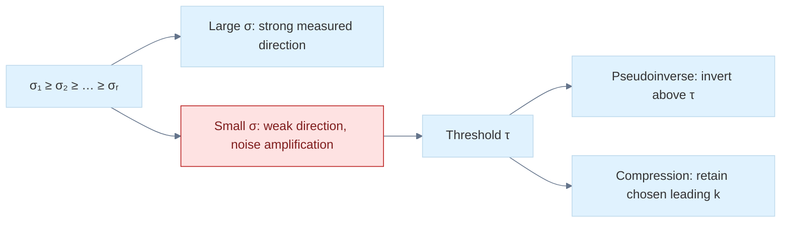

> **How to read Figure L7.** A numerical threshold is a declared modeling decision. Pseudoinversion and compression use the spectrum for different goals, even though both may discard small directions.


<!-- end V08.45 -->

<!-- begin V08.46 -->
## PCA turns a cloud of points into measured variation

[[#Centered measurements reveal principal directions|Principal component analysis]] begins with data, not with a mysterious covariance matrix. Put $N$ samples in the rows of a data table $X\in\mathbb R^{N\times d}$. Compute each feature mean and subtract it from every sample. Without centering, the dominant direction may point toward the cloud's offset from the origin instead of along the cloud's variation.

For centered $X$, sample covariance is

$$
C=\frac{1}{N-1}X^\mathsf T X.
$$

The divisor may be $N$ in a population convention; state which convention you use. For a unit direction $\mathbf v$, the projected scores are $X\mathbf v$ and their sample variance is $\mathbf v^\mathsf T C\mathbf v$. Maximizing this quadratic form under $\|\mathbf v\|_2=1$ gives an eigenvector of $C$ for the largest eigenvalue. Requiring the next component to be orthogonal gives the next eigenvector. Eigenvalues are variances along those principal directions.

There is a direct SVD route. If $X=U\Sigma V^\mathsf T$, the columns of $V$ are principal directions and the scores are $XV=U\Sigma$. Covariance eigenvalues are $\sigma_i^2/(N-1)$. This avoids explicitly forming $X^\mathsf T X$, which can improve numerical behavior for data with a wide range of scales. PCA is not automatically scale invariant: changing units of one feature changes its variance and therefore its influence. Standardization is a separate modeling decision that changes the question.

For graphics, PCA can estimate a point-cloud plane: the eigenvector for the smallest covariance eigenvalue is a candidate normal, while the other two span the best-fit plane. If the cloud is nearly a line, two small eigenvalues make the plane normal ambiguous. If the eigenvalues are close, small perturbations can rotate individual principal axes substantially even while the subspace remains stable. A useful application should reason about the eigengap and the subspace, not just print three axes.

For a minimal worked cloud, take centered samples $(-1,0)$, $(0,0)$, $(1,0)$. With divisor $N-1=2$, the covariance is $\operatorname{diag}(1,0)$. The first principal direction is horizontal and carries variance one; the perpendicular direction carries zero variance. If small vertical noise is added, the second eigenvalue becomes small rather than exactly zero. Whether it is treated as signal or discarded is a modeling decision supported by noise scale, not an algebraic truth hidden in the word “PCA.”


<!-- end V08.46 -->

<!-- begin V08.47 -->
## Centered measurements reveal principal directions

[[#Centered measurements reveal principal directions|Principal component analysis (PCA)]] asks a geometric question about a cloud of samples: along which directions does it vary most, second most, and so on? Let there be $N$ samples with $d$ measured features. Use the row-sample convention $X\in\mathbb R^{N\times d}$, so row $i$ is $x_i^\mathsf T$. Samples must be finite. The sample-covariance path requires $N\ge2$: reject empty input because the mean is undefined and reject a singleton as insufficient for an unbiased sample covariance. An API may instead explicitly choose population covariance with divisor $N$; that permits $N=1$ and returns zero covariance, but still must define empty-input behavior. The mean is $\mu=\frac1N\sum_{i=1}^N x_i$. Center each sample, $\tilde x_i=x_i-\mu$, and place those rows in $X_c$. Centering ensures $\sum_i\tilde x_i=0$. This removes translation: a cloud shifted far from the origin has the same shape and variation after centering. Without centering, the offset itself can dominate squared coordinates, causing the first component to describe location instead of spread.

A direction must be normalized before comparing its variance with another direction. For unit $v\in\mathbb R^d$, the scalar coordinate of centered sample $i$ along that direction is $z_i=v^\mathsf T\tilde x_i$. Its sample variance, using the sample convention $N-1$, is

$$
\operatorname{Var}(z)=\frac1{N-1}\sum_i(v^\mathsf T\tilde x_i)^2
=v^\mathsf T\left(\frac1{N-1}\sum_i\tilde x_i\tilde x_i^\mathsf T\right)v.
$$

The bracketed matrix is the covariance $C=X_c^\mathsf TX_c/(N-1)$. Thus variance in unit direction $v$ is the Rayleigh quotient $v^\mathsf TCv$. Maximizing this subject to $v^\mathsf Tv=1$ gives an eigenvector of $C$ for its largest eigenvalue: use a Lagrange multiplier on $v^\mathsf TCv-\lambda(v^\mathsf Tv-1)$ to obtain $Cv=\lambda v$. The largest eigenvalue is the greatest attainable variance. The second component maximizes variance subject to perpendicularity to the first; continuing gives orthonormal eigenvectors of the symmetric covariance. Eigenvalues are variances along those axes.

For a direct computation, consider the centered 2D samples $(1,1)$, $(-1,-1)$, $(1,-1)$, and $(-1,1)$. Their sample mean is zero. Summing outer products gives $X_c^\mathsf TX_c=\begin{bmatrix}4&0\\0&4\end{bmatrix}$, so with divisor $N-1=3$, $C=\frac43I$. Every direction has the same variance and no unique principal axis exists: the two eigenvalues are repeated. If the second coordinates are instead $(0.5,-0.5,-0.5,0.5)$, the sum of outer products is $\begin{bmatrix}4&0\\0&1\end{bmatrix}$ and covariance is $\operatorname{diag}(4/3,1/3)$. The horizontal axis carries four times the variance of the vertical. These calculations make the meaning of the eigenvalues concrete and show why equal or close eigenvalues make individual axes ambiguous.

The covariance entry $C_{jk}$ measures co-variation between features $j$ and $k$. Diagonal entries are individual feature variances; positive off-diagonal entries mean deviations tend to have the same sign, while negative values mean opposite signs. These terms are coordinate coupling. If $C=Q\Lambda Q^\mathsf T$ and transformed sample coordinates are $y=Q^\mathsf T(x-\mu)$, then their covariance is $Q^\mathsf TCQ=\Lambda$. The eigenbasis removes cross-covariance because all off-diagonal coupling vanishes in those coordinates. Covariance is positive semidefinite: for any $v$, $v^\mathsf TCv=\frac1{N-1}\sum_i(v^\mathsf T\tilde x_i)^2\ge0$. A zero eigenvalue therefore means there is no measured variation along its eigenvector. If points lie in a plane in 3D, the normal direction has zero variance; the two large-eigenvalue directions span the best-fit plane. With noise, the smallest-eigenvalue eigenvector remains the least-variance normal estimate, and its reliability depends on the gap between that small eigenvalue and the next one.

PCA can instead use a [[#Full, thin, and compact shapes for tall and wide matrices|singular value decomposition (SVD)]] of the centered data, $X_c=U\Sigma V^\mathsf T$. Substitute this into covariance:

$$
C=\frac{X_c^\mathsf TX_c}{N-1}
=V\frac{\Sigma^\mathsf T\Sigma}{N-1}V^\mathsf T.
$$

Because $U^\mathsf TU=I$, the right singular vectors (columns of $V$) are covariance eigenvectors, and covariance eigenvalues are $\lambda_i=\sigma_i^2/(N-1)$. Keeping the first $k$ directions in $V_k$, the principal scores are $Z=X_cV_k=U_k\Sigma_k$. An approximate reconstruction is $\hat X=ZV_k^\mathsf T+\mathbf1\mu^\mathsf T$, where the mean is added back to every row. By the Eckart–Young theorem this is the best rank-$k$ approximation in Frobenius norm. A point-cloud plane fit is the same recipe: subtract the centroid, form a 3-by-3 covariance or use data SVD, then take the eigenvector of that covariance, equivalently the right singular vector of the centered $N\times3$ sample matrix, associated with its smallest eigenvalue/singular value as the normal. Left singular vectors live in sample space $\mathbb R^N$, so they are not the 3D feature-space normal. A thin, noisy, or nearly collinear cloud may not determine a stable plane; the eigengap and noise level matter.

Feature units alter the result. If one coordinate is in millimeters and another in meters, a numerical rescaling changes covariance and therefore PCA. Standardizing each feature by a scale produces correlation-based PCA and asks a different question: relative variation after unit normalization instead of absolute physical variance. Neither convention is automatically correct. Record whether the data was centered only, centered and standardized, or weighted, since the output axes depend on that modeling decision.


<!-- end V08.47 -->

<!-- begin V08.48 -->
## Plane fits, eigengaps, and interpretation of uncertain components

For centered 3D points $x_i-\mu$, a plane through the centroid with unit normal $n$ has signed residual distance $d_i=n^\mathsf T(x_i-\mu)$. The sum of squared distances is $\sum_i d_i^2=(N-1)n^\mathsf TCn$. Minimizing it under $\|n\|=1$ selects the eigenvector for the smallest covariance eigenvalue. This is the same direction that PCA describes as having the least variance. The two other eigenvectors span the fitted plane. For example, a flat tabletop cloud might have covariance eigenvalues $0.9,0.4,0.0002$: the last direction is a clear normal candidate. If instead they are $0.9,0.4,0.39$, the two low directions are close, and the estimated normal is sensitive to small noise; there is no strong evidence separating one normal from another within that plane-like subspace. Eigenvalue magnitudes tell variance, while the gap measures axis identifiability. Reporting a normal without examining this gap can give false confidence.

The sample divisor is a convention with consequences. The unbiased sample covariance estimator uses $N-1$ when the mean is estimated from the same samples; population covariance uses $N$. This changes eigenvalues and score variance by a scalar factor but does not change eigenvectors when all features share the same divisor. Weights also change the geometric question: a weighted covariance gives more influence to selected observations. For large data, a streaming mean and covariance algorithm can avoid storing every sample, but the same centered-data interpretation still applies. If the stored matrix is rows=features rather than rows=samples, transpose formulas accordingly; writing the shape next to each product prevents accidental computation of $XX^\mathsf T$ when the intended feature covariance is $X^\mathsf TX$.


<!-- end V08.48 -->

<!-- begin V08.49 -->
## Polar decomposition separates rotation-like motion from stretch

SVD also gives the **[[#Polar decomposition separates frame dependent stretch from orientation|polar decomposition]]** of a real square matrix:

$$
A=QH,
\qquad H=(A^\mathsf T A)^{1/2},
$$

where $H$ is positive semidefinite and $Q$ is orthogonal when $A$ is nonsingular. For singular $A$, an orthogonal completion may not be unique. This is the right polar form: first apply stretch $H$, then orthogonal motion $Q$ under column-vector composition. A left polar form $A=H_LQ$ uses $H_L=(AA^\mathsf T)^{1/2}$.

The symmetric stretch can include shear in the original basis; “symmetric” does not mean “diagonal scale in the current coordinates.” If $\det A<0$, the orthogonal factor may include a reflection. It is therefore not always a pure rotation in $SO(n)$. This distinction matters in graphics where a mirrored transform changes handedness and normal orientation.

In an SVD, $H=V\Sigma V^\mathsf T$ and $Q=UV^\mathsf T$ for the nonsingular case. This makes polar decomposition a concise way to ask: what orthogonal part and what symmetric stretch combine to produce this deformation? For a deformation gradient, it separates the local rigid-like motion from strain-like change, though the exact interpretation depends on the physical model and frame.


<!-- end V08.49 -->

<!-- begin V08.50 -->
## Polar decomposition separates frame dependent stretch from orientation

The [[#Polar decomposition separates frame dependent stretch from orientation|polar decomposition]] separates a linear map into an orthogonal factor and a symmetric positive-semidefinite stretch. For square $A$, the right polar form is $A=RS$, where $R$ is orthogonal and $S$ is the right stretch. For rectangular maps the analogous orthogonal factor is a partial isometry, not a square orthogonal matrix; the square case is the one used for rotation extraction below. If $A$ is square and invertible, derive $S$ by multiplying the equation by its transpose: $A^\mathsf TA=(RS)^\mathsf T(RS)=S^\mathsf TR^\mathsf TRS=S^2$, since $S=S^\mathsf T$ and $R^\mathsf TR=I$. The positive-semidefinite square root is therefore $S=(A^\mathsf TA)^{1/2}$, and then $R=AS^{-1}$. The symmetric stretch has orthonormal principal axes: in its eigenbasis it scales each axis by a nonnegative amount, without a net rotation. The orthogonal factor carries the remaining orientation, including a possible reflection.

There is also a left polar form $A=PR$ with $P=(AA^\mathsf T)^{1/2}$. The right stretch is measured in the input or material frame; the left stretch is measured in the output or spatial frame. They are generally different matrices because the frames differ. For a concrete check, let $S=\operatorname{diag}(2,0.5)$ and let $R$ be a 30-degree rotation. Then $RS=\begin{bmatrix}\sqrt3&-0.25\\1&\sqrt3/4\end{bmatrix}$: the first coordinate is stretched by 2 and the second by one half in the principal frame, then the result is rotated. A shear can also have a nonidentity polar orthogonal factor: although the matrix is described as a shear, it changes the orientation of vectors, and polar decomposition assigns part of that change to the best orthogonal component. In deformation gradients, this split lets a model remove rigid rotation before measuring elastic strain.

From SVD, $A=U\Sigma V^\mathsf T$, regroup factors as $A=(UV^\mathsf T)(V\Sigma V^\mathsf T)$. Hence $R=UV^\mathsf T$ and $S=V\Sigma V^\mathsf T$. The first is orthogonal; the second is symmetric PSD. Also $A^\mathsf TA=V\Sigma^2V^\mathsf T$, so its positive square root is exactly $V\Sigma V^\mathsf T$. The analogous left stretch is $P=U\Sigma U^\mathsf T$, yielding $A=PR$. For nonsingular square $A$, the right polar orthogonal factor is unique. In singular directions, $A$ collapses vectors to zero, so its action cannot determine how an orthogonal factor should map those unobserved directions; completions can differ while the product remains valid.

An orthogonal matrix has determinant either $+1$ or $-1$. Only determinant $+1$ belongs to $SO(n)$, the group of proper rotations. If $UV^\mathsf T$ has determinant $-1$, it includes a reflection. Applications that require a proper rotation, such as rigid pose alignment, need an explicit nearest-$SO(n)$ rule, commonly a sign correction on a singular direction with smallest singular value; this changes the optimality problem to constrain orientation and must be stated. In this determinant-correction case, if the least singular value is repeated, multiple choices tie and the nearest proper rotation is nonunique; a zero least singular value also permits freedom in its null direction. Repeated singular values alone do not make the nearest proper rotation nonunique when no determinant correction is needed. Never label every orthogonal factor “rotation” without checking determinant.


<!-- end V08.50 -->

<!-- begin V08.51 -->
## Two-sided rotations, nearest proper rotation, and nonunique directions

Two-sided Jacobi can be understood by looking at a local $2\times2$ block $D$. First choose a right rotation $J_R$ that diagonalizes $D^\mathsf TD$; this makes the two columns of $DJ_R$ orthogonal. Then choose a left rotation $J_L$ that aligns those perpendicular columns with coordinate axes, equivalently diagonalizing $(DJ_R)(DJ_R)^\mathsf T$. The updated local block $J_L^\mathsf TDJ_R$ is diagonal up to signs. Embedded in the full identity, these rotations act on selected column and row pairs. The right transformations accumulate into $V$ and the left transformations into $U$. A sweep repeats across pairs. This local 2-by-2 SVD view explains both sides of the algorithm: right rotations remove input-direction coupling; left rotations align the corresponding output directions. Unlike one-sided Jacobi, the working matrix itself is driven toward diagonal form rather than merely toward mutually orthogonal columns.

For a square nonsingular matrix, the orthogonal polar factor $R=UV^\mathsf T$ is the closest orthogonal matrix to $A$ in Frobenius norm. To see why, for any orthogonal $W$, expand $\|A-W\|_F^2=\|A\|_F^2+\|W\|_F^2-2\operatorname{tr}(W^\mathsf TA)$. The first two terms do not depend on $W$, so minimizing distance maximizes $\operatorname{tr}(W^\mathsf TA)$. Substitute $A=U\Sigma V^\mathsf T$ and let $Z=U^\mathsf TWV$, also orthogonal. Then the trace is $\operatorname{tr}(Z^\mathsf T\Sigma)=\sum_i\sigma_i z_{ii}\le\sum_i\sigma_i$, because each diagonal entry of an orthogonal matrix is at most one. Equality is attained by $Z=I$, giving $W=UV^\mathsf T$.

If the requirement is a proper rotation with determinant $+1$, then when $\det(UV^\mathsf T)=-1$ one must force $\det Z=-1$. The best trace is then obtained by assigning the required sign reversal to a direction with smallest singular value. With singular values in descending order, let $D=\operatorname{diag}(1,\ldots,1,\det(UV^\mathsf T))$; the constrained minimizer is $R_{SO}=UDV^\mathsf T$. Its stretch/error cost reflects the smallest direction. In this determinant-correction case, a repeated least singular value gives tied sign-reversal directions and a nonunique nearest proper rotation; a zero least singular value permits freedom in its null direction. Repeated singular values alone do not imply nonuniqueness when $UV^\mathsf T$ already has determinant $+1$. This is a constrained Procrustes choice, not the same unconstrained polar orthogonal factor when that factor reflects.


<!-- end V08.51 -->

<!-- begin V08.52 -->
## How numerical software computes and checks an SVD

Reliable SVD algorithms do not usually diagonalize $A^\mathsf T A$ directly. A common route first uses Householder transformations to reduce a dense matrix to **bidiagonal** form: nonzeros remain only on the main diagonal and one neighboring diagonal. These orthogonal transformations preserve singular values while concentrating the work into a simpler structure. Golub–Kahan bidiagonalization names this reduction process; it should not be confused with every later iterative bidiagonal solver.

Jacobi SVD methods repeatedly rotate column pairs toward orthogonality. In one-sided Jacobi, the working matrix columns are orthogonalized directly and their norms become singular values; the accumulated rotations build right singular vectors. This can provide excellent relative accuracy for small singular values, but sweep counts and stopping tests must be explicit. A maximum sweep count is essential: failure to converge is an outcome to return, not a loop to hide.

After computation, sort singular values in descending order and permute corresponding columns of $U$ and $V$ together. Choose a sign convention only for presentation consistency; no sign convention removes the nonuniqueness of repeated singular subspaces. Temporal applications may need to align signs or subspaces between frames to avoid visually jumping axes.

Validation checks reconstruction and orthogonality. For a computed $A\approx U\Sigma V^\mathsf T$, use a scaled residual such as

$$
\frac{\|A-U\Sigma V^\mathsf T\|_F}
{\max(\|A\|_F,\text{safe scale})},
$$

and check $\|U^\mathsf TU-I\|$ and $\|V^\mathsf TV-I\|$ with dimensions appropriate to full or thin output. A zero input needs a defined denominator policy. Checking only column lengths is insufficient: columns can each have unit length and still fail to be mutually perpendicular. Reconstruction alone is also insufficient if factors are nonorthogonal but happen to multiply to a close matrix. Both classes of invariant matter.


<!-- end V08.52 -->


# Continuous models meet numerical computation

Differential equations lead to matrix functions and simulation. Optimization uses the derivative and solver tools already developed. Numerical analysis distinguishes the mathematical problem, the approximation and the arithmetic that executes it.

<!-- begin V09.05 -->
## ODEs and numerical simulation
### Explicit Euler: deriving a simulator from a differential equation

Consider:

$$
\dot y=f(t,y).
$$

We want to advance from time $t_n$ to:

$$
t\_{n+1}=t_n+h,
$$

where $h>0$ is the timestep.

Taylor-expand the unknown solution:

$$
y(t_n+h) = y(t_n) + h\dot y(t_n) + \frac{h^2}{2}\ddot y(t_n) +\cdots.
$$

Since:

$$
\dot y(t_n)=f(t_n,y_n),
$$

discarding second-order and higher terms gives:

$$
\boxed{ y\_{n+1}=y_n+h f(t_n,y_n) }.
$$

This is explicit Euler integration.

It is called explicit because the right side depends only on information already available at the current step.

The solver does not need to solve an equation involving the unknown $y\_{n+1}$.

##### The algorithmic state transition

A generic explicit Euler step performs these operations:

```text
Current time:  t_n
Current state: y_n

1. Evaluate slope:
      k = f(t_n, y_n)

2. Multiply by timestep:
      change = h * k

3. Update state:
      y_(n+1) = y_n + change

4. Advance time:
      t_(n+1) = t_n + h
```

The word slope refers to the state derivative. For a scalar $y$, it is a scalar. For a vector state, it is a vector of rates, one for each state component.

##### Worked example: exponential decay

Solve approximately:

$$
y'=-2y,\qquad y(0)=1.
$$

Choose:

$$
h=0.1.
$$

At the initial state:

$$
f(0,1)=-2.
$$

Euler gives:

$$
y_1=1+0.1(-2)=\boxed{0.8}.
$$

The exact solution is:

$$
y(t)=e^{-2t}.
$$

At $t=0.1$:

$$
y(0.1)=e^{-0.2}\approx0.818730753.
$$

Euler's result is too small by about $0.01873$.

For a second Euler step:

$$
f(0.1,0.8)=-1.6,
$$

so:

$$
y_2=0.8+0.1(-1.6)=0.64.
$$

The exact value at $t=0.2$ is:

$$
e^{-0.4}\approx0.670320046.
$$

The numerical error accumulates across steps.

##### Local truncation error versus global error

Euler's formula comes from discarding terms beginning at:

$$
\frac{h^2}{2}\ddot y.
$$

For a sufficiently smooth solution, the local truncation error per step, assuming an exact starting state, is:

$$
O(h^2).
$$

But over a fixed interval of duration $T$, the number of steps is proportional to $1/h$.

The accumulated global error is generally:

$$
\boxed{O(h)}.
$$

This is why Euler is called a first-order method.

Do not confuse the local order and the global order.

A numerical method can have a locally tiny error but still produce a substantial accumulated trajectory error when applied repeatedly.

#### Explicit Euler in a spring simulation

Take a unit-mass undamped spring:

$$
m=1\ \mathrm{kg}, \qquad k=4\ \mathrm{N/m}.
$$

Its acceleration is:

$$
a=-4x.
$$

Use initial state:

$$
x_0=1\ \mathrm m, \qquad v_0=0\ \mathrm{m/s},
$$

and timestep:

$$
h=0.1\ \mathrm s.
$$

Explicit Euler updates both position and velocity using the old state:

$$
x\_{n+1}=x_n+hv_n,
$$

$$
v\_{n+1}=v_n+ha_n.
$$

At the initial state:

$$
a_0=-4.
$$

Then:

$$
x_1=1+0.1(0)=\boxed{1},
$$

$$
v_1=0+0.1(-4)=\boxed{-0.4}.
$$

The new state is:

$$
\boxed{\mathbf y_1=(1,-0.4)}.
$$

Notice the physical issue. The spring has already begun pulling the mass inward, so velocity has changed, but position remains unchanged throughout the step because Euler used the original zero velocity.

That behavior is expected from the algorithm, not evidence of a software bug.

##### The energy problem

The mechanical energy of an ideal undamped spring is:

$$
E=\frac12mv^2+\frac12kx^2.
$$

Initially:

$$
E_0=0+2(1)^2=\boxed{2\ \mathrm J}.
$$

After explicit Euler:

$$
E_1= \frac12(1)(-0.4)^2+ \frac12(4)(1)^2.
$$

Therefore:

$$
E_1=0.08+2=\boxed{2.08\ \mathrm J}.
$$

The simulation has created $0.08$ joules of energy even though no external force has added energy.

This is numerical energy drift.

For the ideal harmonic oscillator, explicit Euler injects energy systematically. We will derive that behavior from its update matrix in the stability section.

### Semi-implicit Euler: why update order changes the dynamics

[[#ODEs and numerical simulation|Semi-implicit Euler]] is often called symplectic Euler or Euler–Cromer integration when applied in the appropriate canonical position-momentum formulation.

For our constant-mass spring, the velocity-first form is:

$$
\boxed{ v\_{n+1}=v_n+h a(x_n,v_n,t_n) }
$$

followed by:

$$
\boxed{ x\_{n+1}=x_n+h v\_{n+1} }.
$$

Compare this with explicit Euler, where position uses $v_n$.

The difference is only the order in which state is updated, but its long-term behavior can be dramatically different.

##### Deriving the update for the same spring

We already found:

$$
v_1=-0.4.
$$

Now position uses that updated velocity:

$$
x_1=1+0.1(-0.4).
$$

Therefore:

$$
\boxed{x_1=0.96}.
$$

The new state becomes:

$$
\boxed{\mathbf y_1=(0.96,-0.4)}.
$$

Its energy is:

$$
E_1= \frac12(0.4)^2+ 2(0.96)^2.
$$

Thus:

$$
E_1=0.08+1.8432=\boxed{1.9232\ \mathrm J}.
$$

This time the energy has decreased.

Does that mean semi-implicit Euler continuously destroys energy? No.

For an ideal harmonic oscillator in its stable regime, symplectic Euler generally produces bounded oscillatory error in the original energy rather than the systematic exponential energy growth of explicit Euler.

It does not exactly conserve the original Hamiltonian at every step.

For sufficiently small fixed steps, however, its symplectic structure provides much better qualitative long-term behavior for many Hamiltonian systems.

##### What does symplectic actually mean?

A symplectic system is naturally expressed using positions $\mathbf q$ and conjugate momenta $\mathbf p$.

Hamilton's equations are:

$$
\dot{\mathbf q}=\frac{\partial H}{\partial\mathbf p}, \qquad \dot{\mathbf p}=-\frac{\partial H}{\partial\mathbf q},
$$

where $H$ is the Hamiltonian, often corresponding to total energy.

A symplectic transformation preserves the symplectic two-form. In canonical coordinates, a differentiable update map with Jacobian $D\Phi$ is symplectic when:

$$
\boxed{ (D\Phi)^T\Omega(D\Phi)=\Omega }
$$

where:

$$
\Omega= \begin{bmatrix} 0&I\\ -I&0 \end{bmatrix}.
$$

For one position-momentum pair, this implies preservation of oriented phase-space area. In higher dimensions, symplecticity is stronger than simply preserving volume.

A symplectic integrator preserves this geometric structure at the discrete level, even though it may not preserve the exact original energy at every step.

This distinction is crucial. Symplectic does not mean perfectly energy conserving.

##### Why this matters in real engines

Graphics and physics engines often prefer stable and visually plausible long-term motion over exceptionally accurate results for one isolated timestep.

For a spring, a very accurate non-symplectic integrator may have smaller short-term trajectory error yet accumulate undesirable long-term energy drift.

A symplectic method may have lower formal order but preserve qualitative structure better over long simulations.

However, damping, nonconservative forces, variable timesteps, collision impulses, and constraint projection all complicate the simple Hamiltonian picture.

Calling an entire physics engine symplectic merely because it uses a velocity-first update would be inaccurate.

The mathematical property must be evaluated for the full implemented update.

### Midpoint integration: sampling a slope where it matters

Explicit Euler assumes the derivative throughout a timestep equals the derivative at the beginning.

But if the derivative changes significantly over the interval, this is a poor approximation.

A natural improvement is to estimate the state halfway through the interval and evaluate the derivative there.

Start with:

$$
\dot{\mathbf y}=f(t,\mathbf y).
$$

Compute the initial slope:

$$
k_1=f(t_n,\mathbf y_n).
$$

Predict a half-step state using Euler:

$$
\mathbf y\_{\mathrm{mid}} = \mathbf y_n+\frac h2k_1.
$$

Evaluate the derivative there:

$$
k_2=f\left(t_n+\frac h2,\mathbf y\_{\mathrm{mid}}\right).
$$

Finally, use that midpoint slope for the full update:

$$
\boxed{ \mathbf y\_{n+1}=\mathbf y_n+hk_2 }.
$$

This is the explicit midpoint method, a second-order Runge–Kutta method.

##### Why it is second-order

The exact solution has Taylor expansion:

$$
y(t+h) = y+hy'+\frac{h^2}{2}y''+O(h^3).
$$

Since:

$$
y'=f(t,y),
$$

the total second derivative is:

$$
y''=f_t+f_yf
$$

for a scalar equation, where $f_t$ is the partial derivative with respect to time and $f_y$ with respect to state.

The midpoint stage evaluates:

$$
k_2=f\left(t+\frac h2,y+\frac h2f\right).
$$

Taylor-expand $f$ about $(t,y)$:

$$
k_2 = f+\frac h2f_t+\frac h2f_yf+O(h^2).
$$

Multiply by $h$:

$$
hk_2 = hf+\frac{h^2}{2}(f_t+f_yf)+O(h^3).
$$

Thus:

$$
y+hk_2 = y+hy'+\frac{h^2}{2}y''+O(h^3).
$$

The terms match the exact Taylor expansion through second order.

The local truncation error is $O(h^3)$, and the global error is generally $O(h^2)$.

##### Worked example: midpoint integration update

Return to:

$$
y'=-2y,\qquad y_0=1,\qquad h=0.1.
$$

First slope:

$$
k_1=-2.
$$

Midpoint state:

$$
y\_{\mathrm{mid}} = 1+\frac{0.1}{2}(-2) =0.9.
$$

Midpoint slope:

$$
k_2=-2(0.9)=-1.8.
$$

Full update:

$$
y_1=1+0.1(-1.8)=\boxed{0.82}.
$$

The exact value is approximately $0.818730753$.

Midpoint is much closer than Euler's $0.8$.

### Runge–Kutta second order: a family, not one formula

There is an important distinction between the explicit midpoint method and the broader RK2 family.

Both explicit midpoint and Heun's method are second-order Runge–Kutta schemes, but they use different intermediate stages and weights.

We have already derived explicit midpoint:

$$
k_1=f(t_n,y_n),
$$

$$
k_2=f(t_n+h/2,y_n+hk_1/2),
$$

$$
y\_{n+1}=y_n+hk_2.
$$

Heun's explicit trapezoidal method instead predicts the endpoint slope:

$$
k_1=f(t_n,y_n),
$$

$$
k_2=f(t_n+h,y_n+hk_1),
$$

then averages the two slopes:

$$
\boxed{ y\_{n+1} = y_n+\frac h2(k_1+k_2) }.
$$

For $y'=-2y$, $y_0=1$, and $h=0.1$:

$$
k_1=-2.
$$

The predicted endpoint is:

$$
y\_{\mathrm{predicted}}=1-0.2=0.8.
$$

The endpoint derivative is:

$$
k_2=-2(0.8)=-1.6.
$$

Average slopes:

$$
\frac{k_1+k_2}{2}=-1.8.
$$

Therefore:

$$
y_1=1-0.18=\boxed{0.82}.
$$

For this linear autonomous equation, both midpoint RK2 and Heun produce the same one-step result. For general nonlinear or explicitly time-dependent equations, their intermediate stages and numerical results can differ.

##### Butcher tableaux: representing Runge–Kutta methods as data

A general Runge–Kutta method uses several derivative evaluations, called stages.

The generic equations are:

$$
k_i= f\left( t_n+c_ih,\\, y_n+h\sum\_{j=1}^{s}a\_{ij}k_j \right),
$$

$$
\boxed{ y\_{n+1} = y_n+h\sum\_{i=1}^{s}b_ik_i }.
$$

The coefficients $a\_{ij}$, $b_i$, and $c_i$ define the method.

For explicit methods, stage $i$ depends only on earlier stages $j\<i$, so its coefficient matrix is strictly lower triangular.

For implicit methods, a stage may depend on itself or another stage whose value has not yet been determined, requiring a simultaneous or nonlinear solve.

A Butcher tableau stores these coefficients. For explicit midpoint:

$$
\begin{array}{c|cc} 0&0&0\\ \frac12&\frac12&0\\ \hline &0&1 \end{array}
$$

For Heun's method:

$$
\begin{array}{c|cc} 0&0&0\\ 1&1&0\\ \hline &\frac12&\frac12 \end{array}
$$

The bottom row contains the weights used to combine the stage derivatives. The entries on the left identify stage times as fractions of $h$.

This representation is useful for implementing a generic family of Runge–Kutta integrators, checking order conditions, and comparing numerical methods without hardcoding every formula separately.

### Classical fourth-order Runge–Kutta

The classical RK4 method estimates the state derivative four times within a timestep.

Its stages are:

$$
\boxed{ \begin{aligned} k_1&=f(t_n,y_n),\\ k_2&=f(t_n+h/2,y_n+hk_1/2),\\ k_3&=f(t_n+h/2,y_n+hk_2/2),\\ k_4&=f(t_n+h,y_n+hk_3). \end{aligned} }
$$

The final update is:

$$
\boxed{ y\_{n+1} = y_n+\frac h6(k_1+2k_2+2k_3+k_4) }.
$$

The weights are $1,2,2,1$, divided by six.

Do not confuse RK4 with Simpson's quadrature, even though the weight patterns look related. RK4 must account for the fact that the integrand $f(t,y(t))$ depends on the evolving state, and the intermediate stage states are themselves approximations.

The RK4 coefficients are selected so the resulting update matches the exact solution's Taylor expansion through order four, subject to the required Runge–Kutta order conditions.

##### A complete numerical trace

Again use:

$$
y'=-2y,\qquad y(0)=1,\qquad h=0.1.
$$

The first slope is:

$$
k_1=-2(1)=-2.
$$

For the second slope, predict a half-step using $k_1$:

$$
y+\frac h2k_1 = 1+0.05(-2)=0.9.
$$

Thus:

$$
k_2=-2(0.9)=-1.8.
$$

For the third slope, use $k_2$:

$$
y+\frac h2k_2 = 1+0.05(-1.8)=0.91.
$$

Therefore:

$$
k_3=-2(0.91)=-1.82.
$$

For the fourth slope, use $k_3$ to predict a full-step endpoint:

$$
y+hk_3=1+0.1(-1.82)=0.818.
$$

Thus:

$$
k_4=-2(0.818)=-1.636.
$$

Combine the stages:

$$
\begin{aligned} y_1 &=1+\frac{0.1}{6} [-2+2(-1.8)+2(-1.82)-1.636]\\ &=1+\frac{0.1}{6}(-10.876)\\ &=\boxed{0.818733333}. \end{aligned}
$$

The exact answer is:

$$
e^{-0.2}\approx0.818730753.
$$

The absolute error is approximately:

$$
2.58\times10^{-6}.
$$

For this small example, the order improvement is dramatic.

##### Where the $1,2,2,1$ structure comes from

The classical RK4 Butcher tableau is:

$$
\begin{array}{c|cccc} 0&0&0&0&0\\ \frac12&\frac12&0&0&0\\ \frac12&0&\frac12&0&0\\ 1&0&0&1&0\\ \hline &\frac16&\frac13&\frac13&\frac16 \end{array}
$$

The weight constraints include:

$$
\sum b_i=1,
$$

$$
\sum b_ic_i=\frac12,
$$

$$
\sum b_ic_i^2=\frac13,
$$

$$
\sum b_ic_i^3=\frac14.
$$

Additional coupled conditions are needed because the stages depend on the state as well as time, such as:

$$
\sum\_{i,j}b_i a\_{ij}c_j=\frac16.
$$

These are examples of Runge–Kutta order conditions. The full fourth-order conditions ensure the method agrees with the appropriate rooted-tree terms of the exact solution expansion.

This explains why simply evaluating a derivative four times at arbitrary locations does not produce a fourth-order integrator.

The stage locations and weights must satisfy specific algebraic relationships.

##### Computational cost

Classical RK4 evaluates the right-hand side four times per step.

For a scalar equation, this is inexpensive. For a large deformable-body simulation, each evaluation may require traversing many particles, springs, tetrahedra, or force terms.

RK4 also creates intermediate states. If a state is stored as a vector of $N$ floating-point values, these stages involve substantial memory traffic unless carefully organized.

If an ODE function costs $C_f$, the method's leading computation cost per step is approximately $4C_f$, plus vector arithmetic and temporary storage.

Thus, the number of stable and accurate steps needed for a target simulation matters more than the cost of any one step.

A fourth-order method may outperform Euler for a given accuracy requirement by taking far fewer steps, but that is workload-dependent rather than guaranteed.

### Numerical integrator stability

Accuracy and stability are not the same property.

A method can be formally high-order yet behave catastrophically if its timestep is outside its stability region.

To understand this, we examine the standard linear test equation:

$$
\boxed{y'=\lambda y},
$$

where $\lambda$ may be a real or complex constant.

The exact solution is:

$$
y(t)=y_0e^{\lambda t}.
$$

If $\operatorname{Re}(\lambda)<0$, the exact solution decays.

A sensible numerical method should reproduce that decay for appropriate timesteps.

#### Euler's amplification factor

Explicit Euler gives:

$$
y\_{n+1}=y_n+h\lambda y_n.
$$

Factor out $y_n$:

$$
\boxed{ y\_{n+1}=(1+h\lambda)y_n }.
$$

Define:

$$
z=h\lambda.
$$

The amplification factor is:

$$
R(z)=1+z.
$$

Repeated steps produce:

$$
y_n=R(z)^ny_0.
$$

If:

$$
|R(z)|<1,
$$

the numerical solution decays toward zero.

If:

$$
|R(z)|>1,
$$

its magnitude grows.

Thus, the absolute-stability region of explicit Euler is:

$$
\boxed{|1+z|\le1}.
$$

In the complex plane, this is a disk of radius one centered at $-1$.

##### Deriving Euler's stability condition for decay

Let:

$$
\lambda=-\alpha,\qquad\alpha>0.
$$

Then:

$$
R=1-\alpha h.
$$

For strict numerical decay:

$$
|1-\alpha h|<1.
$$

This gives:

$$
-1<1-\alpha h<1.
$$

Subtract one:

$$
-2<-\alpha h<0.
$$

Multiply by $-1$, reversing inequalities:

$$
0<\alpha h<2.
$$

Therefore:

$$
\boxed{ 0\<h<\frac2\alpha }.
$$

For:

$$
y'=-1000y,
$$

explicit Euler needs:

$$
\boxed{h<0.002}
$$

for strict decay of the numerical solution.

A large timestep can cause the numerical result to oscillate or diverge even though the exact physical solution decays smoothly.

##### Why explicit Euler destabilizes an ideal spring

For the harmonic oscillator:

$$
\dot{\mathbf y}=A\mathbf y,
$$

where:

$$
A= \begin{bmatrix} 0&1\\ -\omega^2&0 \end{bmatrix}.
$$

Explicit Euler produces:

$$
\mathbf y\_{n+1}=(I+hA)\mathbf y_n.
$$

Its update matrix is:

$$
\boxed{ M_E= \begin{bmatrix} 1&h\\ -h\omega^2&1 \end{bmatrix} }.
$$

Since the eigenvalues of $A$ are $\pm i\omega$, the update-matrix eigenvalues are:

$$
\mu\_\pm=1\pm ih\omega.
$$

Their magnitudes are:

$$
|\mu\_\pm| = \sqrt{1+h^2\omega^2}.
$$

For any positive $h\omega$:

$$
\boxed{|\mu\_\pm|>1}.
$$

Therefore explicit Euler is unstable for the ideal harmonic oscillator for every positive fixed timestep.

Making the timestep smaller slows the energy growth, but does not remove the underlying instability.

##### Semi-implicit Euler stability for the harmonic oscillator

The velocity-first update is:

$$
v\_{n+1}=v_n-h\omega^2x_n,
$$

$$
x\_{n+1}=x_n+hv\_{n+1}.
$$

Substitute the velocity update into position:

$$
x\_{n+1} =(1-h^2\omega^2)x_n+hv_n.
$$

The matrix is:

$$
\boxed{ M_S= \begin{bmatrix} 1-h^2\omega^2&h\\ -h\omega^2&1 \end{bmatrix} }.
$$

Its determinant is:

$$
\det M_S =(1-h^2\omega^2)+h^2\omega^2=1.
$$

The product of its eigenvalues is one.

Its trace is:

$$
\operatorname{tr}(M_S)=2-h^2\omega^2.
$$

When:

$$
-2<\operatorname{tr}(M_S)<2,
$$

the two eigenvalues are complex conjugates on the unit circle.

That condition becomes:

$$
-2<2-h^2\omega^2<2.
$$

For $h>0$, this yields:

$$
\boxed{0\<h\omega<2}.
$$

Inside this interval, the linear oscillator update has bounded oscillatory behavior. At the endpoints, repeated-root cases require special care and can exhibit secular growth; the strict inequality is the relevant generic stable regime.

This is a genuine mathematical reason why velocity-first Euler often behaves better for spring-like Hamiltonian systems.

It is not merely an implementation preference.

#### RK2, RK4, and their stability polynomials

For the scalar linear test equation $y'=\lambda y$, explicit midpoint and Heun's RK2 both have stability function:

$$
\boxed{ R\_{\mathrm{RK2}}(z)=1+z+\frac{z^2}{2} }.
$$

Classical RK4 has:

$$
\boxed{ R\_{\mathrm{RK4}}(z)= 1+z+\frac{z^2}{2} +\frac{z^3}{6} +\frac{z^4}{24} }.
$$

These are truncated exponential series.

The exact amplification over a timestep is:

$$
e^z.
$$

RK4 approximates it to fourth order, but its polynomial does not have magnitude at most one across the entire left half-plane.

Therefore RK4 is not unconditionally stable for stiff decaying problems.

For a purely imaginary eigenvalue $z=i\eta$, classical RK4 has a finite stability interval along the imaginary axis, extending to:

$$
|\eta|\le2\sqrt2.
$$

This is relevant to oscillatory systems, but stability of individual modes is not the same as long-term geometric fidelity or exact energy conservation.

#### Consistency, stability, and convergence

These words are frequently used interchangeably in informal discussions, but they represent different properties.

Consistency asks whether the numerical update approaches the differential equation as the timestep tends to zero.

Stability asks whether numerical perturbations are controlled rather than growing improperly under the method and problem conditions.

Convergence asks whether the computed solution approaches the true solution as the timestep decreases.

For a well-posed [[#ODEs and numerical simulation|initial-value problem]] and an appropriate stable, consistent numerical method, these properties combine to justify convergence.

For linear multistep methods, the relationship is captured by the Dahlquist equivalence theorem under its assumptions. It should not be generalized carelessly to arbitrary nonlinear, hybrid, or discontinuous simulations.

A practical engineer must examine all three properties, not merely the nominal method order.

![[Visual Recall/Math Foundations/F09-4_oscillator-energy.png]]

**F09-4. Energy behavior for the stated harmonic-oscillator step size.** At h=0.1 for 80 periods, explicit Euler energy reaches about 2.62e21, semi-implicit Euler stays in [0.47619,0.526316], and RK4 ends near 0.499965. This is the plotted setup, not a universal ranking.

### Stiff differential equations

Stiffness is one of the most misunderstood numerical simulation concepts.

A stiff problem is not necessarily one whose solution changes rapidly all the time.

Instead, it is often a problem containing fast-decaying modes that severely constrain the timestep of explicit integration, even when the behavior we want to observe occurs on a much slower timescale.

Consider:

$$
y'=-1000y.
$$

The exact solution is:

$$
y(t)=y_0e^{-1000t}.
$$

Starting at $y_0=1$, the solution rapidly decays toward zero.

After a short transient, the solution is essentially flat.

Yet explicit Euler still requires $h<0.002$ for stable decay.

If our goal is to simulate behavior over several seconds, that restriction can force many unnecessary tiny timesteps after the transient is already negligible.

That is a characteristic stiffness problem.

##### Multiple timescales

Suppose:

$$
\dot{\mathbf y}= \begin{bmatrix} -1&0\\ 0&-1000 \end{bmatrix}\mathbf y.
$$

The first component decays on a timescale of roughly one second.

The second decays on a timescale of roughly one millisecond.

If we use explicit Euler, the fast mode imposes a timestep restriction even after that mode's amplitude is tiny.

But the slow component might need to be observed for several seconds.

The numerical solver is forced to resolve a timescale that may no longer be important to the requested output.

The practical stiffness criterion depends on the numerical method, requested accuracy, timescale separation, and system dynamics. The mere presence of a large coefficient does not universally define stiffness.

##### Backward Euler: an implicit alternative

Instead of evaluating the derivative at the current state:

$$
y\_{n+1}=y_n+hf(t_n,y_n),
$$

backward Euler evaluates it at the unknown future state:

$$
\boxed{ y\_{n+1}=y_n+hf(t\_{n+1},y\_{n+1}) }.
$$

The method is implicit because $y\_{n+1}$ appears on both sides.

For:

$$
y'=-\alpha y,
$$

we obtain:

$$
y\_{n+1}=y_n-h\alpha y\_{n+1}.
$$

Collect the future-state terms:

$$
y\_{n+1}(1+h\alpha)=y_n.
$$

Therefore:

$$
\boxed{ y\_{n+1}=\frac{y_n}{1+h\alpha} }.
$$

Its stability function is:

$$
R(z)=\frac1{1-z}.
$$

For any real $\alpha>0$ and $h>0$:

$$
0<\frac1{1+h\alpha}<1.
$$

So backward Euler remains stable for arbitrarily large positive timesteps on this scalar decay problem.

It is also A-stable for the scalar linear test equation, and L-stable, meaning its amplification tends to zero as $z$ moves deep into the stable left half-plane.

But unconditional stability does not mean unconditional accuracy.

For $y'=-1000y$ and $h=0.1$, backward Euler produces:

$$
y_1=\frac1{101}\approx0.00990099.
$$

The exact value is:

$$
e^{-100}\approx3.72\times10^{-44}.
$$

Backward Euler does not blow up, but the one-step approximation to the transient is extremely inaccurate.

It can still be useful when that transient is intentionally unresolved and accurate slow dynamics are the priority.

##### Why implicit integration is expensive

For a general vector ODE, define:

$$
G(\mathbf y\_{n+1}) = \mathbf y\_{n+1}-\mathbf y_n -hf(t\_{n+1},\mathbf y\_{n+1}).
$$

We need to solve:

$$
G(\mathbf y\_{n+1})=0.
$$

Newton's method linearizes this nonlinear equation.

Its Jacobian is:

$$
\frac{\partial G}{\partial\mathbf y} = I-h\frac{\partial f}{\partial\mathbf y}.
$$

At iteration $k$, solve:

$$
\boxed{ \left(I-hJ_f(\mathbf y^{(k)})\right)\Delta\mathbf y = -G(\mathbf y^{(k)}) }.
$$

Then update:

$$
\mathbf y^{(k+1)}=\mathbf y^{(k)}+\Delta\mathbf y.
$$

This can require sparse matrix assembly, factorization, iterative linear solves, and preconditioning.

Now Phases 8 and 9 become tightly linked. Cholesky, LDLT, sparse solvers, Jacobians, conditioning, and Newton methods are not separate topics. They are components of implicit physical simulation.

##### Stiff systems in graphics and simulation

Soft-body mechanics provides an important example. Very stiff springs have high natural frequencies, and explicit integration may require extremely small timesteps.

Contact constraints, high-frequency elastic modes, strong damping, and discretized partial differential equations can create similar numerical restrictions.

Implicit methods can permit larger stable timesteps, but they may introduce numerical damping, smooth over fast physical phenomena, or increase solve cost significantly.

Practical scientific software uses specialized methods rather than applying RK4 universally. For example, SUNDIALS provides CVODE for nonstiff and stiff ODE systems, including Adams and backward-differentiation methods. CVODES adds forward and adjoint sensitivity analysis.&#x20;

[image](https://www.google.com/s2/favicons?domain=https://sundials.readthedocs.io\&sz=32)

Documentation for SUNDIALS documentation+1


Similarly, SciPy's `solve_ivp` documentation distinguishes explicit Runge–Kutta methods for nonstiff problems from implicit methods such as Radau and BDF for stiff problems.&#x20;

[image](https://www.google.com/s2/favicons?domain=https://scipy.github.io\&sz=32)

SciPy v2.0.0.dev Manual


##### More advanced integration techniques worth connecting

The original Parts 832–846 establish the foundation, but several additional mechanisms belong in the broader mental model.

Adaptive timestep control estimates local numerical error and adjusts $h$. If the estimated error is too large, the step is rejected and retried with a smaller timestep. Embedded Runge–Kutta pairs, such as RK4(5) families, reuse stage information to obtain two approximations of different orders and estimate error. A typical controller uses a step-scaling relation involving $(\text{tolerance}/\text{error})^{1/(p+1)}$, with safety factors and limits.

Verlet integration uses a position-based recurrence. For constant timestep and suitable acceleration evaluation:

$$
x\_{n+1}=2x_n-x\_{n-1}+h^2a_n.
$$

It can provide useful time-reversible and long-term behavior for certain mechanical systems, but variable timesteps, damping, constraints, and velocity reconstruction require additional care.

Velocity Verlet updates position with current velocity and acceleration, then evaluates the new acceleration to update velocity:

$$
x\_{n+1}=x_n+hv_n+\frac{h^2}{2}a_n,
$$

$$
v\_{n+1}=v_n+\frac h2(a_n+a\_{n+1}).
$$

For forces depending only on position in standard separable Hamiltonian systems, it is a second-order symplectic method.

Differential-algebraic equations, or DAEs, combine differential dynamics with algebraic constraints. For example:

$$
\dot{\mathbf y}=f(\mathbf y,\boldsymbol\lambda), \qquad g(\mathbf y)=0.
$$

The multipliers $\boldsymbol\lambda$ may enforce contact or geometric constraints. These systems require additional methods beyond simply treating every constraint as another explicit force.

Event handling is necessary when the dynamics change at a collision, activation threshold, or switching surface. The simulator may need to locate the event time within a step, update state discontinuously according to a reset law, and resume integration under a different regime.

Multirate integration uses different step resolutions for subsystems with different physical timescales. It can be more efficient than forcing the entire system to use the timestep required by its fastest component, but coupling and synchronization make it substantially more complex.

### Production C++23: numerical quadrature and ODE integrators

We will implement the mathematical mechanisms directly rather than hiding them behind a numerical library.

The key distinction is that quadrature evaluates a known function of the integration variable, whereas an ODE integrator evaluates a derivative law that depends on the evolving state.

#### Explicit, semi-implicit, midpoint, Heun, and RK4 implementations

The following code uses a two-component mechanical state:

```cpp
struct State {
    double x; // Position in metres
    double v; // Velocity in metres/second
};
```

Its time derivative is another two-component object:

```cpp
State derivative(double t, State state) {
    // For a mass-spring system:
    // dx/dt = velocity
    // dv/dt = acceleration
    return {state.v, -4.0 * state.x};
}
```

Notice that the first returned component is velocity and the second is acceleration. The derivative object has different physical units from the state even though they share the same structural representation. This is convenient for a compact numerical demonstration, but a more strongly typed physics API may distinguish position, velocity, acceleration, and their units explicitly.

Here is the integrator implementation:

```cpp
// Vector-like arithmetic on a 2D simulation state.
// These operators are useful because Runge-Kutta formulas are
// written in terms of state addition and scalar multiplication.

struct State {
    double x{}; // m
    double v{}; // m/s
};

State operator+(State a, State b) {
    return {a.x + b.x, a.v + b.v};
}

State operator*(double c, State a) {
    return {c * a.x, c * a.v};
}

// Explicit Euler: the entire derivative comes from the old state.
// Global error: first order, under standard smoothness/stability conditions.
template<class RHS>
State explicitEuler(
    RHS rhs, double t, State y, double h
) {
    const State k1 = rhs(t, y);
    return y + h * k1;
}

// Explicit midpoint RK2: predict halfway, sample derivative there.
// Global error: second order.
template<class RHS>
State midpointRK2(
    RHS rhs, double t, State y, double h
) {
    const State k1 = rhs(t, y);

    const State midpointState = y + (h / 2.0) * k1;

    const State k2 = rhs(t + h / 2.0, midpointState);

    return y + h * k2;
}

// Heun RK2: average derivatives at initial and predicted end.
// Also second-order, but with different stage selection.
template<class RHS>
State heunRK2(
    RHS rhs, double t, State y, double h
) {
    const State k1 = rhs(t, y);

    const State endpointPrediction = y + h * k1;

    const State k2 = rhs(t + h, endpointPrediction);

    return y + (h / 2.0) * (k1 + k2);
}

// Classical RK4: four derivative evaluations per timestep.
// Global error: fourth order for sufficiently regular problems.
template<class RHS>
State rungeKutta4(
    RHS rhs, double t, State y, double h
) {
    const State k1 = rhs(t, y);

    const State k2 = rhs(
        t + h / 2.0,
        y + (h / 2.0) * k1
    );

    const State k3 = rhs(
        t + h / 2.0,
        y + (h / 2.0) * k2
    );

    const State k4 = rhs(
        t + h,
        y + h * k3
    );

    return y + (h / 6.0) *
        (k1 + 2.0 * k2 + 2.0 * k3 + k4);
}
```

Each method follows the same external contract: take a state and a timestep, evaluate the derivative law, and return a new state.

But their internal derivative sampling differs.

Explicit Euler performs one derivative evaluation. Both midpoint and Heun perform two. Classical RK4 performs four.

The staged derivatives are not merely repeated evaluations of the same function at the same state. Each stage is evaluated at a specifically constructed predicted state and time.

That is what produces the additional accuracy.

##### Semi-implicit Euler as a distinct mechanical update

Semi-implicit Euler is not merely another generic Runge–Kutta combination.

For a mechanical state with:

$$
x'=v,\qquad v'=a(t,x,v),
$$

we can implement velocity-first integration:

```cpp
template<class Acceleration>
State semiImplicitEuler(
    Acceleration acceleration,
    double t,
    State state,
    double h
) {
    // 1. Evaluate acceleration using the current physical state.
    const double a = acceleration(t, state);

    // 2. Advance velocity first.
    state.v += h * a;

    // 3. Advance position using the updated velocity.
    state.x += h * state.v;

    return state;
}
```

This intentionally assumes a particular mechanical state structure. A generic `RHS(t, y)` abstraction does not automatically tell the integrator which component represents position and which component represents velocity.

For production physics, this distinction affects interface design. A generic ODE solver can treat the state as an arbitrary vector, but a specialized physics integrator may exploit the canonical position-momentum structure to preserve useful geometric properties.

### Actual repository: KairoPhysicsMath's integration methods — source claims pending independent repository verification

The supplied source claims to inspect [KairoPhysicsMath/Integrators.cppm](https://github.com/swayam8624/KairoPhysicsMath/blob/main/Integrators.cppm?utm_source=chatgpt.com) on the repository's current default branch.

It already contains explicit Euler, semi-implicit Euler, position Verlet, scalar RK2, scalar RK4, and quaternion orientation integration.

The source claims `ExplicitEuler` updates position and orientation using the existing velocities, then updates linear and angular velocities using acceleration; this implementation detail is unverified here.

Conceptually, its execution order is:

```cpp
state.Position += state.LinearVelocity * dt;
state.Rotation = IntegrateAngularVelocity(
    state.Rotation, state.AngularVelocity, dt
);
state.LinearVelocity += linearAcceleration * dt;
state.AngularVelocity += angularAcceleration * dt;
```

The source-described `SemiImplicitEuler` function instead updates linear and angular velocities first:

```cpp
state.LinearVelocity += linearAcceleration * dt;
state.AngularVelocity += angularAcceleration * dt;
state.Position += state.LinearVelocity * dt;
state.Rotation = IntegrateAngularVelocity(
    state.Rotation, state.AngularVelocity, dt
);
```

If the supplied source description is accurate, the two functions implement different state-update orderings; the repository code has not been inspected here.

Your quaternion orientation integration computes an angular-velocity-based quaternion derivative and normalizes the resulting quaternion. The derivative has the form:

$$
\dot q=\frac12\omega_q q
$$

for the selected multiplication convention.

The quaternion is then advanced using a first-order Euler step and normalized to control unit-length drift.

This is not equivalent to an exact finite-angle exponential-map update. Quaternion normalization repairs unit length but does not eliminate all integration error in orientation.

Also, whether $\omega_q q$ or $q\omega_q$ is appropriate depends on how angular velocity is represented relative to the rotation convention. The implementation must remain consistent about world-frame versus body-frame angular velocity.

Your scalar `RK2` and `RK4` implementations accept a derivative function called with only the current scalar state. This means they directly support autonomous scalar equations of the form:

$$
y'=f(y).
$$

They do not directly represent the general nonautonomous vector equation:

$$
\mathbf y'=f(t,\mathbf y)
$$

through their current interface.

That is an API coverage distinction, not a claim that the existing implementation is incorrect.

Another detail worth preserving in your tests is that `VerletPosition` uses the recurrence:

$$
x\_{n+1}=x_n+(x_n-x\_{n-1})+h^2a_n.
$$

This is the standard constant-timestep position Verlet structure. Applying it unchanged to varying timesteps does not generally preserve the intended approximation order.

The existing `RequirePositive(dt)` checks also mean that zero-duration steps are rejected by those helpers. A higher-level simulation loop must decide whether a zero-delta frame should be skipped before calling the integrator.

These are precisely the kinds of repository-level details that generic numerical-analysis explanations do not reveal.


We have now learned how to simulate a differential equation: we start from a state, calculate its rate of change, and advance the state using numerical integration.

But what if we want to ask:

How would the resulting trajectory change if the spring were stiffer? What happens to a Gaussian's projected footprint if we alter its covariance? How does a reconstruction loss change when the camera rotates? How should an optimizer modify the parameters of a differentiable renderer?

All these questions require derivatives of computations, not necessarily derivatives of functions whose formulas we can manipulate symbolically by hand.

That creates a new problem: how do we obtain trustworthy derivatives from actual programs?

There are three major approaches.

Symbolic differentiation manipulates mathematical expressions to derive new expressions.

Numerical differentiation evaluates a function at nearby inputs and estimates the derivative using finite differences.

Automatic differentiation, or AD, propagates derivatives through the sequence of elementary operations executed by a program.

They have different accuracy properties, computational costs, memory requirements, and failure modes.

#### Finite differences: approximating derivatives from samples

In M049, we defined the derivative as a limit:

$$
f'(x)= \lim\_{h\to0} \frac{f(x+h)-f(x)}h.
$$

This is an exact mathematical definition.

A finite-difference method replaces the limit with a small but nonzero step size $h$.

Why would we do that?

Suppose a renderer exposes a function:

```cpp
double evaluateImageLoss(const SceneParameters& parameters);
```

We may not know its complete symbolic derivative. It could execute thousands of operations, including matrix multiplication, perspective projection, shading, and visibility calculations.

But we can evaluate its output at slightly different parameter values.

If changing a camera parameter by $h$ changes the loss by $\Delta L$, then:

$$
\frac{\Delta L}{h}
$$

provides an approximation of the derivative.

This makes finite differences extremely general. The internal code does not need to expose its algebraic structure.

However, that generality comes with limitations. Finite differences can be expensive, numerically sensitive, and inaccurate near discontinuities or singularities.

The critical variable is the finite step $h$.

A too-large step measures average behavior over a region rather than the local derivative. A too-small step amplifies floating-point error.

We need to derive that trade-off rather than blindly choose a value such as $10^{-6}$.

#### Forward finite differences

The forward-difference formula is:

$$
\boxed{ D_h^+f(x)=\frac{f(x+h)-f(x)}h }.
$$

This estimates the derivative using the current point and a point slightly ahead.

##### Deriving the error

Expand $f(x+h)$ using Taylor's theorem:

$$
f(x+h) = f(x)+hf'(x)+ \frac{h^2}{2}f''(x)+ \frac{h^3}{6}f'''(x)+O(h^4).
$$

Subtract $f(x)$:

$$
f(x+h)-f(x) = hf'(x)+ \frac{h^2}{2}f''(x)+ \frac{h^3}{6}f'''(x)+O(h^4).
$$

Divide by $h$:

$$
\frac{f(x+h)-f(x)}h = f'(x)+ \frac h2f''(x)+ \frac{h^2}{6}f'''(x)+O(h^3).
$$

Therefore:

$$
\boxed{ D_h^+f(x)-f'(x) = \frac h2f''(x)+O(h^2) }.
$$

The dominant truncation error is proportional to $h$.

This is why forward finite differences are first-order accurate.

##### Numerical example: forward-difference error

Let:

$$
f(x)=\sin x.
$$

We know analytically:

$$
f'(x)=\cos x.
$$

At $x=1$:

$$
f'(1)=\cos1\approx0.540302306.
$$

Take $h=0.1$.

The forward difference is:

$$
D\_{0.1}^+f(1)= \frac{\sin(1.1)-\sin(1)}{0.1}.
$$

Using:

$$
\sin1.1\approx0.891207360,
$$

$$
\sin1\approx0.841470985,
$$

we obtain:

$$
\boxed{ D\_{0.1}^+f(1)\approx0.497363753 }.
$$

The error is approximately:

$$
-0.042938553.
$$

For this relatively large step, the approximation is noticeably inaccurate.

#### Backward finite differences

The backward-difference formula is:

$$
\boxed{ D_h^-f(x)= \frac{f(x)-f(x-h)}h }.
$$

It uses the current point and a sample behind it.

Taylor-expand:

$$
f(x-h) = f(x)-hf'(x)+ \frac{h^2}{2}f''(x)- \frac{h^3}{6}f'''(x)+O(h^4).
$$

Subtract it from $f(x)$, then divide by $h$:

$$
D_h^-f(x) = f'(x)- \frac h2f''(x)+ \frac{h^2}{6}f'''(x)+O(h^3).
$$

Therefore:

$$
\boxed{ D_h^-f(x)-f'(x) = -\frac h2f''(x)+O(h^2) }.
$$

Backward differences are also first-order accurate.

They are especially useful when only past samples exist, such as when estimating velocity from a real-time stream without access to future measurements.

For example:

$$
v_n\approx\frac{x_n-x\_{n-1}}h.
$$

This estimates velocity using the current and previous positions.

It is a numerical approximation, not a literal replacement for instantaneous velocity. Its accuracy depends on the trajectory's smoothness and the sample interval.

##### Example using sine

At $x=1$, with $h=0.1$:

$$
D\_{0.1}^-f(1) = \frac{\sin1-\sin0.9}{0.1}.
$$

With:

$$
\sin0.9\approx0.783326910,
$$

we obtain:

$$
\boxed{ D\_{0.1}^-f(1)\approx0.581440752 }.
$$

The true derivative is approximately $0.540302306$.

The forward difference underestimated it, while the backward difference overestimated it.

This suggests using information on both sides to cancel the dominant errors.

#### Central finite differences

The central-difference formula is:

$$
\boxed{ D_h^0f(x)= \frac{f(x+h)-f(x-h)}{2h} }.
$$

It samples the function symmetrically around the evaluation point.

##### Deriving the second-order accuracy

Taylor-expand both sides:

$$
f(x+h)= f(x)+hf'(x)+ \frac{h^2}{2}f''(x)+ \frac{h^3}{6}f'''(x)+O(h^4),
$$

$$
f(x-h)= f(x)-hf'(x)+ \frac{h^2}{2}f''(x)- \frac{h^3}{6}f'''(x)+O(h^4).
$$

Subtract:

$$
f(x+h)-f(x-h) = 2hf'(x)+\frac{h^3}{3}f'''(x)+O(h^5)
$$

when sufficiently many derivatives exist.

Divide by $2h$:

$$
\boxed{ D_h^0f(x) = f'(x)+ \frac{h^2}{6}f'''(x)+O(h^4) }.
$$

The first-order error cancels because the samples are symmetric.

Thus, central differences are second-order accurate.

##### Numerical example: central-difference error

Again let:

$$
f(x)=\sin x,\qquad x=1,\qquad h=0.1.
$$

Then:

$$
D\_{0.1}^0f(1) = \frac{\sin1.1-\sin0.9}{0.2}.
$$

Numerically:

$$
\boxed{ D\_{0.1}^0f(1)\approx0.539402252 }.
$$

The true derivative is:

$$
0.540302306.
$$

The error is about:

$$
-0.000900054.
$$

Central differences are substantially more accurate here than either one-sided method.

But this improvement costs two function evaluations at nearby inputs, compared with one new evaluation for a one-sided derivative if the value $f(x)$ is already cached.

![[Visual Recall/Math Foundations/F09-6_finite-difference-error.png]]

**F09-6. Central-difference truncation and roundoff for sin(x) at x=0.7.** The analytic derivative is cos(0.7), about 0.7648422; the best sampled step has error about 8.94e-13. Guide curves are qualitative.

#### Why an extremely tiny step size can make finite differences worse

This is one of the most important numerical-analysis lessons in M052.

A floating-point computer does not evaluate $f(x)$ exactly. It evaluates an approximation:

$$
\widehat{f(x)}=f(x)+\delta_f,
$$

where $\delta_f$ represents accumulated numerical error.

For forward differences:

$$
\widehat{D_h^+f} = \frac{\widehat{f(x+h)}-\widehat{f(x)}}h.
$$

The numerator contains the difference of two nearly equal quantities when $h$ is small.

Their individual rounding errors may not cancel.

A simplified error model is:

$$
\boxed{ E\_{\mathrm{total}}(h) \approx C_1h+C_2\frac{\epsilon\_{\mathrm{mach}}}{h} }
$$

for forward differentiation, with constants depending on the function scale, curvature, arithmetic, and evaluation accuracy.

The first term is truncation error.

The second term represents rounding-error amplification.

As $h$ decreases, truncation error improves, but rounding sensitivity increases.

The best step size balances them.

##### Deriving the approximate optimal forward-difference step

Differentiate the error model with respect to positive $h$:

$$
E'(h)= C_1- C_2\frac{\epsilon\_{\mathrm{mach}}}{h^2}.
$$

Set it to zero:

$$
C_1= C_2\frac{\epsilon\_{\mathrm{mach}}}{h^2}.
$$

Therefore:

$$
\boxed{ h\_{\mathrm{opt}} \approx \sqrt{\frac{C_2\epsilon\_{\mathrm{mach}}}{C_1}} }.
$$

The characteristic scaling is:

$$
h\_{\mathrm{opt}}\sim\sqrt{\epsilon\_{\mathrm{mach}}}
$$

after suitable nondimensionalization.

For central differences, the truncation term is proportional to $h^2$:

$$
E\_{\mathrm{central}}(h) \approx C_1h^2+ C_2\frac{\epsilon\_{\mathrm{mach}}}{h}.
$$

Differentiate:

$$
2C_1h- C_2\frac{\epsilon\_{\mathrm{mach}}}{h^2}=0.
$$

Thus:

$$
h^3= \frac{C_2\epsilon\_{\mathrm{mach}}}{2C_1}.
$$

The characteristic scaling is:

$$
\boxed{ h\_{\mathrm{opt}}\sim \epsilon\_{\mathrm{mach}}^{1/3} }.
$$

For IEEE-754 binary64:

$$
\epsilon\_{\mathrm{mach}} \approx2.22\times10^{-16}.
$$

The cube root is of order $6\times10^{-6}$.

But this is not a universal instruction to use `h = 6e-6`.

It assumes compatible input scaling and a smooth, accurately evaluated function.

For camera positions measured in metres, focal lengths in pixels, angles in radians, and stiffness parameters in newtons per metre, different parameters may require different perturbation scales.

##### Finite-difference step representability

Even before cancellation, the computer must be capable of representing:

$$
x+h\ne x.
$$

If $h$ is smaller than the spacing between representable floating-point numbers near $x$, the addition may round back to $x$.

Then:

$$
f(x+h)-f(x)=0
$$

even when the true derivative is nonzero.

A robust finite-difference implementation can inspect the actual representable displacement:

$$
h\_{\mathrm{actual}}=\operatorname{fl}(x+h)-x,
$$

where $\operatorname{fl}$ denotes floating-point rounding.

It should also validate that the perturbed inputs remain inside the function's domain.

##### Additional methods: Richardson extrapolation and complex-step differentiation

Suppose a central-difference approximation has expansion:

$$
D(h)=f'(x)+Ch^2+Dh^4+\cdots.
$$

Evaluate it at $h$ and $h/2$:

$$
D(h/2)=f'(x)+\frac C4h^2+\frac D{16}h^4+\cdots.
$$

Form:

$$
4D(h/2)-D(h).
$$

The $Ch^2$ term cancels:

$$
4D(h/2)-D(h) = 3f'(x)+O(h^4).
$$

Therefore:

$$
\boxed{ f'(x)\approx \frac{4D(h/2)-D(h)}3 }
$$

with fourth-order truncation accuracy under suitable smoothness assumptions.

This is Richardson extrapolation.

Another technique, complex-step differentiation, evaluates an analytically extendable function at $x+ih$:

$$
f(x+ih) = f(x)+ihf'(x) -\frac{h^2}{2}f''(x)+\cdots.
$$

Taking the imaginary part:

$$
\boxed{ f'(x)\approx \frac{\operatorname{Im}f(x+ih)}h }.
$$

For functions admitting a suitable holomorphic extension and complex-compatible implementation, this avoids subtracting two nearly equal real values.

However, it cannot be applied blindly to arbitrary code using absolute values, comparisons, nonanalytic operations, real-only branches, or algorithms lacking a meaningful complex extension.

Complex-step differentiation is a powerful verification technique, not a universal replacement for automatic differentiation.


<!-- end V09.05 -->

<!-- begin V08.67 -->
## Matrix functions turn repeated linear actions into one operator

For a square matrix $A$, integer powers are repeated composition: $A^0=I$, $A^1=A$, and $A^{k+1}=A^kA$. Negative powers require invertibility. Exponentiation by squaring computes an integer power in $O(\log k)$ matrix multiplications rather than $k$.

The [[#Matrix functions turn repeated linear actions into one operator|matrix exponential]] is defined by the convergent series

$$
e^A=I+A+\frac{A^2}{2!}+\frac{A^3}{3!}+\cdots.
$$

It appears in linear differential equations: for $\dot{\mathbf x}=A\mathbf x$, the solution is $\mathbf x(t)=e^{tA}\mathbf x(0)$. If $A=Q\Lambda Q^{-1}$, then $e^A=Qe^\Lambda Q^{-1}$ in exact algebra, applying the scalar exponential to each diagonal entry. But diagonalization can be numerically poor or impossible, so it is not a universal implementation strategy.

Matrix multiplication is not commutative. In general $e^{A+B}\ne e^Ae^B$ unless additional commutation conditions hold. This is why two consecutive motions cannot be collapsed by casually adding their generators. For a skew-symmetric matrix $\Omega$, $e^{t\Omega}$ is orthogonal and describes a rotation; this connects Lie algebra generators to finite rotations.

Matrix logarithms, square roots, and fractional powers need branch and domain choices. For symmetric positive-definite matrices, the spectral theorem gives a clean definition by applying the scalar function to positive eigenvalues. General matrices can have nonunique logarithms or no real logarithm under some conditions. A named “matrix log” or “square root” is incomplete without its domain, branch, and numerical method.

Taylor series explain matrix functions but may be inefficient or inaccurate when the norm is large or the series converges slowly. For exponentials, **scaling and squaring** uses $e^A=(e^{A/2^s})^{2^s}$: scale the matrix until a low-degree approximation is accurate, then square the result $s$ times. Practical implementations use rational Padé approximants and carefully chosen scaling thresholds. Squaring also accumulates rounding, so this is a numerical algorithm with error analysis, not a magical exact identity in floating point.

### Figure L9 - A matrix function follows the same action after a change of basis

```mermaid
%%{init: {'theme':'base','themeVariables':{'primaryColor':'#e0f2fe','primaryText':'#15304a','lineColor':'#64748b','fontFamily':'sans-serif'}}}%%
flowchart LR
  A["A = Q Λ Q⁻¹"] --> X["Change coordinates with Q⁻¹"]
  X --> F["Apply scalar f to each diagonal λᵢ"]
  F --> Y["Return through Q"]
  Y --> R["f(A) = Q f(Λ) Q⁻¹"]
  R -. "only when decomposition is usable" .-> C["Use a stable matrix-function algorithm otherwise"]
```

> **How to read Figure L9.** The formula explains the function. A reliable implementation still needs to consider conditioning, existence, branches, and whether the chosen eigenbasis is numerically safe.


<!-- end V08.67 -->

<!-- begin V08.68 -->
## The exponential solves a linear differential equation

For a square matrix, the matrix exponential is the convergent series $e^A=I+A+A^2/2!+A^3/3!+\cdots$. It is not entrywise `exp`. Its central use is the constant-coefficient system $\dot x=Ax$. Define $x(t)=e^{tA}x_0$. Term-by-term differentiation gives $\frac{d}{dt}e^{tA}=A+ tA^2+t^2A^3/2!+\cdots=Ae^{tA}$, hence $\dot x=Ax$. The initial value is $x(0)=Ix_0=x_0$. This is the matrix counterpart of scalar exponential growth and decay.

If $A$ is diagonal, $e^A$ applies scalar exponentials to the diagonal. If $A=V\Lambda V^{-1}$, then powers satisfy $A^k=V\Lambda^kV^{-1}$ and $e^A=Ve^\Lambda V^{-1}$. For symmetric $A=Q\Lambda Q^\mathsf T$, the basis is orthogonal, avoiding amplification from a poorly conditioned eigenvector matrix. Diagonalization is an explanatory identity; for nonnormal or defective matrices it may be inaccurate or unavailable as a computational method.

Matrix products do not commute. Generally $e^{A+B}\ne e^Ae^B$; the identity holds when $A$ and $B$ commute, with other subtleties outside this simple case. For scalar rotations use $J=\begin{bmatrix}0&-1\\1&0\end{bmatrix}$, which has $J^2=-I$. Separating even and odd powers in the exponential series gives $e^{\theta J}=I\cos\theta+J\sin\theta=\begin{bmatrix}\cos\theta&-\sin\theta\\\sin\theta&\cos\theta\end{bmatrix}$. More generally if $\Omega^\mathsf T=-\Omega$, then $(e^{t\Omega})^Te^{t\Omega}=e^{-t\Omega}e^{t\Omega}=I$, so the exponential of a real skew-symmetric matrix is orthogonal. This derives rotations from infinitesimal generators.

Since $A$ commutes with $-A$, $e^Ae^{-A}=I$, so the exponential is always invertible and $(e^A)^{-1}=e^{-A}$. But $e^{A+B}$ cannot be split casually. This is especially relevant when combining motion generators over time.


<!-- end V08.68 -->

<!-- begin V08.69 -->
## Logarithms and square roots need domains and branches

A matrix logarithm $X$ satisfies $e^X=A$. It may be nonunique or may not exist as a real matrix. A **principal logarithm** uses a branch analogous to the scalar principal complex logarithm. For matrices, its standard existence condition is that the spectrum avoid the closed negative real axis, including zero. This is the right statement for the principal logarithm; it is wrong to infer that every negative eigenvalue rules out every real logarithm. For example, $-I_2$ has the real logarithm $\begin{bmatrix}0&-\pi\\\pi&0\end{bmatrix}$, whose exponential is $-I_2$. Real logarithm existence depends on eigenvalue and Jordan-block structure.

For SPD $A=Q\Lambda Q^\mathsf T$ with positive eigenvalues, the real symmetric logarithm is cleanly defined as $Q\operatorname{diag}(\log\lambda_i)Q^\mathsf T$. The series $\log(I+E)=E-E^2/2+E^3/3-\cdots$ is useful near identity, but not a universal method for arbitrary matrices. In general $\log(AB)\ne\log A+\log B$ without commutation and branch qualifications. Transform interpolation formulas using logarithms are therefore domain-sensitive design choices.

A square root satisfies $X^2=A$. For SPD matrices, the spectral construction $A^{1/2}=Q\operatorname{diag}(\sqrt{\lambda_i})Q^\mathsf T$ is the unique symmetric positive-definite root. PSD matrices have a unique PSD root, allowing zero eigenvalues. General square roots need not be unique: both $I$ and $-I$ square to $I$. A real symmetric matrix with a negative eigenvalue cannot have a real symmetric PSD root, but more general real nonsymmetric roots can exist depending on structure. The API must specify which root and for what domain. Polar stretch $S=\sqrt{A^\mathsf TA}$ is a PSD square root; under SVD it is $V\Sigma V^\mathsf T$.


<!-- end V08.69 -->

<!-- begin V08.70 -->
## Matrix powers range from repeated action to fractional functions

For square $A$, $A^0=I$, and $A^k$ for positive integer $k$ is repeated composition. If $A$ is nonsingular, negative powers use $(A^{-1})^k$; singular matrices have no ordinary negative integer power. Fractional powers require a definition and branch/domain policy, often supplied by an eigendecomposition for SPD matrices.

Exponentiation by squaring computes integer powers in $O(\log k)$ matrix products. Maintain a result initialized to $I$, inspect the low bit of the exponent, multiply by the current base when that bit is one, then square the base and shift the exponent. For dense square matrices this is $O(n^3\log k)$ with conventional multiplication. A safe routine checks square dimensions and handles exponent zero. It should avoid the final unnecessary square after the exponent becomes zero.

If $x_{j+1}=Ax_j$, then $x_j=A^jx_0$. Eigenvalues explain long-run behavior: modes with magnitude below one decay, those above one grow, and unit magnitude modes persist or oscillate, subject to nonnormal transient effects. Matrix powers are therefore useful both as algorithms and as stability models.


<!-- end V08.70 -->

<!-- begin V08.71 -->
## Series define functions but do not guarantee a good algorithm

An analytic scalar power series $f(z)=\sum_{k\ge0}c_kz^k$ suggests $f(A)=\sum_{k\ge0}c_kA^k$ wherever the matrix series converges. This defines matrix sine, cosine, exponential, and local logarithm, among others. Powers of one matrix are manageable even though arbitrary matrices do not commute, because $A^iA^j=A^{i+j}=A^jA^i$.

A truncated series has truncation error from omitted terms and floating-point error from evaluating retained terms. More terms do not always improve a result indefinitely. For large $\|A\|$, exponential terms $\|A\|^k/k!$ can grow enormously before falling; direct summation may create large intermediate values and cancellation. The series converges in exact mathematics but can be a poor finite-precision algorithm. Likewise the logarithm series around identity has a restricted convergence region. Diagonalization is also not universally safe when the matrix is defective or its eigenvector matrix is ill-conditioned.

Scaling and squaring addresses a large exponential by using $e^A=(e^{A/2^s})^{2^s}$. Choose $s$ so the scaled matrix lies in a range suitable for a chosen approximation. For example if $\|A\|\approx64$, six halvings give a scaled norm near one; approximate $X\approx e^{A/64}$ and square six times to recover a result for $e^A$. Production implementations typically use a Padé rational approximation $r_m(A)=p_m(A)q_m(A)^{-1}$, evaluated by solving $q_m(A)X=p_m(A)$ rather than explicitly forming an inverse, followed by repeated squaring. Degree and scaling thresholds come from error analysis, not a universal hand-picked norm cutoff. Too little scaling hurts the approximation; too much adds solves/squarings and rounding error. Squaring itself also accumulates floating-point error. See [[#Matrix functions turn repeated linear actions into one operator|matrix functions]] for matrix-function context.


<!-- end V08.71 -->


## Optimization joins derivatives and constraints

An inverse problem seeks parameters whose predicted observations match data. If residual vector $r(x)$ compares model output with measurements, least squares minimizes

$$
\phi(x)=\tfrac12\|r(x)\|_2^2.
$$

The factor of one-half simplifies the gradient. With Jacobian $J=Dr(x)$, the gradient is $\nabla\phi=J^Tr$. Near a current estimate $x$, linearize the residual as $r(x+\Delta x)\approx r(x)+J\Delta x$ and solve a linear least-squares problem for $\Delta x$. This is the core step in Gauss–Newton methods. The method's success depends on the quality of the local approximation, the rank and conditioning of $J$, a sensible parameter metric, and a step policy that prevents a poor local model from causing an unsafe jump.

If $J$ has a nullspace, some parameter changes do not affect predictions to first order. Those changes are unobservable locally. A camera reconstruction can possess gauge freedoms: for example, translating and scaling an entire scene and camera together may leave projected images unchanged. A solver may therefore have a continuum of equivalent solutions unless one pose, scale, or other reference is fixed. A singular Hessian or rank-deficient Jacobian can reveal this ambiguity, but adding damping alone does not explain its physical meaning. Fix the gauge or state the prior that selects a representative.

Covariance can quantify uncertainty near a solution, but only under a model. With independent, equal-variance measurement noise and a locally valid linearization, parameter covariance is often approximated by a scaled inverse of $J^TJ$ when that matrix is full rank. The singular vectors identify parameter combinations with strong or weak observational support; small singular values imply large uncertainty. If the model is nonlinear, noise is not as assumed, or the estimate lies near a boundary, this approximation may be misleading. Treat it as a local statistical approximation, not a universal error bar.

A simple two-parameter fit makes the geometry clear. Suppose the Jacobian columns are almost parallel. Then changing parameter one can be nearly canceled by changing parameter two, leaving the predictions almost unchanged. The fit may have a tiny image residual, yet the two parameter values are uncertain. The SVD exposes the weak combination as a small singular direction. A new measurement helps only if it observes that weak direction; repeating the same view with the same geometry may add many samples but little new information.

<!-- begin V09.07 -->
## Optimization and inverse problems
### Differentiating executable computations

#### Objective functions: translating a problem into mathematics

Optimization starts before we choose an algorithm. We first need to decide precisely what we are trying to minimize.

Suppose a camera predicts that a reconstructed 3D point appears at pixel location:

$$
\hat{\mathbf u}\_i(\mathbf x)= \begin{bmatrix}\hat u_i\\hat v_i\end{bmatrix}
$$

where $\mathbf x$ contains the unknown camera parameters.

The corresponding measured location is:

$$
\mathbf u_i= \begin{bmatrix}u_i\\v_i\end{bmatrix}.
$$

Define the residual:

$$
\boxed{ \mathbf r_i(\mathbf x) = \hat{\mathbf u}\_i(\mathbf x)-\mathbf u_i }.
$$

A residual is the signed difference between a prediction and a target. For reprojection error, its components have units of pixels.

We could minimize the sum of squared residual magnitudes:

$$
\boxed{ E(\mathbf x)= \frac12\sum\_{i=1}^{N} \|\mathbf r_i(\mathbf x)\|\_2^2 }.
$$

Why square the residuals?

Squaring makes positive and negative errors contribute positively, penalizes larger errors more strongly, and produces a smooth objective when the residual functions are smooth. The factor $1/2$ is included because differentiation of $r^2/2$ produces $r$ rather than $2r$.

But the choice is not automatically correct for every problem. Squared residuals amplify outliers, and the optimum depends on how residuals are scaled, which measurements are included, and what assumptions we make about their uncertainty.

For instance, if a measurement has standard deviation $\sigma_i$, it is often more appropriate to use the normalized residual:

$$
\tilde{\mathbf r}\_i= \frac{\mathbf r_i}{\sigma_i}.
$$

A weighted objective is then:

$$
E(\mathbf x)= \frac12\sum_i \mathbf r_i^TW_i\mathbf r_i,
$$

where $W_i$ is a symmetric positive-semidefinite weighting matrix. Under a Gaussian noise model with known nonsingular covariance $\Sigma_i$, a common choice is $W_i=\Sigma_i^{-1}$.

This makes the loss sensitive to error relative to measurement uncertainty, rather than treating every pixel measurement as equally reliable.

##### A complete optimization problem has several ingredients

A mathematical optimization problem specifies its decision variables, objective, domain, constraints, and assumptions.

For example, if our unknowns are a camera rotation $R$, camera translation $\mathbf t$, and positive focal length $f$, the problem could be:

$$
\min\_{R,\mathbf t,f}E(R,\mathbf t,f)
$$

subject to:

$$
R^TR=I,\qquad \det R=1,\qquad f>0.
$$

The rotation constraint means that $R$ belongs to the special orthogonal group $SO(3)$. It cannot be treated as an arbitrary matrix with nine independent entries without additional handling.

A correct optimization objective must also account for invalid evaluations. If a projected point lies behind the camera or near a singular depth, the objective's domain and error-handling rules must be explicit.

##### Objective functions versus evaluation metrics

An objective is what the algorithm optimizes. A metric is what we use to judge the final result.

These need not be identical.

A reconstruction algorithm might minimize mean squared reprojection error while its actual quality is judged using held-out reprojection accuracy, image quality, camera-pose accuracy, and geometric reconstruction metrics.

Optimizing one metric does not guarantee improvement in every other metric.

This matters especially for research. If you tune a method to minimize the same test metric used to claim success, your evaluation may be biased.

##### Parameters and hyperparameters

Decision variables are quantities changed by the optimization algorithm, such as camera pose or Gaussian scale.

Hyperparameters configure the optimization process or model, such as learning rate, regularization strength, initial damping, maximum iterations, and trust-region radius.

A hyperparameter can become a decision variable in an outer optimization problem, but within one specified inner problem it is ordinarily treated as fixed.

This distinction becomes important in nested optimization and hyperparameter sensitivity.

#### Local minima, global minima, maxima, and saddles

Before studying algorithms, we must understand the geometric destinations an algorithm might reach.

A point $\mathbf x^\star$ is a local minimum if some neighborhood exists in which:

$$
f(\mathbf x^\star)\le f(\mathbf x)
$$

for every feasible $\mathbf x$ in that neighborhood.

A global minimum satisfies the same inequality for every feasible point in the entire domain.

A strict minimum uses a strict inequality for all other feasible points in the relevant region.

A local maximum reverses the inequality.

A saddle point is a stationary point that is neither a local minimum nor a local maximum in the conventional smooth unconstrained setting.

Consider:

$$
f(x,y)=x^2-y^2.
$$

Its gradient is:

$$
\nabla f= \begin{bmatrix} 2x\\-2y \end{bmatrix}.
$$

At the origin:

$$
\nabla f(0,0)=0.
$$

If we move along the $x$-axis:

$$
f(x,0)=x^2>0
$$

for nonzero $x$.

If we move along the $y$-axis:

$$
f(0,y)=-y^2<0
$$

for nonzero $y$.

Thus the origin is a saddle: the objective rises in one direction and falls in another.

[Punto di sella - Wikipedia](https://images.openai.com/static-rsc-4/IqMqjdabbXp9lgF1Y59BWcBJuurZz0BV9d1Mv_AppeNOVYVoRQPuuV61Cf6TJAGqRi-DqMXoElE3-r5maVwHTXuo83A0mjM4FaBadvF4zNjF2LeOOzMjujVpT69hboVYADw65CSdRZt7hW_eNVx2xfRet5TkDNIoAwZTLnVQSgY?purpose=inline)

[The world of optimization](https://images.openai.com/static-rsc-4/2hdI6qSb-Gmq24hva1IPzdMch7SbSaYVsYlCAepKmsA3SZDPddxqa6DCww0y-FyOpM9G78ABWGxf3MsZs07Pfn1BlWk34xJqOTG0ScUe2i3GJrc8HXVjsf5kBDzuZpsfQjpbPkJbrEk2b-r1gAKcleVv-hPxqzAz9Qwbl9J2BsI?purpose=inline)

##### First-order necessary condition

For a differentiable unconstrained objective at an interior local minimum:

$$
\boxed{\nabla f(\mathbf x^\star)=0}.
$$

Why?

If the gradient were nonzero, the direction:

$$
\mathbf d=-\nabla f
$$

would have directional derivative:

$$
D\_{\mathbf d}f = \nabla f^T(-\nabla f) = -\|\nabla f\|^2<0.
$$

A sufficiently small movement along that direction would decrease the objective, contradicting local minimality.

This is a necessary condition, not a sufficient condition.

The saddle $x^2-y^2$ has zero gradient at the origin.

##### Second-order conditions

Assume $f$ is twice continuously differentiable in a neighborhood of an interior stationary point $\mathbf x^*$, so the second-order Taylor test applies. With $H=\nabla^2 f(\mathbf x^*)$:

If $H$ is positive definite, the point is a strict local minimum.

If $H$ is negative definite, the point is a strict local maximum.

If $H$ has both positive and negative eigenvalues, the point is a saddle.

If $H$ is positive semidefinite but singular, the second-order test may be inconclusive.

For instance:

$$
f(x)=x^4
$$

has:

$$
f'(0)=0,\qquad f''(0)=0,
$$

yet the origin is a strict minimum.

By comparison:

$$
g(x)=-x^4
$$

has the same zero first and second derivatives at zero but a strict maximum.

Second-order information cannot distinguish these cases.

##### Boundary optima are different

For a constrained problem:

$$
\min\_{x\ge0}(x+1)^2,
$$

the optimum is:

$$
x^\star=0.
$$

But:

$$
f'(0)=2\ne0.
$$

There is no contradiction. Moving in the negative direction would decrease the objective, but negative values are infeasible.

At a constrained optimum, we do not require every possible directional derivative to vanish. We require that no feasible descent direction remains.

This is the motivation for constrained first-order optimality conditions and KKT theory.

#### Convex functions and convex optimization

Convexity is one of the strongest useful structures an optimization problem can possess.

A set $\mathcal C$ is convex if, for any two points $\mathbf x,\mathbf y\in\mathcal C$, every point on the line segment joining them also belongs to $\mathcal C$:

$$
(1-t)\mathbf x+t\mathbf y\in\mathcal C, \qquad 0\le t\le1.
$$

A function $f$ is convex over a convex domain if:

$$
\boxed{ f((1-t)\mathbf x+t\mathbf y) \le (1-t)f(\mathbf x)+tf(\mathbf y) }.
$$

Geometrically, the straight chord between two points on the graph lies on or above the function graph.

For a twice-differentiable function on an open convex domain, a central characterization is:

$$
\boxed{ f\text{ convex} \iff H_f(\mathbf x)\succeq0 \text{ throughout the domain} }.
$$

The notation $H\succeq0$ means positive semidefinite:

$$
\mathbf d^TH\mathbf d\ge0
$$

for every $\mathbf d$.

##### Convexity from first-order geometry

For a differentiable convex function:

$$
\boxed{ f(\mathbf y)\ge f(\mathbf x)+ \nabla f(\mathbf x)^T(\mathbf y-\mathbf x) }.
$$

The tangent plane is a global lower bound.

This is much stronger than the local Taylor approximation from M050. The tangent plane cannot exceed the function anywhere on the convex domain.

We can derive a remarkable consequence.

If:

$$
\nabla f(\mathbf x^\star)=0,
$$

then:

$$
f(\mathbf y)\ge f(\mathbf x^\star)
$$

for every $\mathbf y$.

Therefore:

$$
\boxed{ \text{Every stationary point of a differentiable convex function is a global minimum.} }
$$

This is why convex optimization is special. We do not have to fear non-global local minima in the way we do with general nonconvex objectives.

The statement assumes the optimization domain and feasibility conditions are handled correctly. A convex objective alone does not make an arbitrary nonconvex constrained problem convex.

##### Strong convexity

A differentiable function is $\mu$-strongly convex under the Euclidean norm when:

$$
f(\mathbf y)\ge f(\mathbf x)+ \nabla f(\mathbf x)^T(\mathbf y-\mathbf x) +\frac\mu2\|\mathbf y-\mathbf x\|^2,
$$

where $\mu>0$.

If the Hessian exists everywhere, a sufficient and, under the usual smooth conditions, equivalent characterization is:

$$
H_f(\mathbf x)\succeq\mu I.
$$

Strong convexity provides a strictly positive lower curvature bound and, under standard existence assumptions, guarantees a unique minimizer.

Do not confuse strict convexity with strong convexity. A strictly convex function need not possess a uniform positive quadratic curvature bound everywhere.

For example, $x^4$ is strictly convex but not strongly convex over all real numbers.

##### Convexity does not automatically mean easy computation

A convex problem can still be enormous, poorly conditioned, nonsmooth, constrained, or expensive to evaluate.

Convexity tells us about the objective landscape and global optimality, not that every algorithm will converge quickly.

It also does not guarantee that a minimizer exists. The function:

$$
f(x)=e^x
$$

is convex over $\mathbb R$, but its infimum is zero and is not attained at any finite $x$.

For a foundation-level treatment extending to duality, optimality, and practical problem families, Stephen Boyd and Lieven Vandenberghe's Convex Optimization and Stanford's [EE364A course](https://web.stanford.edu/class/ee364a/?utm_source=chatgpt.com) provide a rigorous reference.&#x20;

[image](https://www.google.com/s2/favicons?domain=https://stanford.edu\&sz=32)

Boyd and Vandenberghe+1


#### Constraints in optimization

A general constrained problem can be expressed as:

$$
\begin{aligned} \min\_{\mathbf x}\quad &f(\mathbf x)\\ \text{subject to}\quad &g_i(\mathbf x)\le0,\quad i=1,\ldots,m,\\ &h_j(\mathbf x)=0,\quad j=1,\ldots,p. \end{aligned}
$$

Inequalities restrict the permissible region. Equalities restrict the solution to a surface or a lower-dimensional subset.

In graphics and physics, constraints appear naturally: positive focal lengths, unit quaternion norms, nonnegative masses, valid joint limits, nonpenetration, bounded particle positions, and positive-definite or positive-semidefinite material parameters.

There are several possible ways to enforce constraints, and they are not interchangeable.

Parameterization makes invalid values impossible by construction. For instance, writing $k=e^\theta$ ensures positive stiffness $k$.

Projection performs an unconstrained-looking update and maps the result back into the feasible set.

Penalty methods add a cost for constraint violations, but a finite penalty does not generally enforce exact equality.

Lagrange multipliers include constraint equations within a stationarity system.

Interior-point methods approach inequality boundaries from within the feasible region.

Augmented Lagrangian methods combine multiplier estimates and penalty terms.

We will derive the multiplier and KKT machinery after establishing how unconstrained updates are generated.

#### Gradient descent

Suppose we have a differentiable objective:

$$
f:\mathbb R^n\to\mathbb R.
$$

At the current point $\mathbf x_k$, its first-order Taylor model is:

$$
f(\mathbf x_k+\mathbf p) \approx f(\mathbf x_k)+\nabla f(\mathbf x_k)^T\mathbf p.
$$

The gradient describes the direction of steepest increase under the Euclidean norm.

Its negative describes steepest decrease.

If we choose:

$$
\mathbf p=-\alpha\nabla f(\mathbf x_k),
$$

we obtain the gradient-descent update:

$$
\boxed{ \mathbf x\_{k+1} = \mathbf x_k-\alpha_k\nabla f(\mathbf x_k) }.
$$

Here $\alpha_k>0$ is the step size, also called the learning rate in machine learning.

##### Why does this update decrease the function locally?

Let:

$$
\mathbf g=\nabla f(\mathbf x).
$$

Consider the one-dimensional function along the descent direction:

$$
\phi(\alpha)=f(\mathbf x-\alpha\mathbf g).
$$

Differentiate at $\alpha=0$:

$$
\phi'(0)= \nabla f(\mathbf x)^T(-\mathbf g).
$$

Therefore:

$$
\boxed{ \phi'(0)=-\|\mathbf g\|^2 }.
$$

If $\mathbf g\ne0$, this derivative is negative.

Hence a sufficiently small positive step decreases the objective when the required differentiability assumptions hold.

But this does not mean every positive step decreases it. The local first-order model can become inaccurate when the step is too large.

##### Exact worked example

Consider:

$$
f(x,y)=\frac12(4x^2+y^2).
$$

The gradient is:

$$
\nabla f= \begin{bmatrix} 4x\\y \end{bmatrix}.
$$

Start at:

$$
\mathbf x_0= \begin{bmatrix}2\\2\end{bmatrix}.
$$

The initial objective is:

$$
f(2,2)=\frac12(16+4)=10.
$$

The initial gradient is:

$$
\mathbf g_0= \begin{bmatrix}8\\2\end{bmatrix}.
$$

With $\alpha=0.2$:

$$
\mathbf x_1= \begin{bmatrix}2\\2\end{bmatrix} - 0.2 \begin{bmatrix}8\\2\end{bmatrix} = \begin{bmatrix}0.4\\1.6\end{bmatrix}.
$$

The new objective is:

$$
f(0.4,1.6) = \frac12(4(0.16)+2.56) =\boxed{1.6}.
$$

One step reduces the objective from 10 to 1.6.

Now consider an excessively large learning rate, $\alpha=0.6$.

The first coordinate becomes:

$$
x_1=2-0.6(8)=-2.8,
$$

and the second:

$$
y_1=2-0.6(2)=0.8.
$$

The objective is:

$$
f(-2.8,0.8) = \frac12(4(7.84)+0.64) =\boxed{16}.
$$

The same descent direction increases the objective when the step is too large.

This is why choosing the direction and choosing the step length are separate optimization decisions.

#### Learning rates and step sizes

An optimization update can be written:

$$
\mathbf x\_{k+1}=\mathbf x_k+\alpha_k\mathbf p_k,
$$

where $\mathbf p_k$ is a chosen search direction.

The scalar $\alpha_k$ determines how far we move in that direction.

A step size can be fixed, scheduled, or determined adaptively from the objective.

##### Exact stability calculation for a quadratic

Consider:

$$
f(\mathbf x)=\frac12\mathbf x^TA\mathbf x,
$$

where $A$ is symmetric positive definite.

Its gradient is:

$$
\nabla f=A\mathbf x.
$$

Gradient descent becomes:

$$
\mathbf x\_{k+1} = (I-\alpha A)\mathbf x_k.
$$

Diagonalize $A$:

$$
A=Q\Lambda Q^T,
$$

where $\Lambda$ contains positive eigenvalues $\lambda_i$.

Let:

$$
\mathbf z_k=Q^T\mathbf x_k.
$$

Then:

$$
\mathbf z\_{k+1} = (I-\alpha\Lambda)\mathbf z_k.
$$

Every eigenvector component evolves independently:

$$
\boxed{ z\_{i,k+1}=(1-\alpha\lambda_i)z\_{i,k} }.
$$

For convergence to zero, each component must contract:

$$
|1-\alpha\lambda_i|<1.
$$

This implies:

$$
0<\alpha<\frac2{\lambda_i}.
$$

To satisfy every direction, we require:

$$
\boxed{ 0<\alpha<\frac2{\lambda\_{\max}} }.
$$

This is not an arbitrary tuning recommendation. It is a stability condition derived from the eigenvalues of the objective's curvature matrix.

##### Why ill-conditioned objectives produce zigzagging

Suppose the eigenvalues of $A$ are:

$$
\lambda\_{\min}=1, \qquad \lambda\_{\max}=100.
$$

A step size must be below $0.02$ to satisfy the strict contraction condition for the steep direction.

But with $\alpha=0.01$, the shallow direction contracts by only:

$$
1-\alpha\lambda\_{\min}=0.99
$$

each iteration.

The steep direction contracts rapidly, while the shallow direction makes slow progress.

The ratio:

$$
\boxed{\kappa(A)=\frac{\lambda\_{\max}}{\lambda\_{\min}}=100}
$$

quantifies this curvature anisotropy for a positive-definite quadratic.

A long, narrow objective valley is difficult for ordinary steepest descent because the same scalar learning rate must handle very different curvature scales.

##### Exact best constant step for a strongly convex quadratic

Let the eigenvalues lie in $[\mu,L]$, with $0<\mu\le L$.

For a fixed step $\alpha$, the worst-case linear contraction factor is:

$$
q(\alpha)= \max\_{\lambda\in[\mu,L]} |1-\alpha\lambda|.
$$

The optimal minimax choice balances the two endpoint factors:

$$
1-\alpha\mu=-(1-\alpha L).
$$

Solving:

$$
2=\alpha(\mu+L),
$$

so:

$$
\boxed{ \alpha^\star=\frac2{\mu+L} }.
$$

The resulting contraction factor is:

$$
\boxed{ q^\star=\frac{L-\mu}{L+\mu} =\frac{\kappa-1}{\kappa+1} }.
$$

For $\kappa=100$:

$$
q^\star=\frac{99}{101}\approx0.980198.
$$

Even the best fixed scalar step can be slow when the condition number is large.

This provides the mathematical motivation for curvature-aware methods, preconditioning, and quasi-Newton algorithms.

#### Gradient-descent convergence

Convergence analysis asks what happens when the update is repeated indefinitely, not merely whether one step decreases the objective.

A function has an $L$-Lipschitz gradient if:

$$
\|\nabla f(\mathbf x)-\nabla f(\mathbf y)\| \le L\|\mathbf x-\mathbf y\|.
$$

This is commonly called $L$-smoothness.

For twice-differentiable functions over a convex region, an upper bound on the Hessian operator norm gives a corresponding gradient-Lipschitz bound.

The descent lemma states:

$$
f(\mathbf y) \le f(\mathbf x)+ \nabla f(\mathbf x)^T(\mathbf y-\mathbf x) +\frac L2\|\mathbf y-\mathbf x\|^2.
$$

Use:

$$
\mathbf y=\mathbf x-\alpha\mathbf g.
$$

Then:

$$
\begin{aligned} f(\mathbf x-\alpha\mathbf g) &\le f(\mathbf x) -\alpha\|\mathbf g\|^2 +\frac{L\alpha^2}{2}\|\mathbf g\|^2\\ &=f(\mathbf x) -\alpha\left(1-\frac{L\alpha}{2}\right)\|\mathbf g\|^2. \end{aligned}
$$

Thus, when:

$$
0<\alpha<\frac2L,
$$

the upper bound guarantees a decrease whenever $\mathbf g\ne0$.

For the common choice $\alpha=1/L$:

$$
\boxed{ f(\mathbf x\_{k+1}) \le f(\mathbf x_k)- \frac1{2L}\|\nabla f(\mathbf x_k)\|^2 }.
$$

This gives a quantitative decrease per step.

##### Different meanings of convergence

Optimization literature distinguishes several forms of convergence.

Objective convergence means the objective values approach a limiting value, ideally the optimum.

Parameter convergence means the iterates $\mathbf x_k$ approach a point.

Stationarity convergence means the gradient norm or an appropriate constrained optimality measure approaches zero.

These do not automatically imply one another without additional assumptions.

For a smooth convex objective, gradient descent with a suitable fixed step can achieve an objective gap of order $O(1/k)$ under standard assumptions.

For smooth strongly convex objectives, a suitable step produces a linear or geometric convergence rate.

For a general nonconvex smooth objective bounded below, a descent method may be able to guarantee that the gradient becomes small in an appropriate sense, but not that it finds a global minimum.

##### The Polyak–Łojasiewicz connection

A useful extension is the Polyak–Łojasiewicz, or PL, inequality:

$$
\frac12\|\nabla f(\mathbf x)\|^2 \ge \mu(f(\mathbf x)-f^\star)
$$

for some $\mu>0$.

This condition links gradient magnitude to objective suboptimality.

Strong convexity implies a PL-type inequality, but PL conditions can also hold for certain functions that are not strongly convex.

Under smoothness and a suitable gradient step, PL structure can yield a linear decrease in objective gap.

This shows that convergence can depend on properties weaker than full strong convexity.

#### Momentum optimization

Ordinary gradient descent computes each update from the current gradient alone.

Momentum introduces a persistent update state.

A common heavy-ball formulation is:

$$
\boxed{ \mathbf v\_{k+1} = \beta\mathbf v_k-\alpha\nabla f(\mathbf x_k) }
$$

followed by:

$$
\boxed{ \mathbf x\_{k+1}=\mathbf x_k+\mathbf v\_{k+1} }.
$$

Here $\beta$ is the momentum coefficient, often chosen between zero and one.

The state $\mathbf v_k$ is not necessarily physical velocity. It is an accumulated optimizer update, although its recurrence resembles a damped dynamical system.

##### Why momentum can help

Suppose the gradient repeatedly points in approximately the same direction.

The recurrence adds new gradient contributions to a decaying history:

$$
\mathbf v\_{k+1} = -\alpha\mathbf g_k -\alpha\beta\mathbf g\_{k-1} -\alpha\beta^2\mathbf g\_{k-2} -\cdots
$$

when initialized at zero, with the appropriate finite-history truncation.

Consistent gradient directions reinforce one another.

Directions in which gradients alternate can partially cancel.

This helps explain why momentum often makes faster progress through long, narrow valleys while reducing some oscillations across steep directions.

However, momentum can also overshoot, oscillate, or become unstable. Its behavior depends jointly on the learning rate, momentum coefficient, and curvature.

##### Numerical trace

Let:

$$
f(x)=\frac12x^2,\qquad f'(x)=x.
$$

Choose:

$$
x_0=4,\quad v_0=0,\quad\alpha=0.1,\quad\beta=0.9.
$$

First step:

$$
v_1=0.9(0)-0.1(4)=-0.4,
$$

$$
x_1=4-0.4=3.6.
$$

Second step:

$$
v_2=0.9(-0.4)-0.1(3.6) =-0.36-0.36=-0.72,
$$

$$
x_2=3.6-0.72=2.88.
$$

Third step:

$$
v_3=0.9(-0.72)-0.1(2.88) =-0.648-0.288=-0.936,
$$

$$
x_3=2.88-0.936=1.944.
$$

The accumulated momentum creates a progressively larger movement while the gradient continues to point toward zero.

Eventually, momentum may carry the iterate past zero. Overshooting is part of the method's dynamics and must be controlled through parameter choice or other globalization strategies.

##### The relationship to damped second-order motion

Momentum has a useful interpretation as discretized inertial dynamics:

$$
m\ddot{\mathbf x} +c\dot{\mathbf x} +\nabla f(\mathbf x)=0.
$$

The gradient acts like a restoring force in a potential-energy landscape.

The damping term suppresses motion, while inertia prevents velocity from immediately changing direction with every gradient fluctuation.

The analogy is not an exact identity for every momentum update or parameterization, but it motivates acceleration and damping analysis.

#### Nesterov-style acceleration

Momentum evaluates the gradient at the current iterate:

$$
\mathbf g_k=\nabla f(\mathbf x_k).
$$

A common Nesterov-style look-ahead update instead evaluates the gradient near where accumulated momentum is expected to take the parameters.

One implementation is:

$$
\mathbf y_k=\mathbf x_k+\beta\mathbf v_k,
$$

$$
\mathbf v\_{k+1} = \beta\mathbf v_k-\alpha\nabla f(\mathbf y_k),
$$

$$
\mathbf x\_{k+1}=\mathbf x_k+\mathbf v\_{k+1}.
$$

The gradient is evaluated at $\mathbf y_k$, not at $\mathbf x_k$.

##### Why look-ahead changes the update

Suppose momentum is carrying the iterate rapidly toward a minimum. Evaluating the gradient at the current point may underestimate how close the momentum-driven position is to overshooting.

Look-ahead evaluates the slope at the momentum-predicted position, allowing the gradient term to react to that future location.

But the expression above is one practical Nesterov-style formulation. The theoretical accelerated-gradient method for smooth convex optimization is often written in terms of a sequence of extrapolated points and scheduled coefficients.

Under suitable assumptions, accelerated methods can achieve:

$$
f(\mathbf x_k)-f^\star=O(1/k^2)
$$

for smooth convex objectives, improving on the typical $O(1/k)$ objective convergence of standard gradient descent.

This guarantee is not automatic for every fixed-$\beta$ implementation or nonconvex objective.

The precise recurrence and assumptions matter.

##### Repository connection

The supplied source says `KairoMath/Optimization.cppm` includes both `Momentum` and `Nesterov`; this has not been verified against the repository.

The `Nesterov` implementation forms a look-ahead state using the current momentum state, evaluates the gradient there, updates velocity, and then advances the parameters.

That matches the practical look-ahead structure described above.

A useful test is to compare the library's updates against a hand-calculated quadratic example for several iterations. Testing only that the loss eventually decreases would not prove the method implements the intended recurrence.

#### Newton's method in one dimension

Gradient descent uses local slope but does not directly account for curvature.

Newton's method introduces second derivatives.

Suppose we want to find a stationary point of $f(x)$:

$$
f'(x)=0.
$$

Treat:

$$
g(x)=f'(x).
$$

Newton's root-finding method approximates $g$ near the current point:

$$
g(x+\Delta x) \approx g(x)+g'(x)\Delta x.
$$

Set the approximation to zero:

$$
0=g(x)+g'(x)\Delta x.
$$

Solve:

$$
\Delta x=-\frac{g(x)}{g'(x)}.
$$

Since $g=f'$ and $g'=f''$:

$$
\boxed{ x\_{k+1} = x_k-\frac{f'(x_k)}{f''(x_k)} }.
$$

##### Quadratic example

Let:

$$
f(x)=3(x-2)^2+5.
$$

Then:

$$
f'(x)=6(x-2), \qquad f''(x)=6.
$$

Newton's update is:

$$
x\_{k+1} = x_k-\frac{6(x_k-2)}6 =2.
$$

For any starting point, one exact Newton step reaches the minimizer $x=2$, assuming exact arithmetic.

Why? A quadratic's second-order Taylor model is globally exact. Newton is solving that model's minimizer.

##### Newton is not inherently a minimization method

Consider:

$$
f(x)=x^3.
$$

Then:

$$
f'(x)=3x^2,\qquad f''(x)=6x.
$$

For $x\ne0$:

$$
x\_{k+1} = x-\frac{3x^2}{6x} =\frac x2.
$$

The iterates approach zero.

But $x=0$ is not a local minimum or maximum of $x^3$; it is a stationary inflection point.

Newton has located a root of $f'$, not necessarily a minimizer.

Similarly, a negative second derivative can make the Newton direction point uphill.

A trustworthy optimizer must check the curvature model and employ globalization safeguards.

#### Multidimensional Newton's method

For a scalar objective:

$$
f:\mathbb R^n\to\mathbb R,
$$

we want:

$$
\nabla f(\mathbf x)=0.
$$

Linearize the gradient:

$$
\nabla f(\mathbf x+\mathbf p) \approx \nabla f(\mathbf x)+H(\mathbf x)\mathbf p.
$$

Set this local approximation to zero:

$$
H\mathbf p=-\nabla f.
$$

Therefore the Newton step satisfies:

$$
\boxed{ H(\mathbf x_k)\mathbf p_k=-\nabla f(\mathbf x_k) }.
$$

The next iterate is:

$$
\mathbf x\_{k+1}=\mathbf x_k+\alpha_k\mathbf p_k.
$$

Classical undamped Newton uses $\alpha_k=1$. A damped or line-search [[#Optimization and inverse problems|Newton method]] chooses $\alpha_k$ to improve robustness.

##### Why solving is better than explicitly inverting

The formula is often written:

$$
\mathbf p=-H^{-1}\nabla f.
$$

That is mathematically useful, but a production implementation should generally solve:

$$
H\mathbf p=-\nabla f
$$

using an appropriate linear-system method.

Explicitly constructing a matrix inverse commonly requires extra work, may amplify error, and is unnecessary for obtaining the step.

If $H$ is symmetric positive definite, Cholesky factorization is a natural option.

If $H$ is symmetric indefinite, an LDLT-type factorization with suitable pivoting may be more appropriate.

If the Hessian is sparse, sparse direct or iterative methods can exploit that structure.

##### The Newton direction is not always a descent direction

A direction $\mathbf p$ is locally descending when:

$$
\nabla f^T\mathbf p<0.
$$

For Newton:

$$
\mathbf p=-H^{-1}\nabla f.
$$

Thus:

$$
\nabla f^T\mathbf p = -\nabla f^TH^{-1}\nabla f.
$$

If $H$ is positive definite and $\nabla f\ne0$, this is negative.

But if $H$ is indefinite, the expression need not be negative.

Therefore an indefinite Hessian can produce an ascent direction.

Possible safeguards include regularizing the Hessian with $\lambda I$, modifying its factorization, using a trust region, or falling back to negative-gradient descent.

##### Worked 2D example

Consider:

$$
f(x,y)=\frac12(4x^2+y^2).
$$

We have:

$$
\nabla f= \begin{bmatrix} 4x\\y \end{bmatrix}, \qquad H= \begin{bmatrix} 4&0\\0&1 \end{bmatrix}.
$$

At $(2,2)$:

$$
H\mathbf p= - \begin{bmatrix}8\\2\end{bmatrix}.
$$

Solve:

$$
4p_x=-8,\qquad p_y=-2.
$$

Thus:

$$
\mathbf p= \begin{bmatrix}-2\\-2\end{bmatrix}.
$$

One full Newton step reaches:

$$
\boxed{\mathbf x_1=(0,0)}.
$$

Again, this is exact because the objective is quadratic and its Hessian is positive definite.

For a nonlinear objective, Newton typically needs repeated updates, and its quadratic local convergence behavior applies only under appropriate conditions near a suitable solution.

![[Visual Recall/Math Foundations/F09-5_damped-newton.png]]

**F09-5. Full Newton step versus Armijo backtracking for the plotted log-cosh example.** At x=3, the full step is about -100.8566; backtracking first accepts alpha=0.03125 in this setup.

#### Damping Newton's direction and recognizing its local phase

Write $g=\nabla f(x)$ and $H=\nabla^2 f(x)$. When $H$ is positive definite, the Newton step
$$
\Delta x_N=-H^{-1}g
$$
minimizes the local quadratic model
$$
m_x(v)=f(x)+g^Tv+\frac12v^THv.
$$
The Newton decrement $\lambda=(g^TH^{-1}g)^{1/2}$ obeys $\lambda^2=\Delta x_N^TH\Delta x_N=-g^T\Delta x_N$; thus $\lambda^2/2$ is the predicted reduction in this model. Far from the solution, a line search can choose $x^+=x+t\Delta x_N$, $0<t\le1$, to ensure progress on the true objective. Near a minimizer, full steps can yield quadratic convergence under assumptions such as strong convexity in the region and a Lipschitz-continuous Hessian. The decrement measures the local model; it is not a universal certificate of global objective error. Stanford EE364A selected official minimization slides distinguish damping/globalization from the local full-step phase and state assumptions behind the convergence claim. [Stanford EE364A selected Newton slides](https://web.stanford.edu/class/ee364a/lectures/lectures_hd.pdf)

#### Quasi-Newton methods

Newton requires the Hessian:

$$
H=\nabla^2 f.
$$

Computing and storing it may be expensive.

For $n$ parameters, a dense Hessian contains $n^2$ entries.

A direct dense factorization typically requires $O(n^3)$ arithmetic, although structure and hardware can change practical costs.

Quasi-Newton methods attempt to learn useful curvature information from changes in gradients instead of constructing the exact Hessian at every iteration.

Suppose an optimization step moves from $\mathbf x_k$ to $\mathbf x\_{k+1}$.

Define:

$$
\boxed{ \mathbf s_k=\mathbf x\_{k+1}-\mathbf x_k }
$$

and:

$$
\boxed{ \mathbf y_k= \nabla f(\mathbf x\_{k+1})- \nabla f(\mathbf x_k) }.
$$

The letter $\mathbf y$ here denotes a gradient difference, not the function output from previous examples.

From a first-order expansion of the gradient:

$$
\nabla f(\mathbf x_k+\mathbf s_k) \approx \nabla f(\mathbf x_k)+H\mathbf s_k,
$$

we obtain:

$$
\boxed{ \mathbf y_k\approx H\mathbf s_k }.
$$

This relationship is the basis of the secant condition.

Instead of computing the true Hessian, maintain an approximation $B_k$ satisfying:

$$
\boxed{ B\_{k+1}\mathbf s_k=\mathbf y_k }.
$$

This forces the new approximation to agree with the observed gradient change along the most recent step.

But one secant equation cannot uniquely determine all $n^2$ entries of a matrix. We need a rule for modifying the previous approximation while respecting symmetry and desirable curvature properties.

That leads to BFGS.

#### BFGS and the inverse-Hessian update

BFGS is named after Broyden, Fletcher, Goldfarb, and Shanno.

It updates a Hessian approximation or its inverse while incorporating observed curvature information.

Let $B_k$ approximate the Hessian.

Define:

$$
\mathbf s=\mathbf x\_{k+1}-\mathbf x_k,
$$

$$
\mathbf y=\nabla f(\mathbf x\_{k+1})-\nabla f(\mathbf x_k).
$$

The BFGS Hessian update is:

$$
\boxed{ B\_{k+1} = B_k - \frac{B_k\mathbf s\mathbf s^TB_k} {\mathbf s^TB_k\mathbf s} + \frac{\mathbf y\mathbf y^T} {\mathbf y^T\mathbf s} }.
$$

The update changes the curvature estimate in directions informed by the observed step and gradient difference.

In practice, the inverse-Hessian form is often convenient.

Let:

$$
M_k\approx H^{-1}.
$$

Define:

$$
\rho=\frac1{\mathbf y^T\mathbf s}.
$$

Then:

$$
\boxed{ M\_{k+1} = (I-\rho\mathbf s\mathbf y^T) M_k (I-\rho\mathbf y\mathbf s^T) + \rho\mathbf s\mathbf s^T }.
$$

The search direction is:

$$
\boxed{ \mathbf p_k=-M_k\nabla f(\mathbf x_k) }.
$$

##### Why the curvature condition matters

A central requirement is:

$$
\boxed{\mathbf y^T\mathbf s>0}.
$$

When $M_k$ is positive definite and this condition holds, the standard BFGS update preserves positive definiteness.

This helps ensure the resulting search direction remains descending when the gradient is nonzero.

A line search satisfying the Wolfe curvature condition can help establish positive curvature under appropriate assumptions.

A basic Armijo-only backtracking search does not, by itself, guarantee that the BFGS curvature condition holds.&#x20;

[image](https://www.google.com/s2/favicons?domain=https://convexoptimization.com\&sz=32)

convexoptimization.com


##### BFGS versus L-BFGS

Full BFGS stores a dense $n\times n$ approximate inverse Hessian or Hessian. Its storage is $O(n^2)$.

For millions of parameters, that is impractical.

Limited-memory BFGS, or L-BFGS, stores only a small number of recent $(\mathbf s,\mathbf y)$ pairs and uses a two-loop recursion to apply an implicit inverse-Hessian approximation to the gradient.

Its storage is approximately $O(mn)$, where $m$ is the retained history size.

L-BFGS does not produce the same matrix as full BFGS unless the retained history and initialization happen to reproduce it.

In research code, L-BFGS can be attractive when reliable gradients are available and full Hessian computation is expensive. It may be less attractive for very noisy stochastic objectives unless the implementation and line-search strategy are designed for that setting.

#### Line search: optimizing the distance along a direction

So far, our update has the form:

$$
\mathbf x\_{k+1}=\mathbf x_k+\alpha_k\mathbf p_k.
$$

Suppose a method has already selected a direction $\mathbf p_k$, perhaps from gradient descent, Newton, or BFGS.

We now need to choose $\alpha_k$.

Define the one-dimensional function:

$$
\boxed{ \phi(\alpha)=f(\mathbf x_k+\alpha\mathbf p_k) }.
$$

The original multidimensional step-selection problem has become a one-dimensional optimization problem.

Its derivative is:

$$
\phi'(\alpha)= \nabla f(\mathbf x_k+\alpha\mathbf p_k)^T\mathbf p_k.
$$

At zero:

$$
\phi'(0)=\mathbf g_k^T\mathbf p_k.
$$

If this quantity is negative, the direction is descending.

An exact line search would choose:

$$
\alpha^\star=\arg\min\_{\alpha\ge0}\phi(\alpha).
$$

But solving this one-dimensional problem exactly can be expensive. It may require many evaluations of a costly objective.

Therefore numerical optimizers usually employ an inexact line search that enforces sufficient conditions rather than finding the exact minimum along the direction.

##### Armijo sufficient decrease

The Armijo condition is:

$$
\boxed{ f(\mathbf x+\alpha\mathbf p) \le f(\mathbf x)+c_1\alpha\mathbf g^T\mathbf p }
$$

where:

$$
0\<c_1<1
$$

and $\mathbf g^T\mathbf p<0$.

The right-hand side is slightly below the current objective because the directional derivative is negative.

This criterion requires the actual objective to decrease sufficiently relative to the first-order prediction.

It prevents accepting a step merely because the gradient predicts a decrease at infinitesimal scale.

##### Wolfe conditions

A line search can additionally require a curvature condition.

The standard Wolfe curvature condition is:

$$
\phi'(\alpha)\ge c_2\phi'(0),
$$

where:

$$
0\<c_1\<c_2<1.
$$

Because $\phi'(0)<0$, the condition prevents accepting certain excessively short steps before the directional derivative has changed sufficiently.

The strong Wolfe condition instead requires:

$$
\boxed{ |\phi'(\alpha)|\le c_2|\phi'(0)| }.
$$

This more directly controls the magnitude of the new directional derivative.

Wolfe-type conditions are particularly relevant for quasi-Newton methods, because BFGS relies on useful gradient-difference curvature information.

An Armijo-only search is simpler but does not guarantee all the properties needed for standard BFGS convergence arguments.

#### Backtracking line search

Backtracking is an implementable way to satisfy Armijo sufficient decrease without performing a complete one-dimensional optimization.

Choose an initial step $\alpha_0>0$, a shrink factor $\rho\in(0,1)$, and Armijo parameter $c_1\in(0,1)$.

The algorithm evaluates:

$$
\alpha_0,\quad \rho\alpha_0,\quad \rho^2\alpha_0,\quad \rho^3\alpha_0,\ldots
$$

until the sufficient-decrease test passes.

##### Complete worked example

Let:

$$
f(x)=\frac12(10x^2),
$$

so:

$$
f'(x)=10x.
$$

At $x=1$:

$$
f(1)=5,\qquad g=10.
$$

Choose the descent direction:

$$
p=-10.
$$

The candidate point is:

$$
x(\alpha)=1-10\alpha.
$$

Let:

$$
c_1=10^{-4},\qquad\rho=\frac12,\qquad\alpha_0=1.
$$

Armijo requires:

$$
f(1-10\alpha) \le 5+10^{-4}\alpha(10)(-10).
$$

Thus:

$$
5(1-10\alpha)^2\le5-0.01\alpha.
$$

We can simplify:

$$
5-100\alpha+500\alpha^2 \le5-0.01\alpha.
$$

Therefore:

$$
500\alpha^2-99.99\alpha\le0.
$$

For positive $\alpha$, Armijo accepts:

$$
\boxed{\alpha\le0.19998}.
$$

Backtracking tries:

| Trial | Step $\alpha$ | Candidate $x$ | Objective | Decision |
| ----- | ----------------- | ----------------- | --------- | -------- |
| 1     | 1                 | -9                | 405       | Reject   |
| 2     | 0.5               | -4                | 80        | Reject   |
| 3     | 0.25              | -1.5              | 11.25     | Reject   |
| 4     | 0.125             | -0.25             | 0.3125    | Accept   |

The accepted step is $0.125$. The objective drops from $5$ to $0.3125$.

##### Production C++23 algorithm

```cpp
// Return a step size only after verifying a valid descent
// direction and satisfying the Armijo sufficient-decrease test.
//
// A failed search is not convergence. Returning alpha=0 as if it
// represented an accepted step can produce false convergence.

template<class Objective, class Gradient, class Vector>
std::optional<double> armijo_backtracking(
    const Objective& objective,
    const Gradient& gradient,
    const Vector& x,
    const Vector& direction,
    double initialStep = 1.0,
    double c1 = 1e-4,
    double shrink = 0.5
) {
    if (!(initialStep > 0.0) ||
        !(c1 > 0.0 && c1 < 1.0) ||
        !(shrink > 0.0 && shrink < 1.0))
        throw std::invalid_argument("Invalid line-search settings");

    const double initialValue = objective(x);
    const Vector g = gradient(x);
    const double slope = dot(g, direction);

    // Armijo is intended for a strictly descending direction.
    if (!std::isfinite(slope) || !(slope < 0.0))
        return std::nullopt;

    double alpha = initialStep;

    for (int trial = 0; trial < 80; ++trial) {
        const Vector candidate = x + alpha * direction;

        // If floating point cannot represent any movement, the
        // search has stagnated. Do not misreport convergence.
        if (candidate == x)
            return std::nullopt;

        const double candidateValue = objective(candidate);

        if (std::isfinite(candidateValue) &&
            candidateValue <=
                initialValue + c1 * alpha * slope)
            return alpha;

        alpha *= shrink;
    }

    return std::nullopt;
}
```

This is a conceptual generic implementation. The complete standalone program supplied later includes concrete vector types, arithmetic, validation, and executable tests.

##### When backtracking can fail

Backtracking requires a valid descent direction, a suitable objective domain, and meaningful function evaluations.

It may fail when the direction is uphill, the starting point is invalid, the function has discontinuities, the objective returns nonfinite values, or the step becomes unrepresentably small.

A robust optimizer must report failure distinctly from successful convergence.

This matters because an implementation that returns $\alpha=0$ after exhausting its search can subsequently observe a zero step and incorrectly declare that the optimizer has converged.

#### Trust-region optimization

Line search asks:

> Given a direction, how far should we move?

Trust-region optimization asks a different question:

> Within what neighborhood should we trust our local mathematical model?

Suppose we construct a quadratic approximation:

$$
m_k(\mathbf p) = f(\mathbf x_k)+ \mathbf g_k^T\mathbf p+ \frac12\mathbf p^TB_k\mathbf p.
$$

Here $B_k$ approximates the Hessian.

We solve:

$$
\boxed{ \min\_{\|\mathbf p\|\le\Delta_k}m_k(\mathbf p) }
$$

where $\Delta_k>0$ is the trust-region radius.

The radius limits how far we allow the local model to influence the proposed step.

##### Why a trust region is useful

Imagine optimizing near a point where the Hessian is nearly singular or indefinite.

The unconstrained quadratic model may propose an enormous step or even be unbounded below.

But the true nonlinear function may behave very differently far from the current point.

A trust region restricts the step to a neighborhood where the approximation is expected to be useful.

##### Predicted versus actual improvement

After generating a candidate step $\mathbf p$, compare the improvement predicted by the local model against the actual improvement.

Define:

$$
\boxed{ \rho= \frac{ f(\mathbf x_k)-f(\mathbf x_k+\mathbf p) }{ m_k(\mathbf 0)-m_k(\mathbf p) } }.
$$

The denominator is predicted reduction. The numerator is actual reduction.

This ratio is meaningful when the predicted reduction is positive.

If:

$$
\rho\approx1,
$$

the model's prediction was accurate.

If:

$$
\rho\approx0,
$$

the model predicted improvement but little actually occurred.

If:

$$
\rho<0,
$$

the candidate increased the actual objective.

If:

$$
\rho>1,
$$

the actual improvement was larger than predicted.

##### Numerical example: trust-region acceptance ratio

Suppose a local model predicts the objective will drop from 20 to 12.

Its predicted reduction is:

$$
20-12=8.
$$

The actual objective falls from 20 to 14.

The actual reduction is:

$$
20-14=6.
$$

Therefore:

$$
\rho=\frac68=\boxed{0.75}.
$$

The model predicted the improvement reasonably well.

If the model instead predicted a reduction of 8 but the actual objective rose to 21:

$$
\rho=\frac{20-21}{8}=-0.125.
$$

The candidate is unsuccessful.

The trust-region algorithm can reject the step, shrink the radius, and construct another candidate closer to the current point.

A successful step with good model agreement may justify increasing the radius.

##### The geometric distinction

Line-search methods usually determine a direction before choosing its length.

Trust-region methods jointly select a direction and step magnitude inside a region.

In nonlinear least-squares solvers, trust regions are often implemented through an equivalent or related damping formulation. Ceres Solver documents its use of trust-region methods, including Levenberg–Marquardt and Dogleg strategies, with step acceptance based on actual-versus-predicted decrease.&#x20;

[image](https://www.google.com/s2/favicons?domain=https://ceres-solver.readthedocs.io\&sz=32)

Ceres Solver


### Lagrange multipliers and constrained stationary points

Now return to constrained optimization.

Suppose we want to minimize:

$$
f(x,y)
$$

subject to:

$$
h(x,y)=0.
$$

The equality constraint restricts feasible points to a curve.

At a smooth constrained optimum, we cannot necessarily move freely in any direction. We may move only along directions tangent to the constraint.

If a feasible curve is parameterized by $\mathbf x(t)$, then:

$$
h(\mathbf x(t))=0.
$$

Differentiating:

$$
\nabla h(\mathbf x)^T\mathbf x'(t)=0.
$$

Thus feasible tangent directions are perpendicular to the constraint gradient.

At a constrained optimum, the objective's directional derivative must vanish along every permitted tangent direction:

$$
\nabla f^T\mathbf x'(t)=0.
$$

For a single regular equality constraint in two dimensions, both $\nabla f$ and $\nabla h$ are therefore perpendicular to the same one-dimensional tangent space. They must be parallel.

So there exists a scalar multiplier $\lambda$ such that:

$$
\boxed{ \nabla f+\lambda\nabla h=0 }.
$$

Define the Lagrangian:

$$
\boxed{ \mathcal L(\mathbf x,\lambda) = f(\mathbf x)+\lambda h(\mathbf x) }.
$$

The first-order equations are:

$$
\nabla\_{\mathbf x}\mathcal L=0, \qquad h(\mathbf x)=0.
$$

##### Worked example: constrained optimum on the unit circle

Minimize:

$$
f(x,y)=(x-3)^2+(y+1)^2
$$

subject to:

$$
x+y=0.
$$

Define:

$$
h(x,y)=x+y.
$$

The Lagrangian is:

$$
\mathcal L= (x-3)^2+(y+1)^2+\lambda(x+y).
$$

Differentiate:

$$
\frac{\partial\mathcal L}{\partial x} = 2(x-3)+\lambda=0,
$$

$$
\frac{\partial\mathcal L}{\partial y} = 2(y+1)+\lambda=0.
$$

The constraint is:

$$
x+y=0.
$$

Subtract the first stationarity equation from the second:

$$
2(y+1)-2(x-3)=0.
$$

Therefore:

$$
y+1=x-3,
$$

so:

$$
x-y=4.
$$

Together with $x+y=0$:

$$
2x=4.
$$

Thus:

$$
\boxed{x^\star=2,\qquad y^\star=-2}.
$$

Substituting into either stationarity equation gives:

$$
\boxed{\lambda^\star=2}.
$$

The unconstrained minimum was $(3,-1)$, but that point does not satisfy $x+y=0$. The constrained optimum is the closest feasible point under the squared Euclidean objective.

##### Multiple constraints and the KKT linear system

Let:

$$
h(\mathbf x)=0
$$

represent $m$ equality constraints.

Its Jacobian is:

$$
A=\frac{\partial h}{\partial\mathbf x} \in\mathbb R^{m\times n}.
$$

The stationarity condition becomes:

$$
\nabla f+A^T\boldsymbol\lambda=0.
$$

For a quadratic objective:

$$
f(\mathbf x)=\frac12\mathbf x^TH\mathbf x+\mathbf c^T\mathbf x
$$

with linear constraints:

$$
A\mathbf x=\mathbf b,
$$

the equations are:

$$
H\mathbf x+\mathbf c+A^T\boldsymbol\lambda=0,
$$

$$
A\mathbf x=\mathbf b.
$$

We can write one block linear system:

$$
\boxed{ \begin{bmatrix} H&A^T\\ A&0 \end{bmatrix} \begin{bmatrix} \mathbf x\\ \boldsymbol\lambda \end{bmatrix} = \begin{bmatrix} -\mathbf c\\ \mathbf b \end{bmatrix} }.
$$

This is commonly called a KKT system.

The block matrix is generally symmetric indefinite, even when $H$ is positive definite.

Consequently, a standard Cholesky factorization of the complete block matrix is not appropriate in general.

An LDLT factorization with suitable pivoting, a Schur-complement method, or a specialized sparse solver may be required.

This is one of the most direct connections between constrained optimization and the matrix-factorization work of Phase 8.

#### Karush–Kuhn–Tucker conditions

Lagrange multipliers handle equality constraints. KKT conditions extend first-order optimality to inequality constraints.

Consider:

$$
\min\_{\mathbf x}f(\mathbf x)
$$

subject to:

$$
g_i(\mathbf x)\le0
$$

and:

$$
h_j(\mathbf x)=0.
$$

The Lagrangian is:

$$
\mathcal L(\mathbf x,\boldsymbol\lambda,\boldsymbol\nu) = f(\mathbf x)+ \sum_i\lambda_i g_i(\mathbf x)+ \sum_j\nu_jh_j(\mathbf x).
$$

The KKT conditions are:

$$
\boxed{ \begin{aligned} \nabla\_{\mathbf x}\mathcal L&=0 &&\text{stationarity},\\ g_i(\mathbf x)&\le0 &&\text{primal inequality feasibility},\\ h_j(\mathbf x)&=0 &&\text{equality feasibility},\\ \lambda_i&\ge0 &&\text{dual feasibility},\\ \lambda_i g_i(\mathbf x)&=0 &&\text{complementary slackness}. \end{aligned} }
$$

##### Complementary slackness intuition

Consider one inequality:

$$
g(\mathbf x)\le0.
$$

Complementary slackness says:

$$
\lambda g(\mathbf x)=0.
$$

This permits two common cases.

If:

$$
g(\mathbf x)<0,
$$

the constraint is inactive: the solution lies strictly within its allowed region. Then $\lambda=0$.

If:

$$
g(\mathbf x)=0,
$$

the constraint is active: the solution lies on the boundary. Its multiplier may be positive, or it may be zero in a degenerate case.

This is why we cannot conclude that every active constraint has a strictly positive multiplier.

##### A complete one-dimensional example

Minimize:

$$
f(x)=\frac12x^2
$$

subject to:

$$
x\ge1.
$$

Express the inequality in standard form:

$$
g(x)=1-x\le0.
$$

The Lagrangian is:

$$
\mathcal L(x,\lambda) = \frac12x^2+\lambda(1-x).
$$

Stationarity:

$$
x-\lambda=0.
$$

Primal feasibility:

$$
x\ge1.
$$

Dual feasibility:

$$
\lambda\ge0.
$$

Complementary slackness:

$$
\lambda(1-x)=0.
$$

The optimum is:

$$
\boxed{x^\star=1}.
$$

Stationarity gives:

$$
\boxed{\lambda^\star=1}.
$$

The gradient of the objective at the optimum is:

$$
f'(1)=1,
$$

which is not zero. But moving toward smaller $x$ is prohibited by the constraint.

The multiplier represents the first-order influence of that active constraint on stationarity.

##### When are KKT conditions sufficient?

For a convex differentiable objective, convex inequality constraints, and affine equality constraints, a feasible point satisfying KKT conditions is globally optimal under the appropriate standard formulation.

A constraint qualification, such as Slater's condition in a suitable convex problem, helps guarantee that KKT multipliers exist at an optimum and that strong duality applies.

For a general nonconvex problem, KKT conditions are ordinarily necessary under suitable constraint qualifications, not sufficient for global optimality.

A KKT point can still be a local maximum or saddle relative to the feasible set.

This distinction matters when evaluating constrained numerical solvers. Merely reporting a small KKT residual does not prove global optimality in a nonconvex reconstruction problem.&#x20;

[image](https://www.google.com/s2/favicons?domain=https://web.stanford.edu\&sz=32)

web.stanford.edu


### Least-squares objectives

Least squares is one of the most important optimization structures in geometry, inverse problems, sensor calibration, and physical parameter estimation.

Let:

$$
\mathbf r(\mathbf x)= \begin{bmatrix} r_1(\mathbf x)\\ \vdots\\ r_m(\mathbf x) \end{bmatrix}
$$

be a residual vector.

Define:

$$
\boxed{ E(\mathbf x)=\frac12\|\mathbf r(\mathbf x)\|\_2^2 }.
$$

The residual dimension $m$ need not equal the parameter dimension $n$.

Often $m\gg n$, meaning many observations constrain a smaller set of unknown parameters.

##### The linear case

Suppose:

$$
\mathbf r(\mathbf x)=A\mathbf x-\mathbf b.
$$

Then:

$$
E(\mathbf x)= \frac12(A\mathbf x-\mathbf b)^T(A\mathbf x-\mathbf b).
$$

Expand:

$$
E(\mathbf x) = \frac12\mathbf x^TA^TA\mathbf x -\mathbf b^TA\mathbf x +\frac12\mathbf b^T\mathbf b.
$$

Differentiate:

$$
\boxed{ \nabla E=A^T(A\mathbf x-\mathbf b) }.
$$

The Hessian is:

$$
\boxed{H_E=A^TA}.
$$

Set the gradient to zero:

$$
A^T(A\mathbf x-\mathbf b)=0.
$$

Therefore:

$$
\boxed{A^TA\mathbf x=A^T\mathbf b}.
$$

These are the normal equations.

If $A$ has full column rank, $A^TA$ is positive definite and the least-squares minimizer is unique.

If $A$ is rank deficient, the minimizer may not be unique. An SVD or rank-revealing QR factorization can identify the nullspace and support minimum-norm solutions.

##### Why normal equations can be numerically dangerous

For a full-column-rank matrix $A$, the spectral condition number satisfies:

$$
\boxed{ \kappa_2(A^TA)=\kappa_2(A)^2 }.
$$

If:

$$
\kappa_2(A)=10^5,
$$

then:

$$
\kappa_2(A^TA)=10^{10}.
$$

Forming the normal equations can substantially worsen conditioning.

This is why production least-squares solvers often favor QR factorization, SVD, or carefully designed sparse methods rather than assuming normal equations are always the best computational route.

The $A^TA$ formulation remains mathematically central and can be computationally useful for appropriate well-conditioned or structured problems. But it should not be treated as numerically harmless.

#### Nonlinear least squares

In a nonlinear least-squares problem, residuals depend nonlinearly on parameters.

For example:

$$
r_i(\mathbf x) = f_x\frac{X_i-t_x}{Z_i-t_z}+c_x-u_i^{\mathrm{observed}}
$$

depends nonlinearly on the unknown camera-depth translation $t_z$.

Define:

$$
E(\mathbf x)=\frac12\mathbf r(\mathbf x)^T\mathbf r(\mathbf x).
$$

Let the residual Jacobian be:

$$
J\_{ij}= \frac{\partial r_i}{\partial x_j}.
$$

The gradient is:

$$
\boxed{ \nabla E=J^T\mathbf r }.
$$

This follows from differentiating each squared residual:

$$
\frac{\partial E}{\partial x_j} = \sum_i r_i\frac{\partial r_i}{\partial x_j}.
$$

##### Deriving the exact Hessian

Differentiate the gradient component:

$$
\frac{\partial E}{\partial x_j} = \sum_i r_i\frac{\partial r_i}{\partial x_j}.
$$

Differentiate again with respect to $x_k$:

$$
\frac{\partial^2E}{\partial x_k\partial x_j} = \sum_i \left( \frac{\partial r_i}{\partial x_k} \frac{\partial r_i}{\partial x_j} + r_i\frac{\partial^2r_i}{\partial x_k\partial x_j} \right).
$$

Collecting the entries:

$$
\boxed{ H_E = J^TJ+ \sum_i r_iH\_{r_i} }.
$$

The first term depends only on the residual Jacobian.

The second depends on the residual values and their second derivatives.

If all residual functions are affine, the second term vanishes.

If the residuals are small near a solution, the second term may be relatively small, although this is not guaranteed solely by having a small total loss in every problem.

This decomposition motivates Gauss–Newton.

### Gauss–Newton

Newton's method for least squares would solve:

$$
H_E\Delta\mathbf x=-\nabla E.
$$

But the exact Hessian contains second derivatives of every residual.

Gauss–Newton replaces it with:

$$
H\_{\mathrm{GN}}=J^TJ.
$$

The resulting step solves:

$$
\boxed{ J^TJ\Delta\mathbf x=-J^T\mathbf r }.
$$

##### Deriving Gauss–Newton from residual linearization

Near the current parameters $\mathbf x$:

$$
\mathbf r(\mathbf x+\Delta\mathbf x) \approx \mathbf r+J\Delta\mathbf x.
$$

Replace the nonlinear objective with:

$$
m(\Delta\mathbf x) = \frac12\|\mathbf r+J\Delta\mathbf x\|^2.
$$

Expand:

$$
m= \frac12\mathbf r^T\mathbf r +\mathbf r^TJ\Delta\mathbf x +\frac12\Delta\mathbf x^TJ^TJ\Delta\mathbf x.
$$

Differentiate with respect to the step:

$$
\nabla\_{\Delta\mathbf x}m = J^T\mathbf r+J^TJ\Delta\mathbf x.
$$

Set this to zero:

$$
\boxed{ J^TJ\Delta\mathbf x=-J^T\mathbf r }.
$$

So Gauss–Newton is not an arbitrary Hessian approximation. It is the exact minimizer of the first-order linearized residual least-squares model when the resulting normal system has a unique solution.

##### Worked nonlinear example

Consider:

$$
r(x)=x^2-4.
$$

We minimize:

$$
E(x)=\frac12(x^2-4)^2.
$$

The residual derivative is:

$$
J(x)=2x.
$$

At $x_0=1$:

$$
r(1)=-3,\qquad J(1)=2.
$$

The Gauss–Newton equation is:

$$
J^2\Delta x=-Jr.
$$

Substituting:

$$
4\Delta x=-2(-3)=6.
$$

Therefore:

$$
\boxed{\Delta x=1.5}.
$$

The new iterate is:

$$
x_1=2.5.
$$

But the true positive root is $x=2$.

Gauss–Newton overshoots because the residual is nonlinear and its linear model is only locally accurate.

At $x=2.5$:

$$
r=2.25,\qquad J=5.
$$

The next step solves:

$$
25\Delta x=-11.25,
$$

giving:

$$
\Delta x=-0.45.
$$

Thus:

$$
x_2=2.05.
$$

We are much closer.

Repeated steps can converge rapidly near a suitable solution.

##### Rank deficiency and observability

Suppose the residual Jacobian has a nontrivial nullspace:

$$
J\mathbf d=0
$$

for some $\mathbf d\ne0$.

Then moving in direction $\mathbf d$ has no first-order effect on the residuals.

Consequently:

$$
J^TJ\mathbf d=0.
$$

The normal matrix is singular.

This may happen when the data cannot uniquely determine certain parameters, when observations are redundant, or when there is a gauge freedom.

For example, in some structure-from-motion formulations, jointly transforming all cameras and all reconstructed points by an appropriate global similarity transformation leaves the image reprojections unchanged.

Without fixing the gauge, the problem can have directions that are physically unobservable from the measurements.

A damping term may make the linear algebra solvable, but it does not create missing information.

Numerical regularization and physical identifiability are different issues.

#### Levenberg–Marquardt

Gauss–Newton can produce excellent steps near a good solution. It can also fail far from the solution when residual linearization is inaccurate, or when $J^TJ$ is singular or nearly singular.

Levenberg–Marquardt, commonly abbreviated LM, introduces damping.

A common form is:

$$
\boxed{ (J^TJ+\lambda I)\Delta\mathbf x=-J^T\mathbf r }
$$

with $\lambda>0$.

A scaled form uses a positive-definite or suitable diagonal matrix $D$:

$$
\boxed{ (J^TJ+\lambda D)\Delta\mathbf x=-J^T\mathbf r. }
$$

##### Deriving LM as regularized local least squares

Start with the linearized residual model:

$$
m(\Delta\mathbf x) = \frac12\|\mathbf r+J\Delta\mathbf x\|^2.
$$

Add a penalty on the step:

$$
m\_\lambda(\Delta\mathbf x) = \frac12\|\mathbf r+J\Delta\mathbf x\|^2 +\frac\lambda2\Delta\mathbf x^TD\Delta\mathbf x.
$$

Differentiate:

$$
\nabla m\_\lambda= J^T(\mathbf r+J\Delta\mathbf x) +\lambda D\Delta\mathbf x.
$$

Setting the gradient to zero:

$$
J^T\mathbf r+ J^TJ\Delta\mathbf x+ \lambda D\Delta\mathbf x=0.
$$

Therefore:

$$
\boxed{ (J^TJ+\lambda D)\Delta\mathbf x=-J^T\mathbf r }.
$$

LM balances residual improvement against the magnitude of the proposed parameter step.

##### Small damping versus large damping

When $\lambda$ is small:

$$
J^TJ+\lambda I\approx J^TJ.
$$

The step resembles Gauss–Newton.

When $\lambda$ is very large:

$$
J^TJ+\lambda I\approx\lambda I.
$$

Then:

$$
\Delta\mathbf x\approx-\frac1\lambda J^T\mathbf r.
$$

Since $J^T\mathbf r=\nabla E$, the step resembles a small gradient-descent update.

This gives LM a useful adaptive behavior.

Small damping trusts the local curvature model.

Large damping makes the update more conservative.

##### Worked scalar example

Let:

$$
r(x)=x^2-4.
$$

Start far from the positive root:

$$
x_0=0.1.
$$

Then:

$$
r=-3.99,\qquad J=0.2.
$$

The Gauss–Newton equation gives:

$$
(0.2)^2\Delta x=-(0.2)(-3.99).
$$

Thus:

$$
0.04\Delta x=0.798,
$$

so:

$$
\boxed{\Delta x=19.95}.
$$

The candidate would jump to $20.05$, where the residual is enormous.

Now introduce LM damping $\lambda=1$:

$$
(0.04+1)\Delta x=0.798.
$$

Therefore:

$$
\boxed{ \Delta x\approx0.767307692 }.
$$

The candidate is:

$$
x_1\approx0.867307692.
$$

This is still not the solution, but it avoids the catastrophic Gauss–Newton step.

The algorithm can evaluate whether the candidate actually improves the objective and adjust $\lambda$ accordingly.

##### Damping updates

A simple LM strategy reduces $\lambda$ after an accepted improving step and increases it after a rejected step.

A more principled trust-region implementation uses actual-versus-predicted reduction to adjust damping.

Suppose the undamped quadratic model predicts:

$$
m(0)-m(\Delta\mathbf x) = -\mathbf g^T\Delta\mathbf x -\frac12\Delta\mathbf x^TJ^TJ\Delta\mathbf x.
$$

The ratio:

$$
\rho= \frac{ E(\mathbf x)-E(\mathbf x+\Delta\mathbf x) }{ m(0)-m(\Delta\mathbf x) }
$$

indicates how accurately the local model predicted the accepted or rejected step.

A poor ratio suggests increasing damping or shrinking the trust region.

A good ratio permits more aggressive updates.

##### Why LM is widely used in geometric reconstruction

Camera calibration, bundle adjustment, pose fitting, nonlinear curve fitting, and many inverse problems naturally produce residual vectors with comparatively few parameters per residual block.

LM leverages that structure.

For very large sparse problems, a solver must exploit sparsity, block structure, and appropriate factorization or iterative methods.

In bundle adjustment, for example, cameras and 3D points create a characteristic sparse Jacobian structure. Eliminating point variables through a Schur complement can reduce the system to a smaller camera problem.

Ceres Solver provides practical trust-region and LM implementations for nonlinear least squares, including scaled damping and large-problem linear-solver strategies.&#x20;

[image](https://www.google.com/s2/favicons?domain=https://ceres-solver.readthedocs.io\&sz=32)

Ceres Solver


M053 established how optimization algorithms generate candidate updates. M054 addresses what happens when the mathematical problem is ambiguous, badly scaled, noisy, constrained, numerically unstable, or represented using geometry that does not behave like an ordinary Euclidean vector.

These are not secondary implementation concerns.

In actual reconstruction, calibration, physics, and graphics systems, they are often the difference between a solver that works on a controlled example and a solver that remains reliable on real data.

#### Regularization: modifying the objective to encode preferences

Suppose measurements do not uniquely determine all the unknown parameters.

For a linear system:

$$
A\mathbf x=\mathbf b,
$$

there may be many possible solutions or none that satisfies every noisy observation exactly.

Least squares minimizes:

$$
\frac12\|A\mathbf x-\mathbf b\|^2.
$$

If $A$ is rank deficient, different parameter vectors can produce the same predictions.

Even when the solution is unique, it may be highly sensitive to measurement noise.

Regularization modifies the optimization problem by expressing an additional preference:

$$
\boxed{ \min\_{\mathbf x} \frac12\|A\mathbf x-\mathbf b\|^2 + \lambda R(\mathbf x) }.
$$

Here $R(\mathbf x)$ is a regularizer, and $\lambda\ge0$ controls its influence.

A regularizer can encode a preference for smaller parameters, sparsity, smoothness, closeness to a prior estimate, physically plausible deformations, or another desired property.

##### Why regularization can stabilize an inverse problem

Suppose we observe:

$$
y=x_1+x_2=10.
$$

There are infinitely many solutions:

$$
(x_1,x_2)=(0,10),(5,5),(10,0),\ldots
$$

If we minimize:

$$
E(x_1,x_2)=\frac12(x_1+x_2-10)^2,
$$

the optimal set is the entire line:

$$
x_1+x_2=10.
$$

The data alone cannot identify a unique solution.

Now add:

$$
R=\frac12(x_1^2+x_2^2).
$$

The regularized objective is:

$$
E\_\lambda= \frac12(x_1+x_2-10)^2 +\frac\lambda2(x_1^2+x_2^2).
$$

Differentiate:

$$
\frac{\partial E\_\lambda}{\partial x_1} = x_1+x_2-10+\lambda x_1,
$$

$$
\frac{\partial E\_\lambda}{\partial x_2} = x_1+x_2-10+\lambda x_2.
$$

Subtract the two equations at stationarity:

$$
\lambda(x_1-x_2)=0.
$$

For $\lambda>0$:

$$
x_1=x_2.
$$

Let both equal $s$. Then:

$$
2s-10+\lambda s=0.
$$

Thus:

$$
\boxed{ x_1=x_2=\frac{10}{2+\lambda} }.
$$

For very small positive $\lambda$, the solution approaches $(5,5)$.

Regularization has selected a unique small-norm solution.

But notice that for finite $\lambda$, the sum is:

$$
x_1+x_2=\frac{20}{2+\lambda},
$$

which is less than 10.

The solution is biased toward zero.

This is the regularization trade-off: improving stability and expressing prior preferences can introduce systematic bias.

##### Regularization does not create evidence

If the data cannot determine a parameter, a regularizer may select one value, but that value comes partly from the prior preference.

In a research system, this distinction must be explicit.

A camera calibration result that depends strongly on a pose prior should not be described as uniquely determined by the images.

A reconstructed surface that depends strongly on a smoothness penalty should not be described as fully recovered from observations alone.

Regularization resolves numerical or modeling ambiguity according to assumptions. It does not manufacture missing measurements.

#### L1 regularization and sparsity

The L1 norm is:

$$
\boxed{ \|\mathbf x\|\_1=\sum_i|x_i| }.
$$

An L1-regularized objective has the form:

$$
\boxed{ E(\mathbf x)= f(\mathbf x)+\lambda\|\mathbf x\|\_1 }.
$$

L1 regularization often encourages exact zeros in the solution.

Why?

Because $|x|$ has a sharp corner at zero. Unlike a smooth quadratic penalty, its slope magnitude away from zero does not shrink as $x$ approaches zero.

##### Derive the soft-thresholding operation

Consider the scalar problem:

$$
\min_x \frac12(x-a)^2+\lambda|x|.
$$

The first term prefers $x=a$. The L1 penalty prefers $x=0$.

For $x>0$:

$$
|x|=x.
$$

Differentiate:

$$
(x-a)+\lambda=0.
$$

Thus:

$$
x=a-\lambda.
$$

This solution is valid only when $a>\lambda$.

For $x<0$:

$$
|x|=-x.
$$

Differentiate:

$$
(x-a)-\lambda=0.
$$

Thus:

$$
x=a+\lambda.
$$

This is valid only when $a<-\lambda$.

For $|a|\le\lambda$, the optimum occurs at $x=0$, where the ordinary derivative of $|x|$ does not exist.

The subdifferential of $|x|$ at zero is:

$$
\partial|0|=[-1,1].
$$

The optimality condition:

$$
0\in x-a+\lambda\partial|x|
$$

is satisfied at $x=0$ when $|a|\le\lambda$.

Combining the cases:

$$
\boxed{ S\_\lambda(a)= \operatorname{sign}(a) \max(|a|-\lambda,0) }.
$$

This is the soft-thresholding operator.

Conceptual soft-thresholding curve: inputs inside the threshold interval map exactly to zero; larger inputs are shrunk toward zero. The faint diagonal represents the unregularized identity mapping.

For example, with $\lambda=2$:

$$
S_2(5)=3,\qquad S_2(-4)=-2,\qquad S_2(1)=0.
$$

##### Why ordinary gradient descent is not ideal for L1

The L1 norm is not differentiable at zero.

We can use subgradient methods, but proximal-gradient methods often exploit the regularizer's structure more effectively.

For:

$$
E(\mathbf x)=f(\mathbf x)+\lambda\|\mathbf x\|\_1,
$$

where $f$ is smooth, a proximal-gradient step is:

$$
\boxed{ \mathbf x\_{k+1} = S\_{\alpha\lambda} \left( \mathbf x_k-\alpha\nabla f(\mathbf x_k) \right) }.
$$

Soft-thresholding is applied componentwise.

This first takes a gradient step on the smooth objective and then applies the proximal operation associated with the L1 penalty.

The operation is not merely clipping small values heuristically. It is the exact minimizer of a well-defined local proximal subproblem.

##### Graphics applications

L1 penalties can encourage sparse deformation coefficients, sparse corrective blend shapes, sparse feature selection, or a small number of active residual components.

However, sparsity is meaningful only relative to a chosen representation. A parameter vector can be sparse in one basis and dense in another.

Therefore an L1 prior on deformation coefficients expresses a preference tied to that deformation basis, not a representation-independent physical law.

#### L2 regularization and ridge-type stabilization

The L2 norm is:

$$
\|\mathbf x\|\_2= \sqrt{\sum_i x_i^2}.
$$

In optimization, L2 regularization commonly refers to the squared L2 norm:

$$
\boxed{ R(\mathbf x)=\frac12\|\mathbf x\|\_2^2 }.
$$

Its gradient is:

$$
\nabla R=\mathbf x,
$$

and its Hessian is:

$$
H_R=I.
$$

For:

$$
E\_\lambda(\mathbf x) = \frac12\|A\mathbf x-\mathbf b\|^2 +\frac\lambda2\|\mathbf x\|^2,
$$

the gradient is:

$$
\nabla E\_\lambda = A^T(A\mathbf x-\mathbf b)+\lambda\mathbf x.
$$

Set to zero:

$$
\boxed{ (A^TA+\lambda I)\mathbf x=A^T\mathbf b }.
$$

This is a ridge or Tikhonov-regularized least-squares system.

For $\lambda>0$, $A^TA+\lambda I$ is positive definite even when $A$ is rank deficient.

That improves the mathematical invertibility of the regularized normal system.

##### Generalized Tikhonov regularization

More generally, suppose we have a prior parameter vector $\mathbf x_0$ and a linear regularization operator $L$:

$$
E(\mathbf x)= \frac12\|A\mathbf x-\mathbf b\|^2+ \frac\lambda2\|L(\mathbf x-\mathbf x_0)\|^2.
$$

Its gradient is:

$$
A^T(A\mathbf x-\mathbf b)+ \lambda L^TL(\mathbf x-\mathbf x_0).
$$

Setting it to zero gives:

$$
\boxed{ (A^TA+\lambda L^TL)\mathbf x = A^T\mathbf b+\lambda L^TL\mathbf x_0 }.
$$

Different $L$ matrices encode different priors.

If $L=I$, we penalize deviation from $\mathbf x_0$.

If $L$ is a discrete difference operator, we penalize changes between adjacent parameter values.

If $L$ approximates a spatial derivative, we can penalize deformation roughness.

##### Regularization versus LM damping

Both ridge regularization and LM damping may introduce a matrix term resembling $\lambda I$, but their meanings differ.

A persistent regularization term changes the actual objective and its optimum.

LM damping penalizes the current local step, or acts as part of a trust-region mechanism, and may change across iterations.

They are not interchangeable merely because their linear systems look similar.

For example, LM may ultimately reduce damping toward zero while still solving the original unregularized nonlinear least-squares objective.

A persistent L2 prior remains part of the objective at convergence.

#### Numerical gradient verification

We covered finite differences and automatic differentiation in M052, so here the focus is on how gradient verification becomes an engineering gate for an optimizer.

Suppose an implementation returns:

$$
\mathbf g\_{\mathrm{analytic}}.
$$

For a randomly selected direction $\mathbf d$, compute:

$$
D\_{\mathrm{analytic}} = \mathbf g\_{\mathrm{analytic}}^T\mathbf d.
$$

Then compute the central finite-difference estimate:

$$
D\_{\mathrm{numeric}} = \frac{ f(\mathbf x+h\mathbf d) - f(\mathbf x-h\mathbf d) }{2h}.
$$

We compare them across several reasonable values of $h$.

A useful scale-aware metric is:

$$
\boxed{ e= \frac{ |D\_{\mathrm{analytic}}-D\_{\mathrm{numeric}}| }{ \max(1,|D\_{\mathrm{analytic}}|,|D\_{\mathrm{numeric}}|) } }.
$$

The constant one here assumes the derivatives have been suitably nondimensionalized or that a unit-scale comparison is meaningful. For a general physical model, choose a reference scale compatible with the derivative's units.

##### What gradient checking can and cannot prove

A failed comparison can indicate an incorrect derivative, an invalid finite-difference step, a nonsmooth point, a mistaken coordinate convention, or inconsistent evaluations of the objective.

A successful comparison is evidence of correctness for the tested configurations and directions.

It is not proof that every derivative in a large system is correct.

In production, use deterministic smooth test cases, analytically known reference problems, multiple finite-difference scales, random directions, and carefully selected boundary cases.

For a nonlinear least-squares implementation, verify both the residual Jacobian and the resulting objective gradient $J^T\mathbf r$. Testing only the final optimizer result can hide derivative bugs that happen not to prevent convergence on an easy problem.

#### Conditioning of optimization problems

Conditioning describes how sensitive a mathematical solution is to changes in the problem's data or parameters.

Consider the quadratic objective:

$$
f(\mathbf x)= \frac12\mathbf x^TH\mathbf x-\mathbf b^T\mathbf x
$$

with $H$ symmetric positive definite.

Its minimizer satisfies:

$$
H\mathbf x^\star=\mathbf b.
$$

Now perturb $\mathbf b$ by $\delta\mathbf b$.

The minimizer changes by:

$$
H\delta\mathbf x=\delta\mathbf b.
$$

Thus:

$$
\boxed{ \delta\mathbf x=H^{-1}\delta\mathbf b }.
$$

If $H$ has a very small eigenvalue, its inverse has a very large eigenvalue.

Small data perturbations aligned with the corresponding eigenvector can produce large changes in the optimum.

##### Singular-value interpretation

Let:

$$
H=Q\Lambda Q^T
$$

for symmetric positive-definite $H$.

Then:

$$
H^{-1}=Q\Lambda^{-1}Q^T.
$$

Along eigenvector $\mathbf q_i$:

$$
H^{-1}\mathbf q_i= \frac1{\lambda_i}\mathbf q_i.
$$

Thus, small-curvature directions amplify solution sensitivity.

This is why nearly flat optimization valleys can be difficult even when the objective is mathematically smooth.

##### The condition number

The spectral condition number is:

$$
\boxed{ \kappa_2(H)= \frac{\lambda\_{\max}}{\lambda\_{\min}} }
$$

for symmetric positive-definite $H$.

A large value means the curvature scales are very different.

For general invertible matrices:

$$
\kappa_2(A)= \frac{\sigma\_{\max}(A)}{\sigma\_{\min}(A)},
$$

where $\sigma_i$ are singular values.

If the smallest singular value approaches zero, the condition number grows without bound.

##### Normal equations square conditioning

Suppose a residual Jacobian has singular values:

$$
\sigma_1=1,\qquad\sigma_2=10^{-4}.
$$

Then:

$$
\kappa_2(J)=10^4.
$$

The matrix $J^TJ$ has eigenvalues:

$$
1,\qquad10^{-8}.
$$

Thus:

$$
\boxed{\kappa_2(J^TJ)=10^8}.
$$

This is one reason directly solving the normal equations can be numerically troublesome.

Even when the residual Jacobian is moderately conditioned, squaring the condition number can make the normal matrix difficult to solve accurately.

A QR or SVD-based approach can avoid explicitly forming $J^TJ$, often providing better numerical behavior at greater or differently structured computational cost.

##### Ill-conditioning versus a broken algorithm

If the underlying observations do not constrain a direction, no amount of floating-point precision can recover information that was never present.

Conversely, an algorithm may produce inaccurate results on a well-conditioned mathematical problem because it uses unstable arithmetic or a poor stopping criterion.

The distinction is:

Conditioning describes the mathematical problem. Numerical stability describes how effectively the implementation handles that problem.

#### Scale sensitivity in optimization parameters

Suppose one parameter is camera translation measured in metres and another is rotation measured in radians.

A raw update of $0.1$ has different physical significance for each.

Even within the same units, the scale of a parameter can alter numerical optimization behavior.

Consider:

$$
f(x,y)=x^2+10^6y^2.
$$

The Hessian is:

$$
H= \begin{bmatrix} 2&0\\ 0&2\times10^6 \end{bmatrix}.
$$

Its condition number is:

$$
\kappa=10^6.
$$

Ordinary gradient descent is strongly restricted by the steep $y$-direction.

Now change variables:

$$
z_1=x,\qquad z_2=1000y.
$$

Equivalently:

$$
x=z_1,\qquad y=\frac{z_2}{1000}.
$$

Substitute:

$$
f=z_1^2+z_2^2.
$$

The Hessian in the new coordinates is:

$$
H_z= \begin{bmatrix} 2&0\\ 0&2 \end{bmatrix}.
$$

The condition number becomes one.

The underlying physical objective has not changed. We have changed its parameterization.

This demonstrates that an optimizer's difficulty can depend heavily on the coordinate representation used for the unknowns.

##### Parameter scaling and physical interpretation

In camera calibration, one could express translation in metres or millimetres.

The corresponding numerical derivative scales by a factor of 1000.

An algorithm that treats all parameter coordinates equally may therefore behave differently even though the physical problem is identical.

Good optimization interfaces should support explicit parameter scaling and should distinguish physical units from dimensionless solver coordinates.

#### Normalization of optimization variables

Suppose physical parameters are represented by:

$$
\mathbf x=\mathbf x_0+S\mathbf z,
$$

where $S$ is an invertible scaling matrix, often diagonal.

The optimizer works in normalized coordinates $\mathbf z$.

Define:

$$
\tilde f(\mathbf z)=f(\mathbf x_0+S\mathbf z).
$$

By the chain rule:

$$
\boxed{ \nabla\_{\mathbf z}\tilde f = S^T\nabla\_{\mathbf x}f }.
$$

For a twice-differentiable objective with constant $S$:

$$
\boxed{ H\_{\mathbf z}=S^TH\_{\mathbf x}S }.
$$

Thus, normalization changes both the gradient and Hessian representation.

##### How to choose scales

A common method is to choose each scale according to a characteristic physical magnitude.

For example, a camera parameter vector may contain translation in metres, rotation in radians, and focal length in pixels.

One might use:

$$
S= \operatorname{diag} (s_t,s_t,s_t,s\_\omega,s\_\omega,s\_\omega,s_f).
$$

The values should represent meaningful changes in the respective parameters, not arbitrary magnitudes selected solely to force the numbers into a preferred range.

For a least-squares problem, Jacobian-column scaling can also be useful because each column measures how strongly one parameter affects the residuals.

If a column is nearly zero, however, dividing by its norm can amplify noise or reveal an unobservable parameter.

Therefore scales need safe lower bounds and explicit diagnostics for near-zero sensitivity.

##### Normalization is not the same as changing the problem

An invertible coordinate transformation preserves the set of physical solutions when performed consistently.

Adding regularization in the normalized coordinates, however, may change the physical prior.

For instance:

$$
\|\mathbf z\|^2 = \|S^{-1}(\mathbf x-\mathbf x_0)\|^2.
$$

This penalizes physical directions according to their chosen scales.

Therefore normalization and regularization interact. A solver must know whether scaling is intended only for numerical conditioning or also expresses a prior preference.

#### Finite precision in iterative optimization

A numerical optimizer performs a long sequence of floating-point calculations.

Every iteration may involve objective evaluation, gradient calculation, matrix products, linear solves, line searches, and state updates.

Finite precision can interfere with each stage.

##### Catastrophic cancellation

Suppose:

$$
f(\mathbf x)=10^{12}
$$

and a candidate has:

$$
f(\mathbf x+\mathbf p)=10^{12}-10^{-4}.
$$

In exact real arithmetic, the candidate improves the objective.

But in binary64, the spacing between representable numbers around $10^{12}$ is larger than $10^{-4}$ or comparable to it depending on the exact values.

The two objective values may round to the same representable number.

The computed decrease becomes zero.

A solver could mistake this for convergence or stagnation.

##### Unrepresentable parameter updates

Suppose:

$$
x=10^{16}, \qquad \Delta x=0.1.
$$

In binary64 arithmetic, adding $0.1$ may not change the stored value at all.

The update:

```cpp
x += 0.1;
```

can leave `x` unchanged.

Therefore checking that the proposed step was nonzero mathematically is insufficient. The implementation may also need to verify that the resulting stored iterate actually differs from the previous iterate.

##### Nonfinite arithmetic

NaNs and infinities can arise from invalid divisions, square roots of negative values, exponent overflow, unstable residual functions, or singular geometric configurations.

A robust optimizer must validate objective values, gradients, directions, and candidate states before accepting them.

NaNs are particularly dangerous because ordinary comparisons involving NaN are false.

For example:

```cpp
if (candidateValue < currentValue)
```

will not accept a NaN candidate, but code that uses other expressions or fails to validate state can still propagate NaNs.

##### Summation order

For a large least-squares objective:

$$
E=\frac12\sum_i r_i^2,
$$

the residual contributions may vary by many orders of magnitude.

Floating-point addition is not associative:

$$
(a+b)+c
$$

need not equal:

$$
a+(b+c)
$$

after rounding.

Parallel reductions, SIMD evaluation, and different thread schedules may therefore produce slightly different objective or gradient values.

Pairwise summation or compensated summation can improve accumulation accuracy.

The appropriate choice depends on whether performance, numerical accuracy, deterministic reduction order, or exact reproducibility is the priority.

#### Stopping criteria

A numerical optimizer must eventually stop, but reaching a small numerical quantity does not automatically mean it has found a useful solution.

Common stopping signals include the gradient norm, step magnitude, objective improvement, constraint violation, maximum iterations, and computational time.

##### Gradient-based stopping

For an unconstrained differentiable problem:

$$
\boxed{ \|\nabla f(\mathbf x)\|\le\epsilon_g }
$$

indicates approximate first-order stationarity.

It does not prove a local minimum, and it is inappropriate as the only criterion in a problem with active constraints.

It is also scale-dependent unless the gradient is normalized suitably.

##### Step-based stopping

A step criterion might be:

$$
\|\Delta\mathbf x\| \le \epsilon_x.
$$

But a tiny step can occur because the line search failed, the damping is enormous, or floating-point resolution prevents movement.

Therefore a tiny step should not automatically be called convergence.

##### Objective-change stopping

A common criterion is:

$$
|f\_{k+1}-f_k|\le\epsilon_f.
$$

This can be useful, but a small objective change may mean the algorithm is stuck rather than near a solution.

For example, gradient descent on a badly conditioned objective can make tiny progress along a flat valley while remaining far from the optimum.

##### Multiple criteria and solver statuses

A production solver should distinguish conditions such as first-order convergence, small step with acceptable stationarity, maximum iterations, line-search failure, invalid objective, singular linear system, infeasible constraints, and numerical stagnation.

A single boolean `Converged` cannot convey all these distinctions.

In more sophisticated implementations, the result can include a termination category, detailed diagnostic reason, final gradient norm, projected-gradient norm, constraint violation, number of accepted/rejected steps, and numerical linear-solver status.

#### Absolute versus relative tolerances

Absolute tolerances compare values against fixed units or magnitudes.

Relative tolerances scale comparisons by a reference quantity.

A common parameter-step criterion is:

$$
\boxed{ \|\Delta\mathbf x\| \le \epsilon\_{\mathrm{abs}}+ \epsilon\_{\mathrm{rel}}\|\mathbf x\| }.
$$

This allows a fixed minimum precision requirement while accounting for the scale of the current parameter vector.

However, for parameters with different units, a raw Euclidean norm can be physically meaningless.

A better approach is to use normalized coordinates or componentwise tolerances:

$$
|\Delta x_i| \le \epsilon\_{\mathrm{abs},i} + \epsilon\_{\mathrm{rel},i}|x_i|.
$$

For objective changes, one might use:

$$
|f\_{k+1}-f_k| \le \epsilon\_{\mathrm{abs},f} + \epsilon\_{\mathrm{rel},f}\max(|f_k|,|f\_{k+1}|).
$$

The choice depends on whether the objective has a meaningful absolute scale.

##### Why relative tolerance alone fails near zero

If the true optimum objective is zero, a denominator based solely on the current objective can become tiny.

Relative error can become unstable or undefined.

Absolute tolerance helps prevent that singularity.

Conversely, a fixed absolute tolerance can be inappropriate across problems whose objective values differ by orders of magnitude.

This is why well-designed numerical software commonly combines both.

#### Detecting stagnation

Stagnation means the optimizer is making little or no progress, but it has not necessarily satisfied the desired optimality conditions.

Possible causes include poor conditioning, incorrect gradients, incompatible scaling, overly aggressive or overly conservative damping, finite-precision limitations, a nondifferentiable boundary, or a genuinely nearly flat region.

##### A useful diagnostic procedure

Suppose successive parameter values barely change.

First inspect:

$$
\|\nabla f\|.
$$

If the gradient is small, approximate stationarity may be a reasonable explanation.

If the gradient remains large, inspect the proposed search direction and the directional derivative:

$$
\nabla f^T\mathbf p.
$$

If this is nonnegative, the direction is not descending.

If it is negative, inspect the step length selected by the line search.

If the line search repeatedly shrinks the step to nearly zero, inspect objective evaluations along the direction.

The failure might arise from a bad local model, invalid trial states, cancellation in objective differences, or a domain boundary.

For a Newton or LM method, also inspect the linear-system conditioning and the magnitude of damping.

This diagnostic chain moves from the observable symptom to increasingly specific mechanisms.

##### Detecting repeated failure

A practical solver can maintain counters for consecutive rejected steps, repeated objective values, and negligible parameter movement.

For example, if ten consecutive iterations make no representable progress while the gradient remains large, it may be reasonable to terminate with a stagnation status.

The specific count is a policy choice, not a mathematical theorem.

A production system should expose enough diagnostics to distinguish stagnation from successful convergence.

#### Optimization under bounds

Some parameters are allowed only within an interval:

$$
l_i\le x_i\le u_i.
$$

Examples include camera focal length ranges, opacity constrained between zero and one, bounded material roughness, permissible motor torques, and constrained animation parameters.

The feasible set is a box:

$$
\mathcal C= \{\mathbf x:\mathbf l\le\mathbf x\le\mathbf u\}.
$$

##### The projection operator

For box constraints, Euclidean projection is componentwise clipping:

$$
\boxed{ [\Pi\_{\mathcal C}(\mathbf x)]\_i = \min(u_i,\max(l_i,x_i)) }.
$$

This is the closest feasible point to $\mathbf x$ under Euclidean distance.

But clipping can produce different behavior from an unconstrained optimizer because the update becomes nonlinear at the boundaries.

A projected update may move in a different direction from the raw proposed direction.

##### Why raw gradients cannot determine convergence under bounds

Consider:

$$
f(x)=(x-3)^2
$$

subject to:

$$
-1\le x\le1.
$$

The unconstrained minimum is $x=3$, which is infeasible.

The constrained minimum is:

$$
\boxed{x^\star=1}.
$$

Its gradient is:

$$
f'(1)=2(1-3)=-4.
$$

The gradient is not zero.

But the negative-gradient direction is positive, trying to move outside the allowed interval.

There is no feasible first-order descent direction.

This motivates projected-gradient methods and constrained stationarity measurements.

#### Projected gradient descent

The projected-gradient update is:

$$
\boxed{ \mathbf x\_{k+1} = \Pi\_{\mathcal C} \left( \mathbf x_k-\alpha\nabla f(\mathbf x_k) \right) }.
$$

It first computes an unconstrained gradient step, then projects the candidate into the feasible set.

##### Deriving the projected-gradient mapping

Define:

$$
\boxed{ G\_\alpha(\mathbf x)= \frac1\alpha \left[ \mathbf x- \Pi\_{\mathcal C} (\mathbf x-\alpha\nabla f(\mathbf x)) \right] }.
$$

For an unconstrained problem, projection is the identity:

$$
\Pi\_{\mathbb R^n}(\mathbf z)=\mathbf z.
$$

Therefore:

$$
G\_\alpha(\mathbf x) = \frac1\alpha[ \mathbf x-(\mathbf x-\alpha\nabla f) ] = \nabla f.
$$

Thus the projected-gradient mapping generalizes the ordinary gradient.

At a constrained first-order stationary point:

$$
\boxed{ G\_\alpha(\mathbf x^\star)=0 }
$$

for an appropriate positive $\alpha$, assuming the standard convex feasible-set projection formulation.

##### Numerical example: projection onto a feasible box

Consider:

$$
f(x,y)= \frac12(x-3)^2+2(y+1)^2.
$$

Subject to:

$$
-1\le x\le1,
$$

$$
-0.5\le y\le1.
$$

The unconstrained minimum is:

$$
(3,-1),
$$

which is infeasible.

The constrained minimum is:

$$
\boxed{ (x^\star,y^\star)=(1,-0.5) }.
$$

The gradient is:

$$
\nabla f= \begin{bmatrix} x-3\\ 4(y+1) \end{bmatrix}.
$$

At the constrained optimum:

$$
\nabla f(1,-0.5)= \begin{bmatrix} -2\\2 \end{bmatrix}.
$$

Its norm is nonzero.

Now compute the projected-gradient mapping with $\alpha=1$:

$$
\mathbf x^\star-\nabla f= \begin{bmatrix} 1\\-0.5 \end{bmatrix} - \begin{bmatrix} -2\\2 \end{bmatrix} = \begin{bmatrix} 3\\-2.5 \end{bmatrix}.
$$

Project back into the box:

$$
\Pi\_{\mathcal C}(3,-2.5)=(1,-0.5).
$$

Therefore:

$$
G_1(\mathbf x^\star)=0.
$$

This correctly identifies a constrained stationary point despite the nonzero ordinary gradient.

##### Projected line search

When using line search with a projected method, the trial update is:

$$
\mathbf x\_{\mathrm{trial}} = \Pi\_{\mathcal C} (\mathbf x-\alpha\mathbf g).
$$

The actual displacement is:

$$
\mathbf d= \mathbf x\_{\mathrm{trial}}-\mathbf x.
$$

It is generally not equal to $-\alpha\mathbf g$, because projection may alter individual components.

Consequently, a sufficient-decrease test should use the actual projected displacement or another condition designed for projected optimization.

This is a common implementation error: evaluating Armijo as though projection had not changed the step.

#### Coordinate descent

Gradient descent changes all parameters simultaneously.

Coordinate descent changes one coordinate or one block of coordinates at a time.

For:

$$
f(x_1,\ldots,x_n),
$$

a coordinate update solves or approximates:

$$
\boxed{ x_i^{k+1} = \arg\min_z f(x_1^{k+1},\ldots,x\_{i-1}^{k+1}, z,x\_{i+1}^{k},\ldots,x_n^k) }.
$$

This is a cyclic coordinate descent update when coordinates are processed in a fixed order.

The newly updated coordinates are immediately used for subsequent coordinate subproblems.

That resembles Gauss–Seidel iteration.

A Jacobi-style coordinate method, by contrast, could compute coordinate updates using a common previous iterate and combine them afterward.

##### Worked quadratic example

Consider:

$$
f(x,y)= (x-2)^2+2(y+1)^2+xy.
$$

Its partial derivatives are:

$$
f_x=2(x-2)+y,
$$

$$
f_y=4(y+1)+x.
$$

For fixed $y$, minimize over $x$:

$$
2(x-2)+y=0.
$$

Thus:

$$
\boxed{x=2-\frac y2}.
$$

For fixed $x$, minimize over $y$:

$$
4(y+1)+x=0.
$$

Thus:

$$
\boxed{y=-1-\frac x4}.
$$

Starting at $(0,0)$, a cyclic coordinate-descent step first updates:

$$
x_1=2-\frac02=2.
$$

Then, using the newly updated $x_1$:

$$
y_1=-1-\frac24=-1.5.
$$

After one sweep:

$$
\boxed{(x_1,y_1)=(2,-1.5)}.
$$

The next sweep updates $x$ using $y=-1.5$, and so on.

##### When coordinate descent helps

Coordinate descent can be effective when individual coordinate subproblems are inexpensive, updates have simple closed forms, or the objective has exploitable block structure.

Examples include some sparse regression problems, alternating optimization schemes, and models in which one parameter block can be optimized while holding others fixed.

However, it can be slow when variables are strongly coupled or the chosen coordinate axes are poorly aligned with the objective geometry.

For example, a narrow quadratic valley rotated 45 degrees relative to the coordinate axes can cause coordinate descent to make only small alternating progress.

Block coordinate descent can partially address this by updating groups of strongly coupled parameters together.

Alternating camera and geometry optimization in reconstruction systems is conceptually related, but the convergence behavior depends on the exact objective, update schedules, and parameter block structure.

### Differentiating vector-valued functions

We have repeatedly used gradients for scalar objectives. But most graphics transformations are vector-valued.

A camera projection maps 3D coordinates to 2D coordinates. A rigid transform maps a 3D point to another 3D point. A normalizing operation maps a vector to a unit vector.

For:

$$
\mathbf f:\mathbb R^n\rightarrow\mathbb R^m,
$$

the derivative is represented by a Jacobian:

$$
\boxed{ J\_{\mathbf f}= \begin{bmatrix} \frac{\partial f_1}{\partial x_1}&\cdots&\frac{\partial f_1}{\partial x_n}\\ \vdots&\ddots&\vdots\\ \frac{\partial f_m}{\partial x_1}&\cdots&\frac{\partial f_m}{\partial x_n} \end{bmatrix} }.
$$

Its meaning is:

$$
\delta\mathbf y\approx J\_{\mathbf f}\delta\mathbf x.
$$

This is the forward sensitivity calculation.

If a scalar loss $L$ depends on $\mathbf y=\mathbf f(\mathbf x)$, the gradient propagates backward:

$$
\boxed{ \nabla\_{\mathbf x}L = J\_{\mathbf f}^T\nabla\_{\mathbf y}L }.
$$

These two operations are essential to differentiable programming.

The first is a Jacobian-vector product:

$$
J\mathbf v.
$$

The second is a vector-Jacobian product, represented using column gradients as:

$$
J^T\mathbf w.
$$

##### Derivative of a cross product

Let $\mathbf a(t),\mathbf b(t)\in\mathbb R^3$.

Their cross product satisfies:

$$
\frac d{dt}(\mathbf a\times\mathbf b) = \mathbf a'\times\mathbf b+ \mathbf a\times\mathbf b'.
$$

This is a vector-valued product rule.

Using the skew-symmetric matrix:

$$
[\mathbf a]\_\times= \begin{bmatrix} 0&-a_z&a_y\\ a_z&0&-a_x\\ -a_y&a_x&0 \end{bmatrix},
$$

we have:

$$
\mathbf a\times\mathbf b=[\mathbf a]\_\times\mathbf b.
$$

A perturbation produces:

$$
\delta(\mathbf a\times\mathbf b) = \delta\mathbf a\times\mathbf b+ \mathbf a\times\delta\mathbf b.
$$

Since:

$$
\delta\mathbf a\times\mathbf b = -[\mathbf b]\_\times\delta\mathbf a,
$$

the Jacobians are:

$$
\boxed{ \frac{\partial(\mathbf a\times\mathbf b)}{\partial\mathbf a} = -[\mathbf b]\_\times }
$$

and:

$$
\boxed{ \frac{\partial(\mathbf a\times\mathbf b)}{\partial\mathbf b} = [\mathbf a]\_\times }.
$$

These formulas are useful in rigid-body mechanics, geometric constraints, angular velocity, and rotation optimization.

##### Derivative of a vector norm

For:

$$
f(\mathbf x)=\|\mathbf x\|\_2 = \sqrt{\mathbf x^T\mathbf x},
$$

differentiate:

$$
df= \frac1{2\sqrt{\mathbf x^T\mathbf x}} d(\mathbf x^T\mathbf x).
$$

Because:

$$
d(\mathbf x^T\mathbf x)=2\mathbf x^Td\mathbf x,
$$

we obtain:

$$
df= \frac{\mathbf x^T}{\|\mathbf x\|}d\mathbf x.
$$

Therefore:

$$
\boxed{ \nabla\_{\mathbf x}\|\mathbf x\| = \frac{\mathbf x}{\|\mathbf x\|} }
$$

when $\mathbf x\ne0$.

At zero, the Euclidean norm is not classically differentiable. Its convex subdifferential is the unit ball:

$$
\partial\|\mathbf0\|\_2= \{\mathbf g:\|\mathbf g\|\_2\le1\}.
$$

A solver or AD library must choose how to represent that nonsmooth case.

### Differentiating matrix-valued functions

A matrix can depend on one scalar, many parameters, or another matrix.

For a scalar parameter $t$, a matrix-valued function:

$$
A(t)\in\mathbb R^{m\times n}
$$

has derivative:

$$
\boxed{ A'(t)= \begin{bmatrix} a'\_{11}(t)&\cdots&a'\_{1n}(t)\\ \vdots&\ddots&\vdots\\ a'\_{m1}(t)&\cdots&a'\_{mn}(t) \end{bmatrix} }.
$$

The derivative is computed elementwise, but it also follows matrix-level rules.

For matrices $A(t),B(t)$:

$$
\boxed{ \frac d{dt}(AB)=A'B+AB' }.
$$

The factor order must be preserved. Matrix multiplication is generally noncommutative.

##### Differentiating a matrix inverse

Suppose $A(t)$ is invertible.

We know:

$$
A(t)A(t)^{-1}=I.
$$

Differentiate:

$$
A'A^{-1} + A\frac d{dt}(A^{-1}) =0.
$$

Multiply from the left by $A^{-1}$:

$$
A^{-1}A'A^{-1} + \frac d{dt}(A^{-1}) =0.
$$

Therefore:

$$
\boxed{ \frac d{dt}(A^{-1}) = -A^{-1}A'A^{-1} }.
$$

This formula is important when differentiating inverse transforms, inverse covariance matrices, and systems defined through linear solves.

However, it does not imply that an implementation should explicitly construct two matrix inverses.

##### Differentiating a linear solve

Suppose:

$$
A(\theta)\mathbf x(\theta)=\mathbf b(\theta).
$$

Differentiate with respect to $\theta$:

$$
A\_\theta\mathbf x+A\mathbf x\_\theta = \mathbf b\_\theta.
$$

Rearrange:

$$
A\mathbf x\_\theta= \mathbf b\_\theta-A\_\theta\mathbf x.
$$

Therefore:

$$
\boxed{ \mathbf x\_\theta = A^{-1}(\mathbf b\_\theta-A\_\theta\mathbf x) }.
$$

Computationally, solve:

$$
\boxed{ A\mathbf x\_\theta = \mathbf b\_\theta-A\_\theta\mathbf x }.
$$

This avoids explicitly forming the inverse.

It is also an example of implicit differentiation.

For large numerical systems, the derivative of a solution can be computed by solving another linear system using the same matrix or factorization.

That creates opportunities to reuse factorizations.

##### Matrix derivatives as higher-order objects

If:

$$
F:\mathbb R^{p\times q}\rightarrow\mathbb R^{m\times n},
$$

then its complete derivative formally contains relationships between every input matrix element and every output matrix element.

Written entrywise:

$$
\frac{\partial F\_{ij}}{\partial X\_{kl}}.
$$

This is a fourth-order tensor if the matrix indices remain explicit.

In practical numerical software, we often avoid explicitly storing that tensor.

Instead, we calculate differentials or Jacobian-vector and vector-Jacobian products using the matrix's natural structure.

For example, for:

$$
F(X)=AXB,
$$

where $A,B$ are constant:

$$
\boxed{ dF=A(dX)B }.
$$

Given an upstream gradient $G$, reverse differentiation produces:

$$
\boxed{ \nabla_XL=A^TGB^T }.
$$

This is much cleaner than constructing a gigantic fourth-order derivative tensor.

### Differentiating quadratic forms

Quadratic forms appear everywhere in optimization, mechanics, statistics, and numerical linear algebra.

Consider:

$$
f(\mathbf x)=\mathbf x^TA\mathbf x,
$$

where $A\in\mathbb R^{n\times n}$.

We want its gradient.

Take a small perturbation:

$$
\mathbf x\longrightarrow\mathbf x+d\mathbf x.
$$

Expand:

$$
\begin{aligned} f(\mathbf x+d\mathbf x) &=(\mathbf x+d\mathbf x)^TA(\mathbf x+d\mathbf x)\\ &=\mathbf x^TA\mathbf x +(d\mathbf x)^TA\mathbf x\\ &\quad+\mathbf x^TA(d\mathbf x) +(d\mathbf x)^TA(d\mathbf x). \end{aligned}
$$

Discard the second-order differential term to obtain the first-order change:

$$
df= (d\mathbf x)^TA\mathbf x+ \mathbf x^TA(d\mathbf x).
$$

The second scalar term can be transposed without changing its value:

$$
\mathbf x^TA(d\mathbf x) = (d\mathbf x)^TA^T\mathbf x.
$$

Therefore:

$$
df= (d\mathbf x)^T(A+A^T)\mathbf x.
$$

Hence:

$$
\boxed{ \nabla f(\mathbf x)=(A+A^T)\mathbf x }.
$$

If $A$ is symmetric:

$$
\boxed{ \nabla f=2A\mathbf x }.
$$

For the commonly used objective:

$$
f(\mathbf x)=\frac12\mathbf x^TA\mathbf x,
$$

with symmetric $A$:

$$
\boxed{ \nabla f=A\mathbf x, \qquad H_f=A }.
$$

##### General quadratic objective

Let:

$$
f(\mathbf x)= \frac12\mathbf x^TH\mathbf x+ \mathbf c^T\mathbf x+d,
$$

where $H$ is symmetric.

Then:

$$
\boxed{ \nabla f=H\mathbf x+\mathbf c },
$$

$$
\boxed{ \nabla^2f=H }.
$$

This is the basic mathematical structure solved by Newton, quadratic programming, and trust-region subproblems.

##### Differentiation with respect to the matrix

Suppose:

$$
f(A)=\mathbf x^TA\mathbf x
$$

and $\mathbf x$ is constant.

Write:

$$
f(A)=\operatorname{tr}(A\mathbf x\mathbf x^T).
$$

The differential is:

$$
df=\mathbf x^T(dA)\mathbf x.
$$

Using the Frobenius inner product:

$$
df= \operatorname{tr}((\mathbf x\mathbf x^T)^TdA).
$$

Thus:

$$
\boxed{ \nabla_Af=\mathbf x\mathbf x^T }.
$$

This is relevant when optimizing matrices themselves, such as metric matrices, covariance-like parameters, or quadratic energy coefficients.

If $A$ is constrained to be symmetric or positive definite, its permissible variations must also respect that constraint or use an appropriate parameterization.

### Differentiating normalized vectors

Normalization is a deceptively simple graphics operation:

$$
\mathbf n= \frac{\mathbf v}{\|\mathbf v\|}.
$$

It appears in normal-vector calculation, lighting, camera directions, geometric constraints, and learning systems.

We need its complete derivative.

Let:

$$
r=\|\mathbf v\|.
$$

Then:

$$
\mathbf n=r^{-1}\mathbf v.
$$

Differentiate:

$$
d\mathbf n = r^{-1}d\mathbf v+ \mathbf v\\,d(r^{-1}).
$$

Since:

$$
d(r^{-1})=-r^{-2}dr
$$

and:

$$
dr=\frac{\mathbf v^Td\mathbf v}{r},
$$

we have:

$$
d(r^{-1}) = -\frac{\mathbf v^Td\mathbf v}{r^3}.
$$

Substitute:

$$
d\mathbf n= \frac{d\mathbf v}{r} - \frac{\mathbf v\mathbf v^T}{r^3}d\mathbf v.
$$

Factor:

$$
d\mathbf n= \frac1r \left( I-\frac{\mathbf v\mathbf v^T}{r^2} \right)d\mathbf v.
$$

Because:

$$
\mathbf n=\frac{\mathbf v}{r},
$$

we obtain:

$$
\boxed{ J\_{\mathrm{normalize}}(\mathbf v) = \frac1{\|\mathbf v\|} (I-\mathbf n\mathbf n^T) }.
$$

##### Geometric interpretation

The matrix:

$$
I-\mathbf n\mathbf n^T
$$

projects onto the plane perpendicular to $\mathbf n$.

This means normalization removes first-order radial changes.

If:

$$
d\mathbf v=\alpha\mathbf n,
$$

then:

$$
(I-\mathbf n\mathbf n^T)d\mathbf v=0.
$$

A perturbation that only changes the vector's length does not change its normalized direction to first order.

But a perpendicular perturbation changes the direction.

The magnitude of this response is scaled by:

$$
\frac1{\|\mathbf v\|}.
$$

Thus short vectors are highly sensitive to perturbations.

##### Numerical example: Jacobian of vector normalization

Take:

$$
\mathbf v= \begin{bmatrix} 3\\4 \end{bmatrix}.
$$

Its length is:

$$
r=5.
$$

The normalized vector is:

$$
\mathbf n= \begin{bmatrix} 0.6\\0.8 \end{bmatrix}.
$$

The outer product is:

$$
\mathbf n\mathbf n^T= \begin{bmatrix} 0.36&0.48\\ 0.48&0.64 \end{bmatrix}.
$$

Therefore:

$$
I-\mathbf n\mathbf n^T= \begin{bmatrix} 0.64&-0.48\\ -0.48&0.36 \end{bmatrix}.
$$

Divide by five:

$$
\boxed{ J\_{\mathrm{normalize}}= \begin{bmatrix} 0.128&-0.096\\ -0.096&0.072 \end{bmatrix} }.
$$

A perturbation:

$$
d\mathbf v= \begin{bmatrix} 0.01\\0 \end{bmatrix}
$$

produces approximate normalized change:

$$
d\mathbf n = \begin{bmatrix} 0.00128\\-0.00096 \end{bmatrix}.
$$

The normalized vector's first component increases slightly while the second decreases, preserving unit length to first order.

##### What breaks at zero?

At:

$$
\mathbf v=\mathbf0,
$$

normalization is undefined.

The Jacobian formula contains:

$$
\frac1{\|\mathbf v\|}.
$$

No finite derivative exists there.

A production `SafeNormalize` function may choose a fallback direction, return zero, or use a threshold, but this introduces implementation-specific behavior.

Differentiating that implementation is not necessarily the same as differentiating the mathematical normalization operation.

In differentiable rendering or physics, near-zero normals and directions require deliberate treatment rather than silently assuming a derivative exists.

### Differentiating rotations and parameterizations

Rotation optimization is one of the most important places where ordinary Euclidean intuition can fail.

A 3D rotation has three degrees of freedom, but we can represent it with Euler angles, a quaternion, a $3\times3$ matrix, an axis-angle vector, or Lie-algebra coordinates.

These representations are related, but their derivatives are not interchangeable.

#### Derivative of a 2D rotation

Start with:

$$
R(\theta)= \begin{bmatrix} \cos\theta&-\sin\theta\\ \sin\theta&\cos\theta \end{bmatrix}.
$$

Differentiate elementwise:

$$
\boxed{ R'(\theta)= \begin{bmatrix} -\sin\theta&-\cos\theta\\ \cos\theta&-\sin\theta \end{bmatrix} }.
$$

For a point:

$$
\mathbf p'(\theta)=R(\theta)\mathbf p,
$$

the derivative is:

$$
\boxed{ \frac{d\mathbf p'}{d\theta} = R'(\theta)\mathbf p }.
$$

For:

$$
\mathbf p= \begin{bmatrix} 2\\0 \end{bmatrix}
$$

and $\theta=0$:

$$
R'(0)= \begin{bmatrix} 0&-1\\ 1&0 \end{bmatrix}.
$$

Therefore:

$$
\frac{d\mathbf p'}{d\theta} = \begin{bmatrix} 0\\2 \end{bmatrix}.
$$

A small positive rotation initially moves the point upward in the chosen mathematical coordinate convention.

That is the geometric meaning of the derivative.

#### The tangent space of $SO(3)$

A valid 3D rotation matrix satisfies:

$$
R^TR=I, \qquad \det R=1.
$$

Differentiate the orthogonality condition:

$$
\frac d{dt}(R^TR)=0.
$$

Applying the product rule:

$$
\dot R^TR+R^T\dot R=0.
$$

Let:

$$
\Omega=R^T\dot R.
$$

Then:

$$
\Omega^T+\Omega=0.
$$

Therefore $\Omega$ is skew-symmetric.

Every $3\times3$ skew-symmetric matrix can be represented by an angular velocity vector:

$$
\Omega=[\boldsymbol\omega]\_\times.
$$

Hence:

$$
\boxed{ \dot R=R[\boldsymbol\omega_b]\_\times }
$$

when $\boldsymbol\omega_b$ is expressed in the body frame.

Alternatively:

$$
\boxed{ \dot R=[\boldsymbol\omega_w]\_\times R }
$$

when angular velocity is expressed in the world frame.

These are equivalent descriptions under the appropriate frame transformation:

$$
\boldsymbol\omega_w=R\boldsymbol\omega_b.
$$

##### Left and right rotation perturbations

Suppose a point is transformed as:

$$
\mathbf p'=R\mathbf p.
$$

A small left-applied rotation perturbation is:

$$
R\_{\mathrm{new}} = \exp([\delta\boldsymbol\omega]\_\times)R.
$$

For a small perturbation:

$$
\exp([\delta\boldsymbol\omega]\_\times) \approx I+[\delta\boldsymbol\omega]\_\times.
$$

Then:

$$
\begin{aligned} \mathbf p'\_{\mathrm{new}} &\approx (I+[\delta\boldsymbol\omega]\_\times)R\mathbf p\\ &=R\mathbf p+ \delta\boldsymbol\omega\times(R\mathbf p). \end{aligned}
$$

Using:

$$
\mathbf a\times\mathbf b = -[\mathbf b]\_\times\mathbf a,
$$

we obtain:

$$
\boxed{ \frac{\partial(R\mathbf p)} {\partial\delta\boldsymbol\omega\_{\mathrm{left}}} = -[R\mathbf p]\_\times }.
$$

For a right-applied perturbation:

$$
R\_{\mathrm{new}} = R\exp([\delta\boldsymbol\omega]\_\times),
$$

the corresponding Jacobian is:

$$
\boxed{ \frac{\partial(R\mathbf p)} {\partial\delta\boldsymbol\omega\_{\mathrm{right}}} = -R[\mathbf p]\_\times }.
$$

These matrices are generally different.

The difference is not a convention that can be ignored. It follows from the different coordinate frames in which the rotation perturbations are expressed.

##### Differentiating a rigid transform

For:

$$
\mathbf p_c=R\mathbf p_w+\mathbf t,
$$

we may optimize camera pose using a six-dimensional local perturbation:

$$
\delta\boldsymbol\xi= \begin{bmatrix} \delta\boldsymbol\omega\\ \delta\mathbf v \end{bmatrix}.
$$

For a left perturbation of the full rigid transform:

$$
T\_{\mathrm{new}}= \exp([\delta\boldsymbol\xi]^\wedge)T,
$$

the first-order point variation is:

$$
\delta\mathbf p_c = -[\mathbf p_c]\_\times\delta\boldsymbol\omega +\delta\mathbf v.
$$

Therefore:

$$
\boxed{ J\_{\mathrm{pose}} = \begin{bmatrix} -[\mathbf p_c]\_\times&I \end{bmatrix} }.
$$

This is a $3\times6$ matrix.

If the resulting camera-space point is projected into image space, the complete Jacobian is:

$$
\boxed{ J\_{\mathrm{pixel,pose}} = J\_{\mathrm{projection}} \begin{bmatrix} -[\mathbf p_c]\_\times&I \end{bmatrix} }.
$$

The result is $2\times6$.

This is a fundamental structure in bundle adjustment, visual odometry, pose refinement, and differentiable camera models.

Notice that the expression changes if we perturb rotation alone while holding translation fixed, or if we choose a right perturbation of the full transform.

Derive from the exact update convention used by the implementation.

##### Euler angles and gimbal lock

Euler angles use a sequence of rotations, for example:

$$
R=R_z(\psi)R_y(\theta)R_x(\phi).
$$

The derivative with respect to one angle uses the product rule while the other matrices remain fixed:

$$
\frac{\partial R}{\partial\theta} = R_z(\psi) \frac{\partial R_y(\theta)}{\partial\theta} R_x(\phi).
$$

The order of multiplication remains essential.

Euler angles can become singular as a parameterization. In certain configurations, two angle variations produce the same instantaneous rotational effect, and the parameter-to-orientation Jacobian loses rank.

This is gimbal lock.

It does not mean the physical rotation itself becomes invalid. It means the chosen coordinates fail to provide a locally independent representation of orientation at that configuration.

For optimization, such singularities can cause poor conditioning or ambiguous parameter updates.

##### Quaternion constraints and differentiation

A unit quaternion satisfies:

$$
q^Tq=1.
$$

It stores four scalar components but represents only three independent rotational degrees of freedom.

Optimizing the four components as unconstrained variables may violate the unit-length condition.

One option is to normalize after updates:

$$
q\_{\mathrm{new}}= \frac{q+\delta q}{\|q+\delta q\|}.
$$

But this update is not equivalent to an intrinsic three-dimensional rotation update in every respect.

Another option is to use a local rotation perturbation and compose it with the existing orientation:

$$
q\_{\mathrm{new}}= \delta q(\delta\boldsymbol\omega)\otimes q.
$$

The small rotation vector $\delta\boldsymbol\omega\in\mathbb R^3$ is converted into a unit quaternion through an exponential-map-like construction.

This preserves the rotation manifold structure more naturally.

Also remember that $q$ and $-q$ represent the same physical rotation. A quaternion objective should not accidentally treat this representation ambiguity as a physical difference.

##### Repository connection: KairoMath Transform

The source claims that [KairoMath/Transform.cppm](https://github.com/swayam8624/KairoMath/blob/master/Transform.cppm?utm_source=chatgpt.com), the `Transform` type stores translation, rotation, and scale separately, rather than only storing a generic $4\times4$ matrix.

The rotation field uses a quaternion.

The inspected constructors and setters normalize the quaternion, and `Rotate` composes an incoming quaternion with the stored orientation and normalizes the result.

This establishes a unit-quaternion-oriented API, but it does not make the full transform automatically differentiable with respect to a minimal six-dimensional pose parameterization.

A differentiable pose optimizer would still need an explicit tangent-space update convention, appropriate Jacobians, and clear treatment of translation, scale, and quaternion normalization.

A particularly useful test would compare the analytical pose Jacobian with finite differences of the same left- or right-applied perturbation operation used by the engine.

**Concept link:** [[#Optimization and inverse problems|Gauss-Newton]] — Nonlinear least squares minimizes one half the squared norm….


<!-- end V09.07 -->

<!-- begin V09.08 -->
## Reliable optimization in practice
### Building a numerically tested gradient-based optimizer

This final part brings together the entire phase.

We will construct and verify a practical optimizer using principles from M049–M054.

The implementation should not merely return a parameter vector. It should also report whether the result is finite, which stopping condition was met, whether a line search or linear solve failed, and whether gradient calculations agree with independent numerical checks.

The source claims that it built and compiled a complete standalone C++23 optimization laboratory. Its downloadable source is not present in the supplied attachment, and the result has not been reproduced here.

Phase 9 C++23 optimization laboratory

Verified

The source implements safeguarded gradient descent, an educational full-memory BFGS solver, scaled-damping Levenberg–Marquardt, projected gradient descent, independent finite-difference gradient tests, and runtime assertions.

Download the complete C++23 implementation

Standalone source file, designed for reconstruction and experimentation before adapting the relevant pieces to KairoMath.

Compile it with:

```cpp
c++ -std=c++23 -O2 -Wall -Wextra -Wpedantic \
  phase9_m053_m054_optimization.cpp \
  -o phase9_optimization

./phase9_optimization
```

The cited full source was not present in the supplied attachment. The available excerpts are retained as code fragments; no run result is asserted in this draft.

Its output from the executed tests was:

EXECUTION RESULTS

| Algorithm                    | Result                    | Iterations / accepted steps |
| ---------------------------- | ------------------------- | --------------------------- |
| Gradient descent, Rosenbrock | (0.99999922, 0.99999843)  | 13,756                      |
| BFGS, Rosenbrock             | (1.00000000, 0.99999999)  | 34                          |
| LM camera calibration        | (0.12000000, -0.20000000) | 5 accepted                  |
| Projected gradient           | (1.00000000, -0.50000000) | Converged                   |

Source-reported result; not independently reproduced in this pass.

These results are from deliberately controlled examples. They demonstrate that the implementations behave as intended on those tests, not that their performance ranking generalizes to every objective.

In particular, the educational BFGS implementation uses Armijo backtracking with explicit curvature checks and reset logic. It is not a replacement for a mature strong-Wolfe or damped-BFGS implementation.

#### How the validated gradient-descent implementation works

The essential iteration is:

```cpp
// Current state:
Vec2 x;
double currentValue = objective(x);

// Calculate the exact supplied analytical gradient.
const Vec2 g = gradient(x);

// Ensure the gradient is finite before using it.
if (!finite(g))
    return numericalFailure;

// For an unconstrained smooth objective, the negative
// gradient is a descending direction unless g == 0.
const Vec2 direction = -1.0 * g;

// Armijo backtracking searches for an acceptable step.
double alpha = 1.0;

while (true) {
    Vec2 candidate = x + alpha * direction;

    // The actual objective must satisfy sufficient decrease.
    if (objective(candidate) <= currentValue
        + 1e-4 * alpha * dot(g, direction)) {
        x = candidate;
        break;
    }

    alpha *= 0.5;
}
```

The downloadable source adds finite-value checks, maximum trial counts, representable-step checks, and explicit failure statuses.

These safeguards are important because a mathematical update formula is not enough to define a reliable solver.

A solver is a state machine: it must handle successful updates, rejected updates, invalid models, and termination.

#### The nonlinear camera calibration experiment

The camera experiment is especially relevant to reconstruction.

Suppose the observed horizontal pixel coordinate is:

$$
u_i^{\mathrm{obs}} = f_x\frac{X_i-t_x^\star}{Z_i-t_z^\star}+c_x.
$$

We generate observations from known parameters:

$$
\boxed{ t_x^\star=0.12\ \mathrm m, \qquad t_z^\star=-0.20\ \mathrm m }.
$$

The optimizer does not receive those target parameter values directly. It receives only the known 3D points and generated pixel observations.

Its unknown parameter vector is:

$$
\mathbf x= \begin{bmatrix} t_x\\t_z \end{bmatrix}.
$$

The residual for observation $i$ is:

$$
\boxed{ r_i(\mathbf x) = f_x\frac{X_i-t_x}{Z_i-t_z} +c_x-u_i^{\mathrm{obs}} }.
$$

The objective is:

$$
E(\mathbf x)=\frac12\sum_i r_i^2.
$$

##### Deriving the camera Jacobian

Differentiate with respect to horizontal translation:

$$
\boxed{ \frac{\partial r_i}{\partial t_x} = -\frac{f_x}{Z_i-t_z} }.
$$

Differentiate with respect to depth translation:

$$
\boxed{ \frac{\partial r_i}{\partial t_z} = \frac{f_x(X_i-t_x)}{(Z_i-t_z)^2} }.
$$

The positive sign in the second derivative is important.

It comes from:

$$
\frac d{dt_z}(Z_i-t_z)^{-1} = (Z_i-t_z)^{-2}.
$$

The code evaluates these derivatives for every observation, forming gradient and Gauss–Newton curvature contributions without needing to explicitly allocate a large Jacobian matrix.

For each residual $r_i$ with Jacobian row:

$$
J_i= \begin{bmatrix} j\_{ix}&j\_{iz} \end{bmatrix},
$$

the gradient contribution is:

$$
J_i^Tr_i= \begin{bmatrix} j\_{ix}r_i\\ j\_{iz}r_i \end{bmatrix}.
$$

The normal-matrix contribution is:

$$
J_i^TJ_i= \begin{bmatrix} j\_{ix}^2&j\_{ix}j\_{iz}\\ j\_{ix}j\_{iz}&j\_{iz}^2 \end{bmatrix}.
$$

Accumulate these over all observations:

$$
\mathbf g=\sum_iJ_i^Tr_i,
$$

$$
H\_{\mathrm{GN}}=\sum_iJ_i^TJ_i.
$$

Then solve:

$$
(H\_{\mathrm{GN}}+\lambda D)\Delta\mathbf x=-\mathbf g.
$$

The implementation uses a diagonal scaling matrix $D$ and a small positive-definite linear solve tailored to the two-parameter teaching example.

For larger production systems, the same mathematics would be implemented using an appropriate sparse factorization, QR method, or iterative solver.

#### The exact parameter recovery

The test initializes the camera translations away from the true values.

After five accepted LM updates, the output is:

$$
\boxed{ (t_x,t_z)=(0.12,-0.20) }
$$

to the displayed numerical precision.

It also verifies the analytical gradient against central finite differences at a separate test point.

The recovered values are meaningful because the generated observations are noise-free, the camera model matches the data-generation model, and the chosen geometry provides sufficient information to identify the two parameters locally in this experiment.

A real calibration system must handle noisy observations, outliers, lens distortion, uncertain 3D points, possible degeneracy, and more parameters.

### A compact standalone numerical workbench

The downloadable quadrature, ODE, and broad optimization programs cited by the supplied source were not present in the supplied attachments, so their code and reported results remain unavailable here. The following is a newly authored, small C++23 teaching program; it is not a transcription of those missing downloads and is not a production numerical library.

It checks composite trapezoid and Simpson quadrature for $e^x$ on $[0,1]$ (with an even Simpson interval count), compares a central-difference derivative with the analytic derivative, and compares Euler and RK4 for $y'=-2y$ at $t=1$. For the harmonic oscillator, it shows explicit Euler energy growth and bounded oscillation under semi-implicit Euler over the stated finite interval; the latter does not conserve energy exactly. It also performs backtracking Newton on $f(x)=\log\cosh x$ from $x_0=3$. This example chooses the conservative Armijo constant $c_1=0.5$ to make the first accepted dyadic fraction $1/32$ visible; that is an illustrative choice, not a universal default.

The assertions are quantitative checks for these fixed inputs. They are not a general accuracy or stability guarantee. The same complete program appears as a standalone file at [`calculus-workbench.cpp`](</Users/swayamsingal/.codex/source-cache/math-cpp-expansion-2026-10-28/verification/calculus-workbench.cpp>).

Compile with assertions enabled:

```bash
/opt/homebrew/bin/clang++ -std=c++23 -O2 -Wall -Wextra -Wpedantic calculus-workbench.cpp -o calculus-workbench
./calculus-workbench
```

```cpp
#include <algorithm>
#include <cassert>
#include <cmath>
#include <iomanip>
#include <iostream>
#include <limits>

namespace {

bool close(double a, double b, double tolerance) {
    return std::abs(a - b) <= tolerance;
}

double trapezoid(double a, double b, int n) {
    assert(n > 0);
    const double h = (b - a) / n;
    double sum = 0.5 * (std::exp(a) + std::exp(b));
    for (int i = 1; i < n; ++i)
        sum += std::exp(a + i * h);
    return h * sum;
}

double simpson(double a, double b, int n) {
    assert(n > 0 && n % 2 == 0);
    const double h = (b - a) / n;
    double sum = std::exp(a) + std::exp(b);
    for (int i = 1; i < n; ++i)
        sum += (i % 2 == 0 ? 2.0 : 4.0) * std::exp(a + i * h);
    return h * sum / 3.0;
}

double centralDerivative(double (*f)(double), double x, double h) {
    return (f(x + h) - f(x - h)) / (2.0 * h);
}

double sine(double x) { return std::sin(x); }

double eulerDecay(double h, int steps) {
    double y = 1.0;
    for (int i = 0; i < steps; ++i)
        y += h * (-2.0 * y);
    return y;
}

double rk4Decay(double h, int steps) {
    double y = 1.0;
    for (int i = 0; i < steps; ++i) {
        const double k1 = -2.0 * y;
        const double k2 = -2.0 * (y + 0.5 * h * k1);
        const double k3 = -2.0 * (y + 0.5 * h * k2);
        const double k4 = -2.0 * (y + h * k3);
        y += h * (k1 + 2.0 * k2 + 2.0 * k3 + k4) / 6.0;
    }
    return y;
}

struct State { double q; double p; };

double energy(State s) { return 0.5 * (s.q * s.q + s.p * s.p); }

State explicitEulerOscillator(State s, double h) {
    return {s.q + h * s.p, s.p - h * s.q};
}

State semiImplicitEulerOscillator(State s, double h) {
    const double qNext = s.q + h * s.p;
    const double pNext = s.p - h * qNext;
    return {qNext, pNext};
}

double logCosh(double x) {
    const double ax = std::abs(x);
    return ax + std::log1p(std::exp(-2.0 * ax)) - std::log(2.0);
}

double firstArmijoNewtonStep(double x, int& backtracks) {
    const double value = logCosh(x);
    const double gradient = std::tanh(x);
    const double hessian = 1.0 / std::pow(std::cosh(x), 2.0);
    assert(std::isfinite(value) && hessian > 0.0);
    const double direction = -gradient / hessian;
    assert(gradient * direction < 0.0);

    // A deliberately conservative valid Armijo constant makes the first
    // accepted dyadic trial easy to inspect in this teaching example.
    constexpr double c1 = 0.5;
    double alpha = 1.0;
    backtracks = 0;
    for (int trial = 0; trial < 64; ++trial) {
        const double candidate = x + alpha * direction;
        if (std::isfinite(candidate)
            && logCosh(candidate) <= value + c1 * alpha * gradient * direction)
            return alpha;
        alpha *= 0.5;
        ++backtracks;
    }
    return 0.0;
}
} // namespace

int main() {
    std::cout << std::setprecision(12);

    // Integrate exp(x) on [0,1]; the exact answer is e - 1.
    constexpr int n = 100;
    const double exactIntegral = std::exp(1.0) - 1.0;
    const double trap = trapezoid(0.0, 1.0, n);
    const double simp = simpson(0.0, 1.0, n);
    assert(std::abs(trap - exactIntegral) < 1.5e-5);
    assert(std::abs(simp - exactIntegral) < 1.0e-9);
    assert(std::abs(simp - exactIntegral) < std::abs(trap - exactIntegral));
    std::cout << "quadrature exact=" << exactIntegral << " trapezoid=" << trap
              << " Simpson=" << simp << '\n';

    // Check a numerical derivative against an independent analytic value.
    constexpr double x = 0.7;
    constexpr double hDiff = 1.0e-4;
    const double fd = centralDerivative(sine, x, hDiff);
    assert(std::abs(fd - std::cos(x)) < 1.0e-8);
    std::cout << "central derivative=" << fd << " exact=" << std::cos(x) << '\n';

    // Solve y'=-2y from y(0)=1 to t=1 with h=0.001.
    constexpr int odeSteps = 1000;
    constexpr double hOde = 1.0 / odeSteps;
    const double exactDecay = std::exp(-2.0);
    const double euler = eulerDecay(hOde, odeSteps);
    const double rk4 = rk4Decay(hOde, odeSteps);
    assert(std::abs(euler - exactDecay) < 3.0e-4);
    assert(std::abs(euler - exactDecay) > 1.0e-5);
    assert(std::abs(rk4 - exactDecay) < 1.0e-12);
    assert(std::abs(rk4 - exactDecay) < std::abs(euler - exactDecay));
    std::cout << "decay exact=" << exactDecay << " Euler=" << euler
              << " RK4=" << rk4 << '\n';

    // Compare energy behavior for q'=p, p'=-q over t=100.
    constexpr double hOsc = 0.1;
    constexpr int oscSteps = 1000;
    State explicitState{1.0, 0.0};
    State semiState{1.0, 0.0};
    double explicitFinalEnergy = energy(explicitState);
    double semiMinEnergy = energy(semiState);
    double semiMaxEnergy = energy(semiState);
    for (int i = 0; i < oscSteps; ++i) {
        explicitState = explicitEulerOscillator(explicitState, hOsc);
        semiState = semiImplicitEulerOscillator(semiState, hOsc);
        explicitFinalEnergy = energy(explicitState);
        semiMinEnergy = std::min(semiMinEnergy, energy(semiState));
        semiMaxEnergy = std::max(semiMaxEnergy, energy(semiState));
    }
    assert(explicitFinalEnergy > 100.0);
    assert(semiMinEnergy > 0.46 && semiMaxEnergy < 0.54);
    assert(semiMaxEnergy > semiMinEnergy);
    std::cout << "oscillator E0=0.5 explicit E(100)=" << explicitFinalEnergy
              << " semi-implicit range=[" << semiMinEnergy << ',' << semiMaxEnergy
              << "] (bounded here, not exact)\n";

    // A safeguarded Newton step for f(x)=log(cosh(x)), starting at x=3.
    int backtracks = 0;
    const double alpha = firstArmijoNewtonStep(3.0, backtracks);
    assert(close(alpha, 1.0 / 32.0, 0.0));
    assert(backtracks == 5);
    const double gradientAtStart = std::tanh(3.0);
    const double hessianAtStart = 1.0 / std::pow(std::cosh(3.0), 2.0);
    const double newtonDirection = -gradientAtStart / hessianAtStart;
    const double nextX = 3.0 + alpha * newtonDirection;
    assert(logCosh(nextX) < logCosh(3.0));
    std::cout << "Newton x0=3 alpha=" << alpha << " backtracks=" << backtracks
              << " x1=" << nextX << " f1=" << logCosh(nextX) << '\n';

    std::cout << "all quantitative assertions passed\n";
}
```

### Repository audit: what KairoMath currently implements — source claims pending independent repository verification

The relevant source is [KairoMath/Optimization.cppm](https://github.com/swayam8624/KairoMath/blob/master/Optimization.cppm?utm_source=chatgpt.com).

The current module includes gradient descent, momentum, a Nesterov-style method, Adam, conjugate-gradient solving, Newton, Gauss–Newton, and Levenberg–Marquardt.

This is a substantial collection of numerical algorithms, but the available APIs and safeguards are not identical to those of a production nonlinear optimization library.

##### Gradient descent and line search

The module's `OptimizationSettings<T>` includes parameters such as `LearningRate`, `GradientTolerance`, `StepTolerance`, `ValueTolerance`, `ArmijoC1`, `BacktrackingShrink`, and `MinimumStepScale`.

Its internal `BacktrackingLineSearch` returns a step scale of zero when it cannot find an acceptable candidate above the minimum threshold.

In `GradientDescent`, that returned scale is multiplied into the learning rate.

If the resulting step is zero, the step-tolerance stopping condition can be satisfied, and the result can report convergence even though the gradient was not sufficiently small.

That is a real failure mode suggested by the inspected control flow.

A more reliable design would report line-search failure explicitly instead of interpreting a failed search as a successful zero-sized update.

##### Newton's method

The supplied source claims that the current Newton implementation obtains a Hessian from the caller and solves:

$$
H\mathbf p=-\mathbf g
$$

using `LinearSolve`.

This is the correct mathematical Newton system.

However, the inspected implementation does not explicitly require the Hessian to be positive definite or the resulting direction to satisfy:

$$
\mathbf g^T\mathbf p<0
$$

before attempting the line search.

For an indefinite Hessian, the computed Newton direction may be an ascent direction.

A mature implementation should incorporate a suitable curvature safeguard, trust region, modified Hessian, or fallback strategy.

##### Gauss–Newton · V09.08.11

The existing `GaussNewton` validates that the Jacobian dimensions match residual count and parameter count.

It computes:

$$
J^T\mathbf r
$$

and:

$$
J^TJ,
$$

then solves the normal equations for the direction.

This is mathematically correct for the Gauss–Newton approximation.

But directly solving $J^TJ$ can be numerically problematic when the Jacobian is badly conditioned or rank deficient.

A production extension could support rank-revealing QR or SVD, with solver selection based on dimensions and rank diagnostics.

##### Levenberg–Marquardt · V09.08.12

The supplied source claims `LevenbergMarquardt` implements the damped system:

$$
(J^TJ+\lambda I)\Delta=-J^T\mathbf r.
$$

It decreases damping after improving steps and increases it after rejected steps or certain linear-solve failures.

That is a valid simplified LM strategy.

It does not implement the full actual-versus-predicted reduction ratio used by more sophisticated trust-region LM implementations, and it uses unscaled identity damping rather than a problem-dependent diagonal metric.

Both can be worthwhile improvements for problems containing parameters with different sensitivities.

The implementation also uses exception handling around the linear solve. A production solver should distinguish numerical singularity from unrelated programming or allocation errors rather than indiscriminately treating every exception as a reason to increase damping.

##### Why this audit matters

These findings do not imply that KairoMath is unusable or that the mathematical algorithms are conceptually wrong.

They distinguish the canonical mathematical method from the currently implemented solver contract and identify specific testable weaknesses.

A useful repository improvement would be to introduce structured termination statuses, line-search failure propagation, descent-direction checks, scale-aware tolerances, and robust rank-deficiency handling.

These are concrete engineering changes with measurable effects.

### Further essential optimization concepts

The original 45 parts provide a strong foundation, but several adjacent concepts should be connected explicitly because they repeatedly appear in graphics research.

#### Robust losses

Squared loss is highly sensitive to outliers because residual influence grows linearly with residual magnitude:

$$
\frac d{dr}\frac12r^2=r.
$$

A robust loss reduces the influence of sufficiently large residuals.

For example, Huber loss with threshold $\delta>0$ is:

$$
\rho\_\delta(r)= \begin{cases} \frac12r^2,&|r|\le\delta,\\ \delta(|r|-\frac12\delta),&|r|>\delta. \end{cases}
$$

Its derivative is:

$$
\rho\_\delta'(r)= \begin{cases} r,&|r|\le\delta,\\ \delta\\,\operatorname{sign}(r),&|r|>\delta. \end{cases}
$$

Small residuals receive quadratic treatment. Large residuals receive a linear penalty, limiting their influence.

In camera calibration, this can help prevent a small number of incorrect feature matches from dominating the objective.

However, robust losses can introduce additional nonconvexity depending on the chosen formulation, and a robust objective is not a substitute for handling invalid correspondences.

#### Iteratively reweighted least squares

Certain robust objectives can be approached through iteratively reweighted least squares, or IRLS.

For a scalar residual $r$, define an influence function:

$$
\psi(r)=\rho'(r).
$$

An associated weight may be:

$$
w(r)=\frac{\psi(r)}r
$$

for $r\ne0$, with a suitable limiting value at zero.

At each iteration, we construct a weighted least-squares approximation using weights derived from the current residuals.

This allows some robust objectives to reuse least-squares machinery.

But weights depend on the current state, so the algorithm must update them consistently. The approximation and convergence behavior depend on the exact loss and IRLS formulation.

#### Preconditioning

Suppose we need to solve:

$$
A\mathbf x=\mathbf b.
$$

If $A$ is ill-conditioned, iterative methods may converge slowly.

A preconditioner $M$ approximates useful inverse structure so that the transformed problem is easier to solve.

For example, left preconditioning gives:

$$
M^{-1}A\mathbf x=M^{-1}\mathbf b.
$$

The objective is not necessarily to approximate $A^{-1}$ perfectly. A useful preconditioner should be inexpensive to construct and apply while improving the effective spectrum or clustering of the linear system.

For optimization, parameter scaling is a simple form of preconditioning. More sophisticated methods use Hessian approximations, block diagonals, incomplete factorizations, or geometric structure.

#### Matrix-free optimization

A large Hessian may be impossible or wasteful to form explicitly.

But an algorithm may need only:

$$
H\mathbf v.
$$

A Hessian-vector product can be computed through suitable automatic differentiation techniques without materializing the entire Hessian matrix.

This allows truncated Newton and certain Krylov-based trust-region methods to operate on high-dimensional problems.

For a least-squares objective, the Gauss–Newton matrix-vector product is:

$$
\boxed{ (J^TJ)\mathbf v = J^T(J\mathbf v) }.
$$

We can compute this using a JVP followed by a VJP.

No explicit $J^TJ$ matrix is necessary.

This is a direct and important connection between M052's automatic differentiation and M053's curvature-based optimization.

#### Schur complements in bundle adjustment

Suppose the unknowns are divided into camera variables $\mathbf c$ and 3D point variables $\mathbf p$.

A linearized normal system may have block structure:

$$
\begin{bmatrix} H\_{cc}&H\_{cp}\\ H\_{pc}&H\_{pp} \end{bmatrix} \begin{bmatrix} \Delta\mathbf c\\ \Delta\mathbf p \end{bmatrix} = - \begin{bmatrix} \mathbf g_c\\ \mathbf g_p \end{bmatrix}.
$$

If the point block $H\_{pp}$ can be solved efficiently, eliminate $\Delta\mathbf p$.

From the second equation:

$$
H\_{pc}\Delta\mathbf c+ H\_{pp}\Delta\mathbf p=-\mathbf g_p.
$$

Thus:

$$
\Delta\mathbf p= -H\_{pp}^{-1} (\mathbf g_p+H\_{pc}\Delta\mathbf c).
$$

Substitute into the first equation:

$$
\boxed{ \left( H\_{cc}-H\_{cp}H\_{pp}^{-1}H\_{pc} \right) \Delta\mathbf c = -\mathbf g_c+ H\_{cp}H\_{pp}^{-1}\mathbf g_p }.
$$

The matrix:

$$
\boxed{ S=H\_{cc}-H\_{cp}H\_{pp}^{-1}H\_{pc} }
$$

is the Schur complement.

The implementation should use solves involving $H\_{pp}$, not necessarily explicit inverse matrices.

This block reduction is fundamental in large-scale bundle adjustment and similar problems where some variable blocks can be eliminated efficiently.

#### Gauge freedom and identifiability

A reconstruction objective may possess transformations that do not change its predictions.

For instance, in certain monocular reconstruction settings, global similarity transformations of cameras and geometry leave the image measurements unchanged.

These transformations create nullspace directions in the Jacobian.

An optimizer may then encounter singular normal matrices, arbitrary drift, or ambiguous parameter estimates.

Fixing one reference camera, fixing scale, introducing suitable priors, or explicitly representing the gauge can make the system better posed.

A small final reprojection error does not prove that the recovered scene has a unique physical scale or coordinate frame.

This distinction should be part of any serious inverse-graphics validation.

### Phase 9 research synthesis

There is one particularly valuable combined research question emerging from M049–M054:

How do parameterization, conditioning, differentiation accuracy, and optimization globalization interact in geometric inverse problems?

Consider a camera-pose estimation experiment. We can vary the camera parameterization, scene depth distribution, feature noise, and initialization distance.

Then compare multiple solvers under the same objective.

Potential solver configurations include gradient descent with line search, BFGS or L-BFGS, Gauss–Newton, and LM.

The measurements should include final reprojection error, ground-truth pose error where available, runtime, Jacobian evaluation cost, linear-solver cost, rejected steps, gradient-check error, and convergence or failure rates.

An important ablation would isolate scaling.

For example, run the same physical problem using translation expressed in metres and millimetres, with and without parameter normalization.

If the algorithm is sensitive to this change despite representing the same physical problem, that reveals the effect of solver coordinates and scaling.

Another ablation would isolate derivative accuracy by comparing analytical Jacobians, automatic differentiation, and finite differences with carefully selected step sizes.

A third would isolate globalization by comparing unguarded Gauss–Newton, line-search Gauss–Newton, and trust-region LM.

The goal would not be to claim that one optimizer universally dominates another. It would be to identify which mathematical properties and problem regimes cause each method to succeed or fail.

This is a realistic research methodology for reconstruction, calibration, physics simulation, or differentiable rendering.

### Phase 9 reconstruction and mastery gate

You should now be able to move through the entire causal chain:

$$
\text{Physical or geometric model} \rightarrow \text{objective} \rightarrow \text{derivatives} \rightarrow \text{local approximation} \rightarrow \text{candidate step} \rightarrow \text{acceptance} \rightarrow \text{verification}.
$$

To test that understanding, reconstruct the following independently.

1. Starting from the Taylor expansion of a differentiable scalar function, derive gradient descent, its local descent property, and the fixed-step convergence condition for a positive-definite quadratic objective.
2. Derive multidimensional Newton's method from the linearized gradient and explain why an indefinite Hessian can produce an ascent direction.
3. Starting from a residual vector $\mathbf r(\mathbf x)$, derive the least-squares gradient, exact Hessian, Gauss–Newton approximation, and LM damping equation. Explain the different meanings of regularization and step damping.
4. Derive the KKT conditions for an inequality-constrained optimization problem. Solve a quadratic problem whose optimum lies on an active bound, and explain why its ordinary gradient need not vanish.
5. Derive the normalization Jacobian and the left-applied $SO(3)$ rotation perturbation Jacobian. Explain their rank, nullspace, coordinate conventions, and singular or degenerate cases.
6. Implement a gradient-based optimizer with explicit failure statuses, scale-aware stopping criteria, line-search rejection, finite-difference derivative checks, and a final report distinguishing convergence from stagnation.

The downloaded C++23 laboratory provides a concrete reference against which to verify your reconstruction.


<!-- end V09.08 -->

<!-- begin V10.17 -->
## Floating-point answers: error, conditioning, stability, and stable arithmetic

```mermaid
flowchart LR
 M["Model and data scale"] --> D["Discretization choice"] --> A["Stable arithmetic"] --> S["Sampling and reduction"] --> E["Error budget and tests"]
 K["Problem conditioning"] -. "limits attainable accuracy" .-> E
 class M,D,A,S blue;class K amber;class E green;
classDef blue fill:#e5eff9,stroke:#2463a6,color:#18354c;
classDef green fill:#e3f3ed,stroke:#16806a,color:#174b3c;
classDef amber fill:#fff0dc,stroke:#c57820,color:#64400d;
```


Let's start with the most important misconception in numerical computing: the assumption that a floating-point variable is simply a real number with a limited number of decimal places.

A binary floating-point number is not an arbitrary real number. It is represented using a finite sign, exponent, and significand.

A normalized binary number has the conceptual form:

$$ \boxed{x=(-1)^s(1.f)_2\,2^e} $$

where $s$ is the sign, $f$ contains the fractional significand bits, and $e$ is the exponent.

For IEEE 754 binary32, commonly represented by C++ `float`, the usual format has one sign bit, eight exponent bits, and 23 explicitly stored fraction bits, giving 24 bits of significand precision for normal numbers.

For IEEE 754 binary64, commonly represented by C++ `double`, the format has one sign bit, eleven exponent bits, and 52 explicitly stored fraction bits, giving 53 bits of significand precision for normal numbers.

The machine cannot represent most real numbers exactly.

For example:

$$ 0.1_{10} $$

has an infinitely repeating binary representation.

Thus, even a simple assignment such as:

```
double distance = 0.1;
```

ordinarily stores the nearest representable binary64 approximation to $0.1$, not the exact real value.

### 1.1 The standard floating-point model

For a basic arithmetic operation $\circ$, a common mathematical model is:

$$ \boxed{ \operatorname{fl}(a\circ b) = (a\circ b)(1+\delta), \qquad |\delta|\le u } $$

where $u$ is unit roundoff.

The bound applies under its standard assumptions: the exact result is nonzero, normal and within range, and the operation is correctly rounded according to the relevant model.

For binary64 with round-to-nearest:

$$ \boxed{u=2^{-53}\approx1.1102230246251565\times10^{-16}}. $$

For binary32:

$$ \boxed{u=2^{-24}\approx5.9604644775\times10^{-8}}. $$

Be careful with terminology. In C++:

```
std::numeric_limits<double>::epsilon()
```

is:

$$ \boxed{\epsilon=2^{-52}}, $$

the distance from 1 to the next larger representable binary64 number.

Under round-to-nearest, unit roundoff is:

$$ u=\epsilon/2. $$

Some numerical literature uses the expression machine epsilon for different closely related quantities. Always state your definition.

### 1.2 How local errors propagate

Suppose we calculate:

$$ y=f(x). $$

But the stored input is:

$$ \hat x=x+\Delta x. $$

We want to determine how much the output changes.

By first-order Taylor expansion:

$$ f(x+\Delta x) = f(x)+f'(x)\Delta x+ O(\Delta x^2). $$

Therefore:

$$ \boxed{ \Delta y\approx f'(x)\Delta x }. $$

This is the basic differential model of error propagation.

For multiple inputs:

$$ y=f(x_1,\ldots,x_n), $$

a small perturbation gives:

$$ \boxed{ \Delta y\approx \sum_i \frac{\partial f}{\partial x_i} \Delta x_i }. $$

In vector form:

$$ \boxed{ \Delta\mathbf y\approx J_f(\mathbf x)\Delta\mathbf x }. $$

The same Jacobian that describes local geometric transformation also describes how small input errors affect output errors.

This is why conditioning, derivatives, and uncertainty propagation are so tightly connected.

### 1.3 Absolute versus relative error propagation

Suppose:

$$ y=ab. $$

Let:

$$ \hat a=a+\Delta a,\qquad \hat b=b+\Delta b. $$

Then:

$$ \hat y=(a+\Delta a)(b+\Delta b). $$

Expand:

$$ \hat y = ab+b\Delta a+a\Delta b+\Delta a\Delta b. $$

Ignoring second-order perturbation products:

$$ \Delta y\approx b\Delta a+a\Delta b. $$

Divide by $y=ab$, assuming $a,b\ne0$:

$$ \boxed{ \frac{\Delta y}{y} \approx \frac{\Delta a}{a}+ \frac{\Delta b}{b} }. $$

Thus relative errors in multiplication approximately add to first order.

Now consider subtraction:

$$ y=a-b. $$

Its absolute perturbation is:

$$ \Delta y=\Delta a-\Delta b. $$

Its relative perturbation is:

$$ \boxed{ \frac{\Delta y}{y} = \frac{\Delta a-\Delta b}{a-b} }. $$

If $a$ and $b$ are nearly equal, the denominator is tiny.

Even small absolute input errors can become enormous relative output errors.

This is the mechanism behind catastrophic cancellation.

### 1.4 A geometric example

Imagine computing the difference between two camera-space positions:

$$ \mathbf d=\mathbf p_2-\mathbf p_1. $$

Suppose both positions are around $10^8$ metres in world coordinates, but their true separation is only $0.01$ metres.

In binary32, the spacing between representable numbers near $10^8$ is much larger than one centimetre.

The stored positions may therefore become identical even if the original physical positions differ.

Subtracting those stored values produces zero.

No later normalization, vector-length calculation, or optimizer can reconstruct the lost centimetre-scale detail from those two stored numbers.

A common remedy in rendering is to maintain world positions in a sufficiently precise representation and transform them into a local coordinate frame near the camera or object before using lower-precision computations.

The local-frame transformation can reduce the magnitude of coordinates and preserve differences that would otherwise disappear.

But the subtraction must occur before precision is lost. Subtracting two already-rounded `float` positions and then converting to `double` cannot recover missing information.


Numerical analysis distinguishes two different ways of judging an algorithm.

Suppose the exact mathematical problem is:

$$ y=f(x). $$

The computer produces:

$$ \hat y. $$

### 2.1 Forward error

Forward error compares the computed output with the exact output of the original problem:

$$ \boxed{ e_{\mathrm{forward}}= |\hat y-f(x)| }. $$

For vector outputs, we often use a norm:

$$ \boxed{ e_{\mathrm{forward}} = \|\hat{\mathbf y}-f(\mathbf x)\| }. $$

This answers:

> How far is the computed answer from the mathematically correct answer for the specified input?

### 2.2 Backward error

Backward error asks:

> Is the computed result the exact answer to a nearby problem?

We seek a perturbed input $x+\Delta x$ satisfying:

$$ \boxed{ \hat y=f(x+\Delta x) }. $$

The backward error measures the size of the smallest permitted perturbation $\Delta x$ that explains the computed output exactly.

For a linear system:

$$ A\mathbf x=\mathbf b, $$

suppose the numerical algorithm produces $\hat{\mathbf x}$.

We may ask whether:

$$ (A+\Delta A)\hat{\mathbf x} = \mathbf b+\Delta\mathbf b $$

for small perturbations $\Delta A,\Delta\mathbf b$.

An algorithm is backward stable in a specified sense if its result can be interpreted as the exact solution of a nearby problem with appropriately small perturbations.

### 2.3 A small backward error can coexist with large forward error

Consider:

$$ A= \begin{bmatrix} 1&0\\ 0&10^{-8} \end{bmatrix}. $$

Let:

$$ \mathbf b= \begin{bmatrix} 1\\ 10^{-8} \end{bmatrix}. $$

The exact solution is:

$$ \mathbf x^\star= \begin{bmatrix} 1\\ 1 \end{bmatrix}. $$

Now suppose the computed result is:

$$ \hat{\mathbf x}= \begin{bmatrix} 1\\ 1.01 \end{bmatrix}. $$

The forward error is:

$$ \|\hat{\mathbf x}-\mathbf x^\star\| =0.01 $$

in the Euclidean norm.

But its residual is:

$$ \mathbf r=\mathbf b-A\hat{\mathbf x}. $$

Compute:

$$ A\hat{\mathbf x} = \begin{bmatrix} 1\\ 1.01\times10^{-8} \end{bmatrix}. $$

Therefore:

$$ \mathbf r= \begin{bmatrix} 0\\ -10^{-10} \end{bmatrix}. $$

Its norm is only:

$$ \boxed{\|\mathbf r\|=10^{-10}}. $$

A very small residual coexists with a much larger solution error.

Why?

Because the second coordinate is weakly constrained by a very small diagonal coefficient.

A perturbation in that direction has little effect on the residual.

This is a conditioning problem, not necessarily evidence that the numerical algorithm used the wrong equation.

### 2.4 The residual is not the solution error

For a nonsingular linear system:

$$ A\mathbf x^\star=\mathbf b, $$

and approximate solution $\hat{\mathbf x}$, define:

$$ \mathbf r=\mathbf b-A\hat{\mathbf x}. $$

Then:

$$ A(\mathbf x^\star-\hat{\mathbf x})=\mathbf r. $$

Thus:

$$ \mathbf x^\star-\hat{\mathbf x} = A^{-1}\mathbf r. $$

Therefore:

$$ \boxed{ \|\mathbf x^\star-\hat{\mathbf x}\| \le \|A^{-1}\|\|\mathbf r\| }. $$

A small residual gives a small forward-error bound only if $\|A^{-1}\|$ is suitably controlled.

This is a fundamental bridge between residual verification and conditioning.


Conditioning describes sensitivity inherent in the mathematical problem.

It is not primarily a property of the algorithm.

For a differentiable scalar function $y=f(x)$, a local absolute condition measure is:

$$ \boxed{ \kappa_{\mathrm{abs}}(x)=|f'(x)| }. $$

It describes approximate output change per unit absolute input change:

$$ |\Delta y|\approx|f'(x)||\Delta x|. $$

When $x\ne0$ and $f(x)\ne0$, a relative condition number is:

$$ \boxed{ \kappa_{\mathrm{rel}}(x) = \left| \frac{xf'(x)}{f(x)} \right| }. $$

This follows from:

$$ \frac{\Delta y}{y} \approx \frac{f'(x)\Delta x}{f(x)}. $$

Multiply and divide by $x$:

$$ \frac{\Delta y}{y} \approx \frac{xf'(x)}{f(x)} \frac{\Delta x}{x}. $$

Thus the relative output error is approximately the relative input error multiplied by the relative condition number.

### 3.1 Worked conditioning example

Consider:

$$ f(x)=\frac1{1-x}. $$

Its derivative is:

$$ f'(x)=\frac1{(1-x)^2}. $$

The relative condition number is:

$$ \kappa_{\mathrm{rel}}(x) = \left| \frac{x}{1-x} \right|. $$

At:

$$ x=0.5, $$

we have:

$$ \kappa_{\mathrm{rel}}=1. $$

At:

$$ x=0.999, $$

we have:

$$ \boxed{\kappa_{\mathrm{rel}}=999}. $$

A small relative input perturbation can produce a much larger relative output change near the singularity $x=1$.

Even an ideal, exact implementation cannot make that function insensitive to perturbations near its singularity.

### 3.2 Matrix conditioning

For a nonsingular matrix $A$, the condition number under a consistent operator norm is:

$$ \boxed{ \kappa(A)=\|A\|\|A^{-1}\| }. $$

For the spectral 2-norm:

$$ \boxed{ \kappa_2(A) = \frac{\sigma_{\max}(A)}{\sigma_{\min}(A)} }. $$

Here $\sigma_{\max}$ and $\sigma_{\min}$ are the largest and smallest singular values.

For:

$$ A= \begin{bmatrix} 1&0\\ 0&10^{-8} \end{bmatrix}, $$

the singular values are:

$$ 1,\quad10^{-8}. $$

Therefore:

$$ \boxed{\kappa_2(A)=10^8}. $$

The linear system is highly sensitive to perturbations along the weak direction.

### 3.3 Conditioning of a root

Suppose we want to solve:

$$ f(x)=0 $$

and the exact root is $r$, with:

$$ f'(r)\ne0. $$

If the function is perturbed by a small additive amount $\delta f$, the root changes approximately according to:

$$ f(r+\delta r)+\delta f\approx0. $$

Linearize:

$$ f(r)+f'(r)\delta r+\delta f\approx0. $$

Because $f(r)=0$:

$$ f'(r)\delta r+\delta f\approx0. $$

Therefore:

$$ \boxed{ \delta r\approx-\frac{\delta f}{f'(r)} }. $$

If $|f'(r)|$ is small, the root is sensitive to errors in function evaluation.

This is important for tangential or multiple roots.

A solver may reduce the residual dramatically without locating the root accurately when the root is badly conditioned.


Conditioning describes the problem. Stability describes the algorithm's behavior when implemented in finite precision.

A stable algorithm does not unnecessarily amplify numerical errors beyond what the problem's conditioning requires, under a specified stability notion.

Different notions exist: forward stability, backward stability, mixed stability, componentwise stability, and more.

We must identify which one we mean.

### 4.1 Stable algorithm versus stable problem

Imagine two algorithms for calculating the same mathematical quantity.

Both are given the same floating-point input.

Algorithm A uses a sequence of operations that causes catastrophic cancellation.

Algorithm B uses a mathematically equivalent formula that avoids subtracting nearly equal large quantities.

The problem itself has not changed, but the algorithms can have very different accuracy.

That is algorithmic stability.

Conversely, if a problem is extremely ill-conditioned, even a backward-stable algorithm may produce a large forward error.

The problem is sensitive, so nearby inputs can have substantially different exact solutions.

### 4.2 Stability of linear-system solving

For a well-designed direct linear solver, we often analyze the computed solution as satisfying:

$$ (A+\Delta A)\hat{\mathbf x} = \mathbf b+\Delta\mathbf b, $$

where the perturbations are small relative to suitable data scales.

That is a backward-error perspective.

The resulting forward error depends on conditioning:

$$ \boxed{ \text{forward error} \approx \text{conditioning}\times \text{backward error} } $$

as a conceptual first-order relationship, not a universal exact equality.

### 4.3 Stability is conditional on assumptions

A factorization algorithm may be stable for positive-definite matrices but not applicable to indefinite matrices.

A root solver may converge reliably on continuous functions with a sign-changing bracket but fail on discontinuous functions.

An ODE integrator may be stable only for step sizes within a particular region of the complex plane.

Thus the phrase numerically stable is incomplete unless we state the algorithm, problem class, arithmetic assumptions, and required accuracy.


Individual floating-point operations introduce rounding errors. Repeated operations accumulate them.

Suppose we add $n$ numbers:

$$ S=\sum_{i=1}^{n}x_i. $$

If every addition is rounded, the computed result may differ from the exact sum.

For a conventional sequential summation under standard floating-point assumptions, an error bound can be expressed using:

$$ \boxed{ \gamma_n= \frac{nu}{1-nu} } $$

when $nu<1$, with the index adjusted according to the number of operations and precise algorithm being analyzed.

For sequential summation, one common absolute-error bound is:

$$ \boxed{ |\hat S-S| \le \gamma_{n-1} \sum_{i=1}^{n}|x_i| } $$

under the usual floating-point model and absence of exceptional arithmetic behavior.

### 5.1 Why the sum of magnitudes appears

If all values have the same sign, the true sum is relatively large compared with the sum of absolute values.

But if positive and negative values cancel:

$$ \left|\sum_ix_i\right| \ll \sum_i|x_i|. $$

Then even a small absolute error bound can correspond to a large relative error.

The ratio:

$$ \boxed{ \kappa_{\mathrm{sum}} = \frac{\sum_i|x_i|} {\left|\sum_ix_i\right|} } $$

is a condition measure for summation when the denominator is nonzero.

A sum containing severe cancellation can be ill-conditioned.

### 5.2 Numerical example

Consider the exact arithmetic sum:

$$ 10^{16}+1-10^{16}=1. $$

In binary64, adding one to $10^{16}$ can round back to $10^{16}$ because the spacing of representable values is larger than one.

Thus sequential evaluation:

```
double total = 1.0e16;
total += 1.0;
total -= 1.0e16;
```

can produce:

$$ \boxed{0} $$

rather than one.

The problem is not that subtraction is always inaccurate. It is that the earlier addition has already lost the small increment.

Changing the grouping:

$$ 10^{16}+(-10^{16})+1 $$

can produce one exactly in this example.

Floating-point arithmetic is not associative:

$$ \boxed{ \operatorname{fl}(\operatorname{fl}(a+b)+c) \ne \operatorname{fl}(a+\operatorname{fl}(b+c)) } $$

in general.

### 5.3 Why GPUs expose this problem

A parallel reduction can combine values in different orders depending on its reduction tree, workgroup structure, or execution strategy.

Different aggregation orders produce different rounding histories.

Consequently, floating-point reductions can produce slightly different answers even when every thread processes the same values.

For deterministic scientific computation, define a stable reduction order or algorithm and test reproducibility across target configurations.

For rendering, this matters when accumulating radiance over many samples, combining tiles, and calculating statistical moments.


Kahan summation attempts to recover small contributions that would otherwise be lost when adding numbers of very different magnitudes.

It maintains both a running sum and a correction.

A conventional implementation is:

```
struct KahanSum {
    double sum = 0.0;
    double correction = 0.0;

    void add(double x) {
        // Compensate for rounding error retained
        // from previous additions.
        const double y = x - correction;

        // Add the corrected contribution.
        const double t = sum + y;

        // Estimate the low-order error introduced
        // by the floating-point addition.
        correction = (t - sum) - y;

        sum = t;
    }
};
```

The variable `correction` stores an estimate of information lost during previous additions.

It is not an exact symbolic record of every rounding error, but it often improves results substantially.

### 6.1 Worked example

Take:

$$ x_1=10^{16},\quad x_2=1,\quad x_3=1,\quad x_4=-10^{16}. $$

The exact sum is:

$$ \boxed{2}. $$

Ordinary left-to-right binary64 summation can lose both unit contributions and return zero.

Kahan summation compensates for some lost low-order bits. But an important subtlety is that classic Kahan summation is not guaranteed to recover the exact result for every adversarial sequence, including sequences in which a large cancellation occurs after multiple small corrections.

A more robust compensated alternative is Neumaier summation, which handles certain mixed-magnitude and mixed-sign patterns better.

### 6.2 Neumaier compensated summation

Neumaier's algorithm maintains an explicit correction to the running sum:

```
struct NeumaierSum {
    double sum = 0.0;
    double correction = 0.0;

    void add(double x) {
        const double t = sum + x;

        if (std::abs(sum) >= std::abs(x)) {
            correction += (sum - t) + x;
        } else {
            correction += (x - t) + sum;
        }

        sum = t;
    }

    [[nodiscard]]
    double value() const {
        return sum + correction;
    }
};
```

This often improves behavior when values have mixed signs and widely different magnitudes.

However, compensation still uses finite-precision arithmetic. It is not an arbitrary-precision exact summation algorithm.

### 6.3 Application to Monte Carlo rendering

A pixel may accumulate millions of radiance contributions.

Most contributions might be small, while a few are very large.

A naive accumulator may lose small contributions when adding them to a large running total.

Compensated summation can reduce accumulation error.

But it also has computational and state overhead.

On a GPU, the performance impact depends on register pressure, memory layout, vectorization, and reduction structure.

A scientifically useful benchmark should measure both numerical improvement and execution cost.


Pairwise summation changes the order in which values are combined.

Instead of adding sequentially:

$$ (((x_1+x_2)+x_3)+\cdots)+x_n, $$

we construct a balanced reduction tree.

For eight values, first compute four pairwise sums, then two sums, then one final sum.

The tree depth is:

$$ \log_2 n $$

rather than $n-1$.

### 7.1 Why balancing helps

In sequential summation, early values participate in many rounded additions.

In a balanced pairwise tree, each original value participates in approximately $\log_2 n$ additions along its path to the root.

Under standard assumptions, pairwise summation often has a worst-case error bound involving:

$$ \gamma_{\lceil\log_2n\rceil} $$

rather than a bound proportional to $\gamma_{n-1}$.

This can reduce worst-case rounding-error growth substantially.

### 7.2 Parallel implementation

```
double pairwiseSum(
    const double* data,
    std::size_t count
) {
    if (count == 0)
        return 0.0;

    if (count == 1)
        return data[0];

    const std::size_t middle = count / 2;

    const double left =
        pairwiseSum(data, middle);

    const double right =
        pairwiseSum(data + middle, count - middle);

    return left + right;
}
```

The recurrence is:

$$ T(n)=2T(n/2)+O(1). $$

Therefore the total arithmetic work is:

$$ \boxed{O(n)}. $$

The recursive depth is:

$$ \boxed{O(\log n)}. $$

The implementation above uses recursive function calls, which may be inefficient for tiny partitions. A production version commonly uses iterative blocks or stops recursion at a base-case size.

Pairwise summation is naturally compatible with parallel reduction.

But a deterministic reduction tree should be fixed if bitwise reproducibility is required.

### 7.3 Pairwise versus compensated summation

Neither method universally dominates the other.

Kahan-style compensation can be highly accurate for many sequential sums.

Pairwise summation offers efficient parallel structure and favorable error growth.

A hybrid can combine pairwise reduction with compensated accumulation within local blocks.

The appropriate choice depends on input distribution, required error guarantees, performance constraints, and reproducibility requirements.


The Euclidean norm is:

$$ \boxed{ \|\mathbf x\|_2= \sqrt{\sum_ix_i^2} }. $$

The formula looks harmless.

But directly computing:

```
std::sqrt(x * x + y * y)
```

can overflow even when the final norm is representable.

### 8.1 Overflow example

Suppose:

$$ x=10^{200},\qquad y=10^{200}. $$

The true norm is:

$$ \sqrt{2}\times10^{200}. $$

This is representable in binary64.

But:

$$ x^2=10^{400} $$

is far beyond the maximum finite binary64 value.

The intermediate multiplication overflows.

The naive formula may return infinity, even though the correct answer is finite.

### 8.2 Scaled norm derivation

Let:

$$ m=\max(|x|,|y|). $$

If $m>0$, factor it out:

$$ \sqrt{x^2+y^2} = m\sqrt{\left(\frac xm\right)^2+\left(\frac ym\right)^2}. $$

Because:

$$ \left|\frac xm\right|\le1, \qquad \left|\frac ym\right|\le1, $$

the squared normalized terms cannot overflow under ordinary finite inputs.

Thus:

$$ \boxed{ \operatorname{hypot}(x,y) = m\sqrt{ (x/m)^2+(y/m)^2 } }. $$

For very small numbers, scaling also helps avoid underflow in intermediate squares.

### 8.3 Standard-library support

C++ provides:

```
std::hypot(x, y)
```

and an overload for three arguments on supported standard libraries.

For 2D or 3D vector lengths, this is often preferable to manually squaring components.

For arbitrary vector dimensions, a scalable norm algorithm can maintain a running scale and scaled sum of squares.

One common pattern tracks:

$$ \text{scale}=\max_i|x_i| $$

and accumulates appropriately scaled squared terms without constructing $x_i^2$ when $x_i$ is dangerously large or small.

### 8.4 Stable normalization

To normalize a vector:

$$ \hat{\mathbf x}= \frac{\mathbf x}{\|\mathbf x\|}, $$

first compute the norm robustly.

Then handle zero and near-zero norms explicitly.

But be careful: introducing an arbitrary threshold changes the mathematical function.

For example:

```
if (length < 1e-6)
    return Vec3{0, 0, 0};
```

may be a reasonable application-specific policy, but it introduces a discontinuity and an absolute scale.

A more principled threshold can depend on expected physical units and acceptable error.

We should not assume that every vector shorter than $10^{-6}$ has no meaningful direction in every domain.


Consider:

$$ \boxed{ax^2+bx+c=0}, \qquad a\ne0. $$

The familiar quadratic formula is:

$$ \boxed{ x_\pm= \frac{-b\pm\sqrt{b^2-4ac}}{2a} }. $$

It is mathematically exact, but its direct floating-point implementation can be unstable.

### 9.1 Where cancellation occurs

Suppose $b>0$ and:

$$ \sqrt{b^2-4ac}\approx b. $$

Then:

$$ -b+\sqrt{b^2-4ac} $$

subtracts two nearly equal numbers.

The numerator for one root may be tiny relative to either term.

Significant digits can be lost.

### 9.2 A worked example

Consider:

$$ x^2+10^8x+1=0. $$

Here:

$$ a=1,\quad b=10^8,\quad c=1. $$

The discriminant is:

$$ D=b^2-4ac=10^{16}-4. $$

The two roots are approximately:

$$ x_1\approx-10^8, $$

$$ x_2\approx-10^{-8}. $$

The small root comes from:

$$ \frac{-10^8+\sqrt{10^{16}-4}}2. $$

The two numerator terms are nearly equal in magnitude.

The subtraction loses relative accuracy.

In some floating-point configurations, the discriminant may round to $10^{16}$, so the square root rounds to $10^8$.

Then the small-root numerator becomes exactly zero.

The algorithm returns zero instead of approximately $-10^{-8}$.

### 9.3 Derive a stable alternative

Define:

$$ \boxed{ q= -\frac12\left(b+\operatorname{copysign}(\sqrt D,b)\right) }. $$

This chooses the sign so the large-magnitude terms add rather than cancel.

One root is:

$$ \boxed{x_1=\frac qa}. $$

For the other, use Vieta's relation:

$$ x_1x_2=\frac ca. $$

Therefore:

$$ x_2=\frac{c/a}{x_1}. $$

Substitute $x_1=q/a$:

$$ \boxed{x_2=\frac cq}. $$

The pair becomes:

$$ \boxed{ x_1=\frac qa, \qquad x_2=\frac cq }. $$

### 9.4 Why Vieta helps

Instead of calculating the small root using a subtraction of nearly equal large numbers, we infer it from the product of roots.

For our example, the large root is approximately $-10^8$.

Because:

$$ x_1x_2=\frac ca=1, $$

the other root is:

$$ x_2\approx\frac1{-10^8}=-10^{-8}. $$

This avoids the dangerous subtraction.

### 9.5 Robust C++ implementation issues

A complete solver should also handle:

- $a=0$, which reduces the equation to linear form.
- Negative discriminant, if only real roots are desired.
- Zero discriminant, producing a repeated root.
- $c=0$, where zero is a known root.
- Overflow in $b^2$ or $4ac$.
- Nonfinite coefficients.
- Cases where $q=0$.
- Coefficient scaling before discriminant evaluation.

The stable $q$-formula addresses cancellation, but does not by itself solve every overflow and underflow problem.

A robust implementation may scale coefficients by their largest magnitude before calculating the discriminant and then exploit fused multiply-add where appropriate.

For ray tracing, quadratic solutions appear in ray–sphere intersections, analytic primitives, and collision calculations. Incorrectly computing a near root can cause missed intersections or self-intersection artifacts.


Catastrophic cancellation occurs when subtracting nearby quantities causes substantial relative information loss.

But we must distinguish two situations.

First, the inputs may already be inaccurate. Subtracting them can expose the input error.

Second, the subtraction may be part of an unstable evaluation formula that could be algebraically rearranged.

The appropriate remedy depends on which situation applies.

### 10.1 Algebraic reformulation

Consider:

$$ f(x)=\sqrt{x+1}-\sqrt x $$

for large positive $x$.

Both square roots are approximately $\sqrt x$, so direct subtraction loses accuracy.

Multiply by the conjugate:

$$ f(x)= \frac{ (\sqrt{x+1}-\sqrt x)(\sqrt{x+1}+\sqrt x) }{ \sqrt{x+1}+\sqrt x }. $$

The numerator simplifies:

$$ (x+1)-x=1. $$

Thus:

$$ \boxed{ f(x)= \frac1{\sqrt{x+1}+\sqrt x} }. $$

This formula avoids subtracting nearly equal square roots.

### 10.2 `log1p` for small changes

Consider:

$$ \log(1+x) $$

when $|x|$ is tiny.

If we first compute:

```
std::log(1.0 + x)
```

the expression `1.0 + x` may round to one, losing the small increment.

C++ provides:

```
std::log1p(x)
```

to evaluate $\log(1+x)$ accurately when $x$ is small.

For example, with:

$$ x=10^{-16}, $$

the stored result of $1+x$ may equal one in binary64 under round-to-nearest, causing the naive expression to return zero.

`std::log1p(x)` can preserve the small nonzero result.

### 10.3 `expm1` for small exponentials

Similarly:

$$ e^x-1 $$

can lose accuracy when $x$ is near zero.

Use:

```
std::expm1(x)
```

rather than:

```
std::exp(x) - 1.0
```

in numerically sensitive contexts.

The exponential-distribution CDF from the earlier probability chapter is a direct example:

$$ F(t)=1-e^{-\lambda t}. $$

A stable form is:

$$ \boxed{ F(t)=-\operatorname{expm1}(-\lambda t) }. $$

### 10.4 Fused multiply-add

The fused multiply-add operation computes:

$$ ab+c $$

with one final rounding rather than rounding the product separately and then rounding the addition, subject to the implementation's floating-point semantics.

C++ provides:

```
std::fma(a, b, c)
```

A fused operation can improve precision when calculating expressions such as:

$$ ab+c, $$

including discriminant-like expressions and polynomial evaluations.

But FMA does not automatically make every cancellation problem disappear.

It can improve the evaluation of one expression while other parts of the algorithm remain ill-conditioned.

### 10.5 Higher precision and local coordinate frames

Sometimes algebraic reformulation is insufficient.

If a geometric calculation fundamentally needs more significant digits than binary32 can provide at the chosen coordinate scale, use a higher-precision representation or move to a better-scaled coordinate frame.

For example, a large open-world engine may store global positions in binary64 and construct camera-relative binary32 positions for GPU rendering.

This approach separates large-world positioning from local rendering precision.

But coordinate-frame changes must preserve geometric consistency across transforms, culling, motion vectors, temporal accumulation, and physics.

### 10.6 The central numerical principle

The best response to cancellation is not always “increase precision.”

Often it is:

$$ \boxed{ \text{Choose a mathematically equivalent formulation with better numerical behavior.} } $$

But when the underlying problem is genuinely ill-conditioned, reformulation cannot eliminate its inherent sensitivity.

That distinction—stable algorithm versus well-conditioned problem—should now be explicit.


### Figure N10-7 — Summation is an algorithm, not just a plus sign

![[Visual Recall/Math Foundations/N10-7.png]]

Exact real sum is 10000. The three-term counterexample shows why Kahan is not an exact-arithmetic guarantee. Strict IEEE-style evaluation is assumed; reassociation can invalidate compensation.


### Figure N10-12 — Algebraically equal formulas can have unequal numerical error

![[Visual Recall/Math Foundations/N10-12.png]]

The reference uses 90-digit Decimal arithmetic and compares binary64 formulas for b from 100 to 10¹⁶. This bounded example illustrates cancellation, not a complete robust quadratic solver.


<!-- end V10.17 -->

<!-- begin V10.18 -->
## Reconstructing values and curves between samples


We now move from floating-point arithmetic into a different numerical question: how to reconstruct a function or geometric shape from finitely many known values.

Suppose we know:

$$ f(x_0)=y_0,\qquad f(x_1)=y_1,\qquad\ldots,\qquad f(x_n)=y_n. $$

We want to estimate $f(x)$ at positions between or beyond the known samples.

There are two related but distinct approaches.

Interpolation constructs a function that passes through the specified data points:

$$ \boxed{p(x_i)=y_i}. $$

Approximation constructs a function that represents the data according to an error criterion but does not necessarily pass exactly through every observation.

For example, least-squares regression minimizes:

$$ \min_\theta\sum_i(f_\theta(x_i)-y_i)^2. $$

The fitted function might not satisfy $f_\theta(x_i)=y_i$ for any particular sample.

### 11.1 Why the distinction matters

Suppose a camera calibration dataset contains noisy pixel measurements. Forcing a high-degree interpolating polynomial through every observation can reproduce the noise rather than the underlying signal.

A lower-complexity approximation may generalize better.

In contrast, when interpolating a voxel grid or texture image, the stored samples may define the discrete representation. Interpolation is then used to reconstruct values between those grid points.

The appropriate goal depends on the application.

### 11.2 Interpolation inside versus extrapolation outside

If:

$$ x_0\le x\le x_n, $$

we interpolate within the sampled range.

If:

$$ x\<x_0 \quad\text{or}\quad x>x_n, $$

we extrapolate beyond it.

Extrapolation can be much less reliable because the known samples do not directly constrain behavior outside their range.

For example, a polynomial can fit several nearby values and then grow extremely rapidly outside the observed interval.

A renderer's sampling and filtering code should specify whether parameters outside the intended domain are clamped, wrapped, mirrored, extrapolated, or rejected.

These choices change the mathematical function.

### 11.3 High-degree interpolation and Runge's phenomenon

A common misconception is that higher polynomial degree always gives a better interpolation.

High-degree global interpolation through equally spaced nodes can oscillate severely, particularly near interval endpoints.

This is known as Runge's phenomenon.

The underlying issue involves both polynomial behavior and interpolation-node placement.

Using piecewise low-degree interpolation, splines, or better node distributions such as Chebyshev nodes can often improve accuracy and stability.

In engines, locally supported splines are especially valuable because editing one control region should not necessarily disturb the entire curve.


Linear interpolation constructs a straight line between two values.

Let the endpoints be:

$$ (x_0,y_0),\qquad(x_1,y_1) $$

with $x_1\ne x_0$.

Define the normalized coordinate:

$$ \boxed{ t=\frac{x-x_0}{x_1-x_0} }. $$

When $x=x_0$, $t=0$. When $x=x_1$, $t=1$.

The interpolated value is:

$$ \boxed{ y(t)=(1-t)y_0+ty_1 }. $$

Equivalently:

$$ \boxed{ y(t)=y_0+t(y_1-y_0) }. $$

This operation is commonly called `lerp`.

### 12.1 Deriving lerp from a straight-line equation

Suppose the desired function has the form:

$$ y(t)=at+b. $$

At $t=0$:

$$ b=y_0. $$

At $t=1$:

$$ a+b=y_1. $$

Thus:

$$ a=y_1-y_0. $$

Therefore:

$$ y(t)=y_0+t(y_1-y_0). $$

### 12.2 Worked example

Suppose camera exposure is animated from:

$$ y_0=2 $$

to:

$$ y_1=10. $$

At:

$$ t=0.25, $$

we have:

$$ y=2+0.25(10-2) =2+2 =\boxed4. $$

At $t=0.75$:

$$ y=2+0.75(8)=8. $$

### 12.3 Important properties

For $t\in[0,1]$, the interpolation weights:

$$ 1-t,\quad t $$

are nonnegative and sum to one.

Therefore, for scalar values:

$$ \boxed{ \min(y_0,y_1)\le y(t)\le\max(y_0,y_1) }. $$

Linear interpolation does not overshoot the endpoint range.

For vector endpoints:

$$ \mathbf p(t)=(1-t)\mathbf p_0+t\mathbf p_1, $$

the result traces the straight segment joining them.

Its derivative with respect to $t$ is:

$$ \boxed{ \frac{d\mathbf p}{dt} = \mathbf p_1-\mathbf p_0 }. $$

For physical coordinate $x$:

$$ \boxed{ \frac{dy}{dx} = \frac{y_1-y_0}{x_1-x_0} }. $$

This distinction matters: the derivative with respect to normalized parameter $t$ differs from the derivative with respect to physical position or time.

### 12.4 Interpolation error

Suppose the true underlying function $f$ is twice continuously differentiable on the interpolation interval.

For the linear interpolant $L(x)$, the pointwise error is:

$$ \boxed{ f(x)-L(x) = \frac{f''(\xi_x)}2 (x-x_0)(x-x_1) } $$

for some $\xi_x$ in the interval.

Let:

$$ h=x_1-x_0. $$

The maximum absolute magnitude of:

$$ (x-x_0)(x-x_1) $$

inside the interval is $h^2/4$.

Therefore:

$$ \boxed{ |f(x)-L(x)| \le \frac{h^2}{8} \max_{\xi\in[x_0,x_1]}|f''(\xi)| }. $$

This gives an $O(h^2)$ interpolation error for sufficiently smooth functions.

Reducing grid spacing by half can reduce the leading linear-interpolation error by approximately a factor of four, provided the asymptotic assumptions apply.

This is a mathematical approximation error, independent of floating-point rounding.

### 12.5 Numerically robust lerp

A common implementation is:

```
double lerp(double a, double b, double t) {
    return a + t * (b - a);
}
```

Using FMA:

```
double lerp(double a, double b, double t) {
    return std::fma(t, b - a, a);
}
```

can reduce one rounding step when FMA is supported with the intended semantics.

But the subtraction `b-a` can still overflow when endpoints are extreme, even if the interpolated result is finite.

The alternative:

```
(1.0 - t) * a + t * b
```

can avoid that particular large-difference overflow in some situations but introduces other rounding behavior.

A general-purpose interpolation API should specify its intended range, precision requirements, handling of infinities and NaNs, and endpoint behavior.


Bilinear interpolation extends linear interpolation to two dimensions.

Suppose we know four scalar values on the corners of a rectangular cell:

$$ f_{00},\quad f_{10},\quad f_{01},\quad f_{11}. $$

Let:

$$ u,v\in[0,1] $$

be the normalized horizontal and vertical coordinates.

First interpolate horizontally on the bottom edge:

$$ a(u)=(1-u)f_{00}+uf_{10}. $$

On the top edge:

$$ b(u)=(1-u)f_{01}+uf_{11}. $$

Then interpolate vertically:

$$ f(u,v)=(1-v)a(u)+vb(u). $$

Substitute:

$$ \boxed{ \begin{aligned} f(u,v)=& (1-u)(1-v)f_{00} +u(1-v)f_{10}\\ &+(1-u)vf_{01} +uvf_{11}. \end{aligned} } $$

### 13.1 Worked example

Let the four values be:

$$ f_{00}=1,\quad f_{10}=3, $$

$$ f_{01}=5,\quad f_{11}=7. $$

Choose:

$$ u=0.25,\qquad v=0.75. $$

Bottom interpolation:

$$ a=1+0.25(3-1)=1.5. $$

Top interpolation:

$$ b=5+0.25(7-5)=5.5. $$

Vertical interpolation:

$$ f=1.5+0.75(5.5-1.5) =1.5+3 =\boxed{4.5}. $$

### 13.2 Why the name is bilinear

For fixed $v$, the function is linear in $u$.

For fixed $u$, it is linear in $v$.

But it can contain a product term $uv$, so it is not generally an affine function of the pair $(u,v)$ jointly.

Expand:

$$ f(u,v) = f_{00} +(f_{10}-f_{00})u +(f_{01}-f_{00})v +(f_{00}-f_{10}-f_{01}+f_{11})uv. $$

The mixed term is:

$$ uv. $$

If its coefficient is nonzero, the surface can twist.

A bilinear surface patch is not necessarily planar.

### 13.3 Derivatives

Differentiate with respect to $u$:

$$ \boxed{ \frac{\partial f}{\partial u} = (1-v)(f_{10}-f_{00}) + v(f_{11}-f_{01}) }. $$

With respect to $v$:

$$ \boxed{ \frac{\partial f}{\partial v} = (1-u)(f_{01}-f_{00}) + u(f_{11}-f_{10}) }. $$

These derivatives are useful when reconstructing image gradients, height-field slopes, or texture sensitivities.

### 13.4 Separable filters

Bilinear interpolation can be implemented as two horizontal lerps followed by one vertical lerp.

The order can also be reversed in exact arithmetic.

This separability is computationally useful.

The same idea generalizes to higher-dimensional tensor-product interpolation.

In image processing, bilinear interpolation is frequently used for texture sampling and image resizing, but its smoothness properties have limitations: values are continuous across properly matched grid-cell boundaries, while derivatives can be discontinuous.


Trilinear interpolation extends bilinear interpolation to three dimensions.

Imagine a voxel cell with eight corner values:

$$ f_{ijk}, \qquad i,j,k\in\{0,1\}. $$

Let:

$$ u,v,w\in[0,1] $$

represent normalized coordinates within the cell.

The interpolation formula is:

$$ \boxed{ f(u,v,w)= \sum_{i=0}^{1} \sum_{j=0}^{1} \sum_{k=0}^{1} f_{ijk} B_i(u)B_j(v)B_k(w) } $$

where:

$$ B_0(t)=1-t, \qquad B_1(t)=t. $$

Each corner contributes a product of three one-dimensional weights.

### 14.1 Geometric interpretation

Every corner receives a weight based on its relative proximity in each coordinate direction.

For example, the corner $(0,0,0)$ has weight:

$$ (1-u)(1-v)(1-w). $$

The corner $(1,1,1)$ has weight:

$$ uvw. $$

The weights sum to one:

$$ \sum_{i,j,k}B_i(u)B_j(v)B_k(w)=1. $$

For $u,v,w\in[0,1]$, all weights are nonnegative.

Thus scalar trilinear interpolation stays within the range of the eight corner values.

### 14.2 Worked voxel example

Suppose the eight corner values are:

$$ 0,1,2,3,4,5,6,7 $$

with a consistent ordering.

At the centre:

$$ u=v=w=0.5. $$

Every corner receives weight:

$$ (0.5)^3=\frac18. $$

Thus:

$$ f(0.5,0.5,0.5) = \frac{0+1+2+3+4+5+6+7}{8}. $$

Therefore:

$$ \boxed{f=3.5}. $$

### 14.3 Application to TSDF sampling

A truncated signed-distance field stores scalar distance estimates at discrete grid locations.

To evaluate the field between grid points, a renderer or mesher can use trilinear interpolation.

Suppose the field is:

$$ \phi(\mathbf x). $$

The interpolated field gives an approximate distance value at a continuous position.

Its gradient can be approximated by differentiating the trilinear polynomial within the current cell.

The gradient direction is often used to estimate a surface normal:

$$ \mathbf n= \frac{\nabla\phi}{\|\nabla\phi\|}. $$

But a trilinearly interpolated function is generally not a true signed-distance field everywhere between samples, even if grid values came from accurate distances.

Its gradient need not have unit magnitude.

Likewise, gradients may be discontinuous when crossing cell boundaries.

For reconstruction, these are important limitations rather than implementation bugs.


Linear interpolation uses a degree-one polynomial.

Cubic interpolation uses a polynomial of degree at most three:

$$ \boxed{ p(t)=at^3+bt^2+ct+d. } $$

A cubic polynomial has four coefficients.

Therefore four independent constraints can determine it uniquely, assuming the resulting constraint system is nonsingular.

One choice is to interpolate four data values.

Another is to constrain two endpoint values and two endpoint derivatives.

The second construction leads to cubic Hermite interpolation.

### 15.1 Why cubics are so useful

A cubic has enough flexibility to control endpoint positions and tangents.

This makes it possible to join curve segments with specified first-derivative continuity.

It also remains relatively inexpensive to evaluate.

Cubic splines are common in animation curves, camera paths, trajectory planning, geometry processing, and interpolation between time samples.

However, cubic interpolation is not automatically monotonic, bounded, or free of overshoot.

The choice of endpoint tangents and parameterization is crucial.

### 15.2 Continuity classes

Suppose two curve segments meet at time $t_0$.

$C^0$ continuity means their positions agree at the join.

$C^1$ continuity means their positions and first derivatives agree.

$C^2$ continuity means their positions, first derivatives, and second derivatives agree.

These are parametric continuity conditions.

Geometric continuity, often denoted $G^k$, allows some derivative differences related to reparameterization while preserving geometric smoothness.

For camera and animation paths, $C^1$ avoids instantaneous velocity jumps, while $C^2$ continuity avoids instantaneous acceleration jumps under a suitable time parameterization.

But visual smoothness and physical smoothness are not always equivalent. A curve can be geometrically smooth while its time parameterization produces abrupt speed changes.


Hermite interpolation constructs a cubic from endpoint values and endpoint derivatives.

Let:

$$ p(0)=p_0, $$

$$ p(1)=p_1, $$

$$ p'(0)=m_0, $$

$$ p'(1)=m_1. $$

Here $m_0,m_1$ are derivatives with respect to the local parameter $t$, not necessarily derivatives with respect to world-space distance or physical time.

Assume:

$$ p(t)=at^3+bt^2+ct+d. $$

### 16.1 Solve the four constraints

At $t=0$:

$$ p(0)=d=p_0. $$

Differentiate:

$$ p'(t)=3at^2+2bt+c. $$

At $t=0$:

$$ p'(0)=c=m_0. $$

At $t=1$:

$$ a+b+c+d=p_1. $$

Therefore:

$$ a+b=p_1-p_0-m_0. $$

The final derivative constraint is:

$$ 3a+2b+c=m_1. $$

Thus:

$$ 3a+2b=m_1-m_0. $$

Solve these two equations.

Multiply the first equation by two:

$$ 2a+2b=2(p_1-p_0-m_0). $$

Subtract from the second:

$$ a=m_1-m_0-2(p_1-p_0-m_0). $$

Simplify:

$$ \boxed{ a=2p_0-2p_1+m_0+m_1 }. $$

Then:

$$ b=p_1-p_0-m_0-a. $$

Substitute:

$$ \boxed{ b=-3p_0+3p_1-2m_0-m_1 }. $$

And:

$$ c=m_0,\qquad d=p_0. $$

### 16.2 Hermite basis functions

Collect terms by endpoint values and tangents:

$$ \boxed{ p(t)= h_{00}(t)p_0+ h_{10}(t)m_0+ h_{01}(t)p_1+ h_{11}(t)m_1 }. $$

The basis functions are:

$$ \boxed{ \begin{aligned} h_{00}(t)&=2t^3-3t^2+1,\\ h_{10}(t)&=t^3-2t^2+t,\\ h_{01}(t)&=-2t^3+3t^2,\\ h_{11}(t)&=t^3-t^2. \end{aligned} } $$

The naming convention is historical: the first subscript identifies the endpoint, and the second indicates value or derivative basis information in a common notation.

Check the endpoint values:

$$ h_{00}(0)=1,\quad h_{01}(0)=0, $$

$$ h_{00}(1)=0,\quad h_{01}(1)=1. $$

The tangent basis terms vanish at both endpoints, so they do not change endpoint positions.

Differentiating the basis shows:

$$ p'(0)=m_0,\qquad p'(1)=m_1. $$

### 16.3 Worked example

Take:

$$ p_0=0,\quad p_1=1, $$

$$ m_0=1,\quad m_1=1. $$

These constraints define the straight line:

$$ \boxed{p(t)=t}. $$

At $t=0.5$:

$$ p(0.5)=0.5. $$

Now change the endpoint tangents:

$$ m_0=3,\quad m_1=-1. $$

The cubic still passes through $p_0=0$ and $p_1=1$, but it leaves the first endpoint rapidly and approaches the second with negative tangent.

This can introduce overshoot or nonmonotonic behavior.

Endpoint interpolation alone does not determine how the curve behaves between endpoints.

### 16.4 Physical time scaling

Suppose a segment covers the physical time interval:

$$ [t_0,t_1], \qquad \Delta t=t_1-t_0. $$

Define normalized parameter:

$$ u=\frac{t-t_0}{\Delta t}. $$

If the supplied physical velocities are:

$$ v_0=\frac{dp}{dt}(t_0), \qquad v_1=\frac{dp}{dt}(t_1), $$

then the local Hermite tangents must be:

$$ \boxed{ m_0=\Delta t\,v_0, \qquad m_1=\Delta t\,v_1 }. $$

Why?

By the chain rule:

$$ \frac{dp}{du} = \frac{dp}{dt}\frac{dt}{du} = \Delta t\frac{dp}{dt}. $$

Using physical velocities directly as local derivatives without multiplying by $\Delta t$ gives incorrect interpolation when segment duration differs from one time unit.

This is a common bug in animation and trajectory interpolation.


Catmull–Rom splines construct interpolating curves through a sequence of control points while estimating tangents from neighbouring points.

Consider four consecutive scalar or vector points:

$$ p_0,p_1,p_2,p_3. $$

We want a cubic segment from $p_1$ to $p_2$.

A common uniform Catmull–Rom choice estimates the local tangents as:

$$ \boxed{ m_1=\frac{p_2-p_0}{2} } $$

and:

$$ \boxed{ m_2=\frac{p_3-p_1}{2} }. $$

Then use cubic Hermite interpolation:

$$ \boxed{ C(t)= h_{00}p_1+ h_{10}m_1+ h_{01}p_2+ h_{11}m_2 }. $$

### 17.1 Why the neighbouring points appear

If we only know $p_1$ and $p_2$, we know the segment endpoints but not its desired entry and exit directions.

The preceding point $p_0$ suggests how the curve approaches $p_1$.

The following point $p_3$ suggests how it leaves $p_2$.

The centred differences provide tangent estimates.

Thus Catmull–Rom turns position samples into a smooth interpolating path without requiring artists or algorithms to specify tangent vectors manually.

### 17.2 Numerical example

Take:

$$ p_0=0,\quad p_1=1,\quad p_2=2,\quad p_3=3. $$

The tangents are:

$$ m_1=\frac{2-0}{2}=1, $$

$$ m_2=\frac{3-1}{2}=1. $$

The Hermite segment goes from one to two with constant tangent one.

Therefore:

$$ \boxed{C(t)=1+t}. $$

At $t=0.5$:

$$ \boxed{C(0.5)=1.5}. $$

### 17.3 Uniform, chordal, and centripetal parameterizations

Not all Catmull–Rom splines use equally spaced parameter values.

Uniform Catmull–Rom uses constant parameter intervals.

Chordal parameterization chooses intervals proportional to chord lengths:

$$ t_{i+1}-t_i=\|p_{i+1}-p_i\|. $$

Centripetal parameterization uses:

$$ \boxed{ t_{i+1}-t_i=\sqrt{\|p_{i+1}-p_i\|} }. $$

More generally:

$$ t_{i+1}-t_i= \|p_{i+1}-p_i\|^\alpha, $$

with typical choices:

$$ \alpha=0 \text{ (uniform)}, $$

$$ \alpha=\frac12 \text{ (centripetal)}, $$

$$ \alpha=1 \text{ (chordal)}. $$

Centripetal Catmull–Rom is often preferred for irregularly spaced points because it can avoid certain local cusps and self-intersections under its standard conditions.

But the simple uniform tangent formula cannot be reused unchanged with arbitrary nonuniform parameter intervals.

The tangent estimates must account for the knot spacing.

### 17.4 Application to camera paths

Suppose a cinematic camera follows sampled waypoints.

Using independent linear segments produces velocity-direction discontinuities at joins.

Catmull–Rom provides a smoother interpolated path through the points.

However, a smooth curve parameter does not automatically produce constant camera speed.

If the camera position is:

$$ \mathbf p(t), $$

its speed is:

$$ \boxed{ v(t)=\|\mathbf p'(t)\| }. $$

That speed generally varies with $t$.

For approximately constant-speed movement, use arc-length parameterization or an arc-length lookup table.

The arc length is:

$$ \boxed{ s(t)=\int_0^t\|\mathbf p'(\tau)\|\,d\tau }. $$

To move at constant speed, invert the relation $s(t)$ approximately and evaluate the curve at the corresponding parameter.

This combines interpolation, numerical integration, and root finding.


A cubic Bézier curve is defined by four control points:

$$ P_0,P_1,P_2,P_3. $$

Its mathematical form is:

$$ \boxed{ B(t)= (1-t)^3P_0+ 3(1-t)^2tP_1+ 3(1-t)t^2P_2+ t^3P_3 } $$

for:

$$ t\in[0,1]. $$

The coefficients are the cubic Bernstein basis functions.

### 18.1 General Bernstein basis

For degree $n$:

$$ \boxed{ B_{i,n}(t)= \binom ni t^i(1-t)^{n-i} }. $$

A degree-$n$ Bézier curve is:

$$ \boxed{ P(t)=\sum_{i=0}^{n}B_{i,n}(t)P_i }. $$

### 18.2 Partition of unity

The Bernstein basis functions sum to one:

$$ \sum_{i=0}^{n} \binom ni t^i(1-t)^{n-i}. $$

By the binomial theorem:

$$ =(t+(1-t))^n=1. $$

Thus:

$$ \boxed{ \sum_iB_{i,n}(t)=1 }. $$

For $t\in[0,1]$, each basis function is nonnegative.

Therefore a Bézier curve lies within the convex hull of its control points.

This property is extremely useful for geometric bounding and subdivision.

### 18.3 Endpoints

At $t=0$:

$$ B(0)=P_0. $$

At $t=1$:

$$ B(1)=P_3. $$

The intermediate control points generally do not lie on the curve.

They shape its tangents and curvature.

This differs from Catmull–Rom, which interpolates the defining waypoints.

### 18.4 Endpoint derivatives

Differentiate the cubic Bézier expression.

At the beginning:

$$ \boxed{ B'(0)=3(P_1-P_0) }. $$

At the end:

$$ \boxed{ B'(1)=3(P_3-P_2) }. $$

Therefore the first control handle determines the initial tangent direction and magnitude.

The final control handle determines the ending tangent.

The second derivative at the start is:

$$ \boxed{ B''(0)=6(P_0-2P_1+P_2) }. $$

At the end:

$$ \boxed{ B''(1)=6(P_3-2P_2+P_1) }. $$

These quantities are important for curvature and continuity matching between segments.

### 18.5 De Casteljau's algorithm

Instead of evaluating the Bernstein polynomial directly, we can construct a Bézier point through repeated linear interpolation.

First level:

$$ A_0=(1-t)P_0+tP_1, $$

$$ A_1=(1-t)P_1+tP_2, $$

$$ A_2=(1-t)P_2+tP_3. $$

Second level:

$$ C_0=(1-t)A_0+tA_1, $$

$$ C_1=(1-t)A_1+tA_2. $$

Third level:

$$ \boxed{ B(t)=(1-t)C_0+tC_1 }. $$

This is de Casteljau's algorithm.

It uses the affine structure of the control points directly.

It is valuable for stable evaluation, curve subdivision, and geometric reasoning.

### 18.6 C++ implementation

```
double cubicBezier(
    double p0,
    double p1,
    double p2,
    double p3,
    double t
) {
    // First interpolation layer.
    const double a = std::lerp(p0, p1, t);
    const double b = std::lerp(p1, p2, t);
    const double c = std::lerp(p2, p3, t);

    // Second layer.
    const double d = std::lerp(a, b, t);
    const double e = std::lerp(b, c, t);

    // Final point.
    return std::lerp(d, e, t);
}
```

C++20's `std::lerp` is specified to provide useful numerical guarantees for floating-point interpolation, including exact endpoints and boundedness properties under its stated conditions.

The downloadable laboratory also includes direct Bernstein evaluation so the two formulations can be compared.

### 18.7 Geometry application

Bézier curves appear in vector graphics, font outlines, animation easing, camera controls, surface design, and patch-based geometry.

Their convex-hull property is useful for geometric pruning and subdivision.

Their derivative control is useful for joining segments smoothly.

But a cubic Bézier curve does not always pass through $P_1$ or $P_2$. If a tool promises to interpolate all given waypoints, Bézier control points and Catmull–Rom interpolation points cannot be treated as interchangeable.


### Figure N10-8 — More polynomial degree does not guarantee a better picture

![[Visual Recall/Math Foundations/N10-8.png]]

Both interpolants match every node. Their behaviour between nodes differs. Chebyshev extrema reduce this example’s endpoint oscillation; this comparison is not a universal interpolation error bound.


### Figure N10-9 — Bézier and Hermite can tell the same curve story

![[Visual Recall/Math Foundations/N10-9.png]]

Use Hermite tangents 3(P1−P0) and 3(P3−P2) for this cubic Bézier curve. The convex hull of the control points bounds the curve through nonnegative weights summing to one; inner control points need not lie on the curve.


<!-- end V10.18 -->

<!-- begin V10.19 -->
## Finding roots with guarantees and convergence checks


We now shift from reconstructing functions to solving equations.

Suppose we want:

$$ \boxed{f(x)=0}. $$

A root is a value $r$ satisfying that equation.

Bisection is a bracketing root-finding method.

Assume:

1. $f$ is continuous on $[a,b]$.
2. $f(a)$ and $f(b)$ have opposite signs, or an endpoint is already a root.

Then the intermediate value theorem guarantees at least one root in the interval.

### 19.1 The bisection update

Calculate the midpoint:

$$ \boxed{ m=\frac{a+b}{2} }. $$

Evaluate $f(m)$.

If $f(m)=0$, we found a root.

Otherwise, choose the half-interval whose endpoints have opposite signs.

Repeat.

Each iteration halves the bracket width.

### 19.2 Worked example: square root of two

Solve:

$$ f(x)=x^2-2=0. $$

The positive root is:

$$ r=\sqrt2. $$

Choose:

$$ a_0=1,\qquad b_0=2. $$

We have:

$$ f(1)=-1, $$

$$ f(2)=2. $$

The signs differ.

First midpoint:

$$ m_1=1.5. $$

Evaluate:

$$ f(1.5)=2.25-2=0.25. $$

The sign is positive, so the root lies in:

$$ [1,1.5]. $$

Second midpoint:

$$ m_2=1.25. $$

Evaluate:

$$ f(1.25)=1.5625-2=-0.4375. $$

The sign is negative, so the root lies in:

$$ [1.25,1.5]. $$

Third midpoint:

$$ m_3=1.375. $$

Evaluate:

$$ f(1.375)=1.890625-2=-0.109375. $$

The root lies in:

$$ [1.375,1.5]. $$

Fourth midpoint:

$$ m_4=1.4375. $$

Evaluate:

$$ f(1.4375)=2.06640625-2=0.06640625. $$

The root lies in:

$$ [1.375,1.4375]. $$

The interval steadily shrinks around $\sqrt2$.

### 19.3 Error bound

The initial bracket width is:

$$ W_0=b_0-a_0. $$

After $n$ bisection updates:

$$ \boxed{ W_n=\frac{W_0}{2^n} }. $$

The true root remains somewhere inside the maintained bracket.

If we return the midpoint of the final bracket, its absolute error is bounded by half the bracket width:

$$ \boxed{ |m_n-r| \le \frac{W_0}{2^{n+1}} } $$

when $n$ denotes the number of completed halving updates before the final midpoint is returned.

This is a genuine location-error certificate derived from the bracket.

### 19.4 How many iterations?

Suppose we want the bracket width to be at most $\varepsilon$:

$$ \frac{W_0}{2^n}\le\varepsilon. $$

Rearrange:

$$ 2^n\ge\frac{W_0}{\varepsilon}. $$

Take base-two logarithms:

$$ n\ge \log_2\left(\frac{W_0}{\varepsilon}\right). $$

Thus:

$$ \boxed{ n\ge \left\lceil \log_2\frac{W_0}{\varepsilon} \right\rceil }. $$

Bisection has predictable worst-case progress under its assumptions.

### 19.5 Practical limitations

A sign-changing bracket is a sufficient condition for the existence of an odd-crossing root under continuity, but it is not necessary for all roots.

For example:

$$ f(x)=(x-2)^2 $$

has a root at $x=2$, but the function is nonnegative on both sides.

A strict sign-change test may fail to bracket it.

Also, a discontinuous function can change sign without having a root, such as:

$$ f(x)= \begin{cases} -1,&x<0,\\ 1,&x\ge0. \end{cases} $$

Bisection may repeatedly narrow around the discontinuity, but no root exists.

The continuity assumption is essential.

### 19.6 Numerically stable midpoint

A naive midpoint calculation:

```
double middle = (a + b) / 2.0;
```

may overflow if $a+b$ overflows, even when the midpoint is finite.

C++20 provides:

```
std::midpoint(a, b)
```

which avoids such intermediate overflow under its specified conditions.

For robust numerical solvers, seemingly minor helper operations can affect correctness.


Bisection maintains a bracket.

The secant method instead approximates the derivative from two recent function evaluations and uses that slope to predict the root.

Let the current estimates be:

$$ x_{n-1},\qquad x_n. $$

The slope of the secant line through the corresponding function values is:

$$ \boxed{ m_n= \frac{ f(x_n)-f(x_{n-1}) }{ x_n-x_{n-1} } }. $$

Approximate the function near $x_n$ by:

$$ f(x)\approx f(x_n)+m_n(x-x_n). $$

Set the approximation to zero:

$$ 0=f(x_n)+m_n(x_{n+1}-x_n). $$

Solve:

$$ x_{n+1}=x_n-\frac{f(x_n)}{m_n}. $$

Substitute the secant slope:

$$ \boxed{ x_{n+1} = x_n- f(x_n) \frac{x_n-x_{n-1}} {f(x_n)-f(x_{n-1})} }. $$

### 20.1 Numerical example

Again solve:

$$ f(x)=x^2-2. $$

Start with:

$$ x_0=1,\qquad x_1=2. $$

Their function values are:

$$ f(x_0)=-1,\qquad f(x_1)=2. $$

The next iterate is:

$$ x_2= 2- 2\frac{2-1}{2-(-1)}. $$

Thus:

$$ \boxed{x_2=\frac43\approx1.333333}. $$

Evaluate:

$$ f(4/3)=\frac{16}{9}-2=-\frac29. $$

Next:

$$ x_3= \frac43- \left(-\frac29\right) \frac{\frac43-2}{-\frac29-2}. $$

Simplifying:

$$ \boxed{x_3=1.4}. $$

The iterates approach $\sqrt2$.

### 20.2 Convergence order

Under appropriate smoothness assumptions near a simple root, the secant method has superlinear convergence order:

$$ \boxed{ p=\frac{1+\sqrt5}{2}\approx1.618034 }. $$

The number is the golden ratio.

This means the asymptotic error behaves approximately like:

$$ e_{n+1}\approx C|e_n|^p $$

for a suitable constant $C$, near the root.

The secant method can converge faster than bisection in favorable cases, without requiring an analytical derivative.

But it does not provide a guaranteed bracketing interval.

### 20.3 Failure modes

The denominator:

$$ f(x_n)-f(x_{n-1}) $$

may be zero or extremely small.

The resulting update can be undefined or enormous.

The method can move outside the function's domain, oscillate, or diverge.

It can also converge to an unintended root.

Therefore a production implementation needs finite-value checks, denominator safeguards, iteration limits, and meaningful stopping tests.


Newton's method for root finding is:

$$ \boxed{ x_{n+1} = x_n-\frac{f(x_n)}{f'(x_n)} }. $$

Optimization also uses root finding, but here the goal is explicitly to solve $f(x)=0$, not necessarily to minimize a function.

### 21.1 Derivation from a tangent line

Near $x_n$, approximate:

$$ f(x_n+\Delta x) \approx f(x_n)+f'(x_n)\Delta x. $$

Set this local linear model to zero:

$$ 0=f(x_n)+f'(x_n)\Delta x. $$

Solve:

$$ \Delta x=-\frac{f(x_n)}{f'(x_n)}. $$

Thus:

$$ x_{n+1}=x_n+\Delta x = x_n-\frac{f(x_n)}{f'(x_n)}. $$

### 21.2 Numerical example

Solve:

$$ f(x)=x^2-2. $$

Then:

$$ f'(x)=2x. $$

The Newton update is:

$$ x_{n+1} = x_n-\frac{x_n^2-2}{2x_n}. $$

Simplify:

$$ \boxed{ x_{n+1}= \frac12\left(x_n+\frac2{x_n}\right) }. $$

Start at:

$$ x_0=1.5. $$

First update:

$$ x_1= \frac12\left(1.5+\frac2{1.5}\right) = \boxed{1.4166666667}. $$

Second update:

$$ x_2= \frac12\left(1.4166666667+\frac2{1.4166666667}\right) \approx \boxed{1.4142156863}. $$

Third update:

$$ x_3\approx1.4142135624. $$

The result rapidly approaches:

$$ \sqrt2\approx1.4142135623730951. $$

### 21.3 Deriving quadratic convergence

Let $r$ be a simple root:

$$ f(r)=0,\qquad f'(r)\ne0. $$

Define the error:

$$ e_n=x_n-r. $$

Expand $f(x_n)$ around $r$:

$$ f(x_n) = f'(r)e_n+ \frac12f''(r)e_n^2+ O(e_n^3). $$

Likewise:

$$ f'(x_n) = f'(r)+f''(r)e_n+O(e_n^2). $$

Substitute into Newton's update:

$$ e_{n+1} = e_n- \frac{ f'(r)e_n+\frac12f''(r)e_n^2+O(e_n^3) }{ f'(r)+f''(r)e_n+O(e_n^2) }. $$

Expand the quotient to second order.

The first-order terms cancel, leaving:

$$ \boxed{ e_{n+1} = \frac{f''(r)}{2f'(r)}e_n^2 + O(e_n^3) }. $$

Thus, when the iterate is sufficiently near a simple root and the necessary smoothness conditions hold:

$$ \boxed{ |e_{n+1}|\approx C|e_n|^2 }. $$

This is quadratic convergence.

Roughly speaking, once the method enters the asymptotic region, the number of correct digits can approximately double each iteration.

### 21.4 Multiple roots change convergence

Consider:

$$ f(x)=(x-r)^m $$

for integer $m>1$.

Then:

$$ f'(x)=m(x-r)^{m-1}. $$

Newton's update becomes:

$$ x_{n+1} = x_n- \frac{(x_n-r)^m}{m(x_n-r)^{m-1}}. $$

Simplify:

$$ x_{n+1} = x_n-\frac{x_n-r}{m}. $$

Subtract $r$:

$$ \boxed{ e_{n+1} = \left(1-\frac1m\right)e_n }. $$

This is linear convergence, not quadratic.

For a double root:

$$ m=2, $$

so:

$$ e_{n+1}=\frac12e_n. $$

This shows that Newton's celebrated quadratic convergence requires more than simply having a differentiable function. A simple root and suitable local conditions matter.

### 21.5 Newton can diverge

Consider:

$$ f(x)=x^3-2x+2. $$

Its derivative is:

$$ f'(x)=3x^2-2. $$

Start at $x_0=0$.

Then:

$$ f(0)=2,\qquad f'(0)=-2. $$

Newton gives:

$$ x_1=0-\frac2{-2}=1. $$

At $x_1=1$:

$$ f(1)=1,\qquad f'(1)=1. $$

Thus:

$$ x_2=1-\frac11=0. $$

The method cycles:

$$ \boxed{0\rightarrow1\rightarrow0\rightarrow1\rightarrow\cdots}. $$

Newton's method is locally fast but not globally guaranteed.


The solver comparison closes this discussion of root-finding methods.

This is not simply a speed comparison. It is a comparison of what information and guarantees the algorithm retains.

| Property                                      | Bisection                              | Secant            | Newton                     |
| --------------------------------------------- | -------------------------------------- | ----------------- | -------------------------- |
| Requires sign-changing bracket                | Yes                                    | No                | No                         |
| Requires analytical derivative                | No                                     | No                | Yes, in standard form      |
| Typical local convergence order               | Linear                                 | \~1.618           | Quadratic at a simple root |
| Maintains a root-containing interval          | Yes                                    | No                | No                         |
| Can diverge or leave domain                   | Not under valid bracketing assumptions | Yes               | Yes                        |
| Can exploit local curvature/slope efficiently | Limited                                | Approximate slope | Exact supplied derivative  |

### 22.1 Why hybrid solvers are effective

A hybrid solver tries to combine the safety of bracketing with the speed of open methods.

For example, it may maintain:

$$ f(a)f(b)<0 $$

while proposing a faster candidate using secant or inverse interpolation.

If the candidate is unsuitable, it falls back to a safe bracketing step.

Brent's root-finding method combines bracketing with interpolation-based acceleration.

SciPy's `brentq` documentation describes this combination of interval bracketing, bisection, and inverse quadratic extrapolation, and requires a sign-changing interval for the standard continuous-function guarantee.&#x20;

[image](https://www.google.com/s2/favicons?domain=https://docs.scipy.org\&sz=32)

SciPy v1.18.0 Manual+1


### 22.2 A safe design policy

For general scalar root finding, if a valid sign-changing bracket is available, a safeguarded bracketing method is often a strong default.

If a trustworthy derivative and good initial estimate are available, Newton can be substantially faster.

If derivatives are expensive or unavailable, secant methods may be attractive.

But a solver should report why it stopped.

Possible statuses include successful residual convergence, successful bracket-width convergence, maximum iterations, invalid function evaluation, singular derivative, lost bracket, and numerical stagnation.

A tiny step by itself is not proof that the root has been found.

### 22.3 Error bounds for the root

If we maintain:

$$ r\in[a,b], $$

then returning the midpoint gives a certified absolute location bound:

$$ \boxed{ |\hat r-r|\le\frac{b-a}{2} }. $$

An open solver generally lacks this bracket-based certificate.

It can instead use local residual and derivative information.

For a root $r$, the mean value theorem gives:

$$ f(x)-f(r)=f'(\xi)(x-r) $$

for some $\xi$ between $x$ and $r$.

If we know:

$$ |f'(t)|\ge m>0 $$

throughout the relevant interval, then:

$$ |f(x)|\ge m|x-r|. $$

Therefore:

$$ \boxed{ |x-r|\le\frac{|f(x)|}{m} }. $$

The derivative lower bound is crucial.

Without it, a small residual does not guarantee an accurate root.


The preceding chapters examined algorithms and their local failure modes. We now measure error across an entire computation and verify that an implementation behaves as its mathematical specification predicts.

The goal is to construct a numerical error budget.

Suppose an engine estimates a physical quantity $Q$. Several distinct sources of error may be present:

$$ \boxed{ \hat Q-Q = \text{modeling contribution} + \text{discretization contribution} + \text{solver contribution} + \text{arithmetic contribution} } $$

This is a conceptual decomposition; the contributions can interact and are not necessarily uniquely separable or exactly additive in a nonlinear pipeline.

For Monte Carlo calculations, sampling error adds another component.

For experiments, uncertainty in the reference data may also matter.

A useful engineering workflow must identify which source dominates before deciding how to improve accuracy.


An iterative numerical algorithm repeatedly applies an update:

$$ \boxed{ x_{n+1}=G(x_n) }. $$

A solution $x^\star$ is a fixed point when:

$$ \boxed{ G(x^\star)=x^\star }. $$

Root finding can often be rewritten as a fixed-point problem. So can many linear solvers and optimization methods.

We want to know how far $x_n$ is from the solution without necessarily knowing $x^\star$.

### 23.1 Contraction mappings

Suppose $G$ is a contraction on a complete metric space, or an appropriate closed invariant subset, with contraction factor:

$$ 0\le q<1. $$

This means:

$$ \boxed{ \|G(x)-G(y)\| \le q\|x-y\| } $$

for all relevant $x,y$.

Because $x^\star=G(x^\star)$:

$$ \begin{aligned} \|x_{n+1}-x^\star\| &= \|G(x_n)-G(x^\star)\|\\ &\le q\|x_n-x^\star\|. \end{aligned} $$

Therefore:

$$ \boxed{ e_{n+1}\le qe_n } $$

where:

$$ e_n=\|x_n-x^\star\|. $$

Applying repeatedly:

$$ \boxed{ e_n\le q^ne_0 }. $$

This establishes geometric convergence.

### 23.2 A posteriori error bound

The previous bound depends on $e_0$, which may not be known.

Can we estimate the current error from successive iterates?

Using a telescoping sum:

$$ x^\star-x_n = (x_{n+1}-x_n) + (x_{n+2}-x_{n+1}) +\cdots $$

under convergence.

Take norms and use the triangle inequality:

$$ \|x^\star-x_n\| \le \sum_{k=n}^{\infty} \|x_{k+1}-x_k\|. $$

The contraction property implies successive differences decrease by at least the factor $q$:

$$ \|x_{n+j+1}-x_{n+j}\| \le q^j\|x_{n+1}-x_n\|. $$

Therefore:

$$ \|x^\star-x_n\| \le \|x_{n+1}-x_n\| \sum_{j=0}^{\infty}q^j. $$

The geometric series is:

$$ \sum_{j=0}^{\infty}q^j=\frac1{1-q}. $$

Thus:

$$ \boxed{ \|x^\star-x_n\| \le \frac{\|x_{n+1}-x_n\|}{1-q} }. $$

A related form expressed using the previous step is:

$$ \boxed{ \|x^\star-x_n\| \le \frac{q}{1-q}\|x_n-x_{n-1}\| }. $$

These bounds are useful only when the contraction property and factor $q$ are justified.

### 23.3 Why a tiny update is not automatically convergence

Suppose:

$$ q=0.9999. $$

Then:

$$ \frac1{1-q}=10{,}000. $$

Even if:

$$ |x_{n+1}-x_n|=10^{-6}, $$

the first bound permits an error as large as:

$$ 10^{-2}. $$

A small step does not necessarily indicate proximity to the solution when contraction is weak.

This is closely related to the false-convergence risk we identified in KairoMath's line-search implementation discussed earlier.

### 23.4 Residual-based bounds

For a linear system:

$$ A\mathbf x=\mathbf b, $$

let the approximate solution be $\hat{\mathbf x}$, and define:

$$ \mathbf r=\mathbf b-A\hat{\mathbf x}. $$

We have:

$$ \mathbf x^\star-\hat{\mathbf x}=A^{-1}\mathbf r. $$

Therefore:

$$ \boxed{ \|\mathbf x^\star-\hat{\mathbf x}\| \le \|A^{-1}\|\|\mathbf r\| }. $$

This is a posteriori in the sense that the residual is computed from the approximate solution.

But the usefulness of the bound depends on controlling $\|A^{-1}\|$.

In an ill-conditioned system, a very small residual may give only a weak solution-error guarantee.

### 23.5 Root-finding certification

For bisection, the root lies inside the maintained bracket:

$$ [a_n,b_n]. $$

The midpoint error is bounded by:

$$ \boxed{ |\hat r-r|\le\frac{b_n-a_n}{2} }. $$

This bound does not require knowing the derivative at the root.

For Newton and secant methods, local convergence can be much faster, but a corresponding error certificate usually requires more assumptions.

This is why numerical solver output should include both the approximate result and evidence about its accuracy.


### Figure N10-10 — A root solver needs both progress and a safety argument

![[Visual Recall/Math Foundations/N10-10.png]]

The error comparison uses cos(x)−x with specified starting values. Bisection has a shrinking bracket; Newton and secant need additional hypotheses. The plotting floor is explicitly shown rather than interpreted as continuing convergence.


<!-- end V10.19 -->

<!-- begin V10.20 -->
## Separate discretization, truncation, and roundoff; measure convergence


Many mathematical models are continuous.

A computer often represents them using finite grids, meshes, time steps, or sampled values.

That replacement introduces discretization error.

Suppose the continuous problem is:

$$ \mathcal L(u)=f, $$

where $\mathcal L$ is a differential operator.

A numerical scheme replaces it with:

$$ \mathcal L_h(u_h)=f_h, $$

where $h$ represents a grid-spacing or discretization scale.

The discrete solution $u_h$ generally differs from the exact continuous solution $u$.

### 24.1 Spatial discretization example

Consider the derivative:

$$ f'(x). $$

Approximate it using a central difference:

$$ D_hf(x)= \frac{f(x+h)-f(x-h)}{2h}. $$

For a sufficiently smooth function, Taylor expansion gives:

$$ f(x+h)= f(x)+hf'(x)+\frac{h^2}{2}f''(x) +\frac{h^3}{6}f'''(x)+O(h^4), $$

$$ f(x-h)= f(x)-hf'(x)+\frac{h^2}{2}f''(x) -\frac{h^3}{6}f'''(x)+O(h^4). $$

Subtract:

$$ f(x+h)-f(x-h) = 2hf'(x)+\frac{h^3}{3}f'''(x)+O(h^5) $$

under sufficient higher-order smoothness.

Divide by $2h$:

$$ D_hf(x)= f'(x)+\frac{h^2}{6}f'''(x)+O(h^4). $$

Therefore:

$$ \boxed{ D_hf(x)-f'(x)=O(h^2) }. $$

This is second-order discretization accuracy for the central-difference derivative.

### 24.2 Grid resolution in a TSDF

Suppose a signed-distance field is stored on a voxel grid with spacing $h$.

A smaller $h$ can represent finer geometric detail.

But decreasing $h$ also increases the number of grid cells.

In three dimensions, halving the voxel spacing across a fixed bounding volume increases the number of cells by roughly:

$$ 2^3=8. $$

The memory and computational costs can therefore grow rapidly.

A practical reconstruction system balances geometric discretization error against memory and runtime.

Sparse data structures, adaptive grids, and local refinement attempt to allocate resolution where it matters.

### 24.3 Discretization can change topology

A continuous implicit surface may contain thin structures, small holes, or nearby disconnected components.

A coarse grid may fail to resolve them.

Increasing numerical precision from `float` to `double` does not recover geometry that the grid never represented.

This is a discretization limitation, not primarily a rounding problem.

It matters in collision detection, signed-distance meshing, finite-element simulation, and 3D reconstruction.

### 24.4 Consistency, stability, and convergence

For many numerical methods solving differential equations, three concepts appear together.

Consistency means the discrete scheme approximates the continuous equation as resolution increases, in a suitably defined local sense.

Stability means errors do not grow uncontrollably under the scheme and chosen norms or time-step conditions.

Convergence means the discrete solution approaches the continuous solution as the discretization is refined.

For appropriately formulated linear, well-posed initial-value problems, the Lax equivalence theorem connects consistency and stability to convergence.

But that theorem should not be applied indiscriminately to nonlinear reconstruction pipelines, arbitrary discretizations, or stochastic systems.

Its assumptions matter.


Truncation error arises when an infinite mathematical representation or exact relation is replaced by a finite approximation.

A common example is truncating a Taylor series.

For a smooth function:

$$ f(x+h) = f(x)+hf'(x)+\frac{h^2}{2}f''(x) +\frac{h^3}{6}f'''(x)+\cdots. $$

If we retain only:

$$ f(x)+hf'(x), $$

the omitted terms form the truncation error.

### 25.1 Euler integration

For the ODE:

$$ y'(t)=f(t,y(t)), $$

the exact Taylor expansion is:

$$ y(t+h) = y(t)+hy'(t)+\frac{h^2}{2}y''(t)+O(h^3). $$

Euler's method uses:

$$ y_{n+1}=y_n+hf(t_n,y_n). $$

When started from the exact current state, its one-step defect is:

$$ \boxed{ \text{local one-step error}=O(h^2) }. $$

Under the usual smoothness and stability assumptions over a fixed finite time interval, the accumulated global error is:

$$ \boxed{ \text{global error}=O(h) }. $$

Why does the order decrease?

There are approximately:

$$ N=\frac Th $$

steps over a fixed interval of duration $T$.

Each local error is of order $h^2$.

A rough accumulation picture gives:

$$ N\,O(h^2) = \frac Th O(h^2) = O(h). $$

That is intuition rather than a complete proof; a rigorous global-error bound also accounts for how errors propagate through subsequent updates.

### 25.2 Difference between truncation and discretization

The terms overlap in many numerical-analysis contexts.

Discretization error broadly describes the difference introduced by replacing a continuous problem with a discrete one.

Truncation error often describes the local defect caused by retaining finitely many terms or using an approximate discrete relation.

For differential-equation solvers, local truncation error has a specific meaning tied to inserting the exact solution into the numerical scheme.

Do not treat the terms as universally disjoint categories.

### 25.3 Truncating a light-transport series

Suppose total radiance can be represented conceptually as a sum over path lengths:

$$ L=L_0+L_1+L_2+\cdots. $$

If a renderer deterministically stops after depth $K$, it computes:

$$ L^{(K)}=\sum_{k=0}^{K}L_k. $$

The omitted remainder is:

$$ \boxed{ R_K=\sum_{k=K+1}^{\infty}L_k }. $$

If the remainder is nonzero, deterministic truncation introduces bias relative to the full model.

Russian roulette can avoid that particular truncation bias under its correct weighting assumptions, at the cost of stochastic variance.

Thus deterministic truncation error and Monte Carlo variance are different mechanisms.


Roundoff error comes from representing and computing with finitely many floating-point values.

The central distinction is:

- Truncation error often decreases as resolution increases or a local approximation includes more terms.
- Roundoff error can increase when a calculation involves more operations, very small differences, or badly scaled intermediate values.

This creates situations in which increasing nominal numerical resolution eventually makes the result worse.

### 26.1 Finite differences reveal the trade-off

Consider forward differentiation:

$$ D_hf(x)= \frac{f(x+h)-f(x)}{h}. $$

Taylor expansion gives truncation error:

$$ \boxed{ E_{\mathrm{trunc}}\approx C_1h }. $$

But floating-point evaluations of $f(x+h)$ and $f(x)$ have numerical errors.

After subtracting and dividing by $h$, a simplified roundoff model is:

$$ \boxed{ E_{\mathrm{round}}\approx C_2\frac uh }. $$

Therefore total error behaves approximately like:

$$ \boxed{ E(h)\approx C_1h+C_2\frac uh }. $$

This is the crucial trade-off.

Reducing $h$ decreases truncation error but amplifies roundoff error.

### 26.2 Derive an optimal step scale

Differentiate the approximate error model:

$$ E'(h)=C_1-C_2\frac u{h^2}. $$

Set to zero:

$$ C_1-C_2\frac u{h^2}=0. $$

Therefore:

$$ h^2=\frac{C_2u}{C_1}. $$

Thus:

$$ \boxed{ h_{\mathrm{optimal}} \sim\sqrt u } $$

up to problem-dependent scales and constants.

For binary64:

$$ u\approx10^{-16}, $$

so:

$$ \sqrt u\approx10^{-8}. $$

That explains why an extremely tiny finite-difference step is not necessarily a good choice.

### 26.3 Central differences

For central differentiation:

$$ D_hf(x)= \frac{f(x+h)-f(x-h)}{2h}, $$

the truncation error is:

$$ O(h^2). $$

A simplified total-error model is:

$$ \boxed{ E(h)\approx C_1h^2+C_2\frac uh }. $$

Differentiate:

$$ E'(h)=2C_1h-C_2\frac u{h^2}. $$

Set to zero:

$$ 2C_1h^3=C_2u. $$

Therefore:

$$ \boxed{ h_{\mathrm{optimal}}\sim u^{1/3} } $$

up to problem-dependent scales.

For binary64, this is roughly $10^{-5}$ to $10^{-6}$, depending on the chosen constants and local function scales.

### 26.4 More precision is not a substitute for a better algorithm

If the problem is badly conditioned or the numerical method is unstable, simply increasing precision may postpone failure rather than address the underlying cause.

Conversely, using a stable formulation in binary32 can sometimes be preferable to using an unstable formulation in binary64.

The right choice depends on the error budget.


A numerical method has order $p$ if its error behaves asymptotically as:

$$ \boxed{ E(h)=Ch^p+o(h^p) } $$

for a nonzero leading coefficient $C$, under a specified limit such as $h\to0$.

The exponent $p$ is the convergence order.

If:

$$ p=1, $$

the method is first-order.

If:

$$ p=2, $$

it is second-order.

If:

$$ p=4, $$

it is fourth-order.

### 27.1 Step-size refinement

Suppose:

$$ E(h)\approx Ch^p. $$

Halve the step size:

$$ E(h/2)\approx C(h/2)^p. $$

Therefore:

$$ \frac{E(h)}{E(h/2)} \approx \frac{Ch^p}{Ch^p/2^p} =2^p. $$

Thus:

$$ \boxed{ p\approx \log_2\left( \frac{E(h)}{E(h/2)} \right) }. $$

### 27.2 Numerical example

Suppose an algorithm has errors:

| Step size | Error  |
| --------- | ------ |
| $h$   | 0.04   |
| $h/2$ | 0.01   |
| $h/4$ | 0.0025 |

The error decreases by a factor of four when the step size halves.

Therefore:

$$ 2^p=4. $$

Thus:

$$ \boxed{p=2}. $$

This is consistent with second-order convergence.

### 27.3 Estimating order without knowing the exact solution

Often the exact solution is unknown.

Suppose we compute:

$$ Q_h,\quad Q_{h/2},\quad Q_{h/4} $$

and assume:

$$ Q_h=Q^\star+Ch^p+o(h^p). $$

Then:

$$ Q_h-Q_{h/2} \approx Ch^p(1-2^{-p}). $$

And:

$$ Q_{h/2}-Q_{h/4} \approx Ch^p2^{-p}(1-2^{-p}). $$

Take the ratio:

$$ \frac{Q_h-Q_{h/2}} {Q_{h/2}-Q_{h/4}} \approx 2^p. $$

Thus:

$$ \boxed{ p_{\mathrm{observed}} \approx \log_2\left| \frac{Q_h-Q_{h/2}} {Q_{h/2}-Q_{h/4}} \right| }. $$

This is a common experimental order-of-convergence estimate.

### 27.4 Richardson extrapolation

If $p$ is known, use:

$$ Q_h=Q^\star+Ch^p+O(h^{p+1}) $$

and:

$$ Q_{h/2}=Q^\star+C(h/2)^p+O(h^{p+1}). $$

Multiply the second by $2^p$:

$$ 2^pQ_{h/2} = 2^pQ^\star+Ch^p+O(h^{p+1}). $$

Subtract $Q_h$:

$$ 2^pQ_{h/2}-Q_h = (2^p-1)Q^\star+O(h^{p+1}). $$

Therefore:

$$ \boxed{ Q_{\mathrm{Richardson}} = \frac{2^pQ_{h/2}-Q_h}{2^p-1} } $$

cancels the leading $Ch^p$ error term.

This can improve accuracy when the asymptotic error expansion is valid.

But if the results are dominated by floating-point roundoff, stochastic sampling noise, or discontinuities, Richardson extrapolation may behave poorly.

### 27.5 Root-finding convergence order versus discretization order

Be careful: the word order is used in several related contexts.

For numerical integration, we examine error as step size $h$ decreases.

For root-finding, we often examine:

$$ e_{n+1}\approx C|e_n|^p $$

as iterations progress.

Thus Newton's quadratic root convergence and a second-order finite-difference scheme are both described as order two, but their independent variables and convergence mechanisms differ.

Always identify which limit is being studied.


<!-- end V10.20 -->


# Samples become estimates with defensible uncertainty

Random generators and transformations produce samples; weighted estimates turn them into measurements. Stable statistics, inference, probability normalization and sampling design each need their own assumptions and checks.

<!-- begin V10.07 -->
## 6. A computer produces deterministic pseudorandom sequences

The previous lesson established the mathematics of uncertainty: probability distributions, expected values, variance, covariance, conditioning, and Gaussian random variables.

Now we need to answer a different set of questions.

How does a deterministic computer produce samples that behave like draws from a probability distribution? How do we transform those samples into ray directions, waiting times, or other physically meaningful quantities? How do we estimate an integral when evaluating it exactly is impossible? How do we know whether the estimate is correct, and how much uncertainty remains?

Most importantly, how do we distinguish statistical noise, estimator bias, numerical error, and actual implementation bugs?

These questions form the foundation of production Monte Carlo rendering, randomized numerical algorithms, stochastic simulation, and rigorous experimental evaluation.

We will develop sampling ideas around a recurring graphics problem: estimating a light contribution through sampled ray directions. The supplied excerpts refer to KairoRayTracer/Sampler.cppm, KairoMath/Probability.cppm, and KairoMath/Statistics.cppm. No repository checkout or pinned revision was available for this audit, so this volume does not claim to inspect or characterize those files.

The light-contribution example returns throughout the volume as a concrete use of sampling and probability.

### Sampling a uniform random variable

The starting point of many randomized algorithms is a random variable:

$$
 U\sim\mathcal U(0,1). 
$$

Its probability density is:

$$
 p_U(u)= \begin{cases} 1,&0\le u\le1,\\ 0,&\text{otherwise}, \end{cases} 
$$

where endpoint conventions do not affect this ideal continuous distribution.

Its CDF is:

$$
 F_U(u)=u,\qquad 0\le u\le1. 
$$

This distribution is important not because all physical quantities are uniform, but because a source of uniform random numbers can be transformed into many other distributions.

However, a computer does not store arbitrary real numbers. An ordinary binary floating-point representation contains finitely many representable values.

A practical uniform generator produces a discrete approximation to an ideal continuous uniform distribution.

#### 1 Deriving a uniform floating-point sample from random bits

Suppose we obtain an unsigned 32-bit integer $R$ uniformly distributed over:

$$
 \{0,1,\ldots,2^{32}-1\}. 
$$

Define:

$$
 \boxed{U=\frac{R}{2^{32}}}. 
$$

Then:

$$
 0\le U<1. 
$$

Every attainable lattice value:

$$
 \frac{k}{2^{32}} 
$$

has probability:

$$
 \frac1{2^{32}}. 
$$

The generated variable is not mathematically continuous. It is uniform over a finite dyadic grid.

For a `double`, this conversion can preserve those 32 random bits exactly because binary64 has 53 bits of significand precision.

A higher-resolution approach can use 53 random bits:

$$
 \boxed{ U=\frac{R\_{53}}{2^{53}} } 
$$

where $R\_{53}$ is a uniformly distributed integer from zero through $2^{53}-1$.

This provides samples in the half-open interval $[0,1)$ on a grid compatible with binary64 precision.

#### 2 Why half-open intervals matter

The interval:

$$
 [0,1) 
$$

contains zero but not one.

That convention is particularly convenient for indexing and inverse-transform sampling.

For example, if we choose an integer bucket using:

$$
 i=\lfloor NU\rfloor, 
$$

then $i$ lies between zero and $N-1$ whenever $U\in[0,1)$.

If $U=1$ were permitted, the expression could produce $i=N$, an invalid array index.

But some transformations require excluding zero as well. The expression:

$$
 -\log U 
$$

is undefined at $U=0$.

Therefore different sampling transformations may require $[0,1)$, $(0,1)$, or carefully handled boundary conventions.

A sampler interface should document its exact floating-point endpoint behavior.

#### 3 Why modulo reduction can produce bias

Suppose a generator produces uniformly distributed integers:

$$
 R\in\{0,1,\ldots,7\}. 
$$

We want one of three outcomes:

$$
 0,1,2. 
$$

A naive approach is:

$$
 K=R\bmod3. 
$$

List the results:

| $R$       | 0 | 1 | 2 | 3 | 4 | 5 | 6 | 7 |
| ------------- | - | - | - | - | - | - | - | - |
| $R\bmod3$ | 0 | 1 | 2 | 0 | 1 | 2 | 0 | 1 |

The resulting probabilities are:

$$
 P(K=0)=\frac38, 
$$

$$
 P(K=1)=\frac38, 
$$

$$
 P(K=2)=\frac28. 
$$

The distribution is not uniform.

This is modulo bias.

#### 4 Rejection removes modulo bias

We can instead reject $R=6$ and $R=7$, retaining only integers from zero through five.

Among these six retained integers, each residue modulo three occurs exactly twice.

Therefore:

$$
 P(K=0)=P(K=1)=P(K=2)=\frac13. 
$$

The cost is that some generated values are discarded, so the number of generator draws is variable.

For production bounded-integer sampling, implementations use carefully designed rejection or multiplication-based algorithms that avoid modulo bias while minimizing wasted work.

A compiler's standard random-distribution implementation may provide this functionality, but exact sampling sequences can depend on the implementation.

### Pseudorandom-number generators

A pseudorandom-number generator, or PRNG, is a deterministic algorithm designed to produce sequences with useful statistical properties.

At its simplest, it has an internal state $s_n$ and a state transition:

$$
 \boxed{s\_{n+1}=T(s_n)}. 
$$

An output function maps the state to a generated value:

$$
 \boxed{r_n=O(s_n)}. 
$$

Given the initial state and the transition/output algorithms, the sequence is determined.

Randomness in the probabilistic sense is modeled through the seed distribution, an unknown initial state, or the statistical behavior of outputs under repeated experiments.

#### 1 What makes a generator good?

There is no single universal measure of quality.

A generator may be evaluated for its period, output distribution, correlations, equidistribution properties, statistical test performance, speed, memory footprint, seeding behavior, stream separation, skip-ahead support, reproducibility, and suitability for parallel execution.

For rendering, we care about spatial and temporal artifacts, not merely whether the histogram of generated values looks uniform.

A sequence can have a nearly perfect marginal histogram while exhibiting correlations that cause structured image noise.

For cryptography, an additional requirement is computational unpredictability. Ordinary simulation-oriented PRNGs generally do not satisfy this requirement.

Statistical quality and cryptographic security are different properties.

#### 2 Period

A finite-state deterministic generator must eventually repeat a state if run indefinitely.

Once a state repeats, the subsequent sequence repeats.

The period is the length of that repeating cycle.

A period of $2^{32}$ means the generator can produce up to approximately 4.29 billion state transitions before repeating on a maximal-length cycle.

A longer period is useful, but it does not guarantee good statistical quality.

A generator with an enormous period can still produce highly correlated or otherwise unsuitable values.

#### 3 State size versus output size

A generator may maintain 64 bits of state and produce 32-bit outputs.

Another may maintain thousands of bits of state and produce 64-bit outputs.

The output width does not tell us the full amount of internal state or its period.

This matters in memory-intensive parallel applications. One PRNG state per ray, pixel, particle, or thread can become expensive if the generator has large state.

Stateless and counter-based approaches provide an alternative, which we will derive in the stateless PRNG implementation section.

### PRNG state and determinism

Suppose we run:

```cpp
std::mt19937_64 generator(12345);
```

Then draw a sequence of numbers.

Running the same engine with the same seed produces the same raw engine sequence according to the specified algorithm.

That is valuable for reproducible tests.

But a simulation's reproducibility requires more than fixing one seed.

#### 1 Why a fixed seed may not fix the complete application

Imagine two workers sharing one PRNG.

Worker A requests three numbers.

Worker B requests two numbers.

If their execution order changes, they consume the generator stream in a different order.

Even if the initial seed is unchanged, the random numbers assigned to each logical task may differ.

Similarly, suppose a path tracer consumes random numbers only when a ray hits a surface.

Changing an earlier branch can change how many numbers are consumed, shifting subsequent samples.

A stateful sequential generator couples sample identity to execution history.

This can make debugging difficult when scheduling, batching, or scene changes alter random-number consumption.

#### 2 State snapshots

For deterministic replay, a stateful generator can expose a serializable state.

We can store:

$$
 s_n 
$$

at a checkpoint and restore it later.

For a complete replay, we may also need to preserve the state of distribution algorithms that cache intermediate results, such as some normal-distribution samplers.

Saving only the seed is not equivalent to saving the state after an arbitrary number of draws.

#### 3 Reproducibility levels

It helps to distinguish three types of reproducibility.

Exact algorithmic reproducibility means identical logical inputs produce the same integer [[#6. A computer produces deterministic pseudorandom sequences|random stream]].

Numerical reproducibility means floating-point outputs agree within specified tolerances.

Bitwise reproducibility means the final binary results are identical.

The last is the strongest and can be affected by floating-point operation order, hardware instructions, math-library implementations, parallel reductions, and scheduling.

For research, the required level must be stated explicitly.

#### 4 A deterministic per-pixel random stream

One strategy assigns each pixel a stream derived from its coordinates and a global seed.

For example:

$$
 s\_{\mathrm{pixel}}= H(\text{seed},x,y), 
$$

where $H$ is a mixing function.

Each pixel owns its own PRNG state.

This reduces interference between pixels, but samples within one pixel can still depend on their execution order.

For fully indexable sampling, we can derive random values from explicit coordinates including sample index and dimension.

That leads to stateless generation.

### Linear congruential generators

A linear congruential generator, or LCG, uses:

$$
 \boxed{ x\_{n+1}=(ax_n+c)\bmod m }. 
$$

Here $a$ is the multiplier, $c$ is the increment, and $m$ is the modulus.

The state consists of an integer $x_n$.

This is among the simplest possible PRNG designs.

#### 1 Numerical trace

Consider the toy generator:

$$
 x\_{n+1}=(5x_n+1)\bmod16. 
$$

Let:

$$
 x_0=3. 
$$

Then:

$$
 x_1=(5\cdot3+1)\bmod16=16\bmod16=0. 
$$

Next:

$$
 x_2=(5\cdot0+1)\bmod16=1. 
$$

Then:

$$
 x_3=(5\cdot1+1)\bmod16=6, 
$$

$$
 x_4=(5\cdot6+1)\bmod16=31\bmod16=15, 
$$

$$
 x_5=(5\cdot15+1)\bmod16=76\bmod16=12. 
$$

The sequence begins:

$$
 3,\ 0,\ 1,\ 6,\ 15,\ 12,\ldots 
$$

Every value is completely determined by the previous state.

#### 2 Conditions for a full period

For a mixed LCG with positive modulus $m$, the Hull–Dobell theorem gives conditions under which the generator has full period $m$:

1. $c$ and $m$ are relatively prime.
2. $a-1$ is divisible by every prime factor of $m$.
3. If $m$ is divisible by four, then $a-1$ is divisible by four.

For our toy example:

$$
 m=16,\quad a=5,\quad c=1. 
$$

We have:

$$
 \gcd(1,16)=1. 
$$

The only prime factor of 16 is 2, and:

$$
 a-1=4 
$$

is divisible by 2 and 4.

Therefore the generator has full period 16.

#### 3 Why a full-period LCG can still be poor

Look at the least significant bit.

When $a$ and $c$ are odd:

$$
 x\_{n+1}\equiv x_n+1\pmod2. 
$$

Therefore the lowest bit alternates between zero and one.

Its period is only two, even if the complete state has a much longer period.

This demonstrates why taking low bits from a simple LCG can be dangerous.

More broadly, successive tuples produced by LCGs can lie on relatively small families of parallel hyperplanes in higher-dimensional spaces.

That lattice structure can become visible in multidimensional sampling.

#### 4 LCG code

```cpp
struct LCG32 {
    std::uint32_t state;

    explicit LCG32(std::uint32_t seed)
        : state(seed) {}

    std::uint32_t next() noexcept {
        // Arithmetic intentionally wraps modulo 2^32.
        // This is defined for unsigned integer types.
        state = state * 1664525u + 1013904223u;
        return state;
    }
};
```

This illustrates the mechanism. It is not presented as the preferred generator for a modern rendering engine.

The constants determine particular period and statistical characteristics. Using a known pair of constants does not automatically make the sequence suitable for high-quality path tracing.

### Mersenne Twister

The Mersenne Twister family was designed to produce long-period pseudorandom sequences with strong equidistribution properties for its intended applications.

The commonly used MT19937 has period:

$$
 \boxed{2^{19937}-1}. 
$$

The exponent is a Mersenne-prime exponent.

The standard 32-bit variant uses a large internal state based on 624 32-bit words.

C++ provides:

```cpp
std::mt19937
```

and the 64-bit variant:

```cpp
std::mt19937_64
```

#### 1 How it differs from an LCG

An LCG advances one integer using a multiply-add recurrence.

Mersenne Twister uses a much larger state and bitwise recurrence over a binary field, followed by output-tempering operations.

The resulting sequence is designed to have an enormous period and useful equidistribution properties.

Its large state is an advantage for some statistical uses but a disadvantage for applications that need thousands or millions of independent generator instances.

#### 2 The state footprint

MT19937's underlying 624-word state requires roughly:

$$
 624\cdot4=2496\text{ bytes} 
$$

just for the principal 32-bit state array, not counting implementation metadata.

If a renderer naively stores one such generator per million simultaneous ray states:

$$
 2496\times10^6\text{ bytes} 
$$

is approximately 2.5 GB of state data alone.

That is undesirable for many GPU and high-throughput workloads.

A smaller-state generator or counter-based strategy can be more appropriate.

#### 3 Mersenne Twister is not cryptographically secure

Despite its long period and statistical properties, Mersenne Twister is not designed to resist state reconstruction from observed outputs.

Do not use it to generate encryption keys, session tokens, passwords, or other security-sensitive secrets.

For numerical simulation, that limitation may be irrelevant. For security, it is fundamental.

#### 4 Standard-library sequence versus distribution sequence

The C++ standard specifies the engine algorithms and their parameters.

But the exact transformation performed by standard-library distribution classes such as `std::uniform_real_distribution` and `std::normal_distribution` is not universally bit-identical across library implementations.

Thus:

```cpp
std::mt19937_64 engine(seed);
```

is a useful reproducibility foundation, but exact cross-library sample equivalence needs a specified distribution mapping as well.

### PCG-style generators

PCG stands for Permuted Congruential Generator.

The central design idea is to combine a simple state transition, often based on an LCG, with an output permutation that improves the statistical appearance of the exposed bits.

Conceptually:

$$
 \boxed{ s\_{n+1}=as_n+c\pmod{2^w} } 
$$

followed by:

$$
 \boxed{ r_n=P(s_n) } 
$$

where $P$ is a suitable output permutation.

The output permutation can include XOR shifts, rotations, and other bit-mixing operations, depending on the PCG variant.

The distinction is crucial: the state transition and output function serve different purposes.

The transition determines how the state evolves.

The output permutation transforms internal state bits into exposed random bits with improved distributional properties.

#### 1 PCG32 structure

A representative PCG32-style generator uses 64-bit internal state and emits 32-bit outputs.

Its state transition may use:

$$
 s\_{n+1} = 6364136223846793005\\,s_n+c \pmod{2^{64}}, 
$$

with an odd increment $c$.

The output applies a combination of XOR shifts and bit rotations to the old state.

A full implementation must handle seeding and stream selection correctly rather than simply assigning arbitrary fields.

Melissa O'Neill's PCG documentation includes a minimal C implementation, proper seeding guidance, and the mathematical and statistical motivation for the family. 

#### 2 Streams

Some PCG variants permit different streams using different increments.

This can be useful when assigning a logical random stream to each worker or subsystem.

However, different stream parameters should not automatically be described as mathematically independent random processes.

Their practical suitability depends on the generator family's guarantees, initialization strategy, and the particular statistical requirements.

#### 3 Why PCG is useful for engine development

A small generator state reduces memory pressure.

Fast integer operations are suitable for high-throughput computations.

Explicit seeds support deterministic debugging.

Generator instances can be assigned to objects or workers without hidden global state.

But PCG is not the only reasonable choice. Counter-based generators and carefully scrambled low-discrepancy samplers can be preferable in some GPU and rendering workloads.

Generator selection should be guided by target hardware and measured sample quality, not only CPU throughput.

### Seed selection

A seed determines the initial state or initial parameters of a pseudorandom generator.

A seed is not itself a guarantee of statistical quality.

#### 1 Three distinct seed requirements

Reproducibility: Given a specified experiment seed, we want the same logical samples when the experiment is repeated.

Stream separation: Different pixels, workers, particles, or simulations should avoid accidental reuse of the same random sequence when their outputs need independent-looking randomness.

Traceability: We want to reconstruct which random inputs produced an anomalous result.

A good experiment should record the master seed, generator algorithm and version, stream-derivation method, and relevant sample indexing scheme.

#### 2 A master-seed architecture

A practical system can derive stream identifiers from a master seed:

$$
 s_i=H(s\_{\mathrm{master}},i). 
$$

Here $i$ identifies a worker or logical stream, and $H$ is a suitable mixing function.

If the application also uses sample indices and dimensions:

$$
 r=F(s\_{\mathrm{master}},\text{pixel},\text{sample},\text{dimension}), 
$$

the generated value can be independent of execution scheduling.

#### 3 Time-based seeding is not automatically desirable

Using the current clock time as a seed can produce different runs, but that often makes debugging and scientific reproduction harder.

For research benchmarks, a fixed recorded collection of seeds is usually more useful than uncontrolled time-based seeding.

If different randomized trials are required, choose and record a set of trial seeds explicitly.

Do not rerun until a favorable result appears and report only that result.

#### 4 Seed collisions

If seeds are drawn from a small space, collisions can occur.

Two generator instances initialized with the same complete state usually produce the same subsequent stream.

If that is unintended, correlated samples or identical noise patterns can arise.

A wider master-seed space and a well-designed stream derivation reduce accidental collisions, but no finite scheme can provide infinitely many unique states.

### Hash-based stateless random generation

A stateful PRNG consumes its sequence in order.

A stateless generator instead calculates a random-looking output from explicit inputs.

For example:

$$
 \boxed{ r=H(\text{seed},x,y,s,d) } 
$$

where:

- $x,y$ identify a pixel.
- $s$ identifies the sample number.
- $d$ identifies a sampling dimension.
- The global seed identifies the experiment.

The output does not depend on how many random values were generated previously.

#### 1 Why sample dimension matters

A path tracer may need random values for camera jitter, lens position, light selection, light-surface coordinates, BSDF selection, direction sampling, and Russian roulette.

These represent different sampling dimensions.

If two unrelated decisions accidentally reuse the same random variable, unwanted correlation can appear.

An explicit dimension index helps keep logical random choices separate and reproducible.

#### 2 A simple stateless hash-mixing pattern

The following is a pedagogical 64-bit integer mixer. It uses unsigned overflow intentionally, which is defined modulo $2^{64}$.

```cpp
#include <cstdint>

// An avalanche-style 64-bit mixing function.
// It maps one 64-bit input to one scrambled 64-bit output.
//
// A mixer is NOT, by itself, a proof that a collection of
// indexed outputs behaves like independent random variables.
std::uint64_t mix64(std::uint64_t x) noexcept {
    x ^= x >> 30;
    x *= 0xbf58476d1ce4e5b9ULL;

    x ^= x >> 27;
    x *= 0x94d049bb133111ebULL;

    x ^= x >> 31;
    return x;
}
```

We can derive a sample from explicit coordinates:

```cpp
std::uint64_t sample_key(
    std::uint64_t globalSeed,
    std::uint32_t pixelX,
    std::uint32_t pixelY,
    std::uint32_t sampleIndex,
    std::uint32_t dimension
) noexcept {
    std::uint64_t key = mix64(globalSeed);

    // Mix each logical coordinate into the accumulated key.
    // Different dimensions and pixels obtain different inputs.
    key = mix64(key ^ pixelX);
    key = mix64(key ^ pixelY);
    key = mix64(key ^ sampleIndex);
    key = mix64(key ^ dimension);

    return key;
}
```

This design is easy to reproduce and independent of task execution order.

However, simple hashing does not automatically provide the distributional guarantees of a carefully analyzed counter-based PRNG.

For demanding GPU simulation, counter-based families such as Philox or Threefry have been designed and studied specifically for parallel random generation. Their structure is grounded in the work of Salmon, Moraes, Dror, and Shaw on parallel random numbers. 

GitHub

#### 3 Stateless sampling and debugging

Suppose pixel $(500,250)$, sample 127, dimension 8 produces a bright firefly.

With stateless generation, we can reconstruct its random input directly from that tuple.

We do not need to replay every sample generated by every worker before it.

This is especially useful in massively parallel rendering, where execution order may vary between runs.

### Random-number quality for rendering

This is where probability theory meets actual image quality.

A renderer may use millions of samples, yet still produce objectionable artifacts if the sample distributions have undesirable spatial structure.

#### 1 One-dimensional uniformity is insufficient

Suppose a sequence has an approximately uniform histogram on $[0,1)$.

Now pair consecutive values:

$$
 (u_0,u_1),\quad(u_2,u_3),\quad\ldots. 
$$

If the paired points align along a small number of lines, the two-dimensional sampling pattern is poor even though the one-dimensional histogram looks good.

Rendering frequently uses two-dimensional or higher-dimensional samples.

A camera ray may use:

$$
 (u_1,u_2) 
$$

for pixel position, another pair for lens coordinates, and additional dimensions for bounce sampling.

Thus multidimensional correlations matter.

#### 2 White noise, stratification, and low discrepancy

Independent pseudorandom samples can cluster and leave gaps.

For example, ten random points in a pixel may coincidentally land in one small region.

[[#6. A computer produces deterministic pseudorandom sequences|Stratified sampling]] subdivides the domain and places samples in separate regions to reduce large gaps.

Low-discrepancy constructions, such as suitably scrambled Sobol sequences, aim for more even coverage of multidimensional domains.

These techniques are not merely interchangeable forms of randomness.

They have different mathematical guarantees, implementation structures, and error behavior.

We will formally develop stratified and quasi-random methods in a later stratified and quasi-random sampling extension, but their importance begins here: sample quality depends on where points lie relative to the integrand, not merely on the marginal distribution of each coordinate.

#### 3 Test the estimator, not only the generator

A statistically strong integer PRNG does not guarantee low-variance rendered images.

Conversely, a carefully constructed low-discrepancy sampling scheme may outperform ordinary independent random samples for certain smooth integrals even though its samples are not independent in the conventional Monte Carlo sense.

A renderer should evaluate both mathematical sample properties and application-level outcomes.

Useful diagnostics include spatial point patterns, multidimensional scatter plots, autocorrelation, repeated-seed image variance, convergence versus sample count, firefly frequency, and benchmark-scene error against a trusted reference.

Physically Based Rendering, Fourth Edition treats sampling as a complete part of the rendering system, including stratification, sample placement, sampler interfaces, and the relationship between Monte Carlo and reconstruction error. 

pbr-book.org+2

![[Visual Recall/Math Foundations/F10-6_toy-lcg-stream.png]]

**F10-6. A full-period toy LCG can still have a simple low-bit pattern.** For m=16, a=5, c=1, all 16 states are visited but the least-significant bit alternates. Full period does not imply good multidimensional quality. The keyed-input sketch indicates deterministic indexing only: a different key does not establish statistical independence or collision freedom.

**Concept link:** [[#6. A computer produces deterministic pseudorandom sequences|counter-based RNG]] — Stateless sampling derives an output from explicit coordinates such….


<!-- end V10.07 -->

<!-- begin V10.08 -->
## 7. Transformations turn simple inputs into useful samples

### Transforming uniform random variables

We now have a source of approximately uniform random values. But a ray tracer needs directions on hemispheres, positions on surfaces, microfacet-normal distributions, lens samples, and many other nonuniform quantities.

How do we transform:

$$
 U\sim\mathcal U(0,1) 
$$

into a target distribution?

The general idea is to define a mapping:

$$
 \boxed{X=g(U)} 
$$

and choose $g$ so that the resulting variable $X$ has the desired probability law.

There are several ways to design such transformations, including inverse-CDF methods, geometric mappings, and rejection sampling.

We must distinguish two tasks:

1. Constructing a sample from a desired distribution.
2. Calculating the correct probability density of that sample.

The second is essential for unbiased Monte Carlo weighting.

#### 1 Simple affine transformations

Suppose:

$$
 U\sim\mathcal U(0,1). 
$$

We want:

$$
 X\sim\mathcal U(a,b). 
$$

Define:

$$
 \boxed{X=a+(b-a)U}. 
$$

Because $U\in[0,1]$, $X$ lies in $[a,b]$.

The inverse mapping is:

$$
 U=\frac{X-a}{b-a}. 
$$

Its derivative is:

$$
 \frac{dU}{dX}=\frac1{b-a}. 
$$

The density transformation formula gives:

$$
 p_X(x)= p_U\left(\frac{x-a}{b-a}\right) \left|\frac1{b-a}\right|. 
$$

Inside the interval, $p_U=1$, so:

$$
 \boxed{p_X(x)=\frac1{b-a}}. 
$$

The same affine transformation that changes the numerical range also changes the density according to the Jacobian.

#### 2 Why sampling and PDF calculation must agree

Suppose a renderer generates directions using a cosine-weighted sampler but evaluates their weights using a uniform-hemisphere PDF.

The generated samples follow one probability law, but the estimator divides by another.

The expectation no longer necessarily equals the intended integral.

This can produce systematic brightness errors, not merely noisy images.

Every sampling API should therefore define a coherent relationship among the generated sample, its distribution, its support, and the density measure.

A useful conceptual interface is:

```cpp
struct DirectionSample {
    Vec3 direction;

    // Probability density with respect to solid angle.
    // Units: inverse steradians.
    double pdfSolidAngle;
};
```

The PDF's measure is part of its meaning.

A surface-area PDF cannot be substituted for a solid-angle PDF without a Jacobian conversion.

### Inverse-transform sampling

Suppose $X$ has cumulative distribution function $F_X(x)$.

For a continuous strictly increasing CDF, we can sample $X$ by:

$$
 \boxed{X=F_X^{-1}(U)} 
$$

where:

$$
 U\sim\mathcal U(0,1). 
$$

Why does this work?

Let:

$$
 X=F^{-1}(U). 
$$

For a monotone increasing inverse:

$$
 P(X\le x) = P(F^{-1}(U)\le x). 
$$

Apply the increasing function $F$:

$$
 P(X\le x)=P(U\le F(x)). 
$$

Because $U$ is uniform on $[0,1]$:

$$
 P(U\le v)=v 
$$

for $v\in[0,1]$.

Therefore:

$$
 \boxed{P(X\le x)=F(x)}. 
$$

The constructed random variable has the desired CDF.

For general distributions with jumps, the generalized inverse, or quantile function, provides the corresponding construction.

#### 1 Sampling a triangular PDF

Consider the target density:

$$
 p(x)=2x,\qquad0\le x\le1. 
$$

Check normalization:

$$
 \int_0^12x\\,dx = [x^2]\_0^1=1. 
$$

Its CDF is:

$$
 F(x)=\int_0^x2t\\,dt=x^2. 
$$

Set:

$$
 u=F(x)=x^2. 
$$

Solve for $x$:

$$
 \boxed{x=\sqrt u}. 
$$

Thus:

$$
 \boxed{X=\sqrt U}. 
$$

The transformation requires only one uniform random number and a square root.

```cpp
double sampleIncreasingLinearPdf(double u) {
    // Target: p(x) = 2*x on [0,1].
    // Its CDF is x*x; [[Inverse, rejection, and importance sampling|inverse CDF]] is sqrt(u).
    if (!std::isfinite(u) || u < 0.0 || u >= 1.0)
        throw std::domain_error("Expected [0,1) sample");

    return std::sqrt(u);
}
```

The supplied source version used the following guard; both comparisons are false for NaN:

```cpp
double sampleIncreasingLinearPdf(double u) {
    // Target: p(x) = 2*x on [0,1].
    // Its CDF is x*x; inverse CDF is sqrt(u).
    if (u < 0.0 || u >= 1.0)
        throw std::domain_error("Expected [0,1) sample");

    return std::sqrt(u);
}
```

The staged teaching version adds an explicit finiteness check before the interval comparisons.

#### 2 Verifying the output distribution

For $0\le x\le1$:

$$
 P(X\le x) = P(\sqrt U\le x) = P(U\le x^2) =x^2. 
$$

Differentiate the CDF:

$$
 p_X(x)=2x. 
$$

The transformed sample follows the intended distribution.

#### 3 The discrete floating-point subtlety

A real PRNG produces a finite set of floating-point values rather than an ideal continuous $U$.

The transformed sequence is therefore a discrete approximation to the target continuous distribution.

Moreover, if $U=0$, the transformation gives $X=0$, where the target PDF $2x$ vanishes.

This is a zero-probability boundary in the continuous model, but the discrete sampler can encounter it.

If the next computation divides by $p(X)$, we must handle the boundary deliberately.

A sampling implementation should not silently produce an infinite estimator weight because it treated a finite-grid boundary as mathematically impossible.

#### 4 Sampling an exponential waiting time

For the exponential distribution:

$$
 F(x)=1-e^{-\lambda x}. 
$$

Set:

$$
 u=1-e^{-\lambda x}. 
$$

Rearrange:

$$
 e^{-\lambda x}=1-u. 
$$

Taking logarithms:

$$
 \boxed{ x=-\frac{\log(1-u)}{\lambda} }. 
$$

A numerically careful implementation uses:

```cpp
double sampleExponential(double u, double lambda) {
    if (!(lambda > 0.0) || !std::isfinite(lambda))
        throw std::domain_error("Invalid rate");

    if (!(u >= 0.0 && u < 1.0))
        throw std::domain_error("Invalid uniform input");

    // log1p(-u) accurately computes log(1-u),
    // particularly for small u.
    return -std::log1p(-u) / lambda;
}
```

The output follows the exponential law when the input is ideally uniform.

### Rejection sampling

Inverse-transform sampling requires access to an inverse CDF or a convenient sampling transformation.

What if the desired density is complicated and difficult to invert?

Rejection sampling constructs samples from a proposal distribution and accepts or rejects them so that the accepted values follow the target density.

Suppose the target PDF is $p(x)$ and we can easily sample a proposal PDF $q(x)$.

Choose a constant $M$ satisfying:

$$
 \boxed{ p(x)\le Mq(x) } 
$$

for every point in the relevant support.

The algorithm is:

1. Sample $X\sim q$.
2. Sample an independent $U\sim\mathcal U(0,1)$.
3. Accept $X$ if:

$$
 \boxed{ U\le\frac{p(X)}{Mq(X)} }. 
$$

Otherwise, reject and repeat.

The acceptance probability at a particular proposed $x$ is proportional to $p(x)/q(x)$.

#### 1 Proving the accepted distribution

The joint probability density of proposing $x$ and accepting it is proportional to:

$$
 q(x)\frac{p(x)}{Mq(x)} = \frac{p(x)}M. 
$$

The overall probability of accepting any proposal is:

$$
 P(\text{accept}) = \int q(x)\frac{p(x)}{Mq(x)}\\,dx. 
$$

Cancel $q(x)$:

$$
 P(\text{accept}) = \frac1M\int p(x)\\,dx. 
$$

Since $p$ is normalized:

$$
 \boxed{ P(\text{accept})=\frac1M }. 
$$

Conditioning on acceptance gives:

$$
 p(x\mid\text{accept}) = \frac{p(x)/M}{1/M} =p(x). 
$$

Therefore the accepted samples have the desired density.

This proof assumes a valid finite envelope $M$, an appropriate proposal support, and independent random inputs.

#### 2 Numerical example: sampling $p(x)=2x$

Use:

$$
 p(x)=2x,\qquad0\le x\le1. 
$$

Choose a uniform proposal:

$$
 q(x)=1. 
$$

Because:

$$
 2x\le2, 
$$

we can use:

$$
 M=2. 
$$

The acceptance probability becomes:

$$
 \frac{p(x)}{Mq(x)} = \frac{2x}{2} =x. 
$$

Therefore the algorithm is remarkably simple.

Generate two independent uniform random values $u_1,u_2$.

Set:

$$
 x=u_1. 
$$

Accept if:

$$
 \boxed{u_2\<x}. 
$$

Otherwise try again.

#### 3 Acceptance efficiency

The theoretical acceptance probability is:

$$
 \frac1M=\frac12. 
$$

Therefore the expected number of proposals per accepted sample is:

$$
 \boxed{M=2}. 
$$

On average, we need two proposal attempts to obtain one accepted sample.

But the exact number is random.

It follows a geometric-style waiting distribution under independent attempts.

The algorithm has an unbounded worst-case number of attempts, even though the expected number is finite.

This matters on GPUs.

If thousands of lanes execute rejection sampling together, different lanes may need different numbers of attempts. Some lanes finish early, while others continue looping.

Such divergence can reduce hardware utilization.

For distributions with efficient direct transformations, inverse sampling may avoid this variable-length execution.

#### 4 When rejection sampling is invalid or inefficient

If the proposal density is zero where the target is positive, no finite envelope can represent the missing region.

The sampling algorithm cannot generate samples from that region, creating bias or invalidity.

If $M$ is extremely large, the acceptance probability $1/M$ is tiny.

The method becomes inefficient.

The goal is therefore to choose a proposal that is easy to sample and resembles the target sufficiently well to keep $M$ small.

The PBRT sampling-algorithms appendix examines rejection sampling alongside inverse-transform and other sampling methods.

### Importance sampling

Importance sampling is among the most consequential concepts in Monte Carlo rendering.

Suppose our goal is to evaluate:

$$
 \boxed{ I=\int_Df(x)\\,dx }. 
$$

We choose a normalized PDF $p(x)$ that is strictly positive wherever $f(x)$ makes a relevant contribution, apart from harmless measure-zero exceptions.

Multiply and divide by the PDF:

$$
 I= \int_D \frac{f(x)}{p(x)}p(x)\\,dx. 
$$

Recognize the expectation:

$$
 \boxed{ I= \mathbb E\_{X\sim p} \left[ \frac{f(X)}{p(X)} \right] }. 
$$

Given $N$ independent samples $X_1,\ldots,X_N\sim p$, the Monte Carlo estimator is:

$$
 \boxed{ \widehat I_N= \frac1N\sum\_{i=1}^{N} \frac{f(X_i)}{p(X_i)} }. 
$$

The division by the actual sampling PDF is essential.

Sampling more frequently in important regions without compensating for the PDF generally changes the expected result.

#### 1 Derive unbiasedness

For one sample, define:

$$
 Y=\frac{f(X)}{p(X)}. 
$$

Then:

$$
 \mathbb E[Y] = \int_D \frac{f(x)}{p(x)}p(x)\\,dx = \int_Df(x)\\,dx =I. 
$$

Therefore:

$$
 \mathbb E[\widehat I_N] = \frac1N\sum_i\mathbb E[Y_i] =I. 
$$

Thus:

$$
 \boxed{ \mathbb E[\widehat I_N]=I }. 
$$

The estimator is unbiased under the stated sampling and integrability assumptions.

#### 2 Importance-sampling variance

The variance of one contribution is:

$$
 \operatorname{Var}(Y) = \mathbb E[Y^2]-I^2. 
$$

Now:

$$
 \mathbb E[Y^2] = \int_D \left(\frac{f(x)}{p(x)}\right)^2p(x)\\,dx = \int_D\frac{f(x)^2}{p(x)}\\,dx. 
$$

Therefore:

$$
 \boxed{ \operatorname{Var}(Y) = \int_D\frac{f(x)^2}{p(x)}\\,dx-I^2 }. 
$$

For independent samples with finite variance:

$$
 \boxed{ \operatorname{Var}(\widehat I_N) = \frac{\operatorname{Var}(Y)}{N} }. 
$$

Importance sampling is valuable when a good choice of $p$ substantially reduces this variance.

#### 3 Worked example: estimating $\int_0^1x^2\\,dx$

Consider:

$$
 I=\int_0^1x^2\\,dx=\boxed{\frac13}. 
$$

First use uniform sampling:

$$
 p_U(x)=1. 
$$

Then the sample contribution is:

$$
 Y_U=x^2. 
$$

Its expected value is:

$$
 \mathbb E[Y_U]=\frac13. 
$$

Its second moment is:

$$
 \mathbb E[Y_U^2] = \int_0^1x^4\\,dx =\frac15. 
$$

Thus:

$$
 \operatorname{Var}(Y_U) = \frac15-\frac19 = \boxed{\frac4{45}} \approx0.0888889. 
$$

Now choose the nonuniform importance PDF:

$$
 p_I(x)=2x. 
$$

We already know how to sample it:

$$
 X=\sqrt U. 
$$

The weighted estimator contribution becomes:

$$
 Y_I= \frac{x^2}{2x} =\frac x2 
$$

for $x>0$.

Its mean remains:

$$
 \mathbb E[Y_I] = \int_0^1\frac x2(2x)\\,dx = \int_0^1x^2\\,dx =\frac13. 
$$

Its second moment is:

$$
 \begin{aligned} \mathbb E[Y_I^2] &= \int_0^1\left(\frac x2\right)^2(2x)\\,dx\\ &= \frac12\int_0^1x^3\\,dx\\ &=\frac12\cdot\frac14\\ &=\frac18. \end{aligned} 
$$

Therefore:

$$
 \operatorname{Var}(Y_I) = \frac18-\frac19 = \boxed{\frac1{72}} \approx0.0138889. 
$$

Compare variances:

$$
 \boxed{ \frac{\operatorname{Var}(Y_U)} {\operatorname{Var}(Y_I)} = \frac{4/45}{1/72} =6.4 }. 
$$

The importance-sampling estimator has 6.4 times smaller per-sample variance than the uniform estimator.

At a fixed number of independent samples, the ratio of estimator variances is also 6.4.

The corresponding standard-deviation improvement is:

$$
 \sqrt{6.4}\approx2.53. 
$$

For equal target standard error and equal sample cost, uniform sampling would require approximately 6.4 times as many samples.

The equal-cost qualification matters. If generating importance samples were substantially more expensive, the performance comparison would change.

Variance of one Monte Carlo contribution

Exact analytical variances for estimating ∫₀¹ x² dx. Lower is better.

00.0250.050.0750.1Uniformp(x)=2xp\*(x)=3x²

#### 4 Deriving the ideal importance distribution

For a nonnegative integrand $f(x)\ge0$, suppose the integral is:

$$
 I=\int_Df(x)\\,dx>0. 
$$

Choose:

$$
 \boxed{ p^\star(x)=\frac{f(x)}I }. 
$$

Then:

$$
 \frac{f(x)}{p^\star(x)} = \frac{f(x)}{f(x)/I} =I 
$$

where $f(x)>0$.

Every sample contribution is identical.

Therefore:

$$
 \boxed{ \operatorname{Var}(Y)=0 }. 
$$

This is the zero-variance importance distribution.

For our example:

$$
 f(x)=x^2, \qquad I=\frac13. 
$$

Thus:

$$
 \boxed{ p^\star(x)=3x^2 }. 
$$

Its CDF is:

$$
 F(x)=x^3. 
$$

We can sample it using:

$$
 \boxed{ X=U^{1/3} }. 
$$

Every valid weighted contribution is:

$$
 \frac{x^2}{3x^2}=\frac13. 
$$

The variance is zero in the ideal mathematical model.

#### 5 Why we do not always use the ideal PDF

The formula:

$$
 p^\star(x)=\frac{f(x)}I 
$$

contains the unknown integral $I$.

In the general problem, we are estimating $I$ precisely because it is not readily known.

The ideal distribution might also be difficult to sample even if its normalization were known.

For signed integrands, an ideal zero-variance distribution is not generally obtained by simply setting $p=f/I$, because a PDF must be nonnegative.

A common variance-minimizing density among ordinary positive PDFs is proportional to $|f|$, subject to the relevant assumptions. If $f$ changes sign, weighted contributions retain a sign and zero variance is generally impossible under this approach unless special structure exists.

The practical goal is therefore to construct an efficiently sampled approximation to the important regions of the integrand.

For rendering, the BSDF, cosine factor, light-source geometry, and visibility may suggest different useful sampling distributions.

### Probability density under variable transformation

Importance sampling is valid only when the estimator uses the PDF corresponding to the actual sampled variable and measure.

Suppose a random variable $X$ has PDF $p_X(x)$, and we transform it:

$$
 Y=g(X). 
$$

If $g$ is differentiable, invertible, and has a nonzero Jacobian determinant, the transformed PDF is:

$$
 \boxed{ p_Y(y) = p_X(g^{-1}(y)) \left|\det J\_{g^{-1}}(y)\right| }. 
$$

Equivalently, at corresponding points $y=g(x)$:

$$
 \boxed{ p_Y(g(x)) = \frac{p_X(x)}{|\det J_g(x)|} }. 
$$

The determinant measures how a small volume element expands or contracts under the mapping.

#### 1 Why the determinant appears

For a small region near $x$, probability is approximately:

$$
 p_X(x)\\,dV_x. 
$$

The transformation maps it into a region with volume:

$$
 dV_y= |\det J_g(x)|\\,dV_x. 
$$

Probability is preserved:

$$
 p_Y(y)\\,dV_y=p_X(x)\\,dV_x. 
$$

Substitute the volume relation:

$$
 p_Y(y) |\det J_g(x)|dV_x = p_X(x)dV_x. 
$$

Cancel $dV_x$:

$$
 p_Y(y)= \frac{p_X(x)}{|\det J_g(x)|}. 
$$

This is the multivariable form of the one-dimensional inverse-derivative rule.

#### 2 Area PDF versus solid-angle PDF

In direct lighting, we may sample a point on a light source using a PDF defined with respect to surface area:

$$
 p_A(x). 
$$

But the rendering equation integrates incoming directions with respect to solid angle:

$$
 d\omega. 
$$

We need to convert the density.

Consider a small surface patch of area $dA$, at distance $r$ from the shading point.

Let $\theta_L$ be the angle between the light patch's normal and the direction toward the shading point.

The patch subtends solid angle:

$$
 \boxed{ d\omega= \frac{|\cos\theta_L|}{r^2}\\,dA }. 
$$

Therefore:

$$
 dA= \frac{r^2}{|\cos\theta_L|}\\,d\omega. 
$$

Probability conservation gives:

$$
 p_A\\,dA=p\_\omega\\,d\omega. 
$$

Substitute:

$$
 p_A\frac{r^2}{|\cos\theta_L|}\\,d\omega = p\_\omega\\,d\omega. 
$$

Thus:

$$
 \boxed{ p\_\omega= p_A\frac{r^2}{|\cos\theta_L|} }. 
$$

The inverse relation is:

$$
 \boxed{ p_A= p\_\omega\frac{|\cos\theta_L|}{r^2} }. 
$$

These are essential conversions for sampling area lights in path tracing.

#### 3 Physical meaning

A nearby patch subtends a larger solid angle than an equally sized distant patch.

Thus distance affects how probability density transforms.

A patch seen at a grazing angle subtends less solid angle than the same patch viewed face-on, so the angle also matters.

The $r^2$ and cosine factors are geometrical Jacobians.

They are not arbitrary rendering corrections.

#### 4 Singular and many-to-one cases

When:

$$
 |\cos\theta_L|=0, 
$$

the differential mapping becomes singular at the grazing configuration.

Implementations must avoid invalid divisions and handle degenerate geometry.

Also, one ray direction can sometimes intersect multiple surfaces along its path. In such cases, a naive one-to-one density transformation may be insufficient; the probability model must account for the actual sampling procedure and mapping multiplicity.

A PDF conversion must be derived for the geometry and sampling measure used by the algorithm, not copied mechanically without checking the assumptions.

![[Visual Recall/Math Foundations/F10-3_uniform-disk-sampling.png]]

**F10-3. Uniform area sampling requires a square-root radial transform.** The theoretical mean radius is 2/3 for uniform area in the unit disk and 1/2 for uniform radius; plotted sample means are finite-run illustrations.


<!-- end V10.08 -->

<!-- begin V10.09 -->
## 8. Monte Carlo estimates trade computation for uncertainty

### Monte Carlo estimation

Monte Carlo estimation uses randomized sampling to approximate an expectation or integral.

Suppose:

$$
 I=\mathbb E[Y] 
$$

and we can generate independent identically distributed samples:

$$
 Y_1,\ldots,Y_N. 
$$

The sample-mean estimator is:

$$
 \boxed{ \widehat I_N= \frac1N\sum\_{i=1}^NY_i }. 
$$

If the expectation exists, this is a natural estimator.

If $Y$ has finite variance:

$$
 \sigma_Y^2=\operatorname{Var}(Y), 
$$

then:

$$
 \boxed{ \operatorname{Var}(\widehat I_N) = \frac{\sigma_Y^2}{N} } 
$$

for independent samples.

Its standard deviation, often called the standard error of the mean, is:

$$
 \boxed{ \operatorname{SE}(\widehat I_N) = \frac{\sigma_Y}{\sqrt N} }. 
$$

#### 1 Why the convergence rate is $1/\sqrt N$

Let:

$$
 \widehat I_N= \frac1N\sum_iY_i. 
$$

For independent samples:

$$
 \operatorname{Var}\left(\sum_iY_i\right) = \sum_i\operatorname{Var}(Y_i) =N\sigma_Y^2. 
$$

Scaling variance by $1/N^2$:

$$
 \operatorname{Var}(\widehat I_N) = \frac{N\sigma_Y^2}{N^2} = \frac{\sigma_Y^2}{N}. 
$$

Take the square root:

$$
 \operatorname{SE}= \frac{\sigma_Y}{\sqrt N}. 
$$

Therefore halving the standard error requires increasing the number of samples by a factor of four.

To reduce it by a factor of ten, we need approximately 100 times as many samples.

This scaling is central to Monte Carlo rendering performance.

#### 2 A numerical example

Suppose an estimator contribution has variance:

$$
 \sigma_Y^2=0.09. 
$$

Then:

$$
 \sigma_Y=0.3. 
$$

With:

$$
 N=100, 
$$

the standard error is:

$$
 \operatorname{SE} = \frac{0.3}{10} =\boxed{0.03}. 
$$

With:

$$
 N=10{,}000, 
$$

it becomes:

$$
 \frac{0.3}{100} =\boxed{0.003}. 
$$

We used 100 times more samples to reduce the standard error tenfold.

#### 3 Why dimensionality matters differently in Monte Carlo

Deterministic grid quadrature can suffer dramatically as dimension increases.

For example, using 100 samples along each of ten dimensions would require:

$$
 100^{10}=10^{20} 
$$

grid points.

Ordinary independent Monte Carlo retains the $1/\sqrt N$ standard-error relationship without an explicit exponent depending on the dimension.

This is a major reason Monte Carlo is attractive for high-dimensional light transport.

But dimension can still affect the variance enormously.

A poor sampling distribution in high dimension may give rare, extremely large weights, resulting in practical convergence that is unusably slow.

So Monte Carlo is not immune to high-dimensional difficulty; its classical independent-sample rate simply has a different dimension dependence from tensor-product quadrature.

### Unbiased estimators

An estimator $\widehat\theta$ is a random quantity constructed from observed samples.

It estimates an unknown fixed parameter $\theta$.

The estimator is unbiased if:

$$
 \boxed{ \mathbb E[\widehat\theta]=\theta }. 
$$

Unbiasedness is a statement about the estimator's average behavior over repeated hypothetical datasets or sample sequences.

It does not mean every individual estimate equals the truth.

#### 1 The sample mean is unbiased

Let:

$$
 X_1,\ldots,X_N 
$$

have common finite mean:

$$
 \mathbb E[X_i]=\mu. 
$$

Define:

$$
 \bar X=\frac1N\sum_iX_i. 
$$

Then:

$$
 \begin{aligned} \mathbb E[\bar X] &=\frac1N\sum_i\mathbb E[X_i]\\ &=\frac1N(N\mu)\\ &=\mu. \end{aligned} 
$$

Therefore:

$$
 \boxed{\mathbb E[\bar X]=\mu}. 
$$

Independence is not required for this unbiasedness derivation, although independence matters for its usual variance formula and many convergence results.

#### 2 Unbiasedness of Monte Carlo integration

For:

$$
 \widehat I_N= \frac1N\sum_i\frac{f(X_i)}{p(X_i)}, 
$$

we derived:

$$
 \mathbb E[\widehat I_N]=I. 
$$

This property depends on using the correct PDF, valid support, and well-defined expectation.

If the renderer samples using one density but divides by another, the equality can fail.

#### 3 An unbiased estimator can have enormous variance

Consider a random estimate:

$$
 \widehat\theta= \begin{cases} 0,&\text{probability }0.99,\\ 100,&\text{probability }0.01. \end{cases} 
$$

Its mean is:

$$
 \mathbb E[\widehat\theta]=1. 
$$

If the true parameter is $\theta=1$, the estimator is unbiased.

But 99% of its individual outputs are zero.

Its second moment is:

$$
 \mathbb E[\widehat\theta^2] = 0.99(0)+0.01(10000)=100. 
$$

Its variance is:

$$
 100-1^2=\boxed{99}. 
$$

This is an unbiased but extremely noisy estimator.

Unbiasedness alone is not a sufficient quality criterion.

### Biased estimators

The bias of an estimator is:

$$
 \boxed{ \operatorname{Bias}(\widehat\theta) = \mathbb E[\widehat\theta]-\theta }. 
$$

An estimator is biased when its expectation differs from the target parameter.

Bias can arise intentionally through regularization, truncation, clamping, approximate models, or statistical correction choices.

It can also arise accidentally through incorrect weighting or broken sampling logic.

#### 1 A simple biased estimator

Suppose $X_i$ have mean $\mu$.

Define:

$$
 \widehat\mu= \frac1{N+1}\sum\_{i=1}^NX_i. 
$$

Then:

$$
 \mathbb E[\widehat\mu] = \frac{N}{N+1}\mu. 
$$

Therefore the bias is:

$$
 \boxed{ -\frac{\mu}{N+1} }. 
$$

The estimator approaches unbiasedness as $N$ grows, but it is biased for finite $N$ unless $\mu=0$.

#### 2 Bias from clamping fireflies

Suppose a rendering algorithm estimates radiance from a random contribution $Y\ge0$.

Large contributions occasionally occur.

To reduce visible fireflies, an implementation may clamp:

$$
 Y\_{\mathrm{clamped}}=\min(Y,T). 
$$

Since:

$$
 Y\_{\mathrm{clamped}}\le Y 
$$

for every sample:

$$
 \mathbb E[Y\_{\mathrm{clamped}}] \le \mathbb E[Y]. 
$$

Unless no contributions exceed $T$, the inequality is strict under suitable integrability conditions.

The estimator becomes negatively biased.

The image may look cleaner, but its expected brightness is changed.

This does not make clamping universally unacceptable. It means its variance reduction comes with bias and should be treated as an explicit quality trade-off.

#### 3 Self-normalized importance sampling

Suppose we know a target distribution only up to a normalizing constant.

We may use an estimator:

$$
 \widehat\mu= \frac{ \sum_iw_i f(X_i) }{ \sum_iw_i }. 
$$

This ratio is often called a self-normalized importance-sampling estimator.

It can be consistent under appropriate conditions, but it is generally biased at finite sample count because:

$$
 \mathbb E\left[\frac AB\right] \ne \frac{\mathbb E[A]}{\mathbb E[B]} 
$$

in general.

This is a good example of why an estimator can be mathematically reasonable and still not be exactly unbiased.

### Estimator variance

Bias measures systematic average displacement from the target. Repeated measurements reduce random variation in the average but cannot remove a calibration offset: a miscalibrated instrument can converge precisely to the wrong mean. MIT 18.05 Class 6b emphasizes this distinction between random error and measurement bias. [MIT 18.05 Class 6b notes](https://ocw.mit.edu/courses/18-05-introduction-to-probability-and-statistics-spring-2022/mit18_05_s22_classC0-prep-b.pdf)

Variance measures how much the estimator changes across repeated independent datasets or runs.

For an estimator:

$$
 \widehat\theta, 
$$

its variance is:

$$
 \boxed{ \operatorname{Var}(\widehat\theta) = \mathbb E[ (\widehat\theta-\mathbb E[\widehat\theta])^2 ] }. 
$$

A low-variance estimator is consistent across repeated experiments, but it may be consistently wrong if it is biased.

#### 1 The bias–variance decomposition

A central quantity is mean squared error:

$$
 \operatorname{MSE}(\widehat\theta) = \mathbb E[(\widehat\theta-\theta)^2]. 
$$

Insert and subtract the estimator's mean:

$$
 \widehat\theta-\theta = (\widehat\theta-\mathbb E[\widehat\theta]) + (\mathbb E[\widehat\theta]-\theta). 
$$

Square:

$$
 \begin{aligned} (\widehat\theta-\theta)^2 &= (\widehat\theta-\mathbb E[\widehat\theta])^2\\ &\quad+ 2(\widehat\theta-\mathbb E[\widehat\theta]) (\mathbb E[\widehat\theta]-\theta)\\ &\quad+ (\mathbb E[\widehat\theta]-\theta)^2. \end{aligned} 
$$

Take expectations.

The cross term vanishes because:

$$
 \mathbb E[ \widehat\theta-\mathbb E[\widehat\theta] ]=0. 
$$

Therefore:

$$
 \boxed{ \operatorname{MSE}(\widehat\theta) = \operatorname{Var}(\widehat\theta) + \operatorname{Bias}(\widehat\theta)^2 }. 
$$

This is one of the most important equations in statistical estimation.

#### 2 Why a biased estimator can have smaller MSE

Suppose estimator A is unbiased:

$$
 \operatorname{Bias}(A)=0, 
$$

but has:

$$
 \operatorname{Var}(A)=9. 
$$

Then:

$$
 \operatorname{MSE}(A)=9. 
$$

Estimator B has bias:

$$
 \operatorname{Bias}(B)=1 
$$

and variance:

$$
 \operatorname{Var}(B)=2. 
$$

Then:

$$
 \operatorname{MSE}(B)=2+1^2=\boxed3. 
$$

Estimator B has smaller mean squared error despite being biased.

That is why estimator selection cannot rely exclusively on unbiasedness.

In rendering, some controlled-bias methods may produce smaller perceptual or numerical error at finite computational budgets. But their biases must be understood, measured, and reported rather than concealed.

#### 3 Correlated samples change variance

For:

$$
 \bar Y=\frac1N\sum_iY_i, 
$$

the general variance formula is:

$$
 \boxed{ \operatorname{Var}(\bar Y) = \frac1{N^2} \left[ \sum_i\operatorname{Var}(Y_i) + 2\sum\_{i\<j}\operatorname{Cov}(Y_i,Y_j) \right] }. 
$$

The familiar:

$$
 \sigma^2/N 
$$

appears only when the samples have common variance and pairwise covariances vanish.

Independent sampling is a sufficient condition.

If samples are positively correlated, variance can decrease more slowly.

If samples have suitable negative correlations, the average variance can be reduced.

This provides a mathematical route to understanding antithetic sampling and stratification.

### Law of large numbers

The law of large numbers explains why sample averages can approach expected values as more observations are collected.

For independent identically distributed random variables with finite mean $\mu$, the strong law states under its standard assumptions:

$$
 \boxed{ \bar X_N= \frac1N\sum\_{i=1}^NX_i \longrightarrow\mu \quad\text{almost surely} }. 
$$

Almost-sure convergence means that, with probability one, the infinite sequence of sample averages converges to the expectation.

The weak law describes convergence in probability:

$$
 \boxed{ P(|\bar X_N-\mu|>\varepsilon) \longrightarrow0 } 
$$

for every $\varepsilon>0$.

These are related but distinct modes of convergence.

#### 1 A derivation of the weak-law intuition using Chebyshev

Assume independent identically distributed samples with finite variance $\sigma^2$.

We know:

$$
 \operatorname{Var}(\bar X_N)=\frac{\sigma^2}{N}. 
$$

Chebyshev's inequality states:

$$
 P(|Y-\mathbb E[Y]|\ge\varepsilon) \le \frac{\operatorname{Var}(Y)}{\varepsilon^2}. 
$$

Apply it to the sample mean:

$$
 P(|\bar X_N-\mu|\ge\varepsilon) \le \frac{\sigma^2}{N\varepsilon^2}. 
$$

As $N\to\infty$:

$$
 \frac{\sigma^2}{N\varepsilon^2}\to0. 
$$

Therefore:

$$
 \boxed{ P(|\bar X_N-\mu|\ge\varepsilon)\to0 }. 
$$

This proves weak convergence under the finite-variance IID assumptions.

The broader laws of large numbers can apply under assumptions different from these, but the derivation shows why decreasing sample-mean variance is so useful.

#### 2 LLN does not give an immediate finite-sample guarantee

The law of large numbers says what happens asymptotically.

It does not tell us that 100 samples, 1,000 samples, or any particular finite count must produce a sufficiently accurate result.

To reason about finite-sample uncertainty, we need variance estimates, concentration inequalities, confidence intervals, or other probabilistic error bounds.

#### 3 When the mean does not exist

Some heavy-tailed distributions do not have a finite expected value.

For example, a standard Cauchy distribution has no defined finite mean.

Its sample average does not settle toward an ordinary finite population mean in the same way as IID samples with finite expectation.

A renderer or stochastic algorithm whose contribution distribution has pathological tails may violate assumptions behind familiar convergence arguments.

Thus, finite expectation and finite variance are not merely technical decorations. They determine which statistical tools are valid.

### Central limit theorem

The law of large numbers tells us where the sample mean tends to go.

The central limit theorem describes the shape of its fluctuations around the true mean after suitable scaling.

Suppose:

$$
 X_1,\ldots,X_N 
$$

are IID with:

$$
 \mathbb E[X_i]=\mu 
$$

and:

$$
 0<\operatorname{Var}(X_i)=\sigma^2<\infty. 
$$

The classical central limit theorem states:

$$
 \boxed{ \frac{\sqrt N(\bar X_N-\mu)}{\sigma} \xrightarrow{d}\mathcal N(0,1) }. 
$$

The notation $\xrightarrow{d}$ denotes convergence in distribution.

For sufficiently large $N$, this suggests:

$$
 \boxed{ \bar X_N \approx \mathcal N\left( \mu,\frac{\sigma^2}{N} \right) } 
$$

as an approximation to the sampling distribution of the mean.

#### 1 Deriving the normalization scale

Let:

$$
 S_N=\sum_iX_i. 
$$

Its mean is:

$$
 \mathbb E[S_N]=N\mu. 
$$

Its variance is:

$$
 \operatorname{Var}(S_N)=N\sigma^2. 
$$

Therefore its standard deviation is:

$$
 \sigma\sqrt N. 
$$

To centre and scale the sum:

$$
 Z_N= \frac{S_N-N\mu}{\sigma\sqrt N}. 
$$

Since:

$$
 S_N=N\bar X_N, 
$$

we obtain:

$$
 Z_N= \frac{N(\bar X_N-\mu)} {\sigma\sqrt N} = \frac{\sqrt N(\bar X_N-\mu)}{\sigma}. 
$$

That explains the normalization appearing in the theorem.

#### 2 Why the result is surprising

The individual $X_i$ need not be Gaussian.

They could be Bernoulli variables, uniform random numbers, exponentially distributed waiting times, or another distribution with finite variance.

Under the IID assumptions, the appropriately standardized sum approaches a Gaussian distribution.

The Gaussian emerges from aggregation.

#### 3 But CLT does not guarantee that every sample average is Gaussian

The approximation depends on the number of samples and the underlying distribution.

Highly skewed or heavy-tailed distributions can require much larger sample counts before a Gaussian approximation becomes satisfactory.

If the variance is infinite, the classical finite-variance CLT does not apply.

If samples are correlated, the IID theorem cannot be used without modification.

For a path tracer, rare high-energy contributions can produce strongly skewed or heavy-tailed estimator distributions, making naive Gaussian confidence intervals unreliable at modest sample counts.

#### 4 The effective sample size of correlated observations

For a stationary sequence with variance $\sigma^2$ and lag-$k$ autocorrelation $\rho_k$, the variance of the sample mean is:

$$
 \boxed{ \operatorname{Var}(\bar X_N) = \frac{\sigma^2}{N} \left[ 1+ 2\sum\_{k=1}^{N-1} \left(1-\frac{k}{N}\right)\rho_k \right] }. 
$$

When the autocorrelations vanish, we recover $\sigma^2/N$.

For persistent positive correlations, the bracketed factor is greater than one.

A heuristic effective sample size is:

$$
 N\_{\mathrm{eff}} \approx \frac{N}{ 1+2\sum\_{k\ge1}\rho_k } 
$$

when the relevant series converges and the approximation is appropriate.

Thus, one million correlated samples may contain substantially less statistical information than one million independent samples.

#### 5 What LLN and CLT imply for rendering

The law of large numbers explains why an appropriate Monte Carlo estimator converges to its expectation.

The central limit theorem explains why its sufficiently well-behaved sample mean may have approximately Gaussian fluctuations around the target, with standard deviation proportional to $1/\sqrt N$.

Neither theorem says that the estimator's expectation equals the physically correct image.

That requires the rendering model, sampling distribution, weighting, and integration measure to be correct.

A biased estimator can converge very confidently to the wrong value.

the sampling and Monte Carlo chapters established how to produce samples and construct estimators. the statistical validation chapters addresses the final—and scientifically decisive—question:

Given a finite collection of observations, what can we legitimately conclude?

Suppose two path tracers render the same scene. Algorithm A produces an image with a lower reported error on one run, while algorithm B is faster.

Does that prove A is more accurate? Does B have better sample efficiency? Were both tested using comparable random streams? Is the result stable across seeds and scenes? Is the numerical difference large relative to its statistical uncertainty?

Statistics allows us to answer those questions without relying on impressions from a single experiment.

![[Visual Recall/Math Foundations/F10-4_mc-error-bias-floor.png]]

**F10-4. Monte Carlo random error and a fixed bias floor.** For the stated integral, unbiased RMSE falls with sample count while the biased estimator retains its offset.

![[Visual Recall/Math Foundations/F10-5_importance-constant-weight.png]]

**F10-5. A matched importance proposal can make contributions constant.** For the stated nonnegative integrand and support, the matched proposal gives constant contributions; uniform-proposal variance is 4/45. This does not generalize to arbitrary signed integrands.


<!-- end V10.09 -->

<!-- begin V10.10 -->
## 9. Finite samples need stable descriptive statistics

### Sample mean

Suppose we observe $N$ values:

$$
 x_1,x_2,\ldots,x_N. 
$$

Their arithmetic sample mean is:

$$
 \boxed{ \bar x=\frac1N\sum\_{i=1}^{N}x_i }. 
$$

This is a descriptive statistic of the observed data.

When the observations are draws from a distribution, the sample mean can also estimate the population mean:

$$
 \mu=\mathbb E[X]. 
$$

#### 1 Exact example

Let:

$$
 x=(1,2,3,4,5,6). 
$$

Then:

$$
 \bar x= \frac{1+2+3+4+5+6}{6} =\boxed{3.5}. 
$$

This number summarizes the centre of the observed data.

It does not tell us how spread out the observations are or whether the data contain outliers.

#### 2 Why the arithmetic mean is sensitive to outliers

Consider:

$$
 x=(1,2,3,4,100). 
$$

The mean is:

$$
 \bar x=\frac{110}{5}=\boxed{22}. 
$$

Four of the five observations are between one and four, yet the mean is 22.

The mean is not necessarily wrong; it is doing exactly what its definition requires.

But if our goal is to describe the typical observation, the mean can be misleading for heavily skewed or contaminated samples.

#### 3 The mean as a least-squares minimizer

There is an important connection to Phase 9.

Consider choosing one number $m$ to represent all observations, minimizing squared error:

$$
 E(m)= \sum\_{i=1}^{N}(x_i-m)^2. 
$$

Differentiate:

$$
 E'(m)= -2\sum_i(x_i-m). 
$$

Set to zero:

$$
 \sum_i(x_i-m)=0. 
$$

Thus:

$$
 \sum_ix_i-Nm=0, 
$$

so:

$$
 \boxed{ m=\frac1N\sum_ix_i=\bar x }. 
$$

The second derivative is:

$$
 E''(m)=2N>0. 
$$

Therefore the sample mean is the unique minimizer of the total squared deviation.

This explains why squared-error objectives are associated with arithmetic means.

It also explains why the mean is sensitive to outliers: squaring disproportionately penalizes large deviations.

### Sample variance

Sample variance measures the spread of observed values around their sample mean.

One natural descriptive version is:

$$
 \boxed{ v_N= \frac1N \sum\_{i=1}^{N}(x_i-\bar x)^2 }. 
$$

If our goal is to estimate the variance of an underlying population from IID samples, the conventional unbiased estimator is:

$$
 \boxed{ s^2= \frac1{N-1} \sum\_{i=1}^{N}(x_i-\bar x)^2 } 
$$

for $N\ge2$.

These have different denominators and different interpretations.

#### 1 Worked example

Using:

$$
 x=(1,2,3,4,5,6), 
$$

the sample mean is:

$$
 \bar x=3.5. 
$$

The deviations are:

$$
 (-2.5,-1.5,-0.5,0.5,1.5,2.5). 
$$

Square them:

$$
 (6.25,2.25,0.25,0.25,2.25,6.25). 
$$

Sum:

$$
 6.25+2.25+0.25+0.25+2.25+6.25 =\boxed{17.5}. 
$$

The population-normalized empirical variance is:

$$
 v_N=\frac{17.5}{6} =\boxed{2.9166667}. 
$$

The unbiased sample variance estimate is:

$$
 s^2=\frac{17.5}{5} =\boxed{3.5}. 
$$

The distinction is not caused by arithmetic error. The formulas estimate or describe different quantities.

#### 2 Sample standard deviation

The sample standard deviation is:

$$
 \boxed{s=\sqrt{s^2}}. 
$$

For our example:

$$
 s=\sqrt{3.5}\approx1.870829. 
$$

It has the same units as the observations.

But even though $s^2$ is unbiased for population variance under the standard IID assumptions, $s$ is not generally an unbiased estimator of the population standard deviation.

Taking a nonlinear square root changes the expectation.

### Bessel correction

Why do we divide by $N-1$ rather than $N$ when estimating population variance?

The answer is not that one observation has physically disappeared.

The reason is that the sample mean is itself estimated from the observations.

This estimation introduces a systematic downward bias in the average squared deviations calculated around $\bar X$.

Let's prove it.

Suppose:

$$
 X_1,\ldots,X_N 
$$

are IID with population mean $\mu$ and finite population variance $\sigma^2$.

We want to evaluate:

$$
 \mathbb E\left[ \sum_i(X_i-\bar X)^2 \right]. 
$$

#### 1 Decompose deviations around the true mean

Write:

$$
 X_i-\bar X = (X_i-\mu)-(\bar X-\mu). 
$$

Square and sum:

$$
 \sum_i(X_i-\bar X)^2 = \sum_i[ (X_i-\mu)-(\bar X-\mu) ]^2. 
$$

Expand:

$$
 \begin{aligned} \sum_i(X_i-\bar X)^2 &= \sum_i(X_i-\mu)^2\\ &\quad-2(\bar X-\mu)\sum_i(X_i-\mu)\\ &\quad+N(\bar X-\mu)^2. \end{aligned} 
$$

But:

$$
 \sum_i(X_i-\mu)=N(\bar X-\mu). 
$$

Substitute:

$$
 \begin{aligned} \sum_i(X_i-\bar X)^2 &= \sum_i(X_i-\mu)^2\\ &\quad-2N(\bar X-\mu)^2 +N(\bar X-\mu)^2. \end{aligned} 
$$

Therefore:

$$
 \boxed{ \sum_i(X_i-\bar X)^2 = \sum_i(X_i-\mu)^2 - N(\bar X-\mu)^2 }. 
$$

#### 2 Take expectations

For the first term:

$$
 \mathbb E\left[ \sum_i(X_i-\mu)^2 \right] =N\sigma^2. 
$$

For the second term:

$$
 \mathbb E[(\bar X-\mu)^2] = \operatorname{Var}(\bar X) = \frac{\sigma^2}{N} 
$$

under independence.

Thus:

$$
 \begin{aligned} \mathbb E\left[ \sum_i(X_i-\bar X)^2 \right] &= N\sigma^2- N\frac{\sigma^2}{N}\\ &=(N-1)\sigma^2. \end{aligned} 
$$

Therefore:

$$
 \boxed{ \mathbb E\left[ \frac1{N-1} \sum_i(X_i-\bar X)^2 \right] = \sigma^2 }. 
$$

That proves the usual unbiased sample variance formula.

#### 3 Degrees of freedom intuition

The deviations from the sample mean satisfy:

$$
 \sum_i(X_i-\bar X)=0. 
$$

If you know $N-1$ deviations, the final deviation is determined by this constraint.

The centred deviations therefore have only $N-1$ freely varying components.

This provides the geometric intuition behind the denominator.

In more complex models, degrees of freedom relate to the number and rank of estimated parameters, not simply to memorizing a universal subtraction of one.

For instance, regression residual variance estimation can involve $N-p$, where $p$ is the rank or number of appropriately independent fitted parameters under the model.

### Online mean computation

Suppose samples arrive one at a time.

We may not want to store every sample just to calculate the mean.

Let:

$$
 \mu_n= \frac1n\sum\_{i=1}^{n}x_i 
$$

be the mean after $n$ observations.

When a new sample $x\_{n+1}$ arrives:

$$
 \mu\_{n+1} = \frac{ \sum\_{i=1}^{n}x_i+x\_{n+1} }{ n+1 }. 
$$

Since:

$$
 \sum\_{i=1}^{n}x_i=n\mu_n, 
$$

we have:

$$
 \mu\_{n+1} = \frac{n\mu_n+x\_{n+1}}{n+1}. 
$$

Rearrange:

$$
 \mu\_{n+1} = \mu_n+ \frac{x\_{n+1}-\mu_n}{n+1}. 
$$

Thus:

$$
 \boxed{ \mu\_{n+1} = \mu_n+ \frac{x\_{n+1}-\mu_n}{n+1} }. 
$$

This is the online mean update.

#### 1 Worked trace

Suppose samples arrive as:

$$
 4,\ 7,\ 10. 
$$

Start with the first observation:

$$
 \mu_1=4. 
$$

The second sample is seven:

$$
 \mu_2 = 4+\frac{7-4}{2} =5.5. 
$$

The third sample is ten:

$$
 \mu_3 = 5.5+\frac{10-5.5}{3} =7. 
$$

The direct mean is:

$$
 \frac{4+7+10}{3}=7. 
$$

Both calculations agree.

#### 2 C++23 implementation

```cpp
double onlineMean(std::span<const double> samples) {
    if (samples.empty())
        throw std::invalid_argument("No samples");

    double mean = 0.0;
    std::size_t count = 0;

    for (const double x : samples) {
        ++count;

        // Move the current mean toward the new sample.
        // The movement shrinks as the sample count grows.
        mean += (x - mean) /
                static_cast<double>(count);
    }

    return mean;
}
```

The update uses constant storage.

But a numerically stable mean algorithm does not automatically give us a stable variance algorithm.

The naive formula:

$$
 \operatorname{Var}(X)= \mathbb E[X^2]-\mathbb E[X]^2 
$$

can suffer severe cancellation in floating-point arithmetic.

That motivates Welford's algorithm.

### Welford's numerically stable variance algorithm

This is one of the most practically valuable statistical algorithms in the phase.

We want to accumulate variance online while avoiding the numerical problems caused by subtracting two nearly equal large values.

Maintain three quantities:

$$
 n=\text{number of samples}, 
$$

$$
 \mu_n=\text{sample mean}, 
$$

$$
 M\_{2,n}= \sum\_{i=1}^{n}(x_i-\mu_n)^2. 
$$

The sample variance will later be:

$$
 s^2=\frac{M\_{2,n}}{n-1}. 
$$

#### 1 Derive the update

Suppose we have $n$ samples and receive a new value $x$.

Define the difference from the old mean:

$$
 \boxed{\delta=x-\mu_n}. 
$$

The new mean is:

$$
 \boxed{ \mu\_{n+1} = \mu_n+\frac{\delta}{n+1} }. 
$$

Define the difference from the new mean:

$$
 \boxed{ \delta_2=x-\mu\_{n+1} }. 
$$

Welford's scatter update is:

$$
 \boxed{ M\_{2,n+1} = M\_{2,n}+\delta\delta_2 }. 
$$

Let's derive why.

#### 2 Expand the new scatter

By definition:

$$
 M\_{2,n+1} = \sum\_{i=1}^{n}(x_i-\mu\_{n+1})^2 + (x-\mu\_{n+1})^2. 
$$

For old samples:

$$
 x_i-\mu\_{n+1} = (x_i-\mu_n)-(\mu\_{n+1}-\mu_n). 
$$

Define:

$$
 d=\mu\_{n+1}-\mu_n=\frac{\delta}{n+1}. 
$$

Then:

$$
 \sum\_{i=1}^{n}(x_i-\mu\_{n+1})^2 = \sum_i[(x_i-\mu_n)-d]^2. 
$$

Expand:

$$
 = \sum_i(x_i-\mu_n)^2 - 2d\sum_i(x_i-\mu_n) + nd^2. 
$$

The centred deviations sum to zero:

$$
 \sum_i(x_i-\mu_n)=0. 
$$

Thus:

$$
 \sum\_{i=1}^{n}(x_i-\mu\_{n+1})^2 = M\_{2,n}+nd^2. 
$$

The new sample's deviation from the new mean is:

$$
 x-\mu\_{n+1} = x-\mu_n-\frac{\delta}{n+1}. 
$$

Because $\delta=x-\mu_n$:

$$
 x-\mu\_{n+1} = \delta\left(1-\frac1{n+1}\right) = \frac{n}{n+1}\delta. 
$$

Therefore:

$$
 \begin{aligned} M\_{2,n+1} &= M\_{2,n} +n\frac{\delta^2}{(n+1)^2} +\frac{n^2\delta^2}{(n+1)^2}\\ &= M\_{2,n} +\frac{n(n+1)\delta^2}{(n+1)^2}\\ &= M\_{2,n}+\frac{n}{n+1}\delta^2. \end{aligned} 
$$

But:

$$
 \delta_2=\frac{n}{n+1}\delta. 
$$

Therefore:

$$
 \boxed{ M\_{2,n+1} = M\_{2,n}+\delta\delta_2 }. 
$$

This is the Welford recurrence.

#### 3 The implementation

```cpp
struct Welford {
    std::size_t count = 0;

    double mean = 0.0;

    // Sum of squared deviations from the current mean.
    double m2 = 0.0;

    void add(double x) {
        if (!std::isfinite(x))
            throw std::domain_error("Nonfinite sample");

        ++count;

        const double delta = x - mean;

        mean += delta / static_cast<double>(count);

        const double delta2 = x - mean;

        // Corrected centred sum-of-squares update.
        m2 += delta * delta2;
    }

    double sampleVariance() const {
        if (count < 2)
            throw std::domain_error("Need at least two samples");

        // Unbiased sample variance under IID assumptions.
        return m2 / static_cast<double>(count - 1);
    }

    double populationVariance() const {
        if (count == 0)
            throw std::domain_error("No samples");

        return m2 / static_cast<double>(count);
    }
};
```

This stores only count, mean, and accumulated centred scatter.

It can handle arbitrarily long streams in $O(1)$ storage, assuming the count type does not overflow.

#### 4 Why naive variance is numerically dangerous

Suppose the observations are:

$$
 10^9+1,\quad10^9+2,\quad10^9+3,\quad10^9+4. 
$$

The true mean is:

$$
 10^9+2.5. 
$$

Their deviations are:

$$
 -1.5,-0.5,0.5,1.5. 
$$

The squared deviations sum to:

$$
 2.25+0.25+0.25+2.25=5. 
$$

Thus the unbiased sample variance is:

$$
 \boxed{s^2=\frac53\approx1.6666667}. 
$$

Now consider computing variance using:

$$
 \frac1N\sum_ix_i^2-\bar x^2. 
$$

Both terms are of order $10^{18}$.

The desired variance is of order one.

Subtracting such large, nearly equal floating-point numbers can erase the meaningful small difference.

Welford instead accumulates centred differences directly, substantially improving numerical behavior in many cases.

It is not immune to every possible floating-point problem, but it avoids an especially severe cancellation mechanism.

Welford's 1962 paper formalized stable corrected sums of squares and products, providing an important historical foundation for streaming numerical statistics. 

doi.org

#### 5 Merging statistics from parallel workers

Suppose worker A processes $n_A$ samples and worker B processes $n_B$.

Their summaries are:

$$
 (n_A,\mu_A,M\_{2,A}) 
$$

and:

$$
 (n_B,\mu_B,M\_{2,B}). 
$$

We want to combine them without replaying individual samples.

Define:

$$
 n=n_A+n_B, 
$$

$$
 \delta=\mu_B-\mu_A. 
$$

The merged mean is:

$$
 \boxed{ \mu= \mu_A+\delta\frac{n_B}{n} }. 
$$

The merged scatter is:

$$
 \boxed{ M_2= M\_{2,A}+M\_{2,B} + \delta^2\frac{n_An_B}{n} }. 
$$

The additional term accounts for the difference between the workers' mean values.

This makes streaming statistics especially useful in parallel rendering, where each tile or thread group can accumulate local moments and the results can be merged afterward.

The merge operation is associative in exact arithmetic under its model, but floating-point results can depend slightly on merge order.

For deterministic parallel reductions, define a stable merge tree.

### Histograms

A histogram groups observations into intervals called bins.

Suppose we collect pixel noise magnitudes:

$$
 x_1,\ldots,x_N. 
$$

Choose bin edges:

$$
 b_0\<b_1<\cdots\<b_K. 
$$

The count in bin $j$ is:

$$
 \boxed{ c_j= \#\{i:b_j\le x_i < b_{j+1}\} }. 
$$

The half-open convention prevents observations on shared boundaries from being counted twice.

#### 1 Counts, frequencies, and density

A histogram can display several different quantities.

Count:

$$
 c_j. 
$$

Relative frequency:

$$
 \frac{c_j}{N}. 
$$

Density estimate for a bin of width $h_j$:

$$
 \boxed{ \hat p_j= \frac{c_j}{Nh_j} }. 
$$

These are not interchangeable.

For a density histogram, the probability represented by the bin is approximated by:

$$
 \hat p_jh_j=\frac{c_j}{N}. 
$$

The area of the histogram bar, not simply its height, corresponds to probability.

This matters when bins have unequal widths.

#### 2 Bin width affects interpretation

Too few bins hide structure.

Too many bins create noisy estimates with sparse counts.

There is no universally optimal histogram resolution.

Some practical rules scale bin width with sample size, such as the Freedman–Diaconis rule:

$$
 \boxed{ h=2\operatorname{IQR}N^{-1/3} } 
$$

where IQR is the interquartile range.

This can be useful for continuous data with sufficient variation, but it does not automatically solve the problem for multimodal, bounded, highly discrete, or extremely heavy-tailed data.

#### 3 Histograms in renderer debugging

Useful histograms include luminance contributions, path lengths, PDF values, importance weights, residual magnitudes, depth errors, and image-space reconstruction errors.

However, an error histogram alone does not show whether errors are spatially clustered.

A renderer might have a reasonable global error distribution but visible checkerboard artifacts caused by sampler correlations.

Spatial error maps and histograms answer different questions.

### Quantiles

A quantile describes a threshold below which a specified fraction of a distribution lies.

For a population distribution with CDF $F$, the generalized $p$-quantile is:

$$
 \boxed{ Q(p)=\inf\{x:F(x)\ge p\} }. 
$$

Typical examples include:

$$
 Q(0.25) 
$$

for the first quartile,

$$
 Q(0.5) 
$$

for a median, and:

$$
 Q(0.95) 
$$

for the 95th percentile.

#### 1 Empirical quantiles

For a finite sample, sort the observations:

$$
 x\_{(1)}\le\cdots\le x\_{(N)}. 
$$

Different software libraries use different interpolation conventions for sample quantiles.

One common convention, often called type 7, uses:

$$
 h=(N-1)p. 
$$

Let:

$$
 i=\lfloor h\rfloor, \qquad t=h-i. 
$$

Using zero-based sorted indices:

$$
 \boxed{ \hat Q(p)=(1-t)x\_{(i)}+t x\_{(i+1)} } 
$$

with appropriate endpoint handling.

#### 2 Numerical example: exponential quantile

Let:

$$
 x=(1,2,3,4,100). 
$$

The observations are already sorted.

For:

$$
 p=0.25, 
$$

we have:

$$
 h=(5-1)(0.25)=1. 
$$

Thus:

$$
 \hat Q(0.25)=2. 
$$

For:

$$
 p=0.75, 
$$

we obtain:

$$
 h=3. 
$$

Therefore:

$$
 \hat Q(0.75)=4. 
$$

The interquartile range is:

$$
 \boxed{ \operatorname{IQR}=Q(0.75)-Q(0.25)=2 }. 
$$

The extreme outlier at 100 does not affect these particular quartile values under this convention.

#### 3 Quantiles as performance metrics

A system's mean frame time can hide rare severe slowdowns.

For example, one engine might have a mean frame time of 12 ms but occasional 80 ms stalls.

Reporting the 95th or 99th percentile frame time reveals tail behavior.

The same principle applies to reconstruction errors, allocation latencies, numerical solver iteration counts, and rendered image error distributions.

Quantiles are especially useful when a small number of extreme outcomes matter operationally.

But a quantile alone does not explain the frequency or severity of values beyond it. Tail-focused analysis may require additional metrics.

### Median

The median is the 50th percentile.

For an odd sample count, it is the middle sorted observation.

For an even sample count, a conventional sample median is the average of the two middle observations.

For:

$$
 (1,2,3,4,100), 
$$

the median is:

$$
 \boxed{3}. 
$$

The mean is 22.

The difference illustrates the median's resistance to extreme values.

#### 1 Median as an absolute-error minimizer

The sample mean minimizes squared deviations.

The sample median minimizes absolute deviations:

$$
 \boxed{ m^\star\in \arg\min_m\sum_i|x_i-m| }. 
$$

Why?

For a value $m$ not equal to any observation, the derivative of $|x_i-m|$ with respect to $m$ is:

$$
 -1 
$$

when $x_i>m$, and:

$$
 +1 
$$

when $x_i\<m$.

Thus the total derivative depends on how many observations lie to either side.

A minimizer occurs when at least half the observations lie at or below $m$, and at least half lie at or above it.

For an odd sample count, the middle order statistic satisfies that condition.

For an even sample count, every point between the two middle observations minimizes total absolute deviation.

The midpoint of that interval is the conventional reported median, but it is not necessarily the unique absolute-error minimizer.

This is a useful connection between statistics and optimization.

### Robust statistics

Robust statistics concerns procedures that remain informative when data contain outliers, heavy tails, deviations from modeling assumptions, or contamination.

The mean and variance can be strongly affected by large observations.

The median and interquartile range are more resistant to some forms of contamination.

#### 1 Median absolute deviation

Define the sample median:

$$
 m=\operatorname{median}(x_i). 
$$

Calculate absolute deviations from the median:

$$
 d_i=|x_i-m|. 
$$

The median absolute deviation, or MAD, is:

$$
 \boxed{ \operatorname{MAD} = \operatorname{median}(|x_i-m|) }. 
$$

For:

$$
 x=(1,2,3,4,100), 
$$

the median is three.

The absolute deviations are:

$$
 (2,1,0,1,97). 
$$

Sort:

$$
 (0,1,1,2,97). 
$$

Therefore:

$$
 \boxed{\operatorname{MAD}=1}. 
$$

The outlier at 100 has little influence on this result.

#### 2 Gaussian-consistent MAD scale

For an approximately Gaussian distribution, MAD can be scaled to estimate standard deviation:

$$
 \boxed{ \hat\sigma\_{\mathrm{MAD}} \approx1.4826\\,\operatorname{MAD} }. 
$$

The factor comes from the standard normal distribution's median absolute deviation:

$$
 \Phi^{-1}(0.75)\approx0.67449. 
$$

Its reciprocal is approximately:

$$
 \frac1{0.67449}\approx1.4826. 
$$

This scaling is meaningful under a Gaussian reference model and should not be blindly interpreted as a universally unbiased standard-deviation estimate for every distribution.

#### 3 Trimmed means and winsorization

A trimmed mean removes a specified fraction of the smallest and largest observations before averaging.

For:

$$
 (1,2,3,4,100), 
$$

remove the smallest and largest values to obtain:

$$
 (2,3,4). 
$$

The trimmed mean is:

$$
 \boxed{3}. 
$$

Winsorization instead replaces extreme observations with less extreme boundary values rather than discarding them.

These are different robustification strategies with different statistical properties.

#### 4 Robustness has costs

A robust estimator may reduce sensitivity to contamination but lose statistical efficiency under an ideal clean Gaussian model.

Robust statistics is not about always replacing means with medians.

It is about choosing estimators whose assumptions and failure behavior match the data and application.

In reconstruction, for example, we may need to distinguish valid large geometric errors from incorrect feature correspondences.

Suppressing every large residual can hide a genuine modeling failure.

**Concept link:** [[#9. Finite samples need stable descriptive statistics|online variance]] — Online statistics update a mean and centered sum of….


<!-- end V10.10 -->

<!-- begin V10.11 -->
## 10. Inference and error metrics need explicit assumptions

### Confidence intervals

Suppose our goal is to estimate a population mean:

$$
 \mu. 
$$

We observe a sample mean:

$$
 \bar X. 
$$

Because the sample is random, $\bar X$ varies between repeated experiments.

A confidence interval is a random interval constructed from the sample by a procedure with a specified coverage property.

A 95% confidence interval procedure is designed so that, under its assumptions, approximately 95% of the intervals constructed across repeated samples contain the fixed true parameter.

It does not mean the fixed parameter has a 95% probability of lying in the particular observed interval under the usual frequentist interpretation.

This distinction is fundamental. 

#### 1 Known population standard deviation

If the sampling distribution of the mean is normal, or a suitable normal approximation is justified, and the population standard deviation $\sigma$ is known:

$$
 \frac{\bar X-\mu}{\sigma/\sqrt N} 
$$

has a standard-normal distribution exactly under normal sampling, or approximately under a suitable CLT regime.

For a two-sided 95% interval, the standard-normal critical value is approximately:

$$
 z\_{0.975}=1.959964. 
$$

Thus:

$$
 \boxed{ \mu\in \bar x\pm1.96\frac{\sigma}{\sqrt N} } 
$$

is the familiar 95% normal confidence interval.

#### 2 Unknown population standard deviation

Usually $\sigma$ is not known.

We estimate it from the sample using $s$.

For IID normal observations, the statistic:

$$
 \boxed{ T= \frac{\bar X-\mu}{s/\sqrt N} } 
$$

has a Student's t-distribution with:

$$
 N-1 
$$

degrees of freedom.

The corresponding interval is:

$$
 \boxed{ \bar x \pm t\_{0.975,N-1}\frac{s}{\sqrt N} }. 
$$

For large $N$, the t critical value approaches the normal critical value.

For small $N$, t critical values are larger, reflecting uncertainty from estimating the standard deviation.

The NIST engineering-statistics handbook provides the same distinction between known-$\sigma$ normal intervals and estimated-$\sigma$ t intervals. 

itl.nist.gov+1

#### 3 Numerical example

Return to:

$$
 x=(1,2,3,4,5,6). 
$$

We computed:

$$
 \bar x=3.5, 
$$

$$
 s^2=3.5, 
$$

so:

$$
 s\approx1.870829. 
$$

The estimated standard error is:

$$
 \operatorname{SE}= \frac{s}{\sqrt6} = \sqrt{\frac{3.5}{6}} \approx0.763763. 
$$

A normal-approximation interval uses:

$$
 3.5\pm1.96(0.763763). 
$$

This is approximately:

$$
 \boxed{[2.003,\ 4.997]}. 
$$

But with only six observations, and assuming IID normal sampling, the appropriate exact t critical value for five degrees of freedom is about:

$$
 t\_{0.975,5}\approx2.571. 
$$

Therefore the t interval is approximately:

$$
 3.5\pm2.571(0.763763), 
$$

giving:

$$
 \boxed{[1.536,\ 5.464]}. 
$$

The t interval is wider.

Crucially, if the observations are not plausibly sampled from a normal population, the small-sample t guarantee does not simply carry over unchanged.

#### 4 Confidence intervals for Monte Carlo rendering

Suppose a pixel is estimated from $N$ independent contribution samples:

$$
 Y_1,\ldots,Y_N. 
$$

The mean is:

$$
 \bar Y. 
$$

The sample variance is:

$$
 s_Y^2= \frac1{N-1}\sum_i(Y_i-\bar Y)^2. 
$$

The estimated standard error is:

$$
 \boxed{ \widehat{\operatorname{SE}}= \frac{s_Y}{\sqrt N} }. 
$$

A normal-approximation 95% confidence interval is:

$$
 \boxed{ \bar Y\pm1.96\frac{s_Y}{\sqrt N} } 
$$

when the assumptions and sample size make that approximation appropriate.

But rendering contributions may be highly skewed or heavy-tailed.

If rare fireflies dominate the variance, a small sample may drastically underestimate the true uncertainty simply because no extreme contribution has been observed yet.

#### 5 Adaptive stopping and repeated peeking

Suppose an algorithm repeatedly checks the confidence interval after every new sample and stops as soon as the interval looks sufficiently narrow.

A conventional fixed-sample confidence interval does not automatically retain its nominal coverage under arbitrary optional stopping.

The stopping rule depends on the observed data.

For rigorous adaptive stopping, use a procedure designed for sequential inference, such as appropriate confidence sequences, sequential tests, or carefully controlled stopping rules.

This is important in adaptive path tracing, where sample counts depend on observed noise estimates.

### Hypothesis testing

Hypothesis testing evaluates how compatible observed data are with a specified statistical hypothesis.

Suppose we compare two renderers.

We want to know whether their expected errors differ.

Define:

$$
 H_0:\mu_A=\mu_B 
$$

as the null hypothesis.

An alternative might be:

$$
 H_1:\mu_A\ne\mu_B. 
$$

A test statistic summarizes evidence against the null.

#### 1 Type I and Type II errors

A Type I error occurs when we reject a true null hypothesis.

A Type II error occurs when we fail to reject a false null hypothesis.

The significance level:

$$
 \alpha 
$$

typically controls the probability of a Type I error under the test's assumptions and specified null model.

The power of a test is:

$$
 \boxed{ 1-\beta } 
$$

where $\beta$ is its Type II error probability under a specified alternative.

Power depends on sample size, effect magnitude, variability, and the test procedure.

#### 2 What a p-value means

A p-value measures how extreme the observed test statistic, or something more extreme under the test's definition, would be if the null hypothesis were true.

It is not the probability that the null hypothesis is true.

It is not the probability that the result happened purely by chance.

It does not measure effect size.

A very small p-value can occur for a practically negligible effect with enough observations.

A large p-value can occur when the study lacks enough power to detect a meaningful difference.

#### 3 Paired experiments

For rendering algorithm comparisons, a paired design can be especially useful.

Suppose both algorithms are evaluated on the same scenes and corresponding seeds.

Define a difference for each trial:

$$
 D_i=E\_{A,i}-E\_{B,i}. 
$$

Then analyze:

$$
 \bar D=\frac1N\sum_iD_i. 
$$

The variance of one paired difference is:

$$
 \operatorname{Var}(D) = \operatorname{Var}(E_A)+ \operatorname{Var}(E_B)- 2\operatorname{Cov}(E_A,E_B). 
$$

If the paired errors are positively correlated because scene difficulty affects both algorithms similarly, their difference may have substantially lower variance than two unpaired measurements.

This makes paired comparisons statistically efficient.

However, the pairing must reflect comparable experimental units. Merely giving two different algorithms the same integer seed does not guarantee their generated samples are equivalent or that the pairing has the intended correlation structure.

#### 4 A paired t-test

Assuming the paired differences satisfy the relevant normality assumptions, or an appropriate large-sample approximation is valid, test:

$$
 H_0:\mathbb E[D]=0. 
$$

Compute the sample mean difference:

$$
 \bar D 
$$

and sample standard deviation:

$$
 s_D. 
$$

The test statistic is:

$$
 \boxed{ t= \frac{\bar D}{s_D/\sqrt N} }. 
$$

Under an exact IID normal-difference null model, this follows a t-distribution with $N-1$ degrees of freedom.

The test's p-value is calculated from the appropriate tail probability of that reference distribution.

#### 5 Multiple comparisons

If a study tests 100 different configurations at significance level 0.05 without correction, false positives can become common.

Under independent true-null tests, the expected number of false rejections would be:

$$
 100(0.05)=5. 
$$

Not every study has independent tests, but the example illustrates the issue.

Procedures such as Bonferroni or Holm corrections control familywise error under their respective assumptions.

False-discovery-rate procedures serve a different objective.

A research study should specify the primary hypotheses and comparison plan rather than selecting whichever of many exploratory comparisons happened to give a favorable p-value.

#### 6 Statistical significance versus practical significance

Suppose a new renderer reduces mean error by 0.01% with an extremely small p-value.

That may be statistically detectable but not operationally meaningful.

Alternatively, a 20% reduction in error accompanied by wide uncertainty may be promising but not yet firmly established.

Report effect sizes, uncertainty intervals, workload characteristics, and computational cost alongside hypothesis-test results.

For an engineering research claim, those quantities are often more informative than a p-value alone.

### Mean squared error

The term mean squared error, or MSE, has two closely related but distinct uses.

In statistical estimation, it measures expected squared error of a random estimator:

$$
 \boxed{ \operatorname{MSE}(\widehat\theta) = \mathbb E[(\widehat\theta-\theta)^2] }. 
$$

As derived in the sampling and Monte Carlo chapters:

$$
 \boxed{ \operatorname{MSE} = \operatorname{Var}(\widehat\theta) + \operatorname{Bias}(\widehat\theta)^2 }. 
$$

In model evaluation, we often calculate the empirical average squared prediction error:

$$
 \boxed{ \operatorname{MSE}\_{\mathrm{empirical}} = \frac1N\sum\_{i=1}^{N} (\hat y_i-y_i)^2 }. 
$$

The first is a theoretical performance quantity of a random estimator.

The second is a statistic calculated from a particular evaluation dataset.

They are related, but not automatically identical.

#### 1 Numerical example: mean squared error

Suppose the true observations are:

$$
 y=(1,2,4). 
$$

The predicted values are:

$$
 \hat y=(2,1,5). 
$$

The errors are:

$$
 e=(1,-1,1). 
$$

Square:

$$
 e^2=(1,1,1). 
$$

Therefore:

$$
 \boxed{ \operatorname{MSE}= \frac{1+1+1}{3}=1 }. 
$$

#### 2 MSE sensitivity to outliers

Suppose a single prediction error is ten times larger than another.

Its squared contribution is 100 times larger.

Thus MSE strongly penalizes large errors.

This may be desirable when large errors are especially costly.

But it can be misleading when outliers arise from data corruption or mismatched correspondences that should be handled separately.

### Root mean squared error

Root mean squared error is:

$$
 \boxed{ \operatorname{RMSE} = \sqrt{ \frac1N\sum_i(\hat y_i-y_i)^2 } }. 
$$

RMSE has the same units as the original measurements.

If position errors are measured in metres, RMSE is measured in metres.

MSE would instead have units of square metres.

#### 1 Example

For the previous errors:

$$
 e=(1,-1,1), 
$$

we have:

$$
 \operatorname{MSE}=1. 
$$

Thus:

$$
 \boxed{\operatorname{RMSE}=1}. 
$$

Now consider errors:

$$
 e=(1,1,3). 
$$

Then:

$$
 \operatorname{MSE} = \frac{1+1+9}{3} =\frac{11}{3}. 
$$

Therefore:

$$
 \boxed{ \operatorname{RMSE} = \sqrt{\frac{11}{3}} \approx1.914854 }. 
$$

#### 2 RMSE and Euclidean vector norms

For a residual vector:

$$
 \mathbf r= \begin{bmatrix} r_1\\vdots\\r_N \end{bmatrix}, 
$$

the Euclidean norm is:

$$
 \\|\mathbf r\\|\_2= \sqrt{\sum_i r_i^2}. 
$$

Therefore:

$$
 \boxed{ \operatorname{RMSE} = \frac{\\|\mathbf r\\|\_2}{\sqrt N} }. 
$$

This directly connects RMSE to least-squares optimization and vector norms.

#### 3 Aggregation matters

Suppose you report RMSE across many scenes.

Computing the arithmetic mean of per-scene RMSE values is generally not the same as computing RMSE over all individual measurements.

The first gives scenes equal weight.

The second gives measurements equal weight, unless explicitly reweighted.

Both may be valid depending on the evaluation objective, but they answer different questions.

A benchmark must specify the aggregation procedure.

### Mean absolute error

Mean absolute error, or MAE, is:

$$
 \boxed{ \operatorname{MAE} = \frac1N\sum\_{i=1}^{N} |\hat y_i-y_i| }. 
$$

Instead of squaring errors, it takes their absolute magnitudes.

For:

$$
 e=(1,-1,1), 
$$

we obtain:

$$
 \boxed{\operatorname{MAE}=1}. 
$$

For:

$$
 e=(1,1,3), 
$$

the result is:

$$
 \boxed{ \operatorname{MAE}=\frac53\approx1.666667 }. 
$$

Compare RMSE:

$$
 1.914854. 
$$

RMSE is larger because it gives more influence to the error of magnitude three.

#### 1 MAE and the L1 norm

For residual vector $\mathbf r$:

$$
 \\|\mathbf r\\|\_1=\sum_i|r_i|. 
$$

Therefore:

$$
 \boxed{ \operatorname{MAE}= \frac1N\\|\mathbf r\\|\_1 }. 
$$

MSE and RMSE are connected to the L2 norm.

MAE is connected to the L1 norm.

That connection explains their different sensitivity to outliers and their different optimization properties.

#### 2 Mean versus median under loss functions

As derived earlier:

- Squared-error minimization produces the arithmetic mean as the optimal constant prediction.
- Absolute-error minimization produces a median as an optimal constant prediction.

The loss function therefore determines what kind of central tendency the optimization algorithm learns.

In probabilistic terms, squared error is also related to Gaussian likelihood modeling, while absolute error corresponds naturally to a Laplace-style error model under appropriate assumptions.

This links Phase 9 optimization objectives to Phase 10 statistical modeling.

### Relative error metrics

Absolute errors have units.

A one-metre error may be enormous for a small object and negligible for a planetary-scale quantity.

Relative error attempts to express the error compared with a meaningful reference scale.

For an approximation $\hat x$ to a nonzero true value $x$:

$$
 \boxed{ e\_{\mathrm{rel}} = \frac{|\hat x-x|}{|x|} }. 
$$

The corresponding percentage error is:

$$
 100e\_{\mathrm{rel}}\\%. 
$$

#### 1 Numerical example: relative error metrics

Suppose the true length is:

$$
 x=200\ \mathrm{mm}. 
$$

The estimate is:

$$
 \hat x=202\ \mathrm{mm}. 
$$

The absolute error is:

$$
 2\ \mathrm{mm}. 
$$

The relative error is:

$$
 \frac2{200}=0.01. 
$$

Thus the percentage error is:

$$
 \boxed{1\%}. 
$$

#### 2 Why relative error fails near zero

Suppose:

$$
 x=10^{-8} 
$$

and:

$$
 \hat x=10^{-6}. 
$$

The absolute error is approximately:

$$
 9.9\times10^{-7}. 
$$

But the relative error is:

$$
 \frac{9.9\times10^{-7}}{10^{-8}} =99. 
$$

That is 9,900%.

The large relative error is mathematically correct, but may or may not be useful depending on the application's physical scales.

If the true value is zero, the ordinary relative-error formula is undefined.

Therefore relative error should not be used blindly for values near zero.

#### 3 Mean absolute percentage error

For observations $y_i\ne0$:

$$
 \boxed{ \operatorname{MAPE} = \frac1N \sum_i \left| \frac{\hat y_i-y_i}{y_i} \right| }. 
$$

Multiply by 100 to express the result as a percentage.

MAPE is easy to interpret for positive-scale quantities, but it is problematic when true observations are zero or near zero.

It can also behave asymmetrically and unintuitively for some forecasting problems.

For values that can be zero or negative, other metrics may be preferable.

#### 4 Symmetric MAPE

One commonly used version of symmetric MAPE is:

$$
 \boxed{ \operatorname{sMAPE} = \frac1N\sum_i \frac{2|\hat y_i-y_i|} {|\hat y_i|+|y_i|} }. 
$$

The result is often multiplied by 100.

Different references use different conventions and scaling factors.

Even this formula has a zero-over-zero ambiguity when both prediction and truth are zero, so implementations must define a policy.

Despite its name, sMAPE does not eliminate every undesirable property of percentage errors.

#### 5 Normalized RMSE

A benchmark may report:

$$
 \operatorname{NRMSE} = \frac{\operatorname{RMSE}}{s\_{\mathrm{reference}}} 
$$

where $s\_{\mathrm{reference}}$ is a specified scale.

Possible choices include the reference mean, range, standard deviation, or another characteristic magnitude.

These lead to different numerical values.

Therefore an NRMSE result is incomplete unless the normalization convention is reported.

#### 6 Geometric error metrics

For 3D reconstruction, we might measure:

$$
 e_i=\\|\hat{\mathbf p}\_i-\mathbf p_i\\|\_2 
$$

in metres.

Then report mean Euclidean distance, RMSE of Euclidean distances, median point error, upper percentiles, or a threshold-based accuracy fraction.

For image reprojection:

$$
 e_i= \left\\| \begin{bmatrix}\hat u_i\\hat v_i\end{bmatrix} - \begin{bmatrix}u_i\\v_i\end{bmatrix} \right\\|\_2. 
$$

Those errors are measured in pixels.

The camera's image resolution, focal length, depth distribution, and evaluation protocol affect their interpretation.

For normals, angular error may be more meaningful than Euclidean componentwise error.

For rotations, a geodesic angular distance on $SO(3)$ is generally more interpretable than direct componentwise differences of Euler angles or quaternions.

There is no universally meaningful error metric independent of the object's mathematical structure and the research question.

**Concept link:** [[#10. Inference and error metrics need explicit assumptions|coverage interval]] — A confidence interval is a procedure with repeated-sample coverage….

**Concept link:** [[#10. Inference and error metrics need explicit assumptions|quantile]] — Histograms, quantiles, medians, and robust scales summarize different features….


<!-- end V10.11 -->

<!-- begin V10.12 -->
## 11. Implement probability without losing its numerical contracts

### C++23 implementation: probability and covariance from first principles

The mathematical foundations are now in place. We can turn them into code while preserving the distinctions between probabilities, densities, samples, covariance, and numerical approximations.

#### 1 Representation: mathematical objects should have distinct contracts

At a basic level, a Bernoulli distribution needs only one probability parameter. A binomial distribution needs the number of trials and success probability. A Gaussian needs a mean and standard deviation, or a mean vector and covariance matrix.

But these types have different domains.

A Bernoulli probability must satisfy:

$$
 0\le p\le1. 
$$

A normal standard deviation must satisfy:

$$
 \sigma>0. 
$$

An exponential rate must satisfy:

$$
 \lambda>0. 
$$

A nonsingular multivariate Gaussian covariance must be symmetric positive definite.

The constructors should enforce these invariants.

For example:

```cpp
struct Normal {
    double mu;
    double sigma;

    Normal(double mean, double sd)
        : mu(mean), sigma(sd) {

        // A valid nonsingular Gaussian requires sigma > 0.
        // A NaN or infinite parameter is not accepted.
        if (!std::isfinite(mu) ||
            !std::isfinite(sigma) ||
            !(sigma > 0.0)) {

            throw std::domain_error(
                "Invalid normal distribution parameters"
            );
        }
    }

    [[nodiscard]]
    double pdf(double x) const {
        const double z = (x - mu) / sigma;

        return std::exp(-0.5 * z * z) /
               (sigma * std::sqrt(2.0 * std::numbers::pi));
    }

    [[nodiscard]]
    double cdf(double x) const {
        const double z =
            (x - mu) /
            (sigma * std::numbers::sqrt2);

        // erfc avoids cancellation from 1 + erf(z)
        // when z is far into the negative tail.
        return 0.5 * std::erfc(-z);
    }

    [[nodiscard]]
    double survival(double x) const {
        const double z =
            (x - mu) /
            (sigma * std::numbers::sqrt2);

        // Direct upper-tail calculation avoids 1 - CDF(x)
        // when CDF(x) is extremely close to one.
        return 0.5 * std::erfc(z);
    }
};
```

This is a conceptual excerpt of the complete implementation. The downloaded file uses explicitly named constants and supplies additional methods and tests.

#### 2 Numerical tail accuracy

Why should a normal distribution expose both `cdf()` and `survival()`?

Mathematically:

$$
 S(x)=1-F(x). 
$$

But in floating-point arithmetic, if $F(x)$ is extremely close to one, the subtraction can lose many significant digits.

For example, the upper tail of a standard normal at a large positive $z$ is tiny. An expression computing `1.0 - cdf(z)` may round to zero long before the actual probability underflows.

Using:

$$
 S(z)=\frac12\operatorname{erfc}(z/\sqrt2) 
$$

allows the implementation to calculate that tail more directly.

The same principle applies to exponential CDF calculations and log probabilities.

Mathematical equivalence does not guarantee numerical equivalence.

### Computing discrete probabilities without overflowing factorials

The binomial PMF contains:

$$
 \binom nk= \frac{n!}{k!(n-k)!}. 
$$

A naive factorial-based implementation becomes problematic for large $n$.

The laboratory instead uses logarithms and the gamma function:

```cpp
[[nodiscard]]
double binomial_pmf(
    unsigned n,
    unsigned k,
    double p
) {
    if (!std::isfinite(p) ||
        p < 0.0 || p > 1.0) {
        throw std::domain_error("Invalid probability");
    }

    if (k > n)
        return 0.0;

    // Avoid log(0) and correctly handle deterministic cases.
    if (p == 0.0)
        return k == 0 ? 1.0 : 0.0;

    if (p == 1.0)
        return k == n ? 1.0 : 0.0;

    // ln(n choose k)
    const double logChoose =
        std::lgamma(static_cast<double>(n) + 1.0)
      - std::lgamma(static_cast<double>(k) + 1.0)
      - std::lgamma(static_cast<double>(n - k) + 1.0);

    // Compute log probability first.
    // log1p(-p) is useful when p is small.
    const double logProbability =
        logChoose +
        static_cast<double>(k) * std::log(p) +
        static_cast<double>(n - k) * std::log1p(-p);

    return std::exp(logProbability);
}
```

The mathematical expression is unchanged.

But we avoid constructing huge factorials before dividing them.

The function explicitly handles $p=0$ and $p=1$, where the distribution becomes deterministic.

For extremely small probabilities, even `std::exp(logProbability)` may underflow to zero. If the caller needs to compare or combine extreme-tail probabilities, an API returning log probability may be preferable.

#### 1 Poisson PMF

A corresponding Poisson implementation is:

```cpp
[[nodiscard]]
double poisson_pmf(unsigned k, double lambda) {
    if (!std::isfinite(lambda) || lambda < 0.0)
        throw std::domain_error("Invalid Poisson mean");

    if (lambda == 0.0)
        return k == 0 ? 1.0 : 0.0;

    const double logProbability =
        static_cast<double>(k) * std::log(lambda)
        - lambda
        - std::lgamma(static_cast<double>(k) + 1.0);

    return std::exp(logProbability);
}
```

It uses:

$$
 \log P(K=k) = k\log\lambda-\lambda-\log(k!). 
$$

Again, we do not calculate a large factorial explicitly.

This is a recurring numerical principle: when probabilities are represented as products of many small factors, log-space arithmetic can significantly improve reliability.

For distributions with extremely small probabilities, log probabilities also make multiplication into addition:

$$
 \log(p_1p_2)=\log p_1+\log p_2. 
$$

The reverse transformation, summing probabilities represented in log space, requires care and motivates the log-sum-exp technique covered later in Phase 10.

### Implementing a multivariate Gaussian without explicitly inverting covariance

The mathematical PDF contains:

$$
 \Sigma^{-1} 
$$

and:

$$
 \det\Sigma. 
$$

A naive implementation might construct the inverse, calculate its determinant, and evaluate the quadratic form directly.

But matrix inversion is often unnecessary and can be numerically undesirable.

For a symmetric positive-definite covariance, Cholesky factorization gives:

$$
 \boxed{\Sigma=LL^T}. 
$$

Define:

$$
 \mathbf d=\mathbf x-\boldsymbol\mu. 
$$

The squared Mahalanobis distance is:

$$
 d_M^2=\mathbf d^T\Sigma^{-1}\mathbf d. 
$$

Since:

$$
 \Sigma^{-1}=L^{-T}L^{-1}, 
$$

we have:

$$
 d_M^2= \mathbf d^TL^{-T}L^{-1}\mathbf d. 
$$

Let:

$$
 \mathbf y=L^{-1}\mathbf d. 
$$

Then:

$$
 \boxed{d_M^2=\mathbf y^T\mathbf y}. 
$$

We obtain $\mathbf y$ by solving the lower-triangular system:

$$
 L\mathbf y=\mathbf d. 
$$

No explicit inverse is required.

Likewise:

$$
 \det\Sigma=(\det L)^2. 
$$

Because $L$ is triangular:

$$
 \det L=\prod_iL\_{ii}. 
$$

Therefore:

$$
 \boxed{ \log\det\Sigma = 2\sum_i\log L\_{ii} }. 
$$

These identities lead to the stable log-density expression:

$$
 \boxed{ \log p(\mathbf x)= -\frac n2\log(2\pi) -\frac12\log\det\Sigma -\frac12\mathbf y^T\mathbf y }. 
$$

#### 1 The 2D implementation

The complete source includes this Cholesky-based structure:

```cpp
using Vec2 = std::array<double, 2>;

struct Mat2 {
    double a00, a01;
    double a10, a11;
};

struct Normal2D {
    Vec2 mu;
    Mat2 cov;

    // Lower-triangular Cholesky entries:
    //
    // L = [l00   0 ]
    //     [l10  l11]
    //
    // Sigma = L * transpose(L)
    double l00;
    double l10;
    double l11;

    double logDet;

    Normal2D(Vec2 mean, Mat2 sigma)
        : mu(mean), cov(sigma) {

        // The complete source first checks symmetry
        // and positive semidefiniteness.
        if (!is_psd(cov))
            throw std::domain_error("Invalid covariance");

        // The ordinary 2D density requires STRICT
        // positive definiteness, not merely PSD.
        if (!(cov.a00 > 0.0))
            throw std::domain_error("Singular covariance");

        l00 = std::sqrt(cov.a00);
        l10 = cov.a10 / l00;

        // Schur complement for the second pivot.
        const double schur =
            cov.a11 - l10 * l10;

        if (!(schur > 0.0))
            throw std::domain_error("Singular covariance");

        l11 = std::sqrt(schur);

        logDet =
            2.0 * (std::log(l00) + std::log(l11));
    }

    [[nodiscard]]
    double log_pdf(Vec2 x) const {
        // Forward substitution:
        // Solve L*y = (x-mu).
        const double y0 =
            (x[0] - mu[0]) / l00;

        const double y1 =
            ((x[1] - mu[1]) - l10 * y0) / l11;

        // This is the squared Mahalanobis distance.
        const double mahalanobisSquared =
            y0 * y0 + y1 * y1;

        return
            -std::log(2.0 * std::numbers::pi)
            -0.5 * logDet
            -0.5 * mahalanobisSquared;
    }
};
```

The complete tested file includes PDF evaluation, sampling, stricter validation, and numerical assertions.

#### 2 Operation cost and storage

For a dense $n\times n$ positive-definite covariance, Cholesky factorization requires $O(n^3)$ arithmetic.

Once the factor is available, evaluating the Mahalanobis distance through triangular solves costs $O(n^2)$ for a dense matrix.

For a fixed covariance used to evaluate many points, we should factorize once and reuse the factor.

Repeatedly recomputing the factorization for each observation would waste work.

For small $2\times2$ or $3\times3$ covariances, specialized kernels can be very efficient, but they still need numerical safeguards near degeneracy.

For large sparse covariances or precision matrices, matrix structure can significantly change the best factorization and evaluation strategy.

### Online covariance accumulation

Suppose a simulator or renderer produces millions of sampled two-dimensional observations.

We want their empirical covariance.

Storing every sample solely to compute mean and covariance may consume unnecessary memory.

Instead, we can maintain streaming statistics.

For sample $n$, maintain the current mean:

$$
 \boldsymbol\mu_n 
$$

and centred scatter matrix:

$$
 S_n= \sum\_{i=1}^{n} (\mathbf x_i-\boldsymbol\mu_n) (\mathbf x_i-\boldsymbol\mu_n)^T. 
$$

When a new sample $\mathbf x$ arrives, define:

$$
 \boldsymbol\delta=\mathbf x-\boldsymbol\mu_n. 
$$

Update the mean:

$$
 \boxed{ \boldsymbol\mu\_{n+1} = \boldsymbol\mu_n+ \frac{\boldsymbol\delta}{n+1} }. 
$$

The scatter update is:

$$
 \boxed{ S\_{n+1} = S_n+ \boldsymbol\delta (\mathbf x-\boldsymbol\mu\_{n+1})^T }. 
$$

The sample covariance estimate is:

$$
 \boxed{ \widehat\Sigma= \frac{S_n}{n-1} } 
$$

for $n\ge2$.

The corresponding population-normalized empirical covariance divides by $n$.

#### 1 A complete 2D numerical example

Take three observations:

$$
 \mathbf x_1= \begin{bmatrix}1\\1\end{bmatrix}, 
$$

$$
 \mathbf x_2= \begin{bmatrix}2\\3\end{bmatrix}, 
$$

$$
 \mathbf x_3= \begin{bmatrix}3\\5\end{bmatrix}. 
$$

The sample mean is:

$$
 \boldsymbol\mu= \begin{bmatrix}2\\3\end{bmatrix}. 
$$

The centred observations are:

$$
 \mathbf d_1= \begin{bmatrix}-1\\-2\end{bmatrix}, 
$$

$$
 \mathbf d_2= \begin{bmatrix}0\\0\end{bmatrix}, 
$$

$$
 \mathbf d_3= \begin{bmatrix}1\\2\end{bmatrix}. 
$$

Compute outer products:

$$
 \mathbf d_1\mathbf d_1^T= \begin{bmatrix}1&2\\2&4\end{bmatrix}, 
$$

$$
 \mathbf d_2\mathbf d_2^T=0, 
$$

$$
 \mathbf d_3\mathbf d_3^T= \begin{bmatrix}1&2\\2&4\end{bmatrix}. 
$$

Sum:

$$
 S= \begin{bmatrix} 2&4\\4&8 \end{bmatrix}. 
$$

Divide by:

$$
 n-1=2. 
$$

Therefore:

$$
 \boxed{ \widehat\Sigma= \begin{bmatrix} 1&2\\ 2&4 \end{bmatrix} }. 
$$

This is exactly the singular PSD covariance we analyzed earlier.

The samples lie on a straight line, so their variation is effectively one-dimensional.

#### 2 C++23 streaming implementation

```cpp
struct OnlineCovariance2D {
    std::size_t n = 0;

    std::array<double, 2> mean{0.0, 0.0};

    // Accumulated centered co-moments.
    double s00 = 0.0;
    double s01 = 0.0;
    double s11 = 0.0;

    void add(std::array<double, 2> x) {
        ++n;

        // Difference from OLD mean.
        const double dx0 = x[0] - mean[0];
        const double dx1 = x[1] - mean[1];

        // Update mean.
        mean[0] += dx0 / static_cast<double>(n);
        mean[1] += dx1 / static_cast<double>(n);

        // Cross-products use the NEW mean in the second factor.
        s00 += dx0 * (x[0] - mean[0]);
        s01 += dx0 * (x[1] - mean[1]);
        s11 += dx1 * (x[1] - mean[1]);
    }

    [[nodiscard]]
    Mat2 sampleCovariance() const {
        if (n < 2)
            throw std::domain_error(
                "Need at least two observations"
            );

        const double divisor =
            static_cast<double>(n - 1);

        return {
            s00 / divisor,
            s01 / divisor,
            s01 / divisor,
            s11 / divisor
        };
    }
};
```

The off-diagonal value is stored once and copied symmetrically into the resulting matrix.

This prevents a trivial asymmetry caused by independently accumulating $\Sigma\_{01}$ and $\Sigma\_{10}$ in different arithmetic orders.

The update requires constant storage independent of the number of samples.

For higher-dimensional data, it extends naturally to a vector mean and matrix of centred co-moments.

We will develop online mean, Welford variance, statistical estimation, and related numerical details more extensively in the statistical validation chapters.


<!-- end V10.12 -->

<!-- begin V10.13 -->
## 12. Use probability to evaluate graphics and research claims

### Additional connection: Bayesian estimation as optimization

The relation between Bayes' theorem and Gaussian least squares is important enough to derive explicitly.

Suppose we want to estimate an unknown scalar $x$.

Before receiving a measurement, our uncertainty is:

$$
 X\sim\mathcal N(\mu_0,\sigma_0^2). 
$$

This is the prior.

Now observe:

$$
 Y=x+\varepsilon, 
$$

where measurement noise is:

$$
 \varepsilon\sim\mathcal N(0,\tau^2) 
$$

and is independent of $X$.

The likelihood of observation $y$ given $x$ is:

$$
 p(y\mid x) \propto \exp\left( -\frac{(y-x)^2}{2\tau^2} \right). 
$$

The prior density is:

$$
 p(x)\propto \exp\left( -\frac{(x-\mu_0)^2}{2\sigma_0^2} \right). 
$$

Bayes gives:

$$
 p(x\mid y)\propto p(y\mid x)p(x). 
$$

Multiply the two exponential expressions:

$$
 p(x\mid y) \propto \exp\left[ -\frac12 \left( \frac{(y-x)^2}{\tau^2} + \frac{(x-\mu_0)^2}{\sigma_0^2} \right) \right]. 
$$

Therefore maximizing the posterior is equivalent to minimizing:

$$
 \boxed{ E(x)= \frac{(y-x)^2}{2\tau^2} + \frac{(x-\mu_0)^2}{2\sigma_0^2} }. 
$$

The first term fits the measurement.

The second penalizes deviation from the prior.

This is exactly the structure of a regularized least-squares objective.

#### 1 Deriving the posterior mean

Differentiate:

$$
 E'(x)= \frac{x-y}{\tau^2} + \frac{x-\mu_0}{\sigma_0^2}. 
$$

Set equal to zero:

$$
 \frac{x-y}{\tau^2} + \frac{x-\mu_0}{\sigma_0^2} =0. 
$$

Collect $x$:

$$
 x\left( \frac1{\tau^2} +\frac1{\sigma_0^2} \right) = \frac y{\tau^2} +\frac{\mu_0}{\sigma_0^2}. 
$$

Therefore:

$$
 \boxed{ \mu\_{\mathrm{post}} = \frac{ y/\tau^2+\mu_0/\sigma_0^2 }{ 1/\tau^2+1/\sigma_0^2 } }. 
$$

The posterior variance is:

$$
 \boxed{ \sigma\_{\mathrm{post}}^2 = \left( \frac1{\sigma_0^2} +\frac1{\tau^2} \right)^{-1} }. 
$$

Notice that inverse variance acts like information or precision.

A measurement with small variance receives larger weight.

A highly uncertain prior receives smaller weight.

#### 2 Numerical example: Bayesian quadratic objective

Let:

$$
 \mu_0=0,\qquad \sigma_0^2=4. 
$$

We observe:

$$
 y=3 
$$

with measurement variance:

$$
 \tau^2=1. 
$$

The posterior variance is:

$$
 \sigma\_{\mathrm{post}}^2= \left(\frac14+1\right)^{-1} =\boxed{0.8}. 
$$

The posterior mean is:

$$
 \mu\_{\mathrm{post}} = 0.8\left(0+\frac31\right) =\boxed{2.4}. 
$$

The observation says three, but the prior was centered at zero.

The posterior compromise is $2.4$, weighted according to the two uncertainties.

The posterior standard deviation is:

$$
 \sqrt{0.8}\approx0.894427. 
$$

This is smaller than either the prior standard deviation of two or the measurement noise standard deviation of one.

Under the model assumptions, combining information reduces uncertainty.

This simple derivation contains the conceptual foundation of Gaussian sensor fusion, maximum-a-posteriori estimation, and Kalman filtering.

### Probability research bridge: from statistical models to reliable graphics

The theoretical foundations of the probability foundations chapter and the distribution and covariance chapters are directly relevant to research, but only when we preserve the meaning of each probability quantity.

Consider three different uses of Gaussian mathematics.

In sensor calibration, a Gaussian can describe measurement uncertainty.

In probabilistic reconstruction, a Gaussian can describe uncertainty about geometry or pose.

In Gaussian splatting, a Gaussian-shaped spatial kernel can describe a rendering primitive's spatial support or contribution.

These uses share mathematics but are not semantically identical.

A covariance matrix attached to a rendered Gaussian primitive does not automatically quantify epistemic uncertainty about the true location of the scene surface.

Similarly, a small reprojection residual does not automatically imply a narrow posterior uncertainty distribution if the problem contains weakly observed directions or gauge freedoms.

A rigorous research system should distinguish uncertainty about observations, uncertainty about model parameters, and spatial extent represented by a rendering basis function.

#### 1 A useful controlled experiment

One possible experiment is to evaluate covariance propagation through perspective projection.

Start with a family of 3D Gaussian distributions with known means and covariances.

Vary their mean depth, depth variance, anisotropy, orientation, and position relative to the camera centre.

For each configuration, calculate the first-order projected covariance:

$$
 \Sigma\_{\mathrm{predicted}} = J\_\pi\Sigma\_{3D}J\_\pi^T. 
$$

Then generate samples from the 3D distribution, project samples satisfying a defined visibility and clipping policy, and estimate their empirical image-space covariance.

Compare the predicted and empirical covariances.

Because perspective projection is nonlinear and singular at zero depth, the experiment must explicitly handle support near the camera plane and distinguish unconditional distributions from distributions conditioned on valid visibility.

A useful outcome would be to characterize where first-order covariance propagation remains accurate and where higher-order effects or clipping substantially change the result.

Possible diagnostic quantities include covariance eigenvalue error, principal-axis orientation error, mean-projection bias, failure rate, and numerical conditioning.

This connects Phase 9's calculus and optimization with Phase 10's probabilistic modeling.

### Phase 10, Prompt 4 mastery reconstruction

The most valuable exercise is not memorizing the distribution formulas. It is reconstructing why they have their particular form and when their assumptions fail.

For the probability foundations chapter, you should be able to reconstruct the probability axioms, conditional probability, Bayes' theorem, PMF/PDF/CDF distinctions, and the definitions of expectation, variance, covariance, and correlation. You should also derive marginal and conditional distributions from a joint distribution, explain why zero correlation does not imply independence, and demonstrate the laws of total expectation and total variance.

For the distribution and covariance chapters, you should derive the Bernoulli and binomial moments, the uniform mean and variance, Gaussian normalization, exponential memorylessness, the Poisson limit of the binomial, and the multivariate Gaussian density through an affine transformation of independent standard normals.

For the computational portion, rebuild the normal CDF using `erfc`, the exponential CDF using `expm1`, the binomial and Poisson log PMFs using `lgamma`, and the Cholesky-based Gaussian log-density evaluation.

Finally, construct a $2\times2$ covariance matrix that is positive definite, one that is PSD but singular, and one that is indefinite. Explain geometrically what each case means and what an ordinary Cholesky-based Gaussian density evaluator should do.

The mathematical core is the probability space $(\Omega,\mathcal F,P)$, random variables defined on that space, and probability laws for their values.

Conditional probability changes the reference information. Independence is a factorization property. PMFs assign masses to discrete values, while PDFs assign density relative to a measure. CDFs accumulate probability and exist for every real-valued random variable.

Expected value describes the weighted centre. Variance describes squared spread. Covariance describes coupled spread. Correlation standardizes covariance but does not measure every form of dependence.

Bernoulli models one binary trial. Binomial models the count of successes in independent identically distributed Bernoulli trials. Uniform models constant density over a region. Gaussian models a particular smooth bell-shaped distribution. Exponential models memoryless waiting times. Poisson models event counts under its defining assumptions.

A multivariate Gaussian combines mean, covariance, and correlations into a joint distribution. Positive-definite covariance permits a full-dimensional nonsingular Gaussian density. Singular PSD covariance describes a distribution confined to a lower-dimensional affine subspace.

Key engineering invariants: all probabilities are valid and normalized; PDF units match the integration measure; covariance is symmetric PSD; Gaussian density evaluation avoids unnecessary inversion; nonfinite inputs and singular cases are explicit; sampling tests use statistical tolerances rather than exact equality.

#### Further reading: sampling and rendering
For deeper source study, Physically Based Rendering: From Theory to Implementation is particularly valuable because it integrates sampling theory with actual rendering algorithms and source code. 

 Veach's light-transport dissertation is a foundational research reference for probability measures, conditional and marginal densities, Monte Carlo estimators, and multiple importance sampling.

### An exact rendering example: cosine-weighted hemisphere sampling

We can connect the sampling transformations and Monte Carlo sections directly to the rendering equation.

At a surface point, outgoing radiance in direction $\omega_o$ can be expressed as:

$$
 \boxed{ L_o(\omega_o) = \int_H f_r(\omega_i,\omega_o) L_i(\omega_i) (\mathbf n\cdot\omega_i)\\,d\omega_i } 
$$

where $H$ is the surface hemisphere, $f_r$ is the BRDF, $L_i$ is incoming radiance, $\mathbf n$ is the surface normal, and the cosine factor accounts for projected area.

For a direction sampled from a solid-angle PDF $p\_\omega$, a one-sample Monte Carlo contribution is:

$$
 \boxed{ Y= \frac{ f_r(\omega_i,\omega_o) L_i(\omega_i) (\mathbf n\cdot\omega_i) }{ p\_\omega(\omega_i) } }. 
$$

This assumes the integrand and PDF are expressed using compatible measures.

#### 1 Uniform hemisphere sampling

For a uniform hemisphere:

$$
 p\_\omega=\frac1{2\pi}. 
$$

Let:

$$
 z=\cos\theta. 
$$

Under a uniform hemisphere distribution, $z\sim U(0,1)$.

For the test integral:

$$
 I=\int_H\cos\theta\\,d\omega, 
$$

the Monte Carlo contribution becomes:

$$
 Y\_{\mathrm{uniform}} = \frac z{1/(2\pi)} =2\pi z. 
$$

The expected contribution is:

$$
 \mathbb E[Y\_{\mathrm{uniform}}] = 2\pi\mathbb E[z] =2\pi\frac12 =\pi. 
$$

Its variance is:

$$
 \operatorname{Var}(Y\_{\mathrm{uniform}}) = (2\pi)^2\operatorname{Var}(z). 
$$

Because a uniform $[0,1]$ variable has variance $1/12$:

$$
 \boxed{ \operatorname{Var}(Y\_{\mathrm{uniform}}) = \frac{\pi^2}{3} }. 
$$

#### 2 Cosine-weighted hemisphere sampling

Instead, choose:

$$
 \boxed{ p\_\omega(\omega)=\frac{\cos\theta}{\pi} }. 
$$

It is normalized because:

$$
 \int_H\frac{\cos\theta}{\pi}\\,d\omega=1. 
$$

The weighted contribution becomes:

$$
 Y\_{\mathrm{cosine}} = \frac{\cos\theta}{\cos\theta/\pi} =\boxed{\pi} 
$$

where the PDF is positive.

Every ideal sample gives exactly $\pi$.

Therefore:

$$
 \boxed{ \operatorname{Var}(Y\_{\mathrm{cosine}})=0 }. 
$$

That explains the program output of $3.141592654$.

#### 3 Constructing the cosine-weighted direction

Take two uniform random numbers:

$$
 u_1,u_2\in[0,1). 
$$

Construct:

$$
 r=\sqrt{u_1}, \qquad \phi=2\pi u_2. 
$$

Then:

$$
 \boxed{ \omega= \begin{bmatrix} r\cos\phi\\ r\sin\phi\\ \sqrt{1-u_1} \end{bmatrix} }. 
$$

This first samples a uniform point on the unit disk, then lifts it onto the upper hemisphere.

The resulting solid-angle PDF is:

$$
 \boxed{ p\_\omega=\frac{\omega_z}{\pi} }. 
$$

The complete reference implementation includes this sampling map.

#### 4 Lambertian reflection

For a Lambertian surface of reflectance $\rho$:

$$
 f_r=\frac\rho\pi. 
$$

Suppose incoming radiance is constant:

$$
 L_i(\omega)=L. 
$$

The outgoing radiance becomes:

$$
 L_o= \int_H \frac\rho\pi L\cos\theta\\,d\omega. 
$$

Because:

$$
 \int_H\cos\theta\\,d\omega=\pi, 
$$

we obtain:

$$
 \boxed{L_o=\rho L}. 
$$

A cosine-weighted importance sample gives contribution:

$$
 Y= \frac{ (\rho/\pi)L\cos\theta }{ \cos\theta/\pi } =\rho L. 
$$

The estimator has zero variance for this idealized constant-radiance Lambertian case.

In a real scene, incoming radiance varies with direction and can be affected by visibility, other materials, and complex transport.

Cosine-weighted sampling no longer guarantees zero variance, but it still matches an important factor of the integrand.

This is the practical meaning of importance sampling in rendering.

### Related techniques: multiple importance sampling, Russian roulette, and control variates

These techniques extend the mathematics we have now established. We will revisit advanced sampling designs later, but their foundational equations belong in the complete picture.

#### 1 Multiple importance sampling

Sometimes there is no single PDF that approximates the integrand well everywhere.

In direct lighting, sampling a light source may be effective for small bright lights, while sampling the BSDF may be effective for narrow specular lobes.

Multiple importance sampling, or MIS, combines samples from different distributions.

Suppose technique $j$ draws $n_j$ samples from $p_j(x)$.

A general MIS estimator is:

$$
 \boxed{ \widehat I= \sum_j\frac1{n_j} \sum\_{i=1}^{n_j} w_j(X\_{ji}) \frac{f(X\_{ji})}{p_j(X\_{ji})} }. 
$$

The weights must satisfy suitable conditions, including:

$$
 \sum_jw_j(x)=1 
$$

where the integrand contributes and the combined sampling techniques provide coverage.

One common weighting scheme is the balance heuristic:


$$
 \boxed{ w_j(x)= \frac{n_jp_j(x)} {\sum_kn_kp_k(x)} }. 
$$

These weights favor techniques that assign relatively high sampling probability to the evaluated point.

For unbiasedness, each technique must have the stated marginal density, the weights must sum to one wherever the integrand contributes, and the techniques must cover that support. Independence between techniques is not needed for the expectation because expectation is linear, but dependence adds covariance terms to estimator variance. Use an independent-sample variance formula only when its assumptions hold.

When using MIS in rendering, every compared PDF must be expressed with respect to a compatible measure.

Area-light PDFs, solid-angle PDFs, and discrete probabilities for delta lights cannot be combined naively without handling their different measure structures.

Veach's research on robust Monte Carlo light transport established much of the formal MIS framework used in physically based rendering.

#### 2 Russian roulette

A path tracer may terminate a path randomly to avoid evaluating arbitrarily long paths.

Suppose the remaining path contribution would be $Y$.

Let the survival probability be:

$$
 q\in(0,1]. 
$$

Define:

$$
 \widehat Y= \begin{cases} Y/q,&\text{with probability }q,\\ 0,&\text{with probability }1-q. \end{cases} 
$$

Then:

$$
 \mathbb E[\widehat Y\mid Y] = q\frac Yq+(1-q)0 =Y. 
$$

Thus:

$$
 \boxed{ \mathbb E[\widehat Y]=\mathbb E[Y] }. 
$$

Proper Russian-roulette termination can preserve unbiasedness while reducing expected computational work.

But it increases variance relative to always evaluating the same contribution when the latter is feasible.

Termination probabilities must be chosen carefully, especially when throughput changes across paths.

Deterministically truncating paths after a fixed depth is generally a different procedure and can introduce bias by omitting nonzero higher-bounce contributions.

#### 3 Control variates

Suppose we want:

$$
 I=\mathbb E[Y]. 
$$

Assume we also have a correlated variable $C$ with known expectation:

$$
 \mathbb E[C]=\mu_C. 
$$

Construct:

$$
 \boxed{ Z=Y-\beta(C-\mu_C) }. 
$$

Its expectation is:

$$
 \mathbb E[Z] = \mathbb E[Y]-\beta(\mathbb E[C]-\mu_C) =I. 
$$

So the estimator remains unbiased for any fixed $\beta$ under the assumptions.

Its variance is:

$$
 \begin{aligned} \operatorname{Var}(Z) &= \operatorname{Var}(Y) +\beta^2\operatorname{Var}(C)\\ &\quad-2\beta\operatorname{Cov}(Y,C). \end{aligned} 
$$

Differentiate with respect to $\beta$:

$$
 2\beta\operatorname{Var}(C) -2\operatorname{Cov}(Y,C)=0. 
$$

Therefore the variance-minimizing coefficient is:

$$
 \boxed{ \beta^\star= \frac{\operatorname{Cov}(Y,C)} {\operatorname{Var}(C)} } 
$$

when $\operatorname{Var}(C)>0$.

This explicitly uses covariance to reduce Monte Carlo variance.

It is an elegant connection between the probability foundations chapter's covariance theory, the sampling and Monte Carlo chapters's estimators, and the statistical validation chapters's statistical analysis.

### Designing a statistically credible renderer benchmark

A mathematically rigorous benchmark should distinguish several independent questions.

Is the estimator correct? For simple analytical scenes, compare its expectation or repeated-run average against a known solution.

Is the implementation numerically stable? Test extreme PDFs, near-zero weights, grazing angles, invalid geometry, very large sample counts, and accumulation precision.

How variable is the estimate? Repeat the experiment using multiple independently generated streams and measure between-run variance, not only variance calculated from one fixed correlated sequence.

Does the method improve efficiency? Compare error versus sample count and error versus wall-clock time. Importance sampling can reduce variance per sample while increasing computation per sample.

Does the result generalize? Evaluate multiple representative scenes, materials, light configurations, and sampling budgets. Report distributional metrics rather than selecting a single showcase scene.

A rigorous design might fix a collection of benchmark scenes, define a trusted reference value or image for each, and preselect a collection of test seeds.

For each method and each seed, run the same specified workload and collect pixel estimates, error metrics, runtime, sampling count, and failure diagnostics.

Then compare the methods using paired analyses where appropriate.

This produces evidence about estimator bias, variance, computational cost, and robustness instead of merely showing that one rendered image looks cleaner.

A particularly valuable experiment for your renderer would compare its current sampler against a corrected arbitrary-count sampler over non-square sample counts such as 3, 5, 7, and 10, as well as perfect-square counts.

Use a set of analytically integrable pixel functions, including constant, linear, and localized peaked functions.

For each count, repeat with multiple seeds and measure both the average error and its variance.

This can directly test whether the current partial-grid design introduces systematic integration bias and whether a revised sampler improves performance.

### Final synthesis: what the 35 parts establish

the sampling and Monte Carlo chapters and the statistical validation chapters should now form one continuous chain in your mental model:

$$
 \boxed{ \text{Generator} \rightarrow \text{Sample distribution} \rightarrow \text{Weighted contribution} \rightarrow \text{Estimator} \rightarrow \text{Statistical evidence} } 
$$

Every arrow has assumptions.

A generator must produce suitable random-looking inputs.

A sampling transformation must produce the claimed probability law.

The estimator must use the correct PDF and measure.

Its variance must be analyzed under the actual dependence structure.

The statistics must distinguish finite-sample uncertainty from bias and numerical error.

A wrong PDF can create bias. A high-variance estimator can produce unstable images. Correlated samples can invalidate naive standard-error calculations. A poor summary metric can conceal outliers or perceptually important errors.

And a confidence interval cannot rescue an estimator whose expectation is wrong.

#### Further reading: probability and inference
The most valuable external references for continued study are [Physically Based Rendering, Fourth Edition](https://pbr-book.org/4ed/?utm_source=chatgpt.com) for the sampling and light-transport implementation, [O'Neill's PCG research paper](https://www.pcg-random.org/paper.html?utm_source=chatgpt.com) for PRNG architecture, [Welford's original corrected-sums paper](https://doi.org/10.1080/00401706.1962.10490022?utm_source=chatgpt.com) for numerical statistics, and [NIST's confidence-interval treatment](https://www.itl.nist.gov/div898/handbook/eda/section3/eda352.htm?utm_source=chatgpt.com) for statistical inference.


<!-- end V10.13 -->

<!-- begin V10.21 -->
## Keep probability weights stable before sampling


In stochastic rendering, probabilistic inference, and discrete sampling, we often start with nonnegative weights:

$$ w_1,\ldots,w_n. $$

We want normalized probabilities:

$$ \boxed{ p_i=\frac{w_i}{\sum_jw_j} }. $$

This formula is mathematically straightforward but can overflow or underflow.

### 28.1 Overflow example

Suppose:

$$ w_1=w_2=w_3=10^{308}. $$

Each weight is finite in binary64.

But their sum is:

$$ 3\times10^{308}, $$

which exceeds the largest finite binary64 value.

The direct sum overflows to infinity.

Naive normalization gives:

$$ p_i=\frac{10^{308}}{\infty}=0. $$

All three probabilities become zero.

Their sum is zero, not one.

The implementation has destroyed a perfectly valid distribution.

### 28.2 Scale by the largest weight

Define:

$$ \boxed{ m=\max_iw_i }. $$

Assume all weights are finite, nonnegative, and at least one is positive.

Then:

$$ p_i= \frac{w_i/m}{\sum_jw_j/m}. $$

Why is this equivalent?

Multiply numerator and denominator by $m$:

$$ \frac{w_i/m}{\sum_jw_j/m} = \frac{w_i}{\sum_jw_j}. $$

Now every scaled weight satisfies:

$$ 0\le\frac{w_i}{m}\le1. $$

The intermediate sum cannot overflow merely because individual weights are near the floating-point maximum, provided the count and accumulation are handled within representable limits.

For our example:

$$ m=10^{308}. $$

Every scaled weight is one.

The total is three.

Thus:

$$ \boxed{ p_1=p_2=p_3=\frac13 }. $$

### 28.3 Underflow is a separate concern

Suppose:

$$ w_1=1, \qquad w_2=10^{-300}, \qquad w_3=10^{-1000} $$

in ideal real arithmetic.

The third value is not representable as a positive binary64 number and underflows to zero when stored.

No normalization strategy can recover a nonzero value that never survived the input representation.

If weights span extreme logarithmic ranges, represent them as log weights from the beginning.

That leads directly to the log-sum-exp method.

### 28.4 Reject invalid probability inputs

A robust weight-normalization API should define behavior for:

- Empty arrays.
- All-zero weights.
- Negative weights.
- NaNs.
- Positive infinities.
- Underflowed values.
- Extremely large collections.
- A sum that rounds slightly away from one.

The example laboratory rejects negative and nonfinite ordinary weights and rejects an all-zero weight vector.

Some applications may want a special policy for positive infinite weights, such as assigning probability uniformly among all infinite-weight entries.

That can be defined, but it must be explicit. It is not a consequence of ordinary finite-weight normalization.


Suppose we have log weights:

$$ \ell_1,\ldots,\ell_n. $$

The corresponding unnormalized weights are:

$$ w_i=e^{\ell_i}. $$

The log of their total is:

$$ \boxed{ L=\log\left(\sum_ie^{\ell_i}\right) }. $$

This is the log-sum-exp function.

A naive implementation calculates each exponential, sums, and takes the logarithm.

But exponentials can overflow.

### 29.1 A numerical example

Consider:

$$ \ell=(1000,1001,1000). $$

The exact total is:

$$ e^{1000}+e^{1001}+e^{1000}. $$

Every individual exponential exceeds the representable range of binary64.

A naive implementation produces infinity.

But the correct log-sum-exp is finite.

Factor out $e^{1001}$:

$$ \begin{aligned} L &= \log\left( e^{1001} (e^{-1}+1+e^{-1}) \right)\\ &= 1001+\log(1+2e^{-1}). \end{aligned} $$

Numerically:

$$ \boxed{ L\approx1001.551444713932 }. $$

### 29.2 General derivation

Choose:

$$ m=\max_i\ell_i. $$

Then:

$$ \sum_ie^{\ell_i} = e^m\sum_ie^{\ell_i-m}. $$

Taking logarithms:

$$ \boxed{ L= m+\log\left( \sum_ie^{\ell_i-m} \right) }. $$

Every exponent:

$$ \ell_i-m $$

is nonpositive.

Therefore:

$$ e^{\ell_i-m}\le1. $$

The largest exponent is zero and contributes exactly one in ideal arithmetic.

This prevents exponential overflow for finite log weights.

### 29.3 Softmax probabilities

The normalized probabilities are:

$$ \boxed{ p_i= \frac{e^{\ell_i}} {\sum_je^{\ell_j}} }. $$

Using the shifted expression:

$$ \boxed{ p_i= \frac{e^{\ell_i-m}} {\sum_je^{\ell_j-m}} }. $$

For:

$$ \ell=(1000,1001,1000), $$

the shifted values are:

$$ (-1,0,-1). $$

The unnormalized weights become:

$$ (e^{-1},1,e^{-1}). $$

The total is:

$$ 1+2e^{-1}\approx1.735758882. $$

Therefore:

$$ \boxed{ p\approx (0.211941558,\ 0.576116885,\ 0.211941558) }. $$

The probabilities are finite, nonnegative, and sum to approximately one.

### 29.4 Numerical implementation

```
double logsumexp(std::span<const double> logits) {
    if (logits.empty())
        throw std::invalid_argument("No log weights");

    // A production API must also define its policy for
    // NaN, +infinity and all -infinity inputs.
    const double m =
        *std::max_element(logits.begin(), logits.end());

    double sum = 0.0;

    for (const double x : logits) {
        // The largest exponent is zero.
        // Every other finite exponent is negative.
        sum += std::exp(x - m);
    }

    return m + std::log(sum);
}
```

The complete reference implementation adds explicit validation and uses compensated accumulation for the exponentials.

### 29.5 Log-sum-exp bounds

Let:

$$ m=\max_i\ell_i. $$

At least one shifted exponential equals one, so:

$$ \sum_ie^{\ell_i-m}\ge1. $$

Also, there are $n$ terms, each at most one:

$$ \sum_ie^{\ell_i-m}\le n. $$

Take logarithms:

$$ 0\le \log\left(\sum_ie^{\ell_i-m}\right) \le\log n. $$

Add $m$:

$$ \boxed{ m\le\operatorname{LSE}(\ell)\le m+\log n }. $$

Thus log-sum-exp is a smooth approximation to the maximum.

### 29.6 Derivative of log-sum-exp

Let:

$$ L(\ell)=\log\left(\sum_je^{\ell_j}\right). $$

Differentiate with respect to $\ell_i$:

$$ \frac{\partial L}{\partial\ell_i} = \frac{e^{\ell_i}}{\sum_je^{\ell_j}}. $$

Therefore:

$$ \boxed{ \nabla L=\operatorname{softmax}(\ell) }. $$

The Hessian is:

$$ \boxed{ H_L= \operatorname{diag}(\mathbf p)-\mathbf p\mathbf p^T }. $$

This matrix is positive semidefinite.

Why?

It has the same structure as the covariance matrix of a categorical one-hot random vector.

Thus log-sum-exp is convex.

This connects probability normalization, covariance matrices, optimization, and automatic differentiation.

### 29.7 Research grounding

Blanchard, Desmond Higham, and Nicholas Higham studied floating-point accuracy of log-sum-exp and softmax formulations, including shifting, overflow avoidance, and differences between mathematically equivalent evaluation methods. Their numerical analysis supports using carefully shifted formulas rather than assuming all algebraically equivalent implementations are equally accurate.&#x20;

[image](https://www.google.com/s2/favicons?domain=https://academic.oup.com\&sz=32)

Oxford Academic+1


<!-- end V10.21 -->

<!-- begin V10.22 -->
## Design samples: without replacement, stratified, and low-discrepancy


Suppose we have $N$ distinct elements and want to select $k$ of them without selecting any element twice.

Sampling without replacement differs fundamentally from sampling with replacement.

With replacement, each draw can select an element already chosen.

Without replacement, the remaining candidate set changes after every draw.

### 30.1 A simple example

Suppose we have four possible sample locations:

$$ A,B,C,D. $$

We choose two without replacement.

If the first selection is $A$, the second must come from:

$$ B,C,D. $$

There are:

$$ 4\times3=12 $$

ordered possible pairs, assuming uniform choice at each stage.

The probability of the ordered pair $(A,B)$ is:

$$ \frac14\cdot\frac13=\frac1{12}. $$

If order does not matter, there are:

$$ \binom42=6 $$

unordered pairs.

Each unordered pair corresponds to two ordered pairs, so its probability is:

$$ \frac26=\frac16 $$

after the appropriate counting, or directly $1/\binom42$.

### 30.2 Fisher–Yates shuffle

The Fisher–Yates algorithm generates a random permutation of an array.

For indices:

$$ 0,1,\ldots,N-1, $$

start from the final position.

Choose a uniformly random index from the remaining unswapped prefix.

Swap that element into the current final position.

Repeat.

```
template<class URBG>
void fisherYates(
    std::span<std::uint32_t> indices,
    URBG& rng
) {
    for (std::size_t i = indices.size(); i > 1; --i) {
        // Uniform among all remaining positions.
        std::uniform_int_distribution<std::size_t> dist(
            0, i - 1
        );

        const std::size_t j = dist(rng);

        std::swap(indices[i - 1], indices[j]);
    }
}
```

### 30.3 Proving uniformity

At the first step, each of the $N$ elements has probability:

$$ \frac1N $$

of occupying the final position.

At the second step, each of the remaining $N-1$ elements has probability:

$$ \frac1{N-1} $$

of occupying the preceding position.

Continue.

The probability of any particular complete permutation is:

$$ \frac1N \cdot \frac1{N-1} \cdots \frac12 \cdot1. $$

Therefore:

$$ \boxed{ P(\text{one specified permutation})=\frac1{N!} }. $$

Every permutation has the same probability under exact uniform index selection.

The algorithm takes:

$$ \boxed{O(N)} $$

time and can operate in place.

If only $k$ elements are needed, a partial shuffle can produce the first $k$ selections without shuffling every element.

### 30.4 Why unbiased integer selection matters

A Fisher–Yates shuffle is not uniform if the bounded integer generator introduces unequal index probabilities.

For example:

```
j = rng() % i;
```

can produce modulo bias when the generator's integer range is not divisible by $i$.

Therefore the bounded-index selection must be designed to avoid that bias.

The complete reference uses `std::uniform_int_distribution` for this purpose, while documenting that its precise output stream may vary between standard-library implementations.

### 30.5 Reservoir sampling

Suppose a dataset is too large to store, or its size is not known in advance.

We want a uniform sample of $k$ elements without replacement.

Reservoir sampling maintains only $k$ selected elements while processing a stream.

For the classic Algorithm R:

1. Store the first $k$ elements.
2. For stream element $i$, using one-based indexing, select a random integer $j$ uniformly from $1$ through $i$.
3. If $j\le k$, replace reservoir entry $j$ with the new element.

This produces a uniform size-$k$ subset of the first $N$ elements when the algorithm completes.

### 30.6 Why reservoir sampling is uniform

Consider an element arriving at position $i$.

For $i>k$, it enters the reservoir with probability:

$$ \frac{k}{i}. $$

At a later step $j>i$, any particular reservoir element is replaced with probability:

$$ \frac{k}{j}\cdot\frac1k=\frac1j. $$

Thus its probability of surviving step $j$ is:

$$ 1-\frac1j=\frac{j-1}{j}. $$

Its probability of surviving all subsequent steps through $N$ is:

$$ \prod_{j=i+1}^{N}\frac{j-1}{j} = \frac iN. $$

Multiply the entry probability and survival probability:

$$ \frac ki\cdot\frac iN = \boxed{\frac kN}. $$

Each element has the same inclusion probability.

This is useful for selecting debug samples from large streams, sampling records from simulations, and building bounded-memory statistics.


Ordinary independent random sampling may leave large gaps and produce clusters.

Stratified sampling divides the domain into regions called strata and controls how many samples are drawn from each region.

Suppose:

$$ D=\bigcup_{j=1}^{K}D_j $$

where strata are disjoint apart from boundaries.

Let:

$$ P(X\in D_j)=w_j. $$

The expected value can be decomposed:

$$ \mathbb E[f(X)] = \sum_jw_j\mathbb E[f(X)\mid X\in D_j]. $$

This follows from the law of total expectation.

### 31.1 Equal-volume stratification

For uniform sampling on $[0,1]$, divide the domain into $N$ equal intervals:

$$ D_i= \left[\frac iN,\frac{i+1}{N}\right). $$

Generate one independent uniform jitter:

$$ U_i\sim U(0,1). $$

Construct:

$$ \boxed{ X_i=\frac{i+U_i}{N} } $$

for:

$$ i=0,\ldots,N-1. $$

Every interval receives exactly one sample.

The equal-weight estimator is:

$$ \boxed{ \widehat I_{\mathrm{strat}} = \frac1N\sum_i f(X_i) }. $$

### 31.2 Proving unbiasedness

Each $X_i$ is uniform within its own interval.

Therefore:

$$ \mathbb E[f(X_i)] = N\int_{i/N}^{(i+1)/N}f(x)\,dx. $$

Take expectation of the estimator:

$$ \begin{aligned} \mathbb E[\widehat I_{\mathrm{strat}}] &= \frac1N\sum_i\mathbb E[f(X_i)]\\ &= \frac1N\sum_i N\int_{i/N}^{(i+1)/N}f(x)\,dx\\ &= \sum_i\int_{i/N}^{(i+1)/N}f(x)\,dx\\ &= \int_0^1f(x)\,dx. \end{aligned} $$

Thus:

$$ \boxed{ \mathbb E[\widehat I_{\mathrm{strat}}]=I }. $$

The estimator is unbiased under independent uniform jitter within each stratum and the stated equal-volume setup.

### 31.3 Variance reduction for a linear function

Consider:

$$ f(x)=x. $$

The exact integral is:

$$ I=\int_0^1x\,dx=\frac12. $$

Under ordinary independent uniform Monte Carlo with $N$ samples:

$$ \operatorname{Var}(\widehat I_{\mathrm{MC}}) = \frac{\operatorname{Var}(U)}N = \boxed{\frac1{12N}}. $$

Under equal-width stratification:

$$ X_i=\frac{i+U_i}{N}. $$

Its variance is:

$$ \operatorname{Var}(X_i) = \frac{\operatorname{Var}(U_i)}{N^2} = \frac1{12N^2}. $$

The strata jitters are independent, so the estimator variance is:

$$ \operatorname{Var}(\widehat I_{\mathrm{strat}}) = \frac1{N^2} \sum_{i=0}^{N-1}\operatorname{Var}(X_i). $$

Therefore:

$$ \operatorname{Var}(\widehat I_{\mathrm{strat}}) = \frac1{N^2} N\frac1{12N^2}. $$

Thus:

$$ \boxed{ \operatorname{Var}(\widehat I_{\mathrm{strat}}) = \frac1{12N^3} }. $$

Compare:

$$ \frac{ \operatorname{Var}(\widehat I_{\mathrm{MC}}) }{ \operatorname{Var}(\widehat I_{\mathrm{strat}}) } = \frac{1/(12N)}{1/(12N^3)} = \boxed{N^2}. $$

For the simple linear function, stratification produces a dramatic variance reduction.

This $N^2$ factor is specific to this integrand and stratification scheme. It is not a universal rate for every problem.

### 31.4 General variance decomposition

For equal-probability strata, let each stratum have conditional mean $\mu_i$ and conditional variance $\sigma_i^2$.

For one independent sample per stratum:

$$ \boxed{ \operatorname{Var}(\widehat I_{\mathrm{strat}}) = \frac1{N^2}\sum_i\sigma_i^2 }. $$

For ordinary IID sampling from the entire domain:

$$ \operatorname{Var}(\widehat I_{\mathrm{MC}}) = \frac{\sigma^2}{N}. $$

The law of total variance gives:

$$ \sigma^2= \frac1N\sum_i\sigma_i^2 + \frac1N\sum_i(\mu_i-\mu)^2. $$

Therefore:

$$ \operatorname{Var}(\widehat I_{\mathrm{MC}}) = \frac1{N^2}\sum_i\sigma_i^2 + \frac1{N^2}\sum_i(\mu_i-\mu)^2. $$

Subtract stratified variance:

$$ \boxed{ \operatorname{Var}(\widehat I_{\mathrm{MC}}) - \operatorname{Var}(\widehat I_{\mathrm{strat}}) = \frac1{N^2}\sum_i(\mu_i-\mu)^2 \ge0 }. $$

Thus under this precise equal-probability, one-independent-sample-per-stratum design, stratification cannot have greater variance than ordinary IID sampling of the same count.

But other practical schemes, imperfect allocations, dependent randomization, or different weighting rules need their own analysis.

### 31.5 The non-square pixel sampling problem

Suppose a pixel sampler uses:

$$ s=\lceil\sqrt N\rceil $$

and constructs an $s\times s$ grid, but draws only from the first $N$ cells.

If $N\ne s^2$, some cells are never sampled.

An equal-weight average over the chosen cells generally does not represent the full pixel integral.

This is a risk in the current inspected `KairoRayTracer/Sampler.cppm` implementation and should be corrected or explicitly compensated for.

Possible solutions include choosing exact grid dimensions and sample counts, using a suitable weighted partial-strata construction, or using a different arbitrary-count sampling design.

Latin-hypercube sampling is one such design.


Latin-hypercube sampling, or LHS, generalizes one-dimensional stratification across multiple coordinate dimensions.

Suppose we want $N$ samples in:

$$ [0,1]^d. $$

For each dimension, divide the interval into $N$ equal strata.

Each stratum is used exactly once along that coordinate.

### 32.1 Two-dimensional construction

Generate a random permutation:

$$ \pi:\{0,\ldots,N-1\}\rightarrow\{0,\ldots,N-1\}. $$

Generate independent jitters:

$$ U_i,V_i\sim U(0,1). $$

Construct:

$$ \boxed{ x_i=\frac{i+U_i}{N} } $$

and:

$$ \boxed{ y_i=\frac{\pi(i)+V_i}{N} }. $$

Every horizontal stratum receives one sample.

Every vertical stratum receives one sample.

### 32.2 Why the permutation matters

Without permutation, we might pair:

$$ x_i\in D_i,\qquad y_i\in D_i. $$

This would place samples near the diagonal of the unit square.

We would have good one-dimensional coverage but poor two-dimensional joint coverage.

A randomized permutation breaks that obvious diagonal alignment.

However, Latin-hypercube sampling does not guarantee that every two-dimensional cell of an $N\times N$ grid is occupied.

There are $N^2$ such cells but only $N$ samples.

Its main elementary guarantee is one-dimensional marginal stratification.

### 32.3 Arbitrary sample counts

Unlike a perfect-square grid, Latin-hypercube sampling works naturally for:

$$ N=3,\ 5,\ 7,\ 10,\ldots $$

without leaving an unused rectangular region merely because $N$ is not a square.

This makes it useful for flexible per-pixel sample budgets.

### 32.4 Higher-dimensional construction

In $d$ dimensions, choose a separate random permutation:

$$ \pi_j $$

for each dimension $j$.

Construct:

$$ \boxed{ x_{ij}= \frac{\pi_j(i)+U_{ij}}N }. $$

Here $i$ indexes samples and $j$ indexes dimensions.

Each coordinate dimension visits all its strata exactly once.

### 32.5 Why LHS can help

If an integrand's variation is strongly influenced by individual coordinates, LHS can reduce sampling variability by ensuring good marginal coverage.

But interactions between dimensions can still cause difficult behavior.

For example, an integrand may be concentrated in a narrow diagonal region. One-dimensional marginal stratification alone does not guarantee efficient sampling of that structure.

Different randomized LHS designs also produce different dependence structures.

We should not apply the ordinary IID standard-error formula automatically to the individual LHS samples.

For statistical error assessment, use properly randomized independent LHS replicates or another analysis appropriate to the design.


Ordinary pseudorandom sampling aims to emulate independent random draws.

Quasi-random methods instead construct sequences intended to cover the sampling domain evenly.

They are often called low-discrepancy sequences.

Common families include Halton and Sobol sequences.

### 33.1 Discrepancy intuition

Imagine sampling points inside a unit square.

For any axis-aligned rectangle:

$$ R=[0,a)\times[0,b), $$

the rectangle occupies fraction:

$$ ab $$

of the unit square's area.

If we have $N$ sample points, the empirical fraction inside that rectangle is:

$$ \frac{\#\{\mathbf x_i\in R\}}{N}. $$

The discrepancy for that rectangle is the difference between empirical and expected area fraction:

$$ \left| \frac{\#\{\mathbf x_i\in R\}}{N}-ab \right|. $$

The star discrepancy is:

$$ \boxed{ D_N^\star= \sup_{a,b\in[0,1]} \left| \frac{\#\{\mathbf x_i\in[0,a)\times[0,b)\}}N-ab \right| }. $$

In $d$ dimensions, use anchored axis-aligned boxes.

Low-discrepancy sequences seek to make these coverage differences small.

### 33.2 Why discrepancy matters for integration

The Koksma–Hlawka inequality states, under appropriate bounded-variation assumptions:

$$ \boxed{ \left| \frac1N\sum_{i=1}^{N}f(\mathbf x_i) - \int_{[0,1]^d}f(\mathbf x)\,d\mathbf x \right| \le V_{\mathrm{HK}}(f)D_N^\star }. $$

Here:

- $V_{\mathrm{HK}}(f)$ is the Hardy–Krause variation of the integrand.
- $D_N^\star$ is the sample set's star discrepancy.

The inequality links numerical integration error to both integrand structure and sample coverage.

This is different from the standard independent Monte Carlo variance formula.

But the bound can be uninformative or inapplicable for discontinuous or extremely irregular integrands with unsuitable variation properties.

Rendering integrands often contain visibility discontinuities, so low-discrepancy theory should be interpreted carefully.

### 33.3 Halton sequence

A Halton sequence uses radical-inverse functions in different integer bases.

For base $b$, write an integer $n$ in base $b$:

$$ n=a_0+a_1b+a_2b^2+\cdots. $$

The radical inverse reflects the digits across the decimal point in base $b$:

$$ \boxed{ \phi_b(n)= \frac{a_0}{b}+ \frac{a_1}{b^2}+ \frac{a_2}{b^3}+\cdots }. $$

### 33.4 Binary radical-inverse example

Take:

$$ n=5. $$

In binary:

$$ 5=(101)_2. $$

Reverse the binary digits after the radix point:

$$ \phi_2(5)=(0.101)_2. $$

Therefore:

$$ \boxed{ \phi_2(5)=\frac12+\frac18=\frac58=0.625 }. $$

The early base-two radical-inverse values, starting from $n=1$, are:

$$ 0.5,\quad0.25,\quad0.75,\quad0.125,\quad0.625,\ldots $$

These values spread across progressively finer dyadic intervals.

### 33.5 Two-dimensional Halton

A common 2D Halton construction uses bases two and three:

$$ \boxed{ \mathbf x_n= (\phi_2(n),\phi_3(n)) }. $$

For $n=1$:

$$ \boxed{ \mathbf x_1= \left(\frac12,\frac13\right) }. $$

For $n=2$:

$$ \boxed{ \mathbf x_2= \left(\frac14,\frac23\right) }. $$

For $n=3$:

$$ \boxed{ \mathbf x_3= \left(\frac34,\frac19\right) }. $$

The points are deterministic and deliberately distributed.

### 33.6 Sobol sequences

Sobol sequences use base-two digital constructions involving direction numbers.

They are especially common in modern rendering because they can provide good multidimensional coverage and efficient digital implementation.

However, the quality depends on dimension assignments, direction numbers, scrambling, and sampling layout.

Simply labeling a sequence "Sobol" does not guarantee optimal behavior for every integrand.

### 33.7 Randomized quasi-Monte Carlo

Deterministic low-discrepancy points do not form independent random samples.

If we want statistical error estimates across repeated runs, we can use randomized low-discrepancy constructions.

One simple randomization for periodic integration domains is a random shift modulo one:

$$ \boxed{ \tilde{\mathbf x}_i = (\mathbf x_i+\mathbf U)\bmod1 } $$

where $\mathbf U\sim U([0,1]^d)$ is a random shift.

For suitable settings, this preserves uniform marginal distribution and allows independent randomized replicates using different shifts.

More sophisticated randomizations, such as Owen scrambling for digital nets, can retain valuable low-discrepancy properties while introducing controlled randomness.

The expected estimator and variance must be analyzed according to the actual randomized design.

### 33.8 Why rendering benefits

In many rendering problems, improved coverage reduces visible clustering and can improve convergence.

However, the best sampler also depends on the integrand's dimensionality, discontinuities, path-structure decisions, and how dimensions are mapped to random variables.

The official [pbrt-v4 User's Guide](https://www.pbrt.org/users-guide-v4?utm_source=chatgpt.com) describes Sobol-family and other samplers and notes that the practical benefits vary with sampling rates and rendering workloads.&#x20;

[image](https://www.google.com/s2/favicons?domain=https://www.pbrt.org\&sz=32)

pbrt.org


### Figure N10-11 — Arbitrary sample counts need full-domain support

![[Visual Recall/Math Foundations/N10-11.png]]

Left: choosing the first five of nine equal cells and averaging equally gives E[y] = 0.3, while the uniform-square value is 0.5. Right: one point per marginal bin is a midpoint illustration; randomized LHS jitters and permutes appropriately, and is not full multidimensional stratification.


<!-- end V10.22 -->

<!-- begin V10.23 -->
## Test numerical methods and benchmark reproducibly


Numerical algorithms should be evaluated using experiments that others can reproduce and independently inspect.

For deterministic solvers, we can often compare an output against a known mathematical reference.

For stochastic estimators, one run is not enough to establish expected performance.

A complete benchmark must specify the numerical method, workload, randomization, sampling budget, error metric, and statistical comparison procedure.

#### Separate sample-level and run-level observations

Suppose a Monte Carlo method uses:

$$ N=1000 $$

samples to produce one estimate:

$$ \widehat I^{(1)}. $$

We repeat the entire experiment using a different seed to obtain:

$$ \widehat I^{(2)}. $$

Continue for $R$ independent runs:

$$ \widehat I^{(1)},\ldots,\widehat I^{(R)}. $$

The between-run mean is:

$$ \bar I_R= \frac1R\sum_{r=1}^{R}\widehat I^{(r)}. $$

The between-run variance is:

$$ s_R^2= \frac1{R-1} \sum_r(\widehat I^{(r)}-\bar I_R)^2. $$

This measures variation among complete independent randomized experiments.

It is not the same as the variance of individual contributions within one run.

### 34.2 A paired benchmark

Suppose we compare methods A and B on the same scenes and corresponding replicate identifiers.

For replicate $r$, calculate:

$$ D_r=E_{A,r}-E_{B,r}. $$

Then analyze:

$$ \bar D= \frac1R\sum_rD_r. $$

The sample variance of the differences is:

$$ s_D^2= \frac1{R-1}\sum_r(D_r-\bar D)^2. $$

The estimated standard error is:

$$ \boxed{ \operatorname{SE}(\bar D) = \frac{s_D}{\sqrt R} } $$

when the replicate differences satisfy the independence assumptions relevant to the analysis.

The pairing may reduce variance by controlling common scene or seed effects.

But the statistical unit must be chosen carefully. Pixels within one rendered image are spatially dependent, and treating every pixel as an independent benchmark replicate can severely overstate the amount of independent evidence.

### 34.3 What to record

A reproducible numerical benchmark should record the exact source revision, compiler and optimization flags, build mode, hardware, floating-point configuration, thread count, random generator algorithm, seed or stream derivation, number of samples, mathematical test case, reference-generation method, stopping criteria, and error metric.

It should also record whether an output was measured before or after warm-up, whether caches were populated, and whether CPU/GPU synchronization costs were included.

These details can materially affect results.

### 34.4 Performance versus sample count

A method can reduce variance per sample but require more computation per sample.

Suppose method A has:

$$ \operatorname{Var}(Y_A)=1 $$

and costs one unit of time per sample.

Method B has:

$$ \operatorname{Var}(Y_B)=0.25 $$

but costs four units of time per sample.

At equal sample count, B has one-quarter the variance.

At equal time budget $T$, however:

$$ N_A=T, \qquad N_B=\frac T4. $$

The estimator variances are:

$$ \operatorname{Var}(\hat I_A)=\frac1T, $$

$$ \operatorname{Var}(\hat I_B) = \frac{0.25}{T/4} =\frac1T. $$

Thus the methods have equal variance at equal computational budget in this simplified model.

A proper benchmark should report both sample efficiency and time efficiency.


This final atomic part is the practical culmination of Phases 9 and 10.

A numerical test should identify what kind of failure it is intended to detect.

If a result differs from the expected answer, we want to determine whether the cause is truncation, discretization, roundoff, statistical variance, incorrect mathematical assumptions, or a programming defect.

The correct test design uses multiple independent forms of evidence.

#### Exact analytical test cases

Choose problems with known exact answers.

For example:

$$ \int_0^1x^2\,dx=\frac13. $$

For root finding:

$$ x^2-2=0 $$

has roots:

$$ \pm\sqrt2. $$

For vector norm:

$$ \|(3,4)\|_2=5. $$

For probability normalization:

$$ \sum_ip_i=1. $$

These provide reference values that are independent of the implementation under test.

However, exact-answer tests should not rely on a second implementation that secretly uses the same defective algorithm.

Independent formulations are preferable.

#### Property-based tests

A property test checks mathematical invariants over many inputs.

For linear interpolation:

$$ \operatorname{lerp}(a,b,0)=a, $$

$$ \operatorname{lerp}(a,b,1)=b. $$

For bilinear interpolation, the four corners should reproduce the four input values.

For a covariance matrix:

$$ \Sigma^T=\Sigma, $$

and:

$$ \mathbf v^T\Sigma\mathbf v\ge0 $$

for tested vectors $\mathbf v$, allowing a suitable numerical tolerance.

For normalized probabilities:

$$ p_i\ge0, $$

$$ \sum_ip_i\approx1. $$

For a bisection solver, the maintained bracket should continue to contain a sign change under the assumed continuous-function problem.

Property tests often catch mistakes that are not obvious from a small set of hand-chosen output values.

#### Metamorphic testing

A metamorphic test transforms an input in a way that predicts how the output should transform.

For example, scaling all nonnegative sampling weights by a positive constant should not change their normalized probabilities:

$$ \frac{cw_i}{\sum_jcw_j} = \frac{w_i}{\sum_jw_j}. $$

Thus:

$$ \boxed{ \operatorname{normalize}(c\mathbf w) = \operatorname{normalize}(\mathbf w) } $$

for suitable positive $c$ and finite arithmetic conditions.

For a vector norm:

$$ \boxed{ \|c\mathbf x\|=|c|\|\mathbf x\| }. $$

For a linear interpolation function:

$$ \boxed{ \operatorname{lerp}(a+c,b+c,t) = \operatorname{lerp}(a,b,t)+c } $$

in exact arithmetic.

Floating-point implementations may satisfy these only approximately, but their deviations are useful diagnostics.

#### Convergence-order tests

Suppose an algorithm claims second-order accuracy.

Run it with step sizes:

$$ h,\qquad h/2,\qquad h/4. $$

Measure error against a trusted reference.

Estimate:

$$ p_{\mathrm{observed}} = \log_2 \left( \frac{E(h)}{E(h/2)} \right). $$

If it consistently approaches two in the asymptotic regime, that supports the claimed order.

If it approaches one instead, the implementation may contain a first-order component or the theory may not apply to the chosen test.

If the error stops decreasing as $h$ becomes very small, roundoff, solver tolerance, or reference error may dominate.

This is more informative than testing only one resolution.

#### Cross-precision tests

Run the same controlled problem in `float` and `double`.

If the error changes dramatically, floating-point precision may be important.

But remember that improved results in `double` do not prove the algorithm is stable.

A stronger evaluation compares multiple formulations and precisions.

For example, compare naive and stable quadratic solvers using the same coefficient types.

If the stable formulation recovers the small root while the naive formula returns zero, the experiment isolates the cancellation mechanism.

#### Statistical tests

For randomized algorithms, use independent repeated trials to test expected quantities.

Suppose a sampler is intended to generate:

$$ X\sim U(0,1). $$

Its theoretical moments are:

$$ \mathbb E[X]=0.5, $$

$$ \operatorname{Var}(X)=\frac1{12}. $$

Generate many samples and estimate the moments.

The observed mean should be close to 0.5 within an appropriate statistical tolerance.

But requiring an exact mean of 0.5 would be wrong.

Likewise, an observed moment falling inside a tolerance band does not prove the generator is high quality in all dimensions.

Additional tests should examine correlation, multidimensional structure, and application-level behavior.

#### Deterministic tests of randomized code

Even a stochastic algorithm can contain deterministic properties.

For example, a Latin-hypercube sampler with $N$ samples should visit every one-dimensional stratum exactly once.

That can be tested without relying on approximate statistics.

A stateless sampler should return the same value for the same complete input tuple.

A sample-without-replacement procedure should never repeat an element within one sample set.

A PDF transformation should satisfy known Jacobian relations.

These are strong unit-test targets because they do not require thousands of random trials to detect a deterministic implementation defect.

### Reference code excerpts and source-reported validation

> The supplied source describes a standalone C++23 laboratory as verified and refers to a downloadable `.cpp` file. The scratch inputs contain code excerpts and compile commands, but not that complete standalone file. Its claimed build and run results below are source-reported and were not reproduced in this staging pass.

The supplied source reports a C++23 laboratory covering stable sums, norms, and quadratic roots; interpolation; root finding; convergence measurement; probability normalization; sampling; and online moments. The command and snippets are retained as source material. The complete laboratory file is absent from the provided inputs.

Compile:

```
c++ -std=c++23 -O2 -Wall -Wextra -Wpedantic -Werror \
  phase10_m059_m060_numerical_reference.cpp \
  -o phase10_numerical_lab

./phase10_numerical_lab
```

The supplied source also reports compiling and executing the laboratory with AddressSanitizer and UndefinedBehaviorSanitizer; those results were not independently reproduced here.

### Results reported by the supplied source

> These execution results are copied from the supplied source. The scratch package contains no `int main` reference laboratory, so these claims were not reproduced in this staging pass.

Reported numerical results

| Test                                       | Observed result                |
| ------------------------------------------ | ------------------------------ |
| Exact cancellation sum                     | 2                              |
| Naive sequential sum                       | 0                              |
| Kahan compensated sum                      | 2                              |
| Neumaier compensated sum                   | 2                              |
| Pairwise sum, chosen ordering              | 0                              |
| Stable norm of $(10^{200},10^{200})$   | $1.41421356\times10^{200}$ |
| Stable small quadratic root                | $-10^{-8}$                 |
| Bisection for $\sqrt2$                 | 40 iterations                  |
| Secant for $\sqrt2$                    | 6 iterations                   |
| Newton for $\sqrt2$                    | 4 iterations                   |
| Euler observed order                       | 0.969610                       |
| Richardson-refined Euler value             | 2.718133087                    |
| Exact exponential value $e$            | 2.718281828                    |
| Log-sum-exp of $(1000,1001,1000)$      | 1001.551444714                 |
| Stratified estimate of $\int_0^1x^2dx$ | 0.333339835                    |
| Exact integral                             | 0.333333333                    |

All reference assertions passed, including root accuracy, interpolation invariants, normalization, LHS stratum coverage, Halton coordinates, and Welford statistics.

The summation example demonstrates an important limitation: a pairwise reduction can be much more accurate in many cases yet still fail on a particular adversarial input ordering.

No single summation strategy should be declared universally exact.

Likewise, the bisection, secant, and Newton iteration counts are results for the chosen smooth test function and stopping tolerances, not universal performance rankings.

The Euler observed order of approximately 0.97 is consistent with first-order convergence over the tested finite resolutions. The limit tends toward order one as the asymptotic regime is approached, provided roundoff and other errors do not dominate.


<!-- end V10.23 -->


# Geometry becomes an image and an inverse problem

Carry one geometric object through frames, projection, clipping and raster coordinates, then invert the process using depth or multiple views. Derivatives, covariance, rank, numerical error and sampling now explain calibrated cameras, visibility, optics and reconstruction.

<!-- begin V11.00 -->
## From Coordinate Frames to Camera Images: Projective Geometry and Cameras

**Received coverage: Parts 1001–1100 / M061–M066.** This volume continues the vector, transform, calculus, probability, and numerical-analysis books. Essential derivations and complete examples stay here; the recall companion provides short retrieval prompts and direct figure links.

Our default mathematical camera is right-handed and looks down local $-Z$. Vectors are columns, and $PVM$ applies model, then view, then projection. Matrix memory layout is a separate choice. Raster examples declare image origin and dimensions. Positive axial distance is $s=-z$; some local derivations call it $d$ and reserve $q$ for hardware depth. Focal length and the far-plane distance have different units and meanings even where a local section uses the letter $f$ for one of them.

[[Visual Recall/11 - Projective Geometry and Cameras - Visual Recall|Recall, figures, and retrieval prompts]] · [[#Keep the promises visible while moving between representations|Transform foundations]] · [[#The graphics problem hiding inside a matrix equation|Solves and conditioning]] · [[#Functions, limits, continuity, and scalar change|Jacobians and optimization]] · [[#Learning route|Uncertainty and numerical reliability]]

A rendered image is the end of a chain of coordinate changes. A mesh point starts in a frame attached to its object, the camera describes it in a view frame, projection places it in homogeneous clip coordinates, and rasterization assigns samples to a pixel grid. Each stage has its own conventions and numerical limits.

We will keep one reference convention visible throughout: a right-handed world, $+X$ right, $+Y$ up, camera forward along local $-Z$, column vectors, and left-multiplied matrices. API depth ranges, depth direction, memory layout, framebuffer origin, and texture origin remain separate choices. The narrative first builds the frames and camera inverse, derives projection and depth, then follows the result through raster sampling, frustum tests, time-dependent views, projective geometry, and calibrated optics.

The last chapters turn the pipeline around: measured pixels constrain camera rays and world geometry. That reverse path exposes the same conventions again, alongside lens distortion and uncertainty.


<!-- end V11.00 -->


## a vector is a measured displacement, a matrix is a frame rule

A vector is a displacement or other directed quantity. Its coordinate tuple is the list of measurements made along a chosen basis. If the basis changes, the tuple changes even when the displacement does not. A point instead identifies a place relative to an origin; subtracting two points produces a displacement, while adding two points has no frame-independent geometric meaning.

A matrix is useful when a rule must transform every vector in a space. The simplest way to specify a linear rule is to state where it sends each basis direction. For a 2D rule whose basis images are $(2,1)$ and $(-1,3)$, the matrix is

$$
A=\begin{bmatrix}2&-1\\1&3\end{bmatrix}.
$$

For input $\mathbf{x}=(4,2)$, the output is

$$
A\mathbf{x}=4(2,1)+2(-1,3)=(6,10).
$$

The columns are not arbitrary table entries: they are the transformed unit directions. This reading makes multiplication order testable. If $A$ changes camera coordinates into world coordinates, its inverse changes world coordinates into camera coordinates. A pose matrix carries both an orientation and an origin; its inverse reverses that mapping. State the from-frame and to-frame on every transform, because the array shape alone cannot say what it means.

A camera then adds a projection: it maps a 3D direction from the optical center to a 2D image measurement. A pinhole model first expresses a point in camera coordinates. For camera coordinates $(X,Y,Z)$ in a forward-positive optical convention, ideal normalized coordinates are $(X/Z,Y/Z)$, provided $Z>0$. Intrinsic parameters then turn these into pixels. Rendering APIs often use a camera looking down negative $z$ and homogeneous clip coordinates; that is a different convention, not a contradiction. Define the convention before writing the formula.

<!-- begin V11.01 -->
## A coordinate is a claim about a frame

```mermaid
flowchart LR
 L["Local point"] --> M["Model to world"] --> V["Inverse camera pose"] --> P["Projection to clip"] --> C["Clip inequalities"] --> D["Divide by valid w"] --> R["Viewport to raster"]
 class L,M,V,P blue; class C,D amber; class R green;
classDef blue fill:#e5eff9,stroke:#2463a6,color:#18354c;
classDef green fill:#e3f3ed,stroke:#16806a,color:#174b3c;
classDef amber fill:#fff0dc,stroke:#c57820,color:#64400d;
```


*Coordinate frames, local geometry, world conventions, and large-world context.*

We begin before the camera: a tuple becomes meaningful only after we declare the origin and basis that interpret it.

**A coordinate system is a basis plus an origin**

The most foundational idea is that a coordinate tuple is not a geometric object by itself.

Consider the tuple:

$$
 \begin{bmatrix}2\\1\\0\end{bmatrix}. 
$$

What does it represent?

Without a coordinate frame, we do not know. It could identify a point two metres right and one metre up from the world origin, a vertex relative to the centre of a mesh, or a position relative to a moving camera.

A coordinate frame consists of an origin and basis vectors.

Let:

$$
 \mathcal F=(\mathbf o,\mathbf b_1,\mathbf b_2,\mathbf b_3). 
$$

Here $\mathbf o$ is the frame's origin, while $\mathbf b_1,\mathbf b_2,\mathbf b_3$ identify its coordinate directions.

A point with coordinates:

$$
 \mathbf p_{\mathcal F}= \begin{bmatrix}x\\y\\z\end{bmatrix} 
$$

represents the geometric point:

$$
 \boxed{ \mathbf p= \mathbf o+x\mathbf b_1+y\mathbf b_2+z\mathbf b_3 }. 
$$

This equation is the actual meaning of a coordinate system.

### Deriving matrix notation

Arrange the basis vectors as columns:

$$
 B= \begin{bmatrix} |&|&|\\ \mathbf b_1&\mathbf b_2&\mathbf b_3\\ |&|&| \end{bmatrix}. 
$$

Then:

$$
 B\mathbf p_{\mathcal F} = x\mathbf b_1+y\mathbf b_2+z\mathbf b_3. 
$$

Therefore:

$$
 \boxed{ \mathbf p=\mathbf o+B\mathbf p_{\mathcal F} }. 
$$

The basis matrix must be invertible if we want a unique coordinate representation for every point in the space.

If two basis vectors are linearly dependent, coordinates cannot uniquely describe arbitrary 3D positions.

### Numerical example

Suppose a frame has origin:

$$
 \mathbf o= \begin{bmatrix}10\\2\\0\end{bmatrix} 
$$

and basis:

$$
 \mathbf b_1= \begin{bmatrix}0\\1\\0\end{bmatrix},\quad \mathbf b_2= \begin{bmatrix}-1\\0\\0\end{bmatrix},\quad \mathbf b_3= \begin{bmatrix}0\\0\\1\end{bmatrix}. 
$$

Its basis matrix is:

$$
 B= \begin{bmatrix} 0&-1&0\\ 1&0&0\\ 0&0&1 \end{bmatrix}. 
$$

Consider the local coordinates:

$$
 \mathbf p_{\mathcal F}= \begin{bmatrix}2\\1\\3\end{bmatrix}. 
$$

Then:

$$
 B\mathbf p_{\mathcal F} = \begin{bmatrix}-1\\2\\3\end{bmatrix}. 
$$

Add the frame origin:

$$
 \boxed{ \mathbf p= \begin{bmatrix}9\\4\\3\end{bmatrix} }. 
$$

Thus the local tuple $(2,1,3)$ and the global tuple $(9,4,3)$ describe the same geometric point in different frames.

### General versus orthonormal bases

A basis need not be perpendicular or have unit-length vectors.

If $B$ is a general invertible matrix, recovering local coordinates requires:

$$
 \boxed{ \mathbf p_{\mathcal F} = B^{-1}(\mathbf p-\mathbf o) }. 
$$

If the basis is orthonormal:

$$
 B^TB=I. 
$$

Therefore:

$$
 B^{-1}=B^T. 
$$

The inverse becomes:

$$
 \boxed{ \mathbf p_{\mathcal F} = B^T(\mathbf p-\mathbf o) }. 
$$

This is much cheaper and simpler than a general inverse.

An ordinary rigid camera uses an orthonormal basis.

A transformed mesh may have nonuniform scale or shear, so its full basis need not be orthonormal.

**Local or object coordinate space**

Local space describes geometry relative to an object's own coordinate frame.

Suppose you create a cube centred at its local origin:

$$
 (-1,-1,-1),\quad (1,-1,-1),\quad\ldots 
$$

The vertices do not know where the cube is placed in the game world.

Their coordinates describe the cube's shape.

The object's transform provides its world placement.

Let the object have scale $S$, rotation $R$, and translation $\mathbf t$.

Then:

$$
 \boxed{ \mathbf p_{\mathrm{world}} = \mathbf t+RS\mathbf p_{\mathrm{local}} }. 
$$

With homogeneous matrices:

$$
 \boxed{ M=TRS }. 
$$

The rightmost operation happens first:

1. Scale in local axes.
2. Rotate the scaled geometry.
3. Translate it into world space.

This order is not arbitrary.

### Transformation order changes the result

Consider:

$$
 \mathbf p= \begin{bmatrix}1\\0\\0\end{bmatrix}. 
$$

Let $R$ rotate 90° counterclockwise about $Z$, and let translation be:

$$
 \mathbf t= \begin{bmatrix}3\\0\\0\end{bmatrix}. 
$$

Rotate first:

$$
 R\mathbf p= \begin{bmatrix}0\\1\\0\end{bmatrix}. 
$$

Then translate:

$$
 \mathbf t+R\mathbf p= \begin{bmatrix}3\\1\\0\end{bmatrix}. 
$$

But translate first:

$$
 \mathbf p+\mathbf t= \begin{bmatrix}4\\0\\0\end{bmatrix}. 
$$

Then rotate:

$$
 R(\mathbf p+\mathbf t)= \begin{bmatrix}0\\4\\0\end{bmatrix}. 
$$

Thus:

$$
 \boxed{TR\mathbf p\ne RT\mathbf p} 
$$

in general.

A very common engine bug is applying translation, rotation, and scale in the wrong order.

### Parent-child transformations

For a child object attached to a parent, the world matrix is:

$$
 \boxed{ M_{\mathrm{child,world}} = M_{\mathrm{parent,world}} M_{\mathrm{child,local}} }. 
$$

For a deeper hierarchy:

$$
 M_{\mathrm{world}} = M_0M_1\cdots M_k. 
$$

The transformations compose from the root toward the child.

This is the mathematical basis of scene graphs, skeletal hierarchies, robot arms, cameras attached to vehicles, and editor gizmos.

An important limitation: multiplying two general TRS matrices can introduce shear even if neither transform explicitly stores shear. A hierarchy with rotated nonuniform scales may not be exactly representable by a simple translation–quaternion–scale decomposition.

**World coordinate space**

World space is a shared reference frame used to place scene objects relative to one another.

If a mesh has a local vertex:

$$
 \mathbf p_L, 
$$

its world position is:

$$
 \mathbf p_W=M\mathbf p_L 
$$

using homogeneous coordinates.

Two objects can have completely different local coordinate systems but coexist in the same world frame.

### World space is a chosen convention

The physical world does not come with a privileged $+X,+Y,+Z$ basis.

An engine chooses one.

One project might use $+Y$ as up.

Another might use $+Z$ as up.

Similarly, an engine may choose metres, centimetres, or arbitrary game units.

These are modeling conventions that must remain consistent.

A coordinate conversion between conventions can include axis permutations, sign changes, scale changes, and translation.

For example, converting centimetres to metres requires multiplication by:

$$
 0.01. 
$$

If one subsystem treats positions as metres and another as centimetres, a matrix may be algebraically correct yet physically wrong.

### World origin and large scenes

Suppose a player is far from the world origin, with coordinates near:

$$
 (10^8,0,10^8). 
$$

Single-precision arithmetic loses fine local positional resolution at such magnitudes.

A camera-relative system can keep high-precision world coordinates but send nearby geometry to the GPU in coordinates relative to a local origin.

This is one reason to separate world-space modeling from view- or camera-relative rendering.

The large-world chapter will make this precision problem explicit.


<!-- end V11.01 -->

<!-- begin V11.02 -->
## A camera is an inverse pose

*View space, points and directions, affine frames, camera basis, look-at construction, view inverse, passive motion.*

Once object and world frames are explicit, the camera is another frame in the scene. Rendering expresses the world relative to that moving frame.

**View or camera coordinate space**

View space represents geometric positions relative to the camera.

In our reference convention:

- Camera position becomes the origin.
- Camera right becomes $+X$.
- Camera up becomes $+Y$.
- Camera forward corresponds to $-Z$.

Therefore a point directly in front of the camera has:

$$
 z_{\mathrm{view}}<0. 
$$

For example:

$$
 \boxed{ \mathbf p_{\mathrm{view}}= \begin{bmatrix}0\\0\\-5\end{bmatrix} } 
$$

describes a point five units in front of a camera located at the view-space origin.

The negative $Z$ coordinate is a convention, not a universal requirement of cameras.

Other systems use $+Z$ forward.

### Why use view space?

Projection becomes particularly simple when the camera is placed at the origin and aligned with the coordinate axes.

Instead of projecting rays from an arbitrary camera position and orientation, we first transform the world so that the camera becomes canonical.

Then every scene point can be projected using the same matrix.

This is the purpose of the view matrix:

$$
 \boxed{ \mathbf p_V=V\mathbf p_W }. 
$$

The actual camera does not need to move physically. We are changing coordinates.

**Clip coordinate space**

Clip space is produced by applying the projection matrix:

$$
 \boxed{ \mathbf p_C=P\mathbf p_V }. 
$$

A projected vertex is represented as a homogeneous four-vector:

$$
 \mathbf p_C= \begin{bmatrix} x_c\\y_c\\z_c\\w_c \end{bmatrix}. 
$$

Clip space is not yet normalized device coordinates.

The values $x_c,y_c,z_c$ are not generally restricted to $[-1,1]$ or $[0,1]$.

Instead, the visibility boundaries depend on $w_c$.

For the conventional symmetric clip volume:

$$
 -w_c\le x_c\le w_c, 
$$

$$
 -w_c\le y_c\le w_c. 
$$

For OpenGL's default clip-depth convention:

$$
 -w_c\le z_c\le w_c. 
$$

For Vulkan's ordinary zero-to-one depth convention:

$$
 0\le z_c\le w_c. 
$$

The role of $w_c$ becomes essential during homogeneous clipping and perspective division.

### Why clip before perspective division?

Suppose a triangle has one vertex behind the camera and two in front.

If we immediately divide every vertex by $w_c$, a behind-camera vertex may have a negative or zero $w_c$, creating invalid or misleading projected geometry.

The homogeneous clipping stage clips primitives against the clip volume before perspective division.

This allows a triangle intersecting the near plane to generate a valid visible polygon rather than projecting inappropriate geometry across the screen.

Hardware performs clipping according to the active graphics pipeline's clip conventions. User-defined clip distances and API-specific options may modify the process.

**Normalized device coordinate space and conventions**

For a valid homogeneous clip coordinate with:

$$
 w_c\ne0, 
$$

normalized device coordinates, or NDC, are obtained by:

$$
 \boxed{ x_n=\frac{x_c}{w_c}, \qquad y_n=\frac{y_c}{w_c}, \qquad z_n=\frac{z_c}{w_c} }. 
$$

For visible geometry under a conventional symmetric XY clip volume:

$$
 -1\le x_n\le1, 
$$

$$
 -1\le y_n\le1. 
$$

The depth range depends on API conventions.

| Convention                 | NDC depth interval |
| -------------------------- | ------------------ |
| Traditional OpenGL default | $[-1,1]$       |
| Vulkan default             | $[0,1]$        |
| Metal                      | $[0,1]$        |

Modern OpenGL can also use zero-to-one clip depth through `glClipControl`. Thus “OpenGL always uses $[-1,1]$” is not correct for every modern OpenGL configuration.&#x20;


### NDC does not mean raster pixels

A point at:

$$
 (x_n,y_n)=(0,0) 
$$

lies at the centre of normalized device space.

Its raster coordinate depends on the viewport dimensions and origin convention.

For a $1920\times1080$ viewport, it corresponds to the viewport centre, but its exact integer pixel index depends on how continuous raster coordinates are interpreted.

**Screen or raster coordinates**

Raster space converts normalized coordinates into framebuffer coordinates.

Assume a viewport with top-left origin, width $W$, height $H$, and $Y$ increasing downward.

If NDC $Y$ increases upward, a typical mapping is:

$$
 \boxed{ x_p=\frac{x_n+1}{2}W } 
$$

and:

$$
 \boxed{ y_p=\frac{1-y_n}{2}H }. 
$$

For:

$$
 W=1920,\quad H=1080, 
$$

consider:

$$
 x_n=0.5,\qquad y_n=0.5. 
$$

Then:

$$
 x_p=\frac{1.5}{2}(1920)=1440, 
$$

$$
 y_p=\frac{0.5}{2}(1080)=270. 
$$

Thus the continuous raster coordinate is:

$$
 \boxed{(1440,270)}. 
$$

### Continuous raster positions versus discrete pixel indices

A raster position is a continuous coordinate.

The framebuffer contains discrete pixels indexed by integers.

Under the common convention in which pixel centres are at:

$$
 (i+0.5,j+0.5), 
$$

a raster coordinate of $(1440,270)$ lies on grid boundaries rather than at the centre of a unique pixel.

Rasterization coverage rules determine which fragments are generated.

This distinction matters for texture sampling, picking, camera rays, antialiasing, and temporal reprojection.

**Texture coordinate space**

Texture coordinates, often written:

$$
 (u,v), 
$$

identify positions in texture parameter space.

They are not necessarily world-space or raster-space coordinates.

A typical normalized texture mapping uses:

$$
 0\le u\le1,\qquad0\le v\le1. 
$$

But texture coordinates may extend outside this interval to support wrapping, repetition, and mirroring.

### Texture coordinates are attached to geometry

A triangle has three positions:

$$
 \mathbf p_0,\mathbf p_1,\mathbf p_2 
$$

and three associated texture coordinates:

$$
 \mathbf t_0,\mathbf t_1,\mathbf t_2. 
$$

Rasterization interpolates the texture coordinates across the projected triangle according to the shader interpolation mode.

For perspective projection, the default smooth interpolation typically accounts for the homogeneous $w$ values.

Perspective-correct interpolation follows later, where screen-space weights are related back to the original triangle.

### Texture origin conventions

A texture's $v=0$ direction depends on asset and pipeline conventions.

Some image-processing libraries treat the top row as row zero.

Some mathematical UV conventions depict $v$ increasing upward.

Texture storage row order and conceptual UV origin are separate choices.

A mismatch can invert textures vertically even when the camera projection is correct.

### Texture filtering

Sampling a normalized UV does not generally mean reading exactly one texel.

Nearest-neighbour, bilinear, trilinear mip filtering, and anisotropic filtering may combine multiple texels.

The texture coordinate defines a sampling location; the filtering method defines how a value is reconstructed around it.

This relates directly to perspective-correct interpolation of homogeneous attributes.

**Tangent coordinate space**

Tangent space is a local frame associated with a surface.

It is especially important for normal mapping.

A typical tangent frame contains:

- Tangent vector $\mathbf T$, approximately aligned with increasing texture $u$.
- Bitangent vector $\mathbf B$, approximately aligned with increasing texture $v$.
- Surface normal $\mathbf N$.

Together these form the TBN matrix:

$$
 \boxed{ TBN= \begin{bmatrix} |&|&|\\ \mathbf T&\mathbf B&\mathbf N\\ |&|&| \end{bmatrix} }. 
$$

A tangent-space normal:

$$
 \mathbf n_t 
$$

can be transformed into world space:

$$
 \boxed{ \mathbf n_W= \operatorname{normalize}(TBN\,\mathbf n_t) }. 
$$

### Deriving surface tangents from UV coordinates

Consider a triangle with world-space edges:

$$
 \mathbf e_1=\mathbf p_1-\mathbf p_0, \qquad \mathbf e_2=\mathbf p_2-\mathbf p_0. 
$$

Let its UV differences be:

$$
 (\Delta u_1,\Delta v_1), 
$$

$$
 (\Delta u_2,\Delta v_2). 
$$

Assume the local surface displacement satisfies:

$$
 \mathbf e_1=\mathbf T\Delta u_1+\mathbf B\Delta v_1, 
$$

$$
 \mathbf e_2=\mathbf T\Delta u_2+\mathbf B\Delta v_2. 
$$

Write this as a matrix equation:

$$
 \begin{bmatrix} |&|\\ \mathbf e_1&\mathbf e_2\\ |&| \end{bmatrix} = \begin{bmatrix} |&|\\ \mathbf T&\mathbf B\\ |&| \end{bmatrix} \begin{bmatrix} \Delta u_1&\Delta u_2\\ \Delta v_1&\Delta v_2 \end{bmatrix}. 
$$

If the UV matrix is invertible, then:

$$
 \boxed{ [\mathbf T\ \mathbf B] = [\mathbf e_1\ \mathbf e_2] \begin{bmatrix} \Delta u_1&\Delta u_2\\ \Delta v_1&\Delta v_2 \end{bmatrix}^{-1} }. 
$$

For the $2\times2$ UV matrix, define:

$$
 D=\Delta u_1\Delta v_2-\Delta u_2\Delta v_1. 
$$

Then:

$$
 \boxed{ \mathbf T= \frac{ \Delta v_2\mathbf e_1-\Delta v_1\mathbf e_2 }{D} } 
$$

and:

$$
 \boxed{ \mathbf B= \frac{ -\Delta u_2\mathbf e_1+\Delta u_1\mathbf e_2 }{D} }. 
$$

If $D=0$, the UV mapping is locally degenerate and the tangent basis cannot be constructed by this inverse.

### Orthogonalization

The calculated tangent may not be exactly perpendicular to the vertex normal.

A common correction uses Gram–Schmidt orthogonalization:

$$
 \boxed{ \mathbf T'= \operatorname{normalize} \left[ \mathbf T-\mathbf N(\mathbf N\cdot\mathbf T) \right] }. 
$$

The bitangent can be reconstructed using:

$$
 \boxed{ \mathbf B'=h(\mathbf N\times\mathbf T') } 
$$

where $h\in\\{-1,+1\\}$ encodes tangent-frame handedness.

This handedness is important for mirrored UV islands.

An engine that discards it can render incorrect normal-map directions across mirrored geometry.

### Nonuniform scaling and normals

Surface normals do not generally transform using the same $3\times3$ matrix as positions and tangent directions.

For a general invertible linear transform $A$:

$$
 \boxed{ \mathbf n'\propto(A^{-1})^T\mathbf n }. 
$$

Why?

A normal must remain perpendicular to every transformed tangent.

If:

$$
 \mathbf n\cdot\mathbf t=0 
$$

and the transformed tangent is:

$$
 \mathbf t'=A\mathbf t, 
$$

we need:

$$
 \mathbf n'\cdot A\mathbf t=0. 
$$

Choose:

$$
 \mathbf n'=(A^{-1})^T\mathbf n. 
$$

Then:

$$
 \mathbf n'^TA\mathbf t = \mathbf n^TA^{-1}A\mathbf t = \mathbf n^T\mathbf t=0. 
$$

This proves the inverse-transpose rule.

For pure rotations, $A^{-T}=A$, so normals and directions transform the same way.

For nonuniform scale and shear, they generally do not.

**Converting points between coordinate spaces**

A point has position relative to an origin.

For a rigid transform with rotation $R$ and translation $\mathbf t$:

$$
 \boxed{ \mathbf p_W=R\mathbf p_L+\mathbf t }. 
$$

To convert backward:

$$
 \mathbf p_W-\mathbf t=R\mathbf p_L. 
$$

Multiply by $R^T$, using $R^{-1}=R^T$:

$$
 \boxed{ \mathbf p_L=R^T(\mathbf p_W-\mathbf t) }. 
$$

### Numerical example · V11.02.12

Suppose a local point is:

$$
 \mathbf p_L= \begin{bmatrix}2\\0\\0\end{bmatrix}. 
$$

Rotate it by +90° about $Z$:

$$
 R= \begin{bmatrix} 0&-1&0\\ 1&0&0\\ 0&0&1 \end{bmatrix}. 
$$

Then:

$$
 R\mathbf p_L= \begin{bmatrix}0\\2\\0\end{bmatrix}. 
$$

Translate by:

$$
 \mathbf t= \begin{bmatrix}3\\4\\0\end{bmatrix}. 
$$

The world point is:

$$
 \boxed{ \mathbf p_W= \begin{bmatrix}3\\6\\0\end{bmatrix} }. 
$$

Convert it back:

$$
 \mathbf p_W-\mathbf t= \begin{bmatrix}0\\2\\0\end{bmatrix}. 
$$

Then:

$$
 R^T \begin{bmatrix}0\\2\\0\end{bmatrix} = \begin{bmatrix}2\\0\\0\end{bmatrix}. 
$$

We recover the original coordinates.

### Homogeneous point representation

A point is represented as:

$$
 \boxed{ \tilde{\mathbf p}= \begin{bmatrix}x\\y\\z\\1\end{bmatrix} }. 
$$

An affine matrix is:

$$
 M= \begin{bmatrix} A&\mathbf t\\ 0&1 \end{bmatrix}. 
$$

Multiplication gives:

$$
 M\tilde{\mathbf p}= \begin{bmatrix} A\mathbf p+\mathbf t\\1 \end{bmatrix}. 
$$

The final coordinate of one allows translation to affect the point.

**Converting directions between coordinate spaces**

A direction is not a point.

It represents a displacement, not a location relative to an origin.

For a rigid transform:

$$
 \boxed{ \mathbf d_W=R\mathbf d_L }. 
$$

There is no translation term.

Its homogeneous representation is:

$$
 \boxed{ \tilde{\mathbf d}= \begin{bmatrix}x\\y\\z\\0\end{bmatrix} }. 
$$

Multiply by the same affine matrix:

$$
 \begin{bmatrix} A&\mathbf t\\ 0&1 \end{bmatrix} \begin{bmatrix} \mathbf d\\0 \end{bmatrix} = \begin{bmatrix} A\mathbf d\\0 \end{bmatrix}. 
$$

Translation disappears because:

$$
 \mathbf t\cdot0=0. 
$$

This is why homogeneous points use $w=1$ and affine direction vectors use $w=0$.

### Why it matters for camera rays

A camera ray has an origin:

$$
 \mathbf o 
$$

and direction:

$$
 \mathbf d. 
$$

Under an affine transform:

$$
 \boxed{ \mathbf o'=A\mathbf o+\mathbf t, \qquad \mathbf d'=A\mathbf d }. 
$$

Do not add translation to the direction.

If the transformation includes nonuniform scale, the transformed direction's length may change. Normalizing it changes the ray parameterization: a world ray parameter $t$ may no longer represent the same distance units.

Intersection code must handle this consistently.

**Affine frames**

An affine frame combines an origin with a basis, allowing us to describe points and directions differently.

An affine transform has the form:

$$
 \boxed{ f(\mathbf p)=A\mathbf p+\mathbf t } 
$$

where $A$ is linear.

Such a transformation preserves collinearity and affine combinations.

If:

$$
 \mathbf p=(1-\alpha)\mathbf p_0+\alpha\mathbf p_1, 
$$

then:

$$
 \begin{aligned} f(\mathbf p) &= A[(1-\alpha)\mathbf p_0+\alpha\mathbf p_1]+\mathbf t\\ &=(1-\alpha)(A\mathbf p_0+\mathbf t) +\alpha(A\mathbf p_1+\mathbf t). \end{aligned} 
$$

Therefore:

$$
 \boxed{ f((1-\alpha)\mathbf p_0+\alpha\mathbf p_1) = (1-\alpha)f(\mathbf p_0)+\alpha f(\mathbf p_1) }. 
$$

Straight lines remain straight.

Ratios along straight-line segments are preserved.

But affine transforms do not necessarily preserve lengths, angles, areas, or volumes.

### Volume scaling

For an invertible linear transformation $A$, a volume element transforms as:

$$
 \boxed{ dV'=|\det A|\,dV }. 
$$

For a pure rotation:

$$
 \det R=1, 
$$

so volume is preserved.

For uniform scale $s$ in three dimensions:

$$
 A=sI, 
$$

so:

$$
 \det A=s^3. 
$$

Volume scales by:

$$
 |s|^3. 
$$

For a reflection:

$$
 \det A<0, 
$$

orientation reverses.

This determinant sign is relevant to winding order, mirrored transforms, normals, and tangent-frame handedness.

### Why camera transforms should generally be rigid

A physically meaningful camera pose uses a position and orientation.

Its basis should be orthonormal.

If a parent hierarchy introduces nonuniform scale into the camera transform, simply taking the entire affine inverse may cause a scaled or sheared camera coordinate system.

Whether that is acceptable depends on the rendering contract.

A camera API should generally separate pose from object scaling or explicitly define how scale is removed.

**Camera position and orientation**

A camera pose has two principal components:

$$
 \boxed{ \text{Pose}=(\mathbf c,R) } 
$$

where $\mathbf c$ is the camera's world position and $R$ describes its orientation.

The orientation may be stored as:

- A rotation matrix.
- A unit quaternion.
- Euler angles with a declared order.
- A forward direction plus an up reference.

These representations have different properties.

A quaternion is convenient for composition and interpolation.

A rotation matrix is convenient for transforming vectors and constructing a view matrix.

Euler angles may be convenient for user controls but can suffer parameterization singularities and order-dependent behavior.

### Camera-to-world transform

For a rigid camera pose:

$$
 \boxed{ C= \begin{bmatrix} R&\mathbf c\\ 0&1 \end{bmatrix} }. 
$$

It converts camera-local points into world space:

$$
 \mathbf p_W=C\mathbf p_C. 
$$

This is called the camera-to-world transform.

### View transform

The view transform is the inverse:

$$
 \boxed{V=C^{-1}}. 
$$

It converts world-space points into camera space.

The distinction is fundamental:

- Camera-to-world tells us where the camera's local basis lies in the world.
- World-to-camera tells us how a world point is described relative to that basis.

**Camera forward, right, and up vectors**

For our right-handed convention, the camera's local axes are:

$$
 \mathbf e_x= \begin{bmatrix}1\\0\\0\end{bmatrix}, \qquad \mathbf e_y= \begin{bmatrix}0\\1\\0\end{bmatrix}, \qquad \mathbf e_z= \begin{bmatrix}0\\0\\1\end{bmatrix}. 
$$

The camera looks toward local $-Z$.

Thus its local forward direction is:

$$
 \boxed{ \mathbf f_C= \begin{bmatrix}0\\0\\-1\end{bmatrix} }. 
$$

Let $R$ be the camera-to-world rotation.

The world-space right vector is:

$$
 \boxed{ \mathbf r_W=R\mathbf e_x }. 
$$

The world-space up vector is:

$$
 \boxed{ \mathbf u_W=R\mathbf e_y }. 
$$

The world-space forward vector is:

$$
 \boxed{ \mathbf f_W=-R\mathbf e_z }. 
$$

The third column of $R$ points backward, not forward.

This distinction causes many sign mistakes in view-matrix implementations.

### Orthonormality requirements

For a rigid camera basis:

$$
 \\|\mathbf r\\|=\\|\mathbf u\\|=\\|\mathbf f\\|=1. 
$$

Also:

$$
 \mathbf r\cdot\mathbf u=0, 
$$

$$
 \mathbf r\cdot\mathbf f=0, 
$$

$$
 \mathbf u\cdot\mathbf f=0. 
$$

For the chosen convention, right and up and backward form a right-handed basis:

$$
 \mathbf r\times\mathbf u=-\mathbf f. 
$$

Equivalently:

$$
 \mathbf r=\mathbf f\times\mathbf u 
$$

for an orthonormal camera basis with our stated forward convention.

To verify the identity, take the canonical case:

$$
 \mathbf f=(0,0,-1),\quad \mathbf u=(0,1,0). 
$$

Then:

$$
 \mathbf f\times\mathbf u=(1,0,0)=\mathbf r. 
$$

### Why the basis must be recomputed carefully

If the user supplies an approximate up vector, it may not be perpendicular to forward.

We should construct an orthonormal basis rather than assuming the supplied vectors are already valid.

A robust look-at function performs this construction.

**Look-at camera construction**

Suppose the camera position is:

$$
 \mathbf c 
$$

and the target point is:

$$
 \mathbf t. 
$$

We also have an approximate world-up direction:

$$
 \mathbf u_0. 
$$

We want a camera aimed at the target.

### Step 1: Construct forward

The direction from camera to target is:

$$
 \mathbf t-\mathbf c. 
$$

Normalize:

$$
 \boxed{ \mathbf f= \frac{\mathbf t-\mathbf c} {\\|\mathbf t-\mathbf c\\|} }. 
$$

The target must not coincide with the camera position.

If:

$$
 \mathbf t=\mathbf c, 
$$

the forward direction is undefined.

### Step 2: Construct right

Under our reference convention:

$$
 \boxed{ \mathbf r= \frac{\mathbf f\times\mathbf u_0} {\\|\mathbf f\times\mathbf u_0\\|} }. 
$$

Why this cross-product order?

Because for canonical forward $(0,0,-1)$ and world up $(0,1,0)$, it produces right $(1,0,0)$.

Reversing the cross product would produce left.

### Step 3: Recompute up

The supplied up vector may not be exactly perpendicular to forward.

Construct:

$$
 \boxed{ \mathbf u=\mathbf r\times\mathbf f }. 
$$

Now $\mathbf r,\mathbf u,-\mathbf f$ form an orthonormal right-handed camera basis.

### Step 4: Construct camera-to-world rotation

Arrange the local camera axes expressed in world coordinates as columns:

$$
 \boxed{ R= \begin{bmatrix} |&|&|\\ \mathbf r&\mathbf u&-\mathbf f\\ |&|&| \end{bmatrix} }. 
$$

Then:

$$
 R \begin{bmatrix}0\\0\\-1\end{bmatrix} = \mathbf f. 
$$

This confirms that the camera's local forward direction maps to the intended world forward direction.

### Step 5: Construct the view matrix

The view matrix is the inverse rigid transform.

We will derive it fully in the next part.

### Degenerate up vectors

Suppose the forward direction is parallel to the supplied world-up vector.

Then:

$$
 \mathbf f\times\mathbf u_0=\mathbf0. 
$$

Right is undefined.

A robust implementation should detect this and either reject the pose or choose a fallback reference axis not parallel to forward.

For example, choose the coordinate axis least aligned with $\mathbf f$, then construct the cross-product basis.

The fallback policy can cause an orientation discontinuity when the chosen reference axis changes, so applications requiring smooth camera orientation should manage camera roll and orientation continuously rather than rebuilding an arbitrary frame each time.

### Worked look-at example

Let:

$$
 \mathbf c=(0,0,5), 
$$

$$
 \mathbf t=(0,0,0), 
$$

$$
 \mathbf u_0=(0,1,0). 
$$

The forward direction is:

$$
 \mathbf f= \frac{(0,0,-5)}5 = (0,0,-1). 
$$

Right:

$$
 \mathbf r=(0,0,-1)\times(0,1,0) =(1,0,0). 
$$

Up:

$$
 \mathbf u=(1,0,0)\times(0,0,-1) =(0,1,0). 
$$

Thus:

$$
 R=I. 
$$

The camera has no rotation relative to our canonical axes.

It is simply translated five units along world $+Z$.

**The view matrix is the inverse camera transform**

We have the camera-to-world matrix:

$$
 C= \begin{bmatrix} R&\mathbf c\\ 0&1 \end{bmatrix}. 
$$

Because the camera rotation is orthonormal:

$$
 R^{-1}=R^T. 
$$

We seek:

$$
 V=C^{-1}. 
$$

Suppose:

$$
 V= \begin{bmatrix} R^T&\mathbf q\\ 0&1 \end{bmatrix}. 
$$

Require:

$$
 VC=I. 
$$

Multiply:

$$
 VC= \begin{bmatrix} R^TR&R^T\mathbf c+\mathbf q\\ 0&1 \end{bmatrix}. 
$$

Because:

$$
 R^TR=I, 
$$

the translation block must satisfy:

$$
 R^T\mathbf c+\mathbf q=0. 
$$

Therefore:

$$
 \mathbf q=-R^T\mathbf c. 
$$

Thus:

$$
 \boxed{ V= \begin{bmatrix} R^T&-R^T\mathbf c\\ 0&1 \end{bmatrix} }. 
$$

This is the exact inverse of a rigid camera transform.

### Expanded look-at view matrix

Recall:

$$
 R=[\mathbf r\ \mathbf u\ -\mathbf f]. 
$$

Therefore:

$$
 R^T= \begin{bmatrix} \mathbf r^T\\ \mathbf u^T\\ -\mathbf f^T \end{bmatrix}. 
$$

The view matrix is:

$$
 \boxed{ V= \begin{bmatrix} r_x&r_y&r_z&-\mathbf r\cdot\mathbf c\\ u_x&u_y&u_z&-\mathbf u\cdot\mathbf c\\ -f_x&-f_y&-f_z&\mathbf f\cdot\mathbf c\\ 0&0&0&1 \end{bmatrix} }. 
$$

This is a row-by-row mathematical display for column-vector multiplication. It does not prescribe whether the 16 numbers are stored row-major or column-major in CPU memory.

### Verify camera position maps to origin

Apply $V$ to the camera's own world position:

$$
 \mathbf p_W=\mathbf c. 
$$

Then:

$$
 \mathbf p_V=R^T(\mathbf c-\mathbf c)=0. 
$$

So:

$$
 \boxed{ V\begin{bmatrix}\mathbf c\\1\end{bmatrix} = \begin{bmatrix}0\\0\\0\\1\end{bmatrix} }. 
$$

A correct view matrix must put the camera at the origin of view space.

### Verify a target point lies on the forward axis

Let:

$$
 \mathbf t=\mathbf c+d\mathbf f 
$$

for $d>0$.

Then:

$$
 \mathbf t-\mathbf c=d\mathbf f. 
$$

Transform:

$$
 R^T(d\mathbf f). 
$$

Because $\mathbf f=-R\mathbf e_z$:

$$
 R^T(d\mathbf f) = -d\mathbf e_z. 
$$

Therefore:

$$
 \boxed{ \mathbf t_V=(0,0,-d) }. 
$$

The look-at target lies on the view-space negative-Z axis.

This is an excellent property-based test.

### Numerical example · V11.02.31

For:

$$
 \mathbf c=(0,0,5) 
$$

with identity orientation:

$$
 \boxed{ V= \begin{bmatrix} 1&0&0&0\\ 0&1&0&0\\ 0&0&1&-5\\ 0&0&0&1 \end{bmatrix} }. 
$$

The world origin:

$$
 (0,0,0,1)^T 
$$

transforms to:

$$
 \boxed{(0,0,-5,1)^T}. 
$$

The point is five units in front of the camera, exactly as intended.

**Why moving the camera transforms the world oppositely**

Imagine standing still while the camera moves to the right.

Visually, stationary objects appear to shift left in the camera's image.

Why?

In one dimension, the world position of an object is $x_W$, while the camera position is $c$.

Its camera-relative position is:

$$
 \boxed{x_C=x_W-c}. 
$$

If the camera moves right by $\Delta c$:

$$
 c'=c+\Delta c. 
$$

The new camera-relative coordinate is:

$$
 x_C'=x_W-(c+\Delta c). 
$$

Therefore:

$$
 \boxed{x_C'=x_C-\Delta c}. 
$$

Moving the camera right makes world points shift left in camera coordinates.

### Rotation behaves similarly

Suppose the camera rotates by a world-space rotation $R$.

The view-space transformation uses:

$$
 R^T=R^{-1}. 
$$

If the camera rotates left, the coordinates of stationary world objects rotate right relative to the camera.

The inverse transform is not a rendering workaround.

It is the mathematical consequence of changing the reference frame.

### Passive versus active transformations

This provides an important conceptual distinction.

An active transformation moves or rotates a geometric object in a fixed coordinate frame.

A passive transformation changes the coordinate frame used to describe the same geometric object.

The matrix expressions can look similar, but the interpretation differs.

A camera view matrix performs a passive coordinate transformation from world coordinates to camera coordinates.

This is why an object's model matrix and the camera's view matrix have conceptually opposite roles.

### Connection to robotics and reconstruction

In robotics, camera calibration, SLAM, and reconstruction, transform names must identify the direction of conversion.

For example, define:

$$
 T_{W\leftarrow C} 
$$

to mean camera coordinates converted into world coordinates.

Then:

$$
 T_{C\leftarrow W} = T_{W\leftarrow C}^{-1}. 
$$

This arrow convention avoids ambiguous names such as `cameraTransform`, which might mean either camera-to-world or world-to-camera.

For a graphics and reconstruction codebase, explicit transform direction is often worth the additional type or naming complexity.

The preceding chapter put the camera at the origin of its own coordinate frame. We now explain how the camera converts three-dimensional points into a form suitable for hardware rasterization.

There are two fundamental camera models in this module.

An orthographic camera projects along parallel lines, so an object's apparent size does not decrease with distance.

A perspective camera projects along rays converging at the camera centre, so apparent size decreases with depth.

Their difference is mathematical, not merely aesthetic.


<!-- end V11.02 -->

<!-- begin V11.09 -->
## Perspective belongs to projective geometry

*Affine versus projective maps, ideal points, homogeneous equivalence, projective lines and planes.*

Homogeneous coordinates were introduced as a convenient camera calculation; projective geometry explains why that representation is natural.

**Projective geometry motivation**

Consider two parallel railway tracks extending into the distance.

In ordinary Euclidean geometry, the tracks remain parallel.

They do not intersect at any finite point.

But in a perspective image, their projected lines appear to meet at a vanishing point.

How can a mathematical transformation turn parallel lines into intersecting lines?

The answer is that perspective projection is not an affine transformation.

### An ordinary affine transformation

An affine transformation has the form:

$$
 \boxed{ \mathbf y=A\mathbf x+\mathbf t }. 
$$

Take a straight line:

$$
 \mathbf x(\lambda)=\mathbf p+\lambda\mathbf d. 
$$

Apply the affine transform:

$$
 \begin{aligned} \mathbf y(\lambda) &= A(\mathbf p+\lambda\mathbf d)+\mathbf t\\ &= (A\mathbf p+\mathbf t)+\lambda A\mathbf d. \end{aligned} 
$$

The image is another straight line with direction $A\mathbf d$.

If two lines share the same direction $\mathbf d$, their transformed lines share direction $A\mathbf d$.

Thus nonsingular affine transformations preserve parallelism.

### Perspective does not preserve parallelism

For a pinhole camera looking along the positive optical Z direction, normalized projection is:

$$
 \boxed{ x'=\frac XZ,\qquad y'=\frac YZ }. 
$$

Consider a 3D line:

$$
 \mathbf X(t)= \begin{bmatrix} a+tv_x\\ b+tv_y\\ c+tv_z \end{bmatrix}. 
$$

Its projected coordinates are:

$$
 x'(t)=\frac{a+tv_x}{c+tv_z}, 
$$

$$
 y'(t)=\frac{b+tv_y}{c+tv_z}. 
$$

If:

$$
 v_z\ne0, 
$$

take the limit as $t\to\infty$:

$$
 \lim_{t\to\infty}x'(t)=\frac{v_x}{v_z}, 
$$

$$
 \lim_{t\to\infty}y'(t)=\frac{v_y}{v_z}. 
$$

Thus the projected line approaches:

$$
 \boxed{ \left( \frac{v_x}{v_z}, \frac{v_y}{v_z} \right) }. 
$$

This limiting image point depends on the line's direction, not its starting position.

Two parallel 3D lines with the same direction approach the same vanishing point.

### Why a new geometry is useful

In Euclidean geometry, we describe parallel lines as never meeting.

In projective geometry, we extend the space to include points at infinity.

Parallel lines can then be described as meeting at an ideal point associated with their shared direction.

This is not merely philosophical. It creates algebraic rules that work uniformly for ordinary line intersections and parallel-line configurations.

That uniformity is extremely useful for camera geometry, calibration, image rectification, and projective reconstruction.

**Points at infinity**

In two-dimensional projective geometry, a homogeneous point is represented by a nonzero triple:

$$
 \boxed{ \mathbf p= \begin{bmatrix} x\\y\\w \end{bmatrix} }. 
$$

If:

$$
 w\ne0, 
$$

the corresponding finite Cartesian point is:

$$
 \boxed{ \left(\frac xw,\frac yw\right) }. 
$$

But if:

$$
 \boxed{w=0}, 
$$

we cannot convert the representation to a finite Cartesian point.

Instead, the homogeneous point represents a point at infinity.

### Directional interpretation

Consider the homogeneous point:

$$
 \boxed{ \mathbf p_\infty= \begin{bmatrix} d_x\\d_y\\0 \end{bmatrix} }. 
$$

It represents the ideal point associated with direction:

$$
 (d_x,d_y). 
$$

Because homogeneous coordinates are defined only up to nonzero scale, the representations:

$$
 (d_x,d_y,0) 
$$

and:

$$
 (2d_x,2d_y,0) 
$$

represent the same projective point.

The magnitude of the direction is irrelevant.

Its orientation is the important feature.

### Parallel lines meet at an ideal point

Consider two horizontal lines:

$$
 y=1 
$$

and:

$$
 y=2. 
$$

They have no finite Euclidean intersection.

In homogeneous line form, their equations are:

$$
 y-w=0, 
$$

$$
 y-2w=0. 
$$

An intersection must satisfy both.

Subtract the equations:

$$
 w=0. 
$$

Then:

$$
 y=0. 
$$

The remaining nonzero homogeneous coordinate may be $x$.

Thus the intersection is:

$$
 \boxed{ (1,0,0) }. 
$$

This is the point at infinity in the horizontal direction.

### The line at infinity

In the projective plane, all points at infinity satisfy:

$$
 w=0. 
$$

That is itself a projective line, called the line at infinity:

$$
 \boxed{ \ell_\infty=(0,0,1) }. 
$$

Its equation is:

$$
 0x+0y+1w=0. 
$$

The line at infinity contains the ideal points associated with all directions in the affine plane.

A general projective transformation need not preserve the chosen line at infinity. This is why it can transform parallel affine lines into converging image lines.

### Three-dimensional projective points at infinity

In projective 3D, a point has homogeneous representation:

$$
 \boxed{ (X,Y,Z,W) }. 
$$

Finite points have:

$$
 W\ne0. 
$$

Points at infinity have:

$$
 \boxed{W=0}. 
$$

The ideal points form a plane at infinity in projective 3D.

This concept also appears computationally when unprojecting the far boundary of an infinite-far camera.

The returned homogeneous coordinate can have $W=0$, representing an unbounded direction rather than a finite position.

**Projective equivalence of homogeneous coordinates**

A homogeneous coordinate is not a unique numerical tuple.

It represents an equivalence class of nonzero vectors.

The relation is:

$$
 \boxed{ \mathbf p\sim\lambda\mathbf p } 
$$

for:

$$
 \lambda\ne0. 
$$

In projective 2D:

$$
 (2,4,2)\sim(1,2,1). 
$$

Both represent Cartesian point:

$$
 (1,2). 
$$

Similarly:

$$
 (4,8,0)\sim(1,2,0). 
$$

Both represent the same point at infinity.

### Why zero scaling is excluded

If we permitted:

$$
 \lambda=0, 
$$

every homogeneous vector could become the zero vector.

Then all projective points would collapse into a single meaningless representation.

The all-zero vector is therefore excluded.

### Derive invariance under projective transformation

Let $H$ be an invertible projective transformation matrix.

Suppose two homogeneous vectors represent the same projective point:

$$
 \mathbf q=\lambda\mathbf p. 
$$

Then:

$$
 H\mathbf q=H(\lambda\mathbf p). 
$$

By linearity:

$$
 H\mathbf q=\lambda H\mathbf p. 
$$

Therefore:

$$
 \boxed{ H\mathbf q\sim H\mathbf p }. 
$$

The transformation is well-defined on projective equivalence classes.

This is one of the reasons matrix algebra fits projective geometry so naturally.

### Points versus planes under transformation

A projective point transforms as:

$$
 \boxed{ \mathbf p'=H\mathbf p }. 
$$

A plane is represented by a covector $\boldsymbol\pi$ satisfying:

$$
 \boldsymbol\pi^T\mathbf p=0. 
$$

We want incidence to remain valid after transformation:

$$
 \boldsymbol\pi'^T\mathbf p'=0. 
$$

Substitute:

$$
 \boldsymbol\pi'^TH\mathbf p=0. 
$$

To preserve the original plane equation for all points on the plane, choose:

$$
 \boldsymbol\pi'^TH=\boldsymbol\pi^T. 
$$

Therefore:

$$
 \boxed{ \boldsymbol\pi'=H^{-T}\boldsymbol\pi }. 
$$

This is the same inverse-transpose rule used to transform geometric planes.

It is not an arbitrary graphics convention.

It follows from preserving the point-plane incidence relation.

### Numerical cautions

Because projective coordinates are scale-equivalent, an implementation may normalize a homogeneous vector for numerical convenience.

But dividing by the fourth coordinate is valid only when that coordinate is nonzero and the point is finite in the chosen affine chart.

For points at infinity, dividing by $W=0$ is invalid.

For very small $W$, the resulting Cartesian coordinates can be extremely sensitive to error.

A robust projective geometry API should distinguish finite points from ideal points rather than silently dividing every vector.

**Lines in projective 2D**

A line in the projective plane has homogeneous coefficients:

$$
 \boxed{ \boldsymbol\ell= \begin{bmatrix} a\\b\\c \end{bmatrix} }. 
$$

A homogeneous point:

$$
 \mathbf p= \begin{bmatrix} x\\y\\w \end{bmatrix} 
$$

lies on the line if:

$$
 \boxed{ \boldsymbol\ell^T\mathbf p=0 }. 
$$

Expanded:

$$
 \boxed{ ax+by+cw=0 }. 
$$

For finite points with $w=1$, this becomes the ordinary Cartesian line:

$$
 ax+by+c=0. 
$$

### Construct a line from two points

Take two homogeneous points:

$$
 \mathbf p,\mathbf q. 
$$

We want a line whose coefficients are perpendicular to both homogeneous vectors:

$$
 \boldsymbol\ell^T\mathbf p=0, 
$$

$$
 \boldsymbol\ell^T\mathbf q=0. 
$$

In three dimensions, the cross product produces a vector orthogonal to both inputs.

Therefore:

$$
 \boxed{ \boldsymbol\ell=\mathbf p\times\mathbf q }. 
$$

This is the join operation in the projective plane.

### Worked line construction

Take Cartesian points:

$$
 P=(1,2) 
$$

and:

$$
 Q=(3,6). 
$$

Their homogeneous representations are:

$$
 \mathbf p=(1,2,1), 
$$

$$
 \mathbf q=(3,6,1). 
$$

Compute:

$$
 \mathbf p\times\mathbf q= \begin{bmatrix} 2(1)-1(6)\\ 1(3)-1(1)\\ 1(6)-2(3) \end{bmatrix}. 
$$

Thus:

$$
 \boxed{ \boldsymbol\ell=(-4,2,0) }. 
$$

The line equation is:

$$
 -4x+2y=0. 
$$

Simplify:

$$
 \boxed{y=2x}. 
$$

Both points satisfy it.

### Intersect two lines

Suppose two projective lines have coefficient vectors:

$$
 \boldsymbol\ell_1,\boldsymbol\ell_2. 
$$

Their intersection is a point orthogonal to both line vectors.

Therefore:

$$
 \boxed{ \mathbf p=\boldsymbol\ell_1\times\boldsymbol\ell_2 }. 
$$

This is the meet operation.

### Worked intersection

Consider:

$$
 x=1 
$$

and:

$$
 y=2. 
$$

In homogeneous form:

$$
 \boldsymbol\ell_1=(1,0,-1), 
$$

$$
 \boldsymbol\ell_2=(0,1,-2). 
$$

Their cross product is:

$$
 \boldsymbol\ell_1\times\boldsymbol\ell_2 = \begin{bmatrix} 1\\2\\1 \end{bmatrix}. 
$$

Thus the intersection is:

$$
 \boxed{(1,2)}. 
$$

The exact same operation also handles parallel lines, producing a homogeneous point at infinity when appropriate.

### Line transformation

Let image points transform by a homography:

$$
 \mathbf p'=H\mathbf p. 
$$

The corresponding line transforms as:

$$
 \boxed{ \boldsymbol\ell'=H^{-T}\boldsymbol\ell }. 
$$

This follows from the same incidence-preservation derivation used for planes.

The point and line representations are dual.

### Applications

Projective lines appear in epipolar geometry, image rectification, vanishing-point estimation, homography calculations, geometric feature matching, and camera calibration.

For example, a homography can map all points on an image line to another image line while preserving their incidence relationships.

A Euclidean distance formula is not needed for the basic intersection operation.

**Planes in projective 3D**

A plane in projective three-dimensional space is represented by four homogeneous coefficients:

$$
 \boxed{ \boldsymbol\pi= \begin{bmatrix} a\\b\\c\\d \end{bmatrix} }. 
$$

A homogeneous 3D point:

$$
 \mathbf p= \begin{bmatrix} X\\Y\\Z\\W \end{bmatrix} 
$$

lies on the plane when:

$$
 \boxed{ \boldsymbol\pi^T\mathbf p=0 }. 
$$

Expanded:

$$
 \boxed{ aX+bY+cZ+dW=0 }. 
$$

For an ordinary Cartesian point represented with $W=1$:

$$
 aX+bY+cZ+d=0. 
$$

### Plane through three points

Suppose three noncollinear finite points are:

$$
 P_0,\quad P_1,\quad P_2. 
$$

Construct edges:

$$
 \mathbf e_1=P_1-P_0, 
$$

$$
 \mathbf e_2=P_2-P_0. 
$$

The Euclidean normal is:

$$
 \boxed{ \mathbf n=\mathbf e_1\times\mathbf e_2 }. 
$$

The plane equation must satisfy:

$$
 \mathbf n\cdot(P-P_0)=0. 
$$

Expand:

$$
 \mathbf n\cdot P-\mathbf n\cdot P_0=0. 
$$

Thus the plane offset is:

$$
 \boxed{ d=-\mathbf n\cdot P_0 }. 
$$

The homogeneous plane is:

$$
 \boxed{ \boldsymbol\pi= (n_x,n_y,n_z,d) }. 
$$

### Example

Take:

$$
 P_0=(0,0,2), 
$$

$$
 P_1=(1,0,2), 
$$

$$
 P_2=(0,1,2). 
$$

The edges are:

$$
 \mathbf e_1=(1,0,0), 
$$

$$
 \mathbf e_2=(0,1,0). 
$$

Their cross product is:

$$
 \mathbf n=(0,0,1). 
$$

The offset is:

$$
 d=-\mathbf n\cdot P_0=-2. 
$$

Thus:

$$
 \boxed{ \boldsymbol\pi=(0,0,1,-2) }. 
$$

Its Cartesian equation is:

$$
 \boxed{z=2}. 
$$

### Three planes can determine a point

For three independent planes:

$$
 \boldsymbol\pi_1,\boldsymbol\pi_2,\boldsymbol\pi_3, 
$$

a point at their intersection satisfies:

$$
 \boldsymbol\pi_i^T\mathbf p=0 
$$

for all three planes.

Together, the equations form a $3\times4$ homogeneous linear system.

If its nullspace is one-dimensional, the corresponding nonzero nullspace vector represents the intersection point.

The nullspace can be computed through Gaussian elimination, SVD, or a generalized cross-product construction using signed $3\times3$ minors.

This is a projective version of solving three simultaneous plane equations.

### Plane transformation revisited

If points transform as:

$$
 \mathbf p'=H\mathbf p, 
$$

then planes transform as:

$$
 \boxed{ \boldsymbol\pi'=H^{-T}\boldsymbol\pi }. 
$$

This preserves the incidence relationship:

$$
 \boldsymbol\pi^T\mathbf p=0. 
$$

A crucial practical consequence is that you should not generally transform a plane by multiplying its coefficient vector directly by the point transformation matrix.

The plane lives in the dual space.

### Near planes, frustum planes, and projective planes

Frustum plane extraction is a concrete application of projective duality.

The projection matrix maps world points into clip space.

Canonical clip-space boundary planes are pulled back through the transformation.

Their coefficients become world-space frustum planes.

Thus culling and projective-plane theory are not separate tricks.

They are two views of the same mathematics.


<!-- end V11.09 -->

<!-- begin V11.03 -->
## Projection turns rays into clip coordinates

*Orthographic and perspective geometry, similar triangles, homogeneous clipping, perspective divide, complete matrix derivations.*

With a canonical view frame in place, the remaining question is how rays become bounded image coordinates. Similar triangles lead to the perspective divide.

**Orthographic projection geometry**

Imagine a camera looking along local $-Z$.

Consider two equal-sized squares, one at:

$$
 z=-2 
$$

and another at:

$$
 z=-20. 
$$

Under orthographic projection, their horizontal and vertical image dimensions are equal.

The depth changes, but the XY scale does not.

The camera is defined by a rectangular viewing volume with horizontal boundaries $l,r$, vertical boundaries $b,t$, and near/far distances $n,f$.

For our right-handed convention:

$$
 z_{\mathrm{near}}=-n, \qquad z_{\mathrm{far}}=-f 
$$

where:

$$
 0\<n\<f. 
$$

The view volume is a rectangular box, rather than a pyramidal frustum.

### Why parallel rays matter

Under orthographic projection, the projected XY position depends only on the camera-space XY coordinates.

For a centred orthographic camera:

$$
 x_n=k_xx_v, \qquad y_n=k_yy_v. 
$$

There is no division by depth.

A point at:

$$
 (1,2,-3) 
$$

and a point at:

$$
 (1,2,-300) 
$$

have identical projected XY coordinates.

They may have different depth-buffer values, but they occupy the same raster position.

### When orthographic projection is useful

Orthographic cameras are useful for CAD views, architectural plans, level editors, minimaps, technical diagrams, and some stylized games.

They are also useful for analyzing geometry because projected dimensions are not affected by camera depth.

However, calling an orthographic view physically realistic is not generally correct for a finite-distance pinhole camera. It can be interpreted as a limiting case in which projection rays become approximately parallel.

**Orthographic projection matrix derivation**

We want to map the horizontal camera-space interval:

$$
 x\in[l,r] 
$$

to:

$$
 x_n\in[-1,1]. 
$$

Assume an affine mapping:

$$
 x_n=ax+b. 
$$

Enforce the endpoints:

$$
 al+b=-1, 
$$

$$
 ar+b=1. 
$$

Subtract:

$$
 a(r-l)=2. 
$$

Therefore:

$$
 \boxed{ a=\frac2{r-l} }. 
$$

Substitute into the first equation:

$$
 b=-1-\frac{2l}{r-l}. 
$$

Combine:

$$
 \boxed{ b=-\frac{r+l}{r-l} }. 
$$

Thus:

$$
 \boxed{ x_n= \frac{2x}{r-l} -\frac{r+l}{r-l} }. 
$$

For the vertical coordinate, the same reasoning gives:

$$
 \boxed{ y_n= \frac{2y}{t-b} -\frac{t+b}{t-b} }. 
$$

### Derive the depth mapping

Under our right-handed camera convention, points in front have negative view-space $z$.

We want the conventional zero-to-one depth mapping:

$$
 z=-n\longmapsto z_n=0, 
$$

$$
 z=-f\longmapsto z_n=1. 
$$

Assume:

$$
 z_n=Az+B. 
$$

The endpoint equations are:

$$
 -An+B=0, 
$$

$$
 -Af+B=1. 
$$

Subtract the first equation from the second:

$$
 -A(f-n)=1. 
$$

Thus:

$$
 \boxed{ A=-\frac1{f-n} }. 
$$

From the first equation:

$$
 B=An=-\frac n{f-n}. 
$$

Therefore:

$$
 \boxed{ z_n=\frac{-z-n}{f-n} }. 
$$

### Assemble the matrix

Using column-vector multiplication:

$$
 \boxed{ P_{\mathrm{ortho}}^{[0,1]}= \begin{bmatrix} \dfrac2{r-l}&0&0&-\dfrac{r+l}{r-l}\\ 0&\dfrac2{t-b}&0&-\dfrac{t+b}{t-b}\\ 0&0&-\dfrac1{f-n}&-\dfrac n{f-n}\\ 0&0&0&1 \end{bmatrix} }. 
$$

Multiply it by:

$$
 \begin{bmatrix}x\\y\\z\\1\end{bmatrix}. 
$$

The resulting homogeneous coordinate has:

$$
 w_c=1. 
$$

Therefore the perspective division does nothing to XY.

This is why the orthographic matrix does not produce perspective shrinking.

### OpenGL default depth variant

If the target depth interval is:

$$
 [-1,1], 
$$

the depth mapping must send:

$$
 -n\mapsto-1, \qquad -f\mapsto1. 
$$

Solving the same affine mapping gives:

$$
 \boxed{ z_n= -\frac{2z+f+n}{f-n} }. 
$$

Thus the depth row becomes:

$$
 \begin{bmatrix} 0&0&-\dfrac2{f-n}&-\dfrac{f+n}{f-n} \end{bmatrix}. 
$$

The XY rows remain unchanged.

### Reversed-Z orthographic variant

For reversed zero-to-one depth:

$$
 -n\mapsto1, 
$$

$$
 -f\mapsto0. 
$$

The mapping is:

$$
 \boxed{ z_n=\frac{z+f}{f-n} }. 
$$

The third row becomes:

$$
 \begin{bmatrix} 0&0&\dfrac1{f-n}&\dfrac f{f-n} \end{bmatrix}. 
$$

Orthographic depth is linear in camera-space depth. Reversing the mapping does not create the same large floating-point precision benefit that reversed-Z produces for perspective projection.

### Numerical example · V11.03.08

Let:

$$
 l=-4,\ r=4,\ b=-3,\ t=3, 
$$

$$
 n=1,\ f=101. 
$$

For a point:

$$
 \mathbf p_V= \begin{bmatrix}2\\1.5\\-51\\1\end{bmatrix}, 
$$

the horizontal coordinate is:

$$
 x_n=\frac{2(2)}8=0.5. 
$$

The vertical coordinate is:

$$
 y_n=\frac{2(1.5)}6=0.5. 
$$

The depth is:

$$
 z_n=\frac{51-1}{101-1}=\frac{50}{100}=0.5. 
$$

Therefore:

$$
 \boxed{ \mathbf p_{\mathrm{NDC}}=(0.5,0.5,0.5) }. 
$$

Every coordinate lies at the midpoint between its corresponding boundaries.

**Perspective projection geometry**

In perspective projection, rays from visible scene points converge at the camera centre.

A point's apparent position depends on both its transverse displacement and its depth.

For our camera convention, define positive forward distance:

$$
 \boxed{d=-z_v>0}. 
$$

The camera looks toward $-Z$, but it is more convenient to express physical depth as a positive number $d$.

Suppose the camera has a virtual image plane at distance $s>0$.

A point:

$$
 (x_v,y_v,-d) 
$$

projects to image-plane coordinates:

$$
 \boxed{ x_{\mathrm{image}}=\frac{s}{d}x_v } 
$$

and:

$$
 \boxed{ y_{\mathrm{image}}=\frac{s}{d}y_v }. 
$$

The key factor is:

$$
 \frac1d. 
$$

As depth increases, apparent size decreases.

Side-view schematic of perspective geometry. The apparent extent of the view grows in proportion to distance from the camera.

### Projected size

Suppose an object has physical height $H_o$ and is approximately perpendicular to the viewing direction.

Its projected height on the virtual image plane is:

$$
 \boxed{ h_{\mathrm{image}}=\frac{sH_o}{d} }. 
$$

If the object moves from depth $d$ to depth $2d$:

$$
 h'_{\mathrm{image}} = \frac{sH_o}{2d} = \frac12h_{\mathrm{image}}. 
$$

Thus doubling distance halves apparent size in the ideal pinhole model.

This is the basic geometric explanation for perspective.

### Perspective is a rational mapping

The projected coordinate:

$$
 x_{\mathrm{image}}=\frac{s x_v}{d} 
$$

is a ratio of quantities.

It is not an affine transformation of $(x_v,y_v,z_v)$, because the denominator depends on $z_v$.

A conventional $3\times3$ linear transformation cannot directly express this mapping in ordinary Cartesian 3D coordinates.

Homogeneous coordinates solve that problem: we perform a linear transformation in 4D and then divide by $w$.

**Similar triangles behind perspective projection**

We can derive perspective using elementary geometry.

Consider a world point whose horizontal displacement from the camera's optical axis is $x$, at depth $d$.

Let $x_s$ be its displacement on an image plane at distance $s$.

The two right triangles formed by the camera centre, optical axis, and projected point are similar.

Therefore:

$$
 \frac{x_s}{s}=\frac{x}{d}. 
$$

Multiply by $s$:

$$
 \boxed{ x_s=\frac{s}{d}x }. 
$$

The same derivation gives:

$$
 \boxed{ y_s=\frac{s}{d}y }. 
$$

### Field of view from the viewing triangle

Suppose the visible image-plane height is $H_s$.

The vertical field of view is $\theta_y$.

The upper half of the viewing triangle satisfies:

$$
 \tan\left(\frac{\theta_y}{2}\right) = \frac{H_s/2}{s}. 
$$

Therefore:

$$
 \boxed{ H_s=2s\tan\left(\frac{\theta_y}{2}\right) }. 
$$

At depth $d$, the visible world-space height is:

$$
 \boxed{ H(d)=2d\tan\left(\frac{\theta_y}{2}\right) }. 
$$

This formula is useful for determining the footprint of a pixel at a given camera depth and for selecting spatial detail relative to screen resolution.

### Numerical example · V11.03.12

Suppose:

$$
 \theta_y=60^\circ, \qquad d=10. 
$$

Then:

$$
 H(10)=20\tan30^\circ. 
$$

Since:

$$
 \tan30^\circ=\frac1{\sqrt3}, 
$$

we get:

$$
 \boxed{ H(10)\approx11.5470 }. 
$$

At depth 20:

$$
 H(20)\approx23.0940. 
$$

The visible height doubles with depth.

For a framebuffer with 1080 pixels vertically, the idealized world-space height corresponding to one pixel at depth 10 is approximately:

$$
 \frac{11.5470}{1080}\approx0.01069 
$$

world units, assuming a locally front-facing plane and simple pinhole projection.

At depth 20, that quantity doubles.

This is one reason distant geometry has smaller screen-space footprints.

**The perspective divide**

The perspective divide converts homogeneous clip coordinates:

$$
 \mathbf p_C= (x_c,y_c,z_c,w_c) 
$$

into NDC:

$$
 \boxed{ \mathbf p_N= \left( \frac{x_c}{w_c}, \frac{y_c}{w_c}, \frac{z_c}{w_c} \right) }. 
$$

In our right-handed perspective convention, we will choose:

$$
 \boxed{ w_c=-z_v=d }. 
$$

Then any clip coordinate proportional to camera-space $x$ or $y$ becomes inversely proportional to depth after division.

For example, choose:

$$
 x_c=k_xx_v. 
$$

Then:

$$
 x_n= \frac{k_xx_v}{-z_v} = k_x\frac{x_v}{d}. 
$$

This is exactly the similar-triangle relationship.

### Worked example · V11.03.13

Suppose the projection produces:

$$
 \mathbf p_C= \begin{bmatrix} 2\\1\\3\\4 \end{bmatrix}. 
$$

The NDC position is:

$$
 \boxed{ \mathbf p_N= \begin{bmatrix} 0.5\\0.25\\0.75 \end{bmatrix} }. 
$$

The division is applied to all three spatial coordinates, including depth.

### What happens when $w_c=0$?

The perspective divide is undefined.

For our perspective matrix:

$$
 w_c=-z_v. 
$$

Thus a point lying exactly on the camera plane:

$$
 z_v=0 
$$

has:

$$
 w_c=0. 
$$

It cannot be projected as an ordinary finite camera-visible point through the perspective divide.

The clipping and rasterization pipeline must handle such geometry before performing the division.

### What happens for negative $w_c$?

A point behind the camera has:

$$
 z_v>0, 
$$

so:

$$
 w_c=-z_v<0. 
$$

Blindly dividing a behind-camera point can produce XY coordinates that look numerically plausible while describing an invalid visible projection.

This can cause geometry to appear mirrored, jump across the screen, or produce nonsensical bounding boxes.

A correct pipeline uses homogeneous clipping and visibility rules rather than treating every finite divided coordinate as a visible pixel.

**Homogeneous clip coordinates**

Homogeneous coordinates represent geometric points in projective space.

For ordinary affine 3D points, we commonly use:

$$
 (x,y,z,1). 
$$

But a general projective point is represented by:

$$
 \boxed{ (x,y,z,w) } 
$$

with not all components zero.

Two nonzero homogeneous vectors represent the same projective point if they differ by a nonzero scalar factor:

$$
 \boxed{ (x,y,z,w) \sim (\lambda x,\lambda y,\lambda z,\lambda w) } 
$$

for:

$$
 \lambda\ne0. 
$$

For example:

$$
 (2,4,6,2) 
$$

and:

$$
 (1,2,3,1) 
$$

represent the same finite point.

After homogeneous division, both produce:

$$
 (1,2,3). 
$$

### Why projective equivalence matters

Suppose a projection matrix produces:

$$
 \mathbf p_C=(x_c,y_c,z_c,w_c). 
$$

Multiplying all four coordinates by a positive nonzero scalar does not change the post-divide NDC values.

The projective point is unchanged.

However, when interpreting clip inequalities in a graphics pipeline, the sign and representation of $w_c$ matter. We should not assume every arbitrary homogeneous rescaling is interchangeable with the hardware's forward-visible clipping convention.

### Affine transformations versus projective transformations

An affine transformation has a final row of:

$$
 (0,0,0,1) 
$$

under the conventional homogeneous matrix representation.

Therefore the resulting $w$ of an affine point remains one.

A perspective projection matrix contains a final row involving the original $z$ coordinate.

Thus:

$$
 w_c 
$$

depends on depth.

That is the mathematical mechanism allowing perspective projection to be expressed as a $4\times4$ matrix followed by division.

### Geometric significance of homogeneous $w=0$

In projective geometry, homogeneous vectors with:

$$
 w=0 
$$

can represent points at infinity, corresponding to directions.

This connects to affine direction vectors, which we also represent using homogeneous $w=0$.

But the geometric interpretation must be handled carefully: a direction under an affine transformation and a projective point at infinity are related concepts, not evidence that every $w=0$ value in a graphics shader can be used as an ordinary finite position.

Projective points at infinity receive a deeper treatment in the projective-geometry chapter.

**The role of clip-space $w$**

The fourth clip coordinate has several distinct roles that are easy to conflate.

First, it enables the perspective divide:

$$
 x_n=x_c/w_c, \qquad y_n=y_c/w_c. 
$$

Second, it defines the homogeneous clipping boundaries.

Third, it is used in perspective-correct interpolation of vertex attributes.

Fourth, its value carries information about camera depth under a particular projection convention.

### Why $w_c=-z_v$ is natural

Our camera looks toward negative view-space $Z$.

A visible point has:

$$
 z_v=-d, \qquad d>0. 
$$

If we set:

$$
 w_c=-z_v, 
$$

then:

$$
 w_c=d>0. 
$$

The perspective divide gives:

$$
 x_n\propto x_v/d. 
$$

Thus projected displacement decreases as positive depth increases.

The $w$ coordinate naturally represents forward view depth for this conventional perspective matrix.

### $w$ is not always depth

The identity:

$$
 w_c=-z_v 
$$

is a property of the particular perspective matrix we choose.

It is not a universal definition of the fourth homogeneous coordinate.

For a conventional orthographic projection:

$$
 w_c=1. 
$$

For an oblique or more general projective transformation, $w_c$ may be a different linear combination of input coordinates.

Therefore code should not assume every clip-space $w$ equals metric depth unless the projection contract guarantees it.

### Perspective-correct interpolation preview

Suppose an attribute $a$, such as UV coordinates, is defined at triangle vertices.

Directly interpolating $a$ linearly in screen space generally does not reproduce the correct value across a perspectively projected 3D triangle.

The rasterizer uses relationships involving:

$$
 \frac{a_i}{w_i} 
$$

and:

$$
 \frac1{w_i}. 
$$

The attribute can be reconstructed using:

$$
 \boxed{ a= \frac{ \sum_i\lambda_i(a_i/w_i) }{ \sum_i\lambda_i(1/w_i) } } 
$$

where $\lambda_i$ are screen-space barycentric coordinates.

The projective-equivalence derivation below supplies the missing step for perspective-correct attribute interpolation.

For now, understand why $w$ must survive projection long enough for the rasterizer to use it.

**Perspective projection matrix derivation**

We now derive the full perspective projection matrix rather than memorizing it.

Assume:

- Right-handed camera coordinates.
- Camera forward is $-Z$.
- Positive near and far distances $0\<n\<f$.
- Vertical field of view $\theta_y$.
- Aspect ratio $a=W/H$.
- Zero-to-one NDC depth, with near mapped to 0 and far mapped to 1.
- Column-vector multiplication.

### Derive the vertical scale

At positive depth $d=-z_v$, the half-height of the visible region is:

$$
 h(d)=d\tan(\theta_y/2). 
$$

A point at the top of the view has:

$$
 y_v=h(d). 
$$

We want it to map to:

$$
 y_n=1. 
$$

Therefore:

$$
 y_n= \frac{y_v}{d\tan(\theta_y/2)}. 
$$

Define:

$$
 \boxed{ s_y=\frac1{\tan(\theta_y/2)} }. 
$$

Then:

$$
 \boxed{ y_n=\frac{s_yy_v}{d} }. 
$$

### Derive the horizontal scale

The visible width is the visible height multiplied by aspect ratio:

$$
 w(d)=a\,h(d). 
$$

Thus the horizontal half-width is:

$$
 a\,d\tan(\theta_y/2). 
$$

Therefore:

$$
 \boxed{ x_n= \frac{x_v}{ad\tan(\theta_y/2)} }. 
$$

Define:

$$
 \boxed{ s_x=\frac{s_y}{a} }. 
$$

Then:

$$
 \boxed{ x_n=\frac{s_xx_v}{d} }. 
$$

### Choose homogeneous $w$

Let:

$$
 \boxed{ w_c=-z_v=d }. 
$$

Then we can generate the desired XY numerators using:

$$
 x_c=s_xx_v, \qquad y_c=s_yy_v. 
$$

After division:

$$
 x_n=x_c/w_c, \qquad y_n=y_c/w_c. 
$$

### Derive the depth row

Assume the clip-space depth is linear in view-space $z$:

$$
 \boxed{ z_c=Az_v+B }. 
$$

Since:

$$
 w_c=-z_v, 
$$

the NDC depth is:

$$
 z_n= \frac{Az_v+B}{-z_v}. 
$$

Let positive view depth be:

$$
 d=-z_v. 
$$

Then:

$$
 z_c=-Ad+B, 
$$

$$
 w_c=d. 
$$

Therefore:

$$
 \boxed{ z_n=-A+\frac Bd }. 
$$

We require near depth:

$$
 d=n\longmapsto z_n=0. 
$$

Thus:

$$
 -A+\frac Bn=0. 
$$

So:

$$
 \boxed{B=An}. 
$$

We also require far depth:

$$
 d=f\longmapsto z_n=1. 
$$

Thus:

$$
 -A+\frac Bf=1. 
$$

Substitute $B=An$:

$$
 -A+\frac{An}{f}=1. 
$$

Factor:

$$
 A\left(-1+\frac nf\right)=1. 
$$

Therefore:

$$
 A\frac{n-f}{f}=1. 
$$

Hence:

$$
 \boxed{ A=\frac f{n-f} =-\frac f{f-n} }. 
$$

And:

$$
 \boxed{ B=An= \frac{fn}{n-f} =-\frac{fn}{f-n} }. 
$$

### Assemble the matrix · V11.03.26

We want:

$$
 x_c=s_xx_v, 
$$

$$
 y_c=s_yy_v, 
$$

$$
 z_c=Az_v+B, 
$$

$$
 w_c=-z_v. 
$$

Therefore:

$$
 \boxed{ P_{\mathrm{perspective}}^{[0,1]}= \begin{bmatrix} \dfrac1{a\tan(\theta_y/2)}&0&0&0\\ 0&\dfrac1{\tan(\theta_y/2)}&0&0\\ 0&0&-\dfrac f{f-n}&-\dfrac{fn}{f-n}\\ 0&0&-1&0 \end{bmatrix} }. 
$$

Every nonzero entry has now been derived.

The bottom row produces perspective $w$.

The top rows produce the field-of-view scaling.

The third row produces the requested near-to-far depth mapping.

### Verify the near plane

Take a point on the optical axis at the near plane:

$$
 \mathbf p_V=(0,0,-n,1)^T. 
$$

Its clip $z$ is:

$$
 z_c= -\frac f{f-n}(-n)-\frac{fn}{f-n}. 
$$

Thus:

$$
 z_c= \frac{fn}{f-n}-\frac{fn}{f-n}=0. 
$$

Its clip $w$ is:

$$
 w_c=n. 
$$

Therefore:

$$
 \boxed{z_n=0/n=0}. 
$$

### Verify the far plane

At:

$$
 z_v=-f, 
$$

we get:

$$
 z_c= \frac{f^2}{f-n}-\frac{fn}{f-n}. 
$$

Factor:

$$
 z_c= \frac{f(f-n)}{f-n}=f. 
$$

And:

$$
 w_c=f. 
$$

Thus:

$$
 \boxed{z_n=f/f=1}. 
$$

### Numerical matrix example

Use:

$$
 \theta_y=60^\circ, 
$$

$$
 a=\frac{16}{9}, 
$$

$$
 n=0.1,\qquad f=1000. 
$$

Because:

$$
 \tan30^\circ=\frac1{\sqrt3}, 
$$

the vertical scale is:

$$
 s_y=\sqrt3\approx1.7320508. 
$$

The horizontal scale is:

$$
 s_x=\frac{\sqrt3}{16/9} \approx0.9742786. 
$$

The depth coefficients are approximately:

$$
 A=-1.00010001, 
$$

$$
 B=-0.100010001. 
$$

Thus:

$$
 \boxed{ P\approx \begin{bmatrix} 0.9742786&0&0&0\\ 0&1.7320508&0&0\\ 0&0&-1.00010001&-0.100010001\\ 0&0&-1&0 \end{bmatrix} }. 
$$

This is a conventional right-handed, zero-to-one, non-reversed perspective projection.

It is directly compatible with the mathematical convention used by the existing `KairoMath::Perspective` function, subject to viewport Y handling.


<!-- end V11.03 -->

<!-- begin V11.04 -->
## Depth is a numerical design choice

*FOV and aspect, near/far planes, nonlinear precision, Z-fighting, reversed-Z, infinite far plane.*

The projection also assigns depth. That mapping controls both clipping and how finely the depth buffer distinguishes nearby surfaces.

**Vertical field of view**

Vertical field of view, written:

$$
 \boxed{\theta_y}, 
$$

is the angular extent visible from the bottom to the top of the image.

For a pinhole camera with virtual image-plane half-height $h$ and image-plane distance $s$:

$$
 \boxed{ \tan(\theta_y/2)=\frac hs }. 
$$

Therefore:

$$
 \boxed{ \theta_y=2\arctan(h/s) }. 
$$

### Field of view controls perspective scale

The projection Y scale is:

$$
 \boxed{ s_y=\frac1{\tan(\theta_y/2)} }. 
$$

A smaller field of view gives a larger projection scale.

Objects appear larger in the image.

A larger field of view gives a smaller projection scale.

Objects appear smaller, with more of the surrounding scene visible.

### Numerical comparison

For:

$$
 \theta_y=30^\circ, 
$$

we have:

$$
 s_y=\frac1{\tan15^\circ}\approx3.732. 
$$

For:

$$
 \theta_y=60^\circ, 
$$

we have:

$$
 s_y=\frac1{\tan30^\circ}\approx1.732. 
$$

For:

$$
 \theta_y=90^\circ, 
$$

we have:

$$
 s_y=\frac1{\tan45^\circ}=1. 
$$

As vertical FOV increases, projected object height decreases for the same depth.

### Units: degrees versus radians

C++ trigonometric functions expect radians.

Convert degrees to radians:

$$
 \boxed{ \theta_{\mathrm{rad}}= \theta_{\mathrm{deg}}\frac\pi{180} }. 
$$

A camera API should use a clearly named type or field such as:

```
double verticalFovRadians;
```

rather than an ambiguous `float fov`.

A common camera bug is interpreting 60 degrees as 60 radians.

The resulting projection scale is nonsensical for an ordinary perspective camera.

**Horizontal field of view**

Horizontal FOV depends on the vertical FOV and aspect ratio.

Let the image-plane half-width be $w$ and half-height be $h$.

The aspect ratio is:

$$
 a=\frac wh. 
$$

We know:

$$
 \tan(\theta_y/2)=\frac hs. 
$$

Also:

$$
 \tan(\theta_x/2)=\frac ws. 
$$

Because:

$$
 w=ah, 
$$

we get:

$$
 \tan(\theta_x/2) = a\frac hs. 
$$

Therefore:

$$
 \boxed{ \tan(\theta_x/2) = a\tan(\theta_y/2) }. 
$$

Take arctangent:

$$
 \boxed{ \theta_x= 2\arctan \left( a\tan(\theta_y/2) \right) }. 
$$

This formula is essential when changing window aspect ratio.

### Numerical example · V11.04.05

Suppose:

$$
 \theta_y=60^\circ, \qquad a=\frac{16}{9}. 
$$

Then:

$$
 \theta_x= 2\arctan \left( \frac{16}{9}\tan30^\circ \right). 
$$

Numerically:

$$
 \boxed{ \theta_x\approx91.492845^\circ }. 
$$

Thus a 60° vertical FOV corresponds to approximately 91.5° horizontal FOV at 16:9.

### Why FOV angles are not proportional to aspect ratio

A tempting mistake is:

$$
 \theta_x=a\theta_y. 
$$

This is generally wrong.

The correct relationship is through the tangent of the half-angle.

Perspective geometry is nonlinear in angle.

For small angles, $\tan\alpha\approx\alpha$, so the linear approximation may appear reasonable.

For wide FOVs, the error becomes significant.

**Aspect ratio**

The projection aspect ratio is:

$$
 \boxed{ a=\frac WH } 
$$

where $W,H$ describe the intended image or viewport dimensions, assuming square pixels in the usual simple model.

For:

$$
 W=1920,\quad H=1080, 
$$

we have:

$$
 \boxed{ a=\frac{16}{9}\approx1.777778 }. 
$$

Aspect ratio affects the horizontal scale of a perspective projection when vertical FOV is held constant:

$$
 s_x=\frac{s_y}{a}. 
$$

### Horizontal versus vertical FOV locking

A camera system can choose to preserve vertical FOV when the viewport changes size.

This is common in game engines.

If the viewport becomes wider while vertical FOV stays fixed, the horizontal FOV increases.

Alternatively, a system may preserve horizontal FOV.

Then the vertical FOV changes according to aspect ratio.

The choice changes what the camera reveals during resizing.

### Example · V11.04.08

Suppose the vertical FOV remains:

$$
 60^\circ. 
$$

At aspect 1:1:

$$
 \theta_x=60^\circ. 
$$

At aspect 16:9:

$$
 \theta_x\approx91.49^\circ. 
$$

At aspect 21:9:

$$
 \theta_x= 2\arctan\left(\frac{21}{9}\tan30^\circ\right) \approx106.82^\circ. 
$$

Wider aspect reveals more horizontal angular extent under vertical-FOV locking.

### Pixel aspect ratio

Our simple equation assumes square pixels.

Some imaging systems use non-square pixel aspect ratios or calibration matrices with different horizontal and vertical scale factors.

In general calibrated-camera mathematics, the relationship between pixel dimensions, physical sensor dimensions, and focal length can require more than the framebuffer aspect ratio alone.

The intrinsic matrix $K$ is derived in the calibration chapter.

**The near clipping plane**

The near clipping plane is located at positive camera depth:

$$
 \boxed{d=n} 
$$

or:

$$
 z_v=-n 
$$

under our right-handed convention.

For ordinary perspective projection:

$$
 \boxed{n>0}. 
$$

A near plane at exactly zero causes a degenerate perspective frustum and invalid matrix coefficients.

### What does the near plane actually do?

It establishes the closest permitted camera-space depth for ordinary visible geometry.

Geometry closer than the near plane is clipped, assuming the standard depth-clipping behavior.

This prevents the rasterizer from attempting to project geometry that intersects the singular camera centre.

### Near clipping is not the same as ray-intersection epsilon

A ray tracer may use a minimum ray parameter:

$$
 t_{\min}=\varepsilon 
$$

to avoid self-intersections or reject nearby hits.

That ray parameter is not automatically equivalent to a hardware camera near clipping plane.

A ray tracer can model rays with different origin conventions and intersection domains.

The two concepts serve related but distinct purposes.

### Why a very small near plane can be dangerous

Suppose:

$$
 n=0.0001, \qquad f=1000. 
$$

The far-to-near ratio is:

$$
 \frac fn=10^7. 
$$

Under conventional perspective depth mapping, finite depth-buffer precision becomes especially problematic at large distances.

The near plane has enormous influence on this precision distribution.

This surprises developers who assume moving the far plane outward is always the main cause of poor depth precision.

In conventional perspective projection, moving the near plane unnecessarily close to zero can be much more damaging.

**The far clipping plane**

The far plane is located at positive camera depth:

$$
 \boxed{d=f} 
$$

with:

$$
 f>n. 
$$

Under ordinary finite perspective projection, it defines the farthest depth accepted by the conventional clipping volume.

### What the far plane controls

It affects the visible depth range and the coefficients of the depth projection.

Under conventional depth testing, geometry beyond the far plane is clipped.

But increasing $f$ does not increase field of view.

Field of view determines angular visibility.

Near/far planes determine depth limits.

These are independent camera properties in the idealized projection model.

### Numerical example · V11.04.14

Suppose:

$$
 n=0.1,\qquad f=100. 
$$

The depth range extends from 0.1 to 100 world units.

If the far plane becomes:

$$
 f=1000, 
$$

the projection now accepts geometry ten times farther away.

The XY perspective relationship for a point at a given depth remains unchanged if field of view and aspect ratio remain fixed.

But the depth mapping changes because the near/far coefficients change.

### Can the far plane be infinite?

Yes, for perspective projection we can take the limit:

$$
 f\to\infty 
$$

and derive a finite projection matrix.

This does not mean every point at infinite physical distance can be rasterized as ordinary finite geometry.

It means the projection no longer uses a finite far clipping boundary in the same way.

The infinite-far projection follows by taking the finite-far limit.

**Depth precision distribution in perspective projection**

This part explains an enormous number of rendering artifacts.

Many developers assume a depth buffer stores physical distance from the camera:

$$
 d=0.1,\ 1,\ 10,\ 100,\ldots 
$$

in a linear fashion.

For conventional perspective projection, that is not what happens.

The post-divide depth is a function of reciprocal camera-space depth:

$$
 \boxed{ z_{\mathrm{NDC}}(d)=A+\frac Bd }. 
$$

The constants depend on the projection convention and near/far planes.

For our conventional right-handed zero-to-one projection:

$$
 \boxed{ z_{\mathrm{NDC}}(d) = \frac f{f-n} - \frac{fn}{(f-n)d} }. 
$$

You can rewrite this as:

$$
 \boxed{ z_{\mathrm{NDC}}(d) = \frac f{f-n}\left(1-\frac nd\right) }. 
$$

This formula maps:

$$
 d=n\mapsto0, 
$$

$$
 d=f\mapsto1. 
$$

But the mapping is not linear in $d$.

### Why depth precision concentrates near the camera

Differentiate:

$$
 z(d)= \frac f{f-n} - \frac{fn}{(f-n)d}. 
$$

The derivative is:

$$
 \boxed{ \frac{dz}{dd} = \frac{fn}{(f-n)d^2} }. 
$$

The derivative decreases as:

$$
 \frac1{d^2}. 
$$

Therefore a fixed change in physical depth produces a much smaller change in stored depth when the object is far away.

Near the camera, depth differences are spread across a relatively large range of buffer values.

Far away, many different physical depths are compressed into a tiny portion of the depth interval.

### Numerical depth mapping

Use:

$$
 n=0.1,\qquad f=1000. 
$$

The conventional depth mapping gives:

| Positive view depth $d$ | Stored normalized depth |
| --------------------------- | ----------------------- |
| 0.1                         | 0                       |
| 1                           | 0.900090009             |
| 10                          | 0.990099010             |
| 100                         | 0.999099910             |
| 1000                        | 1.000000000             |

Notice what happens.

By depth one, approximately 90% of the normalized depth interval has already been used.

At depth ten, approximately 99% has been used.

The entire region from depth 100 to 1000 occupies only a small fraction of the depth range near one.

Perspective depth is nonlinear

Near = 0.1, far = 1000. The horizontal axis shows physical view depth; conventional depth values cluster near 1 at large distances.

Standard 0–1 depthInfinite reversed-Z depth

00.30.60.91.20.10.20.5125101001000

The chart compares conventional finite-far depth with infinite reversed-Z. The latter has no finite far clipping boundary. Both use reciprocal-depth relationships, but they place the numerically sensitive parts of the range in different regions of floating-point representation.

### Approximate physical depth resolution

Suppose the stored normalized depth changes by a small amount:

$$
 \Delta z. 
$$

Using a first-order approximation:

$$
 \Delta z\approx\frac{dz}{dd}\Delta d. 
$$

Therefore:

$$
 \Delta d\approx \frac{\Delta z}{dz/dd}. 
$$

Substitute the derivative:

$$
 \boxed{ \Delta d \approx \frac{(f-n)d^2}{fn}\Delta z }. 
$$

This is an approximate local mapping from depth-buffer spacing to physical view-depth spacing.

### A 24-bit fixed-point example

For a normalized 24-bit fixed-point depth buffer, the approximate quantization step is:

$$
 \Delta z= \frac1{2^{24}-1} \approx5.96\times10^{-8}. 
$$

With:

$$
 n=0.1,\quad f=1000, 
$$

we obtain the following first-order physical depth increments:

| View depth | Approximate depth increment |
| ---------- | --------------------------- |
| 0.1        | $5.96\times10^{-9}$     |
| 1          | $5.96\times10^{-7}$     |
| 10         | $5.96\times10^{-5}$     |
| 100        | $5.96\times10^{-3}$     |
| 1000       | $5.96\times10^{-1}$     |

At depth 1000, the local depth interval represented by one quantization step is approximately 0.596 world units under this first-order calculation.

That is a major loss of distinguishable depth compared with the near plane.

These are local approximations based on idealized fixed-point spacing, not guarantees that every depth comparison resolves exactly the listed distance. Rasterization, interpolation, fragment depth, quantization, and geometry orientation also affect practical behavior.

### How the near plane affects precision

The precision formula contains:

$$
 \frac1n. 
$$

If the near plane is pushed closer to zero, the far-depth resolution deteriorates.

For a large depth range $f\gg n$, the coefficient:

$$
 \frac{f-n}{fn} 
$$

is approximately:

$$
 \frac1n. 
$$

Therefore:

$$
 \boxed{ \Delta d\approx\frac{d^2}{n}\Delta z }. 
$$

This makes the near plane extremely important.

For conventional perspective depth, choose the largest acceptable near distance that does not clip essential nearby geometry.

### Fixed-point versus floating-point depth

A fixed-point depth buffer has approximately uniform representable spacing in its normalized integer range.

A floating-point depth buffer has nonuniform representable spacing, with much finer absolute spacing near zero than near one.

This is why simply reversing the depth order provides a particularly strong benefit when combined with floating-point depth storage.

The analysis and diagrams in Nathan Reed's [Visualizing Depth Precision](https://developer.nvidia.com/blog/visualizing-depth-precision/?utm_source=chatgpt.com) develop this reciprocal-depth relationship in detail.&#x20;


**Z-fighting**

Z-fighting occurs when two surfaces produce depth values that are indistinguishable or nearly indistinguishable at the depth buffer's available precision.

The rasterizer must decide which surface is in front.

If the stored depth values are equal or fluctuate under numerical differences, fragments from different surfaces can alternately win the depth test.

The result may appear as flickering, striped patterns, unstable overlays, or surface fragments switching visibility.

### A basic example

Suppose two walls are positioned at:

$$
 d_1=500.000, 
$$

$$
 d_2=500.001. 
$$

Their physical separation is:

$$
 0.001. 
$$

But under conventional perspective depth, the difference in normalized depth may be smaller than one representable depth-buffer step.

The buffer cannot reliably distinguish them.

### Other causes that resemble Z-fighting

Not every flickering surface is caused by insufficient depth quantization.

Possible contributors include overlapping coplanar polygons, inconsistent transforms, polygon depth bias, insufficient precision in the vertex transformation, shader-computed fragment depth, incorrect depth compare modes, and temporal movement that changes geometry's quantization.

An inverted Y axis or incorrect face culling can also produce visual symptoms that developers mistakenly attribute to depth precision.

The diagnostic must follow actual clip and depth values, not merely the visual appearance.

### Remedies

A better near plane, floating-point reversed-Z depth, appropriate geometric separation, and carefully applied depth bias can improve the situation.

But every remedy has trade-offs.

Artificially moving one surface can alter geometry.

Polygon offset can create incorrect shadows or contact artifacts.

Changing depth comparison without changing projection and clear values can break the entire visibility ordering.

Reversed-Z helps numerical depth precision substantially, but it does not make truly coplanar surfaces uniquely ordered.

**Reversed-Z depth buffers**

Reversed-Z changes the depth mapping so that the near plane corresponds to a larger depth value and the far plane corresponds to a smaller value.

For zero-to-one depth:

$$
 \boxed{ d=n\mapsto1 } 
$$

and:

$$
 \boxed{ d=f\mapsto0 }. 
$$

The camera remains right-handed and forward remains $-Z$.

Reversed-Z does not require changing camera handedness.

It changes the depth mapping and associated depth-test convention.

### Deriving reversed-Z

We still use:

$$
 w_c=-z_v=d. 
$$

Assume:

$$
 z_c=Az_v+B. 
$$

Therefore:

$$
 z_n=-A+\frac Bd. 
$$

Now enforce:

$$
 -A+\frac Bn=1 
$$

and:

$$
 -A+\frac Bf=0. 
$$

Subtract the second equation from the first:

$$
 B\left(\frac1n-\frac1f\right)=1. 
$$

Thus:

$$
 B\frac{f-n}{nf}=1. 
$$

Therefore:

$$
 \boxed{ B=\frac{nf}{f-n} }. 
$$

From the far equation:

$$
 -A+\frac Bf=0. 
$$

So:

$$
 A=\frac Bf=\frac n{f-n}. 
$$

Hence:

$$
 \boxed{ z_c= \frac n{f-n}z_v+ \frac{nf}{f-n} }. 
$$

The complete reversed-Z perspective matrix becomes:

$$
 \boxed{ P_{\mathrm{reverse}}= \begin{bmatrix} s_x&0&0&0\\ 0&s_y&0&0\\ 0&0&\dfrac n{f-n}&\dfrac{nf}{f-n}\\ 0&0&-1&0 \end{bmatrix} }. 
$$

After division:

$$
 \boxed{ z_n(d)= \frac{nf}{(f-n)d} -\frac n{f-n} }. 
$$

At the near plane:

$$
 d=n: 
$$

$$
 z_n= \frac f{f-n}-\frac n{f-n}=1. 
$$

At the far plane:

$$
 d=f: 
$$

$$
 z_n= \frac n{f-n}-\frac n{f-n}=0. 
$$

The boundary conditions are satisfied exactly in real arithmetic.

### Why floating-point reversed-Z works

Conventional perspective depth places far geometry near depth value one, where floating-point numbers have relatively coarse absolute spacing.

Reversed-Z places far geometry near zero, where floating-point numbers have much finer absolute spacing.

The nonlinear $1/d$ depth relationship is partly compensated by floating-point spacing becoming finer near zero.

The resulting precision is much more evenly useful over a large depth range.

This does not mean reversed-Z produces a mathematically linear depth buffer.

It means the interaction between reciprocal-depth mapping and floating-point representation is advantageous.

### Required pipeline changes

A conventional depth buffer often uses:

```
depthClearValue = 1.0f;
depthCompareOp = LESS;
```

With reversed-Z, use the corresponding convention:

```
depthClearValue = 0.0f;
depthCompareOp = GREATER;
```

or `GREATER_OR_EQUAL` if its equality semantics match the intended pipeline.

The projection matrix must match that convention.

Depth-based effects such as hierarchical Z, depth reconstruction, shadow comparisons, and screen-space algorithms must use compatible assumptions.

### Hierarchical Z interpretation

With conventional depth, smaller values are nearer.

With reversed-Z, larger values are nearer.

Algorithms that build hierarchical depth extrema must account for this inversion.

For example, a reduction tree that stores a minimum depth value may need to use a maximum instead for an equivalent near-surface interpretation, depending on the precise culling or occlusion query.

The correct reduction operator is determined by the query's semantics, not merely by the name "reversed-Z."

### Is reversed-Z equally useful for integer depth?

The large precision benefit is most pronounced with floating-point depth buffers.

For uniformly spaced fixed-point depth values, reversing the normalized depth order does not fundamentally change the magnitude of reciprocal-depth quantization intervals.

It changes which numerical codes represent near versus far, but not the underlying uniform depth spacing.

This is why floating-point depth plus reversed-Z is the particularly important combination.&#x20;


**Infinite far-plane projection**

An infinite far plane is obtained by taking:

$$
 \boxed{f\to\infty}. 
$$

We can derive the resulting matrices from the finite-far formulas.

### Conventional zero-to-one infinite perspective

Start from:

$$
 P= \begin{bmatrix} s_x&0&0&0\\ 0&s_y&0&0\\ 0&0&-\dfrac f{f-n}&-\dfrac{fn}{f-n}\\ 0&0&-1&0 \end{bmatrix}. 
$$

As:

$$
 f\to\infty, 
$$

we have:

$$
 \frac f{f-n}\to1. 
$$

Also:

$$
 \frac{fn}{f-n}\to n. 
$$

Therefore:

$$
 \boxed{ P_{\infty,\mathrm{standard}}= \begin{bmatrix} s_x&0&0&0\\ 0&s_y&0&0\\ 0&0&-1&-n\\ 0&0&-1&0 \end{bmatrix} }. 
$$

After division:

$$
 z_n(d)= \frac{d-n}{d} = 1-\frac nd. 
$$

Thus:

$$
 \boxed{ z_n(d)=1-\frac nd }. 
$$

At $d=n$, depth is zero.

As $d\to\infty$, depth approaches one.

### Reversed-Z infinite perspective

Start from:

$$
 P_{\mathrm{reverse}}= \begin{bmatrix} s_x&0&0&0\\ 0&s_y&0&0\\ 0&0&\dfrac n{f-n}&\dfrac{nf}{f-n}\\ 0&0&-1&0 \end{bmatrix}. 
$$

As $f\to\infty$:

$$
 \frac n{f-n}\to0. 
$$

And:

$$
 \frac{nf}{f-n}\to n. 
$$

Thus:

$$
 \boxed{ P_{\infty,\mathrm{reverse}}= \begin{bmatrix} s_x&0&0&0\\ 0&s_y&0&0\\ 0&0&0&n\\ 0&0&-1&0 \end{bmatrix} }. 
$$

After division:

$$
 z_c=n, 
$$

$$
 w_c=d. 
$$

Therefore:

$$
 \boxed{ z_n(d)=\frac nd }. 
$$

This is extraordinarily simple.

Near plane:

$$
 d=n\Rightarrow z_n=1. 
$$

Infinite depth:

$$
 d\to\infty\Rightarrow z_n\to0. 
$$

### Recover positive view depth

For this particular infinite reversed-Z projection:

$$
 z_n=\frac nd. 
$$

Solve:

$$
 \boxed{ d=\frac n{z_n} }. 
$$

For $z_n=0$, the ideal mapping corresponds to infinite depth.

For finite depth:

$$
 z_n>0. 
$$

This simple relation is useful for understanding depth reconstruction, although robust implementation must also account for the viewport depth transform, precision, and any projection modifications.

Depth linearization follows in the later depth-reconstruction chapter.

### Numerical example · V11.04.33

Let:

$$
 n=0.1. 
$$

For:

$$
 d=1, 
$$

we have:

$$
 z_n=\frac{0.1}{1}=0.1. 
$$

For:

$$
 d=10, 
$$

we have:

$$
 z_n=0.01. 
$$

For:

$$
 d=100, 
$$

we have:

$$
 z_n=0.001. 
$$

For:

$$
 d=1000, 
$$

we have:

$$
 z_n=0.0001. 
$$

The matrix needs no finite far value.

### Infinite far does not eliminate every depth issue

The infinite projection removes the finite far-clipping boundary under its standard usage.

It does not make floating-point geometry calculations infinitely precise.

Very distant world positions may still lose precision during world-to-camera transformations.

Large coordinates may still produce catastrophic cancellation.

Rasterization precision and vertex shader arithmetic remain finite.

Thus infinite reversed-Z and camera-relative high-precision transforms solve related but distinct problems.


### Figure C11-1 — Depth mapping and floating-point spacing work together

![[Visual Recall/Math Foundations/C11-1.png]]

RH camera looks down −Z, zero-to-one depth, n=0.1 and finite conventional far=100000; reversed curve uses infinite far. Right: error after rounding depth to binary32 and moving to its next representable value, including rounding and inversion effects. This is not a complete GPU transform-error model.


<!-- end V11.04 -->

<!-- begin V11.05 -->
## A projected point still needs a raster convention

*Handedness, API depth conventions, Y direction, viewport, pixel centres, half-pixel history.*

NDC is still continuous geometry. A viewport and sample convention determine which framebuffer location receives it.

**Left-handed versus right-handed projection conventions**

The handedness of a coordinate system describes the orientation of its basis.

It should not be confused with the depth interval $[0,1]$ versus $[-1,1]$, or with the direction of the raster Y axis.

These are separate design choices.

A conventional right-handed camera frequently uses:

$$
 \boxed{ \text{camera forward}=-Z }. 
$$

A conventional left-handed camera formulation frequently uses:

$$
 \boxed{ \text{camera forward}=+Z }. 
$$

The full interpretation depends on the associated basis convention.

### Right-handed projection

Under our reference convention:

$$
 d=-z_v, 
$$

so the homogeneous depth denominator is:

$$
 \boxed{w_c=-z_v}. 
$$

The final projection row is:

$$
 \boxed{ (0,0,-1,0) }. 
$$

### Conventional left-handed perspective

For a camera using positive view-space $Z$ as forward depth:

$$
 d=z_v>0. 
$$

Choose:

$$
 \boxed{w_c=z_v}. 
$$

Now assume:

$$
 z_c=Az_v+B. 
$$

We want:

$$
 z_n=\frac{Ad+B}{d} =A+\frac Bd. 
$$

For conventional zero-to-one depth:

$$
 d=n\mapsto0, 
$$

$$
 d=f\mapsto1. 
$$

Thus:

$$
 A+\frac Bn=0 
$$

and:

$$
 A+\frac Bf=1. 
$$

Subtract:

$$
 B\left(\frac1n-\frac1f\right)=-1. 
$$

Therefore:

$$
 \boxed{ B=-\frac{nf}{f-n} }. 
$$

Then:

$$
 A=-\frac Bn=\frac f{f-n}. 
$$

The conventional positive-Z-forward perspective matrix becomes:

$$
 \boxed{ P_{\mathrm{LH}}^{[0,1]}= \begin{bmatrix} s_x&0&0&0\\ 0&s_y&0&0\\ 0&0&\dfrac f{f-n}&-\dfrac{fn}{f-n}\\ 0&0&1&0 \end{bmatrix} }. 
$$

Compare with our right-handed zero-to-one matrix:

$$
 P_{\mathrm{RH}}^{[0,1]}= \begin{bmatrix} s_x&0&0&0\\ 0&s_y&0&0\\ 0&0&-\dfrac f{f-n}&-\dfrac{fn}{f-n}\\ 0&0&-1&0 \end{bmatrix}. 
$$

The signs of the depth-related terms differ because the view-space forward-depth convention differs.

### Handedness does not determine NDC depth range

A right-handed camera can use:

$$
 z_n\in[0,1]. 
$$

That is exactly what your KairoMath projection helper does.

A left-handed camera can also use:

$$
 z_n\in[0,1]. 
$$

Likewise, a right-handed camera can target traditional OpenGL:

$$
 z_n\in[-1,1]. 
$$

These are independent axes of configuration.

A projection API should avoid a single vague flag such as:

```
bool isVulkan;
```

that implicitly chooses handedness, depth interval, raster origin, and reversed-Z all at once.

Instead, model the actual independent conventions explicitly.

### Handedness and face orientation

Changing coordinate orientation may reverse winding when geometry passes through the full transform and viewport pipeline.

A triangle that was front-facing under one convention may be classified as back-facing under another if the transformation or raster Y mapping reverses orientation.

Thus changing handedness or flipping projection Y should prompt a check of front-face winding and culling state.

It is not enough to make the camera image visually upright.

**OpenGL clip-depth conventions**

Traditional OpenGL uses a symmetric clip-depth interval.

For a vertex in homogeneous clip space:

$$
 (x_c,y_c,z_c,w_c), 
$$

the default clip volume includes:

$$
 \boxed{-w_c\le z_c\le w_c}. 
$$

After division:

$$
 \boxed{-1\le z_n\le1}. 
$$

This differs from the ordinary Vulkan/Metal zero-to-one depth convention.

### Derive the right-handed OpenGL perspective depth row

Again let:

$$
 z_c=Az_v+B, 
$$

$$
 w_c=-z_v=d. 
$$

Thus:

$$
 z_n=-A+\frac Bd. 
$$

For traditional OpenGL, impose:

$$
 d=n\mapsto-1, 
$$

$$
 d=f\mapsto1. 
$$

The equations are:

$$
 -A+\frac Bn=-1, 
$$

$$
 -A+\frac Bf=1. 
$$

Subtract:

$$
 B\left(\frac1n-\frac1f\right)=-2. 
$$

Therefore:

$$
 B=-\frac{2nf}{f-n}. 
$$

From the far equation:

$$
 -A+\frac Bf=1. 
$$

Thus:

$$
 A=\frac Bf-1. 
$$

Substitute:

$$
 A=-\frac{2n}{f-n}-1. 
$$

Combine:

$$
 \boxed{ A=-\frac{f+n}{f-n} }. 
$$

Therefore:

$$
 \boxed{ P_{\mathrm{OpenGL,default}}= \begin{bmatrix} s_x&0&0&0\\ 0&s_y&0&0\\ 0&0&-\dfrac{f+n}{f-n}&-\dfrac{2nf}{f-n}\\ 0&0&-1&0 \end{bmatrix} }. 
$$

### Depth-buffer mapping

Traditional OpenGL typically maps NDC depth $[-1,1]$ into the window-depth interval $[0,1]$:

$$
 \boxed{ z_{\mathrm{window}}=\frac{z_n+1}{2} } 
$$

when the depth range is configured to its usual defaults.

This does not mean its clip-depth convention was zero-to-one.

Clipping and post-divide depth representation are different stages.

### Modern OpenGL clip control

Modern desktop OpenGL supports:

```
glClipControl(GL_LOWER_LEFT, GL_ZERO_TO_ONE);
```

under the appropriate version and capability requirements.

This allows OpenGL to use a zero-to-one clip-depth convention.

The origin can also be changed:

```
glClipControl(GL_UPPER_LEFT, GL_ZERO_TO_ONE);
```

This alters clip-control behavior, including the coordinate origin interpretation.

It can be useful for unifying depth conventions with other graphics APIs.

The exact semantics are defined in the OpenGL `glClipControl` specification.&#x20;


### Reversed-Z in OpenGL

For the usual floating-point reversed-Z benefits, a zero-to-one clip-depth convention is preferable.

A suitable pipeline uses a reversed projection mapping, depth clear value zero, and a greater-style depth comparison.

Simply changing the depth comparison operator without changing the projection and depth mapping does not implement reversed-Z correctly.

**Vulkan clip-depth conventions**

Vulkan's ordinary depth-clipping convention uses:

$$
 \boxed{ 0\le z_c\le w_c }. 
$$

After perspective division:

$$
 \boxed{ 0\le z_n\le1 }. 
$$

This is why your KairoMath projection helper is documented as Vulkan/Metal-friendly.

Vulkan's official specification defines the clip-coordinate, perspective-division, and viewport transformation stages explicitly.&#x20;


### What Vulkan does not prescribe

Vulkan does not require your application to use a left-handed world coordinate system.

You can construct a right-handed view matrix and a right-handed projection matrix with zero-to-one depth.

Vulkan also does not require your camera to have a specific field-of-view parameterization.

Those are application choices.

### Viewport depth transform

A Vulkan viewport includes:

```
VkViewport viewport{};
viewport.minDepth = 0.0f;
viewport.maxDepth = 1.0f;
```

Under the ordinary zero-to-one mapping, framebuffer depth is:

$$
 \boxed{ z_f= \text{minDepth} + z_n(\text{maxDepth}-\text{minDepth}) }. 
$$

For the usual defaults:

$$
 z_f=z_n. 
$$

Vulkan also permits configurations where the depth-range endpoints are reversed, subject to its specification and enabled features.

But reversing the viewport depth range is not the same as deriving a reversed-Z projection. The combined transformation and precision behavior must be evaluated, especially if the objective is floating-point reversed-Z precision.

### Negative viewport height

Vulkan permits negative viewport height under the relevant core-version or extension support.

This can flip framebuffer Y during viewport mapping.

For example, a viewport can be configured conceptually as:

```
VkViewport viewport{};
viewport.x = 0.0f;
viewport.y = static_cast<float>(height);
viewport.width = static_cast<float>(width);
viewport.height = -static_cast<float>(height);
viewport.minDepth = 0.0f;
viewport.maxDepth = 1.0f;
```

The negative height reverses the Y direction of the mapping.

This is one way to align a conventional $+Y$-up mathematical camera projection with a top-left framebuffer interpretation.

If the application already flips Y inside the projection matrix, applying another viewport flip may reverse the image again.

Vulkan's viewport documentation explicitly describes the effect of negative height.&#x20;


### Winding and rasterization

A Y flip changes the orientation of projected triangles.

Therefore front-face definitions such as clockwise versus counterclockwise winding must be checked against the actual framebuffer-space orientation.

A renderer can display an empty scene because every triangle is being culled, even when its position, view, and projection mathematics are otherwise correct.

This is an important debugging distinction.

**Metal clip-depth conventions**

Metal uses a zero-to-one normalized depth convention for ordinary visible geometry:

$$
 \boxed{ 0\le z_n\le1 }. 
$$

Like Vulkan, it can use a right-handed camera model that looks toward local $-Z$.

The world-space handedness and view matrix are application choices.

### Metal projection matrices

For our right-handed zero-to-one convention, the matrix:

$$
 P= \begin{bmatrix} s_x&0&0&0\\ 0&s_y&0&0\\ 0&0&-\dfrac f{f-n}&-\dfrac{fn}{f-n}\\ 0&0&-1&0 \end{bmatrix} 
$$

is mathematically appropriate for ordinary finite perspective projection.

A reversed-Z Metal projection can instead use:

$$
 P_{\mathrm{reverse}}= \begin{bmatrix} s_x&0&0&0\\ 0&s_y&0&0\\ 0&0&\dfrac n{f-n}&\dfrac{nf}{f-n}\\ 0&0&-1&0 \end{bmatrix}. 
$$

Metal accepts clip-space positions from vertex shaders and performs perspective division and viewport mapping as part of its rasterization pipeline. Apple's depth-testing documentation provides a concrete description of this process.&#x20;


### Metal matrix memory conventions

Apple's SIMD matrix types expose column vectors, for example through `simd_float4x4` columns.

This is a storage and API representation detail.

The mathematical transform may still be expressed as:

$$
 \mathbf p'=M\mathbf p. 
$$

When transferring a CPU-side row-major matrix to a shader expecting column-based storage, ensure the memory representation is converted correctly.

But do not indiscriminately transpose every matrix merely because one CPU library uses row-major storage and Metal uses column-based matrix types.

The correct operation depends on both multiplication semantics and memory layout.

A CPU row-major matrix with column-vector multiplication can be semantically identical to a GPU matrix with column-vector multiplication. Only the storage arrangement may require conversion.

### Metal depth states

For conventional depth:

```
// Conceptual Metal settings:
depthClear = 1.0;
compareFunction = Less;
```

For reversed-Z:

```
depthClear = 0.0;
compareFunction = Greater;
```

The actual implementation uses Metal API enumerations and depth-stencil state descriptors.

A proper reversed-Z conversion must also update any shaders that reconstruct depth or use depth comparisons.

### Maveb's existing projection

Your inspected [Maveb Camera.cpp](https://github.com/swayam8624/Maveb/blob/main/engine/scene/src/Camera.cpp?utm_source=chatgpt.com) already implements a right-handed reversed-Z perspective matrix, including an infinite-far-plane option.

Its finite-depth coefficients are:

$$
 \boxed{ A=\frac n{f-n}, \qquad B=\frac{nf}{f-n} }. 
$$

Its infinite-far coefficients become:

$$
 \boxed{ A=0,\qquad B=n }. 
$$

These match our derivations exactly.

Its orthographic code also maps near to one and far to zero under its right-handed view convention.

This is an important distinction between your codebases: Maveb's inspected camera path uses reversed-Z, while KairoMath's general perspective helper implements conventional zero-to-one depth.

That is not automatically a bug, but any shared rendering or geometry utility must know which convention it is receiving.

**Y-axis convention differences across graphics APIs**

This topic causes a disproportionate number of visual bugs.

We must distinguish several separate choices.

A world coordinate system can use $+Y$ up.

A camera coordinate system can use $+Y$ up.

An NDC convention can map positive Y toward a particular side of the viewport.

A framebuffer can use a top-left origin with positive Y downward.

A texture can have its first stored row at the top.

These are separate conventions.

### The mathematical NDC-to-raster choice

For an image with top-left origin, width $W$, height $H$, and positive raster Y downward, a common mapping is:

$$
 \boxed{ x_p=\frac{x_n+1}{2}W } 
$$

and:

$$
 \boxed{ y_p=\frac{1-y_n}{2}H }. 
$$

Under this mapping:

$$
 y_n=1 
$$

maps to raster top:

$$
 y_p=0. 
$$

And:

$$
 y_n=-1 
$$

maps to raster bottom:

$$
 y_p=H. 
$$

### Vulkan's positive-height viewport

Under the standard Vulkan viewport formula:

$$
 y_f=\frac{H}{2}y_n+y_0+\frac H2 
$$

for a positive viewport height $H$.

Thus:

$$
 y_n=-1\mapsto y_0, 
$$

$$
 y_n=1\mapsto y_0+H. 
$$

With a top-left framebuffer interpretation, positive NDC Y maps downward.

To make a conventional $+Y$-up camera render upright using a positive-height Vulkan viewport, the application can negate projected Y:

$$
 \boxed{ y_c'=-y_c }. 
$$

This is the strategy used by your inspected `KairoRenderer/Camera.cppm`:

```
projection(1u, 1u) *= -1.0f;
```

For the symmetric perspective and orthographic matrices in that file, the Y scaling resides in the $(1,1)$ entry, so changing its sign flips projected Y.

For a more general off-axis projection containing additional Y-row terms, negating only the $(1,1)$ entry would not necessarily represent the desired complete Y flip.

### Alternative: negative Vulkan viewport height

Instead of modifying projection, the viewport can perform the Y inversion using negative height.

These strategies should not both be applied unless the intended composition has been explicitly analyzed.

### OpenGL window origin

Traditional OpenGL uses a lower-left origin for window coordinates by default.

Thus a positive NDC Y coordinate normally maps upward in its window coordinate system.

Modern OpenGL's clip-control origin settings can change that behavior.

### Metal viewport interpretation

Metal's raster viewport coordinates are conventionally interpreted with a top-left origin and positive Y downward.

Its viewport transformation accounts for the mapping from the Metal NDC convention to viewport coordinates.

Therefore a Metal renderer should not blindly copy a Vulkan-specific projection-Y flip without checking the complete pipeline.

### Texture coordinates are yet another layer

Suppose your projection is correct and the geometry renders upright.

A texture can still appear upside down because its UV origin differs from the image loader's row-order convention.

That should be fixed in the texture-coordinate or asset-loading contract rather than by modifying the camera projection.

Rule: Never fix an unexplained Y inversion by randomly negating coordinates in several subsystems. Determine which coordinate conversion has the wrong sign.

**The viewport transform**

The viewport transform converts NDC into framebuffer coordinates.

For a generic axis-aligned viewport with:

$$
 x_0,y_0,W,H, 
$$

a mathematical mapping with X increasing right and NDC Y increasing up is:

$$
 \boxed{ x_p=x_0+\frac W2(x_n+1) } 
$$

and, for top-left raster coordinates:

$$
 \boxed{ y_p=y_0+\frac H2(1-y_n) }. 
$$

### Deriving X mapping

We want:

$$
 x_n=-1\mapsto x_0, 
$$

$$
 x_n=1\mapsto x_0+W. 
$$

Assume:

$$
 x_p=ax_n+b. 
$$

The equations give:

$$
 -a+b=x_0, 
$$

$$
 a+b=x_0+W. 
$$

Subtract:

$$
 2a=W. 
$$

Thus:

$$
 a=W/2. 
$$

Then:

$$
 b=x_0+W/2. 
$$

Therefore:

$$
 \boxed{ x_p=x_0+\frac W2(x_n+1) }. 
$$

### Deriving Y mapping

For a top-left raster convention, we want:

$$
 y_n=1\mapsto y_0, 
$$

$$
 y_n=-1\mapsto y_0+H. 
$$

Assume:

$$
 y_p=cy_n+d. 
$$

Then:

$$
 c+d=y_0, 
$$

$$
 -c+d=y_0+H. 
$$

Subtract:

$$
 -2c=H. 
$$

Therefore:

$$
 c=-H/2. 
$$

Then:

$$
 d=y_0+H/2. 
$$

Thus:

$$
 \boxed{ y_p=y_0+\frac H2(1-y_n) }. 
$$

### Viewport offsets

Suppose an editor scene is rendered inside a viewport panel starting at:

$$
 (x_0,y_0)=(200,100) 
$$

with dimensions:

$$
 W=800,\qquad H=600. 
$$

A point at NDC centre:

$$
 (0,0) 
$$

maps to:

$$
 x_p=200+400=600, 
$$

$$
 y_p=100+300=400. 
$$

Thus:

$$
 \boxed{(x_p,y_p)=(600,400)}. 
$$

If a picking routine assumes the viewport starts at $(0,0)$, it will interpret the wrong pixel.

This is a frequent editor bug when the rendering target occupies only part of a larger application window.

### Viewport depth mapping

For zero-to-one depth and normal viewport endpoints:

$$
 \boxed{ z_f=\mathrm{minDepth} + z_n(\mathrm{maxDepth}-\mathrm{minDepth}) }. 
$$

For OpenGL-style negative-one-to-one depth mapped into a conventional zero-to-one window interval:

$$
 \boxed{ z_f=\frac{z_n+1}{2} } 
$$

when the depth range uses the corresponding defaults.

The exact hardware transformation depends on the active API and configured depth range.

### Viewport versus scissor

A viewport defines the geometric mapping from NDC to framebuffer coordinates.

A scissor rectangle restricts which framebuffer pixels may be written by rasterization.

The two are not interchangeable.

A viewport can project geometry outside a scissor region, and the scissor can clip fragment writes without changing the projection mathematics.

For an editor or tiled renderer, both must be configured consistently.

**Screen-space pixel centres**

A raster image contains discrete pixels.

Under the common modern convention, the centre of pixel:

$$
 (i,j) 
$$

lies at continuous raster coordinate:

$$
 \boxed{ (x_p,y_p)=(i+0.5,j+0.5) }. 
$$

The top-left pixel is indexed:

$$
 (0,0). 
$$

Its centre is:

$$
 \boxed{(0.5,0.5)}. 
$$

The next pixel to the right has centre:

$$
 (1.5,0.5). 
$$

This half-unit offset is not a mysterious antialiasing correction. It follows from defining integer coordinates at pixel-cell corners.

### Pixel-centre coordinates in NDC

Assume a full-size top-left raster viewport.

The horizontal viewport mapping is:

$$
 x_p=\frac{x_n+1}{2}W. 
$$

For pixel column $i$, use its centre:

$$
 x_p=i+0.5. 
$$

Solve:

$$
 i+0.5=\frac{x_n+1}{2}W. 
$$

Multiply:

$$
 \frac{2(i+0.5)}W=x_n+1. 
$$

Thus:

$$
 \boxed{ x_n=\frac{2(i+0.5)}W-1 }. 
$$

For Y:

$$
 y_p=\frac{1-y_n}{2}H. 
$$

At row $j$:

$$
 y_p=j+0.5. 
$$

Therefore:

$$
 \boxed{ y_n=1-\frac{2(j+0.5)}H }. 
$$

These formulas convert discrete pixel indices to corresponding NDC sample positions.

### Example: top-left pixel at 1920×1080

For:

$$
 i=0,\qquad j=0, 
$$

we have:

$$
 x_n=\frac1{1920}-1. 
$$

Thus:

$$
 \boxed{x_n\approx-0.999479167}. 
$$

And:

$$
 y_n=1-\frac1{1080}. 
$$

Thus:

$$
 \boxed{y_n\approx0.999074074}. 
$$

The pixel centre is slightly inside the NDC boundaries rather than exactly at $(-1,1)$.

### A subtle result for even-resolution images

Consider a 1920-pixel-wide image.

The geometric centre of the viewport is:

$$
 x_p=960. 
$$

But pixel centres occur at:

$$
 i+0.5. 
$$

The two central pixel centres are:

$$
 959.5 
$$

and:

$$
 960.5. 
$$

There is no pixel whose centre is exactly at:

$$
 960. 
$$

The optical axis of a centred camera passes between the two central columns.

The same occurs vertically for an even image height.

Thus the optical axis in a 1920×1080 image lies between four central pixel centres.

This is not a bug.

For an odd-resolution image, there can be one central pixel whose centre aligns with the optical axis.

### Picking and ray generation

To generate a camera ray through pixel $(i,j)$, we commonly begin with its centre:

$$
 u=\frac{i+0.5}{W}, 
$$

$$
 v=\frac{j+0.5}{H}. 
$$

Subpixel sampling adds jitter:

$$
 u=\frac{i+\xi_x}{W}, 
$$

$$
 v=\frac{j+\xi_y}{H}, 
$$

where:

$$
 \xi_x,\xi_y\in[0,1). 
$$

This connects pixel-sampling strategies with camera projection mathematics.

Screen-space ray generation follows directly from the pixel-centre convention established here.

**Half-pixel conventions and historical issues**

The half-pixel offset is historically confusing because graphics APIs have not always used the same raster-origin convention.

The most important example is the difference between Direct3D 9 and Direct3D 10.

### Direct3D 9 pixel centres

Direct3D 9 traditionally defined the upper-left pixel centre at integer coordinate:

$$
 \boxed{(0,0)}. 
$$

Thus the first pixel centre was not at $(0.5,0.5)$ under that convention.

Applications rendering screen-aligned quads sometimes needed an offset to align geometry with texels.

### Direct3D 10 and later convention

Direct3D 10 changed the raster-coordinate convention so that the upper-left corner of the upper-left pixel is the origin, and the centre lies at:

$$
 \boxed{(0.5,0.5)}. 
$$

Microsoft documents this historical distinction explicitly.&#x20;


### Why blindly adding half a pixel is wrong

Suppose a modern renderer already maps pixel indices using:

$$
 x_p=i+0.5. 
$$

If we apply an additional half-pixel translation copied from an old Direct3D 9 tutorial, the sample location becomes:

$$
 i+1. 
$$

This creates an unintended shift.

For image reconstruction, such a shift can produce blurred textures, edge mismatches, incorrect temporal reprojection, or misaligned screen-space effects.

The correct rule is not:

> Always add half a pixel.

It is:

> Define whether coordinates refer to pixel corners or pixel centres, then perform exactly the conversion that convention requires.

### Texture texel centres

For a texture of width $W$, a conventional normalized UV coordinate for the centre of texel $i$ is:

$$
 \boxed{ u_i=\frac{i+0.5}{W} }. 
$$

For a texture of height $H$:

$$
 \boxed{ v_j=\frac{j+0.5}{H} } 
$$

under a top-left-style normalized indexing convention.

For example, for a $4\times4$ texture, the centres along either dimension are:

$$
 \boxed{ 0.125,\ 0.375,\ 0.625,\ 0.875 }. 
$$

They are not:

$$
 0,\ 0.25,\ 0.5,\ 0.75. 
$$

The latter values correspond to cell boundaries under the usual normalized coordinate mapping.

### Fullscreen triangles and post-processing

Modern renderers frequently use a fullscreen triangle or fullscreen primitive for post-processing.

The shader reconstructs UV coordinates from raster or vertex positions.

If the pipeline already uses the modern pixel-centre convention, adding an old half-texel correction can produce shifted sampling.

For temporal antialiasing, even subpixel shifts matter because motion vectors, previous-frame projection, and image reconstruction depend on consistent sample positions.

This links pixel-centre mathematics to camera jitter and temporal transforms.

### Historical compatibility

When porting old rendering code, inspect whether it was designed for:

- Direct3D 9 integer-centred pixel coordinates.
- Modern half-integer pixel centres.
- OpenGL lower-left framebuffer origin.
- Top-left raster coordinates.
- A shader convention that already applies an offset.
- A texture-loading system with a different row origin.

Do not retain a half-pixel fix merely because it was present in the original source.

The correct transform is determined by the actual pipeline conventions.


<!-- end V11.05 -->

<!-- begin V11.22 -->
## A sign can matter more than a coordinate: robust predicates

Many geometry algorithms do not need a highly accurate coordinate at every step. They need the sign of a quantity. Is a point left or right of an oriented edge? Does a fourth point lie inside a circle through three other points? Does a ray hit on one side of a plane? These are **predicates**: discrete answers derived from continuous input.

For planar points $A=(a_x,a_y)$, $B=(b_x,b_y)$, and $C=(c_x,c_y)$, the orientation determinant is

$$
\Delta = (b_x-a_x)(c_y-a_y)-(b_y-a_y)(c_x-a_x).
$$

If $\Delta>0$, $C$ is to the left of directed edge $AB$ under the usual Cartesian orientation; if $\Delta<0$, it is to the right; and if $\Delta=0$, the points are collinear. The magnitude is twice the signed triangle area, but a triangulator often cares only about the sign.

Suppose $A=(0,0)$, $B=(1,1)$, and $C=(2,2+\epsilon)$. Then $\Delta=\epsilon$. For ordinary nonzero $\epsilon$, the answer is straightforward. But if coordinates have already been rounded and $\epsilon$ is smaller than the accumulated arithmetic error, the computed sign can disagree with the exact sign of the represented inputs. Returning “almost zero” is not a safe fourth answer when the calling algorithm must choose a branch.

The consequence is larger than a slightly inaccurate area. Consider an incremental triangulation. A circumcircle test decides whether a triangle should be retained or flipped. If one test says a point lies inside and a later logically related test says it lies outside due to inconsistent rounding, edge flips can create a non-Delaunay mesh, a self-intersection, or a loop that never converges. The coordinates may look almost right while the connectivity is wrong. This is why robust geometry treats predicates as a separate engineering layer from approximate coordinate construction. (E01)

### Filtering before exact work

An adaptive predicate starts with fast floating-point arithmetic and a conservative error bound. For an expression $d$ and computed value $\widehat d$, suppose the analysis establishes

$$
|\widehat d-d|\le E.
$$

If $\widehat d>E$, then $d>0$ is certified. If $\widehat d<-E$, then $d<0$ is certified. If $|\widehat d|\le E$, the fast path cannot establish the sign, so a more accurate computation is needed. The important property is not that the first answer is “usually right”; it is that the fast path only returns when it has a proof that the sign cannot change within the error interval.

For determinants involving input floating-point coordinates, an exact expansion can represent a value as an unevaluated sum of nonoverlapping floating-point components. Error-free transformations such as `TwoSum` or `TwoProduct` split a rounded operation into a leading result plus a residual, under their stated arithmetic assumptions. The components preserve the information lost by a single rounded operation. A full expansion is unnecessary in most ordinary cases, but it can resolve a near-zero determinant exactly relative to the binary floating-point inputs.

This creates a **filtered predicate**: cheap ordinary precision handles well-separated cases, while rare ambiguous cases trigger higher precision. The result is exact for the supplied floating-point coordinates interpreted as their represented binary values; it cannot recover information lost when the original real coordinates were rounded. This does not require every coordinate, vector, or mesh operation to use arbitrary precision. That distinction keeps robust decisions practical.

### Predicates and constructions have different contracts

A predicate answers a finite choice, often just a sign. A construction produces a value, such as an intersection point or circumcenter. Exact predicates do not magically make every constructed coordinate exact. Conversely, a construction can be approximate while topology remains reliable if all branching decisions use certified predicates and the algorithm accounts for construction error.

For example, two almost-parallel lines may have a very distant intersection. The line-side tests can be exact for the input points, while the returned intersection coordinates can still be poorly conditioned: tiny perturbations in input shift the intersection a great deal. Exactness of a computation and sensitivity of the mathematical problem are different properties. This connects to the standard conditioning analysis: robust predicates prevent an arithmetic sign mistake; they do not make an ill-conditioned geometric configuration insensitive.

### Worked scale check

Let $A=(0,0)$, $B=(10^8,10^8)$, and $C=(2\cdot10^8,2\cdot10^8+1)$. The orientation determinant is

$$
\Delta=10^8(2\cdot10^8+1)-10^8(2\cdot10^8)=10^8>0.
$$

The perpendicular offset of $C$ from line $AB$ is only $\Delta/|B-A|\approx0.707$. The long, large-magnitude coordinates make a naive product-subtraction vulnerable to cancellation even though the answer is not zero. A robust implementation evaluates an error bound from the actual products; if their difference is safely outside the uncertainty, it returns quickly. For a configuration with offset many orders smaller, it falls back. Do not hard-code a universal epsilon: the safe threshold depends on the magnitudes and operations in the expression.

### Where this belongs in a renderer or vision system

Use robust predicates anywhere a floating-point sign controls topology or ownership: triangle edge coverage, clipping against nearly coincident planes, point-in-polygon, mesh repair, Delaunay construction, and geometric classification. For rasterization, exact edge equations plus a consistent boundary ownership rule prevent adjacent triangles from both claiming or both dropping a shared sample. For a camera-calibration pipeline, robust predicates are useful for data validation and geometric classification; the nonlinear parameter fit itself still needs residual modeling, conditioning analysis, and a sensible optimizer.

Practical checks: generate nearly collinear triples at several coordinate scales; compare signs under translation and uniform scale; permute input order and confirm the expected sign flip; include exactly collinear cases; test shared triangle edges for exactly one owner. These checks expose scale-sensitive epsilon patches that appear correct on ordinary scenes.


<!-- end V11.22 -->

<!-- begin V11.06 -->
## The viewing volume is six half-spaces

*Frustum shape/corners/planes, extraction, sphere and AABB tests, oblique clipping.*

The same projection inequalities describe a convex volume. We can reuse them to reject bounds before detailed rendering.

**Frustum geometry**

A perspective viewing frustum is the region of space that can project into the camera's visible image, subject to the near and far clipping distances.

For a conventional finite perspective camera, its shape is a truncated rectangular pyramid.

It has six boundary planes: left, right, top, bottom, near, and far.

The actual geometric viewing volume is the intersection of six half-spaces.

A half-space is the set of points lying on one side of a plane.

### Derive the geometry from field of view

Assume the camera looks along negative view-space $Z$.

Let positive forward depth be:

$$
 d=-z_v>0. 
$$

Let the vertical field of view be $\theta_y$, and aspect ratio be:

$$
 a=\frac WH. 
$$

Define:

$$
 t_y=\tan\left(\frac{\theta_y}{2}\right). 
$$

At depth $d$, the visible half-height is:

$$
 \boxed{h(d)=dt_y}. 
$$

The visible half-width is:

$$
 \boxed{w(d)=ad t_y}. 
$$

Therefore, a view-space point $(x,y,-d)$ is inside the lateral frustum boundaries exactly when:

$$
 \boxed{-ad t_y\le x\le ad t_y} 
$$

and:

$$
 \boxed{-dt_y\le y\le dt_y}. 
$$

With finite near and far distances:

$$
 \boxed{n\le d\le f}. 
$$

These six inequalities describe the entire symmetric perspective viewing frustum.

### Numerical example · V11.06.03

Suppose:

$$
 \theta_y=60^\circ,\qquad a=\frac{16}{9}, 
$$

$$
 n=0.1,\qquad f=100. 
$$

Since:

$$
 \tan30^\circ=\frac1{\sqrt3}\approx0.577350269, 
$$

the half-height at depth $d=10$ is:

$$
 h(10)=10(0.577350269)\approx5.773503. 
$$

The half-width is:

$$
 w(10)=\frac{16}{9}(5.773503)\approx10.264005. 
$$

Thus the visible rectangle at depth ten is approximately:

$$
 x\in[-10.264,10.264], 
$$

$$
 y\in[-5.774,5.774]. 
$$

The point:

$$
 (8,3,-10) 
$$

is inside.

The point:

$$
 (12,3,-10) 
$$

is outside the right frustum boundary.

The point:

$$
 (0,0,-0.05) 
$$

is outside the near boundary because its positive depth is smaller than $0.1$.

### Why a frustum is a convex volume

Each boundary is a linear inequality defining a half-space.

The intersection of convex sets is convex.

A half-space is convex.

Therefore a finite viewing frustum is convex.

This matters because convex volumes admit efficient support-function and separating-plane tests.

We can use very inexpensive bounding-volume tests before performing triangle-level rasterization or ray tracing.

### What frustum culling can and cannot prove

If an object is entirely outside the frustum, it cannot contribute through ordinary direct raster visibility under the assumed camera projection.

But being inside the frustum does not imply the object is visible.

It may be entirely hidden behind another object.

Frustum culling removes geometry outside the camera's viewing volume.

Occlusion culling attempts to remove geometry hidden behind other geometry.

They are distinct tests.

A shadow caster outside the camera frustum can still affect visible shadows. Thus camera-frustum culling must not automatically remove such objects from every rendering or lighting pass.

**Frustum corners**

A finite perspective frustum has eight corners: four on the near rectangle and four on the far rectangle.

For a symmetric camera, we can construct them analytically.

Define:

$$
 t_y=\tan(\theta_y/2). 
$$

Near half-height and half-width:

$$
 \boxed{ h_n=nt_y,\qquad w_n=ant_y }. 
$$

Far half-height and half-width:

$$
 \boxed{ h_f=ft_y,\qquad w_f=aft_y }. 
$$

In our camera coordinate system, the near corners are:

$$
 \boxed{ (\pm w_n,\pm h_n,-n) }. 
$$

The far corners are:

$$
 \boxed{ (\pm w_f,\pm h_f,-f) }. 
$$

Every independent choice of the two signs gives one corner.

### Worked construction

Let:

$$
 \theta_y=90^\circ,\qquad a=1, 
$$

$$
 n=1,\qquad f=3. 
$$

Because:

$$
 \tan45^\circ=1, 
$$

we obtain:

$$
 h_n=w_n=1, 
$$

$$
 h_f=w_f=3. 
$$

The near corners are:

$$
 (-1,-1,-1),\ (1,-1,-1), 
$$

$$
 (1,1,-1),\ (-1,1,-1). 
$$

The far corners are:

$$
 (-3,-3,-3),\ (3,-3,-3), 
$$

$$
 (3,3,-3),\ (-3,3,-3). 
$$

Notice that far-plane dimensions are three times near-plane dimensions because the far depth is three times the near depth.

### Transform corners into world space

Suppose the camera has world position $\mathbf c$ and camera-to-world rotation $R$.

Then:

$$
 \boxed{ \mathbf p_W=\mathbf c+R\mathbf p_C }. 
$$

For any of the eight view-space corners, use this transformation to obtain the corresponding world-space point.

Equivalently, if $C$ is the camera-to-world homogeneous matrix:

$$
 \boxed{ \tilde{\mathbf p}_W=C\tilde{\mathbf p}_C }. 
$$

### Frustum corners from inverse view-projection

For a general projection, including an asymmetric or off-axis camera, the analytical symmetric formulas may not apply.

Instead, construct the inverse view-projection:

$$
 \boxed{ Q=(PV)^{-1} }. 
$$

For a conventional zero-to-one clip-depth camera, the eight NDC corner positions are:

$$
 (x_n,y_n,z_n) 
$$

with:

$$
 x_n\in\\{-1,1\\},\quad y_n\in\\{-1,1\\},\quad z_n\in\\{0,1\\}. 
$$

Lift an NDC corner to homogeneous coordinates:

$$
 \tilde{\mathbf q}= \begin{bmatrix}x_n\\y_n\\z_n\\1\end{bmatrix}. 
$$

Compute:

$$
 \tilde{\mathbf p}=Q\tilde{\mathbf q}. 
$$

Then divide by its homogeneous coordinate:

$$
 \boxed{ \mathbf p_W= \frac{\tilde{\mathbf p}_{xyz}}{\tilde p_w} }. 
$$

This reconstructs the world-space frustum corner, assuming the inverse exists and the resulting point is finite.

### Reversed-Z changes corner assignments

For conventional zero-to-one depth:

$$
 z_n=0 \text{ is near},\qquad z_n=1 \text{ is far}. 
$$

For reversed-Z:

$$
 z_n=1 \text{ is near},\qquad z_n=0 \text{ is far}. 
$$

An inverse-projection implementation must use the appropriate depth endpoints.

Otherwise, it can swap its near and far corners or misidentify planes.

### Infinite-far geometry

An infinite-far projection has no finite far rectangle.

When unprojecting the far depth endpoint, a homogeneous result may have:

$$
 w=0. 
$$

This represents a direction or point at infinity rather than a finite Cartesian point.

An implementation should not divide by zero.

For infinite frusta, construct near corners and far rays, or represent the frustum through planes and unbounded directions.

**Frustum planes**

A plane in three-dimensional Euclidean space can be represented by:

$$
 \boxed{ \mathbf n\cdot\mathbf p+d=0 }. 
$$

Here:

$$
 \mathbf n= \begin{bmatrix}a\\b\\c\end{bmatrix} 
$$

is the plane normal, and $d$ is the plane offset.

In expanded form:

$$
 \boxed{ ax+by+cz+d=0 }. 
$$

The four plane coefficients can be stored as:

$$
 \boxed{ \boldsymbol\pi=(a,b,c,d)^T }. 
$$

### Signed distance

If the normal is unit length:

$$
 \\|\mathbf n\\|=1, 
$$

then:

$$
 \boxed{ s(\mathbf p)=\mathbf n\cdot\mathbf p+d } 
$$

is the signed Euclidean distance from the point to the plane.

If the normal is not normalized, the signed Euclidean distance is:

$$
 \boxed{ s(\mathbf p)= \frac{\mathbf n\cdot\mathbf p+d}{\\|\mathbf n\\|} }. 
$$

This distinction is crucial for sphere culling.

A plane equation can correctly classify a point's side without normalized coefficients, but a sphere-radius test involving physical distance must account for the normal's magnitude.

### Choose inward-facing normals

For frustum culling, a convenient convention is to orient every plane normal toward the interior.

Then:

$$
 \boxed{ \mathbf n_i\cdot\mathbf p+d_i\ge0 } 
$$

means the point is on or inside plane $i$'s permitted half-space.

A point is inside the entire frustum if it satisfies all six inequalities.

### Derive the near and far planes

For our view space, positive forward depth is:

$$
 d_{\mathrm{view}}=-z. 
$$

The near condition:

$$
 d_{\mathrm{view}}\ge n 
$$

becomes:

$$
 -z\ge n. 
$$

Thus:

$$
 \boxed{ -z-n\ge0 }. 
$$

The inward-facing near plane is:

$$
 \boxed{ \boldsymbol\pi_{\mathrm{near}}=(0,0,-1,-n) }. 
$$

The far condition:

$$
 d_{\mathrm{view}}\le f 
$$

becomes:

$$
 -z\le f. 
$$

Therefore:

$$
 \boxed{ z+f\ge0 }. 
$$

The inward-facing far plane is:

$$
 \boxed{ \boldsymbol\pi_{\mathrm{far}}=(0,0,1,f) }. 
$$

The unit normals point toward the interior.

### Derive the side planes

Let:

$$
 t_x=a\tan(\theta_y/2), 
$$

$$
 t_y=\tan(\theta_y/2). 
$$

The left condition is:

$$
 x\ge-d_{\mathrm{view}}t_x. 
$$

Since $d_{\mathrm{view}}=-z$:

$$
 x\ge zt_x. 
$$

Thus:

$$
 \boxed{x-t_xz\ge0}. 
$$

The unnormalized left plane is:

$$
 \boxed{ \boldsymbol\pi_L=(1,0,-t_x,0) }. 
$$

The right condition is:

$$
 x\le-d_{\mathrm{view}}t_x=-zt_x. 
$$

Therefore:

$$
 \boxed{-x-t_xz\ge0}, 
$$

giving:

$$
 \boxed{ \boldsymbol\pi_R=(-1,0,-t_x,0) }. 
$$

Similarly:

$$
 \boxed{ \boldsymbol\pi_B=(0,1,-t_y,0) } 
$$

and:

$$
 \boxed{ \boldsymbol\pi_T=(0,-1,-t_y,0) }. 
$$

For a symmetric perspective frustum, these four side planes pass through the camera origin.

Their plane offsets are zero.

### Normalize the side planes

The left normal is:

$$
 \mathbf n_L=(1,0,-t_x). 
$$

Its length is:

$$
 \sqrt{1+t_x^2}. 
$$

Therefore the normalized plane is:

$$
 \boxed{ \hat{\boldsymbol\pi}_L= \frac{(1,0,-t_x,0)} {\sqrt{1+t_x^2}} }. 
$$

The same normalization applies to the remaining side planes.

For a plane $(a,b,c,d)$, always divide all four coefficients by:

$$
 \sqrt{a^2+b^2+c^2}. 
$$

Normalizing only the first three coefficients but leaving the offset untouched changes the plane.

**Extracting frustum planes from a view-projection matrix**

This is one of the most useful frustum-culling derivations.

Instead of explicitly constructing frustum corners and taking cross products, we can extract plane inequalities directly from the view-projection matrix.

Let:

$$
 \boxed{ C=PV } 
$$

map world-space homogeneous points into clip space.

Write its rows as:

$$
 C= \begin{bmatrix} \mathbf r_0^T\\ \mathbf r_1^T\\ \mathbf r_2^T\\ \mathbf r_3^T \end{bmatrix}. 
$$

For a world-space homogeneous point $\tilde{\mathbf p}$:

$$
 x_c=\mathbf r_0^T\tilde{\mathbf p}, 
$$

$$
 y_c=\mathbf r_1^T\tilde{\mathbf p}, 
$$

$$
 z_c=\mathbf r_2^T\tilde{\mathbf p}, 
$$

$$
 w_c=\mathbf r_3^T\tilde{\mathbf p}. 
$$

The clip-space inequalities can therefore be pulled back into world-space plane inequalities.

### Derive the left plane

The clip-space left boundary is:

$$
 -w_c\le x_c. 
$$

Rearrange:

$$
 x_c+w_c\ge0. 
$$

Substitute the row expressions:

$$
 (\mathbf r_0+\mathbf r_3)^T\tilde{\mathbf p}\ge0. 
$$

Thus:

$$
 \boxed{ \boldsymbol\pi_L=\mathbf r_3+\mathbf r_0 }. 
$$

### Right plane

The right boundary is:

$$
 x_c\le w_c. 
$$

Thus:

$$
 w_c-x_c\ge0. 
$$

Therefore:

$$
 \boxed{ \boldsymbol\pi_R=\mathbf r_3-\mathbf r_0 }. 
$$

### Bottom and top planes

The bottom clip inequality is:

$$
 y_c+w_c\ge0. 
$$

Thus:

$$
 \boxed{ \boldsymbol\pi_B=\mathbf r_3+\mathbf r_1 }. 
$$

The top inequality is:

$$
 w_c-y_c\ge0. 
$$

Thus:

$$
 \boxed{ \boldsymbol\pi_T=\mathbf r_3-\mathbf r_1 }. 
$$

### Near and far for zero-to-one clip depth

For Vulkan/Metal-style zero-to-one clipping:

$$
 0\le z_c\le w_c. 
$$

The lower-depth boundary is:

$$
 z_c\ge0. 
$$

Therefore:

$$
 \boxed{ \boldsymbol\pi_{z=0}=\mathbf r_2 }. 
$$

The upper-depth boundary is:

$$
 w_c-z_c\ge0. 
$$

Therefore:

$$
 \boxed{ \boldsymbol\pi_{z=w}=\mathbf r_3-\mathbf r_2 }. 
$$

These are the two depth-boundary planes.

For a conventional zero-to-one projection, $z=0$ is the near plane.

For reversed-Z, $z=w$ is the near plane.

The extraction identities do not change under reversed-Z, but the semantic labels of the two depth planes do.

### OpenGL-style negative-one-to-one depth

Under traditional OpenGL clip depth:

$$
 -w_c\le z_c\le w_c. 
$$

The lower-depth plane is:

$$
 \boxed{ \boldsymbol\pi_{z=-w}=\mathbf r_3+\mathbf r_2 }. 
$$

The upper-depth plane remains:

$$
 \boxed{ \boldsymbol\pi_{z=w}=\mathbf r_3-\mathbf r_2 }. 
$$

Therefore a plane extractor must know the active clip-depth convention.

### Summary extraction table

| Frustum boundary                | Plane coefficients using matrix rows |
| ------------------------------- | ------------------------------------ |
| Left                            | $\mathbf r_3+\mathbf r_0$        |
| Right                           | $\mathbf r_3-\mathbf r_0$        |
| Bottom                          | $\mathbf r_3+\mathbf r_1$        |
| Top                             | $\mathbf r_3-\mathbf r_1$        |
| Zero-to-one lower depth         | $\mathbf r_2$                    |
| Negative-one-to-one lower depth | $\mathbf r_3+\mathbf r_2$        |
| Upper depth                     | $\mathbf r_3-\mathbf r_2$        |

These formulas assume column vectors, with world points multiplied on the right of the matrix:

$$
 \mathbf p_c=C\mathbf p_w. 
$$

For row-vector mathematics, corresponding formulas use columns rather than rows.

Row-major versus column-major storage does not determine whether to extract rows or columns. Multiplication convention does.

### Normalize and validate

For each extracted plane:

$$
 \boldsymbol\pi=(a,b,c,d), 
$$

calculate:

$$
 \ell=\sqrt{a^2+b^2+c^2}. 
$$

If:

$$
 \ell>0, 
$$

normalize:

$$
 \boxed{ \hat{\boldsymbol\pi}=\boldsymbol\pi/\ell }. 
$$

If $\ell$ is zero or numerically degenerate, the boundary may represent a redundant constraint rather than a finite plane.

This is especially relevant to infinite-far projections.

For an infinite reversed-Z projection, the far boundary can degenerate into a redundant clip inequality. A robust extractor should identify and omit it rather than attempt to normalize a zero normal.

The classic derivation of extracting frustum planes from combined transforms was presented by Gil Gribb and Klaus Hartmann; the exact row/column details must be adapted to the stated matrix convention.&#x20;


scottfielder.com

### Model-space frustum planes

You can extract planes from:

$$
 C=PVM 
$$

to obtain clipping inequalities expressed in the object's local coordinates.

This lets you test local-space bounds directly.

Alternatively, extract world-space planes from $PV$ and transform bounds into world space.

Both can be correct.

But choose one consistent coordinate space for the plane and the bound. Testing a world-space sphere against local-space planes is meaningless even when all inputs are finite.

**Sphere-frustum culling**

A sphere is defined by centre:

$$
 \mathbf c 
$$

and radius:

$$
 r\ge0. 
$$

Suppose we have a normalized inward-facing plane:

$$
 \mathbf n\cdot\mathbf p+d=0, \qquad \\|\mathbf n\\|=1. 
$$

The signed distance from the sphere centre to the plane is:

$$
 \boxed{ s=\mathbf n\cdot\mathbf c+d }. 
$$

The sphere extends $r$ units from its centre in every direction.

Therefore, its smallest signed distance to the plane is:

$$
 s-r. 
$$

Its largest signed distance is:

$$
 s+r. 
$$

### Derive the three cases

If:

$$
 \boxed{s<-r}, 
$$

even the nearest part of the sphere toward the plane's interior remains outside.

The sphere is completely outside that half-space.

It can be culled.

If:

$$
 \boxed{s>r}, 
$$

the sphere lies entirely inside that half-space.

If:

$$
 \boxed{-r\le s\le r}, 
$$

the sphere intersects the plane.

### Culling against all planes

For a convex frustum represented by inward planes, if a sphere lies entirely outside any one frustum plane, it cannot intersect the frustum.

Thus:

```
bool spherePossiblyVisible(
    const Sphere& sphere,
    std::span<const Plane> inwardPlanes
) {
    for (const Plane& plane : inwardPlanes) {
        const double distance =
            dot(plane.normal, sphere.center) +
            plane.offset;

        if (distance < -sphere.radius) {
            return false;
        }
    }

    return true;
}
```

This code assumes every plane normal has unit length and both the sphere and planes use the same coordinate system.

### Numerical example · V11.06.26

Take the near plane:

$$
 \boldsymbol\pi_N=(0,0,-1,-1). 
$$

The permitted region is:

$$
 -z-1\ge0, 
$$

meaning positive view depth is at least one.

Suppose the sphere has:

$$
 \mathbf c=(0,0,-0.5) 
$$

and radius:

$$
 r=0.2. 
$$

Its signed distance is:

$$
 s=0.5-1=-0.5. 
$$

Because:

$$
 -0.5<-0.2, 
$$

the sphere is entirely outside the near plane.

Cull it.

Now increase the radius:

$$
 r=0.6. 
$$

Then:

$$
 -r=-0.6. 
$$

Since:

$$
 s=-0.5\ge-0.6, 
$$

the sphere intersects the near plane.

We must retain it as potentially visible.

### Why this test is conservative

A sphere might pass every individual plane test and still not intersect the finite frustum, especially near corners or edges.

Passing all plane tests means no single plane by itself proves disjointness.

It is not a complete geometric intersection proof for every pair of convex objects.

That is acceptable for conservative culling because a false positive wastes rendering work but preserves the image.

A false negative, incorrectly culling visible geometry, is more dangerous.

### Transforming a local sphere into world space

Suppose a local sphere has radius $r_L$, and the object's linear transform is $A$.

Under pure uniform scale $s$:

$$
 r_W=|s|r_L. 
$$

For nonuniform scale, the transformed sphere becomes an ellipsoid.

To obtain a conservative world-space enclosing sphere, use:

$$
 \boxed{ r_W=\\|A\\|_2r_L } 
$$

where $\\|A\\|_2$ is the largest singular value of $A$.

A simpler conservative upper bound is the Frobenius norm:

$$
 r_W\le\\|A\\|_Fr_L, 
$$

although it may be looser.

Using only the largest diagonal scale component is not always conservative if shear is present.

**AABB-frustum culling**

An axis-aligned bounding box, or AABB, is defined by minimum and maximum coordinate vectors:

$$
 \mathbf b_{\min}, \qquad \mathbf b_{\max}. 
$$

Every contained point satisfies:

$$
 b_{\min,i}\le p_i\le b_{\max,i}. 
$$

For efficient plane testing, it is useful to express the box using its centre and half-extents.

Define:

$$
 \boxed{ \mathbf c= \frac{\mathbf b_{\min}+\mathbf b_{\max}}2 } 
$$

and:

$$
 \boxed{ \mathbf e= \frac{\mathbf b_{\max}-\mathbf b_{\min}}2 }. 
$$

Any point inside the box can be written:

$$
 \mathbf p=\mathbf c+\boldsymbol\delta 
$$

with:

$$
 |\delta_x|\le e_x, \qquad |\delta_y|\le e_y, \qquad |\delta_z|\le e_z. 
$$

### Derive the projected radius

For a normalized plane normal $\mathbf n$, the plane expression is:

$$
 s(\mathbf p)=\mathbf n\cdot\mathbf p+d. 
$$

Substitute:

$$
 \mathbf p=\mathbf c+\boldsymbol\delta. 
$$

Then:

$$
 s(\mathbf p)= \mathbf n\cdot\mathbf c+d+ \mathbf n\cdot\boldsymbol\delta. 
$$

Define centre distance:

$$
 \boxed{ s_c=\mathbf n\cdot\mathbf c+d }. 
$$

Now find the maximum possible magnitude of the offset term:

$$
 \mathbf n\cdot\boldsymbol\delta = n_x\delta_x+n_y\delta_y+n_z\delta_z. 
$$

Because each $\delta_i$ is bounded, the maximum absolute projection is:

$$
 \boxed{ r_{\mathrm{box}}= |n_x|e_x+|n_y|e_y+|n_z|e_z }. 
$$

This is the box's support radius along the plane normal.

### Culling condition

The minimum signed distance of the box to the plane is:

$$
 s_{\min}=s_c-r_{\mathrm{box}}. 
$$

The box lies entirely outside the inward half-space if its maximum signed distance is negative:

$$
 s_{\max}=s_c+r_{\mathrm{box}}<0. 
$$

Therefore the correct rejection condition is:

$$
 \boxed{ s_c<-r_{\mathrm{box}} }. 
$$

The corresponding conservative code is:

```
bool aabbPossiblyVisible(
    const AABB& box,
    std::span<const Plane> planes
) {
    const Vec3 centre =
        (box.minimum + box.maximum) * 0.5;

    const Vec3 halfExtent =
        (box.maximum - box.minimum) * 0.5;

    for (const Plane& plane : planes) {
        const Vec3 n = plane.normal;

        const double distance =
            dot(n, centre) + plane.offset;

        const double radius =
            std::abs(n.x) * halfExtent.x +
            std::abs(n.y) * halfExtent.y +
            std::abs(n.z) * halfExtent.z;

        if (distance < -radius) {
            return false;
        }
    }

    return true;
}
```

Plane normalization is not strictly required for this AABB support-radius comparison if the distance and radius use the same unnormalized normal, because both scale consistently. It is still useful for predictable tolerances and signed-distance interpretation.

### Numerical example · V11.06.31

Consider the inward plane:

$$
 x\ge0. 
$$

Its normal is:

$$
 \mathbf n=(1,0,0), 
$$

with $d=0$.

Let an AABB have centre:

$$
 \mathbf c=(-3,0,0) 
$$

and half-extents:

$$
 \mathbf e=(1,2,1). 
$$

The centre signed distance is:

$$
 s_c=-3. 
$$

The projected radius is:

$$
 r_{\mathrm{box}}= |1|(1)+0+0=1. 
$$

Since:

$$
 -3<-1, 
$$

the box is outside.

Now move its centre to:

$$
 (-0.5,0,0). 
$$

Then:

$$
 s_c=-0.5. 
$$

Because:

$$
 -0.5\not<-1, 
$$

the box intersects the permitted half-space.

It cannot be culled by that plane.

### Why AABB tests can outperform sphere tests

A sphere is rotationally symmetric and extremely cheap to test.

But it can be a poor fit for long, thin geometry such as walls, pipes, roads, or elongated meshes.

An AABB can fit such geometry more tightly along its coordinate axes.

However, when an object rotates, its world-space AABB can expand substantially.

A local-space AABB transformed by a rotation is an oriented bounding box, not automatically a world-space AABB.

A conservative world AABB can be computed using the transformed centre and absolute linear matrix:

$$
 \boxed{ \mathbf e_W=|A|\mathbf e_L } 
$$

where $|A|$ denotes the matrix formed by taking the absolute value of each element.

This follows from applying componentwise bounds to:

$$
 A\boldsymbol\delta. 
$$

The resulting world AABB is conservative under affine transformations.

### A robust culling pipeline

A practical renderer can use several levels of tests: whole-scene regions, object bounds, mesh clusters, and then detailed geometry.

Frustum culling should use the projection appropriate to the pass being culled.

Shadow cascades, reflections, stereo views, and camera jitter may require different culling volumes.

The camera frustum is not a universal visibility volume for the entire renderer.

**Oblique clipping planes**

An oblique clipping plane is a clipping boundary that is not aligned with the conventional near or far planes of the camera.

Ordinary perspective projection clips against planes such as:

$$
 z_{\mathrm{view}}=-n. 
$$

An oblique plane might instead have the equation:

$$
 \boxed{ ax+by+cz+d=0 } 
$$

with a normal not parallel to the camera's forward axis.

Examples include reflection planes, portal surfaces, and custom section cuts.

### Why ordinary near clipping is insufficient

Imagine rendering a mirror reflection.

A reflected camera observes the world from a virtual mirrored viewpoint.

We want to reject geometry lying on the wrong side of the mirror plane.

The conventional near plane may not coincide with that physical mirror surface.

If we keep ordinary clipping, geometry on the wrong side can contribute to the reflection image.

An oblique near plane makes the projection's clipping boundary match the desired geometric plane.

### Plane transformation between spaces

Suppose a plane in world space is:

$$
 \boldsymbol\pi_W= \begin{bmatrix} a\\b\\c\\d \end{bmatrix}. 
$$

A point transforms from world to view using:

$$
 \mathbf p_V=V\mathbf p_W. 
$$

Thus:

$$
 \mathbf p_W=V^{-1}\mathbf p_V. 
$$

The world plane equation is:

$$
 \boldsymbol\pi_W^T\mathbf p_W=0. 
$$

Substitute:

$$
 \boldsymbol\pi_W^TV^{-1}\mathbf p_V=0. 
$$

We want:

$$
 \boldsymbol\pi_V^T\mathbf p_V=0. 
$$

Therefore:

$$
 \boxed{ \boldsymbol\pi_V=V^{-T}\boldsymbol\pi_W }. 
$$

This is the inverse-transpose rule for transforming planes.

The same dual-space principle appears in normal transformations.

### Clipping as a half-space inequality

An inward-facing oblique clip plane can be written:

$$
 \boxed{ \boldsymbol\pi^T\tilde{\mathbf p}\ge0 }. 
$$

The clipping algorithm retains the permitted half-space.

A projection matrix can be modified so that a canonical clip boundary corresponds to this oblique view-space plane.

For zero-to-one clip depth, the canonical lower-depth boundary is:

$$
 z_c\ge0. 
$$

If the third row of a projection matrix is constructed to be proportional to the desired plane coefficients in view space, that lower clip boundary can represent the oblique plane.

But modifying the projection must also preserve a valid overall projective mapping and clipping behavior. Arbitrarily replacing a matrix row may break depth or the other frustum constraints.

### Oblique matrix construction is convention-dependent

The classical method associated with Eric Lengyel modifies projection coefficients so the selected clip boundary aligns with an arbitrary plane.

The exact algebra depends on whether the clip interval is $[-1,1]$ or $[0,1]$, the projection's row/column multiplication convention, its reversed-Z configuration, and which depth boundary is to be replaced.

For this reason, an OpenGL-focused oblique-projection snippet should not be copied directly into a Vulkan reversed-Z renderer.

A reliable implementation should derive the intended clip-plane equality, retain appropriate frustum boundaries, and test known points on both sides.

### Practical safeguards

The clip plane must be oriented so the intended half-space is retained.

It must not pass through an invalid camera configuration that makes the resulting projection singular or numerically unstable.

Reflection pipelines must also account for reflected handedness, face winding, clipping, and stencil or portal geometry.

A robust engine treats oblique clipping as a projection variant with explicit conventions, not as an unexplained adjustment to a few matrix entries.


### Figure C11-2 — Culling is a conservative half-space test

![[Visual Recall/Math Foundations/C11-2.png]]

This s–x cross-section has near=1, far=5 and ±45° side planes. For an inward unit plane normal, a sphere is outside only when signed centre distance < −radius. For an AABB use r = |nx|ex + |ny|ey + |nz|ez. Passing each plane does not prove exact intersection with the whole frustum.


<!-- end V11.06 -->

<!-- begin V11.10 -->
## Raster interpolation remembers homogeneous depth

*Perspective-correct interpolation, reciprocal depth, barycentrics, edge functions.*

A rasterizer interpolates after projection, so its screen-space weights differ from the original triangle weights.

**Why perspective-correct interpolation is necessary**

Suppose a triangle has texture coordinates assigned to its 3D vertices.

After perspective projection, rasterization computes barycentric coordinates relative to the projected triangle.

A tempting implementation is:

$$
 \boxed{ a_{\mathrm{naive}}= \lambda_0a_0+\lambda_1a_1+\lambda_2a_2 }. 
$$

Here $\lambda_i$ are screen-space barycentric weights.

But this generally does not equal the attribute value of the corresponding point on the original 3D triangle.

Why?

Because perspective projection does not preserve affine ratios along a line.

### A simple segment example

Consider two 3D endpoints along a projected line.

Endpoint 0 lies at positive camera depth:

$$
 d_0=1. 
$$

Endpoint 1 lies at:

$$
 d_1=4. 
$$

Let an attribute such as texture coordinate be:

$$
 a_0=0, 
$$

$$
 a_1=1. 
$$

Suppose a screen-space point is halfway between the projected endpoints.

A naive screen-space interpolation gives:

$$
 \boxed{ a_{\mathrm{naive}}=0.5 }. 
$$

But the 3D segment is not sampled halfway in its original affine parameter.

The nearer endpoint influences projected position more strongly because perspective magnification is inversely proportional to depth.

### Derive the corrected midpoint

For a screen-space halfway point, use weights:

$$
 \lambda_0=\lambda_1=0.5. 
$$

The perspective-correct attribute formula is:

$$
 a= \frac{ \lambda_0a_0/d_0+\lambda_1a_1/d_1 }{ \lambda_0/d_0+\lambda_1/d_1 }. 
$$

Substitute:

$$
 a= \frac{ 0.5(0)/1+0.5(1)/4 }{ 0.5/1+0.5/4 }. 
$$

The numerator is:

$$
 0.125. 
$$

The denominator is:

$$
 0.5+0.125=0.625. 
$$

Therefore:

$$
 \boxed{ a=\frac{0.125}{0.625}=0.2 }. 
$$

The true projectively corrected attribute is:

$$
 \boxed{0.2}, 
$$

not $0.5$.

This is a large difference.

### What visual error does naive interpolation cause?

Imagine a checkerboard texture mapped onto a floor receding into the distance.

If the rasterizer interpolates UV coordinates linearly in screen space, the pattern will warp incorrectly.

The texture may appear to slide, bend, or compress in ways inconsistent with the 3D surface.

Perspective-correct interpolation ensures that attributes vary according to the underlying projected 3D geometry.

It applies to UVs, colours, normals, positions, and other smoothly interpolated vertex attributes when those attributes are defined as affine functions over the original primitive.

### Depth is a special case

Depth interpolation deserves care.

The post-projection NDC depth is a quantity designed to be interpolated affinely across a screen-space triangle under the rasterizer's depth formulation.

It should not simply be treated as an arbitrary texture attribute requiring the same corrective division again.

For an attribute $a$ defined on a 3D triangle, the perspective-correct formula involves $a_i/w_i$.

For clip-space depth, the relationship follows directly from its own homogeneous numerator and denominator and the rasterizer's interpolation rules.

Understanding which quantity is being interpolated prevents double-correcting depth or mixing different spaces.

Scratchapixel's rasterization treatment works through this distinction in detail.&#x20;


**Deriving perspective-correct attribute interpolation**

We now derive the full formula for a triangle rather than memorizing the result.

Let the original 3D triangle vertices be:

$$
 P_0,P_1,P_2. 
$$

Let a point on the original triangle have 3D affine barycentric coordinates:

$$
 \alpha_0,\alpha_1,\alpha_2. 
$$

Then:

$$
 \boxed{ \alpha_0+\alpha_1+\alpha_2=1 } 
$$

and:

$$
 \boxed{ P=\alpha_0P_0+\alpha_1P_1+\alpha_2P_2 }. 
$$

Suppose an attribute is affinely interpolated on the original triangle:

$$
 \boxed{ a=\alpha_0a_0+\alpha_1a_1+\alpha_2a_2 }. 
$$

The problem is that the rasterizer knows screen-space barycentric weights:

$$
 \lambda_0,\lambda_1,\lambda_2, 
$$

not the original $\alpha_i$.

We need a relationship between them.

### Homogeneous projected vertices

Let the projected homogeneous vertices be:

$$
 C_i= \begin{bmatrix} x_i\\y_i\\z_i\\w_i \end{bmatrix}. 
$$

Their NDC XY positions are:

$$
 q_i= \begin{bmatrix} x_i/w_i\\ y_i/w_i \end{bmatrix}. 
$$

Because projective transformations are linear in homogeneous coordinates, the homogeneous image of the affine 3D combination is proportional to:

$$
 \boxed{ C=\sum_i\alpha_iC_i }. 
$$

Its homogeneous denominator is:

$$
 \boxed{ W=\sum_i\alpha_iw_i }. 
$$

Its projected XY position is:

$$
 q= \frac{ \sum_i\alpha_iw_iq_i }{ \sum_i\alpha_iw_i }. 
$$

Define:

$$
 \boxed{ \lambda_i=\frac{\alpha_iw_i}{W} }. 
$$

Then:

$$
 \sum_i\lambda_i=1. 
$$

And:

$$
 q=\sum_i\lambda_iq_i. 
$$

Thus $\lambda_i$ are precisely the affine barycentric weights in the projected screen-space triangle.

### Solve for the original weights

From:

$$
 \lambda_i=\frac{\alpha_iw_i}{W}, 
$$

we get:

$$
 \alpha_i=\lambda_i\frac W{w_i}. 
$$

We still need $W$.

Use:

$$
 \sum_i\alpha_i=1. 
$$

Therefore:

$$
 \sum_i\lambda_i\frac W{w_i}=1. 
$$

Factor $W$:

$$
 W\sum_i\frac{\lambda_i}{w_i}=1. 
$$

Hence:

$$
 \boxed{ W= \frac1{\sum_i\lambda_i/w_i} }. 
$$

Substitute:

$$
 \boxed{ \alpha_i= \frac{\lambda_i/w_i} {\sum_j\lambda_j/w_j} }. 
$$

This is the central relationship between screen-space and original-triangle barycentric coordinates.

### Recover the attribute

We know:

$$
 a=\sum_i\alpha_i a_i. 
$$

Substitute the recovered $\alpha_i$:

$$
 a= \sum_i a_i \frac{\lambda_i/w_i} {\sum_j\lambda_j/w_j}. 
$$

Factor the common denominator:

$$
 \boxed{ a= \frac{ \sum_i\lambda_i a_i/w_i }{ \sum_i\lambda_i/w_i } }. 
$$

That is perspective-correct interpolation.

It works componentwise for vector attributes.

### Numerical triangle example

Suppose a rasterized triangle has screen-space barycentric weights:

$$
 \lambda=(0.5,0.25,0.25). 
$$

Its clip $w$ values are:

$$
 w=(1,4,4). 
$$

The scalar vertex attribute is:

$$
 a=(0,1,0). 
$$

Naive interpolation gives:

$$
 a_{\mathrm{naive}} = 0.5(0)+0.25(1)+0.25(0) =\boxed{0.25}. 
$$

Perspective-correct numerator:

$$
 N= 0.5\frac01+ 0.25\frac14+ 0.25\frac04 =0.0625. 
$$

Denominator:

$$
 D= 0.5\frac11+ 0.25\frac14+ 0.25\frac14. 
$$

Thus:

$$
 D=0.5+0.0625+0.0625=0.625. 
$$

Therefore:

$$
 \boxed{ a=\frac{0.0625}{0.625}=0.1 }. 
$$

This example is tested in the compiled C++23 laboratory.

### Derive reciprocal-depth interpolation

From the earlier relationship:

$$
 W=\frac1{\sum_i\lambda_i/w_i}, 
$$

we obtain:

$$
 \boxed{ \frac1W= \sum_i\frac{\lambda_i}{w_i} }. 
$$

Thus reciprocal homogeneous $w$ is affine in screen-space barycentric coordinates.

For the conventional perspective matrix with:

$$
 w=d, 
$$

this becomes:

$$
 \boxed{ \frac1d= \sum_i\lambda_i\frac1{d_i} }. 
$$

This explains why reciprocal depth plays such a central role in rasterization.

### Why this is a rational expression

The corrected attribute is a ratio of two affine expressions in screen-space barycentric weights.

For a segment, it has the form:

$$
 a(t)= \frac{A+Bt}{C+Dt}. 
$$

This is a rational-linear or linear-fractional function.

It is not generally a straight linear interpolation in $t$.

That is the algebraic footprint of perspective projection.

### Important implementation choices

Hardware graphics APIs usually provide perspective-correct interpolation by default for smoothly interpolated fragment attributes.

Some shader languages offer interpolation qualifiers that explicitly request non-perspective interpolation.

Use non-perspective interpolation for quantities genuinely defined to vary linearly in screen space, not as a blanket performance optimization for arbitrary UVs.

Also distinguish flat interpolation, which assigns a primitive-constant value rather than interpolating it.

The correct interpolation mode is determined by the semantic meaning of the attribute.

**Barycentric coordinates in screen space**

Barycentric coordinates describe a point as an affine combination of triangle vertices.

Let a 2D triangle have raster-space or NDC vertices:

$$
 A=(x_0,y_0), 
$$

$$
 B=(x_1,y_1), 
$$

$$
 C=(x_2,y_2). 
$$

We want weights:

$$
 \lambda_0,\lambda_1,\lambda_2 
$$

satisfying:

$$
 \boxed{ P=\lambda_0A+\lambda_1B+\lambda_2C } 
$$

and:

$$
 \boxed{ \lambda_0+\lambda_1+\lambda_2=1 }. 
$$

### Derive using two edge vectors

Subtract $A$:

$$
 P-A= \lambda_1(B-A)+\lambda_2(C-A) 
$$

because:

$$
 \lambda_0=1-\lambda_1-\lambda_2. 
$$

Define:

$$
 \mathbf e_1=B-A, 
$$

$$
 \mathbf e_2=C-A, 
$$

$$
 \mathbf q=P-A. 
$$

We need to solve:

$$
 \mathbf q= \lambda_1\mathbf e_1+ \lambda_2\mathbf e_2. 
$$

This is a $2\times2$ linear system.

### Derive the determinant form

Define the scalar 2D cross product:

$$
 \boxed{ \operatorname{cross}_2(a,b)=a_xb_y-a_yb_x }. 
$$

Cross both sides with $\mathbf e_2$:

$$
 \operatorname{cross}_2(\mathbf q,\mathbf e_2) = \lambda_1 \operatorname{cross}_2(\mathbf e_1,\mathbf e_2) 
$$

because:

$$
 \operatorname{cross}_2(\mathbf e_2,\mathbf e_2)=0. 
$$

Therefore:

$$
 \boxed{ \lambda_1= \frac{ \operatorname{cross}_2(P-A,C-A) }{ \operatorname{cross}_2(B-A,C-A) } }. 
$$

Similarly, cross $\mathbf e_1$ with both sides:

$$
 \boxed{ \lambda_2= \frac{ \operatorname{cross}_2(B-A,P-A) }{ \operatorname{cross}_2(B-A,C-A) } }. 
$$

Then:

$$
 \boxed{ \lambda_0=1-\lambda_1-\lambda_2 }. 
$$

These are the screen-space barycentric coordinates.

### Numerical example · V11.10.15

Let:

$$
 A=(0,0),\quad B=(1,0),\quad C=(0,1). 
$$

Choose:

$$
 P=(0.25,0.25). 
$$

Then:

$$
 B-A=(1,0), 
$$

$$
 C-A=(0,1), 
$$

$$
 P-A=(0.25,0.25). 
$$

The denominator is:

$$
 \operatorname{cross}_2((1,0),(0,1))=1. 
$$

For $\lambda_1$:

$$
 \operatorname{cross}_2((0.25,0.25),(0,1))=0.25. 
$$

Thus:

$$
 \lambda_1=0.25. 
$$

For $\lambda_2$:

$$
 \operatorname{cross}_2((1,0),(0.25,0.25))=0.25. 
$$

Thus:

$$
 \lambda_2=0.25. 
$$

And:

$$
 \lambda_0=0.5. 
$$

Therefore:

$$
 \boxed{ \lambda=(0.5,0.25,0.25) }. 
$$

### Point-in-triangle testing

For a nondegenerate triangle, the point is inside or on its boundary when:

$$
 \boxed{ \lambda_i\ge0 } 
$$

for all three weights, subject to the chosen boundary convention and numerical tolerance.

If any weight is negative, the point lies outside the triangle.

### Triangle degeneracy

The denominator is twice the oriented area of the triangle:

$$
 \operatorname{cross}_2(B-A,C-A). 
$$

If it is zero, the triangle vertices are collinear and the ordinary barycentric coordinate solution is not unique.

For numerical code, extremely small area also causes sensitivity.

A robust rasterizer uses carefully defined edge functions and coverage conventions.

Floating-point tolerance rules must be chosen with attention to triangle scale and screen-space representation.

### Edge functions

Define an oriented edge function:

$$
 \boxed{ E_{AB}(P)= \operatorname{cross}_2(B-A,P-A) }. 
$$

It is affine in the coordinates of $P$.

For a consistent triangle winding, edge-function signs determine which side of each edge a sample lies on.

This is the basis of triangle rasterization.

The top-left rule used by many rasterizers defines ownership of shared edges so that adjacent triangles do not both incorrectly claim or both omit the same boundary samples.

That is an implementation-level coverage rule layered on top of the underlying barycentric mathematics.


### Figure C11-3 — Attributes follow reciprocal clip w

![[Visual Recall/Math Foundations/C11-3.png]]

Vertex clip w values are (1,4,4); attribute values are (0,1,1). At the screen centroid the affine value is 2/3 and the corrected value is 1/3. Use sum(λ a/w) / sum(λ/w); depth-buffer interpolation has its own projected-depth rule.


<!-- end V11.10 -->

<!-- begin V11.11 -->
## Intrinsics map optical rays to pixels

*Focal length, principal point, pixel focal lengths, resizing/cropping, intrinsic matrix.*

The rendering camera is now reversed into a measurement model: first specify how an optical ray lands on the sensor.

**Camera intrinsics: what belongs to the camera itself?**

A calibrated perspective camera is commonly described using two sets of parameters:

- Intrinsics, which describe how camera-frame rays map to image coordinates.
- Extrinsics, which describe how the camera frame is positioned and oriented relative to a world frame.

This distinction is not absolute across all camera models, but it is standard for pinhole-camera calibration.

The intrinsic parameters include focal lengths expressed in pixel units, principal-point location, and sometimes image-axis skew.

They do not, by themselves, determine where the camera is located in the world.

### Start from the physical pinhole model

Choose a computer-vision optical camera frame in which:

- $+X$ points image-right.
- $+Y$ points image-down.
- $+Z$ points forward along the optical axis.

This differs from our graphics camera frame, where $+Y$ is up and forward is $-Z$.

We will make this conversion explicit later.

For a point in camera coordinates:

$$
 \mathbf X_C= \begin{bmatrix} X_C\\Y_C\\Z_C \end{bmatrix}, 
$$

with:

$$
 Z_C>0, 
$$

the normalized pinhole coordinates are:

$$
 \boxed{ x=\frac{X_C}{Z_C}, \qquad y=\frac{Y_C}{Z_C} }. 
$$

These coordinates describe the direction of the incoming ray relative to the optical axis.

### From normalized image coordinates to pixels

A simple calibrated camera maps normalized coordinates to pixels using:

$$
 \boxed{ u=f_xx+c_x } 
$$

and:

$$
 \boxed{ v=f_yy+c_y }. 
$$

Here $u,v$ are image pixel coordinates.

The parameters have the following meanings.

$$
 f_x 
$$

is the horizontal focal scale in pixels.

$$
 f_y 
$$

is the vertical focal scale in pixels.

$$
 (c_x,c_y) 
$$

is the principal point, expressed in the same pixel-coordinate convention as the image observations.

The camera intrinsic model can include skew:

$$
 \boxed{ u=f_xx+s\,y+c_x }. 
$$

Usually skew is zero or small in modern ordinary digital cameras, but it should not be silently assumed zero when working with an arbitrary calibration file.

### Intrinsics are not just sensor metadata

The focal length recorded in EXIF metadata may be expressed in millimetres.

That is not the same numerical quantity as $f_x$ or $f_y$ in pixels.

To relate physical focal length to pixel focal scale, we also need information about the sensor's physical dimensions or pixel pitch.

Cropping, resizing, image stabilization, binning, and digital transformations can change the effective intrinsics of an image.

Therefore a calibration belongs to a particular image geometry and camera configuration, not merely to a camera manufacturer's model name.

OpenCV's calibration documentation establishes the intrinsic-matrix and extrinsic-matrix conventions used below.&#x20;


**Focal length**

Physical focal length is a distance associated with an optical system.

For an ideal pinhole projection, it controls the scale between ray angle and image-plane position.

Suppose the ideal image plane is at distance:

$$
 f 
$$

from the pinhole.

By similar triangles:

$$
 \frac{x_{\mathrm{image}}}{f} = \frac{X_C}{Z_C}. 
$$

Therefore:

$$
 \boxed{ x_{\mathrm{image}}= f\frac{X_C}{Z_C} }. 
$$

Similarly:

$$
 \boxed{ y_{\mathrm{image}}= f\frac{Y_C}{Z_C} }. 
$$

The image-plane dimensions and $f$ must use the same physical length units.

### Focal length versus field of view

Suppose the physical sensor height is:

$$
 H_s. 
$$

The vertical FOV is:

$$
 \boxed{ \theta_y= 2\arctan\left(\frac{H_s}{2f}\right) } 
$$

for the ideal rectilinear model.

Rearrange:

$$
 \tan(\theta_y/2)=\frac{H_s}{2f}. 
$$

Thus:

$$
 \boxed{ f=\frac{H_s}{2\tan(\theta_y/2)} }. 
$$

A larger focal length produces a narrower FOV when sensor size is fixed.

A smaller focal length produces a wider FOV.

### Numerical example · V11.11.06

Suppose:

$$
 H_s=24\text{ mm}, 
$$

$$
 f=35\text{ mm}. 
$$

Then:

$$
 \theta_y= 2\arctan\left(\frac{24}{70}\right). 
$$

Numerically:

$$
 \boxed{ \theta_y\approx37.85^\circ }. 
$$

The exact value depends on the adopted idealized sensor geometry.

For a real lens, distortion and the lens's projection characteristics can make the relationship more complicated, particularly for very wide-angle lenses.

### Why focal length controls perspective framing but not perspective existence

Sometimes people say that a long focal length compresses perspective.

In an ideal pinhole model, the relative perspective geometry of a fixed camera viewpoint is determined by object depth relationships.

Changing focal length changes the angular field of view and image magnification.

If a photographer moves the camera farther away and increases focal length to preserve an object's apparent size, the changed camera position alters the relative depth geometry. That repositioning produces the familiar perspective-compression effect.

It is important to distinguish changing focal length at a fixed viewpoint from changing viewpoint while maintaining framing.

**The principal point**

The principal point is the image location where the optical axis intersects the ideal image plane under the calibrated camera model.

Its coordinates are:

$$
 \boxed{(c_x,c_y)}. 
$$

It need not coincide exactly with the geometric centre of the image.

### Why it may be off-centre

Several factors can shift the effective principal point: sensor alignment, optical construction, image cropping, digital scaling, and other calibration or processing choices.

For a simple centred camera, one might use:

$$
 c_x\approx W/2, 
$$

$$
 c_y\approx H/2 
$$

when coordinates are defined continuously from the image's outer edges.

But this must be interpreted according to the image-coordinate convention.

If integer pixel indices denote pixel centres at coordinates $0,1,\ldots,W-1$, a geometric centre is often represented as:

$$
 \frac{W-1}{2}. 
$$

These are two coordinate conventions for the same geometric idea, differing by half a pixel.

A calibration should explicitly define whether integer coordinates refer to pixel centres or whether pixel centres are at half-integers.

### Principal-point offset changes ray directions

The normalized camera ray corresponding to pixel $(u,v)$, assuming zero skew and no distortion, has direction proportional to:

$$
 \boxed{ \mathbf d_C= \begin{bmatrix} (u-c_x)/f_x\\ (v-c_y)/f_y\\ 1 \end{bmatrix} }. 
$$

If $c_x$ changes while $u$ remains fixed, the inferred horizontal ray angle changes.

Thus a principal-point error causes systematic reprojection errors, especially when combining images from different cameras.

### Numerical example · V11.11.10

Suppose:

$$
 W=1920,\quad H=1080. 
$$

The nominal centred optical location under a continuous image-edge coordinate convention is:

$$
 (960,540). 
$$

But calibration gives:

$$
 (c_x,c_y)=(968,535). 
$$

The principal point is shifted eight pixels right and five pixels upward relative to that nominal centre.

A point along the optical axis maps to:

$$
 \boxed{(u,v)=(968,535)}. 
$$

If an algorithm assumes $(960,540)$, it assigns the optical-axis point an incorrect normalized direction.

**Pixel focal lengths $f_x$ and $f_y$**

The physical focal length $f$ is measured in length units.

The intrinsic focal parameters $f_x,f_y$ are measured in pixels.

Suppose the horizontal pixel pitch is:

$$
 p_x 
$$

millimetres per pixel.

Then:

$$
 \boxed{ f_x=\frac f{p_x} }. 
$$

Similarly, if vertical pixel pitch is $p_y$:

$$
 \boxed{ f_y=\frac f{p_y} }. 
$$

If the pixel pitches differ, $f_x$ and $f_y$ can differ even when physical focal length is the same.

### Sensor dimensions

If the physical sensor width is $S_x$ and the image width is $W$ pixels:

$$
 p_x=\frac{S_x}{W}. 
$$

Therefore:

$$
 \boxed{ f_x=\frac{fW}{S_x} }. 
$$

Likewise:

$$
 \boxed{ f_y=\frac{fH}{S_y} }. 
$$

These formulas assume the stated sensor region maps to the stated image dimensions without additional crop, resampling, or calibration changes.

### Numerical example · V11.11.12

Suppose:

$$
 f=35\text{ mm}, 
$$

$$
 S_x=36\text{ mm}, 
$$

$$
 W=6000\text{ pixels}. 
$$

Then:

$$
 f_x=\frac{35(6000)}{36}. 
$$

Thus:

$$
 \boxed{ f_x\approx5833.33\text{ pixels} }. 
$$

If the sensor height is 24 mm and the image height is 4000 pixels:

$$
 f_y=\frac{35(4000)}{24}. 
$$

Therefore:

$$
 \boxed{ f_y\approx5833.33\text{ pixels} }. 
$$

The two values agree because the image and sensor aspect ratios agree and the assumed pixels are square.

### How intrinsics change when resizing an image

Suppose the original image is $W\times H$.

Resize it by horizontal scale:

$$
 s_x 
$$

and vertical scale:

$$
 s_y. 
$$

Under a compatible continuous pixel-coordinate convention:

$$
 \boxed{ f_x'=s_xf_x, \qquad f_y'=s_yf_y }. 
$$

The principal point also transforms:

$$
 \boxed{ c_x'=s_xc_x, \qquad c_y'=s_yc_y }. 
$$

However, if the resize operation uses a pixel-centre alignment convention, half-pixel offsets may appear in the exact coordinate transformation.

For example, a common centre-preserving transformation between integer-centred pixel coordinate systems is:

$$
 u'=(u+0.5)s_x-0.5. 
$$

Then:

$$
 \boxed{ c_x'=(c_x+0.5)s_x-0.5 }. 
$$

The correct formula depends on the image resampler's coordinate convention.

### Cropping

If an image is cropped by removing $x_0$ pixels from the left and $y_0$ pixels from the top, under a consistent pixel coordinate system:

$$
 \boxed{ c_x'=c_x-x_0, \qquad c_y'=c_y-y_0 }. 
$$

Focal scales remain unchanged when cropping alone does not rescale the image.

Failing to update the principal point after cropping creates systematic calibration errors.

**The camera intrinsic matrix $K$**

The intrinsic parameters can be assembled into one matrix:

$$
 \boxed{ K= \begin{bmatrix} f_x&s&c_x\\ 0&f_y&c_y\\ 0&0&1 \end{bmatrix} }. 
$$

Here $s$ is the skew coefficient, expressed consistently with the camera's pixel-coordinate model.

For the common zero-skew case:

$$
 \boxed{ K= \begin{bmatrix} f_x&0&c_x\\ 0&f_y&c_y\\ 0&0&1 \end{bmatrix} }. 
$$

### From camera coordinates to homogeneous pixels

Take:

$$
 \mathbf X_C= \begin{bmatrix} X_C\\Y_C\\Z_C \end{bmatrix}. 
$$

Multiply:

$$
 K\mathbf X_C= \begin{bmatrix} f_xX_C+sY_C+c_xZ_C\\ f_yY_C+c_yZ_C\\ Z_C \end{bmatrix}. 
$$

This is a homogeneous pixel coordinate.

Divide by the third component $Z_C$:

$$
 \boxed{ u=f_x\frac{X_C}{Z_C} +s\frac{Y_C}{Z_C} +c_x } 
$$

and:

$$
 \boxed{ v=f_y\frac{Y_C}{Z_C} +c_y }. 
$$

Therefore:

$$
 \boxed{ \lambda \begin{bmatrix}u\\v\\1\end{bmatrix} = K\mathbf X_C } 
$$

for an appropriate nonzero homogeneous scale $\lambda$, often $Z_C$.

### Numerical example · V11.11.16

Let:

$$
 K= \begin{bmatrix} 800&0&960\\ 0&820&535\\ 0&0&1 \end{bmatrix}. 
$$

Consider camera-space point:

$$
 \mathbf X_C= \begin{bmatrix}1\\0.5\\2\end{bmatrix}. 
$$

Its normalized coordinates are:

$$
 x=\frac12=0.5, 
$$

$$
 y=\frac{0.5}{2}=0.25. 
$$

Pixel X:

$$
 u=800(0.5)+960. 
$$

Thus:

$$
 \boxed{u=1360}. 
$$

Pixel Y:

$$
 v=820(0.25)+535. 
$$

Therefore:

$$
 \boxed{v=740}. 
$$

The resulting pixel location is:

$$
 \boxed{(1360,740)}. 
$$

This exact numerical case is tested in the reference implementation.

### Inverse intrinsics

Suppose we observe an ideal undistorted pixel coordinate:

$$
 (u,v). 
$$

We want the normalized camera ray.

For zero skew:

$$
 \boxed{ x=\frac{u-c_x}{f_x} } 
$$

and:

$$
 \boxed{ y=\frac{v-c_y}{f_y} }. 
$$

The unnormalized camera ray is:

$$
 \boxed{ \mathbf d_C= \begin{bmatrix} x\\y\\1 \end{bmatrix} }. 
$$

With skew, solve the Y coordinate first:

$$
 y=\frac{v-c_y}{f_y}. 
$$

Then:

$$
 \boxed{ x=\frac{u-c_x-sy}{f_x} }. 
$$

This is equivalent to applying:

$$
 K^{-1} 
$$

to the homogeneous pixel vector.

### Why $K$ is not the same as a GPU projection matrix

The intrinsic matrix maps ideal camera rays to image pixel coordinates.

A GPU perspective projection matrix additionally maps 3D points into homogeneous clip coordinates and defines depth clipping.

It is possible to construct a graphics projection matrix corresponding to $K$, but doing so requires image dimensions, raster origin, optical-axis conventions, near/far depth behavior, and sometimes a half-pixel coordinate adjustment.

A $3\times3$ calibrated camera matrix and a $4\times4$ graphics projection matrix are related, but they are not interchangeable data structures.


<!-- end V11.11 -->


## derivative means local image sensitivity

A derivative estimates how much an output changes when an input changes by a small amount. For a camera, inputs may be a 3D point, focal length, lens coefficients, or pose parameters; outputs are image coordinates. The Jacobian is the table of these partial sensitivities, one output row by one input column.

For the pinhole map $u=fX/Z$, $v=fY/Z$, use the point $P=(X,Y,Z)=(2,1,4)$ and focal length $f=100$ pixels. Its ideal image coordinate is $(u,v)=(50,25)$ pixels. Differentiating gives

$$
J_P=\begin{bmatrix}
\partial u/\partial X&\partial u/\partial Y&\partial u/\partial Z\\
\partial v/\partial X&\partial v/\partial Y&\partial v/\partial Z
\end{bmatrix}
=\begin{bmatrix}f/Z&0&-fX/Z^2\\0&f/Z&-fY/Z^2\end{bmatrix}
=\begin{bmatrix}25&0&-12.5\\0&25&-6.25\end{bmatrix}.
$$

The units are pixels per world-unit. A small displacement $\delta P=(0.01,0,0)$ predicts $\delta u\approx J_P\delta P=0.25$ pixel and $\delta v\approx0$. This is a local approximation: it is accurate for sufficiently small changes and away from singular cases such as $Z=0$. A finite-difference check compares the analytic result to rerunning the camera with a small perturbation; the step must be large enough to survive rounding and small enough to stay local.

For calibration, collect observed image points and predict each from unknown parameters $\theta$. Their difference is the residual $r(\theta)=p_{observed}-p_{predicted}(\theta)$. Near a current estimate $\theta_0$, linearize: $r(\theta_0+\Delta\theta)\approx r(\theta_0)-J\Delta\theta$. A least-squares update chooses $\Delta\theta$ to reduce the sum of squared residuals. This local model explains why initialization matters: a nonlinear camera may have multiple minima, and the linear approximation does not promise a globally correct answer.


## covariance carries both size and direction of uncertainty

A covariance matrix is a compact description of how uncertain quantities vary together. Its diagonal entries are variances (squared units); off-diagonal entries are covariances; normalizing by the corresponding standard deviations gives correlation coefficients. For a 2D pixel measurement with independent standard deviation 0.5 pixel in each axis,

$$\Sigma_p=\begin{bmatrix}0.25&0\\0&0.25\end{bmatrix}\ \text{pixel}^2.$$

If coordinates are transformed by a locally linear rule with Jacobian $J$, uncertainty transforms approximately as $\Sigma_y=J\Sigma_xJ^T$. This is the same derivative table from the previous bridge, now used to propagate error rather than move a nominal point. With the camera Jacobian above and isotropic 3D point uncertainty $\Sigma_P=0.0001I$ world-unit$^2$, the predicted pixel covariance is

$$\Sigma_p=0.0001J_PJ_P^T=\begin{bmatrix}0.078125&0.0078125\\0.0078125&0.06640625\end{bmatrix}\ \text{pixel}^2\quad\text{(rounded to four decimal places: }\begin{bmatrix}0.0781&0.0078\\0.0078&0.0664\end{bmatrix}).$$

The off-diagonal term means the uncertainty ellipse is tilted. A scalar “error radius” would hide that orientation. For parameter estimation, the residual covariance says which observations are precise and which are noisy. Weighting by its inverse gives a Mahalanobis squared error $r^T\Sigma^{-1}r$: residuals along a high-uncertainty direction count less than equally large residuals along a well-measured direction. State that covariance propagation and linearized parameter uncertainty are approximations near the current solution.

This connects V10's probability tools to V11 without implying that every residual is Gaussian. A robust loss can reduce the influence of mismatches that violate the assumed noise model; it does not make a wrong camera model correct. Report residual units and the assumed measurement variance. A pixel error, angular error, and world-distance error cannot be compared by their raw numbers.

<!-- begin V11.12 -->
## Extrinsics place the optical camera in the world

*World-to-camera matrix, graphics/CV frame conversion, pinhole model, ambiguity and Jacobians.*

Intrinsics describe the camera itself. Extrinsics connect its optical frame to the world and make a complete projection possible.

**Camera extrinsics**

Camera extrinsics describe the relationship between world coordinates and the camera's coordinate frame.

A rigid camera pose contains rotation and translation.

The direction of the transformation must be explicit.

In computer vision, a common extrinsic convention maps world coordinates into camera coordinates:

$$
 \boxed{ \mathbf X_C=R_{CW}\mathbf X_W+\mathbf t_{CW} }. 
$$

The subscript $CW$ here means world-to-camera.

### Camera centre versus extrinsic translation

Suppose the camera centre in world coordinates is:

$$
 \mathbf C_W. 
$$

At that point:

$$
 \mathbf X_W=\mathbf C_W. 
$$

Its camera coordinates must be zero:

$$
 \mathbf0=R_{CW}\mathbf C_W+\mathbf t_{CW}. 
$$

Therefore:

$$
 \boxed{ \mathbf t_{CW}=-R_{CW}\mathbf C_W }. 
$$

This is one of the most important extrinsic relationships.

The translation vector in the world-to-camera extrinsic matrix is generally not the camera's world-space position.

### Numerical example · V11.12.03

Suppose the camera is at:

$$
 \mathbf C_W= \begin{bmatrix}3\\0\\0\end{bmatrix} 
$$

with identity world-to-camera rotation.

Then:

$$
 R_{CW}=I. 
$$

The extrinsic translation is:

$$
 \mathbf t_{CW}= -I \begin{bmatrix}3\\0\\0\end{bmatrix} = \begin{bmatrix}-3\\0\\0\end{bmatrix}. 
$$

The world point:

$$
 \mathbf X_W=(4,0,5) 
$$

transforms to:

$$
 \mathbf X_C= (4,0,5)+(-3,0,0). 
$$

Thus:

$$
 \boxed{ \mathbf X_C=(1,0,5) }. 
$$

The point is one unit right of the camera and five units forward.

### Camera-to-world versus world-to-camera

If the camera-to-world pose is:

$$
 T_{WC}= \begin{bmatrix} R_{WC}&\mathbf C_W\\ 0&1 \end{bmatrix}, 
$$

then:

$$
 \boxed{ T_{CW}=T_{WC}^{-1} }. 
$$

For a rigid rotation:

$$
 R_{CW}=R_{WC}^T. 
$$

And:

$$
 \boxed{ \mathbf t_{CW}=-R_{WC}^T\mathbf C_W }. 
$$

Thus a camera pose and an extrinsic matrix encode the same rigid relationship in opposite directions.

**The world-to-camera extrinsic matrix**

The world-to-camera rigid extrinsic matrix is:

$$
 \boxed{ T_{CW}= \begin{bmatrix} R_{CW}&\mathbf t_{CW}\\ 0&1 \end{bmatrix} }. 
$$

For projection calculations, we frequently use only the top three rows:

$$
 \boxed{ [R_{CW}\mid\mathbf t_{CW}] } 
$$

which form a $3\times4$ matrix.

The full ideal pinhole projection is then:

$$
 \boxed{ \lambda\tilde{\mathbf x} = K[R_{CW}\mid\mathbf t_{CW}] \tilde{\mathbf X}_W } 
$$

where:

$$
 \tilde{\mathbf x}= \begin{bmatrix}u\\v\\1\end{bmatrix} 
$$

is a homogeneous image point and:

$$
 \tilde{\mathbf X}_W= \begin{bmatrix}X\\Y\\Z\\1\end{bmatrix} 
$$

is a homogeneous world point.

### The camera projection matrix in computer vision

Define:

$$
 \boxed{ P_{\mathrm{CV}}=K[R\mid t] }. 
$$

This is a $3\times4$ projective camera matrix.

It maps projective 3D world points into projective 2D image points.

In homogeneous notation:

$$
 \boxed{ \tilde{\mathbf x}\sim P_{\mathrm{CV}}\tilde{\mathbf X}_W }. 
$$

The symbol $\sim$ means projective equivalence up to a nonzero scalar.

This matrix has a different purpose from the $4\times4$ GPU clip-space projection matrix derived earlier.

### Example · V11.12.06

Suppose:

$$
 K= \begin{bmatrix} 800&0&960\\ 0&800&540\\ 0&0&1 \end{bmatrix}. 
$$

Let:

$$
 R=I, 
$$

$$
 t=(-1,0,0)^T. 
$$

Then:

$$
 [R\mid t] = \begin{bmatrix} 1&0&0&-1\\ 0&1&0&0\\ 0&0&1&0 \end{bmatrix}. 
$$

Multiply:

$$
 P_{\mathrm{CV}}= K[R\mid t]. 
$$

The result is:

$$
 \boxed{ P_{\mathrm{CV}}= \begin{bmatrix} 800&0&960&-800\\ 0&800&540&0\\ 0&0&1&0 \end{bmatrix} }. 
$$

Consider world point:

$$
 \tilde{\mathbf X}_W=(2,0,5,1)^T. 
$$

Multiply:

$$
 P_{\mathrm{CV}}\tilde{\mathbf X}_W = \begin{bmatrix} 800(2)+960(5)-800\\ 800(0)+540(5)\\ 5 \end{bmatrix}. 
$$

Thus:

$$
 = \begin{bmatrix} 5600\\2700\\5 \end{bmatrix}. 
$$

Divide by the last coordinate:

$$
 \boxed{ (u,v)=(1120,540) }. 
$$

This is consistent with the camera being located one world unit to the right of the origin and observing the point at relative $X=1,Z=5$.

### Coordinate convention mismatch: graphics versus CV

Our graphics camera uses:

$$
 +X\text{ right},\quad+Y\text{ up},\quad-Z\text{ forward}. 
$$

Our CV camera uses:

$$
 +X\text{ right},\quad+Y\text{ down},\quad+Z\text{ forward}. 
$$

A rotation that converts graphics view coordinates to this CV optical frame is:

$$
 \boxed{ S= \begin{bmatrix} 1&0&0\\ 0&-1&0\\ 0&0&-1 \end{bmatrix} }. 
$$

Then:

$$
 \boxed{ \mathbf X_{\mathrm{CV}}=S\mathbf X_{\mathrm{graphicsView}} }. 
$$

For graphics point:

$$
 (1,2,-5), 
$$

the CV coordinate becomes:

$$
 \boxed{(1,-2,5)}. 
$$

The point is right, above the optical axis, and in front.

Because CV image $Y$ increases downward, its pixel $v$ coordinate is less than the principal-point $c_y$, as expected.

Notice:

$$
 \det S=(1)(-1)(-1)=+1. 
$$

This is a proper 180° rotation about the X axis, not an orientation-reversing reflection.

Explicitly applying this convention conversion is much safer than scattering Y and Z sign flips throughout rendering and calibration code.

**The pinhole camera model**

The pinhole camera is the ideal projective model underlying much of computer vision and graphics.

A three-dimensional point projects onto a two-dimensional image plane along a line passing through the camera centre.

There is no lens aperture, defocus blur, or optical distortion in the ideal model.

### Complete projection equation

Given world point:

$$
 \mathbf X_W, 
$$

first transform into camera coordinates:

$$
 \boxed{ \mathbf X_C=R\mathbf X_W+\mathbf t }. 
$$

Write:

$$
 \mathbf X_C=(X_C,Y_C,Z_C). 
$$

Assume:

$$
 Z_C>0. 
$$

Normalize:

$$
 \boxed{ x=\frac{X_C}{Z_C}, \qquad y=\frac{Y_C}{Z_C} }. 
$$

Apply intrinsics:

$$
 \boxed{ u=f_xx+sy+c_x } 
$$

and:

$$
 \boxed{ v=f_yy+c_y }. 
$$

Together:

$$
 \boxed{ \tilde{\mathbf x} \sim K[R\mid t]\tilde{\mathbf X}_W }. 
$$

### Why a single image cannot determine unique 3D depth

Suppose a pixel corresponds to normalized coordinates:

$$
 (x,y). 
$$

All points along the camera ray:

$$
 \boxed{ \mathbf X_C(\lambda)= \lambda \begin{bmatrix} x\\y\\1 \end{bmatrix} } 
$$

for:

$$
 \lambda>0 
$$

project to the same ideal pixel.

Indeed:

$$
 \frac{\lambda x}{\lambda}=x, 
$$

$$
 \frac{\lambda y}{\lambda}=y. 
$$

The scale cancels.

Therefore one ideal monocular pixel does not identify a unique 3D point.

It identifies a ray.

Additional information is required to determine depth, such as stereo correspondence, known geometry, active depth sensing, motion parallax, a depth prior, or other constraints.

### Projective scale ambiguity

A similar ambiguity appears in monocular reconstruction.

If all scene points and camera translations are scaled by the same positive factor under compatible conditions, the projected pixel positions can remain unchanged.

For example, doubling the depth and transverse camera-relative coordinates preserves normalized ratios:

$$
 \frac{2X}{2Z}=\frac XZ. 
$$

Thus image observations alone may not determine absolute metric scale.

Known object dimensions, calibrated baselines, depth measurements, or other physical information can resolve this ambiguity.

This is a central issue in structure-from-motion and monocular SLAM.

### Reprojection error

Suppose an observed image point is:

$$
 \mathbf u_i^{\mathrm{obs}} 
$$

and the camera model predicts:

$$
 \hat{\mathbf u}_i= \pi(K,R,t,\mathbf X_i). 
$$

Define the reprojection residual:

$$
 \boxed{ \mathbf r_i= \hat{\mathbf u}_i-\mathbf u_i^{\mathrm{obs}} }. 
$$

A common calibration objective is:

$$
 \boxed{ E= \sum_i \\|\mathbf r_i\\|_2^2 }. 
$$

This connects camera geometry directly to least-squares estimation and robust optimization.

For a complete calibration problem, we may optimize intrinsics, distortion parameters, camera poses, and sometimes 3D point positions.

The optimization can be nonlinear and sensitive to parameter initialization, outliers, and gauge freedoms.

### Projection Jacobian

Let:

$$
 u=f_x\frac XZ+c_x, 
$$

$$
 v=f_y\frac YZ+c_y 
$$

for zero skew.

The Jacobian with respect to camera-space point coordinates is:

$$
 \boxed{ J_\pi= \begin{bmatrix} \dfrac{f_x}{Z}&0&-\dfrac{f_xX}{Z^2}\\ 0&\dfrac{f_y}{Z}&-\dfrac{f_yY}{Z^2} \end{bmatrix} }. 
$$

This follows by partial differentiation.

For example:

$$
 \frac{\partial u}{\partial X}=\frac{f_x}{Z}, 
$$

$$
 \frac{\partial u}{\partial Z}=-\frac{f_xX}{Z^2}. 
$$

The Jacobian maps small 3D camera-space perturbations into image-space pixel perturbations:

$$
 \boxed{ \Delta\mathbf u\approx J_\pi\Delta\mathbf X_C }. 
$$

If the 3D point has covariance:

$$
 \Sigma_X, 
$$

then first-order image covariance is:

$$
 \boxed{ \Sigma_u\approx J_\pi\Sigma_XJ_\pi^T }. 
$$

This is a direct application of probability and covariance theory.

It is especially relevant to uncertainty-aware splatting, camera calibration, and reconstruction diagnostics.


### Figure C11-8 — Residual count does not guarantee observable motion

![[Visual Recall/Math Foundations/C11-8.png]]

Toy Lucas–Kanade information matrices H=sum(∇I∇Iᵀ): repeated horizontal gradients give eigenvalues (0,3); diverse gradients give (1,3). Small eigenvalues expose weak directions. Camera-calibration gauge freedoms require a larger Jacobian model and explicit constraints.


<!-- end V11.12 -->


## distortion is a forward map; undistortion solves its inverse

The ideal pinhole image is not necessarily where a real lens sends a ray. A distortion model maps ideal normalized coordinates $(x,y)$ to measured coordinates $(x_d,y_d)$. For a common radial model, let $r^2=x^2+y^2$ and $L=1+k_1r^2+k_2r^4+k_3r^6$; then $x_d=xL$ and $y_d=yL$, with optional tangential terms. Coefficients are tied to the declared model and coordinate units; they are not universal lens facts.

The forward direction is easy: project the ray ideally, then apply distortion. Undistortion asks for the ideal point whose forward-distorted value matches the measured one. Except for special cases, this is a nonlinear root-finding problem. Iterate from a reasonable initial guess, check the remaining forward residual, and reject nonfinite or nonconverged results. At extreme image radii, a fitted polynomial may cease to be one-to-one; an inverse may be ambiguous or nonexistent. A calibration that fits the center but not the edges is a model/coverage problem, not evidence that an inverse routine should continue indefinitely.

<!-- begin V11.13 -->
## Real lenses bend the pinhole image

*Distortion, radial/tangential models, invertibility, undistortion and uncertainty.*

The ideal pinhole model leaves systematic image residuals when real optics bend rays. A nonlinear distortion map completes the forward camera model.

**Lens distortion: why the pinhole model is insufficient**

The ideal pinhole model assumes that a 3D ray maps to a pixel according to a simple projective relationship.

Real lenses do not always obey this mapping exactly.

Optical elements bend rays, and practical lens assemblies may exhibit geometric deviations from an ideal rectilinear projection.

A distortion model describes the difference between ideal normalized pinhole coordinates and measured distorted image coordinates.

### Two different coordinate pairs

Let:

$$
 (x,y) 
$$

be the ideal undistorted normalized camera coordinates.

Let:

$$
 (x_d,y_d) 
$$

be distorted normalized coordinates produced by the lens model.

The distortion transformation is:

$$
 \boxed{ D: (x,y)\mapsto(x_d,y_d) }. 
$$

After distortion, the intrinsic matrix converts normalized coordinates to pixels:

$$
 \boxed{ u=f_xx_d+sy_d+c_x } 
$$

and:

$$
 \boxed{ v=f_yy_d+c_y }. 
$$

Therefore the correct pipeline is:

$$
 \boxed{ \mathbf X_W \rightarrow \mathbf X_C \rightarrow (x,y) \rightarrow (x_d,y_d) \rightarrow (u,v) }. 
$$

The order matters.

Ordinary radial/tangential distortion coefficients are typically defined in normalized camera coordinates, not directly in raw pixel coordinates.

### Why distortion must be modeled separately from $K$

The intrinsic matrix $K$ represents a linear homogeneous transformation between normalized ideal camera coordinates and pixel coordinates.

After the perspective division, it produces an affine mapping in the two image coordinates.

Radial and tangential distortion are nonlinear functions of image position.

A single fixed $3\times3$ matrix cannot represent arbitrary nonlinear lens distortion.

Thus a calibrated camera combines a projective mapping with a nonlinear distortion model.

### Different lens families require different models

A standard Brown–Conrady-style radial/tangential model is useful for many ordinary lenses.

But extreme wide-angle and fisheye lenses often require different projection functions and distortion parameterizations.

A fisheye camera may map ray angle to image radius according to equidistant, equisolid-angle, stereographic, or other lens projection models.

One should not assume that a high-degree ordinary radial polynomial is automatically a good model for every fisheye lens.

Fisheye projection requires a separate model, treated in the later panoramic-camera chapters.

Here, the principal model is the common Brown–Conrady radial/tangential formulation used in OpenCV-compatible calibration workflows.&#x20;


### Distortion and calibration residuals

Suppose a camera calibration has a low average reprojection error near the image centre but large errors near the edges.

That pattern may indicate that the chosen distortion model is insufficient, parameters were estimated poorly, or the calibration dataset inadequately sampled the outer image field.

A single global RMS reprojection error can conceal such spatial structure.

A useful calibration report should examine residual vectors as a function of image position and radius, not only their aggregate mean.

This is a direct application of robust statistics and error analysis.

**Radial lens distortion**

Radial distortion depends primarily on distance from the optical centre in normalized image coordinates.

Define:

$$
 \boxed{ r^2=x^2+y^2 }. 
$$

A common polynomial radial factor is:

$$
 \boxed{ L(r)= 1+k_1r^2+k_2r^4+k_3r^6 }. 
$$

The radially distorted coordinates are:

$$
 \boxed{ x_d=xL(r) } 
$$

and:

$$
 \boxed{ y_d=yL(r) }. 
$$

The coefficients $k_1,k_2,k_3$ determine how magnification changes with distance from the image centre.

### Why powers of $r^2$ appear

An ideal rotationally symmetric distortion field should not depend on the angular direction around the optical axis.

Its radial scaling depends on the radius:

$$
 r=\sqrt{x^2+y^2}. 
$$

For a smooth radial model symmetric under coordinate sign reversal, a polynomial in $r^2$ is a natural parameterization.

Thus the distortion scale can be modeled as:

$$
 1+k_1r^2+k_2r^4+k_3r^6+\cdots. 
$$

The constant term is one so the mapping has unit scale at the optical centre in this normalized formulation.

### Barrel distortion

In a common barrel-distortion regime, magnification decreases as distance from the image centre increases.

Points at large radius are mapped inward compared with the ideal pinhole model.

For a simple model with:

$$
 k_1<0 
$$

and sufficiently small higher-order contributions:

$$
 L(r)<1 
$$

away from the centre.

Thus:

$$
 r_d=rL(r)\<r. 
$$

Straight lines away from the image centre can appear bowed outward.

The sign of $k_1$ alone is not sufficient to classify every higher-order model globally; the overall radial mapping determines actual behavior.

### Pincushion distortion

In a common pincushion-distortion regime, magnification increases with radius.

For a simple positive $k_1$ model:

$$
 L(r)>1 
$$

away from the centre.

Then:

$$
 r_d>r. 
$$

Straight lines can appear pulled inward toward the centre.

Again, the total radial polynomial matters, especially when higher-order coefficients are substantial.

### Numerical example · V11.13.09

Take:

$$
 x=0.3,\qquad y=0.4. 
$$

Then:

$$
 r^2=0.3^2+0.4^2 =0.09+0.16 =\boxed{0.25}. 
$$

Let:

$$
 k_1=-0.2, 
$$

$$
 k_2=0.04, 
$$

$$
 k_3=0. 
$$

Then:

$$
 L(r)=1-0.2(0.25)+0.04(0.25^2). 
$$

Compute:

$$
 L(r)=1-0.05+0.0025 =\boxed{0.9525}. 
$$

Therefore:

$$
 x_d=0.3(0.9525) =\boxed{0.28575}. 
$$

And:

$$
 y_d=0.4(0.9525) =\boxed{0.381}. 
$$

The ideal point:

$$
 (0.3,0.4) 
$$

moves inward to:

$$
 \boxed{(0.28575,0.381)}. 
$$

The distortion preserves the point's angular direction in this radial-only model.

### Why radial distortion can become non-invertible

The distorted radial distance is:

$$
 \boxed{ r_d=rL(r) }. 
$$

For a unique radial inverse across the valid domain, we need the radial mapping to be suitably one-to-one.

A sufficient local condition for positive radial orientation is:

$$
 \boxed{ \frac{dr_d}{dr}>0 } 
$$

throughout the modeled domain.

Differentiate:

$$
 r_d=r(1+k_1r^2+k_2r^4+k_3r^6). 
$$

Thus:

$$
 \frac{dr_d}{dr} = 1+k_1r^2+k_2r^4+k_3r^6 +r(2k_1r+4k_2r^3+6k_3r^5). 
$$

Combine:

$$
 \boxed{ \frac{dr_d}{dr} = 1+3k_1r^2+5k_2r^4+7k_3r^6 }. 
$$

If this derivative becomes zero, the radial mapping can locally fold or lose invertibility.

A calibration optimizer may produce coefficients that fit observed points but behave pathologically outside the sampled radius range.

OpenCV's calibration documentation explicitly discusses the need for physically sensible and invertible radial mappings and cautions that unconstrained optimization may produce nonmonotonic distortion functions.&#x20;


### Rational radial distortion

More complex OpenCV-compatible models can use a rational radial factor:

$$
 \boxed{ L(r)= \frac{ 1+k_1r^2+k_2r^4+k_3r^6 }{ 1+k_4r^2+k_5r^4+k_6r^6 } }. 
$$

This adds flexibility but also introduces possible denominator singularities.

The model must be validated over the image's actual normalized radius domain.

More coefficients do not automatically mean a better-calibrated camera.

Overparameterization can reduce training reprojection error while making predictions unstable.

**Tangential lens distortion**

Tangential distortion models asymmetric displacement associated with decentring or alignment imperfections in the optical system.

Unlike purely radial distortion, it does not simply multiply both image coordinates by the same radial factor.

The common two-parameter model uses:

$$
 p_1,\quad p_2. 
$$

Its displacement terms are:

$$
 \boxed{ \Delta x_t= 2p_1xy+p_2(r^2+2x^2) } 
$$

and:

$$
 \boxed{ \Delta y_t= p_1(r^2+2y^2)+2p_2xy }. 
$$

### Full radial-plus-tangential model

Define:

$$
 L(r)=1+k_1r^2+k_2r^4+k_3r^6. 
$$

Then:

$$
 \boxed{ x_d= xL(r)+2p_1xy+p_2(r^2+2x^2) } 
$$

and:

$$
 \boxed{ y_d= yL(r)+p_1(r^2+2y^2)+2p_2xy }. 
$$

This is a standard five-coefficient Brown–Conrady-style camera distortion formulation.

A common OpenCV coefficient order for the five-coefficient case is:

$$
 \boxed{ (k_1,k_2,p_1,p_2,k_3) }. 
$$

The order of parameters in a software file must be treated as an explicit schema contract.

Do not assume every calibration library stores coefficients in the same order.

### Numerical example with tangential distortion only

Take:

$$
 x=0.3,\qquad y=0.4. 
$$

Then:

$$
 r^2=0.25. 
$$

Let:

$$
 p_1=0.01,\qquad p_2=-0.005, 
$$

with radial coefficients zero.

The horizontal tangential displacement is:

$$
 \Delta x_t= 2(0.01)(0.3)(0.4) +(-0.005)(0.25+2(0.3)^2). 
$$

First term:

$$
 2(0.01)(0.12)=0.0024. 
$$

Second term:

$$
 -0.005(0.25+0.18) =-0.005(0.43) =-0.00215. 
$$

Therefore:

$$
 \boxed{ \Delta x_t=0.00025 }. 
$$

Thus:

$$
 \boxed{x_d=0.30025}. 
$$

For Y:

$$
 \Delta y_t= 0.01(0.25+2(0.4)^2) +2(-0.005)(0.3)(0.4). 
$$

First term:

$$
 0.01(0.25+0.32)=0.0057. 
$$

Second term:

$$
 -0.01(0.12)=-0.0012. 
$$

Thus:

$$
 \boxed{ \Delta y_t=0.0045 }. 
$$

Therefore:

$$
 \boxed{y_d=0.4045}. 
$$

The point moves asymmetrically:

$$
 (0.3,0.4)\mapsto(0.30025,0.4045). 
$$

It does not simply move radially inward or outward.

### Units and interpretation

The normalized coordinates $x,y$ are dimensionless ratios after division by depth.

Consequently, the distortion coefficients are defined relative to that normalized coordinate system.

Their numerical magnitudes should not be interpreted as millimetre displacements or pixel displacements by themselves.

Pixel distortion depends on intrinsics:

$$
 \Delta u\approx f_x\Delta x_d+s\Delta y_d, 
$$

$$
 \Delta v\approx f_y\Delta y_d. 
$$

A small normalized distortion can correspond to several pixels when focal scales are large.

### Complete projection pipeline with distortion

A real calibrated camera forward model is:

$$
 \boxed{ \mathbf X_C=R\mathbf X_W+\mathbf t } 
$$

followed by:

$$
 \boxed{ x=X_C/Z_C,\qquad y=Y_C/Z_C } 
$$

then:

$$
 \boxed{ (x_d,y_d)=D(x,y) } 
$$

and finally:

$$
 \boxed{ \begin{bmatrix}u\\v\\1\end{bmatrix} \sim K \begin{bmatrix}x_d\\y_d\\1\end{bmatrix} }. 
$$

This full mapping is nonlinear due to distortion, even though the rigid transform and intrinsic matrix are linear in homogeneous coordinates.

**Undistortion**

Undistortion is the inverse problem.

We observe a pixel coordinate affected by lens distortion.

We want to recover the ideal normalized pinhole coordinate, or construct an undistorted image.

The distortion model provides a forward mapping:

$$
 \boxed{ \mathbf q_d=D(\mathbf q) } 
$$

where:

$$
 \mathbf q= \begin{bmatrix}x\\y\end{bmatrix}. 
$$

Given $\mathbf q_d$, we seek:

$$
 \boxed{ D(\mathbf q)=\mathbf q_d }. 
$$

This is a nonlinear root-finding problem.

Newton iteration, Jacobians, and numerical-stability analysis directly apply.

### Convert observed pixels to distorted normalized coordinates

Given observed pixel:

$$
 (u_d,v_d), 
$$

first remove intrinsics.

For zero skew:

$$
 \boxed{ x_d=\frac{u_d-c_x}{f_x} } 
$$

and:

$$
 \boxed{ y_d=\frac{v_d-c_y}{f_y} }. 
$$

If skew is nonzero, use the inverse intrinsic matrix instead of independently dividing both coordinates.

Now solve:

$$
 D(x,y)=(x_d,y_d). 
$$

### Fixed-point inversion

A simple approach starts with:

$$
 \boxed{ (x_0,y_0)=(x_d,y_d) }. 
$$

If distortion is weak, we can iteratively subtract the estimated distortion displacement.

For a pure radial model:

$$
 x_d=xL(r), 
$$

$$
 y_d=yL(r). 
$$

One possible iteration is:

$$
 \boxed{ x_{k+1}=\frac{x_d}{L(r_k)} } 
$$

and:

$$
 \boxed{ y_{k+1}=\frac{y_d}{L(r_k)} } 
$$

where:

$$
 r_k^2=x_k^2+y_k^2. 
$$

This can work under suitable conditions.

But convergence is not universal.

A strongly distorted or noninvertible mapping can cause divergence or convergence to an unwanted solution.

### Newton inversion

Define the residual function:

$$
 \boxed{ \mathbf F(\mathbf q)= D(\mathbf q)-\mathbf q_d }. 
$$

We seek:

$$
 \mathbf F(\mathbf q)=\mathbf0. 
$$

At iteration $k$, linearize:

$$
 \mathbf F(\mathbf q_k+\Delta\mathbf q) \approx \mathbf F(\mathbf q_k)+J_D(\mathbf q_k)\Delta\mathbf q. 
$$

Set the linear model to zero:

$$
 J_D(\mathbf q_k)\Delta\mathbf q = -\mathbf F(\mathbf q_k). 
$$

Thus:

$$
 \boxed{ \Delta\mathbf q = -J_D(\mathbf q_k)^{-1} \mathbf F(\mathbf q_k) }. 
$$

The update is:

$$
 \boxed{ \mathbf q_{k+1} = \mathbf q_k- J_D(\mathbf q_k)^{-1} [D(\mathbf q_k)-\mathbf q_d] }. 
$$

In practice, solve the $2\times2$ linear system rather than explicitly computing a general matrix inverse.

### Derive the distortion Jacobian

Let:

$$
 r^2=x^2+y^2. 
$$

Define:

$$
 L=1+k_1r^2+k_2r^4+k_3r^6. 
$$

It is convenient to treat $L$ as a function of:

$$
 q=r^2. 
$$

Then:

$$
 L(q)=1+k_1q+k_2q^2+k_3q^3. 
$$

Differentiate:

$$
 \boxed{ L_q=\frac{dL}{dq} = k_1+2k_2q+3k_3q^2 }. 
$$

Because:

$$
 q=x^2+y^2, 
$$

we have:

$$
 \frac{\partial q}{\partial x}=2x, 
$$

$$
 \frac{\partial q}{\partial y}=2y. 
$$

Therefore:

$$
 \boxed{ \frac{\partial L}{\partial x}=2xL_q } 
$$

and:

$$
 \boxed{ \frac{\partial L}{\partial y}=2yL_q }. 
$$

Now recall:

$$
 x_d=xL+2p_1xy+p_2(r^2+2x^2). 
$$

Differentiate with respect to $x$:

$$
 \frac{\partial x_d}{\partial x} = L+x\frac{\partial L}{\partial x} +2p_1y +p_2(2x+4x). 
$$

Thus:

$$
 \boxed{ J_{00}= L+2x^2L_q+2p_1y+6p_2x }. 
$$

Differentiate $x_d$ with respect to $y$:

$$
 \frac{\partial x_d}{\partial y} = x\frac{\partial L}{\partial y} +2p_1x +2p_2y. 
$$

Therefore:

$$
 \boxed{ J_{01}= 2xyL_q+2p_1x+2p_2y }. 
$$

For the second distorted coordinate:

$$
 y_d=yL+p_1(r^2+2y^2)+2p_2xy. 
$$

Differentiate with respect to $x$:

$$
 \boxed{ J_{10}= 2xyL_q+2p_1x+2p_2y }. 
$$

Differentiate with respect to $y$:

$$
 \boxed{ J_{11}= L+2y^2L_q+6p_1y+2p_2x }. 
$$

Thus the full Jacobian is:

$$
 \boxed{ J_D= \begin{bmatrix} L+2x^2L_q+2p_1y+6p_2x& 2xyL_q+2p_1x+2p_2y\\ 2xyL_q+2p_1x+2p_2y& L+2y^2L_q+6p_1y+2p_2x \end{bmatrix} }. 
$$

This analytic Jacobian is implemented in the reference C++23 laboratory.

### Solve the Newton system

Let the current residual be:

$$
 \mathbf e= \begin{bmatrix} e_x\\e_y \end{bmatrix} = D(\mathbf q)-\mathbf q_d. 
$$

Write:

$$
 J_D= \begin{bmatrix} a&b\\c&d \end{bmatrix}. 
$$

The determinant is:

$$
 \boxed{ \Delta=ad-bc }. 
$$

When:

$$
 \Delta\ne0, 
$$

the inverse is:

$$
 J_D^{-1} = \frac1\Delta \begin{bmatrix} d&-b\\ -c&a \end{bmatrix}. 
$$

Therefore the correction is:

$$
 \boxed{ \delta_x= \frac{de_x-be_y}{\Delta} } 
$$

and:

$$
 \boxed{ \delta_y= \frac{-ce_x+ae_y}{\Delta} }. 
$$

Update:

$$
 \boxed{ x_{k+1}=x_k-\delta_x } 
$$

and:

$$
 \boxed{ y_{k+1}=y_k-\delta_y }. 
$$

### What can go wrong?

The Jacobian can become singular or ill-conditioned.

The distortion map may not be one-to-one over the requested image region.

Newton may converge to an unintended solution or diverge from a poor initial guess.

Extreme coefficients may cause overflow or generate nonfinite intermediate values.

A production solver should use convergence criteria, iteration limits, residual diagnostics, step limits or damping where appropriate, and explicit failure reporting.

It should also validate that the recovered point maps back to the observed point within an acceptable tolerance.

### Undistorting an image is not just undistorting its corner points

Suppose we want to create a regular undistorted image.

A common robust approach uses inverse image resampling.

For each output pixel in the desired undistorted image:

1. Convert its output pixel coordinate into an ideal normalized direction.
2. Apply the forward distortion mapping to find where that ideal ray appears in the original distorted image.
3. Convert the distorted normalized coordinate to the original input pixel coordinate.
4. Sample the input image using appropriate interpolation.

This is called inverse or backward image mapping because output pixels query source-image positions.

It helps avoid holes that occur when source pixels are pushed forward into a new image grid.

The process generally requires image filtering and a choice of output camera intrinsics or crop region.

### Distortion and reprojection uncertainty

Suppose the undistorted normalized point has uncertainty covariance:

$$
 \Sigma_q. 
$$

The distorted point is:

$$
 \mathbf q_d=D(\mathbf q). 
$$

For small uncertainty, first-order covariance propagation gives:

$$
 \boxed{ \Sigma_d\approx J_D\Sigma_qJ_D^T }. 
$$

After mapping to pixels with an intrinsic linear part $K_{2\times2}$:

$$
 \boxed{ \Sigma_{\mathrm{pixels}} \approx K_{2\times2} J_D\Sigma_qJ_D^T K_{2\times2}^T }. 
$$

This allows camera calibration uncertainty to be connected to image-space observation uncertainty.

It is directly relevant to uncertainty-aware reconstruction and Gaussian projection, although a Gaussian projected through a strongly nonlinear distortion mapping is not generally exactly Gaussian.

*Camera-tail continuation for the connected camera narrative covering Parts 1001–1100. This file supplies the final source range, Parts 1078–1100, for integration into [[#A coordinate is a claim about a frame|11 - From Coordinate Frames to Camera Images - Projective Geometry and Cameras]]. The supplied explanations, derivations, worked examples, and fenced code bodies are retained under concept-led chapters. Repository inspections and claimed executions are marked as source-reported, not independently verified here.*

**Coverage:** Parts 1078–1083 (depth interpretation, depth linearization, position reconstruction, and picking rays); 1084–1088 (off-axis projection, stereo, IPD, and parallax); 1089–1091 (cubemap, panoramic, and fisheye cameras); 1092–1098 (exposure, aperture, shutter, ISO, depth of field, and thin-lens rays); 1099–1100 (camera API design and end-to-end debugging).


### Figure C11-6 — Distortion is a map with a domain, not just a coefficient list

![[Visual Recall/Math Foundations/C11-6.png]]

Normalized Brown-style radial example xd=x(1+k₁r²), yd=y(1+k₁r²). This displayed domain has positive radial derivative 1+3k₁r², so the local radial map remains monotone. Larger radii can fold; numerical undistortion requires domain and convergence checks.


<!-- end V11.13 -->

<!-- begin V11.14 -->
## Recover geometry from depth and construct screen-space rays


Consider a camera at the origin looking down its local negative-Z axis. A point in view space is:

$$ \mathbf p_v= \begin{bmatrix} x\\y\\z \end{bmatrix}, \qquad z<0. $$

There are two different quantities commonly called depth.

The positive axial or view depth is:

$$ \boxed{d=-z}. $$

The Euclidean distance from the camera centre to the point is:

$$ \boxed{ r=\|\mathbf p_v\|_2=\sqrt{x^2+y^2+z^2}. } $$

These quantities agree only for points on the camera's optical axis.

### Derive the geometric relationship

Let $\theta$ be the angle between the ray from the camera to the point and the camera's forward direction $(0,0,-1)$. The normalized ray direction is:

$$ \hat{\mathbf q}=\frac{\mathbf p_v}{r}. $$

Its dot product with camera forward is:

$$ \cos\theta = \hat{\mathbf q}\cdot(0,0,-1) = -\frac zr. $$

Since $d=-z$:

$$ \boxed{d=r\cos\theta}, \qquad \boxed{r=\frac d{\cos\theta}}. $$

At the centre of the image, $\theta=0$, so $d=r$. Away from the centre, $\cos\theta<1$, so Euclidean range exceeds axial depth.

### Numerical example · V11.14.03

Take:

$$ \mathbf p_v=(3,4,-12). $$

Then the axial depth is:

$$ \boxed{d=12}. $$

But the range is:

$$ r=\sqrt{3^2+4^2+12^2} =\sqrt{169} =\boxed{13}. $$

The point is 12 units along the forward camera axis and 13 units away from the actual camera centre.

This difference matters in almost every reconstruction pipeline. Conventional perspective depth-buffer mathematics uses axial depth, whereas a range sensor may return distance along a ray. A LiDAR dataset may describe range, a stereo reconstruction algorithm may estimate camera-axis depth, and a depth image format may encode something else entirely.

If you feed Euclidean range into a formula expecting axial depth, reconstructed geometry expands incorrectly away from the optical axis.

### Converting a range image to axial depth

Suppose the normalized camera ray is:

$$ \hat{\mathbf q}= \begin{bmatrix}q_x\\q_y\\q_z\end{bmatrix}, $$

with $q_z<0$ in our graphics convention.

A point at range $r$ is:

$$ \mathbf p_v=r\hat{\mathbf q}. $$

Thus:

$$ \boxed{d=-rq_z}. $$

Conversely:

$$ \boxed{r=-\frac d{q_z}}. $$

The conversion depends on the actual ray direction. It is not a fixed scalar applied to an entire depth image.

For calibrated images, derive that direction through the camera's intrinsics and, when applicable, lens-undistortion model.


A conventional perspective depth buffer normally stores a nonlinear function of axial depth. This follows from the homogeneous projection and perspective divide derived earlier in this sequence.

We can derive a single general formula that handles finite near/far planes, reversed-Z, and different depth conventions.

### Start from the perspective matrix

For a right-handed perspective camera, the clip-space depth rows can be written:

$$ z_c=Az_v+B, \qquad w_c=-z_v. $$

Since $z_v=-d$, with $d>0$:

$$ z_c=-Ad+B, \qquad w_c=d. $$

After division:

$$ \boxed{ q=\frac{z_c}{w_c}=-A+\frac Bd } $$

where $q$ is NDC depth, not necessarily the raw framebuffer depth value.

Rearrange:

$$ q+A=\frac Bd. $$

Therefore:

$$ \boxed{ d=\frac B{q+A}. } $$

This is the general perspective axial-depth recovery equation for the given matrix form.

### Conventional finite zero-to-one depth

For near distance $n$ and far distance $f$, the standard matrix coefficients are:

$$ A=-\frac f{f-n}, \qquad B=-\frac{fn}{f-n}. $$

Substitute:

$$ d= \frac{-fn/(f-n)} {q-f/(f-n)}. $$

Multiply numerator and denominator by $f-n$:

$$ d=\frac{-fn}{q(f-n)-f}. $$

Therefore:

$$ \boxed{ d_{\mathrm{standard}}(q) = \frac{fn}{f-q(f-n)}. } $$

Check the boundaries. At $q=0$:

$$ d=\frac{fn}{f}=n. $$

At $q=1$:

$$ d=\frac{fn}{f-(f-n)}=f. $$

Both are correct.

### Finite reversed-Z

For reversed zero-to-one perspective projection:

$$ A=\frac n{f-n}, \qquad B=\frac{nf}{f-n}. $$

Substitute into $d=B/(q+A)$:

$$ \boxed{ d_{\mathrm{reversed}}(q) = \frac{nf}{n+q(f-n)}. } $$

At $q=1$, we obtain $n$. At $q=0$, we obtain $f$.

### Infinite reversed-Z

As $f\to\infty$, the projection coefficients become:

$$ A=0,\qquad B=n. $$

Thus:

$$ q=\frac nd. $$

Invert:

$$ \boxed{ d=\frac nq. } $$

At $q=0$, the ideal mathematical depth is infinite, not a finite reconstructed position. Shader code must handle this boundary before dividing.

### Traditional OpenGL NDC depth

Traditional OpenGL maps the near plane to $q=-1$ and far plane to $q=1$. Its right-handed perspective coefficients are:

$$ A=-\frac{f+n}{f-n}, \qquad B=-\frac{2fn}{f-n}. $$

Then:

$$ d= \frac{-2fn} {q(f-n)-(f+n)}. $$

Therefore:

$$ \boxed{ d_{\mathrm{GL}}(q)= \frac{2fn}{f+n-q(f-n)}. } $$

If a depth texture contains ordinary OpenGL window depth $z_b\in[0,1]$, and the default depth-range mapping is used:

$$ q=2z_b-1. $$

You must first convert the stored value into the NDC convention used by the projection formula.

### A generalized endpoint derivation

Let the desired near and far NDC values be $q_n$ and $q_f$. Instead of memorizing separate formulas, write:

$$ q(d)=C+\frac Dd. $$

The endpoint conditions give:

$$ q_n=C+\frac Dn, \qquad q_f=C+\frac Df. $$

Subtract:

$$ q_n-q_f=D\left(\frac1n-\frac1f\right). $$

Thus:

$$ \boxed{ D=\frac{nf(q_n-q_f)}{f-n}. } $$

Then:

$$ \boxed{ C=\frac{fq_f-nq_n}{f-n}. } $$

Therefore:

$$ \boxed{ d(q)=\frac D{q-C}. } $$

This is a convenient API-neutral formulation. It makes the chosen depth endpoints explicit rather than concealing them inside a projection helper.

### Numerical example · V11.14.11

Use:

$$ n=0.1,\qquad f=1000, $$

and a point at axial depth:

$$ d=10. $$

For standard zero-to-one projection:

$$ q=\frac f{f-n}-\frac{fn}{(f-n)d}. $$

That gives approximately:

$$ \boxed{q=0.99009901}. $$

For finite reversed-Z:

$$ \boxed{q\approx0.00990099}. $$

For infinite reversed-Z:

$$ \boxed{q=0.01}. $$

All three encode the same physical camera-axis depth of ten.

The stored value is meaningful only together with the projection convention.

### Numerical stability matters when linearizing

The formula:

$$ d=\frac{fn}{f-q(f-n)} $$

can suffer precision loss near the far plane if its denominator is obtained by subtracting nearly equal floating-point values.

Use appropriate intermediate precision when needed, and avoid reconstructing distant positions from a low-precision conventional depth buffer if a more stable reversed-Z path is available.

Nathan Reed's [Visualizing Depth Precision](https://developer.nvidia.com/blog/visualizing-depth-precision/?utm_source=chatgpt.com) provides a particularly useful analysis of why hardware depth has a reciprocal-depth form and why floating-point reversed-Z is effective.&#x20;

[image](https://www.google.com/s2/favicons?domain=https://developer.nvidia.com\&sz=32)

NVIDIA Technical Blog


A depth value gives only one scalar. To reconstruct a 3D point, we must also know which image location or camera ray produced it.

For a conventional perspective camera, a pixel identifies a ray, and the depth identifies a point along that ray.

We will derive two methods: an analytical FOV-based reconstruction and a general inverse-projection reconstruction.

### Method A: reconstruct from NDC and FOV

Let normalized device coordinates be:

$$ (x_n,y_n) $$

with $+Y$ upward. Assume a symmetric right-handed perspective camera with vertical FOV $\theta_y$ and aspect ratio:

$$ a=\frac WH. $$

Define:

$$ s_y=\frac1{\tan(\theta_y/2)}, \qquad s_x=\frac{s_y}{a}. $$

The perspective projection equations are:

$$ x_n=\frac{s_xx_v}{d}, \qquad y_n=\frac{s_yy_v}{d}, $$

where:

$$ d=-z_v. $$

Solve for view-space coordinates:

$$ x_v=\frac{x_nd}{s_x}, $$

$$ y_v=\frac{y_nd}{s_y}, $$

$$ z_v=-d. $$

Substitute $1/s_y=\tan(\theta_y/2)$ and $1/s_x=a\tan(\theta_y/2)$:

$$ \boxed{ \mathbf p_v= \begin{bmatrix} a\,d\,\tan(\theta_y/2)\,x_n\\ d\,\tan(\theta_y/2)\,y_n\\ -d \end{bmatrix}. } $$

This formula is extremely useful for screen-space ambient occlusion, screen-space reflections, depth-based post-processing, volumetric effects, and ray generation.

### Numerical example · V11.14.14

Suppose:

$$ \theta_y=90^\circ,\qquad a=1, $$

$$ (x_n,y_n)=(0.5,-0.25), $$

and linearized axial depth:

$$ d=8. $$

Because:

$$ \tan45^\circ=1, $$

we obtain:

$$ x_v=8(0.5)=4, $$

$$ y_v=8(-0.25)=-2, $$

$$ z_v=-8. $$

Therefore:

$$ \boxed{\mathbf p_v=(4,-2,-8)}. $$

This point lies along the camera ray through that NDC coordinate at axial depth eight.

### Method B: inverse projection

The analytical formula assumes a symmetric perspective camera. It must be modified for off-axis projections, nonstandard projection rows, or orthographic cameras.

A more general approach uses the inverse projection matrix.

Let:

$$ P $$

be the actual projection used to produce the depth texture.

Form an NDC homogeneous vector:

$$ \tilde{\mathbf q}= \begin{bmatrix} x_n\\y_n\\q\\1 \end{bmatrix}. $$

Compute:

$$ \boxed{ \mathbf h_v=P^{-1}\tilde{\mathbf q}. } $$

Because the result is homogeneous, recover the finite view-space point by dividing:

$$ \boxed{ \mathbf p_v=\frac{\mathbf h_{v,xyz}}{h_{v,w}}. } $$

This works whenever the matrix is invertible, the depth coordinate matches its clip convention, and the reconstructed homogeneous point has nonzero $w$.

### Why this works

The original point satisfies:

$$ \mathbf p_c=P\tilde{\mathbf p}_v. $$

After dividing by $w_c$, it becomes:

$$ \tilde{\mathbf q} = \frac{\mathbf p_c}{w_c}. $$

Therefore:

$$ P^{-1}\tilde{\mathbf q} = \frac{\tilde{\mathbf p}_v}{w_c}. $$

The inverse result differs from the original point by a homogeneous scale, but dividing by its final coordinate removes that scale.

### Important implementation details

The inverse method reconstructs exactly according to the matrix supplied, including off-centre terms. But it does not automatically undo nonlinear lens distortion, and it does not correct a viewport coordinate convention mismatch.

You must first convert the sampled pixel centre into the correct NDC XY coordinates and the raw depth sample into the correct NDC Z.

If a depth texture uses reverse-Z, don't feed its value into an inverse matrix constructed for conventional depth. That mismatch will reconstruct incorrect positions even though every matrix multiplication compiles.


Once we recover a view-space point, transforming it to world space is conceptually straightforward.

The view transform converts world to camera:

$$ \mathbf p_v=V\mathbf p_w. $$

Therefore:

$$ \boxed{ \mathbf p_w=V^{-1}\mathbf p_v. } $$

For homogeneous points, the complete inverse view-projection expression is:

$$ \boxed{ \mathbf h_w=(PV)^{-1} \begin{bmatrix} x_n\\y_n\\q\\1 \end{bmatrix}, \qquad \mathbf p_w=\frac{\mathbf h_{w,xyz}}{h_{w,w}}. } $$

Because:

$$ (PV)^{-1}=V^{-1}P^{-1}, $$

this is equivalent to first reconstructing view space and then applying the inverse view matrix.

### A concrete worked example

Let the camera be located at:

$$ \mathbf c=(10,2,5) $$

with identity camera-to-world rotation under our right-handed camera convention.

Suppose the reconstructed view-space point is:

$$ \mathbf p_v=(4,-2,-8). $$

For an identity camera orientation, camera-to-world conversion is:

$$ \mathbf p_w=\mathbf c+\mathbf p_v. $$

Thus:

$$ \boxed{ \mathbf p_w=(14,0,-3). } $$

If we apply the world-to-camera transform again, we recover:

$$ (4,-2,-8). $$

This round-trip is a strong invariant for a reference test.

### Why large-world systems need special care

Suppose the camera world position is near $10^8$, but the reconstructed point is only centimetres away.

A shader that reconstructs:

$$ \mathbf p_w=\mathbf c_f+\mathbf p_v $$

using a binary32 camera position can lose the small displacement.

For many screen-space effects, it is better to keep view-space or camera-relative positions and avoid reconstructing large absolute world coordinates unnecessarily.

When world-space positions are genuinely required, preserve the camera origin in sufficient precision or use a split high/low coordinate representation.

### Why inverse VP sometimes fails in practice

Common causes include an incorrect matrix inverse, transposed upload, stale previous-frame matrices, wrong depth convention, incorrect Y flip, jittered-versus-unjittered projection mismatch, a depth value representing the far/infinite endpoint, and sampling the wrong pixel.

The algorithm is mathematically simple, but it sits at the intersection of almost every coordinate convention in the renderer.


A pixel alone does not determine a unique finite 3D point. It determines a ray, or in an orthographic camera, a line through a pixel-dependent origin with a shared viewing direction.

A ray is represented by:

$$ \boxed{ \mathbf r(t)=\mathbf o+t\hat{\mathbf d}, \qquad t\ge0 } $$

where $\mathbf o$ is its origin and $\hat{\mathbf d}$ is its normalized direction.

### Perspective camera: derive the ray from NDC

For a symmetric perspective camera:

$$ \mathbf q_v= \begin{bmatrix} a\,x_n\tan(\theta_y/2)\\ y_n\tan(\theta_y/2)\\ -1 \end{bmatrix}. $$

This vector points from the camera origin through the desired image position at unit axial depth.

Normalize it:

$$ \boxed{ \hat{\mathbf d}_v= \frac{\mathbf q_v}{\|\mathbf q_v\|}. } $$

The view-space ray is:

$$ \boxed{ \mathbf r_v(t)=t\hat{\mathbf d}_v. } $$

If the camera has world position $\mathbf c$ and camera-to-world orientation $R$, then:

$$ \boxed{ \mathbf o_w=\mathbf c, \qquad \hat{\mathbf d}_w=R\hat{\mathbf d}_v. } $$

### Pixel centre to NDC

For a top-left raster viewport with width $W$, height $H$, and pixel indices $(i,j)$, the centre is:

$$ x_p=i+0.5, \qquad y_p=j+0.5. $$

Map to NDC:

$$ \boxed{ x_n=\frac{2(i+0.5)}W-1, } $$

$$ \boxed{ y_n=1-\frac{2(j+0.5)}H. } $$

If your API's viewport mapping already flips Y in the projection or uses a positive-down NDC convention, adjust this step to the actual pipeline rather than applying an extra flip.

### Example: 90-degree square camera

Let:

$$ \theta_y=90^\circ,\qquad a=1. $$

At:

$$ (x_n,y_n)=(0.5,0.5), $$

the unnormalized ray direction is:

$$ \mathbf q=(0.5,0.5,-1). $$

Its norm is:

$$ \|\mathbf q\|= \sqrt{0.25+0.25+1} =\sqrt{1.5}. $$

Thus:

$$ \boxed{ \hat{\mathbf d} = \frac{(0.5,0.5,-1)}{\sqrt{1.5}} \approx (0.408248,0.408248,-0.816497). } $$

The normalized ray's forward component has magnitude less than one, so axial depth and ray distance differ.

If a depth buffer says the point's axial depth is ten, the corresponding ray parameter is:

$$ t=\frac{10}{0.816497}\approx12.24745. $$

That produces the same point as directly reconstructing $(5,5,-10)$.

### Orthographic cameras are different

In an orthographic camera, all viewing rays are parallel. The ray direction is constant, while the origin varies with the image position.

For an orthographic viewing rectangle with bounds $l,r,b,t$:

$$ x_v=l+\frac{x_n+1}{2}(r-l), $$

$$ y_v=b+\frac{y_n+1}{2}(t-b). $$

A convenient view-space ray is:

$$ \boxed{ \mathbf o_v=(x_v,y_v,-n), \qquad \hat{\mathbf d}_v=(0,0,-1). } $$

It begins on the near plane and travels forward.

A perspective ray, by contrast, originates at the camera centre.

### Ray generation through inverse projection

For general projection matrices, unproject a pixel location at two distinct valid depth values, producing two view-space points $\mathbf p_0,\mathbf p_1$. Their difference gives the ray direction:

$$ \boxed{ \hat{\mathbf d}= \frac{\mathbf p_1-\mathbf p_0} {\|\mathbf p_1-\mathbf p_0\|}. } $$

For a perspective camera, you may choose the camera centre as the ray origin. For orthographic projection, use the unprojected near-plane point.

This method handles off-axis matrices but still requires correct handling of infinite endpoints, nonstandard projection behavior, and coordinate conventions.


Mouse picking uses camera geometry to turn a 2D cursor position into a 3D query.

A typical editor has a scene rendered inside a panel rather than across the whole application window. Therefore mouse coordinates must first be converted into viewport-local coordinates.

Suppose the framebuffer viewport occupies:

$$ (x_0,y_0) $$

with size:

$$ W\times H. $$

The cursor position in the same framebuffer coordinate system is:

$$ (x_m,y_m). $$

Define viewport-local coordinates:

$$ \boxed{ x_\ell=x_m-x_0, \qquad y_\ell=y_m-y_0. } $$

Then:

$$ \boxed{ x_n=\frac{2x_\ell}{W}-1, \qquad y_n=1-\frac{2y_\ell}{H}. } $$

Here $(x_m,y_m)$ are continuous cursor coordinates, not pixel indices. Therefore we do not automatically add 0.5. Half-pixel offsets are appropriate when converting an integer pixel index to its centre.

### Worked viewport example

Suppose a scene viewport begins at:

$$ (x_0,y_0)=(200,100) $$

and has dimensions:

$$ W=800,\qquad H=600. $$

The mouse is at framebuffer coordinate:

$$ (x_m,y_m)=(600,400). $$

Its local position is:

$$ x_\ell=600-200=400, $$

$$ y_\ell=400-100=300. $$

Thus:

$$ x_n=\frac{2(400)}{800}-1=0, $$

$$ y_n=1-\frac{2(300)}{600}=0. $$

The cursor lies on the camera's optical axis.

For a centred perspective camera:

$$ \boxed{ \hat{\mathbf d}_v=(0,0,-1). } $$

### The rest of the picking pipeline

The ray is normally tested against a scene acceleration structure. A broad-phase BVH finds candidate objects, and narrower tests determine actual intersections.

A ray may intersect a triangle:

$$ \mathbf o+t\mathbf d = \mathbf v_0+ u(\mathbf v_1-\mathbf v_0)+ v(\mathbf v_2-\mathbf v_0). $$

Solving for $t,u,v$ gives a candidate hit, with the triangle conditions:

$$ u\ge0,\qquad v\ge0,\qquad u+v\le1. $$

The nearest valid positive $t$ is often the selected surface. The detailed intersection mathematics belongs to the computational-geometry phase that follows.

### Picking from an object-ID buffer

An alternative is to render object identifiers into an integer attachment, then read the identifier at the cursor pixel.

This can be effective for editor selection, and your renderer already has relevant object-ID rendering infrastructure.

But object-ID picking and ray picking solve slightly different problems. The ID buffer identifies the rendered visible object according to rasterization and the current frame's depth. A ray query can provide world-space hit position, normal, barycentric coordinates, material location, and potentially hits behind the first surface.

Both approaches need correct pixel-coordinate and viewport conventions.

### High-DPI displays

On macOS and other high-DPI platforms, UI pointer coordinates may be expressed in logical points while the render target uses physical pixels.

If the content scale factor is $s$, the framebuffer coordinate may be:

$$ x_{\mathrm{fb}}=s\,x_{\mathrm{logical}} $$

under a simple uniform scale. Real applications must use their actual window, drawable, and viewport transforms.

A picking implementation that forgets this conversion can appear correct on one monitor and miss selections on another.


<!-- end V11.14 -->


## stereo turns a calibrated angle into a distance

One camera pixel determines a ray, not a point: distance along the ray remains unknown. A second camera with a known relative pose supplies another ray. Their intersection determines a 3D point in the noise-free ideal case; with noise, choose the point minimizing the distance to both rays or minimizing reprojection error.

For rectified stereo cameras with parallel optical axes and horizontal baseline $B$, corresponding pixels differ by disparity $d=u_L-u_R$. With focal length $f$ in pixels and positive depth $Z$, similar triangles give $d=fB/Z$, hence $Z=fB/d$. For $f=800$ pixels, $B=0.12$ m and $d=48$ pixels, $Z=2.0$ m. If disparity uncertainty is 0.5 pixel, local sensitivity is $|\partial Z/\partial d|=fB/d^2\approx0.0417$ m/pixel, so depth uncertainty is about 0.021 m under the small-error approximation. At $d=4$ pixels, depth becomes 24 m and the same disparity uncertainty implies about 3 m uncertainty. Far points are much less well localized because their rays meet at a shallow angle.

The calculation assumes rectification, a shared focal convention, correct correspondence, and a metric baseline. Wrong correspondences can produce plausible-looking but false depth. Lens distortion must be removed or included in the projection model; otherwise epipolar alignment and disparity are biased. The uncertainty grows when the baseline is short, the image resolution is low, or the point lies far away. This is why a camera pipeline should preserve calibration covariance or at least communicate a depth confidence, rather than treating every reconstructed point as equally certain.

<!-- begin V11.15 -->
## Build projection and stereo geometry around real camera baselines


A symmetric perspective camera assumes the optical axis passes through the centre of its image rectangle. Its near-plane bounds satisfy:

$$ l=-r,\qquad b=-t. $$

But real imaging and XR systems often need asymmetric bounds. The viewing rectangle may be shifted relative to the camera's forward axis.

An off-axis perspective projection allows independent left, right, bottom, and top boundaries.

### Derive the matrix

Assume the camera uses negative-Z forward, positive near distance $n$, and near-plane bounds:

$$ (l,r,b,t). $$

We choose:

$$ w_c=-z_v. $$

For the X clip numerator, permit both an X term and a Z term:

$$ x_c=\alpha x_v+\beta z_v. $$

After division, at the near plane $z_v=-n$:

$$ x_n=\frac{\alpha x_v-\beta n}{n} =\frac{\alpha x_v}{n}-\beta. $$

We require:

$$ x_v=l\longmapsto x_n=-1, $$

$$ x_v=r\longmapsto x_n=1. $$

Therefore:

$$ \frac{\alpha l}{n}-\beta=-1, $$

$$ \frac{\alpha r}{n}-\beta=1. $$

Subtracting:

$$ \alpha\frac{r-l}{n}=2. $$

Hence:

$$ \boxed{\alpha=\frac{2n}{r-l}}. $$

Substituting into either boundary equation:

$$ \boxed{\beta=\frac{r+l}{r-l}}. $$

Repeating vertically gives:

$$ \frac{2n}{t-b} $$

and:

$$ \frac{t+b}{t-b}. $$

The complete right-handed, finite, conventional zero-to-one projection is:

$$ \boxed{ P_{\mathrm{off}}= \begin{bmatrix} \dfrac{2n}{r-l}&0&\dfrac{r+l}{r-l}&0\\ 0&\dfrac{2n}{t-b}&\dfrac{t+b}{t-b}&0\\ 0&0&-\dfrac f{f-n}&-\dfrac{fn}{f-n}\\ 0&0&-1&0 \end{bmatrix}. } $$

The nonzero entries $P_{0,2}$ and $P_{1,2}$ shift the projection's centre.

### Worked example · V11.15.03

Suppose:

$$ n=1,\quad l=-1,\quad r=3,\quad b=-1,\quad t=1. $$

The horizontal coefficients are:

$$ \alpha=\frac{2}{4}=0.5, $$

$$ \beta=\frac{-1+3}{4}=0.5. $$

Thus:

$$ x_c=0.5x_v+0.5z_v. $$

At the near plane $z_v=-1$, the left edge $x_v=-1$ gives:

$$ x_c=-0.5-0.5=-1,\qquad w_c=1. $$

Therefore $x_n=-1$.

At the right edge $x_v=3$:

$$ x_c=1.5-0.5=1, $$

so $x_n=1$.

Now consider the optical-axis point $(0,0,-1)$. Its horizontal projection is:

$$ x_n=-0.5. $$

Thus the camera's optical axis is no longer at NDC centre, even though the physical camera remains at the origin.

### What off-axis projection is not

Off-axis projection does not require rotating the camera.

Changing the view matrix rotates or moves the coordinate frame. Changing the off-axis projection shifts the image window relative to the optical axis.

These operations can sometimes produce similar-looking images for restricted geometry, but their three-dimensional relationships differ.

Off-axis projection is fundamental to calibrated principal-point offsets, head-mounted display views, stereo cameras, projection walls, and certain portal rendering systems.


Stereoscopic vision relies on observing a scene from two different viewpoints.

A simple stereo rig has two cameras separated horizontally by a baseline:

$$ \boxed{B}. $$

Assume their optical axes are parallel, their orientations agree, and their images have been rectified so corresponding epipolar lines are horizontal.

Place the left camera at:

$$ C_L=(-B/2,0,0) $$

and the right camera at:

$$ C_R=(+B/2,0,0). $$

Use a positive-Z-forward CV optical frame for this particular derivation.

Let a world point be:

$$ P=(X,Y,Z),\qquad Z>0. $$

### Derive the two image coordinates

Relative to the left camera:

$$ X_L=X+B/2. $$

For focal scale $f_x$ in pixels:

$$ \boxed{ u_L=f_x\frac{X+B/2}{Z}+c_x. } $$

Relative to the right camera:

$$ X_R=X-B/2. $$

Thus:

$$ \boxed{ u_R=f_x\frac{X-B/2}{Z}+c_x. } $$

Subtract:

$$ \Delta=u_L-u_R. $$

Therefore:

$$ \Delta = f_x \left[ \frac{X+B/2}{Z} - \frac{X-B/2}{Z} \right]. $$

The $X$ terms cancel:

$$ \Delta=f_x\frac BZ. $$

Thus:

$$ \boxed{ \Delta=\frac{f_xB}{Z}. } $$

This is the fundamental rectified stereo-disparity equation.

### Recover depth

Solve for $Z$:

$$ \boxed{ Z=\frac{f_xB}{\Delta}. } $$

Here $Z$ is axial camera depth, not Euclidean range.

The formula assumes parallel, aligned, rectified cameras with compatible intrinsic parameters and a disparity defined using coordinates whose principal-point offsets have been accounted for.

### Numerical example · V11.15.07

Suppose:

$$ f_x=800\text{ pixels}, $$

$$ B=0.064\text{ m}, $$

$$ Z=2\text{ m}. $$

Then:

$$ \Delta=\frac{800(0.064)}2 =\boxed{25.6\text{ pixels}}. $$

Now suppose the measured disparity is 25.6 pixels. Reconstruct:

$$ Z=\frac{800(0.064)}{25.6} =\boxed{2\text{ metres}}. $$

This result is independently checked in the C++23 lab.

### Why stereo depth accuracy worsens at distance

Differentiate:

$$ Z=\frac{f_xB}{\Delta}. $$

Then:

$$ \frac{dZ}{d\Delta} = -\frac{f_xB}{\Delta^2}. $$

Using $\Delta=f_xB/Z$:

$$ \boxed{ \frac{dZ}{d\Delta} = -\frac{Z^2}{f_xB}. } $$

A small disparity error $\delta\Delta$ produces approximately:

$$ \boxed{ \delta Z\approx -\frac{Z^2}{f_xB}\delta\Delta. } $$

The absolute depth uncertainty grows approximately as $Z^2$, for constant disparity uncertainty.

At longer distances, corresponding points appear almost at the same image location.

Depth becomes harder to measure.

### Depth-uncertainty example

Take:

$$ Z=10\text{ m},\quad f_x=800\text{ px},\quad B=0.064\text{ m}. $$

Suppose disparity uncertainty is approximately:

$$ \sigma_\Delta=0.1\text{ px}. $$

The first-order depth uncertainty is:

$$ \sigma_Z\approx \frac{Z^2}{f_xB}\sigma_\Delta. $$

Therefore:

$$ \sigma_Z\approx \frac{100}{51.2}(0.1) =\boxed{0.1953125\text{ m}}. $$

Even a tenth-pixel disparity error corresponds to roughly 19.5 centimetres of axial-depth error at this distance in the simple model.

This is a direct example of measurement uncertainty being amplified by the inverse geometry.

### Rectification and epipolar constraints

For general stereo camera poses, the images are not necessarily row-aligned. Corresponding image points lie along epipolar lines rather than automatically at the same pixel row.

Stereo rectification constructs image transformations that simplify correspondence search, ideally making corresponding epipolar lines horizontal.

The simple disparity equation is then applied in a compatible rectified coordinate system.

For general geometry, triangulation uses the known rays and camera transforms rather than assuming the simple formula holds without preprocessing.


Interpupillary distance, or IPD, is the distance between the centres of the pupils, usually measured in millimetres.

In a simplified stereo-camera model, it is represented as the separation between the two eye viewpoints.

Let the head-centre position be:

$$ \mathbf c. $$

Let the head's right vector be:

$$ \mathbf r. $$

For IPD $B$, define approximate left- and right-eye positions:

$$ \boxed{ \mathbf c_L=\mathbf c-\frac B2\mathbf r, } $$

$$ \boxed{ \mathbf c_R=\mathbf c+\frac B2\mathbf r. } $$

This is the symmetric rigid-head model.

### Why IPD matters

The baseline determines how strongly the two eye views differ.

From stereo geometry:

$$ \Delta=\frac{f_xB}{Z}. $$

Increasing $B$ increases disparity for a fixed scene depth and focal scale.

Decreasing $B$ reduces disparity.

But an XR headset must not choose an arbitrary IPD solely to exaggerate depth.

A mismatch between the user's eye geometry, the headset optics, and the rendered view origins can produce inaccurate depth perception or discomfort.

### Eye centres, lens centres, and display centres are different

A headset has physical lenses, displays, eye relief, and tracked viewing poses.

The separation between lenses is not necessarily identical to the user's anatomical IPD, nor does a graphics application always have direct access to every such physical parameter.

The rendering task is to use the view poses and field-of-view information supplied by the runtime or calibrated system.

OpenXR's view-location model provides per-view poses and field-of-view angles; applications are instructed to derive rendering views from those rather than assuming a universal fixed eye offset.&#x20;

[image](https://www.google.com/s2/favicons?domain=https://registry.khronos.org\&sz=32)

registry.khronos.org+1


### Practical XR architecture

A simple desktop stereo demonstration can use:

```
leftEye  = headPosition - 0.5 * ipd * headRight;
rightEye = headPosition + 0.5 * ipd * headRight;
```

But a production OpenXR renderer should consume each runtime-provided eye pose and projection specification.

The runtime can account for headset-specific optical design, eye positioning, and tracking predictions.

This is particularly relevant to foveated rendering, where the projected location of gaze depends on the calibrated view and optics.


A common mistake in stereo rendering is constructing two identical symmetric projections and simply translating their cameras sideways, without considering the desired display plane or runtime optical geometry.

For some simple stereo arrangements, that is sufficient. For others, each eye requires an asymmetric projection.

### Why asymmetry appears

Suppose a shared virtual projection screen is fixed in world space while two eyes occupy different horizontal positions.

Each eye sees the same screen from a different viewpoint.

Relative to the left eye, the screen's horizontal boundaries are shifted to the right.

Relative to the right eye, those boundaries are shifted to the left.

Therefore the two eye frusta have different left/right near-plane bounds.

### Derive shifted near-plane bounds

Consider a world-space screen plane at forward distance $D$, with horizontal edges at:

$$ X=-W_s/2,\qquad X=+W_s/2. $$

Let the left eye be at:

$$ X_L=-B/2. $$

A ray from the left eye through a screen edge has horizontal displacement:

$$ X-X_L. $$

At a nearer clipping distance $n$, similar triangles scale this displacement by:

$$ \frac nD. $$

Thus the left-eye near-plane bounds are:

$$ \boxed{ l_L=\frac nD\left(-\frac{W_s}{2}+\frac B2\right), } $$

$$ \boxed{ r_L=\frac nD\left(+\frac{W_s}{2}+\frac B2\right). } $$

For the right eye at $+B/2$:

$$ \boxed{ l_R=\frac nD\left(-\frac{W_s}{2}-\frac B2\right), } $$

$$ \boxed{ r_R=\frac nD\left(+\frac{W_s}{2}-\frac B2\right). } $$

The frusta have opposite horizontal offsets.

These bounds are inserted into the off-axis projection matrix defined above.

### The zero-parallax plane

If the left and right images are arranged to correspond to the same physical screen plane, points on that plane can have zero or reference disparity according to the display mapping.

Points in front of the plane and behind it produce different disparity signs relative to that reference.

This is a conventional stereo-display construction, not a universal property of all headset projection systems.

### Why toe-in stereo is problematic

A toe-in rig rotates both cameras inward so their optical axes meet at a chosen convergence point.

Although intuitive, it can create vertical disparities and image-plane distortions when the resulting projections are displayed on ordinary flat aligned screens.

An alternative is to keep camera orientations parallel and use off-axis frusta to obtain the desired shared projection plane.

In XR, neither manually converging two cameras nor assuming identical symmetric frusta is an appropriate substitute for calibrated runtime-provided eye views.

### OpenXR angular frusta

An OpenXR view FOV can specify four angles:

$$ \theta_L,\quad\theta_R,\quad\theta_U,\quad\theta_D. $$

Under the usual sign convention:

$$ \theta_L<0,\qquad\theta_R>0, $$

$$ \theta_D<0,\qquad\theta_U>0 $$

for a symmetric field, although more general views need not straddle the optical axis in every direction.

At near distance $n$, derive the bounds:

$$ \boxed{ l=n\tan\theta_L,\qquad r=n\tan\theta_R, } $$

$$ \boxed{ b=n\tan\theta_D,\qquad t=n\tan\theta_U. } $$

These feed directly into the general asymmetric perspective matrix.&#x20;

[image](https://www.google.com/s2/favicons?domain=https://registry.khronos.org\&sz=32)

registry.khronos.org


The total horizontal FOV is:

$$ \theta_R-\theta_L, $$

and total vertical FOV is:

$$ \theta_U-\theta_D. $$

Thus a production XR projection should be thought of as four angular boundaries, not necessarily one vertical FOV and aspect ratio.


Parallax is the apparent displacement of an object relative to a viewpoint change.

Stereo disparity is one form of parallax, but parallax also appears when a single camera translates through a scene.

### Derive translational parallax

For a pinhole camera with horizontal pixel focal scale $f_x$, consider a stationary 3D point with camera-relative coordinates:

$$ (X,Z) $$

in a positive-Z optical convention.

Its image coordinate relative to the principal point is:

$$ u-c_x=f_x\frac XZ. $$

Now translate the camera horizontally by $\Delta X$.

The point's new camera-relative horizontal coordinate is:

$$ X'=X-\Delta X. $$

Its new pixel coordinate is:

$$ u'-c_x=f_x\frac{X-\Delta X}{Z}. $$

Subtract:

$$ u'-u=-f_x\frac{\Delta X}{Z}. $$

Therefore:

$$ \boxed{ \Delta u=-\frac{f_x\Delta X}{Z}. } $$

The screen displacement is inversely proportional to depth.

Nearby geometry moves more in the image under the same camera translation.

Distant geometry moves less.

### Numerical example · V11.15.20

Let:

$$ f_x=1000\text{ px}, $$

$$ \Delta X=0.1\text{ m}. $$

For a point at depth:

$$ Z=1\text{ m}, $$

the pixel displacement is:

$$ \boxed{\Delta u=-100\text{ px}}. $$

At depth:

$$ Z=10\text{ m}, $$

it is:

$$ \boxed{\Delta u=-10\text{ px}}. $$

At depth:

$$ Z=100\text{ m}, $$

it is:

$$ \boxed{\Delta u=-1\text{ px}}. $$

This is motion parallax.

### Relative parallax

If two objects have depths $Z_1$ and $Z_2$, the difference between their projected displacements is:

$$ \boxed{ \Delta u_{\mathrm{relative}} = -f_x\Delta X \left( \frac1{Z_1}-\frac1{Z_2} \right). } $$

This difference is a depth cue even without stereoscopic viewing.

### Rotation versus translation

Pure camera rotation causes image motion, but the ideal pinhole rotational mapping does not depend on scene depth in the same way as translational parallax.

Under pure rotation:

$$ \mathbf d'_C=R\mathbf d_C, $$

and projection depends on the direction of the ray.

Thus rotating the camera can warp the entire image based on angular directions without knowing the 3D distance to every point, at least under the ideal central-camera model and assumptions about scene visibility.

Translation requires depth to produce correct parallax.

This distinction is essential for XR timewarp and reprojection.

Rotation-only reprojection can often improve the apparent responsiveness of distant imagery but cannot reproduce nearby translational parallax correctly.

### Parallax is not identical to perceived depth

Human depth perception combines binocular disparity, motion parallax, occlusion, perspective, shading, accommodation, vergence, and other cues.

Stereo geometry provides a mathematical disparity relationship, but perceived depth also depends on the observer, display, and presentation conditions.

An XR system can deliver geometrically consistent binocular views while still having accommodation–vergence conflicts because the eyes focus optically on a physical display plane while converging to simulated depths.

A complete XR design must distinguish geometric correctness from perceptual comfort.


### Figure C11-4 — Stereo turns pixel uncertainty into depth uncertainty

![[Visual Recall/Math Foundations/C11-4.png]]

Rectified pinhole pair: focal length 800 pixels, baseline 0.064 m, disparity noise σd=0.25 pixel. Z=fB/d and σZ≈Z²σd/(fB). This local propagation assumes corresponding points, small noise and valid calibration; it is not a perception model.


<!-- end V11.15 -->

<!-- begin V11.16 -->
## Represent directions over the full sphere


A cubemap represents an omnidirectional environment using six square images corresponding to the faces of a cube.

The faces are conventionally identified as:

$$ \boxed{+X,\ -X,\ +Y,\ -Y,\ +Z,\ -Z}. $$

Each face covers a nominal 90° square perspective field.

Collectively they capture directions over the sphere, apart from duplicated boundary directions.

### Construct six camera directions

For a camera located at the cube centre, the six forward directions are:

$$ \begin{aligned} \mathbf f_{+X}&=(1,0,0),\\ \mathbf f_{-X}&=(-1,0,0),\\ \mathbf f_{+Y}&=(0,1,0),\\ \mathbf f_{-Y}&=(0,-1,0),\\ \mathbf f_{+Z}&=(0,0,1),\\ \mathbf f_{-Z}&=(0,0,-1). \end{aligned} $$

But forward direction alone does not determine orientation. Each face also needs right and up directions.

A consistent face-orientation convention is necessary to avoid rotated or mirrored environment seams.

### Derive a cubemap direction mapping

Let a face texture coordinate be:

$$ (u,v)\in[0,1]^2. $$

Map it to signed face coordinates:

$$ s=2u-1, \qquad t=2v-1. $$

For one common convention with face $v$ increasing downward, choose these unnormalized direction vectors:

| Face     | Direction before normalization |
| -------- | ------------------------------ |
| $+X$ | $(1,-t,-s)$                |
| $-X$ | $(-1,-t,s)$                |
| $+Y$ | $(s,1,t)$                  |
| $-Y$ | $(s,-1,-t)$                |
| $+Z$ | $(s,-t,1)$                 |
| $-Z$ | $(-s,-t,-1)$               |

Normalize:

$$ \boxed{ \hat{\mathbf d}= \frac{\mathbf d}{\|\mathbf d\|}. } $$

At the centre of every face:

$$ u=v=0.5, $$

so:

$$ s=t=0. $$

The face-centre rays become the six principal axis directions.

This is verified in the C++23 reference lab.

### Why the mapping is not uniform in solid angle

Every face texel has the same area in the 2D face texture, but it does not cover the same solid angle on the sphere.

For a cube face parameterized by unnormalized direction $(1,s,t)$, the differential solid angle has the form:

$$ \boxed{ d\omega= \frac{ds\,dt} {(1+s^2+t^2)^{3/2}}. } $$

Thus texels near face corners cover different solid angles than texels near the face centre.

For physically based environment-light importance sampling, using equal probability per texel without accounting for solid angle can bias or inefficiently weight the distribution.

The correct PDF transformation matters.

### Cubemaps and real environment reconstruction

Cubemaps are common in skyboxes, reflection probes, environment maps, shadow maps for point lights, and omnidirectional image representations.

But a cubemap from a single viewpoint stores directions, not general parallax-correct geometry.

If the observer moves significantly inside a room and the renderer simply samples a fixed cubemap, reflections may appear incorrectly attached to infinitely distant surroundings.

Parallax-corrected probes, local geometry, or more advanced reconstruction representations can address this limitation.

### Seam debugging

To debug a cubemap, label each face with its axis and local right/up directions, then render a ray at the centre and at all four corners.

A visually plausible cubemap can still have inconsistent face orientation that becomes obvious only when directional textures cross seams.


An equirectangular image represents a spherical environment using horizontal longitude and vertical latitude coordinates.

It is a nonlinear camera mapping.

Unlike a central perspective projection, it cannot represent an entire sphere through one ordinary $4\times4$ perspective matrix.

PBRT's spherical-camera implementation treats this as a separate camera family rather than a standard projective camera.&#x20;

[image](https://www.google.com/s2/favicons?domain=https://pbr-book.org\&sz=32)

pbr-book.org


### Define spherical coordinates

Let longitude be:

$$ \lambda\in[-\pi,\pi) $$

and latitude be:

$$ \phi\in[-\pi/2,\pi/2]. $$

Under our camera-local convention, we choose:

- Longitude $0$ points forward along $-Z$.
- Positive longitude turns toward $+X$.
- Positive latitude points upward along $+Y$.

A unit direction is then:

$$ \boxed{ \mathbf d(\lambda,\phi)= \begin{bmatrix} \cos\phi\sin\lambda\\ \sin\phi\\ -\cos\phi\cos\lambda \end{bmatrix}. } $$

### Convert image UV to angles

Let:

$$ u,v\in[0,1]. $$

Map horizontal UV to longitude:

$$ \boxed{ \lambda=2\pi(u-0.5). } $$

Map vertical UV to latitude:

$$ \boxed{ \phi=\pi(0.5-v). } $$

Thus $(u,v)=(0.5,0.5)$ maps to:

$$ \lambda=0,\qquad\phi=0, $$

giving forward ray:

$$ \boxed{\mathbf d=(0,0,-1)}. $$

The top of the image, $v=0$, maps to the north pole:

$$ (0,1,0). $$

The bottom, $v=1$, maps to the south pole:

$$ (0,-1,0). $$

### Inverse mapping

Given a normalized direction $(d_x,d_y,d_z)$, recover longitude:

$$ \boxed{ \lambda=\operatorname{atan2}(d_x,-d_z). } $$

Recover latitude:

$$ \boxed{ \phi=\arcsin(d_y). } $$

Then:

$$ \boxed{ u=\frac{\lambda}{2\pi}+0.5, \qquad v=0.5-\frac{\phi}{\pi}. } $$

Horizontal wrapping should be handled consistently.

At the poles, longitude is not unique; any horizontal coordinate represents the same pole direction.

### Equirectangular is not equal-area

A small spherical patch has solid angle:

$$ \boxed{ d\omega=\cos\phi\,d\phi\,d\lambda. } $$

Because $u,v$ map linearly to $\lambda,\phi$:

$$ d\lambda=2\pi\,du, $$

$$ d\phi=-\pi\,dv. $$

Taking the positive area measure:

$$ \boxed{ d\omega=2\pi^2\cos\phi\,du\,dv. } $$

Thus a uniform distribution over equirectangular image pixels is not uniform over sphere directions.

Near the poles:

$$ \cos\phi\to0. $$

Each pixel covers a very small solid angle.

Near the equator:

$$ \cos\phi=1. $$

Pixel solid angle is larger.

### Importance sampling an HDR panorama

Suppose texel luminance is $L_{ij}$.

If we want to sample incident environment radiance proportionally to its contribution under an approximately uniform angular weighting, a common discrete importance weight is:

$$ \boxed{ w_{ij}\propto L_{ij}\sin\theta_j } $$

where $\theta$ is polar angle measured from the north pole.

Because:

$$ \sin\theta=\cos\phi. $$

This compensates for equirectangular solid-angle distortion.

For an actual radiance integral, the complete estimator must divide by the directional PDF expressed per unit solid angle and include any BRDF or cosine weighting as appropriate.

### Why this matters to Maveb

A panorama is excellent for recording environment appearance from one viewpoint, but it does not determine nearby scene geometry.

If the camera translates, pure panorama rotation cannot correctly reproduce near-field motion parallax.

For reconstruction, panoramas can complement geometric representations but should not be confused with a complete 3D model.


A fisheye lens maps rays covering a very wide angular field into a finite image disk.

Its mapping is fundamentally different from ordinary rectilinear perspective projection.

For a rectilinear pinhole camera, the image radius for a ray at angle $\theta$ from the optical axis is:

$$ \boxed{ r=f\tan\theta. } $$

As:

$$ \theta\to90^\circ, $$

the radius tends toward infinity.

Therefore one ordinary rectilinear perspective projection cannot represent a 180° field within a finite image plane.

Fisheye models use different radius-versus-angle relationships.

### Four common fisheye mappings

Let $f$ be the relevant image focal scale and $\theta$ the angular distance from the optical axis.

| Projection model     | Radius $r(\theta)$ | Characteristic                                     |
| -------------------- | ---------------------- | -------------------------------------------------- |
| Equidistant          | $f\theta$          | Radius proportional to angle                       |
| Equisolid-angle      | $2f\sin(\theta/2)$ | Equal solid angle maps to equal image area locally |
| Stereographic        | $2f\tan(\theta/2)$ | Conformal spherical mapping, except singularity    |
| Orthographic fisheye | $f\sin\theta$      | Projection of sphere onto plane                    |

These are idealized projection families. Real lenses may deviate from them and require calibration.&#x20;

[image](https://www.google.com/s2/favicons?domain=https://www.mdpi.com\&sz=32)

mdpi.com


### Derive the equidistant mapping

If image radius is proportional to the incoming ray angle:

$$ r=k\theta. $$

Conventionally write the scale as $f$:

$$ \boxed{r=f\theta}. $$

The inverse is:

$$ \boxed{\theta=\frac rf}. $$

This is particularly convenient for wide-angle ray generation.

### Derive the equisolid-angle form

The solid angle of a spherical cap with polar half-angle $\theta$ is:

$$ \boxed{ \Omega(\theta)=2\pi(1-\cos\theta). } $$

Using the identity:

$$ 1-\cos\theta=2\sin^2(\theta/2), $$

we get:

$$ \Omega(\theta)=4\pi\sin^2(\theta/2). $$

The area of an image disk of radius $r$ is:

$$ A=\pi r^2. $$

For an equal-area mapping, choose image area proportional to solid angle:

$$ \pi r^2=f^2\Omega. $$

Then:

$$ r^2=4f^2\sin^2(\theta/2). $$

Thus:

$$ \boxed{ r=2f\sin(\theta/2). } $$

This explains the geometric meaning of the equisolid-angle formula.

### Numerical comparison · V11.16.16

Take:

$$ \theta=60^\circ=\pi/3, \qquad f=10\text{ mm}. $$

For equidistant projection:

$$ r=10\cdot\frac\pi3 \approx\boxed{10.472\text{ mm}}. $$

For equisolid-angle:

$$ r=20\sin30^\circ =\boxed{10\text{ mm}}. $$

For stereographic:

$$ r=20\tan30^\circ \approx\boxed{11.547\text{ mm}}. $$

For orthographic:

$$ r=10\sin60^\circ \approx\boxed{8.660\text{ mm}}. $$

The same physical ray maps to different image radii under different models.

### Generate a fisheye ray from a pixel

Suppose a pixel is at displacement:

$$ (\Delta x,\Delta y) $$

from the principal point in image-plane distance units, with $+Y$ upward for this local derivation.

Compute:

$$ r=\sqrt{\Delta x^2+\Delta y^2}. $$

Use the chosen inverse radius mapping to recover:

$$ \theta. $$

Define the azimuth:

$$ \psi=\operatorname{atan2}(\Delta y,\Delta x). $$

Then the right-handed graphics-space ray direction is:

$$ \boxed{ \hat{\mathbf d}= \begin{bmatrix} \sin\theta\cos\psi\\ \sin\theta\sin\psi\\ -\cos\theta \end{bmatrix}. } $$

Check at the optical centre:

$$ r=0\implies\theta=0. $$

Therefore:

$$ \hat{\mathbf d}=(0,0,-1). $$

For rays reaching 90° from forward, $d_z=0$, meaning they travel perpendicular to the optical axis.

Some fisheye models can represent rear-hemisphere rays, but their valid angle ranges and injectivity differ. For example, $r=f\sin\theta$ is not one-to-one over the full $0$ to $\pi$ interval.

### Why fisheye matters for XR and capture

Wide-angle lenses can capture much of the visual environment at once, which is attractive for camera tracking and scene reconstruction.

But applying a standard pinhole camera model to fisheye observations can produce large reprojection errors toward the image edges.

A calibrated fisheye model should be used for measurement geometry, with explicit distortion and pixel conventions.

A wide-angle camera can also have nonuniform angular sampling density, which matters for foveated rendering and reconstruction quality.


Parts 1092–1100

The remaining nine parts move from geometric projection to image formation.

A purely geometric camera answers: Which world ray corresponds to this pixel?

A physical camera model also asks: Which rays pass through the aperture, for how long are they collected, where do they focus, and how is the collected light converted into image values?

These questions require both ray geometry and radiometry.


### Figure C11-7 — Image coordinates need a sampling-measure conversion

![[Visual Recall/Math Foundations/C11-7.png]]

For longitude λ and latitude φ, dω=cosφ dλ dφ. Equal-width equirectangular image rows shrink toward the poles. Ray-differential Jacobians generalize the local image-area-to-solid-angle conversion; they do not by themselves specify lens-area or shutter-time probability.


<!-- end V11.16 -->

<!-- begin V11.17 -->
## Model exposure, physical optics, and depth of field


Exposure controls how much light contributes to an image measurement over a given capture interval and optical configuration.

In a physical camera, the relevant quantities include lens transmission, aperture area, shutter duration, scene radiance, sensor response, and electronic or photographic sensitivity.

In a graphics renderer, there is an additional distinction between physical exposure and an arbitrary display-exposure multiplier applied to an HDR image.

### Exposure versus scene radiance

Radiance $L$ describes the light travelling along a ray per unit projected area and solid angle, with spectral or wavelength dependence in the full physical definition.

Exposure does not change the light emitted by the scene.

Instead, exposure affects how light arriving at the imaging system is converted into sensor signal or displayed brightness.

A simplified image model might be:

$$ \boxed{ I_{\mathrm{linear}}=E\,L } $$

where $E$ is a dimensionless rendering exposure scale after incorporating the chosen normalization and physical assumptions.

This is a useful renderer abstraction, but it should not be mistaken for the complete radiometric sensor equation.

### Exposure stops

A stop is a factor of two in exposure.

Increasing exposure by one stop doubles the exposure multiplier:

$$ \boxed{E'=2E}. $$

Decreasing exposure by one stop halves it:

$$ \boxed{E'=E/2}. $$

For an exposure adjustment of $s$ stops:

$$ \boxed{ E'=E\,2^s. } $$

Thus:

$$ s=+2\implies E'=4E, $$

and:

$$ s=-3\implies E'=E/8. $$

### Photographic exposure value

A common photographic exposure-value definition is:

$$ \boxed{ EV=\log_2\left(\frac{N^2}{t}\right) } $$

where $N$ is the f-number and $t$ is shutter duration in seconds, interpreted using the standard photographic conventions for exposure-value calculations.

For an ISO-adjusted reference to ISO 100:

$$ \boxed{ EV_{100} = \log_2\left( \frac{N^2}{t}\frac{100}{S} \right) } $$

where $S$ is ISO sensitivity.

This matches the implementation strategy documented in Google's Filament exposure system.&#x20;

[image](https://www.google.com/s2/favicons?domain=https://github.com\&sz=32)

GitHub


### Derive the EV relationship

In a simplified camera, irradiance reaching the sensor from a given scene luminance is approximately proportional to the aperture area. At fixed focal length, aperture diameter is:

$$ D=\frac fN. $$

Thus aperture area scales as:

$$ D^2\propto\frac1{N^2}. $$

Integrating over shutter duration $t$:

$$ \boxed{ H\propto\frac t{N^2} } $$

for a fixed scene, optical transmission, and geometric configuration.

The reciprocal quantity:

$$ \frac{N^2}{t} $$

therefore increases as the capture becomes darker.

Taking the base-two logarithm expresses changes in stops:

$$ EV=\log_2(N^2/t). $$

Increasing $EV$ by one decreases exposure by one stop when the scene and ISO remain fixed.

### Numerical example · V11.17.06

Let:

$$ N=2.8,\qquad t=\frac1{125}\text{ s},\qquad S=100. $$

Then:

$$ EV_{100} = \log_2\left( \frac{2.8^2}{1/125} \right). $$

Compute:

$$ 2.8^2=7.84. $$

Thus:

$$ \frac{7.84}{0.008}=980. $$

Therefore:

$$ \boxed{ EV_{100}=\log_2(980)\approx9.94. } $$

A scene captured at different aperture/shutter combinations can maintain the same exposure value if:

$$ \frac{N^2}{t} $$

remains constant.

### Exposure and tone mapping are not the same

In a typical HDR rendering pipeline, exposure scaling occurs before a tone-mapping transform:

$$ \boxed{ C_{\mathrm{display}} = T(E\,C_{\mathrm{HDR}}) } $$

where $T$ is a tone mapper.

Because tone mapping is nonlinear, generally:

$$ T(EC)\ne E\,T(C). $$

Changing exposure before tone mapping can alter highlight compression, saturation behavior, and the amount of detail visible in bright regions.

Applying a brightness multiplier to the already tone-mapped output is not equivalent to changing scene-linear exposure.

### Auto-exposure

An auto-exposure system estimates scene brightness and adjusts $E$ over time.

One simple strategy estimates a representative log luminance:

$$ \boxed{ L_{\log} = \exp\left( \frac1N\sum_i\log(\max(L_i,\epsilon)) \right). } $$

This is a geometric mean of luminance values after flooring them to a positive $\epsilon$.

A target exposure might be proportional to:

$$ \frac{L_{\mathrm{target}}}{L_{\log}}. $$

But practical systems also need exposure limits, temporal adaptation, outlier handling, and an intentional metering region.

A foveated or gaze-aware renderer might weight the metering region differently, but doing so is a perceptual and artistic design choice rather than a universally correct physical rule.


The aperture is the opening through which light enters the optical system.

In a simplified thin-lens camera, we model it as a circular disk of diameter $D$.

The focal length is $f$.

The f-number is defined as:

$$ \boxed{ N=\frac fD. } $$

Thus:

$$ \boxed{ D=\frac fN. } $$

### F-number is inversely related to aperture size

For a fixed focal length, a smaller f-number means a larger aperture.

For example, with:

$$ f=50\text{ mm}, $$

at f/2:

$$ D=\frac{50}{2}=\boxed{25\text{ mm}}. $$

At f/4:

$$ D=\frac{50}{4}=\boxed{12.5\text{ mm}}. $$

The f/2 aperture has twice the diameter.

Its area is four times larger.

### Derive the aperture area

For a circular opening:

$$ A=\pi r^2. $$

Since:

$$ r=D/2, $$

we obtain:

$$ \boxed{ A=\pi\left(\frac D2\right)^2 =\frac{\pi D^2}{4}. } $$

Substitute $D=f/N$:

$$ \boxed{ A=\frac{\pi f^2}{4N^2}. } $$

At fixed focal length:

$$ A\propto\frac1{N^2}. $$

### The f-stop sequence

To halve the aperture area, the diameter must decrease by a factor of:

$$ \sqrt2. $$

Since:

$$ N=f/D, $$

the f-number must increase by:

$$ \sqrt2. $$

Therefore the one-stop sequence is approximately:

$$ \boxed{ f/1,\ f/1.4,\ f/2,\ f/2.8,\ f/4,\ f/5.6,\ f/8,\ f/11,\ f/16. } $$

Every adjacent step reduces aperture area by approximately half.

This is why the f-stop scale is multiplicative rather than additive.

### Aperture affects more than brightness

A larger aperture allows more light through, but it also changes the family of rays contributing to each image pixel.

That produces shallower depth of field under ordinary thin-lens conditions.

The aperture's shape affects out-of-focus highlight shapes, commonly called bokeh.

A circular aperture produces approximately circular defocus footprints in the simple model.

A polygonal aperture may produce polygonal highlight shapes.

Real optical systems also introduce vignetting, aberrations, pupil magnification, cat's-eye bokeh, and other effects not captured by a simple disk.

PBRT's physical-camera material distinguishes the simplified thin-lens approximation from more realistic multi-element lens systems.&#x20;

[image](https://www.google.com/s2/favicons?domain=https://www.pbr-book.org\&sz=32)

pbr-book.org


### Sampling a disk uniformly

For ray tracing, we need to generate aperture locations with uniform area probability.

Let:

$$ u_1,u_2\sim U(0,1). $$

Choose:

$$ \boxed{ r=R\sqrt{u_1}, \qquad \phi=2\pi u_2, } $$

where $R=D/2$.

Then:

$$ \boxed{ x_a=r\cos\phi, \qquad y_a=r\sin\phi. } $$

Why $\sqrt{u_1}$?

The area of a disk of radius $r$ is:

$$ \pi r^2. $$

The fraction of total area inside radius $r$ is:

$$ F(r)=\frac{r^2}{R^2}. $$

For inverse-transform sampling:

$$ u_1=\frac{r^2}{R^2}. $$

Therefore:

$$ \boxed{r=R\sqrt{u_1}}. $$

If we sampled $r=Ru_1$, the samples would be excessively concentrated near the centre in area terms.


Shutter time is the duration over which the imaging system integrates incoming light for an exposure.

For a stationary scene with constant illumination, a longer shutter duration collects more light, subject to the camera's physical and electronic behavior.

In rendering, shutter duration also defines the time interval over which geometry and camera motion can contribute to motion blur.

### Mathematical image formation over time

Suppose the radiance contributing to a pixel varies with time:

$$ L(t). $$

A simplified exposure measurement is proportional to:

$$ \boxed{ H=\int_{t_0}^{t_1}L(t)\,dt. } $$

For constant radiance:

$$ L(t)=L_0, $$

the integral becomes:

$$ \boxed{ H=L_0(t_1-t_0). } $$

Thus doubling duration doubles the collected exposure under the simplified assumptions.

### Motion blur as a temporal integral

For a moving scene, the pixel value depends on time:

$$ C(t). $$

A normalized rendering estimate may represent a shutter-averaged pixel:

$$ \boxed{ \bar C= \frac1T\int_{t_0}^{t_1}C(t)\,dt, \qquad T=t_1-t_0. } $$

One Monte Carlo estimator samples times:

$$ t_k=t_0+Tu_k, \qquad u_k\sim U(0,1). $$

Then:

$$ \boxed{ \widehat{\bar C} = \frac1N\sum_{k=1}^{N}C(t_k). } $$

This is unbiased for the idealized time-average under independent uniform sampling, assuming finite integrable values and correct scene evaluation at each sample time.

For physical exposure rather than a normalized time-average, the integration scale $T$ must be retained.

### A moving-point example

Suppose a point moves horizontally at constant world velocity:

$$ v=2\text{ m/s}. $$

The shutter remains open for:

$$ T=\frac1{30}\text{ s}. $$

Its world displacement during the exposure is:

$$ \Delta x=vT. $$

Thus:

$$ \boxed{ \Delta x=\frac2{30}\approx0.0667\text{ m}. } $$

Its corresponding image displacement depends on projection depth and focal scale.

At depth $Z=5$ metres with $f_x=1000$ pixels, approximate image blur displacement is:

$$ \Delta u\approx\frac{f_x\Delta x}{Z}. $$

Therefore:

$$ \Delta u\approx \frac{1000(0.0667)}5 \approx\boxed{13.33\text{ pixels}}. $$

That is potentially significant motion blur.

### Global shutter versus rolling shutter

A simplified global shutter exposes the entire image over a common time interval.

A rolling shutter exposes or reads different image rows at different times.

For a rolling-shutter model, row $j$ might have sample time:

$$ \boxed{ t(j,u)= t_{\mathrm{frame}} +\alpha\frac jH +uT_{\mathrm{exposure}} } $$

where $\alpha$ describes the readout progression and $u\in[0,1]$ selects a time within that row's exposure interval.

This is a simplified model; real rolling shutters have device-dependent timing.

Rolling shutter can skew moving objects, bend straight lines, and introduce pose-dependent calibration errors.

It matters in camera tracking, fast motion, and visual-inertial systems.

### Shutter angle

Cinematic rendering sometimes specifies shutter using a shutter angle rather than absolute seconds.

For a frame interval:

$$ T_f=\frac1{\mathrm{fps}}, $$

a conventional shutter angle $\alpha$ degrees corresponds to exposure duration:

$$ \boxed{ T_{\mathrm{exposure}} = T_f\frac{\alpha}{360^\circ}. } $$

At 24 frames per second and 180° shutter:

$$ T_{\mathrm{exposure}} = \frac1{24}\cdot\frac12 = \boxed{\frac1{48}\text{ second}}. $$

This links cinematic motion blur to the camera's frame rate.

### A critical ray-tracing implementation detail

When a ray is assigned a sample time $t$, every time-dependent intersection must evaluate geometry at a compatible time.

Sampling a shutter time but intersecting against geometry frozen at a single frame does not produce correct motion blur.

Likewise, acceleration structures may need swept bounds or time-dependent transforms to remain conservative across the shutter interval.


ISO sensitivity describes a standardized relationship between the camera's exposure and resulting image response. In digital cameras, the practical behavior depends on sensor electronics, gain, processing, and the ISO standard or measurement method being used.

The most important distinction is:

Increasing ISO does not cause more photons to enter the camera.

Aperture and shutter time affect collected optical exposure. ISO settings affect the resulting image response or amplification under the camera's implementation.

### Simple exposure model

For a fixed scene, focal length, optical transmission, and viewing geometry, a simplified sensor signal before response processing scales as:

$$ H\propto\frac t{N^2}. $$

If we model ISO gain as proportional to $S/100$, an illustrative output-brightness factor is:

$$ \boxed{ E_{\mathrm{relative}} = \frac t{N^2}\frac S{100}. } $$

This is not a complete physical sensor model, but it is useful for a graphics renderer's camera-control abstraction.

### Numerical example · V11.17.21

Suppose:

$$ N=4,\qquad t=\frac1{100},\qquad S=100. $$

Then:

$$ E=\frac{0.01}{16}=\boxed{0.000625}. $$

Now change ISO to 200 while leaving aperture and shutter unchanged:

$$ E'=\frac{0.01}{16}\cdot2 =\boxed{0.00125}. $$

The simplified output-brightness factor doubles.

But the actual number of collected photons does not.

### ISO and noise

Photon shot noise follows photon-counting statistics approximately.

If $N_\gamma$ photons are collected, a simplified Poisson model gives:

$$ \operatorname{Var}(N_\gamma)=\mathbb E[N_\gamma]. $$

Thus signal magnitude scales as:

$$ N_\gamma, $$

while noise standard deviation scales as:

$$ \sqrt{N_\gamma}. $$

The photon-limited signal-to-noise ratio is approximately:

$$ \boxed{ \mathrm{SNR}\approx\sqrt{N_\gamma}. } $$

Doubling electronic gain amplifies signal and upstream noise together; it does not double the photon count or automatically improve photon-limited SNR.

Real sensors also have read noise, dark current, quantization, saturation, and gain-stage details, so ISO behavior can be more complicated.

### Why physically based renderers must distinguish exposure from gain

If the goal is physically plausible image formation, aperture diameter and shutter duration should affect photon collection and noise characteristics.

ISO-like gain should influence the sensor response without pretending to change light transport.

For an artistic renderer, a simpler exposure multiplier may be sufficient.

But a rigorous camera API should not silently equate all three quantities with the same generic brightness control.

### EV100 example

Using:

$$ N=2,\quad t=1/125,\quad S=100, $$

we obtain:

$$ EV_{100} = \log_2\left(\frac4{0.008}\right) = \log_2(500). $$

Thus:

$$ \boxed{EV_{100}\approx8.965784}. $$

The laboratory evaluates this exact configuration.

If we double ISO to 200 without changing aperture or shutter, the ISO-adjusted EV100 decreases by one stop:

$$ \boxed{ EV'_{100}=EV_{100}-1. } $$


The circle of confusion (CoC) is the diameter of the blur footprint produced on an image plane by a point that is not exactly in focus under a finite-aperture imaging system.

An ideal pinhole camera associates one infinitesimal ray with each image point and has no ordinary geometric defocus blur.

A finite-aperture lens accepts a bundle of rays from the same scene point. Those rays ideally converge to one image point only at the correct conjugate image distance.

If the sensor plane lies somewhere else, that ray bundle intersects the sensor over a finite region.

For a circular aperture and idealized paraxial thin lens, that region is approximately a disk.

### The thin-lens equation

Let:

- $f$ = focal length, in metres.
- $s$ = object distance from lens, in metres.
- $v(s)$ = corresponding image distance behind lens.
- $S$ = object distance at which the camera is focused.
- $v_f=v(S)$ = image distance at the focus setting.
- $D$ = aperture diameter.

The Gaussian thin-lens equation is:

$$ \boxed{ \frac1f=\frac1s+\frac1{v(s)}. } $$

Solve for image distance:

$$ \frac1{v(s)}=\frac1f-\frac1s =\frac{s-f}{fs}. $$

Therefore:

$$ \boxed{ v(s)=\frac{fs}{s-f}. } $$

The sensor position corresponding to focus distance $S$ is:

$$ \boxed{ v_f=\frac{fS}{S-f}. } $$

### Derive the CoC diameter

A ray cone has diameter $D$ at the lens and converges to zero diameter at the ideal image point $v(s)$.

At sensor position $v_f$, similar triangles give:

$$ \boxed{ c=D\left|1-\frac{v_f}{v(s)}\right|. } $$

Substitute the thin-lens image distances:

$$ \frac{v_f}{v(s)} = \frac{fS/(S-f)}{fs/(s-f)} = \frac{S(s-f)}{s(S-f)}. $$

Therefore:

$$ c=D \left| 1-\frac{S(s-f)}{s(S-f)} \right|. $$

Combine the numerator:

$$ s(S-f)-S(s-f) = sS-sf-Ss+Sf =f(S-s). $$

Hence:

$$ \boxed{ c= D\frac{f|S-s|}{s(S-f)}. } $$

Since $D=f/N$, we can also write:

$$ \boxed{ c= \frac{f^2|S-s|} {Ns(S-f)}. } $$

This is the idealized sensor-plane CoC diameter.

All distances in the formula must use consistent physical units.

### Numerical example · V11.17.27

Take:

$$ f=50\text{ mm}=0.05\text{ m}, $$

$$ N=2, $$

$$ S=3\text{ m}, $$

$$ s=6\text{ m}. $$

Aperture diameter:

$$ D=\frac{0.05}{2}=0.025\text{ m}. $$

Now:

$$ c= 0.025 \frac{ 0.05|3-6| }{ 6(3-0.05) }. $$

Simplify:

$$ c= 0.025 \frac{0.15}{17.7}. $$

Thus:

$$ c\approx0.0002118644\text{ m}. $$

Convert to millimetres:

$$ \boxed{ c\approx0.2118644\text{ mm}. } $$

This exact result appears in the compiled laboratory.

### CoC in pixels

Suppose the sensor width is:

$$ 36\text{ mm} $$

and the image width is:

$$ 6000\text{ pixels}. $$

The horizontal pixel density is:

$$ \frac{6000}{36} \approx166.667\text{ px/mm}. $$

The blur diameter in pixels is:

$$ c_{\mathrm{px}} = 0.2118644 \cdot166.667. $$

Therefore:

$$ \boxed{ c_{\mathrm{px}}\approx35.31\text{ pixels}. } $$

That is a substantial defocus footprint.

### Signed CoC

For some post-processing implementations, it is useful to preserve whether a point lies in front of or behind the focus plane.

Instead of using $|S-s|$, define a signed quantity:

$$ \boxed{ c_{\mathrm{signed}} = D\frac{f(S-s)}{s(S-f)} } $$

under this explicit sign convention.

Then near and far defocus have opposite signs, while the magnitude determines the approximate blur diameter.

Different engines may choose the opposite sign. The convention must be documented.

### CoC is not a perfect physical blur disk

The circular model assumes an idealized lens and aperture.

Actual defocus can be affected by aperture-blade shape, optical aberrations, cat's-eye pupil effects, vignetting, wavelength, sensor geometry, and diffraction.

The CoC is a geometric approximation, not a complete optical point-spread function.


Depth of field (DoF) is the range of object distances whose projected blur remains below an acceptable threshold.

The wording is important: real lenses do not create a perfectly sharp finite volume followed by a perfectly blurred region. For an ideal thin lens, only the exact focus plane has zero geometric defocus. Nearby depths have progressively increasing CoC.

A depth-of-field range is defined by choosing a maximum acceptable CoC diameter.

Let:

$$ c_{\max}>0 $$

be that threshold on the sensor.

Then a point is considered acceptably focused when:

$$ \boxed{ c(s)\le c_{\max}. } $$

### Depth of field depends on the output criterion

The acceptable CoC threshold is not a universal physical constant.

It depends on sensor size, output resolution, display size, viewing distance, image-processing choices, and desired sharpness.

For example, a CoC of 0.03 mm may be acceptable for one photographic output but visibly blurred at high-resolution pixel inspection.

A physically based renderer may simulate the lens blur directly without imposing a binary “in focus” threshold. The threshold is useful when defining near/far DoF limits.

### Derive the hyperfocal distance

Start from:

$$ c(s)= \frac{f^2|S-s|}{Ns(S-f)}. $$

Consider a point at infinity:

$$ s\to\infty. $$

Then:

$$ \frac{|S-s|}{s}\to1. $$

Therefore the infinity CoC, when focused at $S$, is:

$$ \boxed{ c_\infty= \frac{f^2}{N(S-f)}. } $$

The hyperfocal distance $H$ is conventionally the focus distance at which infinity reaches the chosen acceptable CoC threshold:

$$ c_\infty=c_{\max}. $$

Thus:

$$ c_{\max} = \frac{f^2}{N(H-f)}. $$

Rearrange:

$$ N c_{\max}(H-f)=f^2. $$

Therefore:

$$ \boxed{ H=\frac{f^2}{N c_{\max}}+f. } $$

This formula assumes the paraxial thin-lens model and a consistent sensor-plane CoC threshold.

### Numerical hyperfocal example

Take:

$$ f=50\text{ mm}, $$

$$ N=8, $$

$$ c_{\max}=0.03\text{ mm}. $$

Then:

$$ H=\frac{50^2}{8(0.03)}+50 $$

in millimetres.

Compute:

$$ \frac{2500}{0.24}=10416.6667. $$

Therefore:

$$ H=10466.6667\text{ mm}. $$

Thus:

$$ \boxed{ H\approx10.467\text{ m}. } $$

Under the chosen CoC threshold, focusing at roughly 10.47 metres makes infinity just acceptably sharp according to the model.

### Derive near and far DoF limits

Use focus distance $S$, aperture f-number $N$, focal length $f$, and acceptable CoC $c$.

For a point in front of the focus plane:

$$ s\<S, $$

the CoC formula becomes:

$$ c= \frac{f^2(S-s)}{Ns(S-f)}. $$

Using:

$$ f^2=Nc(H-f), $$

we can write:

$$ 1= \frac{(H-f)(S-s)}{s(S-f)}. $$

Rearrange:

$$ s(S-f)=(H-f)(S-s). $$

Collect the terms in the focus distance directly; this avoids mixing the hyperfocal and object-distance conventions.

$$ s(S-f)+(H-f)s=(H-f)S. $$

Factor $s$:

$$ s[(S-f)+(H-f)]=(H-f)S. $$

Thus the near limit is:

$$ \boxed{ D_{\mathrm{near}} = \frac{S(H-f)}{H+S-2f}. } $$

However, photographic references often define the hyperfocal distance using a slightly different approximation or reference distance convention, which produces the familiar expressions:

$$ \boxed{ D_{\mathrm{near}} = \frac{HS}{H+(S-f)}, } $$

$$ \boxed{ D_{\mathrm{far}} = \frac{HS}{H-(S-f)}. } $$

To avoid confusing conventions, we should derive the near/far limits consistently from one chosen definition of $H$.

With our exact definition:

$$ H=\frac{f^2}{Nc}+f, $$

substitute directly into the original CoC equation.

For $s\<S$:

$$ cNs(S-f)=f^2(S-s). $$

Collect terms in $s$:

$$ s[cN(S-f)+f^2]=f^2S. $$

Therefore:

$$ \boxed{ D_{\mathrm{near}} = \frac{f^2S}{f^2+Nc(S-f)}. } $$

Since:

$$ f^2=Nc(H-f), $$

we obtain:

$$ \boxed{ D_{\mathrm{near}} = \frac{S(H-f)}{H+S-2f}. } $$

For $s>S$:

$$ cNs(S-f)=f^2(s-S). $$

Rearrange:

$$ s[f^2-Nc(S-f)]=f^2S. $$

Therefore:

$$ \boxed{ D_{\mathrm{far}} = \frac{f^2S}{f^2-Nc(S-f)} } $$

when the denominator is positive.

Substitute the same hyperfocal definition:

$$ \boxed{ D_{\mathrm{far}} = \frac{S(H-f)}{H-S} } $$

for the chosen idealized physical-distance and sensor-plane convention, provided $H>S$.

For practical focus distances much larger than focal length, these differences of order $f$ are small, and the commonly published formulas converge closely. The exact expressions should be kept internally consistent with the definition of distance and acceptable CoC.

The important engineering lesson is that near/far DoF formulas depend on clearly defined geometric reference planes and approximations. Blindly mixing the hyperfocal equation from one convention with near/far formulas from another introduces small systematic discrepancies.

### What happens beyond the hyperfocal focus distance?

For sufficiently distant focus settings under the model, the far acceptable-focus boundary extends to infinity.

This does not mean infinite-depth objects have exactly zero defocus.

It means the predicted CoC is smaller than the chosen acceptable threshold.

### What changes DoF?

Holding the other camera parameters and the evaluation criterion fixed:

A larger aperture diameter generally increases defocus away from the focus plane. A longer focal length can increase defocus under fixed camera positioning and comparable sensor criteria. A nearer focus distance generally makes the acceptable sharpness interval narrower. A larger acceptable CoC threshold makes the reported DoF range larger.

But statements such as “longer lenses always have shallower depth of field” require carefully specifying what remains fixed. Matching framing by changing camera distance changes the geometry and can complicate simple comparisons.

### Depth of field as a rendering integral

A defocused pixel is not generated by one ray. It integrates contributions from a distribution of ray origins across the aperture.

For a lens sample coordinate $\mathbf a$, the scene radiance is:

$$ L(\mathbf a). $$

A simplified aperture-averaged pixel is:

$$ \boxed{ C= \frac1{A}\int_{\mathcal A}L(\mathbf a)\,dA. } $$

A Monte Carlo estimator with uniform aperture samples is:

$$ \boxed{ \widehat C= \frac1N\sum_{i=1}^{N}L(\mathbf a_i). } $$

This estimates the normalized aperture average. A physically scaled exposure calculation must also account for aperture throughput, integration time, radiometric weighting, and the camera model.

This distinction prevents a common bug: increasing aperture radius may change blur but not brightness if the renderer always averages lens samples without a physical throughput factor.


The thin-lens model extends the pinhole camera by allowing rays to originate from points across a finite aperture while ensuring that rays associated with a given image sample converge on the desired focus plane.

PBRT describes this construction directly: select a point on the lens, find the corresponding focus-plane point for the pinhole ray, then form a new ray from the sampled lens position toward that focus point.&#x20;

[image](https://www.google.com/s2/favicons?domain=https://www.pbr-book.org\&sz=32)

pbr-book.org


### Geometry of the camera

Choose the following right-handed camera-local convention:

$$ +X\text{ right},\qquad+Y\text{ up},\qquad-Z\text{ forward}. $$

Place the idealized lens plane at:

$$ z=0. $$

Let the focus plane be:

$$ \boxed{z=-S} $$

where $S>0$ is the axial focus distance.

Let the vertical FOV be:

$$ \theta_y $$

and aspect ratio be $a$.

A raster sample has NDC coordinates:

$$ (x_n,y_n). $$

### Step 1: Construct the pinhole viewing direction

Define:

$$ t_y=\tan(\theta_y/2). $$

The unnormalized pinhole direction is:

$$ \boxed{ \mathbf q= \begin{bmatrix} a\,t_yx_n\\ t_yy_n\\ -1 \end{bmatrix}. } $$

We intentionally leave it unnormalized for the moment.

Why?

Because its forward component is exactly $-1$. That makes intersecting the focus plane easy.

### Step 2: Intersect the pinhole ray with the focus plane

The pinhole ray is:

$$ \mathbf p(\lambda)=\lambda\mathbf q. $$

Its Z coordinate is:

$$ z(\lambda)=-\lambda. $$

The focus plane is:

$$ z=-S. $$

Thus:

$$ -\lambda=-S $$

and:

$$ \lambda=S. $$

Therefore the focus point is:

$$ \boxed{ \mathbf F=S\mathbf q. } $$

Expanded:

$$ \boxed{ \mathbf F= \begin{bmatrix} Sa t_yx_n\\ St_yy_n\\ -S \end{bmatrix}. } $$

### Step 3: Sample the aperture

Let the aperture radius be:

$$ R=\frac D2. $$

Generate independent uniform variables:

$$ u_1,u_2\in[0,1). $$

Sample the disk:

$$ r=R\sqrt{u_1}, $$

$$ \phi=2\pi u_2. $$

The aperture position is:

$$ \boxed{ \mathbf A= \begin{bmatrix} r\cos\phi\\ r\sin\phi\\ 0 \end{bmatrix}. } $$

### Step 4: Construct the new ray

The ray starts at the sampled aperture point:

$$ \boxed{ \mathbf o=\mathbf A. } $$

It must travel through the focus point $\mathbf F$.

Thus its unnormalized direction is:

$$ \mathbf F-\mathbf A. $$

Normalize:

$$ \boxed{ \hat{\mathbf d} = \frac{\mathbf F-\mathbf A} {\|\mathbf F-\mathbf A\|}. } $$

The resulting ray is:

$$ \boxed{ \mathbf r(t)= \mathbf A+t\hat{\mathbf d}. } $$

### Why all aperture rays agree at the focus plane

For the same raster sample $(x_n,y_n)$, the focus point $\mathbf F$ is fixed.

Different aperture samples produce different origins $\mathbf A_i$, but their directions are constructed toward the same $\mathbf F$.

Therefore:

$$ \boxed{ \mathbf F \in\mathbf r_i } $$

for every aperture sample.

An object exactly on the focus plane is sampled at the same surface location regardless of the chosen lens point, ignoring visibility and optical complications.

An object away from that plane is intersected at different positions by different lens rays.

That variation produces defocus blur.

### A simple numerical example

Let the raster sample be the image centre:

$$ x_n=y_n=0. $$

Then:

$$ \mathbf q=(0,0,-1). $$

Suppose the focus distance is:

$$ S=3\text{ m}. $$

Thus:

$$ \boxed{ \mathbf F=(0,0,-3). } $$

Take two aperture samples:

$$ \mathbf A_1=(0.01,0,0), $$

$$ \mathbf A_2=(-0.01,0,0) $$

in metres.

Their unnormalized ray directions are:

$$ \mathbf d_1=(-0.01,0,-3), $$

$$ \mathbf d_2=(0.01,0,-3). $$

The rays are different, but both pass through:

$$ (0,0,-3). $$

Now consider a plane at:

$$ z=-6. $$

The two rays do not intersect it at the same X coordinate. Their X separation represents the aperture-induced defocus footprint at that depth.

This can be tested analytically.

### Step 5: Transform lens rays into world space

Let the camera world position be:

$$ \mathbf c. $$

Let the camera basis vectors be:

$$ \mathbf r,\ \mathbf u,\ \mathbf f $$

where $\mathbf f$ points forward.

A local aperture point:

$$ (A_x,A_y,0) $$

maps to world origin:

$$ \boxed{ \mathbf o_W= \mathbf c+A_x\mathbf r+A_y\mathbf u. } $$

The focus point maps to:

$$ \boxed{ \mathbf F_W= \mathbf c+ F_x\mathbf r+ F_y\mathbf u- F_z\mathbf f } $$

when $\mathbf F$ is expressed using our local $-Z$-forward coordinates and the final term is interpreted consistently. Since $F_z=-S$, a clearer direct expression is:

$$ \boxed{ \mathbf F_W= \mathbf c+ Sa t_yx_n\mathbf r+ St_yy_n\mathbf u+ S\mathbf f. } $$

The world ray direction is:

$$ \boxed{ \hat{\mathbf d}_W= \operatorname{normalize}(\mathbf F_W-\mathbf o_W). } $$

### C++23 implementation

This implementation uses explicit camera basis vectors rather than relying on a hidden matrix convention:

```
struct Ray {
    Vec3d origin;
    Vec3d direction;
};

Ray generateThinLensRay(
    const CameraBasis& camera,
    double ndcX,
    double ndcY,
    double verticalFovRadians,
    double aspectRatio,
    double focusDistance,
    double apertureRadius,
    double randomRadius,
    double randomAngle
) {
    if (!(focusDistance > 0.0) ||
        !(apertureRadius >= 0.0)) {
        throw std::invalid_argument("Invalid lens parameters");
    }

    const double tanHalfFov =
        std::tan(verticalFovRadians * 0.5);

    // This point is on the focal plane at axial
    // forward distance focusDistance.
    const Vec3d focusPoint =
        camera.position +
        focusDistance * (
            camera.forward +
            ndcX * aspectRatio * tanHalfFov * camera.right +
            ndcY * tanHalfFov * camera.up
        );

    // Sample the lens disk uniformly by area.
    const double radius =
        apertureRadius * std::sqrt(randomRadius);

    const double phi =
        2.0 * std::numbers::pi * randomAngle;

    const double lensX = radius * std::cos(phi);
    const double lensY = radius * std::sin(phi);

    const Vec3d lensPoint =
        camera.position +
        lensX * camera.right +
        lensY * camera.up;

    return {
        .origin = lensPoint,
        .direction = normalize(focusPoint - lensPoint)
    };
}
```

The exact source file linked later contains a complete standalone implementation with concrete vector and matrix types.

### Pinhole limit

If aperture radius tends to zero:

$$ R\to0, $$

then every aperture sample converges to the camera centre:

$$ \mathbf A\to\mathbf0. $$

The thin-lens ray becomes the ordinary pinhole ray:

$$ \boxed{ \hat{\mathbf d} \to \operatorname{normalize}(\mathbf F). } $$

Thus the idealized pinhole model is the zero-aperture geometric limit of this thin-lens ray construction.

However, a physically real zero-area aperture would transmit no light. The mathematical pinhole camera ignores throughput limitations.

### Focal length versus focus distance

In our renderer implementation, `focusDistance` specifies the plane where rays converge.

The physical `focalLength` controls field of view in relation to sensor dimensions and aperture diameter through the f-number.

These are different parameters.

For a physically calibrated thin-lens camera, focus breathing and changing image distance can modify the effective framing. A simple computer-graphics thin-lens model often assumes a fixed projective image plane and independently configurable focus distance.

That approximation is useful, but should not be confused with simulating the entire optical system.

### Lens and shutter sampling together

A complete ray sample can contain:

$$ \boxed{ (\text{pixel position}, \text{lens position}, \text{shutter time}) }. $$

For example:

```
struct CameraSample {
    Vec2d rasterPosition;
    Vec2d lensSample;
    double shutterSample;
};
```

The camera maps this sample to a world-space ray with an origin, direction, and time.

A ray tracer then evaluates scene geometry at the sampled time.

If the scene is dynamic, different aperture and shutter samples may encounter different surfaces or lighting.

This is where spatial antialiasing, depth of field, and motion blur become parts of one multidimensional sampling problem.


### Figure C11-5 — Focus distance, focal length and aperture are different controls

![[Visual Recall/Math Foundations/C11-5.png]]

Paraxial 50 mm lens at f/2 focused at 2 m: 1/F=1/u+1/v and c=D|v0/v−1|, with D=F/N. The 0.03 mm threshold is an explicitly chosen viewing criterion. This excludes diffraction, aberrations and sensor processing.


<!-- end V11.17 -->

<!-- begin V11.07 -->
## A camera image changes over time

*Temporal jitter, previous-frame reprojection, motion vectors and sampling semantics.*

A real renderer produces a sequence of images. Projection jitter and camera motion must be distinguished when frames share history.

**Camera jitter for temporal sampling**

Ordinary rasterization samples geometry at fixed pixel locations. Temporal antialiasing (TAA) deliberately changes the subpixel sampling positions from frame to frame, then attempts to combine information across time.

The important idea is that camera jitter changes where the scene is sampled, not where the physical camera is located.

Suppose a pixel has integer coordinates $(i,j)$. Its conventional centre is:

$$
 (i+0.5,j+0.5). 
$$

If we want a sample shifted by:

$$
 (\delta_x,\delta_y) 
$$

measured in pixels, its sampling position becomes:

$$
 \boxed{ (i+0.5+\delta_x,\ j+0.5+\delta_y) }. 
$$

The shifts are typically subpixel quantities.

### Why different samples reveal different information

Imagine a thin diagonal line passing through a pixel.

A sample at the pixel centre might miss it.

A sample shifted toward one corner may intersect it.

Across frames, different subpixel offsets can sample different parts of the underlying image.

If we can correctly associate samples with the same surface through camera and object motion, temporal reconstruction can combine these observations to produce a better approximation of spatial coverage.

This connects camera sampling to Monte Carlo and stratified sampling methods.

However, the samples are not necessarily independent, and temporal reconstruction involves filters, rejection rules, and a changing scene.

A TAA image is not automatically an unbiased Monte Carlo estimate.

### A simple two-frame jitter example

Suppose a camera renders at:

$$
 W=1920,\qquad H=1080. 
$$

On frame 0, use jitter:

$$
 \boldsymbol\delta_0=(+0.25,-0.25) 
$$

pixels.

On frame 1, use:

$$
 \boldsymbol\delta_1=(-0.25,+0.25). 
$$

The projected scene shifts relative to the pixel grid differently on the two frames.

A stationary edge may therefore cover a different part of a pixel in each image.

The history-reconstruction algorithm attempts to combine the complementary samples.

But if the camera or object moves, we cannot simply average the same pixel index from consecutive frames.

We need motion information.

### Jitter sequences

Useful jitter sequences include stratified patterns, Halton sequences, and scrambled low-discrepancy patterns.

For example, using Halton bases two and three:

$$
 \mathbf h_k=(\phi_2(k),\phi_3(k)), 
$$

we can centre the result:

$$
 \boxed{ \boldsymbol\delta_k= \mathbf h_k-(0.5,0.5) }. 
$$

That produces subpixel offsets in approximately:

$$
 [-0.5,0.5)^2. 
$$

The precise sequence length and indexing policy matter.

Cycling through a small periodic jitter set can introduce visible repetition or resonance with scene motion.

A poor sequence can create structured ghosting or incomplete coverage.

### Jitter amplitude

Jitter is usually specified in pixels, not world units.

The corresponding NDC displacement depends on framebuffer dimensions.

This is why rendering resolution, dynamic-resolution scaling, and viewport changes must be handled explicitly.

A quarter-pixel shift at 1920×1080 corresponds to a different NDC shift than a quarter-pixel shift at 3840×2160.

The pixel-space shift is the same relative to the current raster grid, but the normalized displacement differs.

### The geometry of temporal error

For a surface point with world position $\mathbf p_W$, jittered projection is:

$$
 \mathbf p_{C,j}=P_jV\mathbf p_W. 
$$

If $P_j$ changes, its raster position changes even when $V$ and $\mathbf p_W$ are constant.

Thus projected motion contains two possible contributions:

1. Real geometry/camera motion.
2. Deliberate projection jitter.

A motion-vector convention must say whether its output includes or excludes the jitter contribution.

Mixing conventions across render passes is a major source of TAA instability.

**Jittered projection matrices**

We now derive exactly how a subpixel offset modifies a projection matrix.

Let the original clip coordinates be:

$$
 \mathbf p_c=P\mathbf p_v. 
$$

We want the new NDC coordinates to be:

$$
 \boxed{ x_n'=x_n+j_x, \qquad y_n'=y_n+j_y } 
$$

where $j_x,j_y$ are NDC offsets.

Since:

$$
 x_n=\frac{x_c}{w_c}, 
$$

we require:

$$
 \frac{x_c'}{w_c}= \frac{x_c}{w_c}+j_x. 
$$

Multiply by $w_c$:

$$
 \boxed{x_c'=x_c+j_xw_c}. 
$$

Similarly:

$$
 \boxed{y_c'=y_c+j_yw_c}. 
$$

The depth and $w$ coordinates remain unchanged.

### Matrix-row derivation

Let the projection matrix rows be:

$$
 \mathbf r_0,\mathbf r_1,\mathbf r_2,\mathbf r_3. 
$$

They produce:

$$
 x_c=\mathbf r_0\mathbf p_v, 
$$

$$
 y_c=\mathbf r_1\mathbf p_v, 
$$

$$
 w_c=\mathbf r_3\mathbf p_v. 
$$

To obtain:

$$
 x_c'=x_c+j_xw_c, 
$$

the first row must become:

$$
 \boxed{ \mathbf r_0'=\mathbf r_0+j_x\mathbf r_3 }. 
$$

Similarly:

$$
 \boxed{ \mathbf r_1'=\mathbf r_1+j_y\mathbf r_3 }. 
$$

Therefore the most general row-based jitter operation is:

$$
 \boxed{ P_j= \begin{bmatrix} \mathbf r_0+j_x\mathbf r_3\\ \mathbf r_1+j_y\mathbf r_3\\ \mathbf r_2\\ \mathbf r_3 \end{bmatrix} }. 
$$

This works for our column-vector convention and also describes the operation for general perspective matrices with nonstandard off-axis terms.

### Convert pixel jitter to NDC jitter

For a top-left raster image whose NDC $Y$ increases upward:

$$
 x_p=\frac{W}{2}(x_n+1), 
$$

$$
 y_p=\frac{H}{2}(1-y_n). 
$$

Differentiate:

$$
 \Delta x_p=\frac W2\Delta x_n. 
$$

Thus:

$$
 \boxed{ j_x=\Delta x_n=\frac{2\delta_x}{W} }. 
$$

For Y:

$$
 \Delta y_p=-\frac H2\Delta y_n. 
$$

Therefore:

$$
 \boxed{ j_y=-\frac{2\delta_y}{H} }. 
$$

The negative sign follows from the chosen top-left raster mapping.

### Numerical example · V11.07.09

For:

$$
 W=1920,\qquad H=1080, 
$$

and jitter:

$$
 \delta_x=0.25,\qquad\delta_y=-0.5, 
$$

we get:

$$
 j_x=\frac{0.5}{1920} =\boxed{0.000260416667}. 
$$

And:

$$
 j_y=-\frac{-1}{1080} =\boxed{0.000925925926}. 
$$

If the original raster position is:

$$
 (x_p,y_p)=(960,540), 
$$

the new projected position is:

$$
 \boxed{(960.25,539.5)}. 
$$

The reference C++23 laboratory verifies this exact shift numerically.

### How this changes a conventional perspective matrix

For our conventional right-handed perspective matrix:

$$
 \mathbf r_3=(0,0,-1,0). 
$$

Thus:

$$
 \mathbf r_0'= (s_x,0,-j_x,0) 
$$

and:

$$
 \mathbf r_1'= (0,s_y,-j_y,0). 
$$

The jitter appears in the matrix entries:

$$
 \boxed{ P_{0,2}=-j_x, \qquad P_{1,2}=-j_y } 
$$

under the standard centred projection and our convention.

But this shortcut depends on the specific projection matrix layout.

The general row update is safer and more expressive.

### Jittered versus unjittered projection

A production TAA renderer commonly maintains both:

$$
 P_{\mathrm{jittered}} 
$$

and:

$$
 P_{\mathrm{unjittered}}. 
$$

The jittered projection is used to generate spatially shifted raster samples.

The unjittered projection may be used for stable culling, certain motion-vector conventions, picking, and other operations that should not change with temporal sample offsets.

However, the exact motion-vector choice depends on how the temporal reconstruction algorithm accounts for jitter.

If culling uses an unjittered frustum, conservative margins may be needed to account for jittered raster coverage near the edges.

A robust implementation should define this relationship rather than relying on a tiny jitter being harmless.

**Previous-frame camera transforms**

Temporal reconstruction requires information about where the current visible surface appeared in the previous frame.

Let:

$$
 V_t,\ P_t 
$$

be the current view and projection matrices.

Let:

$$
 V_{t-1},\ P_{t-1} 
$$

be their previous-frame counterparts.

Define:

$$
 \boxed{ C_t=P_tV_t } 
$$

and:

$$
 \boxed{ C_{t-1}=P_{t-1}V_{t-1} }. 
$$

For a static world-space point:

$$
 \mathbf p_W, 
$$

its current clip position is:

$$
 \boxed{ \mathbf c_t=C_t\tilde{\mathbf p}_W }. 
$$

Its previous clip position is:

$$
 \boxed{ \mathbf c_{t-1}=C_{t-1}\tilde{\mathbf p}_W }. 
$$

After dividing by their respective $w$ coordinates, we obtain current and previous NDC positions.

### Deriving reprojection for a static world point

Suppose we know the current homogeneous view-space point:

$$
 \tilde{\mathbf p}_{V,t}. 
$$

The current view matrix satisfies:

$$
 \tilde{\mathbf p}_{V,t} = V_t\tilde{\mathbf p}_W. 
$$

Therefore:

$$
 \tilde{\mathbf p}_W= V_t^{-1}\tilde{\mathbf p}_{V,t}. 
$$

The previous clip position is:

$$
 \tilde{\mathbf c}_{t-1} = P_{t-1}V_{t-1}\tilde{\mathbf p}_W. 
$$

Substitute:

$$
 \boxed{ \tilde{\mathbf c}_{t-1} = P_{t-1}V_{t-1}V_t^{-1} \tilde{\mathbf p}_{V,t} }. 
$$

This is a camera-only reprojection transformation.

It is valid for a stationary world point and consistent coordinate frames.

If the point is moving, its previous world position must also be considered.

### Camera-only reprojection from current clip space

If the current clip coordinate is:

$$
 \tilde{\mathbf c}_t, 
$$

then:

$$
 \tilde{\mathbf p}_W = (P_tV_t)^{-1}\tilde{\mathbf c}_t. 
$$

Thus:

$$
 \boxed{ \tilde{\mathbf c}_{t-1} = P_{t-1}V_{t-1} (P_tV_t)^{-1} \tilde{\mathbf c}_t }. 
$$

This expresses how a homogeneous current clip-space point can be mapped to the previous clip frame for static geometry, subject to the relevant inverses and consistent homogeneous scaling.

In screen-space passes, a current NDC position and depth value can be lifted into homogeneous form and processed through the same relationship.

### Previous model matrices

For a moving rigid object:

$$
 \mathbf p_{W,t}=M_t\mathbf p_L. 
$$

Its previous world position is:

$$
 \boxed{ \mathbf p_{W,t-1}=M_{t-1}\mathbf p_L }. 
$$

Therefore:

$$
 \boxed{ \mathbf c_t=P_tV_tM_t\tilde{\mathbf p}_L } 
$$

and:

$$
 \boxed{ \mathbf c_{t-1}= P_{t-1}V_{t-1}M_{t-1}\tilde{\mathbf p}_L }. 
$$

If an engine uses only previous camera matrices but ignores object motion, moving objects may have incorrect motion vectors.

### Deformation is another case

For skinned or deforming geometry, the current and previous local vertex positions may differ.

Then:

$$
 \boxed{ \mathbf c_t=P_tV_tM_t\tilde{\mathbf p}_{L,t} } 
$$

and:

$$
 \boxed{ \mathbf c_{t-1}= P_{t-1}V_{t-1}M_{t-1}\tilde{\mathbf p}_{L,t-1} }. 
$$

The previous vertex state may depend on previous skeletal joint transforms, morph weights, cloth states, or other deformation data.

A previous model matrix alone is insufficient for nonrigid deformation.

### Camera cuts and history validity

Suppose the camera instantly teleports to a new viewpoint.

The previous image may contain little useful information for the new frame.

Blindly reprojecting and accumulating it can produce severe ghosting.

A temporal renderer should explicitly detect or mark camera cuts, invalid history, resized render targets, projection changes, and other discontinuities.

Keeping previous matrices is necessary for temporal rendering, but it is not sufficient for robust history management.

**Motion from camera movement**

A motion vector describes a displacement between corresponding projected positions across frames.

The convention must be declared.

One common TAA convention defines a backward motion vector:

$$
 \boxed{ \mathbf v= \mathbf p_{\mathrm{previous,raster}} - \mathbf p_{\mathrm{current,raster}} }. 
$$

Then the previous sampling position is:

$$
 \boxed{ \mathbf p_{\mathrm{previous}} = \mathbf p_{\mathrm{current}}+\mathbf v }. 
$$

Other pipelines store the opposite sign. Both are valid if consistently implemented.

### Derive camera-translation screen motion

Take a stationary world point:

$$
 \mathbf p_W=(0,0,-5) 
$$

and a camera initially at the origin, looking toward $-Z$.

Assume:

$$
 \theta_y=90^\circ,\quad a=1. 
$$

The horizontal projection is:

$$
 x_n=\frac{x_v}{d} 
$$

because $s_x=1$.

Initially:

$$
 x_v=0,\quad d=5. 
$$

Thus:

$$
 x_{n,0}=0. 
$$

Now move the camera right by:

$$
 \Delta c_x=0.2. 
$$

The stationary world's camera-relative X becomes:

$$
 x_{v,1}=0-0.2=-0.2. 
$$

Thus:

$$
 x_{n,1}=\frac{-0.2}{5}=-0.04. 
$$

For a 1920-pixel-wide viewport:

$$
 \Delta x_p=\frac{1920}{2}(-0.04) =-38.4. 
$$

Therefore the point appears to move left by:

$$
 \boxed{38.4\text{ pixels}}. 
$$

Under the previous-minus-current convention:

$$
 v_x=+38.4. 
$$

The compiled laboratory reproduces this result.

### NDC motion versus pixel motion

Let current and previous NDC positions be:

$$
 \mathbf n_t,\quad\mathbf n_{t-1}. 
$$

An NDC motion vector is:

$$
 \Delta\mathbf n=\mathbf n_{t-1}-\mathbf n_t. 
$$

For a top-left raster mapping, the pixel-space displacement is:

$$
 \boxed{ v_x=\frac W2\Delta n_x } 
$$

and:

$$
 \boxed{ v_y=-\frac H2\Delta n_y }. 
$$

Do not assume that a motion vector stored in NDC can be added directly to a pixel coordinate.

Its units and sign must be defined.

### Jitter contribution to motion vectors

Let:

$$
 \mathbf n_t^{(j)}= \mathbf n_t^{(0)}+\mathbf j_t 
$$

and:

$$
 \mathbf n_{t-1}^{(j)}= \mathbf n_{t-1}^{(0)}+\mathbf j_{t-1}. 
$$

Then the jittered NDC displacement is:

$$
 \begin{aligned} \Delta\mathbf n^{(j)} &= \mathbf n_{t-1}^{(j)}-\mathbf n_t^{(j)}\\ &= \mathbf n_{t-1}^{(0)}-\mathbf n_t^{(0)} +\mathbf j_{t-1}-\mathbf j_t. \end{aligned} 
$$

Therefore:

$$
 \boxed{ \Delta\mathbf n^{(j)} = \Delta\mathbf n^{(0)} + (\mathbf j_{t-1}-\mathbf j_t) }. 
$$

The motion vector includes the difference between temporal sample offsets if jittered positions are used directly.

A TAA implementation may prefer to store unjittered geometric motion and handle jitter separately during reprojection.

Another implementation may store jitter-inclusive motion.

The critical issue is consistency.

### Translation, rotation, and parallax

Camera translation causes depth-dependent screen displacement.

Near objects move more strongly than distant objects under the same translation.

Camera rotation produces image motion that can occur even for extremely distant objects.

This distinction is important in XR.

For rotational head motion, a sufficiently distant scene behaves approximately like an environment mapped by orientation changes.

For translation, finite scene depth creates parallax.

A camera-motion model that accounts only for rotation may be useful for distant content but cannot correctly reproduce translation parallax for nearby objects.

### Motion vectors are not optical flow

A geometric motion vector maps a corresponding surface point from its current image position to its previous image position using known transforms and geometry.

Optical flow is usually estimated from image intensities and attempts to infer apparent image motion.

The two are related but not identical.

Optical flow may represent changes due to reflections, lighting, transparency, shadows, and image patterns that do not correspond to a single rigid 3D surface motion.

For reflective or transparent materials, geometric motion vectors can be insufficient to reconstruct the apparent movement of radiance.

That is one reason TAA history rejection and specialized motion handling remain necessary.


<!-- end V11.07 -->

<!-- begin V11.08 -->
## Large worlds need local arithmetic

*Camera-relative rendering, float spacing, origin rebasing, double-precision pose.*

Temporal transforms become fragile when absolute positions overwhelm floating-point precision. Local subtraction keeps the relevant displacement representable.

**Camera-relative rendering**

Camera-relative rendering represents geometry in a local coordinate system near the active camera.

The motivation is numerical precision.

Let a world-space point be:

$$
 \mathbf p_W. 
$$

Let the camera world position be:

$$
 \mathbf c_W. 
$$

Define the camera-relative vector:

$$
 \boxed{ \mathbf p_R=\mathbf p_W-\mathbf c_W }. 
$$

The camera orientation then transforms it into view space:

$$
 \boxed{ \mathbf p_V=R^T\mathbf p_R }. 
$$

This is mathematically equivalent to applying the inverse rigid camera transform.

The important numerical difference is where and in which precision the subtraction occurs.

### Bad order of operations

Suppose the world position and camera position are large binary64 values.

A poor implementation converts each to binary32 first:

```
Vec3f pointFloat  = castFloat(worldPoint);
Vec3f cameraFloat = castFloat(cameraWorldPosition);

Vec3f relative = pointFloat - cameraFloat;
```

If the positions are near $10^8$, small differences may disappear before subtraction.

No later operation can reconstruct them.

### Better order

Compute the relative displacement in double precision:

```
Vec3d relativeDouble =
    worldPointDouble - cameraWorldPositionDouble;

Vec3f relativeFloat =
    castFloat(relativeDouble);
```

Now the difference is computed while both large coordinates still retain sufficient precision.

The much smaller relative vector is then converted to binary32.

### Numerical demonstration

Let:

$$
 x_W=100000000.125, 
$$

$$
 c_W=100000000. 
$$

Their exact difference is:

$$
 \boxed{x_R=0.125}. 
$$

Binary32 cannot distinguish these two values at that magnitude.

If we first convert both to `float`, they can round to the same representable value:

$$
 \operatorname{float}(x_W) = \operatorname{float}(c_W). 
$$

Then:

$$
 \boxed{ \operatorname{float}(x_W) - \operatorname{float}(c_W)=0 }. 
$$

But if we subtract in binary64 first:

$$
 x_W-c_W=0.125, 
$$

then convert:

$$
 \boxed{ \operatorname{float}(x_W-c_W)=0.125 }. 
$$

The compiled lab verifies exactly this difference.

### Object-relative vertices

For a mesh with local vertices $\mathbf p_L$, a world transform may be:

$$
 \mathbf p_W=A\mathbf p_L+\mathbf t_W. 
$$

Camera-relative position is:

$$
 \mathbf p_R= A\mathbf p_L+(\mathbf t_W-\mathbf c_W). 
$$

This suggests a practical division of work.

On the CPU, calculate:

$$
 \boxed{ \mathbf t_R=\mathbf t_W-\mathbf c_W } 
$$

in high precision.

Upload $\mathbf t_R$ in binary32 where appropriate.

Then the GPU computes:

$$
 \boxed{ \mathbf p_R=A_f\mathbf p_L+\mathbf t_{R,f} }. 
$$

This avoids constructing huge world coordinates in float and subtracting the camera afterward.

### Why camera-relative rendering matters for temporal history

Suppose the camera-relative origin changes every frame.

Current and previous positions might be expressed relative to different camera origins.

If a shader combines coordinates from different relative origins without applying the corresponding conversion, its motion vectors become incorrect.

A robust temporal renderer must preserve or reconstruct the relationship between the current and previous coordinate frames.

The camera-relative representation is an optimization of coordinate arithmetic, not permission to discard world-frame semantics.

**Large-world precision problems**

Binary floating-point precision is relative to the magnitude of the represented number.

For IEEE 754 binary32, normalized values have 24 significant binary digits.

The spacing between representable numbers grows as the exponent increases.

### Derive float spacing

For a normal binary32 value in the interval:

$$
 [2^e,2^{e+1}), 
$$

the spacing is:

$$
 \boxed{ \mathrm{ULP}(x)=2^{e-23} } 
$$

because the significand has 24 significant bits, including the implicit leading one.

`ULP` means unit in the last place.

At values around:

$$
 2^{10}=1024, 
$$

the spacing is:

$$
 2^{10-23}=2^{-13} \approx0.00012207. 
$$

At values around:

$$
 2^{20}=1{,}048{,}576, 
$$

the spacing is:

$$
 2^{20-23}=2^{-3}=0.125. 
$$

At values around:

$$
 2^{26}=67{,}108{,}864, 
$$

the spacing is:

$$
 2^{26-23}=8. 
$$

Thus near $10^8$, adjacent binary32 numbers can differ by eight units.

If those units are metres, the positional representation cannot resolve ordinary centimetre-scale movement there.

### Consequences in a graphics engine

Large-coordinate precision loss can affect vertex transforms, camera matrices, animation, world-space normal reconstruction, lighting calculations, collision detection, physics constraints, particle systems, shadow-map positioning, and ray intersections.

The exact severity depends on where rounding occurs.

A physics engine using double-precision positions can preserve fine detail, while a renderer using absolute float world positions may still jitter.

Conversely, fixing the renderer does not automatically fix a float-based physics subsystem.

### Difference between absolute and relative accuracy

Suppose an object is at world position:

$$
 10^8\text{ metres}. 
$$

Its distance from the world origin is huge.

But the camera may be only:

$$
 2\text{ metres} 
$$

away.

The quantity relevant to the view transform is the two-metre displacement.

Using large absolute float positions to calculate that small displacement wastes most of the available significand precision representing the shared large offset.

Camera-relative coordinates instead represent the meaningful local quantity directly.

### The limitation of merely switching matrix multiplication to double

Suppose vertex positions have already been stored as float world positions near $10^8$.

If they have lost their small local offsets, multiplying them by a double-precision matrix will not restore the lost information.

The high-precision representation must exist at the stage where meaningful differences are still available.

This is why large-world architecture is a data-model decision, not just a shader precision keyword.

Godot's large-world documentation describes related precision concerns and explains why even a double-precision engine may require special handling in its rendering path.&#x20;


**Origin rebasing**

Origin rebasing periodically changes the simulation's local coordinate origin so active objects remain near numerical zero.

Suppose world coordinates are represented relative to a current origin:

$$
 \mathbf O. 
$$

An object's local runtime coordinate is:

$$
 \boxed{ \mathbf p_R=\mathbf p_W-\mathbf O }. 
$$

If the active region moves far from $\mathbf O$, choose a new origin:

$$
 \mathbf O'=\mathbf O+\Delta. 
$$

To preserve the same geometric world position:

$$
 \mathbf p_R'=\mathbf p_W-\mathbf O'. 
$$

Substitute:

$$
 \mathbf p_R' = \mathbf p_W-(\mathbf O+\Delta). 
$$

Since:

$$
 \mathbf p_R=\mathbf p_W-\mathbf O, 
$$

we get:

$$
 \boxed{ \mathbf p_R'=\mathbf p_R-\Delta }. 
$$

Every local position must shift by the negative origin change.

### Numerical example · V11.08.11

Suppose the old runtime origin is:

$$
 \mathbf O=(0,0,0). 
$$

A player is located at:

$$
 \mathbf p_W=(120000,2,50000). 
$$

Choose a new origin:

$$
 \mathbf O'=(120000,0,50000). 
$$

The player's rebased position is:

$$
 \boxed{ \mathbf p_R'=(0,2,0) }. 
$$

The physical player has not moved.

Only the coordinate representation changed.

### What must be rebased?

Anything storing positions in the old runtime frame must either be transformed or be able to interpret the origin change.

This can include rigid bodies, collision geometry, particles, navigation data, spatial indices, light positions, decals, world-space effects, audio positions, camera transforms, and cached scene geometry.

Pure directions should not receive a translation.

Velocities also do not generally require subtracting the origin shift, because translating the coordinate origin by a constant does not change velocity. However, a moving or time-dependent origin introduces additional derivative terms if the coordinate frame itself changes continuously.

### Spatial acceleration structures

Suppose a BVH stores AABBs in a rebased coordinate frame.

When the origin changes, the boxes' coordinates change.

An engine must either update the relevant bounds, use a hierarchical origin representation, or maintain an acceleration structure whose coordinate interpretation includes the origin.

Rebasing scene objects without updating the spatial index can cause incorrect culling or collision queries.

### Temporal history problem

Suppose the previous frame used origin:

$$
 \mathbf O_{t-1} 
$$

and the current frame uses:

$$
 \mathbf O_t. 
$$

The same world point has coordinates:

$$
 \mathbf p_{R,t-1} = \mathbf p_W-\mathbf O_{t-1} 
$$

and:

$$
 \mathbf p_{R,t} = \mathbf p_W-\mathbf O_t. 
$$

Therefore:

$$
 \boxed{ \mathbf p_{R,t-1} = \mathbf p_{R,t} + (\mathbf O_t-\mathbf O_{t-1}) }. 
$$

That origin difference must be accounted for when reconstructing previous-frame positions.

Otherwise the rebasing event can appear as enormous false motion.

### Camera-relative rendering versus origin rebasing

These approaches are related but not identical.

Camera-relative rendering can convert positions near the camera for each render operation without changing the authoritative simulation coordinates.

Origin rebasing changes the local coordinate representation used by some or all runtime systems.

An engine may use one, the other, or both.

For research and deterministic replay, origin changes should be explicit events with recorded offsets.

**Double-precision camera transforms**

A large-world camera should preserve enough precision to represent its absolute position and orientation.

Double precision is often appropriate for global camera positions and scene-to-camera translation calculations.

### A double-precision rigid view transform

Let the camera have world position:

$$
 \mathbf c_d 
$$

stored in binary64.

Let its world-space rotation be:

$$
 R_d. 
$$

Then the exact mathematical view transform is:

$$
 \boxed{ \mathbf p_V=R_d^T(\mathbf p_W-\mathbf c_d) }. 
$$

A good implementation may perform the subtraction in double precision and convert the resulting relative position to float for GPU stages.

For example:

```
struct CameraWorldPose {
    Vec3d position;
    Quaterniond orientation;
};

Vec3f makeCameraRelativePosition(
    const Vec3d& objectWorldPosition,
    const CameraWorldPose& camera
) {
    // Important: subtract first, using binary64.
    const Vec3d relative =
        objectWorldPosition - camera.position;

    // Only now reduce precision for GPU-local calculations.
    return Vec3f{
        static_cast<float>(relative.x),
        static_cast<float>(relative.y),
        static_cast<float>(relative.z)
    };
}
```

This code assumes `Vec3d`, `Vec3f`, and `Quaterniond` have the obvious semantics; it illustrates the data-flow contract, not a complete engine-specific module.

### Why rotation also matters

Camera position is not the only source of precision error.

Very small orientation errors can cause noticeable screen-space shifts at large distances.

Suppose a point lies at distance $d$ and the camera orientation changes by a small angle:

$$
 \delta\theta. 
$$

For small angles, the transverse displacement of the viewing ray at that distance is approximately:

$$
 \boxed{ \delta x\approx d\,\delta\theta } 
$$

with $\delta\theta$ measured in radians.

At:

$$
 d=1000 
$$

and:

$$
 \delta\theta=10^{-5}, 
$$

the transverse displacement is approximately:

$$
 0.01 
$$

world units.

The resulting screen displacement depends on FOV and image resolution.

Thus orientation accuracy can matter substantially in long-range rendering and XR.

### Precision must be end-to-end

A double-precision camera position is valuable only if the relevant coordinate transformations preserve its information.

If object transforms are stored in absolute float coordinates and already quantized, the camera cannot reconstruct their missing local differences.

If shader code reconstructs large absolute world positions in float, it can reintroduce precision problems.

If temporal motion uses previous and current coordinate frames inconsistently, precision improvements can coexist with severe reprojection artifacts.

The architecture should therefore specify authoritative world coordinates, camera-relative conversion, GPU representation, and temporal transform semantics together.

### Repository connection: Maveb camera paths

Your inspected `Maveb/engine/scene/src/CameraPath.cpp` parses keyframe positions as `double`, but stores them in a transform whose translation is `simd_float3`.

It also stores rotation in a float quaternion.

This is coherent for a float-based scene system, but it is not an end-to-end double-precision camera-position path.

If Maveb needs very large world coordinates while preserving small local motion, that conversion point is important.

A future high-precision camera-path design could retain authoritative positions in double and construct renderer-relative float transforms only after subtracting the active camera or scene origin.

That recommendation follows from the source's actual conversion, not from assuming the current camera path is malfunctioning.

After treating the frustum as testable geometry, we can ask what kind of geometry perspective projection preserves.

An ordinary Euclidean transformation may preserve distances and angles. An affine transformation preserves straight lines and ratios along a line. A general projective transformation preserves straightness and incidence—whether points lie on lines or planes—but not ordinary lengths, angles, parallelism, or Euclidean ratios.

Understanding that hierarchy explains why perspective projection can be represented as a matrix in homogeneous coordinates, why parallel railroad tracks appear to converge, and why texture coordinates require perspective-correct interpolation.


<!-- end V11.08 -->


## calibration needs observable parameters and a fixed reference

“Observable” means that the available measurements can distinguish a parameter change from other parameter changes. In the Jacobian, two nearly identical columns mean two parameters produce nearly the same image effect. Their values are hard to separate, even if a numerical solver returns a value. Singular values expose this: a tiny singular value marks a direction in parameter space that barely changes predicted observations.

“Gauge freedom” is a precise version of unobservable choice. If every camera and every 3D point is translated and rotated together, all relative image measurements remain the same. In monocular reconstruction, scaling all scene coordinates and camera translations by the same positive factor also preserves projected pixels. Thus the images alone do not determine a unique world origin, orientation, or metric scale. Fix a gauge by choosing a reference camera pose, a coordinate frame, and (when scale is otherwise free) a baseline length or known object size. This pins down a representative solution without adding information to the images.

The distinction between gauge and poor measurement is useful: gauge is an exact symmetry of the model; weak observability means the data constrain a parameter only slightly. More varied viewing directions, known dimensions, noncoplanar points, and textured corners can improve observability. Repeating the same nearly front-facing view may produce many observations but little new information. A calibration target should cover the image and vary orientation so focal length, principal point, pose, and distortion do not imitate one another.

<!-- begin V11.23 -->
## Calibration needs informative observations and a fixed gauge

Camera calibration estimates parameters from image observations. A common parameter vector might include focal lengths, principal point, distortion coefficients, camera poses, and 3D target points. A reprojection residual for observation $i$ can be written

$$
r_i(\theta)=\pi(\theta, X_i)-u_i,
$$

where $\theta$ collects unknown camera and scene parameters, $X_i$ is a target point or landmark, $u_i$ is its measured image coordinate, and $\pi$ is the chosen camera projection model. Least squares minimizes $\sum_i \|r_i(\theta)\|^2$ (often with robust losses when detections may be outliers).

Having many observations does not guarantee that every parameter is recoverable. What matters locally is how the residuals change when parameters change. Linearizing at the current estimate gives

$$
r(\theta+\delta)\approx r(\theta)+J\delta,
$$

where $J=\partial r/\partial\theta$ is the Jacobian. If some nonzero parameter change $\delta$ satisfies $J\delta\approx0$, the image observations barely change in that direction. That direction is weakly observable or unobservable. The normal matrix $J^T W J$ then has a small eigenvalue; its inverse, when defined, gives a local covariance approximation. A small eigenvalue means large uncertainty along the corresponding parameter combination.

### Gauge freedom: the whole scene can move without changing its image

If both camera poses and all 3D points are unknown, applying the same global rigid transform to camera and points changes no relative camera-point geometry and therefore no image. In monocular structure from motion, a global scale change is also invisible: scale every camera translation and every reconstructed point by the same positive factor and projected image positions remain unchanged. These are **gauge freedoms**, not numerical bugs.

An optimizer cannot uniquely estimate parameters that the observations do not distinguish. Fix a reference camera pose and choose a scale constraint (for example, a known baseline length or a known target dimension). This removes arbitrary coordinate freedoms while preserving the image fit. If the world coordinate frame is already externally surveyed, that information supplies the anchoring constraint instead.

### Planar calibration and the danger of repetitive views

A planar checkerboard is a useful calibration target because a plane-to-image mapping is a homography. But repeated photographs with the board held at nearly the same orientation provide nearly redundant constraints. Parameters such as focal length and distance can compensate for one another: a small target moved farther away can produce a similar image size to a larger target moved closer. Tilting and translating the board across the field changes how the observations constrain focal length, principal point, and distortion.

Radial distortion is especially weakly constrained when all measured corners cluster near the image center. A distortion model predicts small displacement there, so many different distortion coefficients can fit the same central observations. Spread observations toward the image boundary and across both axes. Yet points at the extreme edge alone are not sufficient: include varied tilts and distances so distortion does not become confounded with pose or target warp.

### Small worked observability example

Consider a pinhole camera observing a target of known width $W$ at axial distance $Z$. In a simplified fronto-parallel setup, its image width in pixels is approximately

$$
w_{px}=f\frac{W}{Z},
$$

where $f$ is focal length expressed in pixel units. A single measured width determines only the ratio $f/Z$: doubling both $f$ and $Z$ leaves $w_{px}$ unchanged. Taking logarithms gives $\log w_{px}=\log f+\log W-\log Z$; the local derivative with respect to $(\log f,\log Z)$ is $(1,-1)$. The orthogonal parameter direction $(1,1)$ changes both together and has zero first-order effect on the observation. Add a known distance measurement, a second view with a known camera translation, or target views with useful perspective variation to break the ambiguity.

### Design calibration as an experiment

Before collecting more frames, ask which parameters each planned view will constrain. Vary target tilt around both horizontal and vertical axes; include observations near corners and edges; change distance and image position; avoid motion that repeats the same pose. Examine singular values or eigenvectors of the scaled Jacobian/normal matrix. Scaling matters: focal length in pixels, translations in metres, and distortion coefficients can differ greatly in numerical magnitude, so inspect a dimensionless or sensibly normalized parameterization.

The covariance approximation from $(J^T WJ)^{-1}$ is conditional on the local linear model, chosen noise weights, and correct model. It does not account automatically for wrong lens models, rolling-shutter timing errors, board nonplanarity, or correlated detector errors. Residual plots matter: systematic radial residuals suggest a lens-model mismatch; residual patterns by row may reveal rolling shutter or timing; pose-correlated residuals can signal a calibration setup degeneracy. Calibration quality should be reported with the dataset geometry and residual structure, not only one average pixel error.

### The solver does not erase ambiguity

The bundle-adjustment lecture makes the optimization layer explicit. Stack image residuals into $r(\theta)$, linearize around the current estimate, and solve a damped normal system. Gauss–Newton uses the local model $J^TJ\,\delta=-J^Tr$; Levenberg–Marquardt adds damping, commonly $\lambda I$ or a scaled diagonal, to make a more conservative step when the local quadratic model is unreliable. This is effective for reprojection fitting, but it remains a local method: initialization matters, nonlinear objectives can have multiple minima, and weakly constrained parameter combinations still produce ill-conditioned systems. A more sophisticated optimizer can handle the arithmetic of an ambiguity; it cannot make the observations contain information they do not contain. The lecture describes the reprojection objective, Gauss–Newton approximation, damping, and initialization limits. (V02)

This point can be seen in a second, related estimation problem: optical flow. A local brightness-constancy equation gives one scalar constraint on two flow components. Aggregating a patch yields a structure tensor $G=\sum_k \nabla I_k\nabla I_k^T$. A flat patch gives two tiny eigenvalues; a straight edge gives one strong and one weak eigenvalue; a corner with gradients in independent directions gives two strong eigenvalues. Merely checking $\det(G)\ne0$ is inadequate under noise: a determinant can be nonzero while its smaller eigenvalue is too small for a stable inverse. The TUM lecture derives this rank interpretation, discusses scale-dependent thresholds, and connects it to feature selection and Lucas–Kanade tracking. (V01)

The structure tensor is not itself the camera-calibration normal matrix, and optical-flow conditioning is not a proof of calibration observability. The shared lesson is narrower: inspect the spectrum and the constrained parameter directions, not only whether a determinant is mathematically nonzero. In calibration, use singular vectors of a scaled Jacobian; in patch flow, use the structure-tensor eigenvectors. Both reveal which motions or parameter combinations the measurements actually distinguish.

This section deepens the existing intrinsics/extrinsics and distortion material by explaining why a formally solvable optimization can remain ambiguous. It complements the projection equations without prescribing one universal calibration model. The bundle-adjustment video is used for its optimization mechanics; the observability discussion above is an original mathematical extension and is not attributed to that lecture as a stated theorem.


<!-- end V11.23 -->

<!-- begin V11.27 -->
## Calibrated two-view geometry: direction before distance

For calibrated cameras, write a scene point's normalized camera-image rays as homogeneous vectors $x_1$ and $x_2$. If the first camera frame is the reference, the second camera sees the point after rotation $R$ and translation $t$:

$$\lambda_1x_1=X,\qquad \lambda_2x_2=RX+t.$$

The unknown depths $\lambda_1,\lambda_2$ and 3D point $X$ make direct motion estimation appear circular: to recover pose we want structure, and to recover structure we want pose. The key is to ask what must be true even after the depths disappear. Cross multiplication with $[t]_\times$ removes the component parallel to the baseline; dotting with $x_2$ then removes the remaining scale. The resulting condition

$$x_2^T[t]_\times R x_1=0$$

says that $t$, $Rx_1$, and $x_2$ lie in one plane. The three vectors have zero signed volume. This is the epipolar constraint, and $E=[t]_\times R$ is the essential matrix. It uses only the two image measurements and relative pose; no point depth remains.

This elimination step also says what the equation cannot tell us. It identifies a plane of possible rays, but it does not choose a point within that plane. After pose is found, triangulation supplies depth by intersecting the rays. With noisy measurements the rays generally miss, so “intersection” becomes an estimation problem. Minimizing distance between the 3D rays is not generally the same as minimizing the image reprojection error; the latter asks how far the projected reconstruction lies from observed pixels.


<!-- end V11.27 -->

<!-- begin V11.28 -->
## Gauge freedom, singular values, and choosing a physical pose

The essential matrix has singular values $(\sigma,\sigma,0)$. The zero singular value records the rank-two constraint, while equal nonzero singular values encode the fact that $E$ factors into a skew translation matrix and a rotation. Its magnitude is arbitrary: multiplying $E$ by any nonzero scalar does not change the epipolar equation. In noisy data, estimate a general matrix by linear least squares, then use SVD to project it back onto this constrained family. Replacing its first two singular values by their average and the third by zero gives the nearest constrained matrix in Frobenius distance; setting the first two to one fixes a convenient normalization.

The eight-point method is a particularly transparent linear estimate. Each correspondence contributes one row to a matrix equation in the nine entries of $E$. For exactly eight generic pairs, the $8\times9$ design matrix typically has rank eight and a one-dimensional nullspace, even with noisy measurements. With more than eight noisy pairs, the design matrix is generally full column rank; use its right singular vector for the smallest singular value as the least-squares estimate. This is a convenient linear method, not a statement that eight is the absolute minimum for every solver. Five correspondences can yield a finite set of solutions through more involved constraints; for seven generic pairs the rank-seven nullspace is two-dimensional and can be restricted by the determinant condition, producing up to three solutions.

Decomposing an essential matrix produces four relative pose candidates: two rotations and two signs for the translation direction. A monocular pair does not reveal the length of the baseline. If a reconstruction is enlarged by a factor, the baseline and all scene depths can be enlarged together without changing either image. This is a gauge freedom, not a numerical bug. Choose a convenient baseline for visualization, or use an external measurement such as a known distance to establish metric scale.

The remaining finite ambiguity is resolved with cheirality. Triangulate the matched points for each candidate and check which candidate places the points in front of both camera planes. The correct relative pose should yield positive depths for the visible scene. Thus two distinct ambiguities need different remedies: cheirality selects among discrete pose candidates, while an external ruler fixes the continuous global scale. With pure rotation, $t=0$ and hence $E=0$; there is no translational parallax, so two-view triangulation cannot recover depth. A very small but nonzero baseline is theoretically different yet practically ill-conditioned: tiny pixel errors can create large depth changes.


<!-- end V11.28 -->

<!-- begin V11.29 -->
## Planes change the model

A planar scene is not just a set of ordinary 3D points with a convenient shape. It changes the mapping between images. Let a plane in camera-one coordinates satisfy $n^TX=d$ with $d\ne0$, and let $X_2=RX_1+t$. Assume neither camera centre lies on the plane, so the induced homography is nondegenerate. Since every point on the plane satisfies $(n^T/d)X_1=1$, substitute that identity into the pose equation:

$$X_2=\left(R+t\frac{n^T}{d}\right)X_1.$$

The matrix $H_n=R+t n^T/d$ maps normalized camera-image coordinates by $x_2\sim H_nx_1$; for pixel coordinates, use $H_{px}=K_2H_nK_1^{-1}$. The 3D point has disappeared; all points on the plane share one 3-by-3 homography. Four generic point pairs provide eight independent scalar constraints, enough to estimate the nine homography entries up to their arbitrary common scale.

This explains a practical degeneracy in the general essential-matrix method. If all matches lie on a wall, a book cover, or a road patch, adding more matches on the same plane does not create the missing out-of-plane evidence. A planar model may be the right model and can recover motion relative to the plane, but translation is tied to the unknown plane distance. A small nonplanar region or a known plane distance can add information; merely collecting more points on the same plane cannot manufacture it. When integrating homography formulas, state the pose direction and plane equation convention, since reversing either changes signs.


<!-- end V11.29 -->

<!-- begin V11.30 -->
## Why three views contribute information beyond pairs

In multiple views, a point's preimage in each image is a ray. A valid reconstruction is a common intersection of all rays, not just a collection of pairwise intersections. Pairwise constraints can miss a global inconsistency: camera centres arranged along a line can make every pair of viewing rays intersect while the three rays have no common point. If three camera centres and candidate back-projection rays lie in one plane, pairwise epipolar constraints can hold even when the rays meet at different pairwise points rather than one common point. A genuine point in that plane seen by all cameras still gives concurrent rays; joint concurrency is the requirement. These are geometric degeneracies; they explain why more measurements do not always mean more independent information.

A compact algebraic test stacks the projection equations for a point across images and eliminates the per-view depths. For image vector $x_i$, the skew matrix $[x_i]_\times$ annihilates that ray, so multiplying the projection block by it removes the unknown depth. The resulting matrix has the homogeneous 3D point in its nullspace. Rank three gives a unique point up to homogeneous scale; lower rank gives multiple possible points; full rank means no common point fits exactly. Geometrically, each image contributes two independent planes through its ray, and the reconstructed point must lie in their intersection.

For line features, each image line back-projects to a plane. Two planes always intersect (possibly at infinity), so two views of a line alone cannot impose a useful consistency test on camera motion. Three or more views can require all the back-projected planes to share one 3D line. The two independent vectors describing that line—a base point and a direction—must both lie in the joint nullspace. Hence a stacked line matrix must have rank at most two. This is a simple example of choosing features whose preimage geometry makes the constraint visible.

The familiar pairwise epipolar equations remain part of multi-view consistency, but they do not capture all of it. A multi-view rank condition also requires the depth scale for one point to agree across every view. Expanding this shared condition gives trilinear relations involving triples of images. Pairwise checks can therefore pass while a joint multi-view check fails. This gives a useful workflow: use pairwise geometry to initialize and diagnose matches, then use multi-view consistency to test whether one shared scene explains the complete track.

These distinctions guide method choice. Use an essential matrix when intrinsics are known and a general 3D scene provides parallax; use a homography when the evidence is planar; use multi-view rank or reprojection constraints when tracks span several cameras. Keep the gauge explicit, check discrete pose candidates with positive depth, and test the assumed scene model before interpreting a numerically precise answer as physical geometry.


<!-- end V11.30 -->

<!-- begin V11.24 -->
## A camera ray carries a pixel footprint

A pixel is not a mathematical point. It covers a finite region of the film or sensor. A camera ray through the pixel center says which direction that central sample travels; it says nothing by itself about how much the ray direction changes across the pixel. That change determines the footprint of the sample on surfaces and therefore which texture detail should be averaged.

Let the camera map film coordinates $(s,t)$ to a ray with origin $o(s,t)$ and direction $d(s,t)$. For a pinhole camera, $o$ is constant and $d$ changes with film position. Two neighboring rays give finite-difference estimates of the derivatives:

$$
\frac{\partial d}{\partial s}\approx \frac{d(s+\Delta s,t)-d(s,t)}{\Delta s},\qquad
\frac{\partial d}{\partial t}\approx \frac{d(s,t+\Delta t)-d(s,t)}{\Delta t}.
$$

PBRT's camera interface generates a main ray and differential rays offset by roughly one film pixel. Its texture-antialiasing path intersects those rays with a surface and estimates how the hit point changes across the image. This gives local surface derivatives such as $\partial p/\partial s$ and $\partial p/\partial t$; those can be mapped through surface parameterization into texture coordinates, yielding a finite texture footprint rather than a single lookup point. (E02, E03)

### Why this prevents shimmer

Suppose a checkerboard texture has alternating black and white squares much smaller than a projected pixel. A point lookup chooses one square. As the camera moves by a fraction of a pixel, the sample can jump from black to white, causing flicker. The correct pixel value approximates an integral over the pixel's image footprint. When that footprint spans many checker cells, the average tends toward gray. Texture filtering approximates this integral using a footprint-aware filter or mip level.

At a grazing angle, the projected pixel footprint on a surface is elongated: one screen direction may cover a much larger surface distance than the other. A single isotropic mip level based only on the larger derivative avoids aliasing but over-blurs the shorter direction. Anisotropic filters use both axes of the footprint to retain detail where sampling density is still high. The differential is local and first-order; it may fail at discontinuities, silhouettes, occlusion boundaries, or highly curved mappings. Neighbor rays can strike a different object or miss the central ray's surface, so implementations must handle invalid differentials and use conservative fallbacks.

### Sample spacing is part of the derivative

If a renderer takes $N$ samples per pixel, the random sample locations may be much closer than one pixel. PBRT's differential scaling adjusts the neighboring-ray offsets for an estimated sample spacing. Forgetting this scale can make the footprint too large and blur the result, or too small and reintroduce aliasing. The differential represents a derivative or local footprint estimate, not an additional physical ray that must contribute radiance as an independent Monte Carlo sample.

### The camera's probability measure must match its samples

In a simple perspective camera, uniformly sampling film area induces a nonuniform distribution over ray directions: directions near the image edge cover a different solid angle per unit film area than directions near the center. Those are distinct measures. If an algorithm changes variables from film area $dA_f$ to solid angle $d\omega$, it must include the appropriate Jacobian. For example, if $p_A$ is a density per unit film area, the corresponding directional density is $p_\omega=p_A\left|dA_f/d\omega\right|$; converting the other way uses the reciprocal. Likewise, a realistic lens may transmit different amounts of light for different rays; PBRT's camera interface can return a ray weight rather than assuming every generated ray contributes equally. Its path-space treatment interprets camera ray generation as importance sampling for the camera's measurement function. (E02, E04)

Keep three ideas separate: the ray maps a sample location to geometry; its differential estimates a neighborhood/footprint; its PDF and returned weight define how that sample estimates an integral. A ray differential is not itself the PDF, and a visually plausible ray generator is not automatically an unbiased estimator if the measure conversion is omitted.

### Worked perspective example

Use normalized film coordinates $(x,y)$ and a pinhole camera at the origin looking along negative $Z$, with vertical field-of-view half-angle $\alpha$. An unnormalized camera ray can be

$$
q(x,y)=(x\tan\alpha,\ y\tan\alpha,\ -1),\qquad d=q/\|q\|.
$$

For this square normalized film, the local solid-angle element is

$$
d\omega=\frac{\tan^2\alpha}{\left(1+\tan^2\alpha(x^2+y^2)\right)^{3/2}}\,dx\,dy.
$$

The Jacobian is largest near the optical axis and smaller toward the image corners. With a non-square film, use separate horizontal and vertical ray scales in $q$; the numerator and denominator then use their product and the corresponding squared scales.

For a small horizontal pixel width $h$, the finite direction change across that pixel is $d(x+h/2,y)-d(x-h/2,y)$; dividing by $h$ gives the central-difference estimate of $\partial d/\partial x$. At range $R$ along the ray, a small angular change $\delta\theta$ spans approximately $R\,\delta\theta$ in transverse world distance. If distance instead means axial depth $D$, then $R=D/\cos\theta$ for a ray at angle $\theta$ from the optical axis. Thus the same pixel covers a wider surface region farther away, and an off-axis ray reaches farther than an on-axis ray at equal axial depth. Near the image edge the mapping's derivative also differs from its center value; using the local ray differential captures that change better than assigning every pixel the same world-space footprint.

### Practical checks and limitations

Render a high-frequency checkerboard on a plane receding toward the horizon. Compare point sampling, isotropic mip filtering, and anisotropic filtering while moving the camera slowly; observe aliasing and temporal stability. Inspect the differential footprint near the center and edge of a perspective image; it should reflect the projection geometry. Then test at a silhouette and a curved surface, where differential assumptions can break down. Keep random sampling density, pixel reconstruction filter, lens sample, and motion time in their appropriate dimensions; a physical pixel integrates over a spatiotemporal sensor response, not only a direction.

PBRT's documentation supplies implementation and measure context, but this supplement does not claim that every renderer uses PBRT's structures or that first-order ray differentials solve all antialiasing. They are a useful local approximation that complements multisampling and reconstruction filters.


<!-- end V11.24 -->

<!-- begin V11.25 -->
## Four deeper links from the TUM lecture review

The following sections add source-grounded teaching extensions from the selected Multiple View Geometry playlist and its official chapter slides. The source ledger gives the full read status and exact transcript/page coverage. Claims described as **lecture material** are reported from that source; equations labeled **derivation** are developed here from the source's setup. They extend the previous three sections without making the video titles stand in for lesson evidence.

### Photometric identifiability: a direct method needs a brightness model

Feature pipelines first turn image patches into selected points and descriptors, then match those descriptors across views. Direct methods instead measure the image residual at many or all usable pixels. In a direct alignment, a candidate pose and scene depth predict where a reference pixel should land in the next image. The pose is judged by whether the predicted sample has compatible appearance. This retains image information that sparse selection discards, but it makes photometric assumptions part of the geometry estimator.

The baseline model is brightness constancy along a tracked scene point:

$$
I_1(x) \approx I_2\!\left(\pi(TX(x))\right),
$$

where $X(x)$ is the 3D point represented by the reference pixel and its current depth, $T$ maps it to the second camera, and $\pi$ projects it to image coordinates. A direct residual is

$$
r(x;T,X)=I_2\!\left(\pi(TX(x))\right)-I_1(x).
$$

Minimizing the sum of squared residuals can provide precise subpixel alignment when the image has usable gradients, the initial pose is nearby, and brightness is stable. It can fail when the relevant patch is textureless, when gradients constrain motion in only one direction, when the warp is too large for local linearization, or when the same surface changes measured intensity between frames.

The last failure is common in ordinary cameras. A simplified sensor model is

$$
I_i(x)=G_i\!\left(t_i V_i(x) B_i(x)\right),
$$

where $B$ is scene irradiance reaching the sensor, $V$ is lens vignetting, $t$ is exposure time, and $G$ is the camera response curve. This model and its calibration factors are presented in the official TUM direct-SLAM slides (Chapter 8, pp. 26–27). If the response function is calibrated and invertible over the working range, the image can be mapped back toward irradiance by applying $G^{-1}$ and dividing by the known exposure and vignette factors. That correction does not make the world Lambertian: specular reflection, changing illumination, shadows, occlusion, saturation and unmodeled sensor processing can still change appearance.

#### Derivation: which pose changes are visible to a direct residual?

Let $q=\pi(TX)$ be the predicted image location. For a small pose update $\delta\xi$, linearize the residual:

$$
r(\xi+\delta\xi) \approx r(\xi)+\nabla I_2(q)^T\,J_\pi(TX)\,J_{TX}(\xi)\,\delta\xi.
$$

This is the chain rule: a pose update moves the 3D point in camera coordinates, projection converts that motion to pixels, and the image gradient converts pixel motion to brightness change. If $\nabla I_2(q)$ is close to zero, that pixel contributes little photometric information about pose. If all gradients in a patch point in nearly the same direction, motion tangent to the edge changes intensity very little. A dense set of pixels can therefore still produce a poorly conditioned pose estimate.

This is the same aperture limitation described in the optical-flow lecture. Under the first-order brightness model, a point gives

$$
I_x u+I_y v+I_t=0,
$$

one scalar equation for horizontal and vertical flow $(u,v)$. A flat patch supplies almost no constraint. A straight edge constrains the component normal to the edge but leaves tangential motion ambiguous. Corners and patches containing gradients in independent directions better constrain both components. Dense sampling increases the number of equations, but it cannot repair a repeated or rank-deficient arrangement of image gradients.

Feature descriptors make a different tradeoff. They retain fewer measurements and may discard subtle intensity detail, but are designed to remain recognizable under some changes of scale, rotation, viewpoint or illumination. Direct residuals avoid a discrete feature-detection/matching stage and can exploit small photometric variations, but depend on a calibrated or approximately stable brightness model and usually a good initialization. Neither class dominates in every setting: texture, motion size, illumination change, sensor limits and available computation determine which information is reliable. The TUM Lecture 6 explains sparse/dense and small/wide-baseline tradeoffs; the official direct-SLAM chapter compares the classical sparse pipeline with direct methods (pp. 3–8) and explicitly warns that brightness constancy is violated by exposure, vignette and gamma changes (pp. 25–27).

**Scope note.** The source review reports those assumptions and tradeoffs. The residual Jacobian chain rule and the identifiability reading above are a mathematical extension of them; the lecture does not claim that dense methods are universally more robust or that calibration removes all appearance change.

### A variational optical-flow model, derived from the brightness equation

Lecture 6 gives the brightness-constancy assumption and distinguishes the sparse Lucas–Kanade model from the dense Horn–Schunck model. Lecture 13 explains the variational recipe: state a data-fit term, add a regularizer expressing prior knowledge, derive an Euler–Lagrange condition, and solve it numerically. Combining those two source ideas yields a canonical dense-flow teaching example.

Write flow as two fields $u(x,y)$ and $v(x,y)$, and define the linearized brightness residual

$$
e(u,v)=I_xu+I_yv+I_t.
$$

Penalize brightness disagreement while preferring spatially smooth flow:

$$
E(u,v)=\int_\Omega e(u,v)^2+\lambda\left(\lVert\nabla u\rVert^2+\lVert\nabla v\rVert^2\right)\,dx\,dy.
$$

Here the data term comes from the first-order brightness constraint, and the regularizer encodes the prior that neighboring pixels usually have similar motion. The parameter $\lambda$ balances image evidence against that smoothness prior. This does not assert that true motion is always smooth: object boundaries and occlusions violate it, which is why excessive regularization can smear motion across a boundary.

#### Worked Euler–Lagrange derivation

Assume fixed boundary values (so admissible variations vanish on $\partial\Omega$) for this derivation. If boundary values are free, the gradient penalty instead gives the natural Neumann conditions $\partial_n u=0$ and $\partial_n v=0$ on the boundary.

For $u$, the integrand is $L=e^2+\lambda(u_x^2+u_y^2+v_x^2+v_y^2)$. Its derivative with respect to $u$ is $L_u=2I_x e$. Its derivatives with respect to $u_x,u_y$ are $2\lambda u_x,2\lambda u_y$. Applying the 2D Euler–Lagrange condition,

$$
L_u-\partial_x L_{u_x}-\partial_y L_{u_y}=0,
$$

gives

$$
I_x e-\lambda\Delta u=0.
$$

Similarly, variation with respect to $v$ gives

$$
I_y e-\lambda\Delta v=0.
$$

These equations are coupled through $e=I_xu+I_yv+I_t$. A gradient-flow solver evolves the fields in artificial time along the negative variational derivative; after discretizing space and time, each iteration uses local image derivatives plus neighboring-flow values. The exact discretization and step size affect stability, and an Euler–Lagrange stationary point alone does not certify a global minimum unless convexity and suitable boundary conditions are established.

This model also explains the aperture problem algebraically. At one pixel, the data term constrains only the dot product of flow with the image gradient. If $(I_x,I_y)=(1,0)$ and $I_t=-2$, the data equation says $u=2$ but says nothing about $v$. The smoothness term can fill in a plausible neighboring value for $v$; it cannot recover a component that the local image data never measured. At a corner with independent gradients, aggregating nearby equations can constrain both components. Lucas–Kanade uses that local patch assumption; a dense variational model spreads information with a smoothness prior. The TUM captions introduce the two methods and their different local assumptions, while the objective and derivation here are an original synthesis of Lectures 6 and 13.

### From a six-parameter pose update to a bundle-adjustment Jacobian

An $SE(3)$ pose has six local degrees of freedom: three translation and three rotation coordinates. Chapter 2’s official slides derive twists as tangent vectors and give camera-frame velocity; Lecture 3 explains why optimizing in the tangent algebra avoids nine rotation-matrix entries with orthogonality constraints. Bundle adjustment then measures how each pose and point changes a reprojection residual. Making this connection explicit helps identify which image observations constrain which pose directions.

Fix a convention: use the computer-vision optical frame with $+X$ right, $+Y$ down, and $+Z$ forward; the projection and Jacobian below use this frame. Convert from the graphics camera frame before applying them. Let $T$ map world coordinates to camera coordinates, and use a left-multiplicative update $T'=\exp(\widehat{\delta\xi})T$, with $\delta\xi=(\delta v,\delta\omega)$ ordered translation then rotation. For current camera-space point $p=TX$, a first-order update gives

$$
\delta p=\delta v+\delta\omega\times p
=\begin{bmatrix}I&-[p]_\times\end{bmatrix}
\begin{bmatrix}\delta v\\\delta\omega\end{bmatrix}.
$$

The sign follows from $\delta\omega\times p=-[p]_\times\delta\omega$. With normalized pinhole projection $\pi(p)=(p_x/p_z,p_y/p_z)$ in that explicitly stated $+Z$-forward frame,

$$
J_\pi(p)=
\begin{bmatrix}
1/p_z&0&-p_x/p_z^2\\
0&1/p_z&-p_y/p_z^2
\end{bmatrix}.
$$

For pixel intrinsics with focal lengths $f_x,f_y$, skew $s$, and principal point offsets, left-multiply by the corresponding 2D intrinsic linear part. The reprojection Jacobian for residual $r=\pi(TX)-z$ is therefore

$$
J_{r,\xi}=J_\pi(p)\begin{bmatrix}I&-[p]_\times\end{bmatrix}.
$$

If instead the implementation uses a right update $T'=T\exp(\widehat{\delta\xi})$, or orders rotation before translation, the Jacobian changes by the relevant permutation/adjoint. The convention must be stated; copying the formula without its update side is a common source of sign errors.

In bundle adjustment, each observed point-view pair contributes a small residual and Jacobian block. A point observed by several cameras couples those camera blocks through its shared 3D coordinate; the full normal matrix is sparse because most points appear in only a few views. The same Jacobian spectrum explains observability: if a nonzero parameter perturbation produces almost no image displacement across all observations, the corresponding normal-matrix direction has a small eigenvalue and is weakly constrained. Global coordinate changes and monocular scale are gauge freedoms; they must be fixed by a reference frame or external metric cue. Poor camera motion can create additional weak directions even after the formal gauge is fixed.

For example, repeated nearly identical views of a planar calibration target give many residuals but little new angular diversity. More corners reduce random detection noise, yet do not replace tilted views that change the Jacobian's directions. Conversely, varied poses and points spread across the image improve separation of focal length, pose and distortion effects. The source lectures establish Lie coordinates, the nonlinear reprojection objective and local solvers; the Jacobian product above is an original derivation under the stated convention. It is not a global-optimality claim: bundle adjustment remains nonlinear, may have local minima and cannot identify a gauge or missing scene variation from data alone.

### Pairwise epipolar agreement does not guarantee one shared 3D structure

The essential matrix is a two-view test: a matched pair must satisfy an epipolar constraint. For many views, satisfying each pair separately is not always enough to prove that all observations arise from one common 3D point or line. Each pair can be explained by its own depth/scale choice; a shared reconstruction requires those choices to be mutually compatible.

Lecture 11 derives the multi-view point condition by writing each observed ray as $\lambda_i x_i=\Pi_iX$, then eliminating each unknown depth with the cross-product matrix $[x_i]_\times$, since $[x_i]_\times x_i=0$. Stacking the resulting constraints gives a homogeneous system in the common 3D point. In the lecture’s setup, a rank-three matrix gives a unique homogeneous point up to scale; lower rank leaves a family of possible points; rank four has no nonzero common solution. Geometrically, each view contributes two independent planes through its viewing ray, and their intersection is the point preimage. (The captions themselves contain notation errors; see V11’s source caveat.)

The same source expresses joint compatibility through a multi-view matrix whose rank-one condition carries shared depth consistency. Pairwise epipolar relations are contained in this joint condition, but the joint relation also requires scale factors to agree across views. Three-view trilinear constraints express that coupling without constructing a full point for every pair. This is why “all pairs pass an epipolar test” is weaker than “one 3D point explains every view.”

Lines provide a concrete example of how more views add constraints. A 3D line back-projects to a plane in each camera; two such planes generically intersect in a line, but the line reconstructed from views 1 and 2 need not equal the line reconstructed from views 2 and 3. A third view makes the shared intersection check meaningful. The TUM Lecture 12a review further records the degeneracy where camera translation lies within the observed line’s preimage plane: the camera sees the same plane again and gains no new depth information. These are source-reported constructions; this paragraph's common-structure interpretation is their synthesis.

This distinction is useful in map validation and multi-camera calibration. Use pairwise epipolar residuals to reject obvious mismatches cheaply, but use a joint multi-view objective or rank/trilinear consistency to test whether a track can be represented by one shared landmark. Under noise, exact rank tests become approximate and reprojection fitting is usually more useful; robust losses are needed when some correspondences are outliers. The multi-view rank source explicitly warns that its closed-form alternating solution is not statistically optimal under noise, while the bundle-adjustment source motivates joint reprojection error for noisy observations. A staged solver can therefore use geometric constraints to initialize and validate tracks, then refine the shared camera and point variables jointly.

#### A compact evidence-to-claim map

- **Photometric model and calibration terms:** official TUM Chapter 8, pp. 26–27; direct-vs-feature pipeline and limitations: pp. 3–8; captioned TUM Lecture 6, normalized transcript lines 1–1184, reviewed in `reviews/tum-lecture-01-02-03-06.md`.
- **Brightness equation, sparse/dense flow assumptions:** TUM Lecture 6, lines 1–1184; variational objectives, Euler–Lagrange conditions and gradient descent: TUM Lecture 13, normalized transcript lines 1–3063, reviewed in `reviews/tum-lecture-13.md`. The optical-flow energy and its two Euler–Lagrange equations above are an original derivation.
- **Twist coordinates:** official TUM Chapter 2, pp. 9–20; Lie coordinates also in Lecture 3, transcript lines 1–1741; projection residual and nonconvex solver limits: captioned TUM Lecture 12b, lines 1–1529. The left-update Jacobian above is an original derivation with its update convention stated.
- **Joint multiview rank and line degeneracy:** captioned TUM Lecture 11, normalized transcript lines 1–1783, and Lecture 12a, lines 1–974, reviewed in `reviews/V11.md` and `reviews/tum-lecture-12a-12b.md`; noisy refinement limitation: TUM Lecture 12b, lines 1–1529.


<!-- end V11.25 -->

<!-- begin V11.18 -->
## Make camera conventions explicit and debug the full transform chain


By this point, the camera is no longer one matrix and one FOV value. It is a collection of related but independently configurable systems.

A robust API should distinguish between:

1. Pose: where the camera is and how it is oriented.
2. Projection: how 3D directions become image-plane coordinates.
3. Depth convention: how near and far map into clip space and the depth buffer.
4. Raster convention: how NDC maps to framebuffer coordinates.
5. Optics: how aperture, focus, distortion, and shutter behavior modify ray generation.
6. Temporal state: how current and previous camera configurations relate.
7. Calibration: how real measurements map between 3D rays and pixel coordinates.

These are separate concerns. Encoding all of them in an ambiguous `Matrix4 projection` can make it easy to accidentally combine incompatible conventions.

### Why a generic `Camera` class can become unsafe

Consider this interface:

```
Mat4 projection(float fov, float near, float far);
```

It leaves numerous questions unanswered.

Does the function expect degrees or radians? Is the camera right-handed or left-handed? Is FOV vertical or horizontal? Does `far=0` mean infinity? Does the function use zero-to-one depth or negative-one-to-one depth? Does it use conventional or reversed-Z? Is Y flipped for Vulkan? Does the resulting matrix include temporal jitter?

A correct implementation cannot resolve those questions from the signature.

### Use semantic types

A more precise interface can define:

```
enum class Handedness {
    RightHanded,
    LeftHanded
};

enum class ClipDepthRange {
    ZeroToOne,
    MinusOneToOne
};

enum class DepthDirection {
    Conventional,
    Reversed
};

enum class RasterOrigin {
    TopLeft,
    BottomLeft
};

enum class ProjectionKind {
    Perspective,
    Orthographic
};
```

These enums do not, by themselves, solve every convention problem. They make the choices explicit so that construction and validation can enforce compatible combinations.

### Separate the camera pose

A world-space camera pose could use double-precision position and a normalized quaternion:

```
struct CameraPose {
    Vec3d positionWorld;
    Quatd orientationCameraToWorld;
};
```

The orientation field should say which direction it transforms.

For example, `orientationCameraToWorld` converts a camera-local direction into a world-space direction.

Then the inverse orientation is used for world-to-camera transformation.

### Separate projection specifications

```
struct PerspectiveSpec {
    double verticalFovRadians;
    double aspectRatio;
    double nearPlane;
    std::optional<double> farPlane;

    Handedness handedness;
    ClipDepthRange clipDepthRange;
    DepthDirection depthDirection;
};
```

An absent far plane can represent an explicit infinite-far perspective request.

This is clearer than overloading a value such as zero, infinity, or a negative number without documenting its meaning.

For stereo and calibrated cameras, an off-axis specification is also useful:

```
struct OffAxisPerspectiveSpec {
    double nearLeft;
    double nearRight;
    double nearBottom;
    double nearTop;

    double nearPlane;
    std::optional<double> farPlane;

    ClipDepthRange clipDepthRange;
    DepthDirection depthDirection;
};
```

The bounds are defined on the near plane and must be validated.

For OpenXR, the runtime-provided four FOV angles can be converted into these bounds.

### Define the viewport independently

```
struct ViewportSpec {
    double x;
    double y;
    double width;
    double height;

    RasterOrigin origin;
    double minDepth;
    double maxDepth;
};
```

Note that an API's viewport transform, Y direction, and depth range may have constraints that depend on the graphics API and enabled features.

The goal is not to pretend every combination is valid on every device.

The goal is to represent the intended semantics and convert them explicitly into each backend's supported state.

### Define optics independently

```
struct PhysicalCameraSpec {
    double focalLengthMillimeters;
    double fNumber;
    double focusDistanceMeters;
    double shutterOpenSeconds;
    double shutterCloseSeconds;
    double iso;
};
```

Separate physical units in names or use strong quantity types.

A field called `focalLength` can become ambiguous if one code path expects metres, another expects millimetres, and a third expects pixels.

Similarly, a `focusDistance` field should identify whether it is measured along the camera optical axis, to a focus plane, or as an actual range to a target point.

### Define temporal camera state

```
struct TemporalCameraState {
    Mat4d currentView;
    Mat4d previousView;

    Mat4d currentProjectionUnjittered;
    Mat4d previousProjectionUnjittered;

    Mat4d currentProjectionJittered;
    Mat4d previousProjectionJittered;

    Vec2d currentJitterPixels;
    Vec2d previousJitterPixels;

    bool historyValid;
};
```

This allows consumers to explicitly choose the representation they need.

For example, a motion-vector pass may calculate current and previous unjittered projected positions, then apply jitter corrections in a known place.

A renderer should not assume all passes want the same projection matrix.

### Frame-state update ordering

Temporal camera state must be updated in a carefully defined order.

One possible frame contract is:

```
void beginFrame(
    CameraFrameState& frame,
    const CameraPose& newPose,
    const ProjectionSpec& newProjection,
    Vec2d newJitter
) {
    // Preserve the completed previous frame before
    // constructing the new current-frame state.
    frame.previous = frame.current;

    frame.current.pose = newPose;
    frame.current.projection = newProjection;
    frame.current.jitter = newJitter;

    // Construct matrices once and retain a coherent
    // snapshot for all passes within this frame.
    frame.current.rebuildMatrices();

    // Invalidate history when the projection/viewport
    // or pose changes discontinuously.
    frame.historyValid =
        frame.historyValid &&
        frame.previous.compatibleWith(frame.current);
}
```

This is an architectural illustration; `CameraFrameState`, `ProjectionSpec`, `rebuildMatrices`, and `compatibleWith` represent types and functions the engine would define.

The key invariant is that all passes in one frame should consume a coherent camera snapshot.

If a camera pose changes halfway through command-buffer recording, different passes may use incompatible view matrices.

### A camera API should expose operations, not just matrices

Useful operations include:

```
Ray generateRayFromPixel(...);

Vec3d reconstructViewPosition(...);

Vec3d reconstructWorldPosition(...);

ProjectedPixel projectWorldPoint(...);

std::optional<ProjectedPixel> tryProjectVisiblePoint(...);

DepthResult linearizeDepth(...);

Mat4d viewMatrix(...);

Mat4d projectionMatrix(...);
```

Each operation should clearly declare coordinate spaces and depth semantics.

A `projectWorldPoint` function should not silently accept view-space positions.

A `generateRayFromPixel` function should not silently treat logical UI points as framebuffer pixels.

### Make coordinate-space mistakes difficult to compile

For a more advanced C++23 math library, use distinct types for positions and directions in different spaces.

For example:

```
struct LocalSpace {};
struct WorldSpace {};
struct ViewSpace {};
struct ClipSpace {};

template<class Space>
struct Point3 {
    double x, y, z;
};

template<class Space>
struct Direction3 {
    double x, y, z;
};
```

Then define transformations with explicit source and target spaces:

```
template<class From, class To>
struct Transform3 {
    Mat4d matrix;
};

Point3<WorldSpace> transform(
    const Transform3<LocalSpace, WorldSpace>& T,
    Point3<LocalSpace> point
);
```

A transformation accepting `Point3<LocalSpace>` cannot accidentally be called with `Point3<ViewSpace>` without an explicit conversion.

This is the same motivation behind strong units for radians, degrees, metres, millimetres, and pixels.

The types carry meaning that a generic `Vec3` cannot express.

### Camera invariants

At construction, verify that requested dimensions and focal parameters are finite and physically or mathematically meaningful.

For a rigid pose:

$$ R^TR\approx I $$

and:

$$ \det R\approx1. $$

For a finite perspective camera:

$$ 0\<n\<f. $$

For vertical FOV:

$$ 0<\theta_y<\pi. $$

For a physical lens:

$$ f>0,\quad N>0,\quad S>f $$

under the ordinary real-image thin-lens setup.

For a valid pixel:

$$ 0\le i\<W,\qquad0\le j\<H. $$

For a reconstructed finite perspective point, reject invalid homogeneous division and nonfinite results.

For stereo cameras, validate per-eye poses, frustum bounds, and expected runtime conventions.

The class should return meaningful errors rather than silently producing NaNs that propagate through the render graph.

### Cross-API matrix upload

The mathematical convention and memory layout must be separated.

A CPU library might store matrices row-major but multiply column vectors:

$$ \mathbf p'=M\mathbf p. $$

A Metal shader may represent a matrix as four column vectors.

A Vulkan shader might use a buffer layout and multiplication convention determined by its shader source and decorations.

The correct upload conversion is determined by the combination of storage layout, matrix multiplication semantics, and shader interface.

Do not transpose a matrix merely because the destination API is different. Verify that the resulting transformed basis vectors and test points agree on CPU and GPU.

### Reversed-Z must be implemented as a complete pipeline contract

A reversed-Z camera requires more than swapping two projection coefficients.

The depth clear value, depth compare function, clip convention, depth reconstruction, hierarchical Z logic, screen-space effects, and any custom depth-writing shaders must agree.

For a common zero-to-one reversed-Z configuration:

```
depthClear = 0.0f;
depthCompare = Greater;
```

For conventional depth:

```
depthClear = 1.0f;
depthCompare = Less;
```

An engine can support both, but must not accidentally pair the reversed projection with conventional depth state.

### Physical cameras and rendering APIs are different layers

The physical camera model determines rays and exposure behavior.

The graphics API determines raster clip conventions, viewport mapping, and depth testing.

These should not be coupled unnecessarily.

A ray tracer can use the same camera pose, FOV, and calibration as a rasterizer while generating rays directly rather than constructing a hardware depth buffer.

A stereo renderer can share a headset-derived eye pose with a path tracer or rasterizer while choosing different output pipelines.

That separation makes the camera architecture more reusable.


This final section tests the complete chain, from coordinate-frame definitions through the rendered camera image.

When a camera produces a blank screen, inverted scene, incorrect depth, broken picking ray, or warped geometry, the fastest reliable diagnosis is often to select one known geometric point and trace it through the entire pipeline.

The goal is to identify the first stage whose output violates a known invariant.

### The reference scene

Choose a mesh vertex in local space:

$$ \boxed{ \mathbf p_L=(1,2,0). } $$

Let the model transform be a translation:

$$ \boxed{ \mathbf t_M=(2,0,-6). } $$

Thus the model matrix is:

$$ M= \begin{bmatrix} 1&0&0&2\\ 0&1&0&0\\ 0&0&1&-6\\ 0&0&0&1 \end{bmatrix}. $$

The camera is at:

$$ \boxed{ \mathbf c=(10,2,5). } $$

Its target is:

$$ (10,2,4), $$

so it looks along world $-Z$ with canonical orientation.

Its vertical FOV is:

$$ \theta_y=90^\circ, $$

and aspect is:

$$ a=\frac{16}{9}. $$

Use:

$$ n=0.1,\qquad f=1000, $$

zero-to-one reversed-Z, and a top-left raster mapping at 1920×1080.

### Step 1: Local to world

Apply the model:

$$ \mathbf p_W=M\mathbf p_L. $$

Therefore:

$$ \boxed{ \mathbf p_W=(3,2,-6). } $$

This should match the authoritative world-space vertex position.

If it does not, the fault is in model transformation, hierarchy composition, coordinate units, or the vertex data.

### Step 2: World to view

Because the camera orientation is canonical, view-space coordinates are the world point minus camera position:

$$ \mathbf p_V=\mathbf p_W-\mathbf c. $$

Thus:

$$ (3,2,-6)-(10,2,5) = \boxed{(-7,0,-11)}. $$

The positive axial depth is:

$$ \boxed{d=11}. $$

The point is left of the camera's optical axis, exactly at camera height, and in front of the camera.

This already predicts the qualitative image position: left of screen centre, vertically centred.

### Step 3: View to homogeneous clip

For 90° vertical FOV:

$$ s_y=\frac1{\tan45^\circ}=1. $$

Horizontal scale:

$$ s_x=\frac{s_y}{a}=\frac9{16}=0.5625. $$

Thus:

$$ x_c=s_xx_v=0.5625(-7). $$

Therefore:

$$ \boxed{x_c=-3.9375}. $$

Vertical clip coordinate:

$$ \boxed{y_c=0}. $$

Perspective W:

$$ \boxed{w_c=-z_v=11}. $$

For reversed-Z, the finite projection depth coefficients are:

$$ A=\frac n{f-n}, \qquad B=\frac{nf}{f-n}. $$

Thus:

$$ z_c=Az_v+B. $$

With:

$$ z_v=-11, $$

the resulting post-divide depth is approximately:

$$ \boxed{z_n=0.008991808}. $$

### Step 4: Perspective division

Horizontal NDC:

$$ x_n=\frac{x_c}{w_c}. $$

Thus:

$$ x_n=\frac{-3.9375}{11}. $$

Therefore:

$$ \boxed{ x_n=-0.357954545. } $$

Vertical NDC:

$$ \boxed{y_n=0}. $$

Depth NDC:

$$ \boxed{z_n\approx0.008991808}. $$

All three values are within the expected visible ranges.

### Step 5: Viewport mapping

For a 1920×1080 top-left viewport:

$$ x_p=\frac{x_n+1}{2}(1920). $$

Thus:

$$ x_p= \frac{1-0.357954545}{2}(1920). $$

Therefore:

$$ \boxed{x_p\approx616.363636}. $$

For Y:

$$ y_p=\frac{1-y_n}{2}(1080). $$

Since $y_n=0$:

$$ \boxed{y_p=540}. $$

The final continuous raster position is:

$$ \boxed{ (616.363636,\ 540). } $$

This is exactly what we expect: left of image centre, vertically centred.

### Step 6: Reverse the pipeline

Now take the resulting NDC position and depth:

$$ (-0.357954545,0,0.008991808). $$

Apply inverse projection.

The recovered view-space point should be:

$$ \boxed{(-7,0,-11)}. $$

Apply inverse view.

The recovered world-space point should be:

$$ \boxed{(3,2,-6)}. $$

Subtract model translation or apply the inverse model matrix.

The recovered local point should be:

$$ \boxed{(1,2,0)}. $$

If every stage round-trips within justified numerical tolerance, the mathematical camera transform chain is internally consistent.

It does not prove every renderer feature is correct, but it narrows the fault domain substantially.

### Step 7: Compare CPU and GPU

Use one known point as a shader debugging input.

Record or inspect its clip-space position from the actual vertex shader.

Compare it with a CPU reference constructed from the same transforms.

If CPU and GPU disagree, investigate shader multiplication order, row/column layout, buffer packing, transpose logic, stale constants, or world-coordinate precision.

If CPU and GPU clip positions agree but the pixel appears elsewhere, investigate viewport configuration, Y orientation, primitive clipping, rasterization, and sample locations.

If the point projects correctly but is invisible, investigate depth testing, face culling, scissor state, depth writes, attachment clears, colour writes, and occlusion.

### A systematic camera-debugging matrix

| Symptom                                      | First mathematical or pipeline checks                            |
| -------------------------------------------- | ---------------------------------------------------------------- |
| Entire image upside down                     | NDC-to-raster Y mapping, projection Y flip, viewport height sign |
| Objects behind camera appear                 | Clip $w$, near clipping, projection handedness               |
| Near objects disappear                       | Near plane, reverse-Z clip assignment, depth test                |
| Distant geometry flickers                    | Depth precision, near/far ratio, coplanar surfaces               |
| Picking offset from cursor                   | Viewport-local conversion, DPI scale, pixel centres              |
| Mouse ray moves opposite horizontally        | Camera right basis, NDC X mapping                                |
| Camera translation moves world the wrong way | View matrix inversion                                            |
| Scene becomes unstable far from origin       | Float absolute positions, premature precision conversion         |
| TAA ghosts after camera moves                | Previous transforms, jitter handling, history validity           |
| XR depth feels incorrect                     | Per-eye poses, IPD, asymmetric FOV, display calibration          |
| Calibration fits centre but not edges        | Distortion model, principal point, crop/resize intrinsics        |
| Defocus seems wrong                          | Focus distance, focal length, aperture units, lens-ray geometry  |
| Exposure changes blur but not brightness     | Normalized lens sampling versus physical throughput              |
| Panorama seams                               | Longitude wrapping, face orientation, filtering                  |
| Fisheye rays don't match observations        | Projection family, calibration, valid angle domain               |

### Instrument the camera instead of guessing

A robust camera implementation can offer a diagnostic function that returns a structured transform trace.

For example:

```
struct CameraTrace {
    Vec4d local;
    Vec4d world;
    Vec4d view;
    Vec4d clip;

    Vec3d ndc;
    Vec2d raster;

    double axialDepth;
    double euclideanRange;

    bool inFrontOfCamera;
    bool insideClipVolume;
    bool finite;
};
```

A function such as:

```
CameraTrace tracePoint(
    const CameraFrame& camera,
    const Mat4d& model,
    Point3<LocalSpace> localPoint
);
```

should compute every stage and validate each result.

The returned trace can be shown in an editor inspector or written to a deterministic test log.

For a hybrid graphics engine, this is particularly valuable because it allows a single selected vertex or world point to be followed through rasterization, ray tracing, scene reconstruction, and depth unprojection.

The important debugging habit is to ask where the first incorrect value appears, rather than immediately changing unrelated signs and matrix entries until an image looks approximately correct.


To verify the equations rather than leave them as symbolic derivations, the supplied source reports building a standalone C++23 reference that exercises the mathematical concepts in this chapter.

### Standalone camera-geometry reference laboratory (source-reported)

The source reports a 386-line C++23 standalone program, strict warning checks, ordinary execution, and sanitizer-enabled execution. The implementation and runs were not independently available in this staging pass.

Download the complete commented C++23 source

Compile it with:

```
clang++ -std=c++23 -O2 \
  -Wall -Wextra -Wpedantic -Werror \
  phase11_m065_m066_complete_camera_lab.cpp \
  -o phase11_camera_lab

./phase11_camera_lab
```

The source includes its own vector/matrix reference operations, projection specifications, inverse matrices, depth reconstruction, screen rays, off-axis projections, stereo calculations, cubemap and spherical directions, fisheye projection functions, physical aperture/exposure calculations, CoC, and thin-lens ray generation.

### Numerical results reported by the supplied source

> The supplied source reports these results; its complete standalone reference laboratory was not present in the scratch inputs, so the runs are not independently verified here.

SOURCE-REPORTED C++23 REFERENCE RESULTS

| Test                                                          | Observed value                 |
| ------------------------------------------------------------- | ------------------------------ |
| Standard depth, 10 units                                      | 0.990099010                    |
| Reversed depth, 10 units                                      | 0.009900990                    |
| Stereo disparity, $f_x=800$ px, baseline 64 mm, depth 2 m | 25.600000000 px                |
| Aperture diameter, 50 mm f/2                                  | 25.000000000 mm                |
| CoC, focus 3 m, object 6 m                                    | 0.211864407 mm                 |
| EV100, f/2, 1/125 s, ISO 100                                  | 8.965784285                    |
| World point from model transform                              | (3, 2, −6)                     |
| View-space point                                              | (−7, 0, −11)                   |
| Projected NDC point                                           | (−0.357954545, 0, 0.008991808) |
| Raster coordinates, 1920×1080                                 | (616.363636, 540)              |

The supplied source reports that all numerical assertions passed in ordinary execution and with AddressSanitizer and UndefinedBehaviorSanitizer enabled; those runs were not independently reproduced in this staging pass.

The tests include depth round-trips for standard and reversed projections, view/world unprojection, orthographic ray origins, asymmetric frustum boundaries, disparity inversion, all six cubemap face-centre directions, equirectangular round-trips, fisheye forward/inverse mappings, physical exposure relationships, and the requirement that different thin-lens aperture samples pass through the same focus point.

This is a standalone mathematical oracle rather than a change to your production repositories.

### Repository observations reported by the supplied source

> The following project inspections and implementation claims are reported by the supplied source. They have not been independently rechecked in this staging pass.


The actual code inspection provides several concrete starting points for applying the lesson.

### KairoRayTracer — currently a pinhole camera

The inspected [KairoRayTracer Camera.cppm](https://github.com/swayam8624/KairoRayTracer/blob/main/Camera.cppm?utm_source=chatgpt.com) explicitly states that its V1 implementation is pinhole-only. It generates primary rays from normalized raster coordinates using camera forward/right/up vectors, vertical FOV, and aspect ratio.

It does not currently define lens radius, focus distance, or shutter sampling in that camera class.

That is a coherent baseline for geometric ray tracing. To support depth of field and motion blur, the next architectural step would be to accept an explicit camera sample containing raster, lens, and time coordinates, then produce a ray whose origin and time depend on the selected sample.

The existing `GenerateRay(u,v)` function can remain useful as the pinhole path and as a reference against which the zero-aperture thin-lens limit is tested.

### KairoRenderer — conventional depth and viewport-specific Y handling

The inspected [KairoRenderer Camera.cppm](https://github.com/swayam8624/KairoRenderer/blob/main/Camera.cppm?utm_source=chatgpt.com) builds standard zero-to-one perspective or orthographic projection and applies a Y sign flip for its intended Vulkan viewport convention.

Its pose validation and projection construction form a useful renderer-neutral starting point. But a more complete camera contract should distinguish pixel coordinates, viewport offsets, current/previous frame state, projection convention, and depth reconstruction.

A picking-ray generator in the renderer should use the same effective projection and viewport conventions as the rendered scene.

Otherwise the camera image can look correct while clicking on objects produces offset or inverted rays.

### Maveb — reversed-Z

The inspected [Maveb Camera.cpp](https://github.com/swayam8624/Maveb/blob/main/engine/scene/src/Camera.cpp?utm_source=chatgpt.com) implements reversed-Z perspective projection, including an infinite-far option.

For an infinite reversed-Z camera, the simple axial-depth reconstruction is:

$$ \boxed{d=n/q} $$

when $q$ is the matching zero-to-one NDC depth value.

That is a useful implementation-specific optimization, provided the shader explicitly handles $q=0$ and the actual depth texture follows the expected mapping.

It would be incorrect to reuse KairoRenderer's conventional depth-linearization formula blindly in this Maveb path.

### Cross-project camera consistency

For Kairo, Maveb, and the XR/FoveaBench work, the most useful shared contract would cover:

- Explicit camera-to-world and world-to-camera transform directions.
- A declared view-axis and NDC depth convention.
- Pixel-centre and viewport mapping.
- Central and off-axis projection.
- Correct inverse projection and depth reconstruction.
- Pinhole and physical-lens ray sampling.
- Temporal jitter and previous-frame state.
- Calibration intrinsics and distortion as separate concepts.

The strongest benefit would be preventing subtle differences in conventions from appearing as unrelated rendering, picking, and reconstruction bugs.


The full camera-geometry sequence can now support a rigorous verification suite.

A useful research experiment would combine a synthetic scene with known geometry, two virtual cameras, and several image-formation models.

Start with a calibrated perspective camera and render known 3D points. Reconstruct them from pixel coordinates and depth. Measure the world-space round-trip error as a function of depth, image radius, NDC depth convention, and floating-point precision.

Then introduce a stereo baseline and compute disparity. Add controlled subpixel disparity errors and verify that the observed depth uncertainty grows consistently with:

$$ \boxed{ \sigma_Z\approx\frac{Z^2}{f_xB}\sigma_\Delta. } $$

Next, replace the rectilinear camera with panoramic or fisheye projection and test directional round-trips across the entire supported angular domain. The error metric should be angular error between unit vectors, not only a pixel difference.

For physical cameras, simulate aperture samples and verify that their rays converge at the focus plane. Vary focus distance, focal length, aperture, and shutter time independently. Test whether CoC follows the predicted geometry and whether brightness and blur respond according to the intended physical or artistic rendering contract.

Finally, compare each mathematical result with the actual renderer output, recording the CPU reference coordinate, GPU clip coordinate, NDC position, raster position, and reconstructed world point.

A clean research implementation would report not only average errors but their distributions, extrema, failure cases, and numerical conditioning.

### A consistent depth-of-field verification example

Using the exact thin-lens CoC formula derived above with $f=50$ mm, f/8, focus at 3 m, and acceptable sensor CoC of 0.03 mm gives a hyperfocal distance of approximately 10.467 m. Solving the same CoC equation without changing distance conventions gives a near acceptable-focus distance of approximately 2.338 m and a far distance of approximately 4.185 m.

These are threshold-defined acceptable sharpness limits, not physical planes where blur suddenly switches on or off. This distinction should be kept explicit when comparing a geometric CoC calculation against a rendered image.


The teaching and reference-code coverage is complete; that is distinct from independently implementing every concept in the production engines or producing the curriculum's V21/V22 video deliverables.

The next subject builds on these camera foundations: computational geometry primitives, robust predicates, distances, and closest points. These tools turn the camera’s rays and reconstructed points into reliable intersections, collision tests, and spatial queries.


<!-- end V11.18 -->

<!-- begin V11.19 -->
## A camera model must close the loop

```mermaid
flowchart LR
 O["Measured image points"] --> E["Predict and form residuals"] --> J["Jacobian and weights"] --> G["Gauge and rank checks"] --> S["Damped solve"] --> H["Validate on new views"]
 class O,E,J blue;class G amber;class S,H green;
classDef blue fill:#e5eff9,stroke:#2463a6,color:#18354c;
classDef green fill:#e3f3ed,stroke:#16806a,color:#174b3c;
classDef amber fill:#fff0dc,stroke:#c57820,color:#64400d;
```


A derivation becomes useful when a known world point can be traced to a raster sample and an observed image point can be mapped back to a ray or uncertainty region. The final worked traces, reference implementations, and repository observations connect those forward and inverse calculations.

### Trace, implementation, repository audit, and derivation bridge

### Complete worked example: from a mesh vertex to a framebuffer pixel

We have now studied all 42 original parts individually. Let's combine them into one concrete calculation.

Suppose a mesh contains local point:

$$
 \boxed{ \mathbf p_L=(1,0,0) }. 
$$

Its model matrix translates the object by:

$$
 \mathbf t=(2,1,0) 
$$

with no rotation or scale.

The camera is at:

$$
 \mathbf c=(0,0,5) 
$$

looking at the world origin with world up:

$$
 (0,1,0). 
$$

The camera parameters are:

$$
 \theta_y=60^\circ, \qquad a=\frac{16}{9}, 
$$

$$
 n=0.1,\qquad f=1000. 
$$

The framebuffer resolution is:

$$
 1920\times1080. 
$$

We use conventional zero-to-one perspective depth and an explicitly defined top-left raster mapping.

#### Local to world

The model matrix is:

$$
 M= \begin{bmatrix} 1&0&0&2\\ 0&1&0&1\\ 0&0&1&0\\ 0&0&0&1 \end{bmatrix}. 
$$

Transform the homogeneous local point:

$$
 \mathbf p_L= \begin{bmatrix} 1\\0\\0\\1 \end{bmatrix}. 
$$

Therefore:

$$
 \boxed{ \mathbf p_W= M\mathbf p_L= \begin{bmatrix} 3\\1\\0\\1 \end{bmatrix} }. 
$$

#### World to view

The camera is translated five units along $+Z$, looking toward $-Z$.

Its view matrix is:

$$
 V= \begin{bmatrix} 1&0&0&0\\ 0&1&0&0\\ 0&0&1&-5\\ 0&0&0&1 \end{bmatrix}. 
$$

Thus:

$$
 \boxed{ \mathbf p_V= V\mathbf p_W= \begin{bmatrix} 3\\1\\-5\\1 \end{bmatrix} }. 
$$

The point is three units right, one unit up, and five units forward from the camera.

Its positive camera depth is:

$$
 \boxed{d=5}. 
$$

Note that this is axial view depth, not Euclidean distance from the camera centre.

The Euclidean distance is:

$$
 \sqrt{3^2+1^2+5^2}=\sqrt{35}\approx5.9161. 
$$

Ordinary perspective depth mapping uses $d=-z_v=5$, not the Euclidean range.

#### View to clip

For the stated FOV and aspect ratio:

$$
 s_x\approx0.9742785793, 
$$

$$
 s_y\approx1.7320508076. 
$$

Our projection is:

$$
 P= \begin{bmatrix} s_x&0&0&0\\ 0&s_y&0&0\\ 0&0&-1.00010001&-0.100010001\\ 0&0&-1&0 \end{bmatrix}. 
$$

Apply to:

$$
 \mathbf p_V=(3,1,-5,1)^T. 
$$

The clip X coordinate is:

$$
 x_c=s_x(3)\approx2.922835738. 
$$

The clip Y coordinate is:

$$
 y_c=s_y(1)\approx1.732050808. 
$$

The clip W coordinate is:

$$
 \boxed{w_c=5}. 
$$

The clip Z coordinate follows from the depth row and is approximately:

$$
 z_c=4.900490049. 
$$

Thus:

$$
 \boxed{ \mathbf p_C\approx \begin{bmatrix} 2.922835738\\ 1.732050808\\ 4.900490049\\ 5 \end{bmatrix} }. 
$$

#### Perspective divide

Divide by $w_c=5$.

Therefore:

$$
 \boxed{ x_n\approx0.584567148 } 
$$

and:

$$
 \boxed{ y_n\approx0.346410162 }. 
$$

The depth is:

$$
 \boxed{ z_n\approx0.980098010 }. 
$$

The NDC point is:

$$
 \boxed{ \mathbf p_N\approx (0.584567148,\ 0.346410162,\ 0.980098010) }. 
$$

It lies inside the conventional zero-to-one visible depth interval and symmetric XY NDC bounds.

#### NDC to raster

Using a top-left raster origin:

$$
 x_p=\frac{x_n+1}{2}1920. 
$$

Substitute:

$$
 x_p= \frac{1.584567148}{2}(1920). 
$$

Therefore:

$$
 \boxed{x_p\approx1521.184462}. 
$$

For Y:

$$
 y_p=\frac{1-y_n}{2}1080. 
$$

Thus:

$$
 \boxed{y_p\approx352.938513}. 
$$

The final continuous raster position is:

$$
 \boxed{ \mathbf p_{\mathrm{raster}} \approx (1521.1845,\ 352.9385) }. 
$$

That is the complete mathematical journey from a mesh vertex to an image position.

WORLD-TO-SCREEN TRACE

| Space  | Coordinates                       |
| ------ | --------------------------------- |
| Local  | $(1,0,0)$                     |
| World  | $(3,1,0)$                     |
| View   | $(3,1,-5)$                    |
| Clip   | $(2.92284,1.73205,4.90049,5)$ |
| NDC    | $(0.58457,0.34641,0.98010)$   |
| Raster | $(1521.1845,352.9385)$        |

This table is one of the most useful debugging tools you can build.

For a suspicious vertex, log its coordinates after each transformation. If an object appears upside down, disappears, clips incorrectly, or has the wrong depth, the first incorrect stage identifies the subsystem to investigate.

### Additional derivation: an off-centre perspective projection

The earlier perspective derivation used a centred frustum; the more general form handles off-axis views too.

Suppose the near plane has horizontal coordinates:

$$
 l,\ r 
$$

and vertical coordinates:

$$
 b,\ t. 
$$

The near plane is at positive camera depth $n$.

We want near-plane X coordinate $l$ to map to NDC $-1$, and $r$ to map to $+1$.

Assume the clip X numerator is:

$$
 x_c=\alpha x+\beta z. 
$$

The perspective denominator is:

$$
 w_c=-z=d. 
$$

At the near plane:

$$
 z=-n. 
$$

Thus:

$$
 x_n=\frac{\alpha x-\beta n}{n} = \frac{\alpha x}{n}-\beta. 
$$

Enforce the left and right bounds:

$$
 \frac{\alpha l}{n}-\beta=-1, 
$$

$$
 \frac{\alpha r}{n}-\beta=1. 
$$

Subtract:

$$
 \frac{\alpha(r-l)}n=2. 
$$

Therefore:

$$
 \boxed{ \alpha=\frac{2n}{r-l} }. 
$$

Substitute:

$$
 \boxed{ \beta=\frac{r+l}{r-l} }. 
$$

The same reasoning applies vertically.

Therefore a general asymmetric right-handed zero-to-one perspective matrix is:

$$
 \boxed{ P= \begin{bmatrix} \dfrac{2n}{r-l}&0&\dfrac{r+l}{r-l}&0\\ 0&\dfrac{2n}{t-b}&\dfrac{t+b}{t-b}&0\\ 0&0&-\dfrac f{f-n}&-\dfrac{fn}{f-n}\\ 0&0&-1&0 \end{bmatrix} }. 
$$

When the frustum is symmetric:

$$
 l=-r,\qquad b=-t, 
$$

the off-axis terms vanish:

$$
 \frac{r+l}{r-l}=0, 
$$

$$
 \frac{t+b}{t-b}=0. 
$$

The matrix reduces to our ordinary centred perspective projection.

This general form is the foundation of off-axis projection, principal-point offsets, stereo-camera frusta, and certain XR displays. Those applications connect to calibrated intrinsics, stereo baselines, and XR displays.

### C++23 implementation and verification

I created a standalone camera-geometry reference using the exact mathematical conventions declared at the beginning of this lesson.

It does not depend on Vulkan, Metal, GLFW, or an existing engine math library. This makes it useful as an independent oracle when testing KairoMath or KairoRenderer transformations.

Tests passed

C++23 source · right-handed look-at · affine point/direction transforms · camera-to-world inversion · finite standard/reversed projection · OpenGL-style and zero-to-one depth · orthographic projection · infinite reversed-Z · viewport and pixel-centre tests.

Download the complete C++23 implementation

Compile with:

```
c++ -std=c++23 -O2 -Wall -Wextra -Wpedantic -Werror \
  phase11_m061_m062_camera_geometry.cpp \
  -o camera_geometry_lab

./camera_geometry_lab
```

The source reports successful compilation and execution under these warning settings, plus AddressSanitizer and UndefinedBehaviorSanitizer runs. Those results are **To verify** here because this staging task did not receive or execute the referenced standalone source file.

### 45.1 The most important implementation: projection conventions as explicit parameters

The laboratory defines:

```
enum class DepthRange {
    ZeroToOne,
    MinusOneToOne
};

enum class DepthDirection {
    Standard,
    Reversed
};

struct ProjectionSpec {
    double nearPlane;
    double farPlane;

    DepthRange range;
    DepthDirection direction;

    bool infiniteFar;
};
```

Rather than writing several superficially different projection functions, it derives the depth coefficients from desired near and far NDC values.

For our right-handed perspective convention, let:

$$
 z_n(d)=-A+\frac Bd. 
$$

Define desired endpoint depths:

$$
 d_n=z_n(n), 
$$

$$
 d_f=z_n(f). 
$$

We have:

$$
 -A+\frac Bn=d_n, 
$$

$$
 -A+\frac Bf=d_f. 
$$

Subtract:

$$
 B\left(\frac1n-\frac1f\right)=d_n-d_f. 
$$

Thus:

$$
 \boxed{ B=\frac{nf(d_n-d_f)}{f-n} }. 
$$

Use the near equation:

$$
 A=\frac Bn-d_n. 
$$

Substitute:

$$
 \boxed{ A=\frac{nd_n-fd_f}{f-n} }. 
$$

Therefore a general finite perspective depth row is:

$$
 \boxed{ \left( 0,\ 0,\ \frac{nd_n-fd_f}{f-n},\ \frac{nf(d_n-d_f)}{f-n} \right) }. 
$$

This formula handles conventional and reversed depth in both supported depth intervals.

It is more robust conceptually than memorizing four matrices separately.

### 45.2 Infinite-far generalization

Take:

$$
 f\to\infty. 
$$

Then:

$$
 A\to-d_f, 
$$

$$
 B\to n(d_n-d_f). 
$$

Thus:

$$
 \boxed{ A_{\infty}=-d_f, \qquad B_{\infty}=n(d_n-d_f) }. 
$$

For infinite reversed-Z with zero-to-one depth:

$$
 d_n=1,\qquad d_f=0. 
$$

Therefore:

$$
 A=0,\qquad B=n. 
$$

We recover the simple infinite reversed-Z matrix.

The reference code uses this generalized derivation.

### 45.3 Verified program output

ACTUAL C++23 REFERENCE OUTPUT

| Verification                            | Result              |
| --------------------------------------- | ------------------- |
| World origin from camera $(0,0,5)$  | View $(0,0,-5)$ |
| Horizontal FOV at vertical 60°, 16:9    | 91.492844520°       |
| Standard depth at $d=10$            | 0.990099009901      |
| Standard depth at $d=100$           | 0.999099909991      |
| Standard depth at $d=1000$          | 1.000000000000      |
| Infinite reversed depth at $d=10$   | 0.010000000000      |
| Infinite reversed depth at $d=100$  | 0.001000000000      |
| Infinite reversed depth at $d=1000$ | 0.000100000000      |
| World origin, 1920×1080 raster          | (960, 540)          |

All camera-geometry tests passed.

The tests verify several important properties rather than merely comparing printed numbers.

The camera-to-world and world-to-camera matrices compose to identity:

$$
 \boxed{VC=I}. 
$$

The camera's world position transforms to the view origin.

The camera forward direction transforms to local $-Z$.

Projection maps the near and far planes to the requested NDC boundaries.

A near-plane point at the appropriate horizontal and vertical frustum extent maps to NDC $(1,1)$.

Orthographic projection preserves XY position under depth changes.

Infinite reversed-Z maps near depth to one and approaches zero as depth increases.

Degenerate look-at inputs are rejected.

The pixel-centre conversion uses the half-integer convention consistently.

These are the invariants a production camera math library should preserve.

### Source-reported repository observations: KairoMath, KairoRenderer, KairoRayTracer, and Maveb

The source excerpt reports inspection of these files. Treat the following repository observations as **To verify** until the specific revisions and runtime paths are rechecked against primary evidence.

#### KairoMath: matrix and projection conventions

[KairoMath/Matrix.cppm](https://github.com/swayam8624/KairoMath/blob/master/Matrix.cppm?utm_source=chatgpt.com)

The module explicitly documents:

- Row-major CPU matrix storage.
- Column-vector multiplication.
- Translation in the final matrix column.
- Composition order in which $AB\mathbf v$ applies $B$ first.
- Projection helpers targeting zero-to-one depth.

These conventions are internally coherent and match the reference mathematics of this lesson.

The existing `Perspective()` function produces:

$$
 P_{22}=\frac f{n-f}, 
$$

$$
 P_{23}=\frac{fn}{n-f}, 
$$

$$
 P_{32}=-1. 
$$

Those are the conventional right-handed zero-to-one coefficients derived earlier.

The existing `Orthographic()` helper also matches the corresponding conventional zero-to-one matrix.

### Improvement: validation

The low-level projection helpers rely on `assert` checks for some invalid values such as zero aspect ratio or equal near/far planes.

Assertions are useful during development, but they are not necessarily active in release builds.

The functions also do not individually enforce every necessary finite-parameter or physically valid range condition.

For a low-level math library, it is worth separating a checked public constructor from a fast internal function whose preconditions are documented.

This avoids accepting malformed input silently in release builds.

### Improvement: explicit depth variants

The current general helpers implement conventional depth.

But your Maveb camera path already uses reversed-Z.

A useful shared math API could expose:

```
PerspectiveRH_ZO(...)
PerspectiveRH_ZO_Reverse(...)
PerspectiveRH_ZO_ReverseInfinite(...)
PerspectiveRH_NO(...)
```

or a strongly typed specification object.

This reduces the chance of mixing matrices with incompatible depth states.

#### KairoRenderer: camera and viewport

[KairoRenderer/Camera.cppm](https://github.com/swayam8624/KairoRenderer/blob/main/Camera.cppm?utm_source=chatgpt.com)

The current renderer has a `CameraPose` containing position, target, up vector, projection mode, field of view, and near/far parameters.

Its `View()` uses the math library's `LookAt()`.

Its `Projection()` constructs a perspective or orthographic matrix and negates the Y scale for its intended Vulkan positive-height viewport convention.

That is a deliberate convention choice.

### Improvement: look-at degeneracy

The pose validator checks that position and target differ and that the up vector is nonzero.

But those checks do not prove the up vector is nonparallel to the forward direction.

If:

$$
 \mathbf f\parallel\mathbf u_0, 
$$

then:

$$
 \mathbf f\times\mathbf u_0=\mathbf0. 
$$

A look-at implementation must handle this case explicitly.

The current low-level `LookAt` uses `SafeNormalize`, so behavior under degenerate inputs depends on that helper's fallback semantics. The pose validator should ideally enforce a nondegenerate basis rather than relying on fallback normalization to repair arbitrary geometry.

### Improvement: framebuffer extent

The camera computes aspect ratio using:

```
const float aspect =
    static_cast<float>(width) /
    static_cast<float>(std::max(height, 1u));
```

The height is protected against zero.

But a zero width still produces aspect ratio zero.

The lower-level `Perspective()` function asserts that aspect is nonzero.

Therefore a direct zero-width call could violate the low-level precondition.

A camera projection API should either reject zero width and height or explicitly define how minimized/zero-size viewport states are handled.

This matters in editors where panels can collapse or be temporarily resized to zero width.

#### KairoRenderer: Vulkan viewport target

[KairoRenderer/VulkanViewportTarget.cppm](https://github.com/swayam8624/KairoRenderer/blob/main/VulkanViewportTarget.cppm?utm_source=chatgpt.com)

The viewport target uses:

- `VK_FORMAT_R16G16B16A16_SFLOAT` for HDR colour.
- `VK_FORMAT_R32_UINT` for object identifiers.
- `VK_FORMAT_D32_SFLOAT` for depth.

The floating-point depth format is suitable for a reversed-Z design.

However, the depth attachment format alone does not establish that reversed-Z is active.

To verify actual depth behavior, inspect the selected projection, depth-clear value, depth-stencil compare function, and consuming shaders together.

The current camera helper inspected here produces conventional zero-to-one depth, not reversed-Z.

Thus it would be incorrect to claim this renderer already uses reversed-Z merely because its depth image uses `D32_SFLOAT`.

#### KairoRayTracer: camera-ray basis

[KairoRayTracer/Camera.cppm](https://github.com/swayam8624/KairoRayTracer/blob/main/Camera.cppm?utm_source=chatgpt.com)

The pinhole camera constructs a forward/right/up basis and generates rays using:

$$
 \boxed{ \mathbf d= \operatorname{normalize} \left[ \mathbf f+ x_s\mathbf r+ y_s\mathbf u \right] }. 
$$

The screen offsets use vertical FOV and aspect ratio.

Its normalized raster inputs are mapped using:

$$
 x_s=(2u-1)\tan(\theta_y/2)a, 
$$

$$
 y_s=(1-2v)\tan(\theta_y/2). 
$$

This is mathematically consistent with the top-left normalized raster convention and a right-handed camera looking along local $-Z$.

The code uses `SafeNormalize` fallbacks. For a general robust camera API, the final orthonormality and handedness invariants should still be verified.

We will derive the full pinhole-ray mapping and pixel-ray construction in the later camera modules.

#### Maveb: reversed-Z Metal camera

[Maveb/engine/scene/src/Camera.cpp](https://github.com/swayam8624/Maveb/blob/main/engine/scene/src/Camera.cpp?utm_source=chatgpt.com)

The inspected projection matrix already uses reversed-Z depth coefficients and supports infinite far projection.

That aligns with the mathematical recommendations for a floating-point depth buffer in a large-depth-range renderer.

The `viewMatrix()` implementation computes the inverse of the supplied world transform after checking that it is finite and has nonzero scale.

That is mathematically valid for an invertible affine transform, but it does not automatically mean the resulting view transform represents a rigid physical camera pose.

If a caller supplies a nonuniformly scaled camera transform, its inverse contains the corresponding scale.

Whether this is intended should be specified by the camera contract.

For a rigid camera, extracting translation and orthonormal orientation, or otherwise explicitly rejecting nonrigid input, can make the semantics clearer.

### Mastery verification: what you should now be able to derive

The lesson's essential conceptual achievement is not remembering four standard matrix layouts.

It is being able to reconstruct the complete rendering coordinate pipeline from a small number of geometric principles.

Start with the definition of a frame:

$$
 \mathbf p=\mathbf o+B\mathbf p_{\mathrm{local}}. 
$$

Derive its inverse, explain why points and directions transform differently, derive rigid camera inverse matrices, construct a look-at basis with correct cross-product order, and demonstrate why camera movement produces an inverse transformation of world coordinates.

You should also explain how tangent frames and normal matrices differ, why nonuniform scale creates complications, and why matrix memory layout is separate from multiplication convention.

Start from similar triangles:

$$
 x_s=\frac{sx}{d}, \qquad y_s=\frac{sy}{d}. 
$$

Derive the perspective divide through:

$$
 w_c=-z_v. 
$$

Derive the projection scale from FOV and aspect ratio.

Then impose near/far boundary conditions to derive the depth row, rather than memorizing its coefficients.

From there, derive conventional depth, reversed-Z, finite far, infinite far, and traditional OpenGL depth mappings.

Finally, convert a selected NDC point to a pixel centre using a declared viewport origin and verify the exact raster coordinate.

A complete implementation should test all of these against independently constructed reference cases.

### Final formula sheet

Object to clip

$$
 \boxed{ \mathbf p_C=PVM\mathbf p_L } 
$$

World to camera

$$
 \boxed{ \mathbf p_V=R^T(\mathbf p_W-\mathbf c) } 
$$

Perspective division

$$
 \boxed{ \mathbf p_N= \frac{\mathbf p_C.xyz}{\mathbf p_C.w} } 
$$

Vertical and horizontal FOV

$$
 \boxed{ \theta_x= 2\arctan \left( a\tan(\theta_y/2) \right) } 
$$

Standard zero-to-one perspective depth

$$
 \boxed{ z_n(d)= \frac f{f-n} - \frac{fn}{(f-n)d} } 
$$

Finite reversed-Z perspective depth

$$
 \boxed{ z_n(d)= \frac{nf}{(f-n)d} - \frac n{f-n} } 
$$

Infinite reversed-Z

$$
 \boxed{ z_n(d)=\frac nd } 
$$

Top-left pixel centre to NDC

$$
 \boxed{ x_n=\frac{2(i+0.5)}W-1 } 
$$

$$
 \boxed{ y_n=1-\frac{2(j+0.5)}H } 
$$

### Calibrated projection, uncertainty, reference implementation, and repository evidence

### End-to-end example: calibrated projection, optical distortion, and image uncertainty

Let's connect the two modules through one camera observation.

Assume a graphics camera located at world position:

$$
 \mathbf C_W=(0,0,5) 
$$

with its canonical orientation looking toward world $-Z$.

A world point is:

$$
 \mathbf X_W=(1,1,0). 
$$

We want to determine where it appears in a calibrated camera image, optionally apply lens distortion, and determine how small 3D position uncertainty affects the projected pixel.

This is the type of calculation needed in 3D reconstruction, camera calibration, and observation-space validation.

#### 36.1 World to graphics view

The graphics camera is translated five units along $+Z$.

Its world-to-view transform subtracts:

$$
 (0,0,5). 
$$

Therefore:

$$
 \boxed{ \mathbf X_G=(1,1,-5) }. 
$$

The point is one unit right, one unit up, and five units forward.

#### 36.2 Graphics view to CV optical frame

Apply the convention conversion:

$$
 S= \begin{bmatrix} 1&0&0\\ 0&-1&0\\ 0&0&-1 \end{bmatrix}. 
$$

Then:

$$
 \boxed{ \mathbf X_C=S\mathbf X_G=(1,-1,5) }. 
$$

The optical camera sees the point at normalized coordinates:

$$
 x=\frac15=0.2, 
$$

$$
 y=\frac{-1}{5}=-0.2. 
$$

#### 36.3 Apply intrinsics

Let:

$$
 K= \begin{bmatrix} 800&0&960\\ 0&820&540\\ 0&0&1 \end{bmatrix}. 
$$

For the undistorted image:

$$
 u=800(0.2)+960. 
$$

Thus:

$$
 \boxed{u=1120}. 
$$

And:

$$
 v=820(-0.2)+540. 
$$

Thus:

$$
 \boxed{v=376}. 
$$

The undistorted pixel is:

$$
 \boxed{(1120,376)}. 
$$

It lies to the right and above the principal point, as expected.

#### 36.4 Apply simple radial distortion

Let:

$$
 k_1=-0.1 
$$

with all other distortion coefficients zero.

The normalized squared radius is:

$$
 r^2=0.2^2+(-0.2)^2=0.08. 
$$

The radial factor is:

$$
 L=1-0.1(0.08)=0.992. 
$$

Therefore:

$$
 x_d=0.2(0.992)=0.1984, 
$$

$$
 y_d=-0.2(0.992)=-0.1984. 
$$

Map to pixels:

$$
 u_d=800(0.1984)+960. 
$$

Thus:

$$
 \boxed{u_d=1118.72}. 
$$

And:

$$
 v_d=820(-0.1984)+540. 
$$

Thus:

$$
 \boxed{v_d=377.312}. 
$$

The distorted pixel is:

$$
 \boxed{(1118.72,377.312)}. 
$$

The observed point moves inward toward the principal point.

That is consistent with the negative radial coefficient in this example.

#### 36.5 Derive the image-space uncertainty

Suppose the camera-space 3D point has covariance:

$$
 \Sigma_X= \begin{bmatrix} 0.0001&0&0\\ 0&0.0001&0\\ 0&0&0.0004 \end{bmatrix}. 
$$

These entries correspond to standard deviations of:

$$
 0.01,\quad0.01,\quad0.02 
$$

world units along the three camera-space axes.

For the undistorted pinhole mapping, the Jacobian is:

$$
 J_\pi= \begin{bmatrix} f_x/Z&0&-f_xX/Z^2\\ 0&f_y/Z&-f_yY/Z^2 \end{bmatrix}. 
$$

Substitute:

$$
 f_x=800,\quad f_y=820, 
$$

$$
 X=1,\quad Y=-1,\quad Z=5. 
$$

Then:

$$
 \boxed{ J_\pi= \begin{bmatrix} 160&0&-32\\ 0&164&32.8 \end{bmatrix} }. 
$$

The first-order projected pixel covariance is:

$$
 \Sigma_u\approx J_\pi\Sigma_XJ_\pi^T. 
$$

Calculate the horizontal variance:

$$
 \sigma_u^2= 160^2(0.0001)+(-32)^2(0.0004). 
$$

Therefore:

$$
 \sigma_u^2=2.56+0.4096 =\boxed{2.9696}. 
$$

The vertical variance is:

$$
 \sigma_v^2= 164^2(0.0001)+32.8^2(0.0004). 
$$

Thus:

$$
 \sigma_v^2= 2.6896+0.430336 =\boxed{3.119936}. 
$$

The covariance is:

$$
 \operatorname{Cov}(u,v) = (-32)(32.8)(0.0004). 
$$

Therefore:

$$
 \boxed{ \operatorname{Cov}(u,v)=-0.41984 }. 
$$

The full first-order pixel covariance is:

$$
 \boxed{ \Sigma_u\approx \begin{bmatrix} 2.9696&-0.41984\\ -0.41984&3.119936 \end{bmatrix} }. 
$$

Its off-diagonal terms arise because uncertainty in camera-space depth affects both pixel coordinates.

This is a concrete example of a 3D uncertainty ellipsoid projecting to a correlated 2D uncertainty ellipse.

With optical distortion, the full local Jacobian becomes:

$$
 \boxed{ J_{\mathrm{pixel}} = K_{2\times2}J_DJ_{\mathrm{normalize}} } 
$$

where $J_D$ is the distortion Jacobian and $J_{\mathrm{normalize}}$ is the normalized pinhole Jacobian.

Then:

$$
 \boxed{ \Sigma_{\mathrm{pixel}} \approx J_{\mathrm{pixel}} \Sigma_X J_{\mathrm{pixel}}^T }. 
$$

This is a useful bridge from the camera mathematics to uncertainty-aware Gaussian projection and reconstruction.

The approximation is first-order. Strongly nonlinear distortions or large uncertainty may require more sophisticated propagation, such as unscented transforms or Monte Carlo simulation.

### Verified C++23 implementation

The source reports a standalone advanced camera laboratory; its reported build and test results remain **To verify** here.

Tests passed

C++23 source · Frustum extraction and intersection · Infinite and reversed-Z projections · Temporal jitter · Camera-motion reprojection · Projective lines · Barycentric and perspective-correct interpolation · Intrinsics · Brown–Conrady distortion · Analytic-Jacobian undistortion · Large-world precision tests.

Download the full commented source

Compile it with:

```
c++ -std=c++23 -O2 -Wall -Wextra -Wpedantic -Werror \
  phase11_m063_m064_advanced_camera_lab.cpp \
  -o advanced_camera_lab

./advanced_camera_lab
```

I also compiled and ran it using AddressSanitizer and UndefinedBehaviorSanitizer. The supplied assertions passed under both the ordinary and sanitizer-enabled builds.

#### 37.1 The numerical results

ACTUAL REFERENCE EXECUTION

| Test                                    | Result                      |
| --------------------------------------- | --------------------------- |
| Frustum near/far corners                | −1 / −10                    |
| Requested jitter shift                  | (+0.25, −0.50) px           |
| Observed raster shift                   | (+0.25, −0.50) px           |
| Camera-motion displacement              | 38.4 px                     |
| Naive affine attribute interpolation    | 0.25                        |
| Perspective-correct interpolation       | 0.10                        |
| Calibrated ideal pixel                  | (1360, 740)                 |
| Distorted normalized coordinate         | (0.294899386, −0.196426258) |
| Recovered undistorted coordinate        | (0.300000000, −0.200000000) |
| Absolute float-before-subtraction error | 0.125 lost                  |
| Double-relative, then float             | 0.125 preserved             |

All numerical assertions passed.

The implementation tests more than the printed examples. It checks frustum corners, all six extracted plane constraints, sphere and AABB rejection, world-space plane extraction, conventional and reversed depth, infinite reversed-Z, homogeneous scale equivalence, projective line intersections, barycentric weights, calibration round trips, and a grid of distortion/undistortion coordinates.

This is an independent reference laboratory, not a claim that the same algorithms have been integrated into the production repositories.

### 37.2 C++23: frustum plane extraction

The central code is compact because the mathematics has already done the work:

```
std::array<Plane, 6> frustumPlanes(Mat4 vp) {
    // Column-vector convention: clip = VP * world.
    // Each row is a 4D plane-coefficient covector.
    const Vec4 r0 = vp.row(0);
    const Vec4 r1 = vp.row(1);
    const Vec4 r2 = vp.row(2);
    const Vec4 r3 = vp.row(3);

    return {
        normalizePlane(r3 + r0), // Left
        normalizePlane(r3 - r0), // Right
        normalizePlane(r3 + r1), // Bottom
        normalizePlane(r3 - r1), // Top

        // Zero-to-one clip depth only:
        normalizePlane(r2),      // z_clip >= 0
        normalizePlane(r3 - r2)  // w_clip - z_clip >= 0
    };
}
```

This is an explanatory form using `Mat4`, `Vec4`, and arithmetic operators. The downloadable standalone source contains its own concrete types and corresponding implementation.

If the projection uses infinite reversed-Z, one of the nominal depth boundaries can be degenerate. A production extractor should represent the absent far boundary explicitly rather than normalizing an invalid plane.

### 37.3 C++23: stable temporal jitter

```
Mat4 addJitter(
    Mat4 projection,
    double pixelOffsetX,
    double pixelOffsetY,
    int width,
    int height
) {
    if (width <= 0 || height <= 0)
        throw std::invalid_argument("Invalid viewport");

    // NDC +X points right; NDC +Y points up.
    // Raster +Y points down.
    const double jx = 2.0 * pixelOffsetX / width;
    const double jy = -2.0 * pixelOffsetY / height;

    // Homogeneous shift: x' = x + jx*w,
    //                    y' = y + jy*w.
    for (int col = 0; col < 4; ++col) {
        projection(0, col) += jx * projection(3, col);
        projection(1, col) += jy * projection(3, col);
    }

    return projection;
}
```

This implementation preserves the perspective divide's meaning and shifts the projected image by the requested pixel amount.

In production, retain the unjittered projection separately.

### 37.4 C++23: Newton undistortion

The important core is:

```
// At the current normalized undistorted guess (x, y):
const Vec2 predicted = distort({x, y}, coefficients);

const Vec2 residual = predicted - observedDistorted;

const Mat2 J = distortionJacobian(
    {x, y},
    coefficients
);

// Solve J * delta = residual.
// Use a safeguarded numerical solve in production.
const Vec2 delta = solve2x2(J, residual);

x -= delta.x;
y -= delta.y;
```

This is not just a procedural recipe. Every step follows from the local linearization:

$$
 D(\mathbf q+\Delta) \approx D(\mathbf q)+J_D(\mathbf q)\Delta. 
$$

A complete implementation must check the determinant or numerical conditioning, limit iterations, reject nonfinite results, and confirm the final residual.

The downloadable file contains the full analytic $2\times2$ Jacobian and the explicit Newton update.

### What the actual repositories establish

The source inspection is particularly useful because your graphics renderer, capture calibration, and experimental camera models use related mathematics but different abstractions.

#### KairoRenderer — camera state

The inspected [KairoRenderer Camera.cppm](https://github.com/swayam8624/KairoRenderer/blob/main/Camera.cppm?utm_source=chatgpt.com) provides a camera pose, view matrix, and projection matrix.

It uses a right-handed camera and conventional zero-to-one Vulkan depth. It flips projected Y for the chosen positive-height viewport interpretation.

The inspected camera module does not itself expose a temporal jitter sequence or previous-frame view/projection state.

For TAA, a useful interface expansion would separate stable camera pose from render-sample state:

```
struct TemporalCameraMatrices {
    Mat4f currentView;
    Mat4f currentProjectionJittered;
    Mat4f currentProjectionUnjittered;

    Mat4f previousView;
    Mat4f previousProjectionJittered;
    Mat4f previousProjectionUnjittered;

    Vec2f currentJitterPixels;
    Vec2f previousJitterPixels;

    bool historyValid;
};
```

Such a structure helps prevent accidental use of the wrong projection when generating motion vectors, culling objects, or reprojecting history.

The type is a proposed architectural contract, not an existing repository definition.

#### Maveb — camera paths

The inspected [Maveb CameraPath.cpp](https://github.com/swayam8624/Maveb/blob/main/engine/scene/src/CameraPath.cpp?utm_source=chatgpt.com) supports time-ordered keyframes and interpolates translation, rotation, FOV, and exposure.

It uses linear interpolation for translation, spherical interpolation for quaternion rotation, and linear interpolation for the scalar camera parameters.

Its stored transform translation is float-based even though keyframe position values are initially parsed from JSON as double.

For very large scenes, that conversion can become a precision boundary.

An improved high-precision architecture would retain an authoritative double-precision world pose and convert to camera-relative float only when constructing renderer data.

Also, a temporal renderer must distinguish sampled camera-path motion from TAA jitter. Jitter should not be baked into the authoritative cinematic camera trajectory.

#### Maveb — calibration loading

The inspected [Maveb CalibrationLoader.cpp](https://github.com/swayam8624/Maveb/blob/main/engine/capture/calibration/CalibrationLoader.cpp?utm_source=chatgpt.com) reads:

$$
 f_x,\ f_y,\ c_x,\ c_y 
$$

and supports distortion-model labels including `None`, `Radial`, and `Opencv`.

Its visible loader reads an eight-element distortion array when present.

That array's exact coefficient semantics must be established from the calibration type and downstream implementation before interpreting individual positions.

The loader also converts a parsed `uint64_t` image dimension to `uint32_t` using `static_cast` without a visible range check in that helper.

A hardened loader should verify that dimensions fit the destination type and satisfy the downstream camera model's valid range.

The loader's successful parsing should not be confused with proving that a calibration has physically valid focal lengths, monotonic distortion, or acceptable reprojection error.

Those require semantic validation.

#### Vulkax — observation-space pinhole camera

The inspected [Vulkax pinhole_camera.hpp](https://github.com/swayam8624/Vulkax/blob/main/include/vulkax/world/pinhole_camera.hpp?utm_source=chatgpt.com) implements a pinhole projection forward model with:

$$
 f_x,\ f_y,\ c_x,\ c_y, 
$$

camera position, target, up, and near plane.

It uses world-space basis vectors and computes positive forward depth as the dot product of the point's camera-relative displacement with the forward direction.

Its pixel mapping is:

$$
 \boxed{ u=f_x\frac{X}{d}+c_x } 
$$

and:

$$
 \boxed{ v=c_y-f_y\frac{Y}{d} } 
$$

where its camera $Y$ axis points upward while pixel Y points downward.

That is consistent with a top-left image coordinate system.

The inspected pinhole model does not apply a nonlinear lens-distortion function to the projected coordinates.

That may be completely appropriate for an idealized experimental observation model. But if comparing its predictions against real distorted camera images, the model boundary must be explicit.

The calibration and experimental observation pipelines should agree on whether observations are raw distorted pixels or rectified/undistorted pixels.

Mixing them creates systematic residuals that a parameter optimizer may attempt to explain using incorrect geometry.

### Research bridge: why these two modules matter

These 35 parts collectively explain several problems that otherwise look unrelated.

A rendering engine culls geometry using frustum half-spaces. A temporal renderer reconstructs history using current and previous projective transformations. A large-world system changes coordinate frames to preserve local precision. A rasterizer interpolates attributes using homogeneous $w$. A camera-calibration system estimates the projective mapping between physical 3D geometry and measured image pixels. A distortion solver uses nonlinear root finding to reverse lens effects.

The common mathematical structure is:

$$
 \boxed{ \text{Geometry} \rightarrow \text{Coordinate transformation} \rightarrow \text{Projection} \rightarrow \text{Observation} }. 
$$

The same structure supports both forward rendering and inverse reconstruction.

In forward rendering, scene geometry and camera parameters determine predicted pixels.

In reconstruction, observed pixels constrain unknown geometry and camera parameters.

A strong research system should be able to traverse the forward pipeline, differentiate it, quantify error, and validate it against measurements.

For an uncertainty-aware reconstruction pipeline, a particularly valuable test is to compare analytic projection Jacobians against finite-difference derivatives, then compare covariance propagation against repeated perturbed 3D samples.

For a TAA renderer, compare jittered versus unjittered motion conventions on a stationary scene, a translating camera, and a translating object. Each case should have a known expected displacement.

For a frustum culler, compare the conservative bounding-volume result against brute-force geometric visibility on randomized scenes. A false positive is permissible; a false negative indicates a correctness failure.

For a calibration pipeline, generate synthetic distorted observations from known parameters, recover their undistorted normalized coordinates, and measure the round-trip error over the entire image radius.

These tests are more persuasive than one visually correct screenshot because they isolate mathematical properties and failure modes.


<!-- end V11.19 -->

<!-- begin V11.20 -->
## A runnable camera oracle with declared conventions

This new, independent C++23 driver makes the convention choices explicit. It tests the finite and infinite perspective cases, both depth directions, homogeneous reconstruction, and clip-plane identities. The small pivoted inverse is a teaching oracle for these well-scaled matrices; its fixed pivot cutoff is not a general conditioning test. Original source-reported repository or laboratory results remain separate evidence.

```cpp
#include <algorithm>
#include <array>
#include <cassert>
#include <cmath>
#include <iomanip>
#include <iostream>
#include <limits>
#include <stdexcept>
using V4=std::array<double,4>;
using M4=std::array<V4,4>; // Row indexing is explicit; vectors are columns.
V4 mul(const M4& m,const V4& p) {
    V4 out{};for(int i=0;i<4;++i)for(int j=0;j<4;++j)out[i]+=m[i][j]*p[j];return out;
}
M4 inverse(M4 a) {
    M4 b{};for(int i=0;i<4;++i)b[i][i]=1;
    for(int j=0;j<4;++j) {
        int p=j;for(int i=j+1;i<4;++i)if(std::abs(a[i][j])>std::abs(a[p][j]))p=i;
        // Teaching oracle for these well-scaled matrices, not a general conditioning test.
        if(std::abs(a[p][j])<1e-14)throw std::invalid_argument("singular oracle matrix");
        std::swap(a[p],a[j]);std::swap(b[p],b[j]);double d=a[j][j];
        for(int k=0;k<4;++k){a[j][k]/=d;b[j][k]/=d;}
        for(int i=0;i<4;++i)if(i!=j){double q=a[i][j];for(int k=0;k<4;++k){a[i][k]-=q*a[j][k];b[i][k]-=q*b[j][k];}}
    }
    return b;
}
M4 perspective(double n,double f,bool reverse,bool infinite) {
    if(!(n>0)||!std::isfinite(n)||(!infinite&&(!(f>n)||!std::isfinite(f))))
        throw std::invalid_argument("invalid depth bounds");
    // RH, camera forward -Z, vertical FOV 90 degrees, aspect 2, depth [0,1].
    M4 p{};p[0][0]=.5;p[1][1]=1;p[3][2]=-1;
    if(infinite){p[2][2]=reverse?0:-1;p[2][3]=reverse?n:-n;}
    else{p[2][2]=reverse?n/(f-n):f/(n-f);p[2][3]=reverse?n*f/(f-n):n*f/(n-f);}
    return p;
}
V4 divide(V4 p) {
    if(!std::isfinite(p[3]) || p[3]==0)throw std::invalid_argument("invalid homogeneous divide");
    double w=p[3];for(double& x:p)x/=w;return p;
}
double dot(V4 a,V4 b){double s=0;for(int i=0;i<4;++i)s+=a[i]*b[i];return s;}
int main() {
    const double n=.1,f=100;
    for(bool reverse:{false,true})for(bool infinite:{false,true}) {
        auto p=perspective(n,f,reverse,infinite);auto ip=inverse(p);
        assert(std::abs(divide(mul(p,{0,0,-n,1}))[2]-(reverse?1:0))<1e-14);
        if(!infinite)assert(std::abs(divide(mul(p,{0,0,-f,1}))[2]-(reverse?0:1))<1e-14);
        for(V4 v:{V4{1,1,-5,1},V4{-2,.3,-10,1}}) {
            auto c=mul(p,v);auto ndc=divide(c);auto recovered=divide(mul(ip,ndc));
            for(int i=0;i<4;++i)assert(std::abs(recovered[i]-v[i])<3e-12);
            // Planes come directly from clip inequalities, without normalized-distance claims.
            for(int side:{-1,1}) {
                V4 plane{};for(int k=0;k<4;++k)plane[k]=p[3][k]+side*p[0][k];
                assert(std::abs(dot(plane,v)-(c[3]+side*c[0]))<1e-14);
            }
            const double q=ndc[2];
            const double s=infinite?(reverse?n/q:n/(1-q)):
                (reverse?n*f/(n+q*(f-n)):n*f/(f-q*(f-n)));
            assert(std::abs(s+v[2])<3e-12);
        }
    }
    auto p=perspective(n,f,false,false);auto q=divide(mul(p,{1,1,-5,1}));
    double u=(q[0]+1)*800/2,v=(1-q[1])*400/2;
    assert(std::abs(u-440)<1e-12&&std::abs(v-160)<1e-12);
    double corrected=(1./12+1./12)/(1./3+1./12+1./12);assert(std::abs(corrected-1./3)<1e-15);
    // Rectified stereo: metric baseline, pixel focal length, axial depth.
    const double fpx=800, baseline=.064,Z=2,disparity=fpx*baseline/Z;
    assert(std::abs(disparity-25.6)<1e-14&&std::abs(fpx*baseline/disparity-Z)<1e-15);
    const double sigmaZ=Z*Z/(fpx*baseline)*.25;
    // Exact paraxial CoC/DoF limits for the stated thin-lens convention.
    const double F=.05,N=8,c=.00003,S=3,H=F*F/(N*c)+F;
    const double near=S*(H-F)/(H+S-2*F),far=S*(H-F)/(H-S),D=F/N;
    auto coc=[=](double object){return D*F*std::abs(S-object)/(object*(S-F));};
    assert(std::abs(coc(near)-c)<1e-17 && std::abs(coc(far)-c)<1e-17);
    assert(coc(S)==0);
    // Infinite reverse far endpoint is a homogeneous direction, not a finite point.
    auto ideal=mul(inverse(perspective(n,f,true,true)),{0,0,0,1});assert(ideal[3]==0);
    bool guarded=false;try{(void)divide(ideal);}catch(const std::invalid_argument&){guarded=true;}assert(guarded);
    std::cout<<std::setprecision(15)<<"raster=("<<u<<","<<v<<") perspective_attribute="<<corrected
             <<" stereo_disparity="<<disparity<<" sigmaZ="<<sigmaZ
             <<" DoF=["<<near<<","<<far<<"]\n";
}
```

Expected witnesses include raster position $(440,160)$ in an $800\times400$ upper-left raster, corrected attribute $1/3$, disparity $25.6$ pixels at $2$ metres, first-order depth uncertainty $0.01953125$ metres, and thin-lens near/far limits approximately $2.337905$ and $4.185268$ metres for the declared optical parameters. The infinite reversed far endpoint is tested as an ideal direction with zero homogeneous $w$, and division is rejected.


<!-- end V11.20 -->


# The mathematics becomes a reliable implementation

Implementation contracts expose assumptions about representation, ownership, dimensions, arithmetic and failure. Keep each complete laboratory as an independent program; multiple main functions in this book are separate examples, not one translation unit.

<!-- begin V06.23 -->
## Three stored numbers are not the complete contract

The robot's computation must eventually use memory. A [[#Three stored numbers are not the complete contract|vector value type]] stores components directly and can be copied without separate allocation. A tiny arithmetic primitive normally does not need a heap, reference counting, or a virtual interface.

An ordinary `Vec2` stores two components, `Vec3` three, and `Vec4` four. The last may hold homogeneous coordinates, a color with an opacity channel, or unrelated data. Four components do not automatically make an object a quaternion. A quaternion has a multiplication law and rotation invariants that a raw `Vec4` does not supply.

### Initialization and access should be unsurprising

Member initializers such as `double x{};` make default construction produce zero. The zero vector is a valid displacement, though not a valid unit direction. A deliberately uninitialized performance path needs explicit lifetime and initialization rules; evaluating an indeterminate component is not a legitimate way to create a diagnostic NaN.

Named fields are convenient, but adjacent members are not an array. Do not implement component access using `(&x)[i]`. Use explicit selection or store an actual array. C++ pointer arithmetic is tied to an array relationship, not merely neighboring addresses. [C++ working draft, Additive Operators](https://eel.is/c++draft/expr.add).

`constexpr` permits suitable expressions to be evaluated at compile time; it does not force every call to happen there. `noexcept` promises not to throw; it does not promise finite results, valid geometry, or freedom from undefined behavior. `[[nodiscard]]` encourages callers to notice important results, especially fallible construction.

Read swizzles select and reorder components: a `yx()` result from $(2,5)$ is $(5,2)$. Returning a value is simple. Writable swizzles require aliasing and duplicate-destination policies. For a swap-like assignment, save source values before writing destinations. A write to duplicated components such as `xx` needs explicit rejection or a documented ordering rule; do not hide it behind clever proxies.

### Operators should preserve the mathematical question

Addition, subtraction, unary negation, scalar multiplication, and scalar division are natural vector operations. If `Vec3 * Vec3` could mean a dot product, cross product, or componentwise product, the operator obscures its result type and meaning. Prefer named `dot`, `cross`, and `hadamard` operations.

The **Hadamard product** is componentwise multiplication. It is useful for channel scales and certain calculations, but is not the inner product. Do not add an ordering operator just because components can be lexicographically sorted; geometric vectors have no canonical “less than” meaning.

Keep exact component equality separately from geometric closeness. Even exact floating-point equality is not byte identity: positive and negative zero compare equal, and NaN is not equal to itself. Raw `memcmp` can also inspect irrelevant padding. [[Standard-layout and trivial copyability]] do not automatically define serialization, GPU layout, array traversal, or semantic equality.

### Choose the component type separately from the geometric role

A generic storage type may use a component parameter and provide concrete aliases for `float` and `double`. That parameter describes numeric storage; a space tag describes coordinate meaning. Neither replaces a point/vector or normal/direction distinction.

If the algorithm needs fractional division, finiteness checks and square roots, its numeric requirements are stronger than “supports addition.” An integer-coordinate record can be useful for grid cells, but ordinary integer normalization does not implement the real-vector formula. Constrain the algorithm or provide an explicitly different result type and policy.

The runnable reference below uses `double` to keep the examples and tolerances consistent. It is not a demonstration that every engine vector should use binary64. A `float` version must be tested with its own representable range, component spacing, tolerances and layout. Merely substituting a type name does not transfer all the numerical guarantees.

For an $n$-component generic representation, independent coordinate arithmetic takes work proportional to $n$, and a dot product uses $n$ products and a reduction. For fixed three-component types these are constant-size operations. Normalization adds a reduction, square root and scaling. Larger batches are where memory arrangement and throughput measurements become central.


<!-- end V06.23 -->

<!-- begin V06.24 -->
## Storage and computation can choose different layouts

[[#Storage and computation can choose different layouts|Alignment]] is the required address spacing for an object. `alignof` reports that requirement; `sizeof` reports the object size, including padding. The array stride is `sizeof` its element type. Larger alignment may create tail padding so every array element remains correctly aligned.

On common binary32 platforms, three `float` members often occupy twelve bytes. A sixteen-byte-aligned computation type often occupies sixteen bytes. These are target facts to measure, not universal C++ guarantees. A million such vectors then occupy approximately twelve or sixteen million bytes of payload. The four-million-byte difference is about $33\%$ of the smaller payload.

Do not use a global packing pragma to manufacture the result. “Packed vector” here means a compact storage representation with measured layout, not unaligned arbitrary member access.

Separate a compact storage record from an aligned register-friendly record where the workload needs both. The fourth compute lane is a declared auxiliary lane, not automatically a homogeneous point coordinate or trustworthy zero. Dot products must not accidentally include uninitialized padding.

### SIMD has two different opportunities

**SIMD**, single instruction multiple data, operates on several lanes with one instruction. It may process the components of one vector, or the same component of several objects.

An **array of structures**, AoS, places complete objects beside one another: all components of particle one, then particle two. A **structure of arrays**, SoA, places all horizontal coordinates together, all vertical coordinates together, and so on. **AoSoA** groups small blocks of component arrays. The best layout follows which values the kernel consumes together.

For a batch of particles, across-object SIMD can update several horizontal positions independently. Inside a single-vector dot product, SIMD still needs a horizontal reduction combining lanes. A cross product needs component permutations and subtraction of products. One vector-looking expression is not necessarily one cheap hardware instruction.

Do not load sixteen bytes from an isolated twelve-byte object and justify it by discarding the fourth lane. The load itself may exceed valid accessible storage. Use a safe load/conversion contract or a type that really owns those bytes.

Fused multiply-add, compiler reassociation, approximate reciprocal square root, and reduction order can change floating-point results. An approximate normalization might refine an inverse-square-root estimate $y$ using

$$
y_{\mathrm{new}}=y\left(\frac32-\frac12xy^2\right),
$$

where $x$ is a positive squared length. This is Newton refinement for reciprocal square root. Its quality depends on the initial estimate, ranges, operation semantics, and iteration count. It is not a replacement for validating a zero or non-finite direction.

Optimize only after establishing a scalar reference, representative data, an error budget, and a performance measurement. This chapter does not claim SIMD speedups or GPU timing. Maximum throughput and cross-platform bitwise repeatability may require different policies.

### A GPU buffer is a separate agreement

A vertex stream format, a shader storage block, a uniform block, and a CPU object can all describe “three floats” yet have different offset and stride rules. Under Vulkan base alignment, a three-component vector can contain twelve bytes while requiring sixteen-byte alignment; relaxed or scalar layout changes some permitted placements. Check enabled features and shader decorations rather than transferring a universal `Vec3` layout rule. [Vulkan Guide, Shader Memory Layout](https://docs.vulkan.org/guide/latest/shader_memory_layout.html).

Write an explicit upload record when necessary and verify member offsets, array strides, component format, and matrix convention. The C++ object being trivially copyable only concerns certain language-level byte copies. It does not certify the receiver's interpretation contract. See [[Interpretation contract]] and [[SIMD and GPU data layouts]].

Serialization also needs a scalar format, byte order, version, validation, and treatment of padding/non-finite values. Encode semantic components, not incidental object bytes. Copying an object does not solve these questions.


<!-- end V06.24 -->


## A reliability checklist for moving from symbols to images

Before interpreting a result, ask which object is represented, which frames and bases its coordinates use, and what units each coordinate carries. Check whether the operation is linear, affine, or only locally approximated by a derivative. Confirm whether a matrix stores input directions as columns and whether vector perturbations are columns or rows. For a solve, inspect rank, residual, singular spectrum, and the metric defining “smallest.” For PCA, verify centering, covariance convention, feature scaling, and eigengap. For a derivative, state the point, input/output dimensions, convention, and validity neighborhood. For optimization, state noise assumptions, gauges, constraints, stopping conditions, and conditioning.

Use small witnesses. Apply a transform to each basis direction and reconstruct a sample vector. Check $A\hat x-b$ rather than trusting a solver status alone. Verify a claimed null vector by computing $Az$. Reconstruct $U\Sigma V^T$ and check the orthogonality of $U$ and $V$. Project centered sample points onto PCA axes and compare measured variance with eigenvalues. Compare a Jacobian-vector product against a carefully scaled finite difference at an interior point. Perturb the observations and see whether the answer moves in the predicted weak directions. These checks turn abstract contracts into observable evidence.

Finally, remember that the same image can be described with different coordinates and that the same data can support more than one model. Mathematics gives explicit rules for moving between representations and for measuring what the evidence determines. It does not remove the need to declare conventions, units, priors, thresholds, or uncertainty. A reliable graphics pipeline makes those assumptions visible from the first vector through the final pixel.

<!-- begin V06.25 -->
## Reliability begins at the boundary of the calculation

The mathematical model uses real vectors. The implementation can contain NaNs, infinities, and already-rounded components. [[#Reliability begins at the boundary of the calculation|Finite-state checks]] belong at points where data enters a trusted subsystem and where operations can fail.

### Ask what “close” means before choosing a tolerance

For finite scalars, one common rule is

$$
|a-b|\le\max\left(\varepsilon_{\mathrm{abs}},
\varepsilon_{\mathrm{rel}}\max(|a|,|b|)\right).
$$

Absolute tolerance handles values near zero; relative tolerance scales with magnitude. Both tolerances must be finite and nonnegative. Very large opposite-sign operands can overflow their difference; a routine needs a range policy, not only a nice displayed equation.

For vectors, componentwise tolerance creates a box-shaped acceptable error region. Euclidean distance tolerance creates a ball. If each of two components differs by $0.09$, a $0.1$ component tolerance passes, but Euclidean error is approximately $0.127$, so a $0.1$ distance tolerance fails. Both answers can be correct because the questions differ.

For unit directions, an angular bound often communicates the actual requirement. For numerical-library tests, ULP distance may be appropriate. ULP means spacing between nearby representable values, not a fixed physical distance.

Approximate equality is generally not transitive. With absolute tolerance $1$, values $0$ and $0.75$ are close, and $0.75$ and $1.5$ are close, but $0$ and $1.5$ are not. Do not use such a relation as ordinary key equality in a hash container.

### Locate the first invalid operation

Suppose a vertex disappears. The renderer may only be where corruption became visible. A zero triangle edge may have produced an invalid normal two stages earlier. Trace the dataflow:

1. Were imported positions finite and in the intended units?
2. Did point subtraction preserve a usable displacement?
3. Did the triangle have nonzero area?
4. Did normalization report failure?
5. Was the transform invertible for its normal operation?
6. Did the shader receive the intended bytes?

On typical IEEE arithmetic, NaN fails ordinary equality and ordered comparisons. A NaN distance may cause a collision branch to be skipped rather than a crash. Clamping and min/max are not universal NaN sanitizers. Reject invalid geometry explicitly and log the first responsible stage.

Constructed diagnostic NaNs can help debugging. Reading uninitialized storage is not a substitute. GPU diagnostic colors or buffers can expose invalid regions, but interpreting them still requires a documented shader environment.

### Large world coordinates can lose a small movement before geometry starts

For binary32 values near $10^8$, adjacent representable values are spaced by about $8$. Converting the intended positions $10^8$ and $10^8+1$ can produce the same stored coordinate. Their computed difference is then zero. No later normalization, double-precision dot, or exact predicate can recover the metre that disappeared during input storage.

Useful architectures retain large global locations in a wider representation and calculate local differences before narrowing, or use camera-relative/local-origin coordinates. The choice must respect the required scene scale and resolution. “Use double everywhere” is not a substitute for a measured storage and bandwidth policy.


<!-- end V06.25 -->

<!-- begin V06.26 -->
## Types can remember the promises that three components forget

The robot's local direction and the camera's world direction may both have tuple $(1,0,0)$ while describing different physical arrows. [[#Types can remember the promises that three components forget|Space tags]] can make their difference visible to the compiler.

A tagged point and vector can enforce same-space subtraction and the affine result type:

```cpp
template<class Space> struct VectorIn { double x{}, y{}, z{}; };
template<class Space> struct PointIn  { double x{}, y{}, z{}; };
template<class Space>
constexpr VectorIn<Space> operator-(PointIn<Space> q,
                                    PointIn<Space> p) noexcept {
    return {q.x - p.x, q.y - p.y, q.z - p.z};
}
template<class Space>
constexpr PointIn<Space> operator+(PointIn<Space> p,
                                   VectorIn<Space> d) noexcept {
    return {p.x + d.x, p.y + d.y, p.z + d.z};
}
```

The tag is a template argument, not a stored member. The implementation need not add runtime bytes; inspect sizes on the intended ABI. A single broad `LocalSpace` tag still does not distinguish two independently moving objects' local frames. Frame identity may need ownership context, transform APIs, or runtime checks.

Similarly a transform type can record its source and destination spaces. A local-to-world transform accepts local inputs and produces world outputs. Composition must match the intermediate space. Separate point, tangent-direction, and normal operations because their transformation laws differ.

A `UnitVec3` wrapper should be created only through successful validation/normalization. Its value accessor should not expose mutable components that can invalidate the promise. Negation preserves unit length. Multiplying by two, adding unit vectors, and ordinary linear interpolation do not. Return an ordinary vector when an operation drops the invariant.

Do not force every semantic combination into the primitive type. A coherent layering is: simple component storage, explicit geometric operations, validated wrappers, then subsystem-specific types. Finite, normalized, coordinate-space, units, and role checks are most valuable at expensive error boundaries.


<!-- end V06.26 -->

<!-- begin V06.27 -->
## A complete scalar laboratory makes the story executable

The following C++20 program is a teaching reference, not a claim about any existing Kairo library. It allocates no dynamic storage for its vectors. It exposes failures where the mathematics has no usable answer. Core arithmetic assumes a suitable result range; only the specifically range-aware routines make stronger intermediate guarantees.

The operator division has an asserted finite/nonzero divisor precondition. Assertions are diagnostics, not release-mode input validation. Callers handling untrusted input must use checked boundaries. This design deliberately separates trusted primitive arithmetic from fallible geometry.

### Reference implementation and regression driver

Copy this single block into a source file and compile it as shown below. The tests use ordinary floating-point semantics, not fast-math. A deterministic generator produces reproducible moderate-range samples; it is not a statistical certification of every input.

<!-- phase6-lab-start -->
```cpp
#include <algorithm>
#include <array>
#include <cassert>
#include <cmath>
#include <cstddef>
#include <cstdint>
#include <iostream>
#include <limits>
#include <numbers>
#include <optional>
#include <stdexcept>
#include <type_traits>

namespace phase6 {
struct Vec3 {
    double x{}, y{}, z{};
    constexpr double& at(std::size_t i) {
        if (i == 0) return x;
        if (i == 1) return y;
        if (i == 2) return z;
        throw std::out_of_range("Vec3 component");
    }
    constexpr const double& at(std::size_t i) const {
        if (i == 0) return x;
        if (i == 1) return y;
        if (i == 2) return z;
        throw std::out_of_range("Vec3 component");
    }
    friend constexpr bool operator==(Vec3, Vec3) = default;
};
constexpr Vec3 operator+(Vec3 a, Vec3 b) noexcept {
    return {a.x+b.x, a.y+b.y, a.z+b.z};
}
constexpr Vec3 operator-(Vec3 a, Vec3 b) noexcept {
    return {a.x-b.x, a.y-b.y, a.z-b.z};
}
constexpr Vec3 operator-(Vec3 a) noexcept {
    return {-a.x,-a.y,-a.z};
}
constexpr Vec3 operator*(Vec3 a, double s) noexcept {
    return {a.x*s,a.y*s,a.z*s};
}
constexpr Vec3 operator*(double s, Vec3 a) noexcept { return a*s; }
Vec3 operator/(Vec3 a, double s) noexcept {
    assert(std::isfinite(s) && s != 0.0);
    return {a.x/s,a.y/s,a.z/s};
}
constexpr double dot(Vec3 a, Vec3 b) noexcept {
    return a.x*b.x+a.y*b.y+a.z*b.z;
}
constexpr Vec3 cross(Vec3 a, Vec3 b) noexcept {
    return {a.y*b.z-a.z*b.y,a.z*b.x-a.x*b.z,a.x*b.y-a.y*b.x};
}
bool finite(Vec3 a) noexcept {
    return std::isfinite(a.x)&&std::isfinite(a.y)&&std::isfinite(a.z);
}
double length(Vec3 a) noexcept { return std::hypot(a.x,a.y,a.z); }
double maxAbs(Vec3 a) noexcept {
    return std::max({std::abs(a.x),std::abs(a.y),std::abs(a.z)});
}

class UnitVec3 {
    Vec3 v_;
    explicit UnitVec3(Vec3 v) noexcept : v_(v) {}
public:
    Vec3 value() const noexcept { return v_; }
    [[nodiscard]] static std::optional<UnitVec3> from(Vec3 v) noexcept {
        if (!finite(v)) return std::nullopt;
        const double m=maxAbs(v);
        if (m==0.0) return std::nullopt;
        const Vec3 s=v/m;
        const double n=std::sqrt(dot(s,s));
        if (!(n>0.0) || !std::isfinite(n)) return std::nullopt;
        return UnitVec3{s/n};
    }
};

Vec3 project(Vec3 a, UnitVec3 axis) noexcept {
    const Vec3 u=axis.value(); return u*dot(a,u);
}
Vec3 reject(Vec3 a, UnitVec3 axis) noexcept { return a-project(a,axis); }
Vec3 reflect(Vec3 a, UnitVec3 normal) noexcept {
    const Vec3 n=normal.value(); return a-n*(2.0*dot(a,n));
}
[[nodiscard]] std::optional<double> angle(Vec3 a, Vec3 b) noexcept {
    if (!finite(a)||!finite(b)) return std::nullopt;
    const double ma=maxAbs(a), mb=maxAbs(b);
    if (ma==0.0||mb==0.0) return std::nullopt;
    a=a/ma; b=b/mb;
    return std::atan2(length(cross(a,b)),dot(a,b));
}

enum class RefractionState { transmitted, totalInternalReflection, invalid };
struct Refraction {
    RefractionState state;
    std::optional<UnitVec3> direction;
};
[[nodiscard]] Refraction refract(UnitVec3 incident, UnitVec3 normal,
                                  double eta) noexcept {
    if (!std::isfinite(eta)||eta<=0.0)
        return {RefractionState::invalid,std::nullopt};
    const Vec3 i=incident.value(), n=normal.value();
    const double rawCos=-dot(i,n);
    if (rawCos<0.0) return {RefractionState::invalid,std::nullopt};
    const double ci=std::clamp(rawCos,0.0,1.0);
    const double tangentSine=eta*std::sqrt(std::max(0.0,1.0-ci*ci));
    if (tangentSine>1.0)
        return {RefractionState::totalInternalReflection,std::nullopt};
    const double ct=std::sqrt(std::max(0.0,1.0-tangentSine*tangentSine));
    // Decomposed form avoids a large cancelling normal coefficient.
    auto transmitted=UnitVec3::from((i+n*ci)*eta-n*ct);
    if (!transmitted) return {RefractionState::invalid,std::nullopt};
    return {RefractionState::transmitted,transmitted};
}

struct Frame { UnitVec3 tangent,bitangent,normal; };
[[nodiscard]] std::optional<Frame> frame(UnitVec3 normal) noexcept {
    const Vec3 n=normal.value();
    const double x=std::abs(n.x), y=std::abs(n.y), z=std::abs(n.z);
    const Vec3 helper=(x<=y&&x<=z)?Vec3{1,0,0}:
                      (y<=z?Vec3{0,1,0}:Vec3{0,0,1});
    auto t=UnitVec3::from(cross(helper,n));
    if (!t) return std::nullopt;
    auto b=UnitVec3::from(cross(n,t->value()));
    if (!b) return std::nullopt;
    return Frame{*t,*b,normal};
}

struct Point3 { double x{},y{},z{}; };
constexpr Vec3 operator-(Point3 q, Point3 p) noexcept {
    return {q.x-p.x,q.y-p.y,q.z-p.z};
}
constexpr Point3 operator+(Point3 p, Vec3 v) noexcept {
    return {p.x+v.x,p.y+v.y,p.z+v.z};
}
// Moderate-range, nondegenerate triangles only. Not a certified predicate.
[[nodiscard]] std::optional<std::array<double,3>> barycentric(
    Point3 p,Point3 a,Point3 b,Point3 c) noexcept {
    const Vec3 e=b-a,f=c-a,q=p-a;
    if (!finite(e)||!finite(f)||!finite(q)) return std::nullopt;
    const double ee=dot(e,e),ef=dot(e,f),ff=dot(f,f);
    const double eq=dot(e,q),fq=dot(f,q),d=ee*ff-ef*ef;
    if (!(d>0.0)||!std::isfinite(d)) return std::nullopt;
    const double beta=(ff*eq-ef*fq)/d, gamma=(ee*fq-ef*eq)/d;
    const std::array<double,3> weights{1.0-beta-gamma,beta,gamma};
    for(double w:weights) if(!std::isfinite(w)) return std::nullopt;
    return weights;
}

// Finite values only. Scaled difference avoids intermediate subtraction overflow.
bool nearScalar(double a,double b,double absolute,double relative) noexcept {
    if (!std::isfinite(a)||!std::isfinite(b)||!std::isfinite(absolute)||
        !std::isfinite(relative)||absolute<0.0||relative<0.0) return false;
    if (a==b) return true;
    const double m=std::max(std::abs(a),std::abs(b));
    const double scaledDifference=std::abs(a/m-b/m);
    return scaledDifference<=std::max(absolute/m,relative);
}
bool nearVector(Vec3 a,Vec3 b,double tolerance=1e-12) noexcept {
    return nearScalar(a.x,b.x,tolerance,tolerance)&&
           nearScalar(a.y,b.y,tolerance,tolerance)&&
           nearScalar(a.z,b.z,tolerance,tolerance);
}
static_assert(std::is_trivially_copyable_v<Vec3>);
static_assert(std::is_standard_layout_v<Vec3>);
static_assert(dot(Vec3{1,2,3},Vec3{4,5,6})==32);
static_assert(cross(Vec3{1,0,0},Vec3{0,1,0})==Vec3{0,0,1});
} // namespace phase6

int main() {
    using namespace phase6;
    const Point3 a{0,0,0},b{4,0,0},c{0,3,0},p{1,1,0};
    auto weights=barycentric(p,a,b,c);
    assert(weights);
    assert(nearScalar((*weights)[0],5.0/12.0,1e-12,1e-12));
    assert(nearScalar((*weights)[1],0.25,1e-12,1e-12));
    assert(nearScalar((*weights)[2],1.0/3.0,1e-12,1e-12));
    assert(nearVector((b-a)*(*weights)[1]+(c-a)*(*weights)[2],p-a));
    assert(!barycentric(p,a,b,b));
    auto normal=UnitVec3::from(cross(b-a,c-a)); assert(normal);
    assert(length(cross(b-a,c-a))/2.0==6.0);
    auto basis=frame(*normal); assert(basis);
    assert(nearScalar(dot(basis->tangent.value(),basis->bitangent.value()),
                      0.0,1e-12,1e-12));
    assert(dot(cross(basis->tangent.value(),basis->bitangent.value()),
               basis->normal.value())>0.0);
    auto axis=UnitVec3::from({2,0,0}); assert(axis);
    assert(nearVector(project({3,4,0},*axis),{3,0,0}));
    assert(nearVector(reject({3,4,0},*axis),{0,4,0}));
    assert(nearVector(reflect({0.6,0,-0.8},*normal),{0.6,0,0.8}));
    assert(!UnitVec3::from({0,0,0}));
    const double nan=std::numeric_limits<double>::quiet_NaN();
    const double inf=std::numeric_limits<double>::infinity();
    assert(!UnitVec3::from({nan,0,0}));
    assert(!UnitVec3::from({inf,0,0}));
    for(double scale:{1e-300,1.0,1e300}) {
        auto u=UnitVec3::from({scale,scale,0}); assert(u);
        assert(nearScalar(length(u->value()),1.0,1e-12,1e-12));
    }
    assert(!angle({0,0,0},{1,0,0}));
    assert(nearScalar(*angle({1,0,0},{-1,0,0}),
                      std::numbers::pi,1e-12,1e-12));
    assert(nearScalar(*angle({1e300,0,0},{0,1e300,0}),
                      std::numbers::pi/2.0,1e-12,1e-12));
    auto incident=UnitVec3::from({0.6,0,-0.8}); assert(incident);
    auto transmitted=refract(*incident,*normal,1.0/1.5);
    assert(transmitted.state==RefractionState::transmitted);
    assert(transmitted.direction);
    assert(nearScalar(transmitted.direction->value().x,0.4,1e-12,1e-12));
    auto grazing=UnitVec3::from({0.8,0,-0.6}); assert(grazing);
    assert(refract(*grazing,*normal,1.5).state==
           RefractionState::totalInternalReflection);
    assert(refract(*incident,*normal,-1.0).state==RefractionState::invalid);
    auto backward=UnitVec3::from({0,0,1}); assert(backward);
    assert(refract(*backward,*normal,1.0).state==RefractionState::invalid);
    assert(!nearScalar(nan,nan,1e-12,1e-12));
    assert(!nearScalar(inf,inf,1e-12,1e-12));
    assert(!nearScalar(1,1,-1,0));
    assert(!nearScalar(1e308,-1e308,1,1e-12));
    assert(nearScalar(0,0.75,1,0)&&nearScalar(0.75,1.5,1,0));
    assert(!nearScalar(0,1.5,1,0));
    Vec3 indexed{}; indexed.at(2)=7; assert(indexed.z==7);
    bool caught=false;
    try { (void)indexed.at(3); } catch(const std::out_of_range&) { caught=true; }
    assert(caught);
    const Vec3 tangent{1,1,0},n{1,-1,0};
    const Vec3 transformedTangent{2*tangent.x,tangent.y,tangent.z};
    const Vec3 transformedNormal{n.x/2.0,n.y,n.z};
    assert(dot(transformedTangent,transformedNormal)==0.0);

    std::uint32_t state=0x12345678u;
    auto sample=[&]() {
        state=1664525u*state+1013904223u;
        return (static_cast<double>(state)/4294967296.0-0.5)*20.0;
    };
    for(int k=0;k<2000;++k) {
        const Vec3 v{sample(),sample(),sample()};
        const Vec3 w{sample(),sample(),sample()};
        auto u=UnitVec3::from(w); assert(u);
        const Vec3 along=project(v,*u),across=reject(v,*u);
        assert(nearVector(along+across,v,1e-10));
        assert(nearScalar(dot(across,u->value()),0.0,1e-10,1e-10));
        assert(nearVector(project(along,*u),along,1e-10));
        assert(nearScalar(length(reflect(v,*u)),length(v),1e-10,1e-10));
        const Vec3 area=cross(v,w);
        assert(nearScalar(dot(v,area),0.0,1e-9,1e-9));
        assert(nearScalar(dot(w,area),0.0,1e-9,1e-9));
        assert(nearVector(cross(v,w),-cross(w,v),1e-10));
    }
    std::cout << "Phase 6 scalar laboratory: all assertions passed\n";
    std::cout << "Vec3 sizeof=" << sizeof(Vec3)
              << "; alignof=" << alignof(Vec3) << '\n';
}
```
<!-- phase6-lab-end -->

### What each layer guarantees, and what it does not

`Vec3` is component storage with exact component comparison. `UnitVec3::from` rejects non-finite and zero input and uses scaled normalization. Unit length is approximate under the tested floating-point environment, not an exact symbolic identity.

Projection and reflection accept a validated unit axis, so they do not repeat normalization. Their output can still overflow for sufficiently extreme arbitrary input vectors; the lab does not claim unbounded safe arithmetic.

`angle` scales inputs before computing bounded dot and cross values. `refract` distinguishes invalid configuration, total internal reflection, and transmission. Its critical-angle decision follows computed floating-point values and has no physical uncertainty band. Extreme index ratios and tiny tangential components still need domain-specific policies.

`barycentric` is intentionally a moderate-range educational solve. A positive computed denominator is not a certified condition estimate. A real geometry service needs scale-aware degeneracy and off-plane residual handling. The program's ordinary checks must not be presented as a robust-predicate implementation.

The approximate comparison rejects infinities as invalid geometric values, even equal ones. This is deliberate and differs from a scalar utility that supports infinite limits. Its scaled comparison changes rounding behavior slightly, so tolerance-boundary values are not guaranteed to match an alternative expression bit for bit.

The C++ source can be compiled with:

```sh
clang++ -std=c++20 -O2 -Wall -Wextra -Wpedantic phase6_lab.cpp -o phase6_lab
./phase6_lab
```

For a diagnostic build, add AddressSanitizer and UndefinedBehaviorSanitizer. These check certain execution errors, not the correctness of the underlying geometry or every language violation. The exact commands and observed results for this vault are recorded in [[Supplementary/Sources and Code Anchors#Phase 6 - Source analysis and verification|the Phase 6 verification record]].


<!-- end V06.27 -->

<!-- begin V06.28 -->
## Teach the complete journey, then break one assumption at a time

Start with the physical panel and end with an engine boundary:

1. Interpret imported corner tuples as points in a declared frame and unit system.
2. Subtract points to obtain edge vectors; compare numerical resolution with the panel scale.
3. Check usable area, then derive the face normal and a surface frame.
4. Solve the sensor's barycentric coordinates and check that its plane residual is acceptable.
5. Interpolate the temperature and texture coordinates; distinguish linear constraints from unit-length promises.
6. Transform the panel points, tangents, and normals with their appropriate laws.
7. Compute reflected or transmitted light with explicit direction conventions.
8. Query collision shapes through a common coordinate frame and support contract.
9. Project visible points through homogeneous clip coordinates, then divide and map to the viewport.
10. Encode the destination buffer according to its measured layout, not the CPU class's name.

Now ask what happens if one input changes. Mirror the panel: which orientation signs change while distances stay the same? Collapse two corners: which quantities remain meaningful and which become undefined? Move the workcell to a huge coordinate: did information disappear during storage or arithmetic? Change the basis to a slanted one: which formulas need its Gram matrix? Reverse incident-ray conventions: where must the signs change?

These questions are better than asking a learner to repeat a formula. They require the mechanism and its domain to remain connected.

### A reconstruction desk for active teaching

| Prompt | Evidence of understanding |
|---|---|
| Why is a point not a free vector? | Show origin cancellation for point differences and failure for unrestricted point addition. |
| Why does a basis need both span and independence? | Explain reachability and uniqueness separately. |
| Why is coordinate length sometimes wrong? | Reconstruct the slanted-basis example with $G$, obtaining squared length $13$, not $5$. |
| Why normalize after scaling? | Bound the scaled squared length between one and three. |
| Where does projection's denominator come from? | Require the remainder's dot with the target to vanish. |
| Why does the cross product reverse with winding? | Swap the two edge inputs and track antisymmetry. |
| Why is an angle undefined for zero? | Zero determines no direction; neither inverse trigonometry nor clamping supplies one. |
| Why does a normal need inverse transpose? | Preserve its zero measurement on every transformed tangent. |
| Why are barycentrics affine? | Translate all corner coordinates and use the sum of weights. |
| Why does collision become an origin query? | Prove both directions of the shared-point/difference-zero equivalence. |
| Why is perspective division nonlinear? | Give the $(1,1)+(1,1)$ counterexample. |
| Why is a twelve-byte CPU vector not a GPU contract? | Inspect alignment, stride, format, and enabled shader-layout rules separately. |
| Why keep closeness outside equality? | Produce a three-value non-transitivity example. |
| What would make this teaching library production software? | Add target-specific contracts, certified decisions where needed, broad tests, CI, profiling, documentation, and integration evidence. |


<!-- end V06.28 -->

<!-- begin V07.17 -->
## The mathematical table needs an explicit storage agreement

A matrix's mathematical shape says how many entries it has. It does not specify their addresses. For an $R$-by-$C$ matrix, compact **row-major storage** puts each row contiguously, using element index $rC+c$. Compact **column-major storage** puts each column contiguously, using index $cR+r$. These are memory mappings. Our column-vector mathematical convention can use either storage arrangement as long as the accessor and boundary agreement match.

A compact two-by-three matrix with rows $(a,b,c)$ and $(d,e,f)$ has row-major sequence `a b c d e f` and column-major sequence `a d b e c f`. Neither sequence changes the equation $y=Mx$. A transpose changes the logical relation between indices, $M^{\mathsf T}_{rc}=M_{cr}$; reinterpreting bytes without the matching access contract can accidentally produce a transpose, but storage conversion and mathematical transposition are not definitions of one another.

### Own actual arrays rather than inventing array bounds between members

For fixed-size matrices, an actual array provides the element sequence that indexing requires. A pointer to one separately declared scalar member does not become a pointer to a four-element array merely because nearby members happen to be adjacent in one ABI. The source's illustrative `(&m00)[r*2+c]` crosses that language boundary; use the source's array-based alternative instead.

```cpp
#include <array>
#include <cstddef>
#include <limits>
#include <stdexcept>

template<std::size_t Rows, std::size_t Cols>
struct Matrix {
    static_assert(Rows > 0 && Cols > 0);
    static_assert(Rows <= std::numeric_limits<std::size_t>::max() / Cols);
    std::array<double, Rows * Cols> data{}; // zero is the default contract

    double& operator()(std::size_t r, std::size_t c) {
        if (r >= Rows || c >= Cols)
            throw std::out_of_range("matrix index");
        return data[r * Cols + c];
    }
    const double& operator()(std::size_t r, std::size_t c) const {
        if (r >= Rows || c >= Cols)
            throw std::out_of_range("matrix index");
        return data[r * Cols + c];
    }
    static Matrix identity() requires (Rows == Cols) {
        Matrix result;
        for (std::size_t i = 0; i < Rows; ++i)
            result(i, i) = 1;
        return result;
    }
};
```

This small teaching type uses checked access and a stated zero default. A tuned internal loop may use an unchecked accessor with a proven precondition, but should not claim it is bounds-checked. The square-only factory prevents an accidental request for a rectangular identity under this API. Mat2, Mat3 and Mat4 can be aliases or dedicated wrappers with role-specific operations. Matrix multiplication can encode compatible inner dimensions in templates, while runtime matrices must check them at the boundary.

A fixed matrix owns its entries inline. Copying it copies numerical values; moving it usually does not avoid that entry transfer because there is no separate buffer to adopt. “Inline” does not require a stack location: a matrix can be a member of a heap object, stored in an array, or optimized into registers. Similarly, “typically 64 bytes for sixteen 32-bit floats” is a measured/assumed representation statement, not a portable theorem about every C++ `float` or every padded wrapper.

A Mat2 is useful when the operation acts on two-dimensional vectors: its four entries may encode planar rotation, shear or scaling. A Mat3 naturally acts on ordinary three-dimensional directions and can hold a basis, a general linear deformation, or an inverse-transpose normal map. A Mat4 acts on four-component homogeneous representatives and can encode three-dimensional affine and projective maps. These are roles selected by an API; the same mathematical two-by-two table could instead describe two measurements of two unrelated signals. Matrix dimensions alone do not establish a geometric meaning.

That distinction also explains initialization. A zero matrix annihilates every input; identity preserves it. Neither is an interchangeable harmless default. Identity can make sense for an unmodified transform, while zero can make sense for an accumulator. An explicit `identity()` factory keeps the intent visible. Before multiplying, initialize the result to zero when accumulating contributions; starting at identity would add an unintended diagonal. Before publishing a transform, establish the exact intended state rather than hoping a default happens to match it.

Alignment is a starting-address requirement, while padding changes spacing or total size. A three-by-three matrix may use nine scalars compactly, or three padded four-scalar rows for a chosen SIMD/backend contract. The latter consumes more storage but may simplify specific loads. Neither choice automatically matches a shader buffer's layout. Verify stride, offsets, component format and enabled backend rules at the upload boundary.

### Figure M7 - A submatrix keeps the parent's physical stride

```mermaid
%%{init: {'theme':'base','themeVariables':{'primaryColor':'#e7f2fa','primaryTextColor':'#17364d','primaryBorderColor':'#4f86a6','lineColor':'#57768a'}}}%%
flowchart LR
    P["Owner: 4 by 5 array<br/>row stride = 5 elements"] --> S["Subview starts at g<br/>parent offset = 6"]
    S --> R["Logical row 0: g h i<br/>parent indices 6 7 8"]
    S --> T["Logical row 1: l m n<br/>parent indices 11 12 13"]
    R --> K["View width = 3<br/>row stride stays 5"]
    T --> K
    style K fill:#e1f5e8,stroke:#458665
```

**Caption:** the parent rows are `a b c d e`, `f g h i j`, `k l m n o`, `p q r s t`. The view is two rows by three columns, beginning at `g`. After `i`, the next physical entries `j k` are outside the view before its next row starts at `l`. Stride is measured in elements here; an API using byte strides needs the corresponding element-size conversion.


<!-- end V07.17 -->

<!-- begin V07.18 -->
## Runtime views borrow a layout as well as a lifetime

A **stride** is the physical distance between logical neighbors along a dimension. For a general two-dimensional view, the index can be written $r s_r+c s_c$, where $s_r$ is row stride and $s_c$ is column stride, both in elements. A compact row-major matrix has $s_r=C$ and $s_c=1$. A padded row-major matrix can have $s_r>C$. A transposed view can exchange the logical dimensions and the two strides while keeping the same underlying entries.

For Figure M7, indexing the second row with the view's width three would read `j k l` instead of `l m n`. The shape tells us which logical indices exist; the stride tells us where they live. Both are necessary metadata.

A **view** is a non-owning description of those entries. It should retain a backing-span/bounds contract, dimensions and strides rather than a bare pointer with unexplained capacity. For a nonempty row-major view with unit column stride and nonnegative row stride, the last accessed element has offset $(R-1)s_r+(C-1)$, so the backing region needs at least $(R-1)s_r+C$ elements. Check that multiplication and addition do not overflow before using that formula. Decide separately how empty views are represented; do not evaluate $R-1$ when $R=0$.

Dimension checks also belong before allocation. A request for `rows * cols` elements can wrap an unsigned size calculation before the container sees it, turning an enormous requested shape into a small allocation. Validate multiplication against the chosen container's limits first. A row stride shorter than the logical width may describe intentional overlapping rows in a very general view, but it violates an ordinary non-overlapping row-major contract. Choose which layouts the type accepts and validate that promise at construction, rather than hiding an accidental overlap in a permissive accessor.

Bounds on the descriptor do not extend the owner's lifetime. Destroying, reallocating or otherwise invalidating the owner's buffer can dangle the view. Moving an owner or swapping buffers also needs the container's actual guarantees; a pointer does not follow the meaning of a variable name. Mutation through overlapping views is another contract: `C = A * B` needs either an output independent of the inputs or a safe temporary when `C` aliases them. Arithmetic can be correct while in-place overwrite destroys values still needed by later iterations.


<!-- end V07.18 -->

<!-- begin V07.19 -->
## SIMD and loop order change the execution schedule, not the matrix question

SIMD means **single instruction, multiple data**. A four-lane operation may multiply four corresponding scalar pairs at once. For a row dot vector, lane products still need to be added into one result. That addition is a **horizontal reduction**, because several lanes contribute to one scalar. A lane-wise result and a reduction have different data movement and rounding behavior.

For matrix multiplication, another strategy computes a whole output row from scaled rows of the right operand:

$$
C_{i,:}=A_{i0}B_{0,:}+A_{i1}B_{1,:}+A_{i2}B_{2,:}+A_{i3}B_{3,:}
$$

for four-by-four matrices. Each $A_{ik}$ can be broadcast into all lanes, then multiplied by one four-lane row of $B$. That describes a computational organization; it does not change our use of column-vector mathematics. Fused multiply-add may reduce instruction count and round a product-plus-sum once, while shuffles, horizontal reductions and register spills can erase a benefit. Benchmark the actual workload, compiler flags and target rather than promoting “SIMD-friendly” into an unmeasured speed claim.

Classical scalar multiplication uses $C_{ij}=\sum_k A_{ik}B_{kj}$. For row-major arrays, an `i-j-k` loop walks one row of $A$ but a column of $B$ in its inner loop. The `B` accesses jump by a row stride. Reorder to `i-k-j` and the inner loop walks a row of $B$ and a row of $C$, while reusing one $A_{ik}$ across them:

```cpp
// C is initially zero and does not alias A or B.
for (std::size_t i = 0; i < rows; ++i)
    for (std::size_t k = 0; k < inner; ++k) {
        const double aik = A(i, k);
        for (std::size_t j = 0; j < cols; ++j)
            C(i, j) += aik * B(k, j);
    }
```

Both schedules perform the same classical order of growth, $\Theta(n^3)$ for square matrices. Their cache traffic can differ substantially. A **cache line** transfers a block of neighboring bytes; an illustrative 64-byte line contains sixteen 32-bit floats. Walking adjacent entries can use those neighbors before eviction. Walking widely separated entries may bring in many unused neighbors. Exact cache-line size, alignment effects and reuse depend on the machine.

For a tiny Mat4, the working set is already small, so unrolling, instruction scheduling and register use may dominate. For large arrays, **blocking** or **tiling** works on smaller submatrices so loaded blocks can serve many arithmetic operations before eviction. **Arithmetic intensity** is the amount of arithmetic performed per byte transferred at the memory level being discussed. Increasing reuse can increase that ratio without changing the mathematical operation or the classical asymptotic work count.

Floating-point execution still matters. Different reduction trees, reassociation or FMA contraction can change final bits even when the real-number identities agree. Reproducibility requirements therefore constrain the allowed execution schedule and compiler settings. A fast result needs an accuracy contract and a measurement protocol, just as a correct-looking transformation needs declared coordinate endpoints.

The practical reconstruction test is now concrete: read a frame's columns and origin; derive which inverse changes coordinates; trace one valid point through model, view, clip and NDC; explain why a normal uses the inverse transpose; locate a subview's entries using its actual strides; and predict which data a multiplication loop reuses. Each answer joins geometry to the memory and lifetime model rather than treating matrix code as sixteen unexplained numbers.


<!-- end V07.19 -->

<!-- begin V07.29 -->
## A complete scalar laboratory makes the contracts observable

The following C++20 program is a standalone teaching laboratory. Copy its whole fence into one source file. It uses actual array storage and checked logical indices; encodes rectangular product dimensions; performs pivoted Gauss–Jordan inversion with an explicit scale-relative rejection policy; and implements Hamilton orientation, stable matrix conversion, shortest-path SLERP, homogeneous point transformation and rigid dual-quaternion composition. The tests exercise both valid relationships and defined rejection paths.

The inverse routine is deliberately small: its pivot threshold is a laboratory policy, not a certified condition estimator. It rejects nonfinite inputs and finite matrices whose row sums overflow; a production solver would need more careful scaling, factorization and error estimates. The axis-angle constructor accepts finite nonzero axes and normalizes them with max-component scaling, including tiny axes whose direct norm could underflow. Quaternion rotation and matrix conversion require the documented finite-unit/proper-rotation preconditions. The SLERP API here accepts only interpolation fractions in [0,1]. The homogeneous helper checks an exactly zero or nonfinite divisor; application-specific clipping and near-plane tolerances remain separate.

The program does not implement an engine scheduler, GPU upload ABI, general polar/SVD decomposition, dynamic strided-view class or animation system. Those have been explained as contracts above. Its purpose is to give a small executable witness for the mathematics rather than inherit the source excerpts’ production-ready label.

### Complete runnable matrix and orientation reference

```cpp
#include <algorithm>
#include <array>
#include <cassert>
#include <cmath>
#include <cstddef>
#include <iostream>
#include <limits>
#include <optional>
#include <random>
#include <stdexcept>

using V = std::array<double, 3>;
V add(V a, V b) {
  for (int i = 0; i < 3; ++i)
    a[i] += b[i];
  return a;
}
V scale(V a, double s) {
  for (double &x : a)
    x *= s;
  return a;
}
double dot(V a, V b) {
  double x = 0;
  for (int i = 0; i < 3; ++i)
    x += a[i] * b[i];
  return x;
}
V cross(V a, V b) {
  return {a[1] * b[2] - a[2] * b[1], a[2] * b[0] - a[0] * b[2],
          a[0] * b[1] - a[1] * b[0]};
}
bool near(double a, double b, double tol = 1e-10) {
  return std::abs(a - b) <= tol * std::max({1.0, std::abs(a), std::abs(b)});
}
void same(V a, V b) {
  for (int i = 0; i < 3; ++i)
    assert(near(a[i], b[i]));
}

template <std::size_t R, std::size_t C> struct Mat {
  static_assert(R > 0 && C > 0 &&
                R <= std::numeric_limits<std::size_t>::max() / C);
  std::array<double, R * C> a{};
  double &operator()(std::size_t r, std::size_t c) {
    if (r >= R || c >= C)
      throw std::out_of_range("matrix index");
    return a[r * C + c];
  }
  double operator()(std::size_t r, std::size_t c) const {
    if (r >= R || c >= C)
      throw std::out_of_range("matrix index");
    return a[r * C + c];
  }
};
template <std::size_t N> Mat<N, N> identity() {
  Mat<N, N> a;
  for (std::size_t i = 0; i < N; ++i)
    a(i, i) = 1;
  return a;
}
template <std::size_t R, std::size_t K, std::size_t C>
Mat<R, C> mul(const Mat<R, K> &a, const Mat<K, C> &b) {
  Mat<R, C> c;
  for (std::size_t i = 0; i < R; ++i)
    for (std::size_t k = 0; k < K; ++k)
      for (std::size_t j = 0; j < C; ++j)
        c(i, j) += a(i, k) * b(k, j);
  return c;
}
template <std::size_t R, std::size_t C>
Mat<C, R> transpose(const Mat<R, C> &a) {
  Mat<C, R> t;
  for (std::size_t i = 0; i < R; ++i)
    for (std::size_t j = 0; j < C; ++j)
      t(j, i) = a(i, j);
  return t;
}
template <std::size_t N> double normInf(const Mat<N, N> &a) {
  double m = 0;
  for (std::size_t i = 0; i < N; ++i) {
    double s = 0;
    for (std::size_t j = 0; j < N; ++j)
      s += std::abs(a(i, j));
    m = std::max(m, s);
  }
  return m;
}
template <std::size_t N> std::optional<Mat<N, N>> inverse(Mat<N, N> a) {
  double m = normInf(a);
  if (!(m > 0) || !std::isfinite(m))
    return std::nullopt;
  for (double x : a.a)
    if (!std::isfinite(x))
      return std::nullopt;
  // Normalize global scale; threshold is a laboratory rejection policy,
  // not a certified condition-number estimator.
  for (double &x : a.a)
    x /= m;
  auto b = identity<N>();
  for (std::size_t k = 0; k < N; ++k) {
    std::size_t p = k;
    for (std::size_t i = k + 1; i < N; ++i)
      if (std::abs(a(i, k)) > std::abs(a(p, k)))
        p = i;
    if (std::abs(a(p, k)) <= 64 * std::numeric_limits<double>::epsilon())
      return std::nullopt;
    for (std::size_t j = 0; j < N; ++j) {
      std::swap(a(k, j), a(p, j));
      std::swap(b(k, j), b(p, j));
    }
    const double pivot = a(k, k);
    for (std::size_t j = 0; j < N; ++j) {
      a(k, j) /= pivot;
      b(k, j) /= pivot;
    }
    for (std::size_t i = 0; i < N; ++i)
      if (i != k) {
        double f = a(i, k);
        for (std::size_t j = 0; j < N; ++j) {
          a(i, j) -= f * a(k, j);
          b(i, j) -= f * b(k, j);
        }
      }
  }
  for (double &x : b.a) {
    x /= m;
    if (!std::isfinite(x))
      return std::nullopt;
  }
  return b;
}
template <std::size_t N> void checkIdentity(const Mat<N, N> &a) {
  for (std::size_t i = 0; i < N; ++i)
    for (std::size_t j = 0; j < N; ++j)
      assert(near(a(i, j), i == j ? 1.0 : 0.0));
}
V matvec(const Mat<3, 3> &a, V v) {
  V r{};
  for (int i = 0; i < 3; ++i)
    for (int j = 0; j < 3; ++j)
      r[i] += a(i, j) * v[j];
  return r;
}
double det(const Mat<3, 3> &a) {
  return a(0, 0) * (a(1, 1) * a(2, 2) - a(1, 2) * a(2, 1)) -
         a(0, 1) * (a(1, 0) * a(2, 2) - a(1, 2) * a(2, 0)) +
         a(0, 2) * (a(1, 0) * a(2, 1) - a(1, 1) * a(2, 0));
}

struct Q {
  double w, x, y, z;
};
Q operator+(Q a, Q b) { return {a.w + b.w, a.x + b.x, a.y + b.y, a.z + b.z}; }
Q operator*(Q a, double s) { return {a.w * s, a.x * s, a.y * s, a.z * s}; }
Q conj(Q q) { return {q.w, -q.x, -q.y, -q.z}; }
double qdot(Q a, Q b) { return a.w * b.w + a.x * b.x + a.y * b.y + a.z * b.z; }
Q operator*(Q a, Q b) {
  V av{a.x, a.y, a.z}, bv{b.x, b.y, b.z};
  V c = add(add(scale(bv, a.w), scale(av, b.w)), cross(av, bv));
  return {a.w * b.w - dot(av, bv), c[0], c[1], c[2]};
}
std::optional<Q> unit(Q q) {
  const double m =
      std::max({std::abs(q.w), std::abs(q.x), std::abs(q.y), std::abs(q.z)});
  if (!(m > 0) || !std::isfinite(m))
    return std::nullopt;
  q = {q.w / m, q.x / m, q.y / m, q.z / m};
  const double n = std::sqrt(qdot(q, q));
  if (!std::isfinite(n))
    return std::nullopt;
  return q * (1.0 / n);
}
Q axis(V a, double theta) {
  if (!std::isfinite(theta))
    throw std::invalid_argument("nonfinite angle");
  const double m = std::max({std::abs(a[0]), std::abs(a[1]), std::abs(a[2])});
  if (!(m > 0) || !std::isfinite(m))
    throw std::invalid_argument("invalid axis");
  a = {a[0] / m, a[1] / m, a[2] / m};
  const double n = std::hypot(a[0], a[1], a[2]);
  if (!std::isfinite(n))
    throw std::invalid_argument("invalid axis");
  a = scale(a, std::sin(theta / 2) / n);
  return {std::cos(theta / 2), a[0], a[1], a[2]};
}
// Precondition for rotate and rotation: finite unit quaternion.
V rotate(Q q, V v) {
  V u{q.x, q.y, q.z};
  V t = scale(cross(u, v), 2);
  return add(v, add(scale(t, q.w), cross(u, t)));
}
Mat<3, 3> rotation(Q q) {
  Mat<3, 3> m;
  for (int j = 0; j < 3; ++j) {
    V e{};
    e[j] = 1;
    V c = rotate(q, e);
    for (int i = 0; i < 3; ++i)
      m(i, j) = c[i];
  }
  return m;
}
// Input contract: finite proper orthogonal matrix, independently checked
// by caller. This routine is not a matrix-to-rotation repair algorithm.
Q fromRotation(const Mat<3, 3> &m) {
  Q q{};
  const double tr = m(0, 0) + m(1, 1) + m(2, 2);
  if (tr > 0) {
    double s = 2 * std::sqrt(1 + tr);
    q = {s / 4, (m(2, 1) - m(1, 2)) / s, (m(0, 2) - m(2, 0)) / s,
         (m(1, 0) - m(0, 1)) / s};
  } else if (m(0, 0) > m(1, 1) && m(0, 0) > m(2, 2)) {
    double s = 2 * std::sqrt(1 + m(0, 0) - m(1, 1) - m(2, 2));
    q = {(m(2, 1) - m(1, 2)) / s, s / 4, (m(0, 1) + m(1, 0)) / s,
         (m(0, 2) + m(2, 0)) / s};
  } else if (m(1, 1) > m(2, 2)) {
    double s = 2 * std::sqrt(1 + m(1, 1) - m(0, 0) - m(2, 2));
    q = {(m(0, 2) - m(2, 0)) / s, (m(0, 1) + m(1, 0)) / s, s / 4,
         (m(1, 2) + m(2, 1)) / s};
  } else {
    double s = 2 * std::sqrt(1 + m(2, 2) - m(0, 0) - m(1, 1));
    q = {(m(1, 0) - m(0, 1)) / s, (m(0, 2) + m(2, 0)) / s,
         (m(1, 2) + m(2, 1)) / s, s / 4};
  }
  return *unit(q);
}
Q slerp(Q a, Q b, double t) {
  auto na = unit(a), nb = unit(b);
  if (!na || !nb || !std::isfinite(t) || t < 0 || t > 1)
    throw std::invalid_argument("invalid interpolation");
  a = *na;
  b = *nb;
  double d = qdot(a, b);
  if (d < 0) {
    b = b * (-1);
    d = -d;
  }
  d = std::clamp(d, -1.0, 1.0);
  if (d > .9995)
    return *unit(a * (1 - t) + b * t);
  double th = std::acos(d);
  return *unit(a * (std::sin((1 - t) * th) / std::sin(th)) +
               b * (std::sin(t * th) / std::sin(th)));
}
Mat<4, 4> affine(const Mat<3, 3> &l, V t) {
  auto a = identity<4>();
  for (int i = 0; i < 3; ++i) {
    for (int j = 0; j < 3; ++j)
      a(i, j) = l(i, j);
    a(i, 3) = t[i];
  }
  return a;
}
V point(const Mat<4, 4> &a, V p) {
  V r{};
  double w = a(3, 3);
  for (int j = 0; j < 3; ++j)
    w += a(3, j) * p[j];
  if (!std::isfinite(w) || w == 0)
    throw std::domain_error("invalid homogeneous divide");
  for (int i = 0; i < 3; ++i) {
    r[i] = a(i, 3);
    for (int j = 0; j < 3; ++j)
      r[i] += a(i, j) * p[j];
    r[i] /= w;
  }
  return r;
}
struct DQ {
  Q real, dual;
};
DQ rigid(Q q, V t) { return {q, (Q{0, t[0], t[1], t[2]} * q) * .5}; }
DQ operator*(DQ a, DQ b) {
  return {a.real * b.real, a.real * b.dual + a.dual * b.real};
}
V translation(DQ q) {
  Q t = (q.dual * conj(q.real)) * 2;
  return {t.x, t.y, t.z};
}

int main() {
  const double pi = std::acos(-1.0);
  Mat<2, 3> a{{1, 2, 3, 4, 5, 6}};
  Mat<3, 2> b{{7, 8, 9, 10, 11, 12}};
  auto c = mul(a, b);
  assert(c(0, 0) == 58 && c(0, 1) == 64 && c(1, 0) == 139 && c(1, 1) == 154);
  auto ct = transpose(c);
  assert(ct(0, 1) == 139);
  Mat<3, 3> pivot{{0, 1, 0, 1, 0, 0, 0, 0, 2}};
  auto ip = inverse(pivot);
  assert(ip);
  checkIdentity(mul(pivot, *ip));
  Mat<3, 3> singular{{1, 2, 3, 2, 4, 6, 0, 1, 0}};
  assert(!inverse(singular));
  auto scaled = identity<3>();
  for (double &x : scaled.a)
    x *= 1e-120;
  auto si = inverse(scaled);
  assert(si);
  checkIdentity(mul(scaled, *si));
  auto bad = identity<3>();
  bad(0, 0) = std::numeric_limits<double>::infinity();
  assert(!inverse(bad));
  Q z = axis({0, 0, 1}, pi / 2), x = axis({1, 0, 0}, pi / 2);
  same(rotate(z, {1, 0, 0}), {0, 1, 0});
  same(rotate(x * z, {1, 0, 0}), {0, 0, 1});
  same(rotate(z * x, {1, 0, 0}), {0, 1, 0});
  assert(!unit({0, 0, 0, 0}));
  assert(!unit({std::numeric_limits<double>::infinity(), 0, 0, 0}));
  auto huge = unit({1e300, 1e300, 0, 0});
  assert(huge && near(qdot(*huge, *huge), 1));
  auto tiny = unit({std::numeric_limits<double>::denorm_min(), 0, 0, 0});
  assert(tiny && near(tiny->w, 1));
  const double sub = std::numeric_limits<double>::denorm_min();
  same(rotate(axis({sub, 0, 0}, pi / 2), {0, 1, 0}), {0, 0, 1});
  Q tinyAxis = axis({sub, sub, 0}, pi / 2);
  assert(near(qdot(tinyAxis, tinyAxis), 1));
  bool badIndex = false;
  try {
    (void)a(0, 3);
  } catch (const std::out_of_range &) {
    badIndex = true;
  }
  assert(badIndex);
  bool badT = false;
  try {
    (void)slerp(z, x, -.1);
  } catch (const std::invalid_argument &) {
    badT = true;
  }
  assert(badT);
  Q half = slerp({1, 0, 0, 0}, z, .5);
  same(rotate(half, {1, 0, 0}), {std::sqrt(.5), std::sqrt(.5), 0});
  same(rotate(slerp(z, z * (-1), .37), {1, 0, 0}), rotate(z, {1, 0, 0}));
  Mat<3, 3> scale2 = identity<3>();
  scale2(0, 0) = 2;
  V tangent{1, 1, 0}, normal{1, -1, 0};
  auto invs = inverse(scale2);
  assert(invs);
  assert(
      near(dot(matvec(scale2, tangent), matvec(transpose(*invs), normal)), 0));
  auto trs = affine(mul(rotation(z), scale2), {10, 0, 0});
  same(point(trs, {1, 0, 0}), {10, 2, 0});
  auto ti = inverse(trs);
  assert(ti);
  same(point(*ti, point(trs, {1, 2, 3})), {1, 2, 3});
  // Nonuniform scale followed by 45-degree rotation has nonorthogonal
  // columns: it cannot in general be represented as rotation*diagonal-scale.
  auto shear = mul(scale2, rotation(axis({0, 0, 1}, pi / 4)));
  V c0{shear(0, 0), shear(1, 0), shear(2, 0)},
      c1{shear(0, 1), shear(1, 1), shear(2, 1)};
  assert(!near(dot(c0, c1), 0));
  auto parent = rigid(z, {10, 0, 0}), child = rigid(x, {1, 0, 0});
  auto combined = parent * child;
  same(translation(combined), {10, 1, 0});
  assert(near(qdot(combined.real, combined.dual), 0));
  // Euler XYZ active application means Rz(yaw)*Ry(pitch)*Rx(roll).
  Q r0 = axis({0, 0, 1}, .7) * axis({0, 1, 0}, pi / 2) * axis({1, 0, 0}, .2);
  Q r1 = axis({0, 0, 1}, 1.0) * axis({0, 1, 0}, pi / 2) * axis({1, 0, 0}, .5);
  assert(near(std::abs(qdot(r0, r1)), 1));
  std::mt19937 gen(700);
  std::uniform_real_distribution<double> d(-1, 1);
  for (int i = 0; i < 2000; ++i) {
    V ax{d(gen), d(gen), d(gen)}, v{d(gen), d(gen), d(gen)};
    Q q = axis(ax, pi * d(gen));
    auto m = rotation(q);
    same(rotate(q, v), matvec(m, v));
    same(rotate(q * (-1), v), rotate(q, v));
    assert(near(det(m), 1));
    checkIdentity(mul(transpose(m), m));
    Q recovered = fromRotation(m);
    assert(near(std::abs(qdot(q, recovered)), 1));
    auto im = inverse(m);
    assert(im);
    checkIdentity(mul(m, *im));
    Q p = axis({1, 2, 3}, pi * d(gen));
    same(rotate(p * q, v), rotate(p, rotate(q, v)));
  }
  for (V ax : std::array<V, 3>{V{1, 0, 0}, V{0, 1, 0}, V{0, 0, 1}}) {
    Q q = axis(ax, pi);
    assert(near(std::abs(qdot(q, fromRotation(rotation(q)))), 1));
  }
  bool rejected = false;
  try {
    (void)point(Mat<4, 4>{}, {1, 2, 3});
  } catch (const std::domain_error &) {
    rejected = true;
  }
  assert(rejected);
  std::cout << "Phase 7: fixed examples, failure cases, 180-degree branches, "
               "and 2000 seeded rotation properties passed\n";
}
```

### Read the assertions as experiments

The rectangular example checks a 2-by-3 times 3-by-2 product, while the zero-leading-pivot matrix verifies actual row swapping. Singular, infinite, invalid-index, invalid-SLERP-parameter and zero-quaternion cases exercise rejection. Uniform tiny scaling is accepted without a fixed determinant cutoff. A smallest-subnormal quaternion verifies that normalization divides components by the largest component instead of first forming an overflowing reciprocal.

The fixed orientation cases check composition order, q versus minus q, antipodal interpolation, a half-arc midpoint, inverse-transpose perpendicularity, exact point round trips, nonuniform-scale shear, rigid dual-quaternion translation, and two Euler triples representing one gimbal-lock orientation. The 2,000 seeded cases compare quaternion action with its matrix, check determinant one and orthogonality, recover matrix orientations including the three exact half-turn branches, and compare composed action with sequential action. These are regression checks for stated cases, not exhaustive proofs or performance measurements.


<!-- end V07.29 -->

<!-- begin V07.30 -->
## Teach the journey by changing one promise

Ask a learner to reconstruct each new rule from the previous one: basis images determine a linear map; substituting one map into another determines multiplication; oriented volume exposes loss of independence; inverses undo descriptions when information survives; homogeneous coordinates distinguish locations from movements; frames give endpoints to products; and quaternion conjugation derives a compact orientation action.

Then deliberately break one promise: exchange storage layout without changing access; change a destination frame without changing the matrix product; use a singular scale; feed a shear into rotation conversion; interpolate opposite coefficient representatives; extract Euler angles at a chart singularity; or compose restricted TRS as though it were closed. Predict the failure before checking a picture. A correct-looking scene from one camera is much weaker evidence than a basis test and a declared invariant.

The missing 635–650 lesson texts remain visible in the coverage ledger. The reconstructed bridge keeps this teaching narrative usable now and can be deepened when those sources arrive. Later numerical linear algebra can extend pivoting, conditioning, orthogonal factorizations, eigenstructure and decomposition without changing the representation contracts established here.

[[Visual Recall/07 - Matrices, Transforms and Quaternions - Visual Recall|Compact linked recall]] · [[Supplementary/Foundations#Phase 7 - Parts 601-700|Exact coverage]] · [[Supplementary/Derivations#Phase 7 - Transform reconstruction proofs|Extended reconstruction]] · [[Supplementary/Worked Traces#Phase 7 - The moving-panel tracebook|Extended traces]] · [[Supplementary/Sources and Code Anchors#Phase 7 - Source analysis and verification|Sources and verification]] · [[Keyword Index]] · [[Dependency Map]]

### Where transforms lead next

The determinant already asks whether a map collapses a dimension; its smallest singular value will later quantify how nearly that collapse occurs. The column dot products in $A^\mathsf T A$ measure whether transformed axes become coupled; QR and SVD turn those measurements into stable coordinates and explicit stretch directions. A matrix can therefore be perfectly meaningful as a transform and still be a difficult inverse problem. Phase 8 connects these transform foundations to [[#A system is an intersection of constraints|Linear systems and fundamental subspaces]], [[#Reflections and plane rotations build QR without losing lengths|QR factorization and least squares]], [[#Full, thin, and compact shapes for tall and wide matrices|Singular value decomposition]], and [[#An inverse can exist and still amplify uncertainty|Conditioning and singularity]].

Keep the roles straight as you move forward: Phase 7 asks what one matrix or orientation does to geometry; Phase 8 asks which unknowns can be recovered from measurements, how uncertainty changes the answer, and which factorization exposes the reliable information.

<!-- end V07.30 -->

<!-- begin V08.53 -->
## Implementation kernels and shape reasoning

A practical result need not materialize a dense diagonal $\Sigma$. Store singular values as a vector and store $U$ and $V^\mathsf T$ in documented full, thin, or compact shapes. For compact rank $r$, the contract is typically $U:m\times r$, $\sigma:r$, and $V^\mathsf T:r\times n$. Then applying the factorized matrix to $x\in\mathbb R^n$ can be done as three clear operations:

```text
z = Vt * x          // r coefficients; Vt is r by n
for i in 0 .. r-1:
    z[i] *= sigma[i]
y = U * z           // m outputs; U is m by r
```

The result is $y\in\mathbb R^m$. It costs $O(rn+rm)$ arithmetic instead of multiplying a reconstructed dense $m\times n$ matrix by $x$. When the factors are retained for repeated transforms, this can save storage and work. Validate dimensions at the boundary: input length must equal $n$, output length is $m$, and the shared rank dimension must agree between $U$, $\sigma$, and $V^\mathsf T$.

A pseudoinverse application should also avoid constructing $A^+$. For $b\in\mathbb R^m$, compute $c=U^\mathsf T b$ (length $r$), divide $c_i$ by every exact positive $\sigma_i$ for the mathematical $A^+$, then return $x=Vc$. Under a deliberate numerical cutoff, divide only when $\sigma_i>\tau$ and set the coefficient to zero otherwise; expose the threshold and the fact that this computes $A_\tau^+$. The output has length $n$. The reduction must distinguish exact positivity from threshold selection rather than silently hard-code a rank policy.

For a thin or compact factorization, $U^\mathsf T b$ is not necessarily the entire coordinate vector of $b$ in the codomain; it contains projections onto the range directions. The omitted orthogonal component is unreachable and becomes part of the least-squares residual. This observation helps avoid a common shape error: do not pad or truncate vectors casually to make products type-check. The factor dimensions encode domain, codomain, and retained subspace.

Numerical validation should check reconstruction $\|A-U\Sigma V^\mathsf T\|$ with a stated norm and scale, orthogonality of the returned bases, nonnegative descending singular values, and convergence status. Full factors can be checked against identity; thin factors should satisfy $U_t^\mathsf T U_t=I$ and $V_t^\mathsf T V_t=I$ on their retained columns. A rank-$r$ compact representation should be assessed against its claimed rank and residual. These checks answer different questions and should not be collapsed into one vague “valid” flag.

Dense SVD computation is costly compared with a triangular solve or Cholesky factorization, so compute a full decomposition only when its information is needed. A result contract should state full versus economy shapes, convergence status, workspace or allocation behavior, threshold policy if rank is reported, and whether the method is approximate. Reusable scratch storage can avoid repeated allocation, but must have explicit ownership, size, alignment, and concurrency rules. For large sparse or structured problems, selected singular triplets or randomized low-rank methods may be more appropriate than a full dense decomposition. Algorithm choice is workload dependent; the factorization's geometric definition does not certify speed or accuracy of any particular implementation.


<!-- end V08.53 -->

<!-- begin V08.54 -->
## An implementation review checklist grounded in the map

Before trusting an SVD API, trace one vector end to end. Confirm that a column of $V$ is read as a domain vector of length $n$, the corresponding $u_i$ has codomain length $m$, and applying the map returns $\sigma_i u_i$. For the $2\times2$ rotation example above, verify both singular vectors individually and verify the input trace $(1,0)\mapsto(c,-c)\mapsto(4c,-2c)\mapsto(3,1)$. Reconstruction alone may not expose a transposed-factor convention if the same convention is used consistently in both factor generation and application; the vector trace forces the documented orientation to be explicit.

Test shape policy separately on tall, square, and wide inputs, and include rank-deficient cases. A thin decomposition of a wide matrix should not be mistaken for a full right basis: it may omit the nullspace completion, even though the compact factors reconstruct $A$. If a caller needs a nullspace basis, the API must return a full $V$ or offer a separate nullspace operation. Likewise, if a caller needs the left nullspace, the full $U$ completion matters. This is why “economy” is a storage decision, not a claim that all geometric subspaces have been returned.

Finally, keep mathematical exactness separate from numerical policy in names and output. An exact pseudoinverse divides by every strictly positive singular value. A thresholded operation should report $\tau$, whether it is absolute or relative, the number of retained values, and whether a positive value was discarded. A low-rank approximation should report $k$ and a residual measure. A solver should distinguish convergence from nonconvergence and exact consistency from least-squares fit. Such outputs let a caller decide whether the result matches the meaning of the data rather than infer a guarantee from a type name.


<!-- end V08.54 -->

<!-- begin V08.55 -->
## Householder reductions turn a dense SVD into a bidiagonal problem

A dense SVD algorithm does not normally make an arbitrary matrix diagonal in one leap. It first reduces $A$ to bidiagonal form with left and right orthogonal transformations. Bidiagonal means only the main diagonal and one neighboring diagonal can be nonzero, for example upper bidiagonal $B_{ii}=d_i$, $B_{i,i+1}=e_i$. Write $B=Q_L^\mathsf TAQ_R$, so $A=Q_LBQ_R^\mathsf T$. Singular values are preserved: $B^\mathsf TB=Q_R^\mathsf TA^\mathsf TAQ_R$, which is an orthogonal similarity of $A^\mathsf TA$ and therefore has the same eigenvalues, namely the squared singular values.

Alternating Householder reflectors create this band structure. At stage $k$, a left reflector acting on rows $k$ through $m-1$ maps the active column tail to one leading value followed by zeros. A right reflector acting on columns $k+1$ through $n-1$ then maps the remaining active row tail to one superdiagonal value followed by zeros. These operations leave earlier completed bands alone. Continue on the trailing submatrix. For a small visual trace, a 4-by-4 dense matrix first becomes a shape with only column 0's diagonal entry nonzero below the first row; the right reflector removes row 0's entries from column 2 onward. The next left step clears column 1 below its diagonal, and the next right step clears that row beyond its superdiagonal. Repeating leaves exactly the diagonal and superdiagonal. A later iteration can now work on this narrow matrix instead of a dense one.

The reflector is represented compactly as $H=I-\tau vv^\mathsf T$. Store the vector tail and scalar $\tau$, not a full $m\times m$ reflector. Applying it to a matrix block is $HA=A-\tau v(v^\mathsf TA)$, a projection followed by a rank-one update. A reduction may overwrite the input: the final bidiagonal diagonal and superdiagonal occupy their positions, while unused lower/upper regions retain left/right reflector tails. This is an encoded factorization state, not a conventional matrix at every intermediate moment. Accumulating the reflectors yields $Q_L$ and $Q_R$ if vectors are requested. The dense Householder bidiagonal reduction is often called Golub–Kahan bidiagonalization in the direct SVD context. There is also a related Golub–Kahan–Lanczos recurrence for large sparse partial-SVD problems, which generates Krylov vectors and a small bidiagonal projection rather than reducing the entire dense matrix. They share a bidiagonal structure but are distinct algorithms; the latter is not a synonym for the dense reflector reduction.

The aspect ratio affects the route. A common direct bidiagonal backend is designed for tall or square input ($m\ge n$). For a wide $m\times n$ matrix with $m<n$, compute a thin SVD of the tall transpose $A^\mathsf T=\tilde U\Sigma_t\tilde V^\mathsf T$, where $\tilde U:n\times m$, $\Sigma_t:m\times m$, and $\tilde V^\mathsf T:m\times m$. Then $A=\tilde V\Sigma_t\tilde U^\mathsf T$, so the original thin factors are $U_A=\tilde V$, $V_A^\mathsf T=\tilde U^\mathsf T$, with shapes $m\times m$ and $m\times n$. Do not transpose a full rectangular $\Sigma$ without also specifying its dimensions. In particular, an $m\times n$ matrix with $m<n$ cannot have $n$ orthonormal columns in $U\in\mathbb R^{m\times n}$, because at most $m$ vectors in $\mathbb R^m$ are independent and orthonormal. A thin form uses $r=\min(m,n)$ triplets: $U:m\times r$, $\sigma:r$, $V^\mathsf T:r\times n$. Full outputs add orthonormal completion columns to square $U$ and $V$ factors. Rank deficient or zero columns still need a valid completion if full orthogonal factors are promised; such added columns are arbitrary orthonormal bases of the remaining complement, not extra observed singular directions.


<!-- end V08.55 -->

<!-- begin V08.56 -->
## Jacobi SVD removes column coupling pair by pair

A second route is Jacobi rotation. Two-sided Jacobi alternates left and right plane rotations to simplify local 2-by-2 blocks and drives $U^\mathsf TAV$ toward diagonal form. It maintains orthogonality on both sides and can give accurate singular vectors, though dense production algorithms often favor bidiagonal reduction followed by specialized iterations for speed. One-sided Jacobi is especially direct: copy $A$ into a working matrix $B$, initialize accumulated right factor $V=I$, and rotate pairs of columns of $B$ until the columns are mutually orthogonal. The same right rotations are applied to $V$, so the invariant $B=AV$ is maintained. If the final columns are orthogonal, set $\sigma_j=\|b_j\|_2$ and $u_j=b_j/\sigma_j$ for nonzero columns. Then $AV=U\Sigma$, or $A=U\Sigma V^\mathsf T$. This gives the factors from lengths and directions without diagonalizing a formed normal-equations matrix.

Fix one convention to avoid sign confusion. Let the selected column pair be $p,q$, and use

$$
J=\begin{bmatrix}c&s\\-s&c\end{bmatrix},\qquad c=\cos\theta,\ s=\sin\theta.
$$

Right multiplication $[p\ q]J$ produces $p'=cp-sq$ and $q'=sp+cq$. Their 2-by-2 Gram matrix is $G=\begin{bmatrix}\alpha&\gamma\\\gamma&\beta\end{bmatrix}$ with $\alpha=p^\mathsf Tp$, $\beta=q^\mathsf Tq$, and $\gamma=p^\mathsf Tq$. The new cross product is the off-diagonal element of $J^\mathsf TGJ$:

$$
{p'}^\mathsf Tq'=(\alpha-\beta)cs+\gamma(c^2-s^2).
$$

Set it to zero, let $t=s/c$, and divide by $c^2$ to obtain $\gamma t^2+(\beta-\alpha)t-\gamma=0$. Directly forming $\alpha=p^\mathsf Tp$, $\beta=q^\mathsf Tq$, and $\gamma=p^\mathsf Tq$ can overflow. A safer scalar calculation scales both columns by a shared $g=\max(\|p\|_2,\|q\|_2)$ and forms the Gram values from $p/g,q/g$ using safe dot products; the common scale cancels from the rotation ratio. Let $\delta=\beta-\alpha$. For $\delta\ne0$, compute the small root in the equivalent form $t=2\gamma/(\delta+\operatorname{copysign}(\operatorname{hypot}(\delta,2\gamma),\delta))$, where $\operatorname{hypot}$ avoids squaring overflow. For $\delta=0$, choose one of the equal-magnitude roots consistently, such as $t=1$; if $\gamma=0$, skip the rotation. This avoids first forming a potentially overflowing $\tau=\delta/(2\gamma)$ and avoids $\sqrt{1+\tau^2}$. Then use $c=1/\operatorname{hypot}(1,t)$ and $s=tc$. As a numeric check, take $\alpha=4$, $\beta=2$, $\gamma=1$. Then $t=-(\sqrt2-1)$; substitution into the cross product formula gives zero. A transpose of $J$ or a swapped coordinate update changes signs, so formulas from another convention cannot be copied piecemeal.

An actual sweep visits column pairs $(0,1),(0,2),\ldots,(n-2,n-1)$, computes their Gram entries, skips already orthogonal pairs, rotates the two columns of $B$, and applies the same rotation to columns $p,q$ of $V$. Repeated sweeps reduce all pairwise correlations. Once converged, compute each column norm with a scaled stable norm, sort singular values descending while permuting matching columns of $U$ and $V$, and set $U$ columns by normalized working columns. A zero-norm column cannot be normalized; it corresponds to a zero singular value and null-space direction. For a thin rank-$r$ output one may omit null directions based on a declared rank threshold; for a full orthogonal output, construct a deterministic or documented orthonormal completion in the remaining complement. In a wide case, use a tall backend on $A^\mathsf T$ and swap factors rather than trying to construct an impossible $m\times n$ column-orthonormal $U$.

A pedagogical one-sided Jacobi loop is not a production SVD. Its naive dot products and squared norms can overflow or underflow, it may require scaling and safe accumulation, rank policy is application dependent, zero-column completion and wide-matrix handling are nontrivial, and convergence is not guaranteed within a fixed sweep budget. Mature numerical libraries use carefully tested algorithms and workspace policies. The useful claim here is the derivation and invariant, not that a short loop replaces those implementations.


<!-- end V08.56 -->

<!-- begin V08.57 -->
## Scale-aware convergence and output conventions make results interpretable

For one-sided Jacobi, a useful normalized measure for columns $p,q$ is their absolute cosine $\rho_{pq}=|p^\mathsf Tq|/(\|p\|_2\|q\|_2)$. Avoid computing $\sqrt{\alpha\beta}$ because the product can overflow or underflow even when each column norm is representable. Compute stable scaled norms and a dot product of separately normalized columns, $\rho=|(p/\|p\|)^\mathsf T(q/\|q\|)|$, with safe accumulation. It is dimensionless and does not depend on column units. A stopping rule checks all relevant pairs against a tolerance and also has a maximum sweep count. Raw $|p^\mathsf Tq|$ is misleading: the same dot product could be negligible for huge columns and large relative to tiny columns. Near-zero columns require separate rank/zero handling because normalized correlation is undefined. The criterion should state its behavior for them rather than divide by zero.

Check approximate singular triplets $(u_i,\sigma_i,v_i)$ with both residuals $r_i=Av_i-\sigma_i u_i$ and $s_i=A^\mathsf Tu_i-\sigma_i v_i$. Scale residual norms against a safe expression involving $\|A\|$, $\sigma_i$, and vector norms. For a bidiagonal iteration, convergence appears as superdiagonal entries becoming negligible relative to neighboring diagonal scale; deflation then separates blocks. Also check reconstruction and orthogonality independently: small residual alone does not prove the full factor matrices are orthogonal, and reconstruction alone may hide compensating factor errors. Iteration count, tolerance, scaling, and nonconvergence status belong in the result contract.

Singular values are nonnegative and commonly sorted $\sigma_1\ge\cdots\ge0$. When reordering, apply exactly the same permutation to paired columns of $U,V$; otherwise reconstruction changes. Signs are not unique: replacing both $u_i$ and $v_i$ by their negatives leaves $\sigma_i u_iv_i^\mathsf T$ unchanged. With repeated singular values, any orthogonal basis of that repeated singular subspace is valid; with zero values, the corresponding left and right null-space completions can be selected independently subject to orthogonality. Therefore two valid runs can return different columns. In animation or tracking, arbitrary sign flips can make axes jump; aligning signs to a previous frame helps for isolated singular values, while repeated-value clusters require subspace alignment rather than sign correction alone.

Numerical stability and conditioning must be separated. Householder and Givens factors are orthogonal, so they preserve 2-norm and have condition number one; Jacobi rotations share that property. They avoid artificial scaling during reduction. A very small singular value, however, means the input nearly erases a direction; inversion along that direction is intrinsically sensitive. Forming $A^\mathsf TA$ to compute singular values squares the condition number: if singular values are $1$ and $10^{-10}$, the squared problem contains eigenvalues $1$ and $10^{-20}$, which can lose relative information in finite precision. The computation may also overflow when squaring values near $10^{300}$ or underflow near $10^{-300}$. Use scaled norm and dot-product strategies. Tiny singular values need both absolute and relative interpretation: a computed $2\times10^{-12}$ for a true $10^{-12}$ has tiny absolute error but 100% relative error, which may change rank or pseudoinverse results. A backward-stable algorithm returns an exact answer to a nearby input; if the original problem is ill-conditioned, that small input perturbation can still yield a large forward change.


<!-- end V08.57 -->

<!-- begin V08.58 -->
## Independent reconstruction and orthogonality checks test the SVD invariants

For a thin factorization of $A\in\mathbb R^{m\times n}$ with $r=\min(m,n)$, store $U$ as $m\times r$, the singular values as a length-$r$ vector, and $V^\mathsf T$ as $r\times n$. Since $\Sigma$ is diagonal, it need not be stored densely. Reconstruct entry $(i,j)$ by $\hat A_{ij}=\sum_{k=0}^{r-1}U_{ik}\sigma_kV^\mathsf T_{kj}$. The Frobenius norm is the Euclidean norm of all entries, $\|M\|_F=(\sum_{ij}M_{ij}^2)^{1/2}$. Relative reconstruction error is $\|A-\hat A\|_F/\|A\|_F$: it measures aggregate reconstruction discrepancy compared with input scale. For the zero matrix, the denominator is zero, so define a separate absolute-error policy or use a safe scale; do not silently divide by zero. For extreme magnitudes, compute norms with scaling rather than directly summing squares.

Thin left singular vectors must satisfy $U^\mathsf TU=I_r$; right vectors satisfy $VV^\mathsf T=I_r$ when stored as $V^\mathsf T$ with $r$ orthonormal rows, equivalently $V_r^\mathsf TV_r=I_r$ if stored as $V_r$. Measure the Gram-matrix defects, such as $\|U^\mathsf TU-I_r\|_F$ and $\|V_r^\mathsf TV_r-I_r\|_F$. A diagonal defect means columns are not unit length; an off-diagonal defect means two vectors are not perpendicular. Checking norms alone is insufficient: two identical unit columns pass individual length checks. Check nonnegative sorted singular values, both singular-triplet residuals, reconstruction, and orthogonality. These invariants expose different failures and should not be collapsed into one `success` boolean.

### Figure L8 - SVD validation needs independent checks

```mermaid
%%{init: {'theme':'base','themeVariables':{'primaryColor':'#e0f2fe','primaryText':'#15304a','lineColor':'#64748b','fontFamily':'sans-serif'}}}%%
flowchart LR
  A["Input A"] --> D["Compute U, Σ, V"]
  D --> R["Reconstruction residual"]
  D --> U["UᵀU ≈ I"]
  D --> V["VᵀV ≈ I"]
  R --> G{"All declared checks pass?"}
  U --> G
  V --> G
  G -->|"yes"| OK["Return factors + diagnostics"]
  G -->|"no"| F["Report failure / nonconvergence"]
  classDef ok fill:#dcfce7,stroke:#15803d,color:#14532d;
  class OK ok;
```

> **How to read Figure L8.** A product that reconstructs the input is not enough. Independently test the orthogonality promises and return meaningful status.


<!-- end V08.58 -->

<!-- begin V08.59 -->
## A matrix object must describe shape, ownership, and workspace

Dynamic matrices need one owned contiguous allocation, explicit row and column counts, and a stride contract. A `std::vector<std::vector<double>>` gives each row a separate allocation, weakens locality, and complicates interfaces. A non-owning matrix view borrows storage and must not outlive it. For row-major storage, element $(i,j)$ at a view's base pointer is `data[i * stride + j]`; the stride is the number of stored elements from one row start to the next, which may exceed the logical column count.

Before allocating $mn$ elements, check that size multiplication does not overflow. Check indexing and shape compatibility at API boundaries or encode them in a validated type. Empty matrices are not automatically invalid; define which shapes are accepted by each factorization and what outputs they produce. In-place algorithms may overwrite the input with factors, which saves memory but changes ownership and aliasing expectations. Out-of-place algorithms preserve input and simplify failure handling but require additional storage. A safe API names this choice.

Numerical routines often need scratch **workspace**. Repeatedly allocating inside an iteration can cost time and fragment memory. A caller-provided workspace or reusable arena can improve predictability, but it needs size, alignment, lifetime, reentrancy, and thread-safety rules. Do not hide shared mutable scratch in a global singleton. GPU routines may require device-specific workspace and synchronization rules that a CPU matrix view does not express.

An SVD result type should expose the actual shape and status, not only three unlabelled buffers. It should say whether factors are full or thin, what threshold or algorithm was used, how many iterations occurred, whether convergence succeeded, and how the residual/orthogonality checks were evaluated. An approximate result can still be useful if its quality is visible.


<!-- end V08.59 -->

<!-- begin V08.60 -->
## Dynamic matrix storage makes factorization dimensions and lifetimes explicit

Decomposition input sizes are runtime values, so fixed `Mat3` types are not enough. An owning dense matrix should keep dimensions and one contiguous allocation. For row-major storage, element $(i,j)$ is at offset $i\cdot s+j$, where $s$ is the row stride and equals the number of columns for tightly packed storage. A non-owning view needs a pointer, row count, column count, row stride, and extent/capacity information sufficient to verify that the last referenced element is within the allocation. `std::vector<std::vector<double>>` is usually a poor dense numerical layout: rows may have separate allocations, rows are not guaranteed adjacent, and pointer chasing impedes cache use and library interoperability.

A checked owner can guard multiplication before allocating:

```cpp
#include <cstddef>
#include <limits>
#include <stdexcept>
#include <vector>

class Matrix {
public:
    using size_type = std::size_t;

    Matrix(size_type rows, size_type cols)
        : rows_(rows), cols_(cols),
          data_(checkedCount(rows, cols), 0.0) {}

    size_type rows() const noexcept { return rows_; }
    size_type cols() const noexcept { return cols_; }
    size_type stride() const noexcept { return cols_; }
    size_type size() const noexcept { return data_.size(); }
    double* data() noexcept { return data_.data(); }
    const double* data() const noexcept { return data_.data(); }

    double& operator()(size_type i, size_type j) {
        if (i >= rows_ || j >= cols_) throw std::out_of_range("matrix index");
        return data_[i * cols_ + j];
    }
    double operator()(size_type i, size_type j) const {
        if (i >= rows_ || j >= cols_) throw std::out_of_range("matrix index");
        return data_[i * cols_ + j];
    }

private:
    static size_type checkedCount(size_type r, size_type c) {
        if (r != 0 && c > std::numeric_limits<size_type>::max() / r)
            throw std::length_error("matrix element count overflow");
        const size_type count = r * c;
        if (count > std::vector<double>{}.max_size())
            throw std::length_error("matrix exceeds vector max_size");
        return count;
    }
    size_type rows_ = 0, cols_ = 0;
    std::vector<double> data_;
};
```

The overflow check must happen before multiplication; otherwise unsigned arithmetic can wrap and allocate too little. A view over an existing allocation also needs an extent check. For nonzero dimensions and row stride $s$, the largest addressed offset is $(r-1)s+(c-1)$; checked arithmetic must confirm this is less than the available element count, and require $c\le s$. Empty views need a deliberate policy because no element is addressed, and null pointers can be permitted only when the extent is zero.

```cpp
class MatrixView {
public:
    using size_type = std::size_t;
    MatrixView(double* p, size_type rows, size_type cols,
               size_type stride, size_type extent)
        : p_(p), rows_(rows), cols_(cols), stride_(stride), extent_(extent) {
        if (p == nullptr && extent != 0)
            throw std::invalid_argument("null view pointer requires zero extent");
        if (cols > stride) throw std::invalid_argument("width exceeds stride");
        if (rows != 0 && cols != 0) {
            if (rows - 1 > (std::numeric_limits<size_type>::max() - (cols - 1)) / stride)
                throw std::length_error("view extent calculation overflow");
            const size_type last = (rows - 1) * stride + (cols - 1);
            if (last >= extent)
                throw std::out_of_range("view exceeds backing storage");
        }
    }
    double& operator()(size_type i, size_type j) const {
        if (i >= rows_ || j >= cols_) throw std::out_of_range("view index");
        const size_type offset = i * stride_ + j; // safe after constructor bound proof
        if (offset >= extent_) throw std::out_of_range("view storage extent");
        return p_[offset];
    }
private:
    double* p_; size_type rows_, cols_, stride_, extent_;
};
```

The view's extent argument is the number of accessible elements from its starting pointer, not the entire parent's capacity unless the start pointer is the parent base. A submatrix beginning at row $i_0$, column $j_0$ has base offset $i_0s+j_0$ and still uses the parent's stride; its remaining extent is parent size minus that offset. A view owns nothing. Its lifetime cannot exceed the owner's, and vector reallocation, move, resize, or destruction can invalidate it. A safe API documents this borrow and avoids retaining views past calls that may resize the owner. Row-major and column-major are storage choices, distinct from mathematical row/column conventions. One-sided Jacobi streams columns, so column-major storage may suit it; other kernels may prefer another layout or blocking. Factorization routines also overwrite storage with encoded reflectors, so specify whether an API copies input or mutates it.

A result type should make output shape and status inspectable instead of returning an undocumented tuple. For a thin SVD it can own $U$, a singular-value vector, and $V^\mathsf T$, plus convergence status and iteration count. Rank is not an exact floating-point fact: if reported, its threshold policy and scale must be documented. Full SVD requires square orthogonal completions; thin SVD may include all $r=\min(m,n)$ directions including zero singular values, or a compact rank-$k$ output after a rank policy. Those are different contracts. Never claim $U\in\mathbb R^{m\times n}$ has orthonormal columns when $m<n$; instead route through a tall algorithm on $A^\mathsf T$ and swap factor roles. For zero columns and full outputs, construct an orthonormal complement and label those vectors as completion directions. Zero dimensions, allocation failure, overflow, and nonconvergence all need defined outcomes.

The connection across these ideas is now operational: center samples to uncover data variation; diagonalize covariance or factor the data to find principal directions; regroup SVD factors to separate stretch and orientation; reduce dense input orthogonally to bidiagonal form or orthogonalize columns with Jacobi; test normalized convergence and independent decomposition invariants; then represent the result with checked dimensions, strides, extents, and lifetimes. The derivations explain why the algorithm works, while the storage and validation contract states what a caller can safely trust. This is an implementation teaching model, not evidence that a short educational routine is a complete production SVD.


<!-- end V08.60 -->

<!-- begin V08.61 -->
## Zero singular directions require deliberate orthonormal completion

Suppose a tall $m\times n$ matrix has rank $k<n$. Its compact nonzero SVD needs $k$ paired singular vectors. A thin shape that returns all $n$ singular values also needs $n-k$ zero-singular directions. The right vectors for those zeros span the null space of $A$; the left vectors may span any orthogonal directions completing the range in $\mathbb R^m$. For reconstruction, any such orthonormal completions are valid because their singular values are zero, so their outer-product terms vanish. They still matter to APIs that promise orthogonal factors or expose null-space bases.

A simple completion method starts from standard basis candidates $e_1,e_2,\ldots$, subtracts projections onto all existing columns, and accepts a candidate only if the remaining norm exceeds a scale-aware threshold. Normalize the accepted remainder and continue until the requested number of orthonormal vectors is reached. If a candidate nearly lies in the existing span, it is rejected to avoid normalizing roundoff noise. This is Gram–Schmidt in a constrained complementary subspace and may need reorthogonalization for robustness. A full square $U$ needs $m$ orthonormal columns; full $V$ needs $n$. A wide matrix can be handled by factoring $A^\mathsf T$ with a tall method and swapping left/right roles, preserving the feasible dimensions. The completion vectors are mathematically valid choices but can vary across implementations, especially near repeated or zero singular values. Any consumer requiring temporal continuity or a domain-specific null-space orientation must add its own selection rule.


<!-- end V08.61 -->

<!-- begin V08.62 -->
## Matrix views need checked address arithmetic as well as a stride

For a non-owning view with base pointer $p$, rows $r$, columns $c$, row stride $s$, and accessible extent $e$ elements starting at $p$, the address calculation is $p[i s+j]$. Bounds on logical indices alone do not prove the address is within the backing allocation. Require $c\le s$ for nonempty row-major views. When $r,c>0$, the last accessed offset is $(r-1)s+(c-1)$; before evaluating it, check multiplication/addition overflow, then require the offset to be less than $e$. For a subview starting at offset $o$ into a parent allocation, pass the pointer $p+o$ and extent $e-o$, not the original extent, or the view's bounds check may incorrectly permit reaching beyond the parent. Empty views should have an explicit rule: they access no elements, so one may allow null data and avoid all pointer arithmetic, while still retaining meaningful row/column metadata.

The owner and view types have distinct responsibilities. The owner allocates, controls capacity, and may move; a view borrows and must not extend that lifetime. Returning a view from a temporary owner is unsafe. Resizing a vector-backed matrix can reallocate and invalidate every view, even when the dimensions look similar. A factorization that creates a trailing-submatrix view must ensure no resize occurs until the operation ends. For const correctness, provide separate mutable and read-only views so a function that only validates $A$ cannot accidentally overwrite its input. These rules are part of numerical API correctness because an otherwise sound reflector update becomes memory corruption if its strided block points outside the allocation.


<!-- end V08.62 -->

<!-- begin V08.63 -->
## Factorization is also a memory and lifetime decision

Calling `factor(A)` raises an API question before an arithmetic one: will the caller's original matrix still exist afterward? An out-of-place routine accepts a read-only view, copies or otherwise reads the input, and writes factors to owned result storage. An in-place routine treats the input buffer as scratch and returns an encoded factorization. Both choices can be correct, but an ambiguous choice is dangerous.

For LU, packed storage puts $U$ on and above the diagonal and the strict lower part of $L$ beneath it; the unit diagonal of $L$ is implicit. After factorization, an entry below the diagonal is a multiplier, not the corresponding original coefficient. A caller that continues to interpret the array as $A$ will use the wrong matrix. For Householder QR, the upper triangle stores $R$, while the lower region stores reflector tails and a separate $\tau$ vector describes the reflectors. That buffer is not a regular matrix of $Q$ or $R$; it is a compact representation of both factors.

An out-of-place call such as `factorLU(ConstMatrixView A)` can preserve source data for later diagnostics, retries, or comparison. It costs an $O(mn)$ copy and a second matrix-sized allocation. For square dense LU, factorization work is $O(n^3)$, so the copy is asymptotically smaller, but its memory bandwidth and peak storage matter for large matrices. In-place factorization reduces peak memory and can be essential when a dense matrix already occupies several gigabytes. It also means a mid-factorization failure has partially mutated the caller's buffer. That failure behavior belongs in the contract.

Aliasing must be stated with equal care. If `multiply(A, B, A)` is permitted, the algorithm must guarantee that writing output does not destroy an input value still needed later. A factorization may accept one mutable buffer because it is explicitly destructive, but an output view must not overlap scratch or source in ways the implementation cannot handle. A simple API can prohibit overlap and validate it; an advanced API can document exact supported alias patterns. `const` communicates the input mutation promise, while names like `factorInPlace` make destructive behavior conspicuous.

Factor objects also have a lifetime. A returned view into a caller buffer must not outlive that buffer. A workspace-backed result must not be used after its arena resets. An owned result can outlive the call but costs allocation and copy/move behavior. A library should make these choices visible in the types or function names, because memory lifetime errors can masquerade as numerical corruption.


<!-- end V08.63 -->

<!-- begin V08.64 -->
## Workspace allocation is part of the solver contract

Numerical algorithms need scratch: permutation indices, temporary columns, reflector coefficients, norm estimates, block buffers, convergence flags, or temporary right-hand sides. Allocating a fresh vector inside every sweep or iteration creates allocator overhead, latency spikes, and possible fragmentation. A useful routine either owns a single predictable allocation or accepts caller-controlled workspace.

One common lifecycle is: query the required workspace size from dimensions and options; allocate an arena once; pass the arena into one or more numerical calls; reset or reuse it only after results that depend on it are no longer needed. This fits a frame arena, task arena, or long-lived per-thread scratch object. It also lets real-time code reserve memory before the hot path.

A byte arena must align every allocation for the requested type. Conceptually, for cursor $c$ and required alignment $a$, the aligned start is $c'=\lceil c/a\rceil a$. Before reserving $n$ objects of size $s$, validate both multiplication and addition: reject if $n>\lfloor\text{SIZE\_MAX}/s\rfloor$ before computing $ns$, then reject if $c'>\text{capacity}$ or $ns>\text{capacity}-c'$. These checks prevent integer overflow from making an undersized buffer appear large enough. The storage base itself also needs the requested alignment; aligning only the offset is insufficient if the underlying pointer is misaligned.

The implementation of the alignment formula needs its own overflow care. Rather than blindly calculating `c + a - 1`, compute the remainder, derive the padding, and verify `padding <= capacity - c` before advancing. Also validate that $a$ is nonzero and meets the allocator's supported alignment rules. These details are part of memory safety even though they do not change the numerical equations.

An illustrative interface is:

```cpp
#include <cstddef>
#include <vector>

struct WorkspaceRequirement {
    std::size_t bytes;
    std::size_t alignment;
};

struct SVDOptions;
enum class SVDStatus;
struct SVDResultView;
struct WorkspaceView;
class ConstMatrixView;
class MatrixView;

WorkspaceRequirement svdWorkspaceRequirement(
    std::size_t rows,
    std::size_t cols,
    const SVDOptions& options);

SVDStatus svdInPlace(
    MatrixView inputAndFactors,
    SVDResultView result,
    WorkspaceView workspace,
    const SVDOptions& options);
```

This sketches a contract, not a finished allocator. The caller owns the storage and must keep it valid, sufficiently large, correctly aligned, and exclusive for the call's duration. A reusable workspace cursor should reset at a clearly stated point. Do not use a hidden global scratch vector: simultaneous calls, recursion, and thread reentrancy can overwrite one another. A thread-safe routine can still use caller-provided, per-call or per-thread workspaces without locks.

Small fixed-size kernels often use stack arrays, which avoid allocation. Dynamic matrices can require scratch too large for a safe stack allocation; they need heap storage, an arena, or caller memory. GPU routines introduce a separate device workspace: host pointers cannot be treated as device buffers, device allocation is expensive, and stream/lifetime synchronization matters. CPU and GPU requirements should be distinct in the API, even if the mathematical operation has the same name.


<!-- end V08.64 -->

<!-- begin V08.72 -->
## Sparse problems change the economics of solving

Dense storage keeps every entry, even zeros. [[#Sparse storage changes the cost model|Sparse matrices]] arise when each constraint interacts with only a few variables: meshes, graph neighborhoods, finite-element systems, and large network problems are common examples. Coordinate (COO) storage records row, column, value triples and is convenient for assembly. Compressed sparse row (CSR) stores row offsets, column indices, and values for efficient row traversal and matrix-vector products.

Sparse is not automatically faster. Index overhead can exceed the cost of storing a small dense matrix, and fill-in during sparse direct factorization may make factors much denser than the input. Direct methods provide a finite sequence of factorizations and solves; iterative methods build an approximate solution through repeated matrix-vector products. For huge sparse systems, iteration can be practical when convergence is suitable and preconditioning works, but it must report residual and stopping status.

[[#Sparse storage changes the cost model|Conjugate gradient]] applies to symmetric positive-definite systems. In exact arithmetic it minimizes an energy error over expanding Krylov subspaces; in finite precision, loss of conjugacy and conditioning affect behavior. Preconditioning changes the effective spectrum and can accelerate convergence, but a preconditioner must be chosen for the matrix, memory, and workload. For general nonsymmetric systems, other Krylov methods are used. Warm starts can help when successive frames or timesteps change only slightly, but stale or invalid initial state must not be mistaken for convergence.

### Figure L10 - Direct and iterative methods occupy different workloads

```mermaid
%%{init: {'theme':'base','themeVariables':{'primaryColor':'#e0f2fe','primaryText':'#15304a','lineColor':'#64748b','fontFamily':'sans-serif'}}}%%
flowchart LR
  A["Matrix size, structure,<br/>right-hand sides, accuracy"] --> D{"Dense / moderate<br/>or many RHS?"}
  D -->|"yes"| F["Factor once, solve repeatedly"]
  D -->|"large sparse"| I["Iterate with matrix-vector products"]
  I --> P["Precondition and set stopping rule"]
  P --> R["Check residual, iteration limit,<br/>and solution sensitivity"]
```

> **How to read Figure L10.** The shape and reuse pattern matter as much as dimension. Iteration trades factorization work for convergence behavior that must be measured.


<!-- end V08.72 -->

<!-- begin V08.73 -->
## Sparse storage changes the cost model

Sparse systems occur when interactions are local: mesh neighborhoods, graph edges, finite elements, Laplacians, bundle adjustment, and constraints. A dense million-by-million double matrix would require roughly eight terabytes; a matrix with seven nonzeros per row has about seven million values and is practical in sparse form. Sparse does not mean “store dense with zeros skipped in a loop”; it needs indices and a representation matched to operations.

Coordinate (COO) format stores triplets $(row,column,value)$ and is simple during incremental assembly. It may contain duplicate coordinates that must be combined before some operations. Compressed sparse row (CSR) stores a flat value array, corresponding column indices, and row offsets. For $A=\begin{bmatrix}4&0&2\\0&5&0\\1&0&3\end{bmatrix}$, `values=[4,2,5,1,3]`, `columns=[0,2,1,0,2]`, `rowOffsets=[0,2,3,5]`. Row $i$ traverses offsets `rowOffsets[i]` through `rowOffsets[i+1]-1`. With $x=(1,2,3)^\mathsf T$, its product is $Ax=(10,10,10)^\mathsf T$.

CSR matrix-vector multiplication is:

```text
for row in 0 .. rows-1:
    sum = 0
    for k in rowOffsets[row] .. rowOffsets[row+1]-1:
        sum += values[k] * x[columnIndices[k]]
    y[row] = sum
```

Its arithmetic cost is $O(\operatorname{nnz})$. The indirect gather from $x$ can make it memory-bandwidth and latency bound. Tiny matrices can be slower in sparse form because index and branch overhead outweigh saved zero arithmetic. Sparse direct factorization can also create fill-in: zero entries become nonzero in $L$ or $U$. Reordering variables (nested dissection, approximate minimum degree, and related methods) can reduce fill; here permutation is also a memory/performance algorithm. [[#Sparse storage changes the cost model|sparse and iterative solvers]] need different data structures and contracts than dense kernels.


<!-- end V08.73 -->

<!-- begin V08.74 -->
## Direct and iterative solvers suit different workloads

Direct methods such as LU, Cholesky, and QR build factors through a finite sequence of operations. They often suit moderate dense systems or many right-hand sides sharing a matrix. Iterative methods begin from $x_0$, compute residual $r_0=b-Ax_0$, and improve the estimate until a stopping rule or iteration limit. They may need only matrix-vector products and so avoid storing factors, which matters for huge sparse or matrix-free problems.

For SPD $A$, Conjugate Gradient (CG) solves by generating $A$-conjugate search directions and, in exact arithmetic, minimizes $\phi(x)=\tfrac12x^\mathsf TAx-b^\mathsf Tx$ over successively larger Krylov subspaces. The $k$th Krylov space is $\mathcal K_k(A,r_0)=\operatorname{span}\{r_0,Ar_0,\ldots,A^{k-1}r_0\}$, and CG minimizes error in the energy norm $\|e\|_A=\sqrt{e^\mathsf TAe}$. Its standard recurrence is:

$$
r_0=b-Ax_0,\quad p_0=r_0;
\qquad \alpha_k=\frac{r_k^\mathsf Tr_k}{p_k^\mathsf TAp_k},\quad
x_{k+1}=x_k+\alpha_kp_k,
$$

$$
r_{k+1}=r_k-\alpha_kAp_k,\quad
\beta_k=\frac{r_{k+1}^\mathsf Tr_{k+1}}{r_k^\mathsf Tr_k},\quad
p_{k+1}=r_{k+1}+\beta_kp_k.
$$

Before entering the recurrence, compute the residual and stop successfully if the scaled residual already meets the tolerance; otherwise an exact initial solution would cause $0/0$ in the first step. At each step, treat nonpositive or nonfinite $p_k^\mathsf TAp_k$ as breakdown, and stop on convergence before forming the next $\beta$ if the new residual is zero or small. The denominator is positive for nonzero $p_k$ when $A$ is SPD. In exact arithmetic CG terminates in at most $n$ steps; finite precision can lose conjugacy. Convergence depends on the eigenvalue distribution and condition number. A classic bound behaves like $2((\sqrt\kappa-1)/(\sqrt\kappa+1))^k$ in the energy norm: clustered spectrum and small condition number help. CG is not an all-matrix method: symmetric indefinite problems may use MINRES; nonsymmetric ones may use GMRES or BiCGSTAB.

Preconditioning chooses an easy-to-apply approximation $M$. For CG, use a symmetric positive-definite preconditioner through the standard preconditioned-CG recurrence, equivalently the symmetric transformed system $M^{-1/2}AM^{-1/2}y=M^{-1/2}b$ with $x=M^{-1/2}y$. Do not apply the unpreconditioned recurrence directly to the left-preconditioned operator $M^{-1}A$, which need not be symmetric in the Euclidean inner product even when $M$ and $A$ are SPD. The goal is a more favorable spectrum, not merely a matrix that looks numerically smaller. Jacobi/diagonal scaling, incomplete factorizations, and multigrid are families with distinct cost and assumptions. A preconditioner can dominate iteration speed and must be included in the workload contract.

Stopping must inspect residuals with scale, iteration count, and finite-value checks. A recursive CG residual may drift from the true residual due to rounding, so periodically recompute $b-Ax$ when assurance matters. The true residual $r=b-A\hat x$ and solution error $e=x-\hat x$ obey $Ae=r$, hence $e=A^{-1}r$ and $\|e\|\le\|A^{-1}\|\|r\|$. A small residual alone does not establish small solution error when the system is ill-conditioned. A good report includes convergence status, iteration limit, chosen norm/tolerance, final true residual, and perhaps an error/condition estimate where feasible.

Warm starts use a prior solution as $x_0$, which can be effective in frame-to-frame simulation or slowly changing constraints. They do not excuse stale state: validate dimensions and current-system residual, and fall back or continue iterating if the prior answer is no longer useful. Direct methods and iterative methods therefore trade factorization cost, fill/memory, repeated right-hand sides, convergence, preconditioner setup, and hardware behavior. See [[#Sparse storage changes the cost model|iterative solver selection]].


<!-- end V08.74 -->

<!-- begin V08.75 -->
## Choose a factorization from structure and the requested answer

“Square” alone does not imply LU. For dense general square systems, pivoted LU is a practical general choice. Symmetric positive-definite systems usually favor Cholesky. Symmetric indefinite systems need pivoted block $LDL^\mathsf T$. Full-rank least squares favors QR; if rank is uncertain or minimum norm matters, SVD is more revealing. Symmetric eigenproblems have specialized orthogonal eigensolvers. Huge sparse systems may favor iterative methods if convergence and preconditioning work, while sparse direct factorization may be preferable for moderate problems or many right-hand sides when fill remains controlled.

For least squares, do not explicitly invert normal equations. Forming $A^\mathsf TA$ squares the 2-norm condition number in full column rank: $\kappa_2(A^\mathsf TA)=\kappa_2(A)^2$. QR avoids this squaring; SVD exposes weak directions. Ask whether every singular value or eigenpair is needed: partial/iterative methods are more suitable if only leading components matter. The same matrix with one right-hand side versus thousands can have a different best strategy because one factorization can be amortized. Hardware also matters: dense matrix-matrix kernels make blocked algorithms fast; sparse gathers are memory bound; triangular solves have dependencies; GPU workspaces and transfer costs enter the calculation.

| Workload | Structural promise | Typical route | Question that can change the choice |
|---|---|---|---|
| Dense general square solve | none beyond square | pivoted LU | How many right-hand sides reuse $A$? |
| Symmetric solve | positive definite | Cholesky | Is definiteness verified and well-scaled? |
| Symmetric solve | indefinite | pivoted block $LDL^\mathsf T$ | Are stable symmetric pivots required? |
| Overdetermined least squares | full column rank | QR | Is rank uncertain enough to use SVD? |
| Large sparse system | SPD | sparse Cholesky or CG | How much fill and what preconditioner? |
| Large sparse nonsymmetric | none | sparse LU or Krylov | Is only a partial answer required? |
| PCA / low-rank approximation | many singular values unnecessary | partial or randomized SVD | What accuracy and rank cutoff are meaningful? |

This is [[#Choose a factorization from structure and the requested answer|factorization choice by matrix structure]], not a fixed ranking of algorithms.


<!-- end V08.75 -->

<!-- begin V08.76 -->
## Board workbench: follow the numbers before trusting the name

### One elimination step preserves the complete equation

Start with

$$
\left[\begin{array}{cc|c}2&1&5\\4&3&11\end{array}\right].
$$

The first multiplier is $m_{21}=4/2=2$. Replacing row two by $R_2-2R_1$ gives

$$
\left[\begin{array}{cc|c}2&1&5\\0&1&1\end{array}\right].
$$

Back substitution gives $y=1$, then $2x+1=5$, so $(x,y)=(2,1)$. The same operations on $A$ alone would not preserve the original equation because the changed second row would no longer represent the same target measurement. The factorization is $L=\begin{bmatrix}1&0\\2&1\end{bmatrix}$ and $U=\begin{bmatrix}2&1\\0&1\end{bmatrix}$; direct multiplication returns the original matrix. If the first coefficient had been zero, swap rows and the corresponding entries of $b$ before dividing.

### Cholesky exposes an energy structure

For

$$
A=\begin{bmatrix}4&2\\2&3\end{bmatrix}
=\begin{bmatrix}2&0\\1&\sqrt2\end{bmatrix}
\begin{bmatrix}2&1\\0&\sqrt2\end{bmatrix}=LL^\mathsf T,
$$

the diagonal entries of $L$ are positive. To solve $Ax=(6,5)^\mathsf T$, first solve $Ly=b$: $2y_1=6$ gives $y_1=3$, then $y_1+\sqrt2y_2=5$ gives $y_2=\sqrt2$. Next solve $L^Tx=y$: $\sqrt2x_2=\sqrt2$ gives $x_2=1$, then $2x_1+x_2=3$ gives $x_1=1$. Substitution into the original two equations confirms the answer. This small example shows why the factor is useful: every new target vector reuses the same two triangular solves.

### QR fits noisy samples without changing the residual measure

Fit $y=a+mx$ through $(0,1),(1,2),(2,2)$. The columns of $A$ are $(1,1,1)^\mathsf T$ and $(0,1,2)^\mathsf T$. Their means are one and one, so centering gives slope $m=1/2$ and intercept $a=5/3-1/2=7/6$. Predictions are $(7/6,5/3,13/6)$; the residual is $(-1/6,1/3,-1/6)$. Its dot product with both columns is zero, proving that no small change to intercept or slope reduces squared error. The squared residual length is $1/6$. QR performs this fit by an orthogonal change of output coordinates followed by a triangular solve. It avoids explicitly squaring the condition of the design matrix as normal equations do.

### Power iteration needs a visible starting component

For $A=\operatorname{diag}(4,2)$ and initial $x_0=(1,1)^\mathsf T$, one unnormalized step gives $(4,2)^\mathsf T$. The ratio of first to second components is now two. Each further multiplication doubles that ratio, so normalization makes the vector approach the first coordinate axis. That axis is the eigenvector for eigenvalue four. But if the initial vector is $(0,1)^\mathsf T$, its dominant component is exactly absent and the method stays on the second axis. Iterative methods have starting assumptions, convergence criteria, and failure states; the word “iteration” does not remove them.

### An SVD separates input directions from output directions

Consider the rectangular map

$$
A=\begin{bmatrix}3&0\\0&2\\0&0\end{bmatrix}
=I_3\begin{bmatrix}3&0\\0&2\\0&0\end{bmatrix}I_2^\mathsf T.
$$

The input basis direction $e_1$ becomes $3e_1$ in output space; $e_2$ becomes $2e_2$. For $x=(1,1)^\mathsf T$, $Ax=(3,2,0)^\mathsf T$, so the input length is $\sqrt2$ and output length is $\sqrt{13}$. The map has no single scale factor. Its largest stretch is three and smallest nonzero stretch is two. The third output coordinate is never reached. This small decomposition makes the full, thin, and rectangular dimension bookkeeping concrete.

### Pseudoinversion states what to do with an impossible target

Let $A=\operatorname{diag}(3,0)$ and $b=(6,5)^\mathsf T$. There is no exact solution because the second row can only produce zero. The least-squares residual must retain a vertical component of magnitude five. Every $x=(2,t)^\mathsf T$ gives that same residual, so the minimum-norm answer is $(2,0)^\mathsf T$. The SVD pseudoinverse produces it by inverting three and setting the zero singular direction to zero. If the zero were merely tiny, deciding whether to invert it would require a scale-aware rank threshold.

### PCA tells geometry only after centering and choosing units

The samples $(-1,0),(0,0),(1,0)$ are already centered. With sample divisor $N-1=2$, their covariance is $\operatorname{diag}(1,0)$. The first principal direction is horizontal; the second has zero variance. Adding slight vertical measurement noise makes that eigenvalue small rather than exactly zero. If the data's mean were not subtracted first, an offset cloud could make the first component describe its location instead of its shape. If one feature is measured in millimetres and another in metres, rescaling one feature changes PCA's answer unless a deliberate standardization policy is applied.

### Orthogonal factors support clearer error statements

For $A=\operatorname{diag}(3,2)$, $\|A\|_2=3$, $\|A\|_F=\sqrt{13}$, and $\kappa_2(A)=3/2$. The spectral norm asks for the largest single-direction gain; the Frobenius norm combines squared gains over all directions. Replacing the second entry by $10^{-8}$ leaves the matrix invertible but makes its condition number $3\times10^8$. A small residual then does not guarantee that a small change in the measurements causes only a small change in the recovered answer.


<!-- end V08.76 -->

<!-- begin V08.77 -->
## An SVD API begins with shapes and guarantees

For $A\in\mathbb R^{m\times n}$, let $r=\min(m,n)$. A thin SVD returns $U\in\mathbb R^{m\times r}$, a length-$r$ nonnegative singular-value vector $\sigma$, and $V^\mathsf T\in\mathbb R^{r\times n}$, such that $A\approx U\Sigma V^\mathsf T$. Do not allocate a dense rectangular $\Sigma$; only its diagonal vector is needed. A full SVD instead returns square $U$ of shape $m\times m$ and square $V^\mathsf T$ of shape $n\times n$, with extra orthonormal basis vectors. Full and thin have different storage and caller use cases.

State whether the API stores $V$ or $V^\mathsf T$. If it stores `Vt`, rows are right singular vectors, and the compact orthogonality check is $V_tV_t^\mathsf T\approx I_r$. If it stores a thin `V`, columns are right singular vectors and $V^\mathsf TV\approx I_r$. Mixing these conventions causes transposition and dimension errors that can look like numerical failures.

The output contract should include singular values sorted in descending order, unconditional rejection of nonfinite input, convergence status, sweep/iteration count, residual or final coupling measure, selected factor shapes, numerical rank threshold, and workspace requirements. `NoConvergence` is a useful numerical outcome even if invalid dimensions are exceptions. An output with plausible values but no status is difficult to trust. A “success” status means the selected stopping rule was met; it does not imply every downstream task is well-conditioned.

One possible interface sketch is:

```cpp
enum class SVDMode { Thin, Full };
enum class SVDStatus {
    NotRun, Success, NoConvergence, InvalidDimensions, InvalidOptions,
    NonFiniteInput, WorkspaceTooSmall
};

struct SVDOptions {
    SVDMode mode = SVDMode::Thin;
    double convergenceTolerance = 0.0; // 0: default; negative/nonfinite: InvalidOptions
    double rankTolerance = 0.0;         // 0: default; negative/nonfinite: InvalidOptions
    std::size_t maxSweeps = 64;         // 0: InvalidOptions
};

struct SVDResult {
    Matrix U{0,0};              // thin: m x r; full: m x m
    std::vector<double> sigma; // length r, descending and >= 0
    Matrix Vt{0,0};             // thin: r x n; full: n x n
    std::size_t numericalRank = 0;
    double effectiveRankThreshold = 0.0; // actual cutoff used for this result
    double inputScale = 0.0;             // scale used in convergence/rank policy
    std::size_t sweeps = 0;
    double finalCoupling = 0.0;
    SVDStatus status = SVDStatus::NotRun;
};

SVDResult svd(ConstMatrixView A,
              const SVDOptions& options = {});
```

This is an interface design, not a backend. `NotRun` is the default so an empty default-constructed result cannot falsely report success; a backend sets `Success` only after satisfying the requested stopping rule. The simple call rejects nonfinite input and returns descending triplets unconditionally. Zero tolerances request documented scale-aware defaults; negative or nonfinite tolerances and `maxSweeps == 0` report `InvalidOptions`. The result retains the effective numerical-rank threshold and input scale used so downstream rank-sensitive operations can make the policy visible. Return owned factors in a simple path; advanced paths can return views into caller-owned buffers with explicit lifetime. A workspace-size query should include overflow-checked bytes and alignment. The routine must describe whether output may overlap input, whether the call mutates input, and whether scratch is host or device memory.


<!-- end V08.77 -->

<!-- begin V08.78 -->
## Numerical policies must share one rank decision

An absolute magic tolerance such as $10^{-6}$ is not scale-independent. A default threshold might be proportional to $\max(m,n)\epsilon\sigma_{\max}$, with a documented algorithm-dependent multiplier. Applications can override it when units or noise models justify another decision. Numerical rank can be defined as the count of $\sigma_i>\tau$. The same threshold policy should feed pseudoinverse, condition estimates, and rank reporting; inconsistent cutoffs make the library's own results disagree.

If rank is full over the relevant dimensions, a 2-norm condition estimate is $\sigma_{\max}/\sigma_{\min}$. If rank is deficient, report infinity or a separate rank-deficient state rather than dividing by a value the policy has discarded. Nonfinite values should be rejected or explicitly propagated according to a documented option; otherwise NaNs can poison norm comparisons and cause false convergence.

Triplet sorting must apply the same permutation to each singular value, corresponding column of $U$, and corresponding row of `Vt`. Sign is also nonunique: $(u_i,v_i)$ and $(-u_i,-v_i)$ encode the same term. An optional deterministic sign rule can make logs repeatable but cannot make repeated-singular-value bases unique. Tests for a repeated singular subspace should compare its projector, not individual arbitrary basis vectors.


<!-- end V08.78 -->

<!-- begin V08.79 -->
## A call lifecycle makes ownership reviewable

A simple out-of-place lifecycle is: create a read-only matrix view; validate dimensions and finite inputs; query or allocate results and scratch; call the SVD; inspect status and shapes; compute diagnostics; consume or move owned outputs. A destructive lifecycle is: provide mutable input storage and nonoverlapping output/workspace views; accept that the input becomes packed/intermediate data; ensure workspace remains alive for the entire call; then interpret output only through the returned layout contract. These paths should not share an ambiguous name.

Algorithm dispatch may use specialized stack-based methods for $2\times2$ through $4\times4$ graphics matrices, a dense backend for medium matrices, and a partial sparse algorithm for huge matrices when only leading singular vectors are requested. Do not silently densify a huge sparse matrix. Backend choice can also depend on whether singular vectors are needed, factor mode, target hardware, workspace, and convergence requirements. A high-level API may dispatch; its status and numerical guarantees remain common.


<!-- end V08.79 -->

<!-- begin V08.80 -->
## Validate reconstruction, orthogonality, and triplets separately

A validator should be separate from the computational kernel so expensive checks can run in tests or debug builds but be disabled in hot release paths. For thin `U` and `Vt`, check normalized reconstruction

$$
e_{rec}=\frac{\|A-U\Sigma V_t\|_F}{\max(\|A\|_F,s)},
$$

where $s$ is an explicit safe scale for the zero matrix case. Reconstruct entrywise as $\hat a_{ij}=\sum_k U_{ik}\sigma_kV_{t,kj}$; there is no need to materialize $\Sigma$.

Check left orthogonality via $\|U^\mathsf TU-I_r\|_F$ for a thin factor. For a stored thin `Vt`, check $\|V_tV_t^\mathsf T-I_r\|_F$; its rows are the right singular vectors. For full factors, check the corresponding square orthogonality. Separately check triplet residuals $Av_i-\sigma_i u_i$ and $A^\mathsf Tu_i-\sigma_i v_i$. Reconstruction, orthogonality, and triplet residual diagnose different failure modes.

Test matrices should include zero and identity matrices; diagonal known spectra; rectangular tall and wide cases; exact and near rank deficiency; repeated singular values; strong scaling; orthogonal inputs; one-row and one-column shapes; empty-dimension policy; NaN/Inf policy; and matrices constructed from known $U\Sigma V^\mathsf T$. Compare to a trusted reference where possible. Avoid exact entrywise comparisons of singular vectors because signs and degenerate subspaces vary.

Debug in invariant order. NaN singular values suggest input screening or scaled norm problems. Plausible singular values with poor orthogonality point to incomplete Jacobi convergence or faulty normalization. Orthogonal factors but bad reconstruction suggest rotation order or mismatched sorting. Good reconstruction but unsorted output is ordering policy. Tiny singular-value disagreement may be conditioning and threshold policy. Sign flips or rotations within a repeated subspace are often valid nonuniqueness. The source describes a one-sided Jacobi backend pipeline, but the API design and validator here make no claim that a full backend has been implemented or run.


<!-- end V08.80 -->

<!-- begin V08.81 -->
## The library boundary is part of numerical correctness

A graphics math library can reasonably target small and medium dense matrices used for PCA, polar decomposition, local fitting, pseudoinverse, least squares, and diagnostics. It need not compete with LAPACK or GPU scientific libraries for enormous matrices unless that is an explicit project goal. Dense and sparse matrices have different access costs; CPU and GPU workspaces have different lifetimes; full SVD and leading-vector SVD return different amounts of information. A good boundary states supported shapes, ownership, storage, statuses, tolerance policy, and performance intent without promising universal accuracy.

Across Parts 786–800, the same rule repeats: describe the representation as carefully as the algebra. A factorization may overwrite input; a workspace may expire; a norm chooses what “small” means; a matrix function may have a branch; an iterative method may stop without solving accurately; an SVD may return a valid but nonunique basis. A numerical API earns trust by making those choices visible and by checking independent mathematical invariants.


<!-- end V08.81 -->

<!-- begin V08.82 -->
## Close the journey with an algorithm-selection conversation

When a system arrives, use [[#Choose a factorization from structure and the requested answer|the matrix promises to choose a method]], then ask in order:

1. What are the matrix dimensions, units, storage layout, and intended meaning of rows and columns?
2. Is the system square, overdetermined, or underdetermined? Is the target in the reachable column space, approximately so, or unknown?
3. Is the matrix symmetric, positive definite, sparse, rank-deficient, or reused across many right-hand sides?
4. Is the goal an exact solve, a least-squares fit, a minimum-norm answer, selected eigenpairs, every singular value, a low-rank approximation, or a matrix function?
5. Which decomposition matches those promises, and what failure status will it return if a promise is false?
6. What scaled residual, orthogonality check, backward-error measure, or convergence report will make the result observable?
7. Which perturbations make the answer sensitive, and what threshold or regularization policy expresses the application's tolerance for that sensitivity?

For a small dense square system with many right-hand sides, pivoted LU is often appropriate. For symmetric positive-definite structure, Cholesky is cheaper. For least squares with known full column rank, QR avoids the normal-equation condition penalty. If rank is uncertain, an SVD or rank-revealing method makes weak directions explicit. For a large sparse problem, representation, fill-in, iterative convergence, and preconditioning dominate. For matrix functions, distinguish the mathematical definition from the stable algorithm that evaluates it.

The key implementation distinction is between a method name and a result contract. “SVD succeeded” should mean the routine returned factors of the promised shapes, a clear convergence status, and diagnostics that a caller can inspect. “Solve succeeded” should distinguish exact consistency from approximate least squares and should not hide rank thresholds or conditioning concerns. A CPU scalar demonstration is not GPU verification, performance benchmarking, a production library, or a guarantee for every floating-point input.


<!-- end V08.82 -->

<!-- begin V10.14 -->
## Reconstructed C++23 laboratory

The following implementation is newly reconstructed for this volume from the stated mathematical contracts and available teaching excerpts; it is not the unavailable source file referenced in those excerpts.

### Standalone C++23 probability and statistics laboratory

This compact source puts the main contracts together: finite-parameter validation, stable CDFs, log-PMFs, reproducible engine ownership, importance sampling, Welford moments, and covariance checks. It is newly written for this volume, not the unavailable source file claimed in the pasted excerpts. The parent verification pass compiled and ran this exact inline source with no warnings; its assertions passed. This verifies this program only, not an external repository implementation or a full project test suite.

```cpp
#include <array>
#include <cassert>
#include <cmath>
#include <cstddef>
#include <cstdint>
#include <iostream>
#include <limits>
#include <numbers>
#include <random>
#include <stdexcept>

struct Welford {
    std::uint64_t n = 0;
    double mean = 0.0;
    double m2 = 0.0;

    void add(double x) {
        if (!std::isfinite(x)) throw std::domain_error("sample must be finite");
        if (n == std::numeric_limits<std::uint64_t>::max())
            throw std::overflow_error("sample count overflow");
        ++n;
        const double delta = x - mean;
        mean += delta / static_cast<double>(n);
        const double delta2 = x - mean;
        m2 += delta * delta2;
    }
    double populationVariance() const {
        if (n == 0) throw std::domain_error("empty sample");
        return m2 / static_cast<double>(n);
    }
    double sampleVariance() const {
        if (n < 2) throw std::domain_error("need two samples");
        return m2 / static_cast<double>(n - 1);
    }
};

struct Lcg32 {
    std::uint32_t state;
    explicit Lcg32(std::uint32_t seed) : state(seed) {}
    std::uint32_t next() noexcept {
        // Unsigned overflow is defined modulo 2^32.
        state = state * 1664525u + 1013904223u;
        return state;
    }
};

std::uint64_t mix64(std::uint64_t x) noexcept {
    x ^= x >> 30;
    x *= 0xbf58476d1ce4e5b9ULL;
    x ^= x >> 27;
    x *= 0x94d049bb133111ebULL;
    x ^= x >> 31;
    return x;
}

std::uint64_t sampleKey(std::uint64_t seed, std::uint32_t x,
                        std::uint32_t y, std::uint32_t sample,
                        std::uint32_t dimension) noexcept {
    std::uint64_t key = mix64(seed);
    key = mix64(key ^ x);
    key = mix64(key ^ y);
    key = mix64(key ^ sample);
    return mix64(key ^ dimension);
}

std::uint32_t bounded(std::mt19937_64& engine, std::uint32_t bound) {
    if (bound == 0) throw std::domain_error("zero integer bound");
    constexpr std::uint64_t range = (std::uint64_t{1} << 32);
    const std::uint64_t limit = range - range % bound;
    for (;;) {
        const auto r = static_cast<std::uint32_t>(engine());
        if (r < limit) return r % bound;
    }
}

double sampleExpandingPdf(double u) {
    if (!(u >= 0.0 && u < 1.0))
        throw std::domain_error("uniform input must lie in [0,1)");
    return std::sqrt(u); // Target density p(x)=2x on [0,1].
}

double sampleExponential(double u, double rate) {
    if (!(u >= 0.0 && u < 1.0) || !std::isfinite(rate) || !(rate > 0.0))
        throw std::domain_error("invalid exponential sample input");
    return -std::log1p(-u) / rate;
}

double sampleRejection2x(std::mt19937_64& engine,
                         std::uniform_real_distribution<double>& unit) {
    for (;;) {
        const double x = unit(engine);
        const double accept = unit(engine);
        if (accept < x) return x; // Uniform proposal; p(x)=2x; M=2.
    }
}

double normalCdf(double x, double mu, double sigma) {
    if (!std::isfinite(x) || !std::isfinite(mu) ||
        !std::isfinite(sigma) || !(sigma > 0.0))
        throw std::domain_error("invalid normal arguments");
    const double z = (x - mu) / (sigma * std::numbers::sqrt2);
    return 0.5 * std::erfc(-z);
}

double exponentialCdf(double t, double rate) {
    if (!std::isfinite(t) || !std::isfinite(rate) || !(rate > 0.0))
        throw std::domain_error("invalid exponential arguments");
    if (t < 0.0) return 0.0;
    return -std::expm1(-rate * t);
}

double binomialPmf(unsigned n, unsigned k, double p) {
    if (!std::isfinite(p) || p < 0.0 || p > 1.0)
        throw std::domain_error("invalid probability");
    if (k > n) return 0.0;
    if (p == 0.0) return k == 0 ? 1.0 : 0.0;
    if (p == 1.0) return k == n ? 1.0 : 0.0;
    const double nn = static_cast<double>(n);
    const double kk = static_cast<double>(k);
    const double logChoose = std::lgamma(nn + 1.0) -
                             std::lgamma(kk + 1.0) -
                             std::lgamma(nn - kk + 1.0);
    return std::exp(logChoose + kk * std::log(p) +
                    (nn - kk) * std::log1p(-p));
}

double poissonPmf(unsigned k, double lambda) {
    if (!std::isfinite(lambda) || lambda < 0.0)
        throw std::domain_error("invalid Poisson mean");
    if (lambda == 0.0) return k == 0 ? 1.0 : 0.0;
    const double kk = static_cast<double>(k);
    return std::exp(kk * std::log(lambda) - lambda -
                    std::lgamma(kk + 1.0));
}

struct Cov2 {
    double xx, xy, yy;
    bool isPsd() const {
        return std::isfinite(xx) && std::isfinite(xy) && std::isfinite(yy) &&
               xx >= 0.0 && yy >= 0.0 && xx * yy >= xy * xy;
    }
    bool isPositiveDefinite() const {
        return isPsd() && xx > 0.0 && xx * yy > xy * xy;
    }
};

using Vec2 = std::array<double, 2>;

struct Normal2D {
    Vec2 mean;
    Cov2 cov;
    double l00, l10, l11;
    double logDet;

    Normal2D(Vec2 mu, Cov2 sigma) : mean(mu), cov(sigma) {
        if (!std::isfinite(mean[0]) || !std::isfinite(mean[1]) ||
            !cov.isPositiveDefinite())
            throw std::domain_error("need finite mean and positive-definite covariance");
        l00 = std::sqrt(cov.xx);
        l10 = cov.xy / l00;
        const double schur = cov.yy - l10 * l10;
        if (!(schur > 0.0) || !std::isfinite(schur))
            throw std::domain_error("covariance is singular or numerically invalid");
        l11 = std::sqrt(schur);
        logDet = 2.0 * (std::log(l00) + std::log(l11));
    }

    double logPdf(Vec2 x) const {
        const double y0 = (x[0] - mean[0]) / l00;
        const double y1 = ((x[1] - mean[1]) - l10 * y0) / l11;
        const double mahalanobis2 = y0 * y0 + y1 * y1;
        return -std::log(2.0 * std::numbers::pi)
               - 0.5 * logDet - 0.5 * mahalanobis2;
    }

    Vec2 sample(std::mt19937_64& engine,
                std::normal_distribution<double>& standard) const {
        const double z0 = standard(engine);
        const double z1 = standard(engine);
        return {mean[0] + l00 * z0,
                mean[1] + l10 * z0 + l11 * z1};
    }
};

int main() {
    // Explicit engine ownership makes this run repeatable on one implementation.
    // std::uniform_real_distribution's transformed sequence can vary by library.
    std::mt19937_64 engine(20261028);
    std::uniform_real_distribution<double> unit(0.0, 1.0);
    assert(std::abs(sampleExpandingPdf(0.25) - 0.5) < 1e-14);
    assert(std::abs(sampleExponential(0.0, 2.0)) < 1e-14);
    const auto keyA = sampleKey(7, 10, 20, 3, 1);
    assert(sampleKey(7, 10, 20, 3, 1) == keyA);
    (void)bounded(engine, 7); // Exercise unbiased bounded-integer selection.
    (void)sampleRejection2x(engine, unit);

    Welford uniformEstimate, importanceEstimate;
    constexpr std::size_t count = 200000;
    for (std::size_t i = 0; i < count; ++i) {
        const double u0 = unit(engine);
        uniformEstimate.add(u0 * u0);

        // F(x)=x^2 for density p(x)=2x, so x=sqrt(U).
        const double x = std::sqrt(unit(engine));
        // The ideal continuous endpoint x=0 has probability zero, but a
        // finite generator can represent it. Its limiting contribution is 0.
        importanceEstimate.add(x == 0.0 ? 0.0 : (x * x) / (2.0 * x));
    }

    assert(std::abs(binomialPmf(5, 2, 0.3) - 0.3087) < 1e-12);
    assert(std::abs(poissonPmf(3, 2.0) - 0.18044704431548356) < 1e-14);
    assert(std::abs(exponentialCdf(0.1, 2.0) - 0.18126924692201818) < 1e-14);
    assert(std::abs((normalCdf(1.0, 0.0, 1.0) -
                     normalCdf(-1.0, 0.0, 1.0)) - 0.6826894921370859) < 1e-14);

    Welford moments;
    for (double x : std::array{1.0, 2.0, 3.0, 4.0, 5.0, 6.0}) moments.add(x);
    assert(moments.mean == 3.5);
    assert(std::abs(moments.sampleVariance() - 3.5) < 1e-14);

    const Cov2 valid{4.0, 1.2, 9.0};
    const Cov2 singular{1.0, 2.0, 4.0};
    const Cov2 invalid{1.0, 2.0, 1.0};
    assert(valid.isPositiveDefinite());
    assert(singular.isPsd() && !singular.isPositiveDefinite());
    assert(!invalid.isPsd());
    const Normal2D gaussian({0.5, -1.0}, valid);
    const double densityAtMean = std::exp(gaussian.logPdf(gaussian.mean));
    assert(std::abs(densityAtMean - 0.027072806) < 1e-9);
    std::normal_distribution<double> standardNormal(0.0, 1.0);
    const Vec2 gaussianSample = gaussian.sample(engine, standardNormal);
    assert(std::isfinite(gaussianSample[0]) && std::isfinite(gaussianSample[1]));

    std::cout << "Exact integral: 0.3333333333\n"
              << "Uniform MC: " << uniformEstimate.mean << '\n'
              << "Importance MC: " << importanceEstimate.mean << '\n'
              << "Uniform theoretical one-sample variance: " << (4.0 / 45.0) << '\n'
              << "Importance theoretical one-sample variance: " << (1.0 / 72.0) << '\n'
              << "Normal central mass: "
              << normalCdf(1.0, 0.0, 1.0) - normalCdf(-1.0, 0.0, 1.0) << '\n'
              << "2D Gaussian density at mean: " << densityAtMean << '\n'
              << "Welford sample variance: " << moments.sampleVariance() << '\n';
}
```


<!-- end V10.14 -->

<!-- begin V10.25 -->
## A runnable laboratory for numerical contracts

This is a newly reconstructed, independent C++23 teaching driver. It tests the methods developed above; it is not the missing downloadable driver mentioned in the source. Build with strict floating-point semantics and without fast-math reassociation. Assertions remain enabled. Its contracts intentionally restrict inputs; the quadratic example is not a general production quadratic solver.

```cpp
#include <algorithm>
#include <array>
#include <cassert>
#include <cmath>
#include <iomanip>
#include <iostream>
#include <limits>
#include <numeric>
#include <stdexcept>
#include <vector>

double kahan(const std::vector<double>& xs) {
    double s=0, c=0;
    for(double x:xs) { double y=x-c, t=s+y; c=(t-s)-y; s=t; }
    return s;
}
double neumaier(const std::vector<double>& xs) {
    double s=0, c=0;
    for(double x:xs) { double t=s+x; c+=(std::abs(s)>=std::abs(x))?(s-t)+x:(x-t)+s; s=t; }
    return s+c;
}
// Finite nonempty logits only: infinities require a separately specified policy.
std::vector<double> softmax(const std::vector<double>& xs) {
    if(xs.empty() || !std::all_of(xs.begin(),xs.end(),[](double x){return std::isfinite(x);}))
        throw std::invalid_argument("finite nonempty logits required");
    double m=*std::max_element(xs.begin(),xs.end()), sum=0;
    std::vector<double> p;
    for(double x:xs) { p.push_back(std::exp(x-m)); sum+=p.back(); }
    for(double& x:p) x/=sum;
    return p;
}
// This deliberately bounded example is not a general quadratic solver.
std::array<double,2> reciprocal_roots(double b) {
    if(!std::isfinite(b) || b<2 || b>1e150) throw std::invalid_argument("require 2 <= b <= 1e150");
    double q=(b+std::sqrt(std::fma(b,b,-4.0)))/2;
    return {q,1/q};
}
double bisect_cos(double lo,double hi,double tolerance) {
    auto f=[](double x){return std::cos(x)-x;};
    if(!std::isfinite(lo)||!std::isfinite(hi)||!(lo<hi)||!(tolerance>0)||!std::isfinite(tolerance))
        throw std::invalid_argument("invalid interval/tolerance");
    if(f(lo)==0) return lo;
    if(f(hi)==0) return hi;
    if(std::signbit(f(lo))==std::signbit(f(hi))) throw std::invalid_argument("root not bracketed");
    for(int k=0;k<200;++k) {
        double mid=std::midpoint(lo,hi), fm=f(mid);
        if(fm==0 || hi-lo<=2*tolerance || mid==lo || mid==hi) return mid;
        if(std::signbit(fm)==std::signbit(f(lo))) lo=mid; else hi=mid;
    }
    throw std::runtime_error("iteration budget exhausted");
}
std::array<double,2> bezier(double t) {
    constexpr std::array<std::array<double,2>,4> p{{{0,0},{1,2},{2,-.8},{3,.5}}};
    const double q=1-t;std::array<double,4> w{q*q*q,3*q*q*t,3*q*t*t,t*t*t};
    std::array<double,2> v{};
    for(int i=0;i<4;++i) for(int j=0;j<2;++j) v[j]+=w[i]*p[i][j];
    return v;
}
int main() {
    std::vector<double> xs{1e16};xs.insert(xs.end(),10000,1);xs.push_back(-1e16);
    const double naive=std::accumulate(xs.begin(),xs.end(),0.0);
    assert(naive==0 && kahan(xs)==10000 && neumaier(xs)==10000);
    assert(kahan({1e16,1,-1e16})==0 && neumaier({1e16,1,-1e16})==1);
    const auto p=softmax({1000,1001,1002});
    assert(std::abs(std::accumulate(p.begin(),p.end(),0.)-1)<1e-15);
    const auto shifted=softmax({0,1,2});
    for(int i=0;i<3;++i) assert(std::abs(p[i]-shifted[i])<1e-15);
    bool rejected=false;
    try { (void)softmax({std::numeric_limits<double>::quiet_NaN()}); }
    catch(const std::invalid_argument&) { rejected=true; }
    assert(rejected);
    auto roots=reciprocal_roots(1e8);assert(std::abs(roots[0]*roots[1]-1)<1e-15);
    assert(std::abs(roots[1]-1e-8)<1e-22);
    double root=bisect_cos(0,1,1e-13);assert(std::abs(root-.7390851332151607)<1e-13);
    assert(bezier(0)[0]==0 && bezier(1)[0]==3);
    for(double t:{.1,.3,.8}) {
        const auto b=bezier(t);double h00=2*t*t*t-3*t*t+1,h10=t*t*t-2*t*t+t;
        double h01=-2*t*t*t+3*t*t,h11=t*t*t-t*t;
        const double x=h00*0+h10*3+h01*3+h11*3;
        const double y=h00*0+h10*6+h01*.5+h11*3.9;
        assert(std::abs(b[0]-x)<2e-15 && std::abs(b[1]-y)<2e-15);
    }
    // Five selected cells of a 3x3 grid have E[y]=0.3, not 0.5.
    double selected_expected_y=0;
    for(int k=0;k<5;++k) selected_expected_y+=(k/3+.5)/3/5;
    assert(std::abs(selected_expected_y-.3)<1e-15);
    std::cout<<std::setprecision(15)<<"naive="<<naive<<" compensated="<<kahan(xs)
             <<" root="<<root<<" softmax_sum="<<std::accumulate(p.begin(),p.end(),0.)
             <<" partial_grid_Ey="<<selected_expected_y<<"\n";
}
```

The trace prints a sequential sum of zero beside a compensated sum of 10000, a bracketed root near 0.739085133215156, a normalized softmax sum of one, and the biased partial-grid expectation 0.3. It also checks nonfinite-input rejection, shift invariance of softmax, Bézier/Hermite agreement, and the three-term counterexample to treating Kahan as exact arithmetic.


<!-- end V10.25 -->


# Teaching reconstruction, source records, and research navigation

The following source navigation, research connections, coverage boundaries and provenance are retained in full. These records preserve the evidence behind the teaching text; they do not replace the explanations in the preceding chapters.

<!-- begin V06.29 -->
## Research connections without borrowed certainty

The additional primary references sharpen particular boundaries; they do not make every example a research result.

- **Robust predicates:** compare a naive determinant with a certified sign routine on near-collinear stored inputs. Separate input uncertainty from arithmetic uncertainty. No certified routine was added here.
- **Frame construction:** compare helper-axis frames against a specialized orthonormal-basis algorithm on normals near difficult axes, including temporal continuity. No specialized paper algorithm or performance comparison was run here.
- **Numerical linear algebra:** compare Gram solves, classical Gram–Schmidt, modified Gram–Schmidt, and Householder QR using both reconstruction and orthogonality residuals. The small lab tests a frame, not a full QR implementation.
- **Rendering implementation:** inspect how a production triangle separates geometric and shading normals and handles degenerate texture derivatives. Our single-panel illustration does not implement a complete mesh pipeline.
- **Language and API contracts:** contrast valid array indexing with adjacent-member shortcuts, and CPU layouts with shader interfaces. Passing a sanitizer does not replace the language or buffer specification.

When reading a paper, record the input assumptions, measured outcome, adversarial cases, comparison baseline, precision/compiler environment, and limits. “Fast,” “robust,” and “production-ready” are claims to unpack, not adjectives to inherit from a pasted lesson.

This phase's achievement is a connected model: numbers provide scalars; vector laws provide movement; bases provide descriptions; inner products provide measurement; exterior products provide orientation; affine weights provide locations; projective representatives support perspective; and types preserve the distinctions at computational boundaries. The implementation is valuable because we can now explain both what it computes and why it sometimes must refuse to compute it.

[[Graphics Engine Mastery - Continuous Notes]] · [[Dependency Map]] · [[Keyword Index]] · [[Supplementary/Derivations#Phase 6 - Geometry reconstruction proofs|Extended proofs]] · [[Supplementary/Worked Traces#Phase 6 - The robot panel tracebook|Extended traces]] · [[Visual Recall/06 - Geometry and Vector Implementation - Visual Recall|Visual-recall board]]

### Where measurement geometry leads next

The Gram matrix introduced here is the same kind of object that later appears as $A^\mathsf T A$ in least squares and covariance. Each entry is a dot product between columns, so it records how measured directions overlap. If those columns are nearly dependent, the measurements almost describe the same direction; solving becomes sensitive even though the equations are syntactically valid. Phase 8 makes that intuition precise through rank, null spaces, singular values, and condition numbers. Follow [[#The graphics problem hiding inside a matrix equation|the Phase 8 story]] when you want to see what the geometry of measurements implies for a numerical solve.

The triangle panel also gives a small model of later linear algebra: independent edge directions determine reachable positions; degenerating the triangle removes one direction; fitting noisy points asks for the closest reachable output. Those are the geometric beginnings of rank and least squares, not unrelated topics that suddenly appear in a solver chapter.

<!-- end V06.29 -->

<!-- begin V08.02 -->
## A reader route through Phase 8

Follow the chain from what a system means to what a numerical library can promise:

1. Start with [[#A system is an intersection of constraints|constraints as geometry]] and [[#Rank, the four spaces, and the shape of the answer|rank and the four spaces]]. Together they show which outputs are reachable and which input changes remain invisible.
2. Follow [[#Elimination multipliers become stored factor data|elimination into reusable factors]]. Pivoting and factor storage preserve the equations while making repeated solves practical.
3. Continue through [[#Orthogonal coordinates preserve the shape of the problem|orthogonal coordinates]] and [[#QR turns least squares into a triangular solve plus an irreducible residual|QR least squares]]. This is where stable coordinate changes leave the irreducible residual visible.
4. Read [[#Eigenvalues, eigenspaces, and the two kinds of multiplicity|eigenvectors and eigenspaces]] for invariant directions of square maps, including the limits set by multiplicity and sensitivity.
5. Move from square maps to [[#The SVD equation as independent input-output channels|SVD]], which gives separate orthonormal input and output directions for every rectangular map. Follow [[#Figure L6a - Watch the same directions become an ellipse|Figure L6a]] and its [[Visual Recall/phase8_svd_geometry.svg|editable vector figure]] alongside the [[#A concrete rotation, stretch, and coordinate trace|numeric coordinate trace]].
6. Trace SVD's applications through [[#Least squares from decoupling, then minimum norm|least squares and minimum norm]] and [[#Centered measurements reveal principal directions|PCA and geometric fitting]].
7. Close with [[#An SVD API begins with shapes and guarantees|shapes, validation, and API contracts]], where mathematical guarantees meet storage and solver status.

### Figure L1 - The route from measurements to a numerical API

```mermaid
%%{init: {'theme':'base','themeVariables':{'primaryColor':'#e0f2fe','primaryTextColor':'#15304a','lineColor':'#64748b','fontFamily':'sans-serif'}}}%%
flowchart LR
  A["Rows are measurements"] --> B["Ax = b<br/>constraints meet"]
  B --> C["Rank, pivots<br/>freedom and consistency"]
  C --> D["Factorizations<br/>reuse structure"]
  D --> E["Eigenvectors and SVD<br/>reveal preserved directions"]
  E --> F["Least squares, PCA,<br/>compression, matrix functions"]
  F --> G["An API reports results,<br/>residuals and limits"]
  classDef finish fill:#dcfce7,stroke:#15803d,color:#14532d;
  class G finish;
```

> **How to read Figure L1.** The route is a dependency map, not a claim that every application must run every algorithm. Rank and structure guide the choice; a validation contract makes the output inspectable.


<!-- end V08.02 -->

<!-- begin V08.83 -->
## A reconstruction desk for active teaching · V08.83.01

| Prompt | What a learner should reconstruct |
|---|---|
| Why can an overdetermined system still have an exact solution? | Show that extra rows may repeat or depend on earlier constraints; consistency is membership in $\operatorname{Col}(A)$. |
| What does the null space say physically? | Give a nonzero input change invisible to every row measurement. |
| Why apply row operations to the right-hand side too? | Each row operation replaces one equation by an equivalent combination; changing only $A$ changes the problem. |
| Why pivot? | A zero pivot blocks division; a very small pivot can amplify rounding. Explain why partial pivoting helps and why it is not a condition-number cure. |
| Why not form $A^{-1}$? | Solve through factors and compare work, rounding, and reuse. |
| Why is QR safer than normal equations? | Derive the squared condition number of $A^\mathsf T A$. |
| What makes symmetric eigenanalysis special? | State the orthonormal eigenbasis and why orthogonal coordinates preserve 2-norm. |
| How does SVD work for a rectangular map? | Name the distinct input/output spaces and trace $V^\mathsf T$, $\Sigma$, and $U$. |
| What does a small singular value mean? | Distinguish absent information, weak measurement, and the chosen numerical threshold. |
| What does the pseudoinverse choose? | Least-squares residual first, then minimum Euclidean norm among minimizers. |
| Why center data before PCA? | Separate variation around the mean from displacement of the mean itself. |
| What does polar decomposition separate? | Orthogonal motion and symmetric stretch; account for reflection and singular cases. |
| How do we validate an SVD? | Check reconstruction, both orthogonality conditions, ordering, shapes, and convergence separately. |
| When does a residual fail to prove a good solution? | Construct an ill-conditioned example with a small residual and large solution change. |
| Why can a matrix logarithm be ambiguous? | Discuss eigenvalue branches and the domain rather than treating the scalar formula as universal. |


<!-- end V08.83 -->

<!-- begin V08.84 -->
## Research and implementation references

These references are used to check algorithm families and numerical-library contracts; the chapter's examples remain teaching derivations and are not claims about a production implementation.

- The [[Supplementary/Sources and Code Anchors#Phase 8 - Source analysis and verification|source ledger]] records all seven supplied excerpts, corrections, and validation boundaries.
- LAPACK's [Users' Guide](https://netlib.org/lapack/lug/index.html) separates linear equations, orthogonal factorizations, least squares, eigenproblems, and singular value problems. Its [least-squares chapter](https://www.netlib.org/lapack/lug/node27.html) distinguishes full-rank QR/LQ drivers from rank-deficient SVD or complete-orthogonal-factorization paths.
- LAPACK's [`DGESVD` interface](https://netlib.org/lapack/explore-html/d1/d7f/group__gesvd_gac6bd5d4e645049e49bb70691180abf07.html) specifies factor shapes, optional singular vectors, workspace, and status. A returned numerical library contract should be checked at that level rather than inferred from a name alone.
- The [LAPACK `DGESV` routine](https://netlib.org/lapack/explore-html/d8/da6/group__gesv_ga831ce6a40e7fd16295752d18aed2d541.html) documents an LU solve with partial pivoting and row interchanges.
- SciPy's current [`expm` reference](https://docs.scipy.org/doc/scipy/reference/generated/scipy.sparse.linalg.expm.html) describes a Padé-based matrix exponential and cites the scaling-and-squaring literature. It supports the algorithm family explanation, not a benchmark claim for this vault.


<!-- end V08.84 -->

<!-- begin V08.85 -->
## Source coverage and the limits of this teaching volume

All seven supplied Phase 8 excerpts are integrated: Parts 701–736, 737–769, and 770–800, without a numbered gap in the received material. The first SVD excerpt also contains an unnumbered geometric bridge and the eigenanalysis excerpt repairs conditioning concepts; both are woven into their prerequisite locations. The source titled “Parts 786–800” extends beyond the request's “till Part 770” description, so those supplied lessons are included rather than silently omitted. See [[Supplementary/Foundations#Phase 8 - Parts 701-800|the exact title ledger]].

The chapter explains the mathematics and algorithm choices but does not implement a complete dense or sparse solver library. It does not claim a GPU run, production performance, a universal rank threshold, certification of every residual, or proof of personal mastery. Those claims require separate implementation, target, and workload evidence.

[[Graphics Engine Mastery - Continuous Notes]] · [[Dependency Map]] · [[Keyword Index]] · [[Supplementary/Derivations#Phase 8 - Linear systems and decompositions|Extended derivations]] · [[Supplementary/Worked Traces#Phase 8 - From constraints to a stable SVD contract|Worked trace]] · [[Visual Recall/08 - Linear Algebra - Visual Recall|Visual recall]]

<!-- end V08.85 -->

<!-- begin V10.01 -->
## Learning route

This volume integrates the full supplied Phase 10 teaching material for Parts 901–1000. The original explanations, mathematical derivations, examples, code snippets, and failure cases are preserved below as the base text, then grouped by conceptual dependency. The numbered source-part labels are removed from lesson headings; the exact part-to-section ledger remains in `source-to-chapter-map.md` and the detailed atom ledger.

The story proceeds from a model of uncertainty, through random quantities and their distributions, into moments and covariance geometry. Those laws then guide how deterministic computers generate samples, how sampling transformations change probability measures, and how weighted averages estimate rendering integrals. The final chapters ask what finite observations can establish, how to calculate their statistics stably, and how to distinguish random variation from systematic error.


<!-- end V10.01 -->

<!-- begin V10.15 -->
## Related vault chapters

- For overflow-safe norms, uncertainty in geometric directions, and surface frames, see [[#A direction can exist even when the naive length overflows|A direction can exist even when the naive length overflows]] and [[#Surface movement becomes a local frame|Surface movement becomes a local frame]].
- For covariance under coordinate changes and inverse sensitivity, see [[#Coordinates can change while the geometric object stays still|Coordinates can change while the geometric object stays still]] and [[#An inverse can exist and still amplify uncertainty|An inverse can exist and still amplify uncertainty]].
- For covariance eigenvectors, PSD structure, and stable matrix calculations, see [[#Eigenvectors reveal the directions a square map does not turn|Eigenvectors reveal the directions a square map does not turn]] and [[#Diagonalization leads to the stronger symmetric spectral theorem|Diagonalization leads to the stronger symmetric spectral theorem]].
- For the C++ state-lifetime context around PRNGs, see [[Continuous Notes/02 - C++ - From Objects to Reliable Programs#A name does not decide how long storage lasts]].
- For the rendering equation and Monte Carlo estimator connection, see [[Continuous Notes/University - Worlds, Images and Inference - Graphics, Vision and Photography#Numerical integration and Monte Carlo estimation]].


<!-- end V10.15 -->

<!-- begin V10.16 -->
## Supplied source claims and provenance requiring verification

The following material preserves claims reported by the supplied lesson excerpts. It does not independently verify the repository snapshot, downloadable artifacts, or reported test outputs. Root build records are tracked separately.

The following repository-audit and reported-test sections were moved out of the teaching narrative because their claims depend on a repository revision or unattached compiled artifacts. Their source text is retained here for audit and later revalidation.

### Unverified curriculum cross-check claim

I verified all 30 part titles against the original curriculum appended to your Integrated 180-Chunk System. We will follow that coverage exactly and add the necessary mathematical foundations that the titles alone do not specify.

### T01 · Source-reported C++23 laboratory build claim

I created a complete standalone reference implementation covering the methods introduced in M055 and M056.

Phase 10 probability laboratory

Compiled & tested

C++23 · Bernoulli and binomial PMFs · uniform, normal, exponential, and Poisson distributions · Bayesian updating · 2D multivariate Gaussian · positive-semidefinite validation · Cholesky sampling · online covariance · statistical sampling tests.

Download the complete commented C++23 source

Compile with:
```bash
c++ -std=c++23 -O2 -Wall -Wextra -Wpedantic \
  phase10_m055_m056_probability.cpp \
  -o probability_lab

./probability_lab
```

I compiled and executed the source with the stated C++23 settings. Its assertions passed.

### T01 · Source-reported test artifact/results (source section 35: Actual numerical test results)

#### Actual numerical test results

The compiled program evaluates analytic distribution formulas and also performs stochastic validation.

C++23 EXECUTED REFERENCE OUTPUT

| Calculation                                   | Result      |
| --------------------------------------------- | ----------- |
| Bayesian $P(\text{hit}\mid+)$             | 0.568862275 |
| Binomial $P(K=2), n=5,p=0.3$              | 0.308700000 |
| Uniform $U(2,6)$ variance                 | 1.333333333 |
| Normal $\mathcal N(10,4)$ density at mean | 0.199471140 |
| Exponential rate 2, $P(T\le0.1)$          | 0.181269247 |
| Poisson mean 2, $P(K=3)$                  | 0.180447044 |
| 2D Gaussian density at mean                   | 0.027072806 |

Monte Carlo sampling test: 100,000 generated 2D Gaussian samples

| Moment        | Theoretical | Observed  |
| ------------- | ----------- | --------- |
| Mean X        | 0.500000    | 0.499162  |
| Mean Y        | -1.000000   | -1.002491 |
| Variance X    | 4.000000    | 3.992100  |
| Covariance XY | 1.200000    | 1.214963  |
| Variance Y    | 9.000000    | 8.989716  |

All assertions passed, including approximate statistical-moment checks.

Notice that empirical moments do not match the theoretical values exactly.

That is expected.

A finite random sample contains sampling variability.

The testing strategy uses reasonable numerical tolerances rather than requiring equality between sampled and theoretical moments.

Later, when we derive the law of large numbers, central limit theorem, and standard errors, we will be able to quantify how much deviation to expect for a given number of samples.

#### 1 Deterministic seed versus portable sample stream

The program uses:
```cpp
std::mt19937_64 engine(20261027ULL);
```

This provides an explicitly seeded pseudorandom engine.

The engine itself has standardized behavior, but C++ standard-library distribution classes are not generally required to generate identical sequences across different library implementations for the same engine state.

In other words, the program is reproducible under a controlled implementation, but its exact sampled Gaussian values may differ across standard libraries.

For cross-platform bitwise reproducibility, you may need a specified integer generator and explicitly implemented distribution transformations.

This becomes especially important in renderer benchmarking, distributed rendering, GPU kernels, and deterministic research experiments.

### T01 · Repository audit assertions (source section 36: Repository-grounded analysis: KairoMath Probability and Statistics)

#### Repository-grounded analysis: KairoMath Probability and Statistics

I inspected the current files:

[KairoMath/Probability.cppm](https://github.com/swayam8624/KairoMath/blob/master/Probability.cppm?utm_source=chatgpt.com)

[KairoMath/Statistics.cppm](https://github.com/swayam8624/KairoMath/blob/master/Statistics.cppm?utm_source=chatgpt.com)

These are actual repository observations, not assumptions about what the modules should contain.

#### 1 Existing probability API

The current `Probability.cppm` provides a `RandomGenerator` wrapping `std::mt19937_64`, together with `UniformDistribution`, `NormalDistribution`, `BernoulliDistribution`, and `ExponentialDistribution`.

These distributions provide varying combinations of probability evaluation, expected value, variance, cumulative probability, and sampling.

The module also contains weighted-index sampling and helpers for sample mean, variance, and standard deviation.

This provides a useful foundation.

However, the current inspected file does not implement dedicated `BinomialDistribution`, `PoissonDistribution`, or `MultivariateNormalDistribution` types.

The reference laboratory fills some of those mathematical gaps, but it is a separate standalone educational implementation. It has not been integrated into KairoMath.

#### 2 Numerical and validation improvements worth making

The current `NormalDistribution::Cdf` computes:
```cpp
return T(0.5) * (T(1) + std::erf(z));
```

This is mathematically correct, but may lose accuracy in the extreme lower tail.

The complementary-error-function formulation:
```cpp
return T(0.5) * std::erfc(-z);
```

is preferable for that regime when `z` contains the mean- and standard-deviation-normalized quantity divided by $\sqrt2$.

Likewise, the current exponential CDF computes:
```cpp
T(1) - std::exp(-Lambda * x)
```

which can suffer cancellation for very small $\lambda x$.

A more stable alternative is:
```cpp
-std::expm1(-Lambda * x)
```

for nonnegative $x$.

These are targeted numerical improvements, not changes to the distribution definitions.

#### 3 Validate nonfinite parameters explicitly

The current Bernoulli constructor checks whether the probability is below zero or above one.

But comparisons involving NaN are false.

A NaN probability can therefore evade a check written only as:
```cpp
if (p < 0 || p > 1)
```

unless additional validation occurs elsewhere.

A stronger condition is:
```cpp
if (!std::isfinite(p) || p < 0 || p > 1)
```

Similarly, distribution constructors should specify whether infinite bounds, infinite standard deviations, or nonfinite means are legal.

For ordinary finite-parameter probability APIs, rejecting nonfinite parameters is usually the clearer contract.

#### 4 Weighted sampling robustness

The current `SampleWeightedIndex` validates nonnegative weights and a positive total, then selects an index by accumulating weights.

For production robustness, it is also important to reject nonfinite weights, guard against overflow in the accumulated total, and choose boundary comparisons that do not accidentally select a zero-weight entry when a uniform target lands exactly on a cumulative boundary.

We will examine weighted discrete sampling algorithms properly in M057.

#### 5 Covariance and correlation implementation

The current `Statistics.cppm` has a `CovarianceMatrix` function that accepts a matrix with observations stored as rows and features stored as columns.

It computes a mean per feature and then accumulates centred products.

Its covariance divisor is:

$$
 n-1, 
$$

so it implements the conventional unbiased sample covariance estimator, not the population covariance using divisor $n$.

This distinction should be explicit in the API documentation.

The resulting matrix is populated symmetrically.

The associated `CorrelationMatrix` function divides covariance entries by the product of the corresponding standard deviations.

For a feature with zero variance, the inspected implementation assigns a correlation value of zero.

That is a chosen software policy. Mathematically, Pearson correlation is undefined when a standard deviation is zero.

A library should document this choice because returning zero could otherwise be misinterpreted as evidence of no association.

#### 6 Eigenvalues and covariance repair

The repository's PCA implementation computes a covariance matrix and obtains eigenvalues and eigenvectors.

It clamps reported negative eigenvalues to zero when assembling the explained-variance output.

Small negative eigenvalues can arise from numerical error, but significant negative eigenvalues may indicate a deeper problem.

A robust implementation should distinguish small tolerated numerical violations from major mathematical inconsistency.

It is also useful to test reconstruction, orthogonality, and eigenvalue residuals:

$$
 \\|\Sigma Q-Q\Lambda\\| 
$$

rather than trusting eigenvalue signs alone.

These checks connect the probability module to the eigenvalue and SVD tests from Phase 8.

### T01 · Removed completion/status and forward-prompt metadata

The source labels Parts 901–930 “Taught,” claims compiled C++23 validation and repository inspection, and points to the next prompt for Parts 931–965. These progress claims and prompt routing are not teaching content; the completion claims are unverified and the next supplied lessons are already integrated. The source reading references were retained in the teaching volume.

### T06 · Source-reported test artifact/results (source section 36: Complete C++23 sampling and statistics laboratory)

#### Complete C++23 sampling and statistics laboratory

I created and compiled a standalone implementation covering M057 and M058, including reproducible random streams, PCG32-style generation, independently addressable samples, unbiased bounded-integer sampling, inverse-CDF and rejection sampling, importance-weighted estimators, hemisphere sampling, online statistics, quantiles, histograms, confidence-interval calculations, and error metrics.

Phase 10 · M057–M058 Reference Implementation

Tests passed

Standalone C++23 source · approximately 18 KB · fully commented · compiled with strict warnings and numerical assertions.

Download the complete source

Compile with:
```bash
c++ -std=c++23 -O2 -Wall -Wextra -Wpedantic -Werror \
  phase10_m057_m058_sampling_statistics.cpp \
  -o sampling_lab

./sampling_lab
```

The reference uses an explicit seeded generator. Its assertions test determinism under repeated initialization, independently addressed sample inputs, the theoretical moments of importance-weighted estimators, hemisphere integration, online variance, merged Welford statistics, quantiles, and error metrics.

#### 1 Results from actual execution

COMPILED PROGRAM OUTPUT

| Test                           | Result       |
| ------------------------------ | ------------ |
| Exact $\int_0^1x^2dx$      | 0.333333333  |
| Uniform MC, 100,000 samples    | 0.333317224  |
| Importance MC, 100,000 samples | 0.332739762  |
| Theoretical variance reduction | 6.400000000× |
| Rejection acceptance rate      | 0.501014554  |
| Uniform hemisphere estimator   | 3.150050643  |
| Cosine hemisphere estimator    | 3.141592654  |
| Welford sample variance        | 3.500000000  |
| Large-offset sample variance   | 1.666666667  |
| Outlier sample mean / median   | 22 / 3       |
| Prediction MSE / RMSE / MAE    | 1 / 1 / 1    |

All numerical and statistical assertions passed.

There is an important statistical observation here. In this particular run, the uniform Monte Carlo estimate happened to be closer to the exact integral than the importance-sampled estimate.

That does not contradict the variance calculation.

A lower-variance estimator does not guarantee a smaller error in every single realization. It guarantees smaller variance across repeated independent experiments under the mathematical model.

The correct way to compare the two methods is over repeated independent trials, using the same sample budget or computational-cost budget, rather than judging them from one fortunate or unfortunate run.

This distinction should be central to every randomized algorithm benchmark.

### T06 · Repository audit assertions (source section 39: Actual repository audit)

#### Actual repository audit

The authoritative repository targets for these chunks are:

[KairoMath/Probability.cppm](https://github.com/swayam8624/KairoMath/blob/master/Probability.cppm?utm_source=chatgpt.com)

[KairoRayTracer/Sampler.cppm](https://github.com/swayam8624/KairoRayTracer/blob/main/Sampler.cppm?utm_source=chatgpt.com)

[KairoMath/Statistics.cppm](https://github.com/swayam8624/KairoMath/blob/master/Statistics.cppm?utm_source=chatgpt.com)

I inspected all three files directly.

#### 1 KairoMath probability generator

The existing `RandomGenerator` wraps `std::mt19937_64` with explicit caller-owned state.

It supports deterministic seeding, access to the underlying engine, bounded integer sampling, and uniform real sampling.

That is a useful design because random state is not hidden in global mutable variables.

The distribution helpers include uniform, normal, Bernoulli, and exponential distributions.

However, the current file does not contain a dedicated PCG or counter-based generator.

It also does not provide a general sampler keyed explicitly by pixel, sample index, and sampling dimension.

For a renderer, those may be useful additions.

#### 2 A subtle normal-distribution performance issue

The current normal distribution sampling method constructs a `std::normal_distribution<T>` object each time `Sample()` is called.

Some normal-distribution algorithms generate two normal samples at once and cache one for later reuse.

Reconstructing the distribution object on every call can prevent effective reuse of that cached result under implementations using such a strategy.

Whether this causes a material performance loss depends on the standard-library implementation and workload.

It is worth benchmarking persistent versus reconstructed distribution objects rather than assuming the difference is negligible.

#### 3 KairoRayTracer stratified sampling

The current `Sampler.cppm` defines `PixelSample`, `Hash01`, and `StratifiedPixelSample`.

The stratified sampler computes:

$$
 s=\left\lceil\sqrt N\right\rceil 
$$

where $N$ is `samplesPerPixel`.

It then maps:

$$
 s_x=\text{sampleIndex}\bmod s, 
$$

$$
 s_y=\left\lfloor\frac{\text{sampleIndex}}s\right\rfloor. 
$$

The jittered sample coordinates are constructed as:

$$
 u=\frac{s_x+\xi_x}{s}, \qquad v=\frac{s_y+\xi_y}{s}, 
$$

with pseudorandom jitters $\xi_x,\xi_y\in[0,1)$.

When $N=s^2$, and indices cover all cells, this gives a jittered $s\times s$ grid.

But when $N$ is not a perfect square, it uses only the first $N$ cells in a grid containing $s^2$ cells.

#### 4 Why this is a genuine bias risk

Suppose:

$$
 N=5. 
$$

Then:

$$
 s=\lceil\sqrt5\rceil=3. 
$$

The intended grid contains nine cells.

But only five are sampled.

With row-major indexing, the used cells are the first five, leaving the remaining four cells completely unsampled.

If the resulting samples are averaged with equal weights as a pixel integral estimate, the expected estimator is the average over those selected cells, not the average over the whole pixel.

For an integrand concentrated in the missing cells, the estimator will systematically underestimate the integral.

This is not merely a visual stratification imperfection. Under an ordinary equal-weight pixel-average interpretation, it can produce bias.

#### 5 A correct arbitrary-count alternative

One simple alternative is randomized Latin-hypercube sampling.

For $N$ samples, divide both coordinate axes into $N$ equal intervals.

Generate a random permutation:

$$
 \pi:\{0,\ldots,N-1\}\rightarrow\{0,\ldots,N-1\}. 
$$

For each sample $i$, draw independent jitters $u_i,v_i\sim U(0,1)$ and construct:

$$
 \boxed{ x_i=\frac{i+u_i}{N} } 
$$

and:

$$
 \boxed{ y_i=\frac{\pi(i)+v_i}{N} }. 
$$

Every horizontal stratum is visited once, and every vertical stratum is visited once.

For a randomly chosen permutation and properly randomized jitters, each individual sample has a uniform marginal distribution over the pixel when averaging over the randomization.

The equal-weight estimator is unbiased for an integrable pixel function under the corresponding randomization assumptions.

The samples are dependent by design, so the ordinary IID variance formula must not be applied blindly.

The complete reference file includes a Latin-hypercube pixel-offset generator, Fisher–Yates permutation using unbiased bounded integer selection, and an assertion that every marginal stratum is visited exactly once for an arbitrary non-square sample count of five.

#### 6 Other renderer checks

The current `StratifiedPixelSample` returns the pixel centre when `samplesPerPixel <= 1`.

That is a deterministic midpoint sample, not an ordinary random uniform sample.

It may be an intentional engineering choice, but its estimator properties differ from randomized single-sample Monte Carlo.

The implementation also does not explicitly reject a `sampleIndex` outside the intended sample count.

Invalid indices should not silently produce clamped boundary coordinates.

A production sampler should validate or clearly document the index contract.

Finally, its two jitters derive from hash calls using related integer inputs. This gives deterministic variation, but hashing alone does not prove that the resulting floating-point samples have the multidimensional distribution quality required for advanced rendering.

A sampler evaluation should include statistical tests and actual rendering convergence experiments.

#### 7 KairoMath Statistics

The current `Statistics.cppm` computes covariance matrices, correlation matrices, principal component analysis, and linear regression.

Covariance is calculated using centred observations and a divisor of $N-1$.

That implements the conventional unbiased sample covariance estimator under the usual assumptions.

However, the current module does not expose Welford-style streaming mean/variance objects, parallel mergeable moment accumulators, or confidence-interval calculations.

Those would be useful additions for renderer performance statistics and online Monte Carlo error tracking.

For numerical stability, streaming centred moments are preferable to maintaining only a raw sum and raw sum of squares in many high-offset workloads.

### T06 · Removed completion/status and forward-prompt metadata

The source labels Parts 931–965 “Covered,” claims compiled tests and repository inspection, and describes a later prompt for Parts 966–1000. The status claim is unverified; the forward prompt is not received teaching material. The compact formula recap was retained in the visual-recall file and external source links were retained in the teaching volume.

*Continuation of [[#Learning route|10 - From Uncertainty to Trustworthy Samples - Probability and Monte Carlo]]. This continuation integrates the supplied source material for Parts 966–1000 into connected chapters. Explanations, derivations, examples, and fenced source-code bodies are retained and grouped by the numerical question they answer. Repository inspections and claims of execution are marked as source-reported, not independently verified here.*

Before choosing an algorithm, ask what makes its answer trustworthy. A graphics pipeline may combine matrix transforms, interpolation, physical integration, root finding, optimization, sampling, and statistical estimates. Each stage can introduce error. Correct algebra can still yield an inaccurate computation, while a precise computation can faithfully solve an inaccurate approximation. Numerical reliability means keeping those failure modes distinct.

The numerical range here develops that question through error propagation, conditioning, stability, interpolation, root finding, error bounds, discretization, sampling, and reproducible testing. The code laboratories named by the supplied source are KairoMath statistics and optimization and KairoRayTracer sampling; any repository-specific observations below remain source-reported until independently inspected.

**Coverage:** Parts 966–975 (floating-point error, conditioning, stability, and stable arithmetic); 976–983 (interpolation and curves); 984–988 (root finding and error bounds); 989–992 (discretization, truncation, roundoff, and convergence); 993–994 (stable probability weights); 995–998 (sampling designs); 999–1000 (benchmarking and numerical tests).


<!-- end V10.16 -->

<!-- begin V10.24 -->
## Repository observations reported by the supplied source · V10.24.01

> The following project inspections and implementation claims are reported by the supplied source. They have not been independently rechecked in this staging pass.


The current code inspection identifies several relevant engineering directions.

### 37.1 KairoMath statistics

[KairoMath/Statistics.cppm](https://github.com/swayam8624/KairoMath/blob/master/Statistics.cppm?utm_source=chatgpt.com) currently computes covariance by first calculating feature means and then accumulating centred cross-products.

This is preferable to a naive covariance formula based exclusively on subtracting raw second moments, but it is still a floating-point implementation whose accuracy depends on the data and summation method.

For extremely large or poorly scaled datasets, compensated reductions, pairwise accumulation, or mergeable online covariance can be useful improvements.

The file also computes correlation by dividing covariance values by standard deviations, and uses a zero-value policy for zero-variance features.

As discussed in the earlier statistics chapter, zero correlation is mathematically undefined when a standard deviation is zero; the chosen software policy should be clearly documented.

### 37.2 KairoMath optimization

[KairoMath/Optimization.cppm](https://github.com/swayam8624/KairoMath/blob/master/Optimization.cppm?utm_source=chatgpt.com) implements backtracking line search that returns a zero step when it cannot find an acceptable step above the configured minimum.

A caller can then observe a zero update and satisfy a step-tolerance stopping condition.

This creates a risk of treating line-search failure as convergence.

This numerical framework helps correct that behavior: distinguish successful convergence, a posteriori error evidence, numerical stagnation, and algorithmic failure.

An explicit `LineSearchFailed` status is more informative than returning zero as though it were an accepted step.

### 37.3 KairoRayTracer sampler

[KairoRayTracer/Sampler.cppm](https://github.com/swayam8624/KairoRayTracer/blob/main/Sampler.cppm?utm_source=chatgpt.com) implements hash-derived jitter and a square-grid stratification scheme.

As established in the earlier sampling discussion, a non-perfect-square sample count can leave part of the pixel sampling domain unused under the current row-major grid assignment.

The stratification proof explains why this matters mathematically.

The correct estimator must sample the full target domain according to an appropriately weighted design.

The laboratory's arbitrary-count Latin-hypercube construction provides one possible alternative.

It is not necessarily the optimal final renderer sampler. That decision requires benchmark comparisons against Sobol-family, randomized stratified, and other relevant techniques.


We can now formulate a rigorous research objective that connects the major ideas in this subject.

Consider a stochastic graphics or reconstruction pipeline with the following stages:

$$ \boxed{ \text{Scene model} \rightarrow \text{Discretization} \rightarrow \text{Numerical evaluation} \rightarrow \text{Sampling} \rightarrow \text{Estimator} \rightarrow \text{Validation} }. $$

A scientifically useful evaluation separates four questions.

Mathematical correctness: Does the algorithm compute the intended mathematical quantity under its assumptions?

Numerical stability: Does the finite-precision implementation unnecessarily amplify rounding errors?

Statistical correctness: Does the sampling and weighting scheme produce the intended estimator expectation and variance?

Experimental reproducibility: Can another run reconstruct the result, and do repeated trials support the claimed improvement?

A concrete benchmark could compare naive and stable quadratic intersection solvers, ordinary versus compensated radiance accumulation, different interpolation schemes on analytically known functions, and independent versus stratified or randomized low-discrepancy sampling.

For each experiment, construct an analytical oracle where possible.

Vary the problem scale, grid resolution, sample count, numeric precision, and random seed.

Report forward error, residual or backward-error proxies, observed convergence order, runtime, memory cost, and statistical uncertainty.

The most valuable result would not be a single universal winner. It would be an evidence-backed map of which algorithm fails, why it fails, and under which conditions an alternative succeeds.

That is the foundation of numerical-method research rather than merely numerical-method usage.


To confirm genuine mastery, you should now be able to reconstruct every major result independently.

Reconstruct the floating-point model and explain its domain of validity; construct examples of small backward error with large forward error; derive condition numbers; explain the difference between conditioning and stability; derive compensated and pairwise summation; implement a scaled norm; derive the stable quadratic formula through Vieta's relations; derive linear, bilinear, trilinear, cubic Hermite, Catmull–Rom, and Bézier interpolation; and prove the convergence mechanisms of bisection, secant, and Newton root finding.

Then derive contraction-based error bounds; distinguish discretization, truncation, and roundoff; estimate convergence order using mesh refinement; derive Richardson extrapolation; implement stable weight normalization and log-sum-exp; prove Fisher–Yates uniformity and stratified estimator unbiasedness; construct Latin-hypercube and Halton samples; and design controlled tests that distinguish algorithmic failure from stochastic variability.

A strong implementation test is to build a local laboratory so that every algorithm reports a structured result containing its error estimate, failure status, and relevant numerical diagnostics.

For stochastic algorithms, add repeated independent trials and measured confidence intervals rather than treating one random sample as a definitive result.


<!-- end V10.24 -->

<!-- begin V10.26 -->
## Linked numerical concepts

[[#Floating-point answers: error, conditioning, stability, and stable arithmetic|Algorithmic stability]] · [[#Floating-point answers: error, conditioning, stability, and stable arithmetic|Stable quadratic root evaluation]] · [[#Reconstructing values and curves between samples|Interpolation versus approximation]] · [[#Reconstructing values and curves between samples|Tensor-product interpolation]] · [[#Reconstructing values and curves between samples|Cubic Hermite interpolation]] · [[#Reconstructing values and curves between samples|Bézier curves and De Casteljau evaluation]] · [[#Finding roots with guarantees and convergence checks|Bracketed and open root solvers]] · [[#Finding roots with guarantees and convergence checks|A posteriori error bounds for contractive iteration]] · [[#Separate discretization, truncation, and roundoff; measure convergence|Discretization, truncation, and roundoff]] · [[#Separate discretization, truncation, and roundoff; measure convergence|Convergence order and Richardson extrapolation]] · [[#Keep probability weights stable before sampling|Stable probability normalization and log-sum-exp]] · [[#Design samples: without replacement, stratified, and low-discrepancy|Uniform shuffling without replacement]] · [[#Design samples: without replacement, stratified, and low-discrepancy|Latin-hypercube sampling]] · [[#Separate discretization, truncation, and roundoff; measure convergence|Numerical error budgets]] · [[#Test numerical methods and benchmark reproducibly|Reproducible numerical benchmarking]]

<!-- end V10.26 -->

<!-- begin V11.21 -->
## Linked camera concepts

[[#Recover geometry from depth and construct screen-space rays|Axial depth and Euclidean range]] · [[#Recover geometry from depth and construct screen-space rays|Hardware depth-buffer linearization]] · [[#Recover geometry from depth and construct screen-space rays|Position reconstruction from depth]] · [[#Recover geometry from depth and construct screen-space rays|Screen-space ray generation and mouse picking]] · [[#Build projection and stereo geometry around real camera baselines|Off-axis stereo projection and disparity]] · [[#Represent directions over the full sphere|Omnidirectional camera projections]]


This supplement extends the camera material. It assumes the existing convention choices for coordinates, projection, and image sampling; symbols below are local to each section. The main theme is that a camera pipeline produces more than coordinates. It also makes discrete decisions, estimates unknown parameters from incomplete evidence, and maps finite pixel regions into geometric regions.


<!-- end V11.21 -->

<!-- begin V11.26 -->
## Relationship to existing Phase 11 material

These additions attach to existing topics rather than duplicating them: robust predicates extend numerical error and clipping; calibration observability extends intrinsics/extrinsics and lens distortion; ray footprints extend screen-space ray generation and camera sampling. The TUM video index remains a lead for a later captioned study, not an evidence source here.

Two reconstructions can fit exactly the same image measurements and still describe different 3D worlds. The reason is that cameras measure directions and relative alignments; they do not automatically provide a ruler, and an uncalibrated camera does not even provide the same Euclidean coordinate structure. A useful reconstruction method therefore begins by asking three questions: which observations are being fitted, which physical quantities are held fixed, and what transformations leave every observation unchanged?


<!-- end V11.26 -->

<!-- begin V11.31 -->
## Evidence and integration

This addition is grounded in the full caption reads for playlist positions 8–11 (review files `V08.md`–`V11.md`). It consolidates and clarifies lecture derivations rather than claiming a new algorithm. The lecture captions contain notation slips and skipped proofs; formulas above state their conventions explicitly and should be cross-checked against the existing Phase 11 convention before integration. Link from the current epipolar/essential-matrix, triangulation, homography, and multi-view chapters. Do not duplicate their introductory definitions; use these passages as an ambiguity-and-model-selection bridge.


<!-- end V11.31 -->

<!-- begin V11.32 -->
## External course legend and evidence boundary

The selected course is **Multiple View Geometry, Professor Daniel Cremers, TUM/cvprtum**, [playlist](https://www.youtube.com/playlist?list=PLTBdjV_4f-EJn6udZ34tht9EVIW7lbeo4). All **17 playlist positions** are accounted for: **13 full English caption tracks** were read sequentially, and **four caption-blocked positions** use full-text reads of official course-chapter PDF companions. Companion coverage is explicitly different from access to all spoken content or video frames. The chapters above combine overlapping geometry with the supplied curriculum and develop genuinely new links in the research sections.

| Position | Video ID / link | Caption evidence | Actual caption or companion scope read | Novelty decision |
|---|---|---|---|---|
| 1 | `RDkwklFGMfo` [Lecture 1](https://www.youtube.com/watch?v=RDkwklFGMfo) | Full English auto-caption VTT and normalized text saved (11,950 words). Full sequential text read. | Vector spaces, bases, inner product/norm/metric; linear maps as matrices; groups and homogeneous affine/rigid transforms; range/kernel/rank and solvability. | Foundation recap overlaps existing linear algebra chapters. Camera link: homogeneous coordinates encode pose; rank/nullspace expose ambiguity in geometric systems. No separate camera expansion. See `reviews/tum-lecture-01-02-03-06.md`. |
| 2 | `6VbbYXpBIqA` [Lecture 2](https://www.youtube.com/watch?v=6VbbYXpBIqA) | Full English auto-caption VTT and normalized text saved (11,286 words). Full sequential text read. | Eigenstructure; symmetric/PSD matrices; norms and $A^TA$; skew matrices/cross products; SVD derivation and ellipsoid action; pseudoinverse minimum-norm least squares; reconstruction assumptions. | General conditioning insight overlaps existing math notes; lecturer cautions minimum norm is application-dependent. No new camera-specific derivation. See `reviews/tum-lecture-01-02-03-06.md`. |
| 3 | `khLM8VV8LuM` [Lecture 3](https://www.youtube.com/watch?v=khLM8VV8LuM) | Full English auto-caption VTT and normalized text saved (11,873 words). Full sequential text read. | Euclidean points vs coordinates; cross/triple products; rigid motion from preserved oriented orthonormal frames; $SO(3)$ tangent algebra, exponential/logarithm, Rodrigues formula; six-parameter $SE(3)$ twist. | Existing notes cover Lie pose coordinates. Review emphasizes invariant-based proof and that the algebra is tangent space, not a flat replacement for the group. See `reviews/tum-lecture-01-02-03-06.md`. |
| 4 | `IM1lXkhaIZc` [Lecture 4](https://www.youtube.com/watch?v=IM1lXkhaIZc) | English caption attempt failed with HTTP 429; one later single `android`-client retry also failed. | **Full companion text read:** official TUM Chapter 2, *Representing a Moving Scene*, all 26 extracted pages. Rigid motion, $SO(3)$/$SE(3)$, exponential/log maps, Rodrigues, twists, camera-frame velocity, adjoint and Euler-style local coordinates. | Companion supports core pose subject matter; it is not a transcript/video review. Exact added depth: twist velocity and adjoint frame transformation. See `reviews/tum-blocked-companion-pdfs.md`. |
| 5 | `H6WEt3xOyPU` [Lecture 5](https://www.youtube.com/watch?v=H6WEt3xOyPU) | English caption attempt failed with HTTP 429; one later single `android`-client retry also failed. | **Full companion text read:** official TUM Chapter 3, *Perspective Projection*, all 24 extracted pages. Pinhole/intrinsic matrix, spherical projection, radial distortion, point/line preimage and coimage, homogeneous/projective coordinates. | Companion overlaps camera/projection material; radial distortion and preimage/coimage are useful exact subtopics. Not video-specific evidence. See `reviews/tum-blocked-companion-pdfs.md`. |
| 6 | `WCyKnuhM1CE` [Lecture 6](https://www.youtube.com/watch?v=WCyKnuhM1CE) | Full English auto-caption VTT and normalized text saved (7,970 words). Full sequential text read. | Pixels to sparse matches; sparse/dense; texture can mask poor geometry; baseline tracking/triangulation tradeoff and drift; wide-baseline ambiguity, occlusion and nonrigidity; optical flow vs 3D motion; brightness constancy and local affine motion. | Existing notes cover flow basics. Additional value: occlusion, approximate intensity assumption, and local affine field as a proxy for perspective motion. See `reviews/tum-lecture-01-02-03-06.md`. |
| 7 | `5Ih3CwoSw_I` [Lecture 7](https://www.youtube.com/watch?v=5Ih3CwoSw_I) | Full English auto-caption track fully read (13,724 words). | Brightness constancy, differential flow constraint, aperture problem, Lucas–Kanade least squares, structure tensor rank/eigenvalues, contrast/threshold sensitivity, KLT drift, wide-baseline failures, normalized cross-correlation, and direct-method preview. Full review in `reviews/tum-lecture-07-12c.md`. | Reused narrowly for the explicit eigenvalue-conditioning connection in `camera-geometry-depth.md`; much of optical flow overlaps existing notes. |
| 8 | `9fvopDHdrFg` [Lecture 8](https://www.youtube.com/watch?v=9fvopDHdrFg) | Full English auto-caption VTT and normalized text saved (11,871 words); full sequential read. VTT SHA-256 `9d01b27672629c72520fff340fe3864a2f2cfbdd0ca98f8191466fc596bd4253`; text SHA-256 `a7525c441a06c84ef57648b13f7e9eccec79bbb2beb1b69d41f7bb86fac428d4`. | Two-view reconstruction setup: camera motion and scene structure from matched observations; discusses projection, rigid motion and correspondence assumptions before reconstruction. Full read in `reviews/V08.md`. | Overlaps projective/camera and correspondence chapters; no separate expansion. |
| 9 | `lQE5HgPFQ4M` [Lecture 9](https://www.youtube.com/watch?v=lQE5HgPFQ4M) | Full English auto-caption VTT and normalized text saved (9,724 words); full sequential read. VTT SHA-256 `ea4ab578ae57c6b73c23cf156d0edc35adee08016784157bfad500352dac73f0`; text SHA-256 `1a3ee51928d3aea0cfafa7e811850578f66d2399f5f5f501c3eb9fd4bdd6936c`. | Eight-point method continuation; epipolar constraints, essential/fundamental matrices, depths and relative camera geometry. Full read in `reviews/V09.md`. | Core two-view geometry is already in the Phase 11 narrative; no separate expansion. |
| 10 | `kjnMPg3Eo5w` [Lecture 10](https://www.youtube.com/watch?v=kjnMPg3Eo5w) | Full English auto-caption VTT and normalized text saved (5,688 words); full sequential read. VTT SHA-256 `c8b76754c06162adbd84c2af2e4b2b0ed6f074de201feb4f28887c97b9e4e3d1`; text SHA-256 `6267828662e0c2e5a150d0543de5104b9eca8d81385800edb9a3624c3f63f967`. | Uncalibrated reconstruction and homography/projective ambiguity; camera calibration matrix and projective transformations. Full read in `reviews/V10.md`. | Existing notes already distinguish calibrated and uncalibrated/projective cases; no separate expansion. |
| 11 | `Y-5gPheGSCc` [Lecture 11](https://www.youtube.com/watch?v=Y-5gPheGSCc) | Full English auto-caption VTT and normalized text saved (10,834 words); full sequential read. VTT SHA-256 `be12a660cb0315396c8f2e469e2d9833bda2d1da50020d736cc7082e48b15181`; text SHA-256 `4053402f7b12fe269fb2dca5fa016608017b603ff4f4de62fa7173e436215af1`. | Multiple-view point/line rank constraints, shared depth compatibility, rank cases and degenerate configurations. Full read in `reviews/V11.md`. | New joint-consistency teaching expansion in `camera-geometry-depth.md`; transcript proof-boundary and caption caveats retained in review. |
| 12a | `712JQ1WdjrM` [Lecture 12a](https://www.youtube.com/watch?v=712JQ1WdjrM) | Full English auto-caption VTT and normalized text saved (6,642 words). Full sequential text read. | Multiview point rank/preimage cases; scale gauge and rank-11 nullspace solve; alternating structure/motion limits; multiview line rank constraints, trilinear constraints, degeneracy and triplet sufficiency. | Existing notes cover point scale and BA. Additional niche derivation explains line degeneracy when translation lies in the preimage plane and reduction to image triplets. See `reviews/tum-lecture-12a-12b.md`. |
| 12b | `UTcFkJj91JI` [Lecture 12b](https://www.youtube.com/watch?v=UTcFkJj91JI) | Full English auto-caption VTT and normalized text saved (10,484 words). Full sequential text read. | Noisy observations/outlier distinction; MAP/ML and Gaussian reprojection loss; visibility masks and gauge reference; alternate BA parameterizations; covariance-weighted and iterative reweighted LS; gradient descent, step size, anisotropy and LS terminology. | Deepens existing BA with objective provenance, missing-observation handling, reference-frame choice and explicit nonconvex/global-optimality limits. See `reviews/tum-lecture-12a-12b.md`. |
| 12c | `ZK3eFPpc4KE` [Lecture 12c](https://www.youtube.com/watch?v=ZK3eFPpc4KE) | Full English auto-caption track fully read (10,760 words). | Reprojection error, nonlinear least squares, local minima and initialization, Gauss–Newton $J^TJ$, Levenberg–Marquardt damping, sparse/dense coupling, SfM and direct methods. Full review in `reviews/tum-lecture-07-12c.md`. | Reused for the bounded solver insight in `camera-geometry-depth.md`; calibration observability remains an original extension, not a lecture claim. |
| 12d | `EojzvJeZyo0` [Lecture 12d](https://www.youtube.com/watch?v=EojzvJeZyo0) | English caption attempt failed with HTTP 429; one `android`-client request also failed. | **Full companion text read:** official TUM Chapter 8, *Direct Approaches to Visual SLAM*, all 33 extracted pages. Direct dense depth/tracking, photometric+geometric RGB-D residuals, robust weights, loop closure, $Sim(3)$, photometric calibration, windowed optimization and Schur complement. | Companion only; blocked video is not transcript-reviewed. Added value: brightness/irradiance calibration and joint optimization/marginalization details. See `reviews/tum-blocked-companion-pdfs.md`. |
| 13 | `moYCUzmI3HQ` [Lecture 13](https://www.youtube.com/watch?v=moYCUzmI3HQ) | Full caption track saved. VTT header says `Language: en`; filename contains `.ar.en` due extractor track labeling. Normalized text: 10,736 words. Full sequential text read. | Sparse-to-dense motivation; functionals/objectives; denoising data and smoothness terms; Euler–Lagrange assumptions; gradient flow/PDE and explicit Euler; quadratic blur, total variation and convexity tradeoff; Perona–Malik vs ROF distinction. | General variational foundations only; relevant to dense reconstruction context but not camera-specific. See `reviews/tum-lecture-13.md`. |
| 14 | `jYgxnnu4oTc` [Lecture 14](https://www.youtube.com/watch?v=jYgxnnu4oTc) | English caption request failed with HTTP 429; no repeated language-variant requests. | **Full companion text read:** official TUM Chapter 10, *Variational Multiview Reconstruction*, all 20 extracted pages. Explicit/implicit shape, photoconsistency, empty-set shrinking bias, silhouette-ray constraints, convex relaxation/thresholding, super-resolution texture and space-time reconstruction. Chapter 9 remains context only, not a reviewed fallback. | Companion only; video not transcript-reviewed. The empty-set pathology and silhouette constraint are precise, useful topics; not new camera calibration. See `reviews/tum-blocked-companion-pdfs.md`. |
| File | Official title | Pages | PDF SHA-256 | Use |
|---|---|---:|---|---|
| `companions/chapter2.pdf` | Chapter 2 - Representing a Moving Scene | 26 | `7a368e92481413ab196cd9ff5709da04fee45017e083e7808332a2cec4c79ae5` | Fallback for Lecture 4 |
| `companions/chapter3.pdf` | Chapter 3 - Perspective Projection | 24 | `fdac3f543eff817f608c56c10e07e505529697d8779adc25ef2ce964c8b5f360` | Fallback for Lecture 5 |
| `companions/chapter8.pdf` | Chapter 8 - Direct Approaches to Visual SLAM | 33 | `aa23010fa2d4a3fbc9623456d749c388101581db8168e9b2c1ff80039a51254b` | Fallback for Lecture 12d |
| `companions/chapter9.pdf` | Chapter 9 - Variational Methods: A Short Intro | 13 | `e1025a2f9a6577f2734f66f004fed26d33b6f78184b256fb95461390a9d59cb7` | Context beside Lecture 14 fallback |
| `companions/chapter10.pdf` | Chapter 10 - Variational Multiview Reconstruction | 20 | `bc5b222acbe3b9c3787d5fe53599ded1c0cd0b8b0a38d46045b80bc714bb8936` | Fallback for Lecture 14 |
| Position | Video ID | VTT SHA-256 | Normalized text SHA-256 | Full-read review |
|---:|---|---|---|---|
| 1 | `RDkwklFGMfo` | `f9b7fe441fea55d23f08f5fd5f907192e3c4d7a3b2cf0df5e5beb1694df60f98` | `03194156572766c4694c31247027dce065f17326a1e3403d4d59ec74b915c8d9` | `reviews/tum-lecture-01-02-03-06.md` |
| 2 | `6VbbYXpBIqA` | `d2ebbd19d58dacf838b67f67afb5047d001c2f81fd6e55fa69ae35157a7defa8` | `97bf8944f145993ef3b83e4b420e6783aafd894fba217c8519f20b66eec88ecd` | `reviews/tum-lecture-01-02-03-06.md` |
| 3 | `khLM8VV8LuM` | `a00cbc6702b41ddc8a9e6cd98b1e5eaee8967a7a84e07383138f0acb0d0ae5bd` | `fcbdf390fbd31e26e0cb01443e35edd17b034c1ea6aa2258f76a0c42e1d794cd` | `reviews/tum-lecture-01-02-03-06.md` |
| 6 | `WCyKnuhM1CE` | `368f93ee99c4879aa8a8ca5993762915359a0ba0a8703fc423ec4bf0f4fcd758` | `231d32046841c57abec54f96f69763231d533b3f89898e2c01103ba1a12d9a7b` | `reviews/tum-lecture-01-02-03-06.md` |
| 7 | `5Ih3CwoSw_I` | `51ebfbb0b838c8a0bd2bc2916456713764f5167d241518d0673e71ac3d26c0e0` | `d0445acece458976541ecc3f4fb2bb4ed91036ffd736a374264b12118d7bf049` | `reviews/tum-lecture-07-12c.md` |
| 8 | `9fvopDHdrFg` | `9d01b27672629c72520fff340fe3864a2f2cfbdd0ca98f8191466fc596bd4253` | `a7525c441a06c84ef57648b13f7e9eccec79bbb2beb1b69d41f7bb86fac428d4` | `reviews/V08.md` |
| 9 | `lQE5HgPFQ4M` | `ea4ab578ae57c6b73c23cf156d0edc35adee08016784157bfad500352dac73f0` | `1a3ee51928d3aea0cfafa7e811850578f66d2399f5f5f501c3eb9fd4bdd6936c` | `reviews/V09.md` |
| 10 | `kjnMPg3Eo5w` | `c8b76754c06162adbd84c2af2e4b2b0ed6f074de201feb4f28887c97b9e4e3d1` | `6267828662e0c2e5a150d0543de5104b9eca8d81385800edb9a3624c3f63f967` | `reviews/V10.md` |
| 11 | `Y-5gPheGSCc` | `be12a660cb0315396c8f2e469e2d9833bda2d1da50020d736cc7082e48b15181` | `4053402f7b12fe269fb2dca5fa016608017b603ff4f4de62fa7173e436215af1` | `reviews/V11.md` |
| 12a | `712JQ1WdjrM` | `05e7812ae9503489b8c2dc9688b6d4e461b43e78431548be391b151d1730263f` | `17cbf55b68911ed39e8d087a1acab719c0d74f6671abe58f51e0aaeb126fb621` | `reviews/tum-lecture-12a-12b.md` |
| 12b | `UTcFkJj91JI` | `29c0faab12610ca70f8d6dc65442a741c8f588e1d426999e9268e94ef1e6b11e` | `b056f145aabddc0ac095f2f40387630a5058e445ff55c7a7485791a045637b3f` | `reviews/tum-lecture-12a-12b.md` |
| 12c | `ZK3eFPpc4KE` | `7056156fd36b1eff4001cfa5a664583c45c23267ab8814f7d6f6bb6efe232374` | `c7517421071e4e3ba8a7f5bc4e8a8dfe62c99a84f1e5012e99a729f331b3e2d6` | `reviews/tum-lecture-07-12c.md` |
| 13 | `moYCUzmI3HQ` | `705f28405fc9de638ce9307d9a59f9e941cb362cdaf5814811d8bc0adf4d012a` | `98c57681be506f4d946503fde807dca15bf48c086fc5fb4f24f88f14ba4edacd` | `reviews/tum-lecture-13.md` |

The preserved per-lecture reviews record definitions, assumptions, examples, overlap decisions, transcript line ranges and hashes. The course PDF fallback reviews record actual extracted page/text scope; their figures were not independently inspected. Primary references for the additional derivations include Shewchuk’s robust-predicate work and PBRT’s camera, texture-filtering and path-measure chapters. See the durable source ledger at `/Users/swayamsingal/.codex/source-cache/math-camera-completion-2026-10-28/scratch/external/source-ledger.md`.

### Current API contracts used by the camera derivations

A projection convention is an explicit contract between the matrix and pipeline state. Vulkan’s ordinary clip-depth inequalities are $0\le z_c\le w_c$; a supported depth-clip-control configuration can instead use the negative-one-to-one interval. Viewport depth mapping and depth comparison/clear state are separate choices. Always test the homogeneous inequalities before dividing: a ratio in range does not make a negative-$w_c$ point visible. These statements use the [Vulkan depth guide](https://docs.vulkan.org/guide/latest/depth.html) and [vertex post-processing specification](https://docs.vulkan.org/spec/latest/chapters/vertexpostproc.html), with the inequalities as the controlling geometric test.

OpenXR’s `XrFovf` members are **signed angles in radians**, not precomputed tangent values. For the ordinary ordered frustum, near-plane extents are $l=n\tan(\theta_l)$, $r=n\tan(\theta_r)$, $b=n\tan(\theta_d)$ and $t=n\tan(\theta_u)$. The application must also respect the runtime pose and any documented flipped view. The [current OpenXR field-of-view reference](https://registry.khronos.org/OpenXR/specs/1.1/man/html/XrFovf.html) defines those angle signs, units and flip cases.


<!-- end V11.32 -->

<!-- begin V11.33 -->
## Research concept links

[[#A camera model must close the loop|Camera gauge freedoms and observability]] · [[#A camera model must close the loop|Ray differentials and camera sampling measures]]

### Primary research reference ledger

| ID | Source / author | URL | Evidence read | SHA-256 | Scope used |
|---|---|---|---|---|---|
| E01 | *Adaptive Precision Floating-Point Arithmetic and Fast Robust Geometric Predicates for Computational Geometry*, Jonathan Richard Shewchuk (1997), and author project page | https://www.cs.cmu.edu/~quake/robust.html | Paper abstract and project page text read; full paper PDF is linked there but was not downloaded in this scratch pass. **Primary technical source, read (page/abstract level)** | Not locally captured | Orientation/incircle decisions are determinant signs; roundoff near zero may reverse a decision; adaptive precision refines only when an error bound cannot certify the sign. The exposition below distinguishes predicates from approximate constructions and is an original synthesis, not a quotation. |
| E02 | *Camera Interface*, PBRT 4th edition | https://pbr-book.org/4ed/Cameras_and_Film/Camera_Interface | Full chapter web text read | Not locally captured | Camera sampling includes film position and shutter time; differential rays estimate nearby ray behavior; camera ray generation returns a weight, allowing camera models to encode nonuniform contribution. |
| E03 | *Texture Sampling and Antialiasing*, PBRT 4th edition | https://pbr-book.org/4ed/Textures_and_Materials/Texture_Sampling_and_Antialiasing | Full chapter web text read | Not locally captured | Camera differential rays separated by a pixel estimate screen-space footprint at a surface, supporting texture filtering; derivatives are propagated/solved at intersections. |
| E04 | *The Path-Space Measurement Equation*, PBRT 3rd edition | https://pbr-book.org/3ed-2018/Light_Transport_III_Bidirectional_Methods/The_Path-Space_Measurement_Equation | Full chapter web text read | Not locally captured | Perspective-camera sampling can be interpreted as importance sampling for the camera importance function; PDFs depend on the measure and camera model. Used only to motivate measure-aware sampling. |
| E05 | TUM Computer Vision Group, *Computer Vision II: Multiple View Geometry* online course | https://cvg.cit.tum.de/teaching/online/mvg | Official course page and the linked 17-entry playlist index inspected; 13 caption tracks fully read; four official companion PDFs fully text-read for blocked-caption positions. Per-position status, hashes and topics are in `playlist-review.md`. | See caption and companion hashes in `playlist-review.md` | Companion slides are not video transcripts. The selected 17 entries alone are reviewed; no channel-wide completeness claim. |
| V01 | *Multiple View Geometry - Lecture 7 (Prof. Daniel Cremers)*, cvprtum / TU München | https://www.youtube.com/watch?v=5Ih3CwoSw_I | Full English auto-caption track reviewed, 13,724 words after deduplicating overlapping VTT cues. **Read, full caption track** | VTT `51ebfbb0b838c8a0bd2bc2916456713764f5167d241518d0673e71ac3d26c0e0`; normalized text `d0445acece458976541ecc3f4fb2bb4ed91036ffd736a374264b12118d7bf049` | Optical flow / Lucas–Kanade: brightness constancy, aperture problem, least-squares structure tensor, rank/eigenvalue interpretation, thresholding and contrast scaling, KLT tracking drift, wide-baseline correspondence limits, affine patch motion, normalized cross-correlation, and direct methods preview. This overlaps existing optical-flow material; only the conditioning/rank interpretation is useful as a more explicit connection here. Auto-captions may contain recognition errors; formula-level claims were cross-checked against the existing notes and the original mathematical structure, not treated as perfect lecture transcription. |
| V02 | *Multiple View Geometry - Lecture 12c (Prof. Daniel Cremers)*, cvprtum / TU München | https://www.youtube.com/watch?v=ZK3eFPpc4KE | Full English auto-caption track reviewed, 10,760 words after deduplicating overlapping VTT cues. **Read, full caption track** | VTT `7056156fd36b1eff4001cfa5a664583c45c23267ab8814f7d6f6bb6efe232374`; normalized text `c7517421071e4e3ba8a7f5bc4e8a8dfe62c99a84f1e5012e99a729f331b3e2d6` | Bundle adjustment and nonlinear least squares: reprojection residuals, nonconvexity and local minima, Gauss–Newton's $J^TJ$ approximation, Levenberg–Marquardt damping, initialization, sparse-vs-dense coupling, and feature/direct reconstruction trade-offs. Captions also discuss results and algorithm history; those are not expanded here. |

The resource IDs V01/V02 in this research-reference table identify the two initially selected lectures (7 and 12c); playlist positions are recorded separately in the complete 17-position legend above.

<!-- end V11.33 -->


# Source map and concept graph

## Retained source sections

| Source | Section | In-book destination |
|---|---|---|
| V06 | Source orientation: 06 - From Movement to Meaning - Vectors, Geometry and Reliable Code | [[#From Movement to Meaning: Vectors, Geometry, and Reliable Code\|Open section]] |
| V06 | The panel gives us a reason to learn | [[#The panel gives us a reason to learn\|Open section]] |
| V06 | Numbers become a system of permitted operations | [[#Numbers become a system of permitted operations\|Open section]] |
| V06 | An arrow is not the address written beside it | [[#An arrow is not the address written beside it\|Open section]] |
| V06 | A basis is a measuring arrangement, not the vector itself | [[#A basis is a measuring arrangement, not the vector itself\|Open section]] |
| V06 | The reachable movements form a vector space | [[#The reachable movements form a vector space\|Open section]] |
| V06 | A ruler needs more than coordinate components | [[#A ruler needs more than coordinate components\|Open section]] |
| V06 | A direction can exist even when the naive length overflows | [[#A direction can exist even when the naive length overflows\|Open section]] |
| V06 | The dot product turns two movements into a measurement | [[#The dot product turns two movements into a measurement\|Open section]] |
| V06 | Projection separates useful movement from sideways movement | [[#Projection separates useful movement from sideways movement\|Open section]] |
| V06 | Rotation first becomes understandable in a plane | [[#Rotation first becomes understandable in a plane\|Open section]] |
| V06 | Oriented area tells us which side of the panel is front | [[#Oriented area tells us which side of the panel is front\|Open section]] |
| V06 | Signed volume extends the same idea into space | [[#Signed volume extends the same idea into space\|Open section]] |
| V06 | An angle is a question with a domain | [[#An angle is a question with a domain\|Open section]] |
| V06 | Surface movement becomes a local frame | [[#Surface movement becomes a local frame\|Open section]] |
| V06 | Orthonormal frames make reconstruction simple | [[#Orthonormal frames make reconstruction simple\|Open section]] |
| V06 | Light uses the same decomposition in a new role | [[#Light uses the same decomposition in a new role\|Open section]] |
| V06 | The sensor needs coordinates inside the triangle | [[#The sensor needs coordinates inside the triangle\|Open section]] |
| V06 | Weighted points lead from affine geometry to collision shapes | [[#Weighted points lead from affine geometry to collision shapes\|Open section]] |
| V07 | Source orientation: 07 - From Basis Images to Moving Worlds - Matrices, Transforms and Quaternions | [[#From Basis Images to Moving Worlds: Matrices, Transforms and Quaternions\|Open section]] |
| V07 | Keep the promises visible while moving between representations | [[#Keep the promises visible while moving between representations\|Open section]] |
| V07 | The robot needs a rule for moving every direction | [[#The robot needs a rule for moving every direction\|Open section]] |
| V07 | A linear rule is determined by its basis images | [[#A linear rule is determined by its basis images\|Open section]] |
| V07 | Keep the transformation separate from its storage | [[#Keep the transformation separate from its storage\|Open section]] |
| V07 | Combining rules explains the multiplication law | [[#Combining rules explains the multiplication law\|Open section]] |
| V06 | A Gram matrix remembers the geometry of a slanted basis | [[#A Gram matrix remembers the geometry of a slanted basis\|Open section]] |
| V07 | Special matrices tell us what information a rule preserves | [[#Special matrices tell us what information a rule preserves\|Open section]] |
| V07 | Derive rotations from the directions that stay fixed | [[#Derive rotations from the directions that stay fixed\|Open section]] |
| V07 | Transpose lets us compare measurements and structure | [[#Transpose lets us compare measurements and structure\|Open section]] |
| V07 | Determinant measures oriented volume and exposes lost dimensions | [[#Determinant measures oriented volume and exposes lost dimensions\|Open section]] |
| V07 | Recovering an input has an algebraic route and a computational route | [[#Recovering an input has an algebraic route and a computational route\|Open section]] |
| V07 | An inverse can exist and still amplify uncertainty | [[#An inverse can exist and still amplify uncertainty\|Open section]] |
| V06 | A normal is a measuring rule before it is an arrow | [[#A normal is a measuring rule before it is an arrow\|Open section]] |
| V06 | Oriented areas deserve their own representation | [[#Oriented areas deserve their own representation\|Open section]] |
| V06 | Homogeneous coordinates preserve the role of a location | [[#Homogeneous coordinates preserve the role of a location\|Open section]] |
| V07 | The origin exposes the limit of an ordinary linear map | [[#The origin exposes the limit of an ordinary linear map\|Open section]] |
| V07 | A frame combines directions with a place to stand | [[#A frame combines directions with a place to stand\|Open section]] |
| V07 | Coordinates can change while the geometric object stays still | [[#Coordinates can change while the geometric object stays still\|Open section]] |
| V07 | A camera is another frame, so viewing uses its inverse | [[#A camera is another frame, so viewing uses its inverse\|Open section]] |
| V07 | A normal transforms as a measurement that must still vanish on tangents | [[#A normal transforms as a measurement that must still vanish on tangents\|Open section]] |
| V07 | Orientation needs a state that can be composed | [[#Orientation needs a state that can be composed\|Open section]] |
| V07 | The sandwich turns half angles into a full rotation | [[#The sandwich turns half angles into a full rotation\|Open section]] |
| V07 | Composition remembers which frame a new turn belongs to | [[#Composition remembers which frame a new turn belongs to\|Open section]] |
| V07 | A matrix and a quaternion should agree on every basis direction | [[#A matrix and a quaternion should agree on every basis direction\|Open section]] |
| V07 | Animation asks for a path, not merely an intermediate tuple | [[#Animation asks for a path, not merely an intermediate tuple\|Open section]] |
| V07 | Euler coordinates remain useful when their chart is explicit | [[#Euler coordinates remain useful when their chart is explicit\|Open section]] |
| V07 | Rigid motion adds translation without adding scale or shear | [[#Rigid motion adds translation without adding scale or shear\|Open section]] |
| V07 | A transform type must say what its stored fields mean | [[#A transform type must say what its stored fields mean\|Open section]] |
| V07 | A cached matrix is a dependency promise | [[#A cached matrix is a dependency promise\|Open section]] |
| V08 | Source orientation: 08 - From Constraints to Spectra - Systems, Decompositions and Matrix Functions | [[#From Constraints to Spectra: Systems, Decompositions, and Matrix Functions\|Open section]] |
| V08 | The graphics problem hiding inside a matrix equation | [[#The graphics problem hiding inside a matrix equation\|Open section]] |
| V08 | A linear equation is a measurement, and several equations are geometry | [[#A linear equation is a measurement, and several equations are geometry\|Open section]] |
| V08 | A system is an intersection of constraints | [[#A system is an intersection of constraints\|Open section]] |
| V08 | Rank separates what the measurements determine from what they leave free | [[#Rank separates what the measurements determine from what they leave free\|Open section]] |
| V08 | Rank, the four spaces, and the shape of the answer | [[#Rank, the four spaces, and the shape of the answer\|Open section]] |
| V08 | Matrix norms give scale to residuals and error claims | [[#Matrix norms give scale to residuals and error claims\|Open section]] |
| V08 | Matrix norms put scale into error statements | [[#Matrix norms put scale into error statements\|Open section]] |
| V08 | Elimination turns the geometry into an auditable calculation | [[#Elimination turns the geometry into an auditable calculation\|Open section]] |
| V08 | Row operations preserve equations for a precise reason | [[#Row operations preserve equations for a precise reason\|Open section]] |
| V08 | REF and RREF expose pivots and free variables | [[#REF and RREF expose pivots and free variables\|Open section]] |
| V08 | Elimination multipliers become stored factor data | [[#Elimination multipliers become stored factor data\|Open section]] |
| V08 | Pivoting separates algorithm failure from matrix failure | [[#Pivoting separates algorithm failure from matrix failure\|Open section]] |
| V08 | Triangular solves perform the cheap second half | [[#Triangular solves perform the cheap second half\|Open section]] |
| V08 | LU and Doolittle make elimination reusable | [[#LU and Doolittle make elimination reusable\|Open section]] |
| V08 | LUP carries the row permutation through the solve | [[#LUP carries the row permutation through the solve\|Open section]] |
| V08 | A runnable pivoted LU reference preserves the elimination history | [[#A runnable pivoted LU reference preserves the elimination history\|Open section]] |
| V08 | Structure makes a decomposition a better tool than generic elimination | [[#Structure makes a decomposition a better tool than generic elimination\|Open section]] |
| V08 | Positive definiteness is a structural promise | [[#Positive definiteness is a structural promise\|Open section]] |
| V08 | LDLT reaches symmetric indefinite matrices | [[#LDLT reaches symmetric indefinite matrices\|Open section]] |
| V08 | Orthogonal coordinates preserve the shape of the problem | [[#Orthogonal coordinates preserve the shape of the problem\|Open section]] |
| V08 | Reflections and plane rotations build QR without losing lengths | [[#Reflections and plane rotations build QR without losing lengths\|Open section]] |
| V08 | QR turns least squares into a triangular solve plus an irreducible residual | [[#QR turns least squares into a triangular solve plus an irreducible residual\|Open section]] |
| V08 | Put the algorithms in a graphics context | [[#Put the algorithms in a graphics context\|Open section]] |
| V08 | Eigenvectors reveal the directions a square map does not turn | [[#Eigenvectors reveal the directions a square map does not turn\|Open section]] |
| V08 | Eigenvalues, eigenspaces, and the two kinds of multiplicity | [[#Eigenvalues, eigenspaces, and the two kinds of multiplicity\|Open section]] |
| V08 | Diagonalization leads to the stronger symmetric spectral theorem | [[#Diagonalization leads to the stronger symmetric spectral theorem\|Open section]] |
| V08 | Iteration extracts selected eigenpairs without solving a polynomial | [[#Iteration extracts selected eigenpairs without solving a polynomial\|Open section]] |
| V08 | QR iteration and Jacobi rotations preserve the spectrum while simplifying shape | [[#QR iteration and Jacobi rotations preserve the spectrum while simplifying shape\|Open section]] |
| V08 | Residuals distinguish backward accuracy from forward certainty | [[#Residuals distinguish backward accuracy from forward certainty\|Open section]] |
| V08 | Sensitivity depends on left and right eigenvectors | [[#Sensitivity depends on left and right eigenvectors\|Open section]] |
| V08 | Why eigenvectors, coordinates, and condition numbers connect | [[#Why eigenvectors, coordinates, and condition numbers connect\|Open section]] |
| V09 | Source orientation: 09 - From Local Change to Reliable Motion - Calculus and Optimization | [[#From Local Change to Reliable Motion: Calculus and Optimization\|Open section]] |
| V09 | Functions, limits, continuity, and scalar change | [[#Functions, limits, continuity, and scalar change\|Open section]] |
| V09 | Multivariable derivatives and sensitivity | [[#Multivariable derivatives and sensitivity\|Open section]] |
| V09 | Jacobians, curvature, and local approximation | [[#Jacobians, curvature, and local approximation\|Open section]] |
| V09 | Integration and quadrature | [[#Integration and quadrature\|Open section]] |
| V09 | Numerical differentiation and automatic differentiation | [[#Numerical differentiation and automatic differentiation\|Open section]] |
| V10 | Source orientation: 10 - From Uncertainty to Trustworthy Samples - Probability and Monte Carlo | [[#From Uncertainty to Trustworthy Samples: Probability and Monte Carlo\|Open section]] |
| V10 | 1. A probability model begins with possible outcomes | [[#1. A probability model begins with possible outcomes\|Open section]] |
| V10 | 2. Random quantities and their probability laws | [[#2. Random quantities and their probability laws\|Open section]] |
| V10 | 3. Expected values describe centers; covariance describes dependence | [[#3. Expected values describe centers; covariance describes dependence\|Open section]] |
| V10 | 4. Discrete and continuous distribution families | [[#4. Discrete and continuous distribution families\|Open section]] |
| V10 | 5. Waiting times, event counts, and covariance geometry | [[#5. Waiting times, event counts, and covariance geometry\|Open section]] |
| V08 | Why a matrix factorization is a change in how we see the map | [[#Why a matrix factorization is a change in how we see the map\|Open section]] |
| V08 | Singular value decomposition covers every rectangular map | [[#Singular value decomposition covers every rectangular map\|Open section]] |
| V08 | The SVD equation as independent input-output channels | [[#The SVD equation as independent input-output channels\|Open section]] |
| V08 | Deriving singular directions through a Gram matrix | [[#Deriving singular directions through a Gram matrix\|Open section]] |
| V08 | Full, thin, and compact shapes for tall and wide matrices | [[#Full, thin, and compact shapes for tall and wide matrices\|Open section]] |
| V08 | Rank, both nullspaces, and the four fundamental subspaces | [[#Rank, both nullspaces, and the four fundamental subspaces\|Open section]] |
| V08 | A concrete rotation, stretch, and coordinate trace | [[#A concrete rotation, stretch, and coordinate trace\|Open section]] |
| V08 | Pseudoinverse makes least squares and minimum norm one operation | [[#Pseudoinverse makes least squares and minimum norm one operation\|Open section]] |
| V08 | The Moore–Penrose inverse and its four identities | [[#The Moore–Penrose inverse and its four identities\|Open section]] |
| V08 | Least squares from decoupling, then minimum norm | [[#Least squares from decoupling, then minimum norm\|Open section]] |
| V08 | Conditioning: weak singular directions amplify uncertainty | [[#Conditioning: weak singular directions amplify uncertainty\|Open section]] |
| V08 | Low-rank approximation and why the largest directions win | [[#Low-rank approximation and why the largest directions win\|Open section]] |
| V08 | Thresholding and regularization are different choices | [[#Thresholding and regularization are different choices\|Open section]] |
| V08 | SVD in a graphics sensitivity picture | [[#SVD in a graphics sensitivity picture\|Open section]] |
| V08 | Why the pseudoinverse identities follow from projections | [[#Why the pseudoinverse identities follow from projections\|Open section]] |
| V08 | PCA turns a cloud of points into measured variation | [[#PCA turns a cloud of points into measured variation\|Open section]] |
| V08 | Centered measurements reveal principal directions | [[#Centered measurements reveal principal directions\|Open section]] |
| V08 | Plane fits, eigengaps, and interpretation of uncertain components | [[#Plane fits, eigengaps, and interpretation of uncertain components\|Open section]] |
| V08 | Polar decomposition separates rotation-like motion from stretch | [[#Polar decomposition separates rotation-like motion from stretch\|Open section]] |
| V08 | Polar decomposition separates frame dependent stretch from orientation | [[#Polar decomposition separates frame dependent stretch from orientation\|Open section]] |
| V08 | Two-sided rotations, nearest proper rotation, and nonunique directions | [[#Two-sided rotations, nearest proper rotation, and nonunique directions\|Open section]] |
| V08 | How numerical software computes and checks an SVD | [[#How numerical software computes and checks an SVD\|Open section]] |
| V09 | ODEs and numerical simulation | [[#ODEs and numerical simulation\|Open section]] |
| V08 | Matrix functions turn repeated linear actions into one operator | [[#Matrix functions turn repeated linear actions into one operator\|Open section]] |
| V08 | The exponential solves a linear differential equation | [[#The exponential solves a linear differential equation\|Open section]] |
| V08 | Logarithms and square roots need domains and branches | [[#Logarithms and square roots need domains and branches\|Open section]] |
| V08 | Matrix powers range from repeated action to fractional functions | [[#Matrix powers range from repeated action to fractional functions\|Open section]] |
| V08 | Series define functions but do not guarantee a good algorithm | [[#Series define functions but do not guarantee a good algorithm\|Open section]] |
| V09 | Optimization and inverse problems | [[#Optimization and inverse problems\|Open section]] |
| V09 | Reliable optimization in practice | [[#Reliable optimization in practice\|Open section]] |
| V10 | Floating-point answers: error, conditioning, stability, and stable arithmetic | [[#Floating-point answers: error, conditioning, stability, and stable arithmetic\|Open section]] |
| V10 | Reconstructing values and curves between samples | [[#Reconstructing values and curves between samples\|Open section]] |
| V10 | Finding roots with guarantees and convergence checks | [[#Finding roots with guarantees and convergence checks\|Open section]] |
| V10 | Separate discretization, truncation, and roundoff; measure convergence | [[#Separate discretization, truncation, and roundoff; measure convergence\|Open section]] |
| V10 | 6. A computer produces deterministic pseudorandom sequences | [[#6. A computer produces deterministic pseudorandom sequences\|Open section]] |
| V10 | 7. Transformations turn simple inputs into useful samples | [[#7. Transformations turn simple inputs into useful samples\|Open section]] |
| V10 | 8. Monte Carlo estimates trade computation for uncertainty | [[#8. Monte Carlo estimates trade computation for uncertainty\|Open section]] |
| V10 | 9. Finite samples need stable descriptive statistics | [[#9. Finite samples need stable descriptive statistics\|Open section]] |
| V10 | 10. Inference and error metrics need explicit assumptions | [[#10. Inference and error metrics need explicit assumptions\|Open section]] |
| V10 | 11. Implement probability without losing its numerical contracts | [[#11. Implement probability without losing its numerical contracts\|Open section]] |
| V10 | 12. Use probability to evaluate graphics and research claims | [[#12. Use probability to evaluate graphics and research claims\|Open section]] |
| V10 | Keep probability weights stable before sampling | [[#Keep probability weights stable before sampling\|Open section]] |
| V10 | Design samples: without replacement, stratified, and low-discrepancy | [[#Design samples: without replacement, stratified, and low-discrepancy\|Open section]] |
| V10 | Test numerical methods and benchmark reproducibly | [[#Test numerical methods and benchmark reproducibly\|Open section]] |
| V11 | Source orientation: 11 - From Coordinate Frames to Camera Images - Projective Geometry and Cameras | [[#From Coordinate Frames to Camera Images: Projective Geometry and Cameras\|Open section]] |
| V11 | A coordinate is a claim about a frame | [[#A coordinate is a claim about a frame\|Open section]] |
| V11 | A camera is an inverse pose | [[#A camera is an inverse pose\|Open section]] |
| V11 | Perspective belongs to projective geometry | [[#Perspective belongs to projective geometry\|Open section]] |
| V11 | Projection turns rays into clip coordinates | [[#Projection turns rays into clip coordinates\|Open section]] |
| V11 | Depth is a numerical design choice | [[#Depth is a numerical design choice\|Open section]] |
| V11 | A projected point still needs a raster convention | [[#A projected point still needs a raster convention\|Open section]] |
| V11 | A sign can matter more than a coordinate: robust predicates | [[#A sign can matter more than a coordinate: robust predicates\|Open section]] |
| V11 | The viewing volume is six half-spaces | [[#The viewing volume is six half-spaces\|Open section]] |
| V11 | Raster interpolation remembers homogeneous depth | [[#Raster interpolation remembers homogeneous depth\|Open section]] |
| V11 | Intrinsics map optical rays to pixels | [[#Intrinsics map optical rays to pixels\|Open section]] |
| V11 | Extrinsics place the optical camera in the world | [[#Extrinsics place the optical camera in the world\|Open section]] |
| V11 | Real lenses bend the pinhole image | [[#Real lenses bend the pinhole image\|Open section]] |
| V11 | Recover geometry from depth and construct screen-space rays | [[#Recover geometry from depth and construct screen-space rays\|Open section]] |
| V11 | Build projection and stereo geometry around real camera baselines | [[#Build projection and stereo geometry around real camera baselines\|Open section]] |
| V11 | Represent directions over the full sphere | [[#Represent directions over the full sphere\|Open section]] |
| V11 | Model exposure, physical optics, and depth of field | [[#Model exposure, physical optics, and depth of field\|Open section]] |
| V11 | A camera image changes over time | [[#A camera image changes over time\|Open section]] |
| V11 | Large worlds need local arithmetic | [[#Large worlds need local arithmetic\|Open section]] |
| V11 | Calibration needs informative observations and a fixed gauge | [[#Calibration needs informative observations and a fixed gauge\|Open section]] |
| V11 | Calibrated two-view geometry: direction before distance | [[#Calibrated two-view geometry: direction before distance\|Open section]] |
| V11 | Gauge freedom, singular values, and choosing a physical pose | [[#Gauge freedom, singular values, and choosing a physical pose\|Open section]] |
| V11 | Planes change the model | [[#Planes change the model\|Open section]] |
| V11 | Why three views contribute information beyond pairs | [[#Why three views contribute information beyond pairs\|Open section]] |
| V11 | A camera ray carries a pixel footprint | [[#A camera ray carries a pixel footprint\|Open section]] |
| V11 | Four deeper links from the TUM lecture review | [[#Four deeper links from the TUM lecture review\|Open section]] |
| V11 | Make camera conventions explicit and debug the full transform chain | [[#Make camera conventions explicit and debug the full transform chain\|Open section]] |
| V11 | A camera model must close the loop | [[#A camera model must close the loop\|Open section]] |
| V11 | A runnable camera oracle with declared conventions | [[#A runnable camera oracle with declared conventions\|Open section]] |
| V06 | Three stored numbers are not the complete contract | [[#Three stored numbers are not the complete contract\|Open section]] |
| V06 | Storage and computation can choose different layouts | [[#Storage and computation can choose different layouts\|Open section]] |
| V06 | Reliability begins at the boundary of the calculation | [[#Reliability begins at the boundary of the calculation\|Open section]] |
| V06 | Types can remember the promises that three components forget | [[#Types can remember the promises that three components forget\|Open section]] |
| V06 | A complete scalar laboratory makes the story executable | [[#A complete scalar laboratory makes the story executable\|Open section]] |
| V06 | Teach the complete journey, then break one assumption at a time | [[#Teach the complete journey, then break one assumption at a time\|Open section]] |
| V07 | The mathematical table needs an explicit storage agreement | [[#The mathematical table needs an explicit storage agreement\|Open section]] |
| V07 | Runtime views borrow a layout as well as a lifetime | [[#Runtime views borrow a layout as well as a lifetime\|Open section]] |
| V07 | SIMD and loop order change the execution schedule, not the matrix question | [[#SIMD and loop order change the execution schedule, not the matrix question\|Open section]] |
| V07 | A complete scalar laboratory makes the contracts observable | [[#A complete scalar laboratory makes the contracts observable\|Open section]] |
| V07 | Teach the journey by changing one promise | [[#Teach the journey by changing one promise\|Open section]] |
| V08 | Implementation kernels and shape reasoning | [[#Implementation kernels and shape reasoning\|Open section]] |
| V08 | An implementation review checklist grounded in the map | [[#An implementation review checklist grounded in the map\|Open section]] |
| V08 | Householder reductions turn a dense SVD into a bidiagonal problem | [[#Householder reductions turn a dense SVD into a bidiagonal problem\|Open section]] |
| V08 | Jacobi SVD removes column coupling pair by pair | [[#Jacobi SVD removes column coupling pair by pair\|Open section]] |
| V08 | Scale-aware convergence and output conventions make results interpretable | [[#Scale-aware convergence and output conventions make results interpretable\|Open section]] |
| V08 | Independent reconstruction and orthogonality checks test the SVD invariants | [[#Independent reconstruction and orthogonality checks test the SVD invariants\|Open section]] |
| V08 | A matrix object must describe shape, ownership, and workspace | [[#A matrix object must describe shape, ownership, and workspace\|Open section]] |
| V08 | Dynamic matrix storage makes factorization dimensions and lifetimes explicit | [[#Dynamic matrix storage makes factorization dimensions and lifetimes explicit\|Open section]] |
| V08 | Zero singular directions require deliberate orthonormal completion | [[#Zero singular directions require deliberate orthonormal completion\|Open section]] |
| V08 | Matrix views need checked address arithmetic as well as a stride | [[#Matrix views need checked address arithmetic as well as a stride\|Open section]] |
| V08 | Factorization is also a memory and lifetime decision | [[#Factorization is also a memory and lifetime decision\|Open section]] |
| V08 | Workspace allocation is part of the solver contract | [[#Workspace allocation is part of the solver contract\|Open section]] |
| V08 | Sparse problems change the economics of solving | [[#Sparse problems change the economics of solving\|Open section]] |
| V08 | Sparse storage changes the cost model | [[#Sparse storage changes the cost model\|Open section]] |
| V08 | Direct and iterative solvers suit different workloads | [[#Direct and iterative solvers suit different workloads\|Open section]] |
| V08 | Choose a factorization from structure and the requested answer | [[#Choose a factorization from structure and the requested answer\|Open section]] |
| V08 | Board workbench: follow the numbers before trusting the name | [[#Board workbench: follow the numbers before trusting the name\|Open section]] |
| V08 | An SVD API begins with shapes and guarantees | [[#An SVD API begins with shapes and guarantees\|Open section]] |
| V08 | Numerical policies must share one rank decision | [[#Numerical policies must share one rank decision\|Open section]] |
| V08 | A call lifecycle makes ownership reviewable | [[#A call lifecycle makes ownership reviewable\|Open section]] |
| V08 | Validate reconstruction, orthogonality, and triplets separately | [[#Validate reconstruction, orthogonality, and triplets separately\|Open section]] |
| V08 | The library boundary is part of numerical correctness | [[#The library boundary is part of numerical correctness\|Open section]] |
| V08 | Close the journey with an algorithm-selection conversation | [[#Close the journey with an algorithm-selection conversation\|Open section]] |
| V10 | Reconstructed C++23 laboratory | [[#Reconstructed C++23 laboratory\|Open section]] |
| V10 | A runnable laboratory for numerical contracts | [[#A runnable laboratory for numerical contracts\|Open section]] |
| V06 | Research connections without borrowed certainty | [[#Research connections without borrowed certainty\|Open section]] |
| V08 | A reader route through Phase 8 | [[#A reader route through Phase 8\|Open section]] |
| V08 | A reconstruction desk for active teaching | [[#A reconstruction desk for active teaching · V08.83.01\|Open section]] |
| V08 | Research and implementation references | [[#Research and implementation references\|Open section]] |
| V08 | Source coverage and the limits of this teaching volume | [[#Source coverage and the limits of this teaching volume\|Open section]] |
| V10 | Learning route | [[#Learning route\|Open section]] |
| V10 | Related vault chapters | [[#Related vault chapters\|Open section]] |
| V10 | Supplied source claims and provenance requiring verification | [[#Supplied source claims and provenance requiring verification\|Open section]] |
| V10 | Repository observations reported by the supplied source | [[#Repository observations reported by the supplied source · V10.24.01\|Open section]] |
| V10 | Linked numerical concepts | [[#Linked numerical concepts\|Open section]] |
| V11 | Linked camera concepts | [[#Linked camera concepts\|Open section]] |
| V11 | Relationship to existing Phase 11 material | [[#Relationship to existing Phase 11 material\|Open section]] |
| V11 | Evidence and integration | [[#Evidence and integration\|Open section]] |
| V11 | External course legend and evidence boundary | [[#External course legend and evidence boundary\|Open section]] |
| V11 | Research concept links | [[#Research concept links\|Open section]] |

## Concept graph connections

[[Concepts/A posteriori error bounds for contractive iteration|A posteriori error bounds for contractive iteration]] · [[Concepts/Algorithmic stability|Algorithmic stability]] · [[Concepts/Axial depth and Euclidean range|Axial depth and Euclidean range]] · [[Concepts/Barycentric coordinates and interpolation|Barycentric coordinates and interpolation]] · [[Concepts/Basis coordinates and dimension|Basis coordinates and dimension]] · [[Concepts/Binary32|Binary32]] · [[Concepts/Bracketed and open root solvers|Bracketed and open root solvers]] · [[Concepts/Bézier curves and De Casteljau evaluation|Bézier curves and De Casteljau evaluation]] · [[Concepts/Camera gauge freedoms and observability|Camera gauge freedoms and observability]] · [[Concepts/Camera view and clip-space pipeline|Camera view and clip-space pipeline]] · [[Concepts/Color encoding and linear-light operations|Color encoding and linear-light operations]] · [[Concepts/Common probability distributions and their assumptions|Common probability distributions and their assumptions]] · [[Concepts/Complex numbers and planar rotations|Complex numbers and planar rotations]] · [[Concepts/Conditional Gaussians and Schur complements|Conditional Gaussians and Schur complements]] · [[Concepts/Conditioning and singularity|Conditioning and singularity]] · [[Concepts/Confidence intervals and sequential evidence|Confidence intervals and sequential evidence]] · [[Concepts/Convergence order and Richardson extrapolation|Convergence order and Richardson extrapolation]] · [[Concepts/Convex combinations and convex hulls|Convex combinations and convex hulls]] · [[Concepts/Coordinate frames and change of basis|Coordinate frames and change of basis]] · [[Concepts/Coordinate handedness and orientation|Coordinate handedness and orientation]] · [[Concepts/Coordinate-space types and validated invariants|Coordinate-space types and validated invariants]] · [[Concepts/Covectors linear functionals and normal transforms|Covectors linear functionals and normal transforms]] · [[Concepts/Cross products and oriented area|Cross products and oriented area]] · [[Concepts/Cubic Hermite interpolation|Cubic Hermite interpolation]] · [[Concepts/Definite integrals and the fundamental theorem|Definite integrals and the fundamental theorem]] · [[Concepts/Derivative as a local linear map|Derivative as a local linear map]] · [[Concepts/Determinants orientation and volume|Determinants orientation and volume]] · [[Concepts/Differentiation rules and chain rule|Differentiation rules and chain rule]] · [[Concepts/Directional and total derivatives|Directional and total derivatives]] · [[Concepts/Discretization, truncation, and roundoff|Discretization, truncation, and roundoff]] · [[Concepts/Dot and cross-product rounding|Dot and cross-product rounding]] · [[Concepts/Dot products and orthogonality|Dot products and orthogonality]] · [[Concepts/Dual quaternions and rigid motion|Dual quaternions and rigid motion]] · [[Concepts/Eigenvalues and eigenspaces|Eigenvalues and eigenspaces]] · [[Concepts/Euler angles and gimbal singularity|Euler angles and gimbal singularity]] · [[Concepts/Expectation, covariance, and dependence|Expectation, covariance, and dependence]] · [[Concepts/Exterior products and geometric algebra|Exterior products and geometric algebra]] · [[Concepts/Finite differences and step-size balance|Finite differences and step-size balance]] · [[Concepts/Floating-point reassociation|Floating-point reassociation]] · [[Concepts/Flush-to-zero and denormals-are-zero|Flush-to-zero and denormals-are-zero]] · [[Concepts/Function contracts: domains, codomains, and images|Function contracts: domains, codomains, and images]] · [[Concepts/Gaussian elimination and pivoting|Gaussian elimination and pivoting]] · [[Concepts/Gram matrices and coordinate metrics|Gram matrices and coordinate metrics]] · [[Concepts/Hardware depth-buffer linearization|Hardware depth-buffer linearization]] · [[Concepts/Hessians and local curvature|Hessians and local curvature]] · [[Concepts/Homogeneous coordinates and perspective division|Homogeneous coordinates and perspective division]] · [[Concepts/Implicit differentiation and parameter sensitivities|Implicit differentiation and parameter sensitivities]] · [[Concepts/Interpolation versus approximation|Interpolation versus approximation]] · [[Concepts/Interpretation contract|Interpretation contract]] · [[Concepts/Jacobians, pushforwards, and pullbacks|Jacobians, pushforwards, and pullbacks]] · [[Concepts/LU factorization and reusable solves|LU factorization and reusable solves]] · [[Concepts/Latin-hypercube sampling|Latin-hypercube sampling]] · [[Concepts/Limits and continuity|Limits and continuity]] · [[Concepts/Linear affine and projective transformations|Linear affine and projective transformations]] · [[Concepts/Linear systems and fundamental subspaces|Linear systems and fundamental subspaces]] · [[Concepts/Matrices as linear maps and basis images|Matrices as linear maps and basis images]] · [[Concepts/Matrix SIMD tiling and cache reuse|Matrix SIMD tiling and cache reuse]] · [[Concepts/Matrix factorization choices|Matrix factorization choices]] · [[Concepts/Matrix functions|Matrix functions]] · [[Concepts/Matrix inversion pivoting and residuals|Matrix inversion pivoting and residuals]] · [[Concepts/Matrix multiplication and composition order|Matrix multiplication and composition order]] · [[Concepts/Matrix norms and numerical error|Matrix norms and numerical error]] · [[Concepts/Matrix storage indexing and strides|Matrix storage indexing and strides]] · [[Concepts/Matrix transpose symmetry and trace|Matrix transpose symmetry and trace]] · [[Concepts/Minkowski sums and support mappings|Minkowski sums and support mappings]] · [[Concepts/Moore-Penrose pseudoinverse|Moore-Penrose pseudoinverse]] · [[Concepts/Multivariate Gaussian distributions and whitening|Multivariate Gaussian distributions and whitening]] · [[Concepts/Newton and quasi-Newton optimization|Newton and quasi-Newton optimization]] · [[Concepts/Nonlinear least squares: Gauss-Newton and Levenberg-Marquardt|Nonlinear least squares: Gauss-Newton and Levenberg-Marquardt]] · [[Concepts/Norms lengths and induced distances|Norms lengths and induced distances]] · [[Concepts/Numerical error budgets|Numerical error budgets]] · [[Concepts/Numerical quadrature and error|Numerical quadrature and error]] · [[Concepts/ODE initial-value problems and stiffness|ODE initial-value problems and stiffness]] · [[Concepts/Off-axis stereo projection and disparity|Off-axis stereo projection and disparity]] · [[Concepts/Omnidirectional camera projections|Omnidirectional camera projections]] · [[Concepts/Online moments and Welford accumulation|Online moments and Welford accumulation]] · [[Concepts/Orthonormal frames and Gram-Schmidt|Orthonormal frames and Gram-Schmidt]] · [[Concepts/PCA and covariance eigensystems|PCA and covariance eigensystems]] · [[Concepts/Partial derivatives and gradients|Partial derivatives and gradients]] · [[Concepts/Polar decomposition|Polar decomposition]] · [[Concepts/Position reconstruction from depth|Position reconstruction from depth]] · [[Concepts/Probability spaces, events, and conditioning|Probability spaces, events, and conditioning]] · [[Concepts/Projection rejection and scalar components|Projection rejection and scalar components]] · [[Concepts/QR factorization and least squares|QR factorization and least squares]] · [[Concepts/Quaternion algebra and Hamilton product|Quaternion algebra and Hamilton product]] · [[Concepts/Quaternion interpolation and shortest paths|Quaternion interpolation and shortest paths]] · [[Concepts/Quaternion matrix and axis-angle conversion|Quaternion matrix and axis-angle conversion]] · [[Concepts/Quaternion rotation and double cover|Quaternion rotation and double cover]] · [[Concepts/Random variables and probability laws|Random variables and probability laws]] · [[Concepts/Ray differentials and camera sampling measures|Ray differentials and camera sampling measures]] · [[Concepts/Reflection refraction and shading directions|Reflection refraction and shading directions]] · [[Concepts/Reproducible numerical benchmarking|Reproducible numerical benchmarking]] · [[Concepts/Robust geometric predicates|Robust geometric predicates]] · [[Concepts/Robust norm and intermediate range|Robust norm and intermediate range]] · [[Concepts/Robust summaries and error metrics|Robust summaries and error metrics]] · [[Concepts/Robust vector angles|Robust vector angles]] · [[Concepts/SIMD and GPU data layouts|SIMD and GPU data layouts]] · [[Concepts/Sampling quality: stratification, quasi-Monte Carlo, and blue noise|Sampling quality: stratification, quasi-Monte Carlo, and blue noise]] · [[Concepts/Scalars fields and real-number models|Scalars fields and real-number models]] · [[Concepts/Screen-space ray generation and mouse picking|Screen-space ray generation and mouse picking]] · [[Concepts/Singular value decomposition|Singular value decomposition]] · [[Concepts/Sparse and iterative solvers|Sparse and iterative solvers]] · [[Concepts/Stable probability normalization and log-sum-exp|Stable probability normalization and log-sum-exp]] · [[Concepts/Stable quadratic root evaluation|Stable quadratic root evaluation]] · [[Concepts/Standard-layout and trivial copyability|Standard-layout and trivial copyability]] · [[Concepts/Stateful pseudorandom generators and stream state|Stateful pseudorandom generators and stream state]] · [[Concepts/Stateless keyed sampling and reproducibility|Stateless keyed sampling and reproducibility]] · [[Concepts/Surface tangents normals and bitangents|Surface tangents normals and bitangents]] · [[Concepts/Symmetric positive-definite matrices and Cholesky|Symmetric positive-definite matrices and Cholesky]] · [[Concepts/Taylor models and approximation error|Taylor models and approximation error]] · [[Concepts/Tensor-product interpolation|Tensor-product interpolation]] · [[Concepts/Time integrators and symplectic updates|Time integrators and symplectic updates]] · [[Concepts/Transform hierarchies TRS and shear|Transform hierarchies TRS and shear]] · [[Concepts/Triple products and signed volume|Triple products and signed volume]] · [[Concepts/Uniform shuffling without replacement|Uniform shuffling without replacement]] · [[Concepts/Unit directions and safe normalization|Unit directions and safe normalization]] · [[Concepts/Vector spaces subspaces and span|Vector spaces subspaces and span]] · [[Concepts/Vector storage SIMD and boundary layouts|Vector storage SIMD and boundary layouts]] · [[Concepts/Vector tolerances and finite-state diagnostics|Vector tolerances and finite-state diagnostics]] · [[Concepts/Vector value types and component access|Vector value types and component access]] · [[Concepts/Vectors coordinates and affine points|Vectors coordinates and affine points]]
