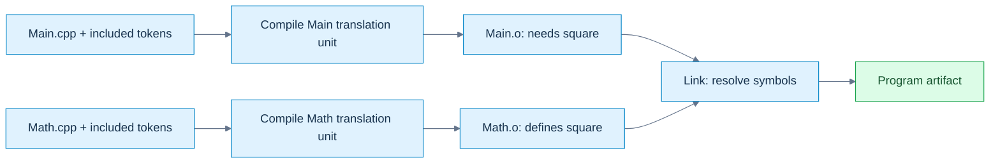
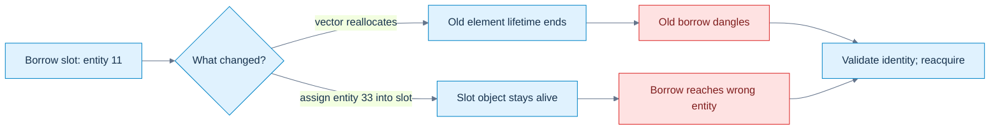
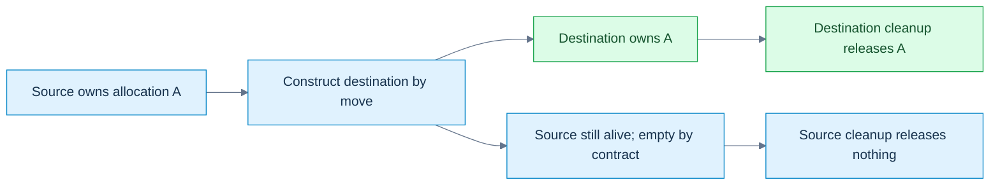
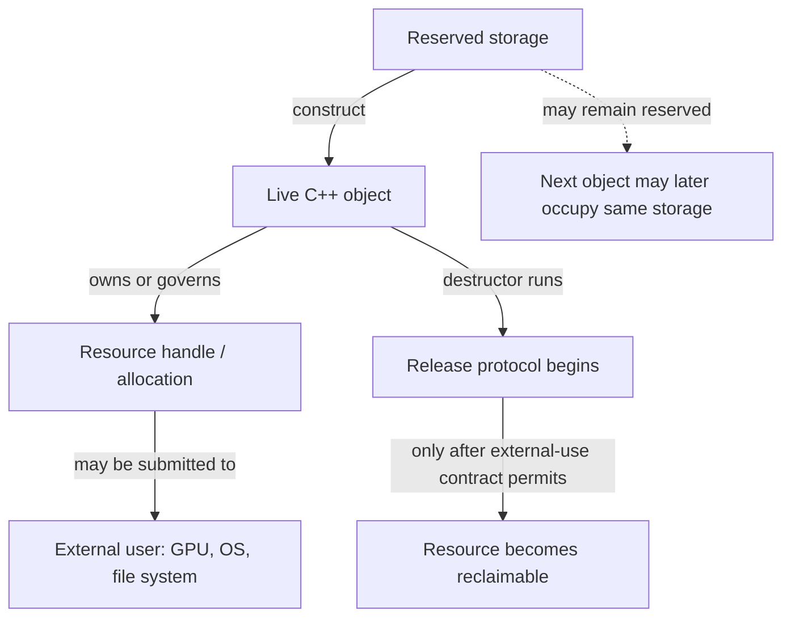
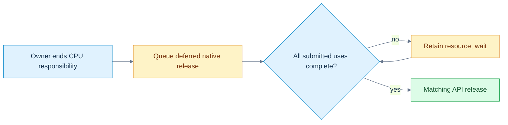
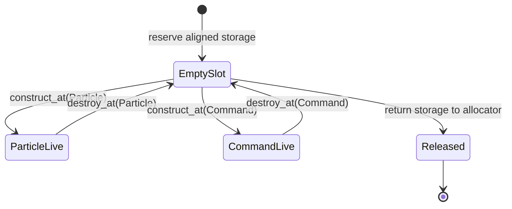

# C++: From Objects to Reliable Programs

> Volume 02 · accepted sources M007–M010, Parts 101–160 · 4 of 12 planned chunks (M007–M018, planned Parts 101–300). The revised M007 deepens existing coverage; it is not counted twice. This is a growing subject narrative, not a completed C++ course. Coverage beyond Part 160 remains pending.

## Prologue - Bytes need rules before they become a program

The previous volume taught us to encode, calculate, place and preserve information. Now ask why a buffer full of plausible bits can still be illegal to access in C++. Hardware can calculate an address; the language must establish what object exists there, which operation its type permits, and whether its lifetime is still active. A compiler optimizes against those rules, not against our hope that the bits look right.

C++ grew from C's low-level facilities while adding user-defined types and abstraction. It keeps separate compilation: a caller can know an interface without compiling every implementation into the same source file. That choice creates our first problem—how independently processed files agree about names and entities. Once they agree, a second problem begins—how the resulting process creates, uses and destroys objects. Layout is where those two stories finally meet the bytes again.

An **entity** is a language-level thing such as a type, function, object or template. An **object** has storage, type, lifetime and state; a function is an entity but not an object. A **variable** is introduced by a declaration of an object or reference; a reference is not itself an object. A **type** establishes a set of possible values and permitted operations. The **abstract machine** is the language's behavioral model; a real compiler may rearrange or remove physical storage when the required observable behavior is preserved.

This volume keeps independent examples inline. Short `cpp` fragments illustrate a local rule and may rely on the named surrounding declarations; they are not all independent programs to concatenate. Complete runnable examples are explicitly marked as laboratories. Project excerpts remain in the existing companion. We will revise and weave the whole twelve-source volume as the later material arrives; no numbered part is a teaching chapter.

## What we bring from the byte story

this opening chapter assumes M001, M003, and M005. That means I will assume you already understand bits/bytes and integer representations; addresses, alignment, padding, memory regions and virtual address spaces; and floating-point representation/error. The three prerequisite ideas you specifically need active in your head are:

| Dependency | What this opening chapter needs from it |
|---|---|
| M001 | A value ultimately has some machine representation in bits, but the **type** determines what those bits mean. |
| M003 | An address names a location in an address space; objects have alignment requirements; structures may contain padding. |
| M005 | `float`/`double` are machine representations with implementation/platform properties, not mathematical real numbers. |

Now we add the missing layer:

> **C++ is not a language where “variables are bytes in RAM.” C++ defines entities, objects, lifetimes, types, storage, identities and permitted operations. The compiler maps that abstract machine onto bytes and instructions.**

That distinction is the heart of Phase 2.

## The journey from text to a live object

Think of this opening chapter as this pipeline:

```text
SOURCE TEXT
    │
    ├── preprocessing / module dependency processing
    │
    ▼
C++ TRANSLATION UNIT / MODULE UNIT
    │
    ├── declarations establish names and types
    ├── lookup determines what names mean
    ├── definitions provide complete entities
    ├── ODR determines which definitions may coexist
    │
    ▼
COMPILER
    │
    ├── type checking
    ├── template instantiation
    ├── semantic analysis
    ├── optimization
    ├── code/data generation
    │
    ▼
OBJECT FILES
    │
    ├── machine code
    ├── symbols
    ├── relocation records
    ├── static data
    │
    ▼
LINKER
    │
    ├── resolves symbols
    ├── lays out executable sections
    ├── fixes references/relocations
    │
    ▼
EXECUTABLE / SHARED LIBRARY
    │
    ▼
RUNNING PROCESS
    │
    ├── storage becomes available
    ├── objects begin lifetime in that storage
    ├── names/references/pointers may designate objects
    ├── objects have identities and representations
    ├── class layouts determine member locations
    │
    ▼
OBJECT LIFETIME ENDS
    │
    └── storage may disappear OR may remain/reuse
```

The critical distinctions we will maintain throughout the chunk are:

| Concept | Question it answers |
|---|---|
| **Scope** | Where can this *name* be found? |
| **Name lookup** | Given this spelling here, which declaration does it refer to? |
| **Linkage** | Can declarations in different places denote the same entity? |
| **Storage duration** | For how long does the storage exist? |
| **Object lifetime** | During what interval does a typed object actually exist in that storage? |
| **Identity** | Which particular object is this? |
| **Address** | Where is it currently located? |
| **Value** | What state does it currently contain? |
| **Layout** | Where do its members/bytes occur relative to one another? |
| **Module visibility/reachability** | Which declarations can an importer see/use? |

These are **not synonyms**. Most difficult C++ bugs happen because two of them are mentally collapsed into one.

## Giving a program a buildable shape

### Figure CPP-01 - Two build lanes meet at the linker



**Read the picture:** the caller compiles against a declaration; the linker connects its unresolved call to the separately supplied definition. A missing declaration/type normally fails during translation; a missing required definition commonly fails at linking. **Limit:** this depicts the traditional example below, not a mandatory compiler implementation. Modules additionally need interface dependency ordering; a successful link does not prove ODR or runtime correctness. [[Visual Recall/02 - C++ - Objects, Ownership and Lifetime - Visual Recall#Four figure briefs|Recall this figure]].

The classic separate-compilation model lets clients compile against an interface while implementations are compiled separately. That sentence sounds elementary. The implications are not.

### The traditional translation model

Suppose you have:

```cpp
// Math.hpp
#pragma once

float square(float x);
```

```cpp
// Math.cpp
#include "Math.hpp"

float square(float x)
{
    return x * x;
}
```

```cpp
// Main.cpp
#include "Math.hpp"
#include <iostream>

int main()
{
    std::cout << square(3.0f) << '\n';
}
```

A simplified build is:

```text
Math.cpp
   │ preprocess
   ▼
Math translation unit
   │ compile
   ▼
Math.o
                         ┐
                         │
Main.cpp                 │
   │ preprocess          │
   ▼                     │
Main translation unit    ├── linker ──> executable
   │ compile             │
   ▼                     │
Main.o                   ┘
```

The classic separate-compilation model lets clients compile against an interface while implementations are compiled separately. Conceptually, commands might look like:

```bash
clang++ -std=c++23 -c Math.cpp -o Math.o
clang++ -std=c++23 -c Main.cpp -o Main.o
clang++ Main.o Math.o -o app
```

The first two commands **compile** independently. The third **links**. That distinction explains two major categories of errors.

### Compile-time error

```cpp
int main()
{
    UnknownType x;
}
```

The compiler cannot establish the semantics of the [[Translation units and linking|translation unit]].

### Link-time error

```cpp
int f(int);   // declaration

int main()
{
    return f(10);
}
```

This can compile perfectly. The compiler knows:

```text
f:
    accepts int
    returns int
```

It can generate a call instruction containing a symbol reference. But if nobody defines `f`, the linker eventually sees:

```text
Main.o needs symbol f(int)
No object/library provides symbol f(int)
```

and reports something like:

```text
undefined reference to f(int)
```

or Apple's equivalent:

```text
Undefined symbols for architecture arm64
```

That is why “my code compiled” and “my program built” are not identical statements.

### What preprocessing actually is

In traditional source code:

```cpp
#include "Math.hpp"
#define COUNT 16
#if DEBUG_MODE
...
#endif
```

these are processed before normal C++ semantic analysis. The [[Preprocessing and macro boundaries|preprocessor]] largely manipulates **tokens**, not C++ types. If you write:

```cpp
#define SQUARE(x) x * x
```

then:

```cpp
SQUARE(a + b)
```

may become:

```cpp
a + b * a + b
```

not:

```cpp
(a + b) * (a + b)
```

The preprocessor does not think:

> “I am invoking a mathematical function.”

It performs token replacement. Even the safer macro:

```cpp
#define SQUARE(x) ((x) * (x))
```

still has:

```cpp
int i = 3;
int result = SQUARE(++i);
```

which expands conceptually into:

```cpp
((++i) * (++i))
```

and now you have duplicated evaluation and undefined behavior here: the two increments are unsequenced relative to each other. Modern C++ tries to move as much work as possible out of the preprocessor and into typed language mechanisms:

```cpp
constexpr int square(int x)
{
    return x * x;
}
```

That gives type checking, scope, debugger visibility, normal evaluation rules, and compiler diagnostics.

### What `#include` really means

A traditional include is approximately textual inclusion.

```cpp
#include "Vector.hpp"
```

does not mean:

> “Dynamically connect to an independently existing Vector interface.”

Conceptually it means:

```text
Take tokens from Vector.hpp
insert them here
continue preprocessing
```

If twenty `.cpp` files include a 20,000-line template header, the frontend may process much of that interface twenty times. This is one major reason C++ build systems became expensive. Header guards:

```cpp
#ifndef VECTOR_HPP
#define VECTOR_HPP

// declarations

#endif
```

or:

```cpp
#pragma once
```

prevent repeated inclusion **within a translation unit**. They do **not** solve program-wide ODR mistakes. That distinction becomes important in the connected explanation.

### What compilation produces

An object file usually contains much more than raw instructions:

```text
.text        machine instructions
.rodata      constants/read-only data
.data        initialized writable static data
.bss         zero-initialized static data, conceptually
symbols      names known to the linker
relocations  places the linker must repair
debug info   when requested
unwind info
metadata
```

Exact sections depend on the object format:

```text
ELF      Linux and many Unix-like systems
Mach-O   macOS/iOS
COFF/PE  Windows
```

The C++ standard does not prescribe those formats. They are platform/toolchain concerns.

### What the linker actually does

Suppose `Main.o` contains a call to `square(float)`. The compiler does not necessarily know the final numerical address of `square`. It can emit something conceptually like:

```text
CALL <square symbol>
```

with a relocation record saying:

```text
When the final binary is laid out,
replace this placeholder with whatever address/offset
square ends up at.
```

The linker builds the final symbol graph:

```text
Main.o:
    requires square(float)

Math.o:
    defines square(float)

resolve
    ↓

Main call → Math definition
```

It also discovers impossible programs:

```text
Main.o needs f()
No definition
```

or:

```text
A.o defines x
B.o defines x
Both claim the same externally-linked entity
```

That second case takes us directly into the ODR.

### Name mangling

C++ supports:

```cpp
void process(int);
void process(float);
void process(const char*);
```

The machine linker does not understand C++ overload resolution. Therefore the compiler commonly encodes type information into symbol names. Conceptually:

```text
process(int)          → some mangled symbol A
process(float)        → some mangled symbol B
process(char const*)  → some mangled symbol C
```

The exact scheme is ABI-specific. This is why two compilers—or two versions configured with incompatible ABIs—can sometimes fail to link even when the C++ source-level declaration “looks identical.” It also explains why `extern "C"` exists:

```cpp
extern "C" void vulkan_callback(...);
```

It selects C language [[Linkage and entity ownership|linkage]], typically suppressing normal C++ name mangling for interoperability. Full C/C++ ABI interoperation comes later, but the root begins here.

## A compiled interface rather than repeated text

A named [[C++ modules and reachability|module]] communicates declarations through a compiler-produced interface. A **module unit** is a translation unit belonging to a module; an **interface unit** supplies its public interface. A **BMI** is a binary module interface: compiler-specific semantic information, not a portable object-file format. It helps the importer compile; an object file supplies code/data for linking. Supplying one does not substitute for the other.

`module;` starts a **global module fragment**, where traditional includes can appear before `export module Math;`. An export declaration exposes declarations to importers. Some implementation details must be reachable for interpreting an exported type or template without becoming freely findable by ordinary [[Scopes and name lookup|name lookup]]. Visibility (finding a declaration) and reachability (using its semantic information) are related, not identical.

A named-module import does not textually paste a header and generally does not import its macros. Header units are different: they can make macros available. Build order must make a suitable compiled interface available before compiling importers. Compiler options and versions must match the toolchain's compatibility requirements. The exact BMI construction and naming are build-system matters; never teach a PCM as a cross-compiler interchange format. The complete standalone Math example appears under **Following one call through the build** below. Project-specific Kairo fragments belong in [[Supplementary/Code Snippets#Source-reported C++ project excerpts|the project excerpt companion]], not in this independent example.

### Modules versus `#include`

This distinction matters enormously:

```cpp
#include "foo.hpp"
```

is essentially preprocessing/textual inclusion.

```cpp
import foo;
```

means the compiler imports a module interface. The importer generally does not receive arbitrary macros from the imported module. That is deliberate. Macros are preprocessing state. Modules try to give you a language-level dependency boundary. This helps with:

```text
build scalability
macro isolation
interface ownership
dependency correctness
ODR hygiene
```

You will study modules much more deeply in the later generic-programming chapters, but this opening chapter gives you the underlying translation reason they exist.

## Promises become definitions

This distinction must become instinctive. Consider:

```cpp
int f(int);
```

This tells the compiler:

```text
There exists an entity named f.
It is a function.
Parameter: int.
Result: int.
```

It does not say how `f` works. That is a **declaration**. Now:

```cpp
int f(int x)
{
    return x * 2;
}
```

This provides the function body. That is a **definition**. And because it also introduces/describes the function, every definition is also a declaration.

### Objects

```cpp
extern int frameCount;
```

declaration only. Somewhere:

```cpp
int frameCount = 0;
```

definition. The definition causes the program to have an object named `frameCount`. An interesting special case:

```cpp
extern int frameCount = 0;
```

Despite `extern`, the initializer makes this a **definition**. Do not memorize `extern = declaration`. Understand the rule.

### Classes

```cpp
struct Renderer;
```

declares an incomplete class type. The compiler knows:

```text
Renderer is a type.
```

It does not yet know:

```text
sizeof(Renderer)
members
alignment
complete layout
```

So this works:

```cpp
Renderer* renderer;
Renderer& getRenderer();
```

because these declarations do not require a complete Renderer. A reference need not be implemented as a separate pointer-sized object. This does not:

```cpp
Renderer renderer;
```

because the compiler must know how much storage the object requires. Later:

```cpp
struct Renderer
{
    int width;
    int height;
};
```

defines it. This is why forward declarations reduce compile dependencies.

### Enumerations

This is legal:

```cpp
enum class TextureState : std::uint8_t;
```

This opaque enum declaration fixes the underlying type and makes the enum a complete type, despite not yet listing its enumerators. Unlike a forward-declared class, its size is already known. Later:

```cpp
enum class TextureState : std::uint8_t
{
    Unloaded,
    Loading,
    Ready,
    Failed
};
```

defines it.

### Templates complicate the old declaration/implementation split

You may think:

```cpp
// Header
template<class T>
T add(T, T);

// cpp
template<class T>
T add(T a, T b)
{
    return a + b;
}
```

works like a normal function. Usually it does not for arbitrary `T`. When another translation unit instantiates:

```cpp
add<float>(1.f, 2.f)
```

the compiler typically needs the template definition available. That is one reason templates traditionally live in headers. Modules give us a better distribution mechanism, but template instantiation semantics still exist. We will go fully into this during the later generic-programming chapters.

## Many files must describe one coherent program

The **[[One Definition Rule|One Definition Rule]]**, ODR, is where declarations, translation units and linking meet. Suppose we allowed:

```cpp
// A.cpp
int gravityScale()
{
    return 2;
}
```

and:

```cpp
// B.cpp
int gravityScale()
{
    return 17;
}
```

and both are meant to be the same externally linked function. Now:

```cpp
gravityScale()
```

has no coherent program meaning. Which definition is *the function*? The ODR prevents this semantic fracture.

### The common program-wide rule

For ordinary non-`inline`, non-template externally linked functions/objects, you want a single program definition. For example:

```cpp
// Renderer.hpp

extern int gFrameIndex;
```

```cpp
// Renderer.cpp

int gFrameIndex = 0;
```

Every user may see the declaration. Exactly one implementation file owns the definition.

### The classic header mistake

Bad:

```cpp
// Config.hpp

int gDebugMode = 1;
```

Then:

```cpp
// Renderer.cpp
#include "Config.hpp"
```

and:

```cpp
// Physics.cpp
#include "Config.hpp"
```

Textual inclusion creates conceptually:

```text
Renderer translation unit:
    int gDebugMode = 1;

Physics translation unit:
    int gDebugMode = 1;
```

Now there are two definitions. Header guards do not save you. They prevent:

```text
Config.hpp
Config.hpp
Config.hpp
```

from being processed repeatedly **inside the same translation unit**. They do not stop a different translation unit from independently receiving the definition.

### Two modern solutions

One traditional solution is:

```cpp
// Config.hpp
extern int gDebugMode;

// Config.cpp
int gDebugMode = 1;
```

A C++17+ solution, when a genuine globally accessible variable is appropriate:

```cpp
inline int gDebugMode = 1;
```

An inline variable may have equivalent definitions in multiple translation units under the ODR rules. Important:

> `inline` in C++ does not fundamentally mean “the CPU call will be replaced by the body.”

That meaning is historical. The optimizer may inline a function without the `inline` keyword and decline to inline one with it. At the language level, `inline` is substantially about **multiple definition semantics and entity identity**.

### Why class definitions may live in headers

The multi-translation-unit exceptions have conditions, not only matching-looking syntax: matching tokens and relevant name lookup must agree, with specified exceptions. Definitions attached to named modules do not simply inherit the traditional header permission. Some ODR violations require no diagnostic; a successful link is not proof of validity.

You have seen:

```cpp
struct Vec3
{
    float x;
    float y;
    float z;

    float lengthSquared() const
    {
        return x*x + y*y + z*z;
    }
};
```

included by many source files. Why does this not immediately violate the ODR? Because the language specifically permits certain entities—such as class definitions, templates, and inline entities—to have matching definitions in multiple translation units under strict conditions. It is not:

> “ODR means literally every C++ definition can occur once in all source text.”

That would make headers impossible. The deep form is closer to:

> The program must maintain **one coherent definition of an entity**, while the language permits certain equivalent definitions to occur in multiple translation units.

### The evil ODR bug: definitions that look like the same header but aren't

Consider:

```cpp
// Behavior.hpp

inline int behavior()
{
#ifdef FAST_MODE
    return 1;
#else
    return 2;
#endif
}
```

Compile:

```text
A.cpp with FAST_MODE
B.cpp without FAST_MODE
```

After preprocessing:

```cpp
// A translation unit
inline int behavior()
{
    return 1;
}
```

versus:

```cpp
// B translation unit
inline int behavior()
{
    return 2;
}
```

The source filename is the same. The effective definitions are not. You have fractured the ODR. Some ODR violations require no diagnostic. That means:

```text
compiler: okay
linker: maybe okay
program: semantically invalid
```

This is one of C++'s nastier classes of bugs.

### Why modules help

A named module interface is compiled as a module interface rather than textually reconstructed independently in every importer. That removes many opportunities for:

```text
same header + different macro environment = different declaration
```

It does not abolish the ODR, but it gives the compiler a stronger semantic module boundary. This is one reason your move toward `.cppm` in Kairo is technically meaningful rather than merely stylistic.

### Linkage is related to ODR, but is not ODR

Traditional example:

```cpp
namespace
{
    int helper()
    {
        return 42;
    }
}
```

`helper` is translation-unit-private. Another old form is:

```cpp
static int helper()
{
    return 42;
}
```

for a namespace-scope function. Modern C++ usually favors unnamed namespaces for TU-private namespace entities. C++20 modules add an additional idea, **module linkage**, for certain names attached to named modules. So do not reduce linkage to:

```text
internal vs external forever
```

because an illustrative codebase is C++23 and module-based.

## A spelling needs a place and a meaning

Lookup comes before overload resolution: first determine which declarations a spelling finds, then choose among viable candidates. A derived `draw(float)` can hide all base overloads named `draw`, including `draw(int)`; `using Base::draw;` restores those base declarations to the derived overload set. A **candidate** is a function considered for the call; a **viable** candidate satisfies the call's argument constraints. Hiding is not the same as overriding.

The name's point of declaration also matters. In a local `int x=x;`, the right-hand name finds the newly declared local, not a hidden outer `x`. In C++23, reading that local's uninitialized integer value is undefined behavior. This is a bad example to diagnose, not execute; different C++26 uninitialized-value wording must not be silently retrofitted into the C++23 lab.

The classic separate-compilation model lets clients compile against an interface while implementations are compiled separately. The easiest mistake here is believing:

> “scope = lifetime.”

No. Consider:

```cpp
int* p = nullptr;

void f()
{
    static int x = 10;
    p = &x;
}
```

`x` has **block scope**. Its name `x` is inaccessible outside the block. But it has **static [[Storage duration and object lifetime|storage duration]]**, so the object persists until program termination. Scope concerns the **name**. [[Object construction and storage reuse]] explains how lifetime differs from backing storage.

### Block scope

```cpp
void render()
{
    int frame = 10;

    {
        int sample = 4;
    }

    // sample unavailable here
}
```

`sample`'s name belongs to the inner block.

### Name hiding

```cpp
int x = 1;

void f()
{
    int x = 2;

    std::cout << x;    // local x = 2
    std::cout << ::x;  // global x = 1
}
```

The local declaration **hides** the outer declaration. It did not delete the global object. It changed what unqualified lookup finds. This distinction is extremely useful when debugging large engine systems.

### Class scope

```cpp
struct Camera
{
    float nearPlane;
    float farPlane;

    float depthRange() const
    {
        return farPlane - nearPlane;
    }
};
```

Unqualified lookup for:

```cpp
nearPlane
```

inside `depthRange()` finds the class member. The compiler effectively understands it relative to the current object, roughly:

```cpp
this->nearPlane
```

although the language semantics are richer than textual rewriting.

### Namespace scope

```cpp
namespace kairo::render
{
    struct Camera {};
}
```

Outside:

```cpp
kairo::render::Camera c;
```

That is **qualified lookup**. Inside a suitable context:

```cpp
using kairo::render::Camera;

Camera c;
```

you've introduced a declaration into consideration for unqualified usage.

### `using namespace` versus using declaration

This:

```cpp
using namespace kairo::render;
```

makes many names candidates during lookup. This:

```cpp
using kairo::render::Camera;
```

specifically introduces `Camera`. The second is usually less polluting. Putting a broad using-directive in a public textual header alters consumer lookup. Module exports and reachability are not textual inclusion: do not claim every directive in a module automatically leaks into every importer. Prefer narrow declarations and explicit qualification at public boundaries.

### Argument-dependent lookup — ADL

Suppose:

```cpp
namespace math
{
    struct Vec3 {};

    float Dot(Vec3, Vec3);
}
```

Then:

```cpp
math::Vec3 a;
math::Vec3 b;

float d = Dot(a, b);
```

may find `math::Dot` even though you did not write:

```cpp
math::Dot
```

Why? Because arguments belong to namespace `math`, and **argument-dependent lookup** considers associated namespaces/classes. This is central to idiomatic generic C++. For example, this pattern:

```cpp
using std::swap;
swap(a, b);
```

allows normal lookup to see `std::swap` while [[Argument-dependent lookup|ADL]] can discover a type-specific `swap` in the type's own namespace. We will revisit this deeply during templates because template name lookup creates another dimension: some names are looked up when the template is defined, while dependent names may participate in lookup at instantiation.

### Modules add visibility/reachability, not a replacement for scopes

Your module contains:

```cpp
export module Kairo.ECS.Entity;

export namespace kairo::ecs
{
    struct Entity { ... };
}
```

Then a consumer can:

```cpp
import Kairo.ECS.Entity;

kairo::ecs::Entity e;
```

There are two separate questions:

```text
Is Entity exported/reachable from this module?
```

and:

```text
Given "kairo::ecs::Entity", which declaration does lookup find?
```

Modules affect availability. Scopes and lookup still determine meaning.

## A name does not decide how long storage lasts

Now we enter the part of C++ that unlocks pointers, RAII and ownership. **Storage duration is about storage.** It answers:

> How long is the region capable of containing this object retained?

The four major categories are:

| Storage duration | Typical source | Lifetime of storage |
|---|---|---|
| automatic | ordinary block local / parameters | associated block/call execution |
| static | namespace objects, local `static`, static data members | entire program |
| thread | `thread_local` — [[Thread-local storage]] | duration of the corresponding thread |
| dynamic | allocation functions / `new` | until explicitly released |

Do not automatically translate those into:

```text
automatic = stack
dynamic = heap
```

Those are common implementation strategies. The language specifies **semantics**, not a mandatory physical memory architecture.

### Automatic storage duration

```cpp
void update()
{
    Entity e;
}
```

`e` normally has automatic storage duration. A typical implementation reserves its storage in the function's stack frame. Conceptually:

```text
enter update
    reserve/identify storage for e
    construct e
    use e
    destroy e
    storage ceases to be reserved for e
leave update
```

The optimizer can eliminate the physical stack slot altogether if observable program behavior remains equivalent. So saying:

> “A local variable is on the stack”

is often practically useful, but **not the C++ semantic definition**.

### Static storage duration

Namespace object:

```cpp
int frameCount = 0;
```

has static storage duration. So does:

```cpp
void f()
{
    static int calls = 0;
    ++calls;
}
```

The *name* `calls` has block scope. The *storage* persists for the whole program. The local static is initialized the first time execution reaches its declaration, unless it can undergo earlier initialization under language rules. Since C++11, initialization of a function-local static is synchronized: concurrent first calls do not independently construct multiple copies. That makes patterns like:

```cpp
Renderer& renderer()
{
    static Renderer instance;
    return instance;
}
```

much safer than they were historically. But it does not solve every architectural problem with global state.

### The static initialization order problem

Suppose:

```cpp
// A.cpp
Renderer renderer{device};
```

and:

```cpp
// B.cpp
Device device;
```

If `renderer` needs `device` during dynamic initialization, their initialization order across translation units can be problematic. This is the classic **static initialization order fiasco**. A function-local static can defer construction until actual use:

```cpp
Device& device()
{
    static Device d;
    return d;
}
```

But in engines, an even cleaner design is often explicit ownership:

```text
Engine
 ├── Device
 ├── Renderer
 ├── AssetSystem
 └── PhysicsWorld
```

with deterministic initialization and shutdown order. This will come back hard during RAII and engine architecture.

### `constinit`

C++20 provides:

```cpp
constinit int value = 42;
```

`constinit` requires static initialization. It is useful when you care about avoiding dynamic initialization ordering. Do not confuse it with `const`. This is valid conceptually:

```cpp
constinit int counter = 0;

void increment()
{
    ++counter;
}
```

`counter` can still be mutable. `constinit` concerns initialization timing.

### Thread storage duration

```cpp
thread_local int commandBufferIndex = 0;
```

Each thread gets its own instance. Conceptually:

```text
Thread A:
    commandBufferIndex_A

Thread B:
    commandBufferIndex_B

Thread C:
    commandBufferIndex_C
```

This can be useful for:

```text
per-thread allocators
scratch arenas
profiling state
temporary command-building state
thread-specific random engines
```

But it is not automatically free. TLS access has ABI/runtime costs, and thread-local destructors/initialization can complicate shutdown.

### Dynamic storage duration

```cpp
Entity* p = new Entity{};
```

There are **two objects to reason about**:

```text
p
└── pointer object
    automatic storage duration

*p
└── Entity object
    dynamic storage duration
```

This is one of the first mental separations I want permanently burned in:

```text
pointer lifetime != pointed object's lifetime
pointer storage != pointee storage
```

Then:

```cpp
delete p;
```

ends the `Entity` lifetime and releases its dynamically allocated storage. But:

```cpp
p
```

may still physically contain the old address. The pointer object itself remains alive until its scope ends. Its **value is now dangling**. This is the bridge into the borrowing and invalidation story below.

## Storage is a place; an object is its occupant

This is one of the deepest ideas in C++. Consider a parking space.

```text
storage = the parking space
object  = the particular car currently occupying it
```

You can have:

```text
parking space exists
no car exists
```

or:

```text
parking space exists
Car A lives there
Car A leaves
same parking space remains
Car B arrives
```

The location did not change. The object identity did. That is almost exactly what low-level C++ storage reuse does.

### Raw storage is not automatically a live object of arbitrary type

Consider:

```cpp
#include <cstddef>

alignas(64) std::byte storage[64];
```

You have storage. You do **not** automatically have:

```cpp
Renderer
Texture
Matrix
Entity
```

living in it. Storage has:

```text
address
size
alignment
```

An object adds:

```text
type
lifetime
identity
value/state
language-permitted operations
```

### Construction starts a lifetime

A canonical advanced example:

```cpp
#include <cstddef>
#include <memory>

struct Particle
{
    float x;
    float y;
};

alignas(Particle) std::byte storage[sizeof(Particle)];

Particle* p =
    std::construct_at(
        reinterpret_cast<Particle*>(storage),
        Particle{1.0f, 2.0f}
    );
```

Conceptually:

```text
before construct_at:

storage:
+-----------------------+
| raw bytes             |
+-----------------------+
^
suitably aligned address

no Particle lifetime


after construct_at:

storage:
+-----------------------+
| Particle{x=1, y=2}    |
+-----------------------+
^
Particle object lifetime active
```

Then:

```cpp
std::destroy_at(p);
```

ends the `Particle` lifetime. The byte array's storage itself remains. This exact separation powers:

```text
object pools
arena allocators
std::vector internals
std::optional
std::variant
ECS component storage
small-buffer optimization
allocator implementations
lock-free structures
```

So object lifetime is not academic lawyering. It is an engine programming primitive.

### `new` actually combines operations

When you write:

```cpp
auto* p = new Particle{1, 2};
```

conceptually you get:

```text
1. obtain suitably sized/aligned storage
2. construct Particle in that storage
3. return pointer to the object
```

Similarly:

```cpp
delete p;
```

conceptually performs:

```text
1. destroy object
2. release storage
```

Custom allocators split those steps apart intentionally.

### A dangerous misconception

After:

```cpp
std::destroy_at(p);
```

the bytes may still look exactly like:

```text
00 00 80 3F 00 00 00 40
```

which could encode 1.0f and 2.0f on a little-endian IEEE binary32 target (not a universal byte representation). But the old `Particle` object is dead. The persistence of bytes does not imply persistence of object lifetime. This is why:

> **Memory containing plausible bits does not prove that a live C++ object exists there.**

That principle will explain many undefined behaviors later.

### Lifetime beginning and ending more precisely

For an ordinary class object, lifetime generally begins after appropriately aligned storage exists and its initialization completes. For class objects, lifetime ends when destruction begins or when its storage is released/reused according to the language rules. C++ has advanced exceptions involving:

```text
unions
implicit-lifetime types
allocators
storage reuse
subobjects
placement construction
```

so “constructor begins lifetime, destructor ends lifetime” is a good first model but not the entire standard. In a later lifetime chapter, when we cover placement construction and lifetime restart, we will explore the hard rules such as transparent replacement and the rare situations where `std::launder` enters the picture.

### Modern implicit-lifetime objects

Modern C++ deliberately permits some low-level operations to implicitly begin lifetime for **implicit-lifetime types**, because otherwise routines using allocation/memory blocks would be unnecessarily impossible to express. That does **not** mean:

```text
bytes always automatically become whatever type you cast them to
```

This remains wrong thinking:

```cpp
SomeHugeComplexType* p =
    reinterpret_cast<SomeHugeComplexType*>(randomBytes);
```

A cast changes how an expression is interpreted. It does not magically satisfy every object-lifetime precondition.

## Values, occupants and addresses tell different stories

Two copies of an entity handle are different C++ handle objects, even when their index/generation values identify the same application entity. The handle's own address is not the entity's identity. Conversely, a stable entity identity does not guarantee a stable address for its current component storage. Keep C++ object identity, application identity, and storage location on separate lines of the diagram.

Now distinguish:

```text
value
identity
address
```

Suppose:

```cpp
struct Particle
{
    int health;
};

Particle a{100};
Particle b{100};
```

Their values are equal. Their identities are not.

```text
a:
value = {100}
identity = object A
address = perhaps 0x1000

b:
value = {100}
identity = object B
address = perhaps 0x2000
```

Changing:

```cpp
a.health = 50;
```

changes `a`'s value. It does not turn `a` into a different object. Identity survives ordinary mutation.

### Address is often useful as identity, but is not identity itself

During a normal object's lifetime, its address is often a useful way of designating it. But the general equation:

```text
identity == numerical address
```

is false. Why? Because storage can be reused.

```text
Time t0:
address 0x1000 → Enemy A

destroy A

Time t1:
address 0x1000 → Enemy B
```

Same numerical address. Different lifetime. Different object identity. This is the exact conceptual reason stale pointers are dangerous.

## A handle remembers which occupant was intended

An [[Object identity and generation handles|index-and-generation handle]] stores a slot number and a reuse counter, rather than relying on an address. Slot 42 at generation 7 is not slot 42 at generation 8. An ECS (entity-component system) is a design where entities identify collections of components; the handle identifies a logical entity while component objects may move.

A valid-looking index is not a live entity check. Resolving a handle must check bounds, occupancy and generation against an owning registry. A generation counter eventually wraps; choose a width/reuse policy and document the collision horizon. Handles also need registry ownership: slot 42 in two worlds does not mean the same entity. These are system-identity constraints, not automatic properties of a C++ struct. The source-reported Kairo record is retained separately; the self-contained laboratory below verifies a small illustrative handle.

### Multiple things can even share an address

Several C++ mechanisms weaken “different thing = different numerical address.” A union stores different members over overlapping storage:

```cpp
union U
{
    int i;
    float f;
};
```

Both members begin at the union's address. Only the appropriate active-member/lifetime rules make accesses valid. Empty base optimization can place an empty base subobject at an address shared with other structural parts of a complete object under ABI rules. C++20 also has:

```cpp
[[no_unique_address]]
```

which permits certain empty member subobjects to overlap storage. So a raw address is better thought of as:

> a coordinate in storage, not a complete description of object identity.

### `std::addressof`

C++ permits overloading `operator&`. Therefore:

```cpp
&object
```

can theoretically invoke user-defined behavior. When generic low-level code truly wants the actual object address, use:

```cpp
std::addressof(object)
```

This bypasses overloaded `operator&`. That is a niche tool, but it reveals an important C++ theme:

> Surface syntax and object-model meaning are not always identical.

## Choose a type for its promise, not its familiar size

Native `bool` is a language value type, not a portable one-byte GPU/file field. Use an explicitly defined wire integer encoding, such as zero/one, validate received codes, and convert to bool by a value operation. Do not deserialize arbitrary bytes directly into a bool and assume every representation valid. Similarly, Unicode character types express code-unit intent, not automatic decoding into characters.

`float`, `double` and `long double` do not portably mean binary32, binary64 and binary128. If a protocol needs binary32, check its stated assumptions: size in bytes, CHAR_BIT, numeric_limits precision/exponent properties and representation requirements. `is_iec559` alone does not specify one exact IEEE format. A wire decoder must still establish byte order and valid field interpretation.

Your first machine-level assumption must be destroyed:

> `int` does **not** mean “32-bit integer” in the C++ language.

The major fundamental categories include:

| Category | Examples |
|---|---|
| void | `void` |
| null pointer type | `std::nullptr_t` |
| Boolean | `bool` |
| ordinary character/integer | `char`, `signed char`, `unsigned char`, `short`, `int`, `long`, `long long`, unsigned forms |
| Unicode character | `char8_t`, `char16_t`, `char32_t` |
| wide character | `wchar_t` |
| floating | `float`, `double`, `long double` |
| implementation-defined extended types | implementation/compiler dependent |

### What the standard does guarantee

This is always true:

```cpp
sizeof(char) == 1
```

But the unit of `sizeof` is a **C++ byte**, and a byte is at least 8 bits. Check:

```cpp
#include <climits>

std::cout << CHAR_BIT;
```

Most systems you will use report:

```text
8
```

But:

```text
C++ byte == exactly 8 bits
```

is not a universal language guarantee.

### Integer relative sizes

The language guarantees a nondecreasing capacity relationship roughly:

```text
signed char
   ≤ short
   ≤ int
   ≤ long
   ≤ long long
```

with minimum widths traditionally corresponding to at least:

```text
signed char : 8 bits
short       : 16
int         : 16
long        : 32
long long   : 64
```

Common modern platforms choose more. For example, typical 64-bit ABIs differ:

```text
LP64
    int       32
    long      64
    pointer   64

LLP64
    int       32
    long      32
    long long 64
    pointer   64
```

macOS/Linux commonly use LP64. 64-bit Windows uses LLP64. Therefore this code is broken as a portability assumption:

```cpp
static_assert(sizeof(long) == sizeof(void*));
```

even though it works on one family of systems.

### Exact-width integer types

For binary formats, handles, GPU structs, hashes and network protocols, you commonly want:

```cpp
#include <cstdint>

std::uint8_t
std::uint16_t
std::uint32_t
std::uint64_t
```

A handle can express its fields using these types:

```cpp
std::uint32_t index;
std::uint32_t generation;
```

That gives a clear representation contract:

```text
index      = 32-bit unsigned if uint32_t exists
generation = 32-bit unsigned if uint32_t exists
```

Important subtlety: The exact-width aliases such as `std::uint32_t` are **optional** in the standard. An implementation provides them only if it has a corresponding integer type with exactly that width and required representation constraints. On all mainstream systems relevant to your work, they exist.

### `least` and `fast`

C++ also provides:

```cpp
std::uint_least32_t
std::uint_fast32_t
```

`least` means:

> smallest available integer type with at least that many bits.

`fast` means:

> implementation-selected type intended to be fast while having at least that many bits.

Do not assume:

```cpp
uint_fast32_t == uint32_t
```

Its width can be larger. For serialized formats, use exact-width types when exact width is part of the format. For pure computation, `fast`/native types can sometimes make sense.

### `std::size_t`

`sizeof` returns std::size_t. A container returns its own size_type, commonly size_t for standard configurations; do not make that equivalence a rule for every container. A checked conversion from a serialized count must separately establish representability and a practical allocation/resource limit.

Expressions such as:

```cpp
sizeof(T)
vector.size()
```

use an unsigned size type usually represented by `std::size_t`. Its purpose is not:

```text
some particular 64-bit integer
```

Its purpose is:

> an unsigned integer type capable of representing the size of any object.

On a common 64-bit system it is usually 64-bit. Do not serialize `size_t` directly as a stable file-format field if the format must be portable across ABIs. Use something explicit:

```cpp
std::uint64_t count;
```

and validate conversion into `std::size_t` at runtime.

### `char` signedness

Plain:

```cpp
char
```

is a distinct type from:

```cpp
signed char
unsigned char
```

Whether plain `char` behaves as signed or unsigned for values outside the common positive range is implementation-defined. Therefore don't do protocol arithmetic relying on:

```cpp
char byte;
if (byte < 0) ...
```

Use:

```cpp
std::uint8_t
```

for an 8-bit integer quantity when appropriate, or:

```cpp
std::byte
```

when you mean **raw byte data rather than number**. This semantic distinction is excellent:

```cpp
std::byte header[16];
```

says:

> these are bytes.

while:

```cpp
std::uint8_t samples[16];
```

says:

> these are 8-bit integer values.

### `numeric_limits`

Instead of assumptions:

```cpp
int max = 2147483647;
```

query the type:

```cpp
#include <limits>

auto maxInt = std::numeric_limits<int>::max();
auto minInt = std::numeric_limits<int>::lowest();

auto eps = std::numeric_limits<float>::epsilon();
auto inf = std::numeric_limits<float>::infinity();
```

A handle's invalid-index sentinel can use:

```cpp
std::numeric_limits<std::uint32_t>::max()
```

for `Entity::InvalidIndex`. Good. Representation properties belong to the type, not to folklore.

## Give a domain its own vocabulary

An integer is often too permissive. Imagine:

```cpp
std::uint8_t state;
```

and:

```text
0 = created
1 = destroyed
2 = component added
3 = component removed
```

Nothing prevents:

```cpp
state = 218;
```

Nothing tells readers what `2` means. So C++ provides enumerations.

### Old unscoped enums

```cpp
enum Color
{
    Red,
    Green,
    Blue
};
```

Historically, names such as:

```cpp
Red
Green
Blue
```

enter the surrounding scope. And enumerators readily convert into integral values. That leads to:

```cpp
enum Color { Red, Green };
enum Error { None, DiskFull };

Color c = Red;

if (c == 1)
{
    ...
}
```

or namespace pollution:

```cpp
enum Status { Unknown };
enum Result { Unknown }; // collision
```

### Scoped enums

Use:

```cpp
enum class Color
{
    Red,
    Green,
    Blue
};
```

Then:

```cpp
Color c = Color::Red;
```

not:

```cpp
Color c = Red; // normally no
```

and:

```cpp
int x = Color::Red; // no implicit conversion
```

This is exactly the kind of restriction we want.

## Representation is an intention, not input validation

A useful independent example is:

```cpp
enum class ChangeKind : std::uint8_t {
    Created, Destroyed, ComponentAdded, ComponentRemoved
};
```

Include `<cstdint>` before this fragment. The scoped enum's default underlying type would be `int`; the explicit underlying type requests an eight-bit representation on targets providing that alias. This helps compact records but says nothing about file version, endian order of other fields, or GPU compatibility. In the fragments below, `StructuralChangeKind` means an equivalent enum with these same four enumerators; each fragment is illustrative, not a separate complete program.

### Getting the underlying integer

In C++23:

```cpp
#include <utility>

auto raw = std::to_underlying(
    StructuralChangeKind::Destroyed
);
```

This is better than repeatedly spelling:

```cpp
static_cast<std::uint8_t>(
    StructuralChangeKind::Destroyed
);
```

because the return type tracks the enum's actual underlying type. Earlier code commonly used `std::underlying_type_t<E>`.

### An enum can represent more than just the named enumerators

Never assume deserializing one byte automatically validates:

```cpp
StructuralChangeKind
```

You might receive:

```text
0xC7
```

Your protocol should validate the domain. Conceptually:

```cpp
std::optional<StructuralChangeKind>
decodeChangeKind(std::uint8_t raw)
{
    switch (raw)
    {
        case 0:
            return StructuralChangeKind::Created;
        case 1:
            return StructuralChangeKind::Destroyed;
        case 2:
            return StructuralChangeKind::ComponentAdded;
        case 3:
            return StructuralChangeKind::ComponentRemoved;
        default:
            return std::nullopt;
    }
}
```

The enum gives you type safety **inside a correct C++ program**. It does not sanitize arbitrary external bytes. That matters in game assets, network messages and binary scene files.

### Enum flags

Sometimes an enum represents mutually exclusive states:

```cpp
enum class State
{
    Idle,
    Running,
    Dead
};
```

Sometimes it represents a bitmask:

```cpp
enum class Access : std::uint32_t
{
    None  = 0,
    Read  = 1u << 0,
    Write = 1u << 1,
    Exec  = 1u << 2
};
```

For `enum class` ([[Scoped enums and validated domains]]), bitwise operations do not automatically exist:

```cpp
Access::Read | Access::Write
```

requires operator definitions or explicit underlying conversion. That is good because the compiler forces the API designer to say:

> These enumerators are intentionally combinable.

## Records acquire their initial state

This becomes crucial in engine code because many types are deliberately simple records. Consider:

```cpp
struct Vertex
{
    float x;
    float y;
    float z;
    std::uint32_t color;
};
```

No custom constructor is required to initialize it. You can write:

```cpp
Vertex v{
    1.0f,
    2.0f,
    3.0f,
    0xFFFFFFFFu
};
```

This is **[[Aggregate initialization|aggregate initialization]]**. The language knows how to initialize the constituent elements directly.

### What counts as an aggregate?

For modern C++20/23 class types, the practical rules include no user-declared or inherited constructors, no private/protected direct non-static data members, no virtual functions, and no prohibited virtual/private/protected base-class structure. Instead of memorizing every standard-revision wording change, test actual intent:

```cpp
#include <type_traits>

static_assert(std::is_aggregate_v<Vertex>);
```

That is the professional approach. The precise aggregate definition evolved across C++ versions.

## Similar braces can invoke different mechanisms

A record with public members, default member initializers and member functions can still be an [[Aggregate initialization|aggregate]]. For example, the laboratory's `ResourceHandle` has no user-declared constructor, and its `{42,7}` initialization initializes its two non-static fields. A static constant does not become a per-object aggregate element. Contrast `struct Vec { float x,y,z; Vec(float a,float b,float c):x(a),y(b),z(c){} };`. Its user-declared constructor makes it non-aggregate in C++20/23. `Vec{1,2,3}` selects that constructor. Even a constructor explicitly defaulted on its first declaration is user-declared; do not substitute the older 'no user-provided constructor' criterion for the modern rule. Ordinary methods do not by themselves disqualify an aggregate. Arrays are aggregates too, and aggregate bases precede direct members in element order.

Use `std::is_aggregate_v<T>` when aggregate initialization is an intentional API property. A later added constructor can break designated initialization without changing any field names. Source-reported Entity/Vector contrasts remain examples to verify in the actual project.

### Initialization order

Aggregate elements are initialized in their declaration/order rules, not in arbitrary conceptual order. For:

```cpp
struct Particle
{
    float x;
    float y;
    int lifetime;
};
```

this maps naturally:

```cpp
Particle p{
    10.0f,
    20.0f,
    60
};
```

But positional initialization can become difficult to read:

```cpp
PipelineDesc desc{
    1,
    0,
    true,
    false,
    4,
    1
};
```

What is `4`? What is `1`? Hence C++20 designated initialization.

### Designated initializers

```cpp
Particle p{
    .x = 10.0f,
    .y = 20.0f,
    .lifetime = 60
};
```

Unlike C, C++ requires the designators to respect declaration order. If declaration is:

```cpp
struct Particle
{
    float x;
    float y;
    int lifetime;
};
```

then this is not portable-valid C++ designated initialization:

```cpp
Particle p{
    .lifetime = 60,
    .x = 10.0f
};
```

The order must follow:

```text
x → y → lifetime
```

Also, C++ designators name direct data members rather than supporting all of C's more permissive designated-initialization forms.

### Missing members

Suppose:

```cpp
struct Material
{
    float roughness = 0.5f;
    float metallic  = 0.0f;
    bool doubleSided{};
};
```

Then:

```cpp
Material m{
    .roughness = 0.8f
};
```

leaves the other members to their default member initialization rules. This can make data descriptors very expressive.

### Aggregate initialization and API evolution

Here is a real engineering trap. Version 1:

```cpp
struct Dispatch
{
    std::uint32_t x;
    std::uint32_t y;
    std::uint32_t z;
};
```

Client:

```cpp
Dispatch d{8, 8, 1};
```

Then someone changes the structure:

```cpp
struct Dispatch
{
    std::uint32_t queue;
    std::uint32_t x;
    std::uint32_t y;
    std::uint32_t z;
};
```

Now positional initialization has a changed meaning or fails. Designators make intent clearer:

```cpp
Dispatch d{
    .x = 8,
    .y = 8,
    .z = 1
};
```

But adding/reordering members can still have ABI/layout consequences. Source-level convenience does not imply binary compatibility.

### Braces do more than aggregates

Effective Modern C++ spends substantial attention on this because:

```cpp
T{...}
```

does **not always mean aggregate initialization**. For example:

```cpp
std::vector<int> a(10, 20);
```

means approximately:

```text
10 elements, each value 20
```

while:

```cpp
std::vector<int> b{10, 20};
```

means:

```text
two elements: 10 and 20
```

because `std::initializer_list` overloads receive special preference during braced constructor overload resolution. So braces offer:

```text
narrowing protection
clear default construction
aggregate initialization
initializer-list construction
ordinary constructor calls
```

depending on the type. Never determine semantics from punctuation alone. Ask:

> What initialization mechanism and overload resolution rules apply to this type?

## Public records and protected invariants

This one is simpler syntactically but culturally important. The classic separate-compilation model lets clients compile against an interface while implementations are compiled separately. These:

```cpp
struct A
{
    int x;
};
```

and:

```cpp
class A
{
public:
    int x;
};
```

have the same access semantics. A `struct` can have:

```text
constructors
destructors
virtual functions
private members
inheritance
templates
operators
static members
friends
```

A `class` can be a simple aggregate. There is no language rule saying:

```text
struct = dumb C data
class = real object-oriented object
```

### The other difference: base-class access

With:

```cpp
struct Derived : Base
{
};
```

inheritance is public by default. With:

```cpp
class Derived : Base
{
};
```

inheritance is private by default. Equivalent explicit forms:

```cpp
struct Derived : public Base {};
```

and:

```cpp
class Derived : private Base {};
```

This is the second language-level default difference.

## A convention about promises

Use a struct for an intentionally transparent record; use a class when a public API maintains an **invariant**, a condition that must remain true after each allowed operation. A record with unrestricted public fields cannot promise an invariant that callers can freely violate. These are design choices, not language restrictions: structs can hide members and classes can expose them. Neither keyword alone determines copying, lifetime, allocation, virtual dispatch, or thread safety.

## Bringing the object model back to bytes

An **ABI** (application binary interface) is the target agreement about data layout, symbols and calls. A **stride** is the byte distance between successive records. An **offset** is a member's displacement from a chosen record origin. Internal padding separates members; tail padding completes the record's stride. In C++23, nonzero-size non-variant data members follow declaration order even across access labels; this does not imply no gaps, and it is stronger than some earlier language versions.

Now we finally connect C++ source declarations to actual bytes. Take:

```cpp
struct Example
{
    char a;
    double b;
    char c;
};
```

A beginner imagines:

```text
a : 1 byte
b : 8 bytes
c : 1 byte
--------------
total 10
```

But processors and ABIs have alignment requirements. Assume:

```text
alignof(char)   = 1
alignof(double) = 8
```

A typical ABI may lay it out as:

```text
offset
0       a
1-7     padding
8-15    b
16      c
17-23   tail padding
```

So:

```cpp
sizeof(Example)
```

could be:

```text
24
```

not 10. Why tail padding? Because if you have:

```cpp
Example array[2];
```

then:

```text
array[1]
```

must begin at an address suitably aligned for `double`. If object size were 17:

```text
first object starts 0
next starts 17
```

which would misalign its `double`. Rounding total size to the class alignment allows:

```text
object 0: [0,23]
object 1: [24,47]
```

with proper repeated alignment.

### Typical alignment calculation

For a conventional ABI, a useful mental algorithm is:

```text
offset = 0

for each member:     offset = round_up(offset, alignof(member))     member.offset = offset     offset += sizeof(member)

class_alignment = ABI-selected alignment, often max(member alignments)
sizeof(class) = round_up(offset, class_alignment)
```

This is not the complete C++ standard's universal class-layout algorithm. Bases, empty subobjects, `[[no_unique_address]]`, virtual mechanisms, packing pragmas, bit-fields and ABI choices complicate it. But it correctly explains ordinary POD-like engine structs on mainstream ABIs.

### Reordering members can reduce padding

Assume:

```cpp
struct Bad
{
    char a;
    double b;
    char c;
};
```

Typical result:

```text
24 bytes
```

Reorder:

```cpp
struct Better
{
    double b;
    char a;
    char c;
};
```

Typical:

```text
offset 0-7 : b
offset 8   : a
offset 9   : c
offset10-15: tail padding

size = 16
```

For one object:

```text
8 bytes saved
```

For one million:

```text
~8 MB saved
```

But don't mindlessly reorder public binary formats. Changing member order can alter:

```text
ABI
serialized layout
shader layout
network packet layout
cache packing
debug tooling assumptions
```

Optimization and compatibility can conflict.

### `alignof` and `alignas`

Query alignment:

```cpp
std::cout << alignof(float);
std::cout << alignof(Vec3f);
```

Request stronger alignment:

```cpp
struct alignas(16) SIMDVec4
{
    float x;
    float y;
    float z;
    float w;
};
```

Now:

```cpp
alignof(SIMDVec4) >= 16
```

subject to implementation support. Why do this? Possible reasons:

```text
SIMD load requirements/preference
cache-line separation
GPU-facing ABI structure
atomic/hardware constraint
false-sharing control
```

But over-alignment can increase memory footprint.

### `standard-layout` does NOT mean “packed C struct”

This distinction matters enormously. Check:

```cpp
std::is_standard_layout_v<T>
```

A [[Standard-layout and trivial copyability|standard-layout]] type satisfies a set of structural restrictions intended to preserve useful low-level layout properties. It does **not** mean:

```text
no padding
cross-platform binary stable
same layout on every compiler
GPU-compatible
safe to memcpy into any foreign API
network-serializable
endianness-independent
```

Those are separate properties. The exact formal standard-layout eligibility rules involving base classes have evolved and are complicated enough that production code should query:

```cpp
std::is_standard_layout_v<T>
```

rather than attempting to duplicate the language definition in an illustrative metaprogram.

### `trivially_copyable` is another distinct concept

You can test:

```cpp
std::is_trivially_copyable_v<T>
```

This has to do with whether byte-wise copying can legitimately reproduce object representations under the language's permitted operations. It is not the same as:

```text
standard-layout
aggregate
trivial
```

Think of four independent questions:

| Property | Main question |
|---|---|
| aggregate | Can it use aggregate initialization semantics? |
| standard-layout | Does it satisfy C-like structural layout constraints? |
| trivially copyable | Can object representations be copied bytewise under defined rules? |
| trivial | Are relevant construction/copy/destruction operations trivial? |

Old C++ literature often bundled properties into “POD.” Modern C++ reasoning should use the actual traits you need.

## Adjacent members are not an array

Consider an independent record `struct NamedVector { float x,y,z; };`. Even if size is twelve bytes, every member is a separate subobject. A **subobject** is an object inside another object, such as a member or array element; it has its own type and lifetime constraints.

`(&v.x)[1]` is not valid access to `v.y`. A non-array object is treated as a one-element array for pointer arithmetic: forming `&v.x + 1` can produce its one-past pointer, but dereferencing it as the next float is not permitted. Adding two already leaves that one-element bound. Physical adjacency and standard-layout do not create a float array. This is the source attachment's central project-shaped finding, but here it is a language analysis of an independent representation, not a freshly verified Kairo defect.

A span is a non-owning view over an existing valid range. `std::span<float,3>{&v.x,3}` does not manufacture the missing array. A cast likewise does not create it. Byte inspection, valid array traversal and named-member access are different operations.

### Correct alternatives

If `.x`, `.y`, `.z` syntax is important, retain separate fields and write indexing explicitly:

```cpp
constexpr T& operator[](std::size_t index) noexcept
{
    assert(index < 3);

    switch (index)
    {
        case 0: return x;
        case 1: return y;
        default: return z;
    }
}

constexpr const T& operator[](std::size_t index) const noexcept
{
    assert(index < 3);

    switch (index)
    {
        case 0: return x;
        case 1: return y;
        default: return z;
    }
}
```

For explicit contiguous export:

```cpp
[[nodiscard]]
constexpr std::array<T, 3> ToArray() const noexcept
{
    return {x, y, z};
}
```

If true array semantics are the fundamental representation, instead store:

```cpp
template<typename T>
struct Vector3
{
    std::array<T, 3> values{};

    constexpr T& x() noexcept { return values[0]; }
    constexpr T& y() noexcept { return values[1]; }
    constexpr T& z() noexcept { return values[2]; }

    constexpr T* Data() noexcept
    {
        return values.data();
    }
};
```

Now:

```cpp
Data()[1]
```

really traverses an array. Do **not** “fix” the existing representation by creating:

```cpp
std::span<T, 3>{&x, 3}
```

because the underlying problem remains: `&x` does not designate element zero of a three-element `T` array. A project audit should first establish the current representation, callers and revision before proposing a production change.

### Why the bug often appears to work forever

The ABI probably lays:

```text
x: offset 0
y: offset 4
z: offset 8
```

for `float`. Machine code for:

```cpp
(&x)[1]
```

will calculate:

```text
address(x) + sizeof(float)
```

which numerically lands on `y`. So:

```text
debug: works
release: works
Clang: works
GCC: works
10 million frames: works
```

does not prove defined C++ behavior. Undefined behavior means:

> The C++ language no longer constrains the implementation to the semantics you intended.

That is why language-level validity matters even when the hardware arithmetic “obviously works.” This becomes much more serious when optimizers use alias/lifetime rules to transform code.

### CPU layout is not GPU layout

Your code asserts:

```cpp
sizeof(Vec3f) == 3 * sizeof(float)
```

On mainstream hardware:

```text
Vec3f = 12 bytes
```

Do not conclude:

```text
therefore GPU float3 is always 12-byte stride/alignment compatible
```

GPU-side layout depends on:

```text
API
shader language
buffer category
selected layout rules
alignment rules
packing rules
vertex input declarations
```

For example, a graphics API may let you explicitly describe a vertex attribute:

```text
position:
    format = three 32-bit floats
    offset = 0
stride = whatever CPU vertex stride is
```

while uniform/storage buffer layout may apply different alignment rules. Metal also distinguishes vector packing situations and provides packed representations for cases where you need a tight external layout. So your correct engineering pipeline is:

```text
C++ logical type
      ↓
CPU representation
      ↓
explicit backend upload representation
      ↓
API-described offsets/stride/alignment
      ↓
shader representation
```

not:

```text
standard-layout C++ type
      ⇒ automatically GPU-compatible
```

This matters directly in Vulkan, Metal, Gaussian splatting, mesh upload, skinning and shader parameter code.

### `offsetof`

For standard-layout types:

```cpp
#include <cstddef>

struct Vertex
{
    float px;
    float py;
    float pz;
    std::uint32_t color;
};

static_assert(std::is_standard_layout_v<Vertex>);

static_assert(offsetof(Vertex, px) == 0);
```

You can use offset checks to enforce a binary/API contract. If a shader/upload ABI expects:

```text
position offset 0
color    offset 12
stride   16
```

make those expectations executable:

```cpp
static_assert(offsetof(Vertex, color) == 12);
static_assert(sizeof(Vertex) == 16);
```

Then a layout-breaking code change fails at compile time rather than rendering corrupted triangles. That is exactly how language knowledge becomes engine reliability.

### `#pragma pack` is not a magic optimization

You will sometimes see:

```cpp
#pragma pack(push, 1)

struct Header
{
    std::uint8_t type;
    std::uint32_t length;
};

#pragma pack(pop)
```

This can remove normal padding on supporting compilers. But it is non-standard and can produce misaligned members. Then:

```cpp
header.length
```

may require slower unaligned access or, on some architectures/instruction choices, require special handling. For external binary formats, a better design is often:

```text
read individual fields from bytes
decode endian explicitly
validate values
construct normal aligned C++ object
```

rather than forcing runtime objects to impersonate disk packets.

### Bit-fields

Similarly:

```cpp
struct Flags
{
    unsigned visible : 1;
    unsigned shadow  : 1;
    unsigned dynamic : 1;
};
```

does not give you a portable three-bit file format. Bit-field allocation order and packing details are implementation-defined. They can be useful internally, but for stable formats use explicit masks:

```cpp
std::uint32_t flags;

constexpr std::uint32_t Visible = 1u << 0;
constexpr std::uint32_t Shadow  = 1u << 1;
constexpr std::uint32_t Dynamic = 1u << 2;
```

Now serialization representation is under your control.

## Following an escaped address through time

For this independent trace, use `struct Entity { std::uint32_t Index; std::uint32_t Generation; };` with `<cstdint>`. It is a teaching record, not an import of the Kairo module. The stale dereference shown later is an invalid example to analyze, not to execute.

Take:

```cpp
Entity* escaped = nullptr;

void update()
{
    Entity local{
        .Index = 42,
        .Generation = 7
    };

    escaped = &local;
}
```

Before calling `update`:

```text
escaped object:
    static storage duration
    value = nullptr
```

Enter `update`. Storage for `local` becomes available:

```text
automatic storage
address hypothetically 0x7FF0
```

Initialization completes:

```text
Entity object lifetime begins
identity = Entity object A
address  = 0x7FF0
value:
    Index      42
    Generation 7
```

Then:

```cpp
escaped = &local;
```

Now:

```text
escaped value = 0x7FF0
```

Exit the function. `local`'s lifetime ends. Its automatic storage is no longer reserved for that object. But `escaped` still contains:

```text
0x7FF0
```

That numerical address has not magically become `nullptr`. So:

```cpp
escaped->Index
```

attempts to use an object after its lifetime ended. This is undefined behavior. Later:

```cpp
void somethingElse()
{
    Entity another{
        .Index = 99,
        .Generation = 5
    };
}
```

The implementation might reuse address:

```text
0x7FF0
```

Now the same address may contain a **different object**. That is why:

```text
same address ≠ same lifetime
same address ≠ same identity
```

And it is conceptually the same reason ECS generation counters exist.

## Following one call through the build

Assume:

```cpp
// Math.cppm
export module Math;

export int twice(int);
```

and:

```cpp
// MathImpl.cpp
module Math;

int twice(int x)
{
    return x * 2;
}
```

and:

```cpp
// App.cpp
import Math;

int main()
{
    return twice(21) == 42 ? 0 : 1;
}
```

Conceptually the module interface establishes an exported declaration:

```text
name: twice
type: int(int)
module ownership/reachability: Math
```

`App.cpp` performs lookup and sees the exported declaration. The compiler therefore knows the call is valid and emits code referencing the appropriate function entity. `MathImpl.cpp` provides the definition. At link time:

```text
App object:
    requires twice(int)

Math implementation object:
    defines twice(int)

linker:
    resolve
```

If the definition disappears:

```text
source syntax valid
name lookup valid
type checking valid
compilation valid

link:
    unresolved function definition
```

If two illegal non-inline definitions appear:

```text
meaning itself violates ODR
```

and the linker may catch a duplicate symbol—although not all ODR violations are guaranteed to be diagnosed. The distinction between:

```text
lookup failure
compile failure
link failure
ODR violation
```

is now precise.

## Giving another name to a live object

We now have objects with lifetimes and identities. How can another piece of code work with one without creating a second object? A [[References and aliases|reference]] supplies an **alias**: another way to designate an existing referent. The **referent** is the thing designated; the name of a reference is not the referent's owner.

```cpp
int a = 2;
int b = 9;
int& alias = a;
alias = b;
b = 20;
// a == 9, b == 20; alias still designates a.
```

Read `int& alias = a` as binding, not as a box containing a replaceable address. Read `alias = b` as assignment to the already-bound `a`, not rebinding. The three visible states are `(a,b)=(2,9)`, then `(9,9)`, then `(9,20)`. That trace is more useful than memorizing that references “cannot be reseated.” A pointer, in contrast, is an object storing a pointer value: `int* p = &a; p = &b;` changes which object `p` designates without assigning either integer.

A reference definition normally needs an initializer. `extern int& shared;` is a declaration, not an exception permitting an unbound reference object. Reference members obtain bindings through their containing object's initialization. No well-defined ordinary reference represents an optional null state; obtaining one by dereferencing a null pointer does not manufacture a legitimate “null reference.” Yet references can dangle after their referents die. Required access is not permanent access.

References are not objects. They do not form arrays of references, and there are no pointers to references. `sizeof(alias)` describes the referred-to integer; `&alias` obtains its address. Functions can also be referents. A reference to a pointer, `int*& selected = p`, aliases the pointer object: assigning `selected = &a` reseats `p`. This is different from `int*` pointing at an integer and different again from a reference to that integer.

`std::reference_wrapper<T>` from `<functional>` is a copyable object wrapping a reference-like association, useful in containers. Copying the wrapper does not copy or own the referent. `std::addressof(object)` from `<memory>` gets an actual object address even when a user-defined `operator&` changes the meaning of ordinary `&object`. None of these mechanisms prevents the referent from dying.

Teaching checkpoint: draw the integer objects first, then arrows for the access paths. Which statement changes a value, which changes an arrow, and which creates a new object? That question will also untangle `const` later.

## An expression has a type and a category

A type answers what operations and values an expression supports. A [[Value categories and materialization|value category]] answers how that expression relates to identity and value production. Category belongs to an expression, not permanently to a variable. **lvalue** means an expression identifying a function or object without the expiring-object designation. **xvalue** identifies an object whose resources may be reused. **prvalue** computes a value to initialize an object or supply an operand. The broader family **glvalue** contains lvalues and xvalues; **rvalue** contains prvalues and xvalues. These are overlapping families, not five disjoint boxes.

| Expression, assuming `int x=4; int&& rr=7;` | Category | What to notice |
|---|---|---|
| `x`, `rr`, `*p` when valid | lvalue | Naming `rr` does not automatically consume its referent. |
| `std::move(x)` | xvalue | Still designates `x`; no new integer is created by the cast. |
| `4`, `x+1`, `x++` | prvalue | Produces a value; postfix increment's old value is not the updated object. |
| `++x` | lvalue | The built-in prefix operation designates the updated `x`. |
| call returning `T&` | lvalue | The returned access path has identity. |
| call returning `T&&` | xvalue | Expiring designation does not itself prove lifetime safety. |
| ordinary call returning `T` | prvalue | Produces the result object/value. |

“lvalue means left side of assignment” fails immediately: a const lvalue is not assignable. “rvalue means temporary” fails for `std::move(x)`, which designates an existing object. String literals are lvalue arrays: `"hello"` has type `const char[6]`, including its terminating zero, not a temporary `std::string`.

**Materialization** is the conversion that supplies a temporary object when a prvalue needs an identity-bearing result, for example to bind a reference. Do not teach that every class prvalue must first live in a separate temporary and then be copied: modern C++ can initialize the final result directly. The result-construction story below develops direct construction and optional NRVO.

[[Auto decltype and reference collapsing|decltype]] can expose category without evaluating its operand. For an unparenthesized name it reports the declared type; for a general expression it yields `T&` for an lvalue, `T&&` for an xvalue, and `T` for a prvalue. Thus `decltype(rr)` is `int&&`, but `decltype((rr))` is `int&`. The parentheses remove the special name rule. That distinction is checked against the [draft's decltype rules](https://eel.is/c++draft/dcl.type.decltype).

```cpp
const int n = 3;
auto value = n;          // int: a new object, top-level const dropped
auto& path = n;          // const int&: preserve the referent's constness
decltype(auto) copy = n; // const int: name rule
decltype(auto) borrow = (n); // const int&: expression rule
```

`decltype(auto)` is therefore not “a more precise auto that is always better.” Adding parentheses in a returning function can change a returned value into a dangling reference. An **unevaluated operand** is inspected for language properties rather than executed: `decltype(++n)` still must be well-formed, but a valid `decltype(++x)` does not increment `x`.

Named rvalue-reference variables are lvalues in ordinary use. There is a specific C++23 exception for move-eligible expressions in return contexts; do not extend that special rule to an arbitrary use of `rr`. Later return/copy-elision material will develop it.

## Binding chooses a referent, not always the one you imagined

[[Reference binding and converted temporaries|Binding]] establishes the initial association. For ordinary same-type integers without volatile complications, this is the useful opening matrix:

| Initializer | `int&` | `const int&` | `int&&` |
|---|---|---|---|
| non-const integer lvalue | binds original | binds original read-only | rejected |
| const integer lvalue | rejected | binds original | rejected |
| integer prvalue or non-const xvalue | rejected | binds temporary/original respectively | binds temporary/original respectively |

An rvalue reference to const, `const int&&`, can bind const rvalues too, but is not a general forwarding reference. These rules describe binding; they do not prove that a bound object will survive later use.

```cpp
int count = 10;
const int& live = count;
const double& snapshot = count;
count = 50;
// live sees 50; snapshot still sees 10.0.
```

The second reference needs a `double`, so conversion produces a temporary `double` initialized from the old integer. The temporary, not `count`, is its referent. Conversely, a `Base&` bound to a compatible `Derived` lvalue can designate the original object's base subobject rather than copy it. A **subobject** is an object nested within another, such as a member, base, or array element.

Bit-fields need another distinction. They are members occupying a specified number of bits, not independently addressable ordinary integers. `int&` cannot bind directly to an integer bit-field; a suitable const reference can bind to a temporary holding its value. Updating the original field does not update that copied value. This is conversion/snapshot behavior, not mysterious aliasing.

References also preserve array extent where pointer conversion would lose it:

```cpp
int samples[3]{10, 20, 30};
int (&whole)[3] = samples;
const char (&word)[6] = "hello";
// whole identifies the entire array; word includes the terminating zero.
```

**Array-to-pointer conversion**, often called decay, produces a pointer to the first element in many expression contexts. A reference to an array binds the array instead. Decay is not the assertion that arrays “are pointers.” Their sizes, types, and valid operations differ.

Ask four questions when reading any binding: what type is required, what category is supplied, was a conversion needed, and which actual object became the referent? Then ask how long that object lives.

## A temporary needs an explicit lifetime story

A **full-expression** is an expression not nested inside another expression for the relevant language rules. In these simple statements, its end is the semicolon. Ordinary temporaries are destroyed at that end, after the statement's work. [[Temporary lifetime extension|Lifetime extension]] has specific syntactic rules; it is not an ownership service that follows every alias.

First define this function at namespace scope:

```cpp
const std::string& pass(const std::string& s) { return s; }
```

Then compare these local declarations inside a caller:

```cpp
const std::string& direct = std::string{"kept"};
// The directly bound temporary lives for direct's local lifetime.
const std::string& escaped = pass(std::string{"gone"});
// The temporary dies at this semicolon. Never read escaped afterwards.
```

The call temporarily binds its parameter for the calling full-expression. Returning that reference does not start a second extension. The calling reference is still a path to the same object, whose deadline was already set. Splitting the timeline makes the danger visible:

| Event | Temporary alive? | Access consequence |
|---|---|---|
| construct `"gone"` temporary | yes | parameter may read it |
| return reference from `pass` | yes | result still designates it |
| initialize `escaped` | yes | no transitive extension |
| finish initializer full-expression | no | `escaped` dangles |

Directly binding through permitted built-in member access can extend the containing temporary, as in `const auto& name = Record{"Ada"}.name;` for a suitable public `name` member. Calling a getter that returns `const std::string&` is different: the call result is not that permitted member-access expression. This is why a getter on a temporary needs its own contract.

Aggregate initialization supplies a deliberately sharp laboratory case:

```cpp
struct Holder { const int& value; };
Holder kept{7};  // braces extend the directly bound temporary to kept's lifetime
Holder lost(7);  // C++20+: temporary dies at this statement's end
// Do not read lost.value after its declaration.
auto* heap = new Holder{7}; // temporary dies at this statement's end too
delete heap;              // do not read heap->value; deletion cannot rescue it
```

The `new` expression can keep the holder object alive while its reference member dangles. Allocating the borrower does not allocate ownership of the borrowed object. The brace/parenthesis exception and parameter/new exceptions are specified in [temporary object lifetime](https://eel.is/c++draft/class.temporary).

Never return a reference to a local automatic object. A C++23 function returning a reference directly bound to a temporary also leaves a dangling result; current draft/C++26 rules reject that direct return binding. Do not confuse a newly mandated diagnostic with a newly introduced safety problem. Nor should a compiler warning be treated as a universal lifetime proof.

Lifetime extension is narrowly useful for local work. For transfer across a function boundary, a returned owning value is usually the clearer starting contract. The cleanup and composition story below develops RAII; owning smart-pointer policies remain later depth, not implied by the word “reference.”

## Move permission is not resource transfer

[[Move casts and forwarding references|std::move]] from `<utility>` casts an expression to an xvalue while preserving constness. It does not transfer a resource by itself. `std::move(text);` alone neither clears a string nor creates a destination. A subsequent constructor or assignment chooses an overload and performs whatever operation that type defines.

```cpp
std::string original = "frame";
std::string&& alias = std::move(original); // binding only; original still "frame"
std::string destination = std::move(original); // construction may use a move
// Don't assume original is empty: consult the moved-from contract.
const std::string fixed = "label";
std::string copied = std::move(fixed); // const preserved; usual string copy selected
```

An ordinary `std::string` move constructor requires a non-const rvalue reference; it cannot generally detach the storage of a const source. “Moved-from” does not mean destroyed, universally empty, or universally reusable for every operation. The value-transfer story below develops consumer operations and their contracts. This distinction and the terminology update from older “universal reference” to **forwarding reference** were cross-checked against selected passages in Meyers; see [[Supplementary/Sources and Code Anchors#M008 - Borrowing, categories and const access|Reading record]].

A deduced, cv-unqualified template parameter in `T&&` is a forwarding reference:

```cpp
void inspect(int&) { /* lvalue access */ }
void inspect(int&&) { /* expiring access */ }
template<class T>
void relay(T&& item) {
    inspect(std::forward<T>(item));
}
```

`relay(x)` with an integer lvalue deduces `T=int&`; `relay(4)` deduces `T=int`. The parameter name `item` is an lvalue in the body in either case. `std::forward<T>` restores the category represented by the deduction. Replacing it with unconditional `std::move` would treat even the caller's lvalue as expiring.

**Reference collapsing** removes reference-to-reference combinations formed through deduction or aliases: `&` combined with either `&` or `&&` yields `&`; only `&&` combined with `&&` yields `&&`. It is not permission to write a direct `int& &` declaration. `const T&&`, `std::vector<T>&&`, or `T&&` where the class template already fixed `T` are not this forwarding pattern. `auto&&` often uses similar deduction, but deduction from a braced initializer list is a notable exception, not a generic forwarding argument.

This is a mechanism lesson, not a rule to forward every expression everywhere. An ordinary function taking `Widget&&` has a fixed parameter type. Whether it may consume that object is an API decision; the declaration alone does not perform the consumption.

## A pointer carries an access contract

References gave us required aliases; [[Null pointers and optional access|pointers]] give us stored, reseatable, potentially absent access paths. A **null pointer value** designates no object or function. `nullptr` has type `std::nullptr_t` and converts to null pointer values without pretending to be an integer argument. Overloads `choose(int)` and `choose(int*)` select the integer overload for `0`, the pointer overload for `nullptr`.

```cpp
int* absent = nullptr;
delete absent; // valid: no pointed-to object is destroyed
// delete nullptr; // ill-formed: nullptr_t is not a pointer-to-object type
```

The supplied source's bare `delete nullptr;` was corrected to the typed-pointer form. The [delete-expression rules](https://eel.is/c++draft/expr.delete) distinguish operand type from a valid null operand value. Null's object representation need not be all zero bits. A successful null check proves only absence was excluded; it says nothing about lifetime, bounds, or current ownership.

Ordinary throwing `new T` reports allocation failure with `std::bad_alloc`. A nothrow allocation form can return null for allocation failure, but an exception thrown by `T`'s constructor is a separate matter and can still propagate. `std::optional<T*>` can represent both no stored pointer and a stored null pointer; use two levels of absence only when both have a defined meaning.

`*p` forms an lvalue designating the pointee when permitted. The expression does not itself mean “read its bytes into a value”; a subsequent value conversion can do that. Valid access requires an appropriate live object, type accessibility, alignment, permissions, and an in-range position. A **one-past pointer** marks the end of an array and can participate in allowed traversal/comparison; it is not a dereferenceable element.

For `int values[3]`, the permitted positions formed relative to `values` are offsets zero through three inclusive. `values+3` may be an end marker. `values+4` is already outside permitted pointer formation; the rule does not wait for dereference. Subtraction requires pointers into the same array (including its end) and a result representable in `std::ptrdiff_t`. A non-array object is treated as a one-element array for this arithmetic, not as a license to walk adjacent members.

```cpp
struct Pair { int x, y; };
Pair pair{1, 2};
int* first = &pair.x;
// first + 1 is one-past x, not an authorized pointer to y.
// first[1] is invalid even if a layout report shows adjacent members.
int real[2]{1, 2};
int* end = real + 2; // valid end marker, never dereference it
```

[[Pointer arithmetic and provenance|Provenance]] names the relationship between a pointer value, storage, and the object/path from which it was obtained. Do not replace that relationship with “an integer address that seems plausible.” An available `std::uintptr_t` supports the specified pointer-to-integer-and-back round trip; it does not authorize arbitrary arithmetic, revive a destroyed occupant, or confer access to unrelated storage. WG21's [P3407R1](https://www.open-std.org/jtc1/sc22/wg21/docs/papers/2025/p3407r1.html) is research discussion, not an adopted C++23 rulebook.

`void*` can carry certain object pointers but cannot be dereferenced as an object of unknown type in ordinary C++. A cast supplies a type expression, not a construction or validity proof. Character/byte inspection through `char`, `unsigned char`, or `std::byte` is different from arbitrary typed access; `signed char` is not listed as the general C++ byte-aliasing exception. Inspecting representation does not make an arbitrary byte buffer a live valid `Widget`. Function pointers and member pointers have their own rules; do not assume they share object-pointer representations. A GPU device address is meaningful only under the relevant backend/address-space contract, not automatically dereferenceable by CPU C++.

At the teaching desk, write “non-null,” “mapped,” “aligned,” “in bounds,” “live,” and “correct entity” separately. None is a substitute for the others.

## When a valid borrow stops naming the intended thing

### Figure CPP-02 - A borrow can fail in two different ways



**Read the picture:** a reallocation breaks access to the former element, while swap-and-pop assignment can preserve a slot's C++ lifetime but change its application identity. The examples below show both mechanisms. **Limit:** reacquisition must occur through a currently valid owner/registry under its mutation and synchronization contract; an old pointer cannot validate itself, and a generation check alone does not stabilize a component address. [[Visual Recall/02 - C++ - Objects, Ownership and Lifetime - Visual Recall#Four figure briefs|Recall this figure]].

A **borrow** is a non-owning access path used under an external lifetime and mutation contract. A **dangling** pointer/reference outlives the object it once designated. [[Borrow invalidation and logical identity|Invalidation]] can arise when a container reallocates, removes elements, or changes the association the application intended.

A vector has a control object, a capacity (allocated element slots), and a size (live elements). Exceeding capacity during growth can replace the element buffer. Reallocation invalidates element references, pointers, and iterators; reserving capacity before taking a borrow can avoid reallocation up to that capacity, not forever. The distinction between size and capacity and the reserve guarantee is checked against [vector capacity](https://eel.is/c++draft/vector.capacity).

```cpp
std::vector<int> numbers{10};
int& old = numbers[0];
numbers.reserve(numbers.capacity() + 1); // forces reallocation if successful
// old must not be used. Reacquire through numbers[0].
```

`reserve` protects against a particular growth mechanism, not every erase or structural change. Erasing a vector element invalidates references/iterators at or after the erased position. A swap-and-pop pool can exhibit a different failure: move-assigning the last component into an earlier existing slot can leave that slot object alive while changing which entity its state represents.

```cpp
struct Slot { int entity; int value; };
std::vector<Slot> pool{{11, 100}, {22, 200}, {33, 300}};
Slot* cached = &pool[0];       // intended entity 11
pool[0] = std::move(pool.back());
pool.pop_back();
// cached still reaches the live first Slot, now representing entity 33.
```

| Stage | Slot zero's C++ lifetime | Logical owner | What the old path guarantees |
|---|---|---|---|
| borrow first slot | live | 11 | current access to 11 under present contract |
| assign last slot into first | continues | 33 | access to a live Slot, not the original entity |
| destroy last element | first still live | 33 | no recovery of entity 11's association |

This is **semantic invalidation**, not necessarily a dangling pointer. The last element's old borrow does dangle after its destruction. Reallocation creates yet another failure. Do not label all three “the address changed.” AddressSanitizer can miss the semantic case completely, and allocated vector capacity need not be poisoned when a popped object dies.

[[Object identity and generation handles|Generation handles]] validate logical entity identity through a registry. Two copied handles are two separate C++ objects with equal handle values, potentially identifying the same application entity. A currently valid handle does not prove that an earlier `Component&` survived the pool's subsequent mutations. Entity generation and pool location are separate dimensions.

The source reports KairoECS `Get`, `TryGet`, and `Emplace` borrows into dense vector storage, plus swap-and-pop removal. Those are useful hypotheses for an audit, not independently confirmed repository facts here. The local `Slot` example establishes the mechanism without depending on that project.

For a conservative [[Borrow contracts and pool epochs|pool-epoch contract]], increment a mutation counter on every operation declared to invalidate borrows. A checked borrow records that counter and checks it before accessing the cached element. An **epoch** is a version identifying a permitted observation interval. The pool/epoch object must itself outlive every checked borrow; otherwise even reading the counter is unsafe. Counter wrap, bypassed mutations, concurrent access, and check-then-use races remain policy obligations. An epoch is a debug witness, not an owning pointer or automatic synchronization.

An efficient starting discipline is: acquire the component, perform a narrow operation without structural mutation, discard the borrow, mutate, validate the handle again, and reacquire. Longer-lived component access needs an explicitly stronger storage/ownership contract. “Stable entity IDs” is not that contract.

## Borrowed views and deferred work need an owner story

[[Deferred captures and borrowed views|std::span<T>]] describes a contiguous range with an extent; `std::string_view` describes characters without owning them. A **view** is a descriptor of existing data, not a copy of the data. A span can improve length-aware code, but it does not establish the underlying range's validity or extend lifetime. A view into a local string returned by a function dangles. A reference member in a renderer likewise requires its device to outlive that renderer's use of the device.

```cpp
// Invalid contract: do not call this and use the result.
std::string_view bad_name() {
    std::string local = "Ada";
    return local;
}
// Owning result: the caller receives its own string object.
std::string good_name() { return "Ada"; }
```

A lambda's **closure** is the object storing its captures. `[&]` stores reference-like access to locals; `[this]` captures the pointer to the current object, not ownership of that object. If queued work runs later, returning from the creator or destroying the owner can invalidate those paths. Capturing a `string_view` by value still copies only its descriptor. Capturing an owning string by value supplies a different contract.

```cpp
std::string label = "frame";
auto snapshot_job = [saved = label] { return saved.size(); };
label.clear();
// snapshot_job still owns its independent saved string.
```

Ownership of the closure and scheduling still matter: the callable must itself remain alive when invoked. Capturing a resource handle by value preserves the handle bits, not necessarily resource existence; deferred work may need validation or a lifetime-pinning policy. Smart-pointer ownership and complete scheduling contracts remain future depth.

## Read-only is a path, not an ownership or synchronization promise

[[Const qualification and shallow constness|const]] constrains modification through a type/access path. A const object and a const path to a mutable object are not interchangeable. `const int& view = mutable_int;` prohibits assignment through `view`, but the original mutable access can still update the same integer. Conversely, modifying an actually const object through `const_cast` is undefined behavior. Removing a qualifier is not permission to write.

**Top-level const** qualifies the immediate object described by a type; **low-level const** qualifies an object accessed through a pointer/reference. **Shallow constness** means a const owner containing a pointer does not automatically make the pointee const. `const` does not imply compile-time evaluation: runtime input can initialize a const local. `constexpr` and `constinit` answer different initialization questions.

| Declaration | Reseat pointer? | Modify `T` through pointer? |
|---|---|---|
| `T* p` | yes | yes, if actually mutable and valid |
| `const T* p` / `T const* p` | yes | no |
| `T* const p` | no | yes, if actually mutable and valid |
| `const T* const p` | no | no |

The same principle applies to ranges. `const std::span<int>` makes the descriptor const but still permits modifying its integer elements. `std::span<const int>` gives read-only element access, but mutable aliases elsewhere may still write. Neither owns the integers. A public `const int*` parameter promises a read-only path, not global immutability.

For ordinary by-value parameters, top-level const does not distinguish function signatures: `void f(int)` and `void f(const int)` declare the same function. Pointer-to-const and pointer-to-mutable parameters can distinguish overloads because the pointed-to qualification differs. A reference itself cannot be reseated; a const qualification applied to a reference through an alias does not turn it into a new “const reference object.” Describe constness of its referent instead.

[[Multilevel pointer qualification|Qualification conversions]] are safety rules, not a general permission to sprinkle const into any nesting level:

```cpp
int* p = nullptr;
int** pp = &p;
// const int** unsafe = pp; // rejected
const int* const* safe = pp; // permitted: the intermediate pointer is read-only
```

If the rejected conversion existed, `*unsafe = &actually_const_int` could put a pointer to a const integer into the original mutable `int* p`. Then `*p = 9` would write to a const object through an apparently mutable type. The intermediate const in the permitted conversion blocks precisely that injection. This is why `int*` to `const int*` is safe but `int**` to `const int**` is not. See the [qualification-conversion rule](https://eel.is/c++draft/conv.qual) and [[Supplementary/Derivations#C++ - Qualification safety and borrow intervals|full counterexample]].

`volatile` is not a replacement for a mutex or atomic access. It has specialized observable-access uses; it does not provide a general happens-before relationship or prevent data races. Neither pointer constness nor a const member function proves thread safety.

## An accessor must respect the caller's lifetime

A const non-static member function restricts access to ordinary non-mutable members through its implicit object path. It does not freeze unrelated global state, static members, mutable members, or objects reached by stored pointers. The [non-static member-function rules](https://eel.is/c++draft/class.mfct.non.static) distinguish the object's access qualification from global immutability.

[[Ref-qualified accessors|Ref qualifiers]] constrain the caller's object category: `&` selects persistent lvalue-object access; `&&` selects rvalue-object access. A getter returning a borrow from a temporary is often an avoidable design error. Give a persistent owner a borrowed member path and an expiring owner an owning result:

```cpp
class Named {
    std::string name_;
public:
    explicit Named(std::string name) : name_(std::move(name)) {}
    std::string& Name() & { return name_; }
    const std::string& Name() const & { return name_; }
    std::string Name() && { return std::move(name_); }
    std::string Name() const && { return name_; } // copy from const temporary
};
```

The fourth overload is important. A const temporary cannot use the non-const `&&` overload; without a const-rvalue policy, a `const &` member overload may still give it a dangling borrowed result. Returning a value for both rvalue paths closes that hole. Alternatively delete both rvalue getter overloads and reject such calls. A value-returning getter may still copy a persistent object if that is the desired API; this four-way design is an illustration, not a universal performance rule.

```cpp
Named owner{"persistent"};
const std::string& borrowed = owner.Name(); // owner must survive the use
std::string owned = Named{"temporary"}.Name(); // survives temporary destruction
```

Inside an `&&` member function, the expression `*this` is still an lvalue; `name_` is not automatically moved just because the caller was an rvalue. Explicit `std::move(name_)` makes the consuming intent visible. `std::as_const(owner)` creates a const lvalue path; its rvalue overload is deleted rather than accepting a temporary. An `override` specifier also catches accidental const-signature mismatches in virtual interfaces.

## A cache may change bits without changing meaning

[[Logical constness and mutable caches|Logical constness]] preserves what the object means to its users, not necessarily every private bit. A lazily computed cache may change internally while the represented mesh or polynomial remains the same. `mutable` permits a non-static member to be modified through a const object path; it does not erase its synchronization or invalidation obligations.

**Lazy computation** delays work until a result is requested. **Cache invalidation** removes or versions a cached result when its source changes. An **invariant** is a condition required at the boundaries of the public operations. Here the invariant is that a populated cache agrees with the current source. Protecting only the cache while reading a concurrently changing source does not preserve it.

```cpp
class CachedSquare {
    mutable std::mutex mutex_;
    int source_ = 3;
    mutable std::optional<int> square_;
public:
    void Set(int value) {
        std::scoped_lock lock(mutex_);
        source_ = value;       // caller must keep squaring within int range
        square_.reset();
    }
    int Get() const {
        std::scoped_lock lock(mutex_);
        if (!square_) square_ = source_ * source_;
        return *square_;      // copy result while still protected
    }
};
```

For this small illustration all reads/writes of source and cache share one mutex. A **mutex** excludes overlapping critical sections; **scoped locking** releases it on scope exit, including exceptions. The returned integer is a snapshot, not a reference into a cache that might be reset after unlocking. Expensive computation may require a versioned compute-outside-lock protocol, but that needs validation of the source version before publishing the result. Simply returning `const Result&` under a lock would not make later unlocked reads safe.

`mutable` applies to eligible non-static data members, not reference members or a top-level const member. `mutable const T* pointer` can be valid because the pointer itself is mutable while its pointee path is const. A mutex is not copyable; adding it changes the containing type's default copy/move possibilities. Decide those operations deliberately rather than assuming a cached type remains an ordinary copyable record.

A mutable lambda addresses a different problem: it permits modification of the closure's by-value captures through its call operator. `auto counter = [n=0]() mutable { return ++n; };` increments that closure's private counter, not an external original integer. It gives no automatic thread safety when several threads invoke the same closure.

## Choose the access contract before the parameter syntax

We have enough vocabulary to ask the right next questions. Is this argument a small value to copy, required borrowed access, optional access, a bounded range, or a resource to consume? Does the function return an owning result or a path into someone else's lifetime? These questions precede whether a signature uses `T`, `T&`, `const T&`, `T*`, or `T&&`.

Passing an integer by const reference is not automatically faster than passing its value. Indirection, aliasing restrictions, ABI behavior, and inlining affect generated work. **Aliasing** means several access paths can designate the same object: `update(x,x)` can make two reference parameters interact in a way independent value parameters do not. The [Core Guidelines' input-parameter guidance](https://isocpp.github.io/CppCoreGuidelines/CppCoreGuidelines#f16-for-in-parameters-pass-cheaply-copied-types-by-value-and-others-by-reference-to-const) is design guidance, not a benchmark result. Now we can develop these interface choices into construction, transfer and cleanup policies.

At the board, connect the story: declarations identify entities; storage hosts live objects; expression categories describe uses; binding chooses a referent; lifetime limits the path; mutation may invalidate its physical or logical target; const restricts access; ownership and synchronization remain separate obligations. That is the foundation for reliable interfaces.

## A value crosses the function boundary

Borrowing solves access without duplication. It does not solve ownership of a result that must survive the caller, or independence when one function transforms data. [[Parameter passing and sink contracts|By-value parameters]] supply a separate object initialized from the argument expression. The **argument** is what the caller supplies; the **parameter** is the callee's declared input. Do not replace that distinction with “all calls mechanically copy bytes.” The source's category and the destination type choose how initialization works.

Use an engine-shaped teaching model with no engine dependencies:

```cpp
struct Extent2D { std::uint32_t width=0, height=0; };
struct TexturePayload {
    std::string debugName;
    Extent2D extent{};
    std::uint32_t mipCount=1;
    std::vector<std::byte> pixels;
};
```

An extent is a pair of dimensions; a mip level is a progressively lower-resolution texture level. This record describes CPU data, not a live GPU allocation. `std::string` and `std::vector` own their own storage according to their library contracts. The record itself need not implement manual release. Image format validation is deliberately not implemented by these four fields alone.

For `void receive(TexturePayload payload)`, `receive(existing)` ordinarily copy-constructs the parameter from an lvalue. `receive(std::move(existing))` can move-construct it from an xvalue. `receive(TexturePayload{})` directly constructs the parameter from a same-type prvalue. Changing `payload.debugName` does not change the caller's original string after an ordinary copy. However, a by-value record containing a raw pointer can still designate shared external data: separate outer objects do not prove separate reachable resources.

| Signature shape | Callee gets | Contract to state |
|---|---|---|
| `T value` | separate T object | value semantics; may store/transform its own value |
| `const T& value` | required borrowed path | read-only through this path; no retention beyond validity |
| `T& value` | required mutable borrowed path | in-out operation; aliasing may occur |
| `const T* value` | a copied pointer object | document whether null means absence; otherwise validity required |
| `T&& value` | rvalue-bound borrowed path | permission to consume when the API promises that; not an automatic transfer |
| `std::span<const T>` | copied range descriptor | valid live sequence; no owning lifetime extension |

A **sink** is an operation intended to retain or consume a supplied value. A by-value sink allows the caller to preserve an lvalue by copying or surrender an expiring value by moving:

```cpp
class TextureCache {
    std::vector<TexturePayload> records_;
public:
    void Insert(TexturePayload payload) {
        records_.push_back(std::move(payload));
    }
};
```

If capacity is already sufficient, insertion from an lvalue ordinarily means one copy into the parameter and one move into the element. A directly produced value can initialize the parameter without an intermediate transfer, then move into the element. Growth adds transfer work for old elements; do not omit it from a performance claim. Two overloads, `Insert(const T&)` and `Insert(T&&)`, can avoid the extra parameter-to-destination step but add interface/implementation work. Reusing destination capacity during assignment can favor yet another design. Choose based on semantics and measured workload, not a slogan.

Pointer parameters are themselves passed by value unless the signature says otherwise. `void reset(T* p){p=nullptr;}` resets only that local pointer. `void reset(T*& p){p=nullptr;}` can reseat the caller's pointer. Optional access must say what null does. A declaration `void process(float values[16])` adjusts to a pointer parameter; it does not enforce sixteen elements. A span packages pointer and count but still relies on a valid range. At C/driver boundaries, wrap the documented pointer protocol rather than inventing an ownership guarantee. Portable C++23 has no standard `restrict` keyword; compiler extensions require a real non-aliasing promise.

An alias trace makes the difference concrete. Given `destination += source; source *= 0.5f;`, passing distinct values source4/destination4 yields source2/destination8. Passing the same object to both reference parameters gives 4→8→4. The signature admits this association unless its contract explicitly excludes it; an optimizer cannot assume distinct referents merely because the parameter names differ.

## Return a result without handing out a lifetime problem

[[Return values and copy elision|Return by value]] establishes a result object rather than borrowing a local's expired storage. A **result object** is the object initialized by the value-producing call in the relevant context. Many ABIs let a caller provide destination storage through a hidden address for a large result; that implementation technique is not a mandated layout or calling convention.

```cpp
TexturePayload fallback() {
    return TexturePayload{.debugName="fallback", .extent={1,1},
                          .mipCount=1, .pixels={}};
}
TexturePayload built() {
    TexturePayload result;
    result.debugName="built";
    return result;
}
```

The two returns have different guarantees. Since C++17, an appropriate same-type prvalue directly initializes its destination; there need not be an intermediate object that requires copying or moving. **NRVO**, named return value optimization, is permitted for an eligible non-volatile local object, excluding a function parameter or handler parameter. It can make the named local and result the same object, but is optional in C++23. The optional case still requires a valid fallback. See [copy-elision conditions](https://eel.is/c++draft/class.copy.elision).

```cpp
struct Token {
    Token()=default;
    Token(const Token&)=delete;
    Token(Token&&)=delete;
};
Token direct() { return Token{}; } // valid C++17+: no transfer constructor needed
// Token named() { Token token; return token; } // rejected: unavailable fallback
```

The destructor must still be accessible and usable where required; the result ultimately dies. “No copy required” does not mean “no destruction requirements.” Direct construction also has context limits, such as potentially overlapping subobjects; do not generalize a complete-object example to every base-subobject initialization.

For an eligible local or by-value parameter returned in C++23, implicit-move rules treat the return expression as an xvalue. In ordinary uses a named rvalue-reference variable is still an lvalue; this return context is the special rule already previewed. [P2266R3](https://www.open-std.org/jtc1/sc22/wg21/docs/papers/2022/p2266r3.html) documents that change. Returning a parameter is not NRVO, although it can move. `return std::move(local);` removes the simple named-local NRVO form; prefer `return local;` when applicable. Const on a returned local can prevent destructive moving in the fallback, even if NRVO hides the cost on one compiler.

A reference return answers a different question: where is an existing object? Returning a local automatic object by reference or pointer does not keep it alive. Returning a static object can supply persistent shared access, not a caller-owned independent value; returning a container element inherits container invalidation. Views carry the same underlying-storage obligation. The existing four-way ref-qualified getter handles both mutable and const temporary callers, closing the const-rvalue hole in the attachment's shorter getter example. Likewise, `decltype(auto)` returning `(member)` can preserve a borrowed reference, not an owning result.

Instrumenting transfer constructors can help explain selection, but optional elision can omit observable copy/move side effects. Under direct prvalue semantics there is no hidden transfer to count. Therefore never make required business logic depend on a copy constructor running. Tests below distinguish mandatory assertions from compiler-dependent NRVO observations.

## Construction establishes a usable state

A [[Constructors and invariant establishment|constructor]] initializes the object and establishes its invariant; it is not merely an ordinary method run after a complete object already exists. Before its body, base and member initialization has taken place. A **member-initializer list** is the syntax after the constructor's colon, such as `: name_(std::move(name))`. It is not a `std::initializer_list` container of values.

```cpp
class TextureRecord {
    std::string name_;
    Extent2D extent_;
    std::vector<std::byte> pixels_;
public:
    TextureRecord(std::string name, Extent2D extent,
                  std::vector<std::byte> pixels)
        : name_(std::move(name)), extent_(extent), pixels_(std::move(pixels)) {
        if (!extent_.width || !extent_.height)
            throw std::invalid_argument("zero extent");
    }
};
```

The check establishes only nonzero dimensions, not a complete image schema. A production invariant might additionally relate byte count, format, extent, mip layout, and resource limits using checked arithmetic. This is where values become usable domain objects rather than arbitrary collections of bits.

Assigning `name_` in the body would first initialize the member by some other rule and then assign it. For a class member that can mean default construction followed by replacement; for a reference or const member, body assignment cannot provide the initial binding/value. Prefer direct member initialization for initial state. Allocation supplies storage; construction establishes an occupant, whether in automatic storage, dynamically allocated storage, or an explicitly managed buffer.

A constructor cannot return an error value. It can throw, or creation can be mediated by a factory returning an error-bearing result such as C++23 `std::expected<T,E>` where appropriate. That is an interface choice; `expected` does not make underlying allocations incapable of throwing. Do not register `this` with callbacks or jobs before the intended invariant exists. Other code could observe unfinished state, and construction failure might leave the registration dangling.

Use `explicit` for a single-argument constructor when automatic conversion is undesirable: `explicit Index(std::uint32_t)` supports `Index{3}` but not an accidental integer argument where an Index is required. The complete conversion-overload story remains later depth.

## Empty syntax does not promise initialized members

[[Default and value initialization|Default initialization]] and **value initialization** name language mechanisms, not interchangeable spellings. A default constructor is callable with no arguments; it may have parameters with defaults. An implicitly declared constructor, a first-declaration `=default`, and an empty user-written body need not have identical properties.

| Type and declaration | Mechanism/current state |
|---|---|
| automatic `int n;` | default initialization performs no scalar initialization; do not read before setting |
| `int n{};` | initializes integer to zero |
| aggregate `struct Stats{int uploads;}; Stats s{};` | aggregate initialization gives uploads zero |
| `struct A{int n; A()=default;}; A a{};` | selected constructor is not user-provided; value initialization supplies zero initialization first |
| `struct B{int n; B(){}}; B b{};` | user-provided empty constructor does not initialize n; do not read it |
| `struct C{int n=0; C(){}}; C c{};` | default member initializer supplies zero even with that body |

**Zero initialization** supplies zero/null values according to type; it is not a generic claim that every object's full byte representation is memset-zero. **User-declared** means a declaration was written by the programmer. **User-provided** excludes a function explicitly defaulted or deleted on its first declaration. Thus `A()=default` inside the class is user-declared but not user-provided; declaring `A();` then defining `A::A()=default;` outside counts as user-provided. These terms affect initialization and triviality; they are not decorative vocabulary. The [initialization rules](https://eel.is/c++draft/dcl.init) supply the mechanisms behind the table.

In C++23 an ordinary read of an uninitialized automatic int has undefined behavior. Later language-version distinctions must not be used to justify such a read in this laboratory. Write defaults beside members where they describe an intended state. This does not force every type to have a valid empty domain state: a device-backed object may intentionally require arguments.

`Stats stats();` declares a function returning Stats, not an object. The **most vexing parse** is the family of declaration ambiguities where an intended object declaration is parsed as a function declaration. `Stats stats{};` avoids this case. Likewise `new int` leaves the scalar uninitialized, while `new int()` value-initializes it to zero; neither is a recommendation for manual allocation in ordinary application code.

Braces may choose aggregate initialization or a constructor/initializer-list route; parentheses and braces are not universal substitutes. The earlier reference-member temporary example already demonstrated a lifetime difference. Ask which mechanism the exact declaration selects rather than memorizing that braces make everything zero.

## Construction order records lifetime dependencies

[[Member order and delegating constructors|Initialization order]] is structural: virtual bases when applicable, direct bases in their specified order, non-static data members in declaration order, then the constructor body. Reordering entries after the colon does not reorder construction. The fixed order lets all constructor overloads share a coherent reverse cleanup order.

```cpp
class MeasuredPixels {
    std::vector<std::byte> pixels_; // provider must be declared first
    std::size_t byteCount_;
public:
    explicit MeasuredPixels(std::vector<std::byte> pixels)
        : pixels_(std::move(pixels)), byteCount_(pixels_.size()) {}
};
```

Declaring `byteCount_` first and computing it from `pixels_.size()` would inspect a member before its construction, regardless of the visually reassuring initializer list. Write both declarations and initializers in dependency order; use compiler reorder warnings. A constructor's explicit member initializer overrides that member's default initializer rather than assigning after it.

The same idea handles a staging buffer needing its device during cleanup: declare `Device device_; Buffer buffer_;` so the buffer is constructed after and destroyed before the device. This is a lifetime dependency, not merely an ABI/layout preference. An externally borrowed device still needs its own outliving guarantee.

A **delegating constructor** names another constructor of the same class as its sole member initializer. The target performs base/member initialization and its body, then the delegating body executes. This centralizes validation and prevents defaults drifting between overloads:

```cpp
struct NamedCount {
    std::string name;
    int count;
    NamedCount(std::string n, int c):name(std::move(n)),count(c) {
        if (count<0) throw std::invalid_argument("negative count");
    }
    explicit NamedCount(int c):NamedCount("unnamed",c) {}
};
```

A delegating initializer cannot also initialize selected members. Delegation cycles are ill-formed; the chain must terminate at a constructor that actually initializes the subobjects. These are specified construction rules, not an optimization tactic. See [base and member initialization](https://eel.is/c++draft/class.base.init).

## Destruction closes the ownership interval

A [[Destruction and partial construction|destructor]] performs an object's cleanup. For a fully constructed ordinary automatic class object, leaving its scope triggers destruction, including when an exception unwinds the scope. **Stack unwinding** is that cleanup of active scopes while an exception propagates. Deterministic means tied to a defined lifetime boundary, not a promise that the OS will execute cleanup after abrupt termination or process kill.

The destructor body runs before the member/base destructors. Members are then destroyed in reverse construction order, followed by bases under their rules. If a non-delegating constructor throws, already-completed bases/members are destroyed in reverse order; the complete object's destructor is not invoked. A member whose constructor did not complete is not treated as a fully constructed member either. By contrast, if a delegating target has completed and the later delegating body throws, cleanup can invoke the object's destructor. State which case is being traced rather than asserting “a throwing constructor never invokes its destructor” without qualification. See [constructor exception cleanup](https://eel.is/c++draft/except.ctor).

RAII—resource acquisition is initialization—uses an owning object's lifetime to control a resource's release. Owning vector/string members already demonstrate the principle. A raw pointer data member alone does not run delete automatically: destruction of the pointer object only ends that pointer's lifetime. Explicitly destroying an ordinary automatic object and then allowing its normal destruction without valid lifetime restoration is not a routine cleanup technique.

Cleanup should normally not throw. If an exception escapes a non-throwing destructor, termination follows; a second escaping destructor exception during active exception unwinding also leads to termination. Error-reporting close/flush operations may therefore be separate explicit functions, with the destructor retaining a safe non-throwing fallback. A trivial destructor may require no runtime cleanup, but the object still has a lifetime end.

The inline construction-failure trace below records member1 construction, member2 construction, entry to body, then destruction of member2 and member1. The absent complete-object destructor is the observable distinction. It also records the successful path where the destructor body runs first.

## Copy a meaning rather than just its bytes

[[Copy semantics and resource identity|Copy construction]] creates a new object from an existing same-type object under the selected copy operation. `T b=a;` is initialization despite its equals sign. Generated copying of an ordinary non-union class is memberwise: strings copy strings, vectors copy their elements into destination-owned storage, scalars copy values, pointers copy pointer values, and reference members bind the same referent. It is not a universal memcpy or recursively deep clone.

**Shallow copy** preserves associations to existing resources; **deep copy** duplicates the resources defined by the type's copy contract. Neither is universally correct. Copying an integer texture ID should not clone a GPU texture. Copying an owning CPU pixel value may intentionally produce independent pixel storage. Copying a reference-bearing binding should preserve its alias association. A scene clone may need an old-ID→new-ID mapping so internal relationships and intended sharing survive; blindly recursing through pointers can duplicate shared resources or loop through cycles.

```cpp
TexturePayload original;
original.pixels.resize(4);
TexturePayload independent=original;
independent.pixels[0]=std::byte{7};
// original.pixels[0] is unchanged by this write.
struct Borrowed { TexturePayload* payload; };
Borrowed first{&original};
Borrowed second=first; // two descriptors, one external payload
```

For a raw-memory owner with a destructor calling `delete[] data_`, an implicit pointer copy can create two alleged owners of one allocation and double deletion at destruction. The repair is not simply “write a copy constructor”: decide whether the semantic operation is deep copying, shared ownership with an appropriate owner type, or deleted copying. A type representing unique GPU/OS state may reject copying. Copy-on-write, where sharing persists until a mutation duplicates data, adds hidden allocation, alias invalidation and synchronization costs; it is a deliberate design, not a free deep-copy optimization.

Cross-member invariants need particular care. A generated move of `{extent,pixels}` moves each member appropriately but can leave nonzero source dimensions with a moved-from pixel container. If the class promises a relationship between dimensions and populated bytes for every live state, “the members are individually valid” is insufficient. Either allow/document an empty moved-from domain state, implement coordinated semantics in the responsible owner abstraction, or redesign the invariant. Rule Zero removes boilerplate; it does not prove arbitrary domain relationships.

## Replacing a value is not creating an object

[[Assignment and exception guarantees|Assignment]] changes an already-live target through an assignment operator. Copy assignment normally preserves the source's semantic value while replacing the destination's. Generated assignment uses member assignments rather than constructing a second complete target. Existing vector/string capacity can sometimes be reused, so its cost need not equal new-object copy construction.

```cpp
TexturePayload made=original; // construction
made=independent;             // assignment to an existing object
```

The conventional signature `T& operator=(const T&)` returns `*this`, allowing `a=b=c`. Language copy-assignment forms are broader, but that common shape expresses a reference to the assigned target. Reference members and const scalar members can make generated assignment deleted, even when copying into a new object is valid. A custom assignment through a reference referent is possible only as an explicitly chosen different contract; it does not reseat that reference.

Self-assignment is a real alias case: `x=x`. In a naive raw owner, deleting the destination's old resource before making a replacement loses the original data and rollback state. If the source aliases the destination, later updates to destination metadata also change what `other` sees; an exact implementation might copy from a saved freed address or from its new uninitialized allocation. Neither should be taught as a safe algorithm, but don't claim every ordering gives the same use-after-free trace.

The safer transaction is **prepare → commit → cleanup**. Allocate and copy a replacement while the old value remains intact; only after success replace the owning metadata and release the old allocation. **Copy-and-swap** implements that with a complete temporary copy, a non-throwing swap, and the temporary's destructor releasing the former destination. It handles self-copy and can provide the strong guarantee, but often sacrifices destination-capacity reuse. The byte-owner lab implements this policy and deliberately injects allocation failure before commit.

A **strong exception guarantee** means failure leaves the operation's promised observable state unchanged. A **basic guarantee** preserves valid invariants/no resource leaks while allowing values to change. A **non-throwing guarantee** means the operation cannot report failure by escaping an exception. These are contracts to establish, not decorations added by syntax. Memberwise assignment of several individually safe members does not automatically give an all-or-nothing guarantee for the entire enclosing object.

## A move transfers responsibility while the source survives

### Figure CPP-03 - Move the duty, keep both object lifetimes



**Read the picture:** this is the manual byte-block contract below: construction creates the destination; ownership moves; the source remains a live, safely destructible empty object. **Limit:** `std::move` alone is a cast, not this transfer. Other types may copy, move inline data, or leave a valid but unspecified source state; move assignment also has an existing destination resource to handle. [[Visual Recall/02 - C++ - Objects, Ownership and Lifetime - Visual Recall#Four figure briefs|Recall this figure]].

[[Move operations and moved-from states|Move construction]] creates a new destination from an expiring source; **move assignment** replaces an existing destination, which may already own a resource needing release. For a pointer-owning byte block, a move can transfer the allocation pointer and size, then set the source to a documented empty state. `std::exchange(source.pointer,nullptr)` returns the old pointer while installing the new source state. That differs from merely copying the pointer and leaving two owners.

| Before/operation | Destination | Source | Lifetime consequence |
|---|---|---|---|
| move construction | new owner takes allocation A | becomes empty under this block's contract | source object remains alive |
| move assignment into owner B | releases B, takes A | becomes empty | both outer object lifetimes continue |
| destruction after move | releases only its current owned resource | empty source safely releases nothing | lifetime ends at normal destruction |

Inside `T(T&& other)`, the named expression `other` is an lvalue in ordinary member-initializer/body use. Move class-type members with explicit intent where needed; copying a scalar size is already cheap. `std::move` preserves const: an ordinary `T(T&&)` cannot bind a const source, so an available `T(const T&)` may be selected instead. A cast without a consumer performs no ownership transfer.

Self-move, `x=std::move(x)`, also needs a documented policy. Our manual block uses an identity guard and preserves its value. Do not demand that every standard-library type preserve its exact old value under self-move; consult its valid-state contract and operation preconditions. A moved-from object is still alive. Standard-library types generally specify valid-but-unspecified states unless they give a stronger guarantee; a user-defined type must implement its own promised invariant. **Unspecified** is not uninitialized or undefined: the value is not promised, but permitted operations still have defined requirements. `empty()` may be a valid query even though you cannot assume its answer; `front()` still requires a nonempty sequence.

For our block, the stronger contract is size0/null after a distinct-object move, plus safe destruction, copying of that empty state and assignment of a fresh value. It avoids traversing a nonexistent range when size is zero. For the earlier texture payload, consult member contracts without asserting the entire source vector/string must have a particular printed value.

Moving is not necessarily constant-time. An inline `std::array<float,N>` still transfers N inline values. Small-string storage may live inside the string object and be copied rather than pointer-stolen. Allocator-aware move assignment may require elementwise work when storage cannot be adopted by the destination allocator. A user-written move can do arbitrary work. Measure bytes, allocations, time and workload—not merely the occurrence of an ampersand.

## Failure guarantees shape the transfer algorithm

[[Noexcept and transfer selection|noexcept]] declares a non-throwing exception contract, not that the function contains no throw-capable instructions. If an exception escapes such a function, termination follows. Mark a move non-throwing only when its actual members/resource policy support that promise.

Container growth must balance transfer cost with rollback. A throwing move might mutate the first source element, then fail on a later one; restoring the original sequence may be impossible. If non-mutating copying is available, an implementation can use it to preserve the required guarantee. `std::move_if_noexcept(x)` selects an access category: it yields a const-reference path when move construction may throw and copying is possible, otherwise an rvalue-reference path. It does not itself transfer anything. See [forward/move helpers](https://eel.is/c++draft/forward).

The spelling is therefore a policy bridge from type properties to an operation's failure guarantee. If copying is impossible, a throwing move remains the available choice and a particular container operation can have weaker exceptional-effect guarantees. Do not teach “vector always gives strong rollback” regardless of type and operation. Neither should a trait-controlled algorithm assume every library implementation must use exactly one named helper internally.

Defaulted moves can derive exception properties from their selected member/base operations when left to the language. Forcing `noexcept` on a defaulted move without checking its subobjects is not automatically an improvement: a throw can terminate. Member composition often lets the compiler propagate the correct behavior. The inline probe checks the helper's return type directly rather than inferring a portable vector strategy from a constructor log.

## Let the compiler compose the operations

[[Special member generation and traits|Special members]] are the default constructor, copy/move constructors, copy/move assignment operators, and destructor. Whether the compiler declares one, whether it is deleted, and whether an expression can use it are three different questions.

| Programmer declaration in an ordinary class | Consequence to check in C++23 |
|---|---|
| no constructor declarations | default constructor can be implicitly declared |
| ordinary/default constructor | does not alone suppress implicit copy/move operations |
| copy constructor or copy assignment | suppresses implicit move generation |
| destructor, including first-declaration `=default` | suppresses implicit move generation |
| move constructor or move assignment | implicitly declared copy operations are defined as deleted unless usable copy operations are supplied explicitly |
| defaulted operation | may itself be deleted because a selected member/base operation is unusable |

This is a practical map, not the complete union/inheritance/constraint rulebook. A reference member can copy-bind, yet generated assignment is deleted. A non-copyable owner member can make the containing object non-copyable. A named constructor being available does not imply all required operations are available. The [copy/move constructor](https://eel.is/c++draft/class.copy.ctor) and [assignment](https://eel.is/c++draft/class.copy.assign) rules govern those details.

`std::is_move_constructible_v<T>` asks whether construction from a `T&&` expression is valid. It does not ask whether the selected constructor's parameter is exactly `T&&`. A class with a user-declared destructor can have no generated dedicated move constructor but still accept an rvalue through `const T&` copying. The trait may be true—and copying may be expensive. Likewise a nothrow trait classifies the valid expression, which could be a non-throwing copy.

An explicitly deleted move constructor can remain the best overload and reject an rvalue even when a copy constructor exists. A defaulted move that becomes deleted has specified ignore rules permitting fallback in relevant cases. “Unavailable move always falls back to copying” is therefore too broad. The diagnostic exercise demonstrates the explicitly deleted case.

First-declaration defaulting can retain triviality and inferred properties that a hand-written equivalent body loses. A **trivial** operation has the specified simple language properties; it is not synonymous with “fast enough in my benchmark.” Trivially copyable, standard-layout, aggregate, and nothrow-movable remain distinct traits. Rule-Zero composition containing vectors does not magically become trivially copyable or serialization-ready.

## From three repairs to five decisions to zero boilerplate

[[Rules of Three Five and Zero|The Rule of Three]] is a design heuristic: if raw-resource semantics require a custom destructor, copy constructor, or copy assignment, consider all three together. It is not a compiler requirement to support copying; explicitly deleting copying can be correct. The Rule of Five adds move construction and move assignment as coordinated decisions after C++11.

The **Rule of Zero** moves ownership responsibility into members whose own operations already match the intended semantics, so the containing class usually needs no custom copy/move/destruction operations. It does not mean “never write a constructor”: ordinary validation or default construction can coexist with composed transfer/cleanup. The texture payload's owning string/vector members and a scalar math record illustrate the approach without requiring a hand-maintained five-function protocol.

The raw owner below is educational infrastructure: its five operations expose the ownership invariant, failure transaction and source-reset contract. Prefer a vector-backed byte value for ordinary application code. A low-level unique resource wrapper may still need custom/deleted operations; then application-level records compose that tested owner instead of repeating resource logic.

[[Relocation versus move|Relocation]] distinguishes transfer plus an ended source lifetime from a move that leaves its source alive until normal later destruction. Container growth often uses move-construction followed by destruction; that pair must not be conflated with a universally legal memcpy of arbitrary nontrivial objects. The attachment discusses proposal-era trivial relocation. Here it is a future/toolchain-dependent research bridge, not a portable C++23 facility or an adopted-language-status claim. Self-references, external registrations and lifetime rules can make a bitwise relocation invalid even when a type's source code looks small.

The design progression is responsibility, not fashion: define the meaning of a copy, define who releases a resource, make failure and self-alias cases safe, supply moves where meaningful, then remove redundant custom code when composition already satisfies those contracts.

## Trace one payload from decode to cache

Assume the cache has reserved enough capacity for the next insertion; otherwise growth adds old-element transfer and invalidation. Assume TexturePayload retains ordinary composed string/vector semantics.

| Stage | Mechanism | Which object/resource is owned where? |
|---|---|---|
| `wall=built()` | optional NRVO or implicit-move fallback | caller receives an owning payload value |
| `cache.Insert(wall)` begins | copy construction of value parameter | wall preserved; parameter gets independent vector storage |
| parameter enters `push_back(std::move(payload))` | move construction of new cache element | cache element takes member state; parameter remains alive moved-from |
| Insert returns | parameter destruction | releases whatever members still own, without invalidating the cache's independent owner |
| `cache.Insert(fallback())` | direct result/parameter initialization, then element move | no mandatory intermediate parameter-transfer copy/move |
| cache grows later | member/type-dependent transfer to new backing | old borrows may be invalidated even if handles persist |
| cache dies | reverse destruction of contained ownership | CPU allocations released; no implied GPU destruction from a numeric handle |

This does not implement a decoder or uploader. It establishes the value-transfer backbone those systems would use. A 4096×4096 RGBA8 pixel image alone contains 67,108,864 bytes, or64 MiB, before mip levels/metadata. Copying that vector and copying a64-bit handle are radically different operations despite both using `=` syntax.

For teaching, ask the listener at every arrow: is a new object created, is an existing value assigned, is an access path merely bound, does source lifetime continue, what allocation is owned, and what happens if the operation fails? Those questions connect the entire build/object/borrow/value story.

## The laboratory and the teaching desk

### Complete runnable value-transfer laboratory

This standard-library-only C++23 program owns initialized bytes, deep-copies, copy-and-swaps, steals storage on move, releases prior move-assignment resources, and documents a preserving self-move policy. A single-threaded failure hook injects bad_alloc before the copy-assignment commit. It verifies independent storage, rollback, empty/moved-from copying and zero outstanding allocations. This is an educational raw owner, not a production allocator or a recommendation to replace vectors.

The independent Probe then measures three sink call forms with spare capacity. It checks const-source copying, destructor-suppressed dedicated movement, move_if_noexcept result types, and direct construction of an immovable result. Only the named-return move count is observational; it is not fixed by a portable assertion.

```cpp
#include <algorithm>
#include <cassert>
#include <cstddef>
#include <iostream>
#include <new>
#include <type_traits>
#include <utility>
#include <vector>

class OwnedByteBlock {
    std::size_t size_=0;
    std::byte* data_=nullptr;
    static std::byte* allocate(std::size_t n) {
        if (!n) return nullptr;
        if (std::exchange(fail_next,false)) throw std::bad_alloc{};
        auto* result=new std::byte[n]{}; // initialize every copied byte
        ++live_allocations;
        return result;
    }
    void release() noexcept {
        if (data_) { delete[] data_; --live_allocations; }
        data_=nullptr;
        size_=0;
    }
public:
    // Single-threaded laboratory instrumentation, not a production allocator.
    inline static bool fail_next=false;
    inline static int live_allocations=0;
    explicit OwnedByteBlock(std::size_t n=0):size_(n),data_(allocate(n)) {}
    ~OwnedByteBlock() { release(); }
    OwnedByteBlock(const OwnedByteBlock& other):OwnedByteBlock(other.size_) {
        if (size_) std::copy_n(other.data_,size_,data_);
    }
    OwnedByteBlock& operator=(const OwnedByteBlock& other) {
        if (this!=&other) {
            OwnedByteBlock replacement(other); // prepare; failure leaves *this intact
            swap(replacement);                // non-throwing commit
        } // replacement releases former target
        return *this;
    }
    OwnedByteBlock(OwnedByteBlock&& other) noexcept
        :size_(std::exchange(other.size_,0)),
         data_(std::exchange(other.data_,nullptr)) {}
    OwnedByteBlock& operator=(OwnedByteBlock&& other) noexcept {
        if (this!=&other) {
            release();
            size_=std::exchange(other.size_,0);
            data_=std::exchange(other.data_,nullptr);
        }
        return *this;
    }
    void swap(OwnedByteBlock& other) noexcept {
        std::swap(size_,other.size_);
        std::swap(data_,other.data_);
    }
    std::size_t size() const noexcept { return size_; }
    const std::byte* data() const noexcept { return data_; }
    std::byte& operator[](std::size_t i) { assert(i<size_); return data_[i]; }
    const std::byte& operator[](std::size_t i) const {
        assert(i<size_); return data_[i];
    }
};

struct Probe {
    inline static int copies=0, moves=0;
    int value;
    explicit Probe(int v=0):value(v) {}
    Probe(const Probe& p):value(p.value) { ++copies; }
    Probe(Probe&& p) noexcept:value(std::exchange(p.value,-1)) { ++moves; }
    static void reset() { copies=moves=0; }
};
struct Suppressed { Probe part; ~Suppressed()=default; };
struct ThrowingMove {
    ThrowingMove()=default;
    ThrowingMove(const ThrowingMove&) {}
    ThrowingMove(ThrowingMove&&) noexcept(false) {}
};
struct MoveOnly {
    MoveOnly()=default;
    MoveOnly(const MoveOnly&)=delete;
    MoveOnly(MoveOnly&&) noexcept(false) {}
};
struct Immovable {
    Immovable()=default;
    Immovable(const Immovable&)=delete;
    Immovable(Immovable&&)=delete;
};
Immovable direct() { return Immovable{}; }
Probe named_result() { Probe local(8); return local; }

int main() {
    static_assert(std::is_nothrow_move_constructible_v<OwnedByteBlock>);
    static_assert(std::is_nothrow_move_assignable_v<OwnedByteBlock>);
    static_assert(std::is_move_constructible_v<Suppressed>);
    static_assert(std::is_same_v<decltype(std::move_if_noexcept(
        std::declval<ThrowingMove&>())),const ThrowingMove&>);
    static_assert(std::is_same_v<decltype(std::move_if_noexcept(
        std::declval<MoveOnly&>())),MoveOnly&&>);
    {
        OwnedByteBlock a(4);
        a[0]=std::byte{7};
        OwnedByteBlock b=a;
        assert(a.data()!=b.data());
        b[0]=std::byte{9};
        assert(a[0]==std::byte{7});
        OwnedByteBlock& same=a;
        a=same;
        assert(a[0]==std::byte{7});

        const auto* old=b.data();
        const int live_before=OwnedByteBlock::live_allocations;
        OwnedByteBlock::fail_next=true;
        bool failed=false;
        try { b=a; } catch (const std::bad_alloc&) { failed=true; }
        assert(failed && !OwnedByteBlock::fail_next);
        assert(b.data()==old && b.size()==4 && b[0]==std::byte{9});
        assert(OwnedByteBlock::live_allocations==live_before);

        OwnedByteBlock c(std::move(a));
        assert(a.size()==0 && a.data()==nullptr && c[0]==std::byte{7});
        OwnedByteBlock empty_copy(a); // empty/moved-from source: no range traversal
        assert(empty_copy.size()==0 && empty_copy.data()==nullptr);
        b=std::move(c); // must release b's old allocation
        assert(c.size()==0 && c.data()==nullptr && b[0]==std::byte{7});
        OwnedByteBlock& self=b;
        b=std::move(self); // this type's documented preserving self-move
        assert(b.size()==4 && b[0]==std::byte{7});
        b=OwnedByteBlock{};
        assert(b.size()==0 && b.data()==nullptr);
    }
    assert(OwnedByteBlock::live_allocations==0);

    std::vector<Probe> stored;
    stored.reserve(4); // exclude growth work from these counts
    auto sink=[&](Probe p) { stored.push_back(std::move(p)); };
    Probe source(1);
    Probe::reset();
    sink(source);
    assert(Probe::copies==1 && Probe::moves==1 && source.value==1);
    Probe::reset();
    sink(Probe{2});
    assert(Probe::copies==0 && Probe::moves==1);
    Probe::reset();
    sink(std::move(source));
    assert(Probe::copies==0 && Probe::moves==2 && source.value==-1);

    const Probe fixed(5);
    Probe::reset();
    Probe copied(std::move(fixed));
    assert(copied.value==5 && Probe::copies==1 && Probe::moves==0);
    Suppressed original;
    Probe::reset();
    Suppressed fallback(std::move(original));
    assert(Probe::copies==1 && Probe::moves==0);
    (void)fallback;

    Immovable token=direct(); // must work even with optional elision disabled
    (void)token;
    Probe::reset();
    Probe returned=named_result();
    assert(returned.value==8 && Probe::copies==0);
    std::cout << "named return observed moves=" << Probe::moves << '\n';
    std::cout << "value-transfer laboratory: all assertions passed\n";
}
```

Compile with assertions enabled at debug and optimized settings. Also run with `-fno-elide-constructors`: that compiler option can disable optional NRVO, but cannot undo the language's guaranteed direct prvalue construction. The immovable result remains valid, while the named Probe return can reveal its move fallback. Constructor counts here explain semantics under controlled conditions; they are not allocation/timing benchmarks for a texture engine.

### Observe construction, failure and reverse cleanup

This separate complete program uses a fixed event buffer, so recording destructor events does not allocate. Positive IDs mark construction/body entry; negative IDs mark cleanup. It checks ordinary constructor-body failure, successful whole-object destruction, and the distinct delegating-body failure case. It also checks initialized defaults and copy-constructible-but-not-copy-assignable reference/const-member records. It never reads an uninitialized scalar.

```cpp
#include <array>
#include <cassert>
#include <iostream>
#include <stdexcept>
#include <type_traits>

struct Events {
    inline static std::array<int,16> values{};
    inline static std::size_t count=0;
    static void add(int v) noexcept { assert(count<values.size()); values[count++]=v; }
    static void reset() noexcept { count=0; }
};
struct Member {
    int id;
    explicit Member(int n):id(n) { Events::add(id); }
    ~Member() { Events::add(-id); }
};
struct Whole {
    Member first{1};
    Member second{2};
    explicit Whole(bool fail) {
        Events::add(3);
        if (fail) throw std::runtime_error("body failed");
    }
    ~Whole() { Events::add(-3); }
};
struct Delegated {
    Member member{4};
    Delegated() { Events::add(5); }
    explicit Delegated(int):Delegated() {
        Events::add(6);
        throw std::runtime_error("delegating body failed");
    }
    ~Delegated() { Events::add(-5); }
};
struct NonUserProvided { int n; NonUserProvided()=default; };
struct MemberDefault { int n=0; MemberDefault() {} };
struct Binding { int& value; };
struct ConstRecord { const int id; };

int main() {
    Events::reset();
    bool caught=false;
    try { Whole object(true); } catch (const std::runtime_error&) { caught=true; }
    assert(caught && Events::count==5);
    const std::array failed{1,2,3,-2,-1};
    for (std::size_t i=0;i<failed.size();++i) assert(Events::values[i]==failed[i]);
    Events::reset();
    { Whole object(false); }
    const std::array success{1,2,3,-3,-2,-1};
    assert(Events::count==success.size());
    for (std::size_t i=0;i<success.size();++i) assert(Events::values[i]==success[i]);
    Events::reset();
    caught=false;
    try { Delegated object(1); } catch (const std::runtime_error&) { caught=true; }
    const std::array delegated{4,5,6,-5,-4};
    assert(caught && Events::count==delegated.size());
    for (std::size_t i=0;i<delegated.size();++i) assert(Events::values[i]==delegated[i]);

    NonUserProvided a{};
    MemberDefault b{};
    assert(a.n==0 && b.n==0); // no uninitialized member is read
    static_assert(std::is_copy_constructible_v<Binding>);
    static_assert(!std::is_copy_assignable_v<Binding>);
    static_assert(std::is_copy_constructible_v<ConstRecord>);
    static_assert(!std::is_copy_assignable_v<ConstRecord>);
    int number=7;
    Binding first{number};
    Binding second=first;
    second.value=9;
    assert(number==9 && &first.value==&second.value);
    std::cout << "construction laboratory: all assertions passed\n";
}
```

Explain the event arrays before running the program. In the ordinary failing constructor, no -3 event appears because Whole never completed. On normal destruction, -3 comes before -2/-1. In the delegating case the target completed, so -5 appears before -4 after the delegating body fails. Copying Binding preserves the association to number; it does not create another referent.

### Value-transfer diagnostic and reconstruction desk

Compile these independent rejected-program exercises separately. They are not additions to either passing laboratory:

```cpp
struct Token { Token()=default; Token(const Token&)=delete; Token(Token&&)=delete; };
Token named() { Token token; return token; }
int main() {}
```

```cpp
struct Binding { int& value; };
int main() { int x=1,y=2; Binding a{x},b{y}; a=b; }
```

```cpp
#include <utility>
struct CopyOnly { CopyOnly()=default; CopyOnly(const CopyOnly&)=default; CopyOnly(CopyOnly&&)=delete; };
int main() { CopyOnly a; CopyOnly b(std::move(a)); }
```

```cpp
struct Token { Token()=default; ~Token()=delete; };
Token direct() { return Token{}; }
int main() {}
```

For each rejection, name the missing guarantee: non-guaranteed named-return fallback, reference-member assignment, best overload explicitly deleted, or required usable destruction. Removing optional elision is not necessary to make the named immovable return invalid.

Reconstruct the value story without the page:

1. Draw the separate objects/resources for lvalue, xvalue and prvalue calls to a value sink; add growth costs separately.
2. Reset a pointer parameter, then a reference-to-pointer parameter; distinguish which caller state changes.
3. Compute the exposure-reference alias trace for distinct arguments and one aliased argument.
4. Explain direct construction with both copy and move deleted, then explain why returning a named local differs.
5. State an object's invariant before writing its constructor. Which parts of input validation do the toy examples leave unimplemented?
6. Distinguish no initializer, aggregate braces, a first-declaration defaulted constructor and an empty user-provided constructor. Never prove the bad case by reading uninitialized memory.
7. Put a provider member before its dependent member. Draw both construction and destruction order.
8. Reconstruct ordinary constructor failure versus throwing after a delegating target completed.
9. Decide whether copying a handle, byte owner, view and scene graph should duplicate, share, remap or reject resources.
10. Rebuild the copy-assignment prepare/commit/cleanup transaction; inject failure before commit and predict both owners.
11. Move into a new owner, then an existing owner. Identify the old destination resource and the surviving source state.
12. State the exact self-copy/self-move policy; distinguish a documented empty source from an unspecified library value.
13. Derive move_if_noexcept's selected path and identify where strong rollback may become unavailable.
14. Explain why move-constructible can mean copied from an rvalue, and why a defaulted destructor changes generation.
15. Rebuild the three/five operations, then replace the raw owner with composed members where semantics allow. Which domain invariants still need a design decision?
16. Distinguish move from relocation without claiming a byte copy of arbitrary objects legal.

### Complete runnable borrow laboratory

Save this independent block as `borrows.cpp`. It uses only the standard library and C++23; no engine headers are needed. It checks aliasing, converted-reference snapshots, category deduction, array boundaries, typed null deletion, const span behavior, a live slot's changed logical owner, safe temporary getters, owning captures, and a synchronized mutable cache. Assertions are the expected results. No dangling reference is dereferenced and no invalid pointer arithmetic is executed.

```cpp
#include <cassert>
#include <cstddef>
#include <functional>
#include <iostream>
#include <mutex>
#include <optional>
#include <span>
#include <string>
#include <thread>
#include <type_traits>
#include <utility>
#include <vector>

struct Slot { int entity; int value; };

class Named {
    std::string name_;
public:
    explicit Named(std::string name) : name_(std::move(name)) {}
    std::string& Name() & { return name_; }
    const std::string& Name() const & { return name_; }
    std::string Name() && { return std::move(name_); }
    std::string Name() const && { return name_; }
};

int category(int&) { return 1; }
int category(int&&) { return 2; }
template<class T>
int relay(T&& item) { return category(std::forward<T>(item)); }

class Cache {
    mutable std::mutex mutex_;
    int source_ = 3; // restricted laboratory inputs: 3 or 4
    mutable std::optional<int> square_;
public:
    void Set(int value) {
        assert(value == 3 || value == 4);
        std::scoped_lock lock(mutex_);
        source_ = value;
        square_.reset();
    }
    int Get() const {
        std::scoped_lock lock(mutex_);
        if (!square_) square_ = source_ * source_;
        return *square_;
    }
};

int choose(int) { return 1; }
int choose(int*) { return 2; }

int main() {
    int a = 2, b = 9;
    int& alias = a;
    alias = b;
    b = 20;
    assert(a == 9 && b == 20 && std::addressof(alias) == &a);
    int* selected = &a;
    int*& pointer_alias = selected;
    pointer_alias = &b;
    assert(selected == &b);

    int count = 10;
    const int& live = count;
    const double& snapshot = count;
    count = 50;
    assert(live == 50 && snapshot == 10.0);

    int&& rr = 7;
    static_assert(std::is_same_v<decltype(rr), int&&>);
    static_assert(std::is_same_v<decltype((rr)), int&>);
    static_assert(std::is_same_v<decltype(std::move(rr)), int&&>);
    assert(relay(count) == 1 && relay(4) == 2);

    int array[3]{10, 20, 30};
    int (&whole)[3] = array;
    static_assert(sizeof(whole) == sizeof(array));
    int* end = array + 3;
    assert(end - array == 3); // no dereference of end

    int* absent = nullptr;
    delete absent;
    assert(choose(0) == 1 && choose(nullptr) == 2);

    std::span<int> elements(array);
    const std::span<int> descriptor = elements;
    descriptor[0] = 12;
    std::span<const int> readonly = elements;
    static_assert(std::is_same_v<decltype(readonly[0]), const int&>);
    assert(readonly[0] == 12);

    std::vector<Slot> pool{{11, 100}, {22, 200}, {33, 300}};
    std::size_t epoch = 0;
    Slot* cached = &pool[0];
    const auto borrowed_epoch = epoch;
    pool[0] = std::move(pool.back());
    pool.pop_back();
    ++epoch;
    assert(epoch != borrowed_epoch); // reject old logical borrow before use
    // Separate demonstration: cached designates a live first Slot, now owner 33.
    assert(cached == &pool[0] && cached->entity == 33);
    pool.reserve(pool.capacity() + 1); // invalidates cached; never use it again
    assert(pool[0].entity == 33); // reacquire via the container

    Named owner{"persistent"};
    const std::string& borrowed = owner.Name();
    assert(borrowed == "persistent");
    std::string owned = Named{"temporary"}.Name();
    assert(owned == "temporary");
    static_assert(std::is_same_v<decltype(std::declval<const Named&&>().Name()),
                                 std::string>);
    const Named const_owner{"const value"};
    std::string const_result = std::move(const_owner).Name();
    assert(const_result == "const value");

    std::string label = "frame";
    auto snapshot_job = [saved = label] { return saved.size(); };
    label.clear();
    assert(snapshot_job() == 5);
    auto counter = [n = 0]() mutable { return ++n; };
    assert(counter() == 1 && counter() == 2);

    Cache cache;
    const Cache& access = cache;
    assert(access.Get() == 9);
    cache.Set(4);
    assert(access.Get() == 16);
    {
        std::jthread reader([&] {
            for (int i = 0; i < 1000; ++i) {
                const int result = access.Get();
                assert(result == 9 || result == 16);
            }
        });
        std::jthread writer([&] {
            for (int i = 0; i < 1000; ++i) cache.Set(i % 2 ? 3 : 4);
        });
    } // both threads joined before cache is destroyed
    std::cout << "borrow laboratory: all assertions passed\n";
}
```

The epoch in this program is a local single-threaded witness, not a complete reusable borrow wrapper. The cache is separately synchronized and tested with concurrent calls; that short test does not prove arbitrary concurrent programs safe. Run with assertions enabled. Successful checks establish these examples on the recorded compiler, not every ABI or container implementation.

### Observe destruction without reading a dangling referent

This second complete program counts live Watch objects. A lifetime-ended reference can exist; using it to access its former object is the forbidden step. The intentionally dangling holder/new/call-return paths below are never dereferenced. The compiler may warn about the new-initializer reference member; that is useful evidence, not an invitation to suppress the warning. The unused escaped declaration can also produce a warning.

```cpp
#include <cassert>
#include <iostream>

struct Watch {
    inline static int live = 0;
    Watch() { ++live; }
    ~Watch() { --live; }
};
struct Holder { const Watch& value; };
const Watch& pass(const Watch& item) { return item; }

int main() {
    assert(Watch::live == 0);
    {
        const Watch& direct = Watch{};
        (void)direct; // alive throughout this block
        assert(Watch::live == 1);
    }
    assert(Watch::live == 0);
    {
        Holder kept{Watch{}};
        assert(Watch::live == 1);
        Holder lost(Watch{}); // deliberately dangling after this statement
        assert(Watch::live == 1); // only kept's Watch remains
        // Never read lost.value.
        (void)kept;
        (void)lost;
    }
    assert(Watch::live == 0);
    Holder* heap = new Holder{Watch{}}; // member temporary dies at semicolon
    assert(Watch::live == 0);
    delete heap; // default Holder destruction does not read the member
    const Watch& escaped = pass(Watch{});
    assert(Watch::live == 0);
    // escaped is dangling; do not evaluate it.
    std::cout << "temporary laboratory: live count = " << Watch::live << '\n';
}
```

At the parenthesized declaration, the count temporarily rises from one to two, then returns to one at the semicolon. Braced kept survives until its enclosing block ends. The heap holder outlives its temporary referent; allocation changes the holder's duration, not the reference-member exception. Passing through pass likewise gives no new extension. These observed counts support the language explanation on the tested compiler without reading freed or lifetime-ended objects.

### Rejected-program exercises

These are independent rejected-program exercises, not additions to the passing laboratory:

```cpp
// Expected rejection: reference binding would discard const.
int main() { const int value=3; int& wrong=value; }
```

```cpp
// Expected rejection: unsafe qualification injection.
int main() { int* p=nullptr; int** pp=&p; const int** wrong=pp; }
```

```cpp
// Expected rejection: operand type is nullptr_t, not an object-pointer type.
int main() { delete nullptr; }
```

Predict the diagnostics, then explain the mechanism without quoting the diagnostic. Other bad examples in the narrative are deliberately not executed: a program exhibiting undefined behavior is not a reliable demonstration of its supposed outcome.

### Reconstruct the access story at the board

1. Bind an integer reference, assign another integer through it, then change the other integer. Draw the final referent and values.
2. Explain why `decltype(rr)` and `decltype((rr))` differ, and why neither evaluates `rr`.
3. Compare a same-type const reference with a converting const reference; show the live value and snapshot after mutation.
4. Draw a temporary through a parameter-returning identity function. Mark the exact destruction point and explain why the receiving reference does not extend it.
5. Distinguish `Holder{7}`, `Holder(7)` and `new Holder{7}` without dereferencing a dangling member.
6. Show why `std::move` alone changes no resources and why const can change which constructor is viable.
7. Deduce `T` for an lvalue/rvalue passed to `T&&`; reconstruct collapsing and forwarding.
8. Give three independent ways a non-null pointer can be unsuitable for access.
9. Compare vector reallocation, last-element destruction, and first-slot repurposing. Which one can fool a sanitizer while remaining a logical bug?
10. Explain why a validated entity handle and a previously cached component reference answer different questions.
11. Reconstruct the rejected `int**` conversion as a const-pointer injection attack; explain the intermediate const fix.
12. Compare `const span<int>` with `span<const int>`, and explain why neither owns storage.
13. Design both const and non-const temporary getter policies; find the missing `const &&` hole.
14. State the mutable-cache invariant, protect source and cache together, and justify returning a snapshot rather than a borrowed result.

These questions test reconstruction, not the presence of a completed checkbox. The earlier object/build laboratory follows; both are part of this same story.

### Reproduce the compile and link distinction

Save the three preceding module blocks as Math.cppm, MathImpl.cpp and App.cpp. With a compatible Clang installation, from that directory:

```bash
clang++ -std=c++23 --precompile Math.cppm -o Math.pcm
clang++ -std=c++23 -c Math.pcm -o Math.o
clang++ -std=c++23 -fprebuilt-module-path=. -c MathImpl.cpp -o MathImpl.o
clang++ -std=c++23 -fprebuilt-module-path=. -c App.cpp -o App.o
clang++ App.o Math.o MathImpl.o -o modules
./modules
```

App exits0 when twice(21) equals42. Now omit MathImpl.o from only the final link: the importer still compiled, but the link needs the implementation of twice. This intentionally produces an undefined symbol. Restoring MathImpl.o repairs this demonstration. A production build system manages dependency scanning and compatible module options; these explicit commands are a small experiment, not a replacement for its build graph.

### Complete runnable object laboratory

This program is independent of Kairo. Every header and declaration it needs is included here; save only this block as `objects.cpp`. Assertions test lookup, enum validation, handle reuse, aggregate traits, initialization forms, correct array views, construction/destruction counts and two successive occupants at one storage location. The byte buffer survives both Tracked objects. Use the new construction result rather than assuming every old pointer remains usable after replacement.

```cpp
#include <array>
#include <cassert>
#include <climits>
#include <cstddef>
#include <cstdint>
#include <iostream>
#include <limits>
#include <memory>
#include <optional>
#include <span>
#include <type_traits>
#include <utility>
#include <vector>

enum class ResourceKind : std::uint8_t { Buffer, Texture, Pipeline };
std::optional<ResourceKind> decode_kind(std::uint8_t raw) {
    switch (raw) {
    case 0: return ResourceKind::Buffer;
    case 1: return ResourceKind::Texture;
    case 2: return ResourceKind::Pipeline;
    default: return std::nullopt;
    }
}
enum class Access : unsigned { None=0, Read=1, Write=2 };
constexpr Access operator|(Access a, Access b) {
    return static_cast<Access>(std::to_underlying(a) | std::to_underlying(b));
}
constexpr bool contains(Access set, Access flag) {
    return (std::to_underlying(set) & std::to_underlying(flag))
        == std::to_underlying(flag);
}
struct ResourceHandle {
    static constexpr std::uint32_t invalid =
        std::numeric_limits<std::uint32_t>::max();
    std::uint32_t index = invalid;
    std::uint32_t generation = 0;
    constexpr bool valid_shape() const { return index != invalid; }
    friend constexpr bool operator==(ResourceHandle, ResourceHandle) = default;
};
struct Slot { bool occupied{}; std::uint32_t generation{}; };
bool alive(ResourceHandle h, const std::array<Slot,1>& slots) {
    return h.index < slots.size() && slots[h.index].occupied
        && slots[h.index].generation == h.generation;
}
namespace geometry {
struct Pair { int x, y; };
constexpr int dot(Pair a, Pair b) { return a.x*b.x + a.y*b.y; }
}
struct NamedVector {
    float x{}, y{}, z{};
    float& at(std::size_t i) {
        assert(i < 3); // precondition remains required in release
        switch (i) { case 0: return x; case 1: return y; default: return z; }
    }
    const float& at(std::size_t i) const {
        assert(i < 3);
        switch (i) { case 0: return x; case 1: return y; default: return z; }
    }
    constexpr std::array<float,3> to_array() const { return {x,y,z}; }
};
struct ArrayVector {
    std::array<float,3> elements{};
    std::span<float,3> view() { return elements; }
};
struct ConstructedVector {
    float x,y,z;
    constexpr ConstructedVector(float a,float b,float c):x(a),y(b),z(c){}
};
struct Material { float roughness=0.5f; float metallic=0; bool double_sided{}; };
struct Padded { char a; double b; char c; };
struct Reordered { double b; char a; char c; };
struct Vertex { float x,y,z; std::uint32_t color; };
// This laboratory intentionally targets octet + IEEE binary32 platforms.
static_assert(CHAR_BIT == 8);
static_assert(sizeof(float)==4 && std::numeric_limits<float>::is_iec559);
static_assert(std::is_aggregate_v<ResourceHandle>);
static_assert(!std::is_aggregate_v<ConstructedVector>);
static_assert(std::is_standard_layout_v<Vertex>);
static_assert(std::is_trivially_copyable_v<Vertex>);
static_assert(offsetof(Vertex,x)==0 && offsetof(Vertex,color)==12);
static_assert(sizeof(Vertex)==16);
struct Tracked {
    inline static int constructions=0, destructions=0;
    int value;
    explicit Tracked(int n):value(n) { ++constructions; }
    ~Tracked() { ++destructions; }
};
constinit int mutable_counter=0;
thread_local int thread_counter=0;
int& persistent_count() { static int calls=0; return calls; }

int main() {
    geometry::Pair a{1,2}, b{3,4};
    assert(dot(a,b)==11); // ADL finds geometry::dot
    assert(decode_kind(1)==ResourceKind::Texture);
    assert(!decode_kind(199));
    const auto access=Access::Read | Access::Write;
    assert(contains(access,Access::Read) && contains(access,Access::Write));
    std::array<Slot,1> slots{{Slot{true,7}}};
    const ResourceHandle old{.index=0,.generation=7};
    assert(alive(old,slots));
    slots[0].occupied=false; assert(!alive(old,slots));
    slots[0]={true,8};
    assert(old.valid_shape() && !alive(old,slots));
    const ResourceHandle fresh{.index=0,.generation=8};
    assert(alive(fresh,slots) && old!=fresh);
    assert(!alive(ResourceHandle{},slots));
    NamedVector named{1,2,3};
    named.at(1)=9;
    const NamedVector& read_only=named;
    assert(read_only.at(1)==9);
    auto copy=named.to_array();
    copy[1]=8; assert(named.y==9); // copy, not a live view
    ArrayVector array{{1,2,3}};
    auto view=array.view(); view[1]=8;
    assert(array.elements[1]==8); // view aliases a real array
    const Material material{.roughness=0.8f};
    assert(material.metallic==0 && !material.double_sided);
    const std::vector<int> count_values(10,20), listed_values{10,20};
    assert(count_values.size()==10 && listed_values.size()==2);
    alignas(Tracked) std::byte storage[sizeof(Tracked)];
    const void* location=static_cast<void*>(storage);
    Tracked* first=std::construct_at(reinterpret_cast<Tracked*>(storage),7);
    assert(first->value==7 && static_cast<void*>(first)==location);
    std::destroy_at(first);
    // No Tracked member access here: lifetime ended, storage remains.
    Tracked* second=std::construct_at(reinterpret_cast<Tracked*>(storage),8);
    assert(second->value==8 && static_cast<void*>(second)==location);
    std::destroy_at(second);
    assert(Tracked::constructions==2 && Tracked::destructions==2);
    auto* dynamic=new Tracked{9};
    assert(dynamic->value==9);
    delete dynamic;
    dynamic=nullptr; // clears this pointer only, not other copies
    assert(dynamic==nullptr && Tracked::destructions==3);
    ++mutable_counter; ++thread_counter; ++persistent_count();
    ++persistent_count();
    assert(mutable_counter==1 && thread_counter==1 && persistent_count()==2);
    std::cout << "C++ object laboratory passed\n"
              << "Padded: size=" << sizeof(Padded) << " align=" << alignof(Padded)
              << " offsets=" << offsetof(Padded,a) << ','
              << offsetof(Padded,b) << ',' << offsetof(Padded,c) << '\n'
              << "Reordered: size=" << sizeof(Reordered) << '\n';
}

```

Compile with `clang++ -std=c++23 -Wall -Wextra -Wpedantic -Werror -fsanitize=address,undefined objects.cpp -o objects`, then run `./objects`. Repeat with `-O2`. The layout numbers printed are target measurements, not universal constants. The Vertex assertions are explicit requirements of this demonstration's upload format; they are not deductions from standard-layout alone. Sanitizers detect some bad executions, not all object-model violations. This program never executes the invalid named-member indexing example.

The thread-local counter is used on the main thread only; this laboratory does not test concurrency or thread shutdown. Local-static initialization synchronization protects initialization, not unsynchronized later mutation. Every generation comparison assumes one registry and no counter wrap during the test. These limits belong beside the code because an example should not silently promise more than it demonstrates.

## Where these foundations matter

Here is the full mapping.

| Source ledger entry | Engine consequence |
|---|---|
| 101 translation model | Why changing an exported module can rebuild dependents; why link failures differ from compile failures; why shader/native libraries need ABI boundaries. |
| 102 declaration vs definition | Public engine API versus implementation; forward declarations; reducing dependency exposure. |
| 103 ODR | Prevent duplicate renderer globals, mismatched inline/template definitions and macro-dependent UB. |
| 104 lookup | Namespaces, extension functions, generic algorithms, ADL and modular API hygiene. |
| 105 storage duration | Frame locals, singleton/static systems, per-thread scratch allocators, dynamically allocated resources. |
| 106 lifetime vs storage | ECS pools, arenas, `vector`, `optional`, `variant`, render-resource pools, placement construction. |
| 107 identity/address | Entity handles, GPU resource handles, generation counters, stale pointer prevention. |
| 108 fundamental widths | File formats, Vulkan structs, network protocols, IDs, GPU buffers, cross-platform engine builds. |
| 109 enums | Render states, resource states, component change kinds, shader modes, error states. |
| 110 aggregates | Descriptor records, vertices, configuration types, messages, ECS events. |
| 111 struct/class | Transparent math/data records versus invariant-owning systems/resources. |
| 112 layout | Vertex buffers, uniform/storage buffers, serialization, SIMD, cache usage, C ABI and GPU ABI matching. |

This entire chunk is therefore directly relevant to your graphics/engine path.

## Classifying a failure before debugging

When you see:

| Symptom | First mechanism to suspect |
|---|---|
| “undefined symbol” | declaration exists, definition absent/not linked, linkage mismatch |
| “duplicate symbol” | ODR violation or duplicate externally linked definition |
| same header behaves differently in two files | macro/preprocessor-dependent ODR issue |
| variable exists but name inaccessible | scope/lookup issue |
| object appears to retain bytes after destruction | confusing storage persistence with object lifetime |
| random crash from cached pointer | object lifetime ended / storage reused |
| old ECS handle affects new object | identity reused without generation validation |
| binary works macOS but fails Windows | implementation-defined widths/ABI assumption |
| state enum receives nonsense | external value not validated |
| aggregate initialization suddenly stops compiling | type ceased being aggregate, often due constructor/access change |
| GPU buffer looks scrambled | CPU structure layout != GPU ABI layout |
| `Vec3::operator[]` “works but sanitizer/compiler gets weird” | pointer arithmetic across separate member objects |
| size unexpectedly larger | alignment/padding/tail padding |

A strong C++ engineer does not begin with:

> “The compiler is weird.”

They classify the failure into the correct language mechanism first.

## Reconstructing a compact resource record

Write this without copying once this chapter settles:

```cpp
#include <cstddef>
#include <cstdint>
#include <type_traits>
#include <utility>

enum class ResourceKind : std::uint8_t
{
    Buffer,
    Texture,
    Pipeline
};

struct ResourceHandle
{
    static constexpr std::uint32_t InvalidIndex = 0xFFFFFFFFu;

    std::uint32_t index = InvalidIndex;
    std::uint32_t generation = 0;

    [[nodiscard]]
    constexpr bool valid() const noexcept
    {
        return index != InvalidIndex;
    }
};

struct GPUVertex
{
    float x;
    float y;
    float z;
    std::uint32_t packedColor;
};

static_assert(std::is_aggregate_v<ResourceHandle>);
static_assert(std::is_standard_layout_v<ResourceHandle>);
static_assert(std::is_trivially_copyable_v<ResourceHandle>);

static_assert(std::is_standard_layout_v<GPUVertex>);
static_assert(std::is_trivially_copyable_v<GPUVertex>);

static_assert(offsetof(GPUVertex, x) == 0);
```

Now you should be able to explain every statement not syntactically, but semantically:

```text
why uint32_t?
why enum class?
why uint8_t?
why aggregate?
what lifetime does a local handle have?
does handle address define resource identity?
what does standard-layout guarantee?
what does it NOT guarantee?
why might GPUVertex still need a backend-specific upload structure?
what happens if a constructor is added?
what entity does InvalidIndex define?
what is its storage duration?
what linkage does it have?
why doesn't offsetof prove shader compatibility?
```

If any of those feel like vocabulary questions instead of mechanical questions, that area needs reconstruction.

## Questions for teaching without looking at the page

This is the one list I want you to use as the actual chapter test:

1. Draw the complete path from `Vector.cppm` source text to a function executing in the final program, including preprocessing/global-module-fragment work, BMI/interface information, object generation and linking. Then explain what compilation error versus link error means.

2. Given `extern int x;`, `int x;`, `int f(int);`, `int f(int x){ return x; }`, `struct A;`, and `struct A{int n;};`, classify every declaration and definition and explain why every definition is also a declaration.

3. Explain why `#pragma once` does **not** solve `int global = 3;` being defined in a header included by two different translation units. Then give the `extern` solution and the `inline` variable solution.

4. For `void f(){ static int x; int y; thread_local int z; auto* p = new int; }`, separately identify name scope, storage duration and approximate object lifetime for `x`, `y`, `z`, `p`, and `*p`.

5. Explain why an object's bytes can remain physically unchanged after its lifetime ends, and why that does not permit continued use of the object.

6. Suppose an object at address `0x1000` is destroyed and another same-type object is constructed at `0x1000`. Explain why numerical address alone does not encode identity. Then connect this to `Entity{Index, Generation}`.

7. Explain why `int` is not necessarily 32-bit, why `std::uint32_t` is a better representation field for an ECS index, and why even `uint32_t` does not by itself give you a portable serialized format.

8. Explain why `enum class StructuralChangeKind : std::uint8_t` is safer than both `int Kind` and an old unscoped enum. Then explain why a byte read from disk must still be validated.

9. Determine whether `the illustrative ResourceHandle` and `the constructor-bearing Vec` are aggregates and explain precisely why their brace initialization can invoke different language mechanisms.

10. Explain all actual language differences between `struct` and `class`, including default base-class access.

11. Assuming `char=1` alignment and `double=8` alignment, manually lay out `struct X { char a; double b; char c; };`, calculate typical offsets/size, then reorder the members to reduce padding.

12. Explain why all four of these can be independently meaningful: `std::is_aggregate_v<T>`, `std::is_standard_layout_v<T>`, `std::is_trivially_copyable_v<T>`, and `sizeof(T)`. Reconstruct [[Standard-layout and trivial copyability]] without equating the traits.

13. Prove why `NamedVector` being standard-layout, trivially copyable, and exactly 12 bytes still does **not** make `(&x)[1]` valid array indexing.

14. Explain why `sizeof(NamedVector)==12` does not prove compatibility with an arbitrary Vulkan/Metal shader-side three-component vector structure.

15. From memory, rewrite a standards-safe `Vector3::operator[]` for the existing `x/y/z` representation and explain what would have to change if `Data()` truly needs to expose an N-element contiguous array.

If you can answer those under repeated “**why?**” questioning, then chapter is actually owned rather than merely read.

## What remains open

Ownership means deciding who is responsible for destruction and resource release. Parameter contracts, copy/move operations, constructor invariants, cleanup, direct result construction and Rule-Zero composition now extend the story through Parts147. The raw-owner laboratory develops a narrow strong-guarantee transaction, not complete subsystem exception safety. Smart-pointer ownership patterns, explicit lifetime restart, allocator design, polymorphic cleanup and broader container/concurrency guarantees remain future depth.

A useful future experiment compares raw address APIs with checked generation handles under repeated create/destroy/reuse workloads. Count stale-access attempts, validation failures, bytes per handle and lookup/frame cost. State the workload and lifetime contract before claiming a reliability or performance advantage. A handle is not automatically safer if callers bypass its registry checks.

**Coverage update after M010:** the ownership questions that were still open at the M009 boundary are now developed in [[#From a live object to responsible resource ownership|the next story chapter]]. The future experiment above remains open; the existence of a written treatment does not demonstrate learner mastery.

No written 'depth gate passed' proves learner mastery. Try the recall questions under repeated why-questioning, then reconstruct the laboratories without copying.

## Retrieval sheet - The whole opening story

Source text becomes tokens and translation units; declarations let callers compile; definitions let a program execute. Lookup finds a declaration, linkage relates declarations, and ODR requires coherent definitions. Modules change how interfaces are communicated, not the need for implementation code.

Names have scopes. Storage has automatic, static, thread or dynamic duration. Objects have lifetimes inside storage. A pointer's own lifetime does not keep its pointee alive. Equal values do not mean one object; reusing an address does not preserve the old occupant. Generation handles identify a logical occupant only when the registry validates them.

Ordinary integer widths are not portable constants. Scoped enums constrain accidental conversions, not hostile input. Braces may initialize aggregate elements or select a constructor; initializer-list constructors can change their meaning. Struct and class differ only in default member and base access.

Alignment creates holes and tail padding. Standard-layout, trivially-copyable and aggregate are different promises. Adjacent named fields are not an array. CPU layout, file format and shader layout need separate verified contracts.

Reference binding need not select the object we first imagined: conversion can create a snapshot temporary. Local lifetime extension is not transitive through function calls. An rvalue cast changes category, not ownership or lifetime. A vector borrow may dangle after reallocation or keep reaching a live slot whose logical owner has changed. Const describes an access path; shallow constness and mutable caches do not supply synchronization. A temporary-aware accessor returns an owning result or rejects rvalue callers.

Value parameters create objects; reference parameters borrow; pointer parameters copy pointer values. Construction establishes initial invariants, assignment replaces existing state, and destruction closes an ownership interval. Copy follows semantic member contracts; move may transfer resources while its source survives. NRVO is optional, same-type prvalue direct construction is not a required hidden move. Non-throwing properties constrain transfer policy. The Rule of Zero composes responsibility rather than proving arbitrary domain invariants.

[[Supplementary/Foundations#M007 - Parts 101-112|Opening coverage]] · [[Supplementary/Foundations#M008 - Parts 113-126|Borrowing coverage]] · [[Supplementary/Foundations#M009 - Parts 127-147|Value-transfer coverage]] · [[Supplementary/Foundations#M010 - Parts 148-160|Resource ownership coverage]] · [[Keyword Index]] · [[Dependency Map]] · [[Supplementary/Sources and Code Anchors#M010 - Resource ownership|Current sources, corrections and verification]]

## From a live object to responsible resource ownership

The Rule of Zero was the right destination for ordinary application types: compose members that already know how to copy, move, and clean up. But composition does not make responsibility disappear. Somewhere, a layer must acquire a file, allocation, lock, operating-system handle, graphics object, or other finite resource; keep it valid while needed; then release it exactly once and at a safe time. This chapter follows that responsibility downward—from a C++ object's lifetime to the external thing it controls—and then back upward to the smart pointers and containers most programs should use.

### Four lifetimes that can overlap without becoming one

Keep four questions separate:

1. **Storage:** Which bytes have been reserved, and for how long are they available?
2. **Object lifetime:** Which typed object has been initialized in those bytes, and when does its lifetime begin and end?
3. **Ownership:** Which object or protocol is responsible for arranging cleanup?
4. **External use:** Is another system—such as a GPU queue—still using the resource?

They often overlap, but they are not synonyms. A stack-allocated `BufferOwner` may own a Vulkan allocation. Destroying that wrapper can release the allocation, but only if the graphics API says the GPU is finished with it. A byte arena may remain allocated after a `Particle` lifetime ends. A `shared_ptr` control block may remain after the managed object has already been destroyed, because weak observers still refer to the ownership group.



**Caption — The resource stack:** object destruction is a useful cleanup trigger, not proof that every external consumer has stopped. In a renderer, a fence, timeline value, deferred-deletion queue, or other API-specific completion rule may be part of the resource protocol.

### Why lifetime-bound cleanup is more reliable than remembering every exit

[[RAII and resource handles|RAII]] expands to **Resource Acquisition Is Initialization**. Read the name as a design cue: put a resource's responsibility into an object with a well-defined lifetime. Acquisition is associated with establishing the owner's usable state; destruction performs the matching release. The owner can be a small local guard, a standard-library type such as `std::unique_ptr` or `std::lock_guard`, or a domain wrapper around a non-memory handle.

Suppose a function opens a file, acquires a lock, validates data, and then writes. If each return path must remember `close` and `unlock`, adding one early return or throwing operation can leak the file or leave the mutex locked. A scope guard changes the proof: when stack unwinding leaves the scope, fully constructed automatic objects are destroyed in reverse construction order. Therefore the cleanup pairing is attached to scope exit rather than duplicated at each branch. This works for ordinary returns as well as exception unwinding.

RAII does **not** mean “everything is allocated on the stack,” “every constructor must acquire a resource,” or “the destructor can always succeed.” It means responsibility is represented by an object whose lifetime and cleanup protocol are explicit. A wrapper may acquire through a factory, adopt an already-created handle, or defer acquisition until an operation. A destructor should normally be non-throwing; if release can report failure, the design needs a separate explicit `close`/`flush` operation or error-reporting path, because throwing during stack unwinding can terminate the program.

The practical invariant is: **after successful construction, the owner knows exactly what it owns and how to release it.** If construction fails halfway, already-constructed members clean themselves up. This is why a raw handle stored in a class is not enough. The class must either make itself the complete owner, or immediately place that handle in a member that already provides ownership.

```cpp
#include <utility>

class LockGuard {
public:
    explicit LockGuard(Mutex& mutex) : mutex_(&mutex) {
        mutex_->lock();
    }

    ~LockGuard() noexcept {
        if (mutex_)
            mutex_->unlock();
    }

    LockGuard(const LockGuard&) = delete;
    LockGuard& operator=(const LockGuard&) = delete;

    LockGuard(LockGuard&& other) noexcept
        : mutex_(std::exchange(other.mutex_, nullptr)) {}

private:
    Mutex* mutex_; // non-owning pointer to the mutex; guard owns the unlock duty
};
```

Here `Mutex` is an illustrative interface with `lock()` and `unlock()`; the standard-library equivalent for an ordinary mutex is `std::lock_guard` or `std::unique_lock`.

The example's pointer does not own the `Mutex`; the guard owns the *responsibility to unlock it*. This is a useful correction to the overly narrow idea that RAII means “a smart pointer owns heap memory.” Ownership can be a duty to release a lock, close a file, unmap a region, or destroy a native handle. The guard also must not outlive its mutex: the pointer is a borrow, and the mutex's lifetime remains a precondition.

### Ownership is a responsibility contract, not pointer syntax

An **owner** is the entity responsible for ending a resource's use or lifetime according to its protocol. A **borrow** is temporary access that carries no such responsibility. [[Ownership and non-owning views|A raw pointer and reference are commonly used for non-owning access]] in modern C++; their spelling alone does not keep an object alive. A raw pointer can still be an owner in legacy or explicitly documented code, but then the contract is invisible to the type system and fragile at API boundaries.

Before choosing a pointer type, ask who owns the object and how many independent owners are required:

| Relationship | Usual representation | Meaning and limit |
|---|---|---|
| One owner; no ownership transfer at this call | `T&`, `T*`, or a view type | Borrow only; caller keeps the owner alive and respects invalidation rules. |
| One exclusive owner | `std::unique_ptr<T>` or a domain-specific move-only handle | One owner controls disposal; moving transfers that duty. |
| Several owners genuinely share one lifetime | `std::shared_ptr<T>` | A shared ownership group retains the object until its last strong owner releases it. |
| Need to observe shared ownership without extending it | `std::weak_ptr<T>` | Does not keep the object alive; `lock()` attempts to obtain a temporary strong owner. |
| A resource is not an ordinary `delete`-managed object | A purpose-built owner / custom deleter | Release must call the API and allocator that created the resource. |

Do not promote a borrow to `shared_ptr` merely because the lifetime feels uncertain. First find the actual owner and define the boundary where it remains alive. Shared ownership has real semantics and cost; it can also obscure architecture and create cycles. If an API needs only to inspect an object during the call, use a borrow. If it consumes ownership, say so with a move-only owner or clearly documented sink. If it retains shared lifetime, the shared pointer in the interface should express that intentional relationship.

### Exclusive ownership: `unique_ptr` makes transfer visible

[[Exclusive and shared smart-pointer ownership|`std::unique_ptr<T, D>`]] is a move-only owner: at most one such pointer in a given ownership chain is responsible for invoking its deleter. Its destructor, `reset`, or move assignment can trigger disposal. Copying is disabled because copying would create a second owner without a defined sharing policy. Moving transfers the ownership duty; it does not make the object itself move to a different address.

```cpp
#include <memory>

auto texture = std::make_unique<Texture>(device, description);
Render(*texture);                    // borrow for this call
QueueForUpload(std::move(texture));  // explicit transfer; texture is now empty
```

`std::make_unique<T>(args...)` constructs the object and returns its owner as one expression. It is the normal choice for dynamic exclusive ownership. A `unique_ptr` can also own a non-memory resource when supplied a deleter that performs the correct release, but a dedicated `Buffer` or `File` wrapper often gives a clearer interface and can store related context such as the owning device.

A raw pointer returned by `get()` is a **borrowed view**. It does not transfer ownership and must not be passed to `delete`. `release()` is different: it empties the smart pointer and returns the raw pointer, transferring responsibility to the caller, who must immediately establish another owner or perform the required release. Those verbs are not interchangeable.

Custom deleters encode the matching release operation. Their type is part of the `unique_ptr` type, so a capturing/stateful deleter may affect the owner's representation and move behavior. For an opaque C handle, the deleter may need both the handle and its device/context. For polymorphic deletion, deleting `Derived` through `Base*` requires a suitable virtual destructor, unless the deleter retains the concrete type and destroys it correctly. `unique_ptr<Derived>` can convert to `unique_ptr<Base>`, but the default deleter then sees `Base`; a non-virtual base destructor makes that conversion unsafe for destruction.

Arrays have an explicit `std::unique_ptr<T[]>` specialization and pair with array deletion. For ordinary growable sequences, `std::vector<T>` is usually the safer, more expressive owner: it records size and manages element construction/destruction. Do not mix `new[]` with scalar `delete`, or scalar `new` with `delete[]`.

### Shared ownership: one object, a group of owners, and a separate control block

Use [[Exclusive and shared smart-pointer ownership|`std::shared_ptr<T>`]] only when several independent parts of the program must each keep the same object's lifetime going. Copies join the same **ownership group**; destroying or resetting one copy removes only that owner's share. When the last strong owner goes away, the managed object is destroyed. The bookkeeping that coordinates owners lives in a **control block**, which commonly stores a strong-owner count, weak-observer count, deleter and allocator state. The standard specifies behavior, not a particular byte layout or exact performance cost.

```text
renderer ─┐
cache    ─┼──> shared ownership group ──> Texture lifetime
scene    ─┘             ↑
                 weak observers do not
                 keep Texture alive
```

`std::make_shared<T>(args...)` usually combines object and control-block storage into one allocation, though the standard does not promise a particular allocation strategy. This can reduce allocation overhead. It can also mean a long-lived `weak_ptr` keeps the combined allocation reserved after the managed object's destructor has run; the object and the control block have different lifetimes. Do not rely on a particular size or allocation count unless measured for the implementation in use.

An important subtlety: a `shared_ptr` stores a pointer value for access and participates in an ownership group. These need not denote the same address. The aliasing constructor can share ownership of one object while storing a pointer to a subobject. Likewise, a custom deleter may manage a native resource different from `get()`'s pointee. Never infer the complete disposal rule from the stored raw pointer alone.

Copying a `shared_ptr` generally updates shared bookkeeping. That operation is not free, and heavy cross-thread copying can contend on shared cache lines. Moving an existing `shared_ptr` transfers its local handle without creating a new owner. More importantly, shared-pointer thread safety is limited: separate `shared_ptr` objects sharing one control block may be manipulated concurrently under the library's guarantees, but this does **not** make concurrent mutation of the pointed-to `T` safe. The pointee still needs its own synchronization or immutability policy. `use_count()` is an observation, not a lock or a safe exclusivity test in concurrent code.

### Weak observation breaks cycles without pretending an object is alive

If two objects own each other with `shared_ptr`, neither strong count can reach zero. The result is a **reference cycle**: memory remains retained even when the rest of the application no longer needs the objects. Change one direction to [[Weak observation and ownership cycles|`weak_ptr`]] when that relationship is observational rather than lifetime-owning—often parent-to-child ownership with child-to-parent observation, or a cache entry that should not keep its value alive.

```cpp
if (auto parent = child.parent.lock()) {
    parent->Notify(child);
} else {
    // No strong owner remained when lock() was attempted.
}
```

`weak_ptr::lock()` is the safe operation that either obtains a temporary `shared_ptr` or returns empty. Avoid `if (!weak.expired()) { use(weak.lock()); }`: another thread or scope can release the last strong owner between the check and the attempted acquisition. Check the result of `lock()` itself. A weak pointer neither owns the object nor guarantees it will still exist at the next line unless a successful strong result is kept alive.

`std::enable_shared_from_this<T>` lets an already-shared-owned object produce another `shared_ptr` in the same ownership group. Its precondition is that a `shared_ptr` has already established that group. Constructing `std::shared_ptr<T>(this)` instead creates an independent control block and can cause double deletion. Calling `shared_from_this()` in the constructor is too early: the factory has not yet completed the shared-owner connection. Prefer a factory that first creates the `shared_ptr`, then performs any post-construction registration that needs shared self-ownership. `weak_from_this()` is useful when a non-owning self-observer is appropriate, but it does not manufacture ownership.

### Exceptions, partial construction, and the strong proof

RAII and exception safety meet at partial construction. When a constructor throws, the complete object's destructor is not called because that object never finished construction. However, each fully constructed base and member is destroyed automatically in reverse order. Therefore, put each acquired responsibility into a member owner as soon as it exists. A constructor that first acquires three raw handles and only later wraps them has a leak window if the second or third acquisition fails.

The useful guarantee here is not that “exceptions are safe” in the abstract. It is that every acquisition has a matching owner immediately, so every exit—including failed construction—has a defined cleanup path. For transactional operations, build a replacement under RAII, validate it, and only then publish or swap it into the long-lived state. This protects the existing state if preparation fails. It does not by itself roll back external side effects already committed to a file, GPU queue, or network peer; those require their own transaction or compensation protocol.

For asynchronous GPU work, destructor timing must respect **completion**, not merely CPU scope. If a command buffer refers to a buffer, destroying the C++ wrapper at the end of a function may be too early even though the wrapper's RAII is correct in isolation. The owner can enqueue the native object for deferred destruction tagged with a fence/timeline completion value. The release protocol then has two stages: logical ownership ends, and physical reclamation waits until submitted work can no longer access the resource. RAII makes the chosen protocol automatic; it does not choose the correct graphics synchronization rule for you.

### Figure CPP-04 - CPU cleanup can precede GPU reclamation



**Read the picture:** the destructor can transfer the release duty to a deferred-deletion queue. A fence or timeline condition covering every submitted use then permits native reclamation. **Limit:** this is a renderer policy, not behavior supplied by C++ or smart pointers. The queue, allocator and device must remain valid, and the backend must establish the correct completion condition. [[Visual Recall/02 - C++ - Objects, Ownership and Lifetime - Visual Recall#Four figure briefs|Recall this figure]].

### Custom allocation separates obtaining bytes from constructing objects

Ordinary `new T(args...)` is a **new-expression**: conceptually it obtains appropriately sized/aligned storage and initializes a `T` there. `delete p` calls the object's destructor and the matching deallocation function when `p` denotes a suitable object created by a matching allocation protocol. The expression manages a pair of operations; it is not merely a call to `operator new`.

An **allocation function** such as `::operator new(size)` obtains raw storage. It does not, by itself, create an arbitrary `T` object in that storage. An **object lifetime** begins only when the language's construction or implicit-lifetime rules say it does. This distinction matters in arenas and pools, where an allocator reserves a block and a container or caller constructs objects inside it. The allocator owns storage management; the object-aware layer must still construct and destroy the occupants correctly.

Modern code should normally keep explicit allocation centralized in a standard container, allocator-aware container, or carefully designed owner. `malloc`/`free` do not call C++ constructors/destructors. `new (std::nothrow) T` changes allocation-failure reporting for the corresponding new-expression, but it does not remove constructor exceptions or make every memory failure impossible. Alignment is a real precondition: storage must satisfy `alignof(T)`, as well as have enough size. Over-aligned types and custom pools need explicit support.

### Arrays carry a count and a destruction protocol

`new T[n]` creates an array of `n` elements (subject to allocation and construction succeeding); `delete[]` must destroy the constructed elements and release storage with the matching array deallocation protocol. The count is semantically important even when an implementation stores it in hidden overhead. If constructing a later array element throws, already-constructed earlier elements are destroyed and storage is released as required by the new-expression rules.

This is why inventing an array by allocating `n * sizeof(T)` bytes and pretending it is automatically a `T[n]` is not a generic safe shortcut. You need correct overflow checks, alignment, object construction for each element, tracking of how many constructions succeeded, reverse destruction, and matching deallocation. Let `std::vector<T>`, `std::unique_ptr<T[]>`, or a proven allocator/container abstraction carry that protocol unless you are implementing such a layer deliberately.

### Placement construction reuses storage; it does not allocate it

Sometimes an engine has reserved a pool slot or arena block and needs to begin a new object's lifetime there. [[Placement construction and explicit lifetime management|Placement new]] is the traditional spelling for constructing into an address supplied by the caller. In current C++, `std::construct_at(p, args...)` is usually a clearer library interface for this operation when its preconditions are met. Neither form obtains the underlying storage. The caller must already have enough correctly aligned storage, and must track the lifetime and eventual destruction of the object.

```cpp
#include <cstddef>
#include <memory>
#include <new>

alignas(Widget) std::byte slot[sizeof(Widget)];
Widget* item = std::construct_at(
    reinterpret_cast<Widget*>(slot), constructor_argument);

Use(*item);
std::destroy_at(item); // ends Widget lifetime; slot bytes still exist
```

This sketch demonstrates the distinction, not a complete general-purpose arena. A production slot abstraction should encapsulate size, alignment, occupancy, exception cleanup, and whether it is currently legal to reuse the storage. Calling `std::destroy_at` does not free `slot`; returning the slot to the arena is a separate allocator action. Conversely, reusing storage can end an existing object's lifetime, so existing references and pointers need the language's object-replacement rules, not just the same numeric address.

`std::launder` is not a generic “make this pointer valid” spell. It can obtain a pointer to an object already within its lifetime at an address when specific reachability and type conditions are met. It does not allocate storage, construct an object, fix alignment, revive a destroyed lifetime, or make an out-of-bounds pointer legal. Modern lifetime facilities—including `construct_at`, `start_lifetime_as` where applicable, and implicit-lifetime rules—have precise scopes; choose the operation that matches the intended object-creation semantics instead of treating raw bytes as universally interchangeable with objects.

### A union or arena slot has one occupant at a time

A union lets multiple members reuse storage, but only the active member's lifetime and value can be used under the applicable rules. When switching between non-trivial members, destroy the current member as needed, then construct the next one. A `std::variant` is often preferable for ordinary tagged alternatives because it tracks which alternative is active and handles construction/destruction; a manually managed union is a lower-level tool with a larger correctness burden.

The same reasoning applies to an arena slot: at one moment it may hold a `Particle`; later, after that lifetime ends, it may hold a `Command`. Bytes can remain at the same address while the object identity and valid operations change. **Transparent replacement** permits old names, pointers, or references to refer to a replacement object only when the standard's conditions are met; do not assume same address and same type always settle every case. If a pointer cannot automatically designate the replacement, a narrowly justified `std::launder` may be relevant after construction—but it still does not replace correct destruction, construction, alignment, and type checks.

Ordinary automatic objects should not be manually destroyed and then allowed to undergo their usual automatic destruction again. That risks using an object outside its lifetime and double destruction. Explicit destruction is appropriate in a controlled storage-management abstraction that also takes responsibility for exactly one construction and exactly one destruction per occupant. A tagged union or arena should track its state so the code knows which destructor is valid.



**Caption — Storage is not the occupant:** every transition has a precondition. Never construct the next occupant while a non-trivial current occupant still needs destruction; never read a member merely because the bytes at its former address still look familiar.

### A compact laboratory: choose the owner before the pointer

When reviewing a resource path, write a tiny ledger before looking at syntax:

| Question | Example answer for a GPU buffer |
|---|---|
| What is acquired? | Native buffer handle plus bound device memory. |
| Who creates it? | Device/resource factory with a specific allocator. |
| Who owns release responsibility? | A move-only `GpuBuffer` value. |
| Who merely borrows it? | A command-recording function during a documented valid interval. |
| What ends CPU-side ownership? | Destruction/reset of the `GpuBuffer`. |
| What delays actual release? | Completion fence/timeline for every submitted use. |
| What if creation of the second native object fails? | The first acquisition is already held by a cleanup owner and is released. |
| Can copying duplicate responsibility? | No; the owner is non-copyable and movable. |

Then test four failure paths: failure before acquisition, failure after the first of two acquisitions, early return after validation, and normal completion with work still in flight. A passing test should observe the matching release exactly once and only after the external-use condition is satisfied. Unit tests can verify wrapper behavior with a fake API; only the real backend can verify its actual synchronization and native-handle protocol.

### The teaching summary: ask “who, until when, by which release?”

The story now extends the object model. Storage answers where bytes are available. Lifetime answers which object occupies them. Ownership answers who must end the resource's use. External synchronization answers when release is actually safe. RAII connects the owner's object lifetime to its cleanup protocol; smart pointers are standardized ownership policies, not general-purpose pointer decorations. `unique_ptr` answers “one owner”; `shared_ptr` answers “a genuine shared lifetime”; `weak_ptr` answers “observe without keeping alive.” A raw pointer or reference usually answers only “borrow access.”

When bytes must be managed below the level of containers, allocation, object construction, destruction, and storage release are separate operations. Placement construction begins an object in already-provided storage. Explicit destruction ends that object's lifetime, not necessarily the storage's. Reuse creates a new occupant and requires the language's lifetime and replacement rules. None of these low-level tools removes the need for an owner ledger.

**Board test:** draw the four-level lifetime diagram, then pick one file, lock, unique resource, shared resource, and arena slot. For each one, say who owns it, who borrows it, what event ends use, what operation releases it, and what can make release too early or too late. If those answers are concrete, the vocabulary has become an operational model.

[[Visual Recall/02 - C++ - Objects, Ownership and Lifetime - Visual Recall|Open the C++ visual-recall board]] · [[Supplementary/Foundations#M010 - Parts 148-160|M010 coverage ledger]] · [[Keyword Index]] · [[Dependency Map]]
