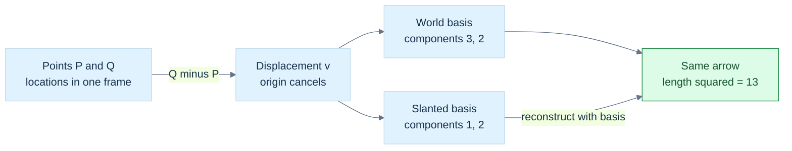
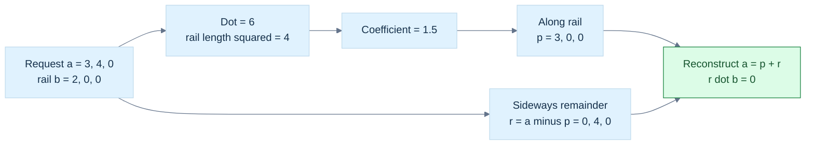
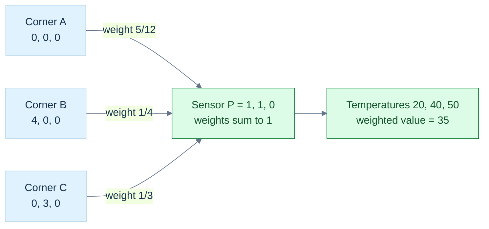
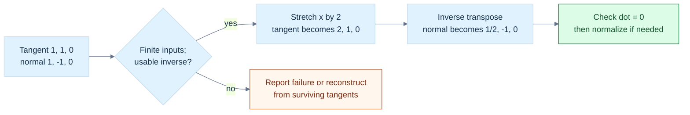

---
tags:
  - continuous-notes
  - phase-6
  - geometry
coverage: Parts 501–600
source_group: M031–M036
---

# From Movement to Meaning: Vectors, Geometry, and Reliable Code

Phase 6 asks one large question: **how do we turn a physical relationship into a calculation whose meaning survives a change of coordinates, a floating-point computation, and an engine API?**

We will answer it by building a small robot workcell. A robot must inspect a triangular metal panel, move a sensor over it, illuminate it, and avoid nearby obstacles. The same panel gives us a reason to learn numbers, vectors, lengths, projections, orientations, surface frames, interpolation, collision geometry, and reliable C++.

## The panel gives us a reason to learn

### Figure G0 - The robot and its inspection panel

![[Visual Recall/geometry_robot_panel.png]]

**Figure G0.** This original AI-generated scene gives the robot, triangular panel and sensor task a physical setting. It is a qualitative illustration, not calibrated geometry: use the coordinates and equations below for measurements, axes, corner identities and numerical work. The cyan cone schematically indicates the camera's field of view; it does not represent a measured beam or active emitted light. The following figures turn this scene into explicit mathematical relationships.

Place the panel's corners at

$$
A=(0,0,0),\qquad B=(4,0,0),\qquad C=(0,3,0).
$$

Coordinates are in metres in the workcell frame. A sensor touches the panel at

$$
P=(1,1,0).
$$

We deliberately choose simple numbers first. They make intermediate steps visible. Later we will tilt the panel, change its coordinate frame, stretch it, and move the workcell far from the origin. Those changes reveal assumptions that a tidy first example can hide.

At the beginning, the robot knows only three coordinate tuples. That is not enough. Which tuple is a location? Which is a movement? Which direction is the front face? Do the coordinates refer to the robot, panel, or camera? Is a number a metre, a second, or a dimensionless ratio?

Our central habit is to ask four questions before using a formula:

1. What does each input mean?
2. Which coordinates and units describe it?
3. What must be true for the operation to exist?
4. What can the machine lose while computing it?

You do not need a matrix course before reading this chapter. When matrices appear, read a matrix as a compact arrangement of coefficients that reconstructs or measures vectors. We explain the necessary rows, columns, transpose, determinant, and inverse at their first use.

## Numbers become a system of permitted operations

The robot moves a distance, waits a time, and adjusts a speed. Each quantity has a numeric amount. In vector algebra, a number used to scale a vector is called a [[Scalars fields and real-number models|scalar]]. Scalar describes a role. It does not mean “a `float`,” “dimensionless,” or “exactly one machine word.” A complex number can be a scalar in a complex vector space.

### Why ordinary algebra needs a field

A **set** is a collection of elements. The integers form $\mathbb Z$, rational numbers form $\mathbb Q$, real numbers form $\mathbb R$, and complex numbers form $\mathbb C$. Rational means a ratio of integers with a nonzero denominator.

A **field** is a set with addition and multiplication that support consistent ordinary algebra. The rules are worth understanding, not merely reciting:

| Rule | What it allows us to do |
|---|---|
| Closure | Adding or multiplying two allowed scalars produces another allowed scalar. |
| Associativity | Parentheses may move in a sum or product without changing the exact mathematical result. |
| Commutativity | The order of two scalar addends or factors may be exchanged. |
| Identities | Adding $0$ and multiplying by $1$ preserve the value. |
| Inverses | Every value has an additive opposite; every nonzero value has a multiplicative reciprocal. |
| Distributivity | Multiplication can expand across addition. |

For scalars $a,b,c$ these last relationships include

$$
a+(-a)=0,\qquad aa^{-1}=1\quad(a\ne0),\qquad a(b+c)=ab+ac.
$$

The reciprocal rule explains the familiar solution of $ax=b$: multiply by $a^{-1}$ to obtain $x=b/a$, provided $a\ne0$.

Why exclude zero? Distributivity implies

$$
0a=(0+0)a=0a+0a.
$$

Subtract $0a$ from both sides to obtain $0a=0$. No number can therefore multiply zero into $1$.

The integers are not a field: $2$ has no integer reciprocal. Integer-coordinate objects still have useful addition and scaling, but they are not vector spaces over the integers in the field-based sense used here. The corresponding algebraic structure is called a **module**; we do not need its further theory yet.

### Why graphics uses real-number models

The reals form an **ordered field**. The order agrees with arithmetic: adding the same value preserves an inequality, and multiplying by a positive number preserves its direction. Multiplication by a negative number reverses it. This supports interval checks, positive distances, and bounds.

The reals also have **completeness**: every nonempty set of real numbers that has an upper bound has a least upper bound. An upper bound lies at or above every member; the least upper bound is the smallest such bound. It need not be a member of the set.

For example, positive rational numbers whose squares are below $2$ have no rational least upper bound, but have the real least upper bound $\sqrt2$. To see why $\sqrt2$ is not rational, suppose it equals $p/q$ in lowest terms. Then $p^2=2q^2$, so $p$ is even. Write $p=2r$; then $q^2=2r^2$, so $q$ is even too. This contradicts lowest terms.

This is not a demand to construct real numbers inside an engine. It explains why our ideal geometry can describe roots, continuous movement, and limiting processes without holes in its number line.

For a real scalar $x$, **absolute value** $|x|$ is its nonnegative distance from zero. An **interval** selects values between endpoints: $[a,b]$ includes both endpoints, while $(a,b)$ excludes them. A function assigns an output to each allowed input; its **domain** is the set of allowed inputs. A square-root function on the reals needs a nonnegative input. A reciprocal needs a nonzero input. These domain restrictions will reappear as API contracts.

Complex numbers cannot be ordered like an ordered field. In any ordered field a nonzero square is positive. But $i^2=-1$ for the imaginary unit $i$, which would force a negative number to be positive.

### The machine is a model of the field, not the field

Finite floating-point values do not obey all field laws. Their range is bounded, division can produce non-finite results, and addition is not associative. An illustrative binary32 calculation is

$$
\operatorname{fl}\!\left(\operatorname{fl}(10^8+(-10^8))+1\right)=1,
$$

while the other grouping can produce

$$
\operatorname{fl}\!\left(10^8+\operatorname{fl}(-10^8+1)\right)=0.
$$

$\operatorname{fl}$ means rounding an operation to the chosen floating-point format. The small $1$ disappears in the second grouping before the final addition. The ideal law is useful for derivation; it does not authorize arbitrary compiler reassociation when result reproducibility matters. See [[Floating-point reassociation]] and [[Dot and cross-product rounding]].

A scalar may carry units. Multiplying velocity in metres per second by time in seconds gives a displacement in metres:

$$
\left(\frac{\mathrm m}{\mathrm s}\right)\mathrm s=\mathrm m.
$$

Type, units, finite-state policy, and mathematical role are four different pieces of information. A `double` alone tells us only one of them.

## An arrow is not the address written beside it

The robot moves from $A$ to $B$. The location $A$ is a **point**. The movement is a [[Vectors coordinates and affine points|displacement vector]]:

$$
\mathbf e_1=B-A=(4,0,0).
$$

Similarly $\mathbf e_2=C-A=(0,3,0)$. Bold letters denote vectors; ordinary uppercase letters denote points when the context is geometric. This notation helps, but meaning still comes from the declared role.

A **free vector** represents magnitude and direction without a fixed starting point. Move its drawing elsewhere without rotating or stretching it and it still represents the same vector. A displacement therefore survives a translation of the coordinate origin. A point does not.

### First movement, then coordinate arithmetic

Walk along $\mathbf a$, then along $\mathbf b$. The complete movement is $\mathbf a+\mathbf b$. Drawing both from the same starting point makes a parallelogram; its diagonal is the same result. Scaling $\mathbf a$ by a positive scalar stretches or shrinks it; a negative scalar also reverses its direction. Scaling by zero produces the zero movement.

Once a common basis has been chosen, these operations become componentwise:

$$
(a_x,a_y,a_z)+(b_x,b_y,b_z)
=(a_x+b_x,a_y+b_y,a_z+b_z),
$$

$$
s(a_x,a_y,a_z)=(sa_x,sa_y,sa_z).
$$

A **tuple** is an ordered list. A **component** is one entry of that list. Order matters: $(4,3)$ and $(3,4)$ are generally different coordinate descriptions. A tuple may describe a displacement, color, texture coordinate, or arbitrary measurements. Its storage shape does not choose its meaning.

Subtraction means adding the opposite movement. For two points, $Q-P$ is the displacement from $P$ to $Q$. Swapping them reverses the direction:

$$
P-Q=-(Q-P).
$$

The robot's velocity is $\mathbf v=(2,0,0)\,\mathrm{m/s}$. After $\Delta t=0.5\,\mathrm s$, its displacement is $(1,0,0)\,\mathrm m$. Its new location is old point plus displacement. We do not add a velocity directly to a position; the units would not match.

### Affine points do not have an intrinsic zero

An **affine space** has points and displacement vectors but no preferred origin. We may subtract two points, or translate a point by a vector. The natural operations are

$$
Q-P=\mathbf d,\qquad P+\mathbf d=Q,\qquad P-\mathbf d=\text{another point}.
$$

Point plus point is not an intrinsic affine operation. If we choose an origin $O$, the **position vector** of $P$ is $P-O$. Changing the origin changes this vector's coordinates. But a difference cancels the origin:

$$
(Q-O)-(P-O)=Q-P.
$$

This is the first safety lesson for C++: `Point3` and `Vec3` may both contain three floating-point values, yet deserve different operations. Do not turn a storage coincidence into a semantic promise.

A **direction** answers “which way?” A nonzero displacement also contains “how far?” A zero displacement is valid; a zero direction cannot specify a way to travel. A **unit vector** has length one, so it keeps direction while removing the original length. We will earn normalization rather than assume it is always possible.

## A basis is a measuring arrangement, not the vector itself

The panel has its own coordinate frame. The workcell has another. A vector does not change merely because we describe it in a different frame.

An ordered **basis** is a set of independent vectors that can reconstruct every vector in the space. **Ordered** matters: the first coordinate multiplies the first basis vector. In the familiar standard basis,

$$
\mathbf e_x=(1,0,0),\quad
\mathbf e_y=(0,1,0),\quad
\mathbf e_z=(0,0,1),
$$

we reconstruct $\mathbf v=(x,y,z)$ as $x\mathbf e_x+y\mathbf e_y+z\mathbf e_z$.

These symbols mean coordinate axes, not universal physical directions. A screen may use increasing vertical coordinates downward. A camera may look along either sign of its depth axis. “Standard basis” alone does not mean “up,” “forward,” or a particular API convention.

### The same arrow can have different coordinates

Use a two-dimensional slanted basis

$$
\mathbf b_1=(1,0),\qquad \mathbf b_2=(1,1).
$$

The world-coordinate vector $\mathbf v=(3,2)$ has coordinates $(1,2)$ in this basis, because

$$
1\mathbf b_1+2\mathbf b_2=(1,0)+(2,2)=(3,2).
$$

The vector is the same arrow. $(3,2)$ and $(1,2)$ are two descriptions. Conversely, the tuple $(1,2)$ in the world basis describes a different arrow from $(1,2)$ in the slanted basis.

We write $[\mathbf v]_B$ for the coordinate column in basis $B$. Place basis vectors into the columns of a matrix $B$:

$$
B=\begin{pmatrix}1&1\\0&1\end{pmatrix},\qquad
\mathbf v=B[\mathbf v]_B.
$$

Here matrix multiplication is simply weighted column addition. To change to another basis $C$, solve

$$
C[\mathbf v]_C=B[\mathbf v]_B.
$$

If $C$ is an invertible square basis matrix, this becomes

$$
[\mathbf v]_C=C^{-1}B[\mathbf v]_B.
$$

An **inverse** undoes a mapping. We display it to explain the relationship, not to recommend explicitly forming inverses for every numerical solve.

A **passive change** changes the description while preserving the physical vector. An **active transform** moves or changes the physical object while keeping the describing frame fixed. They may use related matrices but answer different questions.

### G1 - One movement, two descriptions



**Figure G1.** The two coordinate lists encode the same movement because $\mathbf b_1=(1,0)$ and $\mathbf b_2=(1,1)$ give $\mathbf v=1\mathbf b_1+2\mathbf b_2=(3,2)$. Points carry locations; their difference carries movement. **Limit:** all inputs must refer to a common frame before subtraction. Squaring slanted-basis coefficients gives $5$, which is not the physical squared length; use $c^\mathsf TGc=13$. See [[#The same arrow can have different coordinates|the reconstruction]] and [[#A Gram matrix remembers the geometry of a slanted basis|the metric calculation]].

### Why a basis can become unreliable

Suppose two basis directions are nearly parallel:

$$
\mathbf b_1=(1,0),\qquad \mathbf b_2=(1,\delta),\qquad 0<|\delta|\ll1.
$$

To represent $(0,1)$, coefficients must satisfy $c_2\delta=1$ and $c_1+c_2=0$. Therefore $c_2=1/\delta$ and $c_1=-1/\delta$. A modest vector requires huge cancelling coefficients. Small errors in $\delta$ can produce large coefficient errors.

This is [[Conditioning and singularity|conditioning]]: sensitivity of the answer to small changes in the input. When $\delta=0$, the directions are dependent and cannot form a two-dimensional basis. The mapping is **singular**, meaning it cannot be uniquely inverted.

A small determinant alone is not a scale-independent conditioning test. Uniformly shrinking a perfectly perpendicular basis shrinks its determinant but does not make its directions nearly parallel. Inspect relative geometry, residuals, and appropriate condition estimates.

## The reachable movements form a vector space

Why does the previous reasoning work? Because movements form a [[Vector spaces subspaces and span|vector space]] over a field. Such a space has vector addition and scalar multiplication. The rules make combined movement consistent:

$$
\mathbf u+\mathbf v=\mathbf v+\mathbf u,\qquad
(\mathbf u+\mathbf v)+\mathbf w=\mathbf u+(\mathbf v+\mathbf w),
$$

$$
\mathbf v+\mathbf0=\mathbf v,\qquad
\mathbf v+(-\mathbf v)=\mathbf0,
$$

$$
1\mathbf v=\mathbf v,\qquad
a(b\mathbf v)=(ab)\mathbf v,
$$

$$
a(\mathbf u+\mathbf v)=a\mathbf u+a\mathbf v,\qquad
(a+b)\mathbf v=a\mathbf v+b\mathbf v.
$$

Both operations must stay inside the space. These are exact mathematical laws. A machine representation approximates them.

The rules imply $0\mathbf v=\mathbf0$: expand $(0+0)\mathbf v$ and subtract one copy of $0\mathbf v$. Similarly $a\mathbf0=\mathbf0$ and $(-1)\mathbf v=-\mathbf v$. They are consequences, not extra magic rules.

Vectors need not be arrows. Polynomials of degree at most two form a real vector space with basis $1,x,x^2$. Matrices of a fixed shape form a vector space. Real-valued functions on a fixed domain also support pointwise addition and scaling. Complex numbers form a one-dimensional vector space over $\mathbb C$, but a two-dimensional one over $\mathbb R$. **Dimension depends on the field.**

Unit vectors do not form a vector space: adding two can change the length, and multiplying by zero leaves the set. Nonnegative light values are also not closed under arbitrary real scaling. Useful constrained sets should not be mislabeled vector spaces.

### A subspace is a complete movement system inside a larger one

The panel lies in the workcell's plane $z=0$. Movements restricted to this plane still support addition and arbitrary real scaling. This set is a **subspace** of $\mathbb R^3$.

The compact subspace test is: a nonempty set $W$ inside a vector space is a subspace if

$$
a\mathbf u+b\mathbf v\in W
\quad\text{for every }\mathbf u,\mathbf v\in W
\text{ and scalars }a,b.
$$

Choosing both scalars zero puts $\mathbf0$ in $W$. Choosing $a=-1$ gives additive inverses. The remaining addition rules are inherited from the larger space.

The plane $z=1$ is not a subspace. It lacks the zero vector, and adding two of its points gives depth $2$. It is an affine plane: a translated subspace. A quadrant fails closure under negative scaling. A circle boundary fails addition. Intersections of subspaces remain subspaces, but unions need not: the union of the two coordinate axes excludes $(1,1)$ even though it contains $(1,0)$ and $(0,1)$.

### Combinations describe what the robot can reach

A **linear combination** is a weighted sum of vectors:

$$
\mathbf v=\sum_{j=1}^{k}c_j\mathbf b_j.
$$

The weights $c_j$ may be negative and need not sum to one. If the robot can move along the panel edges, then

$$
\mathbf v=s(4,0,0)+t(0,3,0)=(4s,3t,0).
$$

Every in-plane movement is reachable, but no movement with nonzero depth is. The **span** of the generators is the set of all such combinations. It is the smallest subspace containing the generators: any subspace containing them must also contain their combinations. “Smallest” concerns set inclusion, not a finite count of vectors. The span normally contains infinitely many vectors.

Repeated or already-reachable generators do not enlarge the span. The span of only the zero vector is the zero subspace. By the empty-sum convention, the span of no generators is also the zero subspace.

### Independence removes redundant controls

Generators are [[Basis coordinates and dimension|linearly independent]] if

$$
\sum_jc_j\mathbf b_j=\mathbf0
\quad\Longrightarrow\quad c_j=0\text{ for every }j.
$$

If a nonzero collection of coefficients produces zero, at least one generator can be expressed using the others. It is redundant. For example, $(2,0)=2(1,0)$ adds no new direction. Any generator set containing the zero vector is dependent.

Independence also proves coordinate uniqueness. If two coefficient lists reconstruct the same vector, subtract them. Their difference reconstructs zero; independence forces every coefficient difference to vanish.

A basis must both span and be independent. Independence alone may leave unreachable directions; spanning alone may allow multiple coefficient lists. The **dimension** of a finite-dimensional space is the number of vectors in a basis. The panel's movement plane has dimension two even though its coordinates are stored in three components. The zero subspace has dimension zero.

Before continuing, ask a learner to distinguish three things: a set of generators, the span they produce, and a basis extracted by removing redundancy. Confusing them makes later matrices look much more mysterious than they are.

## A ruler needs more than coordinate components

The robot must measure how far the sensor travels. In perpendicular unit axes, the [[Norms lengths and induced distances|Euclidean length]] of $\mathbf v=(x,y,z)$ is

$$
\|\mathbf v\|_2=\sqrt{x^2+y^2+z^2}.
$$

This follows by applying Pythagoras first to the horizontal components, then to the remaining depth component. The positive square root gives a nonnegative length. For $(3,4,12)$ the squared length is $9+16+144=169$, so the length is $13$.

The hidden assumption is important: these must be orthonormal Euclidean coordinates. In a slanted basis, blindly squaring coefficients measures the wrong geometry. We will restore the missing geometry with a Gram matrix.

### What makes a norm a norm?

A **norm** assigns a nonnegative size to a vector and satisfies

$$
\|\mathbf v\|=0\iff\mathbf v=\mathbf0,\qquad
\|a\mathbf v\|=|a|\|\mathbf v\|,
$$

$$
\|\mathbf u+\mathbf v\|\le\|\mathbf u\|+\|\mathbf v\|.
$$

The last rule is the **triangle inequality**: the direct combined movement cannot be longer than walking the two movements separately, according to that norm.

Common coordinate norms are

$$
\|\mathbf v\|_1=\sum_i|v_i|,\qquad
\|\mathbf v\|_2=\sqrt{\sum_iv_i^2},\qquad
\|\mathbf v\|_\infty=\max_i|v_i|.
$$

For $(3,-4)$ they give $7$, $5$, and $4$. The first is often called Manhattan length: travel along coordinate-aligned streets. The infinity norm counts the largest component movement, useful when one step may advance all coordinates at once.

In two dimensions their unit balls are a diamond, circle, and axis-aligned square. A **unit ball** contains vectors of norm at most one. Rotating Euclidean coordinates preserves the circle and Euclidean length. It generally changes the coordinate-defined Manhattan and infinity lengths.

To check the infinity triangle inequality, use $|u_i+v_i|\le|u_i|+|v_i|\le\|\mathbf u\|_\infty+\|\mathbf v\|_\infty$ for every component, then take the maximum. The first norm follows by summing the scalar inequalities. The Euclidean proof will follow from Cauchy–Schwarz below.

For a finite coordinate vector and $p\ge1$, $\|\mathbf v\|_p=(\sum_i|v_i|^p)^{1/p}$. If $M=\max_i|v_i|$, then $M\le\|\mathbf v\|_p\le n^{1/p}M$. As $p$ grows, $n^{1/p}$ approaches one. That explains the infinity notation without invoking an infinite component value.

### Distance compares points through a movement

A norm induces a **metric**, or distance rule:

$$
d(P,Q)=\|Q-P\|.
$$

It is nonnegative, vanishes only for equal points, is symmetric, and obeys a triangle inequality. These follow from the norm's rules. Translating both points equally leaves their difference unchanged.

The choice changes which object is nearest. From the origin, $(3,0)$ is closer than $(2,2)$ in the first norm because $3<4$, but farther in the Euclidean norm because $3>\sqrt8$. A spatial-query algorithm must know which distance it is optimizing.

**Squared length** is useful but is not a norm: doubling a vector quadruples its squared length. Squared Euclidean distance is not a metric either. On a line, the squared distance from $0$ to $2$ is $4$, larger than the sum $1+1$ through the intermediate point $1$.

For a nonnegative radius $r$, the mathematical comparison

$$
\|Q-P\|_2\le r
\iff\|Q-P\|_2^2\le r^2
$$

avoids a square root. It remains necessary to consider overflow and underflow in the squared quantities. Never compare a squared distance in square metres with an ordinary radius in metres.

## A direction can exist even when the naive length overflows

[[Unit directions and safe normalization|Normalization]] asks for a unit vector pointing the same way as a nonzero vector:

$$
\widehat{\mathbf v}=\frac{\mathbf v}{\|\mathbf v\|_2}.
$$

For $(3,4,0)$ this is $(0.6,0.8,0)$. Its squared length is $0.36+0.64=1$. Normalization removes the original magnitude and its units. It is not linear: normalizing a sum is not the sum of normalized inputs.

Zero has no direction. Dividing its components by zero cannot invent one. A safe API should report failure, enforce a documented nonzero precondition, or apply a caller-chosen fallback. Silently returning zero under a “unit direction” promise is false.

### Scale first, then measure

Finite components can still produce overflowing squares. In binary32, components around $10^{20}$ have representable values, but their squares need not. Tiny values can have the opposite problem: their squares round to zero.

For a finite nonzero vector, set

$$
m=\max(|x|,|y|,|z|),\qquad
\mathbf s=\mathbf v/m.
$$

Each scaled component has magnitude at most one, and at least one has magnitude one. Therefore

$$
1\le\mathbf s\cdot\mathbf s\le3.
$$

Compute the unit direction as

$$
\widehat{\mathbf v}=\frac{\mathbf s}{\sqrt{\mathbf s\cdot\mathbf s}}.
$$

We never need to form the potentially unrepresentable original length. For $(10^{300},10^{300},0)$ in a suitable binary64 implementation, scaling gives $(1,1,0)$ and the direction $(1/\sqrt2,1/\sqrt2,0)$.

To compute an actual length, multiply the scaled length by $m$, or use `std::hypot`. The final length can genuinely exceed the result type's range; robust intermediates do not make an impossible final result representable. See [[Robust norm and intermediate range]].

There are two different rejection decisions:

- **Numerical existence:** is the vector finite and nonzero, so a direction can be computed?
- **Application meaning:** is its length large enough relative to measurement noise or scene scale to be trusted?

A mathematically nonzero displacement may be too small for a noisy sensor to define a stable direction. Specify that policy in metres or as a scale-relative threshold. Machine epsilon describes spacing near one, not a universal geometry tolerance.

Under flush-to-zero modes, very small components may already be erased or treated as zero by hardware. The scaled method cannot recover those inputs. Tests and documented assumptions must cover [[Flush-to-zero and denormals-are-zero]].

## The dot product turns two movements into a measurement

The robot needs to know how much a movement follows its guide rail. A [[Dot products and orthogonality|dot product]] measures alignment, weighted by the magnitudes.

In orthonormal real coordinates,

$$
\mathbf a\cdot\mathbf b=\sum_i a_i b_i.
$$

It is symmetric and linear in each argument, and $\mathbf v\cdot\mathbf v$ is nonnegative, vanishing only at zero. These properties make it an **inner product**. A general vector space does not automatically arrive with one. Complex inner products require conjugation and convention choices; the real formulas here must not be copied unchanged into a complex library.

### Derive the angle relationship

Expand the squared length of a difference using component arithmetic:

$$
\|\mathbf a-\mathbf b\|^2
=\|\mathbf a\|^2+\|\mathbf b\|^2-2\mathbf a\cdot\mathbf b.
$$

For the triangle formed by the two arrows, the cosine rule gives

$$
\|\mathbf a-\mathbf b\|^2
=\|\mathbf a\|^2+\|\mathbf b\|^2
-2\|\mathbf a\|\|\mathbf b\|\cos\theta.
$$

Comparing them yields

$$
\mathbf a\cdot\mathbf b=\|\mathbf a\|\|\mathbf b\|\cos\theta.
$$

For nonzero vectors, a positive dot means an acute angle, zero means a right angle, and a negative dot means an obtuse angle. It equals the cosine only when both inputs are unit length.

For $\mathbf a=(3,4,0)$ and $\mathbf b=(2,0,0)$, the dot is $6$. The lengths are $5$ and $2$, so $\cos\theta=6/10=0.6$. The dot itself was not an angle and not a cosine.

**Orthogonal** means zero inner product. In Euclidean geometry, nonzero orthogonal vectors are perpendicular. The zero vector is algebraically orthogonal to every vector but has no direction, so “its angle is ninety degrees” is not meaningful.

### A useful inequality and the missing norm proof

For nonzero $\mathbf b$, the squared length of $\mathbf a-t\mathbf b$ cannot be negative. Choose $t=(\mathbf a\cdot\mathbf b)/(\mathbf b\cdot\mathbf b)$, expand, and obtain

$$
0\le\|\mathbf a\|^2-
\frac{(\mathbf a\cdot\mathbf b)^2}{\|\mathbf b\|^2}.
$$

Hence the **Cauchy–Schwarz inequality**:

$$
|\mathbf a\cdot\mathbf b|\le\|\mathbf a\|\|\mathbf b\|.
$$

It is also true when either vector is zero. Now expand a sum's squared length and bound its dot term:

$$
\|\mathbf a+\mathbf b\|^2
\le\|\mathbf a\|^2+2\|\mathbf a\|\|\mathbf b\|+\|\mathbf b\|^2
=(\|\mathbf a\|+\|\mathbf b\|)^2.
$$

Taking nonnegative square roots proves the Euclidean triangle inequality.

For an approximate orthogonality test, a dimensionless criterion is

$$
\frac{|\mathbf a\cdot\mathbf b|}{\|\mathbf a\|\|\mathbf b\|}
\le\varepsilon_\theta.
$$

Handle zero and non-finite inputs separately; scale or safely normalize before evaluating the ratio when ranges are large. An absolute threshold on the raw dot changes its meaning when vector lengths change.

## Projection separates useful movement from sideways movement

The rail follows a nonzero vector $\mathbf b$. The robot's requested movement is $\mathbf a$. We want the part along the rail and the part left over.

The along-rail part must have form $\alpha\mathbf b$. Require the remainder to be perpendicular:

$$
(\mathbf a-\alpha\mathbf b)\cdot\mathbf b=0.
$$

Distribute and solve:

$$
\alpha=\frac{\mathbf a\cdot\mathbf b}{\mathbf b\cdot\mathbf b},\qquad
\operatorname{proj}_{\mathbf b}\mathbf a=\alpha\mathbf b.
$$

This is [[Projection rejection and scalar components|vector projection]]. The **rejection** is

$$
\mathbf r=\mathbf a-\operatorname{proj}_{\mathbf b}\mathbf a.
$$

The **signed scalar projection** is a different output:

$$
s=\frac{\mathbf a\cdot\mathbf b}{\|\mathbf b\|}.
$$

It measures signed length along the target direction. The coefficient $\alpha$ multiplies the target vector; the vector projection is a vector. These three quantities coincide only in special ways, not by definition.

### An execution trace you can teach at the board

Take $\mathbf a=(3,4,0)$ and rail vector $\mathbf b=(2,0,0)$:

| Step | Result |
|---|---|
| Dot with the rail | $\mathbf a\cdot\mathbf b=6$ |
| Rail squared length | $\mathbf b\cdot\mathbf b=4$ |
| Coefficient | $\alpha=6/4=1.5$ |
| Vector projection | $1.5(2,0,0)=(3,0,0)$ |
| Rejection | $(3,4,0)-(3,0,0)=(0,4,0)$ |
| Signed scalar projection | $s=6/2=3$ |

The remainder dotted with the rail is zero. The squared lengths satisfy $25=9+16$. Scaling the rail vector to $(20,0,0)$ changes the coefficient but not the vector projection: the geometric line is unchanged.

### G2 - Split the request into rail travel and sideways travel



**Figure G2.** Each box is a checkable stage, not a drawing to scale. The coefficient $1.5$ is dimensionless here; the signed along-rail length is $3$, and the projected vector is $(3,0,0)$. **Limit:** $\mathbf b\ne\mathbf0$ and Euclidean measurement are required. For a unit axis $\widehat{\mathbf b}$, use $\mathbf p=(\mathbf a\cdot\widehat{\mathbf b})\widehat{\mathbf b}$. Extreme arithmetic ranges and a tiny cancellation residual still need the policies explained below.

Projection onto zero is undefined because zero defines no line. Projecting zero onto a valid line is fine and gives zero.

Why is the projection the closest rail movement? Every candidate $t\mathbf b$ differs from $\mathbf a$ by

$$
\mathbf a-t\mathbf b=\mathbf r+(\alpha-t)\mathbf b.
$$

The two terms are perpendicular, so

$$
\|\mathbf a-t\mathbf b\|^2
=\|\mathbf r\|^2+(\alpha-t)^2\|\mathbf b\|^2.
$$

The smallest value occurs at $t=\alpha$. This is a **least-squares** problem: choose a parameter that minimizes the sum of squared coordinate errors.

Projection is **idempotent**: projecting an already-projected vector changes nothing. For a fixed target line it is linear in the input. Rejection is also linear and idempotent. Reflection will reverse the rejected or projected portion according to which geometric mirror we choose; rejection itself is not reflection.

On a unit normal $\mathbf n$, removing the normal component gives surface-sliding movement:

$$
\mathbf v_{\mathrm{slide}}=\mathbf v-(\mathbf v\cdot\mathbf n)\mathbf n.
$$

If the requested movement is almost entirely normal, the small tangential remainder can be sensitive to cancellation. Correct decomposition does not guarantee high relative accuracy in a tiny residual.

## A Gram matrix remembers the geometry of a slanted basis

In the slanted basis from earlier, dotting coordinate lists directly gives the wrong answer. Let basis columns be $\mathbf b_1,\ldots,\mathbf b_k$. The [[Gram matrices and coordinate metrics|Gram matrix]] stores all pairwise inner products:

$$
G_{ij}=\mathbf b_i\cdot\mathbf b_j.
$$

The diagonal holds squared lengths; off-diagonal entries hold alignment. With $\mathbf b_1=(1,0)$ and $\mathbf b_2=(1,1)$,

$$
G=\begin{pmatrix}1&1\\1&2\end{pmatrix}.
$$

If $\mathbf v=\sum_i c_i\mathbf b_i$ and $\mathbf w=\sum_jd_j\mathbf b_j$, distribute the dot product:

$$
\mathbf v\cdot\mathbf w
=\sum_{i,j}c_iG_{ij}d_j=c^\mathsf TGd.
$$

The superscript $\mathsf T$ means **transpose**: exchange rows and columns. It lets a column coordinate list act as the row that weights the next expression.

For $c=(1,2)^\mathsf T$, compute $Gc=(3,5)^\mathsf T$, then $c^\mathsf TGc=3+10=13$. The reconstructed vector is $(3,2)$, whose Euclidean squared length is also $13$. Blindly squaring the coordinates would give $5$.

$G$ is symmetric. It is **positive semidefinite** because

$$
c^\mathsf TGc=\left\|\sum_i c_i\mathbf b_i\right\|^2\ge0.
$$

For independent columns it is **positive definite**: this quantity is positive for every nonzero coefficient vector. For dependent columns a nonzero coefficient list can reconstruct zero, so $G$ is singular. An orthonormal basis has $G=I$, the identity matrix, explaining why ordinary coordinate dotting is then correct.

The Gram determinant measures squared area for two vectors and squared volume for three. But it does not retain orientation; reflecting every basis vector can preserve every dot product. A Gram matrix remembers metric geometry, not the complete physical frame.

To project onto a multi-vector span, require the residual to be perpendicular to every generator. In matrix notation this produces

$$
Gc=B^\mathsf T\mathbf v.
$$

This explains the system, but forming $G=B^\mathsf TB$ can square the two-norm condition number of a full-column-rank $B$:

$$
\kappa_2(B^\mathsf TB)=\kappa_2(B)^2.
$$

QR-based solves are usually a better route when numerical conditioning matters. We will build the orthogonalization intuition shortly rather than hide this behind a matrix recipe.

## Rotation first becomes understandable in a plane

Before constructing the panel's three-dimensional frame, rotate its sensor sweep within a plane. [[Complex numbers and planar rotations|Complex numbers]] provide a compact explanation.

Write a complex number as $z=x+iy$, where $i^2=-1$. Its real and imaginary components locate a point in a two-dimensional diagram. Addition adds these components. Multiplication follows distributivity:

$$
(a+ib)(x+iy)=(ax-by)+i(ay+bx).
$$

Multiplication by $i$ sends $(x,y)$ to $(-y,x)$. Applying it twice sends the vector to $(-x,-y)$, because $i^2=-1$. In conventional upward-positive Cartesian coordinates, one application is a counterclockwise quarter-turn.

For an arbitrary angle, use the unit complex number

$$
r=\cos\theta+i\sin\theta.
$$

Multiplying a coordinate pair by $r$ gives

$$
x'=x\cos\theta-y\sin\theta,\qquad
y'=x\sin\theta+y\cos\theta.
$$

For $(1,0)$ and $\theta=\pi/2$, the result is $(0,1)$. For $(2,1)$, the same quarter-turn gives $(-1,2)$. Trigonometric functions in our code use radians: $\pi$ radians equal $180^\circ$.

The **conjugate** of $z=x+iy$ is $\overline z=x-iy$. It satisfies

$$
z\overline z=x^2+y^2=|z|^2.
$$

Therefore $z^{-1}=\overline z/|z|^2$ when $z\ne0$. For a unit rotation, the inverse is just the conjugate. Multiplying two unit rotations composes them; angle-addition identities show that their angles add.

A non-unit multiplier rotates and scales, rather than only rotating. Repeated floating-point composition can gradually change the stored magnitude. Re-normalize under an explicit drift policy when the representation promises a rotation. The complex zero is not a valid rotation: multiplication by it collapses every point.

There is a numerical warning in the inverse formula. Squaring very large components can overflow even when a useful reciprocal exists; squaring tiny ones can underflow. Use a range-aware complex division algorithm rather than treating the displayed derivation as a universally safe implementation.

```cpp
struct Complex2 {
    double real{}, imag{};
};
constexpr Complex2 multiply(Complex2 a, Complex2 b) noexcept {
    return {a.real * b.real - a.imag * b.imag,
            a.real * b.imag + a.imag * b.real};
}
```

This excerpt implements multiplication, not a validated rotation type. The later laboratory uses a separate unit-vector wrapper for the same reason: a representation and a validated promise are different things.

## Oriented area tells us which side of the panel is front

The panel needs a facing direction. Its edge vectors lie in its plane, so their dot product alone cannot provide an out-of-plane direction. We need [[Cross products and oriented area|oriented area]].

### The cross product and its definition

In an oriented three-dimensional Euclidean space, the **cross product** $\mathbf a\times\mathbf b$ is perpendicular to both inputs. Its magnitude is the parallelogram area, and its sign follows the chosen orientation. Parallel inputs produce zero.

For a positively oriented orthonormal basis, the component rule is

$$
\mathbf a\times\mathbf b=
\begin{pmatrix}
a_yb_z-a_zb_y\\
a_zb_x-a_xb_z\\
a_xb_y-a_yb_x
\end{pmatrix}.
$$

This explicitly supplies the Part 542 definition absent as a standalone source. We now derive rather than merely memorize its components.

The signed area spanned by two coordinate pairs in the first two axes is the $2\times2$ determinant

$$
\det\begin{pmatrix}a_x&b_x\\a_y&b_y\end{pmatrix}
=a_xb_y-a_yb_x.
$$

It is positive for the ordered pair of standard axes and changes sign when the arrows swap. Similar area measurements in the other coordinate planes give the three components above. The familiar symbolic determinant containing basis vectors is a mnemonic for these three signed minors, not a new unexplained arithmetic object.

Check perpendicularity directly: expand $\mathbf a\cdot(\mathbf a\times\mathbf b)$. Each product cancels a matching term of opposite sign, leaving zero. The same calculation with $\mathbf b$ also gives zero. The construction is linear in each input and changes sign under exchange:

$$
\mathbf a\times\mathbf b=-\mathbf b\times\mathbf a.
$$

### The panel's normal and area

For the panel edges,

$$
(B-A)\times(C-A)=(4,0,0)\times(0,3,0)=(0,0,12).
$$

The raw result has magnitude $12\,\mathrm{m}^2$, the parallelogram area. The triangular panel occupies half of that, so its area is $6\,\mathrm{m}^2$. Its unit front normal is $(0,0,1)$ under this vertex ordering.

The identity

$$
\|\mathbf a\times\mathbf b\|^2
=\|\mathbf a\|^2\|\mathbf b\|^2-(\mathbf a\cdot\mathbf b)^2
$$

follows by expanding both sides into products of components and cancelling matching terms. Insert the cosine relation to obtain

$$
\|\mathbf a\times\mathbf b\|=\|\mathbf a\|\|\mathbf b\|\sin\theta
\quad(0\le\theta\le\pi).
$$

This is base times perpendicular height. It connects cross products, Gram determinants, area, and angle rather than introducing unrelated facts.

The cross components of nearly parallel inputs subtract nearly equal products. Their small result may be sensitive to rounding. The area identity is not automatically a numerically safer alternative: its right side can suffer severe cancellation too. Scale-aware nonparallelness is expressed by

$$
\frac{\|\mathbf a\times\mathbf b\|}{\|\mathbf a\|\|\mathbf b\|}=\sin\theta,
$$

with nonzero inputs and range-safe evaluation. A tiny raw cross magnitude alone may mean tiny geometry rather than nearly parallel directions.

### Orientation is not storage order in memory

An ordered frame $(\mathbf x,\mathbf y,\mathbf z)$ is right-handed relative to our chosen positive orientation when

$$
(\mathbf x\times\mathbf y)\cdot\mathbf z>0.
$$

It is left-handed when the sign is negative; zero means a degenerate frame, not a third handedness. Swapping two axes reverses the sign. Cyclic permutation preserves it. An orientation-preserving rotation cannot turn a right-handed frame into a left-handed one; a reflection can.

[[Coordinate handedness and orientation|Handedness]] does not specify which axis is up, whether a camera looks toward positive or negative depth, or whether a matrix is stored by rows or columns. Define all these conventions separately.

For an orthogonal transform $R$,

$$
(R\mathbf a)\times(R\mathbf b)
=\det(R)R(\mathbf a\times\mathbf b).
$$

A proper rotation has determinant $1$. A reflection has determinant $-1$, so the oriented-area vector gains an extra sign. This explains why blindly treating a cross-derived normal as an ordinary direction through a mirror can reverse mesh orientation.

The same component cross formula encodes a chosen positive orientation. When using a basis of opposite orientation, decide whether the code's algebraic convention or the external geometric orientation is authoritative and convert consistently. Calling a whole graphics API “left-handed” does not settle every stage of that pipeline.

### Why three dimensions are special, but not the whole story

In two dimensions an oriented area has one independent component; it is not an in-plane perpendicular vector. The often-named “2D cross” is the scalar signed area $a_xb_y-a_yb_x$.

In $n$ dimensions, oriented two-dimensional areas have $n(n-1)/2$ independent components. In three dimensions that count equals three, allowing area components to be identified with a vector after a metric and orientation are chosen. In four dimensions there are six area components, not four. Also, two independent vectors in four-dimensional space have a two-dimensional perpendicular space rather than one uniquely oriented perpendicular direction.

There is an exceptional seven-dimensional binary cross product with additional structure. Do not turn the introductory three-dimensional explanation into the false claim that no such operation exists anywhere else. The ordinary graphics cross product remains the three-dimensional one described here.

## Signed volume extends the same idea into space

Move a test point above the panel to $D=(0,0,2)$. The [[Triple products and signed volume|scalar triple product]] is

$$
(B-A)\cdot\big((C-A)\times(D-A)\big)=24.
$$

Equivalently, dot the area normal $(B-A)\times(C-A)$ with $D-A$; cyclic rearrangement preserves the scalar value. The signed parallelepiped volume is $24\,\mathrm{m}^3$. The tetrahedron formed by four corners has one sixth of it, so its ordinary volume is $4\,\mathrm{m}^3$.

Why area times height? The cross product contributes an area vector. Dotting with the third movement selects the signed component perpendicular to the base. A third vector lying in the base plane contributes zero height. Swapping two inputs reverses orientation, while taking absolute value gives ordinary volume.

In coordinates the triple product is a $3\times3$ determinant. A **determinant** measures oriented area or volume scaling for a square linear map. A zero determinant indicates lost dimensions. It is not a universal conditioning score.

### Nested cross products are not associative

The **vector triple-product identity** is

$$
\mathbf a\times(\mathbf b\times\mathbf c)
=\mathbf b(\mathbf a\cdot\mathbf c)-\mathbf c(\mathbf a\cdot\mathbf b).
$$

For its first component, expand the left side:

$$
a_y(b_xc_y-b_yc_x)-a_z(b_zc_x-b_xc_z)
=b_x(a_yc_y+a_zc_z)-c_x(a_yb_y+a_zb_z).
$$

Add the cancelling pair $b_xa_xc_x-c_xa_xb_x$ and recover the first component of the right side. The other components follow by cycling indices.

For the other grouping,

$$
(\mathbf a\times\mathbf b)\times\mathbf c
=\mathbf b(\mathbf a\cdot\mathbf c)-\mathbf a(\mathbf b\cdot\mathbf c).
$$

These generally differ. Parentheses are part of the geometry, not optional punctuation. For example, $\mathbf e_x\times(\mathbf e_x\times\mathbf e_y)=-\mathbf e_y$, but $(\mathbf e_x\times\mathbf e_x)\times\mathbf e_y=\mathbf0$.

For unit $\mathbf n$, the related identity

$$
\mathbf n\times(\mathbf v\times\mathbf n)
=\mathbf v-\mathbf n(\mathbf v\cdot\mathbf n)
$$

is precisely tangent-plane rejection. A nested cross has now become a previously understood projection operation.

## An angle is a question with a domain

The [[Robust vector angles|unsigned angle]] between nonzero vectors lies in $[0,\pi]$. The familiar expression is

$$
\theta=\arccos\left(
\frac{\mathbf a\cdot\mathbf b}{\|\mathbf a\|\|\mathbf b\|}
\right).
$$

After checking finite, nonzero inputs, clamp a small numerical overshoot of the computed cosine to $[-1,1]$. Clamping is not a substitute for valid inputs. Near parallel or antiparallel directions, the derivative of inverse cosine is large, so small cosine errors can produce relatively large angle errors.

Dot and cross provide cosine-like and sine-like information together. Therefore a useful alternative is

$$
\theta=\operatorname{atan2}
\left(\|\mathbf a\times\mathbf b\|,\mathbf a\cdot\mathbf b\right).
$$

$\operatorname{atan2}(y,x)$ determines an angle from both components and their signs. Using the nonnegative cross length makes this an unsigned angle. Identical directions give zero; opposite directions give $\pi$; perpendicular directions give $\pi/2$.

Scale each input by its own largest absolute component before computing dot and cross. Both quantities then acquire the same positive scale factor relative to the originals, leaving the angle unchanged while reducing overflow risk. This does not make cancellation disappear or recover already-rounded inputs.

A signed angle needs an orientation reference. For two vectors lying in a plane with unit positive normal $\mathbf n$,

$$
\theta_{\mathrm{signed}}=
\operatorname{atan2}\big(\mathbf n\cdot(\mathbf a\times\mathbf b),
\mathbf a\cdot\mathbf b\big).
$$

For arbitrary non-coplanar inputs, first define which plane or projected directions the signed angle refers to. A reference normal cannot resolve an unstated geometric question.

Often no angle is needed. To test whether unit directions differ by at most $\theta_{\max}$ in $[0,\pi]$, compare their dot product with $\cos\theta_{\max}$. This saves inverse trigonometry and states the actual decision.

## Surface movement becomes a local frame

The robot needs a front-facing normal and two directions along the panel. A [[Surface tangents normals and bitangents|tangent]] lies in a surface's local tangent plane. A **normal** is perpendicular to that plane. A **bitangent** supplies a second tangent direction, often paired with increasing texture coordinates.

For a smooth parameterized surface $\mathbf p(u,v)$, the partial derivatives $\partial\mathbf p/\partial u$ and $\partial\mathbf p/\partial v$ are local tangent vectors when they are independent. “Partial derivative” means the rate of change while varying one parameter and holding the other fixed. On a triangle, edge vectors directly span the flat tangent plane.

For a sphere centered at $C$, the outward normal at a surface point $P$ follows $P-C$. For a plane through $A$ with normal $\mathbf n$, points obey

$$
\mathbf n\cdot(P-A)=0.
$$

A normal need not be unit length. If it is used as a signed distance ruler, it must be unit, otherwise the dot result contains an extra scale factor.

A **geometric normal** comes from the actual surface. A **shading normal** may be interpolated or modified to make lighting appear smooth. They can differ and have different responsibilities. Averaging unit normals usually yields a non-unit vector; re-normalize only after checking that the average has a usable direction. A collapsed triangle has no uniquely reliable face normal.

### Texture coordinates specify preferred tangents

Let the panel corners have texture coordinates $(0,0)$, $(1,0)$, and $(0,1)$. The panel's position changes by $(4,0,0)$ when its first texture parameter increases by one, and by $(0,3,0)$ when the second increases by one. The raw texture tangents therefore carry spatial stretch, not merely direction.

For general texture differences, write

$$
\mathbf e_1=\Delta u_1\mathbf t+\Delta v_1\mathbf b,
\qquad
\mathbf e_2=\Delta u_2\mathbf t+\Delta v_2\mathbf b.
$$

Eliminate one unknown at a time. With

$$
D=\Delta u_1\Delta v_2-\Delta u_2\Delta v_1,
$$

the result is

$$
\mathbf t=\frac{\Delta v_2\mathbf e_1-\Delta v_1\mathbf e_2}{D},
\qquad
\mathbf b=\frac{\Delta u_1\mathbf e_2-\Delta u_2\mathbf e_1}{D}.
$$

$D$ is the signed texture-area scale. Zero means the texture triangle has collapsed and cannot identify two distinct texture directions. Nearly zero can amplify input error. Spatial degeneracy and texture degeneracy are separate checks.

### Clean the frame without erasing its orientation

Given a unit normal $\mathbf n$ and raw tangent $\mathbf t$, remove normal contamination and normalize:

$$
\mathbf t'=\mathbf t-(\mathbf t\cdot\mathbf n)\mathbf n,
\qquad \widehat{\mathbf t}=\operatorname{normalize}(\mathbf t').
$$

To preserve a mirrored texture island, keep a handedness sign

$$
h=\operatorname{sign}\big((\mathbf n\times\widehat{\mathbf t})\cdot\mathbf b_{\mathrm{raw}}\big),
\qquad
\widehat{\mathbf b}=h(\mathbf n\times\widehat{\mathbf t}).
$$

When the sign test is zero or too uncertain, the input frame does not reliably determine handedness. Do not quietly invent a positive sign while claiming the original frame was valid.

The resulting **TBN frame** consists of tangent, bitangent, and normal. It converts a texture-local normal into the surface's frame through weighted column addition. Document whether $h$ is encoded with this convention or its opposite.

The distinction between geometric and shading frames is used in real rendering systems; PBRT's triangle implementation separately constructs these quantities and accounts for orientation reversal. That reference is an implementation anchor, not evidence that our simplified lab covers every seam and interpolation rule. [PBRT, Triangle Meshes](https://www.pbr-book.org/4ed/Shapes/Triangle_Meshes).

## Orthonormal frames make reconstruction simple

A [[Orthonormal frames and Gram-Schmidt|frame is orthonormal]] when all its axes have length one and are mutually perpendicular. Its Gram matrix is identity. Coordinates of a vector are simply its dot products with the axes:

$$
\mathbf v=\sum_i(\mathbf v\cdot\mathbf q_i)\mathbf q_i.
$$

Orthonormality is why local lighting directions can be measured without solving a slanted-basis system each time.

### Build a frame from one direction

A unit normal does not uniquely specify two tangent axes: they may rotate around it. We must choose a convention.

Choose a coordinate axis $\mathbf h$ least aligned with the normal. In practice, select the axis corresponding to the smallest absolute component of $\mathbf n$. Then compute

$$
\mathbf t=\operatorname{normalize}(\mathbf h\times\mathbf n),
\qquad \mathbf b=\mathbf n\times\mathbf t.
$$

Because one squared component of a unit normal is at most $1/3$, this helper has

$$
\|\mathbf h\times\mathbf n\|^2
=1-(\mathbf h\cdot\mathbf n)^2\ge\frac23.
$$

So this exact-arithmetic helper cannot become almost parallel to the normal. For $\mathbf n=(0,0,1)$ and helper $(1,0,0)$, tangent is $(0,-1,0)$ and bitangent $(1,0,0)$. These are valid axes even though they differ from a texture-preferred orientation.

This construction is easy to teach, but its selected helper can change abruptly at tie boundaries. That matters for animated or spatially coherent frames. Robustness against division by a small quantity does not guarantee continuity of the output convention.

Research on orthonormal-basis construction investigates such numerical behavior. Duff and colleagues' *Building an Orthonormal Basis, Revisited* is a useful comparison target for a faster specialized construction. We use the transparent helper-axis method here; we do not claim to have benchmarked or implemented that paper's algorithm. [Duff et al., 2017](https://graphics.pixar.com/library/OrthonormalB/paper.pdf).

### Gram–Schmidt is repeated rejection

Given independent generators $\mathbf v_1,\mathbf v_2,\mathbf v_3$, first normalize $\mathbf v_1$ to $\mathbf q_1$. Then remove its component from the second generator:

$$
\mathbf u_2=\mathbf v_2-(\mathbf v_2\cdot\mathbf q_1)\mathbf q_1,
\qquad \mathbf q_2=\mathbf u_2/\|\mathbf u_2\|.
$$

For the third,

$$
\mathbf u_3=\mathbf v_3
-(\mathbf v_3\cdot\mathbf q_1)\mathbf q_1
-(\mathbf v_3\cdot\mathbf q_2)\mathbf q_2,
\qquad \mathbf q_3=\mathbf u_3/\|\mathbf u_3\|.
$$

Each new axis keeps only movement not represented by previous axes. Because we subtract combinations of earlier generators, the span is preserved. A zero residual reveals dependence. A very small residual may reveal near dependence and unreliable input geometry.

Use $\mathbf v_1=(1,1,0)$ and $\mathbf v_2=(1,0,0)$. The first axis is $(1,1,0)/\sqrt2$. The projection of the second is $(1/2,1/2,0)$. The residual is $(1/2,-1/2,0)$, yielding axis $(1,-1,0)/\sqrt2$. Both original generators remain in the reconstructed span.

### Modified order changes floating-point behavior

Classical Gram–Schmidt evaluates every projection coefficient against the original current generator, then subtracts the combined projections. **Modified Gram–Schmidt** repeatedly measures and subtracts from the updated residual:

```text
r = current generator
for each earlier unit axis q:
    coefficient = dot(q, r)
    r = r - coefficient * q
validate the residual, then normalize it
```

They agree in exact arithmetic when previous axes are exactly orthonormal. Floating-point axes and subtractions are not exact, so the order matters. Modified Gram–Schmidt often retains orthogonality better, but it cannot repair fundamentally uncertain near-dependent inputs. A second orthogonalization pass can help; rank detection and tolerance remain deliberate policies.

Validate both $\|Q^\mathsf TQ-I\|$ and $\|V-QR\|$ under declared norms. The first checks axis orthogonality; the second checks reconstruction. A small reconstruction error alone does not prove good orthogonality.

For dense general-purpose solves, Householder QR is an important alternative. LAPACK represents the orthogonal factor through elementary reflectors rather than simply materializing a Gram matrix. This is the next-depth connection, not a new dependency for this vault's small laboratory. [LAPACK, QR Factorization](https://www.netlib.org/lapack/lug/node40.html).

## Light uses the same decomposition in a new role

Our panel is now a surface, not just a movement plane. A ray approaches it with unit direction $\mathbf i$ pointing **toward** the interface. Choose a unit normal $\mathbf n$ pointing back into the incident medium, so front-side incidence obeys $\mathbf i\cdot\mathbf n\le0$.

### Reflection reverses the normal component

The tangential part is unchanged and the normal part reverses. Therefore [[Reflection refraction and shading directions|reflection across the surface plane]] gives

$$
\mathbf r=\mathbf i-2(\mathbf i\cdot\mathbf n)\mathbf n.
$$

For $\mathbf i=(0.6,0,-0.8)$ and $\mathbf n=(0,0,1)$, the result is $(0.6,0,0.8)$. The length stays one in exact arithmetic. At normal incidence, $\mathbf i=-\mathbf n$ reflects to $\mathbf n$.

If the normal is not unit, use the general projection denominator:

$$
\mathbf r=\mathbf i-2\frac{\mathbf i\cdot\mathbf n}{\mathbf n\cdot\mathbf n}\mathbf n.
$$

Reflection across a line instead preserves the along-line component and reverses the perpendicular component. State which mirror you mean. “Reflect around the normal” is otherwise ambiguous.

### Refraction changes the tangent amount

For a transparent material with scalar refractive indices $n_1,n_2$, define $\eta=n_1/n_2$ and $c_i=-\mathbf i\cdot\mathbf n$. Snell's law is

$$
n_1\sin\theta_i=n_2\sin\theta_t.
$$

The incident tangential vector is $\mathbf i+c_i\mathbf n$ and has length $\sin\theta_i$. The transmitted tangent must therefore be $\eta(\mathbf i+c_i\mathbf n)$. To complete a unit transmitted direction, its normal magnitude must be

$$
c_t=\sqrt{k},\qquad k=1-\eta^2(1-c_i^2).
$$

Choose its normal component into the second medium, opposite $\mathbf n$:

$$
\mathbf t=\eta\mathbf i+(\eta c_i-\sqrt{k})\mathbf n.
$$

For air-to-glass indices $1$ and $1.5$ at $45^\circ$ incidence, the transmitted sine is $\sqrt2/3$ and the angle is approximately $28.1^\circ$. The ray bends toward the normal. These indices are a simplified example, not a wavelength-dependent material model.

If $k<0$, no real transmitted direction satisfies Snell's law: **total internal reflection** occurs. When $n_1>n_2$, the critical angle obeys

$$
\theta_c=\arcsin(n_2/n_1).
$$

At the threshold, tiny arithmetic errors can change the sign of $k$. A physically chosen uncertainty policy may treat a narrow interval specially. Unconditionally clamping every negative $k$ to zero destroys the distinction between rounding and genuine total internal reflection.

When a ray leaves rather than enters, orient the normal against the incident direction and use the correct incident/transmitted index ratio. Snell's law computes a direction, not Fresnel energy splitting, absorption, dispersion, or full material appearance.

The sign conventions and formulas agree with the GLSL reflection/refraction definitions when their input requirements are met; the shader specification's zero-return convention for total internal reflection differs from our explicit failure result. [GLSL 4.60, Geometric Functions](https://registry.khronos.org/OpenGL/specs/gl/GLSLangSpec.4.60.html#geometric-functions).

### A half-vector is a bisector only after its inputs are understood

For shading, let $\mathbf l$ point from the surface toward the light and $\mathbf v$ toward the viewer. Both are unit directions, which differs from the incident-travel convention above. The **half-vector** is

$$
\mathbf h=\frac{\mathbf l+\mathbf v}{\|\mathbf l+\mathbf v\|}.
$$

Because $\mathbf l\cdot(\mathbf l+\mathbf v)=1+\mathbf l\cdot\mathbf v$ and the same expression holds for $\mathbf v$, the normalized sum makes equal angles with both directions. If the directions are opposite, their sum is zero and no unique half-vector exists.

If the inputs have unequal magnitudes, their sum is biased toward the larger one and is not the desired angular bisector. The half-vector supports certain specular-lighting models; it does not by itself define a physically complete reflectance law. The panel's geometry gives a direction, while material modeling determines what that direction means for brightness.

## The sensor needs coordinates inside the triangle

Cartesian coordinates tell us where the sensor is in the workcell. [[Barycentric coordinates and interpolation|Barycentric coordinates]] tell us how it sits relative to the panel's three corners.

We seek weights satisfying

$$
P=\alpha A+\beta B+\gamma C,
\qquad \alpha+\beta+\gamma=1.
$$

This is shorthand for an affine construction, not permission for unrestricted point arithmetic. Translate all coordinate origins by a vector $\mathbf t$. The weighted expression changes by $(\alpha+\beta+\gamma)\mathbf t=\mathbf t$, exactly as a point should. Without the sum-to-one constraint, it would depend incorrectly on the origin.

Subtract $A$ to obtain a purely vector equation:

$$
P-A=\beta(B-A)+\gamma(C-A).
$$

For our panel, $P-A=(1,1,0)$, so $4\beta=1$ and $3\gamma=1$. Therefore

$$
\beta=\frac14,\qquad\gamma=\frac13,\qquad
\alpha=1-\frac14-\frac13=\frac5{12}.
$$

All weights are nonnegative, so the sensor lies inside or on the triangle. An edge has one zero weight; a vertex has one weight equal to one and the others zero. The triangle's **centroid**, its uniform geometric center, has three equal weights $1/3$. A **barycenter**, also spelled barycentre, is a weighted center. With nonnegative masses at the corners, normalized mass weights describe their center of mass. Barycentric weights in general are not distances, and need not be mass fractions. Do not confuse a triangle's centroid with an unweighted average of vertices for every possible shape.

### G3 - Reconstruct a sensor location from the corners



**Figure G3.** This is a weighted reconstruction diagram, not a perspective view of the panel. The point equation is $P=\frac5{12}A+\frac14B+\frac13C$; the same weights interpolate an attribute assumed affine on the triangle. **Limit:** corners must be noncollinear and $P$ must lie in their plane for an exact point reconstruction. Nonnegative weights then locate the point in the closed triangle. For an off-plane input, the Gram solve gives its planar projection; check the residual. Screen-space interpolation under perspective needs [[#Perspective changes the interpolation weights|reciprocal clip-depth correction]].

### Derive the weights in a tilted triangle

Let $\mathbf e_1=B-A$, $\mathbf e_2=C-A$, and $\mathbf q=P-A$. Dot the reconstruction equation with each edge:

$$
\begin{pmatrix}
\mathbf e_1\cdot\mathbf e_1&\mathbf e_1\cdot\mathbf e_2\\
\mathbf e_1\cdot\mathbf e_2&\mathbf e_2\cdot\mathbf e_2
\end{pmatrix}
\begin{pmatrix}\beta\\\gamma\end{pmatrix}
=\begin{pmatrix}\mathbf e_1\cdot\mathbf q\\\mathbf e_2\cdot\mathbf q\end{pmatrix}.
$$

This is the two-edge Gram system. Define $g_{11},g_{12},g_{22}$ from its left side and $r_1,r_2$ from its right side. Eliminating the unknowns gives

$$
D=g_{11}g_{22}-g_{12}^2,
\qquad
\beta=\frac{g_{22}r_1-g_{12}r_2}{D},
\qquad
\gamma=\frac{g_{11}r_2-g_{12}r_1}{D}.
$$

$D=\|\mathbf e_1\times\mathbf e_2\|^2$. It vanishes for a degenerate triangle. Near degeneracy, solving for weights is sensitive even if a denominator happens to be nonzero in machine arithmetic.

If $P$ is off the plane, this system returns coordinates of its orthogonal projection onto the plane, not proof that $P$ belongs to the triangle. Check the reconstruction residual or signed plane distance separately.

### Signed area also answers which side we are on

For two-dimensional points, define

$$
\operatorname{orient}_2(A,B,C)
=(B_x-A_x)(C_y-A_y)-(B_y-A_y)(C_x-A_x).
$$

It is the signed doubled area. Positive means counterclockwise in an upward-positive, positively oriented Cartesian drawing; negative means clockwise. Reverse vertical screen coordinates and the visual interpretation reverses too.

The barycentric weights can be written as signed area ratios:

$$
\alpha=\frac{\operatorname{orient}_2(P,B,C)}{\operatorname{orient}_2(A,B,C)},\quad
\beta=\frac{\operatorname{orient}_2(A,P,C)}{\operatorname{orient}_2(A,B,C)},\quad
\gamma=\frac{\operatorname{orient}_2(A,B,P)}{\operatorname{orient}_2(A,B,C)}.
$$

For the panel in its plane, the denominator is $12$. The three numerators are $5$, $3$, and $4$, reproducing the earlier weights. With a fixed base, a subtriangle's area scales with the opposite point's perpendicular height. That is why an area ratio gives an affine coordinate.

In three dimensions the four-point orientation quantity is

$$
\operatorname{orient}_3(A,B,C,D)
=\big((B-A)\times(C-A)\big)\cdot(D-A).
$$

It tells which side of the oriented plane contains $D$. Some libraries define the opposite ordering and hence the opposite sign. Match the documented definition rather than comparing function names.

### A predicate needs a trustworthy sign

A **predicate** answers a categorical question, such as left/right or inside/outside. A measurement estimates a magnitude. A slightly inaccurate area may be acceptable; a wrong sign used to connect a mesh can corrupt topology.

Near cancellation, ordinary floating-point determinants may have the wrong sign. Wider arithmetic helps but is not a universal certificate. Nor is replacing “small” values with zero: that changes the geometry and can make decisions inconsistent.

[[Robust geometric predicates|Adaptive predicates]] first use a fast calculation with a justified error bound, then use more exact arithmetic when the sign is uncertain. Shewchuk's work supplies orientation and incircle implementations and discusses the required arithmetic environment. This protects decisions about the stored coordinates; it cannot restore physical accuracy lost before those coordinates were stored. [Shewchuk, Robust Geometric Predicates](https://www.cs.cmu.edu/~quake/robust.html).

Our laboratory tests well-conditioned examples with ordinary arithmetic. It does **not** implement certified orientation predicates, watertight triangle intersection, or shared-edge rasterization ownership. Those are next-depth topics with stricter contracts.

### The same weights interpolate attributes

Suppose corner temperatures are $20$, $40$, and $50$ degrees Celsius. An affine interpolation gives

$$
T(P)=\frac5{12}(20)+\frac14(40)+\frac13(50)=35.
$$

The weights reconstruct any attribute assumed to vary affinely across this triangle: texture coordinates, scalar fields, and suitable vector-valued data. At a vertex the formula returns that vertex's attribute. Along an edge the opposite attribute contributes nothing.

Interpolation preserves linear constraints, not all nonlinear ones. A weighted average of unit normals need not be unit. Colors stored in nonlinear transfer-encoded channels need conversion to a linear-light representation before physical light interpolation; see [[Color encoding and linear-light operations]]. A unit-direction interpolation needs a specified path and a zero/antiparallel policy, not just a call to `lerp`.

The barycentric gradients are constant over a flat affine triangle. For our panel, $\beta=x/4$, $\gamma=y/3$, and $\alpha=1-x/4-y/3$. This means the temperature gradients are

$$
\frac{\partial T}{\partial x}=\frac{40-20}{4}=5,
\qquad
\frac{\partial T}{\partial y}=\frac{50-20}{3}=10
$$

in degrees Celsius per metre. A derivative is not an extra decoration: it tells the robot how the interpolated measurement changes as the sensor moves.

### Perspective changes the interpolation weights

Screen-space barycentric weights $\lambda_i$ are not generally the original affine surface weights after perspective projection. For an attribute $a_i$ and clip-space coordinates $w_i$ at the three vertices, perspective-correct interpolation has the form

$$
a(P)=\frac{\sum_i\lambda_i a_i/w_i}{\sum_i\lambda_i/w_i}.
$$

To see the weighting issue without a full rasterizer, consider two endpoints with $w_0=1,w_1=2$ and equal screen weights $1/2$. Their corrected weights are $(1/2)/(3/4)=2/3$ and $(1/4)/(3/4)=1/3$, not equal halves. A texture that ignores this correction can appear to swim or bend incorrectly.

This formula requires a valid projected configuration and clipping policy. A denominator near zero or a primitive crossing the camera's projective boundary cannot be repaired by casually dividing. The projective story below explains why.

## Weighted points lead from affine geometry to collision shapes

We have now met three kinds of combinations. They answer different questions:

| Combination | Restrictions | Meaning |
|---|---|---|
| Linear combination of vectors | Arbitrary scalar weights | Reachable movement in a span. |
| Affine combination of points | Weights sum to one | Origin-independent location, including extrapolation. |
| Convex combination of points | Weights sum to one and are nonnegative | Weighted location inside the contributors' convex hull. |

An affine combination can lie outside a segment or triangle. For example, $2B-A$ extrapolates beyond $B$. A combination whose weights sum to zero transforms as a displacement rather than a point. These statements follow by translating every contributor and tracking the total translation coefficient.

### Convex means every straight connection stays inside

A [[Convex combinations and convex hulls|convex set]] contains the complete line segment joining any two of its points:

$$
(1-t)P+tQ\in C\qquad(P,Q\in C,\ 0\le t\le1).
$$

A filled disk is convex; its circular boundary alone is not. A rectangle is convex; a crescent-shaped region generally is not. Repeatedly applying the segment property gives closure under any finite convex combination.

The **convex hull** of a point set is all of its finite convex combinations. It is the smallest convex set containing those points. Imagine a taut rubber band around two-dimensional samples; in three dimensions imagine a tight enclosing convex shell. Interior samples do not necessarily become hull vertices.

The triangular panel is its corners' convex hull. Convex models simplify collision queries, but a convex hull may fill holes and concavities in the original object. Faster geometry does not mean identical geometry.

### Sweeping an object is a set addition

For sets expressed relative to a common frame and origin, the [[Minkowski sums and support mappings|Minkowski sum]] is

$$
A\oplus B=\{\mathbf a+\mathbf b:\mathbf a\in A,\mathbf b\in B\}.
$$

Here point locations are represented by position coordinates; the set operation is not an unrestricted intrinsic point-plus-point API. A singleton offset translates a shape. A horizontal segment plus a vertical segment makes a rectangle. A line-segment path plus a radius-$r$ disk makes a capsule-shaped swept region in the plane.

For a circular robot moving around an obstacle $O$, forbidden center positions are $O\oplus(-R)$, where $R$ is the robot shape centered at its reference point. A symmetric disk equals its own reflection, so this becomes expansion of the obstacle by the robot radius. Non-symmetric robot shapes need the reflection explicitly.

Convexity is preserved. For $x=a_1+b_1$ and $y=a_2+b_2$, their convex mixture is

$$
(1-t)x+ty=[(1-t)a_1+ta_2]+[(1-t)b_1+tb_2].
$$

Both bracketed terms remain in their respective convex sets, so the result stays in the sum. A naive vertex-pair construction produces $mn$ candidate sums for $m$ and $n$ vertices; support queries can avoid materializing that whole set.

### Collision becomes a question about the origin

In collision detection, the commonly named **Minkowski difference** is

$$
A-B=A\oplus(-B)=\{\mathbf a-\mathbf b\}.
$$

It is not ordinary set subtraction, and some mathematical sources use “difference” for erosion instead. Always check the definition.

The shapes intersect exactly when their difference contains zero:

$$
A\cap B\ne\varnothing\iff\mathbf0\in A-B.
$$

If they share point $p$, choose $a=b=p$ and obtain zero. Conversely, zero difference means some $a=b$, a shared point. This proof works for arbitrary sets; convexity is an additional condition used by algorithms such as GJK.

For intervals $A=[2,4]$ and $B=[3,5]$, the difference is $[-3,1]$, which contains zero. For $A=[0,1]$ and $B=[3,4]$, it is $[-4,-2]$, which does not. The abstract construction has become a visible one-dimensional collision trace.

### Support queries inspect the boundary without constructing it

For a nonempty compact set $C$, its **support function** is

$$
h_C(\mathbf d)=\max_{\mathbf x\in C}\mathbf d\cdot\mathbf x.
$$

Compact means closed and bounded in this finite-dimensional setting; it ensures a continuous linear measurement attains its maximum. For more general sets one uses a supremum, which may be infinite or unattained.

A **support point** is any location attaining the maximum. The function returns a scalar; the mapping returns a point. In a square and direction $(1,0)$, every point on the right edge is a maximizer. A deterministic implementation must define its tie rule if repeatability matters.

For a sphere with center $c$ and radius $r$,

$$
\operatorname{support}_C(\mathbf d)=c+r\frac{\mathbf d}{\|\mathbf d\|},
\qquad h_C(\mathbf d)=\mathbf d\cdot c+r\|\mathbf d\|
$$

for nonzero $\mathbf d$. For an axis-aligned box, independently choose each coordinate's upper endpoint for a positive direction component and lower endpoint for a negative one. For a finite convex hull, scan vertex dot products; one maximizer suffices.

Because choices in two sets are independent,

$$
h_{A\oplus B}(\mathbf d)=h_A(\mathbf d)+h_B(\mathbf d),
$$

$$
\operatorname{support}_{A-B}(\mathbf d)
=\operatorname{support}_A(\mathbf d)-\operatorname{support}_B(-\mathbf d).
$$

This lets GJK explore the difference shape on demand. GJK stands for Gilbert–Johnson–Keerthi. Its full simplex update, termination, degeneracy, and contact policies are not supplied by this identity; they belong to later collision lessons. Zero direction also needs a separate support-query policy.

## Homogeneous coordinates preserve the role of a location

Translation affects a point but not a free direction. [[Homogeneous coordinates and perspective division|Homogeneous coordinates]] make that distinction visible in an extra component:

$$
P_h=(x,y,z,1),\qquad \mathbf d_h=(d_x,d_y,d_z,0).
$$

For an affine transform with linear part $A$ and translation $t$, the rule on a homogeneous pair is

$$
(x,w)\longmapsto(Ax+wt,w).
$$

When $w=1$, translation is added; when $w=0$, it is not. Subtract two canonical point representatives and the result has $w=0$. Add a direction to a point and the result retains $w=1$. This is the affine algebra from earlier, not an arbitrary convention.

### A projective point has many representatives

A nonzero tuple $H=(X,Y,Z,W)$ represents the same projective point as $\lambda H$ for any nonzero scalar $\lambda$. We write $H\sim\lambda H$. If $W\ne0$, divide to select a finite representative:

$$
(x,y,z)=\left(\frac XW,\frac YW,\frac ZW\right).
$$

For example, $(2,4,6,2)$ and $(1,2,3,1)$ represent the same finite point. The all-zero homogeneous tuple is invalid: it describes no projective line through the origin.

Nonzero tuples with $W=0$ describe projective points at infinity. They encode directions of parallel lines. This is the formal origin of vanishing-point intuition. However, a projective point identifies $H$ with $-H$, so it forgets an oriented direction's sign and magnitude. A physical direction represented as $(\mathbf d,0)$ retains vector information in the affine transform pipeline; treating it as a projective equivalence class is a different semantic step.

Adding two canonical point representatives gives $(P+Q,2)$; dividing by the last component gives their midpoint. But projective representatives may be independently rescaled, so adding arbitrary representatives is not a well-defined projective point operation. Define affine weights before combining them.

### NDC is not unit-vector normalization

After a camera projection, a point may have clip coordinates $(X_c,Y_c,Z_c,W_c)$. **Normalized device coordinates**, or NDC, typically follow from perspective division:

$$
x_n=X_c/W_c,\qquad y_n=Y_c/W_c,\qquad z_n=Z_c/W_c.
$$

“Normalized” here means mapped to a canonical coordinate range, not length one. Depth conventions and clipping ranges depend on the chosen API and projection. State them rather than infer them from the letters NDC.

The division is not linear. If $F(X,W)=X/W$, then $F(1,1)=1$, yet $F((1,1)+(1,1))=F(2,2)=1$, not $2$. A homogeneous matrix stage can be linear while the complete dehomogenized mapping is not.

Clip primitives in the proper homogeneous domain before division. In particular, negative common scaling is valid projective equivalence but does not preserve an oriented clip representative's inequalities. Do not rescale clip coordinates arbitrarily and assume rasterization is unchanged.

For a viewport of width $W$ and height $H$ with downward-positive pixel coordinates, one common mapping is

$$
x_{\mathrm{pixel}}=\frac{x_n+1}{2}W,\qquad
y_{\mathrm{pixel}}=\frac{1-y_n}{2}H.
$$

For $x_n=-0.5$ and $W=1920$, the horizontal coordinate is $480$. This maps continuous boundaries; the last pixel index is $W-1$, and sample-center conventions require their own care. Apply this to NDC, not raw clip coordinates.

## A normal is a measuring rule before it is an arrow

The panel is scaled nonuniformly. Its edges transform as ordinary movements. Its normal must remain perpendicular to those transformed edges. Why does the same transform not always work?

A [[Covectors linear functionals and normal transforms|linear functional]] is a rule $\omega$ that turns a vector into a scalar and obeys

$$
\omega(a\mathbf u+b\mathbf v)=a\omega(\mathbf u)+b\omega(\mathbf v).
$$

“Functional” simply means a scalar-valued function in this setting. A **covector** is such a linear measurement rule. The **dual space** $V^*$ is the vector space of these rules on $V$.

For $\omega(x,y)=2x+y$, movement $(3,2)$ gives measurement $8$. Think of a price list applied to a quantity basket: the price list is not another basket even though both can be stored as two numbers. A covector's units can be reciprocal to the vector's units.

Its **kernel** is the set of vectors it measures as zero. Saying the rule **annihilates** a tangent only means it returns zero for that tangent. This vocabulary is useful only after the ordinary meaning is clear.

A plane normal defines such a rule: $\omega_{\mathbf n}(\mathbf v)=\mathbf n\cdot\mathbf v$. Tangent vectors lie in its kernel. In orthonormal Euclidean coordinates we identify the measurement with a vector using the inner product, hiding the distinction. In general basis coordinates, the conversion uses the metric: a coordinate vector $n$ represents covector coefficients $Gn$.

### Derive the inverse transpose

Let an invertible active linear map send tangents to $\mathbf v'=A\mathbf v$. To preserve the measurement relationship, require

$$
\mathbf n'^\mathsf TA\mathbf v=\mathbf n^\mathsf T\mathbf v
\quad\text{for every }\mathbf v.
$$

Therefore $\mathbf n'^\mathsf TA=\mathbf n^\mathsf T$, and

$$
\mathbf n'=A^{-\mathsf T}\mathbf n.
$$

The inverse compensates for transformed motion; the transpose converts row measurement coefficients back into the column storage convention. This is a derived requirement, not a special shader incantation.

Use tangent $\mathbf t=(1,1,0)$ and normal $\mathbf n=(1,-1,0)$. Their dot is zero. Under $A=\operatorname{diag}(2,1,1)$, the tangent becomes $(2,1,0)$. Naively applying $A$ to the normal gives $(2,-1,0)$, whose dot with the new tangent is $3$. The correct normal $(1/2,-1,0)$ gives dot zero.

Re-normalize if a unit shading normal is needed. Translation does not enter this tangent calculation. Under a pure rotation, $A^{-\mathsf T}=A$, which explains why the bug stays hidden until nonuniform scale or shear appears.

### G4 - Transform the normal and prove the relationship survived



**Figure G4.** The inverse transpose compensates for the tangent stretch: $(2,1,0)\cdot(1/2,-1,0)=0$. Applying the original stretch to both instead gives dot product $3$, breaking perpendicularity. **Limit:** an invertible matrix is mathematically sufficient, but an ill-conditioned numerical inverse can still be unreliable. Check finite output, conditioning and an appropriate normalized dot residual. Reconstructed normals require independent transformed tangents; collapsed surfaces have no unique normal. Cross-derived area normals also retain the determinant's area scale and orientation sign, as derived below.

If $A$ is singular, the inverse does not exist. Some surviving surfaces still have geometric normals that can be reconstructed from transformed tangents, but there is no general invertible normal-map formula. Decide how collapsed geometry is represented rather than forcing an inverse.

An area normal computed by crossing transformed edges obeys the fuller identity

$$
(A\mathbf u)\times(A\mathbf v)
=\det(A)A^{-\mathsf T}(\mathbf u\times\mathbf v)
$$

when $A$ is invertible. The determinant retains area scaling and orientation, including a mirror sign. A plane-measurement normal and a cross-derived oriented area normal are closely related, but not identical in every transformation policy.

## Oriented areas deserve their own representation

The cross product encodes area as a vector only in a special setting. [[Exterior products and geometric algebra|Exterior algebra]] keeps the area itself. Its **wedge product** $\mathbf a\wedge\mathbf b$ is bilinear and antisymmetric:

$$
\mathbf a\wedge\mathbf b=-\mathbf b\wedge\mathbf a,
\qquad \mathbf a\wedge\mathbf a=0.
$$

In three-dimensional coordinates,

$$
\mathbf a\wedge\mathbf b
=(a_xb_y-a_yb_x)\mathbf e_x\wedge\mathbf e_y
+(a_xb_z-a_zb_x)\mathbf e_x\wedge\mathbf e_z
+(a_yb_z-a_zb_y)\mathbf e_y\wedge\mathbf e_z.
$$

A **bivector** represents oriented area; it is not merely two independent vectors stored together. A **grade** counts the dimensional character: scalars have grade zero, vectors grade one, area elements grade two, and volume elements grade three. A decomposable wedge of two vectors is a **simple bivector**. In higher dimensions, a sum of simple bivectors need not describe one single plane.

Expand the wedge in a basis to obtain those signed area coefficients. If the inputs are dependent, all two-dimensional minors vanish and the wedge is zero. In an appropriate Euclidean metric, its squared magnitude is the two-vector Gram determinant. A metric and orientation supply the **Hodge dual** identification that turns a three-dimensional bivector into the familiar cross-product vector. This identification is extra structure, not part of the wedge's definition.

### Geometric algebra unifies measurement and area

In Euclidean geometric algebra, the product of two vectors combines their inner and exterior products:

$$
\mathbf a\mathbf b=\mathbf a\cdot\mathbf b+\mathbf a\wedge\mathbf b.
$$

The symmetric and antisymmetric pieces recover the two operations:

$$
\mathbf a\cdot\mathbf b=\frac{\mathbf a\mathbf b+\mathbf b\mathbf a}{2},\qquad
\mathbf a\wedge\mathbf b=\frac{\mathbf a\mathbf b-\mathbf b\mathbf a}{2}.
$$

In two orthonormal axes, the plane element $I=\mathbf e_1\mathbf e_2$ has

$$
I^2=\mathbf e_1\mathbf e_2\mathbf e_1\mathbf e_2=-1.
$$

This reconnects planar rotation to complex-number behavior. A **rotor** encodes rotation as a sandwich action, for example $\mathbf v'=R\mathbf v\widetilde R$, where the reverse $\widetilde R$ reverses product order. In one oriented plane we can use $R=\cos(\theta/2)-I\sin(\theta/2)$ with the corresponding convention. The half-angle appears because the rotor acts on both sides.

With unit plane normal $\mathbf n$, reflection of a vector in the plane can be written $-\mathbf n\mathbf v\mathbf n$. Expanding the geometric product recovers $\mathbf v-2(\mathbf v\cdot\mathbf n)\mathbf n$, the earlier formula. Composition of reflections naturally produces rotations.

This chapter establishes motivation and basic identities, not a complete geometric-algebra implementation or performance claim. Matrices and quaternions remain useful representations with established engine interfaces. The gain here is understanding why vectors, areas, measurements, and orientations should not all be collapsed into an unqualified `Vec3`.

## Three stored numbers are not the complete contract

The robot's computation must eventually use memory. A [[Vector value types and component access|vector value type]] stores components directly and can be copied without separate allocation. A tiny arithmetic primitive normally does not need a heap, reference counting, or a virtual interface.

An ordinary `Vec2` stores two components, `Vec3` three, and `Vec4` four. The last may hold homogeneous coordinates, a color with an opacity channel, or unrelated data. Four components do not automatically make an object a quaternion. A quaternion has a multiplication law and rotation invariants that a raw `Vec4` does not supply.

### Initialization and access should be unsurprising

Member initializers such as `double x{};` make default construction produce zero. The zero vector is a valid displacement, though not a valid unit direction. A deliberately uninitialized performance path needs explicit lifetime and initialization rules; evaluating an indeterminate component is not a legitimate way to create a diagnostic NaN.

Named fields are convenient, but adjacent members are not an array. Do not implement component access using `(&x)[i]`. Use explicit selection or store an actual array. C++ pointer arithmetic is tied to an array relationship, not merely neighboring addresses. [C++ working draft, Additive Operators](https://eel.is/c++draft/expr.add).

`constexpr` permits suitable expressions to be evaluated at compile time; it does not force every call to happen there. `noexcept` promises not to throw; it does not promise finite results, valid geometry, or freedom from undefined behavior. `[[nodiscard]]` encourages callers to notice important results, especially fallible construction.

Read swizzles select and reorder components: a `yx()` result from $(2,5)$ is $(5,2)$. Returning a value is simple. Writable swizzles require aliasing and duplicate-destination policies. For a swap-like assignment, save source values before writing destinations. A write to duplicated components such as `xx` needs explicit rejection or a documented ordering rule; do not hide it behind clever proxies.

### Operators should preserve the mathematical question

Addition, subtraction, unary negation, scalar multiplication, and scalar division are natural vector operations. If `Vec3 * Vec3` could mean a dot product, cross product, or componentwise product, the operator obscures its result type and meaning. Prefer named `dot`, `cross`, and `hadamard` operations.

The **Hadamard product** is componentwise multiplication. It is useful for channel scales and certain calculations, but is not the inner product. Do not add an ordering operator just because components can be lexicographically sorted; geometric vectors have no canonical “less than” meaning.

Keep exact component equality separately from geometric closeness. Even exact floating-point equality is not byte identity: positive and negative zero compare equal, and NaN is not equal to itself. Raw `memcmp` can also inspect irrelevant padding. [[Standard-layout and trivial copyability]] do not automatically define serialization, GPU layout, array traversal, or semantic equality.

### Choose the component type separately from the geometric role

A generic storage type may use a component parameter and provide concrete aliases for `float` and `double`. That parameter describes numeric storage; a space tag describes coordinate meaning. Neither replaces a point/vector or normal/direction distinction.

If the algorithm needs fractional division, finiteness checks and square roots, its numeric requirements are stronger than “supports addition.” An integer-coordinate record can be useful for grid cells, but ordinary integer normalization does not implement the real-vector formula. Constrain the algorithm or provide an explicitly different result type and policy.

The runnable reference below uses `double` to keep the examples and tolerances consistent. It is not a demonstration that every engine vector should use binary64. A `float` version must be tested with its own representable range, component spacing, tolerances and layout. Merely substituting a type name does not transfer all the numerical guarantees.

For an $n$-component generic representation, independent coordinate arithmetic takes work proportional to $n$, and a dot product uses $n$ products and a reduction. For fixed three-component types these are constant-size operations. Normalization adds a reduction, square root and scaling. Larger batches are where memory arrangement and throughput measurements become central.

## Storage and computation can choose different layouts

[[Vector storage SIMD and boundary layouts|Alignment]] is the required address spacing for an object. `alignof` reports that requirement; `sizeof` reports the object size, including padding. The array stride is `sizeof` its element type. Larger alignment may create tail padding so every array element remains correctly aligned.

On common binary32 platforms, three `float` members often occupy twelve bytes. A sixteen-byte-aligned computation type often occupies sixteen bytes. These are target facts to measure, not universal C++ guarantees. A million such vectors then occupy approximately twelve or sixteen million bytes of payload. The four-million-byte difference is about $33\%$ of the smaller payload.

Do not use a global packing pragma to manufacture the result. “Packed vector” here means a compact storage representation with measured layout, not unaligned arbitrary member access.

Separate a compact storage record from an aligned register-friendly record where the workload needs both. The fourth compute lane is a declared auxiliary lane, not automatically a homogeneous point coordinate or trustworthy zero. Dot products must not accidentally include uninitialized padding.

### SIMD has two different opportunities

**SIMD**, single instruction multiple data, operates on several lanes with one instruction. It may process the components of one vector, or the same component of several objects.

An **array of structures**, AoS, places complete objects beside one another: all components of particle one, then particle two. A **structure of arrays**, SoA, places all horizontal coordinates together, all vertical coordinates together, and so on. **AoSoA** groups small blocks of component arrays. The best layout follows which values the kernel consumes together.

For a batch of particles, across-object SIMD can update several horizontal positions independently. Inside a single-vector dot product, SIMD still needs a horizontal reduction combining lanes. A cross product needs component permutations and subtraction of products. One vector-looking expression is not necessarily one cheap hardware instruction.

Do not load sixteen bytes from an isolated twelve-byte object and justify it by discarding the fourth lane. The load itself may exceed valid accessible storage. Use a safe load/conversion contract or a type that really owns those bytes.

Fused multiply-add, compiler reassociation, approximate reciprocal square root, and reduction order can change floating-point results. An approximate normalization might refine an inverse-square-root estimate $y$ using

$$
y_{\mathrm{new}}=y\left(\frac32-\frac12xy^2\right),
$$

where $x$ is a positive squared length. This is Newton refinement for reciprocal square root. Its quality depends on the initial estimate, ranges, operation semantics, and iteration count. It is not a replacement for validating a zero or non-finite direction.

Optimize only after establishing a scalar reference, representative data, an error budget, and a performance measurement. This chapter does not claim SIMD speedups or GPU timing. Maximum throughput and cross-platform bitwise repeatability may require different policies.

### A GPU buffer is a separate agreement

A vertex stream format, a shader storage block, a uniform block, and a CPU object can all describe “three floats” yet have different offset and stride rules. Under Vulkan base alignment, a three-component vector can contain twelve bytes while requiring sixteen-byte alignment; relaxed or scalar layout changes some permitted placements. Check enabled features and shader decorations rather than transferring a universal `Vec3` layout rule. [Vulkan Guide, Shader Memory Layout](https://docs.vulkan.org/guide/latest/shader_memory_layout.html).

Write an explicit upload record when necessary and verify member offsets, array strides, component format, and matrix convention. The C++ object being trivially copyable only concerns certain language-level byte copies. It does not certify the receiver's interpretation contract. See [[Interpretation contract]] and [[SIMD and GPU data layouts]].

Serialization also needs a scalar format, byte order, version, validation, and treatment of padding/non-finite values. Encode semantic components, not incidental object bytes. Copying an object does not solve these questions.

## Reliability begins at the boundary of the calculation

The mathematical model uses real vectors. The implementation can contain NaNs, infinities, and already-rounded components. [[Vector tolerances and finite-state diagnostics|Finite-state checks]] belong at points where data enters a trusted subsystem and where operations can fail.

### Ask what “close” means before choosing a tolerance

For finite scalars, one common rule is

$$
|a-b|\le\max\left(\varepsilon_{\mathrm{abs}},
\varepsilon_{\mathrm{rel}}\max(|a|,|b|)\right).
$$

Absolute tolerance handles values near zero; relative tolerance scales with magnitude. Both tolerances must be finite and nonnegative. Very large opposite-sign operands can overflow their difference; a routine needs a range policy, not only a nice displayed equation.

For vectors, componentwise tolerance creates a box-shaped acceptable error region. Euclidean distance tolerance creates a ball. If each of two components differs by $0.09$, a $0.1$ component tolerance passes, but Euclidean error is approximately $0.127$, so a $0.1$ distance tolerance fails. Both answers can be correct because the questions differ.

For unit directions, an angular bound often communicates the actual requirement. For numerical-library tests, ULP distance may be appropriate. ULP means spacing between nearby representable values, not a fixed physical distance.

Approximate equality is generally not transitive. With absolute tolerance $1$, values $0$ and $0.75$ are close, and $0.75$ and $1.5$ are close, but $0$ and $1.5$ are not. Do not use such a relation as ordinary key equality in a hash container.

### Locate the first invalid operation

Suppose a vertex disappears. The renderer may only be where corruption became visible. A zero triangle edge may have produced an invalid normal two stages earlier. Trace the dataflow:

1. Were imported positions finite and in the intended units?
2. Did point subtraction preserve a usable displacement?
3. Did the triangle have nonzero area?
4. Did normalization report failure?
5. Was the transform invertible for its normal operation?
6. Did the shader receive the intended bytes?

On typical IEEE arithmetic, NaN fails ordinary equality and ordered comparisons. A NaN distance may cause a collision branch to be skipped rather than a crash. Clamping and min/max are not universal NaN sanitizers. Reject invalid geometry explicitly and log the first responsible stage.

Constructed diagnostic NaNs can help debugging. Reading uninitialized storage is not a substitute. GPU diagnostic colors or buffers can expose invalid regions, but interpreting them still requires a documented shader environment.

### Large world coordinates can lose a small movement before geometry starts

For binary32 values near $10^8$, adjacent representable values are spaced by about $8$. Converting the intended positions $10^8$ and $10^8+1$ can produce the same stored coordinate. Their computed difference is then zero. No later normalization, double-precision dot, or exact predicate can recover the metre that disappeared during input storage.

Useful architectures retain large global locations in a wider representation and calculate local differences before narrowing, or use camera-relative/local-origin coordinates. The choice must respect the required scene scale and resolution. “Use double everywhere” is not a substitute for a measured storage and bandwidth policy.

## Types can remember the promises that three components forget

The robot's local direction and the camera's world direction may both have tuple $(1,0,0)$ while describing different physical arrows. [[Coordinate-space types and validated invariants|Space tags]] can make their difference visible to the compiler.

A tagged point and vector can enforce same-space subtraction and the affine result type:

```cpp
template<class Space> struct VectorIn { double x{}, y{}, z{}; };
template<class Space> struct PointIn  { double x{}, y{}, z{}; };
template<class Space>
constexpr VectorIn<Space> operator-(PointIn<Space> q,
                                    PointIn<Space> p) noexcept {
    return {q.x - p.x, q.y - p.y, q.z - p.z};
}
template<class Space>
constexpr PointIn<Space> operator+(PointIn<Space> p,
                                   VectorIn<Space> d) noexcept {
    return {p.x + d.x, p.y + d.y, p.z + d.z};
}
```

The tag is a template argument, not a stored member. The implementation need not add runtime bytes; inspect sizes on the intended ABI. A single broad `LocalSpace` tag still does not distinguish two independently moving objects' local frames. Frame identity may need ownership context, transform APIs, or runtime checks.

Similarly a transform type can record its source and destination spaces. A local-to-world transform accepts local inputs and produces world outputs. Composition must match the intermediate space. Separate point, tangent-direction, and normal operations because their transformation laws differ.

A `UnitVec3` wrapper should be created only through successful validation/normalization. Its value accessor should not expose mutable components that can invalidate the promise. Negation preserves unit length. Multiplying by two, adding unit vectors, and ordinary linear interpolation do not. Return an ordinary vector when an operation drops the invariant.

Do not force every semantic combination into the primitive type. A coherent layering is: simple component storage, explicit geometric operations, validated wrappers, then subsystem-specific types. Finite, normalized, coordinate-space, units, and role checks are most valuable at expensive error boundaries.

## A complete scalar laboratory makes the story executable

The following C++20 program is a teaching reference, not a claim about any existing Kairo library. It allocates no dynamic storage for its vectors. It exposes failures where the mathematics has no usable answer. Core arithmetic assumes a suitable result range; only the specifically range-aware routines make stronger intermediate guarantees.

The operator division has an asserted finite/nonzero divisor precondition. Assertions are diagnostics, not release-mode input validation. Callers handling untrusted input must use checked boundaries. This design deliberately separates trusted primitive arithmetic from fallible geometry.

### Reference implementation and regression driver

Copy this single block into a source file and compile it as shown below. The tests use ordinary floating-point semantics, not fast-math. A deterministic generator produces reproducible moderate-range samples; it is not a statistical certification of every input.

<!-- phase6-lab-start -->
```cpp
#include <algorithm>
#include <array>
#include <cassert>
#include <cmath>
#include <cstddef>
#include <cstdint>
#include <iostream>
#include <limits>
#include <numbers>
#include <optional>
#include <stdexcept>
#include <type_traits>

namespace phase6 {
struct Vec3 {
    double x{}, y{}, z{};
    constexpr double& at(std::size_t i) {
        if (i == 0) return x;
        if (i == 1) return y;
        if (i == 2) return z;
        throw std::out_of_range("Vec3 component");
    }
    constexpr const double& at(std::size_t i) const {
        if (i == 0) return x;
        if (i == 1) return y;
        if (i == 2) return z;
        throw std::out_of_range("Vec3 component");
    }
    friend constexpr bool operator==(Vec3, Vec3) = default;
};
constexpr Vec3 operator+(Vec3 a, Vec3 b) noexcept {
    return {a.x+b.x, a.y+b.y, a.z+b.z};
}
constexpr Vec3 operator-(Vec3 a, Vec3 b) noexcept {
    return {a.x-b.x, a.y-b.y, a.z-b.z};
}
constexpr Vec3 operator-(Vec3 a) noexcept {
    return {-a.x,-a.y,-a.z};
}
constexpr Vec3 operator*(Vec3 a, double s) noexcept {
    return {a.x*s,a.y*s,a.z*s};
}
constexpr Vec3 operator*(double s, Vec3 a) noexcept { return a*s; }
Vec3 operator/(Vec3 a, double s) noexcept {
    assert(std::isfinite(s) && s != 0.0);
    return {a.x/s,a.y/s,a.z/s};
}
constexpr double dot(Vec3 a, Vec3 b) noexcept {
    return a.x*b.x+a.y*b.y+a.z*b.z;
}
constexpr Vec3 cross(Vec3 a, Vec3 b) noexcept {
    return {a.y*b.z-a.z*b.y,a.z*b.x-a.x*b.z,a.x*b.y-a.y*b.x};
}
bool finite(Vec3 a) noexcept {
    return std::isfinite(a.x)&&std::isfinite(a.y)&&std::isfinite(a.z);
}
double length(Vec3 a) noexcept { return std::hypot(a.x,a.y,a.z); }
double maxAbs(Vec3 a) noexcept {
    return std::max({std::abs(a.x),std::abs(a.y),std::abs(a.z)});
}

class UnitVec3 {
    Vec3 v_;
    explicit UnitVec3(Vec3 v) noexcept : v_(v) {}
public:
    Vec3 value() const noexcept { return v_; }
    [[nodiscard]] static std::optional<UnitVec3> from(Vec3 v) noexcept {
        if (!finite(v)) return std::nullopt;
        const double m=maxAbs(v);
        if (m==0.0) return std::nullopt;
        const Vec3 s=v/m;
        const double n=std::sqrt(dot(s,s));
        if (!(n>0.0) || !std::isfinite(n)) return std::nullopt;
        return UnitVec3{s/n};
    }
};

Vec3 project(Vec3 a, UnitVec3 axis) noexcept {
    const Vec3 u=axis.value(); return u*dot(a,u);
}
Vec3 reject(Vec3 a, UnitVec3 axis) noexcept { return a-project(a,axis); }
Vec3 reflect(Vec3 a, UnitVec3 normal) noexcept {
    const Vec3 n=normal.value(); return a-n*(2.0*dot(a,n));
}
[[nodiscard]] std::optional<double> angle(Vec3 a, Vec3 b) noexcept {
    if (!finite(a)||!finite(b)) return std::nullopt;
    const double ma=maxAbs(a), mb=maxAbs(b);
    if (ma==0.0||mb==0.0) return std::nullopt;
    a=a/ma; b=b/mb;
    return std::atan2(length(cross(a,b)),dot(a,b));
}

enum class RefractionState { transmitted, totalInternalReflection, invalid };
struct Refraction {
    RefractionState state;
    std::optional<UnitVec3> direction;
};
[[nodiscard]] Refraction refract(UnitVec3 incident, UnitVec3 normal,
                                  double eta) noexcept {
    if (!std::isfinite(eta)||eta<=0.0)
        return {RefractionState::invalid,std::nullopt};
    const Vec3 i=incident.value(), n=normal.value();
    const double rawCos=-dot(i,n);
    if (rawCos<0.0) return {RefractionState::invalid,std::nullopt};
    const double ci=std::clamp(rawCos,0.0,1.0);
    const double tangentSine=eta*std::sqrt(std::max(0.0,1.0-ci*ci));
    if (tangentSine>1.0)
        return {RefractionState::totalInternalReflection,std::nullopt};
    const double ct=std::sqrt(std::max(0.0,1.0-tangentSine*tangentSine));
    // Decomposed form avoids a large cancelling normal coefficient.
    auto transmitted=UnitVec3::from((i+n*ci)*eta-n*ct);
    if (!transmitted) return {RefractionState::invalid,std::nullopt};
    return {RefractionState::transmitted,transmitted};
}

struct Frame { UnitVec3 tangent,bitangent,normal; };
[[nodiscard]] std::optional<Frame> frame(UnitVec3 normal) noexcept {
    const Vec3 n=normal.value();
    const double x=std::abs(n.x), y=std::abs(n.y), z=std::abs(n.z);
    const Vec3 helper=(x<=y&&x<=z)?Vec3{1,0,0}:
                      (y<=z?Vec3{0,1,0}:Vec3{0,0,1});
    auto t=UnitVec3::from(cross(helper,n));
    if (!t) return std::nullopt;
    auto b=UnitVec3::from(cross(n,t->value()));
    if (!b) return std::nullopt;
    return Frame{*t,*b,normal};
}

struct Point3 { double x{},y{},z{}; };
constexpr Vec3 operator-(Point3 q, Point3 p) noexcept {
    return {q.x-p.x,q.y-p.y,q.z-p.z};
}
constexpr Point3 operator+(Point3 p, Vec3 v) noexcept {
    return {p.x+v.x,p.y+v.y,p.z+v.z};
}
// Moderate-range, nondegenerate triangles only. Not a certified predicate.
[[nodiscard]] std::optional<std::array<double,3>> barycentric(
    Point3 p,Point3 a,Point3 b,Point3 c) noexcept {
    const Vec3 e=b-a,f=c-a,q=p-a;
    if (!finite(e)||!finite(f)||!finite(q)) return std::nullopt;
    const double ee=dot(e,e),ef=dot(e,f),ff=dot(f,f);
    const double eq=dot(e,q),fq=dot(f,q),d=ee*ff-ef*ef;
    if (!(d>0.0)||!std::isfinite(d)) return std::nullopt;
    const double beta=(ff*eq-ef*fq)/d, gamma=(ee*fq-ef*eq)/d;
    const std::array<double,3> weights{1.0-beta-gamma,beta,gamma};
    for(double w:weights) if(!std::isfinite(w)) return std::nullopt;
    return weights;
}

// Finite values only. Scaled difference avoids intermediate subtraction overflow.
bool nearScalar(double a,double b,double absolute,double relative) noexcept {
    if (!std::isfinite(a)||!std::isfinite(b)||!std::isfinite(absolute)||
        !std::isfinite(relative)||absolute<0.0||relative<0.0) return false;
    if (a==b) return true;
    const double m=std::max(std::abs(a),std::abs(b));
    const double scaledDifference=std::abs(a/m-b/m);
    return scaledDifference<=std::max(absolute/m,relative);
}
bool nearVector(Vec3 a,Vec3 b,double tolerance=1e-12) noexcept {
    return nearScalar(a.x,b.x,tolerance,tolerance)&&
           nearScalar(a.y,b.y,tolerance,tolerance)&&
           nearScalar(a.z,b.z,tolerance,tolerance);
}
static_assert(std::is_trivially_copyable_v<Vec3>);
static_assert(std::is_standard_layout_v<Vec3>);
static_assert(dot(Vec3{1,2,3},Vec3{4,5,6})==32);
static_assert(cross(Vec3{1,0,0},Vec3{0,1,0})==Vec3{0,0,1});
} // namespace phase6

int main() {
    using namespace phase6;
    const Point3 a{0,0,0},b{4,0,0},c{0,3,0},p{1,1,0};
    auto weights=barycentric(p,a,b,c);
    assert(weights);
    assert(nearScalar((*weights)[0],5.0/12.0,1e-12,1e-12));
    assert(nearScalar((*weights)[1],0.25,1e-12,1e-12));
    assert(nearScalar((*weights)[2],1.0/3.0,1e-12,1e-12));
    assert(nearVector((b-a)*(*weights)[1]+(c-a)*(*weights)[2],p-a));
    assert(!barycentric(p,a,b,b));
    auto normal=UnitVec3::from(cross(b-a,c-a)); assert(normal);
    assert(length(cross(b-a,c-a))/2.0==6.0);
    auto basis=frame(*normal); assert(basis);
    assert(nearScalar(dot(basis->tangent.value(),basis->bitangent.value()),
                      0.0,1e-12,1e-12));
    assert(dot(cross(basis->tangent.value(),basis->bitangent.value()),
               basis->normal.value())>0.0);
    auto axis=UnitVec3::from({2,0,0}); assert(axis);
    assert(nearVector(project({3,4,0},*axis),{3,0,0}));
    assert(nearVector(reject({3,4,0},*axis),{0,4,0}));
    assert(nearVector(reflect({0.6,0,-0.8},*normal),{0.6,0,0.8}));
    assert(!UnitVec3::from({0,0,0}));
    const double nan=std::numeric_limits<double>::quiet_NaN();
    const double inf=std::numeric_limits<double>::infinity();
    assert(!UnitVec3::from({nan,0,0}));
    assert(!UnitVec3::from({inf,0,0}));
    for(double scale:{1e-300,1.0,1e300}) {
        auto u=UnitVec3::from({scale,scale,0}); assert(u);
        assert(nearScalar(length(u->value()),1.0,1e-12,1e-12));
    }
    assert(!angle({0,0,0},{1,0,0}));
    assert(nearScalar(*angle({1,0,0},{-1,0,0}),
                      std::numbers::pi,1e-12,1e-12));
    assert(nearScalar(*angle({1e300,0,0},{0,1e300,0}),
                      std::numbers::pi/2.0,1e-12,1e-12));
    auto incident=UnitVec3::from({0.6,0,-0.8}); assert(incident);
    auto transmitted=refract(*incident,*normal,1.0/1.5);
    assert(transmitted.state==RefractionState::transmitted);
    assert(transmitted.direction);
    assert(nearScalar(transmitted.direction->value().x,0.4,1e-12,1e-12));
    auto grazing=UnitVec3::from({0.8,0,-0.6}); assert(grazing);
    assert(refract(*grazing,*normal,1.5).state==
           RefractionState::totalInternalReflection);
    assert(refract(*incident,*normal,-1.0).state==RefractionState::invalid);
    auto backward=UnitVec3::from({0,0,1}); assert(backward);
    assert(refract(*backward,*normal,1.0).state==RefractionState::invalid);
    assert(!nearScalar(nan,nan,1e-12,1e-12));
    assert(!nearScalar(inf,inf,1e-12,1e-12));
    assert(!nearScalar(1,1,-1,0));
    assert(!nearScalar(1e308,-1e308,1,1e-12));
    assert(nearScalar(0,0.75,1,0)&&nearScalar(0.75,1.5,1,0));
    assert(!nearScalar(0,1.5,1,0));
    Vec3 indexed{}; indexed.at(2)=7; assert(indexed.z==7);
    bool caught=false;
    try { (void)indexed.at(3); } catch(const std::out_of_range&) { caught=true; }
    assert(caught);
    const Vec3 tangent{1,1,0},n{1,-1,0};
    const Vec3 transformedTangent{2*tangent.x,tangent.y,tangent.z};
    const Vec3 transformedNormal{n.x/2.0,n.y,n.z};
    assert(dot(transformedTangent,transformedNormal)==0.0);

    std::uint32_t state=0x12345678u;
    auto sample=[&]() {
        state=1664525u*state+1013904223u;
        return (static_cast<double>(state)/4294967296.0-0.5)*20.0;
    };
    for(int k=0;k<2000;++k) {
        const Vec3 v{sample(),sample(),sample()};
        const Vec3 w{sample(),sample(),sample()};
        auto u=UnitVec3::from(w); assert(u);
        const Vec3 along=project(v,*u),across=reject(v,*u);
        assert(nearVector(along+across,v,1e-10));
        assert(nearScalar(dot(across,u->value()),0.0,1e-10,1e-10));
        assert(nearVector(project(along,*u),along,1e-10));
        assert(nearScalar(length(reflect(v,*u)),length(v),1e-10,1e-10));
        const Vec3 area=cross(v,w);
        assert(nearScalar(dot(v,area),0.0,1e-9,1e-9));
        assert(nearScalar(dot(w,area),0.0,1e-9,1e-9));
        assert(nearVector(cross(v,w),-cross(w,v),1e-10));
    }
    std::cout << "Phase 6 scalar laboratory: all assertions passed\n";
    std::cout << "Vec3 sizeof=" << sizeof(Vec3)
              << "; alignof=" << alignof(Vec3) << '\n';
}
```
<!-- phase6-lab-end -->

### What each layer guarantees, and what it does not

`Vec3` is component storage with exact component comparison. `UnitVec3::from` rejects non-finite and zero input and uses scaled normalization. Unit length is approximate under the tested floating-point environment, not an exact symbolic identity.

Projection and reflection accept a validated unit axis, so they do not repeat normalization. Their output can still overflow for sufficiently extreme arbitrary input vectors; the lab does not claim unbounded safe arithmetic.

`angle` scales inputs before computing bounded dot and cross values. `refract` distinguishes invalid configuration, total internal reflection, and transmission. Its critical-angle decision follows computed floating-point values and has no physical uncertainty band. Extreme index ratios and tiny tangential components still need domain-specific policies.

`barycentric` is intentionally a moderate-range educational solve. A positive computed denominator is not a certified condition estimate. A real geometry service needs scale-aware degeneracy and off-plane residual handling. The program's ordinary checks must not be presented as a robust-predicate implementation.

The approximate comparison rejects infinities as invalid geometric values, even equal ones. This is deliberate and differs from a scalar utility that supports infinite limits. Its scaled comparison changes rounding behavior slightly, so tolerance-boundary values are not guaranteed to match an alternative expression bit for bit.

The C++ source can be compiled with:

```sh
clang++ -std=c++20 -O2 -Wall -Wextra -Wpedantic phase6_lab.cpp -o phase6_lab
./phase6_lab
```

For a diagnostic build, add AddressSanitizer and UndefinedBehaviorSanitizer. These check certain execution errors, not the correctness of the underlying geometry or every language violation. The exact commands and observed results for this vault are recorded in [[Supplementary/Sources and Code Anchors#Phase 6 - Source analysis and verification|the Phase 6 verification record]].

## Teach the complete journey, then break one assumption at a time

Start with the physical panel and end with an engine boundary:

1. Interpret imported corner tuples as points in a declared frame and unit system.
2. Subtract points to obtain edge vectors; compare numerical resolution with the panel scale.
3. Check usable area, then derive the face normal and a surface frame.
4. Solve the sensor's barycentric coordinates and check that its plane residual is acceptable.
5. Interpolate the temperature and texture coordinates; distinguish linear constraints from unit-length promises.
6. Transform the panel points, tangents, and normals with their appropriate laws.
7. Compute reflected or transmitted light with explicit direction conventions.
8. Query collision shapes through a common coordinate frame and support contract.
9. Project visible points through homogeneous clip coordinates, then divide and map to the viewport.
10. Encode the destination buffer according to its measured layout, not the CPU class's name.

Now ask what happens if one input changes. Mirror the panel: which orientation signs change while distances stay the same? Collapse two corners: which quantities remain meaningful and which become undefined? Move the workcell to a huge coordinate: did information disappear during storage or arithmetic? Change the basis to a slanted one: which formulas need its Gram matrix? Reverse incident-ray conventions: where must the signs change?

These questions are better than asking a learner to repeat a formula. They require the mechanism and its domain to remain connected.

### A reconstruction desk for active teaching

| Prompt | Evidence of understanding |
|---|---|
| Why is a point not a free vector? | Show origin cancellation for point differences and failure for unrestricted point addition. |
| Why does a basis need both span and independence? | Explain reachability and uniqueness separately. |
| Why is coordinate length sometimes wrong? | Reconstruct the slanted-basis example with $G$, obtaining squared length $13$, not $5$. |
| Why normalize after scaling? | Bound the scaled squared length between one and three. |
| Where does projection's denominator come from? | Require the remainder's dot with the target to vanish. |
| Why does the cross product reverse with winding? | Swap the two edge inputs and track antisymmetry. |
| Why is an angle undefined for zero? | Zero determines no direction; neither inverse trigonometry nor clamping supplies one. |
| Why does a normal need inverse transpose? | Preserve its zero measurement on every transformed tangent. |
| Why are barycentrics affine? | Translate all corner coordinates and use the sum of weights. |
| Why does collision become an origin query? | Prove both directions of the shared-point/difference-zero equivalence. |
| Why is perspective division nonlinear? | Give the $(1,1)+(1,1)$ counterexample. |
| Why is a twelve-byte CPU vector not a GPU contract? | Inspect alignment, stride, format, and enabled shader-layout rules separately. |
| Why keep closeness outside equality? | Produce a three-value non-transitivity example. |
| What would make this teaching library production software? | Add target-specific contracts, certified decisions where needed, broad tests, CI, profiling, documentation, and integration evidence. |

## Research connections without borrowed certainty

The additional primary references sharpen particular boundaries; they do not make every example a research result.

- **Robust predicates:** compare a naive determinant with a certified sign routine on near-collinear stored inputs. Separate input uncertainty from arithmetic uncertainty. No certified routine was added here.
- **Frame construction:** compare helper-axis frames against a specialized orthonormal-basis algorithm on normals near difficult axes, including temporal continuity. No specialized paper algorithm or performance comparison was run here.
- **Numerical linear algebra:** compare Gram solves, classical Gram–Schmidt, modified Gram–Schmidt, and Householder QR using both reconstruction and orthogonality residuals. The small lab tests a frame, not a full QR implementation.
- **Rendering implementation:** inspect how a production triangle separates geometric and shading normals and handles degenerate texture derivatives. Our single-panel illustration does not implement a complete mesh pipeline.
- **Language and API contracts:** contrast valid array indexing with adjacent-member shortcuts, and CPU layouts with shader interfaces. Passing a sanitizer does not replace the language or buffer specification.

When reading a paper, record the input assumptions, measured outcome, adversarial cases, comparison baseline, precision/compiler environment, and limits. “Fast,” “robust,” and “production-ready” are claims to unpack, not adjectives to inherit from a pasted lesson.

This phase's achievement is a connected model: numbers provide scalars; vector laws provide movement; bases provide descriptions; inner products provide measurement; exterior products provide orientation; affine weights provide locations; projective representatives support perspective; and types preserve the distinctions at computational boundaries. The implementation is valuable because we can now explain both what it computes and why it sometimes must refuse to compute it.

[[Graphics Engine Mastery - Continuous Notes]] · [[Dependency Map]] · [[Keyword Index]] · [[Supplementary/Derivations#Phase 6 - Geometry reconstruction proofs|Extended proofs]] · [[Supplementary/Worked Traces#Phase 6 - The robot panel tracebook|Extended traces]] · [[Visual Recall/06 - Geometry and Vector Implementation - Visual Recall|Visual-recall board]]

### Where measurement geometry leads next

The Gram matrix introduced here is the same kind of object that later appears as $A^\mathsf T A$ in least squares and covariance. Each entry is a dot product between columns, so it records how measured directions overlap. If those columns are nearly dependent, the measurements almost describe the same direction; solving becomes sensitive even though the equations are syntactically valid. Phase 8 makes that intuition precise through rank, null spaces, singular values, and condition numbers. Follow [[Continuous Notes/08 - From Constraints to Spectra - Systems, Decompositions and Matrix Functions|the Phase 8 story]] when you want to see what the geometry of measurements implies for a numerical solve.

The triangle panel also gives a small model of later linear algebra: independent edge directions determine reachable positions; degenerating the triangle removes one direction; fitting noisy points asks for the closest reachable output. Those are the geometric beginnings of rank and least squares, not unrelated topics that suddenly appear in a solver chapter.
