# From Basis Images to Moving Worlds: Matrices, Transforms and Quaternions

The robot in [[Continuous Notes/06 - From Movement to Meaning - Vectors, Geometry and Reliable Code|Phase 6]] could measure directions and inspect one triangular panel. Now place that panel on a moving tool, mount the tool on a robot, and view both through a camera. A point must survive several changes of description before it becomes a screen sample. A normal must remain perpendicular after deformation. An orientation must turn smoothly without confusing a storage format with a geometric rule.

This volume develops the machinery needed to answer those questions. We begin with the images of basis vectors, derive matrix multiplication from composition, discover when information is lost, then add origins and coordinate frames. Quaternions arrive when the controller needs an orientation that composes and interpolates cleanly. The last step is a computational contract: what the data means, how it is stored, how failure is reported, and what our tests actually establish.

**Coverage:** six supplied excerpts contain 84 standalone numbered lessons, Parts 601–634 and 651–700. Parts 635–650 have no standalone lesson in these uploads. Their prerequisite bridge is explicitly reconstructed below without assigning invented canonical titles. The [[Supplementary/Foundations#Phase 7 - Parts 601-700|coverage ledger]] preserves that distinction. The narrative develops the phase's connected subject; it does not mark missing source lessons as received.

**How to teach from this file:** read the worked numbers aloud, pause at each figure to predict the next state, then change one assumption. The derivations, essential traces, independent examples and complete reference laboratory remain here. [[Visual Recall/07 - Matrices, Transforms and Quaternions - Visual Recall|The compact recall companion]] links directly to the figures and their explanations.

## Keep the promises visible while moving between representations

| Question | Vocabulary and promise |
|---|---|
| What does the table mean? | [[Matrices as linear maps and basis images]]; [[Matrix multiplication and composition order]]; [[Matrix transpose symmetry and trace]]. Shape and basis determine meaning before layout does. |
| Can the operation be undone reliably? | [[Determinants orientation and volume]]; [[Matrix inversion pivoting and residuals]]; [[Conditioning and singularity]]. Algebraic invertibility and numerical usefulness are separate questions. |
| Which frame describes the point? | [[Linear affine and projective transformations]]; [[Coordinate frames and change of basis]]; [[Camera view and clip-space pipeline]]. Name the input and output spaces. |
| Where do the entries live? | [[Matrix storage indexing and strides]]; [[Matrix SIMD tiling and cache reuse]]. Memory layout, ownership and execution order need explicit contracts. |
| Which orientation operation is intended? | [[Quaternion algebra and Hamilton product]]; [[Quaternion rotation and double cover]]; [[Quaternion matrix and axis-angle conversion]]; [[Quaternion interpolation and shortest paths]]. Component order and multiplication convention are independent. |
| What can the representation retain? | [[Euler angles and gimbal singularity]]; [[Dual quaternions and rigid motion]]; [[Transform hierarchies TRS and shear]]. A compact representation has a domain, not unlimited expressive power. |

## The robot needs a rule for moving every direction

The panel from Phase 6 is still on the workbench. We know how to describe a point, a displacement, a tangent and a normal. Now the robot needs to turn an entire tool, stretch a model, express measurements in a different frame, or reverse a calibration. Storing a new answer for every possible input would be impossible. We need a compact rule that determines all those answers.

A **matrix** starts as a rectangular arrangement of scalars. The word *scalar* means one value from the number system being used; here the mathematical model uses real numbers, while the implementation stores floating-point approximations. The notation $A\in\mathbb R^{m\times n}$ says that $A$ has $m$ rows and $n$ columns. The entry $a_{ij}$ is in row $i$, column $j$. Mathematical subscripts usually start at one; our C++ accessors use zero-based `A(row, column)`.

Consider

$$
A=\begin{bmatrix}1&2&3\\4&5&6\end{bmatrix}.
$$

This is a $2\times3$ matrix, not a $3\times2$ matrix. Its shape is rows first, columns second. It has six scalar positions, and its two rows each contain three values. A matrix does not need to be square. Square means only that the two dimensions agree.

The rectangular table does not announce its meaning. It could hold coefficients of equations, a linear map, a covariance, or image samples. A transform interpretation needs an additional contract: what the input coordinates mean, what the output coordinates mean, which bases are used, and how the matrix acts. This is the same lesson as the earlier bit story: a representation acquires meaning through an interpretation.

### The convention contract for this volume

Unless a section explicitly changes the convention, vectors are columns and a map acts on the left:

$$
\mathbf y=A\mathbf x.
$$

The geometric coordinate frame is right-handed, positive rotations follow the right-hand rule, and rotation examples are **active**: the vector moves while the coordinate axes stay fixed. Angles used by code are in radians. Thus $90^\circ=\pi/2$ radians. Each of these choices is independent of how the scalars are arranged in memory.

Under this convention, $A\in\mathbb R^{m\times n}$ represents a linear map from an $n$-component input to an $m$-component output. It needs one column for each input basis direction, and each column contains the $m$ coordinates of that direction's output. Shape is therefore a mathematical type contract. A $2\times3$ map accepts a three-component vector and produces a two-component vector; equal byte counts do not make incompatible shapes interchangeable.

We also need to distinguish a vector's role from its written orientation. A row of coefficients can represent a measurement, or it can be the row-vector convention's representation of a vector. Those roles should not be inferred from the fact that three numbers happen to be horizontal. Later, a frame change will reveal why the distinction matters.

## A linear rule is determined by its basis images

A **map** assigns an output to each permitted input. A map $T$ is **linear** when it preserves addition and scalar multiplication:

$$
T(a\mathbf u+b\mathbf v)=aT(\mathbf u)+bT(\mathbf v).
$$

This is a rule about the behavior of the map, not about how straight its graph looks. In particular, $T(\mathbf0)=\mathbf0$: substitute zero for the scalar in the scaling rule. Translation by a nonzero vector therefore cannot be a linear map on ordinary point coordinates. Moving every point by $\mathbf t$ moves the origin to $\mathbf t$. We will add a larger representation when we need translation.

Every vector in a chosen basis has an expansion. In the standard two-dimensional basis,

$$
\mathbf x=x_1\mathbf e_1+x_2\mathbf e_2.
$$

Apply linearity:

$$
T(\mathbf x)=x_1T(\mathbf e_1)+x_2T(\mathbf e_2).
$$

So knowing the two basis images determines the output of every vector. Suppose the calibration sends

$$
T(\mathbf e_1)=\begin{bmatrix}2\\1\end{bmatrix},\qquad
T(\mathbf e_2)=\begin{bmatrix}-1\\3\end{bmatrix}.
$$

Put those images into the columns:

$$
A=\begin{bmatrix}2&-1\\1&3\end{bmatrix}.
$$

The columns tell us where the input basis directions go. For $\mathbf x=(4,2)^{\mathsf T}$, retain the same input coefficients but combine the new directions:

$$
A\mathbf x
=4\begin{bmatrix}2\\1\end{bmatrix}
+2\begin{bmatrix}-1\\3\end{bmatrix}
=\begin{bmatrix}8\\4\end{bmatrix}+\begin{bmatrix}-2\\6\end{bmatrix}
=\begin{bmatrix}6\\10\end{bmatrix}.
$$

This is matrix-vector multiplication. The arithmetic comes directly from preserving the vector's basis expansion. In general, if $\mathbf c_j$ is column $j$ of $A$,

$$
A\mathbf x=\sum_{j=1}^{n}x_j\mathbf c_j.
$$

### Figure M1 - Coordinates weight the new basis directions

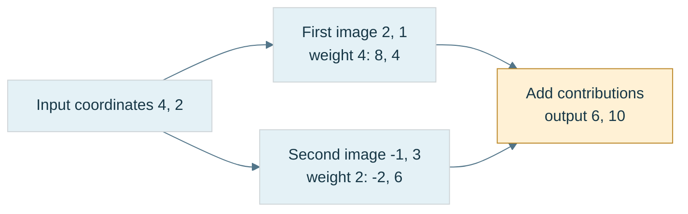

**Figure M1.** The diagram expands a vector into its input-basis coefficients and then recombines the stored output directions. It is an arithmetic trace rather than a scale drawing. Its coordinates are tied to the declared bases; changing a basis changes the table representing the same geometric map.

### Rows describe how to compute one output coordinate

Read the same example row by row:

$$
y_1=2x_1-x_2,\qquad y_2=x_1+3x_2.
$$

Each row supplies the coefficients of one output measurement. The component formula is

$$
y_i=\sum_{j=1}^{n}a_{ij}x_j.
$$

In standard orthonormal Euclidean coordinates this is the familiar row dot input calculation. More generally it is a row acting as a linear functional on the coordinate tuple; do not silently replace a geometric inner product in a skew basis with an ordinary component dot product. Phase 6's Gram matrix is still needed when that is the actual measurement question.

A rectangular example makes the dimensions visible:

$$
B=\begin{bmatrix}2&1&-1\\0&3&4\end{bmatrix},\qquad
\mathbf x=\begin{bmatrix}5\\2\\-1\end{bmatrix}.
$$

The output is $B\mathbf x=(13,2)^{\mathsf T}$ because the row sums are $10+2+1=13$ and $0+6-4=2$. A fourth input coordinate would have no matching coefficient; a two-component input would leave a coefficient unused. The shape mismatch is an undefined mathematical request, not a small implementation inconvenience.

## Keep the transformation separate from its storage

The logical element `A(0, 1)` means row zero, column one regardless of the memory layout. For the $2\times3$ table with rows $(1,2,3)$ and $(4,5,6)$, two compact layouts are

```text
row-major:    [1][2][3][4][5][6]
column-major: [1][4][2][5][3][6]
```

For $m$ rows and $n$ columns, zero-based compact row-major indexing uses $rn+c$, while compact column-major indexing uses $cm+r$. These are element offsets; multiply by the element size to obtain byte offsets. Bounds still require $0\le r<m$ and $0\le c<n$. A stride is the number of elements or bytes advanced when an index increases by one; an API must state which unit it uses. Padding and views can make the actual stride larger than the logical row or column length.

Row-major does not mean row-vector mathematics. Column-vector multiplication works with either storage layout when the accessor returns the correct logical element. Conversely, changing from column-vector mathematics to an equivalent row-vector representation requires transposing the represented map:

$$
\mathbf y=A_c\mathbf x
\quad\Longrightarrow\quad
\mathbf y^{\mathsf T}=\mathbf x^{\mathsf T}A_c^{\mathsf T}.
$$

Thus $A_r=A_c^{\mathsf T}$ represents the same map with row vectors relative to the same corresponding bases. That is an algebraic conversion, not a decision to store the old table in a different order.

The matrix itself has $mn$ scalar entries. A particular C++ object may also have padding or chosen alignment. If the component really occupies four bytes, a compact $4\times4$ component payload contains 64 bytes. Neither that arithmetic nor `sizeof` proves a shader interface contract. At a CPU/GPU boundary, check the component type, logical row/column interpretation, declared shader layout, stride and upload behavior together.

For a layout diagnostic, use distinct asymmetric values. Identity is a poor diagnostic because its transpose is identical. Applying a matrix to standard basis vectors isolates its columns: $A\mathbf e_j$ must reproduce column $j$. That test can locate a transposition mistake before camera or hierarchy code makes it harder to see.

## Combining rules explains the multiplication law

Addition and scalar multiplication are the simplest matrix operations. They act entry by entry:

$$
(A+B)_{ij}=A_{ij}+B_{ij},\qquad
(\lambda A)_{ij}=\lambda A_{ij}.
$$

Addition needs the same shape. Scalar multiplication preserves shape. The meaning is also direct: $(A+B)\mathbf x=A\mathbf x+B\mathbf x$, and $(\lambda A)\mathbf x=\lambda(A\mathbf x)$. Adding two maps adds their outputs; it does not apply one after the other. Two rotations generally do not add to a rotation, and multiplying every entry of a rotation by two doubles output lengths.

All $m\times n$ real matrices form a vector space of dimension $mn$: one basis matrix has a one at each chosen position and zero everywhere else. This vector-space structure is useful, but special families inside it can have extra constraints. The family of rotation matrices is constrained by orthonormality and positive orientation; arbitrary sums do not preserve those constraints.

To apply one rule after another, we need composition. Let $B:\mathbb R^n\to\mathbb R^p$ and $A:\mathbb R^p\to\mathbb R^m$. The output of $B$ is a valid input to $A$, so the combined map is $A\circ B$. We want a matrix $C$ satisfying $C\mathbf x=A(B\mathbf x)$ for every permitted input.

Expand one component:

$$
y_k=\sum_{j=1}^{n}B_{kj}x_j,
\qquad
z_i=\sum_{k=1}^{p}A_{ik}y_k
=\sum_{j=1}^{n}\left(\sum_{k=1}^{p}A_{ik}B_{kj}\right)x_j.
$$

Comparing coefficients gives the product rule:

$$
C=AB,\qquad C_{ij}=\sum_{k=1}^{p}A_{ik}B_{kj}.
$$

The inner dimension is the intermediate coordinate space. In the product $(m\times p)(p\times n)$ it must match, and the result has shape $m\times n$. Equivalently, each column of $AB$ is $A$ applied to the corresponding column of $B$. This is why row-column multiplication is the rule: it makes the stored table agree with composed linear maps.

For

$$
A=\begin{bmatrix}1&2\\3&4\end{bmatrix},\qquad
B=\begin{bmatrix}5&6\\7&8\end{bmatrix},
$$

the product is

$$
AB=\begin{bmatrix}1(5)+2(7)&1(6)+2(8)\\3(5)+4(7)&3(6)+4(8)\end{bmatrix}
=\begin{bmatrix}19&22\\43&50\end{bmatrix}.
$$

The reverse product is $BA=\begin{bmatrix}23&34\\31&46\end{bmatrix}$. Both products are defined here, but they differ. With rectangular matrices, one order may not even be defined.

### Order describes actions; parentheses describe grouping

Take $\mathbf p=(1,1)^{\mathsf T}$, an X stretch $S=\operatorname{diag}(2,1)$, and a quarter-turn $R=\begin{bmatrix}0&-1\\1&0\end{bmatrix}$. Applying scale then rotation gives

$$
\mathbf p\xrightarrow{S}(2,1)^{\mathsf T}\xrightarrow{R}(-1,2)^{\mathsf T}.
$$

The product is $RS\mathbf p$. Reverse the actions and the result is $SR\mathbf p=(-2,1)^{\mathsf T}$. Matrix multiplication is **noncommutative**: order is not generally interchangeable. Some pairs commute, including diagonal matrices with each other and uniform scaling with any compatible linear map. Noncommutative does not mean that every pair fails to commute.

### Figure M2 - The same operations give different results in different orders

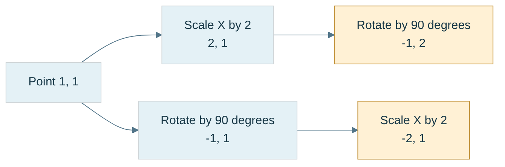

**Figure M2.** The arrows show execution order. In column-vector notation the upper path is $RS\mathbf p$ and the lower path is $SR\mathbf p$. Both stretches use the declared fixed coordinate axes. A hierarchy may instead ask for a local-axis operation, so name the space before choosing multiplication order.

Grouping is different. Exact real matrix multiplication is **associative**: $(AB)C=A(BC)$ when shapes permit the products. Both sides apply $C$, then $B$, then $A$. Expanding either component produces the same finite double sum. In floating-point arithmetic, different grouping can change rounding and overflow, so algebraic equality is not a bitwise reproducibility guarantee.

Grouping also changes cost. If $A$ is $1000\times10$, $B$ is $10\times1000$, and $C$ is $1000\times1$, the classical algorithm uses about 11 million multiply-accumulate terms for $(AB)C$, versus 20 thousand for $A(BC)$. The first route also creates a million-entry intermediate; the second creates ten entries. These are arithmetic counts, not measured timings.

For a classical dense product of shapes $(M\times K)(K\times N)$, there are $MN$ output entries and $K$ terms per entry, giving $\Theta(MKN)$ work. Matrix-vector multiplication costs $\Theta(MN)$ for an $M\times N$ map. Addition, scalar multiplication and transpose touch $MN$ entries and take $\Theta(MN)$ work. Layout and loop ordering change data reuse; they do not change these mathematical shapes or classical asymptotic counts.

## Special matrices tell us what information a rule preserves

The **identity** $I_n$ has ones on the diagonal and zeros elsewhere. It sends every basis direction to itself, so $I_n\mathbf x=\mathbf x$. For an $m\times n$ matrix, use $I_mA=A$ and $AI_n=A$. A transform product must begin with identity, while an accumulation of additions begins with the zero matrix. Starting a product at zero destroys every later contribution.

The **zero matrix** maps every input to zero. It is the additive identity, but it destroys all information as a map. From $AB=AC$ one cannot generally cancel $A$; if $A$ is zero the equality tells us nothing about $B$ and $C$.

A **diagonal matrix** permits nonzero entries only on the main diagonal. In $D=\operatorname{diag}(d_1,d_2,d_3)$, each output coordinate is $d_ix_i$; coordinates do not mix. An ordinary three-axis scaling matrix has exactly this form. Uniform nonzero scaling preserves angles, while nonuniform scaling can change angles between arbitrary directions. A negative scale reverses a basis direction; a zero scale erases the corresponding coordinate and cannot be undone.

A **shear** changes one coordinate in proportion to another. The elementary planar example

$$
H=\begin{bmatrix}1&k\\0&1\end{bmatrix}
\quad\Longrightarrow\quad(x,y)\mapsto(x+ky,y)
$$

slides higher layers farther sideways, like a stack of cards. It sends $\mathbf e_1$ to $(1,0)$ and $\mathbf e_2$ to $(k,1)$, preserving area but generally changing angles. Off-diagonal entries mean coordinate coupling, but they are not by themselves proof of shear: rotation also mixes coordinates. Nor does a general matrix with all diagonal entries equal to one automatically have determinant one. For example $\begin{bmatrix}1&2\\3&1\end{bmatrix}$ has determinant $-5$; it is not the area-preserving elementary shear above.

## Derive rotations from the directions that stay fixed

A **proper rotation** preserves Euclidean lengths, angles and orientation. In two dimensions, rotate the first unit axis through angle $\theta$. Its image is $(\cos\theta,\sin\theta)^{\mathsf T}$. The second unit axis began at angle $\pi/2$, so its image is

$$
\begin{bmatrix}\cos(\pi/2+\theta)\\\sin(\pi/2+\theta)\end{bmatrix}
=\begin{bmatrix}-\sin\theta\\\cos\theta\end{bmatrix}.
$$

Place the two images into columns. Writing $c=\cos\theta$ and $s=\sin\theta$ gives

$$
R(\theta)=\begin{bmatrix}c&-s\\s&c\end{bmatrix},\qquad
x'=cx-sy,\quad y'=sx+cy.
$$

At $\theta=\pi/2$, $\mathbf e_x$ goes to $\mathbf e_y$, and $\mathbf e_y$ goes to $-\mathbf e_x$. These basis tests expose a wrong sign immediately. A general vector $(2,3)^{\mathsf T}$ goes to $(-3,2)^{\mathsf T}$.

Why is this truly length preserving? Expand the squared output length:

$$
(cx-sy)^2+(sx+cy)^2
=x^2(c^2+s^2)+y^2(c^2+s^2)=x^2+y^2.
$$

The cross terms cancel and $c^2+s^2=1$. The columns are also unit length and mutually perpendicular, summarized by $R^{\mathsf T}R=I$. Therefore $R^{-1}=R^{\mathsf T}=R(-\theta)$. Multiplying two such matrices and applying the angle-addition identities gives $R(\alpha)R(\beta)=R(\alpha+\beta)$, so planar rotations commute.

### The oriented plane explains the Y-rotation signs

In three dimensions, rotation about an axis leaves that axis fixed. Choose the ordered perpendicular-plane coordinates so their basis cross product points along the positive rotation axis. For X use $(y,z)$ because $\mathbf e_y\times\mathbf e_z=\mathbf e_x$. For Y use $(z,x)$ because $\mathbf e_z\times\mathbf e_x=\mathbf e_y$. For Z use $(x,y)$ because $\mathbf e_x\times\mathbf e_y=\mathbf e_z$.

Insert the same planar rotation into each ordered plane. For X,

$$
y'=cy-sz,\quad z'=sy+cz,\quad x'=x,
\qquad
R_x=\begin{bmatrix}1&0&0\\0&c&-s\\0&s&c\end{bmatrix}.
$$

For Y, first rotate the ordered pair $(z,x)$:

$$
z'=cz-sx,\qquad x'=sz+cx,\qquad y'=y.
$$

Then return to the usual output order $(x',y',z')$:

$$
R_y=\begin{bmatrix}c&0&s\\0&1&0\\-s&0&c\end{bmatrix}.
$$

The differing-looking signs are consequences of choosing an oriented plane, not exceptions to the two-dimensional rule. Finally,

$$
R_z=\begin{bmatrix}c&-s&0\\s&c&0\\0&0&1\end{bmatrix}.
$$

Use the actual vector $\mathbf v=(2,3,4)^{\mathsf T}$ at a positive quarter-turn:

$$
R_x\mathbf v=(2,-4,3)^{\mathsf T},\qquad
R_y\mathbf v=(4,3,-2)^{\mathsf T},\qquad
R_z\mathbf v=(-3,2,4)^{\mathsf T}.
$$

For the Y case, explicitly read the rows: $x'=0(2)+0(3)+1(4)=4$, $y'=3$, and $z'=-1(2)+0(3)+0(4)=-2$. Its squared length is $16+9+4=29$, matching the input's $4+9+16=29$. The right-hand rule agrees: positive Y sends positive Z toward positive X and positive X toward negative Z.

Arbitrary rotations in three dimensions do not share one axis. For example, with $\mathbf e_z$ and quarter-turns, $R_yR_x\mathbf e_z=-\mathbf e_y$ while $R_xR_y\mathbf e_z=\mathbf e_x$. This is why a rotation API must state the axes, the coordinate space and the composition order.

A diagonal matrix can represent some nonidentity rotations: in two dimensions $\operatorname{diag}(-1,-1)$ is a half-turn, and in three dimensions $\operatorname{diag}(-1,-1,1)$ is a half-turn about Z. What a diagonal matrix cannot do is continuous general coordinate mixing. Do not turn a useful pattern-recognition shortcut into an absolute claim.

Repeated floating-point rotation products can drift away from orthonormality. Check $R^{\mathsf T}R$ against identity with a meaningful residual. Finite entries alone do not prove that a matrix remains a rotation. Later quaternion normalization gives a compact orientation-maintenance method, with its own preconditions.

## Transpose lets us compare measurements and structure

The **transpose** exchanges logical indices: $(A^{\mathsf T})_{ij}=A_{ji}$. A $2\times3$ table becomes $3\times2$. This operation is not a physical rotation of the represented geometry, nor is it merely a memory-layout conversion. For real columns $\mathbf x,\mathbf y$ in an orthonormal Euclidean basis, $\mathbf x^{\mathsf T}\mathbf y$ is their dot product.

Transpose twice returns the original matrix; it distributes over addition and scalar multiplication. Products reverse order:

$$
(AB)^{\mathsf T}=B^{\mathsf T}A^{\mathsf T}.
$$

Indeed, the $(i,j)$ entry on the left is $\sum_kA_{jk}B_{ki}$, which is the $(i,j)$ entry of the right side after commuting each pair of real scalars. The dimensions also force the reversed order. This identity will support the inverse-transpose normal rule later.

A real square matrix is **symmetric** when $A^{\mathsf T}=A$. Its opposite-side entries match; only $n(n+1)/2$ values are independent. A covariance matrix is symmetric because exchanging the two variables leaves the covariance unchanged. The product $A^{\mathsf T}A$ is symmetric by the transpose identity, though using it to solve systems can worsen conditioning and is not a universal numerical recommendation.

A matrix is **skew-symmetric** when $K^{\mathsf T}=-K$. Over the reals its diagonal is zero because $k_{ii}=-k_{ii}$. In three dimensions,

$$
[\boldsymbol\omega]_\times=
\begin{bmatrix}0&-\omega_z&\omega_y\\\omega_z&0&-\omega_x\\-\omega_y&\omega_x&0\end{bmatrix}
\quad\Longrightarrow\quad
[\boldsymbol\omega]_\times\mathbf v=\boldsymbol\omega\times\mathbf v.
$$

For $\boldsymbol\omega=(1,2,3)^{\mathsf T}$ and $\mathbf v=(4,5,6)^{\mathsf T}$, both calculations give $(-3,6,-3)^{\mathsf T}$. This connects a cross product to a linear operator. A small rotation has the form $I+\theta[\widehat{\mathbf a}]_\times+O(\theta^2)$; dropping the higher terms gives a first-order approximation, not an exactly orthogonal finite rotation.

Every real square matrix separates uniquely into symmetric and skew parts:

$$
A=\underbrace{\frac{A+A^{\mathsf T}}2}_{S}
+\underbrace{\frac{A-A^{\mathsf T}}2}_{K}.
$$

For $A=\begin{bmatrix}1&4\\2&3\end{bmatrix}$, these are $S=\begin{bmatrix}1&3\\3&3\end{bmatrix}$ and $K=\begin{bmatrix}0&1\\-1&0\end{bmatrix}$. This is an additive decomposition of coefficients. It is not a rotation-times-stretch factorization.

The **trace** of a square matrix is $\operatorname{tr}A=\sum_i a_{ii}$. For compatible rectangular $A$ and $B$ with square products, expanding the sums gives $\operatorname{tr}(AB)=\operatorname{tr}(BA)$. This permits cyclic reorderings of longer products when dimensions permit, not arbitrary permutations. If $P$ is an invertible change-of-basis matrix,

$$
\operatorname{tr}(P^{-1}AP)=\operatorname{tr}(APP^{-1})=\operatorname{tr}(A).
$$

Trace is therefore independent of the chosen basis for the same endomorphism, meaning a linear map from a vector space to itself. It summarizes one invariant; it does not identify the complete transformation. Eigenvalue interpretations will be developed when those terms have their own foundations.

## Determinant measures oriented volume and exposes lost dimensions

In two dimensions, the columns of $A=\begin{bmatrix}a&b\\c&d\end{bmatrix}$ are the images of the unit square's edge directions. Their oriented parallelogram area is

$$
\det A=ad-bc.
$$

For $A=\begin{bmatrix}3&1\\2&4\end{bmatrix}$, the determinant is $12-2=10$: ordinary areas scale by ten and orientation is preserved. A reflection $\operatorname{diag}(-1,1)$ has determinant $-1$: area magnitude is preserved but orientation reverses. The singular table $\begin{bmatrix}1&2\\2&4\end{bmatrix}$ has dependent columns and zero area.

In three dimensions, let the columns be $\mathbf u,\mathbf v,\mathbf w$ in that order. Their oriented parallelepiped volume is

$$
\det A=\mathbf u\cdot(\mathbf v\times\mathbf w).
$$

This is the scalar triple product from Phase 6: base area times signed height. For a general table,

$$
\det\begin{bmatrix}a&b&c\\d&e&f\\g&h&i\end{bmatrix}
=a(ei-fh)-b(di-fg)+c(dh-eg).
$$

Use one calibration throughout the following inversion examples:

$$
A=\begin{bmatrix}1&2&3\\0&1&4\\5&6&0\end{bmatrix}.
$$

Expansion gives $-24+40-15=1$. Independently, its columns are $(1,0,5)^{\mathsf T}$, $(2,1,6)^{\mathsf T}$ and $(3,4,0)^{\mathsf T}$. The cross product of the last two is $(-24,18,5)^{\mathsf T}$, whose dot product with the first is $-24+25=1$.

This map preserves volume and orientation, but not necessarily lengths or angles. A determinant of one does not prove rotation. Proper rotations additionally satisfy $R^{\mathsf T}R=I$. Elementary shears also have determinant one while distorting angles.

In $n$ dimensions, $|\det A|$ is the ordinary $n$-volume scale. The sign records orientation. Composition multiplies the scales: $\det(AB)=\det A\det B$. Therefore $\det(A^{-1})=1/\det A$ when an inverse exists. A scale $\operatorname{diag}(2,3,4)$ multiplies volume by 24; its inverse multiplies it by $1/24$.

### Figure M3 - Three different questions answered by one determinant

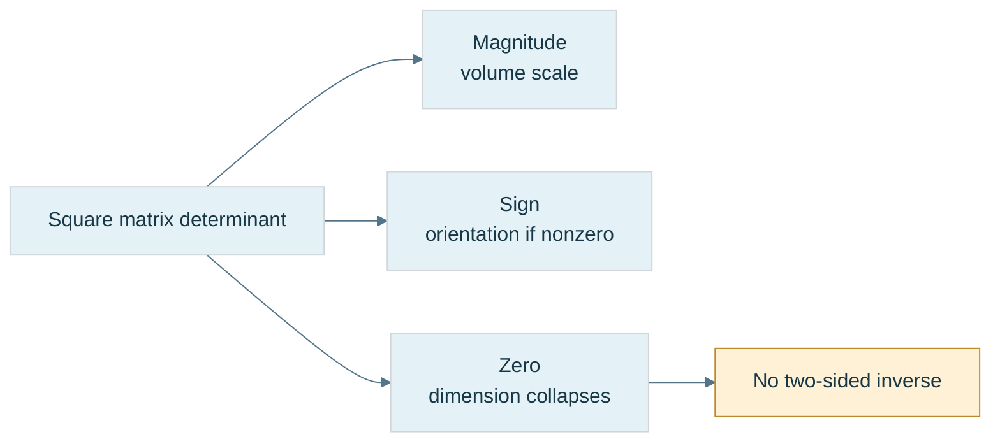

**Figure M3.** These are distinct interpretations. None gives a reliable condition estimate by itself. Orientation is defined for a full-dimensional nonsingular map; a collapsed image does not retain a full ordered basis. In a renderer, a negative model determinant may reverse winding, but rasterizer front-face settings and the complete viewing/projection convention still determine actual culling behavior.

A square matrix is **singular** when it has no two-sided inverse. The matrix $\begin{bmatrix}1&2\\2&4\end{bmatrix}$ sends both $(2,0)^{\mathsf T}$ and $(0,1)^{\mathsf T}$ to $(2,4)^{\mathsf T}$. Its nonzero vector $(2,-1)^{\mathsf T}$ maps to zero. An inverse could not distinguish the original inputs. For a square matrix over the reals, these are equivalent: nonzero determinant, independent columns, no nonzero null vector, and existence of an inverse. Rectangular maps need separate questions about left inverses, right inverses, injectivity and surjectivity; do not apply the square determinant test to them.

## Recovering an input has an algebraic route and a computational route

An inverse $A^{-1}$ must satisfy both $A^{-1}A=I$ and $AA^{-1}=I$ for a square map. It undoes the same specified input/output relationship; it does not reverse lost information. When $C=AB$, undoing $A$ must happen before undoing $B$, so $(AB)^{-1}=B^{-1}A^{-1}$. Scale inverses reciprocate nonzero scales. Rotation inverses transpose an orthogonal matrix. Use known structure when it is guaranteed rather than invoking an unnecessary general inverse.

### Minors and cofactors build a symbolic inverse

The **minor** $M_{ij}$ is the determinant remaining after deleting row $i$ and column $j$. The **cofactor** is $C_{ij}=(-1)^{i+j}M_{ij}$, adding alternating signs. The **adjugate** is the cofactor matrix transposed, $\operatorname{adj}A=C^{\mathsf T}$. Do not confuse adjugate with a conjugate-transpose adjoint used elsewhere.

For our determinant-one calibration, the cofactor matrix is

$$
C=\begin{bmatrix}-24&20&-5\\18&-15&4\\5&-4&1\end{bmatrix}.
$$

For instance, deleting row one and column two leaves $\begin{bmatrix}0&4\\5&0\end{bmatrix}$, with minor $-20$ and cofactor $+20$. The resulting inverse is

$$
A^{-1}=\frac{\operatorname{adj}A}{\det A}
=\begin{bmatrix}-24&18&5\\20&-15&-4\\-5&4&1\end{bmatrix}.
$$

Why does the formula work? A diagonal entry of $A\operatorname{adj}A$ is a row's cofactor expansion, hence $\det A$. An off-diagonal entry has the same expansion with a different row inserted, producing a determinant with repeated rows, hence zero. Therefore $A\operatorname{adj}A=(\det A)I$. Division is valid only when $\det A\ne0$.

Verify rather than trust the table. The first row of $AA^{-1}$ is $(-24+40-15,\ 18-30+12,\ 5-8+3)=(1,0,0)$. The second row is $(20-20,-15+16,-4+4)=(0,1,0)$; the third is $(-120+120,90-90,25-24)=(0,0,1)$. The reverse product also equals identity. A left-side check alone is insufficient as a general software interface test, even though exact square algebra makes the two-sided relationship follow.

For a $2\times2$ matrix this construction reduces to

$$
\begin{bmatrix}a&b\\c&d\end{bmatrix}^{-1}
=\frac1{ad-bc}\begin{bmatrix}d&-b\\-c&a\end{bmatrix}.
$$

Closed formulas are useful for symbolic reasoning and some carefully implemented small matrices. Recursive cofactor expansion is not an appropriate general dense-matrix inversion algorithm. A compact formula does not automatically minimize numerical error.

### Row reduction makes the inverse observable

Form the augmented table $[A\mid I]$ and apply each row operation to both halves. A row operation is multiplication on the left by an invertible **elementary matrix**. If their combined operation is $E$ and $EA=I$, then $E=A^{-1}$; the right half becomes $EI=A^{-1}$.

For the same calibration, the complete useful trace is:

| Operation | Left half after operation | Right half after operation |
|---|---|---|
| Start | $\begin{bmatrix}1&2&3\\0&1&4\\5&6&0\end{bmatrix}$ | $I$ |
| $R_3\leftarrow R_3-5R_1$ | $\begin{bmatrix}1&2&3\\0&1&4\\0&-4&-15\end{bmatrix}$ | $\begin{bmatrix}1&0&0\\0&1&0\\-5&0&1\end{bmatrix}$ |
| $R_3\leftarrow R_3+4R_2$ | $\begin{bmatrix}1&2&3\\0&1&4\\0&0&1\end{bmatrix}$ | $\begin{bmatrix}1&0&0\\0&1&0\\-5&4&1\end{bmatrix}$ |
| $R_2\leftarrow R_2-4R_3$ | $\begin{bmatrix}1&2&3\\0&1&0\\0&0&1\end{bmatrix}$ | $\begin{bmatrix}1&0&0\\20&-15&-4\\-5&4&1\end{bmatrix}$ |
| $R_1\leftarrow R_1-3R_3$ | $\begin{bmatrix}1&2&0\\0&1&0\\0&0&1\end{bmatrix}$ | $\begin{bmatrix}16&-12&-3\\20&-15&-4\\-5&4&1\end{bmatrix}$ |
| $R_1\leftarrow R_1-2R_2$ | $I$ | $\begin{bmatrix}-24&18&5\\20&-15&-4\\-5&4&1\end{bmatrix}$ |

A **pivot** is the entry used to eliminate other entries in its column. An initial zero pivot does not prove singularity: $\begin{bmatrix}0&1\\2&3\end{bmatrix}$ is invertible with determinant $-2$. A row swap brings the two into the first pivot position. **Partial pivoting** chooses the largest available absolute entry in the current column among the remaining rows, reducing unnecessary division by small pivots. It improves many calculations but does not guarantee tiny error for every matrix or cure a sensitive problem.

Dense Gauss–Jordan inversion takes $\Theta(n^3)$ arithmetic and $\Theta(n^2)$ storage. To solve $A\mathbf x=\mathbf b$ for one or several right-hand sides, a factorization and direct solve is usually preferable to forming $A^{-1}$ and multiplying. A transform inverse remains useful when the inverse map itself is the object required, such as a cached world-to-local transform. The requirement decides the operation.

## An inverse can exist and still amplify uncertainty

An **ill-conditioned problem** is one whose exact answer changes greatly when its input changes slightly, measured relative to the stated input/output scales. **Algorithmic stability** describes how much additional error an algorithm introduces. A stable algorithm cannot erase uncertainty already inherent in an ill-conditioned problem.

Take

$$
A_\varepsilon=\begin{bmatrix}1&1\\1&1+\varepsilon\end{bmatrix},\qquad
A_\varepsilon^{-1}=\frac1\varepsilon\begin{bmatrix}1+\varepsilon&-1\\-1&1\end{bmatrix}.
$$

The columns approach parallel directions as $\varepsilon\to0$. For $\varepsilon=0.001$, the input $(1,1)^{\mathsf T}$ produces $(2,2.001)^{\mathsf T}$. Change only the second observed output to $2.002$. The exact recovered input becomes $(0,2)^{\mathsf T}$: the equations give $x_1+x_2=2$ and $0.001x_2=0.002$. The output perturbation is small, but the reconstructed input changes substantially. No implementation bug is needed to produce this effect.

### Figure M4 - Uncertainty can be amplified by a reversible map

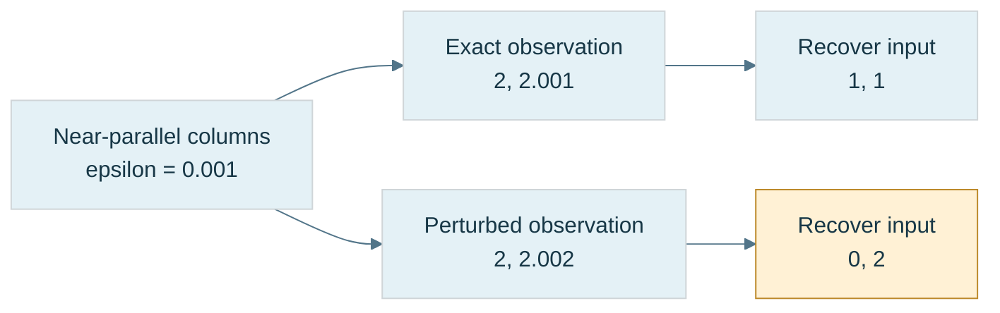

**Figure M4.** Both paths solve the same invertible matrix. The different answers follow from different observations. This separates problem sensitivity from an algorithm defect. Values are exact decimal examples for reasoning; floating-point storage adds another approximation layer.

A compatible induced matrix norm measures the largest amplification relative to a chosen vector norm. A corresponding normwise condition number for a nonsingular square matrix is

$$
\kappa(A)=\|A\|\,\|A^{-1}\|.
$$

For a fixed matrix and a perturbed right-hand side, the relative solution error is bounded by the relative right-hand-side error multiplied by $\kappa(A)$, in the same compatible norm. When both matrix and right-hand side change, additional terms and smallness conditions enter the bound. A condition number is tied to a problem and scaling; it is not an unqualified quality score for every possible downstream use.

In the 2-norm, $\kappa_2(A)=\sigma_{\max}/\sigma_{\min}$, where the singular values describe the largest and smallest directional stretches. This is a preview of later SVD, not a requirement to learn its full construction now. Equal stretches have condition one; a huge ratio means one direction was compressed relative to another.

This immediately disproves a determinant-only numerical threshold. Compare two matrices with the same determinant:

$$
U=\operatorname{diag}(10^{-10},10^{-10}),\qquad
V=\operatorname{diag}(1,10^{-20}).
$$

Both determinants equal $10^{-20}$, yet $\kappa_2(U)=1$ and $\kappa_2(V)=10^{20}$. The first scales every direction equally; the second nearly erases one direction relative to the other. The source's earlier comparison used different determinant magnitudes; this equal-determinant pair makes the intended argument exact.

Uniform tiny scaling can still create absolute range problems or amplify an absolute measurement error. Relative conditioning one does not promise that an application can ignore those issues. Similarly, a determinant of one does not imply good conditioning: $\operatorname{diag}(10^{10},10^{-10})$ has determinant one and condition $10^{20}$.

An inverse API should therefore return a failure state or diagnostic result when it cannot meet its contract. Check finite inputs and outputs, use scale-aware pivot/condition information, and inspect an inverse residual such as $\|I-A\widehat{A^{-1}}\|$. A small residual supports the computed relationship, but by itself does not guarantee small forward error in every recovered input. Choose tolerances from the represented units, precision and use case; a global determinant epsilon hides those decisions.

### Reconstruct the machine before adding translation

At the board, start with two basis images and rebuild a matrix. Apply it by column weights and by row sums. Compose it with a second map and explain why the product order follows the action order. Rebuild the rotation matrices from the three oriented planes, then test the unit axes and one asymmetric vector. Finally, use the determinant-one calibration to derive an inverse by cofactors and by row reduction, and use the near-parallel example to explain why obtaining an inverse is only the beginning of the numerical question.

The remaining limitation is now visible. Every linear map still fixes the origin. The robot must also place its tool at a location, carry it through parent frames and look at it from a camera. That need leads to affine transforms and coordinate-frame matrices rather than another arbitrary matrix formula.

## The origin exposes the limit of an ordinary linear map

Our robot can now rotate, stretch and shear a displacement. But it still cannot place the panel somewhere else in the workcell using a three-by-three linear map alone. The reason is already inside the definition of linearity. A linear map $L$ obeys $L(a\mathbf u+b\mathbf v)=aL(\mathbf u)+bL(\mathbf v)$. Set both coefficients to zero and we obtain $L(\mathbf0)=\mathbf0$. The origin is fixed. A translation by a nonzero vector $\mathbf t$ sends zero to $\mathbf t$, so translation is not linear in ordinary three-dimensional coordinates.

This is a useful boundary, rather than a defect in matrices. We were asking a displacement-only operation to answer a location question. A **point** names a location; a **free vector** names a displacement independently of where its arrow is drawn. Changing the panel's position should move its points, while a displacement between two of its points should receive no extra translation. If $P'=AP+\mathbf t$ and $Q'=AQ+\mathbf t$, then

$$
Q'-P'=A(Q-P).
$$

The translations cancel because a displacement measures the difference between locations. That cancellation is the bridge from the vector-space material in Phase 6 to the affine transformations needed for scenes.

**Source boundary:** the supplied excerpts contain standalone lessons for Parts 601–634 and 651–700. They do not contain standalone lessons for Parts 635–650. The affine bridge in this section is explicitly reconstructed prerequisite material, using the neighboring lessons and elementary derivations. It is not a claim that sixteen missing numbered lessons were received, nor an invented assignment of a topic to each missing number.

### Homogeneous coordinates give points and directions different roles

An **affine map** has the form

$$
P'=AP+\mathbf t,
$$

where $A$ is its linear part and $\mathbf t$ is its translation. $A$ may rotate, scale, reflect, shear or collapse directions. An affine map need not be invertible; we will require invertibility when it is used as a full coordinate frame or when an inverse is requested.

Append a fourth coordinate and write an ordinary finite point as $\widetilde P=(P_x,P_y,P_z,1)^{\mathsf T}$. Write a displacement as $\widetilde{\mathbf v}=(v_x,v_y,v_z,0)^{\mathsf T}$. The affine matrix is

$$
F(A,\mathbf t)=
\begin{bmatrix}
A&\mathbf t\\
\mathbf0^{\mathsf T}&1
\end{bmatrix}.
$$

Multiplication makes the roles explicit:

$$
F\begin{bmatrix}P\\1\end{bmatrix}
=\begin{bmatrix}AP+\mathbf t\\1\end{bmatrix},
\qquad
F\begin{bmatrix}\mathbf v\\0\end{bmatrix}
=\begin{bmatrix}A\mathbf v\\0\end{bmatrix}.
$$

The final coordinate is not a flag that authorizes arbitrary operations. In projective geometry a finite point also has representatives $(wP,w)$ for any nonzero $w$, and recovering ordinary coordinates requires division by $w$. For the present affine matrices, the conventional representatives with $w=1$ for points and $w=0$ for directions make translation behavior especially easy to inspect. A general four-by-four matrix may change $w$ and need not be an affine frame at all.

### Figure M5 - The same frame moves a point and redirects a displacement

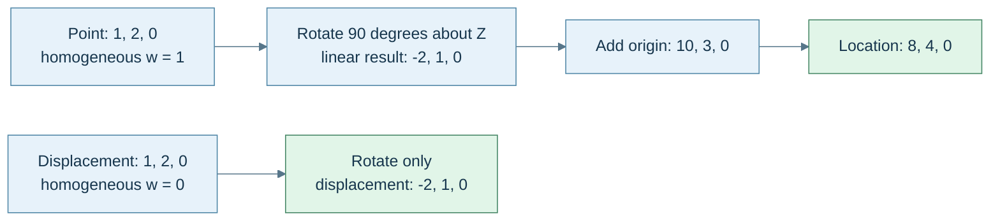

**Caption:** this uses active, right-handed positive rotation about $Z$, column vectors and a fixed parent frame. The two equal three-component tuples begin with different geometric roles. Translation changes only the point result. The arrows describe calculation dependencies; they are not a drawing of the coordinate axes to scale.

## A frame combines directions with a place to stand

A **basis** supplies independent direction vectors. A **coordinate frame** supplies a basis and an origin. Its origin answers “where is local zero?”; its basis answers “what does one unit along each local axis mean in the parent frame?” Those answers can be encoded together:

$$
F=\begin{bmatrix}B&\mathbf o\\\mathbf0^{\mathsf T}&1\end{bmatrix},
\qquad B=[\,\mathbf b_x\ \mathbf b_y\ \mathbf b_z\,].
$$

The upper-left three-by-three block contains the three basis columns; the rightmost upper column contains the local origin expressed in the parent frame. The basis columns must be independent for a full three-dimensional frame. An affine matrix with dependent columns can still map points, but it cannot uniquely convert every parent coordinate back into local coordinates.

For the frame in Figure M5,

$$
F=
\begin{bmatrix}
0&-1&0&10\\
1&0&0&3\\
0&0&1&0\\
0&0&0&1
\end{bmatrix}.
$$

Read column zero: local $+X$ points along parent $+Y$. Read column one: local $+Y$ points along parent $-X$. Read column three: the local origin lies at parent position $(10,3,0)$. A local point $(1,2,0)$ therefore means “start at that origin, take one local $X$ step, and two local $Y$ steps,” giving $(8,4,0)$. Reading columns this way is often faster than guessing which Euler angles produced a matrix.

### Composition follows the dependency of locations

Suppose one transform first applies $P_1=BP+\mathbf u$, and a second applies $P_2=AP_1+\mathbf t$. Substitute before memorizing any product formula:

$$
P_2=A(BP+\mathbf u)+\mathbf t
=ABP+(A\mathbf u+\mathbf t).
$$

Consequently,

$$
F(A,\mathbf t)F(B,\mathbf u)
=F(AB,A\mathbf u+\mathbf t).
$$

The earlier translation $\mathbf u$ is also transformed by the later linear map. Merely adding translation columns is incorrect when the later transform rotates or scales their frame. With our column-vector convention, $M_2M_1P$ means apply $M_1$ first. A notation change to row vectors would change how the same composition is written; a storage-layout change would not.

If an object should be scaled in local axes, then rotated, then placed in world coordinates, its matrix is $M=TRS$. The rightmost operation acts first. If it should rotate about a pivot $\mathbf c$ expressed in the same coordinate frame as the points, use $T(\mathbf c)RT(-\mathbf c)$: move the pivot to zero, rotate, move back. For a door hinge at $\mathbf c=(1,0,0)$, a point $P=(2,0,0)$ rotated $90^\circ$ about $Z$ follows $(2,0,0)\to(1,0,0)\to(0,1,0)\to(1,1,0)$. That trace explains the order more clearly than naming a “pivot matrix.”

A **transform hierarchy** stores relationships such as panel relative to robot base, then base relative to world. If $L$ maps child-local to parent-local and $W_p$ maps parent-local to world, the child's world matrix is $W_c=W_pL$. This is ordinary composition with meaningful endpoints.

If world matrices are cached, a **dirty flag** means “this cached result no longer agrees with the data it depends on.” Changing a parent's local transform invalidates its own world matrix and the world matrices of dependent descendants. A correct update evaluates the parent before the child or ensures the parent is current on demand. The invariant is explicit: whenever a world matrix is consumed, it equals the current parent world matrix times the current local matrix. The word “dirty” is bookkeeping for that invariant, not a mathematical property of a matrix.

Do not assume arbitrary hierarchy products remain expressible as translation, rotation and diagonal scale without shear. A rotated child under a nonuniformly scaled parent can produce a linear block whose transformed basis columns are not perpendicular. A four-by-four affine matrix preserves that full result; a restricted TRS representation may require decomposition, approximation, or rejection. Later quaternion operations do not remove this closure problem.

### Undo the linear action before undoing its translated origin

From $Q=AP+\mathbf t$, subtract the translation and solve:

$$
P=A^{-1}(Q-\mathbf t)=A^{-1}Q-A^{-1}\mathbf t.
$$

Therefore, if $A$ is invertible,

$$
F(A,\mathbf t)^{-1}
=F(A^{-1},-A^{-1}\mathbf t).
$$

The inverse translation is generally not just $-\mathbf t$; it is expressed after the inverse linear action. For a rigid frame whose linear block $R$ is an orthonormal rotation, $R^{-1}=R^{\mathsf T}$, and the inverse is $F(R^{\mathsf T},-R^{\mathsf T}\mathbf t)$. That shortcut does not apply to a basis containing nonunit scale or shear. Check the actual promise, not the variable name `rotation`.

## Coordinates can change while the geometric object stays still

A basis matrix $B=[\mathbf b_1\ \mathbf b_2\ \mathbf b_3]$ converts coefficients in that basis into the surrounding reference coordinates:

$$
\mathbf v=B[\mathbf v]_B.
$$

The coordinate tuple $[\mathbf v]_B$ says how much of each basis direction to combine. It is a description, not a second geometric vector wandering somewhere else in the world. For $\mathbf b_1=(1,0)$ and $\mathbf b_2=(1,1)$, the coefficients $(2,3)$ reconstruct $(5,3)$ because $2(1,0)+3(1,1)=(5,3)$.

Now describe one vector using two full bases $B$ and $C$. Both reconstructions must agree:

$$
B[\mathbf v]_B=C[\mathbf v]_C.
$$

Solving for the new coordinates gives

$$
[\mathbf v]_C=C^{-1}B[\mathbf v]_B.
$$

The direction of this conversion matters. $C^{-1}B$ takes $B$-coordinates to $C$-coordinates. Multiplying it by a tuple already expressed in the wrong frame is a semantic error even when the matrix dimensions match.

For a concrete check, let $B=I$ and

$$
C=\begin{bmatrix}1&-1\\1&1\end{bmatrix},
\qquad
C^{-1}=\frac12\begin{bmatrix}1&1\\-1&1\end{bmatrix}.
$$

The fixed vector with standard coordinates $(4,2)$ receives new coordinates $(3,-1)$. Reconstruction gives $3(1,1)-(-1,1)=(4,2)$. The vector did not rotate. Its coefficients changed because our measuring directions changed.

An **active transformation** moves the geometric vector while keeping the reference axes fixed. A **passive transformation** changes the coordinates used to describe the same vector. If axes are actively rotated by $R$ relative to the old axes, a fixed vector's components in those new axes are $R^{-1}\mathbf v$. For orthonormal rotations this inverse is $R^{\mathsf T}$. Thus active rotation by $+90^\circ$ takes world $+X$ to world $+Y$, whereas describing unchanged world $+X$ in axes rotated by $+90^\circ$ gives local $(0,-1)$.

The same distinction applies to whole frames, including their different origins. If $F_B$ and $F_C$ map frame-local points into one common parent/world frame, then

$$
[P]_C=F_C^{-1}F_B[P]_B
$$

using homogeneous point representatives. The inverse is needed because we first leave one local description and then enter the other. This is why endpoint names such as `world_from_object` and `camera_from_world` are more useful than an unexplained name such as `matrix1`.

## A camera is another frame, so viewing uses its inverse

**Object space** is the model's authoring frame. A mesh vertex near its own origin does not say where that mesh instance is in the scene. Its origin may be a wheel axle, door hinge, character root, or artist-chosen pivot. The object's model matrix $M$ maps those local points into **world space**, the shared scene frame used to compare separate objects.

Two vertices both stored as $(1,0,0)$ need not coincide: their model matrices may place them far apart. Compare $M_A P_A$ with $M_B P_B$, not their unrelated local tuples. Large absolute world coordinates can also lose small differences through floating-point spacing; a shared frame solves meaning, not every precision problem. Camera-relative coordinates, origin rebasing and higher precision are design responses that require their own contracts.

Let $C$ be the camera's world frame. It maps camera-local points into world coordinates. Rendering asks the reverse question: “what are these world points in camera coordinates?” The **view matrix** is therefore $V=C^{-1}$. A camera at world $(10,0,0)$ with no rotation sees world point $(13,2,-5)$ at view coordinates $(3,2,-5)$. Nothing in the world moved; the description became relative to the camera. If the camera rotates, its inverse orientation appears in $V$ for the same reason.

### Figure M6 - Follow one point through named spaces

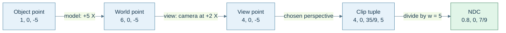

**Caption:** these are numerical states of one point under an explicitly chosen projection, not a picture of its motion. The camera has no rotation. The point stays in front of a right-handed camera looking along $-Z$. The projection below uses an illustrative normalized depth range of $[-1,1]$; it is not an assertion that every graphics API or every engine uses that range.

### Clip coordinates retain the divisor

With a projection matrix $P$, the full vertex chain is

$$
\widetilde P_{\mathrm{clip}}=PVM\widetilde P_{\mathrm{object}}.
$$

**Clip space** contains the four homogeneous components $(x_c,y_c,z_c,w_c)$. **Normalized device coordinates**, abbreviated NDC, are the three components $(x_c/w_c,y_c/w_c,z_c/w_c)$ after perspective division. They are different stages. Applying a four-by-four matrix does not automatically include the divide in a CPU helper, and a helper named `transformPoint` must say whether it performs affine transformation or a projective transformation with a checked divide.

For Figure M6, choose a symmetric $90^\circ$ vertical field of view, aspect ratio one, near distance $1$, far distance $10$, and the right-handed $-Z$ viewing convention just stated. One suitable educational projection is

$$
P=\begin{bmatrix}
1&0&0&0\\
0&1&0&0\\
0&0&-11/9&-20/9\\
0&0&-1&0
\end{bmatrix}.
$$

For view point $(4,0,-5,1)$, multiplication gives $(4,0,35/9,5)$, and division yields $(0.8,0,7/9)$. At view depth $z=-1$, the same matrix gives normalized depth $-1$; at $z=-10$, it gives $+1$. Those endpoint checks tell us what depth convention the matrix actually implements.

A view-space point at $z=0$ would have $w_c=0$ with this matrix, so it would not supply a finite NDC point. A pipeline sketch that blindly divides such a point is incomplete. A CPU projection routine must handle a zero, nonfinite, or policy-defined too-small divisor. A negative divisor or an out-of-volume point also requires appropriate visibility/clipping handling; dividing its numbers is not proof it should be displayed.

Graphics pipelines typically clip primitives using homogeneous inequalities before perspective division and rasterization. Clipping an edge can create new vertices; simply dropping every outside vertex would damage a triangle crossing the boundary. Different API and backend conventions affect depth range, viewport orientation, front-face rules and related setup. Preserve a declared convention through the CPU matrix, shader interface and backend rather than applying a remembered transpose or sign flip until one scene looks right.

### Tangent space supplies a surface-local measuring frame

At a surface point, a tangent $T$, bitangent $B$ and normal $N$ can form a local **TBN frame**. When stored as columns in parent coordinates, $F_{TBN}=[T\ B\ N]$ converts tangent-frame coefficients into that parent description. A normal-map sample decoded to $(0,0,1)$ should map to the local surface normal, because it selects the third basis column.

For $T=(1,0,0)$, $B=(0,0,1)$ and $N=(0,1,0)$,

$$
F_{TBN}=\begin{bmatrix}1&0&0\\0&0&1\\0&1&0\end{bmatrix}.
$$

Its third column is $(0,1,0)$, so the expected mapping works. Notice that this basis has determinant $-1$: it is orthonormal but left-handed. Orthonormality and positive orientation are separate properties. If reconstructing the bitangent as $B=h(N\times T)$, this example needs $h=-1$. A stored tangent handedness sign records precisely that relationship; it is not a disposable decorative attribute.

Interpolation, compression and deformation can disturb unit lengths and perpendicularity. Renormalizing a vector repairs its length when valid, but does not alone make three arbitrary axes perpendicular. Decide whether the surface frame needs re-orthogonalization, how the handedness sign is retained, and which geometric or shading normal the operation uses. Applying an ordinary basis expansion to a tangent-space direction and transforming a general geometric normal through an arbitrary deformation are related but distinct tasks.

## A normal transforms as a measurement that must still vanish on tangents

Suppose a surface tangent $\mathbf u$ and normal $\mathbf n$ obey $\mathbf n^{\mathsf T}\mathbf u=0$. Under the object's linear transform $A$, the tangent becomes $\mathbf u'=A\mathbf u$. We want a new normal satisfying $\mathbf n'^{\mathsf T}\mathbf u'=0$ for every transformed tangent. Choose

$$
\mathbf n'=A^{-\mathsf T}\mathbf n.
$$

Then

$$
\mathbf n'^{\mathsf T}\mathbf u'
=\mathbf n^{\mathsf T}A^{-1}A\mathbf u
=\mathbf n^{\mathsf T}\mathbf u=0.
$$

That is the **inverse-transpose normal transform**. Translation does not enter because the tangent is a displacement and a normal measures directions. For $\mathbf u=(1,1,0)$, $\mathbf n=(1,-1,0)$ and $A=\operatorname{diag}(2,1,1)$, the transformed tangent is $(2,1,0)$ and the correct normal is $(1/2,-1,0)$, whose dot product remains zero. Transforming the normal with $A$ instead gives $(2,-1,0)$; its dot product with the tangent is $3$, exposing the error.

After a valid transform, normalize a shading normal when the shading model requires a unit direction. Normalization cannot repair a normal produced by the wrong matrix, and an inverse cannot be obtained for a singular $A$. If independent transformed tangents still define a surface, their cross product may reconstruct a normal; if the surface collapses, there may be no unique normal to reconstruct. An almost singular transform also needs a conditioning policy, not merely an exact determinant-zero check. The earlier inversion chapter supplies the numerical reason.

## The mathematical table needs an explicit storage agreement

A matrix's mathematical shape says how many entries it has. It does not specify their addresses. For an $R$-by-$C$ matrix, compact **row-major storage** puts each row contiguously, using element index $rC+c$. Compact **column-major storage** puts each column contiguously, using index $cR+r$. These are memory mappings. Our column-vector mathematical convention can use either storage arrangement as long as the accessor and boundary agreement match.

A compact two-by-three matrix with rows $(a,b,c)$ and $(d,e,f)$ has row-major sequence `a b c d e f` and column-major sequence `a d b e c f`. Neither sequence changes the equation $y=Mx$. A transpose changes the logical relation between indices, $M^{\mathsf T}_{rc}=M_{cr}$; reinterpreting bytes without the matching access contract can accidentally produce a transpose, but storage conversion and mathematical transposition are not definitions of one another.

### Own actual arrays rather than inventing array bounds between members

For fixed-size matrices, an actual array provides the element sequence that indexing requires. A pointer to one separately declared scalar member does not become a pointer to a four-element array merely because nearby members happen to be adjacent in one ABI. The source's illustrative `(&m00)[r*2+c]` crosses that language boundary; use the source's array-based alternative instead.

```cpp
#include <array>
#include <cstddef>
#include <limits>
#include <stdexcept>

template<std::size_t Rows, std::size_t Cols>
struct Matrix {
    static_assert(Rows > 0 && Cols > 0);
    static_assert(Rows <= std::numeric_limits<std::size_t>::max() / Cols);
    std::array<double, Rows * Cols> data{}; // zero is the default contract

    double& operator()(std::size_t r, std::size_t c) {
        if (r >= Rows || c >= Cols)
            throw std::out_of_range("matrix index");
        return data[r * Cols + c];
    }
    const double& operator()(std::size_t r, std::size_t c) const {
        if (r >= Rows || c >= Cols)
            throw std::out_of_range("matrix index");
        return data[r * Cols + c];
    }
    static Matrix identity() requires (Rows == Cols) {
        Matrix result;
        for (std::size_t i = 0; i < Rows; ++i)
            result(i, i) = 1;
        return result;
    }
};
```

This small teaching type uses checked access and a stated zero default. A tuned internal loop may use an unchecked accessor with a proven precondition, but should not claim it is bounds-checked. The square-only factory prevents an accidental request for a rectangular identity under this API. Mat2, Mat3 and Mat4 can be aliases or dedicated wrappers with role-specific operations. Matrix multiplication can encode compatible inner dimensions in templates, while runtime matrices must check them at the boundary.

A fixed matrix owns its entries inline. Copying it copies numerical values; moving it usually does not avoid that entry transfer because there is no separate buffer to adopt. “Inline” does not require a stack location: a matrix can be a member of a heap object, stored in an array, or optimized into registers. Similarly, “typically 64 bytes for sixteen 32-bit floats” is a measured/assumed representation statement, not a portable theorem about every C++ `float` or every padded wrapper.

A Mat2 is useful when the operation acts on two-dimensional vectors: its four entries may encode planar rotation, shear or scaling. A Mat3 naturally acts on ordinary three-dimensional directions and can hold a basis, a general linear deformation, or an inverse-transpose normal map. A Mat4 acts on four-component homogeneous representatives and can encode three-dimensional affine and projective maps. These are roles selected by an API; the same mathematical two-by-two table could instead describe two measurements of two unrelated signals. Matrix dimensions alone do not establish a geometric meaning.

That distinction also explains initialization. A zero matrix annihilates every input; identity preserves it. Neither is an interchangeable harmless default. Identity can make sense for an unmodified transform, while zero can make sense for an accumulator. An explicit `identity()` factory keeps the intent visible. Before multiplying, initialize the result to zero when accumulating contributions; starting at identity would add an unintended diagonal. Before publishing a transform, establish the exact intended state rather than hoping a default happens to match it.

Alignment is a starting-address requirement, while padding changes spacing or total size. A three-by-three matrix may use nine scalars compactly, or three padded four-scalar rows for a chosen SIMD/backend contract. The latter consumes more storage but may simplify specific loads. Neither choice automatically matches a shader buffer's layout. Verify stride, offsets, component format and enabled backend rules at the upload boundary.

### Figure M7 - A submatrix keeps the parent's physical stride

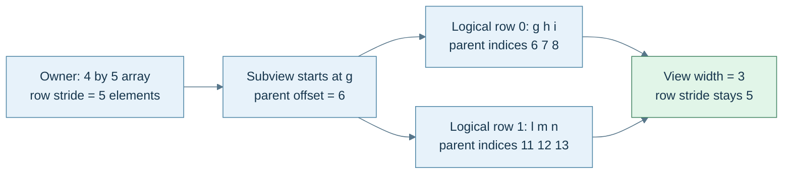

**Caption:** the parent rows are `a b c d e`, `f g h i j`, `k l m n o`, `p q r s t`. The view is two rows by three columns, beginning at `g`. After `i`, the next physical entries `j k` are outside the view before its next row starts at `l`. Stride is measured in elements here; an API using byte strides needs the corresponding element-size conversion.

## Runtime views borrow a layout as well as a lifetime

A **stride** is the physical distance between logical neighbors along a dimension. For a general two-dimensional view, the index can be written $r s_r+c s_c$, where $s_r$ is row stride and $s_c$ is column stride, both in elements. A compact row-major matrix has $s_r=C$ and $s_c=1$. A padded row-major matrix can have $s_r>C$. A transposed view can exchange the logical dimensions and the two strides while keeping the same underlying entries.

For Figure M7, indexing the second row with the view's width three would read `j k l` instead of `l m n`. The shape tells us which logical indices exist; the stride tells us where they live. Both are necessary metadata.

A **view** is a non-owning description of those entries. It should retain a backing-span/bounds contract, dimensions and strides rather than a bare pointer with unexplained capacity. For a nonempty row-major view with unit column stride and nonnegative row stride, the last accessed element has offset $(R-1)s_r+(C-1)$, so the backing region needs at least $(R-1)s_r+C$ elements. Check that multiplication and addition do not overflow before using that formula. Decide separately how empty views are represented; do not evaluate $R-1$ when $R=0$.

Dimension checks also belong before allocation. A request for `rows * cols` elements can wrap an unsigned size calculation before the container sees it, turning an enormous requested shape into a small allocation. Validate multiplication against the chosen container's limits first. A row stride shorter than the logical width may describe intentional overlapping rows in a very general view, but it violates an ordinary non-overlapping row-major contract. Choose which layouts the type accepts and validate that promise at construction, rather than hiding an accidental overlap in a permissive accessor.

Bounds on the descriptor do not extend the owner's lifetime. Destroying, reallocating or otherwise invalidating the owner's buffer can dangle the view. Moving an owner or swapping buffers also needs the container's actual guarantees; a pointer does not follow the meaning of a variable name. Mutation through overlapping views is another contract: `C = A * B` needs either an output independent of the inputs or a safe temporary when `C` aliases them. Arithmetic can be correct while in-place overwrite destroys values still needed by later iterations.

## SIMD and loop order change the execution schedule, not the matrix question

SIMD means **single instruction, multiple data**. A four-lane operation may multiply four corresponding scalar pairs at once. For a row dot vector, lane products still need to be added into one result. That addition is a **horizontal reduction**, because several lanes contribute to one scalar. A lane-wise result and a reduction have different data movement and rounding behavior.

For matrix multiplication, another strategy computes a whole output row from scaled rows of the right operand:

$$
C_{i,:}=A_{i0}B_{0,:}+A_{i1}B_{1,:}+A_{i2}B_{2,:}+A_{i3}B_{3,:}
$$

for four-by-four matrices. Each $A_{ik}$ can be broadcast into all lanes, then multiplied by one four-lane row of $B$. That describes a computational organization; it does not change our use of column-vector mathematics. Fused multiply-add may reduce instruction count and round a product-plus-sum once, while shuffles, horizontal reductions and register spills can erase a benefit. Benchmark the actual workload, compiler flags and target rather than promoting “SIMD-friendly” into an unmeasured speed claim.

Classical scalar multiplication uses $C_{ij}=\sum_k A_{ik}B_{kj}$. For row-major arrays, an `i-j-k` loop walks one row of $A$ but a column of $B$ in its inner loop. The `B` accesses jump by a row stride. Reorder to `i-k-j` and the inner loop walks a row of $B$ and a row of $C$, while reusing one $A_{ik}$ across them:

```cpp
// C is initially zero and does not alias A or B.
for (std::size_t i = 0; i < rows; ++i)
    for (std::size_t k = 0; k < inner; ++k) {
        const double aik = A(i, k);
        for (std::size_t j = 0; j < cols; ++j)
            C(i, j) += aik * B(k, j);
    }
```

Both schedules perform the same classical order of growth, $\Theta(n^3)$ for square matrices. Their cache traffic can differ substantially. A **cache line** transfers a block of neighboring bytes; an illustrative 64-byte line contains sixteen 32-bit floats. Walking adjacent entries can use those neighbors before eviction. Walking widely separated entries may bring in many unused neighbors. Exact cache-line size, alignment effects and reuse depend on the machine.

For a tiny Mat4, the working set is already small, so unrolling, instruction scheduling and register use may dominate. For large arrays, **blocking** or **tiling** works on smaller submatrices so loaded blocks can serve many arithmetic operations before eviction. **Arithmetic intensity** is the amount of arithmetic performed per byte transferred at the memory level being discussed. Increasing reuse can increase that ratio without changing the mathematical operation or the classical asymptotic work count.

Floating-point execution still matters. Different reduction trees, reassociation or FMA contraction can change final bits even when the real-number identities agree. Reproducibility requirements therefore constrain the allowed execution schedule and compiler settings. A fast result needs an accuracy contract and a measurement protocol, just as a correct-looking transformation needs declared coordinate endpoints.

The practical reconstruction test is now concrete: read a frame's columns and origin; derive which inverse changes coordinates; trace one valid point through model, view, clip and NDC; explain why a normal uses the inverse transpose; locate a subview's entries using its actual strides; and predict which data a multiplication loop reuses. Each answer joins geometry to the memory and lifetime model rather than treating matrix code as sixteen unexplained numbers.

## Orientation needs a state that can be composed

The robot now knows where its local axes point. A rotation matrix records those three axis images explicitly, which is ideal when many vertices must pass through the same transform. But the robot's controller also needs to store an orientation, add a small turn, and interpolate toward a target. These are related operations with different representation needs.

A proper rotation matrix has nine scalar entries but only three continuous degrees of freedom: its columns must be orthonormal and its determinant must be positive one. Three Euler angles use only three entries, but their coordinate chart becomes singular at certain orientations. A unit quaternion takes a useful middle route: four real numbers constrained to unit length. It represents orientation compactly and composes without choosing three sequential angle coordinates for every update.

We keep the chapter's conventions throughout: active rotations of geometric vectors, a right-handed coordinate system, and column-vector matrix action. A quaternion is written scalar first, $q=(w,x,y,z)$. Multiplication is Hamilton multiplication. Under these choices, first applying $q_A$, then $q_B$, is represented by $q_Bq_A$. An external library may expose components in a different order or use another convention. Convert at that boundary; do not repair an unexplained discrepancy by randomly transposing or negating values.

### A quaternion is an algebra before it is an orientation

A quaternion is a number of the form

$$
q=w+xi+yj+zk,
\qquad w,x,y,z\in\mathbb R.
$$

The basis symbols obey $i^2=j^2=k^2=-1$ and the cyclic rules $ij=k$, $jk=i$, $ki=j$. Reversing one of those mixed products changes its sign: $ji=-k$, $kj=-i$, $ik=-j$. Addition and multiplication by an ordinary real scalar remain componentwise. Quaternion multiplication is the extra structure; it is associative but generally not commutative.

The four coefficients form a vector in $\mathbb R^4$, but ordinary four-dimensional vector addition is not rotation composition. It helps to group the imaginary coefficients as a three-vector $\mathbf u=(x,y,z)$ and write $q=(w,\mathbf u)$. A quaternion with zero scalar part, $(0,\mathbf v)$, is called a **pure quaternion**. It lets a three-dimensional vector enter the algebra without claiming that the vector gained another geometric coordinate.

To derive the product, expand $(w_1+x_1i+y_1j+z_1k)(w_2+x_2i+y_2j+z_2k)$. Products of matching imaginary basis units contribute $-x_1x_2-y_1y_2-z_1z_2$. Mixed imaginary products collect into the cross product because their signs are antisymmetric. The remaining mixed scalar/vector terms are ordinary scalar multiples. Thus

$$
(w_1,\mathbf u_1)(w_2,\mathbf u_2)=
\left(w_1w_2-\mathbf u_1\cdot\mathbf u_2,
w_1\mathbf u_2+w_2\mathbf u_1+\mathbf u_1\times\mathbf u_2\right).
$$

The minus dot product records $i^2=j^2=k^2=-1$; the cross product records the order-sensitive mixed products. This is a reconstruction method for the formula, not a mnemonic detached from it. For implementation, its vector coefficients are

$$
\begin{aligned}
x&=w_1x_2+x_1w_2+y_1z_2-z_1y_2,\\
y&=w_1y_2-x_1z_2+y_1w_2+z_1x_2,\\
z&=w_1z_2+x_1y_2-y_1x_2+z_1w_2.
\end{aligned}
$$

A general quaternion is not automatically an orientation. Identity rotation uses $(1,0,0,0)$, the multiplicative identity. The zero quaternion $(0,0,0,0)$ is an additive zero with no inverse; accepting it as a rotation silently changes the input contract.

Four stored coefficients do not tell a caller which contract applies. A useful API distinguishes a general algebraic quaternion, a checked unit orientation, and a borrowed four-component view. The general type permits addition and arbitrary multiplication. The orientation type promises finite unit coefficients, so inverse-by-conjugate and optimized rotation become legal operations. A view promises only access to coefficients; it does not enforce a rotation invariant. A packed network or animation format additionally needs declared component order, scale, quantization and sign policy. Sixteen bytes on one ABI are a storage observation, not a serialized representation contract.

### Conjugation gives the inverse and its precondition

Conjugation keeps the scalar and reverses the imaginary part: $q^*=(w,-\mathbf u)$. Multiply once using the derived product:

$$
qq^*=(w^2+\mathbf u\cdot\mathbf u,\mathbf0)
=\|q\|^2.
$$

The vector terms cancel and $\mathbf u\times\mathbf u=\mathbf0$. Therefore, for $q\ne0$,

$$
q^{-1}=\frac{q^*}{\|q\|^2},
\qquad
\|q\|=\sqrt{w^2+x^2+y^2+z^2}.
$$

For example, $q=(1,2,2,1)$ has squared norm $10$, so its inverse is $(1,-2,-2,-1)/10$. A unit quaternion has norm one, and only then is conjugation alone the inverse. Conjugation reverses product order: $(ab)^*=b^*a^*$. Norms multiply, so exact multiplication of two unit quaternions produces a unit quaternion.

The norm multiplication rule can itself be reconstructed. Compute $(ab)(ab)^*=abb^*a^*$. Since $bb^*=\|b\|^2$ is real, it commutes with $a$ and $a^*$, giving $\|b\|^2aa^*=\|a\|^2\|b\|^2$. Taking nonnegative square roots yields $\|ab\|=\|a\|\|b\|$. This explains unit closure using the same conjugate identity that supplied the inverse; it does not require memorizing another unrelated rule.

Computing the norm naively can overflow before the final answer would be problematic. A checked normalization routine first rejects nonfinite inputs, finds $m=\max(|w|,|x|,|y|,|z|)$, rejects $m=0$, forms $s=q/m$, and returns $s/\|s\|$. Its intermediate squares are bounded. This validates a finite direction in four-dimensional coefficient space; it does not prove that arbitrary source data was intended to be an orientation.

## The sandwich turns half angles into a full rotation

Complex multiplication already rotates a plane: multiplying $x+iy$ by $\cos\theta+i\sin\theta$ produces the familiar sine/cosine rotation. For three dimensions, a single left multiplication generally sends a pure quaternion out of the pure subspace. The rotation action uses both sides:

$$
(0,\mathbf v')=q(0,\mathbf v)q^{-1}.
$$

For the normal orientation representation, $q$ is unit and $q^{-1}=q^*$. For a nonzero quaternion of arbitrary magnitude the action with the **true inverse** is still a pure rotation: write $q=m\widehat q$, where $m=\|q\|>0$, and the factors $m$ and $1/m$ cancel. By contrast, replacing the inverse with the conjugate for that nonunit input gives $q(0,\mathbf v)q^*=m^2\widehat q(0,\mathbf v)\widehat q^*$, which scales the rotated vector by $m^2$. These two operations must not be conflated.

### Derive the axis-angle mapping by deriving its action

Let $\mathbf a$ be a unit rotation axis and try $q=(c,s\mathbf a)$, with $c^2+s^2=1$. The first Hamilton product is

$$
q(0,\mathbf v)=
\left(-s\mathbf a\cdot\mathbf v,
c\mathbf v+s\mathbf a\times\mathbf v\right).
$$

Multiplying that result by $(c,-s\mathbf a)$ cancels its scalar part. The vector part is

$$
\mathbf v'=(c^2-s^2)\mathbf v
+2cs(\mathbf a\times\mathbf v)
+2s^2\mathbf a(\mathbf a\cdot\mathbf v).
$$

To check the algebra, the term involving two crosses reduces using $(\mathbf a\times\mathbf v)\times\mathbf a=\mathbf v-\mathbf a(\mathbf a\cdot\mathbf v)$. Now choose $c=\cos(\theta/2)$ and $s=\sin(\theta/2)$. The double-angle identities give $c^2-s^2=\cos\theta$, $2cs=\sin\theta$, and $2s^2=1-\cos\theta$. Consequently,

$$
q=\left(\cos\frac\theta2,\mathbf a\sin\frac\theta2\right),
\qquad
\mathbf v'=\mathbf v\cos\theta
+(\mathbf a\times\mathbf v)\sin\theta
+\mathbf a(\mathbf a\cdot\mathbf v)(1-\cos\theta).
$$

This is Rodrigues' rotation formula. The axis-parallel component stays fixed, while the perpendicular component rotates in its plane. The half angle appears because the two-sided action combines its sine and cosine through double-angle identities. It is not a spare convention to change independently.

For a $90^\circ$ turn around positive Z, let $h=\sqrt2/2$ and $q_Z=(h,0,0,h)$. Acting on $\mathbf e_x$ gives a first pure product $(0,h,h,0)$, then the final vector $(h^2-h^2,2h^2,0)=(0,1,0)$. The original basis vector has turned toward positive Y as required by the right-hand rule.

### Figure M8 - One orientation, several checkable actions

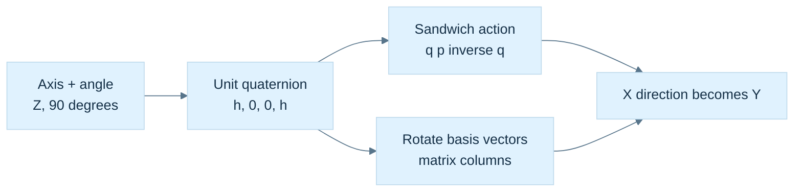

**Caption:** $h=\sqrt2/2$; the sandwich label means $qpq^{-1}$, in that order. This diagram compares representations of the same active rotation. It is not a picture of four-dimensional space. The unit invariant permits conjugation in place of the inverse.

### Recover the axis while admitting when it is undefined

For a normalized orientation $q=(w,\mathbf u)$, a useful angle is $\theta=2\operatorname{atan2}(\|\mathbf u\|,w)$. When $\mathbf u\ne0$, its normalized direction is the axis. If the quaternion is the identity, the rotation angle is zero and every axis gives the same action; there is no unique physical axis to recover. A routine may return a documented arbitrary axis with a status describing that degeneracy.

Choosing the sign of $q$ changes the reported axis-angle representative. For a shortest-angle report, one may choose the representative with $w\ge0$, giving an angle in $[0,\pi]$, with an additional tie rule at $w=0$. This is a reporting convention. It can jump near the boundary and should not be imposed blindly on every frame of a continuous animation.

### Remove the redundant arithmetic only after preserving the proof

Write a unit quaternion as $q=(w,\mathbf u)$. Expanding the sandwich gives

$$
\mathbf v'=(w^2-\mathbf u\cdot\mathbf u)\mathbf v
+2\mathbf u(\mathbf u\cdot\mathbf v)
+2w(\mathbf u\times\mathbf v).
$$

Use $w^2+\mathbf u\cdot\mathbf u=1$ and $\mathbf u\times(\mathbf u\times\mathbf v)=\mathbf u(\mathbf u\cdot\mathbf v)-\mathbf v(\mathbf u\cdot\mathbf u)$. Then define $\mathbf t=2\mathbf u\times\mathbf v$ to obtain

$$
\mathbf v'=\mathbf v+w\mathbf t+\mathbf u\times\mathbf t.
$$

For $q_Z$ and $\mathbf v=(1,0,0)$, $\mathbf t=(0,\sqrt2,0)$, $w\mathbf t=(0,1,0)$, and $\mathbf u\times\mathbf t=(-1,0,0)$; the sum is $(0,1,0)$. The optimized form is a useful computational result because we can explain its agreement with the literal sandwich. Off the unit sphere it is generally neither the true-inverse action nor simply the conjugate sandwich; validate or restore the input invariant instead of assuming one error model.

One adversarial input makes the three contracts visible. Double every coefficient of $q_Z$, obtaining $q=2q_Z=(\sqrt2,0,0,\sqrt2)$, and keep $\mathbf v=(1,0,0)$. The true inverse is $q^{-1}=q_Z^*/2$, so the two scale factors cancel and the action still gives $(0,1,0)$. The conjugate-only sandwich instead produces $(0,4,0)$, because $\|q\|^2=4$. In the unit-optimized formula, however, $\mathbf t=(0,2\sqrt2,0)$, $w\mathbf t=(0,4,0)$, and $\mathbf u\times\mathbf t=(-4,0,0)$. Its answer is $(-3,4,0)$, whose length is five. It is not even the same direction as the conjugate-sandwich result.

This counterexample explains why a debug norm assertion and a checked construction boundary are worthwhile. The optimized routine has a legitimate narrow precondition; it is not defective for requiring unit inputs. The API becomes defective when it exposes unrestricted coefficients while presenting the routine as valid for every quaternion. A test with only identity and a single normalized quarter turn would miss this failure entirely.

## Composition remembers which frame a new turn belongs to

Apply $q_A$, then $q_B$:

$$
q_B\bigl(q_Apq_A^{-1}\bigr)q_B^{-1}
=(q_Bq_A)p(q_Bq_A)^{-1}.
$$

Associativity lets the products regroup; it never permits reversing them. The rightmost turn happens first under our action. As a complete check, take $q_Z=(h,0,0,h)$ and $q_Y=(h,0,h,0)$. Their product is

$$
q_Yq_Z=\left(\frac12,\frac12,\frac12,\frac12\right).
$$

It is unit length and encodes $120^\circ$ about $(1,1,1)/\sqrt3$. It sends X to Y, Y to Z, and Z to X. In reverse order, $q_Zq_Y=(1/2,-1/2,1/2,1/2)$; X first goes to negative Z under the Y turn and stays there under the Z turn. The product order changes the physical result.

Suppose $q$ maps an object's local directions into world space. A delta expressed in the object's local axes acts before that existing map, so $q_{\mathrm{new}}=q\,\Delta q$. A delta expressed in fixed world axes acts afterward, so $q_{\mathrm{new}}=\Delta q\,q$. Neither multiplication side is universally correct; the delta's frame determines it. The same rule explains why world-space angular velocity uses $\dot q=\tfrac12(0,\boldsymbol\omega_W)q$, while local angular velocity uses $\dot q=\tfrac12q(0,\boldsymbol\omega_L)$ under these conventions.

### The sign changes the stored value without changing the orientation

The inverse of $-q$ is $-q^{-1}$, so $(-q)p(-q)^{-1}=qpq^{-1}$. Thus $q$ and $-q$ are different algebraic values with the same three-dimensional rotation action. Unit quaternion coefficients lie on $S^3$, the unit sphere in four-dimensional coefficient space; opposite points correspond to the same physical orientation. This is the **double cover**.

A $360^\circ$ axis-angle turn gives $(-1,0,0,0)$ and therefore identity action, while $720^\circ$ returns the coefficients to $(1,0,0,0)$. A chosen continuous quaternion trajectory can record the path between those representatives, but a final orientation does not record an object's accumulated number of turns. Keep turn count separately if the application needs it.

Component equality and orientation equality therefore answer different questions. For normalized $a,b$, the shortest relative angle is

$$
\delta=2\arccos\bigl(\min(1,|a\cdot b|)\bigr).
$$

An angular tolerance on $\delta$ has a physical interpretation. Clamping here handles small numerical excess only after finite normalized inputs have been established. Near equality, an appropriately sign-aligned relative quaternion and an $\operatorname{atan2}$ extraction can be more informative than an $\arccos$ of a nearly-one dot product.

## A matrix and a quaternion should agree on every basis direction

To derive quaternion-to-matrix conversion, rotate $\mathbf e_x$, $\mathbf e_y$, and $\mathbf e_z$ with the expanded action. Put those results in the columns. With normalized $q=(w,x,y,z)$ this yields

$$
R(q)=\begin{bmatrix}
1-2(y^2+z^2)&2(xy-wz)&2(xz+wy)\\
2(xy+wz)&1-2(x^2+z^2)&2(yz-wx)\\
2(xz-wy)&2(yz+wx)&1-2(x^2+y^2)
\end{bmatrix}.
$$

For example, the first column follows from $\mathbf u\cdot\mathbf e_x=x$ and $\mathbf u\times\mathbf e_x=(0,z,-y)$. Its result is $(1-2y^2-2z^2,2xy+2wz,2xz-2wy)$. Nothing about row-major or column-major **memory storage** enters this derivation; those choices only determine how the logical entries are indexed in memory.

For $q_Z$, the matrix is exactly the familiar $\begin{bmatrix}0&-1&0\\1&0&0\\0&0&1\end{bmatrix}$ in real arithmetic. For $(1/2,1/2,1/2,1/2)$, its columns are Y, Z and X. Tests should compare the matrix and quaternion actions on multiple vectors, not compare a screenshot that happens to look plausible from one camera.

### Recover a large component instead of dividing by a nearly-zero one

Inverting the representation map requires choosing one of $q,-q$. From the matrix diagonal,

$$
\begin{aligned}
4w^2&=1+r_{00}+r_{11}+r_{22},\\
4x^2&=1+r_{00}-r_{11}-r_{22},\\
4y^2&=1-r_{00}+r_{11}-r_{22},\\
4z^2&=1-r_{00}-r_{11}+r_{22}.
\end{aligned}
$$

If the $w$ expression is well conditioned, choose $w>0$ from its square root and recover $x=(r_{21}-r_{12})/(4w)$, $y=(r_{02}-r_{20})/(4w)$, $z=(r_{10}-r_{01})/(4w)$. Near a $180^\circ$ turn, $w$ approaches zero; those divisions become poor choices. Choose the largest of the four squared-component expressions instead. If $x$ is selected, recover it first, then use

$$
w=\frac{r_{21}-r_{12}}{4x},\quad
y=\frac{r_{01}+r_{10}}{4x},\quad
z=\frac{r_{02}+r_{20}}{4x}.
$$

The Y and Z branches follow the same diagonal/symmetric-entry logic. At an exact $180^\circ$ X turn, $R=\operatorname{diag}(1,-1,-1)$, so the X expression is $4$ and the branch safely produces $(0,1,0,0)$ without dividing by $w=0$.

The input must be a finite matrix close to a **proper rotation**, with $R^TR\approx I$ and $\det R\approx1$. A scale, shear or reflection is outside that conversion contract. Tiny negative radicands caused by rounding can be handled with a narrow documented numerical policy; blindly clamping arbitrary invalid matrices hides the wrong input. Extracting a nearest rotation from a general affine matrix is a separate problem, for which polar decomposition or SVD supplies principled tools later.

## Animation asks for a path, not merely an intermediate tuple

An animation needs orientations between unit endpoints $q_0$ and $q_1$. Componentwise matrix averaging can collapse an object: the midpoint between the 2D identity and a $180^\circ$ rotation is the zero matrix. Raw quaternion linear interpolation stays on a chord, not the sphere:

$$
\ell(t)=(1-t)q_0+tq_1,\qquad 0\le t\le1.
$$

From identity to a $180^\circ$ Z quaternion, the midpoint is $(1/2,0,0,1/2)$ with norm $1/\sqrt2$. Normalized linear interpolation, **NLERP**, divides that chord point by its length. It follows the same short great-circle route after suitable sign handling, but its parameter does not advance at constant angular speed.

Before either NLERP or SLERP, choose consistent endpoint signs. If $q_0\cdot q_1<0$, negate the target. This selects a nearer representative of the same target orientation. Otherwise interpolating $q_0$ and $-q_0$ would reach the zero quaternion at the midpoint despite both endpoints meaning the same orientation. At a physical relative angle of exactly $180^\circ$, the dot is zero and there are two equally short rotation paths; an application that needs stable direction must choose a tie-breaking or continuity policy.

### Derive SLERP in a two-dimensional plane inside four dimensions

After sign alignment, let $d=q_0\cdot q_1=\cos\Omega$, with $0\le\Omega\le\pi/2$. For distinct endpoints, define

$$
u=\frac{q_1-q_0\cos\Omega}{\sin\Omega}.
$$

This $u$ is a unit vector in quaternion coefficient space, perpendicular to $q_0$. It is not a three-dimensional rotation axis. The endpoint decomposition is $q_1=q_0\cos\Omega+u\sin\Omega$. Advancing a fraction $t$ along the unit circle in this plane gives $q(t)=q_0\cos(t\Omega)+u\sin(t\Omega)$. Substitute $u$ and use the sine-subtraction identity:

$$
\operatorname{slerp}(q_0,q_1,t)=
\frac{\sin((1-t)\Omega)}{\sin\Omega}q_0
+\frac{\sin(t\Omega)}{\sin\Omega}q_1.
$$

At the endpoints the weights reduce to $(1,0)$ and $(0,1)$. The orthogonal-plane form proves its norm stays one. The physical rotation advances through angle $2t\Omega$, so the ideal path has constant angular speed when $t$ advances uniformly. Easing the parameter deliberately changes that speed.

Take identity and a $120^\circ$ Z rotation: $q_1=(1/2,0,0,\sqrt3/2)$. At $t=1/4$, SLERP gives a $30^\circ$ physical turn. NLERP normalizes $(0.875,0,0,\sqrt3/8)$; its angle is $2\operatorname{atan2}(\sqrt3/8,0.875)\approx27.7958^\circ$. NLERP reaches the same endpoints with different speed. Neither numerical choice is universally preferable; the motion contract decides whether constant speed matters.

The halfway case alone is therefore a weak test: on a common short arc NLERP and SLERP agree at the midpoint by symmetry, even though their quarter points differ. Test a quarter point as well as both endpoints. Also test equivalent opposite-sign endpoints, a tiny separation, and a physical half turn. Compare orientation action and unit norm, not just raw coefficient equality. A routine may legitimately return $-q_1$ at $t=1$ after shortest-path sign alignment because it reaches the same target orientation. If the application promises raw coefficient interpolation instead, that is a different function.

When $\Omega\to0$, $\sin(t\Omega)/\sin\Omega\to t$. A normalized linear blend therefore supplies a stable small-angle fallback. A practical implementation validates and normalizes both endpoints, sign-aligns them, clamps the dot against rounding excess, takes a documented near-equality branch, and checks the final finite norm. A threshold such as $0.9995$ is a numerical design choice, not a geometric law. The statements here assume interpolation over $0\le t\le1$; extrapolation requires its own conditioning and behavior policy.

### Figure M9 - Choose a representative before choosing a path

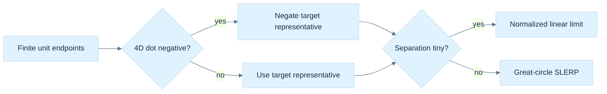

**Caption:** Sign alignment preserves the target orientation while changing its coefficient representative. The short-path tie at a physical half turn needs a chosen policy. The figure assumes valid unit endpoints and an interpolation parameter in $[0,1]$; it does not validate arbitrary four-float input by drawing it on a sphere.

### Norm repair and sign selection solve different problems

Floating-point composition perturbs the unit constraint. Explicit Euler integration also leaves the unit sphere even in exact arithmetic because it follows a tangent-line approximation to curved motion. A renormalization policy can normalize after each update or when the measured squared-norm error exceeds a justified threshold. Use finite/range-safe normalization; a NaN can evade an ordinary `if (n2 <= 0)` test, and squaring extreme finite coefficients can overflow.

Normalization restores unit length. Canonicalization chooses a sign representative, for example $w\ge0$. It does not restore length and can introduce a discontinuity at $w=0$. For sampled animation continuity, a common approach aligns each quaternion's sign with the previous stored sample. For a single serialized orientation, a deterministic canonical sign may be useful. Different tasks call for different choices.

## Euler coordinates remain useful when their chart is explicit

Editors often expose roll, pitch and yaw because people can reason about named controls. The names do not specify an equation. Here roll $\phi$ is about X, pitch $\theta$ about Y, and yaw $\psi$ about Z, with

$$
R=R_Z(\psi)R_Y(\theta)R_X(\phi).
$$

With active column-vector action this means fixed-axis X, then Y, then Z. Three distinct axes form a Tait–Bryan sequence, informally included under “Euler angles”; a proper Euler sequence repeats its first axis, such as ZXZ. State the actual matrix product rather than relying on an ambiguous “XYZ” label.

Writing $c_\phi=\cos\phi$, $s_\phi=\sin\phi$ and similarly for the other angles, multiplication gives

$$
R=\begin{bmatrix}
c_\psi c_\theta&c_\psi s_\theta s_\phi-s_\psi c_\phi&c_\psi s_\theta c_\phi+s_\psi s_\phi\\
s_\psi c_\theta&s_\psi s_\theta s_\phi+c_\psi c_\phi&s_\psi s_\theta c_\phi-c_\psi s_\phi\\
-s_\theta&c_\theta s_\phi&c_\theta c_\phi
\end{bmatrix}.
$$

At $\theta=\pi/2$, this reduces to

$$
R=\begin{bmatrix}
0&\sin(\phi-\psi)&\cos(\phi-\psi)\\
0&\cos(\phi-\psi)&-\sin(\phi-\psi)\\
-1&0&0
\end{bmatrix}.
$$

Only the difference $\phi-\psi$ remains. The triples $(0^\circ,90^\circ,30^\circ)$ and $(10^\circ,90^\circ,40^\circ)$ consequently give the same orientation. The Euler parameterization has lost local independence between two controls; the physical orientation and its matrix remain valid. This is the coordinate singularity called **gimbal lock**. Storing a quaternion avoids that Euler chart singularity, but converting back to Euler controls reintroduces it. No representation can change the mechanical constraints of real nested gimbals.

### Conversion cannot recover a historical sequence that was discarded

Construct Euler-to-quaternion conversion from $q=q_Z(\psi)q_Y(\theta)q_X(\phi)$. Let $c_r,s_r$ denote cosine/sine of $\phi/2$, $c_p,s_p$ of $\theta/2$, and $c_y,s_y$ of $\psi/2$. Hamilton multiplication gives

$$
q=(c_rc_pc_y+s_rs_ps_y,
s_rc_pc_y-c_rs_ps_y,
c_rs_pc_y+s_rc_ps_y,
c_rc_ps_y-s_rs_pc_y).
$$

For $(\phi,\theta,\psi)=(0,90^\circ,90^\circ)$, this is $(1/2,-1/2,1/2,1/2)$. The X coefficient is not a stored X angle; it arises from the product. This is another useful cross-check against the misconception that quaternion components are axis rotations.

In the ordinary extraction branch, choose $\theta\in[-\pi/2,\pi/2]$. Then

$$
\theta=\arcsin(-r_{20}),\quad
\phi=\operatorname{atan2}(r_{21},r_{22}),\quad
\psi=\operatorname{atan2}(r_{10},r_{00}).
$$

Clamp $-r_{20}$ only for small roundoff after validating the matrix. Near $\cos\theta=0$, the ordinary roll/yaw equations have nearly-zero arguments and cannot pick a unique original pair. One explicit singular reporting convention is to choose $\phi=0$ and return $\psi=\operatorname{atan2}(-r_{01},r_{11})$, along with the signed limiting pitch. This yields an equivalent orientation at either pitch singularity for this particular sequence. A threshold and continuity policy are still needed nearby. Test the reconstructed rotation, rather than demanding the original typed angle triple: periodicity, alternative Euler branches and singularity make that demand impossible.

## Rigid motion adds translation without adding scale or shear

A rigid transform acts as $\mathbf p'=R\mathbf p+\mathbf t$, preserving lengths and relative angles. It is perfectly reasonable to store a position vector and a unit quaternion separately. A dual quaternion packages the same rigid motion into one composable algebraic object.

Introduce a commuting symbol $\varepsilon$ with $\varepsilon^2=0$ but $\varepsilon\ne0$. A dual quaternion is $\widehat q=q_r+\varepsilon q_d$, where both $q_r$ and $q_d$ are ordinary quaternions. The subscript “real” here distinguishes the two quaternion parts; $q_r$ is not generally a scalar-only quaternion.

For unit rotation $q_r$ and translation pure quaternion $T=(0,\mathbf t)$, use

$$
q_d=\tfrac12Tq_r,\qquad T=2q_dq_r^*.
$$

The order is part of the convention. Multiplying two dual quaternions gives

$$
(a_r+\varepsilon a_d)(b_r+\varepsilon b_d)
=a_rb_r+\varepsilon(a_rb_d+a_db_r).
$$

The second-order term vanishes because $\varepsilon^2=0$. This matches rigid-transform composition when the rotation and translation encodings above are used. For pure translation $(2,0,0)$ with identity rotation, $q_r=(1,0,0,0)$ and $q_d=(0,1,0,0)$; recovery doubles the vector part of $q_d$ and obtains the original translation.

For the same translation combined with the positive-Z quarter turn, $q_r=(h,0,0,h)$ and $q_d=(0,h,-h,0)$. The dual part's negative Y coefficient does not mean that the body translated in negative Y. It is a coefficient in the coupled encoding. Multiplication by $q_r^*$ recovers $(0,1,0,0)$, and the factor two recovers $(2,0,0)$. Treating the dual vector coefficients directly as a position would be as mistaken as treating quaternion $x,y,z$ directly as Euler angles.

We can verify the composition rule without appealing to its name. For transforms A and B, substitute $a_d=\tfrac12T_Aa_r$ and $b_d=\tfrac12T_Bb_r$ into the dual product. Its dual part becomes $\tfrac12(a_rT_Bb_r+T_Aa_rb_r)$. Multiply on the right by $(a_rb_r)^*=b_r^*a_r^*$ and double. The result is $T_A+a_rT_Ba_r^*$: translation A plus translation B rotated into A's frame. The real part is $a_rb_r$. These are exactly the ordinary rigid composition equations, in the same order.

### Two coupled constraints make the eight coefficients a rigid motion

An arbitrary pair of quaternions is not automatically a valid rigid dual quaternion. The unit rigid constraints are

$$
\|q_r\|=1,\qquad q_r\cdot q_d=0,
$$

where the dot is the ordinary four-component dot product. The second condition makes the recovered translation pure: the scalar part of $q_dq_r^*$ is $q_d\cdot q_r$. The translation construction satisfies this condition because $T$ is pure.

Blending dual quaternions requires aligning signs of both halves together and restoring the coupled constraints. Normalizing $q_r$ and $q_d$ independently is incorrect and fails even for zero translation, whose $q_d$ is zero. Given finite blended $(r,d)$ with $a=\|r\|\ne0$, one projection to the constraints is $r'=r/a$, $d_0=d/a$, $d'=d_0-r'(r'\cdot d_0)$. It removes the dual component parallel to the real part. Degenerate cancellation and application-specific skinning weights still require an explicit failure policy.

Dual-quaternion blending can reduce characteristic matrix-blend twisting artifacts in suitable rigid skinning problems. It does not make an arbitrary weighted blend an exact physical interpolation, and a conventional rigid dual quaternion cannot encode general nonuniform scaling, shear or reflection. Choose it for the rigid domain it actually represents.

### Figure M10 - Representation follows the permitted operation

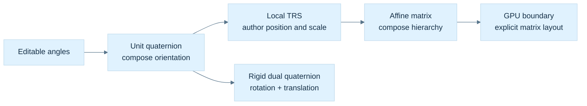

**Caption:** The branches reflect different contracts. Euler coordinates carry chart choices; a quaternion carries proper rotation; a rigid dual quaternion carries proper rotation plus translation; a general affine matrix can also carry scale, shear and reflection. Data conversions must check those domain boundaries.

## A transform type must say what its stored fields mean

For a local authoring transform, choose finite translation $\mathbf t$, unit orientation $q$, and axis scales $\mathbf s=(s_x,s_y,s_z)$, with matrix convention $M=TRS$. The **Hadamard product** $\odot$ means componentwise multiplication. A local point and direction then follow different paths:

$$
\mathbf p'=\mathbf t+R(q)(\mathbf s\odot\mathbf p),
\qquad
\mathbf v'=R(q)(\mathbf s\odot\mathbf v).
$$

Translation applies to points because their location changes; a free vector has no location to translate. The transform's linear part is $A=RS$. Its matrix columns are the rotated local basis directions multiplied by their respective scales, and its last homogeneous column contains translation.

For a point inverse, solve the steps backward:

$$
\mathbf p=\mathbf s^{-1}\odot R(q)^T(\mathbf p'-\mathbf t),
$$

requiring each scale component to be nonzero. The inverse operation is well defined under those conditions even when its result cannot be stored as another transform with the same restricted $TRS$ field convention. Finite input does not promise a finite or usable inverse: very small scales can overflow reciprocals or amplify uncertainty severely. Return a status when the requested operation is invalid or outside the numerical contract.

### Normals undo scale before following rotation

A normal is a measurement covector whose zero action identifies tangent directions. Preserving that relation requires $\mathbf n'=A^{-T}\mathbf n$. For $A=RS$ and orthogonal $R$,

$$
A^{-T}=\left(S^{-1}R^T\right)^T=RS^{-1}.
$$

Therefore apply reciprocal scale to the normal, rotate, and normalize when a unit shading direction is wanted. Never translate a normal. Zero scale makes the inverse-transpose undefined; an implementation may reconstruct a geometric normal from surviving transformed tangents when they remain independent, but that is a separate operation with its own degeneracy case.

For example, use tangent $(1,1,0)$ and normal $(1,-1,0)$ with $S=\operatorname{diag}(2,1,1)$ and identity rotation. The tangent becomes $(2,1,0)$ while the unnormalized normal becomes $(1/2,-1,0)$; their dot is zero. Transforming both with $S$ instead would give dot $3$ and break perpendicularity. Negative determinant additionally reverses orientation: a cross-derived area normal carries determinant sign as well as inverse-transpose direction. Keep face winding, geometric area and shading-normal policies distinct.

### The world result may no longer fit the local authoring fields

Rigid transforms are closed under composition. Applying local transform B and then parent A gives $R_C=R_AR_B$ and $\mathbf t_C=\mathbf t_A+R_A\mathbf t_B$, or $q_C=q_Aq_B$. This is why position plus quaternion is such a convenient rigid representation.

With nonuniform scale, the linear product becomes $R_AS_AR_BS_B$. The middle factors generally cannot be swapped, and the result need not equal any proper rotation times a diagonal scale. A concrete planar example makes the issue measurable. Let $S=\operatorname{diag}(2,1)$ and $R$ be a $45^\circ$ rotation. The columns of $SR$ are $(\sqrt2,\sqrt2/2)$ and $(-\sqrt2,\sqrt2/2)$. Their dot is $-2+1/2=-3/2$, so they are not perpendicular. The columns of any $R'D'$ with orthogonal $R'$ and diagonal $D'$ must be perpendicular. Consequently this composed map cannot be represented exactly by that restricted rotation/diagonal-scale form.

The same structural problem affects inverse storage: $(RS)^{-1}=S^{-1}R^T$, while storing inverse fields in the original order would yield $R^TS^{-1}$. Uniform scale commutes with rotation; arbitrary nonuniform scale does not. Some particular rotations and scale patterns also commute, but they are conditions to verify, not a default assumption.

The failure is a property of the restricted representation, rather than an inability to invert the underlying map. A general invertible affine matrix remains closed under inversion. A TRS object can consequently provide `inverseTransformPoint` by reversing its operations, or provide an inverse affine matrix, while correctly declining to promise another exact TRS object. Returning a transform with guessed reciprocal scales and inverse orientation silently changes the operation. The return type and name should express whether the result is exact, approximate, or potentially unavailable.

Store editable local transforms as TRS when useful, and compute general world affine matrices by hierarchy multiplication:

$$
M_{\mathrm{world,child}}=M_{\mathrm{world,parent}}M_{\mathrm{local,child}}.
$$

If an editor requests world TRS, disclose whether decomposition is exact, includes shear, or returns an approximation. A quaternion cannot absorb a reflection because its rotation has determinant positive one. A zero-scale matrix can still map points forward but has no inverse. These are API facts, not exceptional nuisances to hide behind a default identity result.

## A cached matrix is a dependency promise

Suppose local position, orientation and scale are canonical, while the matrix is cached for repeated use. A setter changes position but leaves the old matrix bytes in place until recomputation. The flag `localDirty` means exactly that those bytes no longer represent the current canonical fields. It does not mean that the transform data is corrupt.

World state has another dependency: parent world times local. If a door rotates on a car, the door's local and world values become dirty. A mirror attached to the door keeps the same local placement relative to the door, so its local matrix remains valid; its world matrix becomes dirty. The car's local and world matrices need not change. Cached world inverses and normal matrices become stale whenever their underlying world matrix changes.

### Figure M11 - Invalidate the values that actually depend on the edit

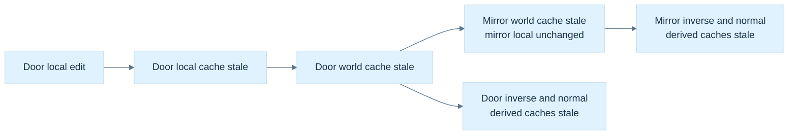

**Caption:** Local and world dirtiness name different dependencies. The hierarchy must be acyclic; the update order must make parents current before children. This figure describes invalidation, not a thread-safety mechanism or a complete transform-system scheduler.

Lazy recomputation rebuilds a cache only when read, potentially merging several edits into one rebuild. Immediate recomputation simplifies state but may rebuild repeatedly. Either strategy needs one authoritative representation. Independently writable TRS and matrix fields create conflicting truths.

Boolean propagation can mark an affected subtree. Skipping a node already marked dirty is valid only if the system guarantees that its descendants were invalidated under the same strategy, including after reparenting or insertion. An alternative stores local/world version counters and the parent/local versions used by each cache. On access, first refresh the parent, compare dependencies, then rebuild if necessary. Version wrap, stale handles, concurrent readers and writes, and graph cycles still need system-level policies. A `mutable` lazy cache is not automatically safe to access from multiple threads.

Reparenting is a useful stress test because it changes a dependency without necessarily changing the child's local coefficients. If a node is attached to a different parent while retaining its local TRS, its local matrix can stay valid while its world matrix must be invalidated. If the editor instead promises to preserve the world pose, it must solve for a new local affine map using the new parent's inverse, and then determine whether that map fits the allowed local TRS representation. A singular parent can make the requested operation impossible; nonuniform scale can make an exact local result require shear. A robust interface reports that situation instead of disguising it as a successful unchanged pose.

A cache reference also has a lifetime and mutation contract. Returning `const Mat4&` avoids a copy, but later recomputation can change the referenced object. A caller that needs a stable snapshot across updates should take a value or use a documented read phase. The word `const` limits writes through that reference; it does not stop the owner or another thread from changing the cache. This connects the transform system directly to the earlier C++ borrowing and logical-constness lessons.

The controller can now choose representations deliberately: Euler angles for specified editing controls, a checked unit quaternion for orientation, TRS for local authoring, an affine matrix for arbitrary world composition, inverse transpose for normal measurements, and optionally a constrained dual quaternion for rigid-motion blending. The useful result is not a winning representation. It is an explicit contract at every conversion and a test that can reveal when that contract was broken.

There is also a workload reason to keep these representations together. Composing an orientation once per object update and transforming a large vertex buffer are different tasks. A compact quaternion is convenient state for the first; a matrix prepared once can amortize conversion over the second and match a shader interface directly. This is a design possibility, not a benchmark result. Measure actual update counts, batch sizes, layout, precision and target instructions before asserting which path is faster. Avoid rebuilding the same matrix for every vertex or normalizing the same checked orientation redundantly at every inner-loop operation. Keep validation at trustworthy boundaries, then make the narrower inner-loop preconditions visible in names, types and tests.

### Quaternion and transform reconstruction desk

Derive the Hamilton product from the imaginary multiplication table, then derive the inverse from $qq^*=\|q\|^2$. Execute the positive-Z quarter turn on X and check both the literal sandwich and the optimized cross-product form. Compose Z then Y and recover the $120^\circ$ diagonal-axis result. Change the order and predict the changed basis image before running code.

Rebuild the quaternion matrix from its three basis images. At an exact half turn, demonstrate why dividing by the scalar component fails and a largest-component branch succeeds. Compare orientation actions after a matrix round trip, allowing $q$ or $-q$ as the coefficient result.

Finally, derive SLERP in its coefficient-space plane, expose the Euler chart singularity by substitution, verify the two dual-quaternion constraints, and exhibit the nonperpendicular columns of the composed nonuniform-scale example. For the car/door/mirror hierarchy, trace which canonical fields changed and which cached values became stale. Those questions connect algebraic understanding to an implementable transform system.

## A complete scalar laboratory makes the contracts observable

The following C++20 program is a standalone teaching laboratory. Copy its whole fence into one source file. It uses actual array storage and checked logical indices; encodes rectangular product dimensions; performs pivoted Gauss–Jordan inversion with an explicit scale-relative rejection policy; and implements Hamilton orientation, stable matrix conversion, shortest-path SLERP, homogeneous point transformation and rigid dual-quaternion composition. The tests exercise both valid relationships and defined rejection paths.

The inverse routine is deliberately small: its pivot threshold is a laboratory policy, not a certified condition estimator. It rejects nonfinite inputs and finite matrices whose row sums overflow; a production solver would need more careful scaling, factorization and error estimates. The axis-angle constructor accepts finite nonzero axes and normalizes them with max-component scaling, including tiny axes whose direct norm could underflow. Quaternion rotation and matrix conversion require the documented finite-unit/proper-rotation preconditions. The SLERP API here accepts only interpolation fractions in [0,1]. The homogeneous helper checks an exactly zero or nonfinite divisor; application-specific clipping and near-plane tolerances remain separate.

The program does not implement an engine scheduler, GPU upload ABI, general polar/SVD decomposition, dynamic strided-view class or animation system. Those have been explained as contracts above. Its purpose is to give a small executable witness for the mathematics rather than inherit the source excerpts’ production-ready label.

### Complete runnable matrix and orientation reference

```cpp
#include <algorithm>
#include <array>
#include <cassert>
#include <cmath>
#include <cstddef>
#include <iostream>
#include <limits>
#include <optional>
#include <random>
#include <stdexcept>

using V = std::array<double, 3>;
V add(V a, V b) {
  for (int i = 0; i < 3; ++i)
    a[i] += b[i];
  return a;
}
V scale(V a, double s) {
  for (double &x : a)
    x *= s;
  return a;
}
double dot(V a, V b) {
  double x = 0;
  for (int i = 0; i < 3; ++i)
    x += a[i] * b[i];
  return x;
}
V cross(V a, V b) {
  return {a[1] * b[2] - a[2] * b[1], a[2] * b[0] - a[0] * b[2],
          a[0] * b[1] - a[1] * b[0]};
}
bool near(double a, double b, double tol = 1e-10) {
  return std::abs(a - b) <= tol * std::max({1.0, std::abs(a), std::abs(b)});
}
void same(V a, V b) {
  for (int i = 0; i < 3; ++i)
    assert(near(a[i], b[i]));
}

template <std::size_t R, std::size_t C> struct Mat {
  static_assert(R > 0 && C > 0 &&
                R <= std::numeric_limits<std::size_t>::max() / C);
  std::array<double, R * C> a{};
  double &operator()(std::size_t r, std::size_t c) {
    if (r >= R || c >= C)
      throw std::out_of_range("matrix index");
    return a[r * C + c];
  }
  double operator()(std::size_t r, std::size_t c) const {
    if (r >= R || c >= C)
      throw std::out_of_range("matrix index");
    return a[r * C + c];
  }
};
template <std::size_t N> Mat<N, N> identity() {
  Mat<N, N> a;
  for (std::size_t i = 0; i < N; ++i)
    a(i, i) = 1;
  return a;
}
template <std::size_t R, std::size_t K, std::size_t C>
Mat<R, C> mul(const Mat<R, K> &a, const Mat<K, C> &b) {
  Mat<R, C> c;
  for (std::size_t i = 0; i < R; ++i)
    for (std::size_t k = 0; k < K; ++k)
      for (std::size_t j = 0; j < C; ++j)
        c(i, j) += a(i, k) * b(k, j);
  return c;
}
template <std::size_t R, std::size_t C>
Mat<C, R> transpose(const Mat<R, C> &a) {
  Mat<C, R> t;
  for (std::size_t i = 0; i < R; ++i)
    for (std::size_t j = 0; j < C; ++j)
      t(j, i) = a(i, j);
  return t;
}
template <std::size_t N> double normInf(const Mat<N, N> &a) {
  double m = 0;
  for (std::size_t i = 0; i < N; ++i) {
    double s = 0;
    for (std::size_t j = 0; j < N; ++j)
      s += std::abs(a(i, j));
    m = std::max(m, s);
  }
  return m;
}
template <std::size_t N> std::optional<Mat<N, N>> inverse(Mat<N, N> a) {
  double m = normInf(a);
  if (!(m > 0) || !std::isfinite(m))
    return std::nullopt;
  for (double x : a.a)
    if (!std::isfinite(x))
      return std::nullopt;
  // Normalize global scale; threshold is a laboratory rejection policy,
  // not a certified condition-number estimator.
  for (double &x : a.a)
    x /= m;
  auto b = identity<N>();
  for (std::size_t k = 0; k < N; ++k) {
    std::size_t p = k;
    for (std::size_t i = k + 1; i < N; ++i)
      if (std::abs(a(i, k)) > std::abs(a(p, k)))
        p = i;
    if (std::abs(a(p, k)) <= 64 * std::numeric_limits<double>::epsilon())
      return std::nullopt;
    for (std::size_t j = 0; j < N; ++j) {
      std::swap(a(k, j), a(p, j));
      std::swap(b(k, j), b(p, j));
    }
    const double pivot = a(k, k);
    for (std::size_t j = 0; j < N; ++j) {
      a(k, j) /= pivot;
      b(k, j) /= pivot;
    }
    for (std::size_t i = 0; i < N; ++i)
      if (i != k) {
        double f = a(i, k);
        for (std::size_t j = 0; j < N; ++j) {
          a(i, j) -= f * a(k, j);
          b(i, j) -= f * b(k, j);
        }
      }
  }
  for (double &x : b.a) {
    x /= m;
    if (!std::isfinite(x))
      return std::nullopt;
  }
  return b;
}
template <std::size_t N> void checkIdentity(const Mat<N, N> &a) {
  for (std::size_t i = 0; i < N; ++i)
    for (std::size_t j = 0; j < N; ++j)
      assert(near(a(i, j), i == j ? 1.0 : 0.0));
}
V matvec(const Mat<3, 3> &a, V v) {
  V r{};
  for (int i = 0; i < 3; ++i)
    for (int j = 0; j < 3; ++j)
      r[i] += a(i, j) * v[j];
  return r;
}
double det(const Mat<3, 3> &a) {
  return a(0, 0) * (a(1, 1) * a(2, 2) - a(1, 2) * a(2, 1)) -
         a(0, 1) * (a(1, 0) * a(2, 2) - a(1, 2) * a(2, 0)) +
         a(0, 2) * (a(1, 0) * a(2, 1) - a(1, 1) * a(2, 0));
}

struct Q {
  double w, x, y, z;
};
Q operator+(Q a, Q b) { return {a.w + b.w, a.x + b.x, a.y + b.y, a.z + b.z}; }
Q operator*(Q a, double s) { return {a.w * s, a.x * s, a.y * s, a.z * s}; }
Q conj(Q q) { return {q.w, -q.x, -q.y, -q.z}; }
double qdot(Q a, Q b) { return a.w * b.w + a.x * b.x + a.y * b.y + a.z * b.z; }
Q operator*(Q a, Q b) {
  V av{a.x, a.y, a.z}, bv{b.x, b.y, b.z};
  V c = add(add(scale(bv, a.w), scale(av, b.w)), cross(av, bv));
  return {a.w * b.w - dot(av, bv), c[0], c[1], c[2]};
}
std::optional<Q> unit(Q q) {
  const double m =
      std::max({std::abs(q.w), std::abs(q.x), std::abs(q.y), std::abs(q.z)});
  if (!(m > 0) || !std::isfinite(m))
    return std::nullopt;
  q = {q.w / m, q.x / m, q.y / m, q.z / m};
  const double n = std::sqrt(qdot(q, q));
  if (!std::isfinite(n))
    return std::nullopt;
  return q * (1.0 / n);
}
Q axis(V a, double theta) {
  if (!std::isfinite(theta))
    throw std::invalid_argument("nonfinite angle");
  const double m = std::max({std::abs(a[0]), std::abs(a[1]), std::abs(a[2])});
  if (!(m > 0) || !std::isfinite(m))
    throw std::invalid_argument("invalid axis");
  a = {a[0] / m, a[1] / m, a[2] / m};
  const double n = std::hypot(a[0], a[1], a[2]);
  if (!std::isfinite(n))
    throw std::invalid_argument("invalid axis");
  a = scale(a, std::sin(theta / 2) / n);
  return {std::cos(theta / 2), a[0], a[1], a[2]};
}
// Precondition for rotate and rotation: finite unit quaternion.
V rotate(Q q, V v) {
  V u{q.x, q.y, q.z};
  V t = scale(cross(u, v), 2);
  return add(v, add(scale(t, q.w), cross(u, t)));
}
Mat<3, 3> rotation(Q q) {
  Mat<3, 3> m;
  for (int j = 0; j < 3; ++j) {
    V e{};
    e[j] = 1;
    V c = rotate(q, e);
    for (int i = 0; i < 3; ++i)
      m(i, j) = c[i];
  }
  return m;
}
// Input contract: finite proper orthogonal matrix, independently checked
// by caller. This routine is not a matrix-to-rotation repair algorithm.
Q fromRotation(const Mat<3, 3> &m) {
  Q q{};
  const double tr = m(0, 0) + m(1, 1) + m(2, 2);
  if (tr > 0) {
    double s = 2 * std::sqrt(1 + tr);
    q = {s / 4, (m(2, 1) - m(1, 2)) / s, (m(0, 2) - m(2, 0)) / s,
         (m(1, 0) - m(0, 1)) / s};
  } else if (m(0, 0) > m(1, 1) && m(0, 0) > m(2, 2)) {
    double s = 2 * std::sqrt(1 + m(0, 0) - m(1, 1) - m(2, 2));
    q = {(m(2, 1) - m(1, 2)) / s, s / 4, (m(0, 1) + m(1, 0)) / s,
         (m(0, 2) + m(2, 0)) / s};
  } else if (m(1, 1) > m(2, 2)) {
    double s = 2 * std::sqrt(1 + m(1, 1) - m(0, 0) - m(2, 2));
    q = {(m(0, 2) - m(2, 0)) / s, (m(0, 1) + m(1, 0)) / s, s / 4,
         (m(1, 2) + m(2, 1)) / s};
  } else {
    double s = 2 * std::sqrt(1 + m(2, 2) - m(0, 0) - m(1, 1));
    q = {(m(1, 0) - m(0, 1)) / s, (m(0, 2) + m(2, 0)) / s,
         (m(1, 2) + m(2, 1)) / s, s / 4};
  }
  return *unit(q);
}
Q slerp(Q a, Q b, double t) {
  auto na = unit(a), nb = unit(b);
  if (!na || !nb || !std::isfinite(t) || t < 0 || t > 1)
    throw std::invalid_argument("invalid interpolation");
  a = *na;
  b = *nb;
  double d = qdot(a, b);
  if (d < 0) {
    b = b * (-1);
    d = -d;
  }
  d = std::clamp(d, -1.0, 1.0);
  if (d > .9995)
    return *unit(a * (1 - t) + b * t);
  double th = std::acos(d);
  return *unit(a * (std::sin((1 - t) * th) / std::sin(th)) +
               b * (std::sin(t * th) / std::sin(th)));
}
Mat<4, 4> affine(const Mat<3, 3> &l, V t) {
  auto a = identity<4>();
  for (int i = 0; i < 3; ++i) {
    for (int j = 0; j < 3; ++j)
      a(i, j) = l(i, j);
    a(i, 3) = t[i];
  }
  return a;
}
V point(const Mat<4, 4> &a, V p) {
  V r{};
  double w = a(3, 3);
  for (int j = 0; j < 3; ++j)
    w += a(3, j) * p[j];
  if (!std::isfinite(w) || w == 0)
    throw std::domain_error("invalid homogeneous divide");
  for (int i = 0; i < 3; ++i) {
    r[i] = a(i, 3);
    for (int j = 0; j < 3; ++j)
      r[i] += a(i, j) * p[j];
    r[i] /= w;
  }
  return r;
}
struct DQ {
  Q real, dual;
};
DQ rigid(Q q, V t) { return {q, (Q{0, t[0], t[1], t[2]} * q) * .5}; }
DQ operator*(DQ a, DQ b) {
  return {a.real * b.real, a.real * b.dual + a.dual * b.real};
}
V translation(DQ q) {
  Q t = (q.dual * conj(q.real)) * 2;
  return {t.x, t.y, t.z};
}

int main() {
  const double pi = std::acos(-1.0);
  Mat<2, 3> a{{1, 2, 3, 4, 5, 6}};
  Mat<3, 2> b{{7, 8, 9, 10, 11, 12}};
  auto c = mul(a, b);
  assert(c(0, 0) == 58 && c(0, 1) == 64 && c(1, 0) == 139 && c(1, 1) == 154);
  auto ct = transpose(c);
  assert(ct(0, 1) == 139);
  Mat<3, 3> pivot{{0, 1, 0, 1, 0, 0, 0, 0, 2}};
  auto ip = inverse(pivot);
  assert(ip);
  checkIdentity(mul(pivot, *ip));
  Mat<3, 3> singular{{1, 2, 3, 2, 4, 6, 0, 1, 0}};
  assert(!inverse(singular));
  auto scaled = identity<3>();
  for (double &x : scaled.a)
    x *= 1e-120;
  auto si = inverse(scaled);
  assert(si);
  checkIdentity(mul(scaled, *si));
  auto bad = identity<3>();
  bad(0, 0) = std::numeric_limits<double>::infinity();
  assert(!inverse(bad));
  Q z = axis({0, 0, 1}, pi / 2), x = axis({1, 0, 0}, pi / 2);
  same(rotate(z, {1, 0, 0}), {0, 1, 0});
  same(rotate(x * z, {1, 0, 0}), {0, 0, 1});
  same(rotate(z * x, {1, 0, 0}), {0, 1, 0});
  assert(!unit({0, 0, 0, 0}));
  assert(!unit({std::numeric_limits<double>::infinity(), 0, 0, 0}));
  auto huge = unit({1e300, 1e300, 0, 0});
  assert(huge && near(qdot(*huge, *huge), 1));
  auto tiny = unit({std::numeric_limits<double>::denorm_min(), 0, 0, 0});
  assert(tiny && near(tiny->w, 1));
  const double sub = std::numeric_limits<double>::denorm_min();
  same(rotate(axis({sub, 0, 0}, pi / 2), {0, 1, 0}), {0, 0, 1});
  Q tinyAxis = axis({sub, sub, 0}, pi / 2);
  assert(near(qdot(tinyAxis, tinyAxis), 1));
  bool badIndex = false;
  try {
    (void)a(0, 3);
  } catch (const std::out_of_range &) {
    badIndex = true;
  }
  assert(badIndex);
  bool badT = false;
  try {
    (void)slerp(z, x, -.1);
  } catch (const std::invalid_argument &) {
    badT = true;
  }
  assert(badT);
  Q half = slerp({1, 0, 0, 0}, z, .5);
  same(rotate(half, {1, 0, 0}), {std::sqrt(.5), std::sqrt(.5), 0});
  same(rotate(slerp(z, z * (-1), .37), {1, 0, 0}), rotate(z, {1, 0, 0}));
  Mat<3, 3> scale2 = identity<3>();
  scale2(0, 0) = 2;
  V tangent{1, 1, 0}, normal{1, -1, 0};
  auto invs = inverse(scale2);
  assert(invs);
  assert(
      near(dot(matvec(scale2, tangent), matvec(transpose(*invs), normal)), 0));
  auto trs = affine(mul(rotation(z), scale2), {10, 0, 0});
  same(point(trs, {1, 0, 0}), {10, 2, 0});
  auto ti = inverse(trs);
  assert(ti);
  same(point(*ti, point(trs, {1, 2, 3})), {1, 2, 3});
  // Nonuniform scale followed by 45-degree rotation has nonorthogonal
  // columns: it cannot in general be represented as rotation*diagonal-scale.
  auto shear = mul(scale2, rotation(axis({0, 0, 1}, pi / 4)));
  V c0{shear(0, 0), shear(1, 0), shear(2, 0)},
      c1{shear(0, 1), shear(1, 1), shear(2, 1)};
  assert(!near(dot(c0, c1), 0));
  auto parent = rigid(z, {10, 0, 0}), child = rigid(x, {1, 0, 0});
  auto combined = parent * child;
  same(translation(combined), {10, 1, 0});
  assert(near(qdot(combined.real, combined.dual), 0));
  // Euler XYZ active application means Rz(yaw)*Ry(pitch)*Rx(roll).
  Q r0 = axis({0, 0, 1}, .7) * axis({0, 1, 0}, pi / 2) * axis({1, 0, 0}, .2);
  Q r1 = axis({0, 0, 1}, 1.0) * axis({0, 1, 0}, pi / 2) * axis({1, 0, 0}, .5);
  assert(near(std::abs(qdot(r0, r1)), 1));
  std::mt19937 gen(700);
  std::uniform_real_distribution<double> d(-1, 1);
  for (int i = 0; i < 2000; ++i) {
    V ax{d(gen), d(gen), d(gen)}, v{d(gen), d(gen), d(gen)};
    Q q = axis(ax, pi * d(gen));
    auto m = rotation(q);
    same(rotate(q, v), matvec(m, v));
    same(rotate(q * (-1), v), rotate(q, v));
    assert(near(det(m), 1));
    checkIdentity(mul(transpose(m), m));
    Q recovered = fromRotation(m);
    assert(near(std::abs(qdot(q, recovered)), 1));
    auto im = inverse(m);
    assert(im);
    checkIdentity(mul(m, *im));
    Q p = axis({1, 2, 3}, pi * d(gen));
    same(rotate(p * q, v), rotate(p, rotate(q, v)));
  }
  for (V ax : std::array<V, 3>{V{1, 0, 0}, V{0, 1, 0}, V{0, 0, 1}}) {
    Q q = axis(ax, pi);
    assert(near(std::abs(qdot(q, fromRotation(rotation(q)))), 1));
  }
  bool rejected = false;
  try {
    (void)point(Mat<4, 4>{}, {1, 2, 3});
  } catch (const std::domain_error &) {
    rejected = true;
  }
  assert(rejected);
  std::cout << "Phase 7: fixed examples, failure cases, 180-degree branches, "
               "and 2000 seeded rotation properties passed\n";
}
```

### Read the assertions as experiments

The rectangular example checks a 2-by-3 times 3-by-2 product, while the zero-leading-pivot matrix verifies actual row swapping. Singular, infinite, invalid-index, invalid-SLERP-parameter and zero-quaternion cases exercise rejection. Uniform tiny scaling is accepted without a fixed determinant cutoff. A smallest-subnormal quaternion verifies that normalization divides components by the largest component instead of first forming an overflowing reciprocal.

The fixed orientation cases check composition order, q versus minus q, antipodal interpolation, a half-arc midpoint, inverse-transpose perpendicularity, exact point round trips, nonuniform-scale shear, rigid dual-quaternion translation, and two Euler triples representing one gimbal-lock orientation. The 2,000 seeded cases compare quaternion action with its matrix, check determinant one and orthogonality, recover matrix orientations including the three exact half-turn branches, and compare composed action with sequential action. These are regression checks for stated cases, not exhaustive proofs or performance measurements.

## Teach the journey by changing one promise

Ask a learner to reconstruct each new rule from the previous one: basis images determine a linear map; substituting one map into another determines multiplication; oriented volume exposes loss of independence; inverses undo descriptions when information survives; homogeneous coordinates distinguish locations from movements; frames give endpoints to products; and quaternion conjugation derives a compact orientation action.

Then deliberately break one promise: exchange storage layout without changing access; change a destination frame without changing the matrix product; use a singular scale; feed a shear into rotation conversion; interpolate opposite coefficient representatives; extract Euler angles at a chart singularity; or compose restricted TRS as though it were closed. Predict the failure before checking a picture. A correct-looking scene from one camera is much weaker evidence than a basis test and a declared invariant.

The missing 635–650 lesson texts remain visible in the coverage ledger. The reconstructed bridge keeps this teaching narrative usable now and can be deepened when those sources arrive. Later numerical linear algebra can extend pivoting, conditioning, orthogonal factorizations, eigenstructure and decomposition without changing the representation contracts established here.

[[Visual Recall/07 - Matrices, Transforms and Quaternions - Visual Recall|Compact linked recall]] · [[Supplementary/Foundations#Phase 7 - Parts 601-700|Exact coverage]] · [[Supplementary/Derivations#Phase 7 - Transform reconstruction proofs|Extended reconstruction]] · [[Supplementary/Worked Traces#Phase 7 - The moving-panel tracebook|Extended traces]] · [[Supplementary/Sources and Code Anchors#Phase 7 - Source analysis and verification|Sources and verification]] · [[Keyword Index]] · [[Dependency Map]]

### Where transforms lead next

The determinant already asks whether a map collapses a dimension; its smallest singular value will later quantify how nearly that collapse occurs. The column dot products in $A^\mathsf T A$ measure whether transformed axes become coupled; QR and SVD turn those measurements into stable coordinates and explicit stretch directions. A matrix can therefore be perfectly meaningful as a transform and still be a difficult inverse problem. Phase 8 connects these transform foundations to [[Linear systems and fundamental subspaces]], [[QR factorization and least squares]], [[Singular value decomposition]], and [[Conditioning and singularity]].

Keep the roles straight as you move forward: Phase 7 asks what one matrix or orientation does to geometry; Phase 8 asks which unknowns can be recovered from measurements, how uncertainty changes the answer, and which factorization exposes the reliable information.
