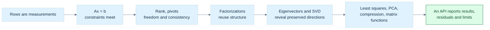
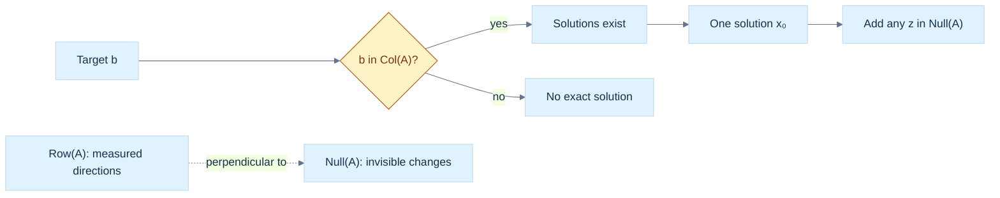
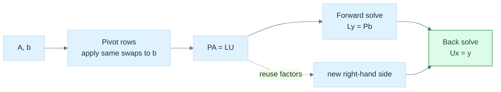
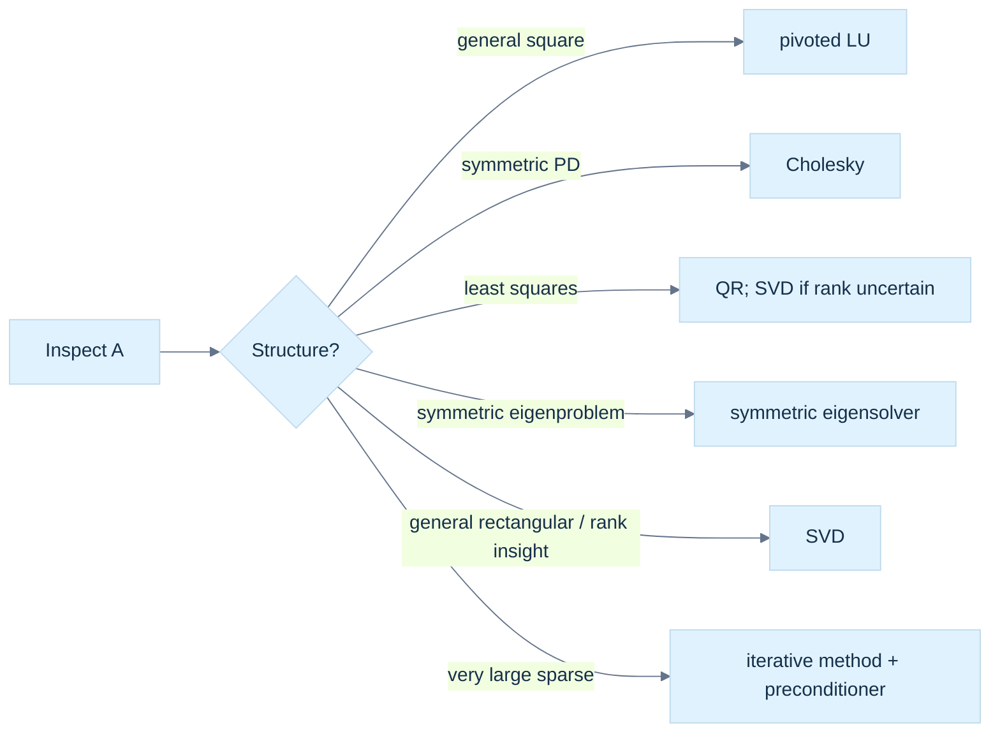
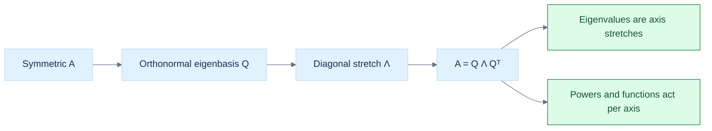
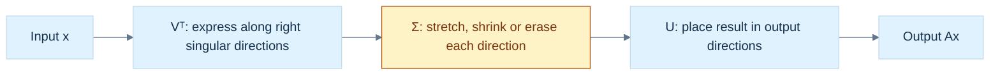
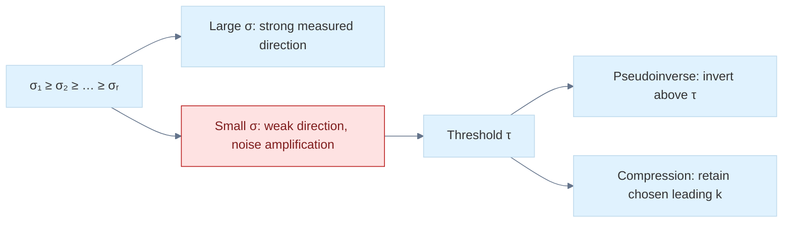
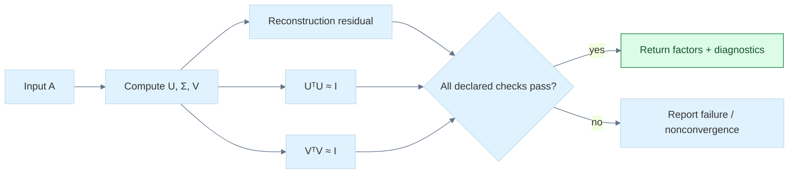
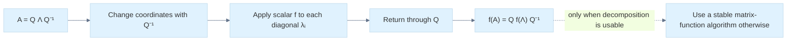
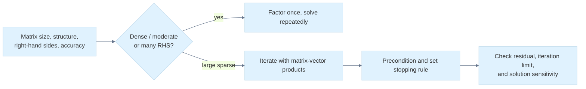

---
tags:
  - continuous-notes
  - linear-algebra
coverage: Parts 701–800
---

# From Constraints to Spectra: Systems, Decompositions, and Matrix Functions

## The graphics problem hiding inside a matrix equation

Imagine a graphics engine fitting a flat surface to noisy depth samples, solving for a camera correction, estimating the dominant direction in a point cloud, or integrating a small deformation over time. Every one of these tasks asks a related question: what does a collection of linear measurements allow us to know, and how can we compute that answer without inventing information the data did not contain?

We will follow one chain. A row of a matrix is a measurement or constraint. A system asks for an input satisfying many such measurements. Elimination reveals which constraints are independent and which degrees of freedom remain. Factorizations organize that elimination so it can be reused and made stable. Eigenvectors identify directions preserved by a square map; singular vectors do the more general job of identifying input directions that are stretched into mutually perpendicular output directions. From that picture come least squares, pseudoinverses, PCA, low-rank approximation, polar decomposition, and a principled view of matrix functions. The final question is practical: how should a graphics library represent, compute, and validate these operations?

This phase builds directly on the earlier geometry and transform stories. [[Continuous Notes/06 - From Movement to Meaning - Vectors, Geometry and Reliable Code|Phase 6]] supplies vectors, dot products, Gram matrices, projections, and the meaning of orthogonality. [[Continuous Notes/07 - From Basis Images to Moving Worlds - Matrices, Transforms and Quaternions|Phase 7]] supplies matrix maps, basis images, determinants, composition, and storage/layout contracts. Phase 8 asks what can be recovered when those maps are observed through measurements, and what numerical risk remains when a direction is almost lost.

The connecting question is always the same: **what information enters, what information can the map preserve, and what evidence tells us the computed answer is trustworthy?** This chapter combines the supplied Phase 8 lessons into a concept-led teaching sequence. The exact canonical titles remain in [[Supplementary/Foundations#Phase 8 - Parts 701-800|the coverage ledger]], while this chapter teaches them as one story.

### Figure L1 - The route from measurements to a numerical API

> **How to read Figure L1.** The route is a dependency map, not a claim that every application must run every algorithm. Rank and structure guide the choice; a validation contract makes the output inspectable.

## A linear equation is a measurement, and several equations are geometry

Start with one equation in two unknowns:

$$
2x+y=5.
$$

Each pair $(x,y)$ is a point in the plane. The equation selects a line: every point on it satisfies the same measurement. In three variables one nontrivial linear equation selects a plane, and in $n$ variables it selects a hyperplane. Here *hyperplane* means the flat set one dimension lower than the ambient space. The coefficients $(2,1)$ set the measurement direction; the right side $5$ moves the set without changing its orientation.

Several equations ask for the intersection of their constraint sets. Parallel distinct lines have no common point; distinct lines crossing once have one; repeated equations leave a whole line of answers. This geometric picture explains why the number of equations alone does not tell us how many independent facts we have. We need rank.

Write the [[Linear systems and fundamental subspaces|linear system]] compactly as

$$
A\mathbf x=\mathbf b,
\qquad A\in\mathbb R^{m\times n},\quad
\mathbf x\in\mathbb R^n,\quad\mathbf b\in\mathbb R^m.
$$

The row view says each row of $A$ tests the unknown vector and produces one scalar measurement. The column view says $A\mathbf x$ is a weighted sum of the columns of $A$. Therefore an exact solution exists precisely when $\mathbf b$ can be made from those columns:

$$
A\mathbf x=\mathbf b\text{ is consistent}
\quad\Longleftrightarrow\quad
\mathbf b\in\operatorname{Col}(A).
$$

This is a powerful diagnostic. If a measured target lies outside the reachable column space, no amount of more careful elimination will make an exact solution exist. We must instead change the model, accept an approximation, or report failure.

Use the running system

$$
\begin{aligned}
x+y+z&=6,\\
2x-y+z&=3,\\
x+2y-z&=2.
\end{aligned}
$$

Its matrix form is $A\mathbf x=\mathbf b$ with rows $(1,1,1)$, $(2,-1,1)$, $(1,2,-1)$ and target $(6,3,2)^\mathsf T$. The solution $(1,2,3)^\mathsf T$ can be checked by substituting into the original measurements. Keeping this direct check in view matters: a transformed system is only useful if it preserves the same solution set.

## Rank separates what the measurements determine from what they leave free

The **[[Linear systems and fundamental subspaces|row space]]** is the span of the measurement rows. It records the independent linear tests the system can make. The **[[Linear systems and fundamental subspaces|column space]]** is the set of outputs the map can produce. The **[[Linear systems and fundamental subspaces|null space]]** is the set of input changes invisible to every measurement:

$$
\operatorname{Null}(A)=\{\mathbf z:A\mathbf z=\mathbf0\}.
$$

If $\mathbf x_0$ is one solution, every solution is $\mathbf x_0+\mathbf z$ for some $\mathbf z\in\operatorname{Null}(A)$. The null vector is not measurement error; it is a direction the system cannot observe. In graphics, this can represent a gauge freedom, an unconstrained parameter, or a motion that does not change the sampled data.

The **rank** $r$ is the number of independent rows, equivalently the dimension of the row space or column space. Rank-nullity says

$$
\operatorname{rank}(A)+\dim\operatorname{Null}(A)=n.
$$

The input space splits into $r$ observable degrees of freedom and $n-r$ invisible ones. This immediately predicts the solution shape. For a consistent system, full column rank ($r=n$) gives a unique solution. If $r<n$, there are free directions and infinitely many solutions. If $\mathbf b$ lies outside the column space, there is no exact solution regardless of the number of free variables.

The row space is perpendicular to the null space: every row $\mathbf a_i^\mathsf T$ satisfies $\mathbf a_i^\mathsf T\mathbf z=0$ for every null vector. Thus the unobservable motions are precisely those orthogonal to all measurement directions. The left null space, $\operatorname{Null}(A^\mathsf T)$, instead describes dependencies among the rows and therefore among the measurement equations. These are distinct spaces with distinct jobs.

Do not infer rank from a determinant except in the narrow square case, and do not infer reliable rank from exact floating-point equality. In exact arithmetic rank is algebraic. In finite precision, *numerical rank* needs a scale and a tolerance or a singular-value threshold. A tiny singular value may mean weakly observed information rather than a truly absent dimension. This distinction returns when we build the pseudoinverse and truncate an SVD.

### Figure L2 - Consistency, freedom, and the four fundamental spaces

> **How to read Figure L2.** First ask whether the target is reachable. Only after consistency is established do we count the family's free directions; rank-nullity gives their number.

## Elimination turns the geometry into an auditable calculation

Three elementary row operations preserve the solutions when applied to the entire augmented matrix $[A\mid\mathbf b]$: swap two rows, multiply a row by a nonzero scalar, or add a multiple of one row to another. Geometrically, these replace constraints by equivalent combinations. They change the written system but not the intersection it describes.

In **row-echelon form (REF)**, nonzero rows appear first, each leading entry (pivot) moves right as we go down, and entries below pivots are zero. **Reduced row-echelon form (RREF)** additionally makes each pivot one and clears its column above. REF is enough for rank, consistency, and back substitution. RREF is uniquely determined and makes free-variable relationships easy to read, but production solvers rarely need to spend extra work reducing all the way.

[[Gaussian elimination and pivoting|Gaussian elimination]] derives each multiplier from the requirement that a pivot-column entry vanish. For pivot $a_{kk}\ne0$, row $i$ becomes

$$
R_i\leftarrow R_i-\frac{a_{ik}}{a_{kk}}R_k.
$$

If a pivot is zero, swap rows. **Partial pivoting** chooses the largest-magnitude candidate in the current column; this avoids dividing by a zero or unnecessarily tiny value. **Complete pivoting** searches the full remaining submatrix and may swap columns too, so it also permutes the unknown-variable order. It can reduce growth in some cases but costs more search and bookkeeping. Partial pivoting is common, not a universal guarantee against ill-conditioning or all element growth.

The familiar forward and back substitutions are triangular solves. For lower triangular $L$, solve the first row then move downward; for upper triangular $U$, solve from the last row upward. This costs $O(n^2)$ for one right-hand side after factorization. Explicitly constructing $A^{-1}$ is generally the wrong route: a solve uses the factorization directly, avoids extra work, and avoids turning a good problem into a less stable one.

Elimination naturally produces **[[LU factorization and reusable solves|LU factorization]]**. With pivoting, the convention used here is

$$
PA=LU,
$$

where $P$ records row swaps, $L$ stores elimination multipliers below its diagonal, and $U$ stores the resulting upper triangle. This convention matters: libraries may write an equivalent permutation on the other side. A solve becomes $L\mathbf y=P\mathbf b$, then $U\mathbf x=\mathbf y$. Doolittle's convention places ones on $L$'s diagonal; other LU conventions distribute scaling differently. Never compare factors without first comparing conventions.

For many right-hand sides sharing the same $A$, factor once and solve each new right-hand side with the triangular factors. This is why a factorization is more than a compact identity: it amortizes expensive work. The $O(n^3)$ factorization dominates the one-time setup; each additional solve is approximately $O(n^2)$ for a dense matrix.

### Figure L3 - Elimination stores work for later solves

> **How to read Figure L3.** Pivoting changes row order, so the right-hand side must receive the same permutation. Once $L$ and $U$ exist, later solves reuse them.

## Structure makes a decomposition a better tool than generic elimination

Before choosing an algorithm, ask what the matrix promises. Symmetry, positive definiteness, rectangular shape, sparsity, and repeated right-hand sides each change the most useful representation.

A real symmetric matrix satisfies $A=A^\mathsf T$. It is **positive definite (PD)** when $\mathbf x^\mathsf T A\mathbf x>0$ for every nonzero $\mathbf x$, and **positive semidefinite (PSD)** when the value is merely nonnegative. A Gram matrix $B^\mathsf T B$ is PSD because $\mathbf x^\mathsf T B^\mathsf T B\mathbf x=\|B\mathbf x\|_2^2\ge0$. If $B$ has a nontrivial null vector, the Gram matrix is singular. Covariance matrices are PSD for the same sum-of-squares reason.

For symmetric positive-definite $A$, **[[Symmetric positive-definite matrices and Cholesky|Cholesky factorization]]** writes $A=LL^\mathsf T$ with lower-triangular $L$. It uses symmetry, stores less work than general LU, and avoids pivoting under the mathematical assumptions. If a computed diagonal square-root argument is nonpositive, that is diagnostic evidence: the input may not be PD, may be badly scaled, or roundoff may have exposed a fragile assumption. Do not silently clamp a materially negative value and claim a valid Cholesky factor.

For symmetric indefinite matrices, **LDL$^\mathsf T$** represents $A=LDL^\mathsf T$ without square roots in the diagonal factor. Robust practical algorithms may require symmetric permutations and 1-by-1 or 2-by-2 diagonal blocks; a bare unpivoted scalar LDL$^\mathsf T$ is not a universal indefinite solver. Positive semidefinite matrices can be singular, so a decomposition must handle zero pivots or use a method designed for rank deficiency.

**[[QR factorization and least squares|QR factorization]]** writes $A=QR$, where the columns of $Q$ are orthonormal and $R$ is upper triangular (or trapezoidal for rectangular matrices). It separates a coordinate change that preserves lengths from the remaining triangular solve. Gram–Schmidt explains the geometry by repeatedly subtracting projections, but classical Gram–Schmidt can lose orthogonality in floating point. Modified Gram–Schmidt improves behavior; Householder reflectors are a stable dense workhorse; Givens rotations efficiently eliminate selected entries and are useful for incremental or structured problems.

For overdetermined measurements $A\mathbf x\approx\mathbf b$, least squares chooses $\mathbf x$ minimizing $\|A\mathbf x-\mathbf b\|_2$. With full column rank, QR gives $A=QR$ and orthogonality yields

$$
\min_{\mathbf x}\|A\mathbf x-\mathbf b\|_2
=\min_{\mathbf x}\|R\mathbf x-Q^\mathsf T\mathbf b\|_2.
$$

The residual is perpendicular to the column space: $A^\mathsf T(A\widehat{\mathbf x}-\mathbf b)=0$. The **normal equations** solve $A^\mathsf T A\mathbf x=A^\mathsf T\mathbf b$, but $\kappa_2(A^\mathsf T A)=\kappa_2(A)^2$ for full-column-rank $A$. Squaring the condition number can destroy useful digits; QR is generally safer, while SVD handles rank deficiency more explicitly.

### Figure L4 - Matrix structure determines the useful factorization

> **How to read Figure L4.** No decomposition wins on every matrix. The structural facts are inputs to algorithm selection, not implementation trivia.

## Eigenvectors reveal the directions a square map does not turn

For a square matrix $A$, an [[Eigenvalues and eigenspaces|eigenvector]] $\mathbf v\ne\mathbf0$ and eigenvalue $\lambda$ satisfy

$$
A\mathbf v=\lambda\mathbf v.
$$

The transformation may stretch, shrink, reverse, or annihilate this direction, but it does not turn it into a different direction. Eigenvectors are directions rather than unique vectors: any nonzero scalar multiple is also an eigenvector. The corresponding eigenspace is $\operatorname{Null}(A-\lambda I)$.

If a matrix has enough independent eigenvectors, it is diagonalizable: $A=V\Lambda V^{-1}$. This can simplify repeated powers and matrix functions, but $V$ may be poorly conditioned or not exist as a full basis. A repeated eigenvalue does not guarantee enough eigenvectors. Algebraic multiplicity counts the root's repetition in the characteristic polynomial; geometric multiplicity counts independent eigenvectors. The latter cannot exceed the former.

For real symmetric $A$, the spectral theorem gives an orthonormal eigenbasis: $A=Q\Lambda Q^\mathsf T$. The coordinate change by $Q$ is unusually safe because it preserves Euclidean length and does not magnify 2-norm error. This is the setting where Rayleigh quotients, PCA covariance analysis, and symmetric eigensolvers have especially clean meanings. Orthogonal does not mean error-free; it means the transformation itself does not add condition amplification in the 2-norm.

Iterative eigen methods seek selected spectral information without always computing every eigenpair. **Power iteration** repeatedly applies $A$ and renormalizes; when a unique dominant eigenvalue is separated and the initial vector has a component in its eigendirection, the dominant direction tends to take over. **Inverse iteration** solves shifted systems $(A-\mu I)\mathbf y=\mathbf x$ to emphasize eigenvalues near $\mu$; a good shift can make it fast, but a near-singular solve and factorization cost matter. The **Rayleigh quotient** $\rho(\mathbf x)=\mathbf x^\mathsf T A\mathbf x/(\mathbf x^\mathsf T\mathbf x)$ estimates the eigenvalue associated with a candidate vector for symmetric $A$; a small residual is evidence of an approximate eigenpair, while eigenvalue accuracy also depends on separation and conditioning.

QR iteration repeatedly factors and recombines a matrix to drive it toward a form whose diagonal exposes eigenvalues. Symmetric Jacobi methods apply plane rotations to reduce off-diagonal entries while maintaining orthogonal similarity. Stopping criteria should measure a scaled residual or off-diagonal norm, include a maximum iteration count, and report nonconvergence. A small residual says the computed pair nearly satisfies its equation; it does not, by itself, guarantee a uniquely accurate eigenvector when eigenvalues are tightly clustered. Eigenvalue sensitivity depends on both the problem and the perturbation model.

The characteristic polynomial $\det(A-\lambda I)$ explains eigenvalues algebraically and establishes multiplicity, but directly expanding and solving it is not generally a reliable numerical eigensolver for large matrices. It is a conceptual definition; stable algorithms use transformations and structured iterations.

### Figure L5 - Eigenanalysis is cleanest when the basis is orthonormal

> **How to read Figure L5.** Symmetry guarantees perpendicular eigen-directions, so the diagonal form is a genuine orthonormal coordinate change rather than an unstable oblique one.

## Singular value decomposition covers every rectangular map

Eigenvectors are tied to square maps. A graphics transform may instead map an $n$-dimensional input to an $m$-dimensional measurement, and its input and output directions live in different spaces. **[[Singular value decomposition|singular value decomposition (SVD)]]** handles that general case:

$$
A=U\Sigma V^\mathsf T.
$$

For real $A\in\mathbb R^{m\times n}$, $U$ and $V$ are orthogonal (or have orthonormal columns in a thin factorization), and $\Sigma$ is rectangular diagonal with nonnegative entries $\sigma_1\ge\sigma_2\ge\cdots\ge0$. In a complex problem transpose becomes conjugate transpose. The right singular vector $\mathbf v_i$ is an input direction; $A\mathbf v_i=\sigma_i\mathbf u_i$ sends it to the paired output direction. The singular value is the stretch. Unlike an eigenvector, this does not require input and output spaces to be the same.

The geometric story is “rotate or reflect the input coordinates, stretch along perpendicular axes, then rotate or reflect in the output space.” Orthogonal stages preserve length; the diagonal stage exposes the map's true principal stretches. The singular values are square roots of eigenvalues of $A^\mathsf T A$, but computing SVD by explicitly forming $A^\mathsf T A$ is often a poor numerical shortcut: it squares the condition number and may erase small singular information. Use this identity to understand, not automatically to implement.

Full SVD uses $U\in\mathbb R^{m\times m}$ and $V\in\mathbb R^{n\times n}$. Thin/economy SVD keeps only the columns needed to represent $A$, saving storage and work. If $r=\operatorname{rank}(A)$, compact rank-revealing forms retain $r$ nonzero singular directions. For rank-deficient matrices, zero singular values identify null directions. Singular vectors corresponding to repeated singular values are not individually unique: any orthonormal basis of the repeated subspace is valid. A sign flip of a paired pair $(\mathbf u_i,\mathbf v_i)$ also leaves the product unchanged.

### Figure L6 - Every linear map is orthogonal change, stretch, orthogonal change

> **How to read Figure L6.** The middle stage contains all scale information. The outer stages choose the input and output orthonormal coordinates.

## Pseudoinverse makes least squares and minimum norm one operation

If $A$ is square and invertible, $A^{-1}\mathbf b$ solves exactly. Real problems may be rectangular, inconsistent, or rank-deficient. The **[[Moore-Penrose pseudoinverse|Moore–Penrose pseudoinverse]]** generalizes inversion while respecting least squares and minimum norm. From the SVD, for a chosen numerical rank threshold,

$$
A^+=V\Sigma^+U^\mathsf T,
\qquad
\Sigma^+_{ii}=\begin{cases}1/\sigma_i,&\sigma_i>\tau,\\0,&\sigma_i\le\tau.\end{cases}
$$

The threshold $\tau$ is a policy tied to scale, precision, and application. It is not a universal constant. Tiny singular values correspond to directions where inversion would magnify noise; discarding them states that those directions are not trusted at the selected resolution.

Take the rank-one matrix $A=\begin{bmatrix}3&0\\0&0\end{bmatrix}$ and target $\mathbf b=(6,5)^\mathsf T$. Its SVD is already visible: $U=V=I$ and $\Sigma=A$. The exact equation would require $3x_1=6$ and $0x_2=5$, so no exact solution exists. Least squares sets $x_1=2$ and cannot change the second residual; every $(2,t)$ has residual $(0,-5)$. The minimum-norm member is $(2,0)$, exactly what $A^+\mathbf b$ returns. This small example keeps three facts distinct: rank deficiency, inconsistency, and the extra minimum-norm rule.

Then $\mathbf x=A^+\mathbf b$ is a least-squares minimizer of $\|A\mathbf x-\mathbf b\|_2$. If many minimizers have the same residual, it is the one with smallest Euclidean norm. For a consistent underdetermined system, that chooses the solution closest to zero. This is a principled choice, not proof that the minimum-norm answer is the only physically meaningful one; a graphics application may need regularization, constraints, or a prior.

The 2-norm condition number for a full-rank matrix is $\kappa_2(A)=\sigma_{\max}/\sigma_{\min}$. For rank-deficient $A$, it is infinite in the ordinary inverse sense. A large condition number means small data perturbations can cause large solution changes. Residual and solution error are different: a solver can produce a small residual while the solution remains highly sensitive. Report both when the distinction matters.

The truncated SVD also gives the best rank-$k$ approximation to $A$ in both spectral and Frobenius norms. Keeping the leading singular directions preserves the most energy under those measures; discarding the tail compresses information. **Eckart–Young** is the theorem that makes “keep the largest $k$ singular values” optimal for this specific approximation objective. It does not say the approximation is best for every perceptual, semantic, or downstream-engine objective.

### Figure L7 - The singular spectrum makes inversion and compression explicit

> **How to read Figure L7.** A numerical threshold is a declared modeling decision. Pseudoinversion and compression use the spectrum for different goals, even though both may discard small directions.

## PCA turns a cloud of points into measured variation

[[PCA and covariance eigensystems|Principal component analysis]] begins with data, not with a mysterious covariance matrix. Put $N$ samples in the rows of a data table $X\in\mathbb R^{N\times d}$. Compute each feature mean and subtract it from every sample. Without centering, the dominant direction may point toward the cloud's offset from the origin instead of along the cloud's variation.

For centered $X$, sample covariance is

$$
C=\frac{1}{N-1}X^\mathsf T X.
$$

The divisor may be $N$ in a population convention; state which convention you use. For a unit direction $\mathbf v$, the projected scores are $X\mathbf v$ and their sample variance is $\mathbf v^\mathsf T C\mathbf v$. Maximizing this quadratic form under $\|\mathbf v\|_2=1$ gives an eigenvector of $C$ for the largest eigenvalue. Requiring the next component to be orthogonal gives the next eigenvector. Eigenvalues are variances along those principal directions.

There is a direct SVD route. If $X=U\Sigma V^\mathsf T$, the columns of $V$ are principal directions and the scores are $XV=U\Sigma$. Covariance eigenvalues are $\sigma_i^2/(N-1)$. This avoids explicitly forming $X^\mathsf T X$, which can improve numerical behavior for data with a wide range of scales. PCA is not automatically scale invariant: changing units of one feature changes its variance and therefore its influence. Standardization is a separate modeling decision that changes the question.

For graphics, PCA can estimate a point-cloud plane: the eigenvector for the smallest covariance eigenvalue is a candidate normal, while the other two span the best-fit plane. If the cloud is nearly a line, two small eigenvalues make the plane normal ambiguous. If the eigenvalues are close, small perturbations can rotate individual principal axes substantially even while the subspace remains stable. A useful application should reason about the eigengap and the subspace, not just print three axes.

For a minimal worked cloud, take centered samples $(-1,0)$, $(0,0)$, $(1,0)$. With divisor $N-1=2$, the covariance is $\operatorname{diag}(1,0)$. The first principal direction is horizontal and carries variance one; the perpendicular direction carries zero variance. If small vertical noise is added, the second eigenvalue becomes small rather than exactly zero. Whether it is treated as signal or discarded is a modeling decision supported by noise scale, not an algebraic truth hidden in the word “PCA.”

## Polar decomposition separates rotation-like motion from stretch

SVD also gives the **[[Polar decomposition|polar decomposition]]** of a real square matrix:

$$
A=QH,
\qquad H=(A^\mathsf T A)^{1/2},
$$

where $H$ is positive semidefinite and $Q$ is orthogonal when $A$ is nonsingular. For singular $A$, an orthogonal completion may not be unique. This is the right polar form: first apply stretch $H$, then orthogonal motion $Q$ under column-vector composition. A left polar form $A=H_LQ$ uses $H_L=(AA^\mathsf T)^{1/2}$.

The symmetric stretch can include shear in the original basis; “symmetric” does not mean “diagonal scale in the current coordinates.” If $\det A<0$, the orthogonal factor may include a reflection. It is therefore not always a pure rotation in $SO(n)$. This distinction matters in graphics where a mirrored transform changes handedness and normal orientation.

In an SVD, $H=V\Sigma V^\mathsf T$ and $Q=UV^\mathsf T$ for the nonsingular case. This makes polar decomposition a concise way to ask: what orthogonal part and what symmetric stretch combine to produce this deformation? For a deformation gradient, it separates the local rigid-like motion from strain-like change, though the exact interpretation depends on the physical model and frame.

## How numerical software computes and checks an SVD

Reliable SVD algorithms do not usually diagonalize $A^\mathsf T A$ directly. A common route first uses Householder transformations to reduce a dense matrix to **bidiagonal** form: nonzeros remain only on the main diagonal and one neighboring diagonal. These orthogonal transformations preserve singular values while concentrating the work into a simpler structure. Golub–Kahan bidiagonalization names this reduction process; it should not be confused with every later iterative bidiagonal solver.

Jacobi SVD methods repeatedly rotate column pairs toward orthogonality. In one-sided Jacobi, the working matrix columns are orthogonalized directly and their norms become singular values; the accumulated rotations build right singular vectors. This can provide excellent relative accuracy for small singular values, but sweep counts and stopping tests must be explicit. A maximum sweep count is essential: failure to converge is an outcome to return, not a loop to hide.

After computation, sort singular values in descending order and permute corresponding columns of $U$ and $V$ together. Choose a sign convention only for presentation consistency; no sign convention removes the nonuniqueness of repeated singular subspaces. Temporal applications may need to align signs or subspaces between frames to avoid visually jumping axes.

Validation checks reconstruction and orthogonality. For a computed $A\approx U\Sigma V^\mathsf T$, use a scaled residual such as

$$
\frac{\|A-U\Sigma V^\mathsf T\|_F}
{\max(\|A\|_F,\text{safe scale})},
$$

and check $\|U^\mathsf TU-I\|$ and $\|V^\mathsf TV-I\|$ with dimensions appropriate to full or thin output. A zero input needs a defined denominator policy. Checking only column lengths is insufficient: columns can each have unit length and still fail to be mutually perpendicular. Reconstruction alone is also insufficient if factors are nonorthogonal but happen to multiply to a close matrix. Both classes of invariant matter.

### Figure L8 - SVD validation needs independent checks

> **How to read Figure L8.** A product that reconstructs the input is not enough. Independently test the orthogonality promises and return meaningful status.

## A matrix object must describe shape, ownership, and workspace

Dynamic matrices need one owned contiguous allocation, explicit row and column counts, and a stride contract. A `std::vector<std::vector<double>>` gives each row a separate allocation, weakens locality, and complicates interfaces. A non-owning matrix view borrows storage and must not outlive it. For row-major storage, element $(i,j)$ at a view's base pointer is `data[i * stride + j]`; the stride is the number of stored elements from one row start to the next, which may exceed the logical column count.

Before allocating $mn$ elements, check that size multiplication does not overflow. Check indexing and shape compatibility at API boundaries or encode them in a validated type. Empty matrices are not automatically invalid; define which shapes are accepted by each factorization and what outputs they produce. In-place algorithms may overwrite the input with factors, which saves memory but changes ownership and aliasing expectations. Out-of-place algorithms preserve input and simplify failure handling but require additional storage. A safe API names this choice.

Numerical routines often need scratch **workspace**. Repeatedly allocating inside an iteration can cost time and fragment memory. A caller-provided workspace or reusable arena can improve predictability, but it needs size, alignment, lifetime, reentrancy, and thread-safety rules. Do not hide shared mutable scratch in a global singleton. GPU routines may require device-specific workspace and synchronization rules that a CPU matrix view does not express.

An SVD result type should expose the actual shape and status, not only three unlabelled buffers. It should say whether factors are full or thin, what threshold or algorithm was used, how many iterations occurred, whether convergence succeeded, and how the residual/orthogonality checks were evaluated. An approximate result can still be useful if its quality is visible.

## Matrix norms give scale to residuals and error claims

A vector norm measures vector size. A [[Matrix norms and numerical error|matrix norm]] measures matrix size, but there is more than one useful choice. The induced 1-norm is the largest absolute column sum; the induced infinity norm is the largest absolute row sum. They bound how much a matrix can enlarge vectors under corresponding vector norms. The Frobenius norm is the square root of the sum of squared entries; it behaves like treating all entries as one long vector. The spectral norm is the largest singular value and equals the maximum 2-norm stretch:

$$
\|A\|_2=\sigma_{\max}(A).
$$

Frobenius and spectral norms answer different questions. The Frobenius norm accounts for energy across all singular directions; the spectral norm asks for the single most amplified direction. They satisfy $\|A\|_2\le\|A\|_F\le\sqrt{\operatorname{rank}(A)}\,\|A\|_2$. A condition number becomes concrete in norm language: $\kappa_2(A)=\|A\|_2\|A^{-1}\|_2$ for invertible square $A$.

This language also clarifies why “the residual is small” needs a denominator and a data scale. Absolute residuals have units and change when the entire problem is scaled. Relative residuals can compare proportionally, but zero and near-zero inputs require an explicit policy. Norm choice is part of the measurement contract, not merely notation.

## Matrix functions turn repeated linear actions into one operator

For a square matrix $A$, integer powers are repeated composition: $A^0=I$, $A^1=A$, and $A^{k+1}=A^kA$. Negative powers require invertibility. Exponentiation by squaring computes an integer power in $O(\log k)$ matrix multiplications rather than $k$.

The [[Matrix functions|matrix exponential]] is defined by the convergent series

$$
e^A=I+A+\frac{A^2}{2!}+\frac{A^3}{3!}+\cdots.
$$

It appears in linear differential equations: for $\dot{\mathbf x}=A\mathbf x$, the solution is $\mathbf x(t)=e^{tA}\mathbf x(0)$. If $A=Q\Lambda Q^{-1}$, then $e^A=Qe^\Lambda Q^{-1}$ in exact algebra, applying the scalar exponential to each diagonal entry. But diagonalization can be numerically poor or impossible, so it is not a universal implementation strategy.

Matrix multiplication is not commutative. In general $e^{A+B}\ne e^Ae^B$ unless additional commutation conditions hold. This is why two consecutive motions cannot be collapsed by casually adding their generators. For a skew-symmetric matrix $\Omega$, $e^{t\Omega}$ is orthogonal and describes a rotation; this connects Lie algebra generators to finite rotations.

Matrix logarithms, square roots, and fractional powers need branch and domain choices. For symmetric positive-definite matrices, the spectral theorem gives a clean definition by applying the scalar function to positive eigenvalues. General matrices can have nonunique logarithms or no real logarithm under some conditions. A named “matrix log” or “square root” is incomplete without its domain, branch, and numerical method.

Taylor series explain matrix functions but may be inefficient or inaccurate when the norm is large or the series converges slowly. For exponentials, **scaling and squaring** uses $e^A=(e^{A/2^s})^{2^s}$: scale the matrix until a low-degree approximation is accurate, then square the result $s$ times. Practical implementations use rational Padé approximants and carefully chosen scaling thresholds. Squaring also accumulates rounding, so this is a numerical algorithm with error analysis, not a magical exact identity in floating point.

### Figure L9 - A matrix function follows the same action after a change of basis

> **How to read Figure L9.** The formula explains the function. A reliable implementation still needs to consider conditioning, existence, branches, and whether the chosen eigenbasis is numerically safe.

## Sparse problems change the economics of solving

Dense storage keeps every entry, even zeros. [[Sparse and iterative solvers|Sparse matrices]] arise when each constraint interacts with only a few variables: meshes, graph neighborhoods, finite-element systems, and large network problems are common examples. Coordinate (COO) storage records row, column, value triples and is convenient for assembly. Compressed sparse row (CSR) stores row offsets, column indices, and values for efficient row traversal and matrix-vector products.

Sparse is not automatically faster. Index overhead can exceed the cost of storing a small dense matrix, and fill-in during sparse direct factorization may make factors much denser than the input. Direct methods provide a finite sequence of factorizations and solves; iterative methods build an approximate solution through repeated matrix-vector products. For huge sparse systems, iteration can be practical when convergence is suitable and preconditioning works, but it must report residual and stopping status.

[[Sparse and iterative solvers|Conjugate gradient]] applies to symmetric positive-definite systems. In exact arithmetic it minimizes an energy error over expanding Krylov subspaces; in finite precision, loss of conjugacy and conditioning affect behavior. Preconditioning changes the effective spectrum and can accelerate convergence, but a preconditioner must be chosen for the matrix, memory, and workload. For general nonsymmetric systems, other Krylov methods are used. Warm starts can help when successive frames or timesteps change only slightly, but stale or invalid initial state must not be mistaken for convergence.

### Figure L10 - Direct and iterative methods occupy different workloads

> **How to read Figure L10.** The shape and reuse pattern matter as much as dimension. Iteration trades factorization work for convergence behavior that must be measured.

## Board workbench: follow the numbers before trusting the name

### One elimination step preserves the complete equation

Start with

$$
\left[\begin{array}{cc|c}2&1&5\\4&3&11\end{array}\right].
$$

The first multiplier is $m_{21}=4/2=2$. Replacing row two by $R_2-2R_1$ gives

$$
\left[\begin{array}{cc|c}2&1&5\\0&1&1\end{array}\right].
$$

Back substitution gives $y=1$, then $2x+1=5$, so $(x,y)=(2,1)$. The same operations on $A$ alone would not preserve the original equation because the changed second row would no longer represent the same target measurement. The factorization is $L=\begin{bmatrix}1&0\\2&1\end{bmatrix}$ and $U=\begin{bmatrix}2&1\\0&1\end{bmatrix}$; direct multiplication returns the original matrix. If the first coefficient had been zero, swap rows and the corresponding entries of $b$ before dividing.

### Cholesky exposes an energy structure

For

$$
A=\begin{bmatrix}4&2\\2&3\end{bmatrix}
=\begin{bmatrix}2&0\\1&\sqrt2\end{bmatrix}
\begin{bmatrix}2&1\\0&\sqrt2\end{bmatrix}=LL^\mathsf T,
$$

the diagonal entries of $L$ are positive. To solve $Ax=(6,5)^\mathsf T$, first solve $Ly=b$: $2y_1=6$ gives $y_1=3$, then $y_1+\sqrt2y_2=5$ gives $y_2=\sqrt2$. Next solve $L^Tx=y$: $\sqrt2x_2=\sqrt2$ gives $x_2=1$, then $2x_1+x_2=3$ gives $x_1=1$. Substitution into the original two equations confirms the answer. This small example shows why the factor is useful: every new target vector reuses the same two triangular solves.

### QR fits noisy samples without changing the residual measure

Fit $y=a+mx$ through $(0,1),(1,2),(2,2)$. The columns of $A$ are $(1,1,1)^\mathsf T$ and $(0,1,2)^\mathsf T$. Their means are one and one, so centering gives slope $m=1/2$ and intercept $a=5/3-1/2=7/6$. Predictions are $(7/6,5/3,13/6)$; the residual is $(-1/6,1/3,-1/6)$. Its dot product with both columns is zero, proving that no small change to intercept or slope reduces squared error. The squared residual length is $1/6$. QR performs this fit by an orthogonal change of output coordinates followed by a triangular solve. It avoids explicitly squaring the condition of the design matrix as normal equations do.

### Power iteration needs a visible starting component

For $A=\operatorname{diag}(4,2)$ and initial $x_0=(1,1)^\mathsf T$, one unnormalized step gives $(4,2)^\mathsf T$. The ratio of first to second components is now two. Each further multiplication doubles that ratio, so normalization makes the vector approach the first coordinate axis. That axis is the eigenvector for eigenvalue four. But if the initial vector is $(0,1)^\mathsf T$, its dominant component is exactly absent and the method stays on the second axis. Iterative methods have starting assumptions, convergence criteria, and failure states; the word “iteration” does not remove them.

### An SVD separates input directions from output directions

Consider the rectangular map

$$
A=\begin{bmatrix}3&0\\0&2\\0&0\end{bmatrix}
=I_3\begin{bmatrix}3&0\\0&2\\0&0\end{bmatrix}I_2^\mathsf T.
$$

The input basis direction $e_1$ becomes $3e_1$ in output space; $e_2$ becomes $2e_2$. For $x=(1,1)^\mathsf T$, $Ax=(3,2,0)^\mathsf T$, so the input length is $\sqrt2$ and output length is $\sqrt{13}$. The map has no single scale factor. Its largest stretch is three and smallest nonzero stretch is two. The third output coordinate is never reached. This small decomposition makes the full, thin, and rectangular dimension bookkeeping concrete.

### Pseudoinversion states what to do with an impossible target

Let $A=\operatorname{diag}(3,0)$ and $b=(6,5)^\mathsf T$. There is no exact solution because the second row can only produce zero. The least-squares residual must retain a vertical component of magnitude five. Every $x=(2,t)^\mathsf T$ gives that same residual, so the minimum-norm answer is $(2,0)^\mathsf T$. The SVD pseudoinverse produces it by inverting three and setting the zero singular direction to zero. If the zero were merely tiny, deciding whether to invert it would require a scale-aware rank threshold.

### PCA tells geometry only after centering and choosing units

The samples $(-1,0),(0,0),(1,0)$ are already centered. With sample divisor $N-1=2$, their covariance is $\operatorname{diag}(1,0)$. The first principal direction is horizontal; the second has zero variance. Adding slight vertical measurement noise makes that eigenvalue small rather than exactly zero. If the data's mean were not subtracted first, an offset cloud could make the first component describe its location instead of its shape. If one feature is measured in millimetres and another in metres, rescaling one feature changes PCA's answer unless a deliberate standardization policy is applied.

### Orthogonal factors support clearer error statements

For $A=\operatorname{diag}(3,2)$, $\|A\|_2=3$, $\|A\|_F=\sqrt{13}$, and $\kappa_2(A)=3/2$. The spectral norm asks for the largest single-direction gain; the Frobenius norm combines squared gains over all directions. Replacing the second entry by $10^{-8}$ leaves the matrix invertible but makes its condition number $3\times10^8$. A small residual then does not guarantee that a small change in the measurements causes only a small change in the recovered answer.

## Close the journey with an algorithm-selection conversation

When a system arrives, use [[Matrix factorization choices|the matrix promises to choose a method]], then ask in order:

1. What are the matrix dimensions, units, storage layout, and intended meaning of rows and columns?
2. Is the system square, overdetermined, or underdetermined? Is the target in the reachable column space, approximately so, or unknown?
3. Is the matrix symmetric, positive definite, sparse, rank-deficient, or reused across many right-hand sides?
4. Is the goal an exact solve, a least-squares fit, a minimum-norm answer, selected eigenpairs, every singular value, a low-rank approximation, or a matrix function?
5. Which decomposition matches those promises, and what failure status will it return if a promise is false?
6. What scaled residual, orthogonality check, backward-error measure, or convergence report will make the result observable?
7. Which perturbations make the answer sensitive, and what threshold or regularization policy expresses the application's tolerance for that sensitivity?

For a small dense square system with many right-hand sides, pivoted LU is often appropriate. For symmetric positive-definite structure, Cholesky is cheaper. For least squares with known full column rank, QR avoids the normal-equation condition penalty. If rank is uncertain, an SVD or rank-revealing method makes weak directions explicit. For a large sparse problem, representation, fill-in, iterative convergence, and preconditioning dominate. For matrix functions, distinguish the mathematical definition from the stable algorithm that evaluates it.

The key implementation distinction is between a method name and a result contract. “SVD succeeded” should mean the routine returned factors of the promised shapes, a clear convergence status, and diagnostics that a caller can inspect. “Solve succeeded” should distinguish exact consistency from approximate least squares and should not hide rank thresholds or conditioning concerns. A CPU scalar demonstration is not GPU verification, performance benchmarking, a production library, or a guarantee for every floating-point input.

## A reconstruction desk for active teaching

| Prompt | What a learner should reconstruct |
|---|---|
| Why can an overdetermined system still have an exact solution? | Show that extra rows may repeat or depend on earlier constraints; consistency is membership in $\operatorname{Col}(A)$. |
| What does the null space say physically? | Give a nonzero input change invisible to every row measurement. |
| Why apply row operations to the right-hand side too? | Each row operation replaces one equation by an equivalent combination; changing only $A$ changes the problem. |
| Why pivot? | A zero pivot blocks division; a very small pivot can amplify rounding. Explain why partial pivoting helps and why it is not a condition-number cure. |
| Why not form $A^{-1}$? | Solve through factors and compare work, rounding, and reuse. |
| Why is QR safer than normal equations? | Derive the squared condition number of $A^\mathsf T A$. |
| What makes symmetric eigenanalysis special? | State the orthonormal eigenbasis and why orthogonal coordinates preserve 2-norm. |
| How does SVD work for a rectangular map? | Name the distinct input/output spaces and trace $V^\mathsf T$, $\Sigma$, and $U$. |
| What does a small singular value mean? | Distinguish absent information, weak measurement, and the chosen numerical threshold. |
| What does the pseudoinverse choose? | Least-squares residual first, then minimum Euclidean norm among minimizers. |
| Why center data before PCA? | Separate variation around the mean from displacement of the mean itself. |
| What does polar decomposition separate? | Orthogonal motion and symmetric stretch; account for reflection and singular cases. |
| How do we validate an SVD? | Check reconstruction, both orthogonality conditions, ordering, shapes, and convergence separately. |
| When does a residual fail to prove a good solution? | Construct an ill-conditioned example with a small residual and large solution change. |
| Why can a matrix logarithm be ambiguous? | Discuss eigenvalue branches and the domain rather than treating the scalar formula as universal. |

## Research and implementation references

These references are used to check algorithm families and numerical-library contracts; the chapter's examples remain teaching derivations and are not claims about a production implementation.

- The [[Supplementary/Sources and Code Anchors#Phase 8 - Source analysis and verification|source ledger]] records all seven supplied excerpts, corrections, and validation boundaries.
- LAPACK's [Users' Guide](https://netlib.org/lapack/lug/index.html) separates linear equations, orthogonal factorizations, least squares, eigenproblems, and singular value problems. Its [least-squares chapter](https://www.netlib.org/lapack/lug/node27.html) distinguishes full-rank QR/LQ drivers from rank-deficient SVD or complete-orthogonal-factorization paths.
- LAPACK's [`DGESVD` interface](https://netlib.org/lapack/explore-html/d1/d7f/group__gesvd_gac6bd5d4e645049e49bb70691180abf07.html) specifies factor shapes, optional singular vectors, workspace, and status. A returned numerical library contract should be checked at that level rather than inferred from a name alone.
- The [LAPACK `DGESV` routine](https://netlib.org/lapack/explore-html/d8/da6/group__gesv_ga831ce6a40e7fd16295752d18aed2d541.html) documents an LU solve with partial pivoting and row interchanges.
- SciPy's current [`expm` reference](https://docs.scipy.org/doc/scipy/reference/generated/scipy.sparse.linalg.expm.html) describes a Padé-based matrix exponential and cites the scaling-and-squaring literature. It supports the algorithm family explanation, not a benchmark claim for this vault.

## Source coverage and the limits of this teaching volume

All seven supplied Phase 8 excerpts are integrated: Parts 701–736, 737–769, and 770–800, without a numbered gap in the received material. The first SVD excerpt also contains an unnumbered geometric bridge and the eigenanalysis excerpt repairs conditioning concepts; both are woven into their prerequisite locations. The source titled “Parts 786–800” extends beyond the request's “till Part 770” description, so those supplied lessons are included rather than silently omitted. See [[Supplementary/Foundations#Phase 8 - Parts 701-800|the exact title ledger]].

The chapter explains the mathematics and algorithm choices but does not implement a complete dense or sparse solver library. It does not claim a GPU run, production performance, a universal rank threshold, certification of every residual, or proof of personal mastery. Those claims require separate implementation, target, and workload evidence.

[[Graphics Engine Mastery - Continuous Notes]] · [[Dependency Map]] · [[Keyword Index]] · [[Supplementary/Derivations#Phase 8 - Linear systems and decompositions|Extended derivations]] · [[Supplementary/Worked Traces#Phase 8 - From constraints to a stable SVD contract|Worked trace]] · [[Visual Recall/08 - Linear Algebra - Visual Recall|Visual recall]]
