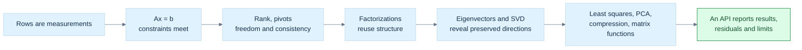
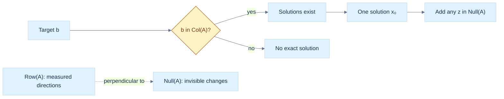
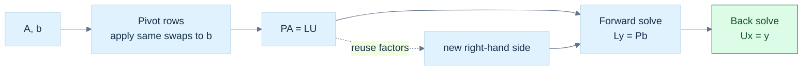
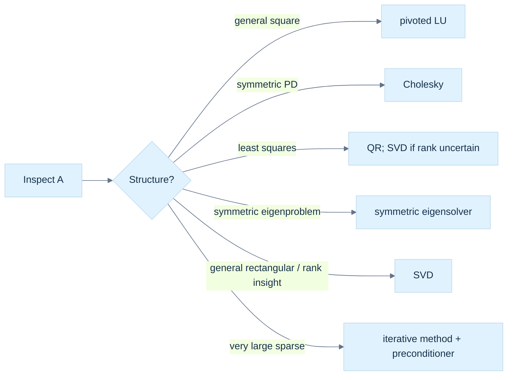
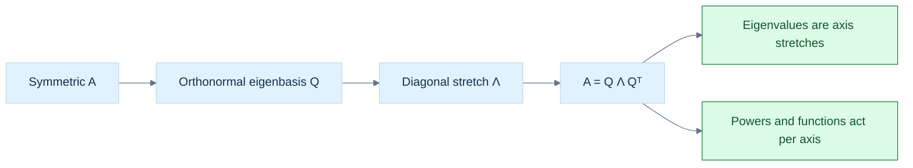
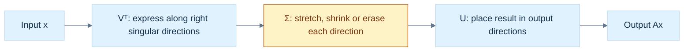
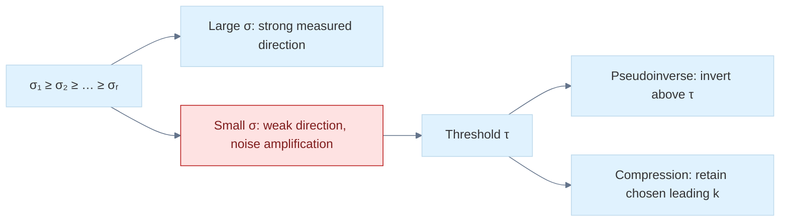
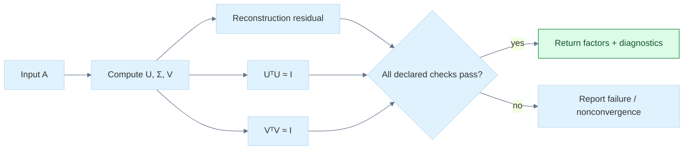
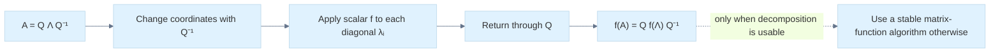
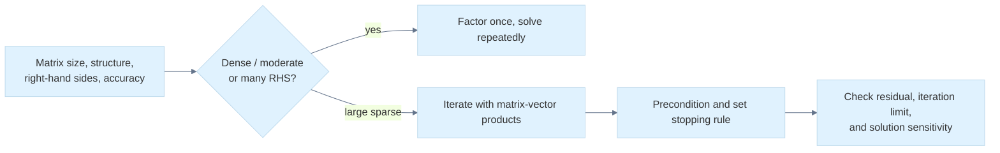

---
tags:
  - continuous-notes
  - linear-algebra
coverage: Parts 701–800
---

# From Constraints to Spectra: Systems, Decompositions, and Matrix Functions

## The graphics problem hiding inside a matrix equation

Imagine a graphics engine fitting a flat surface to noisy depth samples, solving for a camera correction, estimating the dominant direction in a point cloud, or integrating a small deformation over time. Every one of these tasks asks a related question: what does a collection of linear measurements allow us to know, and how can we compute that answer without inventing information the data did not contain?

We will follow one chain. A row of a matrix is a measurement or constraint. A system asks for an input satisfying many such measurements. Elimination reveals which constraints are independent and which degrees of freedom remain. Factorizations organize that elimination so it can be reused and made stable. Eigenvectors identify directions preserved by a square map; singular vectors do the more general job of identifying input directions that are stretched into mutually perpendicular output directions. From that picture come least squares, pseudoinverses, PCA, low-rank approximation, polar decomposition, and a principled view of matrix functions. The final question is practical: how should a graphics library represent, compute, and validate these operations?

This phase builds directly on the earlier geometry and transform stories. [[Continuous Notes/06 - From Movement to Meaning - Vectors, Geometry and Reliable Code|Phase 6]] supplies vectors, dot products, Gram matrices, projections, and the meaning of orthogonality. [[Continuous Notes/07 - From Basis Images to Moving Worlds - Matrices, Transforms and Quaternions|Phase 7]] supplies matrix maps, basis images, determinants, composition, and storage/layout contracts. Phase 8 asks what can be recovered when those maps are observed through measurements, and what numerical risk remains when a direction is almost lost.

The connecting question is always the same: **what information enters, what information can the map preserve, and what evidence tells us the computed answer is trustworthy?** This chapter combines the supplied Phase 8 lessons into a concept-led teaching sequence. The exact canonical titles remain in [[Supplementary/Foundations#Phase 8 - Parts 701-800|the coverage ledger]], while this chapter teaches them as one story.

## A reader route through Phase 8

Follow the chain from what a system means to what a numerical library can promise:

1. Start with [[Continuous Notes/08 - From Constraints to Spectra - Systems, Decompositions and Matrix Functions#A system is an intersection of constraints|constraints as geometry]] and [[Continuous Notes/08 - From Constraints to Spectra - Systems, Decompositions and Matrix Functions#Rank, the four spaces, and the shape of the answer|rank and the four spaces]]. Together they show which outputs are reachable and which input changes remain invisible.
2. Follow [[Continuous Notes/08 - From Constraints to Spectra - Systems, Decompositions and Matrix Functions#Elimination multipliers become stored factor data|elimination into reusable factors]]. Pivoting and factor storage preserve the equations while making repeated solves practical.
3. Continue through [[Continuous Notes/08 - From Constraints to Spectra - Systems, Decompositions and Matrix Functions#Orthogonal coordinates preserve the shape of the problem|orthogonal coordinates]] and [[Continuous Notes/08 - From Constraints to Spectra - Systems, Decompositions and Matrix Functions#QR turns least squares into a triangular solve plus an irreducible residual|QR least squares]]. This is where stable coordinate changes leave the irreducible residual visible.
4. Read [[Continuous Notes/08 - From Constraints to Spectra - Systems, Decompositions and Matrix Functions#Eigenvalues, eigenspaces, and the two kinds of multiplicity|eigenvectors and eigenspaces]] for invariant directions of square maps, including the limits set by multiplicity and sensitivity.
5. Move from square maps to [[Continuous Notes/08 - From Constraints to Spectra - Systems, Decompositions and Matrix Functions#The SVD equation as independent input-output channels|SVD]], which gives separate orthonormal input and output directions for every rectangular map. Follow [[Continuous Notes/08 - From Constraints to Spectra - Systems, Decompositions and Matrix Functions#Figure L6a - Watch the same directions become an ellipse|Figure L6a]] and its [[Visual Recall/phase8_svd_geometry.svg|editable vector figure]] alongside the [[Continuous Notes/08 - From Constraints to Spectra - Systems, Decompositions and Matrix Functions#A concrete rotation, stretch, and coordinate trace|numeric coordinate trace]].
6. Trace SVD's applications through [[Continuous Notes/08 - From Constraints to Spectra - Systems, Decompositions and Matrix Functions#Least squares from decoupling, then minimum norm|least squares and minimum norm]] and [[Continuous Notes/08 - From Constraints to Spectra - Systems, Decompositions and Matrix Functions#Centered measurements reveal principal directions|PCA and geometric fitting]].
7. Close with [[Continuous Notes/08 - From Constraints to Spectra - Systems, Decompositions and Matrix Functions#An SVD API begins with shapes and guarantees|shapes, validation, and API contracts]], where mathematical guarantees meet storage and solver status.

### Figure L1 - The route from measurements to a numerical API



> **How to read Figure L1.** The route is a dependency map, not a claim that every application must run every algorithm. Rank and structure guide the choice; a validation contract makes the output inspectable.

## A linear equation is a measurement, and several equations are geometry

Start with one equation in two unknowns:

$$
2x+y=5.
$$

Each pair $(x,y)$ is a point in the plane. The equation selects a line: every point on it satisfies the same measurement. In three variables one nontrivial linear equation selects a plane, and in $n$ variables it selects a hyperplane. Here *hyperplane* means the flat set one dimension lower than the ambient space. The coefficients $(2,1)$ set the measurement direction; the right side $5$ moves the set without changing its orientation.

Several equations ask for the intersection of their constraint sets. Parallel distinct lines have no common point; distinct lines crossing once have one; repeated equations leave a whole line of answers. This geometric picture explains why the number of equations alone does not tell us how many independent facts we have. We need rank.

Write the [[Linear systems and fundamental subspaces|linear system]] compactly as

$$
A\mathbf x=\mathbf b,
\qquad A\in\mathbb R^{m\times n},\quad
\mathbf x\in\mathbb R^n,\quad\mathbf b\in\mathbb R^m.
$$

The row view says each row of $A$ tests the unknown vector and produces one scalar measurement. The column view says $A\mathbf x$ is a weighted sum of the columns of $A$. Therefore an exact solution exists precisely when $\mathbf b$ can be made from those columns:

$$
A\mathbf x=\mathbf b\text{ is consistent}
\quad\Longleftrightarrow\quad
\mathbf b\in\operatorname{Col}(A).
$$

This is a powerful diagnostic. If a measured target lies outside the reachable column space, no amount of more careful elimination will make an exact solution exist. We must instead change the model, accept an approximation, or report failure.

Use the running system

$$
\begin{aligned}
x+y+z&=6,\\
2x-y+z&=3,\\
x+2y-z&=2.
\end{aligned}
$$

Its matrix form is $A\mathbf x=\mathbf b$ with rows $(1,1,1)$, $(2,-1,1)$, $(1,2,-1)$ and target $(6,3,2)^\mathsf T$. The solution $(1,2,3)^\mathsf T$ can be checked by substituting into the original measurements. Keeping this direct check in view matters: a transformed system is only useful if it preserves the same solution set.

## A system is an intersection of constraints

One nontrivial equation $a_1x_1+\cdots+a_nx_n=b$ describes an $(n-1)$-dimensional hyperplane in $\mathbb R^n$. Its normal vector is $a=(a_1,\ldots,a_n)^\mathsf T$: moving parallel to the hyperplane changes the point while keeping the dot product with $a$ fixed. The scalar $b$ selects which parallel hyperplane is meant. For $a\ne0$, the plane's signed offset along its chosen unit normal is $b/\|a\|_2$, and its closest point to the origin is $ba/\|a\|_2^2$: that point is parallel to the normal and satisfies $a^\mathsf Tx=b$. If $a=0$, the equation is exceptional: it says either $0=b$, which is always true when $b=0$, or an impossibility when $b\ne0$.

Stacking $m$ equations gives $Ax=b$, with $A\in\mathbb R^{m\times n}$, $x\in\mathbb R^n$, and $b\in\mathbb R^m$. Each row is a constraint on the same unknown. Geometrically, solutions are points in the intersection of those hyperplanes. The intersection can be empty, a single point, or an affine flat with positive dimension. More equations do not necessarily mean more information: a duplicate or a linear combination of earlier rows adds no independent constraint.

The [[Linear systems and fundamental subspaces|fundamental-subspace view]] keeps the reachable outputs and invisible inputs distinct.

There is a second view that is equally useful. Writing the columns as $a_1,\ldots,a_n$, the product is $Ax=x_1a_1+\cdots+x_na_n$. Thus a solution exists exactly when $b$ is in the column space of $A$. The row view explains the constraints; the column view explains which outputs are reachable. For an overdetermined data fit, an observed target may lie outside that reachable space, so an exact solution does not exist even though an approximate fit does.

For example,

$$
\begin{bmatrix}1&2&1\\2&4&2\\1&1&0\end{bmatrix}
\begin{bmatrix}x\\y\\z\end{bmatrix}
=\begin{bmatrix}4\\8\\1\end{bmatrix}
$$

has three equations but only two independent constraints. The first two rows and right-hand sides repeat the same equation at double scale. From $x+y=1$, write $x=t$ and $y=1-t$; then $x+2y+z=4$ gives $z=t+2$. Thus every solution is $(t,1-t,t+2)^\mathsf T$. The solution set is a line, not one point. If the second target changes from $8$ to $9$, the first two equations demand both $x+2y+z=4$ and $2x+4y+2z=9$, an inconsistency.

## Rank separates what the measurements determine from what they leave free

The **[[Linear systems and fundamental subspaces|row space]]** is the span of the measurement rows. It records the independent linear tests the system can make. The **[[Linear systems and fundamental subspaces|column space]]** is the set of outputs the map can produce. The **[[Linear systems and fundamental subspaces|null space]]** is the set of input changes invisible to every measurement:

$$
\operatorname{Null}(A)=\{\mathbf z:A\mathbf z=\mathbf0\}.
$$

If $\mathbf x_0$ is one solution, every solution is $\mathbf x_0+\mathbf z$ for some $\mathbf z\in\operatorname{Null}(A)$. The null vector is not measurement error; it is a direction the system cannot observe. In graphics, this can represent a gauge freedom, an unconstrained parameter, or a motion that does not change the sampled data.

The **rank** $r$ is the number of independent rows, equivalently the dimension of the row space or column space. Rank-nullity says

$$
\operatorname{rank}(A)+\dim\operatorname{Null}(A)=n.
$$

The input space splits into $r$ observable degrees of freedom and $n-r$ invisible ones. This immediately predicts the solution shape. For a consistent system, full column rank ($r=n$) gives a unique solution. If $r<n$, there are free directions and infinitely many solutions. If $\mathbf b$ lies outside the column space, there is no exact solution regardless of the number of free variables.

The row space is perpendicular to the null space: every row $\mathbf a_i^\mathsf T$ satisfies $\mathbf a_i^\mathsf T\mathbf z=0$ for every null vector. Thus the unobservable motions are precisely those orthogonal to all measurement directions. The left null space, $\operatorname{Null}(A^\mathsf T)$, instead describes dependencies among the rows and therefore among the measurement equations. These are distinct spaces with distinct jobs.

Do not infer rank from a determinant except in the narrow square case, and do not infer reliable rank from exact floating-point equality. In exact arithmetic rank is algebraic. In finite precision, *numerical rank* needs a scale and a tolerance or a singular-value threshold. A tiny singular value may mean weakly observed information rather than a truly absent dimension. This distinction returns when we build the pseudoinverse and truncate an SVD.

### Figure L2 - Consistency, freedom, and the four fundamental spaces



> **How to read Figure L2.** First ask whether the target is reachable. Only after consistency is established do we count the family's free directions; rank-nullity gives their number.

## Rank, the four spaces, and the shape of the answer

The rank $r$ is the dimension of the row space and, by the row-column rank theorem, also the dimension of the column space. It counts independent constraints and independent reachable output directions. It is bounded by $r\le\min(m,n)$, not automatically equal to either dimension. The four fundamental spaces describe different sides of the map:

| Space | Ambient space | Meaning |
|---|---:|---|
| $\operatorname{Row}(A)$ | $\mathbb R^n$ | input directions tested by rows |
| $\operatorname{Null}(A)$ | $\mathbb R^n$ | input changes invisible to the map |
| $\operatorname{Col}(A)$ | $\mathbb R^m$ | outputs the map can produce |
| $\operatorname{Null}(A^\mathsf T)$ | $\mathbb R^m$ | dependencies among row constraints |

For any $z\in\operatorname{Null}(A)$, every row $a_i^\mathsf T$ obeys $a_i^\mathsf Tz=0$. Therefore $\operatorname{Null}(A)=\operatorname{Row}(A)^\perp$. Likewise, a vector $y\in\mathbb R^m$ is perpendicular to every column of $A$ exactly when $A^\mathsf Ty=0$, so $\operatorname{Null}(A^\mathsf T)=\operatorname{Col}(A)^\perp$. If $r=\operatorname{rank}(A)$, their dimensions are $n-r$ and $m-r$, respectively. These are useful geometric facts: invisible input motions lie parallel to all constraint hyperplanes through the origin, while left-null vectors express dependencies among output coordinates or equations.

If $x_p$ is one solution to $Ax=b$, then $x$ is another precisely when $A(x-x_p)=0$. Hence every solution is

$$
x=x_p+z,\qquad z\in\operatorname{Null}(A).
$$

This is the complete description, not only a way to generate examples. The solution set is a translated null space, an affine subspace whose dimension is the nullity. Rank-nullity follows from the dimension theorem for the map $A:\mathbb R^n\to\mathbb R^m$:

$$
\operatorname{rank}(A)+\operatorname{nullity}(A)=n.
$$

The input has $r$ independent directions that affect the output and $n-r$ independent directions that the map erases. A consistent system with $r=n$ has a unique solution. A consistent system with $r<n$ has infinitely many solutions over the reals because at least one free parameter can vary continuously. If $b$ lies outside $\operatorname{Col}(A)$, there are no exact solutions, regardless of nullity.

Here is a constructive proof of rank-nullity, with the domain made explicit. Choose a basis $v_1,\ldots,v_k$ for $\operatorname{Null}(A)$, where $k=\operatorname{nullity}(A)$. Extend it to a basis of the full input space by adding $w_1,\ldots,w_s$. The images $Aw_1,\ldots,Aw_s$ span the column space: any input is a combination of the null basis and the added vectors, and the null basis maps to zero. They are also independent. If $c_1Aw_1+\cdots+c_sAw_s=0$, then $c_1w_1+\cdots+c_sw_s$ belongs to the null space, so it is a combination of $v_1,\ldots,v_k$. That would be a dependence among the extended input basis unless every $c_i=0$. Thus $s=\operatorname{rank}(A)=r$. The extended basis has $k+s=n$ members, proving $k+r=n$. The proof also explains the result: choose null directions first, then each remaining independent input direction contributes exactly one independent output direction.

This also explains several common misdiagnoses. A square matrix can be singular; its dimensions alone do not determine rank. For square $A$, $\det(A)=0$ is equivalent to rank deficiency and to a nontrivial null space, but determinant is not a useful general rank measure for rectangular or badly scaled matrices. Likewise, exact algebraic rank and floating-point numerical rank differ. A tiny perturbation can turn an exactly rank-one matrix into full rank, while a tiny singular value may still represent practically unobservable information. Numerical rank requires an explicit scale-aware threshold.

Suppose measurements differ by noise near machine precision. If the second pivot produced during elimination is $10^{-14}$ while the first is order one, declaring rank two solely because the pivot is not bitwise zero can expose an enormous apparent coefficient in the solution. Conversely, treating every small pivot as zero can discard a meaningful variable if the entire matrix is scaled near $10^{-20}$. A defensible numerical decision compares pivots or singular values against both a global scale and an application tolerance. Row scaling can help when equations have different units, but it changes the metric in least squares; scaling therefore needs a model-based interpretation rather than being a cosmetic preprocessing trick.

## Elimination turns the geometry into an auditable calculation

Three elementary row operations preserve the solutions when applied to the entire augmented matrix $[A\mid\mathbf b]$: swap two rows, multiply a row by a nonzero scalar, or add a multiple of one row to another. Geometrically, these replace constraints by equivalent combinations. They change the written system but not the intersection it describes.

In **row-echelon form (REF)**, nonzero rows appear first, each leading entry (pivot) moves right as we go down, and entries below pivots are zero. **Reduced row-echelon form (RREF)** additionally makes each pivot one and clears its column above. REF is enough for rank, consistency, and back substitution. RREF is uniquely determined and makes free-variable relationships easy to read, but production solvers rarely need to spend extra work reducing all the way.

[[Gaussian elimination and pivoting|Gaussian elimination]] derives each multiplier from the requirement that a pivot-column entry vanish. For pivot $a_{kk}\ne0$, row $i$ becomes

$$
R_i\leftarrow R_i-\frac{a_{ik}}{a_{kk}}R_k.
$$

If a pivot is zero, swap rows. **Partial pivoting** chooses the largest-magnitude candidate in the current column; this avoids dividing by a zero or unnecessarily tiny value. **Complete pivoting** searches the full remaining submatrix and may swap columns too, so it also permutes the unknown-variable order. It can reduce growth in some cases but costs more search and bookkeeping. Partial pivoting is common, not a universal guarantee against ill-conditioning or all element growth.

The familiar forward and back substitutions are triangular solves. For lower triangular $L$, solve the first row then move downward; for upper triangular $U$, solve from the last row upward. This costs $O(n^2)$ for one right-hand side after factorization. Explicitly constructing $A^{-1}$ is generally the wrong route: a solve uses the factorization directly, avoids extra work, and avoids turning a good problem into a less stable one.

Elimination naturally produces **[[LU factorization and reusable solves|LU factorization]]**. With pivoting, the convention used here is

$$
PA=LU,
$$

where $P$ records row swaps, $L$ stores elimination multipliers below its diagonal, and $U$ stores the resulting upper triangle. This convention matters: libraries may write an equivalent permutation on the other side. A solve becomes $L\mathbf y=P\mathbf b$, then $U\mathbf x=\mathbf y$. Doolittle's convention places ones on $L$'s diagonal; other LU conventions distribute scaling differently. Never compare factors without first comparing conventions.

For many right-hand sides sharing the same $A$, factor once and solve each new right-hand side with the triangular factors. This is why a factorization is more than a compact identity: it amortizes expensive work. The $O(n^3)$ factorization dominates the one-time setup; each additional solve is approximately $O(n^2)$ for a dense matrix.

## Row operations preserve equations for a precise reason

The three elementary row operations are: exchange two rows; multiply a row by a nonzero scalar; add a multiple of one row to another. Each can be undone, so each is multiplication on the left by an invertible elementary matrix $E$. The transformed system is $EAx=Eb$. Since $E$ has an inverse, $Ax=b$ and $EAx=Eb$ have the same solution set. This is why every operation must be applied to the right-hand side as well as to the coefficient matrix. Acting on $A$ alone changes the equations.

Left multiplication mixes rows. It preserves the row space because each new row is a linear combination of old rows and invertibility lets us recover the old rows. It preserves rank for the same reason. It does not preserve the original column vectors: $EA$ applies a map to every column. A safe way to use an echelon form to select a basis for the original column space is to locate pivot-column indices in the reduced matrix and then take those same indexed columns from the original $A$.


## REF and RREF expose pivots and free variables

In row-echelon form (REF), zero rows are at the bottom; each nonzero row's first nonzero entry, its pivot, is to the right of the pivot in the row above; and entries below each pivot are zero. Pivots need not be one, and entries above a pivot may remain nonzero. REF is enough to read rank, check consistency, and solve by back substitution.

Reduced row-echelon form (RREF) adds two conditions: each pivot equals one, and it is the only nonzero entry in its column. RREF makes the dependence of pivot variables on free variables explicit and is unique for a given row-equivalence class. For example,

$$
\begin{bmatrix}1&0&2&0&|&4\\0&1&-1&0&|&3\\0&0&0&0&|&0\end{bmatrix}
$$

has pivots in columns one and two, and free variables $x_3,x_4$. Its equations are $x_1+2x_3=4$ and $x_2-x_3=3$, so with $x_3=s,x_4=t$ the family is $(4-2s,3+s,s,t)^\mathsf T$. A bottom row $[0\ 0\ 0\ 0\ |\ 1]$ would instead be a contradiction. An all-zero coefficient row is harmless only when its right-hand side is also zero.

RREF is valuable for teaching and exact symbolic work, but it is not the default for large floating-point solves. Clearing above pivots takes extra operations and can increase roundoff exposure. A numerical solver usually stops at a triangular factor and uses substitution. RREF is an explanatory normal form, not a performance objective.

For a direct REF/RREF comparison, start from

$$
\begin{bmatrix}2&1&|&5\\4&3&|&11\end{bmatrix}.
$$

One elimination step $R_2\leftarrow R_2-2R_1$ gives the REF matrix $\begin{bmatrix}2&1&|&5\\0&1&|&1\end{bmatrix}$. Back substitution gives $y=1,x=2$. To obtain RREF, clear the entry above the second pivot with $R_1\leftarrow R_1-R_2$, then normalize the first row by two: $\begin{bmatrix}1&0&|&2\\0&1&|&1\end{bmatrix}$. The extra work exposes the answer immediately, but it contributes no new mathematical information about the solution set. On an $m\times n$ system, an elimination path is preferable when the goal is a solve rather than a symbolic description of all variables.


## Elimination multipliers become stored factor data

For a pivot $a_{kk}\ne0$, the entry in row $i$ below it is removed using

$$
m_{ik}=\frac{a_{ik}}{a_{kk}},\qquad R_i\leftarrow R_i-m_{ik}R_k.
$$

The multiplier is chosen because the new pivot-column entry is $a_{ik}-m_{ik}a_{kk}=0$. In matrix form the operation is left multiplication by a lower-triangular elimination matrix with $-m_{ik}$ in the relevant position. Its inverse has $+m_{ik}$ there. Chaining these operations turns $A$ into upper triangular $U$; collecting their inverses yields a unit lower-triangular matrix $L$ containing the multipliers, so in the no-swap case $A=LU$.

This is the derivation behind [[Gaussian elimination and pivoting|Gaussian elimination and pivoting]].

For a concrete trace, use

$$
A=\begin{bmatrix}2&1&1\\4&-6&0\\-2&7&2\end{bmatrix},\qquad
b=\begin{bmatrix}5\\-2\\9\end{bmatrix}.
$$

The first-column multipliers are $m_{21}=2$ and $m_{31}=-1$. Subtract twice row one from row two, and add row one to row three. The result below the first pivot is $[0,-8,-2]$ and $[0,8,3]$, with right-hand values $-12$ and $14$. The second multiplier is $m_{32}=8/(-8)=-1$, so row three becomes row three plus row two, giving $[0,0,1]$ and right-hand value $2$. Back substitution gives $z=2$, $-8y-2z=-12$ hence $y=1$, and $2x+y+z=5$ hence $x=1$. The stored factors are

$$
L=\begin{bmatrix}1&0&0\\2&1&0\\-1&-1&1\end{bmatrix},\quad
U=\begin{bmatrix}2&1&1\\0&-8&-2\\0&0&1\end{bmatrix}.
$$

Multiplication verifies $LU=A$. The original equations also verify $(1,1,2)^\mathsf T$. Those checks catch sign mistakes in multipliers and confusion over which matrix stores them.


## Pivoting separates algorithm failure from matrix failure

An unpivoted algorithm can fail on an invertible matrix. If

$$
A=\begin{bmatrix}0&2\\1&3\end{bmatrix},
$$

the first pivot is zero, so the multiplier formula divides by zero; yet the determinant is $-2$ and a row swap immediately permits elimination. That is algorithm failure, not singularity. Even a nonzero pivot may be too small: a pivot of $10^{-20}$ with an entry of size one creates a multiplier of $10^{20}$. Large multipliers can magnify rounding errors in subsequent subtraction.

Partial pivoting selects, at step $k$, the row $p$ maximizing $|a_{ik}|$ over active rows $i\ge k$, then swaps rows $k$ and $p$. It uses the best candidate in the current column. The absolute value matters because sign does not measure size. The search costs $O(n^2)$ comparisons over a dense factorization, small beside the $O(n^3)$ elimination.

Pivoting improves algorithmic stability; it does not fix a poorly conditioned problem. Conditioning describes how sensitive the exact answer is to small changes in data. Stability describes how much extra error the algorithm introduces. A stable solver cannot rescue information the input does not contain reliably. Partial pivoting is an excellent common trade-off, not a theorem that all growth is bounded by a small constant. The element-growth factor is $\rho=\max_{i,j,k}|a_{ij}^{(k)}|/\max_{i,j}|a_{ij}|$, where $A^{(k)}$ denotes the active matrix after elimination step $k$; equivalently, track the largest entry generated anywhere in the elimination process (including $U$) relative to the largest original entry. It is not merely the largest entry of $U$ if intermediate states are the quantity being measured. Certain matrices exhibit large growth even under partial pivoting.

The exact algebra says row operations preserve the solution set; floating-point arithmetic adds a second question, namely how faithfully the rounded operations represent those exact operations. This is why an algebraically legitimate elimination order can still be numerically poor. Pivoting controls one avoidable source of amplification, while condition estimates and residual checks describe the remaining limitations. These are complementary diagnostics, not competing definitions of correctness.

Complete pivoting searches the whole active submatrix and swaps both a row and a column. With row and column permutation matrices $P,Q$, the convention is $PAQ=LU$. A row permutation reorders equations; a column permutation reorders unknowns. To solve $Ax=b$, set $z=Q^\mathsf T x$. Then $LUz=Pb$, so solve for $z$ and recover $x=Qz$. Losing the column permutation can yield plausible values assigned to the wrong variables. Full searches add $O(n^3)$ comparisons and additional bookkeeping; complete pivoting is less common than partial pivoting. Rook pivoting is one practical compromise between search strength and cost.

For example, suppose the active block is $\begin{bmatrix}0&0&5\\0&2&1\\3&1&0\end{bmatrix}$. Partial pivoting in the first column selects the entry $3$ from the last row. Complete pivoting selects the magnitude-$5$ entry in column three, so it moves both that row and that column to the first pivot position. The resulting numerical factors describe a reordered variable vector. This extra freedom can reduce pivot growth, but the bookkeeping is not decorative: after a solve, the variable permutation must be undone. A correct complete-pivot implementation should test the original equation after unpermuting $x$, not just inspect its internally permuted triangular solve.


## Triangular solves perform the cheap second half

For lower-triangular $L$, row $i$ gives $L_{ii}y_i+\sum_{j<i}L_{ij}y_j=b_i$. Therefore forward substitution is

$$
y_i=\frac{b_i-\sum_{j=0}^{i-1}L_{ij}y_j}{L_{ii}},\qquad i=0,1,\ldots,n-1.
$$

If $L$ is unit lower triangular, division disappears. For the example factor and $b=(5,-2,9)^\mathsf T$, the equations give $y_1=5$, then $2y_1+y_2=-2$ so $y_2=-12$, then $-y_1-y_2+y_3=9$ so $y_3=2$. Each new row depends on prior values, which creates a sequential dependency, though the dot-product update within one row can be vectorized.

For upper-triangular $U$, solve in reverse:

$$
x_i=\frac{y_i-\sum_{j=i+1}^{n-1}U_{ij}x_j}{U_{ii}},\qquad i=n-1,\ldots,0.
$$

The example gives $z=2$, then $-8y-2z=-12$ gives $y=1$, then $2x+y+z=5$ gives $x=1$. Each triangular solve costs about $n^2/2$ multiply-adds, or $O(n^2)$, compared with cubic factorization. This makes reusing a factorization worthwhile when several right-hand sides share the same matrix.

Compact kernels can make the dependency and failure condition explicit:

```text
forward(L, b):
  for i = 0 .. n-1:
    t = b[i] - dot(L[i, 0:i], y[0:i])
    if diagonal is unit: y[i] = t
    else require L[i,i] != 0; y[i] = t / L[i,i]
  return y

back(U, y):
  for i = n-1 .. 0:
    t = y[i] - dot(U[i, i+1:n], x[i+1:n])
    require U[i,i] != 0; x[i] = t / U[i,i]
  return x
```

The exact-zero check is illustrative for exact arithmetic. A floating-point library should use its scale, status, and singularity policy rather than treating an arbitrary universal epsilon as correct. Do not form $A^{-1}$ merely to compute $A^{-1}b$: factor and solve. An explicit inverse generally does more work, stores more data, and introduces avoidable error.


## LU and Doolittle make elimination reusable

LU packages Gaussian elimination into $A=LU$, where $L$ is unit lower triangular and $U$ is upper triangular. For $Ax=b$, first solve $Ly=b$, then $Ux=y$. If rows were swapped, the correct relation is $PA=LU$ and the first solve is $Ly=Pb$. Factorization is roughly $2n^3/3$ floating-point operations for dense matrices, while each subsequent triangular solve is $O(n^2)$. This matters in graphics workloads where geometry, stiffness, or camera matrices are reused with new force or observation vectors.

See [[LU factorization and reusable solves|LU factorization and reusable solves]] for the library-facing view of the same contract.

Doolittle's convention fixes $L_{ii}=1$. The factor entries follow by equating the $(i,j)$ entry in $A=LU$:

$$
a_{ij}=\sum_{k=0}^{\min(i,j)} l_{ik}u_{kj}.
$$

For a given pivot column $j$, compute the upper row entries

$$
u_{ji}=a_{ji}-\sum_{k=0}^{j-1}l_{jk}u_{ki},\quad i\ge j,
$$

then the lower-column entries

$$
l_{ij}=\frac{a_{ij}-\sum_{k=0}^{j-1}l_{ik}u_{kj}}{u_{jj}},\quad i>j.
$$

The recurrence follows directly from the product, not from a memorized recipe. At $j=0$, $u_{00}=a_{00}$ and each $l_{i0}=a_{i0}/u_{00}$; later columns subtract contributions already explained by earlier outer products. A zero or unsafe $u_{jj}$ requires pivoting or a failure report. Doolittle is one scaling convention; Crout instead normalizes the diagonal of $U$. A factor's entries cannot be compared correctly until its convention is known.

An in-place LU implementation commonly stores $U$ on and above the diagonal and the strict lower part of $L$ beneath it. The diagonal ones of $L$ are implicit. This saves an extra matrix but makes the storage contract important: callers must know that the returned array is packed factors, not the original matrix or a full $L$.


## LUP carries the row permutation through the solve

With partial pivoting, row exchanges are recorded in a permutation matrix $P$. Under the convention $PA=LU$, solve

$$
Ly=Pb,\qquad Ux=y.
$$

For example, take $A=\begin{bmatrix}0&2\\1&3\end{bmatrix}$ and $b=(4,7)^\mathsf T$. Swap rows, so $P=\begin{bmatrix}0&1\\1&0\end{bmatrix}$ and $PA=\begin{bmatrix}1&3\\0&2\end{bmatrix}$. Here $L=I$ and $U=PA$. Then $Pb=(7,4)^\mathsf T$, and back substitution gives $y=2$, $x=1$. Check the original order: $A(1,2)^\mathsf T=(4,7)^\mathsf T$. The permutation acts on the right-hand side because it acted on the equations.

For a larger matrix, a robust trace records the pivot row selected at every step, the row swaps, the multipliers, and the final factor arrays. The permutation matrix can be materialized, but production code usually stores a pivot vector. Be explicit about convention: some texts write $A=PLU$ with $P$ representing inverse swaps. Both can be valid if applied consistently; silently switching notation is a common source of wrong solves.

With multiple swaps, the permutation vector is updated as a sequence, not reconstructed from only the last pivot. For instance, swapping rows zero and two, then rows one and three, yields the final row order $[2,3,0,1]$ relative to the original. Applying those same swaps in the same order to $b$ produces $Pb$. The inverse permutation would undo them in reverse order. This is why a pivot vector's meaning must be documented: it may encode the final row order, or it may store the stepwise swap targets. Both representations are used, and their application code differs.

When swapping rows during in-place factorization at step $k$, swap the active row data in $U$ and the permutation bookkeeping. Also swap the already-computed entries $L_{k,0:k}$ with those in the pivot row: those multipliers belong to the rows whose identities just exchanged. Failure to exchange these previous $L$ columns can produce factors that do not multiply back to the permuted input even though the current $U$ looks triangular. This detail is easy to miss because a swap happens after earlier elimination has written meaningful data below the diagonal.

An auditable factorization kernel therefore has an invariant: after each completed step, the processed columns satisfy the recorded elimination history, the remaining active submatrix is the one to be factored next, and the permutation vector describes the same row order applied to the original matrix. At the end, validate $PA\approx LU$ and then validate the solve residual $Ax-b$. These are separate checks: correct factor reconstruction does not prove that the caller permuted $b$ correctly.

Repeated right-hand sides make the value of this contract easy to quantify. If ten vectors $b^{(1)},\ldots,b^{(10)}$ share the same $A$, independently eliminating ten augmented systems repeats cubic work. Factoring once and performing ten forward/back substitutions spends the cubic work once and adds roughly ten quadratic solves. The factors also expose singular pivots once, rather than allowing separate calls to make inconsistent rank decisions. If $A$ changes each frame, that reuse disappears; the correct choice then depends on matrix size, update structure, and whether a cheaper incremental factorization exists.


## A runnable pivoted LU reference preserves the elimination history

This C++20 reference is a small executable teaching example, not a production numerical library. It factors a finite, nonempty square matrix with partial pivoting, stores $L$ multipliers and $U$ together, and follows the convention $PA=LU$. The pivot vector records the original row now occupying each factored row, so solving applies $Pb$ as `b[pivot[i]]`. The tolerance is a documented teaching rejection policy relative to the largest input entry; it is not a numerical-rank or condition estimator.

Save the code block as `/tmp/phase8-lu-lab-ready.cpp`, compile using the command below, then run it. The program prints each result status and exits nonzero if any assertion fails.

```cpp
#include <algorithm>
#include <cassert>
#include <cmath>
#include <cstddef>
#include <iostream>
#include <limits>
#include <stdexcept>
#include <string_view>
#include <utility>
#include <vector>
class LUMatrix {
public:
    LUMatrix() = default; // Empty shape is representable; factorization rejects it.
    LUMatrix(std::size_t rows, std::size_t cols) : rows_(rows), cols_(cols) {
        if (rows != 0 && cols > std::numeric_limits<std::size_t>::max() / rows)
            throw std::length_error("matrix element count overflows size_t");
        const std::size_t count = rows * cols;
        if (count > data_.max_size()) throw std::length_error("matrix is too large");
        data_.assign(count, 0.0);
    }
    std::size_t rows() const noexcept { return rows_; } std::size_t cols() const noexcept { return cols_; }
    double& operator()(std::size_t r, std::size_t c) { if (r >= rows_ || c >= cols_) throw std::out_of_range("matrix index"); return data_[r * cols_ + c]; }
    double operator()(std::size_t r, std::size_t c) const { if (r >= rows_ || c >= cols_) throw std::out_of_range("matrix index"); return data_[r * cols_ + c]; }
private:
    std::size_t rows_ = 0, cols_ = 0;
    std::vector<double> data_;
};
enum class Status { NotRun, Success, InvalidDimensions, InvalidTolerance, NonFiniteInput,
                    NonFiniteIntermediate, SingularOrUnsafePivot };
std::string_view name(Status s) {
    switch (s) {
    case Status::NotRun: return "NotRun"; case Status::Success: return "Success";
    case Status::InvalidDimensions: return "InvalidDimensions";
    case Status::InvalidTolerance: return "InvalidTolerance"; case Status::NonFiniteInput: return "NonFiniteInput";
    case Status::NonFiniteIntermediate: return "NonFiniteIntermediate";
    case Status::SingularOrUnsafePivot: return "SingularOrUnsafePivot";
    }
    return "Unknown";
}
struct LUResult { LUMatrix packed; std::vector<std::size_t> pivot; Status status = Status::NotRun; };
struct SolveResult { std::vector<double> x; Status status = Status::NotRun; };
LUResult factorLU(const LUMatrix& input, double relativePivotTolerance = 1e-12) {
    LUResult out;
    if (input.rows() == 0 || input.rows() != input.cols()) { out.status = Status::InvalidDimensions; return out; }
    if (!std::isfinite(relativePivotTolerance) || relativePivotTolerance < 0.0) { out.status = Status::InvalidTolerance; return out; }
    const std::size_t n = input.rows();
    double scale = 0.0;
    for (std::size_t i = 0; i < n; ++i) for (std::size_t j = 0; j < n; ++j) {
        const double a = input(i, j);
        if (!std::isfinite(a)) { out.status = Status::NonFiniteInput; return out; }
        scale = std::max(scale, std::abs(a));
    }
    const double threshold = relativePivotTolerance * scale;
    if (!std::isfinite(threshold)) { out.status = Status::NonFiniteIntermediate; return out; }
    out.packed = input; out.pivot.resize(n);
    for (std::size_t i = 0; i < n; ++i) out.pivot[i] = i;
    for (std::size_t k = 0; k < n; ++k) {
        std::size_t p = k;
        for (std::size_t i = k + 1; i < n; ++i)
            if (std::abs(out.packed(i, k)) > std::abs(out.packed(p, k))) p = i;
        if (!std::isfinite(out.packed(p, k))) { out.status = Status::NonFiniteIntermediate; return out; }
        if (std::abs(out.packed(p, k)) <= threshold) { out.status = Status::SingularOrUnsafePivot; return out; }
        if (p != k) {
            for (std::size_t j = 0; j < n; ++j) std::swap(out.packed(k, j), out.packed(p, j));
            std::swap(out.pivot[k], out.pivot[p]); // Whole row includes prior L columns.
        }
        for (std::size_t i = k + 1; i < n; ++i) {
            out.packed(i, k) /= out.packed(k, k);
            if (!std::isfinite(out.packed(i, k))) { out.status = Status::NonFiniteIntermediate; return out; }
            for (std::size_t j = k + 1; j < n; ++j) {
                out.packed(i, j) -= out.packed(i, k) * out.packed(k, j);
                if (!std::isfinite(out.packed(i, j))) { out.status = Status::NonFiniteIntermediate; return out; }
            }
        }
    }
    out.status = Status::Success;
    return out;
}
SolveResult solveLU(const LUResult& lu, const std::vector<double>& b) {
    SolveResult out;
    if (lu.status != Status::Success) { out.status = lu.status; return out; }
    const std::size_t n = lu.packed.rows();
    if (lu.packed.cols() != n || b.size() != n || lu.pivot.size() != n) { out.status = Status::InvalidDimensions; return out; }
    for (double v : b) if (!std::isfinite(v)) { out.status = Status::NonFiniteInput; return out; }
    std::vector<double> y(n), x(n);
    for (std::size_t i = 0; i < n; ++i) {
        double t = b[lu.pivot[i]];
        for (std::size_t j = 0; j < i; ++j) t -= lu.packed(i, j) * y[j];
        if (!std::isfinite(t)) { out.status = Status::NonFiniteIntermediate; return out; }
        y[i] = t; // L has an implicit unit diagonal.
    }
    for (std::size_t ri = 0; ri < n; ++ri) {
        const std::size_t i = n - 1 - ri;
        double t = y[i];
        for (std::size_t j = i + 1; j < n; ++j) t -= lu.packed(i, j) * x[j];
        const double d = lu.packed(i, i);
        if (!std::isfinite(t) || !std::isfinite(d)) { out.status = Status::NonFiniteIntermediate; return out; }
        if (d == 0.0) { out.status = Status::SingularOrUnsafePivot; return out; }
        x[i] = t / d;
        if (!std::isfinite(x[i])) { out.status = Status::NonFiniteIntermediate; return out; }
    }
    out.x = std::move(x); out.status = Status::Success; return out;
}
bool close(double a, double b, double tol = 1e-10) { return std::abs(a - b) <= tol; }
bool reconstructs(const LUMatrix& a, const LUResult& lu) {
    const std::size_t n = a.rows();
    for (std::size_t i = 0; i < n; ++i) for (std::size_t j = 0; j < n; ++j) {
        double product = 0.0;
        for (std::size_t k = 0; k < n; ++k) {
            product += (i == k ? 1.0 : (i > k ? lu.packed(i,k) : 0.0))
                     * (k <= j ? lu.packed(k,j) : 0.0);
        }
        if (!close(product, a(lu.pivot[i], j))) return false; // P A = L U.
    }
    return true;
}
int main() {
    LUMatrix a(3, 3);
    const double values[3][3] = {{4,1,1},{2,1,0},{1,3,2}};
    for (std::size_t i = 0; i < 3; ++i) for (std::size_t j = 0; j < 3; ++j) a(i,j) = values[i][j];
    LUResult lu = factorLU(a);
    std::cout << "main factor: " << name(lu.status) << '\n';
    assert(lu.status == Status::Success && reconstructs(a, lu));
    assert(lu.pivot[1] == 2 && close(lu.packed(1,0),0.25) && close(lu.packed(2,0),0.5));
    SolveResult s = solveLU(lu, {9,4,13});
    std::cout << "known solve: " << name(s.status) << '\n'; assert(s.status == Status::Success && close(s.x[0],1) && close(s.x[1],2) && close(s.x[2],3));
    SolveResult s2 = solveLU(lu, {9,3,3}); // Reuse factors for x=(2,-1,2).
    std::cout << "repeated RHS: " << name(s2.status) << '\n'; assert(s2.status == Status::Success && close(s2.x[0],2) && close(s2.x[1],-1) && close(s2.x[2],2));
    LUMatrix z(2,2); z(0,1)=2; z(1,0)=1; z(1,1)=3;
    auto zl = factorLU(z); auto zs = solveLU(zl,{4,7});
    std::cout << "zero-leading-pivot: " << name(zl.status) << '\n';
    assert(zl.status == Status::Success && zs.status == Status::Success && close(zs.x[0],1) && close(zs.x[1],2));
    LUMatrix singular(2,2); singular(0,0)=1; singular(0,1)=2; singular(1,0)=2; singular(1,1)=4;
    auto bad = factorLU(singular); std::cout << "singular: " << name(bad.status) << '\n';
    assert(bad.status == Status::SingularOrUnsafePivot);
    LUMatrix nonfinite(1,1); nonfinite(0,0)=std::numeric_limits<double>::infinity();
    auto nf = factorLU(nonfinite); std::cout << "nonfinite input: " << name(nf.status) << '\n';
    assert(nf.status == Status::NonFiniteInput);
    auto empty = factorLU(LUMatrix{}); std::cout << "empty dimensions: " << name(empty.status) << '\n'; assert(empty.status == Status::InvalidDimensions);
}
```

Compile and run:

```sh
/usr/bin/clang++ -std=c++20 -Wall -Wextra -Wpedantic -Werror \
  -fsanitize=address,undefined -fno-omit-frame-pointer \
  /tmp/phase8-lu-lab-ready.cpp -o /tmp/phase8-lu-lab-ready
/tmp/phase8-lu-lab-ready
```

Expected output is one `Success` for the main factorization, known solve, repeated right-hand side, and zero-leading-pivot solve; `SingularOrUnsafePivot` for the dependent matrix; `NonFiniteInput` for infinity; and `InvalidDimensions` for an empty matrix. The READY copy was compiled and run after extracting this exact block; the results are recorded in `/tmp/phase8-ready-fixes-b.md`.

### What the packed factors mean

The factor routine copies the input, so this example is out of place. Rows are swapped across the entire packed row, including columns before the active pivot. Those earlier entries already contain the multipliers of $L$. In the numeric example, first-column elimination writes $1/2$ and $1/4$ below the diagonal. At the next pivot, row 1 and row 2 exchange; these stored multipliers must exchange too. The implementation gets this right by swapping every column, not only the active suffix. Ignoring the old $L$ region can produce a triangular-looking buffer that no longer satisfies $PA=LU$.

For a packed entry, read $L_{ii}=1$, $L_{ij}=0$ above the diagonal, $L_{ij}=\text{packed}_{ij}$ below it, and $U_{ij}=\text{packed}_{ij}$ on or above it. The pivot vector represents the current row order: factored row $i$ came from input row `pivot[i]`. Therefore reconstruction checks $(PA)_{ij}=A_{pivot[i],j}$ against $(LU)_{ij}$.

The known system has $x=(1,2,3)^\mathsf T$. At the first elimination step, multipliers are $1/2$ and $1/4$; the active second-column candidates become $1/2$ and $11/4$, so partial pivoting exchanges rows 1 and 2. At the last row, the earlier $L$ values become $1/4$ and $1/2$ in that exchanged order. Forward substitution solves $Ly=Pb$, then reverse substitution solves $Ux=y$. A second vector uses the same factors, demonstrating why factorization state should be separated from per-right-hand-side state.

### Statuses and numerical limits

The matrix constructor checks the product of dimensions before allocation and also respects `vector::max_size`; allocation failure can still throw `std::bad_alloc`. A default empty matrix is representable to make the factor routine's invalid-dimension status observable. Rectangular matrices are also rejected by factorization. Result objects default to `NotRun`; factorization and solve set `Success` only on their successful completion. The API reports nonfinite input, invalid tolerance, singular-or-rejected pivot, and nonfinite intermediate separately enough for a teaching trace. It checks division results and trailing updates because finite inputs can still overflow during arithmetic.

The relative pivot rule compares the selected pivot magnitude with $\tau\max_{ij}|a_{ij}|$. Here the default $\tau=10^{-12}$ deliberately rejects a pivot that is tiny relative to the largest input entry. This is a conservative example policy, not an estimator of algebraic rank or condition number: row scaling, matrix structure, and the intended accuracy all affect whether such a pivot is useful. Production solvers use algorithm-specific thresholds, scaling, error estimates, and richer statuses. A rejected pivot says this teaching routine declined the factorization under its policy; it does not prove the exact matrix is singular.

The solver applies the recorded row order to $b$, performs unit-lower forward substitution and upper back substitution, and checks nonfinite intermediates and exact zero diagonal before division. Its precondition is an unchanged `LUResult` returned by a successful call to `factorLU`; this teaching struct is public and does not defend against callers forging or mutating packed factors or pivot data. The exact-zero check is a final structural guard; an ill-conditioned but finite solve can still return a large inaccurate answer. A separate residual and condition analysis is needed for that judgment. This lab demonstrates control flow and convention, not universal numerical reliability.

The tests assert $PA\approx LU$, the stated known solution, a second right-hand side with the same factors, successful recovery from an invertible zero-leading-pivot matrix, and rejection of singular, nonfinite, and empty inputs. Assertions in this executable are checks on this small reference example. They are not a broad solver test suite, a performance benchmark, or evidence about GPU behavior. The `LUMatrix` is row-major and uses bounds-checked `at`; that favors a clear teaching example over the highest performance. The code is intentionally self-contained and uses only the C++ standard library.

### Figure L3 - Elimination stores work for later solves



> **How to read Figure L3.** Pivoting changes row order, so the right-hand side must receive the same permutation. Once $L$ and $U$ exist, later solves reuse them.

## Structure makes a decomposition a better tool than generic elimination

Before choosing an algorithm, ask what the matrix promises. Symmetry, positive definiteness, rectangular shape, sparsity, and repeated right-hand sides each change the most useful representation.

A real symmetric matrix satisfies $A=A^\mathsf T$. It is **positive definite (PD)** when $\mathbf x^\mathsf T A\mathbf x>0$ for every nonzero $\mathbf x$, and **positive semidefinite (PSD)** when the value is merely nonnegative. A Gram matrix $B^\mathsf T B$ is PSD because $\mathbf x^\mathsf T B^\mathsf T B\mathbf x=\|B\mathbf x\|_2^2\ge0$. If $B$ has a nontrivial null vector, the Gram matrix is singular. Covariance matrices are PSD for the same sum-of-squares reason.

For symmetric positive-definite $A$, **[[Symmetric positive-definite matrices and Cholesky|Cholesky factorization]]** writes $A=LL^\mathsf T$ with lower-triangular $L$. It uses symmetry, stores less work than general LU, and avoids pivoting under the mathematical assumptions. If a computed diagonal square-root argument is nonpositive, that is diagnostic evidence: the input may not be PD, may be badly scaled, or roundoff may have exposed a fragile assumption. Do not silently clamp a materially negative value and claim a valid Cholesky factor.

For symmetric indefinite matrices, **LDL$^\mathsf T$** represents $A=LDL^\mathsf T$ without square roots in the diagonal factor. Robust practical algorithms may require symmetric permutations and 1-by-1 or 2-by-2 diagonal blocks; a bare unpivoted scalar LDL$^\mathsf T$ is not a universal indefinite solver. Positive semidefinite matrices can be singular, so a decomposition must handle zero pivots or use a method designed for rank deficiency.

**[[QR factorization and least squares|QR factorization]]** writes $A=QR$, where the columns of $Q$ are orthonormal and $R$ is upper triangular (or trapezoidal for rectangular matrices). It separates a coordinate change that preserves lengths from the remaining triangular solve. Gram–Schmidt explains the geometry by repeatedly subtracting projections, but classical Gram–Schmidt can lose orthogonality in floating point. Modified Gram–Schmidt improves behavior; Householder reflectors are a stable dense workhorse; Givens rotations efficiently eliminate selected entries and are useful for incremental or structured problems.

For overdetermined measurements $A\mathbf x\approx\mathbf b$, least squares chooses $\mathbf x$ minimizing $\|A\mathbf x-\mathbf b\|_2$. With full column rank, QR gives $A=QR$ and orthogonality yields

$$
\|A\mathbf x-\mathbf b\|_2^2
=\|R\mathbf x-Q^\mathsf T\mathbf b\|_2^2
+\|(I-QQ^\mathsf T)\mathbf b\|_2^2.
$$

Here $Q$ is the reduced $m\times n$ factor with $Q^\mathsf TQ=I_n$. The second term is the part of the measurements outside the column space. It does not depend on $\mathbf x$, so minimizing the first term gives the same minimizer. The two objective functions generally have different minimum values; the unavoidable perpendicular residual must be retained when reporting fit quality.

The residual is perpendicular to the column space: $A^\mathsf T(A\widehat{\mathbf x}-\mathbf b)=0$. The **normal equations** solve $A^\mathsf T A\mathbf x=A^\mathsf T\mathbf b$, but $\kappa_2(A^\mathsf T A)=\kappa_2(A)^2$ for full-column-rank $A$. Squaring the condition number can destroy useful digits; QR is generally safer, while SVD handles rank deficiency more explicitly.

### Figure L4 - Matrix structure determines the useful factorization



> **How to read Figure L4.** No decomposition wins on every matrix. The structural facts are inputs to algorithm selection, not implementation trivia.

## Positive definiteness is a structural promise

A real symmetric matrix is positive definite (PD) when $x^\mathsf T A x>0$ for every nonzero $x$; positive semidefinite (PSD) replaces strict inequality with $\ge0$. The quadratic form is energy-like: positivity says no nonzero direction has zero or negative energy. For symmetric matrices, positive eigenvalues are equivalent to PD. A Gram matrix $B^\mathsf T B$ is PSD because $x^\mathsf T B^\mathsf T Bx=\|Bx\|_2^2\ge0$. It is PD exactly when $B$ has full column rank. Covariance and normal-equation matrices are common PSD examples; rank deficiency makes them singular.

The [[Symmetric positive-definite matrices and Cholesky|Cholesky contract]] is valid only when this strict positivity promise holds.

Cholesky uses the stronger PD promise. It factors

$$
A=LL^\mathsf T
$$

with lower triangular $L$ and positive diagonal. Symmetry means only half the entries need be computed. Equating entries in the product yields the recurrence, for $j<i$,

$$
l_{ij}=\frac{a_{ij}-\sum_{k=0}^{j-1}l_{ik}l_{jk}}{l_{jj}},
$$

and on the diagonal,

$$
l_{ii}=\sqrt{a_{ii}-\sum_{k=0}^{i-1}l_{ik}^2}.
$$

A Schur complement is the remainder after eliminating one block: for $\begin{bmatrix}B&C\\C^\mathsf T&D\end{bmatrix}$ with invertible $B$, the trailing Schur complement is $D-C^\mathsf TB^{-1}C$. In Cholesky, the diagonal radicand $a_{ii}-\sum_{k<i}l_{ik}^2$ is the corresponding scalar remainder after removing contributions from earlier columns. If it is zero or negative, ordinary Cholesky cannot proceed as an SPD factorization. That may indicate a false structural promise, singular PSD input, bad scaling, or rounding. Silently replacing a negative value with zero changes the problem and can hide an important failure.

For a numerical trace, let

$$
A=\begin{bmatrix}4&2\\2&3\end{bmatrix}.
$$

Then $l_{11}=\sqrt4=2$, $l_{21}=2/2=1$, and $l_{22}=\sqrt{3-1^2}=\sqrt2$. Thus

$$
L=\begin{bmatrix}2&0\\1&\sqrt2\end{bmatrix},\qquad
LL^\mathsf T=\begin{bmatrix}4&2\\2&3\end{bmatrix}.
$$

To solve $Ax=(6,5)^\mathsf T$, first $Ly=b$: $y_1=3$, then $3+\sqrt2y_2=5$, so $y_2=\sqrt2$. Next solve $L^\mathsf Tx=y$: $\sqrt2x_2=\sqrt2$, hence $x_2=1$, and $2x_1+x_2=3$, hence $x_1=1$. The original equations return $(6,5)$.

Cholesky costs about half the leading arithmetic of general LU and needs no pivoting when the SPD assumption holds. It is usually the right dense solver for that structure. If a matrix is only nearly SPD due to measured noise, changing it through diagonal jitter or regularization is a modeling decision; it should be visible to the caller, not hidden inside a generic factor routine.

Positive definiteness can also be checked through leading principal minors for a symmetric matrix: every leading principal determinant must be positive. For the $2\times2$ example those checks are $4>0$ and $\det(A)=8>0$, consistent with the successful factorization. In practice, computing determinants is a poor standalone numerical test; Cholesky's pivots are a more useful operational test because they are the very quantities the factorization needs. For PSD matrices, strict positivity can fail. For instance $\begin{bmatrix}1&1\\1&1\end{bmatrix}$ has quadratic form $(x+y)^2$, is PSD, but has null vector $(1,-1)^\mathsf T$. Standard Cholesky reaches a zero final radicand. Rank-revealing or semidefinite-aware methods must decide how to represent that lost direction.


## LDLT reaches symmetric indefinite matrices

For symmetric matrices, an LDL$^\mathsf T$ factorization writes

$$
A=LDL^\mathsf T,
$$

where $L$ is unit lower triangular and $D$ is diagonal in the simplest no-pivot form. Equating entries in $A=LDL^\mathsf T$ gives the scalar recurrence $d_{jj}=a_{jj}-\sum_{k<j}l_{jk}^2d_{kk}$ and, for $i>j$, $l_{ij}=(a_{ij}-\sum_{k<j}l_{ik}l_{jk}d_{kk})/d_{jj}$. Unlike Cholesky, it uses no square roots, so negative diagonal entries in $D$ can represent negative curvature. For positive-definite $A$, diagonal $D$ entries are positive; for an indefinite matrix, signs reveal mixed curvature. A semidefinite matrix may have zero pivots and be singular. For example, with $A=\begin{bmatrix}2&4\\4&2\end{bmatrix}$, $d_{11}=2$, $l_{21}=4/2=2$, and $d_{22}=2-2^2\cdot2=-6$. Thus $L=\begin{bmatrix}1&0\\2&1\end{bmatrix}$ and $D=\operatorname{diag}(2,-6)$; direct multiplication verifies $LDL^\mathsf T=A$.

Consider the small indefinite matrix

$$
A=\begin{bmatrix}0&1\\1&0\end{bmatrix}.
$$

Its quadratic form is $2xy$, which is positive for some vectors and negative for others. It is invertible, but scalar unpivoted LDL$^\mathsf T$ would begin with a zero first pivot and fail. A symmetric pivoted method moves a suitable diagonal entry into place where possible. Some indefinite matrices require a 2-by-2 block in $D$: Bunch-Kaufman style factorizations use symmetric permutations and block diagonal $D$ so that the algorithm can pivot on a stable pair rather than divide by a weak scalar. Thus $A=LDL^\mathsf T$ with diagonal $D$ is a useful algebraic picture, not a universal robust recipe for every indefinite input.

This is a key contract distinction: Cholesky signals an SPD-specific method; pivoted block LDL$^\mathsf T$ is designed for symmetric indefinite systems. A routine should report permutation and block structure, singularity, and failure status. A bare scalar recurrence can be taught, but it should not be presented as production-safe for arbitrary symmetric matrices.


## Orthogonal coordinates preserve the shape of the problem

The transition from elimination to QR is a transition from changing equations to changing coordinates. For a real matrix $A\in\mathbb R^{m\times n}$ with $m\ge n$, a [[QR factorization and least squares|QR factorization]] writes

$$
A=QR.
$$

In the reduced form, $Q\in\mathbb R^{m\times n}$ has orthonormal columns, so $Q^\mathsf TQ=I_n$, and $R\in\mathbb R^{n\times n}$ is upper triangular. In the full form, $Q_f\in\mathbb R^{m\times m}$ is orthogonal and $R_f\in\mathbb R^{m\times n}$ has the triangular top block and zero rows beneath it; $A=Q_fR_f$. The full basis includes directions perpendicular to the columns of $A$, while reduced QR keeps just the basis for its column space. Only a square orthogonal matrix has a two-sided inverse identity, $Q^{-1}=Q^\mathsf T$ and $QQ^\mathsf T=Q^\mathsf TQ=I$. A thin rectangular $Q$ satisfies only $Q^\mathsf TQ=I_n$; $QQ^\mathsf T$ is the projector onto its column space, not an identity, so thin $Q$ has no two-sided inverse. In the square case, orthogonality implies length preservation: $\|Qx\|_2^2=x^\mathsf TQ^\mathsf TQx=\|x\|_2^2$. Thus the first factor changes coordinates without distorting Euclidean distances; $R$ holds the scaling and dependencies in triangular form.

Write the columns as $A=[a_1\;a_2\;\cdots\;a_n]$. Gram–Schmidt constructs $q_1,\ldots,q_n$ in sequence. At step $j$, subtract from $a_j$ its components along all already-built $q_i$, then normalize the remainder. If $u_j$ is this remainder, $r_{jj}=\|u_j\|_2$ and $q_j=u_j/r_{jj}$. The coefficient $r_{ij}$ records how much of $a_j$ lies along $q_i$. Since column $a_j$ uses only $q_1$ through $q_j$, entries below the diagonal of $R$ are zero. From $A=QR$ and $Q^\mathsf TQ=I$, $R=Q^\mathsf TA$: each entry is the coordinate of a column of $A$ measured along a basis vector.

For example, let $a_1=(1,1,0)^\mathsf T$ and $a_2=(1,0,1)^\mathsf T$. Then $r_{11}=\sqrt2$ and $q_1=(1,1,0)^\mathsf T/\sqrt2$. The first projection coefficient for the second column is $r_{12}=q_1^\mathsf Ta_2=1/\sqrt2$. Subtracting gives $u_2=a_2-r_{12}q_1=(1/2,-1/2,1)^\mathsf T$, with norm $\sqrt{3/2}=\sqrt6/2$. Therefore $q_2=(1,-1,2)^\mathsf T/\sqrt6$, and

$$
Q=\begin{bmatrix}1/\sqrt2&1/\sqrt6\\1/\sqrt2&-1/\sqrt6\\0&2/\sqrt6\end{bmatrix},\qquad
R=\begin{bmatrix}\sqrt2&1/\sqrt2\\0&\sqrt6/2\end{bmatrix}.
$$

Multiplying the factors recovers the two original columns. This example also shows why reduced $Q$ is rectangular: two independent columns in three-dimensional space need only two basis vectors, while a full orthogonal basis would add a third vector perpendicular to both.

Classical and modified Gram–Schmidt produce the same expressions in exact arithmetic but arrange the floating-point subtractions differently. Classical Gram–Schmidt computes the projections of the original $a_j$ against each $q_i$, then subtracts their sum: $u_j=a_j-\sum_{i<j}(q_i^\mathsf Ta_j)q_i$. Modified Gram–Schmidt starts with $v=a_j$, computes $r_{ij}=q_i^\mathsf Tv$, and immediately updates $v\leftarrow v-r_{ij}q_i$ before measuring the next projection. The next dot product therefore sees a residual from which the previous component has already been removed. In floating point, a dot product and subtraction are rounded; repeated projections of an almost dependent column can leave a small spurious component along an earlier direction. Classical Gram–Schmidt may reuse projection data that has not been updated to reflect those errors, so $Q^\mathsf TQ$ can drift appreciably from identity. Modified Gram–Schmidt usually controls this loss better because each new projection acts on the current residual. It is not immune when columns are extremely dependent, and a second reorthogonalization pass may be useful. Dense, general-purpose QR usually uses Householder reflectors, which maintain orthogonality more reliably and expose operations to efficient matrix kernels.

If $R_{jj}=0$, the current column lies in the span of earlier columns and this unpivoted procedure cannot append another normalized vector. Near zero is also a warning: dividing by a tiny norm magnifies roundoff. This is a rank question, not merely an exception condition. Pivoted QR can reorder columns to expose numerical rank; singular value methods provide a more explicit rank diagnostic. QR conventions may also choose signs differently: replacing a column of $Q$ and the matching row of $R$ by their negatives preserves $A=QR$.


## Reflections and plane rotations build QR without losing lengths

A Householder reflector is a reflection across a hyperplane. Let nonzero $v$ be perpendicular to that plane. Decompose any $x$ into its in-plane part and its perpendicular part: $x=x_\parallel+x_\perp$, where $x_\perp=(v^\mathsf Tx)/(v^\mathsf Tv)\,v$. Reflection leaves the first part fixed and reverses the second, so $Hx=x_\parallel-x_\perp=x-2x_\perp$. Thus

$$
H=I-2\frac{vv^\mathsf T}{v^\mathsf Tv}.
$$

With unit $v$, this is $H=I-2vv^\mathsf T$. It is symmetric, $H^\mathsf T=H$, and self-inverse: $H^2=(I-2vv^\mathsf T)^2=I-4vv^\mathsf T+4v(v^\mathsf Tv)v^\mathsf T=I$. Hence $H^\mathsf TH=I$. This proof explains the numerical attraction: reflecting changes neither vector lengths nor angles, even though it can zero many entries at once.

To zero the tail of a vector $x\in\mathbb R^k$, seek a reflector taking it to $\alpha e_1$, where $e_1=(1,0,\ldots,0)^\mathsf T$. Set $u=x-\alpha e_1$ and reflect about the normal $u$. The reflector maps $x$ onto the target because $x$ and $\alpha e_1$ have the same norm and their difference defines the reflection direction. Choose $\alpha=-\operatorname{copysign}(\|x\|_2,x_1)$, which avoids cancellation by making $x_1-\alpha$ add magnitudes. Handle $x_1=0$ explicitly by taking $\alpha=-\|x\|_2$; if the entire active vector has zero norm, skip the reflector because its tail is already zero. If $x_1$ is positive and close to $\|x\|$, the alternative $u=x-\|x\|e_1$ subtracts two nearly equal numbers and can lose most significant digits. The negative sign instead makes the first component of $u$ add magnitudes. The norm itself must be computed with scaling or a stable norm routine so squaring huge or tiny components does not overflow or underflow. In a compact formulation, normalize the vector safely and store $H=I-\tau v v^\mathsf T$; applying it requires $z=v^\mathsf Tx$, then $x\leftarrow x-\tau vz$, without ever constructing the dense identity-sized matrix.

Householder QR applies such a reflector to the active part of each successive column. $H_1$ zeros rows 2 through $m$ in column 1. A reflector $H_2$ embedded in rows 2 through $m$ then zeros the entries below the diagonal in column 2 without disturbing the already-finished first column. Continuing gives $H_k\cdots H_2H_1A=R$. Since each reflector is orthogonal and its own inverse, $A=H_1H_2\cdots H_kR$; the product of reflectors is $Q$. Dense implementations do not form each $H_i$ or usually the full $Q$. They overwrite the upper triangle with $R$, store each reflector's tail below the diagonal (the leading one is implicit), and keep its scalar $\tau_i$ in a separate vector. Applying $Q$ or $Q^\mathsf T$ means applying these stored reflectors in the appropriate order. For $m\ge n$, dense Householder QR costs about $2mn^2-\tfrac23n^3$ floating point operations; its storage stays on the order of the original matrix rather than adding a second full square matrix. The orthogonal sequence is backward stable in the usual sense: the computed factors correspond closely to a nearby input, though the forward accuracy still depends on conditioning.

Givens rotations offer a local alternative. To annihilate $b$ beneath $a$, choose

$$
G=\begin{bmatrix}c&s\\-s&c\end{bmatrix},\quad
r=\operatorname{hypot}(a,b),\quad c=a/r,\quad s=b/r,
$$

If $r=0$, both entries already vanish and the rotation is skipped; otherwise $G(a,b)^\mathsf T=(r,0)^\mathsf T$. The function $\operatorname{hypot}$ computes $\sqrt{a^2+b^2}$ with scaling that avoids the overflow and underflow risks of the naive expression. The rotation touches just two selected rows and leaves all other rows unchanged. Householder is efficient for dense panels because one reflection removes a whole column tail; Givens can be better when the matrix is sparse, only a few entries need removal, or a new row arrives and the existing QR factor should be updated without rebuilding it. Both use orthogonal transformations, so both preserve Euclidean geometry.


## QR turns least squares into a triangular solve plus an irreducible residual

For an overdetermined system $Ax\approx b$, with $A\in\mathbb R^{m\times n}$ and $m>n$, least squares seeks $\hat x$ minimizing $\|Ax-b\|_2$. Assume first that $A$ has full column rank and use reduced QR, $A=QR$. The columns of $Q$ form an orthonormal basis for $\operatorname{Col}(A)$. Decompose $b$ into its projection onto that column space, $QQ^\mathsf Tb$, and its perpendicular part $b_\perp=(I-QQ^\mathsf T)b$. Since $Q^\mathsf Tb_\perp=0$,

$$
Ax-b=Q(Rx-Q^\mathsf Tb)-b_\perp
$$

is a sum of perpendicular vectors. By Pythagoras,

$$
\|Ax-b\|_2^2=\|Rx-Q^\mathsf Tb\|_2^2+\|b_\perp\|_2^2.
$$

The second term is independent of $x$ and is generally nonzero: measurements may not lie exactly in the model's column space. Setting $Rx=Q^\mathsf Tb$ makes the first term zero and gives the minimizer. Because $R$ is triangular, solve it by back substitution. Crucially, the minimum residual norm is $\|b_\perp\|_2$, not zero. A derivation that replaces the least-squares objective by $\|Rx-Q^\mathsf Tb\|$ identifies the same minimizer but omits the constant perpendicular component and therefore does not give the original fit error.

At the solution, residual $r=A\hat x-b$ is perpendicular to every column of $A$, so $A^\mathsf Tr=0$, the normal-equation condition. Differentiating $f(x)=\|Ax-b\|_2^2$ gives $\nabla f=2A^\mathsf T(Ax-b)$, leading to $A^\mathsf TAx=A^\mathsf Tb$. This is a valid mathematical characterization, but explicitly forming $A^\mathsf TA$ can be a poor computational choice. In the 2-norm, the condition number $\kappa_2(A)=\|A\|_2\|A^{-1}\|_2$ for an invertible matrix measures the ratio of largest to smallest directional stretch. For full-column-rank rectangular $A$, the analogous ratio is $\sigma_{\max}/\sigma_{\min}$. Since the eigenvalues of $A^\mathsf TA$ are the squared singular values, $\kappa_2(A^\mathsf TA)=\kappa_2(A)^2$. Forming the product also rounds its dot products, which can erase the small differences distinguishing nearly dependent columns. QR avoids that squaring and is normally preferred for reliable least squares; normal equations plus Cholesky may be reasonable when speed and known-good conditioning justify them. SVD is useful when rank is uncertain or small directions must be examined.

A small [[Binary32|binary32]] example shows how forming the normal matrix can lose a direction before the solve starts. Let

$$
A=\begin{bmatrix}1&1\\0&10^{-4}\end{bmatrix},\qquad
A^\mathsf TA=\begin{bmatrix}1&1\\1&1+10^{-8}\end{bmatrix}.
$$

The columns of $A$ are independent, and its determinant is $10^{-4}$. Near one, binary32 spacing is about $1.19\times10^{-7}$, so the computed value $1+10^{-8}$ rounds to one under nearest rounding. The stored normal matrix can become $\begin{bmatrix}1&1\\1&1\end{bmatrix}$, which is singular. The original stored $A$ still distinguishes its columns; forming its Gram matrix erased the tiny squared difference. QR works on $A$ directly and avoids that particular loss, although the original problem's sensitivity still remains.

Conditioning belongs to the mathematical problem: it describes how much the answer can change under small input perturbations. Stability belongs to the algorithm: it describes whether the computation introduces errors beyond those inherent in the problem. A stable algorithm cannot recover information that an ill-conditioned input has already obscured. Conversely, even a well-conditioned problem can be damaged by an unstable algorithm. Orthogonal multiplication is unusually benign in 2-norm because it preserves lengths; it does not mean the whole problem has condition number one, nor does it remove sensitivity from a nearly rank-deficient $A$.


## Put the algorithms in a graphics context

The distinctions become concrete in engine work. If a constraint solver has fewer independent constraints than unknown impulses, nullity represents unconstrained combinations. A deformation map that collapses a dimension has a null direction. Camera reconstruction with weak parallax has near-null directions: exact rank may be full, but the estimate is sensitive. A noisy depth fit is often overdetermined; QR or SVD produces a least-squares answer rather than claiming exact consistency. A fixed symmetric positive-definite stiffness matrix reused across time steps invites Cholesky once and repeated triangular solves. An indefinite Hessian in optimization requires a method that recognizes negative curvature, not a Cholesky routine forced through it.

The useful workflow is therefore: characterize the system; distinguish exact inconsistency from rank deficiency and sensitivity; choose the factorization whose assumptions match; track permutations; solve with triangular routines; and report residual and status. Names such as “LU succeeded” are insufficient evidence unless factor convention, pivot behavior, dimensions, and residual are inspectable.

### Scoped algorithm kernels worth retaining

The following sketches are deliberately limited to dense square matrices in memory. They teach the invariants and do not define a complete production API, error policy, sparse algorithm, or GPU implementation.

```text
partial_pivot_LU(A, b):
  piv = [0,1,...,n-1]
  for k = 0 .. n-1:
    p = argmax(i=k..n-1, abs(A[i,k]))
    if A[p,k] is zero or rejected by scale policy: report singular/unsafe
    swap the complete packed rows k,p of A, including earlier L columns
    swap piv[k], piv[p]
    for i = k+1 .. n-1:
      A[i,k] /= A[k,k]                  # packed L multiplier
      for j = k+1 .. n-1:
        A[i,j] -= A[i,k] * A[k,j]       # update active U block
  y = forward solve with implicit unit diagonal, RHS b[piv[i]]
  x = back solve using packed upper triangle
  return packed factors, piv, x, status
```

The row swap is applied to the whole packed row before elimination, which automatically carries the previously stored multipliers with the row. Then factorization can be reused without the particular $b$.

For SPD input, the Cholesky kernel's invariant is that the already-computed columns reconstruct the corresponding leading block of $A$:

```text
cholesky(A):
  for j = 0 .. n-1:
    d = A[j,j] - sum(k=0..j-1, L[j,k]^2)
    require d > 0 under the routine's numeric policy
    L[j,j] = sqrt(d)
    for i = j+1 .. n-1:
      L[i,j] = (A[i,j] - sum(k=0..j-1, L[i,k]*L[j,k])) / L[j,j]
  return L, status
```

After either factorization, reconstruction and solve residuals test different obligations. For LU, compute a scaled measure such as $\|PA-LU\|/(\|A\|+\|L\|\|U\|)$, then separately evaluate $\|Ax-b\|$ against the original, unpermuted inputs. For Cholesky, check symmetry assumptions and $\|A-LL^\mathsf T\|$ plus the original-system residual. A small residual does not certify a well-conditioned answer; perturbation sensitivity remains a property of the problem.

## Eigenvectors reveal the directions a square map does not turn

For a square matrix $A$, an [[Eigenvalues and eigenspaces|eigenvector]] $\mathbf v\ne\mathbf0$ and eigenvalue $\lambda$ satisfy

$$
A\mathbf v=\lambda\mathbf v.
$$

The transformation may stretch, shrink, reverse, or annihilate this direction, but it does not turn it into a different direction. Eigenvectors are directions rather than unique vectors: any nonzero scalar multiple is also an eigenvector. The corresponding eigenspace is $\operatorname{Null}(A-\lambda I)$.

If a matrix has enough independent eigenvectors, it is diagonalizable: $A=V\Lambda V^{-1}$. This can simplify repeated powers and matrix functions, but $V$ may be poorly conditioned or not exist as a full basis. A repeated eigenvalue does not guarantee enough eigenvectors. Algebraic multiplicity counts the root's repetition in the characteristic polynomial; geometric multiplicity counts independent eigenvectors. The latter cannot exceed the former.

For real symmetric $A$, the spectral theorem gives an orthonormal eigenbasis: $A=Q\Lambda Q^\mathsf T$. The coordinate change by $Q$ is unusually safe because it preserves Euclidean length and does not magnify 2-norm error. This is the setting where Rayleigh quotients, PCA covariance analysis, and symmetric eigensolvers have especially clean meanings. Orthogonal does not mean error-free; it means the transformation itself does not add condition amplification in the 2-norm.

Iterative eigen methods seek selected spectral information without always computing every eigenpair. **Power iteration** repeatedly applies $A$ and renormalizes; when a unique dominant eigenvalue is separated and the initial vector has a component in its eigendirection, the dominant direction tends to take over. **Inverse iteration** solves shifted systems $(A-\mu I)\mathbf y=\mathbf x$ to emphasize eigenvalues near $\mu$; a good shift can make it fast, but a near-singular solve and factorization cost matter. The **Rayleigh quotient** $\rho(\mathbf x)=\mathbf x^\mathsf T A\mathbf x/(\mathbf x^\mathsf T\mathbf x)$ estimates the eigenvalue associated with a candidate vector for symmetric $A$; a small residual is evidence of an approximate eigenpair, while eigenvalue accuracy also depends on separation and conditioning.

QR iteration repeatedly factors and recombines a matrix to drive it toward a form whose diagonal exposes eigenvalues. Symmetric Jacobi methods apply plane rotations to reduce off-diagonal entries while maintaining orthogonal similarity. Stopping criteria should measure a scaled residual or off-diagonal norm, include a maximum iteration count, and report nonconvergence. A small residual says the computed pair nearly satisfies its equation; it does not, by itself, guarantee a uniquely accurate eigenvector when eigenvalues are tightly clustered. Eigenvalue sensitivity depends on both the problem and the perturbation model.

The characteristic polynomial $\det(A-\lambda I)$ explains eigenvalues algebraically and establishes multiplicity, but directly expanding and solving it is not generally a reliable numerical eigensolver for large matrices. It is a conceptual definition; stable algorithms use transformations and structured iterations.

## Eigenvalues, eigenspaces, and the two kinds of multiplicity

For a square matrix $A$, an eigenvector is a nonzero vector $v$ whose image stays on the same line: $Av=\lambda v$. The scalar $\lambda$ is its eigenvalue. A positive value stretches that direction, a negative value reverses and scales it, and zero annihilates it. Thus zero is an eigenvalue exactly when $A$ has a nontrivial null space, which for a square matrix is equivalent to singularity. Eigenvectors describe directions rather than unique arrows: if $v$ is an eigenvector, every nonzero scalar multiple $cv$ is also one. Rearranging the equation gives $(A-\lambda I)v=0$, so all eigenvectors for $\lambda$ together with zero form the [[Eigenvalues and eigenspaces|eigenspace]] $E_\lambda=\operatorname{Null}(A-\lambda I)$.

The characteristic polynomial turns this null-space condition into an equation for possible eigenvalues. A nonzero solution to $(A-\lambda I)v=0$ exists only when $A-\lambda I$ is singular, hence $\det(A-\lambda I)=0$. Some conventions instead use $\det(\lambda I-A)$; its roots are identical, though its overall sign may differ. For $A=\begin{bmatrix}a&b\\c&d\end{bmatrix}$, expanding $\det(\lambda I-A)$ gives $\lambda^2-(a+d)\lambda+(ad-bc)$. Therefore the sum of the two roots is $\operatorname{tr}(A)$ and their product is $\det(A)$. In any dimension, trace and determinant respectively give the sum and product of eigenvalues counted with algebraic multiplicity. For a teaching-size example, $A=\begin{bmatrix}2&1\\1&2\end{bmatrix}$ yields $(\lambda-3)(\lambda-1)$; solving the associated null spaces gives directions $(1,1)^\mathsf T$ and $(1,-1)^\mathsf T$.

The algebraic multiplicity of $\lambda$ is how many times it is a root of the characteristic polynomial. Its geometric multiplicity is $\dim\operatorname{Null}(A-\lambda I)=n-\operatorname{rank}(A-\lambda I)$, by rank-nullity. It satisfies $1\le m_g\le m_a$. For $A=2I_2$, the characteristic polynomial is $(\lambda-2)^2$ and every vector is an eigenvector, so both multiplicities are two. For $J=\begin{bmatrix}2&1\\0&2\end{bmatrix}$, the same polynomial has algebraic multiplicity two, but $(J-2I)v=0$ forces $v_2=0$, leaving only one independent eigenvector. $J$ is defective: it cannot be diagonalized. Repetition alone is not the problem; a repeated eigenvalue is harmless if its eigenspace has enough independent directions.

This algebra also makes clear why directly expanding the characteristic polynomial is not a practical large-matrix eigensolver. Coefficients can be highly sensitive to rounding, and solving a high-degree polynomial is itself a numerical problem. The determinant equation defines the eigenvalues and supports exact small examples and theorems. Reliable numerical methods instead apply orthogonal or similarity transformations to the matrix and extract its spectrum from a structured form.


## Diagonalization leads to the stronger symmetric spectral theorem

If an $n\times n$ matrix has $n$ independent eigenvectors $v_i$ with eigenvalues $\lambda_i$, place the vectors in $V=[v_1\;\cdots\;v_n]$ and values in diagonal $\Lambda$. Column by column, $Av_i=\lambda_i v_i$, hence $AV=V\Lambda$. Independence makes $V$ invertible, giving $A=V\Lambda V^{-1}$. This says: convert into eigenvector coordinates, scale each coordinate independently, then convert back. It also gives $A^k=V\Lambda^kV^{-1}$, which can make repeated applications or matrix functions easy to understand. If $V$ is ill-conditioned, however, converting into and out of these coordinates can magnify roundoff. A diagonal formula is not automatically a numerically safe representation.

Real symmetric matrices have a stronger guarantee from the [[Eigenvalues and eigenspaces|spectral theorem]]. Their eigenvalues are real, and they admit an orthonormal eigenbasis, so $A=Q\Lambda Q^\mathsf T$. One proof of reality begins with a possibly complex eigenvector $z$ satisfying $Az=\lambda z$. Because $A=A^\mathsf T$ is real symmetric, $z^*Az$ is real; but $z^*Az=\lambda z^*z$ and $z^*z>0$, so $\lambda$ is real. For eigenvectors $u,v$ with distinct eigenvalues $\lambda,\mu$, symmetry gives $u^\mathsf TAv=(Au)^\mathsf Tv$. Substitution yields $\mu u^\mathsf Tv=\lambda u^\mathsf Tv$, so $(\lambda-\mu)u^\mathsf Tv=0$ and therefore $u^\mathsf Tv=0$.

Distinct eigenspaces are orthogonal. If an eigenvalue repeats, choose an orthonormal basis within its eigenspace by orthogonalization; the resulting total set is still an eigenbasis. To see that this produces a complete basis rather than only orthogonal pairs, maximize $x^\mathsf TAx$ over the compact unit sphere. At a maximizer $v$, the constrained first-order condition gives $Av=\lambda v$ with real $\lambda$. The orthogonal complement $v^\perp$ is invariant because for $x\perp v$, $v^\mathsf TAx=(Av)^\mathsf Tx=\lambda v^\mathsf Tx=0$. Restrict $A$ to that complement and repeat by induction on dimension. This yields an orthonormal eigenbasis and proves the spectral theorem; the earlier distinct-eigenvalue calculation explains why its separate eigenspaces are orthogonal. The spectral theorem therefore rules out defectiveness for real symmetric matrices.

An orthogonal square matrix satisfies $Q^\mathsf TQ=I$. It preserves inner products because $(Qx)^\mathsf T(Qy)=x^\mathsf Ty$, so lengths and angles are preserved too. Its inverse is $Q^\mathsf T$, its singular values are all one, and thus $\kappa_2(Q)=1$. Taking determinants in $Q^\mathsf TQ=I$ gives $\det(Q)^2=1$, so $\det(Q)=\pm1$; rotations have determinant $+1$, while reflections reverse orientation and have determinant $-1$. These facts explain why orthogonal eigenvectors and transformations are so useful numerically, but they do not imply that every matrix being diagonalized is well-conditioned.

For symmetric $A$, the quadratic form exposes the spectral meaning directly. Write $x=Qy$; then $x^\mathsf TAx=y^\mathsf T\Lambda y=\sum_i\lambda_i y_i^2$. Thus $A$ is positive definite exactly when every eigenvalue is positive, and positive semidefinite exactly when none is negative. The axes of a covariance ellipsoid or inertia tensor are its orthonormal eigenvectors; the associated eigenvalues give variance or inertia along those axes. When eigenvalues are repeated, individual eigenvectors within that repeated subspace are not unique, though the subspace is.

### Figure L5 - Eigenanalysis is cleanest when the basis is orthonormal



> **How to read Figure L5.** Symmetry guarantees perpendicular eigen-directions, so the diagonal form is a genuine orthonormal coordinate change rather than an unstable oblique one.

## Iteration extracts selected eigenpairs without solving a polynomial

Power iteration is the simplest way to reveal a dominant eigenvector. Suppose $A$ is diagonalizable with eigenvectors $v_i$ and $|\lambda_1|>|\lambda_2|\ge\cdots$. Express an initial vector as $x_0=\sum_i c_i v_i$, with $c_1\ne0$. Repeated multiplication gives $A^kx_0=\lambda_1^k[c_1v_1+\sum_{i>1}c_i(\lambda_i/\lambda_1)^kv_i]$. The ratios shrink, so after normalizing to prevent overflow or underflow, the direction approaches $v_1$. The leading direction error is typically governed by $|\lambda_2/\lambda_1|^k$: a separated dominant magnitude converges quickly, while a ratio near one converges slowly. If $c_1=0$, the dominant direction is absent forever; if two eigenvalues tie in magnitude, oscillation or convergence to a mixture can occur. A negative dominant eigenvalue can flip the sign each step without changing the represented line. Once a normalized vector $x_k$ is available, estimate its eigenvalue with a Rayleigh quotient.

Inverse iteration targets a chosen spectral neighborhood. If $Av_i=\lambda_i v_i$, then $(A-\mu I)^{-1}v_i=(\lambda_i-\mu)^{-1}v_i$. Eigenvalues near shift $\mu$ become large in the transformed operator, so its dominant direction corresponds to the eigenvalue nearest the shift. The actual algorithm does not form the inverse: solve $(A-\mu I)y_k=x_k$ using a factorization, normalize $y_k$ to obtain the next vector, and repeat. A shift close to the desired eigenvalue improves selectivity but makes the linear system nearly singular; a factorization can be reused if the shift is fixed. Rayleigh quotient iteration updates the shift from the current vector and can converge very quickly for symmetric problems near an eigenvector, at the cost of a new shifted solve per step.

For symmetric $A$ and nonzero $x$, the Rayleigh quotient is $\rho(x)=x^\mathsf TAx/(x^\mathsf Tx)$. If $x$ is an eigenvector, substitution gives its exact eigenvalue. Expand a unit $x$ in an orthonormal eigenbasis, $x=\sum_i c_i v_i$, with $\sum_i c_i^2=1$. Then $\rho(x)=\sum_i\lambda_i c_i^2$, a weighted average of eigenvalues, so it lies between the smallest and largest. This makes it a useful estimate with a geometric interpretation: the quadratic form's value per unit squared length in direction $x$. For a symmetric matrix, if $x$ makes a small angle with a simple eigenvector, the eigenvalue estimate can be second-order accurate in that angle, while the vector's own directional error is first order.


## QR iteration and Jacobi rotations preserve the spectrum while simplifying shape

QR iteration applies factorization repeatedly to drive a matrix toward a form revealing its eigenvalues. Starting with $A_k=Q_kR_k$, define $A_{k+1}=R_kQ_k$. Since $Q_k$ is orthogonal, $A_{k+1}=Q_k^\mathsf TA_kQ_k$, a similarity transform, so it has exactly the same eigenvalues. The accumulated basis $Z_{k+1}=Z_kQ_k$ tracks eigenvectors. For symmetric matrices, the iterates remain symmetric and, under suitable conditions, approach a diagonal matrix. Convergence is not automatic: a practical shifted QR solver checks subdiagonal residuals, uses deflation and a finite iteration budget, and returns a nonconvergence status if its target criterion is not met. For a general real matrix, a successful target is real Schur form: orthogonal similarity produces an upper quasi-triangular matrix with 1-by-1 blocks for real eigenvalues and 2-by-2 blocks for complex-conjugate pairs. Such a 2-by-2 block is a converged Schur representation, not an unfinished scalar diagonal. This is why “read the diagonal” is not a complete account for a real nonsymmetric problem.

A production QR eigensolver first reduces a dense matrix by Householder similarity transformations to Hessenberg form, where entries below the first subdiagonal are zero. This costs cubic work once; subsequent QR sweeps exploit the banded structure and cost quadratic work. For a symmetric matrix, reduction yields tridiagonal form. Shifts choose a nearby spectral target and accelerate convergence. When a subdiagonal coupling becomes tiny relative to neighboring diagonal scale, deflation treats it as zero and splits the active problem into smaller blocks. This preserves the practical spectrum to working precision while reducing future work. Accumulated orthogonal transformations allow eigenvectors to be recovered if requested. For a 2-by-2 real block with complex eigenvalues, the block itself is the meaningful real Schur representation; forcing two real scalar diagonal entries would be impossible.

The Jacobi algorithm is a direct symmetric alternative. For a selected off-diagonal pair $\gamma=a_{pq}=a_{qp}$, it constructs a plane rotation affecting only coordinates $p$ and $q$ and applies $A'=J^\mathsf TAJ$. Orthogonal similarity preserves eigenvalues, and symmetry is preserved because $(J^\mathsf TAJ)^\mathsf T=J^\mathsf TAJ$. To keep one consistent rotation convention, take the 2-by-2 block $B=\begin{bmatrix}\alpha&\gamma\\\gamma&\beta\end{bmatrix}$ and

$$
J=\begin{bmatrix}c&s\\-s&c\end{bmatrix},\qquad c=\cos\theta,\quad s=\sin\theta.
$$

Then the transformed off-diagonal entry is $\gamma'=(\alpha-\beta)cs+\gamma(c^2-s^2)$. Set it to zero and divide by $c^2$ (when $c\ne0$): with $t=s/c$, $\gamma t^2+(\beta-\alpha)t-\gamma=0$. Define $\tau=(\beta-\alpha)/(2\gamma)$. The stable small-magnitude root is

$$
t=\operatorname{sign}(\tau)\big/(|\tau|+\sqrt{1+\tau^2}),\qquad c=1/\sqrt{1+t^2},\qquad s=tc.
$$

When $\tau=0$, choose either equal-magnitude root consistently, for example $t=1$. Evaluate $\sqrt{1+\tau^2}$ as $\operatorname{hypot}(1,\tau)$ to avoid overflow; computing $\tau=(\beta-\alpha)/(2\gamma)$ also needs care if subtraction or doubling overflows or underflows, so scale the three block entries by a shared magnitude before forming the ratio. If $\gamma=0$, no rotation is needed. This convention gives $p'=cp-sq$ and $q'=sp+cq$ for the two rotated coordinates. The resulting diagonal values of the transformed block are its eigenvalues; the same rotation updates the corresponding rows and columns of the full matrix and the accumulated eigenvector matrix.

For example, with $\alpha=4$, $\beta=2$, and $\gamma=1$, $\tau=-1$, hence $t=-1/(1+\sqrt2)=-(\sqrt2-1)$. The angle has negative tangent under this declared $J$ convention, and substitution into $\gamma'=(4-2)cs+(c^2-s^2)$ gives zero. Signs in descriptions of Jacobi rotations vary because authors may transpose $J$ or define the coordinate update oppositely; the matrix and formula must be kept consistent. Each rotation removes one selected coupling, but modifies other entries in rows and columns $p$ and $q$. Repeated sweeps reduce off-diagonal energy. A common strategy annihilates the largest off-diagonal magnitude; cyclic sweeps visit every pair in a fixed order. The Frobenius norm of off-diagonal entries is a natural progress measure. Jacobi is simple, parallelizable in variants, and often gives excellent eigenvectors, while classical dense QR-based solvers are usually more efficient at large sizes.


## Residuals distinguish backward accuracy from forward certainty

For an approximate eigenpair $(\hat\lambda,\hat v)$, its residual is $r=A\hat v-\hat\lambda\hat v$. If $r=0$, it is exact. A small residual means the pair is an exact eigenpair of a nearby matrix: for normalized $\hat v$, define $E=-r\hat v^\mathsf T$, so $(A+E)\hat v=\hat\lambda\hat v$ and $\|E\|_2=\|r\|_2$. This is a backward-error statement. It does not by itself say how close $\hat\lambda$ and $\hat v$ are to a particular exact eigenpair of the original matrix; that is forward error and depends on conditioning and spectral separation.

Residuals must be scaled. One dimensionless check is $\|A\hat v-\hat\lambda\hat v\|_2/((\|A\|_2+|\hat\lambda|)\|\hat v\|_2)$, with a safe zero-scale policy. For eigenvalue iteration, changes between successive estimates, $|\lambda_{k+1}-\lambda_k|$, can supplement the residual but cannot replace it: values can stagnate while the vector remains poor. Eigenvector comparisons must account for sign because $v$ and $-v$ are the same direction; for normalized vectors, $|v_k^\mathsf Tv_{k+1}|$ measures alignment independent of sign. For a symmetric decomposition $A\approx Q\Lambda Q^\mathsf T$, check reconstruction error and orthogonality error $\|Q^\mathsf TQ-I\|$ as distinct invariants. Checking only that each column has unit length misses non-orthogonality between columns. Jacobi may monitor $\operatorname{off}(A)/\|A\|_F$, where $\operatorname{off}(A)^2=\sum_{i\ne j}a_{ij}^2$. QR deflation checks subdiagonal entries against their local scale. All iterative methods need a maximum iteration or sweep count and a failure status; “not converged” is a meaningful result.

A small residual can coexist with a substantially uncertain eigenvector. If two eigenvalues are clustered, small perturbations can rotate the individual eigenvectors greatly within their nearly shared invariant subspace. The subspace may remain stable even though no particular basis vector is. This is why a solver's returned vectors need not match another implementation's signs or basis choices for repeated and clustered eigenvalues. Assess the invariant subspace and eigengap when that distinction matters.


## Sensitivity depends on left and right eigenvectors

The condition number of a linear solve describes amplification in its input-output relation; eigenvalues have their own sensitivity. A right eigenvector satisfies $Av=\lambda v$. A left eigenvector satisfies $w^\mathsf TA=\lambda w^\mathsf T$, equivalently $A^\mathsf Tw=\lambda w$ for a real matrix. For a simple real eigenvalue $\lambda$ and its real left/right eigenvectors, under a small real perturbation $E$, suppose the eigenvalue and vector change by $\delta\lambda$ and $\delta v$. The first-order formula below is local to a simple eigenvalue; at a repeated or defective eigenvalue, eigenvalue branches may split and need not have this derivative. For a complex simple eigenvalue of a real matrix, use conjugate transpose $w^*$ in place of $w^\mathsf T$ and the corresponding complex left eigenvector. Keeping only first-order terms in $(A+E)(v+\delta v)=(\lambda+\delta\lambda)(v+\delta v)$ gives $(A-\lambda I)\delta v+Ev\approx\delta\lambda v$. Left-multiply by $w^\mathsf T$: since $w^\mathsf T(A-\lambda I)=0$, the vector-change term vanishes, leaving

$$
\delta\lambda\approx\frac{w^\mathsf TEv}{w^\mathsf Tv}.
$$

For a complex simple eigenvalue, the corresponding formula is $\delta\lambda\approx(w^*Ev)/(w^*v)$, with $w^*A=\lambda w^*$. For the simple real case, under the induced 2-norm, the eigenvalue sensitivity factor is $\|w\|_2\|v\|_2/|w^\mathsf Tv|$. If normalized left and right eigenvectors are nearly perpendicular, the denominator is tiny and small matrix perturbations can produce large eigenvalue changes. This is common for non-normal matrices, those not satisfying $AA^\mathsf T=A^\mathsf TA$. In a real symmetric problem, a normalized eigenvector can serve as both left and right vector, so $w^\mathsf Tv=v^\mathsf Tv=1$; eigenvalues are optimally conditioned to first order in the spectral norm. More generally, symmetric perturbations obey Weyl's bound: ordered eigenvalues move by no more than $\|E\|_2$.

The distinction between residual and forward accuracy follows directly. A computed eigenpair with a tiny residual is a good solution to a nearby problem. If its target eigenvalue is isolated and well-conditioned, that also supports a close answer for the original problem. If the matrix is non-normal or the eigenvalue is tightly clustered, the same residual may not determine a unique nearby vector. Report residual and, when needed, separation or a subspace error; do not infer exact vector accuracy from one scalar residual.

The story now connects constraints, decompositions, and spectra. QR uses orthogonal changes to avoid amplifying 2-norm errors; least squares projects onto the reachable column space and retains the irreducible perpendicular residual; normal equations square the stretch ratio and can lose information. Eigenvectors identify invariant directions, multiplicity counts how many independent such directions exist, and diagonalization uses them as coordinates. Symmetry upgrades that basis to an orthonormal one, making the spectral representation numerically clean. Iterative methods exploit dominant directions, shifts, or orthogonal similarities rather than expanding a polynomial. Convergence is evidenced by residuals and structure checks, while sensitivity explains what data precision can support.

Ordinary eigendecomposition still does not analyze every linear map. If $A$ is rectangular, $Av$ and $v$ live in different spaces, so $Av=\lambda v$ is not dimensionally defined. A square matrix can be defective and have too few eigenvectors. A diagonalizable matrix can still have a badly conditioned eigenvector basis. Its eigenvalues may also be complex even when its entries are real. The next general decomposition must describe input and output directions separately, work for rectangular maps, and use orthonormal directions with nonnegative stretches. That requirement motivates the singular value decomposition without needing its formula yet.


## Why eigenvectors, coordinates, and condition numbers connect

Similarity explains why changing coordinates preserves eigenvalues. If $B=S^{-1}AS$ with invertible $S$ and $Av=\lambda v$, then $B(S^{-1}v)=S^{-1}Av=\lambda(S^{-1}v)$. Thus the corresponding eigenvector in the new coordinate system is $S^{-1}v$, while $\lambda$ is unchanged. The characteristic polynomial sees the same fact: $\det(B-\lambda I)=\det(S^{-1}(A-\lambda I)S)=\det(A-\lambda I)$ because determinants multiply and $\det(S^{-1})\det(S)=1$. The matrix may look different in the new basis, but the linear map's eigenvalues do not.

Distinct eigenvalues force independent eigenvectors. Suppose $v_1,\ldots,v_k$ correspond to distinct $\lambda_i$, and assume for contradiction there is a nontrivial dependence with the fewest terms, $\sum_{i=1}^k c_iv_i=0$, where all listed $c_i\ne0$. Apply $A-\lambda_kI$: the $k$th term vanishes and leaves $\sum_{i=1}^{k-1}c_i(\lambda_i-\lambda_k)v_i=0$. At least one coefficient remains nonzero, producing a dependence with fewer terms, a contradiction. Hence distinct-eigenvalue vectors are independent. Repeated values require a separate count: the algebraic multiplicity says how many roots occur, while geometric multiplicity says how many independent vectors actually exist. A matrix is diagonalizable exactly when it has a full basis of eigenvectors, equivalently the sum of geometric multiplicities across its distinct eigenvalues is $n$. For each eigenvalue, geometric multiplicity cannot exceed algebraic multiplicity, and the two are equal for every eigenvalue precisely when enough eigenvectors are available.

The condition number makes the danger of a skewed eigenbasis quantitative. If $A=V\Lambda V^{-1}$, then $A^kx=V\Lambda^kV^{-1}x$. In exact arithmetic this cleanly separates independent scalar powers. In floating point, the computed coordinates pass through $V^{-1}$ and then back through $V$. When columns of $V$ nearly point in the same direction, a small perturbation in the represented vector can cause large coordinate changes; $\kappa_2(V)=\|V\|_2\|V^{-1}\|_2$ measures that amplification. Thus the matrix may have a mathematically valid diagonalization while the decomposition is poor for computation. In the symmetric spectral theorem, $V$ can be chosen orthogonal, so $\kappa_2(V)=1$ and this source of amplification disappears.

For a linear solve, the same condition number follows from the perturbation equations. Starting from $Ax=b$ and perturbed $b+\delta b$, the solution change obeys $A\delta x=\delta b$. Therefore $\|\delta x\|\le\|A^{-1}\|\|\delta b\|$. Since $b=Ax$, $\|b\|\le\|A\|\|x\|$, which rearranges to $\|x\|\ge\|b\|/\|A\|$. Combining these gives the relative bound $\|\delta x\|/\|x\|\le\kappa(A)\,\|\delta b\|/\|b\|$. This is a worst-case first-order amplification bound, not a promise that every perturbation reaches the worst case. Geometrically, if $A$ stretches one unit direction by 1 and another by $10^{-6}$, inverting it magnifies the weak direction by $10^6$; the stretch ratio is the condition number. Normal equations square this ratio because $A^\mathsf TA$ has eigenvalues equal to squared stretches.

An error budget makes the distinction practical. Suppose a measurement has relative uncertainty around $10^{-8}$ and the system's condition number is about $10^6$. The worst-case relative solution change can be on the order of $10^{-2}$ before counting algorithmic rounding. A solver with tiny backward error cannot claim eight accurate solution digits, because input uncertainty has already made the answer sensitive. Conversely, if the problem is well-conditioned but an algorithm forms large cancelling quantities, poor forward accuracy can be caused by the computation rather than the problem. For eigensolvers, the analogous separation is residual (backward accuracy) versus eigenvalue/eigenvector sensitivity (forward accuracy).

A compact worked power iteration illustrates how the formulas predict actual steps. Let $A=\operatorname{diag}(4,1)$ and $x_0=(1,1)^\mathsf T$. Then $Ax_0=(4,1)^\mathsf T$, whose normalized direction is $(4,1)^\mathsf T/\sqrt{17}$. After another multiplication the unnormalized vector is $(16,1)^\mathsf T$, whose direction is closer to $(1,0)^\mathsf T$. After $k$ multiplies the ratio of the second coordinate to the first is $4^{-k}$, exactly the predicted $|\lambda_2/\lambda_1|^k$. The Rayleigh quotient at the first normalized step is $(4\cdot16+1\cdot1)/17=65/17$, close to 4 but not exact; as the second component decays, the quotient approaches 4. If instead the initial vector were $(0,1)^\mathsf T$, every iterate would remain there and return eigenvalue 1, demonstrating the missing-dominant-component failure concretely.

A two-by-two shifted inverse step shows why one solves rather than forms an inverse. For $A=\operatorname{diag}(4,1)$ and shift $\mu=0.9$, $(A-\mu I)y=x$ divides the first coordinate by $3.1$ and the second by $0.1$. After normalization, the component associated with eigenvalue 1 is amplified relative to the other by a factor $31$. Repeating rapidly isolates that direction. An explicit inverse would contain the same divisions but is unnecessary: factor once, solve each right-hand side, and retain the direct linear-system operation. If the shift were exactly 1, the matrix would be singular; near 1, roundoff and solve errors may be magnified. Shift selection is therefore both the mechanism of targeting and a conditioning decision.


## Why a matrix factorization is a change in how we see the map

A matrix is first a rule that transforms an input, not a rectangular block of numbers. If $A=BC$, then $Ax=B(Cx)$: the input passes through $C$ and then through $B$. A factorization is useful when it exposes simpler actions whose composition equals the original one. This is the right starting point for [[Singular value decomposition|singular value decomposition (SVD)]], because SVD is a coordinate choice that makes a complicated map look like independent one-dimensional channels.

Consider the two-coordinate map $A=\begin{bmatrix}2&1\\1&2\end{bmatrix}$. It sends $(x,y)^\mathsf T$ to $(2x+y,x+2y)^\mathsf T$. Each output depends on both input coordinates: the coordinates are coupled in this basis. A diagonal map such as $D=\operatorname{diag}(3,1)$ instead sends $(p,q)$ to $(3p,q)$; each coordinate evolves independently. Coupling is not always an intrinsic property of the physical transformation. It can be a consequence of how we chose coordinates.

For the symmetric example, the orthonormal directions $q_1=(1,1)^\mathsf T/\sqrt2$ and $q_2=(1,-1)^\mathsf T/\sqrt2$ form the columns of $Q$. In the original basis, $A$ mixes $x$ and $y$; in the $Q$ basis it has the diagonal representation $Q^\mathsf T A Q=\operatorname{diag}(3,1)$. Coordinates $p=(x+y)/\sqrt2$ and $q=(x-y)/\sqrt2$ reveal the independent modes: $p$ is multiplied by three and $q$ is unchanged. The transformation itself did not change. We changed the frame in which we describe it.

An orthogonal matrix changes between orthonormal frames while preserving lengths and angles. In two dimensions a determinant-$+1$ orthogonal matrix is a rotation; determinant $-1$ also includes a reflection. “Rotate, scale, rotate” is an intuitive reading of SVD, but the precise description is “change to an orthonormal input basis, scale each coordinate independently, then express the result in an orthonormal output basis.” The input and output bases can differ because a rectangular map can take one space into another.

Eigenanalysis asks a square map to return a direction to itself up to scalar: $Av=\lambda v$. That is a useful but restrictive demand. SVD asks the more flexible question: can we choose an orthonormal input direction $v_i$ whose image is a scalar multiple of some orthonormal output direction $u_i$? The relation is $Av_i=\sigma_i u_i$, with $\sigma_i\ge0$. The input and output directions need not coincide. This distinction makes SVD available for every real rectangular matrix, even when eigenvectors are missing, complex, or numerically awkward.

## Singular value decomposition covers every rectangular map

Eigenvectors are tied to square maps. A graphics transform may instead map an $n$-dimensional input to an $m$-dimensional measurement, and its input and output directions live in different spaces. **[[Singular value decomposition|singular value decomposition (SVD)]]** handles that general case:

$$
A=U\Sigma V^\mathsf T.
$$

For real $A\in\mathbb R^{m\times n}$, $U$ and $V$ are orthogonal (or have orthonormal columns in a thin factorization), and $\Sigma$ is rectangular diagonal with nonnegative entries $\sigma_1\ge\sigma_2\ge\cdots\ge0$. In a complex problem transpose becomes conjugate transpose. The right singular vector $\mathbf v_i$ is an input direction; $A\mathbf v_i=\sigma_i\mathbf u_i$ sends it to the paired output direction. The singular value is the stretch. Unlike an eigenvector, this does not require input and output spaces to be the same.

The geometric story is “rotate or reflect the input coordinates, stretch along perpendicular axes, then rotate or reflect in the output space.” Orthogonal stages preserve length; the diagonal stage exposes the map's true principal stretches. The singular values are square roots of eigenvalues of $A^\mathsf T A$, but computing SVD by explicitly forming $A^\mathsf T A$ is often a poor numerical shortcut: it squares the condition number and may erase small singular information. Use this identity to understand, not automatically to implement.

Full SVD uses $U\in\mathbb R^{m\times m}$ and $V\in\mathbb R^{n\times n}$. Thin/economy SVD keeps only the columns needed to represent $A$, saving storage and work. If $r=\operatorname{rank}(A)$, compact rank-revealing forms retain $r$ nonzero singular directions. For rank-deficient matrices, zero singular values identify null directions. Singular vectors corresponding to repeated singular values are not individually unique: any orthonormal basis of the repeated subspace is valid. A sign flip of a paired pair $(\mathbf u_i,\mathbf v_i)$ also leaves the product unchanged.

## The SVD equation as independent input-output channels

For $A\in\mathbb R^{m\times n}$, a full SVD is

$$
A=U\Sigma V^\mathsf T,
$$

where $U\in\mathbb R^{m\times m}$ and $V\in\mathbb R^{n\times n}$ are orthogonal, and $\Sigma\in\mathbb R^{m\times n}$ is rectangular diagonal. Its diagonal singular values are nonnegative and conventionally sorted as $\sigma_1\ge\sigma_2\ge\cdots\ge0$. Multiplying by $V$ on the right gives $AV=U\Sigma$. Reading this equality column by column yields $Av_i=\sigma_i u_i$. That vector equation is the atomic meaning of the factorization.

For an arbitrary input $x$, its coordinates in the right-singular-vector basis are $z=V^\mathsf T x$. Then the map acts as $w=\Sigma z$, and the output in ordinary coordinates is $y=Uw$. Thus

$$
x\xrightarrow{V^\mathsf T}z\xrightarrow{\Sigma}w\xrightarrow{U}y=Ax.
$$

In singular coordinates each surviving channel follows $w_i=\sigma_i z_i$: no input coefficient spills into a different output coefficient. The right singular vectors are in the domain $\mathbb R^n$; the left singular vectors are in the codomain $\mathbb R^m$. This makes the two-basis structure explicit and avoids treating the factors as unexplained symbols.

The unit sphere in input space remains a sphere through the orthogonal coordinate change $V^\mathsf T$. The diagonal stage turns it into an axis-aligned ellipsoid whose semiaxis lengths are the singular values. The final orthogonal change $U$ orients that ellipsoid in output space. Consequently $\sigma_i=\|Av_i\|_2$ for unit $v_i$, the largest singular value is the largest possible 2-norm stretch, and $v_1$ is a direction that attains it:

$$
\sigma_1=\max_{\|x\|_2=1}\|Ax\|_2=\|A\|_2.
$$

A zero singular value collapses an input direction completely. A small positive singular value preserves that direction mathematically but nearly erases its magnitude, which makes reversal sensitive to noise. Singular values are nonnegative because a sign can be absorbed by changing the sign of a paired singular vector. A simultaneous sign flip of $u_i$ and $v_i$ leaves $\sigma_i u_i v_i^\mathsf T$ unchanged. When a singular value is repeated, its singular subspace is determined, while the particular orthonormal basis chosen inside that subspace is not unique.


## Deriving singular directions through a Gram matrix

The Gram matrix $A^\mathsf T A$ is the algebraic bridge between SVD and symmetric eigenanalysis. Starting from an SVD and using $U^\mathsf T U=I$ gives

$$
A^\mathsf T A=V\Sigma^\mathsf T\Sigma V^\mathsf T.
$$

The middle matrix is diagonal with entries $\sigma_i^2$, so $v_i$ is an eigenvector of $A^\mathsf T A$ with eigenvalue $\sigma_i^2$. Likewise $AA^\mathsf T=U\Sigma\Sigma^\mathsf T U^\mathsf T$, so the $u_i$ are eigenvectors of $AA^\mathsf T$ with the same squared singular values. This explains why eigenvalues of a Gram matrix are nonnegative and why singular values are their square roots.

The existence argument can be read in the other direction. Since $A^\mathsf T A$ is symmetric positive semidefinite, choose an orthonormal eigenbasis $v_i$ with nonnegative eigenvalues $\lambda_i$. For a unit eigenvector,

$$
\|Av_i\|_2^2=v_i^\mathsf T A^\mathsf T A v_i=\lambda_i.
$$

Set $\sigma_i=\sqrt{\lambda_i}$. For each positive $\sigma_i$, define $u_i=Av_i/\sigma_i$. These output vectors are orthonormal: $u_i^\mathsf T u_j=v_i^\mathsf T A^\mathsf T A v_j/(\sigma_i\sigma_j)$, which is zero for distinct orthogonal eigenvectors and one when $i=j$. Complete the bases orthonormally in any unused directions. The resulting factors satisfy $Av_i=\sigma_i u_i$ and reconstruct $A$.

For any $x$, the quadratic form makes the positive-semidefinite fact immediate:

$$
x^\mathsf T A^\mathsf T A x=(Ax)^\mathsf T(Ax)=\|Ax\|_2^2\ge0.
$$

It is positive for every nonzero $x$ exactly when $Ax\ne0$ for every nonzero $x$, which means $A$ has full column rank. Thus $A^\mathsf T A$ is positive definite if and only if $\operatorname{Null}(A)=\{0\}$. This derivation is valuable for understanding geometry and rank. It is not a recommendation to compute an SVD by explicitly forming $A^\mathsf T A$: the operation squares the condition number, $\kappa_2(A^\mathsf T A)=\kappa_2(A)^2$ when $A$ has full column rank, and can erase information about small singular values. Stable SVD algorithms work with orthogonal transformations and bidiagonal forms rather than relying on that numerically damaging shortcut.


## Full, thin, and compact shapes for tall and wide matrices

Shape is part of the SVD contract. For $A$ of shape $m\times n$, the full factors have $U$ of shape $m\times m$, $\Sigma$ of shape $m\times n$, and $V^\mathsf T$ of shape $n\times n$. The product has shape $(m\times m)(m\times n)(n\times n)=m\times n$. The diagonal of $\Sigma$ has length $p=\min(m,n)$; values beyond the rank are zero in exact arithmetic.

For a tall matrix with $m\ge n$, the economy or thin factorization normally returns $U_t\in\mathbb R^{m\times n}$, $\Sigma_t\in\mathbb R^{n\times n}$, and $V\in\mathbb R^{n\times n}$, so $A=U_t\Sigma_tV^\mathsf T$. Full SVD would also store $m-n$ extra columns of $U$ completing the output-space basis. Those columns describe directions perpendicular to the image of $A$, and are unnecessary when the task only needs reconstruction or application of the map. Example shapes for a $5\times2$ input are full $U:5\times5$, $\Sigma:5\times2$, $V:2\times2$; thin $U_t:5\times2$, $\Sigma_t:2\times2$, $V:2\times2$.

For a wide matrix with $m<n$, a common economy form uses $U\in\mathbb R^{m\times m}$, a square diagonal $\Sigma_t\in\mathbb R^{m\times m}$, and $V_t^\mathsf T\in\mathbb R^{m\times n}$, giving $A=U\Sigma_tV_t^\mathsf T$. It contains the $p=m$ paired singular directions. A full SVD adds $n-m$ additional columns to $V$; those complete the input basis and, when rank is full row rank, span the nullspace of $A$. For a $2\times5$ matrix, full shapes are $U:2\times2$, $\Sigma:2\times5$, $V:5\times5$; economy shapes can be $U:2\times2$, $\Sigma_t:2\times2$, $V_t:5\times2$. The economy product is dimensionally $(2\times2)(2\times2)(2\times5)=2\times5$. Libraries vary in the precise “economy” return convention, so a result type or API must state its shapes rather than rely on that word alone.

When the exact rank is $r$, the compact rank-$r$ SVD retains only the nonzero paired directions: $U_r\in\mathbb R^{m\times r}$, $\Sigma_r\in\mathbb R^{r\times r}$, and $V_r\in\mathbb R^{n\times r}$, with $A=U_r\Sigma_rV_r^\mathsf T$. This is the smallest exact factor representation, but exact rank is a mathematical concept and [[Linear systems and fundamental subspaces|numerical rank]] requires a tolerance. If $A$ has dimensions $1{,}000{,}000\times64$, a full $U$ would require a million-square array, while thin $U_t$ needs only $1{,}000{,}000\times64$. The choice between full, thin, and compact factors changes whether storage is feasible and which subspaces are explicitly available.

A rectangular diagonal map also has a direct geometric reading. For example, $\Sigma=\begin{bmatrix}4&0\\0&2\\0&0\end{bmatrix}$ maps $(a,b)^\mathsf T$ to $(4a,2b,0)^\mathsf T$. It embeds a two-dimensional input into a plane in three-dimensional output space; the output cannot fill the third dimension. The two input singular directions receive independent stretches, and the unused output direction lies perpendicular to the range.


## Rank, both nullspaces, and the four fundamental subspaces

If $\operatorname{rank}(A)=r$, exactly $r$ singular values are positive in exact arithmetic. The first $r$ right singular vectors span the row space, while the remaining $n-r$ right singular vectors span $\operatorname{Null}(A)$, since $Av_i=0$ for each zero singular value. The first $r$ left singular vectors span $\operatorname{Col}(A)$. The remaining $m-r$ left singular vectors span $\operatorname{Null}(A^\mathsf T)$ because $A^\mathsf T u_i=\sigma_i v_i=0$. Thus SVD places all four fundamental subspaces in paired orthogonal bases: row space with nullspace in the domain, column space with left nullspace in the codomain.

For $A=\begin{bmatrix}1&1\\2&2\end{bmatrix}$ the second column duplicates the first, so rank is one. Here $A^\mathsf T A=\begin{bmatrix}5&5\\5&5\end{bmatrix}$ has eigenvalues $10$ and $0$, hence singular values $\sqrt{10}$ and $0$. The zero right singular vector points along $(1,-1)^\mathsf T$, a change to the input that the matrix cannot observe. The surviving right vector points along $(1,1)^\mathsf T$ and the surviving left vector spans the column direction $(1,2)^\mathsf T$. Rank deficiency is not an SVD failure: it is precisely the information SVD reveals.

Floating-point computations rarely produce a perfect zero for a theoretically rank-deficient matrix. A numerical rank rule may declare $\sigma_i$ negligible when it is below a scale-relative cutoff, often related to $\max(m,n)\epsilon_{\mathrm{machine}}\sigma_1$, but the appropriate tolerance depends on measurement noise and application meaning. Multiplying all entries by a unit conversion factor should not arbitrarily change a relative rank decision. Conversely, a tiny singular value can encode a real but weakly measured direction rather than a dimension that is truly absent. Keep algebraic rank, numerical rank, and domain-specific confidence distinct.

### Figure L6 - Every linear map is orthogonal change, stretch, orthogonal change



> **How to read Figure L6.** The middle stage contains all scale information. The outer stages choose the input and output orthonormal coordinates.

## A concrete rotation, stretch, and coordinate trace

Take

$$
A=\begin{bmatrix}3&1\\1&3\end{bmatrix},\qquad c=\cos45^\circ=\frac1{\sqrt2},\qquad R=\begin{bmatrix}c&-c\\c&c\end{bmatrix}.
$$

This symmetric positive-definite matrix has eigenvectors $v_1=(c,c)^\mathsf T$ and $v_2=(-c,c)^\mathsf T$, with eigenvalues $4$ and $2$. These are also its right singular vectors; because the eigenvalues are positive, the left singular vectors can be chosen equal to the right ones. Hence $U=V=R$ and $\Sigma=\operatorname{diag}(4,2)$, so $A=R\Sigma R^\mathsf T$. The trace for $x=(1,0)^\mathsf T$ makes each factor concrete:

$$
x=(1,0)^\mathsf T\xrightarrow{R^\mathsf T}(c,-c)^\mathsf T\xrightarrow{\Sigma}(4c,-2c)^\mathsf T\xrightarrow{R}(3,1)^\mathsf T.
$$

Direct multiplication also gives $Ax=(3,1)^\mathsf T$. The first basis change exposes the components of the input along the two independent modes; scaling changes those components separately; the final basis change puts the output back into ordinary coordinates. This nontrivial example links coordinate geometry to actual numbers and gives a small witness for implementation checks.

### Figure L6a - Watch the same directions become an ellipse

![[Visual Recall/phase8_svd_geometry.png]]

**Worked geometric figure.** Here $A=\begin{bmatrix}3&1\\1&3\end{bmatrix}$, $U=V=R(\pi/4)$, and $\Sigma=\operatorname{diag}(4,2)$. Track one colored point through all four panels rather than comparing silhouettes alone. The red input is $\mathbf x=(1,0)^\mathsf T$. In singular input coordinates it is $(1/\sqrt2,-1/\sqrt2)^\mathsf T$; stretching gives $(2\sqrt2,-\sqrt2)^\mathsf T$; output placement gives $(3,1)^\mathsf T$, agreeing with direct multiplication by $A$. The input circle and its coordinate-rotated image are both circles; only $\Sigma$ changes lengths. $U$ then turns the stretched ellipse without changing its axis lengths. The first two and final two panels use different axis ranges, stated by their tick marks, while each panel preserves equal horizontal and vertical scale. The asset is computed from the displayed matrices; the [[Visual Recall/phase8_svd_geometry.svg|editable vector figure]] preserves those exact geometric relationships.

## Pseudoinverse makes least squares and minimum norm one operation

If $A$ is square and invertible, $A^{-1}\mathbf b$ solves exactly. Real problems may be rectangular, inconsistent, or rank-deficient. The **[[Moore-Penrose pseudoinverse|Moore–Penrose pseudoinverse]]** generalizes inversion while respecting least squares and minimum norm. Its exact mathematical definition uses every strictly positive singular value:

$$
A^+=V\Sigma^+U^\mathsf T,
\qquad
\Sigma^+_{ii}=\begin{cases}1/\sigma_i,&\sigma_i>0,\\0,&\sigma_i=0.\end{cases}
$$

In finite precision we often choose a threshold $\tau$ and reciprocate only singular values above it. Call that result $A_\tau^+$, the truncated or numerical pseudoinverse. If a positive singular value is discarded, $A_\tau^+\mathbf b$ solves the retained-rank approximation of the problem; it need not minimize the original residual over every direction. The threshold is a policy tied to scale, precision, and application. Tiny singular values correspond to directions where inversion would magnify noise; discarding them states that those directions are not trusted at the selected resolution.

Take the rank-one matrix $A=\begin{bmatrix}3&0\\0&0\end{bmatrix}$ and target $\mathbf b=(6,5)^\mathsf T$. Its SVD is already visible: $U=V=I$ and $\Sigma=A$. The exact equation would require $3x_1=6$ and $0x_2=5$, so no exact solution exists. Least squares sets $x_1=2$ and cannot change the second residual; every $(2,t)$ has residual $(0,-5)$. The minimum-norm member is $(2,0)$, exactly what $A^+\mathbf b$ returns. This small example keeps three facts distinct: rank deficiency, inconsistency, and the extra minimum-norm rule.

Then $\mathbf x=A^+\mathbf b$ is a least-squares minimizer of $\|A\mathbf x-\mathbf b\|_2$. If many minimizers have the same residual, it is the one with smallest Euclidean norm. For a consistent underdetermined system, that chooses the solution closest to zero. This is a principled choice, not proof that the minimum-norm answer is the only physically meaningful one; a graphics application may need regularization, constraints, or a prior.

The 2-norm condition number for a full-rank matrix is $\kappa_2(A)=\sigma_{\max}/\sigma_{\min}$. For rank-deficient $A$, it is infinite in the ordinary inverse sense. A large condition number means small data perturbations can cause large solution changes. Residual and solution error are different: a solver can produce a small residual while the solution remains highly sensitive. Report both when the distinction matters.

The truncated SVD also gives the best rank-$k$ approximation to $A$ in both spectral and Frobenius norms. Keeping the leading singular directions preserves the most energy under those measures; discarding the tail compresses information. **Eckart–Young** is the theorem that makes “keep the largest $k$ singular values” optimal for this specific approximation objective. It does not say the approximation is best for every perceptual, semantic, or downstream-engine objective.

## The Moore–Penrose inverse and its four identities

For a full-column-rank square or rectangular matrix, inverse intuition still has limits: a rectangular matrix has no two-sided ordinary inverse, and a singular matrix cannot be inverted. SVD supplies the [[Moore-Penrose pseudoinverse|Moore–Penrose pseudoinverse]]. Reverse the nonzero channels in reverse order: $U^\mathsf T$ returns output coordinates to singular coordinates, $\Sigma^+$ reciprocates positive scales, and $V$ returns to the input basis:

$$
A^+=V\Sigma^+U^\mathsf T,
\qquad
\Sigma^+_{ii}=\begin{cases}1/\sigma_i,&\sigma_i>0,\\0,&\sigma_i=0.\end{cases}
$$

The exact definition uses every strictly positive singular value, however small. In a full factorization the pseudoinverse has shape $n\times m$. For invertible square $A$, it equals $A^{-1}$. Zero singular directions are assigned zero in $\Sigma^+$; division by zero is never attempted.

The four Moore–Penrose identities are

$$
AA^+A=A,\qquad A^+AA^+=A^+,\qquad (AA^+)^\mathsf T=AA^+,\qquad (A^+A)^\mathsf T=A^+A.
$$

The first two express inverse-like consistency on the portions of the map that can be reached and recovered. The symmetry conditions make $AA^+$ and $A^+A$ orthogonal projections rather than oblique projections. Specifically, $AA^+$ projects output vectors onto $\operatorname{Col}(A)$; $A^+A$ projects input vectors onto $\operatorname{Row}(A)$. For the SVD, these are $U_rU_r^\mathsf T$ and $V_rV_r^\mathsf T$ respectively. These projection meanings are more useful than memorizing the identities without context.

A small positive singular value makes its reciprocal large. If $\sigma_i=10^{-12}$, exact $A^+$ multiplies the corresponding output coefficient by $10^{12}$. That is mathematically correct for the exact map but can magnify measurement noise catastrophically. This is why the distinction between exact pseudoinverse and truncated pseudoinverse matters. Given a threshold $\tau$, define $A_\tau^+$ by reciprocating only singular values satisfying $\sigma_i>\tau$ and setting the rest to zero. This is a rank decision and a modeling policy. If it discards any positive singular values, $A_\tau^+b$ does not in general minimize the residual $\|Ax-b\|_2$ over all $x$ for the original matrix: it solves using the retained singular subspace and may leave a residual component that an omitted positive direction could have reduced. Exact $A^+$, by contrast, uses all positive directions and produces an original-problem least-squares minimizer. Thresholding may be more useful in noisy settings, but it trades residual fit for stability and must be named accurately.


## Least squares from decoupling, then minimum norm

Consider $Ax\approx b$. Insert the SVD and use orthogonality, which preserves the Euclidean norm. Let $z=V^\mathsf T x$ and $c=U^\mathsf T b$. Then

$$
\|Ax-b\|_2=\|\Sigma z-c\|_2.
$$

The [[QR factorization and least squares|least-squares problem]] has become independent scalar problems, one per singular direction. For every positive singular value, choose $z_i=c_i/\sigma_i$, which matches that output coordinate. A zero singular direction cannot affect the output, so its coefficient does not change residual size. Among all minimizers, setting each such free coefficient to zero gives the smallest input norm because $V$ is orthogonal and $\|x\|_2=\|z\|_2$. Therefore $z=\Sigma^+c$, $x=Vz=V\Sigma^+U^\mathsf T b=A^+b$. This proves both claims: exact pseudoinverse solution minimizes the original Euclidean residual, then chooses the minimum-norm solution among residual minimizers.

The same logic also explains the projection residual. The component of $b$ in $\operatorname{Col}(A)$ is matched; the orthogonal component is unreachable and remains as residual. In exact arithmetic, the least-squares residual $r=Ax-b$ obeys $A^\mathsf T r=0$, so it is perpendicular to every column of $A$. This geometry is the least-squares normal condition, derived without needing to solve normal equations.

For an inconsistent rank-deficient example, let $A=\operatorname{diag}(3,0)$ and $b=(6,5)^\mathsf T$. The second output coordinate cannot be produced, so no exact solution exists. Any $x=(2,t)^\mathsf T$ gives the same residual $(0,-5)^\mathsf T$; the pseudoinverse selects $(2,0)^\mathsf T$ because a nullspace component only increases norm. For an underdetermined consistent example, let $A=\begin{bmatrix}1&1\end{bmatrix}$ and $b=2$. Every solution satisfies $x_1+x_2=2$. Write $x=(1,1)^\mathsf T+t(1,-1)^\mathsf T$. Its squared norm is $(1+t)^2+(1-t)^2=2+2t^2$, minimized at $t=0$. Thus $A^+b=(1,1)^\mathsf T$, the shortest solution. These are distinct decisions: least squares minimizes residual first; minimum norm breaks ties between residual minimizers.

A minimum-norm answer is a mathematical convention based on the Euclidean metric, not automatic proof of physical appropriateness. If variables have different units, costs, or prior plausibility, rescaling, constraints, or regularization may be needed. The pseudoinverse gives a precise baseline whose assumptions can be inspected.


## Conditioning: weak singular directions amplify uncertainty

For invertible square $A$, the largest stretch is $\sigma_{\max}$ and the largest stretch of $A^{-1}$ is $1/\sigma_{\min}$. Therefore

$$
\kappa_2(A)=\|A\|_2\|A^{-1}\|_2=\frac{\sigma_{\max}}{\sigma_{\min}}.
$$

A rank-deficient matrix has zero smallest singular value and infinite ordinary condition number. The same ratio of largest to smallest positive singular value describes the conditioning on the nonzero subspace for full-rank rectangular problems. Geometrically this is the long-axis to short-axis ratio of the ellipsoid: a nearly spherical image is well-conditioned, a very thin pancake is sensitive, and a flattened dimension is noninvertible.

A large [[Conditioning and singularity|condition number]] says that small perturbations in data can create large changes in a recovered solution. It does not say every particular residual is large. A solve can fit the supplied measurements with a tiny residual while its coefficients remain highly sensitive to a small measurement perturbation. Residual error and solution sensitivity are different quantities. Condition numbers also depend on units and parameterization: scaling one input variable changes the numerical singular spectrum, so sensible nondimensionalization may be important.

Because the eigenvalues of $A^\mathsf T A$ are squared singular values, its condition number is the square of $A$'s. This is another way to understand why the Gram-matrix route is risky in floating-point arithmetic. The identity is explanatory; robust numerical routines should avoid constructing the Gram matrix as a shortcut when small singular values matter.


## Low-rank approximation and why the largest directions win

Expanding the factorization by columns gives

$$
A=\sum_{i=1}^{r}\sigma_i u_i v_i^\mathsf T.
$$

Each summand is rank one. Acting on $x$, it first measures the component $v_i^\mathsf T x$, scales it by $\sigma_i$, and emits it along $u_i$. A matrix is therefore a sum of independent rank-one input-output channels. Keeping the first $k$ terms creates $A_k=\sum_{i=1}^k\sigma_i u_i v_i^\mathsf T=U_k\Sigma_kV_k^\mathsf T$, with rank at most $k$. This is useful for [[Singular value decomposition|compression]] when $k$ is much smaller than both dimensions: dense storage costs $mn$ values, while the factors cost approximately $mk+k+nk$ values.

The [[Singular value decomposition|Eckart–Young]] result says that this truncation is not merely plausible: it is a best rank-$k$ approximation under two important norms. In spectral norm,

$$
\min_{\operatorname{rank}(B)\le k}\|A-B\|_2=\sigma_{k+1},
$$

and in Frobenius norm,

$$
\|A-A_k\|_F^2=\sum_{i=k+1}^{r}\sigma_i^2.
$$

The spectral error is the strongest discarded channel; the Frobenius error combines squared energy across all discarded channels. Here is the dimension argument for the spectral lower bound. For $k<r$ and any $B$ with $\operatorname{rank}(B)\le k$, its null space has dimension at least $n-k$. If $k\ge r$, the truncated approximation is exact and both lower bounds are zero. The span $S=\operatorname{span}(v_1,\ldots,v_{k+1})$ has dimension $k+1$, so $S\cap\operatorname{Null}(B)$ contains a nonzero vector. Normalize one to $x$. Then $Bx=0$, while $x\in S$ implies $\|Ax\|_2\ge\sigma_{k+1}$; hence $\|A-B\|_2\ge\|(A-B)x\|_2=\|Ax\|_2\ge\sigma_{k+1}$. Truncation attains this bound.

For the Frobenius lower bound, choose an orthonormal matrix $W\in\mathbb R^{n\times(n-k)}$ whose columns lie in $\operatorname{Null}(B)$. Then $(A-B)W=AW$. Multiplication by an orthonormal-column matrix cannot increase Frobenius norm, so $\|A-B\|_F^2\ge\|AW\|_F^2=\operatorname{tr}(W^\mathsf TA^\mathsf TAW)$. In right-singular coordinates, this trace is $\sum_i\sigma_i^2 w_i$, where $w_i$ is the squared length of row $i$ of $V^\mathsf TW$. Because $V^\mathsf TW$ has orthonormal columns, $0\le w_i\le1$ and $\sum_iw_i=n-k$. The smallest weighted sum assigns weight one to the $n-k$ smallest values of $\sigma_i^2$ and zero to the others, giving at least $\sum_{i=k+1}^{r}\sigma_i^2$ (pad with zeros when $m<n$). The truncated SVD attains this Frobenius bound too.

The guarantee is tied to the chosen matrix norm and low-rank objective. It does not promise best perceptual quality, best downstream rendering, or best prediction accuracy. A domain-specific weighting can change which directions matter. Frobenius energy retained after $k$ components is $\sum_{i=1}^k\sigma_i^2/\sum_i\sigma_i^2$, a common summary for PCA or compression, but that ratio is not a universal quality score.


## Thresholding and regularization are different choices

A rank-based truncation keeps exactly $k$ leading singular values. An absolute cutoff retains values above $\tau$; a relative cutoff can retain values satisfying $\sigma_i/\sigma_1>\tau$. These choices answer different questions. A fixed rank can meet a storage budget. A scale-relative threshold can mark directions too weak relative to the dominant one. A noise model may imply a different cutoff. Numerical rank is never solely a property of a floating-point array without a precision and tolerance policy.

Truncated SVD pseudoinversion sets weak reciprocals to zero. This removes unstable directions completely: it reduces noise amplification but introduces bias and may increase the original residual because omitted positive directions are no longer used. Smooth regularization uses a different filter. For example, Tikhonov/ridge regularization solves a penalized problem $\min_x \|Ax-b\|_2^2+\lambda^2\|x\|_2^2$. In singular coordinates its coefficient filter is $\sigma_i/(\sigma_i^2+\lambda^2)$ applied to $c_i$, rather than either $1/\sigma_i$ or a hard zero/reciprocal switch. Small directions are damped continuously instead of abruptly discarded. Both methods express a preference for stability over exact inversion of weakly observed information, but they encode different assumptions and objectives.

For SVD compression, truncating small values approximates the matrix itself. For solving inverse problems, truncating singular values modifies how measurements map back to parameters. Those operations share a spectrum but are not the same task. State whether the goal is best rank-$k$ approximation, a numerical-rank solve, or a regularized inverse before interpreting a cutoff.


## SVD in a graphics sensitivity picture

A local graphics transform or Jacobian maps small perturbations $\delta x$ to $\delta y=A\delta x$. SVD tells which input perturbations are amplified, which are suppressed, and in which output directions the effect appears. A small input sphere becomes an ellipsoid. The $v_i$ axes are sensitive input directions, $\sigma_i$ are gains, and $u_i$ axes show the response directions. This interpretation applies to deformation gradients, inverse problems, camera sensitivity, mesh processing, optimization Jacobians, covariance analysis, and shape variation.

The singular basis also explains why SVD connects so many topics. Rank counts surviving channels. Nullity counts erased input channels. The row and column spaces are the input and output spans of surviving directions. Pseudoinversion reverses surviving channels. Least squares projects onto reachable outputs. Minimum norm removes arbitrary nullspace components. Conditioning compares the strongest and weakest channels. Low-rank approximation discards selected channels under a stated error measure. Each concept is a different question about the same geometry, so the equations, data, and implementation can be checked against one another.


## Why the pseudoinverse identities follow from projections

The four Moore–Penrose relations become almost mechanical in compact SVD coordinates. Let $A=U_r\Sigma_rV_r^\mathsf T$ with all entries of the square $\Sigma_r$ positive, and let $A^+=V_r\Sigma_r^{-1}U_r^\mathsf T$. Then

$$
AA^+=U_rU_r^\mathsf T,\qquad A^+A=V_rV_r^\mathsf T.
$$

These are symmetric idempotent matrices because $U_r^\mathsf T U_r=I_r$ and $V_r^\mathsf T V_r=I_r$. They project onto the column and row spaces. Applying $AA^+$ to $A$ keeps every column-space component, so $AA^+A=A$. Applying $A^+A$ to $A^+$ keeps every row-space component, so $A^+AA^+=A^+$. Symmetry gives the remaining two identities. This derivation shows what the properties guarantee: the operator behaves like an inverse on the rank-$r$ subspaces and like zero on orthogonal complements. For a full-column-rank tall matrix, $A^+A=I_n$; for a full-row-rank wide matrix, $AA^+=I_m$. In the opposite products, the identity is only a projection unless the map is square and invertible.

This is also a useful dimensional check. With $A:m\times n$, its pseudoinverse is $n\times m$, so $AA^+$ is $m\times m$ and acts on outputs, while $A^+A$ is $n\times n$ and acts on inputs. Accidentally reversing $U$ and $V$ can produce products with plausible square shapes while projecting onto the wrong space; naming each factor's domain and codomain catches that error.

### Figure L7 - The singular spectrum makes inversion and compression explicit



> **How to read Figure L7.** A numerical threshold is a declared modeling decision. Pseudoinversion and compression use the spectrum for different goals, even though both may discard small directions.

## PCA turns a cloud of points into measured variation

[[PCA and covariance eigensystems|Principal component analysis]] begins with data, not with a mysterious covariance matrix. Put $N$ samples in the rows of a data table $X\in\mathbb R^{N\times d}$. Compute each feature mean and subtract it from every sample. Without centering, the dominant direction may point toward the cloud's offset from the origin instead of along the cloud's variation.

For centered $X$, sample covariance is

$$
C=\frac{1}{N-1}X^\mathsf T X.
$$

The divisor may be $N$ in a population convention; state which convention you use. For a unit direction $\mathbf v$, the projected scores are $X\mathbf v$ and their sample variance is $\mathbf v^\mathsf T C\mathbf v$. Maximizing this quadratic form under $\|\mathbf v\|_2=1$ gives an eigenvector of $C$ for the largest eigenvalue. Requiring the next component to be orthogonal gives the next eigenvector. Eigenvalues are variances along those principal directions.

There is a direct SVD route. If $X=U\Sigma V^\mathsf T$, the columns of $V$ are principal directions and the scores are $XV=U\Sigma$. Covariance eigenvalues are $\sigma_i^2/(N-1)$. This avoids explicitly forming $X^\mathsf T X$, which can improve numerical behavior for data with a wide range of scales. PCA is not automatically scale invariant: changing units of one feature changes its variance and therefore its influence. Standardization is a separate modeling decision that changes the question.

For graphics, PCA can estimate a point-cloud plane: the eigenvector for the smallest covariance eigenvalue is a candidate normal, while the other two span the best-fit plane. If the cloud is nearly a line, two small eigenvalues make the plane normal ambiguous. If the eigenvalues are close, small perturbations can rotate individual principal axes substantially even while the subspace remains stable. A useful application should reason about the eigengap and the subspace, not just print three axes.

For a minimal worked cloud, take centered samples $(-1,0)$, $(0,0)$, $(1,0)$. With divisor $N-1=2$, the covariance is $\operatorname{diag}(1,0)$. The first principal direction is horizontal and carries variance one; the perpendicular direction carries zero variance. If small vertical noise is added, the second eigenvalue becomes small rather than exactly zero. Whether it is treated as signal or discarded is a modeling decision supported by noise scale, not an algebraic truth hidden in the word “PCA.”

## Centered measurements reveal principal directions

[[PCA and covariance eigensystems|Principal component analysis (PCA)]] asks a geometric question about a cloud of samples: along which directions does it vary most, second most, and so on? Let there be $N$ samples with $d$ measured features. Use the row-sample convention $X\in\mathbb R^{N\times d}$, so row $i$ is $x_i^\mathsf T$. Samples must be finite. The sample-covariance path requires $N\ge2$: reject empty input because the mean is undefined and reject a singleton as insufficient for an unbiased sample covariance. An API may instead explicitly choose population covariance with divisor $N$; that permits $N=1$ and returns zero covariance, but still must define empty-input behavior. The mean is $\mu=\frac1N\sum_{i=1}^N x_i$. Center each sample, $\tilde x_i=x_i-\mu$, and place those rows in $X_c$. Centering ensures $\sum_i\tilde x_i=0$. This removes translation: a cloud shifted far from the origin has the same shape and variation after centering. Without centering, the offset itself can dominate squared coordinates, causing the first component to describe location instead of spread.

A direction must be normalized before comparing its variance with another direction. For unit $v\in\mathbb R^d$, the scalar coordinate of centered sample $i$ along that direction is $z_i=v^\mathsf T\tilde x_i$. Its sample variance, using the sample convention $N-1$, is

$$
\operatorname{Var}(z)=\frac1{N-1}\sum_i(v^\mathsf T\tilde x_i)^2
=v^\mathsf T\left(\frac1{N-1}\sum_i\tilde x_i\tilde x_i^\mathsf T\right)v.
$$

The bracketed matrix is the covariance $C=X_c^\mathsf TX_c/(N-1)$. Thus variance in unit direction $v$ is the Rayleigh quotient $v^\mathsf TCv$. Maximizing this subject to $v^\mathsf Tv=1$ gives an eigenvector of $C$ for its largest eigenvalue: use a Lagrange multiplier on $v^\mathsf TCv-\lambda(v^\mathsf Tv-1)$ to obtain $Cv=\lambda v$. The largest eigenvalue is the greatest attainable variance. The second component maximizes variance subject to perpendicularity to the first; continuing gives orthonormal eigenvectors of the symmetric covariance. Eigenvalues are variances along those axes.

For a direct computation, consider the centered 2D samples $(1,1)$, $(-1,-1)$, $(1,-1)$, and $(-1,1)$. Their sample mean is zero. Summing outer products gives $X_c^\mathsf TX_c=\begin{bmatrix}4&0\\0&4\end{bmatrix}$, so with divisor $N-1=3$, $C=\frac43I$. Every direction has the same variance and no unique principal axis exists: the two eigenvalues are repeated. If the second coordinates are instead $(0.5,-0.5,-0.5,0.5)$, the sum of outer products is $\begin{bmatrix}4&0\\0&1\end{bmatrix}$ and covariance is $\operatorname{diag}(4/3,1/3)$. The horizontal axis carries four times the variance of the vertical. These calculations make the meaning of the eigenvalues concrete and show why equal or close eigenvalues make individual axes ambiguous.

The covariance entry $C_{jk}$ measures co-variation between features $j$ and $k$. Diagonal entries are individual feature variances; positive off-diagonal entries mean deviations tend to have the same sign, while negative values mean opposite signs. These terms are coordinate coupling. If $C=Q\Lambda Q^\mathsf T$ and transformed sample coordinates are $y=Q^\mathsf T(x-\mu)$, then their covariance is $Q^\mathsf TCQ=\Lambda$. The eigenbasis removes cross-covariance because all off-diagonal coupling vanishes in those coordinates. Covariance is positive semidefinite: for any $v$, $v^\mathsf TCv=\frac1{N-1}\sum_i(v^\mathsf T\tilde x_i)^2\ge0$. A zero eigenvalue therefore means there is no measured variation along its eigenvector. If points lie in a plane in 3D, the normal direction has zero variance; the two large-eigenvalue directions span the best-fit plane. With noise, the smallest-eigenvalue eigenvector remains the least-variance normal estimate, and its reliability depends on the gap between that small eigenvalue and the next one.

PCA can instead use a [[Singular value decomposition|singular value decomposition (SVD)]] of the centered data, $X_c=U\Sigma V^\mathsf T$. Substitute this into covariance:

$$
C=\frac{X_c^\mathsf TX_c}{N-1}
=V\frac{\Sigma^\mathsf T\Sigma}{N-1}V^\mathsf T.
$$

Because $U^\mathsf TU=I$, the right singular vectors (columns of $V$) are covariance eigenvectors, and covariance eigenvalues are $\lambda_i=\sigma_i^2/(N-1)$. Keeping the first $k$ directions in $V_k$, the principal scores are $Z=X_cV_k=U_k\Sigma_k$. An approximate reconstruction is $\hat X=ZV_k^\mathsf T+\mathbf1\mu^\mathsf T$, where the mean is added back to every row. By the Eckart–Young theorem this is the best rank-$k$ approximation in Frobenius norm. A point-cloud plane fit is the same recipe: subtract the centroid, form a 3-by-3 covariance or use data SVD, then take the eigenvector of that covariance, equivalently the right singular vector of the centered $N\times3$ sample matrix, associated with its smallest eigenvalue/singular value as the normal. Left singular vectors live in sample space $\mathbb R^N$, so they are not the 3D feature-space normal. A thin, noisy, or nearly collinear cloud may not determine a stable plane; the eigengap and noise level matter.

Feature units alter the result. If one coordinate is in millimeters and another in meters, a numerical rescaling changes covariance and therefore PCA. Standardizing each feature by a scale produces correlation-based PCA and asks a different question: relative variation after unit normalization instead of absolute physical variance. Neither convention is automatically correct. Record whether the data was centered only, centered and standardized, or weighted, since the output axes depend on that modeling decision.


## Plane fits, eigengaps, and interpretation of uncertain components

For centered 3D points $x_i-\mu$, a plane through the centroid with unit normal $n$ has signed residual distance $d_i=n^\mathsf T(x_i-\mu)$. The sum of squared distances is $\sum_i d_i^2=(N-1)n^\mathsf TCn$. Minimizing it under $\|n\|=1$ selects the eigenvector for the smallest covariance eigenvalue. This is the same direction that PCA describes as having the least variance. The two other eigenvectors span the fitted plane. For example, a flat tabletop cloud might have covariance eigenvalues $0.9,0.4,0.0002$: the last direction is a clear normal candidate. If instead they are $0.9,0.4,0.39$, the two low directions are close, and the estimated normal is sensitive to small noise; there is no strong evidence separating one normal from another within that plane-like subspace. Eigenvalue magnitudes tell variance, while the gap measures axis identifiability. Reporting a normal without examining this gap can give false confidence.

The sample divisor is a convention with consequences. The unbiased sample covariance estimator uses $N-1$ when the mean is estimated from the same samples; population covariance uses $N$. This changes eigenvalues and score variance by a scalar factor but does not change eigenvectors when all features share the same divisor. Weights also change the geometric question: a weighted covariance gives more influence to selected observations. For large data, a streaming mean and covariance algorithm can avoid storing every sample, but the same centered-data interpretation still applies. If the stored matrix is rows=features rather than rows=samples, transpose formulas accordingly; writing the shape next to each product prevents accidental computation of $XX^\mathsf T$ when the intended feature covariance is $X^\mathsf TX$.

## Polar decomposition separates rotation-like motion from stretch

SVD also gives the **[[Polar decomposition|polar decomposition]]** of a real square matrix:

$$
A=QH,
\qquad H=(A^\mathsf T A)^{1/2},
$$

where $H$ is positive semidefinite and $Q$ is orthogonal when $A$ is nonsingular. For singular $A$, an orthogonal completion may not be unique. This is the right polar form: first apply stretch $H$, then orthogonal motion $Q$ under column-vector composition. A left polar form $A=H_LQ$ uses $H_L=(AA^\mathsf T)^{1/2}$.

The symmetric stretch can include shear in the original basis; “symmetric” does not mean “diagonal scale in the current coordinates.” If $\det A<0$, the orthogonal factor may include a reflection. It is therefore not always a pure rotation in $SO(n)$. This distinction matters in graphics where a mirrored transform changes handedness and normal orientation.

In an SVD, $H=V\Sigma V^\mathsf T$ and $Q=UV^\mathsf T$ for the nonsingular case. This makes polar decomposition a concise way to ask: what orthogonal part and what symmetric stretch combine to produce this deformation? For a deformation gradient, it separates the local rigid-like motion from strain-like change, though the exact interpretation depends on the physical model and frame.

## Polar decomposition separates frame dependent stretch from orientation

The [[Polar decomposition|polar decomposition]] separates a linear map into an orthogonal factor and a symmetric positive-semidefinite stretch. For square $A$, the right polar form is $A=RS$, where $R$ is orthogonal and $S$ is the right stretch. For rectangular maps the analogous orthogonal factor is a partial isometry, not a square orthogonal matrix; the square case is the one used for rotation extraction below. If $A$ is square and invertible, derive $S$ by multiplying the equation by its transpose: $A^\mathsf TA=(RS)^\mathsf T(RS)=S^\mathsf TR^\mathsf TRS=S^2$, since $S=S^\mathsf T$ and $R^\mathsf TR=I$. The positive-semidefinite square root is therefore $S=(A^\mathsf TA)^{1/2}$, and then $R=AS^{-1}$. The symmetric stretch has orthonormal principal axes: in its eigenbasis it scales each axis by a nonnegative amount, without a net rotation. The orthogonal factor carries the remaining orientation, including a possible reflection.

There is also a left polar form $A=PR$ with $P=(AA^\mathsf T)^{1/2}$. The right stretch is measured in the input or material frame; the left stretch is measured in the output or spatial frame. They are generally different matrices because the frames differ. For a concrete check, let $S=\operatorname{diag}(2,0.5)$ and let $R$ be a 30-degree rotation. Then $RS=\begin{bmatrix}\sqrt3&-0.25\\1&\sqrt3/4\end{bmatrix}$: the first coordinate is stretched by 2 and the second by one half in the principal frame, then the result is rotated. A shear can also have a nonidentity polar orthogonal factor: although the matrix is described as a shear, it changes the orientation of vectors, and polar decomposition assigns part of that change to the best orthogonal component. In deformation gradients, this split lets a model remove rigid rotation before measuring elastic strain.

From SVD, $A=U\Sigma V^\mathsf T$, regroup factors as $A=(UV^\mathsf T)(V\Sigma V^\mathsf T)$. Hence $R=UV^\mathsf T$ and $S=V\Sigma V^\mathsf T$. The first is orthogonal; the second is symmetric PSD. Also $A^\mathsf TA=V\Sigma^2V^\mathsf T$, so its positive square root is exactly $V\Sigma V^\mathsf T$. The analogous left stretch is $P=U\Sigma U^\mathsf T$, yielding $A=PR$. For nonsingular square $A$, the right polar orthogonal factor is unique. In singular directions, $A$ collapses vectors to zero, so its action cannot determine how an orthogonal factor should map those unobserved directions; completions can differ while the product remains valid.

An orthogonal matrix has determinant either $+1$ or $-1$. Only determinant $+1$ belongs to $SO(n)$, the group of proper rotations. If $UV^\mathsf T$ has determinant $-1$, it includes a reflection. Applications that require a proper rotation, such as rigid pose alignment, need an explicit nearest-$SO(n)$ rule, commonly a sign correction on a singular direction with smallest singular value; this changes the optimality problem to constrain orientation and must be stated. In this determinant-correction case, if the least singular value is repeated, multiple choices tie and the nearest proper rotation is nonunique; a zero least singular value also permits freedom in its null direction. Repeated singular values alone do not make the nearest proper rotation nonunique when no determinant correction is needed. Never label every orthogonal factor “rotation” without checking determinant.


## Two-sided rotations, nearest proper rotation, and nonunique directions

Two-sided Jacobi can be understood by looking at a local $2\times2$ block $D$. First choose a right rotation $J_R$ that diagonalizes $D^\mathsf TD$; this makes the two columns of $DJ_R$ orthogonal. Then choose a left rotation $J_L$ that aligns those perpendicular columns with coordinate axes, equivalently diagonalizing $(DJ_R)(DJ_R)^\mathsf T$. The updated local block $J_L^\mathsf TDJ_R$ is diagonal up to signs. Embedded in the full identity, these rotations act on selected column and row pairs. The right transformations accumulate into $V$ and the left transformations into $U$. A sweep repeats across pairs. This local 2-by-2 SVD view explains both sides of the algorithm: right rotations remove input-direction coupling; left rotations align the corresponding output directions. Unlike one-sided Jacobi, the working matrix itself is driven toward diagonal form rather than merely toward mutually orthogonal columns.

For a square nonsingular matrix, the orthogonal polar factor $R=UV^\mathsf T$ is the closest orthogonal matrix to $A$ in Frobenius norm. To see why, for any orthogonal $W$, expand $\|A-W\|_F^2=\|A\|_F^2+\|W\|_F^2-2\operatorname{tr}(W^\mathsf TA)$. The first two terms do not depend on $W$, so minimizing distance maximizes $\operatorname{tr}(W^\mathsf TA)$. Substitute $A=U\Sigma V^\mathsf T$ and let $Z=U^\mathsf TWV$, also orthogonal. Then the trace is $\operatorname{tr}(Z^\mathsf T\Sigma)=\sum_i\sigma_i z_{ii}\le\sum_i\sigma_i$, because each diagonal entry of an orthogonal matrix is at most one. Equality is attained by $Z=I$, giving $W=UV^\mathsf T$.

If the requirement is a proper rotation with determinant $+1$, then when $\det(UV^\mathsf T)=-1$ one must force $\det Z=-1$. The best trace is then obtained by assigning the required sign reversal to a direction with smallest singular value. With singular values in descending order, let $D=\operatorname{diag}(1,\ldots,1,\det(UV^\mathsf T))$; the constrained minimizer is $R_{SO}=UDV^\mathsf T$. Its stretch/error cost reflects the smallest direction. In this determinant-correction case, a repeated least singular value gives tied sign-reversal directions and a nonunique nearest proper rotation; a zero least singular value permits freedom in its null direction. Repeated singular values alone do not imply nonuniqueness when $UV^\mathsf T$ already has determinant $+1$. This is a constrained Procrustes choice, not the same unconstrained polar orthogonal factor when that factor reflects.

## How numerical software computes and checks an SVD

Reliable SVD algorithms do not usually diagonalize $A^\mathsf T A$ directly. A common route first uses Householder transformations to reduce a dense matrix to **bidiagonal** form: nonzeros remain only on the main diagonal and one neighboring diagonal. These orthogonal transformations preserve singular values while concentrating the work into a simpler structure. Golub–Kahan bidiagonalization names this reduction process; it should not be confused with every later iterative bidiagonal solver.

Jacobi SVD methods repeatedly rotate column pairs toward orthogonality. In one-sided Jacobi, the working matrix columns are orthogonalized directly and their norms become singular values; the accumulated rotations build right singular vectors. This can provide excellent relative accuracy for small singular values, but sweep counts and stopping tests must be explicit. A maximum sweep count is essential: failure to converge is an outcome to return, not a loop to hide.

After computation, sort singular values in descending order and permute corresponding columns of $U$ and $V$ together. Choose a sign convention only for presentation consistency; no sign convention removes the nonuniqueness of repeated singular subspaces. Temporal applications may need to align signs or subspaces between frames to avoid visually jumping axes.

Validation checks reconstruction and orthogonality. For a computed $A\approx U\Sigma V^\mathsf T$, use a scaled residual such as

$$
\frac{\|A-U\Sigma V^\mathsf T\|_F}
{\max(\|A\|_F,\text{safe scale})},
$$

and check $\|U^\mathsf TU-I\|$ and $\|V^\mathsf TV-I\|$ with dimensions appropriate to full or thin output. A zero input needs a defined denominator policy. Checking only column lengths is insufficient: columns can each have unit length and still fail to be mutually perpendicular. Reconstruction alone is also insufficient if factors are nonorthogonal but happen to multiply to a close matrix. Both classes of invariant matter.

## Implementation kernels and shape reasoning

A practical result need not materialize a dense diagonal $\Sigma$. Store singular values as a vector and store $U$ and $V^\mathsf T$ in documented full, thin, or compact shapes. For compact rank $r$, the contract is typically $U:m\times r$, $\sigma:r$, and $V^\mathsf T:r\times n$. Then applying the factorized matrix to $x\in\mathbb R^n$ can be done as three clear operations:

```text
z = Vt * x          // r coefficients; Vt is r by n
for i in 0 .. r-1:
    z[i] *= sigma[i]
y = U * z           // m outputs; U is m by r
```

The result is $y\in\mathbb R^m$. It costs $O(rn+rm)$ arithmetic instead of multiplying a reconstructed dense $m\times n$ matrix by $x$. When the factors are retained for repeated transforms, this can save storage and work. Validate dimensions at the boundary: input length must equal $n$, output length is $m$, and the shared rank dimension must agree between $U$, $\sigma$, and $V^\mathsf T$.

A pseudoinverse application should also avoid constructing $A^+$. For $b\in\mathbb R^m$, compute $c=U^\mathsf T b$ (length $r$), divide $c_i$ by every exact positive $\sigma_i$ for the mathematical $A^+$, then return $x=Vc$. Under a deliberate numerical cutoff, divide only when $\sigma_i>\tau$ and set the coefficient to zero otherwise; expose the threshold and the fact that this computes $A_\tau^+$. The output has length $n$. The reduction must distinguish exact positivity from threshold selection rather than silently hard-code a rank policy.

For a thin or compact factorization, $U^\mathsf T b$ is not necessarily the entire coordinate vector of $b$ in the codomain; it contains projections onto the range directions. The omitted orthogonal component is unreachable and becomes part of the least-squares residual. This observation helps avoid a common shape error: do not pad or truncate vectors casually to make products type-check. The factor dimensions encode domain, codomain, and retained subspace.

Numerical validation should check reconstruction $\|A-U\Sigma V^\mathsf T\|$ with a stated norm and scale, orthogonality of the returned bases, nonnegative descending singular values, and convergence status. Full factors can be checked against identity; thin factors should satisfy $U_t^\mathsf T U_t=I$ and $V_t^\mathsf T V_t=I$ on their retained columns. A rank-$r$ compact representation should be assessed against its claimed rank and residual. These checks answer different questions and should not be collapsed into one vague “valid” flag.

Dense SVD computation is costly compared with a triangular solve or Cholesky factorization, so compute a full decomposition only when its information is needed. A result contract should state full versus economy shapes, convergence status, workspace or allocation behavior, threshold policy if rank is reported, and whether the method is approximate. Reusable scratch storage can avoid repeated allocation, but must have explicit ownership, size, alignment, and concurrency rules. For large sparse or structured problems, selected singular triplets or randomized low-rank methods may be more appropriate than a full dense decomposition. Algorithm choice is workload dependent; the factorization's geometric definition does not certify speed or accuracy of any particular implementation.


## An implementation review checklist grounded in the map

Before trusting an SVD API, trace one vector end to end. Confirm that a column of $V$ is read as a domain vector of length $n$, the corresponding $u_i$ has codomain length $m$, and applying the map returns $\sigma_i u_i$. For the $2\times2$ rotation example above, verify both singular vectors individually and verify the input trace $(1,0)\mapsto(c,-c)\mapsto(4c,-2c)\mapsto(3,1)$. Reconstruction alone may not expose a transposed-factor convention if the same convention is used consistently in both factor generation and application; the vector trace forces the documented orientation to be explicit.

Test shape policy separately on tall, square, and wide inputs, and include rank-deficient cases. A thin decomposition of a wide matrix should not be mistaken for a full right basis: it may omit the nullspace completion, even though the compact factors reconstruct $A$. If a caller needs a nullspace basis, the API must return a full $V$ or offer a separate nullspace operation. Likewise, if a caller needs the left nullspace, the full $U$ completion matters. This is why “economy” is a storage decision, not a claim that all geometric subspaces have been returned.

Finally, keep mathematical exactness separate from numerical policy in names and output. An exact pseudoinverse divides by every strictly positive singular value. A thresholded operation should report $\tau$, whether it is absolute or relative, the number of retained values, and whether a positive value was discarded. A low-rank approximation should report $k$ and a residual measure. A solver should distinguish convergence from nonconvergence and exact consistency from least-squares fit. Such outputs let a caller decide whether the result matches the meaning of the data rather than infer a guarantee from a type name.


## Householder reductions turn a dense SVD into a bidiagonal problem

A dense SVD algorithm does not normally make an arbitrary matrix diagonal in one leap. It first reduces $A$ to bidiagonal form with left and right orthogonal transformations. Bidiagonal means only the main diagonal and one neighboring diagonal can be nonzero, for example upper bidiagonal $B_{ii}=d_i$, $B_{i,i+1}=e_i$. Write $B=Q_L^\mathsf TAQ_R$, so $A=Q_LBQ_R^\mathsf T$. Singular values are preserved: $B^\mathsf TB=Q_R^\mathsf TA^\mathsf TAQ_R$, which is an orthogonal similarity of $A^\mathsf TA$ and therefore has the same eigenvalues, namely the squared singular values.

Alternating Householder reflectors create this band structure. At stage $k$, a left reflector acting on rows $k$ through $m-1$ maps the active column tail to one leading value followed by zeros. A right reflector acting on columns $k+1$ through $n-1$ then maps the remaining active row tail to one superdiagonal value followed by zeros. These operations leave earlier completed bands alone. Continue on the trailing submatrix. For a small visual trace, a 4-by-4 dense matrix first becomes a shape with only column 0's diagonal entry nonzero below the first row; the right reflector removes row 0's entries from column 2 onward. The next left step clears column 1 below its diagonal, and the next right step clears that row beyond its superdiagonal. Repeating leaves exactly the diagonal and superdiagonal. A later iteration can now work on this narrow matrix instead of a dense one.

The reflector is represented compactly as $H=I-\tau vv^\mathsf T$. Store the vector tail and scalar $\tau$, not a full $m\times m$ reflector. Applying it to a matrix block is $HA=A-\tau v(v^\mathsf TA)$, a projection followed by a rank-one update. A reduction may overwrite the input: the final bidiagonal diagonal and superdiagonal occupy their positions, while unused lower/upper regions retain left/right reflector tails. This is an encoded factorization state, not a conventional matrix at every intermediate moment. Accumulating the reflectors yields $Q_L$ and $Q_R$ if vectors are requested. The dense Householder bidiagonal reduction is often called Golub–Kahan bidiagonalization in the direct SVD context. There is also a related Golub–Kahan–Lanczos recurrence for large sparse partial-SVD problems, which generates Krylov vectors and a small bidiagonal projection rather than reducing the entire dense matrix. They share a bidiagonal structure but are distinct algorithms; the latter is not a synonym for the dense reflector reduction.

The aspect ratio affects the route. A common direct bidiagonal backend is designed for tall or square input ($m\ge n$). For a wide $m\times n$ matrix with $m<n$, compute a thin SVD of the tall transpose $A^\mathsf T=\tilde U\Sigma_t\tilde V^\mathsf T$, where $\tilde U:n\times m$, $\Sigma_t:m\times m$, and $\tilde V^\mathsf T:m\times m$. Then $A=\tilde V\Sigma_t\tilde U^\mathsf T$, so the original thin factors are $U_A=\tilde V$, $V_A^\mathsf T=\tilde U^\mathsf T$, with shapes $m\times m$ and $m\times n$. Do not transpose a full rectangular $\Sigma$ without also specifying its dimensions. In particular, an $m\times n$ matrix with $m<n$ cannot have $n$ orthonormal columns in $U\in\mathbb R^{m\times n}$, because at most $m$ vectors in $\mathbb R^m$ are independent and orthonormal. A thin form uses $r=\min(m,n)$ triplets: $U:m\times r$, $\sigma:r$, $V^\mathsf T:r\times n$. Full outputs add orthonormal completion columns to square $U$ and $V$ factors. Rank deficient or zero columns still need a valid completion if full orthogonal factors are promised; such added columns are arbitrary orthonormal bases of the remaining complement, not extra observed singular directions.


## Jacobi SVD removes column coupling pair by pair

A second route is Jacobi rotation. Two-sided Jacobi alternates left and right plane rotations to simplify local 2-by-2 blocks and drives $U^\mathsf TAV$ toward diagonal form. It maintains orthogonality on both sides and can give accurate singular vectors, though dense production algorithms often favor bidiagonal reduction followed by specialized iterations for speed. One-sided Jacobi is especially direct: copy $A$ into a working matrix $B$, initialize accumulated right factor $V=I$, and rotate pairs of columns of $B$ until the columns are mutually orthogonal. The same right rotations are applied to $V$, so the invariant $B=AV$ is maintained. If the final columns are orthogonal, set $\sigma_j=\|b_j\|_2$ and $u_j=b_j/\sigma_j$ for nonzero columns. Then $AV=U\Sigma$, or $A=U\Sigma V^\mathsf T$. This gives the factors from lengths and directions without diagonalizing a formed normal-equations matrix.

Fix one convention to avoid sign confusion. Let the selected column pair be $p,q$, and use

$$
J=\begin{bmatrix}c&s\\-s&c\end{bmatrix},\qquad c=\cos\theta,\ s=\sin\theta.
$$

Right multiplication $[p\ q]J$ produces $p'=cp-sq$ and $q'=sp+cq$. Their 2-by-2 Gram matrix is $G=\begin{bmatrix}\alpha&\gamma\\\gamma&\beta\end{bmatrix}$ with $\alpha=p^\mathsf Tp$, $\beta=q^\mathsf Tq$, and $\gamma=p^\mathsf Tq$. The new cross product is the off-diagonal element of $J^\mathsf TGJ$:

$$
{p'}^\mathsf Tq'=(\alpha-\beta)cs+\gamma(c^2-s^2).
$$

Set it to zero, let $t=s/c$, and divide by $c^2$ to obtain $\gamma t^2+(\beta-\alpha)t-\gamma=0$. Directly forming $\alpha=p^\mathsf Tp$, $\beta=q^\mathsf Tq$, and $\gamma=p^\mathsf Tq$ can overflow. A safer scalar calculation scales both columns by a shared $g=\max(\|p\|_2,\|q\|_2)$ and forms the Gram values from $p/g,q/g$ using safe dot products; the common scale cancels from the rotation ratio. Let $\delta=\beta-\alpha$. For $\delta\ne0$, compute the small root in the equivalent form $t=2\gamma/(\delta+\operatorname{copysign}(\operatorname{hypot}(\delta,2\gamma),\delta))$, where $\operatorname{hypot}$ avoids squaring overflow. For $\delta=0$, choose one of the equal-magnitude roots consistently, such as $t=1$; if $\gamma=0$, skip the rotation. This avoids first forming a potentially overflowing $\tau=\delta/(2\gamma)$ and avoids $\sqrt{1+\tau^2}$. Then use $c=1/\operatorname{hypot}(1,t)$ and $s=tc$. As a numeric check, take $\alpha=4$, $\beta=2$, $\gamma=1$. Then $t=-(\sqrt2-1)$; substitution into the cross product formula gives zero. A transpose of $J$ or a swapped coordinate update changes signs, so formulas from another convention cannot be copied piecemeal.

An actual sweep visits column pairs $(0,1),(0,2),\ldots,(n-2,n-1)$, computes their Gram entries, skips already orthogonal pairs, rotates the two columns of $B$, and applies the same rotation to columns $p,q$ of $V$. Repeated sweeps reduce all pairwise correlations. Once converged, compute each column norm with a scaled stable norm, sort singular values descending while permuting matching columns of $U$ and $V$, and set $U$ columns by normalized working columns. A zero-norm column cannot be normalized; it corresponds to a zero singular value and null-space direction. For a thin rank-$r$ output one may omit null directions based on a declared rank threshold; for a full orthogonal output, construct a deterministic or documented orthonormal completion in the remaining complement. In a wide case, use a tall backend on $A^\mathsf T$ and swap factors rather than trying to construct an impossible $m\times n$ column-orthonormal $U$.

A pedagogical one-sided Jacobi loop is not a production SVD. Its naive dot products and squared norms can overflow or underflow, it may require scaling and safe accumulation, rank policy is application dependent, zero-column completion and wide-matrix handling are nontrivial, and convergence is not guaranteed within a fixed sweep budget. Mature numerical libraries use carefully tested algorithms and workspace policies. The useful claim here is the derivation and invariant, not that a short loop replaces those implementations.


## Scale-aware convergence and output conventions make results interpretable

For one-sided Jacobi, a useful normalized measure for columns $p,q$ is their absolute cosine $\rho_{pq}=|p^\mathsf Tq|/(\|p\|_2\|q\|_2)$. Avoid computing $\sqrt{\alpha\beta}$ because the product can overflow or underflow even when each column norm is representable. Compute stable scaled norms and a dot product of separately normalized columns, $\rho=|(p/\|p\|)^\mathsf T(q/\|q\|)|$, with safe accumulation. It is dimensionless and does not depend on column units. A stopping rule checks all relevant pairs against a tolerance and also has a maximum sweep count. Raw $|p^\mathsf Tq|$ is misleading: the same dot product could be negligible for huge columns and large relative to tiny columns. Near-zero columns require separate rank/zero handling because normalized correlation is undefined. The criterion should state its behavior for them rather than divide by zero.

Check approximate singular triplets $(u_i,\sigma_i,v_i)$ with both residuals $r_i=Av_i-\sigma_i u_i$ and $s_i=A^\mathsf Tu_i-\sigma_i v_i$. Scale residual norms against a safe expression involving $\|A\|$, $\sigma_i$, and vector norms. For a bidiagonal iteration, convergence appears as superdiagonal entries becoming negligible relative to neighboring diagonal scale; deflation then separates blocks. Also check reconstruction and orthogonality independently: small residual alone does not prove the full factor matrices are orthogonal, and reconstruction alone may hide compensating factor errors. Iteration count, tolerance, scaling, and nonconvergence status belong in the result contract.

Singular values are nonnegative and commonly sorted $\sigma_1\ge\cdots\ge0$. When reordering, apply exactly the same permutation to paired columns of $U,V$; otherwise reconstruction changes. Signs are not unique: replacing both $u_i$ and $v_i$ by their negatives leaves $\sigma_i u_iv_i^\mathsf T$ unchanged. With repeated singular values, any orthogonal basis of that repeated singular subspace is valid; with zero values, the corresponding left and right null-space completions can be selected independently subject to orthogonality. Therefore two valid runs can return different columns. In animation or tracking, arbitrary sign flips can make axes jump; aligning signs to a previous frame helps for isolated singular values, while repeated-value clusters require subspace alignment rather than sign correction alone.

Numerical stability and conditioning must be separated. Householder and Givens factors are orthogonal, so they preserve 2-norm and have condition number one; Jacobi rotations share that property. They avoid artificial scaling during reduction. A very small singular value, however, means the input nearly erases a direction; inversion along that direction is intrinsically sensitive. Forming $A^\mathsf TA$ to compute singular values squares the condition number: if singular values are $1$ and $10^{-10}$, the squared problem contains eigenvalues $1$ and $10^{-20}$, which can lose relative information in finite precision. The computation may also overflow when squaring values near $10^{300}$ or underflow near $10^{-300}$. Use scaled norm and dot-product strategies. Tiny singular values need both absolute and relative interpretation: a computed $2\times10^{-12}$ for a true $10^{-12}$ has tiny absolute error but 100% relative error, which may change rank or pseudoinverse results. A backward-stable algorithm returns an exact answer to a nearby input; if the original problem is ill-conditioned, that small input perturbation can still yield a large forward change.


## Independent reconstruction and orthogonality checks test the SVD invariants

For a thin factorization of $A\in\mathbb R^{m\times n}$ with $r=\min(m,n)$, store $U$ as $m\times r$, the singular values as a length-$r$ vector, and $V^\mathsf T$ as $r\times n$. Since $\Sigma$ is diagonal, it need not be stored densely. Reconstruct entry $(i,j)$ by $\hat A_{ij}=\sum_{k=0}^{r-1}U_{ik}\sigma_kV^\mathsf T_{kj}$. The Frobenius norm is the Euclidean norm of all entries, $\|M\|_F=(\sum_{ij}M_{ij}^2)^{1/2}$. Relative reconstruction error is $\|A-\hat A\|_F/\|A\|_F$: it measures aggregate reconstruction discrepancy compared with input scale. For the zero matrix, the denominator is zero, so define a separate absolute-error policy or use a safe scale; do not silently divide by zero. For extreme magnitudes, compute norms with scaling rather than directly summing squares.

Thin left singular vectors must satisfy $U^\mathsf TU=I_r$; right vectors satisfy $VV^\mathsf T=I_r$ when stored as $V^\mathsf T$ with $r$ orthonormal rows, equivalently $V_r^\mathsf TV_r=I_r$ if stored as $V_r$. Measure the Gram-matrix defects, such as $\|U^\mathsf TU-I_r\|_F$ and $\|V_r^\mathsf TV_r-I_r\|_F$. A diagonal defect means columns are not unit length; an off-diagonal defect means two vectors are not perpendicular. Checking norms alone is insufficient: two identical unit columns pass individual length checks. Check nonnegative sorted singular values, both singular-triplet residuals, reconstruction, and orthogonality. These invariants expose different failures and should not be collapsed into one `success` boolean.

### Figure L8 - SVD validation needs independent checks



> **How to read Figure L8.** A product that reconstructs the input is not enough. Independently test the orthogonality promises and return meaningful status.

## A matrix object must describe shape, ownership, and workspace

Dynamic matrices need one owned contiguous allocation, explicit row and column counts, and a stride contract. A `std::vector<std::vector<double>>` gives each row a separate allocation, weakens locality, and complicates interfaces. A non-owning matrix view borrows storage and must not outlive it. For row-major storage, element $(i,j)$ at a view's base pointer is `data[i * stride + j]`; the stride is the number of stored elements from one row start to the next, which may exceed the logical column count.

Before allocating $mn$ elements, check that size multiplication does not overflow. Check indexing and shape compatibility at API boundaries or encode them in a validated type. Empty matrices are not automatically invalid; define which shapes are accepted by each factorization and what outputs they produce. In-place algorithms may overwrite the input with factors, which saves memory but changes ownership and aliasing expectations. Out-of-place algorithms preserve input and simplify failure handling but require additional storage. A safe API names this choice.

Numerical routines often need scratch **workspace**. Repeatedly allocating inside an iteration can cost time and fragment memory. A caller-provided workspace or reusable arena can improve predictability, but it needs size, alignment, lifetime, reentrancy, and thread-safety rules. Do not hide shared mutable scratch in a global singleton. GPU routines may require device-specific workspace and synchronization rules that a CPU matrix view does not express.

An SVD result type should expose the actual shape and status, not only three unlabelled buffers. It should say whether factors are full or thin, what threshold or algorithm was used, how many iterations occurred, whether convergence succeeded, and how the residual/orthogonality checks were evaluated. An approximate result can still be useful if its quality is visible.

## Dynamic matrix storage makes factorization dimensions and lifetimes explicit

Decomposition input sizes are runtime values, so fixed `Mat3` types are not enough. An owning dense matrix should keep dimensions and one contiguous allocation. For row-major storage, element $(i,j)$ is at offset $i\cdot s+j$, where $s$ is the row stride and equals the number of columns for tightly packed storage. A non-owning view needs a pointer, row count, column count, row stride, and extent/capacity information sufficient to verify that the last referenced element is within the allocation. `std::vector<std::vector<double>>` is usually a poor dense numerical layout: rows may have separate allocations, rows are not guaranteed adjacent, and pointer chasing impedes cache use and library interoperability.

A checked owner can guard multiplication before allocating:

```cpp
#include <cstddef>
#include <limits>
#include <stdexcept>
#include <vector>

class Matrix {
public:
    using size_type = std::size_t;

    Matrix(size_type rows, size_type cols)
        : rows_(rows), cols_(cols),
          data_(checkedCount(rows, cols), 0.0) {}

    size_type rows() const noexcept { return rows_; }
    size_type cols() const noexcept { return cols_; }
    size_type stride() const noexcept { return cols_; }
    size_type size() const noexcept { return data_.size(); }
    double* data() noexcept { return data_.data(); }
    const double* data() const noexcept { return data_.data(); }

    double& operator()(size_type i, size_type j) {
        if (i >= rows_ || j >= cols_) throw std::out_of_range("matrix index");
        return data_[i * cols_ + j];
    }
    double operator()(size_type i, size_type j) const {
        if (i >= rows_ || j >= cols_) throw std::out_of_range("matrix index");
        return data_[i * cols_ + j];
    }

private:
    static size_type checkedCount(size_type r, size_type c) {
        if (r != 0 && c > std::numeric_limits<size_type>::max() / r)
            throw std::length_error("matrix element count overflow");
        const size_type count = r * c;
        if (count > std::vector<double>{}.max_size())
            throw std::length_error("matrix exceeds vector max_size");
        return count;
    }
    size_type rows_ = 0, cols_ = 0;
    std::vector<double> data_;
};
```

The overflow check must happen before multiplication; otherwise unsigned arithmetic can wrap and allocate too little. A view over an existing allocation also needs an extent check. For nonzero dimensions and row stride $s$, the largest addressed offset is $(r-1)s+(c-1)$; checked arithmetic must confirm this is less than the available element count, and require $c\le s$. Empty views need a deliberate policy because no element is addressed, and null pointers can be permitted only when the extent is zero.

```cpp
class MatrixView {
public:
    using size_type = std::size_t;
    MatrixView(double* p, size_type rows, size_type cols,
               size_type stride, size_type extent)
        : p_(p), rows_(rows), cols_(cols), stride_(stride), extent_(extent) {
        if (p == nullptr && extent != 0)
            throw std::invalid_argument("null view pointer requires zero extent");
        if (cols > stride) throw std::invalid_argument("width exceeds stride");
        if (rows != 0 && cols != 0) {
            if (rows - 1 > (std::numeric_limits<size_type>::max() - (cols - 1)) / stride)
                throw std::length_error("view extent calculation overflow");
            const size_type last = (rows - 1) * stride + (cols - 1);
            if (last >= extent)
                throw std::out_of_range("view exceeds backing storage");
        }
    }
    double& operator()(size_type i, size_type j) const {
        if (i >= rows_ || j >= cols_) throw std::out_of_range("view index");
        const size_type offset = i * stride_ + j; // safe after constructor bound proof
        if (offset >= extent_) throw std::out_of_range("view storage extent");
        return p_[offset];
    }
private:
    double* p_; size_type rows_, cols_, stride_, extent_;
};
```

The view's extent argument is the number of accessible elements from its starting pointer, not the entire parent's capacity unless the start pointer is the parent base. A submatrix beginning at row $i_0$, column $j_0$ has base offset $i_0s+j_0$ and still uses the parent's stride; its remaining extent is parent size minus that offset. A view owns nothing. Its lifetime cannot exceed the owner's, and vector reallocation, move, resize, or destruction can invalidate it. A safe API documents this borrow and avoids retaining views past calls that may resize the owner. Row-major and column-major are storage choices, distinct from mathematical row/column conventions. One-sided Jacobi streams columns, so column-major storage may suit it; other kernels may prefer another layout or blocking. Factorization routines also overwrite storage with encoded reflectors, so specify whether an API copies input or mutates it.

A result type should make output shape and status inspectable instead of returning an undocumented tuple. For a thin SVD it can own $U$, a singular-value vector, and $V^\mathsf T$, plus convergence status and iteration count. Rank is not an exact floating-point fact: if reported, its threshold policy and scale must be documented. Full SVD requires square orthogonal completions; thin SVD may include all $r=\min(m,n)$ directions including zero singular values, or a compact rank-$k$ output after a rank policy. Those are different contracts. Never claim $U\in\mathbb R^{m\times n}$ has orthonormal columns when $m<n$; instead route through a tall algorithm on $A^\mathsf T$ and swap factor roles. For zero columns and full outputs, construct an orthonormal complement and label those vectors as completion directions. Zero dimensions, allocation failure, overflow, and nonconvergence all need defined outcomes.

The connection across these ideas is now operational: center samples to uncover data variation; diagonalize covariance or factor the data to find principal directions; regroup SVD factors to separate stretch and orientation; reduce dense input orthogonally to bidiagonal form or orthogonalize columns with Jacobi; test normalized convergence and independent decomposition invariants; then represent the result with checked dimensions, strides, extents, and lifetimes. The derivations explain why the algorithm works, while the storage and validation contract states what a caller can safely trust. This is an implementation teaching model, not evidence that a short educational routine is a complete production SVD.


## Zero singular directions require deliberate orthonormal completion

Suppose a tall $m\times n$ matrix has rank $k<n$. Its compact nonzero SVD needs $k$ paired singular vectors. A thin shape that returns all $n$ singular values also needs $n-k$ zero-singular directions. The right vectors for those zeros span the null space of $A$; the left vectors may span any orthogonal directions completing the range in $\mathbb R^m$. For reconstruction, any such orthonormal completions are valid because their singular values are zero, so their outer-product terms vanish. They still matter to APIs that promise orthogonal factors or expose null-space bases.

A simple completion method starts from standard basis candidates $e_1,e_2,\ldots$, subtracts projections onto all existing columns, and accepts a candidate only if the remaining norm exceeds a scale-aware threshold. Normalize the accepted remainder and continue until the requested number of orthonormal vectors is reached. If a candidate nearly lies in the existing span, it is rejected to avoid normalizing roundoff noise. This is Gram–Schmidt in a constrained complementary subspace and may need reorthogonalization for robustness. A full square $U$ needs $m$ orthonormal columns; full $V$ needs $n$. A wide matrix can be handled by factoring $A^\mathsf T$ with a tall method and swapping left/right roles, preserving the feasible dimensions. The completion vectors are mathematically valid choices but can vary across implementations, especially near repeated or zero singular values. Any consumer requiring temporal continuity or a domain-specific null-space orientation must add its own selection rule.


## Matrix views need checked address arithmetic as well as a stride

For a non-owning view with base pointer $p$, rows $r$, columns $c$, row stride $s$, and accessible extent $e$ elements starting at $p$, the address calculation is $p[i s+j]$. Bounds on logical indices alone do not prove the address is within the backing allocation. Require $c\le s$ for nonempty row-major views. When $r,c>0$, the last accessed offset is $(r-1)s+(c-1)$; before evaluating it, check multiplication/addition overflow, then require the offset to be less than $e$. For a subview starting at offset $o$ into a parent allocation, pass the pointer $p+o$ and extent $e-o$, not the original extent, or the view's bounds check may incorrectly permit reaching beyond the parent. Empty views should have an explicit rule: they access no elements, so one may allow null data and avoid all pointer arithmetic, while still retaining meaningful row/column metadata.

The owner and view types have distinct responsibilities. The owner allocates, controls capacity, and may move; a view borrows and must not extend that lifetime. Returning a view from a temporary owner is unsafe. Resizing a vector-backed matrix can reallocate and invalidate every view, even when the dimensions look similar. A factorization that creates a trailing-submatrix view must ensure no resize occurs until the operation ends. For const correctness, provide separate mutable and read-only views so a function that only validates $A$ cannot accidentally overwrite its input. These rules are part of numerical API correctness because an otherwise sound reflector update becomes memory corruption if its strided block points outside the allocation.


## Factorization is also a memory and lifetime decision

Calling `factor(A)` raises an API question before an arithmetic one: will the caller's original matrix still exist afterward? An out-of-place routine accepts a read-only view, copies or otherwise reads the input, and writes factors to owned result storage. An in-place routine treats the input buffer as scratch and returns an encoded factorization. Both choices can be correct, but an ambiguous choice is dangerous.

For LU, packed storage puts $U$ on and above the diagonal and the strict lower part of $L$ beneath it; the unit diagonal of $L$ is implicit. After factorization, an entry below the diagonal is a multiplier, not the corresponding original coefficient. A caller that continues to interpret the array as $A$ will use the wrong matrix. For Householder QR, the upper triangle stores $R$, while the lower region stores reflector tails and a separate $\tau$ vector describes the reflectors. That buffer is not a regular matrix of $Q$ or $R$; it is a compact representation of both factors.

An out-of-place call such as `factorLU(ConstMatrixView A)` can preserve source data for later diagnostics, retries, or comparison. It costs an $O(mn)$ copy and a second matrix-sized allocation. For square dense LU, factorization work is $O(n^3)$, so the copy is asymptotically smaller, but its memory bandwidth and peak storage matter for large matrices. In-place factorization reduces peak memory and can be essential when a dense matrix already occupies several gigabytes. It also means a mid-factorization failure has partially mutated the caller's buffer. That failure behavior belongs in the contract.

Aliasing must be stated with equal care. If `multiply(A, B, A)` is permitted, the algorithm must guarantee that writing output does not destroy an input value still needed later. A factorization may accept one mutable buffer because it is explicitly destructive, but an output view must not overlap scratch or source in ways the implementation cannot handle. A simple API can prohibit overlap and validate it; an advanced API can document exact supported alias patterns. `const` communicates the input mutation promise, while names like `factorInPlace` make destructive behavior conspicuous.

Factor objects also have a lifetime. A returned view into a caller buffer must not outlive that buffer. A workspace-backed result must not be used after its arena resets. An owned result can outlive the call but costs allocation and copy/move behavior. A library should make these choices visible in the types or function names, because memory lifetime errors can masquerade as numerical corruption.


## Workspace allocation is part of the solver contract

Numerical algorithms need scratch: permutation indices, temporary columns, reflector coefficients, norm estimates, block buffers, convergence flags, or temporary right-hand sides. Allocating a fresh vector inside every sweep or iteration creates allocator overhead, latency spikes, and possible fragmentation. A useful routine either owns a single predictable allocation or accepts caller-controlled workspace.

One common lifecycle is: query the required workspace size from dimensions and options; allocate an arena once; pass the arena into one or more numerical calls; reset or reuse it only after results that depend on it are no longer needed. This fits a frame arena, task arena, or long-lived per-thread scratch object. It also lets real-time code reserve memory before the hot path.

A byte arena must align every allocation for the requested type. Conceptually, for cursor $c$ and required alignment $a$, the aligned start is $c'=\lceil c/a\rceil a$. Before reserving $n$ objects of size $s$, validate both multiplication and addition: reject if $n>\lfloor\text{SIZE\_MAX}/s\rfloor$ before computing $ns$, then reject if $c'>\text{capacity}$ or $ns>\text{capacity}-c'$. These checks prevent integer overflow from making an undersized buffer appear large enough. The storage base itself also needs the requested alignment; aligning only the offset is insufficient if the underlying pointer is misaligned.

The implementation of the alignment formula needs its own overflow care. Rather than blindly calculating `c + a - 1`, compute the remainder, derive the padding, and verify `padding <= capacity - c` before advancing. Also validate that $a$ is nonzero and meets the allocator's supported alignment rules. These details are part of memory safety even though they do not change the numerical equations.

An illustrative interface is:

```cpp
#include <cstddef>
#include <vector>

struct WorkspaceRequirement {
    std::size_t bytes;
    std::size_t alignment;
};

struct SVDOptions;
enum class SVDStatus;
struct SVDResultView;
struct WorkspaceView;
class ConstMatrixView;
class MatrixView;

WorkspaceRequirement svdWorkspaceRequirement(
    std::size_t rows,
    std::size_t cols,
    const SVDOptions& options);

SVDStatus svdInPlace(
    MatrixView inputAndFactors,
    SVDResultView result,
    WorkspaceView workspace,
    const SVDOptions& options);
```

This sketches a contract, not a finished allocator. The caller owns the storage and must keep it valid, sufficiently large, correctly aligned, and exclusive for the call's duration. A reusable workspace cursor should reset at a clearly stated point. Do not use a hidden global scratch vector: simultaneous calls, recursion, and thread reentrancy can overwrite one another. A thread-safe routine can still use caller-provided, per-call or per-thread workspaces without locks.

Small fixed-size kernels often use stack arrays, which avoid allocation. Dynamic matrices can require scratch too large for a safe stack allocation; they need heap storage, an arena, or caller memory. GPU routines introduce a separate device workspace: host pointers cannot be treated as device buffers, device allocation is expensive, and stream/lifetime synchronization matters. CPU and GPU requirements should be distinct in the API, even if the mathematical operation has the same name.

## Matrix norms give scale to residuals and error claims

A vector norm measures vector size. A [[Matrix norms and numerical error|matrix norm]] measures matrix size, but there is more than one useful choice. The induced 1-norm is the largest absolute column sum; the induced infinity norm is the largest absolute row sum. They bound how much a matrix can enlarge vectors under corresponding vector norms. The Frobenius norm is the square root of the sum of squared entries; it behaves like treating all entries as one long vector. The spectral norm is the largest singular value and equals the maximum 2-norm stretch:

$$
\|A\|_2=\sigma_{\max}(A).
$$

Frobenius and spectral norms answer different questions. The Frobenius norm accounts for energy across all singular directions; the spectral norm asks for the single most amplified direction. They satisfy $\|A\|_2\le\|A\|_F\le\sqrt{\operatorname{rank}(A)}\,\|A\|_2$. A condition number becomes concrete in norm language: $\kappa_2(A)=\|A\|_2\|A^{-1}\|_2$ for invertible square $A$.

This language also clarifies why “the residual is small” needs a denominator and a data scale. Absolute residuals have units and change when the entire problem is scaled. Relative residuals can compare proportionally, but zero and near-zero inputs require an explicit policy. Norm choice is part of the measurement contract, not merely notation.

## Matrix norms put scale into error statements

A norm assigns a nonnegative size to a matrix, vanishes only for the zero matrix, scales as $\|\alpha A\|=|\alpha|\|A\|$, and satisfies the triangle inequality. An induced norm based on vector norm $\|\cdot\|_p$ is

$$
\|A\|_p=\max_{x\ne0}\frac{\|Ax\|_p}{\|x\|_p}
=\max_{\|x\|_p=1}\|Ax\|_p.
$$

It is the largest stretch of a unit input according to that length measure, so $\|Ax\|_p\le\|A\|_p\|x\|_p$. Induced norms are submultiplicative: $\|AB\|_p\le\|A\|_p\|B\|_p$, because first $B$ and then $A$ cannot stretch by more than their individual maxima.

For the vector 1-norm, triangle inequality applied to each output entry gives

$$
\|Ax\|_1=\sum_i\left|\sum_j a_{ij}x_j\right|
\le\sum_j |x_j|\sum_i|a_{ij}|
\le \left(\max_j\sum_i|a_{ij}|\right)\|x\|_1.
$$

The bound is attained by choosing a coordinate vector at a maximum column sum, hence $\|A\|_1=\max_j\sum_i|a_{ij}|$. By the analogous maximum-row argument, $\|A\|_\infty=\max_i\sum_j|a_{ij}|$. They are cheap to compute, but answer different questions: largest column sum versus largest row sum.

The Frobenius norm treats entries as one flattened vector:

$$
\|A\|_F=\sqrt{\sum_{ij}|a_{ij}|^2}
=\sqrt{\operatorname{tr}(A^*A)}
=\sqrt{\sum_k\sigma_k^2}.
$$

For real matrices $A^*=A^\mathsf T$. The trace identity follows because the diagonal entries of $A^\mathsf TA$ are squared column lengths. If $A=U\Sigma V^*$, orthogonal/unitary transformations preserve this sum of squares and $\Sigma$ has singular values on its diagonal, yielding the last identity. The Frobenius inner product $\langle A,B\rangle_F=\operatorname{tr}(A^*B)$ induces this norm. It measures total energy across directions, not the largest single stretch.

The spectral or operator 2-norm is $\|A\|_2=\max_{\|x\|_2=1}\|Ax\|_2$. SVD writes $Ax=U\Sigma V^*x$; $V^*$ and $U$ preserve Euclidean length, and $\Sigma$ stretches coordinates by singular values. Thus $\|A\|_2=\sigma_{\max}$. Equivalently, maximizing $\|Ax\|_2^2=x^*A^*Ax$ over unit vectors gives the largest eigenvalue of $A^*A$, so $\|A\|_2=\sqrt{\lambda_{\max}(A^*A)}$.

For $A=\begin{bmatrix}1&2\\3&4\end{bmatrix}$, the induced 1-norm is $\max(4,6)=6$ and infinity norm is $\max(3,7)=7$. The Frobenius norm is $\sqrt{30}\approx5.477$. Here $A^\mathsf TA=\begin{bmatrix}10&14\\14&20\end{bmatrix}$ has eigenvalues $15\pm\sqrt{221}$, so $\|A\|_2=\sqrt{15+\sqrt{221}}\approx5.465$. For the identity $I_2$, Frobenius norm is $\sqrt2$, but spectral norm is $1$: the map preserves every vector length, while its entries collectively have squared energy two. For rank $r$, $\sigma_1\le\sqrt{\sum_i\sigma_i^2}\le\sqrt r\,\sigma_1$, giving $\|A\|_2\le\|A\|_F\le\sqrt r\|A\|_2$.

Norm equivalence in finite dimensions means each norm bounds another up to dimension-dependent constants, not that their numerical values are interchangeable. A residual report must name its norm and scale. Absolute and relative residuals have different meanings; the denominator needs a policy when inputs are zero or near zero. See [[Matrix norms and numerical error|matrix norms and numerical error]] for the broader error vocabulary.

## Matrix functions turn repeated linear actions into one operator

For a square matrix $A$, integer powers are repeated composition: $A^0=I$, $A^1=A$, and $A^{k+1}=A^kA$. Negative powers require invertibility. Exponentiation by squaring computes an integer power in $O(\log k)$ matrix multiplications rather than $k$.

The [[Matrix functions|matrix exponential]] is defined by the convergent series

$$
e^A=I+A+\frac{A^2}{2!}+\frac{A^3}{3!}+\cdots.
$$

It appears in linear differential equations: for $\dot{\mathbf x}=A\mathbf x$, the solution is $\mathbf x(t)=e^{tA}\mathbf x(0)$. If $A=Q\Lambda Q^{-1}$, then $e^A=Qe^\Lambda Q^{-1}$ in exact algebra, applying the scalar exponential to each diagonal entry. But diagonalization can be numerically poor or impossible, so it is not a universal implementation strategy.

Matrix multiplication is not commutative. In general $e^{A+B}\ne e^Ae^B$ unless additional commutation conditions hold. This is why two consecutive motions cannot be collapsed by casually adding their generators. For a skew-symmetric matrix $\Omega$, $e^{t\Omega}$ is orthogonal and describes a rotation; this connects Lie algebra generators to finite rotations.

Matrix logarithms, square roots, and fractional powers need branch and domain choices. For symmetric positive-definite matrices, the spectral theorem gives a clean definition by applying the scalar function to positive eigenvalues. General matrices can have nonunique logarithms or no real logarithm under some conditions. A named “matrix log” or “square root” is incomplete without its domain, branch, and numerical method.

Taylor series explain matrix functions but may be inefficient or inaccurate when the norm is large or the series converges slowly. For exponentials, **scaling and squaring** uses $e^A=(e^{A/2^s})^{2^s}$: scale the matrix until a low-degree approximation is accurate, then square the result $s$ times. Practical implementations use rational Padé approximants and carefully chosen scaling thresholds. Squaring also accumulates rounding, so this is a numerical algorithm with error analysis, not a magical exact identity in floating point.

### Figure L9 - A matrix function follows the same action after a change of basis



> **How to read Figure L9.** The formula explains the function. A reliable implementation still needs to consider conditioning, existence, branches, and whether the chosen eigenbasis is numerically safe.

## The exponential solves a linear differential equation

For a square matrix, the matrix exponential is the convergent series $e^A=I+A+A^2/2!+A^3/3!+\cdots$. It is not entrywise `exp`. Its central use is the constant-coefficient system $\dot x=Ax$. Define $x(t)=e^{tA}x_0$. Term-by-term differentiation gives $\frac{d}{dt}e^{tA}=A+ tA^2+t^2A^3/2!+\cdots=Ae^{tA}$, hence $\dot x=Ax$. The initial value is $x(0)=Ix_0=x_0$. This is the matrix counterpart of scalar exponential growth and decay.

If $A$ is diagonal, $e^A$ applies scalar exponentials to the diagonal. If $A=V\Lambda V^{-1}$, then powers satisfy $A^k=V\Lambda^kV^{-1}$ and $e^A=Ve^\Lambda V^{-1}$. For symmetric $A=Q\Lambda Q^\mathsf T$, the basis is orthogonal, avoiding amplification from a poorly conditioned eigenvector matrix. Diagonalization is an explanatory identity; for nonnormal or defective matrices it may be inaccurate or unavailable as a computational method.

Matrix products do not commute. Generally $e^{A+B}\ne e^Ae^B$; the identity holds when $A$ and $B$ commute, with other subtleties outside this simple case. For scalar rotations use $J=\begin{bmatrix}0&-1\\1&0\end{bmatrix}$, which has $J^2=-I$. Separating even and odd powers in the exponential series gives $e^{\theta J}=I\cos\theta+J\sin\theta=\begin{bmatrix}\cos\theta&-\sin\theta\\\sin\theta&\cos\theta\end{bmatrix}$. More generally if $\Omega^\mathsf T=-\Omega$, then $(e^{t\Omega})^Te^{t\Omega}=e^{-t\Omega}e^{t\Omega}=I$, so the exponential of a real skew-symmetric matrix is orthogonal. This derives rotations from infinitesimal generators.

Since $A$ commutes with $-A$, $e^Ae^{-A}=I$, so the exponential is always invertible and $(e^A)^{-1}=e^{-A}$. But $e^{A+B}$ cannot be split casually. This is especially relevant when combining motion generators over time.


## Logarithms and square roots need domains and branches

A matrix logarithm $X$ satisfies $e^X=A$. It may be nonunique or may not exist as a real matrix. A **principal logarithm** uses a branch analogous to the scalar principal complex logarithm. For matrices, its standard existence condition is that the spectrum avoid the closed negative real axis, including zero. This is the right statement for the principal logarithm; it is wrong to infer that every negative eigenvalue rules out every real logarithm. For example, $-I_2$ has the real logarithm $\begin{bmatrix}0&-\pi\\\pi&0\end{bmatrix}$, whose exponential is $-I_2$. Real logarithm existence depends on eigenvalue and Jordan-block structure.

For SPD $A=Q\Lambda Q^\mathsf T$ with positive eigenvalues, the real symmetric logarithm is cleanly defined as $Q\operatorname{diag}(\log\lambda_i)Q^\mathsf T$. The series $\log(I+E)=E-E^2/2+E^3/3-\cdots$ is useful near identity, but not a universal method for arbitrary matrices. In general $\log(AB)\ne\log A+\log B$ without commutation and branch qualifications. Transform interpolation formulas using logarithms are therefore domain-sensitive design choices.

A square root satisfies $X^2=A$. For SPD matrices, the spectral construction $A^{1/2}=Q\operatorname{diag}(\sqrt{\lambda_i})Q^\mathsf T$ is the unique symmetric positive-definite root. PSD matrices have a unique PSD root, allowing zero eigenvalues. General square roots need not be unique: both $I$ and $-I$ square to $I$. A real symmetric matrix with a negative eigenvalue cannot have a real symmetric PSD root, but more general real nonsymmetric roots can exist depending on structure. The API must specify which root and for what domain. Polar stretch $S=\sqrt{A^\mathsf TA}$ is a PSD square root; under SVD it is $V\Sigma V^\mathsf T$.


## Matrix powers range from repeated action to fractional functions

For square $A$, $A^0=I$, and $A^k$ for positive integer $k$ is repeated composition. If $A$ is nonsingular, negative powers use $(A^{-1})^k$; singular matrices have no ordinary negative integer power. Fractional powers require a definition and branch/domain policy, often supplied by an eigendecomposition for SPD matrices.

Exponentiation by squaring computes integer powers in $O(\log k)$ matrix products. Maintain a result initialized to $I$, inspect the low bit of the exponent, multiply by the current base when that bit is one, then square the base and shift the exponent. For dense square matrices this is $O(n^3\log k)$ with conventional multiplication. A safe routine checks square dimensions and handles exponent zero. It should avoid the final unnecessary square after the exponent becomes zero.

If $x_{j+1}=Ax_j$, then $x_j=A^jx_0$. Eigenvalues explain long-run behavior: modes with magnitude below one decay, those above one grow, and unit magnitude modes persist or oscillate, subject to nonnormal transient effects. Matrix powers are therefore useful both as algorithms and as stability models.


## Series define functions but do not guarantee a good algorithm

An analytic scalar power series $f(z)=\sum_{k\ge0}c_kz^k$ suggests $f(A)=\sum_{k\ge0}c_kA^k$ wherever the matrix series converges. This defines matrix sine, cosine, exponential, and local logarithm, among others. Powers of one matrix are manageable even though arbitrary matrices do not commute, because $A^iA^j=A^{i+j}=A^jA^i$.

A truncated series has truncation error from omitted terms and floating-point error from evaluating retained terms. More terms do not always improve a result indefinitely. For large $\|A\|$, exponential terms $\|A\|^k/k!$ can grow enormously before falling; direct summation may create large intermediate values and cancellation. The series converges in exact mathematics but can be a poor finite-precision algorithm. Likewise the logarithm series around identity has a restricted convergence region. Diagonalization is also not universally safe when the matrix is defective or its eigenvector matrix is ill-conditioned.

Scaling and squaring addresses a large exponential by using $e^A=(e^{A/2^s})^{2^s}$. Choose $s$ so the scaled matrix lies in a range suitable for a chosen approximation. For example if $\|A\|\approx64$, six halvings give a scaled norm near one; approximate $X\approx e^{A/64}$ and square six times to recover a result for $e^A$. Production implementations typically use a Padé rational approximation $r_m(A)=p_m(A)q_m(A)^{-1}$, evaluated by solving $q_m(A)X=p_m(A)$ rather than explicitly forming an inverse, followed by repeated squaring. Degree and scaling thresholds come from error analysis, not a universal hand-picked norm cutoff. Too little scaling hurts the approximation; too much adds solves/squarings and rounding error. Squaring itself also accumulates floating-point error. See [[Matrix functions|matrix functions]] for matrix-function context.

## Sparse problems change the economics of solving

Dense storage keeps every entry, even zeros. [[Sparse and iterative solvers|Sparse matrices]] arise when each constraint interacts with only a few variables: meshes, graph neighborhoods, finite-element systems, and large network problems are common examples. Coordinate (COO) storage records row, column, value triples and is convenient for assembly. Compressed sparse row (CSR) stores row offsets, column indices, and values for efficient row traversal and matrix-vector products.

Sparse is not automatically faster. Index overhead can exceed the cost of storing a small dense matrix, and fill-in during sparse direct factorization may make factors much denser than the input. Direct methods provide a finite sequence of factorizations and solves; iterative methods build an approximate solution through repeated matrix-vector products. For huge sparse systems, iteration can be practical when convergence is suitable and preconditioning works, but it must report residual and stopping status.

[[Sparse and iterative solvers|Conjugate gradient]] applies to symmetric positive-definite systems. In exact arithmetic it minimizes an energy error over expanding Krylov subspaces; in finite precision, loss of conjugacy and conditioning affect behavior. Preconditioning changes the effective spectrum and can accelerate convergence, but a preconditioner must be chosen for the matrix, memory, and workload. For general nonsymmetric systems, other Krylov methods are used. Warm starts can help when successive frames or timesteps change only slightly, but stale or invalid initial state must not be mistaken for convergence.

### Figure L10 - Direct and iterative methods occupy different workloads



> **How to read Figure L10.** The shape and reuse pattern matter as much as dimension. Iteration trades factorization work for convergence behavior that must be measured.

## Sparse storage changes the cost model

Sparse systems occur when interactions are local: mesh neighborhoods, graph edges, finite elements, Laplacians, bundle adjustment, and constraints. A dense million-by-million double matrix would require roughly eight terabytes; a matrix with seven nonzeros per row has about seven million values and is practical in sparse form. Sparse does not mean “store dense with zeros skipped in a loop”; it needs indices and a representation matched to operations.

Coordinate (COO) format stores triplets $(row,column,value)$ and is simple during incremental assembly. It may contain duplicate coordinates that must be combined before some operations. Compressed sparse row (CSR) stores a flat value array, corresponding column indices, and row offsets. For $A=\begin{bmatrix}4&0&2\\0&5&0\\1&0&3\end{bmatrix}$, `values=[4,2,5,1,3]`, `columns=[0,2,1,0,2]`, `rowOffsets=[0,2,3,5]`. Row $i$ traverses offsets `rowOffsets[i]` through `rowOffsets[i+1]-1`. With $x=(1,2,3)^\mathsf T$, its product is $Ax=(10,10,10)^\mathsf T$.

CSR matrix-vector multiplication is:

```text
for row in 0 .. rows-1:
    sum = 0
    for k in rowOffsets[row] .. rowOffsets[row+1]-1:
        sum += values[k] * x[columnIndices[k]]
    y[row] = sum
```

Its arithmetic cost is $O(\operatorname{nnz})$. The indirect gather from $x$ can make it memory-bandwidth and latency bound. Tiny matrices can be slower in sparse form because index and branch overhead outweigh saved zero arithmetic. Sparse direct factorization can also create fill-in: zero entries become nonzero in $L$ or $U$. Reordering variables (nested dissection, approximate minimum degree, and related methods) can reduce fill; here permutation is also a memory/performance algorithm. [[Sparse and iterative solvers|sparse and iterative solvers]] need different data structures and contracts than dense kernels.


## Direct and iterative solvers suit different workloads

Direct methods such as LU, Cholesky, and QR build factors through a finite sequence of operations. They often suit moderate dense systems or many right-hand sides sharing a matrix. Iterative methods begin from $x_0$, compute residual $r_0=b-Ax_0$, and improve the estimate until a stopping rule or iteration limit. They may need only matrix-vector products and so avoid storing factors, which matters for huge sparse or matrix-free problems.

For SPD $A$, Conjugate Gradient (CG) solves by generating $A$-conjugate search directions and, in exact arithmetic, minimizes $\phi(x)=\tfrac12x^\mathsf TAx-b^\mathsf Tx$ over successively larger Krylov subspaces. The $k$th Krylov space is $\mathcal K_k(A,r_0)=\operatorname{span}\{r_0,Ar_0,\ldots,A^{k-1}r_0\}$, and CG minimizes error in the energy norm $\|e\|_A=\sqrt{e^\mathsf TAe}$. Its standard recurrence is:

$$
r_0=b-Ax_0,\quad p_0=r_0;
\qquad \alpha_k=\frac{r_k^\mathsf Tr_k}{p_k^\mathsf TAp_k},\quad
x_{k+1}=x_k+\alpha_kp_k,
$$

$$
r_{k+1}=r_k-\alpha_kAp_k,\quad
\beta_k=\frac{r_{k+1}^\mathsf Tr_{k+1}}{r_k^\mathsf Tr_k},\quad
p_{k+1}=r_{k+1}+\beta_kp_k.
$$

Before entering the recurrence, compute the residual and stop successfully if the scaled residual already meets the tolerance; otherwise an exact initial solution would cause $0/0$ in the first step. At each step, treat nonpositive or nonfinite $p_k^\mathsf TAp_k$ as breakdown, and stop on convergence before forming the next $\beta$ if the new residual is zero or small. The denominator is positive for nonzero $p_k$ when $A$ is SPD. In exact arithmetic CG terminates in at most $n$ steps; finite precision can lose conjugacy. Convergence depends on the eigenvalue distribution and condition number. A classic bound behaves like $2((\sqrt\kappa-1)/(\sqrt\kappa+1))^k$ in the energy norm: clustered spectrum and small condition number help. CG is not an all-matrix method: symmetric indefinite problems may use MINRES; nonsymmetric ones may use GMRES or BiCGSTAB.

Preconditioning chooses an easy-to-apply approximation $M$. For CG, use a symmetric positive-definite preconditioner through the standard preconditioned-CG recurrence, equivalently the symmetric transformed system $M^{-1/2}AM^{-1/2}y=M^{-1/2}b$ with $x=M^{-1/2}y$. Do not apply the unpreconditioned recurrence directly to the left-preconditioned operator $M^{-1}A$, which need not be symmetric in the Euclidean inner product even when $M$ and $A$ are SPD. The goal is a more favorable spectrum, not merely a matrix that looks numerically smaller. Jacobi/diagonal scaling, incomplete factorizations, and multigrid are families with distinct cost and assumptions. A preconditioner can dominate iteration speed and must be included in the workload contract.

Stopping must inspect residuals with scale, iteration count, and finite-value checks. A recursive CG residual may drift from the true residual due to rounding, so periodically recompute $b-Ax$ when assurance matters. The true residual $r=b-A\hat x$ and solution error $e=x-\hat x$ obey $Ae=r$, hence $e=A^{-1}r$ and $\|e\|\le\|A^{-1}\|\|r\|$. A small residual alone does not establish small solution error when the system is ill-conditioned. A good report includes convergence status, iteration limit, chosen norm/tolerance, final true residual, and perhaps an error/condition estimate where feasible.

Warm starts use a prior solution as $x_0$, which can be effective in frame-to-frame simulation or slowly changing constraints. They do not excuse stale state: validate dimensions and current-system residual, and fall back or continue iterating if the prior answer is no longer useful. Direct methods and iterative methods therefore trade factorization cost, fill/memory, repeated right-hand sides, convergence, preconditioner setup, and hardware behavior. See [[Sparse and iterative solvers|iterative solver selection]].


## Choose a factorization from structure and the requested answer

“Square” alone does not imply LU. For dense general square systems, pivoted LU is a practical general choice. Symmetric positive-definite systems usually favor Cholesky. Symmetric indefinite systems need pivoted block $LDL^\mathsf T$. Full-rank least squares favors QR; if rank is uncertain or minimum norm matters, SVD is more revealing. Symmetric eigenproblems have specialized orthogonal eigensolvers. Huge sparse systems may favor iterative methods if convergence and preconditioning work, while sparse direct factorization may be preferable for moderate problems or many right-hand sides when fill remains controlled.

For least squares, do not explicitly invert normal equations. Forming $A^\mathsf TA$ squares the 2-norm condition number in full column rank: $\kappa_2(A^\mathsf TA)=\kappa_2(A)^2$. QR avoids this squaring; SVD exposes weak directions. Ask whether every singular value or eigenpair is needed: partial/iterative methods are more suitable if only leading components matter. The same matrix with one right-hand side versus thousands can have a different best strategy because one factorization can be amortized. Hardware also matters: dense matrix-matrix kernels make blocked algorithms fast; sparse gathers are memory bound; triangular solves have dependencies; GPU workspaces and transfer costs enter the calculation.

| Workload | Structural promise | Typical route | Question that can change the choice |
|---|---|---|---|
| Dense general square solve | none beyond square | pivoted LU | How many right-hand sides reuse $A$? |
| Symmetric solve | positive definite | Cholesky | Is definiteness verified and well-scaled? |
| Symmetric solve | indefinite | pivoted block $LDL^\mathsf T$ | Are stable symmetric pivots required? |
| Overdetermined least squares | full column rank | QR | Is rank uncertain enough to use SVD? |
| Large sparse system | SPD | sparse Cholesky or CG | How much fill and what preconditioner? |
| Large sparse nonsymmetric | none | sparse LU or Krylov | Is only a partial answer required? |
| PCA / low-rank approximation | many singular values unnecessary | partial or randomized SVD | What accuracy and rank cutoff are meaningful? |

This is [[Matrix factorization choices|factorization choice by matrix structure]], not a fixed ranking of algorithms.

## Board workbench: follow the numbers before trusting the name

### One elimination step preserves the complete equation

Start with

$$
\left[\begin{array}{cc|c}2&1&5\\4&3&11\end{array}\right].
$$

The first multiplier is $m_{21}=4/2=2$. Replacing row two by $R_2-2R_1$ gives

$$
\left[\begin{array}{cc|c}2&1&5\\0&1&1\end{array}\right].
$$

Back substitution gives $y=1$, then $2x+1=5$, so $(x,y)=(2,1)$. The same operations on $A$ alone would not preserve the original equation because the changed second row would no longer represent the same target measurement. The factorization is $L=\begin{bmatrix}1&0\\2&1\end{bmatrix}$ and $U=\begin{bmatrix}2&1\\0&1\end{bmatrix}$; direct multiplication returns the original matrix. If the first coefficient had been zero, swap rows and the corresponding entries of $b$ before dividing.

### Cholesky exposes an energy structure

For

$$
A=\begin{bmatrix}4&2\\2&3\end{bmatrix}
=\begin{bmatrix}2&0\\1&\sqrt2\end{bmatrix}
\begin{bmatrix}2&1\\0&\sqrt2\end{bmatrix}=LL^\mathsf T,
$$

the diagonal entries of $L$ are positive. To solve $Ax=(6,5)^\mathsf T$, first solve $Ly=b$: $2y_1=6$ gives $y_1=3$, then $y_1+\sqrt2y_2=5$ gives $y_2=\sqrt2$. Next solve $L^Tx=y$: $\sqrt2x_2=\sqrt2$ gives $x_2=1$, then $2x_1+x_2=3$ gives $x_1=1$. Substitution into the original two equations confirms the answer. This small example shows why the factor is useful: every new target vector reuses the same two triangular solves.

### QR fits noisy samples without changing the residual measure

Fit $y=a+mx$ through $(0,1),(1,2),(2,2)$. The columns of $A$ are $(1,1,1)^\mathsf T$ and $(0,1,2)^\mathsf T$. Their means are one and one, so centering gives slope $m=1/2$ and intercept $a=5/3-1/2=7/6$. Predictions are $(7/6,5/3,13/6)$; the residual is $(-1/6,1/3,-1/6)$. Its dot product with both columns is zero, proving that no small change to intercept or slope reduces squared error. The squared residual length is $1/6$. QR performs this fit by an orthogonal change of output coordinates followed by a triangular solve. It avoids explicitly squaring the condition of the design matrix as normal equations do.

### Power iteration needs a visible starting component

For $A=\operatorname{diag}(4,2)$ and initial $x_0=(1,1)^\mathsf T$, one unnormalized step gives $(4,2)^\mathsf T$. The ratio of first to second components is now two. Each further multiplication doubles that ratio, so normalization makes the vector approach the first coordinate axis. That axis is the eigenvector for eigenvalue four. But if the initial vector is $(0,1)^\mathsf T$, its dominant component is exactly absent and the method stays on the second axis. Iterative methods have starting assumptions, convergence criteria, and failure states; the word “iteration” does not remove them.

### An SVD separates input directions from output directions

Consider the rectangular map

$$
A=\begin{bmatrix}3&0\\0&2\\0&0\end{bmatrix}
=I_3\begin{bmatrix}3&0\\0&2\\0&0\end{bmatrix}I_2^\mathsf T.
$$

The input basis direction $e_1$ becomes $3e_1$ in output space; $e_2$ becomes $2e_2$. For $x=(1,1)^\mathsf T$, $Ax=(3,2,0)^\mathsf T$, so the input length is $\sqrt2$ and output length is $\sqrt{13}$. The map has no single scale factor. Its largest stretch is three and smallest nonzero stretch is two. The third output coordinate is never reached. This small decomposition makes the full, thin, and rectangular dimension bookkeeping concrete.

### Pseudoinversion states what to do with an impossible target

Let $A=\operatorname{diag}(3,0)$ and $b=(6,5)^\mathsf T$. There is no exact solution because the second row can only produce zero. The least-squares residual must retain a vertical component of magnitude five. Every $x=(2,t)^\mathsf T$ gives that same residual, so the minimum-norm answer is $(2,0)^\mathsf T$. The SVD pseudoinverse produces it by inverting three and setting the zero singular direction to zero. If the zero were merely tiny, deciding whether to invert it would require a scale-aware rank threshold.

### PCA tells geometry only after centering and choosing units

The samples $(-1,0),(0,0),(1,0)$ are already centered. With sample divisor $N-1=2$, their covariance is $\operatorname{diag}(1,0)$. The first principal direction is horizontal; the second has zero variance. Adding slight vertical measurement noise makes that eigenvalue small rather than exactly zero. If the data's mean were not subtracted first, an offset cloud could make the first component describe its location instead of its shape. If one feature is measured in millimetres and another in metres, rescaling one feature changes PCA's answer unless a deliberate standardization policy is applied.

### Orthogonal factors support clearer error statements

For $A=\operatorname{diag}(3,2)$, $\|A\|_2=3$, $\|A\|_F=\sqrt{13}$, and $\kappa_2(A)=3/2$. The spectral norm asks for the largest single-direction gain; the Frobenius norm combines squared gains over all directions. Replacing the second entry by $10^{-8}$ leaves the matrix invertible but makes its condition number $3\times10^8$. A small residual then does not guarantee that a small change in the measurements causes only a small change in the recovered answer.

## An SVD API begins with shapes and guarantees

For $A\in\mathbb R^{m\times n}$, let $r=\min(m,n)$. A thin SVD returns $U\in\mathbb R^{m\times r}$, a length-$r$ nonnegative singular-value vector $\sigma$, and $V^\mathsf T\in\mathbb R^{r\times n}$, such that $A\approx U\Sigma V^\mathsf T$. Do not allocate a dense rectangular $\Sigma$; only its diagonal vector is needed. A full SVD instead returns square $U$ of shape $m\times m$ and square $V^\mathsf T$ of shape $n\times n$, with extra orthonormal basis vectors. Full and thin have different storage and caller use cases.

State whether the API stores $V$ or $V^\mathsf T$. If it stores `Vt`, rows are right singular vectors, and the compact orthogonality check is $V_tV_t^\mathsf T\approx I_r$. If it stores a thin `V`, columns are right singular vectors and $V^\mathsf TV\approx I_r$. Mixing these conventions causes transposition and dimension errors that can look like numerical failures.

The output contract should include singular values sorted in descending order, unconditional rejection of nonfinite input, convergence status, sweep/iteration count, residual or final coupling measure, selected factor shapes, numerical rank threshold, and workspace requirements. `NoConvergence` is a useful numerical outcome even if invalid dimensions are exceptions. An output with plausible values but no status is difficult to trust. A “success” status means the selected stopping rule was met; it does not imply every downstream task is well-conditioned.

One possible interface sketch is:

```cpp
enum class SVDMode { Thin, Full };
enum class SVDStatus {
    NotRun, Success, NoConvergence, InvalidDimensions, InvalidOptions,
    NonFiniteInput, WorkspaceTooSmall
};

struct SVDOptions {
    SVDMode mode = SVDMode::Thin;
    double convergenceTolerance = 0.0; // 0: default; negative/nonfinite: InvalidOptions
    double rankTolerance = 0.0;         // 0: default; negative/nonfinite: InvalidOptions
    std::size_t maxSweeps = 64;         // 0: InvalidOptions
};

struct SVDResult {
    Matrix U{0,0};              // thin: m x r; full: m x m
    std::vector<double> sigma; // length r, descending and >= 0
    Matrix Vt{0,0};             // thin: r x n; full: n x n
    std::size_t numericalRank = 0;
    double effectiveRankThreshold = 0.0; // actual cutoff used for this result
    double inputScale = 0.0;             // scale used in convergence/rank policy
    std::size_t sweeps = 0;
    double finalCoupling = 0.0;
    SVDStatus status = SVDStatus::NotRun;
};

SVDResult svd(ConstMatrixView A,
              const SVDOptions& options = {});
```

This is an interface design, not a backend. `NotRun` is the default so an empty default-constructed result cannot falsely report success; a backend sets `Success` only after satisfying the requested stopping rule. The simple call rejects nonfinite input and returns descending triplets unconditionally. Zero tolerances request documented scale-aware defaults; negative or nonfinite tolerances and `maxSweeps == 0` report `InvalidOptions`. The result retains the effective numerical-rank threshold and input scale used so downstream rank-sensitive operations can make the policy visible. Return owned factors in a simple path; advanced paths can return views into caller-owned buffers with explicit lifetime. A workspace-size query should include overflow-checked bytes and alignment. The routine must describe whether output may overlap input, whether the call mutates input, and whether scratch is host or device memory.


## Numerical policies must share one rank decision

An absolute magic tolerance such as $10^{-6}$ is not scale-independent. A default threshold might be proportional to $\max(m,n)\epsilon\sigma_{\max}$, with a documented algorithm-dependent multiplier. Applications can override it when units or noise models justify another decision. Numerical rank can be defined as the count of $\sigma_i>\tau$. The same threshold policy should feed pseudoinverse, condition estimates, and rank reporting; inconsistent cutoffs make the library's own results disagree.

If rank is full over the relevant dimensions, a 2-norm condition estimate is $\sigma_{\max}/\sigma_{\min}$. If rank is deficient, report infinity or a separate rank-deficient state rather than dividing by a value the policy has discarded. Nonfinite values should be rejected or explicitly propagated according to a documented option; otherwise NaNs can poison norm comparisons and cause false convergence.

Triplet sorting must apply the same permutation to each singular value, corresponding column of $U$, and corresponding row of `Vt`. Sign is also nonunique: $(u_i,v_i)$ and $(-u_i,-v_i)$ encode the same term. An optional deterministic sign rule can make logs repeatable but cannot make repeated-singular-value bases unique. Tests for a repeated singular subspace should compare its projector, not individual arbitrary basis vectors.


## A call lifecycle makes ownership reviewable

A simple out-of-place lifecycle is: create a read-only matrix view; validate dimensions and finite inputs; query or allocate results and scratch; call the SVD; inspect status and shapes; compute diagnostics; consume or move owned outputs. A destructive lifecycle is: provide mutable input storage and nonoverlapping output/workspace views; accept that the input becomes packed/intermediate data; ensure workspace remains alive for the entire call; then interpret output only through the returned layout contract. These paths should not share an ambiguous name.

Algorithm dispatch may use specialized stack-based methods for $2\times2$ through $4\times4$ graphics matrices, a dense backend for medium matrices, and a partial sparse algorithm for huge matrices when only leading singular vectors are requested. Do not silently densify a huge sparse matrix. Backend choice can also depend on whether singular vectors are needed, factor mode, target hardware, workspace, and convergence requirements. A high-level API may dispatch; its status and numerical guarantees remain common.


## Validate reconstruction, orthogonality, and triplets separately

A validator should be separate from the computational kernel so expensive checks can run in tests or debug builds but be disabled in hot release paths. For thin `U` and `Vt`, check normalized reconstruction

$$
e_{rec}=\frac{\|A-U\Sigma V_t\|_F}{\max(\|A\|_F,s)},
$$

where $s$ is an explicit safe scale for the zero matrix case. Reconstruct entrywise as $\hat a_{ij}=\sum_k U_{ik}\sigma_kV_{t,kj}$; there is no need to materialize $\Sigma$.

Check left orthogonality via $\|U^\mathsf TU-I_r\|_F$ for a thin factor. For a stored thin `Vt`, check $\|V_tV_t^\mathsf T-I_r\|_F$; its rows are the right singular vectors. For full factors, check the corresponding square orthogonality. Separately check triplet residuals $Av_i-\sigma_i u_i$ and $A^\mathsf Tu_i-\sigma_i v_i$. Reconstruction, orthogonality, and triplet residual diagnose different failure modes.

Test matrices should include zero and identity matrices; diagonal known spectra; rectangular tall and wide cases; exact and near rank deficiency; repeated singular values; strong scaling; orthogonal inputs; one-row and one-column shapes; empty-dimension policy; NaN/Inf policy; and matrices constructed from known $U\Sigma V^\mathsf T$. Compare to a trusted reference where possible. Avoid exact entrywise comparisons of singular vectors because signs and degenerate subspaces vary.

Debug in invariant order. NaN singular values suggest input screening or scaled norm problems. Plausible singular values with poor orthogonality point to incomplete Jacobi convergence or faulty normalization. Orthogonal factors but bad reconstruction suggest rotation order or mismatched sorting. Good reconstruction but unsorted output is ordering policy. Tiny singular-value disagreement may be conditioning and threshold policy. Sign flips or rotations within a repeated subspace are often valid nonuniqueness. The source describes a one-sided Jacobi backend pipeline, but the API design and validator here make no claim that a full backend has been implemented or run.


## The library boundary is part of numerical correctness

A graphics math library can reasonably target small and medium dense matrices used for PCA, polar decomposition, local fitting, pseudoinverse, least squares, and diagnostics. It need not compete with LAPACK or GPU scientific libraries for enormous matrices unless that is an explicit project goal. Dense and sparse matrices have different access costs; CPU and GPU workspaces have different lifetimes; full SVD and leading-vector SVD return different amounts of information. A good boundary states supported shapes, ownership, storage, statuses, tolerance policy, and performance intent without promising universal accuracy.

Across Parts 786–800, the same rule repeats: describe the representation as carefully as the algebra. A factorization may overwrite input; a workspace may expire; a norm chooses what “small” means; a matrix function may have a branch; an iterative method may stop without solving accurately; an SVD may return a valid but nonunique basis. A numerical API earns trust by making those choices visible and by checking independent mathematical invariants.

## Close the journey with an algorithm-selection conversation

When a system arrives, use [[Matrix factorization choices|the matrix promises to choose a method]], then ask in order:

1. What are the matrix dimensions, units, storage layout, and intended meaning of rows and columns?
2. Is the system square, overdetermined, or underdetermined? Is the target in the reachable column space, approximately so, or unknown?
3. Is the matrix symmetric, positive definite, sparse, rank-deficient, or reused across many right-hand sides?
4. Is the goal an exact solve, a least-squares fit, a minimum-norm answer, selected eigenpairs, every singular value, a low-rank approximation, or a matrix function?
5. Which decomposition matches those promises, and what failure status will it return if a promise is false?
6. What scaled residual, orthogonality check, backward-error measure, or convergence report will make the result observable?
7. Which perturbations make the answer sensitive, and what threshold or regularization policy expresses the application's tolerance for that sensitivity?

For a small dense square system with many right-hand sides, pivoted LU is often appropriate. For symmetric positive-definite structure, Cholesky is cheaper. For least squares with known full column rank, QR avoids the normal-equation condition penalty. If rank is uncertain, an SVD or rank-revealing method makes weak directions explicit. For a large sparse problem, representation, fill-in, iterative convergence, and preconditioning dominate. For matrix functions, distinguish the mathematical definition from the stable algorithm that evaluates it.

The key implementation distinction is between a method name and a result contract. “SVD succeeded” should mean the routine returned factors of the promised shapes, a clear convergence status, and diagnostics that a caller can inspect. “Solve succeeded” should distinguish exact consistency from approximate least squares and should not hide rank thresholds or conditioning concerns. A CPU scalar demonstration is not GPU verification, performance benchmarking, a production library, or a guarantee for every floating-point input.

## A reconstruction desk for active teaching

| Prompt | What a learner should reconstruct |
|---|---|
| Why can an overdetermined system still have an exact solution? | Show that extra rows may repeat or depend on earlier constraints; consistency is membership in $\operatorname{Col}(A)$. |
| What does the null space say physically? | Give a nonzero input change invisible to every row measurement. |
| Why apply row operations to the right-hand side too? | Each row operation replaces one equation by an equivalent combination; changing only $A$ changes the problem. |
| Why pivot? | A zero pivot blocks division; a very small pivot can amplify rounding. Explain why partial pivoting helps and why it is not a condition-number cure. |
| Why not form $A^{-1}$? | Solve through factors and compare work, rounding, and reuse. |
| Why is QR safer than normal equations? | Derive the squared condition number of $A^\mathsf T A$. |
| What makes symmetric eigenanalysis special? | State the orthonormal eigenbasis and why orthogonal coordinates preserve 2-norm. |
| How does SVD work for a rectangular map? | Name the distinct input/output spaces and trace $V^\mathsf T$, $\Sigma$, and $U$. |
| What does a small singular value mean? | Distinguish absent information, weak measurement, and the chosen numerical threshold. |
| What does the pseudoinverse choose? | Least-squares residual first, then minimum Euclidean norm among minimizers. |
| Why center data before PCA? | Separate variation around the mean from displacement of the mean itself. |
| What does polar decomposition separate? | Orthogonal motion and symmetric stretch; account for reflection and singular cases. |
| How do we validate an SVD? | Check reconstruction, both orthogonality conditions, ordering, shapes, and convergence separately. |
| When does a residual fail to prove a good solution? | Construct an ill-conditioned example with a small residual and large solution change. |
| Why can a matrix logarithm be ambiguous? | Discuss eigenvalue branches and the domain rather than treating the scalar formula as universal. |

## Research and implementation references

These references are used to check algorithm families and numerical-library contracts; the chapter's examples remain teaching derivations and are not claims about a production implementation.

- The [[Supplementary/Sources and Code Anchors#Phase 8 - Source analysis and verification|source ledger]] records all seven supplied excerpts, corrections, and validation boundaries.
- LAPACK's [Users' Guide](https://netlib.org/lapack/lug/index.html) separates linear equations, orthogonal factorizations, least squares, eigenproblems, and singular value problems. Its [least-squares chapter](https://www.netlib.org/lapack/lug/node27.html) distinguishes full-rank QR/LQ drivers from rank-deficient SVD or complete-orthogonal-factorization paths.
- LAPACK's [`DGESVD` interface](https://netlib.org/lapack/explore-html/d1/d7f/group__gesvd_gac6bd5d4e645049e49bb70691180abf07.html) specifies factor shapes, optional singular vectors, workspace, and status. A returned numerical library contract should be checked at that level rather than inferred from a name alone.
- The [LAPACK `DGESV` routine](https://netlib.org/lapack/explore-html/d8/da6/group__gesv_ga831ce6a40e7fd16295752d18aed2d541.html) documents an LU solve with partial pivoting and row interchanges.
- SciPy's current [`expm` reference](https://docs.scipy.org/doc/scipy/reference/generated/scipy.sparse.linalg.expm.html) describes a Padé-based matrix exponential and cites the scaling-and-squaring literature. It supports the algorithm family explanation, not a benchmark claim for this vault.

## Source coverage and the limits of this teaching volume

All seven supplied Phase 8 excerpts are integrated: Parts 701–736, 737–769, and 770–800, without a numbered gap in the received material. The first SVD excerpt also contains an unnumbered geometric bridge and the eigenanalysis excerpt repairs conditioning concepts; both are woven into their prerequisite locations. The source titled “Parts 786–800” extends beyond the request's “till Part 770” description, so those supplied lessons are included rather than silently omitted. See [[Supplementary/Foundations#Phase 8 - Parts 701-800|the exact title ledger]].

The chapter explains the mathematics and algorithm choices but does not implement a complete dense or sparse solver library. It does not claim a GPU run, production performance, a universal rank threshold, certification of every residual, or proof of personal mastery. Those claims require separate implementation, target, and workload evidence.

[[Graphics Engine Mastery - Continuous Notes]] · [[Dependency Map]] · [[Keyword Index]] · [[Supplementary/Derivations#Phase 8 - Linear systems and decompositions|Extended derivations]] · [[Supplementary/Worked Traces#Phase 8 - From constraints to a stable SVD contract|Worked trace]] · [[Visual Recall/08 - Linear Algebra - Visual Recall|Visual recall]]
