# Computing Foundations — From Bits to C++ and Systems APIs

## One byte travels from a file to a running world

Imagine a small editor with a metal panel in its viewport. You change the panel's material, save the scene, close the editor, and reopen it. The surface looks the same. That simple result depends on several different agreements.

The scene file must encode a stable material reference. The importer must recognize the referenced source asset and produce a usable runtime artifact. The executable must contain compatible code for reading that artifact. A resource manager must keep the uploaded texture alive while the renderer uses it. The panel's entity identifier must continue to name the intended entity even if component storage moves.

We will follow this single journey through the combined foundations volume. First we establish how bits encode values and how arithmetic can change their meaning. Then we establish how a C++ program gives objects types, lifetimes, and ownership. Finally we explain how modules, APIs, builds, and persistent formats let independently developed pieces agree. The graphics and engine books use those agreements to answer their own questions: what does the scene look like, and how does the running world change?

An **agreement** here is a set of assumptions that two pieces of a system must share. Some agreements are checked by the compiler. Others are checked by a file reader, a runtime assertion, a synchronization rule, or a test. A system becomes easier to debug when each agreement has an identifiable owner and an observable failure.


This is why the byte story and the C++ story belong in one book. A hexadecimal dump can show the bytes of a handle, but it cannot prove the handle still names a live entity. An address can identify storage, but it cannot by itself establish that a suitable object occupies that storage. A successful function call can submit GPU work, but it does not mean that the GPU has finished reading the submitted resource.

### Give every identifier a scope

Suppose a scene saves the integer `17` as its material reference. During the next run, slot 17 may hold a completely different texture. The integer has survived; its meaning has not.

A **persistent identifier** is intended to survive processes and saves. A **runtime handle** identifies an object inside a particular runtime's management scheme. A **pointer** gives an address with language-level rules about what may be accessed there. A **dense index** identifies a position in a storage arrangement that may change. These are different jobs even when all four happen to use integers internally.

For example, the saved panel may contain a stable asset identifier. The asset database resolves that identifier to an imported artifact. The runtime cache loads the artifact and returns a generational texture handle. A rendering pass resolves that handle into a backend resource reference while enforcing the manager's lifetime rules. The draw packet need not expose the scene's persistent identifier or the manager's entire internal table.

Here is the complete failure trace to keep in mind. An editor command records a pointer into a component vector. Another edit grows that vector. The command later dereferences its old pointer. Even if the entity itself remains alive, the pointer's storage contract has failed. Recording an entity handle and resolving the component when the command executes can avoid that particular relocation problem. It does not solve concurrent destruction, generation wrap, or an API that returns another unprotected pointer. Each step still needs a stated validity interval.

[[Concepts/ABI and object layout|Object layout]] helps explain how a value is represented. [[Concepts/RAII and resource handles|Resource ownership]] explains who is responsible for keeping an object usable. The engine volume extends the same reasoning to entity identity, component relocation, asset publication, and asynchronous work.


### From Signals to Meaning: Bits, Numbers, and Memory

**state → interpretation → arithmetic → representation choice → placement → external bytes → investigation**.

A **trace** shows intermediate states. An **invariant** remains true across a procedure. A **contract** states valid inputs, promised output, and failure conditions. These are tools for reasoning, not instructions to trust a result because it worked once.

Examples use eight-bit octets and a C++23 laboratory baseline. Address diagrams are teaching models. Hardware behavior, language validity, operating-system policy, and external schemas stay separate. Reported repository excerpts remain unverified unless explicitly marked otherwise.

## The route through the story

- [[#Prologue - How a physical state became a byte|Why a physical state needs an encoding]]
- [[#From a signal to an interpretation|Counts and negative values]]
- [[#Bits become decisions and compact fields|Decisions, masks, and fields]]
- [[#Arithmetic becomes a policy|Finite arithmetic and expression types]]
- [[#A stretching ruler for real-valued quantities|Floating representation]]
- [[#When arithmetic meets uncertainty|Rounding, error, and reproducibility]]
- [[#Choosing what information to keep|Fixed point, small floats, and quantization]]
- [[#Where the bytes live|Placement, virtual memory, and lifetime]]
- [[#Bytes become a durable agreement|Serialization, integrity, and dumps]]
- [[#The complete journey - Encode, compute, store, and investigate|The complete experiment and diagnosis]]

## Prologue - How a physical state became a byte

### Start with the problem, not the vocabulary

Suppose a machine must remember whether a lamp is on. It needs two reliably distinguishable states, not necessarily the symbols “0” and “1.” A closed/open switch, a charged/discharged storage element, or two ranges of voltage can represent the distinction.

>The engineer defines which physical condition means which logical state.

Now ask the same machine to remember a count. One yes/no state is not enough. Combine independent states: two bits distinguish four patterns, three distinguish eight, and eight distinguish 256. To interpret a pattern as a number or character, give it an encoding rule.

>**Encoding** is the agreed mapping from meaning to representation; **decoding** is the reverse operation.

Binary is useful because broad low/high signal ranges can be distinguished despite small disturbances. It is not a claim that physics has only two possible values, or that computers cannot process decimal numbers. The digital abstraction deliberately ignores small differences within each permitted range. That tolerance is a **noise margin**: room for a disturbance without changing the logical interpretation. Exact voltage thresholds depend on the circuit; the examples here do not prescribe a CPU's supply voltage.

### A short historical frame

The word **byte** grew out of early computer design, where convenient groups of bits were used for characters and transfers; it was not eternally defined as eight bits. The Computer History Museum associates the term with Werner Buchholz and describes earlier six-bit groupings as well as eight-bit usage. This history matters because a unit name can reflect an engineering convention rather than a mathematical necessity. [Computer History Museum: Werner Buchholz](https://www.computerhistory.org/tdih/october/24/)

IBM's System/360, introduced in 1964, made the eight-bit byte part of an influential compatible computer family. Compatibility meant that software could target an architectural contract across members of that family, rather than be rewritten for every new machine. Eight-bit grouping became an enduring convention, not a law saying that every useful processor operation must be eight bits wide. [IBM: System/360 history](https://www.ibm.com/history/system-360)

The modern term **octet** removes the ambiguity: it means exactly eight bits. A C++ byte is the language's addressable storage unit; `sizeof(char)` is one, while `CHAR_BIT` tells how many bits that unit contains. The concrete file formats here require `CHAR_BIT == 8`. A **word** is a processor or architecture grouping whose width must be stated. “Byte,” “word,” and “character” are not interchangeable: an encoded text character may require multiple bytes.

### Four questions that keep the whole volume honest

1. **State:** which bits exist?
2. **Meaning:** which rule interprets those bits?
3. **Placement:** in which order and at which locations are they stored?
4. **Validity:** may this program access them now?

The pattern `10101101` can mean unsigned 173, signed -83, or several packed flags. Its bits do not announce the interpretation. Likewise, `78 56 34 12` can encode the value `0x12345678` under one byte-order rule, but not under every rule. A live object, a dead object's old bytes, and file bytes can look identical in a dump yet permit different operations.

A **memory dump** is a display of stored bytes. It is evidence about representation, not a complete explanation of type, ownership, lifetime, or permissions. The rest of the volume gives those missing rules.

**Source orientation:** the physical-state motivation was cross-read with the local CPU course, Part 1, PDF pages 2-6. The engine text's data/memory sections and the C++ tour provide useful teaching perspectives, but their older platform examples are not adopted as current universal guarantees. Exact local references are listed at the end.

## From a signal to an interpretation

A stable signal lets us remember a yes/no answer. To remember a count, we need several bits and positional weights. To remember a direction or debt, we need a rule for negative values. We will change the interpretation without pretending the physical bits changed.

### One bit, several bits, and an interpretation

A [[Bit|bit]] is one logical choice between two states, written 0 or 1. **Logical** means the abstract rule the program reasons about; **physical** means the device condition used to realize it. A gate calculates from inputs; storage retains a state. These are different jobs even if both use binary signals.

A byte of eight independent bits has $2^8=256$ possible patterns. That counts patterns, not the largest numeric value. If the unsigned values start at zero, the final value is 255. A pattern may instead label colors, characters, permissions, or compressed codes. An [[Interpretation contract|interpretation contract]] specifies width, type, order, and allowed meanings.

**Board example:** let a two-bit state encode movement: 00=stop, 01=left, 10=right, 11=reserved. All four patterns exist, but only three are accepted by this schema. A **schema** is the declared structure and meaning of encoded fields. Representable does not automatically mean valid for the application.

### Position gives a digit its weight

Decimal 472 means $4(100)+7(10)+2$. [[Positional notation|Binary]] uses the same positional idea with base two. The **base** tells how many digit values exist and how the weight grows between neighboring positions. In binary the digits are 0/1 and each step left doubles the weight.

For N bits, index i counts from zero at the rightmost position. Let $b_i$ be the digit at that position. The unsigned value V is:

$$
V=\sum_{i=0}^{N-1}b_i2^i.
$$

The summation symbol means “add the listed contribution for every i.” **Least significant bit (LSB)** is position zero, weight one; **most significant bit (MSB)** is the highest position, with the greatest weight. These describe significance, not yet memory address order.

Trace `10101101` without a calculator:

| Bit position i | 7 | 6 | 5 | 4 | 3 | 2 | 1 | 0 |
|---|---|---|---|---|---|---|---|---|
| Weight | 128 | 64 | 32 | 16 | 8 | 4 | 2 | 1 |
| Digit | 1 | 0 | 1 | 0 | 1 | 1 | 0 | 1 |
| Contribution | 128 | 0 | 32 | 0 | 8 | 4 | 0 | 1 |

Sum 128+32+8+4+1=173. Nothing in this calculation says where the bytes live.

For [[Binary conversion|decimal-to-binary conversion]], divide by two, record the remainder, and repeat on the quotient. **Quotient** is the whole-number division result; **remainder** is what is left. The relation $n=2q+r$, with r=0 or 1, explains why the remainder is the current low bit.

| Current n | Quotient q | Remainder r |
|---|---|---|
| 173 | 86 | 1 |
| 86 | 43 | 0 |
| 43 | 21 | 1 |
| 21 | 10 | 1 |
| 10 | 5 | 0 |
| 5 | 2 | 1 |
| 2 | 1 | 0 |
| 1 | 0 | 1 |

Remainders arrive low-weight first. Reverse them to write `10101101` high-weight first. Zero needs an explicit representation “0”; a loop that never runs must not accidentally produce an empty numeral.

A second decoder, **Horner decoding**, avoids writing powers explicitly. Read left-to-right and update $v\leftarrow2v+b$. Starting from zero, the successive values for `10101101` are 1,2,5,10,21,43,86,173. Each step moves the old prefix one binary position left and adds the next digit. The two decoders agree because they reconstruct the same positional rule.

### Hexadecimal, octal, byte, and word

[[Hexadecimal]] is base 16. Digits 0-9 and A-F represent values 0-15. Four bits have exactly 16 patterns, so one group of four bits corresponds to one hexadecimal digit. Such a four-bit group is a **nibble**.

Split `10101101` into `1010 1101`. The groups are 10 and 13, written A and D: `0xAD`. The prefix `0x` announces hexadecimal notation in C++. It does not allocate a different kind of storage.

[[Octal]] is base eight and groups three bits. Pad the high end with zeros: `010 101 101` gives digits 2,5,5, so the octal numeral is 255. Decimal 255 and octal 255 have different values; always state the base. In a C++ integer literal, a leading zero requests octal: `0255` means decimal 173.

[[Byte and octet|An octet]] holds eight bits; two hexadecimal digits display one octet. [[Machine word|A machine word]] may be 32 or 64 bits in a particular discussion. Pointer width, native arithmetic width, file field width, and byte width answer different questions. Do not infer all four from “64-bit computer.”

### The same bits can mean different integers

An **encoding** is the rule that assigns a bit pattern to a value. Eight bits give 256 patterns, not a maximum value of 256. In [[Unsigned modular arithmetic|unsigned interpretation]], all weights are positive, giving 0 through 255. A signed interpretation spends some patterns on negative values. To **invert** a pattern, exchange every zero and one within its declared width; the detailed bitwise rules follow in the decisions-and-fields section.

| Eight-bit scheme | Meaning of negative 5 | Zero patterns | Range |
|---|---|---|---|
| [[Signed magnitude]] | `10000101`: sign 1, magnitude 5 | positive and negative zero | −127 through 127 |
| [[One's complement]] | `11111010`: invert positive 5 | all zeros and all ones | −127 through 127 |
| [[Two's complement]] | `11111011`: invert, then add 1 | all zeros only | −128 through 127 |

These are different contracts, not alternative spellings you can mix during an operation. One's-complement addition needs **end-around carry**: a carry leaving the high end is added back at the low end. In signed magnitude, signs and magnitudes need separate treatment.

For an $N$-bit two's-complement pattern, the top bit has weight $-2^{N-1}$, while the remaining weights stay positive:

$$
v=-b_{N-1}2^{N-1}+\sum_{i=0}^{N-2}b_i2^i
$$

If $u$ is the unsigned interpretation of those same bits, decode them as follows:

$$
v=
\begin{cases}
u,&u<2^{N-1}\\
u-2^N,&u\ge 2^{N-1}
\end{cases}
$$

Our earlier byte `AD` has unsigned value 173. Its high bit is set, so its signed eight-bit value is $173-256=-83$. Nothing moved in memory; only the interpretation changed.

### Figure B1 - One pattern, two integer readings

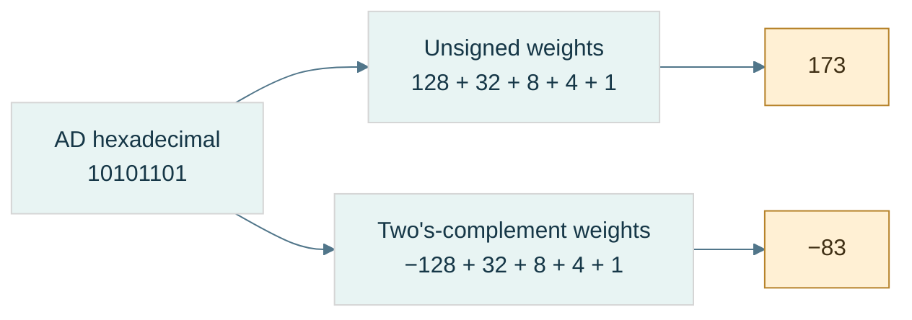

**Read the figure:** the branches change the interpretation, never the stored pattern. The high position contributes either $+128$ or $-128$ at this eight-bit width. Equivalently, the signed branch subtracts 256 from unsigned 173. **Limit:** this is a fixed-width integer example; floating fields and packed application flags follow different decoding rules. Reconstruct both answers before opening [[Visual Recall/01 - Bits, Numbers and Memory - Visual Recall#Figure-linked pocket notes|the pocket notes]].

### Why invert-and-add-one works

A **residue** is the representative left after division by a modulus. At width $N$, retaining only the low bits is arithmetic modulo $2^N$. For positive $x$, its negative residue is $2^N-x$. Since an all-ones word has value $2^N-1$:

$$
2^N-x=(2^N-1-x)+1=\operatorname{NOT}_N(x)+1
$$

Here $\operatorname{NOT}_N$ means complement exactly $N$ bits, not whatever width a programming-language promotion happens to choose.

Trace negative 13 at eight bits:

| Step | Bits | Unsigned pattern value |
|---|---|---|
| Positive 13 | `00001101` | 13 |
| Invert eight positions | `11110010` | 242 |
| Add one | `11110011` | 243 |
| Signed decode | $243-256$ | −13 |

Check: $13+243=256$, whose low eight bits are zero. Negating zero similarly produces all ones plus one and leaves zero. There is no second zero.

The [[Minimum signed value|minimum signed value]] is asymmetric. At eight bits, −128 exists but +128 does not. The pattern `10000000` complements and increments back to itself. That is valid residue arithmetic; it does **not** mean a signed language operation may return −128 as the mathematical negation of −128. For an `int` at its minimum, same-type negation, `abs`, and division by −1 cannot represent the answer. Narrow values can promote to a larger type first; always identify the actual operation type.

## Bits become decisions and compact fields

The same bits can now represent numbers, but not every byte is one number. Some store independent decisions or several small fields. Boolean rules tell us how to inspect and update them without damaging neighboring meanings.

### Boolean reasoning and control flow

A [[Boolean algebra|Boolean]] value is false or true. [[Logical versus bitwise operators|A bit pattern operation]] returns a pattern; a logical condition returns a truth value. With integer x=2 and y=1, `x & y` is zero, but `x && y` is true because each operand is nonzero.

Built-in logical AND/OR [[Short-circuit evaluation|short-circuit]]: the second operand is evaluated only if the first does not already determine the answer. That is why `p != nullptr && *p == 5` can avoid dereferencing a null pointer. Bitwise AND does not supply that control-flow guarantee.

[[De Morgan's laws]] describe what happens when NOT crosses AND or OR:

$$
\neg(A\land B)=\neg A\lor\neg B,\qquad
\neg(A\lor B)=\neg A\land\neg B.
$$

The symbols mean NOT/AND/OR, respectively. Check all four input pairs from the truth table. “Not both” means at least one is absent; “neither” means both are absent. Those are different predicates. Apply the identities lane-by-lane to fixed-width bit vectors only after fixing complement width.

### A mask selects positions

A [[Bit mask|mask]] is a pattern used to select or change specified positions. It is not a special hardware material. The operators [[Bitwise AND|AND]], [[Bitwise OR|OR]], [[Bitwise XOR|XOR]], and [[Bitwise NOT|NOT]] describe one-bit truth rules; **bitwise** operations apply them independently at each corresponding position.

| A | B | AND | OR | XOR |
|---|---|---|---|---|
| 0 | 0 | 0 | 0 | 0 |
| 0 | 1 | 0 | 1 | 1 |
| 1 | 0 | 0 | 1 | 1 |
| 1 | 1 | 1 | 1 | 0 |

NOT exchanges zero and one. AND keeps a bit only if the mask has one there; OR forces masked positions to one; XOR toggles them (one becomes zero, zero becomes one). XOR means **exclusive OR**: true when inputs differ, not when both are true.

Take the octet AD:

- `AD & 07 = 05` retains low positions 0-2.
- `AD | 40 = ED` sets position 6.
- `AD ^ 08 = A5` toggles position 3; repeating the toggle restores AD.
- Eight-bit NOT of `0F` is `F0`. The width matters: complementing a wider representation changes more positions.

C++ uses `&`, `|`, `^`, and `~` for these operations. The teaching model is a fixed-width unsigned pattern. Executable C++ first applies type rules; a narrow operand may become int before NOT. “Invert one byte” therefore requires a deliberate width, not merely the character `~`.

**Any versus all:** if m selects several flags, `(x & m) != 0` means at least one is set; `(x & m) == m` means all selected flags are set. With m=0, the first is false and the second true. Decide whether an empty selection is meaningful in the API.

### Shifts move significance

A **shift** relocates positions. [[Shift operations|A logical right shift]] fills new high positions with zero; an arithmetic right shift replicates the sign bit. A left shift introduces zeros at the low end. Shifting is not rotating: discarded positions do not reappear at the other end.

For an unsigned fixed-width pattern, a left shift by k corresponds to multiplication by $2^k$ followed by the width's truncation; a right shift corresponds to whole-number division by $2^k$ rounded down. **Truncation** here means discarding bits that cannot fit.

At eight-bit width, `00101101 << 1` gives `01011010`, value 90. But `10000000 << 1` leaves low eight bits zero; mathematical 256 needs nine bits. If the goal was an exact product, widening must occur before the shift.

For a negative signed value, arithmetic right shift and integer division can round differently. In C++23, -3 shifted right once is -2, while -3 divided by 2 is -1. **Floor** rounds down toward negative infinity; truncation of signed division rounds toward zero. Also validate the shift count: a negative count or one at least the promoted operand width is invalid. Use an unsigned carrier and check the width when manipulating representations.

### Fields: select, normalize, replace

A [[Bit field|bit field]] in this lesson means a schema-owned range of positions, not automatically a C++ language bit-field member. Its **offset** s is the first position; its **width** w is the number of positions. **Normalize** means move the extracted value down so its lowest field bit has weight one.

Let an unsigned N-bit word x contain a w-bit field beginning at s. Require $1\le w\le N$, $s\ge0$, $s+w\le N$. The low mask L and positioned mask M are:

$$
L=2^w-1,\qquad M=L\,2^s,\qquad f=(x\gg s)\mathbin{\&}L.
$$

Subtracting one from $2^w$ produces w low ones. For w=2, L=3 (`11₂`). For s=4, M=48 (`0x30`). Extract quality from AD: shifting right four gives A; AND with 3 gives 2. Masking AD with 30 alone gives 20 hexadecimal, still weighted at its original position, not normalized value 2.

Replacing requires clearing the old field before inserting the new value. At exactly N bits, $\operatorname{NOT}_N$ means width-limited complement:

$$
x'=(x\mathbin{\&}\operatorname{NOT}_N(M))
\mathbin{|}((v\mathbin{\&}L)\ll s).
$$

A checked API rejects v if it does not fit; a truncating API keeps only low bits. State which behavior is intended.

Trace quality 2→1:

```text
old word                 AD = 10101101
field mask               30 = 00110000
eight-bit NOT(mask)       CF = 11001111
clear: AD & CF            8D = 10001101
new field: 1 << 4         10 = 00010000
write: 8D | 10            9D = 10011101
readback: (9D >> 4) & 3    1
```

Outside-mask bits remain equal: `AD & CF = 9D & CF = 8D`. That is the preservation invariant. OR-only insertion fails whenever the new field needs to clear an old one; it cannot perform replacement generally.

### Figure B2 - Replace a field without damaging its neighbors

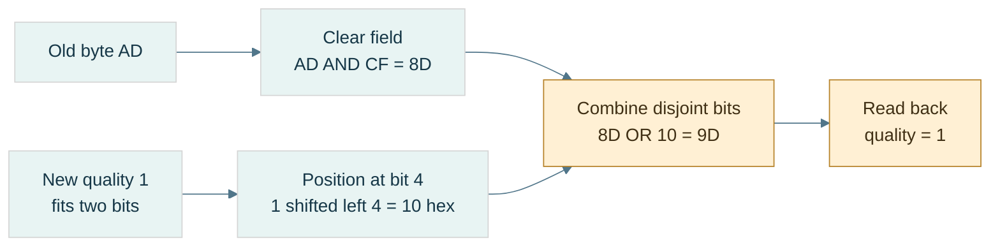

**Read the figure:** the destination field mask is `30` hexadecimal, so its eight-bit complement is `CF`. Clear first, insert second. The invariant is `AD AND CF = 9D AND CF = 8D`: all outside positions survive. **Limit:** the figure assumes a validated two-bit value and an eight-bit unsigned model; actual C++ promotions and legal shift counts still need checking. Extraction and replacement formulas appear immediately above.

### Packing several meanings and unpacking them

[[Bit packing|Packing]] places several small values in one carrier. Give every field an allowed range and disjoint positions before combining them. **Disjoint** means no shared positions; overlapping fields need a separate explicit meaning.

Our running control byte stores mode (0-7) at 0-2, visible at 3, quality (0-3) at 4-5, locked at 6, dirty at 7:

```text
mode=5       -> 00000101
visible=1    -> 00001000
quality=2    -> 00100000
locked=0     -> 00000000
dirty=1      -> 10000000
OR together  -> 10101101 = AD
```

Unpacking reverses the schema. Each recovered value must equal the validated input. A **round trip** is encoding followed by decoding; agreement is necessary but not sufficient, because two matching bugs could agree on the wrong external format. Also check expected bytes independently.

For an LSB-first logical-bit array, bit i goes into byte $\lfloor i/8\rfloor$, position $i\bmod8$. The floor symbol means take the whole-number quotient. Array `[1,0,1,1,0,1,0,1]` packs to AD; its element zero is the low bit even though printed binary puts the high bit on the left.

Packing n bits needs $\lceil n/8\rceil$ octets. A ceiling rounds upward. In finite size arithmetic, use `n/8 + (n%8 != 0)` rather than blindly computing `(n+7)/8` when n+7 could overflow. Check requested unpack count against source capacity before reading. Define whether unused final padding bits must be zero or are ignored.

### Test the packed meaning

**Question:** Can one byte hold the five declared meanings while updating one without changing neighbors?

Use the field/packing implementations in the code companion. Begin with the shown values and predict AD before running. Extract every field; replace quality by one and expect 9D. Then attempt quality=4: a two-bit checked field must reject it. Attempt a field extending beyond the carrier: reject it before shifting. Pack the eight-bit array and check the literal expected octet as well as the round trip.

**Observable checks:** extracted values equal inputs; outside-mask bits remain unchanged; a second identical set has no further effect; a second identical toggle restores the original; the final packed length is the rounded-up capacity. These are checks of mechanism, not a performance benchmark.

**Cost and trade-off:** a fixed field operation takes bounded work. Packing n bits processes n logical inputs and stores about n/8 octets; it saves footprint but adds work and can make concurrent updates to neighboring fields contend on the same storage. We have not yet studied the synchronization required for such shared writes.

**Teach-back:** explain why zero has a representation, why 256 patterns stop at unsigned value 255, why XOR toggles, and why the array's first element can be the printed numeral's last bit. If any answer is only “because binary,” rebuild the actual weights or truth rule.

**Companions, not missing steps:** [[Continuous Notes/Computing Foundations - From Bits to C++ and Systems APIs#M001 - Positional value, masks, fields, and De Morgan|Full proofs]] · [[Supplementary/Code Snippets#M001 - Width-safe fields and LSB-first bit packing|Checked C++ implementations]].

## Arithmetic becomes a policy

Boolean gates can build an adder, but an adder only produces a finite-width result. The next question is whether that result answers the intended signed, unsigned, bounded, or checked problem. Then C++ adds a further layer: the expression's type may not be the stored operand's type.

### From logic gates to an adder

An **ALU**, or arithmetic and logic unit, is hardware that computes arithmetic and bitwise results. A [[Half adder]] adds two one-bit inputs $A,B$. Its sum bit is XOR; its carry bit is AND. A [[Full adder]] also takes incoming carry $c$:

$$
S=A\oplus B\oplus c,\qquad
c_{\mathrm{out}}=(A\land B)\lor(c\land(A\oplus B))
$$

The sum records odd parity: it is 1 when an odd number of inputs are 1. Carry records a **majority**: at least two inputs are 1.

Trace four-bit $13+7$, reading from the least-significant column:

| Position $i$ | $A_i$ from 1101 | $B_i$ from 0111 | Carry in | Sum | Carry out |
|---|---|---|---|---|---|
| 0 | 1 | 1 | 0 | 0 | 1 |
| 1 | 0 | 1 | 1 | 0 | 1 |
| 2 | 1 | 1 | 1 | 1 | 1 |
| 3 | 1 | 0 | 1 | 0 | 1 |

Read sum bits high-to-low: `0100`, or 4. Including final carry gives `10100`, or 20. A [[Ripple-carry addition|ripple-carry adder]] passes each carry to the next stage; a long dependency chain increases circuit delay.

For [[Carry-lookahead and parallel-prefix adders|faster carry networks]], define **generate** $g_i=A_i\land B_i$ and **propagate** $p_i=A_i\oplus B_i$. Then $c_{i+1}=g_i\lor(p_i\land c_i)$. Groups can combine these facts without waiting for every single stage. “Parallel prefix” means combining summaries of preceding groups in a tree-like network. This is a circuit-depth issue, not a claim that fixed-width host addition is a loop over bits.

[[Subtraction through addition]] reuses the adder:

$$
A-B \equiv A+\operatorname{NOT}_N(B)+1\pmod{2^N}
$$

At eight bits, $5-7$: NOT(7)=248; $5+248+1=254$; signed decoding gives −2. A processor's [[Carry and borrow|borrow convention]] must be stated. In binary 6502-style SBC, $A+\operatorname{NOT}_8(B)+C=A-B-(1-C)$, so carry set means **no borrow**. This is an architecture-specific example, not a universal flag convention.

### Flags answer different questions

[[Carry, overflow, negative, and zero flags|C/V/N/Z]] are separate observations of a finite-width result: **C** is unsigned carry-out, **V** is signed overflow, **N** is the high result bit, and **Z** is whether all result bits are zero. With eight-bit binary addition and incoming carry zero:

| Inputs | Exact unsigned sum | Low result | C | V | N | Z | Signed reading |
|---|---|---|---|---|---|---|---|
| `7F + 01` | 128 | `80` | 0 | 1 | 1 | 0 | 127+1 cannot fit |
| `FF + 01` | 256 | `00` | 1 | 0 | 0 | 1 | −1+1=0 fits |
| `80 + 80` | 256 | `00` | 1 | 1 | 0 | 1 | −128−128 cannot fit |

For addition, signed overflow occurs when equal-sign operands produce the opposite-sign result. Carry is not a signed overflow test. The N flag describes the stored high bit; after overflow it does not recover the sign of the exact mathematical answer.

### Multiplication and division as reconstructible algorithms

[[Shift-and-add multiplication]] adds one shifted copy of the multiplicand for each set bit of the multiplier. For $13\times11$, multiplier $11=1011_2$:

| Multiplier position | Bit | Contribution | Accumulator |
|---|---|---|---|
| 0 | 1 | $13\times1=13$ | 13 |
| 1 | 1 | $13\times2=26$ | 39 |
| 2 | 0 | 0 | 39 |
| 3 | 1 | $13\times8=104$ | 143 |

Both partial products and accumulator need sufficient width. Two unsigned $N$-bit values may need $2N$ bits for their exact product.

[[Binary long division]] reads dividend bits from high to low. Append the next bit to the partial remainder by doubling and adding that bit; if it reaches the divisor, subtract the divisor and emit quotient bit 1, otherwise emit 0. For $13/3$, dividend `1101`:

| Incoming bit | Trial remainder | Quotient bit | Remainder after subtraction |
|---|---|---|---|
| 1 | 1 | 0 | 1 |
| 1 | 3 | 1 | 0 |
| 0 | 0 | 0 | 0 |
| 1 | 1 | 0 | 1 |

Quotient `0100` is 4; remainder is 1. The final check is $13=4\times3+1$. Generally, for dividend $D$, positive divisor $d$, quotient $Q$, and remainder $R$:

$$
D=Qd+R,\qquad 0\le R<d
$$

This is the **invariant** that makes the unsigned algorithm testable. Signed division needs an additional sign policy; C++ integer division truncates toward zero. Reject divisor zero and signed minimum divided by −1 when the operation type cannot hold the answer.

### Choose the overflow policy before calculating

**Overflow** means the exact mathematical answer does not fit the intended range. There are several possible [[Arithmetic policies|policies]], and they produce different programs.

| Policy for eight-bit unsigned $250+20$ | Result | Intended use |
|---|---|---|
| Wrap modulo 256 | 14 | residue counters, emulated register arithmetic |
| [[Saturating arithmetic\|Saturate]] at the upper bound | 255 | bounded intensities or controls |
| Check and reject | no value; report failure | sizes, allocation counts, external input |
| Widen the carrier | 270 in a wider type | preserve the exact intermediate result |

A **carrier** is the type or register holding the representation. Widen *before* an operation when the old carrier cannot hold its intermediate result. Casting an already-overflowed signed expression afterward cannot repair it.

C++ unsigned arithmetic uses modulo arithmetic at the width of the operation's unsigned type. [[Signed integer overflow]] is [[Undefined behavior]]: the language does not assign it a result that the program may rely on. CPU wraparound and C++ signed overflow are different contracts. These rules are described in the [C++ draft's fundamental types section](https://eel.is/c++draft/basic.fundamental).

For a buffer of `size` bytes, testing `offset + length <= size` can fail if the addition wraps. With unsigned sizes, use:

```text
offset <= size && length <= size - offset
```

Short-circuit evaluation protects the subtraction from an invalid offset. Example: size 100, offset 90, length 15. The first test passes, but $15\le 100-90$ fails. An offset greater than 100 fails before subtracting.

**Underflow**, when discussing integer range here, means falling below the lower endpoint; it is not the same technical condition as floating-point underflow. Unsigned `0 - 1` wraps. An unsigned reverse loop whose condition is `i >= 0` never terminates by that condition. Start from the count, test that it is nonzero, decrement, then index.

Saturation also changes algebra. With signed eight-bit saturation, $(100+100)+(-100)$ becomes $127-100=27$, but $100+(100-100)=100$. Saturating addition is not associative. Do not clamp an intermediate just because the final output has a bounded range.

### Follow C++'s types through the expression

[[Fixed-width integer types|Exact-width types]], such as `std::uint32_t`, specify an exact bit width when the implementation provides them. **Least-width** types guarantee at least the requested width; **fast-width** types pursue efficient operations while meeting that minimum. `std::size_t` represents sizes; `std::ptrdiff_t` represents pointer differences. Plain `char` can be signed or unsigned.

[[Integral promotion|Promotion]] is an automatic conversion of a small integer type to `int` if `int` represents all its values, otherwise to `unsigned int`. [[Usual arithmetic conversions]] then find the common operation type. **Rank** is the language's ordering of integer types for these decisions; it is not simply the number of bits.

On an ordinary host with eight-bit `uint8_t` and an `int` able to represent 0–255:

| Stage | Expression/value | Type and consequence |
|---|---|---|
| Stored operands | 250 and 10 | `uint8_t` |
| Promotion | 250 and 10 | `int` |
| Addition | 260 | `int`; no eight-bit addition has happened |
| Destination conversion | 4 | assigning to `uint8_t` reduces modulo 256 |

Likewise, `~uint8_t{0}` normally complements an `int` zero and produces `int` −1, not a byte object containing 255. The [draft promotion rules](https://eel.is/c++draft/conv.prom) explain why.

For [[Mixed signedness|mixed-sign comparisons]], do not assume the signed operand stays signed. In `-1 < 1u`, −1 converts to `unsigned int` and the comparison is false. A valid index still needs `index >= 0` *and* a value less than the count. Checked comparison helpers such as `std::cmp_less` avoid surprising conversion comparisons; `std::in_range<T>` checks whether conversion to `T` is representable. These tools do not establish that a pointer is live or that an index belongs to a particular container.

### Integer laboratory and teaching checkpoint

Before implementing a small ALU, write its contract: width, encoding, carry convention, decimal/binary mode, flags, and output policy. A **guest** is the simulated machine; the **host** runs the simulator. Host types must safely carry guest intermediate results.

Lab: enumerate all 256×256 input pairs for an eight-bit addition model, then repeat for both carry inputs. Compare low result with the widened sum modulo 256; compare carry with whether the widened sum reaches 256; derive overflow independently from signed mathematical bounds. That is [[Exhaustive finite-state testing|exhaustive testing]] of this bounded domain, not proof of a complete CPU.

A learner should now be able to explain why `AD` can mean −83, trace an adder, distinguish carry from overflow, reconstruct 13×11 and 13/3, and track the four expression stages above. Proofs and reusable implementation stay in [[Continuous Notes/Computing Foundations - From Bits to C++ and Systems APIs#M002 - Signed representations, adders, and arithmetic policies|the derivation companion]] and [[Supplementary/Code Snippets#M002 - Exhaustive 8-bit addition oracle and saturation|the code companion]]; the meaning needed to teach them is already here.

## A stretching ruler for real-valued quantities

Integer counts and signed directions are exact within their ranges. Fractions require another interpretation. We first study a movable scale because it covers a wide span of magnitudes; later, a fixed scale will offer a different bargain for a bounded domain.

### A movable binary point

[[IEEE-754 floating point|Floating point]] distributes a finite set of bit patterns across a wide range of values. It does not represent every real number. **Dynamic range** describes the span of magnitudes available; **precision** describes how finely values can be distinguished within that span. They are different resources.

A fixed-point encoding might interpret an integer carrier $I$ as $I/2^{16}$. Its spacing is always $2^{-16}$. More fractional positions improve that spacing but reduce the largest magnitude for a fixed carrier width. Floating point instead uses binary scientific notation: a [[Significand and hidden bit|significand]] supplies significant digits and an exponent moves their scale. In $1.010101_2\times2^3$, the significand is $1.010101_2$ and the exponent is 3.

Picture a toy format retaining only three significant binary bits:

| Exponent | Representable values in that exponent interval | Spacing |
|---|---|---|
| 0 | 1, 1.25, 1.5, 1.75 | 0.25 |
| 1 | 2, 2.5, 3, 3.5 | 0.5 |
| 2 | 4, 5, 6, 7 | 1 |

Each scale has the same number of significant positions, but the ruler stretches. Normal floating values have roughly constant *relative* precision, not constant absolute spacing. **Relative** means measured as a proportion of the value; **absolute** means measured in the original units.

IEEE-754 includes formats, special values, arithmetic and rounding rules, and exception conditions—not only a field layout. A conceptual arithmetic pipeline unpacks fields, handles classes, computes with extra information, normalizes, rounds, and repacks. An **FPU**, floating-point unit, is hardware performing these operations. Addition also needs exponent alignment; The arithmetic story below develops that machinery.

### The two formats and their interpretation

[[Binary32]] uses 32 bits; [[Binary64]] uses 64. These are format names. C++ `float` and `double` commonly use them, but names alone do not prove the representation. Our laboratory checks the host's width, radix, precision, exponent range, and IEC-559 support, plus golden bit patterns.

| Property | binary32 | binary64 |
|---|---|---|
| Sign position | 31 | 63 |
| Exponent positions | 30–23: 8 bits | 62–52: 11 bits |
| Fraction positions | 22–0: 23 bits | 51–0: 52 bits |
| Normal significand precision $p$ | 24 bits | 53 bits |
| [[Exponent bias\|Bias]] $B$ | 127 | 1023 |
| Normal exponent $e$ | −126 through 127 | −1022 through 1023 |
| Smallest positive normal | $2^{-126}$ | $2^{-1022}$ |
| Smallest positive subnormal | $2^{-149}$ | $2^{-1074}$ |

Let $S$ be the sign bit, $E$ the unsigned stored exponent, and $F$ the integer formed by the fraction field. For a normal finite number with $t$ stored fraction bits:

$$
x=(-1)^S\left(1+\frac{F}{2^t}\right)2^{E-B}.
$$

Use $t=23,B=127$ for binary32 and $t=52,B=1023$ for binary64. This formula defines the encoded value **exactly**; rounding happens when choosing which encoded value to store, not when interpreting an existing finite pattern.

The sign is a separate factor, unlike two's-complement integer negation. `1.0f` is `0x3F800000`; changing only the high bit gives `0xBF800000`, or −1. Do not invert every bit and add one.

The bias translates the normal exponent into a nonnegative field: $E=e+B$, so $e=E-B$. Binary32 exponent −2 stores 125; exponent 0 stores 127; exponent 3 stores 130. The chosen bias for $k$ exponent bits is $2^{k-1}-1$. Field zero and field all-ones have reserved interpretations: do not blindly subtract the bias for them.

**Normalize** here means move the binary point so a normal positive magnitude has the form $1.f_2\times2^e$. The first nonzero binary digit must be 1, so it need not be stored. That **implicit leading one**, or hidden bit, gives normal binary32 24 significant bits from 23 stored fraction bits. It is not present for subnormals.

| Stored exponent | Fraction | Class | Leading significand bit |
|---|---|---|---|
| 0 | 0 | signed zero | 0 |
| 0 | nonzero | subnormal | 0 |
| 1 through 254 (binary32) | any | normal finite | 1 |
| 255 (binary32) | 0 | signed infinity | not a finite significand |
| 255 (binary32) | nonzero | NaN | not a finite significand |

For binary64 replace 254/255 by 2046/2047. Classify first, decode second. Physical byte order is a separate layer: fields describe significance positions in a representation word, not which byte appears first at increasing addresses. **Little endian** places the least-significant byte first at increasing addresses; **big endian** places the most-significant byte first. The storage story later reconstructs both rules in detail.

### Encode 10.625, then decode −13.25

[[Floating-point encoding and decoding|Encoding]] starts with a value and chooses fields. For 10.625, the integer portion is $10=1010_2$. Convert the fractional portion by repeated doubling; each whole-number part becomes the next bit after the point.

| Remaining fraction | Multiply by 2 | Emit bit | New remaining fraction |
|---|---|---|---|
| 0.625 | 1.25 | 1 | 0.25 |
| 0.25 | 0.5 | 0 | 0.5 |
| 0.5 | 1.0 | 1 | 0 |

Thus $10.625=1010.101_2=1.010101_2\times2^3$. Set $S=0$, $E=3+127=130=10000010_2$. Drop the leading one; pad the fraction to 23 positions:

```text
sign | exponent | fraction
0    | 10000010 | 01010100000000000000000
grouped hex: 0100 0001 0010 1010 0000 0000 0000 0000
representation word: 0x412A0000
little-endian octets: 00 00 2A 41
```

The fraction integer is `0x2A0000`. Check $F/2^{23}=0.328125$; $(1+0.328125)\times8=10.625$. No rounding was needed because the finite binary expansion fits.

For decoding `0xC1540000`:

| Step | Result |
|---|---|
| Extract sign | $S=1$ |
| Extract exponent | $E=130$; class is normal |
| Remove bias | $e=3$ |
| Extract fraction | `0x540000`; fraction bits begin `101010` |
| Restore hidden bit | $1.10101_2=1+1/2+1/8+1/32=1.65625$ |
| Scale and sign | $-1.65625\times8=-13.25$ |

The decoder in the code companion uses `std::ldexp` to multiply a significand by a power of two. Its numerical reconstruction is not a NaN-payload-preserving conversion.


### Zero, infinity, and an unordered result

[[Signed zero]] retains a sign even when $E=F=0$. Positive zero is `0x00000000` and negative zero `0x80000000`. Numerically they compare equal. `std::signbit` distinguishes them; `x<0` does not distinguish negative zero. `std::copysign(0.0,-1.0)` constructs it deliberately.

Under the stated IEEE environment, reciprocal of +0 is +infinity and reciprocal of −0 is −infinity, with divide-by-zero status for finite nonzero numerators. Zero sign can therefore preserve directional information. This is floating arithmetic, not permission to divide an integer by zero.

[[Floating-point infinities|Infinity]] has all-one exponent and zero fraction. `0x7F800000` is positive infinity, `0xFF800000` negative infinity. Infinity is not the largest finite value: that is `0x7F7FFFFF`, $(2-2^{-23})2^{127}$, approximately $3.40\times10^{38}$.

| IEEE operation | Result | Reason to notice |
|---|---|---|
| Positive infinity plus finite | positive infinity | finite addition does not reduce unbounded magnitude |
| Positive infinity minus positive infinity | NaN | indeterminate difference |
| Zero times infinity | NaN | invalid operation |
| Finite value divided by infinity | signed zero | sign still matters |
| Infinity divided by infinity | NaN | invalid operation |

[[NaNs and payloads|NaN]] means “not a number”: all-one exponent with nonzero fraction. **Unordered** means ordinary ordered comparisons with NaN do not identify a less/equal/greater numerical relationship. Under ordinary IEEE semantics, `nan==nan` is false, `nan!=nan` true, and `nan<5`, `nan>=5` false. Detect it with `std::isnan`, not equality against a manufactured NaN.

A **quiet NaN** generally propagates through ordinary arithmetic without signaling invalid solely because it is quiet. A **signaling NaN** is intended to signal invalid when consumed by suitable operations and is commonly quieted. Actual traps, quieting, and payload handling depend on the environment and operation. A **payload** is representation information in the fraction that may carry diagnostics; NaN has no ordinary numerical positive/negative sign.

The laboratory's raw-word classifier uses fraction bit 22 as the quiet indicator in its stated IEEE binary interchange encoding. `0x7FC00001` is a quiet pattern; `0x7F800001` is a signaling pattern. Inspect these as integer words without feeding signaling patterns to arithmetic. A float-by-value inspection or print can already involve implementation behavior; it is not a guaranteed signaling-payload preservation experiment.

[[Floating-point exception flags|Exception flags]] are floating-environment status, not C++ `throw` exceptions. Invalid, divide-by-zero, overflow, underflow, and inexact are different conditions. Inexact says an exact result needed rounding. A tiny exactly representable subnormal does not automatically signal underflow; underflow signaling involves tininess and loss of accuracy under the relevant rules. Overflow handling depends on sign and rounding direction: nearest can produce infinity, while a direction toward finite magnitudes can produce the largest finite value.

### Filling the gap to zero

[[Subnormals and gradual underflow|Subnormals]] use $E=0,F\ne0$, with no implicit one and effective exponent fixed at the smallest normal exponent:

$$
x=(-1)^S\frac{F}{2^{23}}2^{-126}=(-1)^S F2^{-149}
$$

for binary32. For binary64 the corresponding value is $(-1)^S F2^{-1074}$. This changes the significand from $1.f$ to $0.f$ so values extend below the normal minimum.

| Positive binary32 word | Exact value |
|---|---|
| `0x00000001` | $2^{-149}$ |
| `0x007FFFFF` | $(2^{23}-1)2^{-149}=2^{-126}-2^{-149}$ |
| `0x00800000` | $2^{-126}$ |
| `0x00800001` | $2^{-126}+2^{-149}$ |

The subnormal-to-normal boundary has no abrupt jump in spacing: the last two gaps shown are both $2^{-149}$. That is **gradual underflow**. Subnormal spacing is constant in absolute units, so relative precision worsens toward zero; it is not the ordinary constant-relative normal regime.

[[Flush-to-zero and denormals-are-zero|FTZ]] means flushing certain tiny results to zero; **DAZ** means treating subnormal inputs as zero in environments offering that mode. Availability, cost and exact behavior vary. Do not assume every GPU or SIMD operation preserves gradual underflow, nor that subnormals always cost extra. Our strict host test verifies the behavior it observes, not every target mode.

### Epsilon is one spacing, not a tolerance

[[Machine epsilon]] for these binary formats is the difference from 1 to the next representable value above it: binary32 $2^{-23}$, binary64 $2^{-52}$. It is not the smallest positive number and is not a universal error estimate.

| C++ numeric-limits property | Meaning for binary32 |
|---|---|
| `min()` | smallest positive normal, $2^{-126}$ |
| `denorm_min()` | smallest positive subnormal, $2^{-149}$ |
| `lowest()` | most negative finite value |
| `max()` | largest positive finite value |
| `epsilon()` | upward spacing at 1, $2^{-23}$ |

[[ULP and representable spacing|ULP]], unit in the last place, describes a local significant-position scale. A **binade** is an interval $[2^e,2^{e+1})$ with a common normal exponent. For precision $p$, spacing *inside* that binade is exactly:

$$
\Delta(e)=2^{e-(p-1)}.
$$

Binary32 uses $p=24$, so its spacing is $2^{e-23}$. At 1024 it is $2^{-13}=0.0001220703125$; around one billion, $e=29$, so it is 64. Under nearest rounding, adding 1 to the exactly represented `1'000'000'000.0f` stores the same float because there is no representable neighbor one unit away.

At a power of two, state which direction you mean. Immediately above 1 the gap is $2^{-23}$; immediately below it the gap is $2^{-24}$. `std::nextafter(x,direction)` asks for a particular adjacent value. At the maximum finite value its upward neighbor is infinity; that gap is not an ordinary finite-binade spacing.

[[Unit roundoff]] under nearest rounding is conventionally $u=2^{-p}$, half epsilon for these formats. The usual relative-error model is scoped to correctly rounded normal-range results without overflow; do not extend its relative bound unchanged into subnormals.

[[ULP distance policies|ULP distance]] counts representation steps under a stated ordering policy. Reject NaNs and infinities for this lab and identify +0/−0 as one location. The supplied complement-key trick places the zeros at two keys; merely special-casing a comparison of the zeros still overcounts intervals *crossing* them. Our replacement collapses zero in the key itself: negative smallest subnormal to positive smallest subnormal has distance 2, not 3. A small ULP distance is a testing policy, not proof of correctness in physical units.

### Choosing a neighbor

[[Rounding to nearest ties to even|Nearest-even rounding]] chooses the closest representable neighbor. At an exact midpoint, select the candidate whose retained significand integer has an even low bit. “Even” does not mean that a fractional real value is an even decimal integer.

Use the three-significant-bit toy format:

| Exact value | Lower neighbor | Upper neighbor | Tie-even choice |
|---|---|---|---|
| 1.125 | `1.00₂` = 1 | `1.01₂` = 1.25 | 1: retained low bit 0 |
| 1.375 | `1.01₂` = 1.25 | `1.10₂` = 1.5 | 1.5: retained low bit 0 |
| 1.875 | `1.11₂` = 1.75 | `1.00₂ × 2` = 2 | 2; rounding renormalizes |

[[Guard round and sticky bits|Guard, round, and sticky]] summarize discarded information. Guard $G$ is the first discarded bit; round $R$ the next; sticky $T$ is the OR of all remaining discarded bits. Let $L$ be the last retained bit. For this binary rounding step:

$$
\operatorname{increment}=G\land(R\lor T\lor L).
$$

Guard zero is below half; guard one with later nonzero bits is above half; guard one with all later bits zero is a tie, resolved by $L$. Incrementing can carry out of the significand and require renormalization.

[[Directed rounding modes]] move toward positive infinity, negative infinity, or zero. Upward means toward larger signed values, not larger magnitude. For an integer-valued rounding demonstration:

| Input | Nearest-even | Upward | Downward | Toward zero |
|---|---|---|---|---|
| 2.5 | 2 | 3 | 2 | 2 |
| −2.5 | −2 | −2 | −3 | −2 |
| 2.1 | 2 | 3 | 2 | 2 |
| −2.1 | −2 | −2 | −3 | −2 |

For format rounding, substitute adjacent representable floating neighbors for adjacent integers. `std::round(2.5)` instead returns 3: halfway cases go away from zero, independently of the current direction. `std::nearbyint` follows the current rounding direction; unlike `rint` it does not raise inexact for the rounding operation.

[[Floating-point environment and compiler modes|The floating environment]] includes rounding direction and exception status. A demonstration must check whether changing direction succeeds and restore the **previous** mode, not blindly force nearest afterward. Compiler flags and optimizations matter. The lab uses Clang strict floating-point behavior, checks four modes, and avoids fast-math; see [Clang's floating-point controls](https://clang.llvm.org/docs/UsersManual.html#controlling-floating-point-behavior).

[[Interval arithmetic]] uses a lower and upper value to enclose an exact result; downward-rounded lower calculations and upward-rounded upper calculations can preserve bounds when the whole algorithm honors the required assumptions. It is not enough to switch a global mode around an arbitrary formula and declare a proof.

## When arithmetic meets uncertainty

A stored floating value is an exact point on its grid. The difficulty is whether it matches the intended quantity and how later rounded operations change it. Representation, operation error, sensitivity, and application policy are different causes; treating them as one global epsilon hides the real problem.

### The stored value is exact; its intended meaning may not be

Once a representation is chosen, follow a computation: desired real inputs become stored values; each operation can round again; those rounded results feed later operations. Keep **input representation error**, **operation rounding**, and **application policy** separate.

A [[Terminating fractions and dyadic rationals|rational number]] is a ratio $p/q$ of integers, with $q>0$. In **lowest terms**, the numerator and denominator share no factor greater than one. A finite base-$B$ fractional expansion has the form $m/B^k$ for some integers $m,k$. Therefore its reduced denominator must divide a power of $B$. Equivalently, every prime factor of that denominator must divide the base.

Decimal base ten contains factors 2 and 5, so $1/10$ terminates in decimal. Binary base two has only factor 2, so a terminating binary denominator must be a power of two. A **dyadic rational** is an integer divided by a power of two. Every finite binary floating value is dyadic; $1/10$ is not.

To produce binary fraction digits without already rounding them in a float, track the remainder as an integer over denominator ten:

| Remainder numerator before doubling | Doubled numerator | Digit | New numerator |
|---|---|---|---|
| 1 | 2 | 0 | 2 |
| 2 | 4 | 0 | 4 |
| 4 | 8 | 0 | 8 |
| 8 | 16 | 1 | 6 |
| 6 | 12 | 1 | 2 |

Remainder 2 repeats. Thus $0.1_{10}=0.0001100110011\ldots_2$. This is a base property, not a defective processor.

Nearest binary32 one tenth has word `0x3DCCCCCD` and exact value:

$$
\widehat{x}=\frac{13421773}{134217728}
=0.100000001490116119384765625.
$$

Its absolute error relative to exact $1/10$ is $1/671088640$, approximately $1.49\times10^{-9}$. The *stored* value is that exact rational; the approximation is the choice of it as a representation of one tenth.

On our checked host, `0.1f` is binary32, while `0.1` is binary64 with word `0x3FB999999999999A`. Binary64 is closer, not exact. Hexadecimal floating notation makes binary values explicit: `0x1.99999ap-4` means hexadecimal significand times $2^{-4}$; the `p` exponent is a power of two, not sixteen.

For ordinary binary64 nearest arithmetic, runtime `0.1+0.2` has word `0x3FD3333333333334`, whereas `0.3` has `0x3FD3333333333333`. Input rounding and addition rounding explain the different paths. Do not generalize that exact inequality to every type, literal suffix, or evaluation environment.

### Align the binary points before adding

[[Floating-point addition and absorption|Exponent alignment]] rewrites both significands at a common scale. Take $1.5=1.1_2\,2^0$ and $0.15625=1.01_2\,2^{-3}$. Right-shift the second significand by three positions:

```text
common exponent: 0
  1.10000
+ 0.00101
---------
  1.10101 = 1.65625
```

The conceptual pipeline is classify → unpack → compare exponents → align with guard/round/sticky information → add or subtract significands → normalize → round → handle range → pack. Opposite signs require a subtraction of magnitudes; leading zeros can require shifting left and decreasing the exponent. These are teaching stages, not a claim that every FPU has an identical internal design.

**Absorption** means a nonzero addend makes no change after rounding at the larger operand's scale. At $2^{24}=16{,}777{,}216$, binary32 upward spacing is 2:

| Exact sum | Neighbor candidates | Nearest-even stored answer |
|---|---|---|
| $2^{24}+1$ | $2^{24}$ and $2^{24}+2$ | $2^{24}$: even retained low bit |
| $2^{24}+2$ | exact representable value | $2^{24}+2$ |

The addend is mathematically real, but the destination grid has no point at the first exact sum. Shifting it into discarded positions must preserve enough information to round correctly; simply dropping all shifted bits is not a correct general addition algorithm.

This also explains the representation lesson one-billion-plus-one example. It does not imply floating addition is useless: the resolution must match the problem's scale.

### Cancellation can expose errors made earlier

[[Cancellation and loss of significance|Cancellation]] occurs when nearly equal magnitudes subtract, leaving a small difference. **Catastrophic** describes severe loss of relative accuracy when existing operand uncertainty dominates that difference.

Let intended operands be $a,b$, stored approximations $\widehat a=a(1+\delta_a)$ and $\widehat b=b(1+\delta_b)$, and true difference $d=a-b\ne0$. Before any final subtraction rounding:

$$
\widehat a-\widehat b=d+a\delta_a-b\delta_b.
$$

If both relative input errors are bounded by $\eta$, triangle inequality gives:

$$
\frac{|(\widehat a-\widehat b)-d|}{|d|}
\le\eta\frac{|a|+|b|}{|a-b|}.
$$

The sensitivity factor grows when the denominator shrinks. Measurement uncertainty behaves similarly: subtract two roughly million-sized readings each uncertain by 0.05 to estimate a difference of 0.1, and that difference can have order-one relative uncertainty.

**Loss of significance** means common leading digits cancel, leaving the low-order region to determine the result. A rough count is $\log_2(\max(|a|,|b|)/|a-b|)$ canceled leading bits; it is not an automatic theorem about how many digits the result is wrong.

Corrected exact binary trace from the attachment:

```text
a = 1.1011011001₂ = 1753 / 1024
b = 1.1011010111₂ = 1751 / 1024
a-b = 2 / 1024 = 2^-9
    = 0.000000001₂ = 1.0₂ × 2^-9
```

The attachment's longer difference pattern and exponent −7 do not match these operands. Their subtraction is exact; common digits disappearing is not itself evidence of new rounding.

[[Sterbenz lemma|Sterbenz's lemma]] makes the distinction precise: for nonnegative stored floating values $x,y$ in the same radix format, if $x/2\le y\le2x$, their difference is representable exactly under the appropriate gradual-underflow arithmetic assumptions. Same-sign negative cases reduce to magnitudes. FTZ and other changed arithmetic models need separate handling. The lemma concerns the **stored operands**, not the real quantities they approximate.

Example: the desired decimal $a=1.00000006$ rounds above 1 to its next binary32 neighbor under nearest-even. Stored subtraction from 1 yields exactly $2^{-23}$, approximately $1.19209\times10^{-7}$, although the desired difference was $6\times10^{-8}$. Exact subtraction can faithfully expose a large relative input error.

[[Stable reformulation|Reformulation]] changes the computational path while preserving the mathematical function. For $x\ge0$:

$$
\sqrt{x+1}-\sqrt{x}
=\frac{1}{\sqrt{x+1}+\sqrt{x}}.
$$

Multiplying by the conjugate cancels the numerator algebraically *before* floating evaluation. At binary64 $x=10^{16}$, even `x+1` rounds to `x`; the direct square-root difference is zero, while the rationalized form gives a useful result near $5\times10^{-9}$. The reformulation avoids subtracting rounded near-equal roots, but is not an exact-real oracle or a universal fix for every range/domain.

For cross products, each component is a difference of products. The source's vectors $(10^8,10^8,0)$ and $(10^8,10^8+1,0)$ have real cross-component $10^8$. But binary32 near $10^8$ has spacing 8, so the `+1` is already lost when that component is converted to float. Widening the stored float later cannot recover it. Product rounding is a second possible failure mechanism, not the first one in this example.

### Range events are observable, but not interchangeable

[[Floating-point exception flags|Overflow]] concerns results exceeding finite representable range under the applicable rounding rules; intermediates may overflow even when a final mathematical answer fits. Under nearest, maximum finite binary32 times two becomes infinity, with overflow/inexact status in our strict environment.

At the small end, exact $2^{-126}\times1/2=2^{-127}$ is a representable subnormal. It need not raise underflow or inexact. But $2^{-149}\times1/2=2^{-150}$ is an exact midpoint between zero and the smallest positive subnormal; nearest-even gives zero, with tiny/inexact behavior.

The lab executes these at runtime, clears flags between cases, observes them, and restores the incoming floating environment. These host observations are not a portable claim about every compiler mode, trap configuration or GPU. FTZ/DAZ can change the model. Never use a compile-time-folded expression as proof that a runtime status flag was set.

### Error, conditioning, and a budget

[[Absolute and relative error|Absolute error]] is $|\widehat x-x|$, in the same units as $x$. Relative error is $|\widehat x-x|/|x|$ for $x\ne0$, dimensionless. An absolute error of 1 at a million is $10^{-6}$ relative; an absolute error of $10^{-12}$ on a true value $10^{-12}$ can be 100% relative. Near exact zero, relative error alone is undefined.

[[Forward and backward error|Forward error]] asks how far the output is from the exact desired output. **Backward error** asks what perturbation of the input would make the computed output exact. **Stability** concerns the algorithm's introduced errors; [[Conditioning and singularity|conditioning]] concerns the mathematical problem's sensitivity. A backward-stable method can still have large forward error on sensitive inputs.

For correctly rounded normal-range arithmetic in nearest mode, the standard local model is:

$$
\operatorname{fl}(a\circ b)=(a\circ b)(1+\delta),\qquad |\delta|\le u.
$$

Here $\circ$ is a specified operation and $u$ unit roundoff; exclude overflow and special values, and treat subnormal error separately. An exact zero result is handled directly rather than dividing by it.

[[Accumulated rounding error|Repeated rounding]] often uses $\gamma_n=nu/(1-nu)$ for $nu<1$. This bounds relevant products of rounding factors under stated assumptions; it does **not** promise that every arbitrary $n$-operation algorithm has relative error at most $\gamma_n$.

For sequential summation of $n$ inputs without range failures, a common absolute bound is $\gamma_{n-1}\sum_i|x_i|$. If positive and negative terms cancel, dividing by the tiny true sum can produce a large relative bound. A count of operations without magnitudes, dependency paths and conditioning is not an error analysis.

### Representation lessons applied to numerical APIs

[[Numerical tolerance policies|A tolerance]] is an allowed discrepancy chosen for a task. Machine epsilon is dimensionless spacing near one. If vector components measure meters, a minimum usable norm needs a units/scale policy; swapping meters for kilometers changes a raw absolute numeric cutoff. A vector $(10^{-8},0)$ is nonzero and normally representable in binary32; a length cutoff at epsilon rejects it by policy, not because binary32 cannot store it.

[[Robust norm and intermediate range|Intermediate range]] matters independently of the final answer. For $(10^{20},10^{20})$, each component fits binary32 but squaring gives about $10^{40}$, beyond its finite range. A naive square/sum/square-root pipeline can produce infinity, then division by infinity produces zero components. The exact norm $\sqrt2\,10^{20}$ fits.

Scale first: $m=\max(|x|,|y|)$; for finite inputs and $m>0$, compute $m\sqrt{(x/m)^2+(y/m)^2}$. The squared ratios are at most one; this avoids unnecessary overflow from squaring the original components. It does not make an out-of-range final answer fit, and its special-value policy still needs defining. `std::hypot` supplies a standard range-aware alternative. The lab reproduces the naive failure and checks a finite hypot result; it is not a benchmark.

A hybrid equality test often allows absolute difference near zero and a relative difference at large scale. With policy $10\epsilon_{32}$ and magnitude $10^8$, the allowed absolute difference is about 119.2, while local spacing is 8. This is a chosen tolerance, not “the accuracy of float.”

**Check non-finite operands before applying the relative formula.** For the scalar excerpt in the supplied lesson, equal infinities produce `inf-inf → NaN` and compare false. More seriously, finite versus infinity and opposite infinities can compare true because the final condition becomes `inf <= inf`. The teaching lab reproduces all three outcomes for that exact excerpt-shaped formula, then tests an explicit policy that accepts exact equal infinities, rejects all other non-finite pairs and invalid tolerances, and compares finite floats in a widened domain.

[[Conditioning and singularity|Conditioning]] describes how sensitive a mathematical problem is to perturbations; it is not just whether a determinant is small. A **matrix** represents a linear transformation here; the **identity matrix** $I$ leaves its input unchanged. An **inverse** undoes a transformation when one exists. A square matrix's **determinant** is a scalar whose nonzero status characterizes invertibility in exact arithmetic. The **Euclidean norm** is the square root of summed squared components; the associated matrix **2-norm condition number** compares its largest and smallest stretching factors.

For $A=10^{-4}I$ in two dimensions, $\det A=10^{-8}$ and $A^{-1}=10^4I$. Both stretching factors equal $10^{-4}$, so the condition number is 1. An absolute determinant-vs-float-epsilon cutoff rejects this invertible, well-conditioned matrix by a scale-sensitive policy. Uniformly scaling a 2×2 matrix by nonzero $c$ scales its determinant by $c^2$ but leaves its condition number unchanged. General conditioning and reliable inversion methods remain future linear-algebra topics.

**Repository evidence boundary:** the attachment reports these shapes in KairoMath Vector/Matrix and raw-bit serialization in KairoAssets. Their paths, line ranges and claims are recorded in Sources and Code Anchors as **To verify**. The reproductions prove behavior of the supplied formulas on this host, not the current repositories. The matrix excerpt includes an assertion before an identity fallback: an assertion-enabled build may stop rather than reach that fallback.

[[Floating-point canonicalization|Canonicalization]] chooses a common encoding for equivalent cases. Raw serialization keeps +0/−0 and different NaN payloads distinct; a canonical format might collapse both zeros and use one NaN word. Either policy is possible, but changing it changes the byte contract. Our raw-word encoder uses the explicit byte-order lesson explicit little-endian codec without pretending arithmetic preserves every signaling payload.

### A tolerance is a semantic rule, not an equality relation

[[Numerical tolerance policies]] need separate absolute tolerance $\tau_a$ and relative tolerance $\tau_r$:

$$
|a-b|\le\max\!\left(\tau_a,\tau_r\max(|a|,|b|)\right).
$$

Absolute tolerance has the compared quantity's units; relative tolerance is dimensionless. They need not be numerically equal. The float-specific validated comparison already supplies validated tolerances, explicit non-finite handling, and widened finite arithmetic; reuse it rather than copying the attachment's unchecked generic “production” function.

An exact `==` test is appropriate when the intended question is *numeric exact equality*, such as whether a value stayed zero. It is **not raw representation equality**: signed zeros compare equal, and NaNs do not compare equal even to the same encoding. Use raw representation words for a byte-identity contract.

Validate tolerances before an exact-equality shortcut. Reject negative/non-finite tolerances; state a useful allowed relative range. NaNs are not numerically close; same-sign infinities may compare equal only by an explicit policy. A generic expression that overflows both difference and allowed tolerance to infinity can accidentally accept `inf<=inf`; “finite operands” alone does not prevent this.

Approximate closeness is generally **not transitive**. With absolute tolerance 1, 0 is close to 0.75 and 0.75 to 1.5, but 0 is not close to 1.5. It is unsuitable as a drop-in equivalence relation for ordered containers, hashing, or deduplication without additional design.

Why no global epsilon? Positions, angles, times and determinants have different units; world scales differ; algorithms have different error histories; conditioning differs; types differ. A normalization cutoff asks whether a direction is usable, not whether two numbers are equal. A determinant criterion asks about invertibility/sensitivity, not ordinary closeness.

The reported Kairo hybrid formula uses one epsilon parameter for an absolute regime and a relative regime. That is a policy choice, not machine epsilon proving the correct physical cutoff. the representation lesson infinity regressions still apply. At $10^9$, choose distinct stored neighbors separated by 64 for a float comparison example; `10^9+32` is a midpoint that can round back to the same float.

### One rounding rather than two

[[Fused multiply-add|FMA]] computes $\operatorname{fl}(ab+c)$ with one final rounding, rather than $\operatorname{fl}(\operatorname{fl}(ab)+c)$ with an intermediate product rounding.

Let $p=2^{-23}$, $a=b=1+p$, and $c=-(1+2p)$, all exact binary32 inputs:

| Path | Computation | Result |
|---|---|---|
| Exact algebra | $(1+p)^2-(1+2p)$ | $p^2=2^{-46}$ |
| Separate binary32 | product $1+2p+p^2$ rounds to $1+2p$, then subtract | 0 |
| FMA | retain product information through addition, then round | exactly $2^{-46}$ |

The laboratory explicitly stores the product and disables contraction for the separate path. `std::fma` specifies the fused operation deliberately. A source multiply/add may be contracted according to build settings, so it is not enough to count visible `*` and `+` tokens.

FMA can help dot products, interpolation, and Horner polynomial evaluation. It is not a universally correctly rounded multi-term dot product: other products/additions may still round, and poor input data/conditioning remain. FMA policy is also a reproducibility choice because a better answer can differ bitwise from the unfused reference.

### Figure B3 - Rounding points change the answer

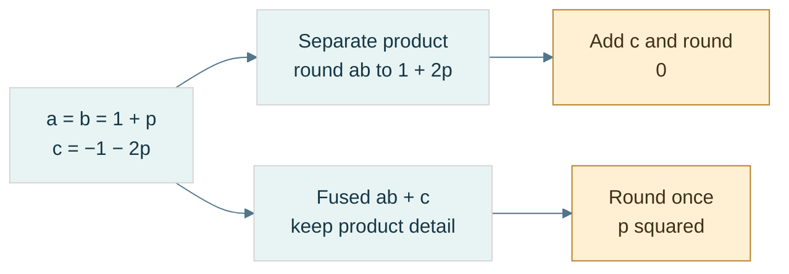

**Read the figure:** here $p=2^{-23}$ and all inputs are exact binary32 values. The exact product is $1+2p+p^2$. Separate binary32 multiplication discards $p^2$; FMA retains it until the addition cancels $1+2p$, leaving exactly $2^{-46}$. **Limit:** the separate path assumes an actual intermediate binary32 rounding with contraction disabled. FMA does not recover inaccurate input data or make a general dot product exact. The preceding example gives the full arithmetic contract.

### Algebra changes when rounding points move

[[Floating-point reassociation|Reassociation]] changes grouping. In binary32, choose $a=10^{20}$, $b=-a$, $c=3.14f$:

| Grouping | Intermediate | Stored result |
|---|---|---|
| $(a+b)+c$ | opposite equal stored magnitudes give zero | `3.14f` |
| $a+(b+c)$ | small c is absorbed in b | zero |

These are different rounded computations even though real addition is associative.

Distributivity also fails. Let exact binary32 $a=10^{10}$, $b=1+2^{-23}$, $c=-1$. Then $a(b+c)$ stores approximately 1192.0928955078125. But rounding $ab$ near $10^{10}$ uses spacing 1024, so separately computed $ab+ac$ gives 1024. The independent stored products matter; contraction can change the second graph.

[[Compensated and pairwise summation|Naive summation]] adds every input to one running result. **Kahan compensation** tracks an estimate of low bits lost in earlier additions:

```text
y = input - compensation
next = sum + y
compensation = (next - sum) - y
sum = next
```

Toy binary32 trace for inputs $[2^{24},1,1]$: naive gives $2^{24}$; after the first 1, Kahan records compensation −1; the next adjusted input becomes 2 and the stored sum becomes $2^{24}+2$. It improves this example, but is not order-independent or universally exact; severe cancellation can still defeat it.

**Pairwise summation** fixes a balanced tree of partial sums. Depth grows roughly logarithmically instead of the long serial chain, improving useful error bounds under their assumptions. It does not always outperform another method on every data set. The implementation fixes the split at `size/2`, independent of scheduling, using $O(n)$ additions and $O(\log n)$ recursive stack depth without copying the input.

Strict compiler settings constrain unsafe reassociation; fast modes can permit numerical changes. The lab uses explicit strict behavior and `-ffp-contract=off` for the unfused paths. These settings are documented by [Clang's floating-point controls](https://clang.llvm.org/docs/UsersManual.html#controlling-floating-point-behavior).

### Repeatable is not accurate, and atomic is not ordered

[[Numerical reproducibility|Repeatability]] means the same defined program/environment/input repeats a result. **Bitwise reproducibility** means representation identity across an explicitly specified set of environments. **Numerical stability** is a different accuracy property.

A [[Deterministic reduction tree|fixed reduction tree]] requires a fixed input order, partitioning and merge order. Scheduling may vary if it cannot change that tree. Atomics make updates indivisible/race-free under their contract; they do not necessarily choose one global order. Since additions do not associate, different permitted atomic update orders can differ.

Record precision, reduction topology, contraction/FMA, rounding direction, FTZ/DAZ, compiler options, hardware and relevant math-library behavior. A fixed tree alone does not promise CPU/GPU or cross-library bit identity. Exact or binned accumulators can offer stronger contracts at additional complexity; they remain a future design topic.

[[Mixed-precision state updates]] use wider intermediates but narrow persistent state. A finite binary32 value promotes exactly to binary64, but widening does not reconstruct lost bits. Repeated storage back to float rounds after each update.

The source-reported Maveb excerpt concerns a **TSDF**, truncated signed distance function: a stored distance-to-surface estimate with sign and a truncated/normalized range. A **voxel** is one cell of a three-dimensional sampled volume. A weighted observation has distance $d$ and influence weight $w$.

Before saturation, ideal weighted state updates are:

$$
D'=\frac{DW+dw}{W+w},\qquad W'=W+w.
$$

With exact arithmetic and uncapped exact totals this is the weighted mean of all observations. The reported implementation instead stores D/W in float after double arithmetic, so update order can change rounding.

[[Capped weighted updates|A weight cap]] changes the mathematics, not just precision. The supplied recurrence chooses $W'=\min(W_{\max},W+w)$, contribution $c=\min(w,W')$, retained history $r=W'-c$, and $D'=(Dr+dc)/W'$, assuming positive valid weights.

With cap 2 and unit weights, observations [0,1,−1] produce distances 0 → 0.5 → −0.25. Reordering to [0,−1,1] gives 0 → −0.5 → +0.25. All intermediate values are exactly binary-representable. This proves genuine history dependence, not floating error. Replacing it with a batch weighted mean would change the algorithm.

[[Numerical decision boundaries]] turn continuous perturbations into discrete choices. Projected image position near $n+0.5$ can select a different pixel under `llround`'s halfway-away-from-zero policy; a TSDF value changing sign near zero can change a surface-extraction case. **Topology** means connectivity/structure of the extracted surface, not just vertex displacement.

The reported interpolation ratio $t=a/(a-b)$ also has a denominator cutoff and clamping policy. Double promotion preserves stored float values exactly; near unit magnitude distinct floats differ by much more than $10^{-12}$, but near zero very fine float spacing is available. Do not equate “small denominator” with “the inputs were equal.”

**Repository boundary:** Kairo Dot/Cross/NearlyEqual and Maveb integration, pixel selection and interpolation are source-reported excerpts. Their current revisions/call paths were not inspected during this notes merge. The laboratory tests simplified excerpt-shaped mechanisms, not those repositories. No production numerical API or accumulation order was changed.

### Laboratory, reconstruction, and next step

Before running the code, predict `0x412A0000`, `0xC1540000`, the three subnormal-boundary words, and the gaps on both sides of 1. Then check:

- Golden words and independently expected little-endian bytes—not just matching encode/decode bugs.
- Raw classification of both zeros, finite boundaries, infinities, and quiet/signaling NaN words without signaling arithmetic.
- Finite reconstruction against host conversion for boundary words and 10,000 seeded raw patterns.
- Zero-collapsed ULP distances, including intervals crossing zero, and rejection of non-finite inputs.
- Nearest-even versus `round`, all directed integer-rounding demonstrations, and restoration of the initial rounding mode.
- Separate tiny-vector cutoff, huge-vector intermediate overflow, and infinity-comparison failures.

These are representation and policy tests. They do not validate a complete floating-point implementation, all four billion patterns, Kairo repositories, shader modes, performance, or cross-platform NaN transport.

Teach-back: derive why 23 stored fraction bits give 24 normal precision bits; explain why $E=0$ does not mean exponent −127; decode both worked numbers; explain why epsilon is neither a minimum nor a universal tolerance; resolve the two toy ties; and trace how a valid finite vector can become zero by two different mechanisms.

[[Continuous Notes/Computing Foundations - From Bits to C++ and Systems APIs#M004 - Floating-point fields, spacing, and rounding|Extended derivations]] · [[Supplementary/Code Snippets#M004 - Binary interchange inspection and strict rounding laboratory|Reusable implementation and tests]] · [[Supplementary/Worked Traces#M004 - From fields to values and failure paths|Further traces]].

With the representation understood, we can follow the arithmetic and its error history.

### Laboratory and teaching checkpoint

Predict each outcome before running:

- The exact rational behind `0.1f` and the binary64 words for the sum and literal 0.3.
- Exact aligned addition and absorbed midpoint addition.
- Corrected binary subtraction; subtraction after an operand was rounded.
- Overflow status, exact subnormal without underflow, and midpoint-to-zero with underflow/inexact in the strict host environment.
- Separate versus fused result, both association trees, and both distributive graphs.
- Naive versus Kahan on the three-input toy case; fixed pairwise behavior on a chosen tree.
- Capped weighted updates in the two orders, and float-state rounding versus a wider-state toy mean.
- Pixel choices just below/above a midpoint and closeness failing transitivity.

These are explicit regression demonstrations, not benchmarks, full FPU validation, mesh reconstruction experiments or proof of cross-platform reproducibility. Error measurements need an independent reference and declared units; a wider implementation is useful but is not automatically an exact oracle.

[[Continuous Notes/Computing Foundations - From Bits to C++ and Systems APIs#M005 - Representation error, cancellation, and rounding graphs|Extended derivations]] · [[Supplementary/Worked Traces#M005 - Rounding paths and update history|Expanded traces]] · [[Supplementary/Code Snippets#M005 - Strict arithmetic and state-update laboratory|Reusable code and tests]].

The representation-choice discussion below brings these rounding and state contracts into fixed point, low precision and serialized data.

## Choosing what information to keep

Floating point solved wide dynamic range, not every storage or application constraint. Now deliberately return to the representation decision: perhaps the domain needs a constant step, perhaps sixteen bits are sufficient, or perhaps data-specific codes are worth an irreversible approximation. The previous arithmetic lessons remain the tests every choice must pass.

### A fixed ruler for fractional values

Unsigned integers answered “how many?”; signed integers added direction. Floating point added a ruler that stretches with magnitude. None of these choices removed finite storage. If a distance always stays inside a known world region, a stretching ruler may be unnecessary: a constant millimeter-like step can be a better contract.

[[Fixed-point representation|Fixed point]] interprets an integer raw value $I$ with an externally agreed scale $S>0$:

$$
x=\frac{I}{S}.
$$

**Scale** is the conversion factor between integer codes and the quantity's units. The integer object does not carry a binary point by itself. Binary fixed point uses $S=2^F$, where $F$ is the number of fractional positions. Decimal fixed point, such as $S=1000$, is possible too. State storage width, signed encoding, units, scale, rounding, and overflow behavior; the label “Q16.16” is ambiguous because conventions differ about counting the sign bit.

For a two's-complement 32-bit carrier and $F=16$, encode $3.25$ as $I=3.25(65536)=212992$, word `0x00034000`. Decode by dividing by 65536. Negatives use the carrier's two's-complement rule—not an independent sign-and-magnitude split. Every step is $2^{-16}$, and the exact range is:

$$
-32768\le x\le32768-2^{-16}.
$$

This representation answers a problem floating point did not: constant absolute resolution over a declared interval. It still cannot represent every real number, and it still overflows. More fractional positions make steps finer by spending range.

### Choose a scale from requirements, not a fashionable name

[[Fixed-point range and resolution|Resolution]] is the distance between adjacent decoded codes. Let $\Delta_{\mathrm{req}}>0$ be the largest acceptable step and $M>0$ the required symmetric magnitude. For a signed $N$-bit carrier, the positive endpoint is the tighter endpoint for a symmetric requirement:

$$
2^{-F}\le\Delta_{\mathrm{req}},
\qquad
M2^F\le2^{N-1}-1.
$$

With an integer, nonnegative $F$, these give a feasible interval:

$$
F_{\min}=\max\!\left(0,\left\lceil-\log_2\Delta_{\mathrm{req}}\right\rceil\right),
\qquad
F_{\max}=\left\lfloor\log_2\frac{2^{N-1}-1}{M}\right\rfloor.
$$

The ceiling rounds upward; the floor downward. These inequalities concern a requested step, not a maximum rounding error: nearest rounding without clipping has error at most half a step. For 32 bits, a step no larger than 0.001 requires $F\ge10$. A range including $\pm10^6$ requires $F\le11$. Both $F=10$ and $F=11$ work; $F=12$ does not fit that world.

If the interval is empty, change width, range, or resolution. A local coordinate origin can reduce the magnitude that one field must represent, but then the origin becomes additional state with its own contract. It is not extra precision obtained for free.

**Book bridge:** Game Engine Architecture, PDF pages 121–122 (printed 99–100), connects integers, fixed point, and floating point. Its fixed-point illustration uses sign/magnitude fields; our implementation instead uses a two's-complement scaled integer. Its figure caption and body also disagree about the fraction-bit count. The teaching rule is to reconstruct a format from explicit fields, not assume one textbook example defines all fixed point.

### Multiplication changes the scale; rescaling is another rounding decision

Adding two raw values works directly only when their scales and units match. For $A=aS$ and $B=bS$, multiplication produces $AB=abS^2$, not an output already at scale $S$. [[Fixed-point rescaling|Rescale]] before storing:

$$
I_{\mathrm{product}}=\operatorname{roundPolicy}\!\left(\frac{AB}{S}\right),
\qquad
I_{\mathrm{quotient}}=\operatorname{roundPolicy}\!\left(\frac{AS}{B}\right),\quad B\ne0.
$$

A **wide intermediate** is a carrier large enough for an operation before the final range reduction. With signed 32-bit raw operands, their product fits signed 64-bit arithmetic, but it may still exceed the *destination* range after rescaling. For our $F=16$ quotient, multiplying a 32-bit raw numerator by 65536 also fits signed 64 bits. Those proofs do not extend automatically to arbitrary widths or scales.

Trace $F=8$, $S=256$:

| Stage | Stored or intermediate quantity | Meaning |
|---|---|---|
| Encode 1.5 | $A=384$ | $384/256$ |
| Encode 2.25 | $B=576$ | $576/256$ |
| Multiply wide | $AB=221184$ | product at scale $256^2$ |
| Rescale | $221184/256=864$ | product at scale 256 |
| Decode | $864/256=3.375$ | expected real product |

For a negative value, right shift and integer division do not necessarily implement the same rounding policy. At scale 2, $-3/2$ truncates toward zero to −1, while arithmetic right shift gives −2. Nearest-even gives −2 on that tie; on other cases a blanket shift still implements floor, not nearest. Define a rounding algorithm using quotient and remainder, including negative ties.

The laboratory uses unsigned magnitude arithmetic to handle signed minimum safely, nearest-even for multiplication/division, and checked narrowing. It does not negate `INT64_MIN`, add a half-scale that might overflow, or multiply in 32 bits and widen afterward. Conversion rejects NaN and infinities before integer casting. Conversion from double explicitly uses halfway-away-from-zero; that differs from the arithmetic rescaling rule and is documented rather than hidden.

### A constant grid changes error, not the existence of error

Nearest encoding with no clipping gives:

$$
\left|x-\frac{\operatorname{round}(xS)}{S}\right|\le\frac{1}{2S}.
$$

For $F=16$, the bound is $2^{-17}$. It has the quantity's units. Relative error can still be large near zero. At a value smaller than half a step, nearest encoding can erase it completely.

With signed 16-bit raw storage and $F=8$, the range is $[-128,128-2^{-8}]$. Value 200 needs raw 51200 and cannot fit. Wrap, saturation, and rejection remain different policies. “Uses integers” does not authorize C++ signed overflow.

Fixed point can remove variability caused by floating contraction, subnormal modes, and floating evaluation precision when its operations are fully specified. It does not make capped updates or saturation associative, remove races, or guarantee deterministic input order. The previous questions about algorithm and scheduling still hold.


### Two sixteen-bit bargains: keep detail or keep range

Sometimes a stretching ruler is still desirable, but 32-bit storage is too costly. **Bandwidth** is the amount of data transferred per unit time; cutting a representation's size may reduce traffic, but speed depends on the actual computation and hardware. A storage choice is not a benchmark result.

[[Binary16|IEEE binary16]], often called FP16, uses one sign bit, five exponent bits and ten stored fraction bits. Its bias is 15; normal precision is 11 bits. For a normal word:

$$
x=(-1)^S\left(1+\frac{F}{2^{10}}\right)2^{E-15},
\qquad 1\le E\le30.
$$

Zero/subnormal and all-one exponent classes follow the same conceptual classification as larger IEEE binary formats. With exponent zero and nonzero fraction, the value is $(-1)^SF2^{-24}$.

Encode 1.5: $1.1_2\,2^0$ gives sign 0, exponent 15, fraction 512. The word is `0x3E00`. The highest finite binary16 value is $(2-2^{-10})2^{15}=65504$. The smallest positive normal is $2^{-14}$; the smallest subnormal is $2^{-24}$. A value $10^5$ is outside finite range. Loss scaling addresses tiny gradient visibility in some training schemes; blindly increasing a scale is not a remedy for already-too-large values and can cause overflow.

[[Bfloat16]] spends the same sixteen bits differently: one sign, eight exponent bits, seven fraction bits. Its bias is 127, normal precision eight bits, and normal-value formula is:

$$
x=(-1)^S\left(1+\frac{F}{2^7}\right)2^{E-127},
\qquad1\le E\le254.
$$

Its ideal interchange subnormal spacing is $2^{-133}$, but actual target operations can flush small values; specify that policy separately. Its largest finite value is $(2-2^{-7})2^{127}$, slightly less than binary32's largest finite value—not identical range in every detail.

| Resource | binary16 | bfloat16 |
|---|---|---|
| Sign/exponent/fraction | 1/5/10 | 1/8/7 |
| Normal precision | 11 bits | 8 bits |
| Normal exponent interval | −14 through 15 | −126 through 127 |
| Spacing immediately above 1 | $2^{-10}$ | $2^{-7}$ |
| Maximum finite | 65504 | approximately $3.39\times10^{38}$ |

FP16 buys more detail near a given magnitude; BF16 buys a much wider exponent range. Neither restores the detail of binary32. Around 2048, FP16 spacing is 2; near 1, BF16 spacing is approximately 0.78% of one.

### Conversion must round, classify, and declare its NaN policy

Dropping the low sixteen binary32 bits gives a truncating BF16 conversion, not nearest-even. Let $L$ be the lowest retained bit. For finite binary32 words, adding `0x7FFF + L` before shifting right sixteen implements the nearest-even decision, including carries into the exponent. A rounded finite value can overflow to infinity.

NaNs need a separate branch: a tiny payload confined to discarded bits must not become infinity. The laboratory deliberately canonicalizes any input NaN to one quiet BF16 NaN word, `0x7FC0`; it preserves signed zeros and infinities. This policy changes payload/sign information by design. It is not a promise about every device converter.

For an exact tie above 1, input word `0x3F808000` lies midway between BF16 words `0x3F80` and `0x3F81`; even chooses `0x3F80`. The next tie `0x3F818000` chooses `0x3F82`. Reconstruct a BF16 finite value by placing its word in the high sixteen binary32 positions on a checked compatible host.

Low-precision storage does not force a low-precision accumulator. Wider accumulation delays additional rounding, but cannot recover bits already lost when operands were converted. This is the same persistent-state distinction encountered in arithmetic: conversion, product, accumulation, and final storage are four separately chosen stages. [NVIDIA's BF16 conversion documentation](https://docs.nvidia.com/cuda/cuda-math-api/cuda_math_api/group__CUDA__MATH____BFLOAT16__MISC.html) explicitly distinguishes conversion rounding modes; it is a target reference, not proof that every device follows our scalar codec's payload or subnormal policy.


### A smaller codebook tailored to the data

Floating formats distribute codes using exponent fields. Fixed point fixes one ruler. [[Affine quantization and zero point|Quantization]] generalizes the choice: map values to a finite **codebook**, the set of reconstructible values. A uniform affine quantizer uses a positive step $s$, integer **zero point** $z$, and an integer code interval:

$$
q=\operatorname{clamp}\!\left(\operatorname{round}(x/s)+z,q_{\min},q_{\max}\right),
\qquad
\widehat x=s(q-z).
$$

**Clamp** means replace an out-of-range result by the nearest endpoint. **Dequantize** means reconstruct a value from its code and metadata; it is not an inverse recovering all original information. Code $z$ reconstructs zero exactly. Inside the unclipped range, ideal nearest rounding gives $|x-\widehat x|\le s/2$. Scale rounding and finite arithmetic are additional errors; outside the range, clipping can greatly exceed this bound.

To initialize a range fit, choose $s=(r_{\max}-r_{\min})/(q_{\max}-q_{\min})$ and round an ideal zero point $q_{\min}-r_{\min}/s$. Require nondegenerate ranges and finite valid metadata. Rounding $z$ can move the decoded endpoints, so an unsigned 8-bit affine fit to $[-1,1]$ cannot promise both endpoints and zero are simultaneously exact. There are 256 codes but 255 equal intervals. Encoding is a declared approximation, not magic.

**Calibration** is choosing quantizer parameters from data or requirements. Per-tensor uses one scale for everything; per-row, per-channel, or per-group uses more local scales. A **channel** is one feature/component axis, such as a color component or model output feature. The shape and axis convention must be specified. Local adaptation costs metadata.

### An INT4 group, from numbers to nibbles and back

[[Groupwise quantization and metadata|Groupwise INT4]] stores four-bit codes plus a scale per group. In the supplied NanoQuant excerpt, an ordinary non-tiny group chooses $s=\max_i|x_i|/7$, making the intended signed values symmetric in $[-7,7]$. The helper permits $[-8,7]$ and stores offset code $c=q+8$ in $[0,15]$.

This is [[Offset-binary coding|offset-binary]] nibble storage, not a two's-complement nibble. A four-bit two's-complement −3 is binary 1101; this offset code for −3 is binary 0101. “INT4” alone does not define the byte contract.

| Input $x$ | Nearest code $q$, scale 1 | Stored nibble $c=q+8$ | Reconstruction | Reconstruction minus input |
|---|---|---|---|---|
| −7 | −7 | 1 | −7 | 0 |
| −3.2 | −3 | 5 | −3 | +0.2 |
| 0 | 0 | 8 | 0 | 0 |
| 2.9 | 3 | 11 | 3 | +0.1 |
| 6.8 | 7 | 15 | 7 | +0.2 |

Place the first code in the low nibble and the next in the high nibble. The five codes pack to `51 B8 0F`. The final high nibble is zero padding and must not be decoded as another element; the element count supplies the boundary. As a second example, codes 5 and 11 pack to `B5`, which reconstructs −3 and +3 at scale one.

Packing is lossless for valid discrete codes; quantization is where information was thrown away. Do not blame a byte packer when the reconstructed weight was already changed by the scale/code choice.

The reported source uses `lrint`, which follows the floating rounding direction; it is not an unconditional halfway-away or nearest-even operator. A standalone safe demonstration defines its rounding explicitly and validates finite input before conversion. The reported tiny-group rule also chooses scale 1 when max magnitude is at most float epsilon, which is a heuristic, not a universal physical zero threshold.

### One outlier can spend the whole group's resolution

An **outlier** is an unusually large or otherwise unrepresentative observation. For group $[-100,1,1,1]$, max-absolute calibration gives $s=100/7\approx14.2857$. Each 1 maps to zero. This is expected under that codebook, not necessarily a packing error.

Smaller groups may isolate an outlier and improve local resolution, but monotonic quality improvement is not guaranteed across changed grouping/calibration policies. They also store more scales. For $N$ values and group size $G>0$, with float32 scales:

$$
B_{\mathrm{payload}}=
\left\lceil\frac N2\right\rceil
+4\left\lceil\frac NG\right\rceil.
$$

For large groups with exact divisibility, this is $4+32/G$ bits per value, not simply four. At $G=32$, five effective payload bits give approximately $32/5=6.4$ times compression relative to FP32, before file headers. For $N=5,G=32$, the actual payload is three code bytes plus four scale bytes: seven bytes, or 11.2 bits per value. Small partial groups make the asymptotic slogan especially misleading.

### A one-bit label can select two learned reconstruction values

[[One-bit centroid quantization|A centroid]] is the mean of a chosen group of samples. The source's one-bit row codec records positive and negative means per row, then one sign label per element. It is not automatically the codebook $\{-1,+1\}$.

For row $[-1,-3,2,4]$, the negative mean is −2 and nonnegative mean 3. Labels `0 0 1 1` reconstruct $[-2,-2,3,3]$. Declare which side receives zero and what reconstruction value an empty side uses. With two binary32 centroids and $C$ columns, the asymptotic metadata cost is $1+64/C$ bits per element before padding/header—not exactly one bit.

[[Quantization error metrics|RMSE]], root mean square error, is $\sqrt{\sum_i(x_i-\widehat x_i)^2/N}$ for $N>0$. **MAE**, mean absolute error, is $\sum_i|x_i-\widehat x_i|/N$. Maximum absolute error is the largest observed discrepancy. The example row has four squared errors of one, hence RMSE=MAE=max error=1. Square terms weight large errors more strongly.

For binary32 reference/candidate arrays, promote operands before subtraction if the metric is meant to avoid float subtraction overflow: `double(reference)-double(candidate)`, not `double(reference-candidate)`. A finite scalar error still does not establish application quality; inference accuracy, surface decisions, or image appearance may need task-specific measures.

### Normalized graphics integers are another codebook

[[UNORM and SNORM|UNORM]] means unsigned normalized integer. An $n$-bit code represents $x=q/(2^n-1)$ in $[0,1]$. UNORM8 code 128 gives $128/255\approx0.5019608$, not exactly 0.5. The nearest ideal encoding step is $1/255$, with half-step error inside the range.

**SNORM**, signed normalized integer, commonly decodes a signed $n$-bit carrier with:

$$
x=\max\!\left(\frac{q}{2^{n-1}-1},-1\right).
$$

At eight bits, both −128 and −127 decode to −1; +127 decodes to +1. API conversion details and supported usages remain format-specific. These mappings are described in [Vulkan's normalized conversions](https://docs.vulkan.org/spec/latest/chapters/fundamentals.html#fundamentals-fixedfpconv); our lab fixes nearest-even for its own encoder rather than assuming every hardware halfway choice matches it.

A **texel** is one element of a texture image; a **shader** is a program executed in the graphics pipeline. RGBA8 UNORM uses four eight-bit channels, totaling 32 bits per texel. Sampling converts codes to values, but **sRGB** color conversion is a distinct nonlinear interpretation—not synonymous with linear UNORM.

A **normal vector** describes surface orientation; a tangent-space normal uses coordinates in a local surface-aligned basis. Quantizing components can change unit length. Renormalization divides by a valid nonzero norm, but cannot restore lost directional information; handle the zero vector explicitly. Compact storage buys bandwidth at a declared distortion cost.


### Choose the contract before choosing the type

The sequence is not a ladder where every new format makes the previous one obsolete. Each solves a different constraint and keeps earlier limitations that it does not address.

| Representation | What it buys | What still needs a policy |
|---|---|---|
| Unsigned integer | exact nonnegative code/count domain | finite width, modular wrap, valid IDs |
| Two's-complement signed integer | negative direction with a shared integer adder | asymmetric minimum, checked signed range |
| IEEE binary32/binary64 | broad dynamic range and useful relative precision | rounding, cancellation, subnormals, special values, reproducibility |
| Fixed point | constant absolute step in a bounded domain | scale/units, rescaling, overflow, near-zero relative error |
| Binary16 | floating scale in sixteen bits, finer precision than BF16 | narrower finite range and accumulation policy |
| Bfloat16 | wide exponent range in sixteen bits | coarse precision, conversion and target tiny-value policy |
| Affine/groupwise integer quantization | small data-adapted codebook | calibration, clipping, metadata and task accuracy |
| UNORM/SNORM | compact normalized domain | endpoint/rounding semantics, color-space or normal reconstruction |

Ask in order: what does the quantity mean; what range must it cover; what error is acceptable in its units; what operations and intermediates are needed; what storage/traffic budget exists; and what reproducibility/identity contract must hold? A representation may satisfy one row of requirements and fail another.

This choice also separates **storage precision** from **compute precision**. A texture may store UNORM8 and sample into a floating shader value; a model may store INT4 but accumulate wider; a simulation may use checked fixed-point state. Decode/compute/re-encode boundaries need explicit rounding and overflow policies. A format alone never establishes the correctness of the complete algorithm.

## Where the bytes live

A good numeric interpretation is not yet usable storage. Representations must be placed at addresses, inside valid objects and mappings. Byte order, alignment, memory translation and ownership answer different questions; solving one does not automatically solve the rest.

### A value is not its address order

An **address** identifies a location in an address space. In our octet-based examples, consecutive addresses name consecutive eight-bit bytes. **Significance** means the positional weight of a byte in a multi-byte number. [[Endianness]] is the contract connecting significance to increasing addresses. It does not reverse the bits inside each byte.

Store the 32-bit unsigned value `0x12345678` at address `0x1000`:

| Address | [[Little endian\|Little-endian]] byte | [[Big endian\|Big-endian]] byte |
|---|---|---|
| `0x1000` | `78` — lowest significance | `12` — highest significance |
| `0x1001` | `56` | `34` |
| `0x1002` | `34` | `56` |
| `0x1003` | `12` — highest significance | `78` — lowest significance |

The value remains 305,419,896. Reading the little-endian bytes with a big-endian decoder instead produces `0x78563412`: an interpretation mismatch, not random corruption.

For unsigned value $x$ stored in $n$ octets, with byte index $i$ starting at zero:

$$
b_i^{\mathrm{LE}}=\left\lfloor x/256^i\right\rfloor\bmod256,\qquad
b_i^{\mathrm{BE}}=\left\lfloor x/256^{n-1-i}\right\rfloor\bmod256
$$

Each byte is a base-256 digit. Big-endian decoding uses the same Horner idea as positional decoding: start at zero, multiply by 256, add the next byte.

| Byte read | Decimal accumulator |
|---|---|
| `12` = 18 | 18 |
| `34` = 52 | $18\times256+52=4660$ |
| `56` = 86 | $4660\times256+86=1193046$ |
| `78` = 120 | $1193046\times256+120=305419896$ |

For little endian, add each byte with its weight: $120+86\times256+52\times256^2+18\times256^3$ gives the same answer.

[[Serialization]] means encoding data into a specified external byte sequence; **deserialization** reads and validates that sequence. A **wire format** is such a contract for transmission, though the same idea applies to files. Specify field widths, byte order, field order, version, valid values, and length limits. Do not rely on the native arrangement of a C++ object.

[[Byte swapping and network order|Byte swapping]] reverses the significance-byte order of a value. A host-to-network conversion swaps only if the host and required format differ. “Network order” conventionally refers to big endian in relevant Internet fields; it does not make every network protocol big endian. Treat each format as authoritative.

Lab: encode `0x12345678` both ways, decode with the matching rule, deliberately decode with the wrong rule, and write down all four resulting byte/value pairs. A correct round trip alone cannot prove the external format is correct: two consistently wrong functions can undo each other's mistake.

### Alignment is a placement requirement

[[Alignment and padding|Alignment]] $A$ means an object's start must lie at an address divisible by $A$. **Padding** is space inserted to satisfy placement or stride requirements; it is not an additional data member. In C++, `alignof(T)` reports the type's alignment and `sizeof(T)` its complete-object size in C++ bytes. `alignas` can request a supported stronger alignment. An [[ABI and object layout|ABI]], or application binary interface, specifies concrete conventions used when compiled components interact, including layout and calling conventions.

For numeric byte offset $p$ and positive alignment $A$, upward rounding is:

$$
\operatorname{alignUp}(p,A)=A\left\lceil p/A\right\rceil
$$

The ceiling $\lceil q\rceil$ is the smallest integer not less than $q$. For $p=13,A=8$, the next multiple is 16, so three bytes are skipped. If $p$ is already 16, it stays 16. A safe implementation can compute the remainder, determine the needed increment, then check that the increment fits before adding. For power-of-two $A$, `(p & (A-1)) == 0` tests alignment; the common `(p+A-1)&~(A-1)` shortcut still needs an overflow check and the power-of-two precondition.

Consider a record containing byte, 32-bit integer, byte, under explicitly assumed size/alignment pairs 1/1, 4/4, 1/1 and record alignment 4:

| Step | Cursor before placement | Required alignment | Member offset / occupied bytes | Cursor afterward |
|---|---|---|---|---|
| First byte | 0 | 1 | offset 0 / byte 0 | 1 |
| Integer | 1 | 4 | offset 4 / bytes 4–7 | 8 |
| Last byte | 8 | 1 | offset 8 / byte 8 | 9 |
| Finish record | 9 | 4 | tail padding bytes 9–11 | 12 |

Bytes 1–3 are [[Internal and tail padding|internal padding]]. Bytes 9–11 are **tail padding**. Why keep the tail? An array places the next record 12 bytes later; its integer then begins at $12+4=16$, still four-aligned. Without tail padding, a stride of 9 would misalign later members.

Six payload bytes therefore occupy twelve record bytes under this layout contract. This is a worked ABI example, not a universal language promise that every such record has these exact offsets. Observe `sizeof`, `alignof`, and `offsetof` on a suitable standard-layout type on the actual target. The language's general placement rules are in the [C++ alignment section](https://eel.is/c++draft/basic.align).

### Smaller records are not always faster records

[[Field reordering and AoS versus SoA|Field reordering]] can reduce holes. Assume fields with size/alignment 1/1, 8/8, 1/1, and 4/4. In that order, offsets are 0,8,16,20, ending at 24. Put the 8-byte field first, then the 4-byte field, then both bytes: offsets 0,8,12,13; end 14 rounds to 16. For one million records, that example reduces record storage from 24 MB to 16 MB in decimal units.

But reordering an exposed record can break an ABI, a file format, or positional initialization assumptions. Do not silently change a public contract for a size win.

**AoS**, array of structures, stores complete records next to each other. **SoA**, structure of arrays, stores one array per field. If a loop reads only positions from a position/color/id record, SoA can avoid loading irrelevant fields. If it reads every field of one object, AoS may suit the access pattern. **Locality** means nearby or repeatedly used data can be served efficiently; it is about the access pattern, not merely the smallest `sizeof`.

[[Packed structures and misaligned access|Packing directives]] are implementation extensions that can reduce or remove padding. They can place a member at an address that fails its ordinary alignment requirement. A **misaligned access** is an access at such an unsuitable boundary. Hardware may handle it slowly, tolerate it cheaply, or fault, depending on the instruction and platform. Crossing a cache-line or page boundary can add work. Hardware tolerance does not grant unrestricted valid C++ typed access.

A **cache line** is a block of nearby memory transferred and tracked by a data cache; its size is a target property. A packed structure is still not a portable wire format: packing does not specify endian order, version, or validation.

For external bytes, reconstruct an integer explicitly or copy a suitable representation into an existing aligned, trivially copyable object under the appropriate rules. **Trivially copyable** identifies types whose object representation can be copied in the ways C++ permits; it does not mean arbitrary bytes are a valid value of every type. Copying does not normalize endian order. Avoid casting an arbitrary byte-buffer address to a typed pointer and assuming that alignment, object lifetime, bounds, and representation are all solved.

### A pointer is more than an integer location

[[Pointer arithmetic and provenance|A pointer]] is a typed means of referring to an object or array position, subject to bounds, lifetime, and alignment rules. **Provenance** concerns its association with the storage/object from which the pointer originates; knowing a numeric address alone does not establish legal access.

Within an array, `p+i` advances $i$ elements, not $i$ bytes. For a four-byte element type, moving from element 0 to element 3 spans twelve bytes. The **one-past** pointer may be formed for valid array operations, but must not be dereferenced. **Dereference** means accessing the object through the pointer.

Separate four questions when checking an access:

1. Is the storage mapped and permitted by the machine/OS?
2. Is the location within the correct C++ object's or array's bounds?
3. Is a suitable object currently alive there?
4. Is the pointer/type/alignment valid for the intended operation?

A successful hardware load does not, by itself, answer the last three.

### Virtual memory translates page identity

[[Addresses and virtual memory|Virtual memory]] gives a process its own address-space view. A **process** is an executing program with an operating-system-managed context and resources. A virtual address is interpreted within that context; a physical address identifies backing memory at the hardware level in our simplified model.

[[Process isolation and page permissions|Isolation]] prevents one process from freely accessing another's private mappings. Process A's virtual address `0x400000` might select frame 27, while process B's same virtual number selects frame 913. Deliberate shared mappings can instead select the same frame. **Permissions** specify allowed access, such as read, write, execute, and user access.

A [[Pages and page offsets|page]] is a fixed-size block of virtual addresses; a **frame** is a corresponding physical-memory block. Page size is a system/configuration property. Use 4 KiB here as an example: **KiB** means 1024 bytes, so 4 KiB is 4096 bytes, not 4000.

For page size $P=2^k$, split virtual address $VA$ into virtual page number $VPN$ and byte offset $o$. If the mapping selects physical frame number $PFN$:

$$
VPN=\left\lfloor VA/P\right\rfloor,\qquad
o=VA\bmod P,\qquad
PA=PFN\,P+o
$$

Translation changes the page identity but preserves the offset. For $P=4096=2^{12}$:

| Stage | Value |
|---|---|
| Virtual address | `0x12345ABC` |
| Low 12 bits: offset | `0xABC` = 2748 |
| Remaining bits: VPN | `0x12345` |
| Example page-table result | PFN `0x987`, access permitted |
| Frame base | `0x987000` |
| Physical address | `0x987000 + 0xABC = 0x987ABC` |

[[Page tables and MMU|Page tables]] record mappings, permissions, and state. The **MMU**, memory management unit, is the hardware translation/protection mechanism. The [[TLB]], translation lookaside buffer, is a cache of translations. It is not a cache of the program's data bytes.

**Page-table walking** means consulting mapping structures to resolve a translation. Real systems commonly use multiple levels rather than one enormous flat table; the exact bit split is architecture-specific. A TLB hit can provide a cached translation. A TLB miss may cause a successful walk without any fault. A data-cache miss is yet another event: the address can already be translated while its contents are not cached.

[[Virtual and physical contiguity|Contiguous]] means adjacent without gaps in the relevant address space. A vector's contiguous virtual buffer can occupy consecutive virtual pages backed by scattered physical frames. Do not infer physical adjacency from `data()[i+1]` being the next element.

A useful scaling quantity is **TLB reach**: the approximate memory span represented by $E$ translation entries of page size $P$, namely $EP$ for a uniform-page simplified model. [[Huge pages and TLB reach|Larger pages]] can increase that span, but trade mapping granularity and allocation flexibility. No universal speedup follows.

### Figure B4 - Translation preserves the offset

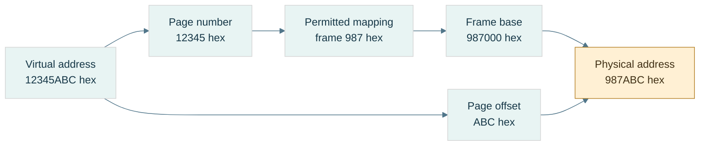

**Read the figure:** assume 4-KiB pages, a present mapping, and permitted access. Replace the page identity with its physical frame identity and retain the low 12 offset bits. The arithmetic is $\mathtt{0x987000}+\mathtt{0xABC}=\mathtt{0x987ABC}$. **Limit:** frame 987 is an example mapping, not a prediction about a real process. A TLB caches translations; the data cache holds contents. Neither this translation nor a mapped address establishes C++ object lifetime or valid typed access.

### A fault is a request for intervention, not necessarily a crash

A [[Page faults and demand paging|page fault]] means the current translation/protection state cannot complete the access normally and requires operating-system handling. **Demand paging** supplies backing when first needed. A valid first access may allocate a zero-filled page or load file-backed data, then retry the instruction. Some faults require no disk I/O.

[[Copy-on-write]] lets mappings initially share data; a write that needs a private copy can fault, allocate/copy a frame, update permissions/mapping, and retry. In contrast, an unmapped address or forbidden write may be rejected and reported as a program failure.

Trace the distinction:

```text
access virtual address
→ cached translation available? if not, resolve translation
→ mapping present and access permitted? complete access
→ otherwise invoke fault handling
→ legitimate demand/COW case? establish mapping and retry
→ invalid/prohibited access? report failure
```

This is a teaching model; exact ordering and mechanisms vary. The important separation is **TLB miss ≠ page fault ≠ disk read ≠ program crash**.

[[Memory-mapped files]] connect file-backed storage to a virtual mapping, often lazily. The mapping is not simply “the file in RAM,” and modifying mapped bytes is not automatically proof of crash-durable publication.

### Storage, lifetime, ownership, and placement are different axes

[[Storage duration and object lifetime|Storage duration]] describes how long storage is available. **Object lifetime** describes when a particular object exists in that storage. **Ownership** identifies who is responsible for releasing a resource. **Placement** is where an implementation puts it. They answer different questions.

| Example | Duration / owner | Typical placement, not a language guarantee | Failure to watch |
|---|---|---|---|
| Local scalar | automatic duration | stack slot or register; possibly optimized away | pointer used after lifetime ends |
| Local vector object | automatic object; owns dynamic buffer | small control object separate from allocated elements | reallocation invalidates views |
| Dynamic allocation | lasts until released by owner | allocator-managed region, often called heap | leak, double release, stale pointer |
| Namespace/static object | static duration | data/zero-fill regions when storage is emitted | initialization-order assumptions |
| Thread-local object | thread duration | implementation-managed thread-local storage | use after owning thread/lifetime ends |

A [[Call stack and stack frames|call stack]] conventionally manages nested calls in LIFO order: **last in, first out**. A **frame** holds return information, saved state, spill slots, and some locals. A **spill** is a value stored to memory when it cannot remain in a register. Downward stack growth is a convention, not a universal law. Returning a pointer to a local does not preserve the local's lifetime just because its old bytes remain.

[[Dynamic allocation and heap|An allocator]] divides larger memory regions into blocks for requests with variable lifetimes. **Metadata** is bookkeeping about those blocks. [[Allocator fragmentation|Internal fragmentation]] is unused capacity inside an allocated block: requesting 37 bytes in a 48-byte size class leaves 11 bytes of slack. **External fragmentation** is separated free space that cannot satisfy a particular contiguous request: two free 16-byte holes are not necessarily a usable 24-byte block. Total free bytes alone do not determine allocation success.

[[Static storage and initialization|Static data]] commonly separates initialized writable data from zero-fill regions such as BSS. **BSS** is a conventional zero-initialized-storage region name; the executable need not contain one literal zero byte for every byte that will be zero-filled. Static duration does not mean initialization has no runtime work.

[[Read-only data and code|Text]] conventionally names instruction storage; read-only regions often hold literals/constants. These region names and exact layouts are platform choices. `const` is a C++ access/type constraint, not a command to put every const local in read-only memory. Modifying a string literal is undefined behavior. **W^X**, writable-or-executable policy, restricts mappings that are simultaneously writable and executable; details vary by platform. [[ASLR]], address-space layout randomization, varies mapping locations, so a textbook memory diagram is not a fixed address map.

[[Ownership and non-owning views|A span]] is a non-owning view of elements; it neither copies the buffer nor extends its lifetime. If the owner dies or the vector reallocates, the view can dangle. **Dangling** means it refers to storage/object state no longer valid for that access.

Finally, [[Atomic publication and durability|atomic publication]] makes a replacement visible as one namespace operation under the relevant platform contract. **Durability** means the required data survives a crash under a defined persistence protocol. Correct byte encoding, atomic replacement, and durable storage are three separate checks.

### Memory laboratory and teaching checkpoint

Use the code companion to run three experiments: byte-order round trips including unaligned *byte-buffer offsets*; checked numeric alignment; and reported object offsets/sizes. Unaligned byte decoding is not permission to make misaligned typed accesses.

Then classify these failures before fixing them:

| Observation | First distinction to investigate |
|---|---|
| `0x12345678` comes back as `0x78563412` | byte-order contract |
| An array member becomes misaligned | record stride, padding, ABI |
| A first access faults but then succeeds | valid demand/COW handling |
| A span fails after vector growth | ownership and invalidation |
| A complete file disappears after a crash | persistence protocol, not just serialization |

For a teaching demonstration, draw byte addresses, record padding, and page translation separately before connecting them. Ask the learner to derive the 12-byte record, explain why the page offset stays `ABC`, and distinguish a TLB miss from a fault. Further proof and tested code remain in [[Continuous Notes/Computing Foundations - From Bits to C++ and Systems APIs#M003 - Byte order, layout, and translation|the derivation companion]] and [[Supplementary/Code Snippets#M003 - Explicit byte codecs and checked alignment|the code companion]].

## Bytes become a durable agreement

An object's native bytes belong to one program environment. A file must carry enough agreement for a reader on another day or machine. We separate copying a representation, specifying the external schema, validating a parser, detecting changed content, and interpreting a dump.

### Representation copying and numeric conversion answer different questions

A value is now chosen, but the file needs bits. [[Bit casting and representation|Bit casting]] copies a suitable object representation into another same-sized trivially copyable type; **numeric conversion** asks for a value in a new numeric domain.

On the checked binary32 host, converting `1.0f` numerically to uint32 gives 1. Copying its representation with `std::bit_cast<uint32_t>` gives `0x3F800000`. Neither operation changes the memory address order by itself. Encoding that integer word little-endian gives `00 00 80 3F`; big-endian gives `3F 80 00 00`.

The C++ constraints include matching size and trivially copyable source/destination, but padding, invalid target representations and uninitialized storage still require care. The [bit-cast draft section](https://eel.is/c++draft/bit.cast) is a current working draft; this lab uses a C++23 baseline and fully initialized scalar representations, not arbitrary-class reinterpretation.

Accessing a float through a uint32 pointer does not become valid because the pointer sizes match. Copy bytes using bit_cast or an appropriate memcpy into an existing suitable object; then apply the external byte-order codec. Neither grants arbitrary typed access to a byte buffer.

**Book bridge:** Game Engine Architecture, PDF pages 129–130 (printed 107–108), explains why members must be endian-converted field by field. It also shows older pointer/union-punning techniques. We retain the field-contract insight, not those techniques as a portable modern C++ implementation.

### A file is a promise to a reader you have not met yet

[[Binary format contracts|A binary format contract]] declares field widths/order, integer signed interpretation, byte order, float format, valid values, lengths, padding, versioning, and any integrity coverage. An **ABI** tells compiled components how native objects interact; an external schema is a different agreement. Saving a whole struct makes its layout/padding/platform assumptions part of the file unless you explicitly constrain and validate them.

**Magic** is a fixed identifying byte sequence, not a secret. **Version** selects a declared schema revision. They do not authenticate a sender, detect every payload change, or validate dimensions. A **payload** is the represented content after or within the container's metadata. A file's offsets are positions in that byte sequence, not automatically live pointers.

The NanoQuant source excerpt describes a regular tensor header with eight magic bytes, uint32 version, uint64 rows and uint64 columns: 28 bytes when written field by field. Its scalar helper writes native bytes, and its payload writes native floats. This is a source-reported portability risk, not a fresh audit of the repository. A clear field order can coexist with unspecified cross-endian behavior.

A portable teaching format can explicitly choose little-endian integers and IEEE binary32 words. It must additionally state whether it preserves all zero/NaN encodings or canonicalizes them. A checksum/hash over bytes sees different NaN payloads as different content; a numeric equality policy can see two zeros as equal. Decide the identity contract first.

For an INT4 container, the source reports 52 header bytes followed by binary32 scales and packed codes. Verify scale count against dimensions/group size, code count against shape, finite positive scales where required, and the final padding convention. A magic match is not permission to trust every following field.

### Validate lengths before performing the arithmetic they request

[[Checked binary parsing|Parsing]] is interpreting an encoded sequence under a schema. An untrusted file can contain dimensions chosen to make a size calculation wrap. “Check the final size” is too late if you computed the wrong wrapped size.

For uint64 factors $a,b$, validate $a=0$ or $b\le\mathrm{MAX}/a$ before multiplying. For a byte span of size $L$, check $o\le L$ and $n\le L-o$ before a read. For payload bytes $P$ after header $H$, first require $H\le L$, then compare $P$ with $L-H$. Check representability in size_t and a practical resource limit before allocating.

A declared maximum tensor size is a **resource limit**: a policy limiting memory/time even if the mathematical shape fits uint64. Reject zero dimensions if the format disallows them. Decide whether trailing bytes are an error, an extension, or another record; the teaching parser requires exact length.

A file mapping avoids a copying decode loop only when its representation, alignment, bounds, permissions and object-access/lifetime rules permit that use. Offset 28 being divisible by four addresses only one condition under a conventional page-aligned mapping and four-aligned float. It does not alone create a C++ float array, normalize endianness, validate its length, or extend the mapping's lifetime.

### Correct decoding is not proof that the bytes survived

[[Checksums CRCs and hashes|Integrity]] asks whether content matches a declared reference. An additive checksum $\sum_i b_i\bmod256$ cannot distinguish `01 02` from `02 01`; equal and opposite byte changes also cancel.

A **CRC**, cyclic redundancy check, treats a bit sequence as coefficients of a polynomial over **GF(2)**, the two-element field where addition/subtraction are XOR. Dividing a shifted message polynomial by a generator leaves a remainder. A specified CRC includes polynomial, initialization, bit reflection/order, final XOR, and covered byte range. “CRC32” alone is incomplete. Error-detection guarantees depend on those parameters and message length; it is not an adversarial authentication mechanism.

The lab implements CRC-32/ISO-HDLC: reflected polynomial `0xEDB88320`, initial all ones, final XOR all ones, reflected byte processing. The independent check string `123456789` must give `0xCBF43926`. [RFC 1952's CRC sample](https://www.rfc-editor.org/rfc/rfc1952#section-8) provides an independent algorithm reference for this reflected convention. This is an error-detection demonstration; no CRC field is retroactively claimed to exist in NanoQuant's source format.

A **hash** maps content to a fixed-size digest. Noncryptographic hashes prioritize fast useful fingerprints; a **cryptographic hash** has security goals such as making preimage/collision search impractical. A **preimage** is an input producing a specified digest. A **collision** is two different inputs with the same digest. A **threat model** declares which mistakes or adversary actions the system intends to resist.

[[Integrity and authenticity|Even a cryptographic digest is not authenticity]] by itself if an attacker can replace both file and digest. A trusted digest, a **MAC** (message authentication code under a secret key), or a **digital signature** verified under a trusted public key supplies an additional trust mechanism. SHA-256 is defined in [NIST's Secure Hash Standard](https://csrc.nist.gov/pubs/fips/180-4/upd1/final); this lab does not implement a cryptographic hash, MAC, or signature.

All finite digests have collisions for unrestricted input lengths: there are more possible messages than digest values. For an ideal $h$-bit hash, a *specific independent* accidental match has probability about $2^{-h}$; among many samples, birthday-style collision risk grows with the number of pairs. Those are models, not guarantees for arbitrary checksum algorithms.

Specify coverage: payload only, header plus payload, or canonical logical content. If dimensions are unprotected, a changed shape can reinterpret an unchanged payload. State how the digest field itself is excluded or zeroed for calculation. Integrity, schema validity, semantic correctness, authenticity, atomic publication and crash durability remain separate questions.

### Read a dump by reversing the contract

[[Memory dump interpretation|A hex dump]] displays byte offsets, hexadecimal octets, and optionally printable characters. It does not label a region as an object or prove that typed access would be legal. Establish a trusted schema hypothesis, validate it, then decode.

Our source-shaped demonstration chooses explicit little endian and a 2×3 binary32 payload $[1,-2,0.5,3.25,0,10]$:

| Offset | Bytes | Interpretation under this schema |
|---|---|---|
| 0000 | 4E 51 54 4E 53 52 30 31 | ASCII magic NQTNSR01 |
| 0008 | 01 00 00 00 | uint32 version 1 |
| 000C | 02 00 00 00 00 00 00 00 | uint64 rows 2 |
| 0014 | 03 00 00 00 00 00 00 00 | uint64 columns 3 |
| 001C | 00 00 80 3F | word 3F800000, value 1 |
| 0020 | 00 00 00 C0 | word C0000000, value −2 |
| 0024 | 00 00 00 3F | word 3F000000, value 0.5 |
| 0028 | 00 00 50 40 | word 40500000, value 3.25 |
| 002C | 00 00 00 00 | positive zero |
| 0030 | 00 00 20 41 | word 41200000, value 10 |

Header length is 28 (hex 1C), payload length $2(3)(4)=24$, and total length 52 (hex 34). ASCII, American Standard Code for Information Interchange, maps these selected byte values to characters; it is not a universal text decoder for every file.

Decode the first payload word: sign 0, exponent 127, fraction zero give $1\cdot2^0=1$. For `40500000`, exponent 128 gives scale two; fraction gives $1.101_2=1.625$, so value is 3.25. For `41200000`, exponent 130 and significand 1.25 give 10. All six payload values can be checked independently against the diagram.

The same `00 00 80 3F` bytes are unsigned octets [0,0,128,63], little-endian uint32 1065353216, or binary32 1. As two little-endian uint16 fields they give [0,16256]. None is “the meaning” without an interpretation contract.

Flip payload byte 80 to 00: binary32 1 becomes 0.5 while file length, version and magic stay plausible. Structural validation does not detect this numeric substitution. An independently stored CRC over the original bytes distinguishes this particular change, but matching CRC is not proof that every possible corruption or attack was excluded.
## The complete journey - Encode, compute, store, and investigate

Return to the lamp at the beginning. Its physical ranges became a logical bit; a group of bits acquired a schema. A count became an unsigned integer, a direction needed signed values, and fractions forced a choice between a fixed and stretching ruler. Arithmetic exposed finite range, rounding and sensitivity. Smaller codebooks traded recoverable detail for storage. Placement then added addresses, alignment, mappings and lifetime. Serialization made an external promise; integrity and debugging let us investigate whether that promise survived.

Take one weight −3.2 at scale one. Quantization chooses signed level −3, offset coding gives nibble 5, pairing with code 11 gives byte B5. A file must also preserve the scale, shape, packing order and count. The parser validates these, unpacks 5 and 11, subtracts eight, and reconstructs −3 and 3. Packing and parsing can be exact while the original −3.2 is not recovered. That loss happened upstream, by design.

For teaching, reconstruct one route completely before comparing it to another. Use the diagrams and hand traces here, the derivation companion for proofs, and the code companion for observable checks. The coverage ledger records where source material came from; it is not the order in which someone must teach.

### A laboratory that tests the contracts, not just matching functions

The cumulative program retains the earlier fields, ALU, byte-layout, floating representation and arithmetic experiments. Its new laboratory adds:

- Fixed conversion of 3.25 to raw 212992; feasible range/step choices; positive/negative ties; multiplication/division, zero-divisor and destination-overflow rejection.
- INT4 nibble pairs against independent expected bytes, odd counts and invalid codes; group reconstruction and outlier-induced zeros.
- UNORM/SNORM endpoints; binary16 decoding; BF16 midpoint conversion, zeros, infinities and canonical NaN handling.
- The complete 52-byte 2×3 image against a manually specified byte array, decode from an odd byte-buffer offset, and raw special-value word preservation.
- Wrong magic/version, truncated files, enormous wrapped-shape attempts, zero dimensions, resource-limit rejection and trailing bytes.
- CRC check string, additive-checksum collision, and the one-payload-bit example that structural checks miss.

Property-style checks supplement these examples: all 256 nibble pairs; every finite binary16 and BF16 word reconstructed/re-encoded under the lab's stated conventions; a seeded set of fixed products checked against an independent reference; and bit/byte corruption checks on the finite teaching image. Their finite scopes are explicit; they are not exhaustive validation of every C++ program, device, parser or cryptographic protocol.

### Diagnose the layer before changing the implementation

| Observation | First hypothesis to test |
|---|---|
| A count becomes negative when its high bit changes | signed versus unsigned interpretation |
| Fixed multiplication fails only at large operands | intermediate width before rescaling |
| Small weights vanish beside one outlier | calibration/codebook resolution, not packing |
| Byte 128 samples near 0.502 | expected UNORM8 reconstruction |
| A half-format value becomes infinity | range versus precision allocation |
| Repeated updates disagree | rounding tree, persistent narrowing, or mathematically history-dependent policy |
| A file swaps 12345678 into 78563412 | byte-order mismatch |
| A plausible same-size file contains a changed value | integrity coverage, not merely structural validation |
| A pointer reaches mapped memory but is invalid | object bounds, lifetime, alignment and permitted access |

A useful future experiment changes one representation policy while holding input/task constant: vary group size, record actual bytes including metadata, error metrics and a task result, then separately measure execution time under a declared machine/build. Those experiments are proposed, not performed in the teaching merge.

The next subject is C++'s object model: how declarations and definitions turn into a program, how names and objects acquire identity, and how lifetimes and value categories constrain use. The bytes learned here are necessary evidence, but they are not the whole language contract.


## Reading provenance and enrichment

The supplied M001–M006 texts define the accepted curriculum content. Explanatory bridges, original traces, and the prologue were added to make that content teachable. Sources below inform the explanation; they are not reproduced as textbook passages. All source-reported repository findings remain source-reported claims; independent wording checks, canonical-code tests and merge corrections are recorded in Sources and Code Anchors.

- **Integrated 180-chunk planning PDF**, page 15: M001–M006 cover Parts 1–100 with exact ranges retained in the coverage ledger. Pages 16–17 divide C++ Parts 101–300 into twelve chunks across two phases. The PDF is a planning reference, not an instruction source.
- **Game Engine Architecture**, iCloud `Game/Game Engine Architecture.pdf`, PDF pages 127–130 (printed 105–108), 136–138 (114–116), and 143–147 (121–125): byte order, memory regions, layout and alignment. Its older machine-specific examples are not universal rules; this volume states layout assumptions and separates language validity from hardware behavior.
- **Bjarne Stroustrup, A Tour of C++ (2014)**, iCloud `CPP/A Tour of C++ - Bjarne Stroustrup (Addison-Wesley, 2014)(193p).pdf`, PDF pages 16–22 (printed 5–11): types, arithmetic, narrowing, scope, pointers and references. Used for teaching structure, not as authority for every current C++23 detail.
- Local course notes **Part 1: CPU — From Electricity to Working CPU**, PDF pages 2–6, and **Part 7: Virtual Memory, Page Tables, TLBs, Page Faults**, pages 1–6, in iCloud `MATHCPUGPU`: secondary background for physical/logical state and translation. These are course notes, not claimed as independently verified textbook authority.
- History: [Computer History Museum's Buchholz entry](https://www.computerhistory.org/tdih/october/24/) and [IBM's System/360 history](https://www.ibm.com/history/system-360). The prologue gives a short contextual history, not an exhaustive claim about the first binary machine or first eight-bit design.
- C++ language checks: the linked draft sections in the story, plus [storage duration](https://eel.is/c++draft/basic.stc) and [endianness facilities](https://eel.is/c++draft/bit.endian). Platform layout values remain observations to measure, not draft guarantees.

Exact source records, code commands and verification limitations are maintained in [[Supplementary/Sources and Code Anchors]]. Existing longer traces remain reusable in [[Supplementary/Worked Traces]]; none is required to supply a missing foundational explanation in this volume.

- **Additional book enrichment:** Game Engine Architecture, PDF pages 121–122 (printed 99–100), and 129–130 (107–108), read during the narrative rewrite. The scaled-integer versus sign/magnitude distinction, field-by-field serialization insight, and outdated punning caveats are explained at their points of use. The page 122 figure/body discrepancy is not silently inherited.


> Volume 02 · accepted sources M007–M010, Parts 101–160 · 4 of 12 planned chunks (M007–M018, planned Parts 101–300). The revised M007 deepens existing coverage; it is not counted twice. This is a growing subject narrative, not a completed C++ course. Coverage beyond Part 160 remains pending.

## Prologue - Bytes need rules before they become a program

The previous volume taught us to encode, calculate, place and preserve information. Now ask why a buffer full of plausible bits can still be illegal to access in C++. Hardware can calculate an address; the language must establish what object exists there, which operation its type permits, and whether its lifetime is still active. A compiler optimizes against those rules, not against our hope that the bits look right.

C++ grew from C's low-level facilities while adding user-defined types and abstraction. It keeps separate compilation: a caller can know an interface without compiling every implementation into the same source file. That choice creates our first problem—how independently processed files agree about names and entities. Once they agree, a second problem begins—how the resulting process creates, uses and destroys objects. Layout is where those two stories finally meet the bytes again.

An **entity** is a language-level thing such as a type, function, object or template. An **object** has storage, type, lifetime and state; a function is an entity but not an object. A **variable** is introduced by a declaration of an object or reference; a reference is not itself an object. A **type** establishes a set of possible values and permitted operations. The **abstract machine** is the language's behavioral model; a real compiler may rearrange or remove physical storage when the required observable behavior is preserved.

This volume keeps independent examples inline. Short `cpp` fragments illustrate a local rule and may rely on the named surrounding declarations; they are not all independent programs to concatenate. Complete runnable examples are explicitly marked as laboratories. Project excerpts remain in the existing companion. We will revise and weave the whole twelve-source volume as the later material arrives; no numbered part is a teaching chapter.

## What we bring from the byte story

this opening chapter assumes M001, M003, and M005. That means I will assume you already understand bits/bytes and integer representations; addresses, alignment, padding, memory regions and virtual address spaces; and floating-point representation/error. The three prerequisite ideas you specifically need active in your head are:

| Dependency | What this opening chapter needs from it |
|---|---|
| M001 | A value ultimately has some machine representation in bits, but the **type** determines what those bits mean. |
| M003 | An address names a location in an address space; objects have alignment requirements; structures may contain padding. |
| M005 | `float`/`double` are machine representations with implementation/platform properties, not mathematical real numbers. |

Now we add the missing layer:

> **C++ is not a language where “variables are bytes in RAM.” C++ defines entities, objects, lifetimes, types, storage, identities and permitted operations. The compiler maps that abstract machine onto bytes and instructions.**

That distinction is the heart of Phase 2.

## The journey from text to a live object

Think of this opening chapter as this pipeline:

```text
SOURCE TEXT
    │
    ├── preprocessing / module dependency processing
    │
    ▼
C++ TRANSLATION UNIT / MODULE UNIT
    │
    ├── declarations establish names and types
    ├── lookup determines what names mean
    ├── definitions provide complete entities
    ├── ODR determines which definitions may coexist
    │
    ▼
COMPILER
    │
    ├── type checking
    ├── template instantiation
    ├── semantic analysis
    ├── optimization
    ├── code/data generation
    │
    ▼
OBJECT FILES
    │
    ├── machine code
    ├── symbols
    ├── relocation records
    ├── static data
    │
    ▼
LINKER
    │
    ├── resolves symbols
    ├── lays out executable sections
    ├── fixes references/relocations
    │
    ▼
EXECUTABLE / SHARED LIBRARY
    │
    ▼
RUNNING PROCESS
    │
    ├── storage becomes available
    ├── objects begin lifetime in that storage
    ├── names/references/pointers may designate objects
    ├── objects have identities and representations
    ├── class layouts determine member locations
    │
    ▼
OBJECT LIFETIME ENDS
    │
    └── storage may disappear OR may remain/reuse
```

The critical distinctions we will maintain throughout the chunk are:

| Concept | Question it answers |
|---|---|
| **Scope** | Where can this *name* be found? |
| **Name lookup** | Given this spelling here, which declaration does it refer to? |
| **Linkage** | Can declarations in different places denote the same entity? |
| **Storage duration** | For how long does the storage exist? |
| **Object lifetime** | During what interval does a typed object actually exist in that storage? |
| **Identity** | Which particular object is this? |
| **Address** | Where is it currently located? |
| **Value** | What state does it currently contain? |
| **Layout** | Where do its members/bytes occur relative to one another? |
| **Module visibility/reachability** | Which declarations can an importer see/use? |

These are **not synonyms**. Most difficult C++ bugs happen because two of them are mentally collapsed into one.

## Giving a program a buildable shape

### Figure CPP-01 - Two build lanes meet at the linker

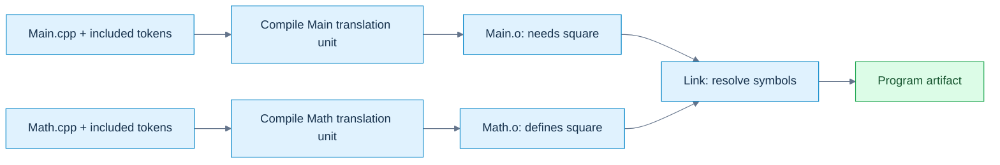

**Read the picture:** the caller compiles against a declaration; the linker connects its unresolved call to the separately supplied definition. A missing declaration/type normally fails during translation; a missing required definition commonly fails at linking. **Limit:** this depicts the traditional example below, not a mandatory compiler implementation. Modules additionally need interface dependency ordering; a successful link does not prove ODR or runtime correctness. [[Visual Recall/02 - C++ - Objects, Ownership and Lifetime - Visual Recall#Four figure briefs|Recall this figure]].

The classic separate-compilation model lets clients compile against an interface while implementations are compiled separately. That sentence sounds elementary. The implications are not.

### The traditional translation model

Suppose you have:

```cpp
// Math.hpp
#pragma once

float square(float x);
```

```cpp
// Math.cpp
#include "Math.hpp"

float square(float x)
{
    return x * x;
}
```

```cpp
// Main.cpp
#include "Math.hpp"
#include <iostream>

int main()
{
    std::cout << square(3.0f) << '\n';
}
```

A simplified build is:

```text
Math.cpp
   │ preprocess
   ▼
Math translation unit
   │ compile
   ▼
Math.o
                         ┐
                         │
Main.cpp                 │
   │ preprocess          │
   ▼                     │
Main translation unit    ├── linker ──> executable
   │ compile             │
   ▼                     │
Main.o                   ┘
```

The classic separate-compilation model lets clients compile against an interface while implementations are compiled separately. Conceptually, commands might look like:

```bash
clang++ -std=c++23 -c Math.cpp -o Math.o
clang++ -std=c++23 -c Main.cpp -o Main.o
clang++ Main.o Math.o -o app
```

The first two commands **compile** independently. The third **links**. That distinction explains two major categories of errors.

### Compile-time error

```cpp
int main()
{
    UnknownType x;
}
```

The compiler cannot establish the semantics of the [[Translation units and linking|translation unit]].

### Link-time error

```cpp
int f(int);   // declaration

int main()
{
    return f(10);
}
```

This can compile perfectly. The compiler knows:

```text
f:
    accepts int
    returns int
```

It can generate a call instruction containing a symbol reference. But if nobody defines `f`, the linker eventually sees:

```text
Main.o needs symbol f(int)
No object/library provides symbol f(int)
```

and reports something like:

```text
undefined reference to f(int)
```

or Apple's equivalent:

```text
Undefined symbols for architecture arm64
```

That is why “my code compiled” and “my program built” are not identical statements.

### What preprocessing actually is

In traditional source code:

```cpp
#include "Math.hpp"
#define COUNT 16
#if DEBUG_MODE
...
#endif
```

these are processed before normal C++ semantic analysis. The [[Preprocessing and macro boundaries|preprocessor]] largely manipulates **tokens**, not C++ types. If you write:

```cpp
#define SQUARE(x) x * x
```

then:

```cpp
SQUARE(a + b)
```

may become:

```cpp
a + b * a + b
```

not:

```cpp
(a + b) * (a + b)
```

The preprocessor does not think:

> “I am invoking a mathematical function.”

It performs token replacement. Even the safer macro:

```cpp
#define SQUARE(x) ((x) * (x))
```

still has:

```cpp
int i = 3;
int result = SQUARE(++i);
```

which expands conceptually into:

```cpp
((++i) * (++i))
```

and now you have duplicated evaluation and undefined behavior here: the two increments are unsequenced relative to each other. Modern C++ tries to move as much work as possible out of the preprocessor and into typed language mechanisms:

```cpp
constexpr int square(int x)
{
    return x * x;
}
```

That gives type checking, scope, debugger visibility, normal evaluation rules, and compiler diagnostics.

### What `#include` really means

A traditional include is approximately textual inclusion.

```cpp
#include "Vector.hpp"
```

does not mean:

> “Dynamically connect to an independently existing Vector interface.”

Conceptually it means:

```text
Take tokens from Vector.hpp
insert them here
continue preprocessing
```

If twenty `.cpp` files include a 20,000-line template header, the frontend may process much of that interface twenty times. This is one major reason C++ build systems became expensive. Header guards:

```cpp
#ifndef VECTOR_HPP
#define VECTOR_HPP

// declarations

#endif
```

or:

```cpp
#pragma once
```

prevent repeated inclusion **within a translation unit**. They do **not** solve program-wide ODR mistakes. That distinction becomes important in the connected explanation.

### What compilation produces

An object file usually contains much more than raw instructions:

```text
.text        machine instructions
.rodata      constants/read-only data
.data        initialized writable static data
.bss         zero-initialized static data, conceptually
symbols      names known to the linker
relocations  places the linker must repair
debug info   when requested
unwind info
metadata
```

Exact sections depend on the object format:

```text
ELF      Linux and many Unix-like systems
Mach-O   macOS/iOS
COFF/PE  Windows
```

The C++ standard does not prescribe those formats. They are platform/toolchain concerns.

### What the linker actually does

Suppose `Main.o` contains a call to `square(float)`. The compiler does not necessarily know the final numerical address of `square`. It can emit something conceptually like:

```text
CALL <square symbol>
```

with a relocation record saying:

```text
When the final binary is laid out,
replace this placeholder with whatever address/offset
square ends up at.
```

The linker builds the final symbol graph:

```text
Main.o:
    requires square(float)

Math.o:
    defines square(float)

resolve
    ↓

Main call → Math definition
```

It also discovers impossible programs:

```text
Main.o needs f()
No definition
```

or:

```text
A.o defines x
B.o defines x
Both claim the same externally-linked entity
```

That second case takes us directly into the ODR.

### Name mangling

C++ supports:

```cpp
void process(int);
void process(float);
void process(const char*);
```

The machine linker does not understand C++ overload resolution. Therefore the compiler commonly encodes type information into symbol names. Conceptually:

```text
process(int)          → some mangled symbol A
process(float)        → some mangled symbol B
process(char const*)  → some mangled symbol C
```

The exact scheme is ABI-specific. This is why two compilers—or two versions configured with incompatible ABIs—can sometimes fail to link even when the C++ source-level declaration “looks identical.” It also explains why `extern "C"` exists:

```cpp
extern "C" void vulkan_callback(...);
```

It selects C language [[Linkage and entity ownership|linkage]], typically suppressing normal C++ name mangling for interoperability. Full C/C++ ABI interoperation comes later, but the root begins here.

## A compiled interface rather than repeated text

A named [[C++ modules and reachability|module]] communicates declarations through a compiler-produced interface. A **module unit** is a translation unit belonging to a module; an **interface unit** supplies its public interface. A **BMI** is a binary module interface: compiler-specific semantic information, not a portable object-file format. It helps the importer compile; an object file supplies code/data for linking. Supplying one does not substitute for the other.

`module;` starts a **global module fragment**, where traditional includes can appear before `export module Math;`. An export declaration exposes declarations to importers. Some implementation details must be reachable for interpreting an exported type or template without becoming freely findable by ordinary [[Scopes and name lookup|name lookup]]. Visibility (finding a declaration) and reachability (using its semantic information) are related, not identical.

A named-module import does not textually paste a header and generally does not import its macros. Header units are different: they can make macros available. Build order must make a suitable compiled interface available before compiling importers. Compiler options and versions must match the toolchain's compatibility requirements. The exact BMI construction and naming are build-system matters; never teach a PCM as a cross-compiler interchange format. The complete standalone Math example appears under **Following one call through the build** below. Project-specific Kairo fragments belong in [[Supplementary/Code Snippets#Source-reported C++ project excerpts|the project excerpt companion]], not in this independent example.

### Modules versus `#include`

This distinction matters enormously:

```cpp
#include "foo.hpp"
```

is essentially preprocessing/textual inclusion.

```cpp
import foo;
```

means the compiler imports a module interface. The importer generally does not receive arbitrary macros from the imported module. That is deliberate. Macros are preprocessing state. Modules try to give you a language-level dependency boundary. This helps with:

```text
build scalability
macro isolation
interface ownership
dependency correctness
ODR hygiene
```

You will study modules much more deeply in the later generic-programming chapters, but this opening chapter gives you the underlying translation reason they exist.

## Promises become definitions

This distinction must become instinctive. Consider:

```cpp
int f(int);
```

This tells the compiler:

```text
There exists an entity named f.
It is a function.
Parameter: int.
Result: int.
```

It does not say how `f` works. That is a **declaration**. Now:

```cpp
int f(int x)
{
    return x * 2;
}
```

This provides the function body. That is a **definition**. And because it also introduces/describes the function, every definition is also a declaration.

### Objects

```cpp
extern int frameCount;
```

declaration only. Somewhere:

```cpp
int frameCount = 0;
```

definition. The definition causes the program to have an object named `frameCount`. An interesting special case:

```cpp
extern int frameCount = 0;
```

Despite `extern`, the initializer makes this a **definition**. Do not memorize `extern = declaration`. Understand the rule.

### Classes

```cpp
struct Renderer;
```

declares an incomplete class type. The compiler knows:

```text
Renderer is a type.
```

It does not yet know:

```text
sizeof(Renderer)
members
alignment
complete layout
```

So this works:

```cpp
Renderer* renderer;
Renderer& getRenderer();
```

because these declarations do not require a complete Renderer. A reference need not be implemented as a separate pointer-sized object. This does not:

```cpp
Renderer renderer;
```

because the compiler must know how much storage the object requires. Later:

```cpp
struct Renderer
{
    int width;
    int height;
};
```

defines it. This is why forward declarations reduce compile dependencies.

### Enumerations

This is legal:

```cpp
enum class TextureState : std::uint8_t;
```

This opaque enum declaration fixes the underlying type and makes the enum a complete type, despite not yet listing its enumerators. Unlike a forward-declared class, its size is already known. Later:

```cpp
enum class TextureState : std::uint8_t
{
    Unloaded,
    Loading,
    Ready,
    Failed
};
```

defines it.

### Templates complicate the old declaration/implementation split

You may think:

```cpp
// Header
template<class T>
T add(T, T);

// cpp
template<class T>
T add(T a, T b)
{
    return a + b;
}
```

works like a normal function. Usually it does not for arbitrary `T`. When another translation unit instantiates:

```cpp
add<float>(1.f, 2.f)
```

the compiler typically needs the template definition available. That is one reason templates traditionally live in headers. Modules give us a better distribution mechanism, but template instantiation semantics still exist. We will go fully into this during the later generic-programming chapters.

## Many files must describe one coherent program

The **[[One Definition Rule|One Definition Rule]]**, ODR, is where declarations, translation units and linking meet. Suppose we allowed:

```cpp
// A.cpp
int gravityScale()
{
    return 2;
}
```

and:

```cpp
// B.cpp
int gravityScale()
{
    return 17;
}
```

and both are meant to be the same externally linked function. Now:

```cpp
gravityScale()
```

has no coherent program meaning. Which definition is *the function*? The ODR prevents this semantic fracture.

### The common program-wide rule

For ordinary non-`inline`, non-template externally linked functions/objects, you want a single program definition. For example:

```cpp
// Renderer.hpp

extern int gFrameIndex;
```

```cpp
// Renderer.cpp

int gFrameIndex = 0;
```

Every user may see the declaration. Exactly one implementation file owns the definition.

### The classic header mistake

Bad:

```cpp
// Config.hpp

int gDebugMode = 1;
```

Then:

```cpp
// Renderer.cpp
#include "Config.hpp"
```

and:

```cpp
// Physics.cpp
#include "Config.hpp"
```

Textual inclusion creates conceptually:

```text
Renderer translation unit:
    int gDebugMode = 1;

Physics translation unit:
    int gDebugMode = 1;
```

Now there are two definitions. Header guards do not save you. They prevent:

```text
Config.hpp
Config.hpp
Config.hpp
```

from being processed repeatedly **inside the same translation unit**. They do not stop a different translation unit from independently receiving the definition.

### Two modern solutions

One traditional solution is:

```cpp
// Config.hpp
extern int gDebugMode;

// Config.cpp
int gDebugMode = 1;
```

A C++17+ solution, when a genuine globally accessible variable is appropriate:

```cpp
inline int gDebugMode = 1;
```

An inline variable may have equivalent definitions in multiple translation units under the ODR rules. Important:

> `inline` in C++ does not fundamentally mean “the CPU call will be replaced by the body.”

That meaning is historical. The optimizer may inline a function without the `inline` keyword and decline to inline one with it. At the language level, `inline` is substantially about **multiple definition semantics and entity identity**.

### Why class definitions may live in headers

The multi-translation-unit exceptions have conditions, not only matching-looking syntax: matching tokens and relevant name lookup must agree, with specified exceptions. Definitions attached to named modules do not simply inherit the traditional header permission. Some ODR violations require no diagnostic; a successful link is not proof of validity.

You have seen:

```cpp
struct Vec3
{
    float x;
    float y;
    float z;

    float lengthSquared() const
    {
        return x*x + y*y + z*z;
    }
};
```

included by many source files. Why does this not immediately violate the ODR? Because the language specifically permits certain entities—such as class definitions, templates, and inline entities—to have matching definitions in multiple translation units under strict conditions. It is not:

> “ODR means literally every C++ definition can occur once in all source text.”

That would make headers impossible. The deep form is closer to:

> The program must maintain **one coherent definition of an entity**, while the language permits certain equivalent definitions to occur in multiple translation units.

### The evil ODR bug: definitions that look like the same header but aren't

Consider:

```cpp
// Behavior.hpp

inline int behavior()
{
#ifdef FAST_MODE
    return 1;
#else
    return 2;
#endif
}
```

Compile:

```text
A.cpp with FAST_MODE
B.cpp without FAST_MODE
```

After preprocessing:

```cpp
// A translation unit
inline int behavior()
{
    return 1;
}
```

versus:

```cpp
// B translation unit
inline int behavior()
{
    return 2;
}
```

The source filename is the same. The effective definitions are not. You have fractured the ODR. Some ODR violations require no diagnostic. That means:

```text
compiler: okay
linker: maybe okay
program: semantically invalid
```

This is one of C++'s nastier classes of bugs.

### Why modules help

A named module interface is compiled as a module interface rather than textually reconstructed independently in every importer. That removes many opportunities for:

```text
same header + different macro environment = different declaration
```

It does not abolish the ODR, but it gives the compiler a stronger semantic module boundary. This is one reason your move toward `.cppm` in Kairo is technically meaningful rather than merely stylistic.

### Linkage is related to ODR, but is not ODR

Traditional example:

```cpp
namespace
{
    int helper()
    {
        return 42;
    }
}
```

`helper` is translation-unit-private. Another old form is:

```cpp
static int helper()
{
    return 42;
}
```

for a namespace-scope function. Modern C++ usually favors unnamed namespaces for TU-private namespace entities. C++20 modules add an additional idea, **module linkage**, for certain names attached to named modules. So do not reduce linkage to:

```text
internal vs external forever
```

because an illustrative codebase is C++23 and module-based.

## A spelling needs a place and a meaning

Lookup comes before overload resolution: first determine which declarations a spelling finds, then choose among viable candidates. A derived `draw(float)` can hide all base overloads named `draw`, including `draw(int)`; `using Base::draw;` restores those base declarations to the derived overload set. A **candidate** is a function considered for the call; a **viable** candidate satisfies the call's argument constraints. Hiding is not the same as overriding.

The name's point of declaration also matters. In a local `int x=x;`, the right-hand name finds the newly declared local, not a hidden outer `x`. In C++23, reading that local's uninitialized integer value is undefined behavior. This is a bad example to diagnose, not execute; different C++26 uninitialized-value wording must not be silently retrofitted into the C++23 lab.

The classic separate-compilation model lets clients compile against an interface while implementations are compiled separately. The easiest mistake here is believing:

> “scope = lifetime.”

No. Consider:

```cpp
int* p = nullptr;

void f()
{
    static int x = 10;
    p = &x;
}
```

`x` has **block scope**. Its name `x` is inaccessible outside the block. But it has **static [[Storage duration and object lifetime|storage duration]]**, so the object persists until program termination. Scope concerns the **name**. [[Object construction and storage reuse]] explains how lifetime differs from backing storage.

### Block scope

```cpp
void render()
{
    int frame = 10;

    {
        int sample = 4;
    }

    // sample unavailable here
}
```

`sample`'s name belongs to the inner block.

### Name hiding

```cpp
int x = 1;

void f()
{
    int x = 2;

    std::cout << x;    // local x = 2
    std::cout << ::x;  // global x = 1
}
```

The local declaration **hides** the outer declaration. It did not delete the global object. It changed what unqualified lookup finds. This distinction is extremely useful when debugging large engine systems.

### Class scope

```cpp
struct Camera
{
    float nearPlane;
    float farPlane;

    float depthRange() const
    {
        return farPlane - nearPlane;
    }
};
```

Unqualified lookup for:

```cpp
nearPlane
```

inside `depthRange()` finds the class member. The compiler effectively understands it relative to the current object, roughly:

```cpp
this->nearPlane
```

although the language semantics are richer than textual rewriting.

### Namespace scope

```cpp
namespace kairo::render
{
    struct Camera {};
}
```

Outside:

```cpp
kairo::render::Camera c;
```

That is **qualified lookup**. Inside a suitable context:

```cpp
using kairo::render::Camera;

Camera c;
```

you've introduced a declaration into consideration for unqualified usage.

### `using namespace` versus using declaration

This:

```cpp
using namespace kairo::render;
```

makes many names candidates during lookup. This:

```cpp
using kairo::render::Camera;
```

specifically introduces `Camera`. The second is usually less polluting. Putting a broad using-directive in a public textual header alters consumer lookup. Module exports and reachability are not textual inclusion: do not claim every directive in a module automatically leaks into every importer. Prefer narrow declarations and explicit qualification at public boundaries.

### Argument-dependent lookup — ADL

Suppose:

```cpp
namespace math
{
    struct Vec3 {};

    float Dot(Vec3, Vec3);
}
```

Then:

```cpp
math::Vec3 a;
math::Vec3 b;

float d = Dot(a, b);
```

may find `math::Dot` even though you did not write:

```cpp
math::Dot
```

Why? Because arguments belong to namespace `math`, and **argument-dependent lookup** considers associated namespaces/classes. This is central to idiomatic generic C++. For example, this pattern:

```cpp
using std::swap;
swap(a, b);
```

allows normal lookup to see `std::swap` while [[Argument-dependent lookup|ADL]] can discover a type-specific `swap` in the type's own namespace. We will revisit this deeply during templates because template name lookup creates another dimension: some names are looked up when the template is defined, while dependent names may participate in lookup at instantiation.

### Modules add visibility/reachability, not a replacement for scopes

Your module contains:

```cpp
export module Kairo.ECS.Entity;

export namespace kairo::ecs
{
    struct Entity { ... };
}
```

Then a consumer can:

```cpp
import Kairo.ECS.Entity;

kairo::ecs::Entity e;
```

There are two separate questions:

```text
Is Entity exported/reachable from this module?
```

and:

```text
Given "kairo::ecs::Entity", which declaration does lookup find?
```

Modules affect availability. Scopes and lookup still determine meaning.

## A name does not decide how long storage lasts

Now we enter the part of C++ that unlocks pointers, RAII and ownership. **Storage duration is about storage.** It answers:

> How long is the region capable of containing this object retained?

The four major categories are:

| Storage duration | Typical source | Lifetime of storage |
|---|---|---|
| automatic | ordinary block local / parameters | associated block/call execution |
| static | namespace objects, local `static`, static data members | entire program |
| thread | `thread_local` — [[Thread-local storage]] | duration of the corresponding thread |
| dynamic | allocation functions / `new` | until explicitly released |

Do not automatically translate those into:

```text
automatic = stack
dynamic = heap
```

Those are common implementation strategies. The language specifies **semantics**, not a mandatory physical memory architecture.

### Automatic storage duration

```cpp
void update()
{
    Entity e;
}
```

`e` normally has automatic storage duration. A typical implementation reserves its storage in the function's stack frame. Conceptually:

```text
enter update
    reserve/identify storage for e
    construct e
    use e
    destroy e
    storage ceases to be reserved for e
leave update
```

The optimizer can eliminate the physical stack slot altogether if observable program behavior remains equivalent. So saying:

> “A local variable is on the stack”

is often practically useful, but **not the C++ semantic definition**.

### Static storage duration

Namespace object:

```cpp
int frameCount = 0;
```

has static storage duration. So does:

```cpp
void f()
{
    static int calls = 0;
    ++calls;
}
```

The *name* `calls` has block scope. The *storage* persists for the whole program. The local static is initialized the first time execution reaches its declaration, unless it can undergo earlier initialization under language rules. Since C++11, initialization of a function-local static is synchronized: concurrent first calls do not independently construct multiple copies. That makes patterns like:

```cpp
Renderer& renderer()
{
    static Renderer instance;
    return instance;
}
```

much safer than they were historically. But it does not solve every architectural problem with global state.

### The static initialization order problem

Suppose:

```cpp
// A.cpp
Renderer renderer{device};
```

and:

```cpp
// B.cpp
Device device;
```

If `renderer` needs `device` during dynamic initialization, their initialization order across translation units can be problematic. This is the classic **static initialization order fiasco**. A function-local static can defer construction until actual use:

```cpp
Device& device()
{
    static Device d;
    return d;
}
```

But in engines, an even cleaner design is often explicit ownership:

```text
Engine
 ├── Device
 ├── Renderer
 ├── AssetSystem
 └── PhysicsWorld
```

with deterministic initialization and shutdown order. This will come back hard during RAII and engine architecture.

### `constinit`

C++20 provides:

```cpp
constinit int value = 42;
```

`constinit` requires static initialization. It is useful when you care about avoiding dynamic initialization ordering. Do not confuse it with `const`. This is valid conceptually:

```cpp
constinit int counter = 0;

void increment()
{
    ++counter;
}
```

`counter` can still be mutable. `constinit` concerns initialization timing.

### Thread storage duration

```cpp
thread_local int commandBufferIndex = 0;
```

Each thread gets its own instance. Conceptually:

```text
Thread A:
    commandBufferIndex_A

Thread B:
    commandBufferIndex_B

Thread C:
    commandBufferIndex_C
```

This can be useful for:

```text
per-thread allocators
scratch arenas
profiling state
temporary command-building state
thread-specific random engines
```

But it is not automatically free. TLS access has ABI/runtime costs, and thread-local destructors/initialization can complicate shutdown.

### Dynamic storage duration

```cpp
Entity* p = new Entity{};
```

There are **two objects to reason about**:

```text
p
└── pointer object
    automatic storage duration

*p
└── Entity object
    dynamic storage duration
```

This is one of the first mental separations I want permanently burned in:

```text
pointer lifetime != pointed object's lifetime
pointer storage != pointee storage
```

Then:

```cpp
delete p;
```

ends the `Entity` lifetime and releases its dynamically allocated storage. But:

```cpp
p
```

may still physically contain the old address. The pointer object itself remains alive until its scope ends. Its **value is now dangling**. This is the bridge into the borrowing and invalidation story below.

## Storage is a place; an object is its occupant

This is one of the deepest ideas in C++. Consider a parking space.

```text
storage = the parking space
object  = the particular car currently occupying it
```

You can have:

```text
parking space exists
no car exists
```

or:

```text
parking space exists
Car A lives there
Car A leaves
same parking space remains
Car B arrives
```

The location did not change. The object identity did. That is almost exactly what low-level C++ storage reuse does.

### Raw storage is not automatically a live object of arbitrary type

Consider:

```cpp
#include <cstddef>

alignas(64) std::byte storage[64];
```

You have storage. You do **not** automatically have:

```cpp
Renderer
Texture
Matrix
Entity
```

living in it. Storage has:

```text
address
size
alignment
```

An object adds:

```text
type
lifetime
identity
value/state
language-permitted operations
```

### Construction starts a lifetime

A canonical advanced example:

```cpp
#include <cstddef>
#include <memory>

struct Particle
{
    float x;
    float y;
};

alignas(Particle) std::byte storage[sizeof(Particle)];

Particle* p =
    std::construct_at(
        reinterpret_cast<Particle*>(storage),
        Particle{1.0f, 2.0f}
    );
```

Conceptually:

```text
before construct_at:

storage:
+-----------------------+
| raw bytes             |
+-----------------------+
^
suitably aligned address

no Particle lifetime


after construct_at:

storage:
+-----------------------+
| Particle{x=1, y=2}    |
+-----------------------+
^
Particle object lifetime active
```

Then:

```cpp
std::destroy_at(p);
```

ends the `Particle` lifetime. The byte array's storage itself remains. This exact separation powers:

```text
object pools
arena allocators
std::vector internals
std::optional
std::variant
ECS component storage
small-buffer optimization
allocator implementations
lock-free structures
```

So object lifetime is not academic lawyering. It is an engine programming primitive.

### `new` actually combines operations

When you write:

```cpp
auto* p = new Particle{1, 2};
```

conceptually you get:

```text
1. obtain suitably sized/aligned storage
2. construct Particle in that storage
3. return pointer to the object
```

Similarly:

```cpp
delete p;
```

conceptually performs:

```text
1. destroy object
2. release storage
```

Custom allocators split those steps apart intentionally.

### A dangerous misconception

After:

```cpp
std::destroy_at(p);
```

the bytes may still look exactly like:

```text
00 00 80 3F 00 00 00 40
```

which could encode 1.0f and 2.0f on a little-endian IEEE binary32 target (not a universal byte representation). But the old `Particle` object is dead. The persistence of bytes does not imply persistence of object lifetime. This is why:

> **Memory containing plausible bits does not prove that a live C++ object exists there.**

That principle will explain many undefined behaviors later.

### Lifetime beginning and ending more precisely

For an ordinary class object, lifetime generally begins after appropriately aligned storage exists and its initialization completes. For class objects, lifetime ends when destruction begins or when its storage is released/reused according to the language rules. C++ has advanced exceptions involving:

```text
unions
implicit-lifetime types
allocators
storage reuse
subobjects
placement construction
```

so “constructor begins lifetime, destructor ends lifetime” is a good first model but not the entire standard. In a later lifetime chapter, when we cover placement construction and lifetime restart, we will explore the hard rules such as transparent replacement and the rare situations where `std::launder` enters the picture.

### Modern implicit-lifetime objects

Modern C++ deliberately permits some low-level operations to implicitly begin lifetime for **implicit-lifetime types**, because otherwise routines using allocation/memory blocks would be unnecessarily impossible to express. That does **not** mean:

```text
bytes always automatically become whatever type you cast them to
```

This remains wrong thinking:

```cpp
SomeHugeComplexType* p =
    reinterpret_cast<SomeHugeComplexType*>(randomBytes);
```

A cast changes how an expression is interpreted. It does not magically satisfy every object-lifetime precondition.

## Values, occupants and addresses tell different stories

Two copies of an entity handle are different C++ handle objects, even when their index/generation values identify the same application entity. The handle's own address is not the entity's identity. Conversely, a stable entity identity does not guarantee a stable address for its current component storage. Keep C++ object identity, application identity, and storage location on separate lines of the diagram.

Now distinguish:

```text
value
identity
address
```

Suppose:

```cpp
struct Particle
{
    int health;
};

Particle a{100};
Particle b{100};
```

Their values are equal. Their identities are not.

```text
a:
value = {100}
identity = object A
address = perhaps 0x1000

b:
value = {100}
identity = object B
address = perhaps 0x2000
```

Changing:

```cpp
a.health = 50;
```

changes `a`'s value. It does not turn `a` into a different object. Identity survives ordinary mutation.

### Address is often useful as identity, but is not identity itself

During a normal object's lifetime, its address is often a useful way of designating it. But the general equation:

```text
identity == numerical address
```

is false. Why? Because storage can be reused.

```text
Time t0:
address 0x1000 → Enemy A

destroy A

Time t1:
address 0x1000 → Enemy B
```

Same numerical address. Different lifetime. Different object identity. This is the exact conceptual reason stale pointers are dangerous.

## A handle remembers which occupant was intended

An [[Object identity and generation handles|index-and-generation handle]] stores a slot number and a reuse counter, rather than relying on an address. Slot 42 at generation 7 is not slot 42 at generation 8. An ECS (entity-component system) is a design where entities identify collections of components; the handle identifies a logical entity while component objects may move.

A valid-looking index is not a live entity check. Resolving a handle must check bounds, occupancy and generation against an owning registry. A generation counter eventually wraps; choose a width/reuse policy and document the collision horizon. Handles also need registry ownership: slot 42 in two worlds does not mean the same entity. These are system-identity constraints, not automatic properties of a C++ struct. The source-reported Kairo record is retained separately; the self-contained laboratory below verifies a small illustrative handle.

### Multiple things can even share an address

Several C++ mechanisms weaken “different thing = different numerical address.” A union stores different members over overlapping storage:

```cpp
union U
{
    int i;
    float f;
};
```

Both members begin at the union's address. Only the appropriate active-member/lifetime rules make accesses valid. Empty base optimization can place an empty base subobject at an address shared with other structural parts of a complete object under ABI rules. C++20 also has:

```cpp
[[no_unique_address]]
```

which permits certain empty member subobjects to overlap storage. So a raw address is better thought of as:

> a coordinate in storage, not a complete description of object identity.

### `std::addressof`

C++ permits overloading `operator&`. Therefore:

```cpp
&object
```

can theoretically invoke user-defined behavior. When generic low-level code truly wants the actual object address, use:

```cpp
std::addressof(object)
```

This bypasses overloaded `operator&`. That is a niche tool, but it reveals an important C++ theme:

> Surface syntax and object-model meaning are not always identical.

## Choose a type for its promise, not its familiar size

Native `bool` is a language value type, not a portable one-byte GPU/file field. Use an explicitly defined wire integer encoding, such as zero/one, validate received codes, and convert to bool by a value operation. Do not deserialize arbitrary bytes directly into a bool and assume every representation valid. Similarly, Unicode character types express code-unit intent, not automatic decoding into characters.

`float`, `double` and `long double` do not portably mean binary32, binary64 and binary128. If a protocol needs binary32, check its stated assumptions: size in bytes, CHAR_BIT, numeric_limits precision/exponent properties and representation requirements. `is_iec559` alone does not specify one exact IEEE format. A wire decoder must still establish byte order and valid field interpretation.

Your first machine-level assumption must be destroyed:

> `int` does **not** mean “32-bit integer” in the C++ language.

The major fundamental categories include:

| Category | Examples |
|---|---|
| void | `void` |
| null pointer type | `std::nullptr_t` |
| Boolean | `bool` |
| ordinary character/integer | `char`, `signed char`, `unsigned char`, `short`, `int`, `long`, `long long`, unsigned forms |
| Unicode character | `char8_t`, `char16_t`, `char32_t` |
| wide character | `wchar_t` |
| floating | `float`, `double`, `long double` |
| implementation-defined extended types | implementation/compiler dependent |

### What the standard does guarantee

This is always true:

```cpp
sizeof(char) == 1
```

But the unit of `sizeof` is a **C++ byte**, and a byte is at least 8 bits. Check:

```cpp
#include <climits>

std::cout << CHAR_BIT;
```

Most systems you will use report:

```text
8
```

But:

```text
C++ byte == exactly 8 bits
```

is not a universal language guarantee.

### Integer relative sizes

The language guarantees a nondecreasing capacity relationship roughly:

```text
signed char
   ≤ short
   ≤ int
   ≤ long
   ≤ long long
```

with minimum widths traditionally corresponding to at least:

```text
signed char : 8 bits
short       : 16
int         : 16
long        : 32
long long   : 64
```

Common modern platforms choose more. For example, typical 64-bit ABIs differ:

```text
LP64
    int       32
    long      64
    pointer   64

LLP64
    int       32
    long      32
    long long 64
    pointer   64
```

macOS/Linux commonly use LP64. 64-bit Windows uses LLP64. Therefore this code is broken as a portability assumption:

```cpp
static_assert(sizeof(long) == sizeof(void*));
```

even though it works on one family of systems.

### Exact-width integer types

For binary formats, handles, GPU structs, hashes and network protocols, you commonly want:

```cpp
#include <cstdint>

std::uint8_t
std::uint16_t
std::uint32_t
std::uint64_t
```

A handle can express its fields using these types:

```cpp
std::uint32_t index;
std::uint32_t generation;
```

That gives a clear representation contract:

```text
index      = 32-bit unsigned if uint32_t exists
generation = 32-bit unsigned if uint32_t exists
```

Important subtlety: The exact-width aliases such as `std::uint32_t` are **optional** in the standard. An implementation provides them only if it has a corresponding integer type with exactly that width and required representation constraints. On all mainstream systems relevant to your work, they exist.

### `least` and `fast`

C++ also provides:

```cpp
std::uint_least32_t
std::uint_fast32_t
```

`least` means:

> smallest available integer type with at least that many bits.

`fast` means:

> implementation-selected type intended to be fast while having at least that many bits.

Do not assume:

```cpp
uint_fast32_t == uint32_t
```

Its width can be larger. For serialized formats, use exact-width types when exact width is part of the format. For pure computation, `fast`/native types can sometimes make sense.

### `std::size_t`

`sizeof` returns std::size_t. A container returns its own size_type, commonly size_t for standard configurations; do not make that equivalence a rule for every container. A checked conversion from a serialized count must separately establish representability and a practical allocation/resource limit.

Expressions such as:

```cpp
sizeof(T)
vector.size()
```

use an unsigned size type usually represented by `std::size_t`. Its purpose is not:

```text
some particular 64-bit integer
```

Its purpose is:

> an unsigned integer type capable of representing the size of any object.

On a common 64-bit system it is usually 64-bit. Do not serialize `size_t` directly as a stable file-format field if the format must be portable across ABIs. Use something explicit:

```cpp
std::uint64_t count;
```

and validate conversion into `std::size_t` at runtime.

### `char` signedness

Plain:

```cpp
char
```

is a distinct type from:

```cpp
signed char
unsigned char
```

Whether plain `char` behaves as signed or unsigned for values outside the common positive range is implementation-defined. Therefore don't do protocol arithmetic relying on:

```cpp
char byte;
if (byte < 0) ...
```

Use:

```cpp
std::uint8_t
```

for an 8-bit integer quantity when appropriate, or:

```cpp
std::byte
```

when you mean **raw byte data rather than number**. This semantic distinction is excellent:

```cpp
std::byte header[16];
```

says:

> these are bytes.

while:

```cpp
std::uint8_t samples[16];
```

says:

> these are 8-bit integer values.

### `numeric_limits`

Instead of assumptions:

```cpp
int max = 2147483647;
```

query the type:

```cpp
#include <limits>

auto maxInt = std::numeric_limits<int>::max();
auto minInt = std::numeric_limits<int>::lowest();

auto eps = std::numeric_limits<float>::epsilon();
auto inf = std::numeric_limits<float>::infinity();
```

A handle's invalid-index sentinel can use:

```cpp
std::numeric_limits<std::uint32_t>::max()
```

for `Entity::InvalidIndex`. Good. Representation properties belong to the type, not to folklore.

## Give a domain its own vocabulary

An integer is often too permissive. Imagine:

```cpp
std::uint8_t state;
```

and:

```text
0 = created
1 = destroyed
2 = component added
3 = component removed
```

Nothing prevents:

```cpp
state = 218;
```

Nothing tells readers what `2` means. So C++ provides enumerations.

### Old unscoped enums

```cpp
enum Color
{
    Red,
    Green,
    Blue
};
```

Historically, names such as:

```cpp
Red
Green
Blue
```

enter the surrounding scope. And enumerators readily convert into integral values. That leads to:

```cpp
enum Color { Red, Green };
enum Error { None, DiskFull };

Color c = Red;

if (c == 1)
{
    ...
}
```

or namespace pollution:

```cpp
enum Status { Unknown };
enum Result { Unknown }; // collision
```

### Scoped enums

Use:

```cpp
enum class Color
{
    Red,
    Green,
    Blue
};
```

Then:

```cpp
Color c = Color::Red;
```

not:

```cpp
Color c = Red; // normally no
```

and:

```cpp
int x = Color::Red; // no implicit conversion
```

This is exactly the kind of restriction we want.

## Representation is an intention, not input validation

A useful independent example is:

```cpp
enum class ChangeKind : std::uint8_t {
    Created, Destroyed, ComponentAdded, ComponentRemoved
};
```

Include `<cstdint>` before this fragment. The scoped enum's default underlying type would be `int`; the explicit underlying type requests an eight-bit representation on targets providing that alias. This helps compact records but says nothing about file version, endian order of other fields, or GPU compatibility. In the fragments below, `StructuralChangeKind` means an equivalent enum with these same four enumerators; each fragment is illustrative, not a separate complete program.

### Getting the underlying integer

In C++23:

```cpp
#include <utility>

auto raw = std::to_underlying(
    StructuralChangeKind::Destroyed
);
```

This is better than repeatedly spelling:

```cpp
static_cast<std::uint8_t>(
    StructuralChangeKind::Destroyed
);
```

because the return type tracks the enum's actual underlying type. Earlier code commonly used `std::underlying_type_t<E>`.

### An enum can represent more than just the named enumerators

Never assume deserializing one byte automatically validates:

```cpp
StructuralChangeKind
```

You might receive:

```text
0xC7
```

Your protocol should validate the domain. Conceptually:

```cpp
std::optional<StructuralChangeKind>
decodeChangeKind(std::uint8_t raw)
{
    switch (raw)
    {
        case 0:
            return StructuralChangeKind::Created;
        case 1:
            return StructuralChangeKind::Destroyed;
        case 2:
            return StructuralChangeKind::ComponentAdded;
        case 3:
            return StructuralChangeKind::ComponentRemoved;
        default:
            return std::nullopt;
    }
}
```

The enum gives you type safety **inside a correct C++ program**. It does not sanitize arbitrary external bytes. That matters in game assets, network messages and binary scene files.

### Enum flags

Sometimes an enum represents mutually exclusive states:

```cpp
enum class State
{
    Idle,
    Running,
    Dead
};
```

Sometimes it represents a bitmask:

```cpp
enum class Access : std::uint32_t
{
    None  = 0,
    Read  = 1u << 0,
    Write = 1u << 1,
    Exec  = 1u << 2
};
```

For `enum class` ([[Scoped enums and validated domains]]), bitwise operations do not automatically exist:

```cpp
Access::Read | Access::Write
```

requires operator definitions or explicit underlying conversion. That is good because the compiler forces the API designer to say:

> These enumerators are intentionally combinable.

## Records acquire their initial state

This becomes crucial in engine code because many types are deliberately simple records. Consider:

```cpp
struct Vertex
{
    float x;
    float y;
    float z;
    std::uint32_t color;
};
```

No custom constructor is required to initialize it. You can write:

```cpp
Vertex v{
    1.0f,
    2.0f,
    3.0f,
    0xFFFFFFFFu
};
```

This is **[[Aggregate initialization|aggregate initialization]]**. The language knows how to initialize the constituent elements directly.

### What counts as an aggregate?

For modern C++20/23 class types, the practical rules include no user-declared or inherited constructors, no private/protected direct non-static data members, no virtual functions, and no prohibited virtual/private/protected base-class structure. Instead of memorizing every standard-revision wording change, test actual intent:

```cpp
#include <type_traits>

static_assert(std::is_aggregate_v<Vertex>);
```

That is the professional approach. The precise aggregate definition evolved across C++ versions.

## Similar braces can invoke different mechanisms

A record with public members, default member initializers and member functions can still be an [[Aggregate initialization|aggregate]]. For example, the laboratory's `ResourceHandle` has no user-declared constructor, and its `{42,7}` initialization initializes its two non-static fields. A static constant does not become a per-object aggregate element. Contrast `struct Vec { float x,y,z; Vec(float a,float b,float c):x(a),y(b),z(c){} };`. Its user-declared constructor makes it non-aggregate in C++20/23. `Vec{1,2,3}` selects that constructor. Even a constructor explicitly defaulted on its first declaration is user-declared; do not substitute the older 'no user-provided constructor' criterion for the modern rule. Ordinary methods do not by themselves disqualify an aggregate. Arrays are aggregates too, and aggregate bases precede direct members in element order.

Use `std::is_aggregate_v<T>` when aggregate initialization is an intentional API property. A later added constructor can break designated initialization without changing any field names. Source-reported Entity/Vector contrasts remain examples to verify in the actual project.

### Initialization order

Aggregate elements are initialized in their declaration/order rules, not in arbitrary conceptual order. For:

```cpp
struct Particle
{
    float x;
    float y;
    int lifetime;
};
```

this maps naturally:

```cpp
Particle p{
    10.0f,
    20.0f,
    60
};
```

But positional initialization can become difficult to read:

```cpp
PipelineDesc desc{
    1,
    0,
    true,
    false,
    4,
    1
};
```

What is `4`? What is `1`? Hence C++20 designated initialization.

### Designated initializers

```cpp
Particle p{
    .x = 10.0f,
    .y = 20.0f,
    .lifetime = 60
};
```

Unlike C, C++ requires the designators to respect declaration order. If declaration is:

```cpp
struct Particle
{
    float x;
    float y;
    int lifetime;
};
```

then this is not portable-valid C++ designated initialization:

```cpp
Particle p{
    .lifetime = 60,
    .x = 10.0f
};
```

The order must follow:

```text
x → y → lifetime
```

Also, C++ designators name direct data members rather than supporting all of C's more permissive designated-initialization forms.

### Missing members

Suppose:

```cpp
struct Material
{
    float roughness = 0.5f;
    float metallic  = 0.0f;
    bool doubleSided{};
};
```

Then:

```cpp
Material m{
    .roughness = 0.8f
};
```

leaves the other members to their default member initialization rules. This can make data descriptors very expressive.

### Aggregate initialization and API evolution

Here is a real engineering trap. Version 1:

```cpp
struct Dispatch
{
    std::uint32_t x;
    std::uint32_t y;
    std::uint32_t z;
};
```

Client:

```cpp
Dispatch d{8, 8, 1};
```

Then someone changes the structure:

```cpp
struct Dispatch
{
    std::uint32_t queue;
    std::uint32_t x;
    std::uint32_t y;
    std::uint32_t z;
};
```

Now positional initialization has a changed meaning or fails. Designators make intent clearer:

```cpp
Dispatch d{
    .x = 8,
    .y = 8,
    .z = 1
};
```

But adding/reordering members can still have ABI/layout consequences. Source-level convenience does not imply binary compatibility.

### Braces do more than aggregates

Effective Modern C++ spends substantial attention on this because:

```cpp
T{...}
```

does **not always mean aggregate initialization**. For example:

```cpp
std::vector<int> a(10, 20);
```

means approximately:

```text
10 elements, each value 20
```

while:

```cpp
std::vector<int> b{10, 20};
```

means:

```text
two elements: 10 and 20
```

because `std::initializer_list` overloads receive special preference during braced constructor overload resolution. So braces offer:

```text
narrowing protection
clear default construction
aggregate initialization
initializer-list construction
ordinary constructor calls
```

depending on the type. Never determine semantics from punctuation alone. Ask:

> What initialization mechanism and overload resolution rules apply to this type?

## Public records and protected invariants

This one is simpler syntactically but culturally important. The classic separate-compilation model lets clients compile against an interface while implementations are compiled separately. These:

```cpp
struct A
{
    int x;
};
```

and:

```cpp
class A
{
public:
    int x;
};
```

have the same access semantics. A `struct` can have:

```text
constructors
destructors
virtual functions
private members
inheritance
templates
operators
static members
friends
```

A `class` can be a simple aggregate. There is no language rule saying:

```text
struct = dumb C data
class = real object-oriented object
```

### The other difference: base-class access

With:

```cpp
struct Derived : Base
{
};
```

inheritance is public by default. With:

```cpp
class Derived : Base
{
};
```

inheritance is private by default. Equivalent explicit forms:

```cpp
struct Derived : public Base {};
```

and:

```cpp
class Derived : private Base {};
```

This is the second language-level default difference.

## A convention about promises

Use a struct for an intentionally transparent record; use a class when a public API maintains an **invariant**, a condition that must remain true after each allowed operation. A record with unrestricted public fields cannot promise an invariant that callers can freely violate. These are design choices, not language restrictions: structs can hide members and classes can expose them. Neither keyword alone determines copying, lifetime, allocation, virtual dispatch, or thread safety.

## Bringing the object model back to bytes

An **ABI** (application binary interface) is the target agreement about data layout, symbols and calls. A **stride** is the byte distance between successive records. An **offset** is a member's displacement from a chosen record origin. Internal padding separates members; tail padding completes the record's stride. In C++23, nonzero-size non-variant data members follow declaration order even across access labels; this does not imply no gaps, and it is stronger than some earlier language versions.

Now we finally connect C++ source declarations to actual bytes. Take:

```cpp
struct Example
{
    char a;
    double b;
    char c;
};
```

A beginner imagines:

```text
a : 1 byte
b : 8 bytes
c : 1 byte
--------------
total 10
```

But processors and ABIs have alignment requirements. Assume:

```text
alignof(char)   = 1
alignof(double) = 8
```

A typical ABI may lay it out as:

```text
offset
0       a
1-7     padding
8-15    b
16      c
17-23   tail padding
```

So:

```cpp
sizeof(Example)
```

could be:

```text
24
```

not 10. Why tail padding? Because if you have:

```cpp
Example array[2];
```

then:

```text
array[1]
```

must begin at an address suitably aligned for `double`. If object size were 17:

```text
first object starts 0
next starts 17
```

which would misalign its `double`. Rounding total size to the class alignment allows:

```text
object 0: [0,23]
object 1: [24,47]
```

with proper repeated alignment.

### Typical alignment calculation

For a conventional ABI, a useful mental algorithm is:

```text
offset = 0

for each member:     offset = round_up(offset, alignof(member))     member.offset = offset     offset += sizeof(member)

class_alignment = ABI-selected alignment, often max(member alignments)
sizeof(class) = round_up(offset, class_alignment)
```

This is not the complete C++ standard's universal class-layout algorithm. Bases, empty subobjects, `[[no_unique_address]]`, virtual mechanisms, packing pragmas, bit-fields and ABI choices complicate it. But it correctly explains ordinary POD-like engine structs on mainstream ABIs.

### Reordering members can reduce padding

Assume:

```cpp
struct Bad
{
    char a;
    double b;
    char c;
};
```

Typical result:

```text
24 bytes
```

Reorder:

```cpp
struct Better
{
    double b;
    char a;
    char c;
};
```

Typical:

```text
offset 0-7 : b
offset 8   : a
offset 9   : c
offset10-15: tail padding

size = 16
```

For one object:

```text
8 bytes saved
```

For one million:

```text
~8 MB saved
```

But don't mindlessly reorder public binary formats. Changing member order can alter:

```text
ABI
serialized layout
shader layout
network packet layout
cache packing
debug tooling assumptions
```

Optimization and compatibility can conflict.

### `alignof` and `alignas`

Query alignment:

```cpp
std::cout << alignof(float);
std::cout << alignof(Vec3f);
```

Request stronger alignment:

```cpp
struct alignas(16) SIMDVec4
{
    float x;
    float y;
    float z;
    float w;
};
```

Now:

```cpp
alignof(SIMDVec4) >= 16
```

subject to implementation support. Why do this? Possible reasons:

```text
SIMD load requirements/preference
cache-line separation
GPU-facing ABI structure
atomic/hardware constraint
false-sharing control
```

But over-alignment can increase memory footprint.

### `standard-layout` does NOT mean “packed C struct”

This distinction matters enormously. Check:

```cpp
std::is_standard_layout_v<T>
```

A [[Standard-layout and trivial copyability|standard-layout]] type satisfies a set of structural restrictions intended to preserve useful low-level layout properties. It does **not** mean:

```text
no padding
cross-platform binary stable
same layout on every compiler
GPU-compatible
safe to memcpy into any foreign API
network-serializable
endianness-independent
```

Those are separate properties. The exact formal standard-layout eligibility rules involving base classes have evolved and are complicated enough that production code should query:

```cpp
std::is_standard_layout_v<T>
```

rather than attempting to duplicate the language definition in an illustrative metaprogram.

### `trivially_copyable` is another distinct concept

You can test:

```cpp
std::is_trivially_copyable_v<T>
```

This has to do with whether byte-wise copying can legitimately reproduce object representations under the language's permitted operations. It is not the same as:

```text
standard-layout
aggregate
trivial
```

Think of four independent questions:

| Property | Main question |
|---|---|
| aggregate | Can it use aggregate initialization semantics? |
| standard-layout | Does it satisfy C-like structural layout constraints? |
| trivially copyable | Can object representations be copied bytewise under defined rules? |
| trivial | Are relevant construction/copy/destruction operations trivial? |

Old C++ literature often bundled properties into “POD.” Modern C++ reasoning should use the actual traits you need.

## Adjacent members are not an array

Consider an independent record `struct NamedVector { float x,y,z; };`. Even if size is twelve bytes, every member is a separate subobject. A **subobject** is an object inside another object, such as a member or array element; it has its own type and lifetime constraints.

`(&v.x)[1]` is not valid access to `v.y`. A non-array object is treated as a one-element array for pointer arithmetic: forming `&v.x + 1` can produce its one-past pointer, but dereferencing it as the next float is not permitted. Adding two already leaves that one-element bound. Physical adjacency and standard-layout do not create a float array. This is the source attachment's central project-shaped finding, but here it is a language analysis of an independent representation, not a freshly verified Kairo defect.

A span is a non-owning view over an existing valid range. `std::span<float,3>{&v.x,3}` does not manufacture the missing array. A cast likewise does not create it. Byte inspection, valid array traversal and named-member access are different operations.

### Correct alternatives

If `.x`, `.y`, `.z` syntax is important, retain separate fields and write indexing explicitly:

```cpp
constexpr T& operator[](std::size_t index) noexcept
{
    assert(index < 3);

    switch (index)
    {
        case 0: return x;
        case 1: return y;
        default: return z;
    }
}

constexpr const T& operator[](std::size_t index) const noexcept
{
    assert(index < 3);

    switch (index)
    {
        case 0: return x;
        case 1: return y;
        default: return z;
    }
}
```

For explicit contiguous export:

```cpp
[[nodiscard]]
constexpr std::array<T, 3> ToArray() const noexcept
{
    return {x, y, z};
}
```

If true array semantics are the fundamental representation, instead store:

```cpp
template<typename T>
struct Vector3
{
    std::array<T, 3> values{};

    constexpr T& x() noexcept { return values[0]; }
    constexpr T& y() noexcept { return values[1]; }
    constexpr T& z() noexcept { return values[2]; }

    constexpr T* Data() noexcept
    {
        return values.data();
    }
};
```

Now:

```cpp
Data()[1]
```

really traverses an array. Do **not** “fix” the existing representation by creating:

```cpp
std::span<T, 3>{&x, 3}
```

because the underlying problem remains: `&x` does not designate element zero of a three-element `T` array. A project audit should first establish the current representation, callers and revision before proposing a production change.

### Why the bug often appears to work forever

The ABI probably lays:

```text
x: offset 0
y: offset 4
z: offset 8
```

for `float`. Machine code for:

```cpp
(&x)[1]
```

will calculate:

```text
address(x) + sizeof(float)
```

which numerically lands on `y`. So:

```text
debug: works
release: works
Clang: works
GCC: works
10 million frames: works
```

does not prove defined C++ behavior. Undefined behavior means:

> The C++ language no longer constrains the implementation to the semantics you intended.

That is why language-level validity matters even when the hardware arithmetic “obviously works.” This becomes much more serious when optimizers use alias/lifetime rules to transform code.

### CPU layout is not GPU layout

Your code asserts:

```cpp
sizeof(Vec3f) == 3 * sizeof(float)
```

On mainstream hardware:

```text
Vec3f = 12 bytes
```

Do not conclude:

```text
therefore GPU float3 is always 12-byte stride/alignment compatible
```

GPU-side layout depends on:

```text
API
shader language
buffer category
selected layout rules
alignment rules
packing rules
vertex input declarations
```

For example, a graphics API may let you explicitly describe a vertex attribute:

```text
position:
    format = three 32-bit floats
    offset = 0
stride = whatever CPU vertex stride is
```

while uniform/storage buffer layout may apply different alignment rules. Metal also distinguishes vector packing situations and provides packed representations for cases where you need a tight external layout. So your correct engineering pipeline is:

```text
C++ logical type
      ↓
CPU representation
      ↓
explicit backend upload representation
      ↓
API-described offsets/stride/alignment
      ↓
shader representation
```

not:

```text
standard-layout C++ type
      ⇒ automatically GPU-compatible
```

This matters directly in Vulkan, Metal, Gaussian splatting, mesh upload, skinning and shader parameter code.

### `offsetof`

For standard-layout types:

```cpp
#include <cstddef>

struct Vertex
{
    float px;
    float py;
    float pz;
    std::uint32_t color;
};

static_assert(std::is_standard_layout_v<Vertex>);

static_assert(offsetof(Vertex, px) == 0);
```

You can use offset checks to enforce a binary/API contract. If a shader/upload ABI expects:

```text
position offset 0
color    offset 12
stride   16
```

make those expectations executable:

```cpp
static_assert(offsetof(Vertex, color) == 12);
static_assert(sizeof(Vertex) == 16);
```

Then a layout-breaking code change fails at compile time rather than rendering corrupted triangles. That is exactly how language knowledge becomes engine reliability.

### `#pragma pack` is not a magic optimization

You will sometimes see:

```cpp
#pragma pack(push, 1)

struct Header
{
    std::uint8_t type;
    std::uint32_t length;
};

#pragma pack(pop)
```

This can remove normal padding on supporting compilers. But it is non-standard and can produce misaligned members. Then:

```cpp
header.length
```

may require slower unaligned access or, on some architectures/instruction choices, require special handling. For external binary formats, a better design is often:

```text
read individual fields from bytes
decode endian explicitly
validate values
construct normal aligned C++ object
```

rather than forcing runtime objects to impersonate disk packets.

### Bit-fields

Similarly:

```cpp
struct Flags
{
    unsigned visible : 1;
    unsigned shadow  : 1;
    unsigned dynamic : 1;
};
```

does not give you a portable three-bit file format. Bit-field allocation order and packing details are implementation-defined. They can be useful internally, but for stable formats use explicit masks:

```cpp
std::uint32_t flags;

constexpr std::uint32_t Visible = 1u << 0;
constexpr std::uint32_t Shadow  = 1u << 1;
constexpr std::uint32_t Dynamic = 1u << 2;
```

Now serialization representation is under your control.

## Following an escaped address through time

For this independent trace, use `struct Entity { std::uint32_t Index; std::uint32_t Generation; };` with `<cstdint>`. It is a teaching record, not an import of the Kairo module. The stale dereference shown later is an invalid example to analyze, not to execute.

Take:

```cpp
Entity* escaped = nullptr;

void update()
{
    Entity local{
        .Index = 42,
        .Generation = 7
    };

    escaped = &local;
}
```

Before calling `update`:

```text
escaped object:
    static storage duration
    value = nullptr
```

Enter `update`. Storage for `local` becomes available:

```text
automatic storage
address hypothetically 0x7FF0
```

Initialization completes:

```text
Entity object lifetime begins
identity = Entity object A
address  = 0x7FF0
value:
    Index      42
    Generation 7
```

Then:

```cpp
escaped = &local;
```

Now:

```text
escaped value = 0x7FF0
```

Exit the function. `local`'s lifetime ends. Its automatic storage is no longer reserved for that object. But `escaped` still contains:

```text
0x7FF0
```

That numerical address has not magically become `nullptr`. So:

```cpp
escaped->Index
```

attempts to use an object after its lifetime ended. This is undefined behavior. Later:

```cpp
void somethingElse()
{
    Entity another{
        .Index = 99,
        .Generation = 5
    };
}
```

The implementation might reuse address:

```text
0x7FF0
```

Now the same address may contain a **different object**. That is why:

```text
same address ≠ same lifetime
same address ≠ same identity
```

And it is conceptually the same reason ECS generation counters exist.

## Following one call through the build

Assume:

```cpp
// Math.cppm
export module Math;

export int twice(int);
```

and:

```cpp
// MathImpl.cpp
module Math;

int twice(int x)
{
    return x * 2;
}
```

and:

```cpp
// App.cpp
import Math;

int main()
{
    return twice(21) == 42 ? 0 : 1;
}
```

Conceptually the module interface establishes an exported declaration:

```text
name: twice
type: int(int)
module ownership/reachability: Math
```

`App.cpp` performs lookup and sees the exported declaration. The compiler therefore knows the call is valid and emits code referencing the appropriate function entity. `MathImpl.cpp` provides the definition. At link time:

```text
App object:
    requires twice(int)

Math implementation object:
    defines twice(int)

linker:
    resolve
```

If the definition disappears:

```text
source syntax valid
name lookup valid
type checking valid
compilation valid

link:
    unresolved function definition
```

If two illegal non-inline definitions appear:

```text
meaning itself violates ODR
```

and the linker may catch a duplicate symbol—although not all ODR violations are guaranteed to be diagnosed. The distinction between:

```text
lookup failure
compile failure
link failure
ODR violation
```

is now precise.

## Giving another name to a live object

We now have objects with lifetimes and identities. How can another piece of code work with one without creating a second object? A [[References and aliases|reference]] supplies an **alias**: another way to designate an existing referent. The **referent** is the thing designated; the name of a reference is not the referent's owner.

```cpp
int a = 2;
int b = 9;
int& alias = a;
alias = b;
b = 20;
// a == 9, b == 20; alias still designates a.
```

Read `int& alias = a` as binding, not as a box containing a replaceable address. Read `alias = b` as assignment to the already-bound `a`, not rebinding. The three visible states are `(a,b)=(2,9)`, then `(9,9)`, then `(9,20)`. That trace is more useful than memorizing that references “cannot be reseated.” A pointer, in contrast, is an object storing a pointer value: `int* p = &a; p = &b;` changes which object `p` designates without assigning either integer.

A reference definition normally needs an initializer. `extern int& shared;` is a declaration, not an exception permitting an unbound reference object. Reference members obtain bindings through their containing object's initialization. No well-defined ordinary reference represents an optional null state; obtaining one by dereferencing a null pointer does not manufacture a legitimate “null reference.” Yet references can dangle after their referents die. Required access is not permanent access.

References are not objects. They do not form arrays of references, and there are no pointers to references. `sizeof(alias)` describes the referred-to integer; `&alias` obtains its address. Functions can also be referents. A reference to a pointer, `int*& selected = p`, aliases the pointer object: assigning `selected = &a` reseats `p`. This is different from `int*` pointing at an integer and different again from a reference to that integer.

`std::reference_wrapper<T>` from `<functional>` is a copyable object wrapping a reference-like association, useful in containers. Copying the wrapper does not copy or own the referent. `std::addressof(object)` from `<memory>` gets an actual object address even when a user-defined `operator&` changes the meaning of ordinary `&object`. None of these mechanisms prevents the referent from dying.

Teaching checkpoint: draw the integer objects first, then arrows for the access paths. Which statement changes a value, which changes an arrow, and which creates a new object? That question will also untangle `const` later.

## An expression has a type and a category

A type answers what operations and values an expression supports. A [[Value categories and materialization|value category]] answers how that expression relates to identity and value production. Category belongs to an expression, not permanently to a variable. **lvalue** means an expression identifying a function or object without the expiring-object designation. **xvalue** identifies an object whose resources may be reused. **prvalue** computes a value to initialize an object or supply an operand. The broader family **glvalue** contains lvalues and xvalues; **rvalue** contains prvalues and xvalues. These are overlapping families, not five disjoint boxes.

| Expression, assuming `int x=4; int&& rr=7;` | Category | What to notice |
|---|---|---|
| `x`, `rr`, `*p` when valid | lvalue | Naming `rr` does not automatically consume its referent. |
| `std::move(x)` | xvalue | Still designates `x`; no new integer is created by the cast. |
| `4`, `x+1`, `x++` | prvalue | Produces a value; postfix increment's old value is not the updated object. |
| `++x` | lvalue | The built-in prefix operation designates the updated `x`. |
| call returning `T&` | lvalue | The returned access path has identity. |
| call returning `T&&` | xvalue | Expiring designation does not itself prove lifetime safety. |
| ordinary call returning `T` | prvalue | Produces the result object/value. |

“lvalue means left side of assignment” fails immediately: a const lvalue is not assignable. “rvalue means temporary” fails for `std::move(x)`, which designates an existing object. String literals are lvalue arrays: `"hello"` has type `const char[6]`, including its terminating zero, not a temporary `std::string`.

**Materialization** is the conversion that supplies a temporary object when a prvalue needs an identity-bearing result, for example to bind a reference. Do not teach that every class prvalue must first live in a separate temporary and then be copied: modern C++ can initialize the final result directly. The result-construction story below develops direct construction and optional NRVO.

[[Auto decltype and reference collapsing|decltype]] can expose category without evaluating its operand. For an unparenthesized name it reports the declared type; for a general expression it yields `T&` for an lvalue, `T&&` for an xvalue, and `T` for a prvalue. Thus `decltype(rr)` is `int&&`, but `decltype((rr))` is `int&`. The parentheses remove the special name rule. That distinction is checked against the [draft's decltype rules](https://eel.is/c++draft/dcl.type.decltype).

```cpp
const int n = 3;
auto value = n;          // int: a new object, top-level const dropped
auto& path = n;          // const int&: preserve the referent's constness
decltype(auto) copy = n; // const int: name rule
decltype(auto) borrow = (n); // const int&: expression rule
```

`decltype(auto)` is therefore not “a more precise auto that is always better.” Adding parentheses in a returning function can change a returned value into a dangling reference. An **unevaluated operand** is inspected for language properties rather than executed: `decltype(++n)` still must be well-formed, but a valid `decltype(++x)` does not increment `x`.

Named rvalue-reference variables are lvalues in ordinary use. There is a specific C++23 exception for move-eligible expressions in return contexts; do not extend that special rule to an arbitrary use of `rr`. Later return/copy-elision material will develop it.

## Binding chooses a referent, not always the one you imagined

[[Reference binding and converted temporaries|Binding]] establishes the initial association. For ordinary same-type integers without volatile complications, this is the useful opening matrix:

| Initializer | `int&` | `const int&` | `int&&` |
|---|---|---|---|
| non-const integer lvalue | binds original | binds original read-only | rejected |
| const integer lvalue | rejected | binds original | rejected |
| integer prvalue or non-const xvalue | rejected | binds temporary/original respectively | binds temporary/original respectively |

An rvalue reference to const, `const int&&`, can bind const rvalues too, but is not a general forwarding reference. These rules describe binding; they do not prove that a bound object will survive later use.

```cpp
int count = 10;
const int& live = count;
const double& snapshot = count;
count = 50;
// live sees 50; snapshot still sees 10.0.
```

The second reference needs a `double`, so conversion produces a temporary `double` initialized from the old integer. The temporary, not `count`, is its referent. Conversely, a `Base&` bound to a compatible `Derived` lvalue can designate the original object's base subobject rather than copy it. A **subobject** is an object nested within another, such as a member, base, or array element.

Bit-fields need another distinction. They are members occupying a specified number of bits, not independently addressable ordinary integers. `int&` cannot bind directly to an integer bit-field; a suitable const reference can bind to a temporary holding its value. Updating the original field does not update that copied value. This is conversion/snapshot behavior, not mysterious aliasing.

References also preserve array extent where pointer conversion would lose it:

```cpp
int samples[3]{10, 20, 30};
int (&whole)[3] = samples;
const char (&word)[6] = "hello";
// whole identifies the entire array; word includes the terminating zero.
```

**Array-to-pointer conversion**, often called decay, produces a pointer to the first element in many expression contexts. A reference to an array binds the array instead. Decay is not the assertion that arrays “are pointers.” Their sizes, types, and valid operations differ.

Ask four questions when reading any binding: what type is required, what category is supplied, was a conversion needed, and which actual object became the referent? Then ask how long that object lives.

## A temporary needs an explicit lifetime story

A **full-expression** is an expression not nested inside another expression for the relevant language rules. In these simple statements, its end is the semicolon. Ordinary temporaries are destroyed at that end, after the statement's work. [[Temporary lifetime extension|Lifetime extension]] has specific syntactic rules; it is not an ownership service that follows every alias.

First define this function at namespace scope:

```cpp
const std::string& pass(const std::string& s) { return s; }
```

Then compare these local declarations inside a caller:

```cpp
const std::string& direct = std::string{"kept"};
// The directly bound temporary lives for direct's local lifetime.
const std::string& escaped = pass(std::string{"gone"});
// The temporary dies at this semicolon. Never read escaped afterwards.
```

The call temporarily binds its parameter for the calling full-expression. Returning that reference does not start a second extension. The calling reference is still a path to the same object, whose deadline was already set. Splitting the timeline makes the danger visible:

| Event | Temporary alive? | Access consequence |
|---|---|---|
| construct `"gone"` temporary | yes | parameter may read it |
| return reference from `pass` | yes | result still designates it |
| initialize `escaped` | yes | no transitive extension |
| finish initializer full-expression | no | `escaped` dangles |

Directly binding through permitted built-in member access can extend the containing temporary, as in `const auto& name = Record{"Ada"}.name;` for a suitable public `name` member. Calling a getter that returns `const std::string&` is different: the call result is not that permitted member-access expression. This is why a getter on a temporary needs its own contract.

Aggregate initialization supplies a deliberately sharp laboratory case:

```cpp
struct Holder { const int& value; };
Holder kept{7};  // braces extend the directly bound temporary to kept's lifetime
Holder lost(7);  // C++20+: temporary dies at this statement's end
// Do not read lost.value after its declaration.
auto* heap = new Holder{7}; // temporary dies at this statement's end too
delete heap;              // do not read heap->value; deletion cannot rescue it
```

The `new` expression can keep the holder object alive while its reference member dangles. Allocating the borrower does not allocate ownership of the borrowed object. The brace/parenthesis exception and parameter/new exceptions are specified in [temporary object lifetime](https://eel.is/c++draft/class.temporary).

Never return a reference to a local automatic object. A C++23 function returning a reference directly bound to a temporary also leaves a dangling result; current draft/C++26 rules reject that direct return binding. Do not confuse a newly mandated diagnostic with a newly introduced safety problem. Nor should a compiler warning be treated as a universal lifetime proof.

Lifetime extension is narrowly useful for local work. For transfer across a function boundary, a returned owning value is usually the clearer starting contract. The cleanup and composition story below develops RAII; owning smart-pointer policies remain later depth, not implied by the word “reference.”

## Move permission is not resource transfer

[[Move casts and forwarding references|std::move]] from `<utility>` casts an expression to an xvalue while preserving constness. It does not transfer a resource by itself. `std::move(text);` alone neither clears a string nor creates a destination. A subsequent constructor or assignment chooses an overload and performs whatever operation that type defines.

```cpp
std::string original = "frame";
std::string&& alias = std::move(original); // binding only; original still "frame"
std::string destination = std::move(original); // construction may use a move
// Don't assume original is empty: consult the moved-from contract.
const std::string fixed = "label";
std::string copied = std::move(fixed); // const preserved; usual string copy selected
```

An ordinary `std::string` move constructor requires a non-const rvalue reference; it cannot generally detach the storage of a const source. “Moved-from” does not mean destroyed, universally empty, or universally reusable for every operation. The value-transfer story below develops consumer operations and their contracts. This distinction and the terminology update from older “universal reference” to **forwarding reference** were cross-checked against selected passages in Meyers; see [[Supplementary/Sources and Code Anchors#M008 - Borrowing, categories and const access|Reading record]].

A deduced, cv-unqualified template parameter in `T&&` is a forwarding reference:

```cpp
void inspect(int&) { /* lvalue access */ }
void inspect(int&&) { /* expiring access */ }
template<class T>
void relay(T&& item) {
    inspect(std::forward<T>(item));
}
```

`relay(x)` with an integer lvalue deduces `T=int&`; `relay(4)` deduces `T=int`. The parameter name `item` is an lvalue in the body in either case. `std::forward<T>` restores the category represented by the deduction. Replacing it with unconditional `std::move` would treat even the caller's lvalue as expiring.

**Reference collapsing** removes reference-to-reference combinations formed through deduction or aliases: `&` combined with either `&` or `&&` yields `&`; only `&&` combined with `&&` yields `&&`. It is not permission to write a direct `int& &` declaration. `const T&&`, `std::vector<T>&&`, or `T&&` where the class template already fixed `T` are not this forwarding pattern. `auto&&` often uses similar deduction, but deduction from a braced initializer list is a notable exception, not a generic forwarding argument.

This is a mechanism lesson, not a rule to forward every expression everywhere. An ordinary function taking `Widget&&` has a fixed parameter type. Whether it may consume that object is an API decision; the declaration alone does not perform the consumption.

## A pointer carries an access contract

References gave us required aliases; [[Null pointers and optional access|pointers]] give us stored, reseatable, potentially absent access paths. A **null pointer value** designates no object or function. `nullptr` has type `std::nullptr_t` and converts to null pointer values without pretending to be an integer argument. Overloads `choose(int)` and `choose(int*)` select the integer overload for `0`, the pointer overload for `nullptr`.

```cpp
int* absent = nullptr;
delete absent; // valid: no pointed-to object is destroyed
// delete nullptr; // ill-formed: nullptr_t is not a pointer-to-object type
```

The supplied source's bare `delete nullptr;` was corrected to the typed-pointer form. The [delete-expression rules](https://eel.is/c++draft/expr.delete) distinguish operand type from a valid null operand value. Null's object representation need not be all zero bits. A successful null check proves only absence was excluded; it says nothing about lifetime, bounds, or current ownership.

Ordinary throwing `new T` reports allocation failure with `std::bad_alloc`. A nothrow allocation form can return null for allocation failure, but an exception thrown by `T`'s constructor is a separate matter and can still propagate. `std::optional<T*>` can represent both no stored pointer and a stored null pointer; use two levels of absence only when both have a defined meaning.

`*p` forms an lvalue designating the pointee when permitted. The expression does not itself mean “read its bytes into a value”; a subsequent value conversion can do that. Valid access requires an appropriate live object, type accessibility, alignment, permissions, and an in-range position. A **one-past pointer** marks the end of an array and can participate in allowed traversal/comparison; it is not a dereferenceable element.

For `int values[3]`, the permitted positions formed relative to `values` are offsets zero through three inclusive. `values+3` may be an end marker. `values+4` is already outside permitted pointer formation; the rule does not wait for dereference. Subtraction requires pointers into the same array (including its end) and a result representable in `std::ptrdiff_t`. A non-array object is treated as a one-element array for this arithmetic, not as a license to walk adjacent members.

```cpp
struct Pair { int x, y; };
Pair pair{1, 2};
int* first = &pair.x;
// first + 1 is one-past x, not an authorized pointer to y.
// first[1] is invalid even if a layout report shows adjacent members.
int real[2]{1, 2};
int* end = real + 2; // valid end marker, never dereference it
```

[[Pointer arithmetic and provenance|Provenance]] names the relationship between a pointer value, storage, and the object/path from which it was obtained. Do not replace that relationship with “an integer address that seems plausible.” An available `std::uintptr_t` supports the specified pointer-to-integer-and-back round trip; it does not authorize arbitrary arithmetic, revive a destroyed occupant, or confer access to unrelated storage. WG21's [P3407R1](https://www.open-std.org/jtc1/sc22/wg21/docs/papers/2025/p3407r1.html) is research discussion, not an adopted C++23 rulebook.

`void*` can carry certain object pointers but cannot be dereferenced as an object of unknown type in ordinary C++. A cast supplies a type expression, not a construction or validity proof. Character/byte inspection through `char`, `unsigned char`, or `std::byte` is different from arbitrary typed access; `signed char` is not listed as the general C++ byte-aliasing exception. Inspecting representation does not make an arbitrary byte buffer a live valid `Widget`. Function pointers and member pointers have their own rules; do not assume they share object-pointer representations. A GPU device address is meaningful only under the relevant backend/address-space contract, not automatically dereferenceable by CPU C++.

At the teaching desk, write “non-null,” “mapped,” “aligned,” “in bounds,” “live,” and “correct entity” separately. None is a substitute for the others.

## When a valid borrow stops naming the intended thing

### Figure CPP-02 - A borrow can fail in two different ways


**Read the picture:** a reallocation breaks access to the former element, while swap-and-pop assignment can preserve a slot's C++ lifetime but change its application identity. The examples below show both mechanisms. **Limit:** reacquisition must occur through a currently valid owner/registry under its mutation and synchronization contract; an old pointer cannot validate itself, and a generation check alone does not stabilize a component address. [[Visual Recall/02 - C++ - Objects, Ownership and Lifetime - Visual Recall#Four figure briefs|Recall this figure]].

A **borrow** is a non-owning access path used under an external lifetime and mutation contract. A **dangling** pointer/reference outlives the object it once designated. [[Borrow invalidation and logical identity|Invalidation]] can arise when a container reallocates, removes elements, or changes the association the application intended.

A vector has a control object, a capacity (allocated element slots), and a size (live elements). Exceeding capacity during growth can replace the element buffer. Reallocation invalidates element references, pointers, and iterators; reserving capacity before taking a borrow can avoid reallocation up to that capacity, not forever. The distinction between size and capacity and the reserve guarantee is checked against [vector capacity](https://eel.is/c++draft/vector.capacity).

```cpp
std::vector<int> numbers{10};
int& old = numbers[0];
numbers.reserve(numbers.capacity() + 1); // forces reallocation if successful
// old must not be used. Reacquire through numbers[0].
```

`reserve` protects against a particular growth mechanism, not every erase or structural change. Erasing a vector element invalidates references/iterators at or after the erased position. A swap-and-pop pool can exhibit a different failure: move-assigning the last component into an earlier existing slot can leave that slot object alive while changing which entity its state represents.

```cpp
struct Slot { int entity; int value; };
std::vector<Slot> pool{{11, 100}, {22, 200}, {33, 300}};
Slot* cached = &pool[0];       // intended entity 11
pool[0] = std::move(pool.back());
pool.pop_back();
// cached still reaches the live first Slot, now representing entity 33.
```

| Stage | Slot zero's C++ lifetime | Logical owner | What the old path guarantees |
|---|---|---|---|
| borrow first slot | live | 11 | current access to 11 under present contract |
| assign last slot into first | continues | 33 | access to a live Slot, not the original entity |
| destroy last element | first still live | 33 | no recovery of entity 11's association |

This is **semantic invalidation**, not necessarily a dangling pointer. The last element's old borrow does dangle after its destruction. Reallocation creates yet another failure. Do not label all three “the address changed.” AddressSanitizer can miss the semantic case completely, and allocated vector capacity need not be poisoned when a popped object dies.

[[Object identity and generation handles|Generation handles]] validate logical entity identity through a registry. Two copied handles are two separate C++ objects with equal handle values, potentially identifying the same application entity. A currently valid handle does not prove that an earlier `Component&` survived the pool's subsequent mutations. Entity generation and pool location are separate dimensions.

The source reports KairoECS `Get`, `TryGet`, and `Emplace` borrows into dense vector storage, plus swap-and-pop removal. Those are useful hypotheses for an audit, not independently confirmed repository facts here. The local `Slot` example establishes the mechanism without depending on that project.

For a conservative [[Borrow contracts and pool epochs|pool-epoch contract]], increment a mutation counter on every operation declared to invalidate borrows. A checked borrow records that counter and checks it before accessing the cached element. An **epoch** is a version identifying a permitted observation interval. The pool/epoch object must itself outlive every checked borrow; otherwise even reading the counter is unsafe. Counter wrap, bypassed mutations, concurrent access, and check-then-use races remain policy obligations. An epoch is a debug witness, not an owning pointer or automatic synchronization.

An efficient starting discipline is: acquire the component, perform a narrow operation without structural mutation, discard the borrow, mutate, validate the handle again, and reacquire. Longer-lived component access needs an explicitly stronger storage/ownership contract. “Stable entity IDs” is not that contract.

## Borrowed views and deferred work need an owner story

[[Deferred captures and borrowed views|std::span<T>]] describes a contiguous range with an extent; `std::string_view` describes characters without owning them. A **view** is a descriptor of existing data, not a copy of the data. A span can improve length-aware code, but it does not establish the underlying range's validity or extend lifetime. A view into a local string returned by a function dangles. A reference member in a renderer likewise requires its device to outlive that renderer's use of the device.

```cpp
// Invalid contract: do not call this and use the result.
std::string_view bad_name() {
    std::string local = "Ada";
    return local;
}
// Owning result: the caller receives its own string object.
std::string good_name() { return "Ada"; }
```

A lambda's **closure** is the object storing its captures. `[&]` stores reference-like access to locals; `[this]` captures the pointer to the current object, not ownership of that object. If queued work runs later, returning from the creator or destroying the owner can invalidate those paths. Capturing a `string_view` by value still copies only its descriptor. Capturing an owning string by value supplies a different contract.

```cpp
std::string label = "frame";
auto snapshot_job = [saved = label] { return saved.size(); };
label.clear();
// snapshot_job still owns its independent saved string.
```

Ownership of the closure and scheduling still matter: the callable must itself remain alive when invoked. Capturing a resource handle by value preserves the handle bits, not necessarily resource existence; deferred work may need validation or a lifetime-pinning policy. Smart-pointer ownership and complete scheduling contracts remain future depth.

## Read-only is a path, not an ownership or synchronization promise

[[Const qualification and shallow constness|const]] constrains modification through a type/access path. A const object and a const path to a mutable object are not interchangeable. `const int& view = mutable_int;` prohibits assignment through `view`, but the original mutable access can still update the same integer. Conversely, modifying an actually const object through `const_cast` is undefined behavior. Removing a qualifier is not permission to write.

**Top-level const** qualifies the immediate object described by a type; **low-level const** qualifies an object accessed through a pointer/reference. **Shallow constness** means a const owner containing a pointer does not automatically make the pointee const. `const` does not imply compile-time evaluation: runtime input can initialize a const local. `constexpr` and `constinit` answer different initialization questions.

| Declaration | Reseat pointer? | Modify `T` through pointer? |
|---|---|---|
| `T* p` | yes | yes, if actually mutable and valid |
| `const T* p` / `T const* p` | yes | no |
| `T* const p` | no | yes, if actually mutable and valid |
| `const T* const p` | no | no |

The same principle applies to ranges. `const std::span<int>` makes the descriptor const but still permits modifying its integer elements. `std::span<const int>` gives read-only element access, but mutable aliases elsewhere may still write. Neither owns the integers. A public `const int*` parameter promises a read-only path, not global immutability.

For ordinary by-value parameters, top-level const does not distinguish function signatures: `void f(int)` and `void f(const int)` declare the same function. Pointer-to-const and pointer-to-mutable parameters can distinguish overloads because the pointed-to qualification differs. A reference itself cannot be reseated; a const qualification applied to a reference through an alias does not turn it into a new “const reference object.” Describe constness of its referent instead.

[[Multilevel pointer qualification|Qualification conversions]] are safety rules, not a general permission to sprinkle const into any nesting level:

```cpp
int* p = nullptr;
int** pp = &p;
// const int** unsafe = pp; // rejected
const int* const* safe = pp; // permitted: the intermediate pointer is read-only
```

If the rejected conversion existed, `*unsafe = &actually_const_int` could put a pointer to a const integer into the original mutable `int* p`. Then `*p = 9` would write to a const object through an apparently mutable type. The intermediate const in the permitted conversion blocks precisely that injection. This is why `int*` to `const int*` is safe but `int**` to `const int**` is not. See the [qualification-conversion rule](https://eel.is/c++draft/conv.qual) and [[Continuous Notes/Computing Foundations - From Bits to C++ and Systems APIs#C++ - Qualification safety and borrow intervals|full counterexample]].

`volatile` is not a replacement for a mutex or atomic access. It has specialized observable-access uses; it does not provide a general happens-before relationship or prevent data races. Neither pointer constness nor a const member function proves thread safety.

## An accessor must respect the caller's lifetime

A const non-static member function restricts access to ordinary non-mutable members through its implicit object path. It does not freeze unrelated global state, static members, mutable members, or objects reached by stored pointers. The [non-static member-function rules](https://eel.is/c++draft/class.mfct.non.static) distinguish the object's access qualification from global immutability.

[[Ref-qualified accessors|Ref qualifiers]] constrain the caller's object category: `&` selects persistent lvalue-object access; `&&` selects rvalue-object access. A getter returning a borrow from a temporary is often an avoidable design error. Give a persistent owner a borrowed member path and an expiring owner an owning result:

```cpp
class Named {
    std::string name_;
public:
    explicit Named(std::string name) : name_(std::move(name)) {}
    std::string& Name() & { return name_; }
    const std::string& Name() const & { return name_; }
    std::string Name() && { return std::move(name_); }
    std::string Name() const && { return name_; } // copy from const temporary
};
```

The fourth overload is important. A const temporary cannot use the non-const `&&` overload; without a const-rvalue policy, a `const &` member overload may still give it a dangling borrowed result. Returning a value for both rvalue paths closes that hole. Alternatively delete both rvalue getter overloads and reject such calls. A value-returning getter may still copy a persistent object if that is the desired API; this four-way design is an illustration, not a universal performance rule.

```cpp
Named owner{"persistent"};
const std::string& borrowed = owner.Name(); // owner must survive the use
std::string owned = Named{"temporary"}.Name(); // survives temporary destruction
```

Inside an `&&` member function, the expression `*this` is still an lvalue; `name_` is not automatically moved just because the caller was an rvalue. Explicit `std::move(name_)` makes the consuming intent visible. `std::as_const(owner)` creates a const lvalue path; its rvalue overload is deleted rather than accepting a temporary. An `override` specifier also catches accidental const-signature mismatches in virtual interfaces.

## A cache may change bits without changing meaning

[[Logical constness and mutable caches|Logical constness]] preserves what the object means to its users, not necessarily every private bit. A lazily computed cache may change internally while the represented mesh or polynomial remains the same. `mutable` permits a non-static member to be modified through a const object path; it does not erase its synchronization or invalidation obligations.

**Lazy computation** delays work until a result is requested. **Cache invalidation** removes or versions a cached result when its source changes. An **invariant** is a condition required at the boundaries of the public operations. Here the invariant is that a populated cache agrees with the current source. Protecting only the cache while reading a concurrently changing source does not preserve it.

```cpp
class CachedSquare {
    mutable std::mutex mutex_;
    int source_ = 3;
    mutable std::optional<int> square_;
public:
    void Set(int value) {
        std::scoped_lock lock(mutex_);
        source_ = value;       // caller must keep squaring within int range
        square_.reset();
    }
    int Get() const {
        std::scoped_lock lock(mutex_);
        if (!square_) square_ = source_ * source_;
        return *square_;      // copy result while still protected
    }
};
```

For this small illustration all reads/writes of source and cache share one mutex. A **mutex** excludes overlapping critical sections; **scoped locking** releases it on scope exit, including exceptions. The returned integer is a snapshot, not a reference into a cache that might be reset after unlocking. Expensive computation may require a versioned compute-outside-lock protocol, but that needs validation of the source version before publishing the result. Simply returning `const Result&` under a lock would not make later unlocked reads safe.

`mutable` applies to eligible non-static data members, not reference members or a top-level const member. `mutable const T* pointer` can be valid because the pointer itself is mutable while its pointee path is const. A mutex is not copyable; adding it changes the containing type's default copy/move possibilities. Decide those operations deliberately rather than assuming a cached type remains an ordinary copyable record.

A mutable lambda addresses a different problem: it permits modification of the closure's by-value captures through its call operator. `auto counter = [n=0]() mutable { return ++n; };` increments that closure's private counter, not an external original integer. It gives no automatic thread safety when several threads invoke the same closure.

## Choose the access contract before the parameter syntax

We have enough vocabulary to ask the right next questions. Is this argument a small value to copy, required borrowed access, optional access, a bounded range, or a resource to consume? Does the function return an owning result or a path into someone else's lifetime? These questions precede whether a signature uses `T`, `T&`, `const T&`, `T*`, or `T&&`.

Passing an integer by const reference is not automatically faster than passing its value. Indirection, aliasing restrictions, ABI behavior, and inlining affect generated work. **Aliasing** means several access paths can designate the same object: `update(x,x)` can make two reference parameters interact in a way independent value parameters do not. The [Core Guidelines' input-parameter guidance](https://isocpp.github.io/CppCoreGuidelines/CppCoreGuidelines#f16-for-in-parameters-pass-cheaply-copied-types-by-value-and-others-by-reference-to-const) is design guidance, not a benchmark result. Now we can develop these interface choices into construction, transfer and cleanup policies.

At the board, connect the story: declarations identify entities; storage hosts live objects; expression categories describe uses; binding chooses a referent; lifetime limits the path; mutation may invalidate its physical or logical target; const restricts access; ownership and synchronization remain separate obligations. That is the foundation for reliable interfaces.

### Worked API choice: borrow, consume, retain, or copy a value

A function signature should say whether it borrows access, consumes one owner, or retains shared lifetime. Copying a value is a separate decision from extending an object's lifetime. This self-contained C++20 example demonstrates those choices and a matching deleter for a C file handle.

```cpp
#include <cstdio>
#include <iostream>
#include <memory>
#include <string>
#include <utility>

struct FileCloser {
    void operator()(std::FILE* file) const noexcept {
        if (file) std::fclose(file);
    }
};
using TempFile = std::unique_ptr<std::FILE, FileCloser>;

void inspect_file(std::FILE& file) {
    (void)file; // Borrowed access; this function does not close it.
    std::cout << "inspect: caller still owns file\n";
}

void consume_file(TempFile file) {
    (void)file; // Sink: ownership arrived by value and ends at function exit.
    std::cout << "consume: callee owns file until return\n";
}

void inspect_shared(const std::shared_ptr<const std::string>& text) {
    std::cout << "observe: " << *text << '\n';
    // Borrow the existing handle for this call; do not store a copy.
}

struct Cache {
    std::shared_ptr<const std::string> retained;

    void retain_shared(std::shared_ptr<const std::string> text) {
        retained = std::move(text); // Sink: keep a shared owner after return.
    }
};

int main() {
    // Same value at the start, independent owned strings after copying.
    std::string title = "North";
    std::string copy = title;
    copy[0] = 'M';
    std::cout << "values: " << title << " / " << copy << '\n';

    auto file = TempFile{std::tmpfile()}; // Custom deleter calls fclose.
    if (!file) return 1;
    inspect_file(*file);                   // Borrow FILE&, no ownership transfer.
    consume_file(std::move(file));          // Transfer unique ownership by value.
    std::cout << "caller handle after sink: " << (file ? "full" : "empty") << '\n';

    Cache cache;
    auto shared = std::make_shared<const std::string>("shared lifetime");
    inspect_shared(shared);                 // Borrow the shared_ptr handle by const ref.
    cache.retain_shared(shared);             // Copy into sink, then retain in Cache.
    shared.reset();                          // Cache keeps the object alive.
    std::cout << "cache after caller reset: " << *cache.retained << '\n';
}
```

## The call-site decision

| Need at the boundary | Parameter shape | What the signature communicates |
|---|---|---|
| Read or mutate a live object only during this call | `T&` / `const T&` | Borrow. The caller maintains lifetime and obeys invalidation rules. |
| Consume one exclusive owner | `std::unique_ptr<T>` by value | Sink. The caller passes `std::move(owner)`; the callee owns the cleanup duty. |
| Keep shared lifetime | `std::shared_ptr<T>` by value | Join/retain the ownership group. A copy extends lifetime beyond the call if stored. |
| Temporarily inspect an already shared handle | `const std::shared_ptr<T>&` | Borrow the handle without incrementing the owner count just for parameter passing. Do not store the reference. |
| Release a non-memory resource | Owner plus matching deleter/RAII wrapper | Cleanup follows that resource's protocol; `std::FILE` uses `fclose`, not `delete`. |

An API that only observes data generally should take `T&` or `const T&`, even if some caller happens to own it through a `shared_ptr`. Use a shared-pointer parameter when the function's contract actually depends on shared ownership or transfers/retains that handle. By-value strings illustrate value semantics: the copy owns a separate string value. Two shared pointers, by contrast, can refer into one shared object; copying the handle is not a deep copy of the pointee.

Standard wording matters for edge cases. Standard-library objects are generally valid but unspecified after a move unless the type specification guarantees more; use only operations whose preconditions hold. A user-defined type must preserve its own documented invariant. [C++ draft: moved-from library types](https://eel.is/c++draft/lib.types.movedfrom). Operations on distinct shared-pointer objects may share a control block under specified library guarantees, but this does not synchronize the pointed-to object; mutable access still needs synchronization or immutability. [C++ draft: shared_ptr general requirements](https://eel.is/c++draft/util.smartptr.shared). These corrections address overbroad statements in selected CppCon talks and Q&A; the example is original. The selected full-caption sources were Inbal Levi on smart pointers and RAII, Dave Abrahams on value semantics, Ben Saks on move semantics, and Phil Nash on lifetime management: [Levi](https://www.youtube.com/watch?v=07rJOzFRs6M), [Abrahams](https://www.youtube.com/watch?v=QthAU-t3PQ4), [Saks](https://www.youtube.com/watch?v=szU5b972F7E), and [Nash](https://www.youtube.com/watch?v=aMvIv6blzBs).

## A value crosses the function boundary

Borrowing solves access without duplication. It does not solve ownership of a result that must survive the caller, or independence when one function transforms data. [[Parameter passing and sink contracts|By-value parameters]] supply a separate object initialized from the argument expression. The **argument** is what the caller supplies; the **parameter** is the callee's declared input. Do not replace that distinction with “all calls mechanically copy bytes.” The source's category and the destination type choose how initialization works.

Use an engine-shaped teaching model with no engine dependencies:

```cpp
struct Extent2D { std::uint32_t width=0, height=0; };
struct TexturePayload {
    std::string debugName;
    Extent2D extent{};
    std::uint32_t mipCount=1;
    std::vector<std::byte> pixels;
};
```

An extent is a pair of dimensions; a mip level is a progressively lower-resolution texture level. This record describes CPU data, not a live GPU allocation. `std::string` and `std::vector` own their own storage according to their library contracts. The record itself need not implement manual release. Image format validation is deliberately not implemented by these four fields alone.

For `void receive(TexturePayload payload)`, `receive(existing)` ordinarily copy-constructs the parameter from an lvalue. `receive(std::move(existing))` can move-construct it from an xvalue. `receive(TexturePayload{})` directly constructs the parameter from a same-type prvalue. Changing `payload.debugName` does not change the caller's original string after an ordinary copy. However, a by-value record containing a raw pointer can still designate shared external data: separate outer objects do not prove separate reachable resources.

| Signature shape | Callee gets | Contract to state |
|---|---|---|
| `T value` | separate T object | value semantics; may store/transform its own value |
| `const T& value` | required borrowed path | read-only through this path; no retention beyond validity |
| `T& value` | required mutable borrowed path | in-out operation; aliasing may occur |
| `const T* value` | a copied pointer object | document whether null means absence; otherwise validity required |
| `T&& value` | rvalue-bound borrowed path | permission to consume when the API promises that; not an automatic transfer |
| `std::span<const T>` | copied range descriptor | valid live sequence; no owning lifetime extension |

A **sink** is an operation intended to retain or consume a supplied value. A by-value sink allows the caller to preserve an lvalue by copying or surrender an expiring value by moving:

```cpp
class TextureCache {
    std::vector<TexturePayload> records_;
public:
    void Insert(TexturePayload payload) {
        records_.push_back(std::move(payload));
    }
};
```

If capacity is already sufficient, insertion from an lvalue ordinarily means one copy into the parameter and one move into the element. A directly produced value can initialize the parameter without an intermediate transfer, then move into the element. Growth adds transfer work for old elements; do not omit it from a performance claim. Two overloads, `Insert(const T&)` and `Insert(T&&)`, can avoid the extra parameter-to-destination step but add interface/implementation work. Reusing destination capacity during assignment can favor yet another design. Choose based on semantics and measured workload, not a slogan.

Pointer parameters are themselves passed by value unless the signature says otherwise. `void reset(T* p){p=nullptr;}` resets only that local pointer. `void reset(T*& p){p=nullptr;}` can reseat the caller's pointer. Optional access must say what null does. A declaration `void process(float values[16])` adjusts to a pointer parameter; it does not enforce sixteen elements. A span packages pointer and count but still relies on a valid range. At C/driver boundaries, wrap the documented pointer protocol rather than inventing an ownership guarantee. Portable C++23 has no standard `restrict` keyword; compiler extensions require a real non-aliasing promise.

An alias trace makes the difference concrete. Given `destination += source; source *= 0.5f;`, passing distinct values source4/destination4 yields source2/destination8. Passing the same object to both reference parameters gives 4→8→4. The signature admits this association unless its contract explicitly excludes it; an optimizer cannot assume distinct referents merely because the parameter names differ.

## Return a result without handing out a lifetime problem

[[Return values and copy elision|Return by value]] establishes a result object rather than borrowing a local's expired storage. A **result object** is the object initialized by the value-producing call in the relevant context. Many ABIs let a caller provide destination storage through a hidden address for a large result; that implementation technique is not a mandated layout or calling convention.

```cpp
TexturePayload fallback() {
    return TexturePayload{.debugName="fallback", .extent={1,1},
                          .mipCount=1, .pixels={}};
}
TexturePayload built() {
    TexturePayload result;
    result.debugName="built";
    return result;
}
```

The two returns have different guarantees. Since C++17, an appropriate same-type prvalue directly initializes its destination; there need not be an intermediate object that requires copying or moving. **NRVO**, named return value optimization, is permitted for an eligible non-volatile local object, excluding a function parameter or handler parameter. It can make the named local and result the same object, but is optional in C++23. The optional case still requires a valid fallback. See [copy-elision conditions](https://eel.is/c++draft/class.copy.elision).

```cpp
struct Token {
    Token()=default;
    Token(const Token&)=delete;
    Token(Token&&)=delete;
};
Token direct() { return Token{}; } // valid C++17+: no transfer constructor needed
// Token named() { Token token; return token; } // rejected: unavailable fallback
```

The destructor must still be accessible and usable where required; the result ultimately dies. “No copy required” does not mean “no destruction requirements.” Direct construction also has context limits, such as potentially overlapping subobjects; do not generalize a complete-object example to every base-subobject initialization.

For an eligible local or by-value parameter returned in C++23, implicit-move rules treat the return expression as an xvalue. In ordinary uses a named rvalue-reference variable is still an lvalue; this return context is the special rule already previewed. [P2266R3](https://www.open-std.org/jtc1/sc22/wg21/docs/papers/2022/p2266r3.html) documents that change. Returning a parameter is not NRVO, although it can move. `return std::move(local);` removes the simple named-local NRVO form; prefer `return local;` when applicable. Const on a returned local can prevent destructive moving in the fallback, even if NRVO hides the cost on one compiler.

A reference return answers a different question: where is an existing object? Returning a local automatic object by reference or pointer does not keep it alive. Returning a static object can supply persistent shared access, not a caller-owned independent value; returning a container element inherits container invalidation. Views carry the same underlying-storage obligation. The existing four-way ref-qualified getter handles both mutable and const temporary callers, closing the const-rvalue hole in the attachment's shorter getter example. Likewise, `decltype(auto)` returning `(member)` can preserve a borrowed reference, not an owning result.

Instrumenting transfer constructors can help explain selection, but optional elision can omit observable copy/move side effects. Under direct prvalue semantics there is no hidden transfer to count. Therefore never make required business logic depend on a copy constructor running. Tests below distinguish mandatory assertions from compiler-dependent NRVO observations.

## Construction establishes a usable state

A [[Constructors and invariant establishment|constructor]] initializes the object and establishes its invariant; it is not merely an ordinary method run after a complete object already exists. Before its body, base and member initialization has taken place. A **member-initializer list** is the syntax after the constructor's colon, such as `: name_(std::move(name))`. It is not a `std::initializer_list` container of values.

```cpp
class TextureRecord {
    std::string name_;
    Extent2D extent_;
    std::vector<std::byte> pixels_;
public:
    TextureRecord(std::string name, Extent2D extent,
                  std::vector<std::byte> pixels)
        : name_(std::move(name)), extent_(extent), pixels_(std::move(pixels)) {
        if (!extent_.width || !extent_.height)
            throw std::invalid_argument("zero extent");
    }
};
```

The check establishes only nonzero dimensions, not a complete image schema. A production invariant might additionally relate byte count, format, extent, mip layout, and resource limits using checked arithmetic. This is where values become usable domain objects rather than arbitrary collections of bits.

Assigning `name_` in the body would first initialize the member by some other rule and then assign it. For a class member that can mean default construction followed by replacement; for a reference or const member, body assignment cannot provide the initial binding/value. Prefer direct member initialization for initial state. Allocation supplies storage; construction establishes an occupant, whether in automatic storage, dynamically allocated storage, or an explicitly managed buffer.

A constructor cannot return an error value. It can throw, or creation can be mediated by a factory returning an error-bearing result such as C++23 `std::expected<T,E>` where appropriate. That is an interface choice; `expected` does not make underlying allocations incapable of throwing. Do not register `this` with callbacks or jobs before the intended invariant exists. Other code could observe unfinished state, and construction failure might leave the registration dangling.

Use `explicit` for a single-argument constructor when automatic conversion is undesirable: `explicit Index(std::uint32_t)` supports `Index{3}` but not an accidental integer argument where an Index is required. The complete conversion-overload story remains later depth.

## Empty syntax does not promise initialized members

[[Default and value initialization|Default initialization]] and **value initialization** name language mechanisms, not interchangeable spellings. A default constructor is callable with no arguments; it may have parameters with defaults. An implicitly declared constructor, a first-declaration `=default`, and an empty user-written body need not have identical properties.

| Type and declaration | Mechanism/current state |
|---|---|
| automatic `int n;` | default initialization performs no scalar initialization; do not read before setting |
| `int n{};` | initializes integer to zero |
| aggregate `struct Stats{int uploads;}; Stats s{};` | aggregate initialization gives uploads zero |
| `struct A{int n; A()=default;}; A a{};` | selected constructor is not user-provided; value initialization supplies zero initialization first |
| `struct B{int n; B(){}}; B b{};` | user-provided empty constructor does not initialize n; do not read it |
| `struct C{int n=0; C(){}}; C c{};` | default member initializer supplies zero even with that body |

**Zero initialization** supplies zero/null values according to type; it is not a generic claim that every object's full byte representation is memset-zero. **User-declared** means a declaration was written by the programmer. **User-provided** excludes a function explicitly defaulted or deleted on its first declaration. Thus `A()=default` inside the class is user-declared but not user-provided; declaring `A();` then defining `A::A()=default;` outside counts as user-provided. These terms affect initialization and triviality; they are not decorative vocabulary. The [initialization rules](https://eel.is/c++draft/dcl.init) supply the mechanisms behind the table.

In C++23 an ordinary read of an uninitialized automatic int has undefined behavior. Later language-version distinctions must not be used to justify such a read in this laboratory. Write defaults beside members where they describe an intended state. This does not force every type to have a valid empty domain state: a device-backed object may intentionally require arguments.

`Stats stats();` declares a function returning Stats, not an object. The **most vexing parse** is the family of declaration ambiguities where an intended object declaration is parsed as a function declaration. `Stats stats{};` avoids this case. Likewise `new int` leaves the scalar uninitialized, while `new int()` value-initializes it to zero; neither is a recommendation for manual allocation in ordinary application code.

Braces may choose aggregate initialization or a constructor/initializer-list route; parentheses and braces are not universal substitutes. The earlier reference-member temporary example already demonstrated a lifetime difference. Ask which mechanism the exact declaration selects rather than memorizing that braces make everything zero.

## Construction order records lifetime dependencies

[[Member order and delegating constructors|Initialization order]] is structural: virtual bases when applicable, direct bases in their specified order, non-static data members in declaration order, then the constructor body. Reordering entries after the colon does not reorder construction. The fixed order lets all constructor overloads share a coherent reverse cleanup order.

```cpp
class MeasuredPixels {
    std::vector<std::byte> pixels_; // provider must be declared first
    std::size_t byteCount_;
public:
    explicit MeasuredPixels(std::vector<std::byte> pixels)
        : pixels_(std::move(pixels)), byteCount_(pixels_.size()) {}
};
```

Declaring `byteCount_` first and computing it from `pixels_.size()` would inspect a member before its construction, regardless of the visually reassuring initializer list. Write both declarations and initializers in dependency order; use compiler reorder warnings. A constructor's explicit member initializer overrides that member's default initializer rather than assigning after it.

The same idea handles a staging buffer needing its device during cleanup: declare `Device device_; Buffer buffer_;` so the buffer is constructed after and destroyed before the device. This is a lifetime dependency, not merely an ABI/layout preference. An externally borrowed device still needs its own outliving guarantee.

A **delegating constructor** names another constructor of the same class as its sole member initializer. The target performs base/member initialization and its body, then the delegating body executes. This centralizes validation and prevents defaults drifting between overloads:

```cpp
struct NamedCount {
    std::string name;
    int count;
    NamedCount(std::string n, int c):name(std::move(n)),count(c) {
        if (count<0) throw std::invalid_argument("negative count");
    }
    explicit NamedCount(int c):NamedCount("unnamed",c) {}
};
```

A delegating initializer cannot also initialize selected members. Delegation cycles are ill-formed; the chain must terminate at a constructor that actually initializes the subobjects. These are specified construction rules, not an optimization tactic. See [base and member initialization](https://eel.is/c++draft/class.base.init).

## Destruction closes the ownership interval

A [[Destruction and partial construction|destructor]] performs an object's cleanup. For a fully constructed ordinary automatic class object, leaving its scope triggers destruction, including when an exception unwinds the scope. **Stack unwinding** is that cleanup of active scopes while an exception propagates. Deterministic means tied to a defined lifetime boundary, not a promise that the OS will execute cleanup after abrupt termination or process kill.

The destructor body runs before the member/base destructors. Members are then destroyed in reverse construction order, followed by bases under their rules. If a non-delegating constructor throws, already-completed bases/members are destroyed in reverse order; the complete object's destructor is not invoked. A member whose constructor did not complete is not treated as a fully constructed member either. By contrast, if a delegating target has completed and the later delegating body throws, cleanup can invoke the object's destructor. State which case is being traced rather than asserting “a throwing constructor never invokes its destructor” without qualification. See [constructor exception cleanup](https://eel.is/c++draft/except.ctor).

RAII—resource acquisition is initialization—uses an owning object's lifetime to control a resource's release. Owning vector/string members already demonstrate the principle. A raw pointer data member alone does not run delete automatically: destruction of the pointer object only ends that pointer's lifetime. Explicitly destroying an ordinary automatic object and then allowing its normal destruction without valid lifetime restoration is not a routine cleanup technique.

Cleanup should normally not throw. If an exception escapes a non-throwing destructor, termination follows; a second escaping destructor exception during active exception unwinding also leads to termination. Error-reporting close/flush operations may therefore be separate explicit functions, with the destructor retaining a safe non-throwing fallback. A trivial destructor may require no runtime cleanup, but the object still has a lifetime end.

The inline construction-failure trace below records member1 construction, member2 construction, entry to body, then destruction of member2 and member1. The absent complete-object destructor is the observable distinction. It also records the successful path where the destructor body runs first.

## Copy a meaning rather than just its bytes

[[Copy semantics and resource identity|Copy construction]] creates a new object from an existing same-type object under the selected copy operation. `T b=a;` is initialization despite its equals sign. Generated copying of an ordinary non-union class is memberwise: strings copy strings, vectors copy their elements into destination-owned storage, scalars copy values, pointers copy pointer values, and reference members bind the same referent. It is not a universal memcpy or recursively deep clone.

**Shallow copy** preserves associations to existing resources; **deep copy** duplicates the resources defined by the type's copy contract. Neither is universally correct. Copying an integer texture ID should not clone a GPU texture. Copying an owning CPU pixel value may intentionally produce independent pixel storage. Copying a reference-bearing binding should preserve its alias association. A scene clone may need an old-ID→new-ID mapping so internal relationships and intended sharing survive; blindly recursing through pointers can duplicate shared resources or loop through cycles.

```cpp
TexturePayload original;
original.pixels.resize(4);
TexturePayload independent=original;
independent.pixels[0]=std::byte{7};
// original.pixels[0] is unchanged by this write.
struct Borrowed { TexturePayload* payload; };
Borrowed first{&original};
Borrowed second=first; // two descriptors, one external payload
```

For a raw-memory owner with a destructor calling `delete[] data_`, an implicit pointer copy can create two alleged owners of one allocation and double deletion at destruction. The repair is not simply “write a copy constructor”: decide whether the semantic operation is deep copying, shared ownership with an appropriate owner type, or deleted copying. A type representing unique GPU/OS state may reject copying. Copy-on-write, where sharing persists until a mutation duplicates data, adds hidden allocation, alias invalidation and synchronization costs; it is a deliberate design, not a free deep-copy optimization.

Cross-member invariants need particular care. A generated move of `{extent,pixels}` moves each member appropriately but can leave nonzero source dimensions with a moved-from pixel container. If the class promises a relationship between dimensions and populated bytes for every live state, “the members are individually valid” is insufficient. Either allow/document an empty moved-from domain state, implement coordinated semantics in the responsible owner abstraction, or redesign the invariant. Rule Zero removes boilerplate; it does not prove arbitrary domain relationships.

## Replacing a value is not creating an object

[[Assignment and exception guarantees|Assignment]] changes an already-live target through an assignment operator. Copy assignment normally preserves the source's semantic value while replacing the destination's. Generated assignment uses member assignments rather than constructing a second complete target. Existing vector/string capacity can sometimes be reused, so its cost need not equal new-object copy construction.

```cpp
TexturePayload made=original; // construction
made=independent;             // assignment to an existing object
```

The conventional signature `T& operator=(const T&)` returns `*this`, allowing `a=b=c`. Language copy-assignment forms are broader, but that common shape expresses a reference to the assigned target. Reference members and const scalar members can make generated assignment deleted, even when copying into a new object is valid. A custom assignment through a reference referent is possible only as an explicitly chosen different contract; it does not reseat that reference.

Self-assignment is a real alias case: `x=x`. In a naive raw owner, deleting the destination's old resource before making a replacement loses the original data and rollback state. If the source aliases the destination, later updates to destination metadata also change what `other` sees; an exact implementation might copy from a saved freed address or from its new uninitialized allocation. Neither should be taught as a safe algorithm, but don't claim every ordering gives the same use-after-free trace.

The safer transaction is **prepare → commit → cleanup**. Allocate and copy a replacement while the old value remains intact; only after success replace the owning metadata and release the old allocation. **Copy-and-swap** implements that with a complete temporary copy, a non-throwing swap, and the temporary's destructor releasing the former destination. It handles self-copy and can provide the strong guarantee, but often sacrifices destination-capacity reuse. The byte-owner lab implements this policy and deliberately injects allocation failure before commit.

A **strong exception guarantee** means failure leaves the operation's promised observable state unchanged. A **basic guarantee** preserves valid invariants/no resource leaks while allowing values to change. A **non-throwing guarantee** means the operation cannot report failure by escaping an exception. These are contracts to establish, not decorations added by syntax. Memberwise assignment of several individually safe members does not automatically give an all-or-nothing guarantee for the entire enclosing object.

## A move transfers responsibility while the source survives

### Figure CPP-03 - Move the duty, keep both object lifetimes

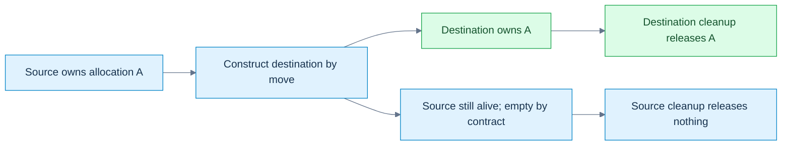

**Read the picture:** this is the manual byte-block contract below: construction creates the destination; ownership moves; the source remains a live, safely destructible empty object. **Limit:** `std::move` alone is a cast, not this transfer. Other types may copy, move inline data, or leave a valid but unspecified source state; move assignment also has an existing destination resource to handle. [[Visual Recall/02 - C++ - Objects, Ownership and Lifetime - Visual Recall#Four figure briefs|Recall this figure]].

[[Move operations and moved-from states|Move construction]] creates a new destination from an expiring source; **move assignment** replaces an existing destination, which may already own a resource needing release. For a pointer-owning byte block, a move can transfer the allocation pointer and size, then set the source to a documented empty state. `std::exchange(source.pointer,nullptr)` returns the old pointer while installing the new source state. That differs from merely copying the pointer and leaving two owners.

| Before/operation | Destination | Source | Lifetime consequence |
|---|---|---|---|
| move construction | new owner takes allocation A | becomes empty under this block's contract | source object remains alive |
| move assignment into owner B | releases B, takes A | becomes empty | both outer object lifetimes continue |
| destruction after move | releases only its current owned resource | empty source safely releases nothing | lifetime ends at normal destruction |

Inside `T(T&& other)`, the named expression `other` is an lvalue in ordinary member-initializer/body use. Move class-type members with explicit intent where needed; copying a scalar size is already cheap. `std::move` preserves const: an ordinary `T(T&&)` cannot bind a const source, so an available `T(const T&)` may be selected instead. A cast without a consumer performs no ownership transfer.

Self-move, `x=std::move(x)`, also needs a documented policy. Our manual block uses an identity guard and preserves its value. Do not demand that every standard-library type preserve its exact old value under self-move; consult its valid-state contract and operation preconditions. A moved-from object is still alive. Standard-library types generally specify valid-but-unspecified states unless they give a stronger guarantee; a user-defined type must implement its own promised invariant. **Unspecified** is not uninitialized or undefined: the value is not promised, but permitted operations still have defined requirements. `empty()` may be a valid query even though you cannot assume its answer; `front()` still requires a nonempty sequence.

For our block, the stronger contract is size0/null after a distinct-object move, plus safe destruction, copying of that empty state and assignment of a fresh value. It avoids traversing a nonexistent range when size is zero. For the earlier texture payload, consult member contracts without asserting the entire source vector/string must have a particular printed value.

Moving is not necessarily constant-time. An inline `std::array<float,N>` still transfers N inline values. Small-string storage may live inside the string object and be copied rather than pointer-stolen. Allocator-aware move assignment may require elementwise work when storage cannot be adopted by the destination allocator. A user-written move can do arbitrary work. Measure bytes, allocations, time and workload—not merely the occurrence of an ampersand.

## Failure guarantees shape the transfer algorithm

[[Noexcept and transfer selection|noexcept]] declares a non-throwing exception contract, not that the function contains no throw-capable instructions. If an exception escapes such a function, termination follows. Mark a move non-throwing only when its actual members/resource policy support that promise.

Container growth must balance transfer cost with rollback. A throwing move might mutate the first source element, then fail on a later one; restoring the original sequence may be impossible. If non-mutating copying is available, an implementation can use it to preserve the required guarantee. `std::move_if_noexcept(x)` selects an access category: it yields a const-reference path when move construction may throw and copying is possible, otherwise an rvalue-reference path. It does not itself transfer anything. See [forward/move helpers](https://eel.is/c++draft/forward).

The spelling is therefore a policy bridge from type properties to an operation's failure guarantee. If copying is impossible, a throwing move remains the available choice and a particular container operation can have weaker exceptional-effect guarantees. Do not teach “vector always gives strong rollback” regardless of type and operation. Neither should a trait-controlled algorithm assume every library implementation must use exactly one named helper internally.

Defaulted moves can derive exception properties from their selected member/base operations when left to the language. Forcing `noexcept` on a defaulted move without checking its subobjects is not automatically an improvement: a throw can terminate. Member composition often lets the compiler propagate the correct behavior. The inline probe checks the helper's return type directly rather than inferring a portable vector strategy from a constructor log.

## Let the compiler compose the operations

[[Special member generation and traits|Special members]] are the default constructor, copy/move constructors, copy/move assignment operators, and destructor. Whether the compiler declares one, whether it is deleted, and whether an expression can use it are three different questions.

| Programmer declaration in an ordinary class | Consequence to check in C++23 |
|---|---|
| no constructor declarations | default constructor can be implicitly declared |
| ordinary/default constructor | does not alone suppress implicit copy/move operations |
| copy constructor or copy assignment | suppresses implicit move generation |
| destructor, including first-declaration `=default` | suppresses implicit move generation |
| move constructor or move assignment | implicitly declared copy operations are defined as deleted unless usable copy operations are supplied explicitly |
| defaulted operation | may itself be deleted because a selected member/base operation is unusable |

This is a practical map, not the complete union/inheritance/constraint rulebook. A reference member can copy-bind, yet generated assignment is deleted. A non-copyable owner member can make the containing object non-copyable. A named constructor being available does not imply all required operations are available. The [copy/move constructor](https://eel.is/c++draft/class.copy.ctor) and [assignment](https://eel.is/c++draft/class.copy.assign) rules govern those details.

`std::is_move_constructible_v<T>` asks whether construction from a `T&&` expression is valid. It does not ask whether the selected constructor's parameter is exactly `T&&`. A class with a user-declared destructor can have no generated dedicated move constructor but still accept an rvalue through `const T&` copying. The trait may be true—and copying may be expensive. Likewise a nothrow trait classifies the valid expression, which could be a non-throwing copy.

An explicitly deleted move constructor can remain the best overload and reject an rvalue even when a copy constructor exists. A defaulted move that becomes deleted has specified ignore rules permitting fallback in relevant cases. “Unavailable move always falls back to copying” is therefore too broad. The diagnostic exercise demonstrates the explicitly deleted case.

First-declaration defaulting can retain triviality and inferred properties that a hand-written equivalent body loses. A **trivial** operation has the specified simple language properties; it is not synonymous with “fast enough in my benchmark.” Trivially copyable, standard-layout, aggregate, and nothrow-movable remain distinct traits. Rule-Zero composition containing vectors does not magically become trivially copyable or serialization-ready.

## From three repairs to five decisions to zero boilerplate

[[Rules of Three Five and Zero|The Rule of Three]] is a design heuristic: if raw-resource semantics require a custom destructor, copy constructor, or copy assignment, consider all three together. It is not a compiler requirement to support copying; explicitly deleting copying can be correct. The Rule of Five adds move construction and move assignment as coordinated decisions after C++11.

The **Rule of Zero** moves ownership responsibility into members whose own operations already match the intended semantics, so the containing class usually needs no custom copy/move/destruction operations. It does not mean “never write a constructor”: ordinary validation or default construction can coexist with composed transfer/cleanup. The texture payload's owning string/vector members and a scalar math record illustrate the approach without requiring a hand-maintained five-function protocol.

The raw owner below is educational infrastructure: its five operations expose the ownership invariant, failure transaction and source-reset contract. Prefer a vector-backed byte value for ordinary application code. A low-level unique resource wrapper may still need custom/deleted operations; then application-level records compose that tested owner instead of repeating resource logic.

[[Relocation versus move|Relocation]] distinguishes transfer plus an ended source lifetime from a move that leaves its source alive until normal later destruction. Container growth often uses move-construction followed by destruction; that pair must not be conflated with a universally legal memcpy of arbitrary nontrivial objects. The attachment discusses proposal-era trivial relocation. Here it is a future/toolchain-dependent research bridge, not a portable C++23 facility or an adopted-language-status claim. Self-references, external registrations and lifetime rules can make a bitwise relocation invalid even when a type's source code looks small.

The design progression is responsibility, not fashion: define the meaning of a copy, define who releases a resource, make failure and self-alias cases safe, supply moves where meaningful, then remove redundant custom code when composition already satisfies those contracts.

## Trace one payload from decode to cache

Assume the cache has reserved enough capacity for the next insertion; otherwise growth adds old-element transfer and invalidation. Assume TexturePayload retains ordinary composed string/vector semantics.

| Stage | Mechanism | Which object/resource is owned where? |
|---|---|---|
| `wall=built()` | optional NRVO or implicit-move fallback | caller receives an owning payload value |
| `cache.Insert(wall)` begins | copy construction of value parameter | wall preserved; parameter gets independent vector storage |
| parameter enters `push_back(std::move(payload))` | move construction of new cache element | cache element takes member state; parameter remains alive moved-from |
| Insert returns | parameter destruction | releases whatever members still own, without invalidating the cache's independent owner |
| `cache.Insert(fallback())` | direct result/parameter initialization, then element move | no mandatory intermediate parameter-transfer copy/move |
| cache grows later | member/type-dependent transfer to new backing | old borrows may be invalidated even if handles persist |
| cache dies | reverse destruction of contained ownership | CPU allocations released; no implied GPU destruction from a numeric handle |

This does not implement a decoder or uploader. It establishes the value-transfer backbone those systems would use. A 4096×4096 RGBA8 pixel image alone contains 67,108,864 bytes, or64 MiB, before mip levels/metadata. Copying that vector and copying a64-bit handle are radically different operations despite both using `=` syntax.

For teaching, ask the listener at every arrow: is a new object created, is an existing value assigned, is an access path merely bound, does source lifetime continue, what allocation is owned, and what happens if the operation fails? Those questions connect the entire build/object/borrow/value story.

## The laboratory and the teaching desk

### Complete runnable value-transfer laboratory

This standard-library-only C++23 program owns initialized bytes, deep-copies, copy-and-swaps, steals storage on move, releases prior move-assignment resources, and documents a preserving self-move policy. A single-threaded failure hook injects bad_alloc before the copy-assignment commit. It verifies independent storage, rollback, empty/moved-from copying and zero outstanding allocations. This is an educational raw owner, not a production allocator or a recommendation to replace vectors.

The independent Probe then measures three sink call forms with spare capacity. It checks const-source copying, destructor-suppressed dedicated movement, move_if_noexcept result types, and direct construction of an immovable result. Only the named-return move count is observational; it is not fixed by a portable assertion.

```cpp
#include <algorithm>
#include <cassert>
#include <cstddef>
#include <iostream>
#include <new>
#include <type_traits>
#include <utility>
#include <vector>

class OwnedByteBlock {
    std::size_t size_=0;
    std::byte* data_=nullptr;
    static std::byte* allocate(std::size_t n) {
        if (!n) return nullptr;
        if (std::exchange(fail_next,false)) throw std::bad_alloc{};
        auto* result=new std::byte[n]{}; // initialize every copied byte
        ++live_allocations;
        return result;
    }
    void release() noexcept {
        if (data_) { delete[] data_; --live_allocations; }
        data_=nullptr;
        size_=0;
    }
public:
    // Single-threaded laboratory instrumentation, not a production allocator.
    inline static bool fail_next=false;
    inline static int live_allocations=0;
    explicit OwnedByteBlock(std::size_t n=0):size_(n),data_(allocate(n)) {}
    ~OwnedByteBlock() { release(); }
    OwnedByteBlock(const OwnedByteBlock& other):OwnedByteBlock(other.size_) {
        if (size_) std::copy_n(other.data_,size_,data_);
    }
    OwnedByteBlock& operator=(const OwnedByteBlock& other) {
        if (this!=&other) {
            OwnedByteBlock replacement(other); // prepare; failure leaves *this intact
            swap(replacement);                // non-throwing commit
        } // replacement releases former target
        return *this;
    }
    OwnedByteBlock(OwnedByteBlock&& other) noexcept
        :size_(std::exchange(other.size_,0)),
         data_(std::exchange(other.data_,nullptr)) {}
    OwnedByteBlock& operator=(OwnedByteBlock&& other) noexcept {
        if (this!=&other) {
            release();
            size_=std::exchange(other.size_,0);
            data_=std::exchange(other.data_,nullptr);
        }
        return *this;
    }
    void swap(OwnedByteBlock& other) noexcept {
        std::swap(size_,other.size_);
        std::swap(data_,other.data_);
    }
    std::size_t size() const noexcept { return size_; }
    const std::byte* data() const noexcept { return data_; }
    std::byte& operator[](std::size_t i) { assert(i<size_); return data_[i]; }
    const std::byte& operator[](std::size_t i) const {
        assert(i<size_); return data_[i];
    }
};

struct Probe {
    inline static int copies=0, moves=0;
    int value;
    explicit Probe(int v=0):value(v) {}
    Probe(const Probe& p):value(p.value) { ++copies; }
    Probe(Probe&& p) noexcept:value(std::exchange(p.value,-1)) { ++moves; }
    static void reset() { copies=moves=0; }
};
struct Suppressed { Probe part; ~Suppressed()=default; };
struct ThrowingMove {
    ThrowingMove()=default;
    ThrowingMove(const ThrowingMove&) {}
    ThrowingMove(ThrowingMove&&) noexcept(false) {}
};
struct MoveOnly {
    MoveOnly()=default;
    MoveOnly(const MoveOnly&)=delete;
    MoveOnly(MoveOnly&&) noexcept(false) {}
};
struct Immovable {
    Immovable()=default;
    Immovable(const Immovable&)=delete;
    Immovable(Immovable&&)=delete;
};
Immovable direct() { return Immovable{}; }
Probe named_result() { Probe local(8); return local; }

int main() {
    static_assert(std::is_nothrow_move_constructible_v<OwnedByteBlock>);
    static_assert(std::is_nothrow_move_assignable_v<OwnedByteBlock>);
    static_assert(std::is_move_constructible_v<Suppressed>);
    static_assert(std::is_same_v<decltype(std::move_if_noexcept(
        std::declval<ThrowingMove&>())),const ThrowingMove&>);
    static_assert(std::is_same_v<decltype(std::move_if_noexcept(
        std::declval<MoveOnly&>())),MoveOnly&&>);
    {
        OwnedByteBlock a(4);
        a[0]=std::byte{7};
        OwnedByteBlock b=a;
        assert(a.data()!=b.data());
        b[0]=std::byte{9};
        assert(a[0]==std::byte{7});
        OwnedByteBlock& same=a;
        a=same;
        assert(a[0]==std::byte{7});

        const auto* old=b.data();
        const int live_before=OwnedByteBlock::live_allocations;
        OwnedByteBlock::fail_next=true;
        bool failed=false;
        try { b=a; } catch (const std::bad_alloc&) { failed=true; }
        assert(failed && !OwnedByteBlock::fail_next);
        assert(b.data()==old && b.size()==4 && b[0]==std::byte{9});
        assert(OwnedByteBlock::live_allocations==live_before);

        OwnedByteBlock c(std::move(a));
        assert(a.size()==0 && a.data()==nullptr && c[0]==std::byte{7});
        OwnedByteBlock empty_copy(a); // empty/moved-from source: no range traversal
        assert(empty_copy.size()==0 && empty_copy.data()==nullptr);
        b=std::move(c); // must release b's old allocation
        assert(c.size()==0 && c.data()==nullptr && b[0]==std::byte{7});
        OwnedByteBlock& self=b;
        b=std::move(self); // this type's documented preserving self-move
        assert(b.size()==4 && b[0]==std::byte{7});
        b=OwnedByteBlock{};
        assert(b.size()==0 && b.data()==nullptr);
    }
    assert(OwnedByteBlock::live_allocations==0);

    std::vector<Probe> stored;
    stored.reserve(4); // exclude growth work from these counts
    auto sink=[&](Probe p) { stored.push_back(std::move(p)); };
    Probe source(1);
    Probe::reset();
    sink(source);
    assert(Probe::copies==1 && Probe::moves==1 && source.value==1);
    Probe::reset();
    sink(Probe{2});
    assert(Probe::copies==0 && Probe::moves==1);
    Probe::reset();
    sink(std::move(source));
    assert(Probe::copies==0 && Probe::moves==2 && source.value==-1);

    const Probe fixed(5);
    Probe::reset();
    Probe copied(std::move(fixed));
    assert(copied.value==5 && Probe::copies==1 && Probe::moves==0);
    Suppressed original;
    Probe::reset();
    Suppressed fallback(std::move(original));
    assert(Probe::copies==1 && Probe::moves==0);
    (void)fallback;

    Immovable token=direct(); // must work even with optional elision disabled
    (void)token;
    Probe::reset();
    Probe returned=named_result();
    assert(returned.value==8 && Probe::copies==0);
    std::cout << "named return observed moves=" << Probe::moves << '\n';
    std::cout << "value-transfer laboratory: all assertions passed\n";
}
```

Compile with assertions enabled at debug and optimized settings. Also run with `-fno-elide-constructors`: that compiler option can disable optional NRVO, but cannot undo the language's guaranteed direct prvalue construction. The immovable result remains valid, while the named Probe return can reveal its move fallback. Constructor counts here explain semantics under controlled conditions; they are not allocation/timing benchmarks for a texture engine.

### Observe construction, failure and reverse cleanup

This separate complete program uses a fixed event buffer, so recording destructor events does not allocate. Positive IDs mark construction/body entry; negative IDs mark cleanup. It checks ordinary constructor-body failure, successful whole-object destruction, and the distinct delegating-body failure case. It also checks initialized defaults and copy-constructible-but-not-copy-assignable reference/const-member records. It never reads an uninitialized scalar.

```cpp
#include <array>
#include <cassert>
#include <iostream>
#include <stdexcept>
#include <type_traits>

struct Events {
    inline static std::array<int,16> values{};
    inline static std::size_t count=0;
    static void add(int v) noexcept { assert(count<values.size()); values[count++]=v; }
    static void reset() noexcept { count=0; }
};
struct Member {
    int id;
    explicit Member(int n):id(n) { Events::add(id); }
    ~Member() { Events::add(-id); }
};
struct Whole {
    Member first{1};
    Member second{2};
    explicit Whole(bool fail) {
        Events::add(3);
        if (fail) throw std::runtime_error("body failed");
    }
    ~Whole() { Events::add(-3); }
};
struct Delegated {
    Member member{4};
    Delegated() { Events::add(5); }
    explicit Delegated(int):Delegated() {
        Events::add(6);
        throw std::runtime_error("delegating body failed");
    }
    ~Delegated() { Events::add(-5); }
};
struct NonUserProvided { int n; NonUserProvided()=default; };
struct MemberDefault { int n=0; MemberDefault() {} };
struct Binding { int& value; };
struct ConstRecord { const int id; };

int main() {
    Events::reset();
    bool caught=false;
    try { Whole object(true); } catch (const std::runtime_error&) { caught=true; }
    assert(caught && Events::count==5);
    const std::array failed{1,2,3,-2,-1};
    for (std::size_t i=0;i<failed.size();++i) assert(Events::values[i]==failed[i]);
    Events::reset();
    { Whole object(false); }
    const std::array success{1,2,3,-3,-2,-1};
    assert(Events::count==success.size());
    for (std::size_t i=0;i<success.size();++i) assert(Events::values[i]==success[i]);
    Events::reset();
    caught=false;
    try { Delegated object(1); } catch (const std::runtime_error&) { caught=true; }
    const std::array delegated{4,5,6,-5,-4};
    assert(caught && Events::count==delegated.size());
    for (std::size_t i=0;i<delegated.size();++i) assert(Events::values[i]==delegated[i]);

    NonUserProvided a{};
    MemberDefault b{};
    assert(a.n==0 && b.n==0); // no uninitialized member is read
    static_assert(std::is_copy_constructible_v<Binding>);
    static_assert(!std::is_copy_assignable_v<Binding>);
    static_assert(std::is_copy_constructible_v<ConstRecord>);
    static_assert(!std::is_copy_assignable_v<ConstRecord>);
    int number=7;
    Binding first{number};
    Binding second=first;
    second.value=9;
    assert(number==9 && &first.value==&second.value);
    std::cout << "construction laboratory: all assertions passed\n";
}
```

Explain the event arrays before running the program. In the ordinary failing constructor, no -3 event appears because Whole never completed. On normal destruction, -3 comes before -2/-1. In the delegating case the target completed, so -5 appears before -4 after the delegating body fails. Copying Binding preserves the association to number; it does not create another referent.

### Value-transfer diagnostic and reconstruction desk

Compile these independent rejected-program exercises separately. They are not additions to either passing laboratory:

```cpp
struct Token { Token()=default; Token(const Token&)=delete; Token(Token&&)=delete; };
Token named() { Token token; return token; }
int main() {}
```

```cpp
struct Binding { int& value; };
int main() { int x=1,y=2; Binding a{x},b{y}; a=b; }
```

```cpp
#include <utility>
struct CopyOnly { CopyOnly()=default; CopyOnly(const CopyOnly&)=default; CopyOnly(CopyOnly&&)=delete; };
int main() { CopyOnly a; CopyOnly b(std::move(a)); }
```

```cpp
struct Token { Token()=default; ~Token()=delete; };
Token direct() { return Token{}; }
int main() {}
```

For each rejection, name the missing guarantee: non-guaranteed named-return fallback, reference-member assignment, best overload explicitly deleted, or required usable destruction. Removing optional elision is not necessary to make the named immovable return invalid.

Reconstruct the value story without the page:

1. Draw the separate objects/resources for lvalue, xvalue and prvalue calls to a value sink; add growth costs separately.
2. Reset a pointer parameter, then a reference-to-pointer parameter; distinguish which caller state changes.
3. Compute the exposure-reference alias trace for distinct arguments and one aliased argument.
4. Explain direct construction with both copy and move deleted, then explain why returning a named local differs.
5. State an object's invariant before writing its constructor. Which parts of input validation do the toy examples leave unimplemented?
6. Distinguish no initializer, aggregate braces, a first-declaration defaulted constructor and an empty user-provided constructor. Never prove the bad case by reading uninitialized memory.
7. Put a provider member before its dependent member. Draw both construction and destruction order.
8. Reconstruct ordinary constructor failure versus throwing after a delegating target completed.
9. Decide whether copying a handle, byte owner, view and scene graph should duplicate, share, remap or reject resources.
10. Rebuild the copy-assignment prepare/commit/cleanup transaction; inject failure before commit and predict both owners.
11. Move into a new owner, then an existing owner. Identify the old destination resource and the surviving source state.
12. State the exact self-copy/self-move policy; distinguish a documented empty source from an unspecified library value.
13. Derive move_if_noexcept's selected path and identify where strong rollback may become unavailable.
14. Explain why move-constructible can mean copied from an rvalue, and why a defaulted destructor changes generation.
15. Rebuild the three/five operations, then replace the raw owner with composed members where semantics allow. Which domain invariants still need a design decision?
16. Distinguish move from relocation without claiming a byte copy of arbitrary objects legal.

### Complete runnable borrow laboratory

Save this independent block as `borrows.cpp`. It uses only the standard library and C++23; no engine headers are needed. It checks aliasing, converted-reference snapshots, category deduction, array boundaries, typed null deletion, const span behavior, a live slot's changed logical owner, safe temporary getters, owning captures, and a synchronized mutable cache. Assertions are the expected results. No dangling reference is dereferenced and no invalid pointer arithmetic is executed.

```cpp
#include <cassert>
#include <cstddef>
#include <functional>
#include <iostream>
#include <mutex>
#include <optional>
#include <span>
#include <string>
#include <thread>
#include <type_traits>
#include <utility>
#include <vector>

struct Slot { int entity; int value; };

class Named {
    std::string name_;
public:
    explicit Named(std::string name) : name_(std::move(name)) {}
    std::string& Name() & { return name_; }
    const std::string& Name() const & { return name_; }
    std::string Name() && { return std::move(name_); }
    std::string Name() const && { return name_; }
};

int category(int&) { return 1; }
int category(int&&) { return 2; }
template<class T>
int relay(T&& item) { return category(std::forward<T>(item)); }

class Cache {
    mutable std::mutex mutex_;
    int source_ = 3; // restricted laboratory inputs: 3 or 4
    mutable std::optional<int> square_;
public:
    void Set(int value) {
        assert(value == 3 || value == 4);
        std::scoped_lock lock(mutex_);
        source_ = value;
        square_.reset();
    }
    int Get() const {
        std::scoped_lock lock(mutex_);
        if (!square_) square_ = source_ * source_;
        return *square_;
    }
};

int choose(int) { return 1; }
int choose(int*) { return 2; }

int main() {
    int a = 2, b = 9;
    int& alias = a;
    alias = b;
    b = 20;
    assert(a == 9 && b == 20 && std::addressof(alias) == &a);
    int* selected = &a;
    int*& pointer_alias = selected;
    pointer_alias = &b;
    assert(selected == &b);

    int count = 10;
    const int& live = count;
    const double& snapshot = count;
    count = 50;
    assert(live == 50 && snapshot == 10.0);

    int&& rr = 7;
    static_assert(std::is_same_v<decltype(rr), int&&>);
    static_assert(std::is_same_v<decltype((rr)), int&>);
    static_assert(std::is_same_v<decltype(std::move(rr)), int&&>);
    assert(relay(count) == 1 && relay(4) == 2);

    int array[3]{10, 20, 30};
    int (&whole)[3] = array;
    static_assert(sizeof(whole) == sizeof(array));
    int* end = array + 3;
    assert(end - array == 3); // no dereference of end

    int* absent = nullptr;
    delete absent;
    assert(choose(0) == 1 && choose(nullptr) == 2);

    std::span<int> elements(array);
    const std::span<int> descriptor = elements;
    descriptor[0] = 12;
    std::span<const int> readonly = elements;
    static_assert(std::is_same_v<decltype(readonly[0]), const int&>);
    assert(readonly[0] == 12);

    std::vector<Slot> pool{{11, 100}, {22, 200}, {33, 300}};
    std::size_t epoch = 0;
    Slot* cached = &pool[0];
    const auto borrowed_epoch = epoch;
    pool[0] = std::move(pool.back());
    pool.pop_back();
    ++epoch;
    assert(epoch != borrowed_epoch); // reject old logical borrow before use
    // Separate demonstration: cached designates a live first Slot, now owner 33.
    assert(cached == &pool[0] && cached->entity == 33);
    pool.reserve(pool.capacity() + 1); // invalidates cached; never use it again
    assert(pool[0].entity == 33); // reacquire via the container

    Named owner{"persistent"};
    const std::string& borrowed = owner.Name();
    assert(borrowed == "persistent");
    std::string owned = Named{"temporary"}.Name();
    assert(owned == "temporary");
    static_assert(std::is_same_v<decltype(std::declval<const Named&&>().Name()),
                                 std::string>);
    const Named const_owner{"const value"};
    std::string const_result = std::move(const_owner).Name();
    assert(const_result == "const value");

    std::string label = "frame";
    auto snapshot_job = [saved = label] { return saved.size(); };
    label.clear();
    assert(snapshot_job() == 5);
    auto counter = [n = 0]() mutable { return ++n; };
    assert(counter() == 1 && counter() == 2);

    Cache cache;
    const Cache& access = cache;
    assert(access.Get() == 9);
    cache.Set(4);
    assert(access.Get() == 16);
    {
        std::jthread reader([&] {
            for (int i = 0; i < 1000; ++i) {
                const int result = access.Get();
                assert(result == 9 || result == 16);
            }
        });
        std::jthread writer([&] {
            for (int i = 0; i < 1000; ++i) cache.Set(i % 2 ? 3 : 4);
        });
    } // both threads joined before cache is destroyed
    std::cout << "borrow laboratory: all assertions passed\n";
}
```

The epoch in this program is a local single-threaded witness, not a complete reusable borrow wrapper. The cache is separately synchronized and tested with concurrent calls; that short test does not prove arbitrary concurrent programs safe. Run with assertions enabled. Successful checks establish these examples on the recorded compiler, not every ABI or container implementation.

### Observe destruction without reading a dangling referent

This second complete program counts live Watch objects. A lifetime-ended reference can exist; using it to access its former object is the forbidden step. The intentionally dangling holder/new/call-return paths below are never dereferenced. The compiler may warn about the new-initializer reference member; that is useful evidence, not an invitation to suppress the warning. The unused escaped declaration can also produce a warning.

```cpp
#include <cassert>
#include <iostream>

struct Watch {
    inline static int live = 0;
    Watch() { ++live; }
    ~Watch() { --live; }
};
struct Holder { const Watch& value; };
const Watch& pass(const Watch& item) { return item; }

int main() {
    assert(Watch::live == 0);
    {
        const Watch& direct = Watch{};
        (void)direct; // alive throughout this block
        assert(Watch::live == 1);
    }
    assert(Watch::live == 0);
    {
        Holder kept{Watch{}};
        assert(Watch::live == 1);
        Holder lost(Watch{}); // deliberately dangling after this statement
        assert(Watch::live == 1); // only kept's Watch remains
        // Never read lost.value.
        (void)kept;
        (void)lost;
    }
    assert(Watch::live == 0);
    Holder* heap = new Holder{Watch{}}; // member temporary dies at semicolon
    assert(Watch::live == 0);
    delete heap; // default Holder destruction does not read the member
    const Watch& escaped = pass(Watch{});
    assert(Watch::live == 0);
    // escaped is dangling; do not evaluate it.
    std::cout << "temporary laboratory: live count = " << Watch::live << '\n';
}
```

At the parenthesized declaration, the count temporarily rises from one to two, then returns to one at the semicolon. Braced kept survives until its enclosing block ends. The heap holder outlives its temporary referent; allocation changes the holder's duration, not the reference-member exception. Passing through pass likewise gives no new extension. These observed counts support the language explanation on the tested compiler without reading freed or lifetime-ended objects.

### Rejected-program exercises

These are independent rejected-program exercises, not additions to the passing laboratory:

```cpp
// Expected rejection: reference binding would discard const.
int main() { const int value=3; int& wrong=value; }
```

```cpp
// Expected rejection: unsafe qualification injection.
int main() { int* p=nullptr; int** pp=&p; const int** wrong=pp; }
```

```cpp
// Expected rejection: operand type is nullptr_t, not an object-pointer type.
int main() { delete nullptr; }
```

Predict the diagnostics, then explain the mechanism without quoting the diagnostic. Other bad examples in the narrative are deliberately not executed: a program exhibiting undefined behavior is not a reliable demonstration of its supposed outcome.

### Reconstruct the access story at the board

1. Bind an integer reference, assign another integer through it, then change the other integer. Draw the final referent and values.
2. Explain why `decltype(rr)` and `decltype((rr))` differ, and why neither evaluates `rr`.
3. Compare a same-type const reference with a converting const reference; show the live value and snapshot after mutation.
4. Draw a temporary through a parameter-returning identity function. Mark the exact destruction point and explain why the receiving reference does not extend it.
5. Distinguish `Holder{7}`, `Holder(7)` and `new Holder{7}` without dereferencing a dangling member.
6. Show why `std::move` alone changes no resources and why const can change which constructor is viable.
7. Deduce `T` for an lvalue/rvalue passed to `T&&`; reconstruct collapsing and forwarding.
8. Give three independent ways a non-null pointer can be unsuitable for access.
9. Compare vector reallocation, last-element destruction, and first-slot repurposing. Which one can fool a sanitizer while remaining a logical bug?
10. Explain why a validated entity handle and a previously cached component reference answer different questions.
11. Reconstruct the rejected `int**` conversion as a const-pointer injection attack; explain the intermediate const fix.
12. Compare `const span<int>` with `span<const int>`, and explain why neither owns storage.
13. Design both const and non-const temporary getter policies; find the missing `const &&` hole.
14. State the mutable-cache invariant, protect source and cache together, and justify returning a snapshot rather than a borrowed result.

These questions test reconstruction, not the presence of a completed checkbox. The earlier object/build laboratory follows; both are part of this same story.

### Reproduce the compile and link distinction

Save the three preceding module blocks as Math.cppm, MathImpl.cpp and App.cpp. With a compatible Clang installation, from that directory:

```bash
clang++ -std=c++23 --precompile Math.cppm -o Math.pcm
clang++ -std=c++23 -c Math.pcm -o Math.o
clang++ -std=c++23 -fprebuilt-module-path=. -c MathImpl.cpp -o MathImpl.o
clang++ -std=c++23 -fprebuilt-module-path=. -c App.cpp -o App.o
clang++ App.o Math.o MathImpl.o -o modules
./modules
```

App exits0 when twice(21) equals42. Now omit MathImpl.o from only the final link: the importer still compiled, but the link needs the implementation of twice. This intentionally produces an undefined symbol. Restoring MathImpl.o repairs this demonstration. A production build system manages dependency scanning and compatible module options; these explicit commands are a small experiment, not a replacement for its build graph.

### Complete runnable object laboratory

This program is independent of Kairo. Every header and declaration it needs is included here; save only this block as `objects.cpp`. Assertions test lookup, enum validation, handle reuse, aggregate traits, initialization forms, correct array views, construction/destruction counts and two successive occupants at one storage location. The byte buffer survives both Tracked objects. Use the new construction result rather than assuming every old pointer remains usable after replacement.

```cpp
#include <array>
#include <cassert>
#include <climits>
#include <cstddef>
#include <cstdint>
#include <iostream>
#include <limits>
#include <memory>
#include <optional>
#include <span>
#include <type_traits>
#include <utility>
#include <vector>

enum class ResourceKind : std::uint8_t { Buffer, Texture, Pipeline };
std::optional<ResourceKind> decode_kind(std::uint8_t raw) {
    switch (raw) {
    case 0: return ResourceKind::Buffer;
    case 1: return ResourceKind::Texture;
    case 2: return ResourceKind::Pipeline;
    default: return std::nullopt;
    }
}
enum class Access : unsigned { None=0, Read=1, Write=2 };
constexpr Access operator|(Access a, Access b) {
    return static_cast<Access>(std::to_underlying(a) | std::to_underlying(b));
}
constexpr bool contains(Access set, Access flag) {
    return (std::to_underlying(set) & std::to_underlying(flag))
        == std::to_underlying(flag);
}
struct ResourceHandle {
    static constexpr std::uint32_t invalid =
        std::numeric_limits<std::uint32_t>::max();
    std::uint32_t index = invalid;
    std::uint32_t generation = 0;
    constexpr bool valid_shape() const { return index != invalid; }
    friend constexpr bool operator==(ResourceHandle, ResourceHandle) = default;
};
struct Slot { bool occupied{}; std::uint32_t generation{}; };
bool alive(ResourceHandle h, const std::array<Slot,1>& slots) {
    return h.index < slots.size() && slots[h.index].occupied
        && slots[h.index].generation == h.generation;
}
namespace geometry {
struct Pair { int x, y; };
constexpr int dot(Pair a, Pair b) { return a.x*b.x + a.y*b.y; }
}
struct NamedVector {
    float x{}, y{}, z{};
    float& at(std::size_t i) {
        assert(i < 3); // precondition remains required in release
        switch (i) { case 0: return x; case 1: return y; default: return z; }
    }
    const float& at(std::size_t i) const {
        assert(i < 3);
        switch (i) { case 0: return x; case 1: return y; default: return z; }
    }
    constexpr std::array<float,3> to_array() const { return {x,y,z}; }
};
struct ArrayVector {
    std::array<float,3> elements{};
    std::span<float,3> view() { return elements; }
};
struct ConstructedVector {
    float x,y,z;
    constexpr ConstructedVector(float a,float b,float c):x(a),y(b),z(c){}
};
struct Material { float roughness=0.5f; float metallic=0; bool double_sided{}; };
struct Padded { char a; double b; char c; };
struct Reordered { double b; char a; char c; };
struct Vertex { float x,y,z; std::uint32_t color; };
// This laboratory intentionally targets octet + IEEE binary32 platforms.
static_assert(CHAR_BIT == 8);
static_assert(sizeof(float)==4 && std::numeric_limits<float>::is_iec559);
static_assert(std::is_aggregate_v<ResourceHandle>);
static_assert(!std::is_aggregate_v<ConstructedVector>);
static_assert(std::is_standard_layout_v<Vertex>);
static_assert(std::is_trivially_copyable_v<Vertex>);
static_assert(offsetof(Vertex,x)==0 && offsetof(Vertex,color)==12);
static_assert(sizeof(Vertex)==16);
struct Tracked {
    inline static int constructions=0, destructions=0;
    int value;
    explicit Tracked(int n):value(n) { ++constructions; }
    ~Tracked() { ++destructions; }
};
constinit int mutable_counter=0;
thread_local int thread_counter=0;
int& persistent_count() { static int calls=0; return calls; }

int main() {
    geometry::Pair a{1,2}, b{3,4};
    assert(dot(a,b)==11); // ADL finds geometry::dot
    assert(decode_kind(1)==ResourceKind::Texture);
    assert(!decode_kind(199));
    const auto access=Access::Read | Access::Write;
    assert(contains(access,Access::Read) && contains(access,Access::Write));
    std::array<Slot,1> slots{{Slot{true,7}}};
    const ResourceHandle old{.index=0,.generation=7};
    assert(alive(old,slots));
    slots[0].occupied=false; assert(!alive(old,slots));
    slots[0]={true,8};
    assert(old.valid_shape() && !alive(old,slots));
    const ResourceHandle fresh{.index=0,.generation=8};
    assert(alive(fresh,slots) && old!=fresh);
    assert(!alive(ResourceHandle{},slots));
    NamedVector named{1,2,3};
    named.at(1)=9;
    const NamedVector& read_only=named;
    assert(read_only.at(1)==9);
    auto copy=named.to_array();
    copy[1]=8; assert(named.y==9); // copy, not a live view
    ArrayVector array{{1,2,3}};
    auto view=array.view(); view[1]=8;
    assert(array.elements[1]==8); // view aliases a real array
    const Material material{.roughness=0.8f};
    assert(material.metallic==0 && !material.double_sided);
    const std::vector<int> count_values(10,20), listed_values{10,20};
    assert(count_values.size()==10 && listed_values.size()==2);
    alignas(Tracked) std::byte storage[sizeof(Tracked)];
    const void* location=static_cast<void*>(storage);
    Tracked* first=std::construct_at(reinterpret_cast<Tracked*>(storage),7);
    assert(first->value==7 && static_cast<void*>(first)==location);
    std::destroy_at(first);
    // No Tracked member access here: lifetime ended, storage remains.
    Tracked* second=std::construct_at(reinterpret_cast<Tracked*>(storage),8);
    assert(second->value==8 && static_cast<void*>(second)==location);
    std::destroy_at(second);
    assert(Tracked::constructions==2 && Tracked::destructions==2);
    auto* dynamic=new Tracked{9};
    assert(dynamic->value==9);
    delete dynamic;
    dynamic=nullptr; // clears this pointer only, not other copies
    assert(dynamic==nullptr && Tracked::destructions==3);
    ++mutable_counter; ++thread_counter; ++persistent_count();
    ++persistent_count();
    assert(mutable_counter==1 && thread_counter==1 && persistent_count()==2);
    std::cout << "C++ object laboratory passed\n"
              << "Padded: size=" << sizeof(Padded) << " align=" << alignof(Padded)
              << " offsets=" << offsetof(Padded,a) << ','
              << offsetof(Padded,b) << ',' << offsetof(Padded,c) << '\n'
              << "Reordered: size=" << sizeof(Reordered) << '\n';
}

```

Compile with `clang++ -std=c++23 -Wall -Wextra -Wpedantic -Werror -fsanitize=address,undefined objects.cpp -o objects`, then run `./objects`. Repeat with `-O2`. The layout numbers printed are target measurements, not universal constants. The Vertex assertions are explicit requirements of this demonstration's upload format; they are not deductions from standard-layout alone. Sanitizers detect some bad executions, not all object-model violations. This program never executes the invalid named-member indexing example.

The thread-local counter is used on the main thread only; this laboratory does not test concurrency or thread shutdown. Local-static initialization synchronization protects initialization, not unsynchronized later mutation. Every generation comparison assumes one registry and no counter wrap during the test. These limits belong beside the code because an example should not silently promise more than it demonstrates.

## Where these foundations matter

Here is the full mapping.

| Source ledger entry | Engine consequence |
|---|---|
| 101 translation model | Why changing an exported module can rebuild dependents; why link failures differ from compile failures; why shader/native libraries need ABI boundaries. |
| 102 declaration vs definition | Public engine API versus implementation; forward declarations; reducing dependency exposure. |
| 103 ODR | Prevent duplicate renderer globals, mismatched inline/template definitions and macro-dependent UB. |
| 104 lookup | Namespaces, extension functions, generic algorithms, ADL and modular API hygiene. |
| 105 storage duration | Frame locals, singleton/static systems, per-thread scratch allocators, dynamically allocated resources. |
| 106 lifetime vs storage | ECS pools, arenas, `vector`, `optional`, `variant`, render-resource pools, placement construction. |
| 107 identity/address | Entity handles, GPU resource handles, generation counters, stale pointer prevention. |
| 108 fundamental widths | File formats, Vulkan structs, network protocols, IDs, GPU buffers, cross-platform engine builds. |
| 109 enums | Render states, resource states, component change kinds, shader modes, error states. |
| 110 aggregates | Descriptor records, vertices, configuration types, messages, ECS events. |
| 111 struct/class | Transparent math/data records versus invariant-owning systems/resources. |
| 112 layout | Vertex buffers, uniform/storage buffers, serialization, SIMD, cache usage, C ABI and GPU ABI matching. |

This entire chunk is therefore directly relevant to your graphics/engine path.

## Classifying a failure before debugging

When you see:

| Symptom | First mechanism to suspect |
|---|---|
| “undefined symbol” | declaration exists, definition absent/not linked, linkage mismatch |
| “duplicate symbol” | ODR violation or duplicate externally linked definition |
| same header behaves differently in two files | macro/preprocessor-dependent ODR issue |
| variable exists but name inaccessible | scope/lookup issue |
| object appears to retain bytes after destruction | confusing storage persistence with object lifetime |
| random crash from cached pointer | object lifetime ended / storage reused |
| old ECS handle affects new object | identity reused without generation validation |
| binary works macOS but fails Windows | implementation-defined widths/ABI assumption |
| state enum receives nonsense | external value not validated |
| aggregate initialization suddenly stops compiling | type ceased being aggregate, often due constructor/access change |
| GPU buffer looks scrambled | CPU structure layout != GPU ABI layout |
| `Vec3::operator[]` “works but sanitizer/compiler gets weird” | pointer arithmetic across separate member objects |
| size unexpectedly larger | alignment/padding/tail padding |

A strong C++ engineer does not begin with:

> “The compiler is weird.”

They classify the failure into the correct language mechanism first.

## Reconstructing a compact resource record

Write this without copying once this chapter settles:

```cpp
#include <cstddef>
#include <cstdint>
#include <type_traits>
#include <utility>

enum class ResourceKind : std::uint8_t
{
    Buffer,
    Texture,
    Pipeline
};

struct ResourceHandle
{
    static constexpr std::uint32_t InvalidIndex = 0xFFFFFFFFu;

    std::uint32_t index = InvalidIndex;
    std::uint32_t generation = 0;

    [[nodiscard]]
    constexpr bool valid() const noexcept
    {
        return index != InvalidIndex;
    }
};

struct GPUVertex
{
    float x;
    float y;
    float z;
    std::uint32_t packedColor;
};

static_assert(std::is_aggregate_v<ResourceHandle>);
static_assert(std::is_standard_layout_v<ResourceHandle>);
static_assert(std::is_trivially_copyable_v<ResourceHandle>);

static_assert(std::is_standard_layout_v<GPUVertex>);
static_assert(std::is_trivially_copyable_v<GPUVertex>);

static_assert(offsetof(GPUVertex, x) == 0);
```

Now you should be able to explain every statement not syntactically, but semantically:

```text
why uint32_t?
why enum class?
why uint8_t?
why aggregate?
what lifetime does a local handle have?
does handle address define resource identity?
what does standard-layout guarantee?
what does it NOT guarantee?
why might GPUVertex still need a backend-specific upload structure?
what happens if a constructor is added?
what entity does InvalidIndex define?
what is its storage duration?
what linkage does it have?
why doesn't offsetof prove shader compatibility?
```

If any of those feel like vocabulary questions instead of mechanical questions, that area needs reconstruction.

## Questions for teaching without looking at the page

This is the one list I want you to use as the actual chapter test:

1. Draw the complete path from `Vector.cppm` source text to a function executing in the final program, including preprocessing/global-module-fragment work, BMI/interface information, object generation and linking. Then explain what compilation error versus link error means.

2. Given `extern int x;`, `int x;`, `int f(int);`, `int f(int x){ return x; }`, `struct A;`, and `struct A{int n;};`, classify every declaration and definition and explain why every definition is also a declaration.

3. Explain why `#pragma once` does **not** solve `int global = 3;` being defined in a header included by two different translation units. Then give the `extern` solution and the `inline` variable solution.

4. For `void f(){ static int x; int y; thread_local int z; auto* p = new int; }`, separately identify name scope, storage duration and approximate object lifetime for `x`, `y`, `z`, `p`, and `*p`.

5. Explain why an object's bytes can remain physically unchanged after its lifetime ends, and why that does not permit continued use of the object.

6. Suppose an object at address `0x1000` is destroyed and another same-type object is constructed at `0x1000`. Explain why numerical address alone does not encode identity. Then connect this to `Entity{Index, Generation}`.

7. Explain why `int` is not necessarily 32-bit, why `std::uint32_t` is a better representation field for an ECS index, and why even `uint32_t` does not by itself give you a portable serialized format.

8. Explain why `enum class StructuralChangeKind : std::uint8_t` is safer than both `int Kind` and an old unscoped enum. Then explain why a byte read from disk must still be validated.

9. Determine whether `the illustrative ResourceHandle` and `the constructor-bearing Vec` are aggregates and explain precisely why their brace initialization can invoke different language mechanisms.

10. Explain all actual language differences between `struct` and `class`, including default base-class access.

11. Assuming `char=1` alignment and `double=8` alignment, manually lay out `struct X { char a; double b; char c; };`, calculate typical offsets/size, then reorder the members to reduce padding.

12. Explain why all four of these can be independently meaningful: `std::is_aggregate_v<T>`, `std::is_standard_layout_v<T>`, `std::is_trivially_copyable_v<T>`, and `sizeof(T)`. Reconstruct [[Standard-layout and trivial copyability]] without equating the traits.

13. Prove why `NamedVector` being standard-layout, trivially copyable, and exactly 12 bytes still does **not** make `(&x)[1]` valid array indexing.

14. Explain why `sizeof(NamedVector)==12` does not prove compatibility with an arbitrary Vulkan/Metal shader-side three-component vector structure.

15. From memory, rewrite a standards-safe `Vector3::operator[]` for the existing `x/y/z` representation and explain what would have to change if `Data()` truly needs to expose an N-element contiguous array.

If you can answer those under repeated “**why?**” questioning, then chapter is actually owned rather than merely read.

## What remains open

Ownership means deciding who is responsible for destruction and resource release. Parameter contracts, copy/move operations, constructor invariants, cleanup, direct result construction and Rule-Zero composition now extend the story through Parts147. The raw-owner laboratory develops a narrow strong-guarantee transaction, not complete subsystem exception safety. Smart-pointer ownership patterns, explicit lifetime restart, allocator design, polymorphic cleanup and broader container/concurrency guarantees remain future depth.

A useful future experiment compares raw address APIs with checked generation handles under repeated create/destroy/reuse workloads. Count stale-access attempts, validation failures, bytes per handle and lookup/frame cost. State the workload and lifetime contract before claiming a reliability or performance advantage. A handle is not automatically safer if callers bypass its registry checks.

**Coverage update after M010:** the ownership questions that were still open at the M009 boundary are now developed in [[#From a live object to responsible resource ownership|the next story chapter]]. The future experiment above remains open; the existence of a written treatment does not demonstrate learner mastery.

No written 'depth gate passed' proves learner mastery. Try the recall questions under repeated why-questioning, then reconstruct the laboratories without copying.

## Retrieval sheet - The whole opening story

Source text becomes tokens and translation units; declarations let callers compile; definitions let a program execute. Lookup finds a declaration, linkage relates declarations, and ODR requires coherent definitions. Modules change how interfaces are communicated, not the need for implementation code.

Names have scopes. Storage has automatic, static, thread or dynamic duration. Objects have lifetimes inside storage. A pointer's own lifetime does not keep its pointee alive. Equal values do not mean one object; reusing an address does not preserve the old occupant. Generation handles identify a logical occupant only when the registry validates them.

Ordinary integer widths are not portable constants. Scoped enums constrain accidental conversions, not hostile input. Braces may initialize aggregate elements or select a constructor; initializer-list constructors can change their meaning. Struct and class differ only in default member and base access.

Alignment creates holes and tail padding. Standard-layout, trivially-copyable and aggregate are different promises. Adjacent named fields are not an array. CPU layout, file format and shader layout need separate verified contracts.

Reference binding need not select the object we first imagined: conversion can create a snapshot temporary. Local lifetime extension is not transitive through function calls. An rvalue cast changes category, not ownership or lifetime. A vector borrow may dangle after reallocation or keep reaching a live slot whose logical owner has changed. Const describes an access path; shallow constness and mutable caches do not supply synchronization. A temporary-aware accessor returns an owning result or rejects rvalue callers.

Value parameters create objects; reference parameters borrow; pointer parameters copy pointer values. Construction establishes initial invariants, assignment replaces existing state, and destruction closes an ownership interval. Copy follows semantic member contracts; move may transfer resources while its source survives. NRVO is optional, same-type prvalue direct construction is not a required hidden move. Non-throwing properties constrain transfer policy. The Rule of Zero composes responsibility rather than proving arbitrary domain invariants.

[[Supplementary/Foundations#M007 - Parts 101-112|Opening coverage]] · [[Supplementary/Foundations#M008 - Parts 113-126|Borrowing coverage]] · [[Supplementary/Foundations#M009 - Parts 127-147|Value-transfer coverage]] · [[Supplementary/Foundations#M010 - Parts 148-160|Resource ownership coverage]] · [[Keyword Index]] · [[Dependency Map]] · [[Supplementary/Sources and Code Anchors#M010 - Resource ownership|Current sources, corrections and verification]]

## From a live object to responsible resource ownership

The Rule of Zero was the right destination for ordinary application types: compose members that already know how to copy, move, and clean up. But composition does not make responsibility disappear. Somewhere, a layer must acquire a file, allocation, lock, operating-system handle, graphics object, or other finite resource; keep it valid while needed; then release it exactly once and at a safe time. This chapter follows that responsibility downward—from a C++ object's lifetime to the external thing it controls—and then back upward to the smart pointers and containers most programs should use.

### Four lifetimes that can overlap without becoming one

Keep four questions separate:

1. **Storage:** Which bytes have been reserved, and for how long are they available?
2. **Object lifetime:** Which typed object has been initialized in those bytes, and when does its lifetime begin and end?
3. **Ownership:** Which object or protocol is responsible for arranging cleanup?
4. **External use:** Is another system—such as a GPU queue—still using the resource?

They often overlap, but they are not synonyms. A stack-allocated `BufferOwner` may own a Vulkan allocation. Destroying that wrapper can release the allocation, but only if the graphics API says the GPU is finished with it. A byte arena may remain allocated after a `Particle` lifetime ends. A `shared_ptr` control block may remain after the managed object has already been destroyed, because weak observers still refer to the ownership group.

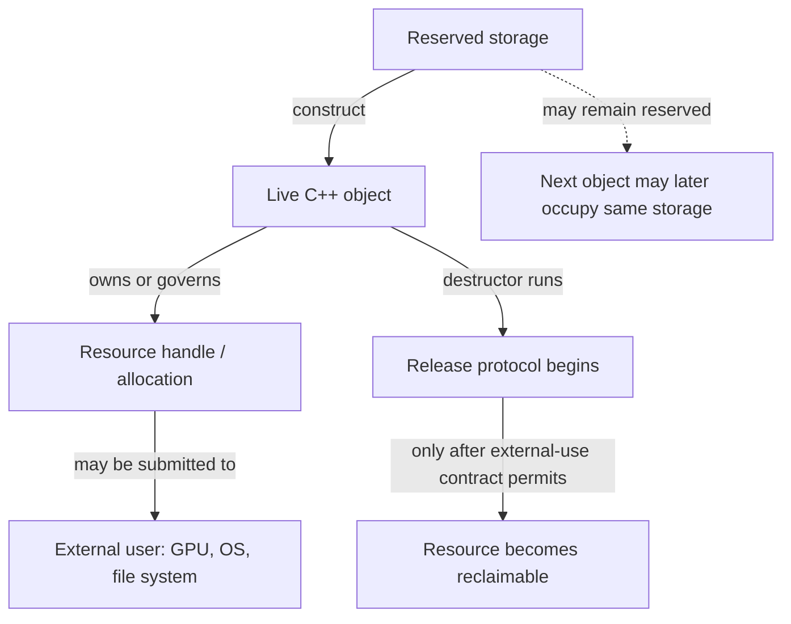

**Caption — The resource stack:** object destruction is a useful cleanup trigger, not proof that every external consumer has stopped. In a renderer, a fence, timeline value, deferred-deletion queue, or other API-specific completion rule may be part of the resource protocol.

### Why lifetime-bound cleanup is more reliable than remembering every exit

[[RAII and resource handles|RAII]] expands to **Resource Acquisition Is Initialization**. Read the name as a design cue: put a resource's responsibility into an object with a well-defined lifetime. Acquisition is associated with establishing the owner's usable state; destruction performs the matching release. The owner can be a small local guard, a standard-library type such as `std::unique_ptr` or `std::lock_guard`, or a domain wrapper around a non-memory handle.

Suppose a function opens a file, acquires a lock, validates data, and then writes. If each return path must remember `close` and `unlock`, adding one early return or throwing operation can leak the file or leave the mutex locked. A scope guard changes the proof: when stack unwinding leaves the scope, fully constructed automatic objects are destroyed in reverse construction order. Therefore the cleanup pairing is attached to scope exit rather than duplicated at each branch. This works for ordinary returns as well as exception unwinding.

RAII does **not** mean “everything is allocated on the stack,” “every constructor must acquire a resource,” or “the destructor can always succeed.” It means responsibility is represented by an object whose lifetime and cleanup protocol are explicit. A wrapper may acquire through a factory, adopt an already-created handle, or defer acquisition until an operation. A destructor should normally be non-throwing; if release can report failure, the design needs a separate explicit `close`/`flush` operation or error-reporting path, because throwing during stack unwinding can terminate the program.

The practical invariant is: **after successful construction, the owner knows exactly what it owns and how to release it.** If construction fails halfway, already-constructed members clean themselves up. This is why a raw handle stored in a class is not enough. The class must either make itself the complete owner, or immediately place that handle in a member that already provides ownership.

```cpp
#include <utility>

class LockGuard {
public:
    explicit LockGuard(Mutex& mutex) : mutex_(&mutex) {
        mutex_->lock();
    }

    ~LockGuard() noexcept {
        if (mutex_)
            mutex_->unlock();
    }

    LockGuard(const LockGuard&) = delete;
    LockGuard& operator=(const LockGuard&) = delete;

    LockGuard(LockGuard&& other) noexcept
        : mutex_(std::exchange(other.mutex_, nullptr)) {}

private:
    Mutex* mutex_; // non-owning pointer to the mutex; guard owns the unlock duty
};
```

Here `Mutex` is an illustrative interface with `lock()` and `unlock()`; the standard-library equivalent for an ordinary mutex is `std::lock_guard` or `std::unique_lock`.

The example's pointer does not own the `Mutex`; the guard owns the *responsibility to unlock it*. This is a useful correction to the overly narrow idea that RAII means “a smart pointer owns heap memory.” Ownership can be a duty to release a lock, close a file, unmap a region, or destroy a native handle. The guard also must not outlive its mutex: the pointer is a borrow, and the mutex's lifetime remains a precondition.

### Ownership is a responsibility contract, not pointer syntax

An **owner** is the entity responsible for ending a resource's use or lifetime according to its protocol. A **borrow** is temporary access that carries no such responsibility. [[Ownership and non-owning views|A raw pointer and reference are commonly used for non-owning access]] in modern C++; their spelling alone does not keep an object alive. A raw pointer can still be an owner in legacy or explicitly documented code, but then the contract is invisible to the type system and fragile at API boundaries.

Before choosing a pointer type, ask who owns the object and how many independent owners are required:

| Relationship | Usual representation | Meaning and limit |
|---|---|---|
| One owner; no ownership transfer at this call | `T&`, `T*`, or a view type | Borrow only; caller keeps the owner alive and respects invalidation rules. |
| One exclusive owner | `std::unique_ptr<T>` or a domain-specific move-only handle | One owner controls disposal; moving transfers that duty. |
| Several owners genuinely share one lifetime | `std::shared_ptr<T>` | A shared ownership group retains the object until its last strong owner releases it. |
| Need to observe shared ownership without extending it | `std::weak_ptr<T>` | Does not keep the object alive; `lock()` attempts to obtain a temporary strong owner. |
| A resource is not an ordinary `delete`-managed object | A purpose-built owner / custom deleter | Release must call the API and allocator that created the resource. |

Do not promote a borrow to `shared_ptr` merely because the lifetime feels uncertain. First find the actual owner and define the boundary where it remains alive. Shared ownership has real semantics and cost; it can also obscure architecture and create cycles. If an API needs only to inspect an object during the call, use a borrow. If it consumes ownership, say so with a move-only owner or clearly documented sink. If it retains shared lifetime, the shared pointer in the interface should express that intentional relationship.

### Exclusive ownership: `unique_ptr` makes transfer visible

[[Exclusive and shared smart-pointer ownership|`std::unique_ptr<T, D>`]] is a move-only owner: at most one such pointer in a given ownership chain is responsible for invoking its deleter. Its destructor, `reset`, or move assignment can trigger disposal. Copying is disabled because copying would create a second owner without a defined sharing policy. Moving transfers the ownership duty; it does not make the object itself move to a different address.

```cpp
#include <memory>

auto texture = std::make_unique<Texture>(device, description);
Render(*texture);                    // borrow for this call
QueueForUpload(std::move(texture));  // explicit transfer; texture is now empty
```

`std::make_unique<T>(args...)` constructs the object and returns its owner as one expression. It is the normal choice for dynamic exclusive ownership. A `unique_ptr` can also own a non-memory resource when supplied a deleter that performs the correct release, but a dedicated `Buffer` or `File` wrapper often gives a clearer interface and can store related context such as the owning device.

A raw pointer returned by `get()` is a **borrowed view**. It does not transfer ownership and must not be passed to `delete`. `release()` is different: it empties the smart pointer and returns the raw pointer, transferring responsibility to the caller, who must immediately establish another owner or perform the required release. Those verbs are not interchangeable.

Custom deleters encode the matching release operation. Their type is part of the `unique_ptr` type, so a capturing/stateful deleter may affect the owner's representation and move behavior. For an opaque C handle, the deleter may need both the handle and its device/context. For polymorphic deletion, deleting `Derived` through `Base*` requires a suitable virtual destructor, unless the deleter retains the concrete type and destroys it correctly. `unique_ptr<Derived>` can convert to `unique_ptr<Base>`, but the default deleter then sees `Base`; a non-virtual base destructor makes that conversion unsafe for destruction.

Arrays have an explicit `std::unique_ptr<T[]>` specialization and pair with array deletion. For ordinary growable sequences, `std::vector<T>` is usually the safer, more expressive owner: it records size and manages element construction/destruction. Do not mix `new[]` with scalar `delete`, or scalar `new` with `delete[]`.

### Shared ownership: one object, a group of owners, and a separate control block

Use [[Exclusive and shared smart-pointer ownership|`std::shared_ptr<T>`]] only when several independent parts of the program must each keep the same object's lifetime going. Copies join the same **ownership group**; destroying or resetting one copy removes only that owner's share. When the last strong owner goes away, the managed object is destroyed. The bookkeeping that coordinates owners lives in a **control block**, which commonly stores a strong-owner count, weak-observer count, deleter and allocator state. The standard specifies behavior, not a particular byte layout or exact performance cost.

```text
renderer ─┐
cache    ─┼──> shared ownership group ──> Texture lifetime
scene    ─┘             ↑
                 weak observers do not
                 keep Texture alive
```

`std::make_shared<T>(args...)` usually combines object and control-block storage into one allocation, though the standard does not promise a particular allocation strategy. This can reduce allocation overhead. It can also mean a long-lived `weak_ptr` keeps the combined allocation reserved after the managed object's destructor has run; the object and the control block have different lifetimes. Do not rely on a particular size or allocation count unless measured for the implementation in use.

An important subtlety: a `shared_ptr` stores a pointer value for access and participates in an ownership group. These need not denote the same address. The aliasing constructor can share ownership of one object while storing a pointer to a subobject. Likewise, a custom deleter may manage a native resource different from `get()`'s pointee. Never infer the complete disposal rule from the stored raw pointer alone.

Copying a `shared_ptr` generally updates shared bookkeeping. That operation is not free, and heavy cross-thread copying can contend on shared cache lines. Moving an existing `shared_ptr` transfers its local handle without creating a new owner. More importantly, shared-pointer thread safety is limited: separate `shared_ptr` objects sharing one control block may be manipulated concurrently under the library's guarantees, but this does **not** make concurrent mutation of the pointed-to `T` safe. The pointee still needs its own synchronization or immutability policy. `use_count()` is an observation, not a lock or a safe exclusivity test in concurrent code.

### Weak observation breaks cycles without pretending an object is alive

If two objects own each other with `shared_ptr`, neither strong count can reach zero. The result is a **reference cycle**: memory remains retained even when the rest of the application no longer needs the objects. Change one direction to [[Weak observation and ownership cycles|`weak_ptr`]] when that relationship is observational rather than lifetime-owning—often parent-to-child ownership with child-to-parent observation, or a cache entry that should not keep its value alive.

```cpp
if (auto parent = child.parent.lock()) {
    parent->Notify(child);
} else {
    // No strong owner remained when lock() was attempted.
}
```

`weak_ptr::lock()` is the safe operation that either obtains a temporary `shared_ptr` or returns empty. Avoid `if (!weak.expired()) { use(weak.lock()); }`: another thread or scope can release the last strong owner between the check and the attempted acquisition. Check the result of `lock()` itself. A weak pointer neither owns the object nor guarantees it will still exist at the next line unless a successful strong result is kept alive.

`std::enable_shared_from_this<T>` lets an already-shared-owned object produce another `shared_ptr` in the same ownership group. Its precondition is that a `shared_ptr` has already established that group. Constructing `std::shared_ptr<T>(this)` instead creates an independent control block and can cause double deletion. Calling `shared_from_this()` in the constructor is too early: the factory has not yet completed the shared-owner connection. Prefer a factory that first creates the `shared_ptr`, then performs any post-construction registration that needs shared self-ownership. `weak_from_this()` is useful when a non-owning self-observer is appropriate, but it does not manufacture ownership.

### Exceptions, partial construction, and the strong proof

RAII and exception safety meet at partial construction. When a constructor throws, the complete object's destructor is not called because that object never finished construction. However, each fully constructed base and member is destroyed automatically in reverse order. Therefore, put each acquired responsibility into a member owner as soon as it exists. A constructor that first acquires three raw handles and only later wraps them has a leak window if the second or third acquisition fails.

The useful guarantee here is not that “exceptions are safe” in the abstract. It is that every acquisition has a matching owner immediately, so every exit—including failed construction—has a defined cleanup path. For transactional operations, build a replacement under RAII, validate it, and only then publish or swap it into the long-lived state. This protects the existing state if preparation fails. It does not by itself roll back external side effects already committed to a file, GPU queue, or network peer; those require their own transaction or compensation protocol.

For asynchronous GPU work, destructor timing must respect **completion**, not merely CPU scope. If a command buffer refers to a buffer, destroying the C++ wrapper at the end of a function may be too early even though the wrapper's RAII is correct in isolation. The owner can enqueue the native object for deferred destruction tagged with a fence/timeline completion value. The release protocol then has two stages: logical ownership ends, and physical reclamation waits until submitted work can no longer access the resource. RAII makes the chosen protocol automatic; it does not choose the correct graphics synchronization rule for you.

### Figure CPP-04 - CPU cleanup can precede GPU reclamation

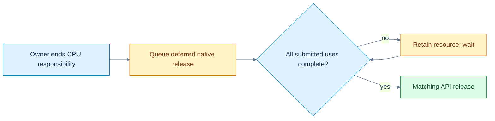

**Read the picture:** the destructor can transfer the release duty to a deferred-deletion queue. A fence or timeline condition covering every submitted use then permits native reclamation. **Limit:** this is a renderer policy, not behavior supplied by C++ or smart pointers. The queue, allocator and device must remain valid, and the backend must establish the correct completion condition. [[Visual Recall/02 - C++ - Objects, Ownership and Lifetime - Visual Recall#Four figure briefs|Recall this figure]].

### Custom allocation separates obtaining bytes from constructing objects

Ordinary `new T(args...)` is a **new-expression**: conceptually it obtains appropriately sized/aligned storage and initializes a `T` there. `delete p` calls the object's destructor and the matching deallocation function when `p` denotes a suitable object created by a matching allocation protocol. The expression manages a pair of operations; it is not merely a call to `operator new`.

An **allocation function** such as `::operator new(size)` obtains raw storage. It does not, by itself, create an arbitrary `T` object in that storage. An **object lifetime** begins only when the language's construction or implicit-lifetime rules say it does. This distinction matters in arenas and pools, where an allocator reserves a block and a container or caller constructs objects inside it. The allocator owns storage management; the object-aware layer must still construct and destroy the occupants correctly.

Modern code should normally keep explicit allocation centralized in a standard container, allocator-aware container, or carefully designed owner. `malloc`/`free` do not call C++ constructors/destructors. `new (std::nothrow) T` changes allocation-failure reporting for the corresponding new-expression, but it does not remove constructor exceptions or make every memory failure impossible. Alignment is a real precondition: storage must satisfy `alignof(T)`, as well as have enough size. Over-aligned types and custom pools need explicit support.

### Arrays carry a count and a destruction protocol

`new T[n]` creates an array of `n` elements (subject to allocation and construction succeeding); `delete[]` must destroy the constructed elements and release storage with the matching array deallocation protocol. The count is semantically important even when an implementation stores it in hidden overhead. If constructing a later array element throws, already-constructed earlier elements are destroyed and storage is released as required by the new-expression rules.

This is why inventing an array by allocating `n * sizeof(T)` bytes and pretending it is automatically a `T[n]` is not a generic safe shortcut. You need correct overflow checks, alignment, object construction for each element, tracking of how many constructions succeeded, reverse destruction, and matching deallocation. Let `std::vector<T>`, `std::unique_ptr<T[]>`, or a proven allocator/container abstraction carry that protocol unless you are implementing such a layer deliberately.

### Placement construction reuses storage; it does not allocate it

Sometimes an engine has reserved a pool slot or arena block and needs to begin a new object's lifetime there. [[Placement construction and explicit lifetime management|Placement new]] is the traditional spelling for constructing into an address supplied by the caller. In current C++, `std::construct_at(p, args...)` is usually a clearer library interface for this operation when its preconditions are met. Neither form obtains the underlying storage. The caller must already have enough correctly aligned storage, and must track the lifetime and eventual destruction of the object.

```cpp
#include <cstddef>
#include <memory>
#include <new>

alignas(Widget) std::byte slot[sizeof(Widget)];
Widget* item = std::construct_at(
    reinterpret_cast<Widget*>(slot), constructor_argument);

Use(*item);
std::destroy_at(item); // ends Widget lifetime; slot bytes still exist
```

This sketch demonstrates the distinction, not a complete general-purpose arena. A production slot abstraction should encapsulate size, alignment, occupancy, exception cleanup, and whether it is currently legal to reuse the storage. Calling `std::destroy_at` does not free `slot`; returning the slot to the arena is a separate allocator action. Conversely, reusing storage can end an existing object's lifetime, so existing references and pointers need the language's object-replacement rules, not just the same numeric address.

`std::launder` is not a generic “make this pointer valid” spell. It can obtain a pointer to an object already within its lifetime at an address when specific reachability and type conditions are met. It does not allocate storage, construct an object, fix alignment, revive a destroyed lifetime, or make an out-of-bounds pointer legal. Modern lifetime facilities—including `construct_at`, `start_lifetime_as` where applicable, and implicit-lifetime rules—have precise scopes; choose the operation that matches the intended object-creation semantics instead of treating raw bytes as universally interchangeable with objects.

### A union or arena slot has one occupant at a time

A union lets multiple members reuse storage, but only the active member's lifetime and value can be used under the applicable rules. When switching between non-trivial members, destroy the current member as needed, then construct the next one. A `std::variant` is often preferable for ordinary tagged alternatives because it tracks which alternative is active and handles construction/destruction; a manually managed union is a lower-level tool with a larger correctness burden.

The same reasoning applies to an arena slot: at one moment it may hold a `Particle`; later, after that lifetime ends, it may hold a `Command`. Bytes can remain at the same address while the object identity and valid operations change. **Transparent replacement** permits old names, pointers, or references to refer to a replacement object only when the standard's conditions are met; do not assume same address and same type always settle every case. If a pointer cannot automatically designate the replacement, a narrowly justified `std::launder` may be relevant after construction—but it still does not replace correct destruction, construction, alignment, and type checks.

Ordinary automatic objects should not be manually destroyed and then allowed to undergo their usual automatic destruction again. That risks using an object outside its lifetime and double destruction. Explicit destruction is appropriate in a controlled storage-management abstraction that also takes responsibility for exactly one construction and exactly one destruction per occupant. A tagged union or arena should track its state so the code knows which destructor is valid.

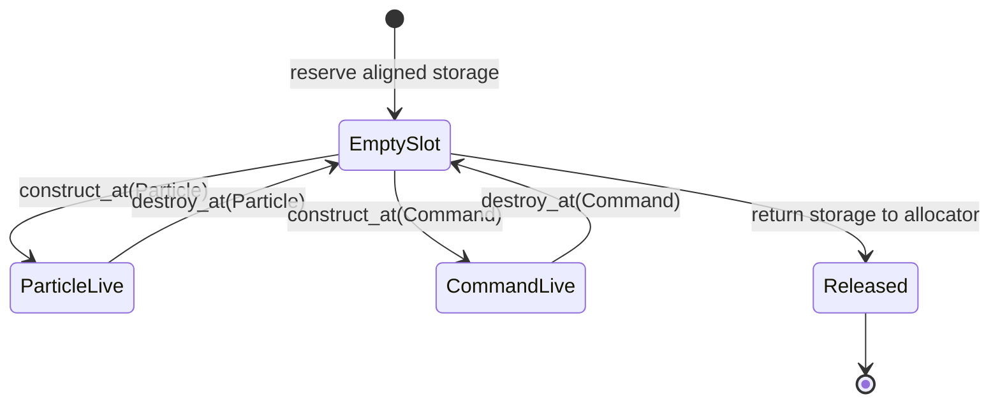

**Caption — Storage is not the occupant:** every transition has a precondition. Never construct the next occupant while a non-trivial current occupant still needs destruction; never read a member merely because the bytes at its former address still look familiar.

### A compact laboratory: choose the owner before the pointer

When reviewing a resource path, write a tiny ledger before looking at syntax:

| Question | Example answer for a GPU buffer |
|---|---|
| What is acquired? | Native buffer handle plus bound device memory. |
| Who creates it? | Device/resource factory with a specific allocator. |
| Who owns release responsibility? | A move-only `GpuBuffer` value. |
| Who merely borrows it? | A command-recording function during a documented valid interval. |
| What ends CPU-side ownership? | Destruction/reset of the `GpuBuffer`. |
| What delays actual release? | Completion fence/timeline for every submitted use. |
| What if creation of the second native object fails? | The first acquisition is already held by a cleanup owner and is released. |
| Can copying duplicate responsibility? | No; the owner is non-copyable and movable. |

Then test four failure paths: failure before acquisition, failure after the first of two acquisitions, early return after validation, and normal completion with work still in flight. A passing test should observe the matching release exactly once and only after the external-use condition is satisfied. Unit tests can verify wrapper behavior with a fake API; only the real backend can verify its actual synchronization and native-handle protocol.

### The teaching summary: ask “who, until when, by which release?”

The story now extends the object model. Storage answers where bytes are available. Lifetime answers which object occupies them. Ownership answers who must end the resource's use. External synchronization answers when release is actually safe. RAII connects the owner's object lifetime to its cleanup protocol; smart pointers are standardized ownership policies, not general-purpose pointer decorations. `unique_ptr` answers “one owner”; `shared_ptr` answers “a genuine shared lifetime”; `weak_ptr` answers “observe without keeping alive.” A raw pointer or reference usually answers only “borrow access.”

When bytes must be managed below the level of containers, allocation, object construction, destruction, and storage release are separate operations. Placement construction begins an object in already-provided storage. Explicit destruction ends that object's lifetime, not necessarily the storage's. Reuse creates a new occupant and requires the language's lifetime and replacement rules. None of these low-level tools removes the need for an owner ledger.

**Board test:** draw the four-level lifetime diagram, then pick one file, lock, unique resource, shared resource, and arena slot. For each one, say who owns it, who borrows it, what event ends use, what operation releases it, and what can make release too early or too late. If those answers are concrete, the vocabulary has become an operational model.

[[Visual Recall/02 - C++ - Objects, Ownership and Lifetime - Visual Recall|Open the C++ visual-recall board]] · [[Supplementary/Foundations#M010 - Parts 148-160|M010 coverage ledger]] · [[Keyword Index]] · [[Dependency Map]]


## From one owned resource to many requests and a replaceable backend

The previous chapter established that a resource has an owner, an object lifetime, and sometimes an external user that can outlive the local C++ scope. That solves one class of problems. It does not yet tell us how a renderer should represent different *kinds of work*, or how the same calling code can send that work to a Vulkan implementation, a Metal implementation, or a test implementation without rebuilding every scene system.

Imagine that the editor has three actions waiting for the renderer. First it clears the background to a color, then draws mesh 17 with material 4, and finally uploads 4,096 bytes of texture data. The renderer must remember **which kind of request each record represents**; otherwise the number 17 might be mistaken for a byte count or a color component. And the editor should not need to know which graphics API is responsible for carrying out the requests. These two requirements are related but different: a request is *one value chosen from a known set of shapes*; a backend is *one implementation chosen from a set that may be selected at runtime*. We will solve the first problem with a tagged alternative, and the second with a carefully owned interface. Along the way, we will encounter the C++ rules that make this safe or dangerous.

### Why reusing memory does not identify the object stored there

Suppose the first version of a command buffer saves space by allocating one record large enough for either a color or a mesh identifier. In C++, a `union` can give distinct members overlapping storage:

```cpp
union Cell {
    std::uint32_t meshIndex;
    float opacity;
};

Cell cell{.meshIndex = 17};  // meshIndex begins as the active member
cell.opacity = 0.5f;         // for this trivial member, assignment begins its lifetime
// Reading cell.meshIndex here is not a valid way to recover the old mesh index.
```

A union is not a magic box in which every member simultaneously exists. Its members share storage; the *active member* determines which object can be accessed under the applicable lifetime rules. For nontrivial members, changing the occupant may require explicitly destroying the old object and constructing the new one. In contrast to a formatted file, the raw union does not carry a trustworthy external tag saying which interpretation the next reader should use. A handwritten tagged union therefore needs a separate discriminant, a complete set of valid states, correct constructors, destruction, copying and moving, and recovery if a constructor throws. The challenge is not allocating enough bytes; it is preserving the link between bytes, object lifetime, and the *meaning* of the active value.

If the request alternatives are known at compile time, `std::variant` gives us that link without requiring an engine author to implement the union's state machine by hand:

```cpp
#include <cstdint>
#include <variant>

struct Clear { float red, green, blue; };
struct DrawMesh { std::uint32_t meshId, materialId; };
struct Upload { std::uint64_t byteCount; };

using Request = std::variant<Clear, DrawMesh, Upload>;
Request request = DrawMesh{17, 4};

if (auto* draw = std::get_if<DrawMesh>(&request)) {
    // A non-null pointer proves this is presently the DrawMesh alternative.
    DrawMesh selected = *draw;
    (void)selected; // the example only demonstrates the checked read
}
```

The alternative type and the currently active index are separate ideas. `std::holds_alternative<T>` asks which alternative is active; `std::get_if<T>` returns a pointer only when that type is active; `std::get<T>` throws `std::bad_variant_access` if the selection is wrong. `std::visit` selects the operation corresponding to the actual alternative, allowing a renderer to handle each command without inventing a dangerous integer-to-struct cast. The visitor's result type and alternative handling must still be coherent: for a non-generic visitor, adding a new alternative requires updating the visitor. A `variant` can also become `valueless_by_exception()` in certain throwing replacement operations; code that relies on `visit` must decide how to treat that exceptional state rather than assuming it is impossible. It is a *type-safe representation*, not a promise that user inputs, bounds or resource readiness are valid.

Follow the three requests as values. The first object is a `Clear` containing three floating-point color components; the second is a `DrawMesh` containing two unsigned identifiers; the third is an `Upload` containing a 64-bit byte count. A visitor reads the first as color, the second as mesh/material identity, and the third as a byte quantity. It never attempts to read a mesh index from an active `Upload`. Changing from `DrawMesh` to `Upload` changes the active alternative and ends the prior alternative's lifetime according to the variant operations. The type itself expresses that exactly one of the listed command forms is present at a time.

This is a good use of a *sum type*—a value with one of several explicitly listed forms. It is not automatically an efficient GPU command format: the object's layout is a C++ library representation, not a stable wire format or shader ABI, and `std::variant` can carry size, alignment and dispatch costs. If requests must be serialized or uploaded to a device, define a separate, versioned binary record and validate conversion into the in-memory alternative. That follows directly from the earlier lesson that an object's C++ layout is not a file or GPU contract.

### The request has a known shape; the backend has a runtime identity

The editor can now represent work, but it still should not contain an `if` statement for every graphics backend at every call site. A base class can specify a common operation, and a derived class can provide its implementation. This is an *is-a* relationship only when every derived object truly satisfies the base's observable contract; inheritance is not an appropriate shortcut just to reuse a few lines of implementation. For ordinary implementation sharing, composition—a member object containing another object—is often simpler and safer.

Consider the smallest meaningful backend interface:

```cpp
class Backend {
public:
    virtual ~Backend() = default;
    virtual void submit(const Request& request) = 0;
};

class CountingBackend final : public Backend {
public:
    void submit(const Request& request) override {
        // Count commands through std::visit without pretending to execute GPU work.
    }
};
```

The word `virtual` means that when `submit` is called through a `Backend` reference or pointer, C++ can select the final override appropriate to the object's dynamic type. The static type is what the expression is declared to be—`Backend&`, for example. The *dynamic type* identifies the actual polymorphic object, which could be `CountingBackend`. A pure virtual declaration, marked `= 0`, makes the base abstract: it cannot be instantiated as a complete object while it retains an unimplemented pure virtual operation. An abstract interface specifies a minimum useful contract, not a guarantee that every implementation behaves correctly. The derived `override` keyword asks the compiler to diagnose a signature that fails to override, and `final` disallows further derivation or override as applicable.

Many compilers implement virtual calls using a hidden table of function pointers and a per-object pointer or equivalent metadata, usually called a *vtable* and *vptr*. That is a useful performance and layout model, **not a layout mandated by the C++ language**. A virtual call may involve an indirect branch, and an optimizer may remove that indirection when it can prove the target. You must not serialize a polymorphic object by copying its bytes, assume its first machine word is a vptr, or calculate its size by casually adding a pointer to its named fields. Actual layouts, thunks and adjustment rules depend on the compiler and its application binary interface.

Why is the virtual destructor necessary? The renderer factory might return `std::unique_ptr<Backend>` while constructing a concrete `CountingBackend`. When the owner is destroyed, its default deleter calls deletion through the `Backend*`. A suitable virtual base destructor ensures that the derived object is destroyed through the polymorphic deletion path, then its base subobjects. Deleting a derived object through a base pointer that lacks an appropriate virtual destructor is unsafe in the ordinary default-delete pattern. A base intended for polymorphic ownership should make its destructor policy explicit, normally public and virtual. A custom deleter that retains the concrete destruction protocol can be an exception, but it needs its own proof rather than an assumed shortcut.

The lab uses borrowed references to a `Counts` record and a destruction counter. The test creates the backend inside a scope and confirms the derived destructor runs once as the `unique_ptr<Backend>` leaves that scope. The references must remain alive for the backend's entire use; virtual dispatch does not turn them into owners. Likewise, a real backend's destructor must respect GPU completion and deferred retirement rules established in the previous chapter. The virtual destructor selects the correct C++ cleanup behavior—it does not implicitly wait for device queues.

### A derived object contains a base subobject, not an interchangeable base value

When a `CountingBackend` is constructed, there is a `Backend` base subobject within the complete object. A base pointer or reference can refer to that subobject while virtual dispatch preserves access to the derived behavior. But copying a derived object into a *base value* constructs only a base object, discarding the derived portion. This is **object slicing**.

The runnable lab demonstrates slicing with a non-abstract `NamedObject` base and a `MeshObject` derived class. Calling `kind()` through a `NamedObject&` bound to the original mesh returns `"mesh"`. Copying the same mesh into a new `NamedObject` value gives that new object the base's dynamic type, so its virtual `kind()` returns `"base"`. The source object has not changed. What changed is which complete object the caller is asking about. An interface with pure virtual functions cannot itself be sliced into a standalone instance because abstract classes cannot be instantiated, but non-abstract polymorphic bases can still suffer this problem. Prefer references, pointers or owning polymorphic wrappers when dynamic identity matters.

Multiple inheritance extends this picture. A derived class can implement two independent interfaces, perhaps `IRenderBackend` and `IDiagnostics`. It then contains the corresponding base subobjects; conversion to each base view may involve a pointer adjustment, and unrelated base names can become ambiguous. Two separate paths may also reach the same ancestor, producing the *diamond* shape. Ordinary repeated inheritance may give two ancestor subobjects. Declaring the shared ancestor as a **virtual base** makes its subobject shared within the most-derived object; the most-derived class is responsible for initializing that virtual base. The lab constructs `Diamond : Left, Right` with both paths virtually inheriting `Root` and verifies that conversion through either path yields the same `Root` subobject. This illustrates identity, not a promised pointer offset or byte layout.

Multiple inheritance is therefore not automatically wrong, but it increases the reasoning burden. Independent pure interfaces are a common defensible use; complex concrete inheritance diamonds often signal that composition would communicate ownership and responsibilities more clearly.

### A cast cannot manufacture a valid object

When the caller holds a base pointer, there may be a genuine need to discover the concrete implementation for diagnostics. `dynamic_cast<CountingBackend*>(backend.get())` checks a runtime relationship for polymorphic types and returns null for an incompatible pointer cast. A failed reference cast throws `std::bad_cast`. This can be useful at debugging or integration boundaries, but repeated downcasts often suggest that the base interface is missing a required operation or that the design has become dependent on a particular implementation. Availability also depends on build settings that support the required runtime type information.

A `static_cast` converts between related types when the language permits it, but it does not perform that same dynamic check. A base-to-derived `static_cast` needs a proof that the actual object is compatible; a syntax-valid cast is not such a proof. Converting a derived pointer to a base pointer is a normal, safe upcast within its lifetime and access rules. A `const_cast` can remove `const` or `volatile` qualification from an access path, but writing through it is undefined when the underlying object was genuinely declared const. It does not grant ownership or synchronize threads.

A `reinterpret_cast` can reinterpret particular pointer or integer representations under language rules, but it neither constructs the new object nor makes an unrelated type legally alias the same bytes. This is a frequent source of misleading engine code. To inspect bytes, use the appropriate byte-view or copy operation; for supported equal-sized trivially copyable representations, `std::bit_cast` expresses a representation conversion much more clearly than treating a typed object as a live unrelated type. Endianness, padding and format versioning remain separate concerns. No cast eliminates alignment, bounds, provenance or lifetime obligations.

### Equality is an engine promise, not merely a convenient operator

A command system needs identities. A resource handle composed of `slot=7` and `generation=3` is different from `slot=7` and `generation=4`, even if both refer to storage at the same index at different times. We can make this meaning explicit through a value type:

```cpp
struct AssetId {
    std::uint32_t slot;
    std::uint32_t generation;
    auto operator<=>(const AssetId&) const = default;
};

static_assert(AssetId{7, 3} == AssetId{7, 3});
static_assert(AssetId{7, 3} != AssetId{7, 4});
```

The defaulted three-way comparison uses the declared members in order and can also enable a synthesized equality operator under the relevant rules. For these unsigned integer fields, this gives a *strong ordering*: two IDs compare consistently by their stored values. That is a useful deterministic order for keys, but it is **not** a statement about resource age, importance or current validity. A handle remains invalid if its registry does not contain the matching live generation, even when its fields compare equal to an old recorded handle. An equality operator must represent the intended semantic equivalence; it should not casually compare memory bytes that may contain padding or unrelated bookkeeping.

C++20's `<=>` reports an ordering category rather than always returning a Boolean. Strong ordering is appropriate for identities with a meaningful total order; weak ordering can represent equivalent values that need not be identical under the application relation; partial ordering includes values that cannot be compared in the usual way. Floating-point NaN illustrates partial ordering: comparing NaN with a finite value is unordered, not less, equal or greater. A defaulted comparison for a record containing floating-point fields can therefore have different semantic consequences than the integer-only `AssetId`. Using such records as ordered-map keys requires an ordering relation that satisfies the container's strict weak ordering requirements, including an explicit policy for NaNs if relevant.

Operator overloading is useful when it keeps the domain meaning visible—for example, adding a duration to a timestamp, not adding two arbitrary resource handles. Operators should preserve the invariants of their value types, avoid hidden resource creation or unexpectedly expensive work, and agree with the ordinary interpretation of the operation. A custom `operator==` should be reflexive, symmetric and transitive over the domain in which it is used; exact floating-point equality is not a general approximate comparison policy. Contextual tolerances belong in explicitly named comparisons, not silently inside a container key's equality relation.

### The compiler chooses an overload before a virtual function chooses its implementation

Another decision occurs at the call site: a function name may refer to several overloads. C++ first performs name lookup to find candidate declarations, then decides which are viable for the provided arguments, and ranks allowed conversions. An exact match normally wins over a conversion; templates, user-defined conversions, constraints and visibility can complicate that choice. The return type alone does not ordinarily distinguish overloads of the same parameter list. If two viable candidates are equally good under the ranking rules, the call is ambiguous and the program is rejected rather than deciding unpredictably at runtime.

The lab's `classify(int)` and `classify(double)` are an intentionally small observable case. Passing `3` chooses the integer overload and produces `1`; passing `3.0` chooses the double overload and produces `2`. A cast can influence the static type passed to overload selection, but it should not be used to conceal a poorly specified API. Especially in generic engine code, signed/unsigned conversions, initializer-list constructors, implicit conversions, and similarly named overloads deserve compile-time tests because an innocent-looking literal can select a different operation.

Default function arguments create a subtler interaction with virtual calls. Consider:

```cpp
struct Base {
    virtual ~Base() = default;
    virtual int reserve(int n = 2) const { return n; }
};
struct Derived : Base {
    int reserve(int n = 7) const override { return n * 10; }
};

Derived concrete;
Base& baseView = concrete;
assert(baseView.reserve() == 20); // default argument 2 from Base, body from Derived
assert(concrete.reserve() == 70); // default argument 7 from Derived, same Derived body
```

The default argument is chosen from the declaration visible through the **static type at the call site**; the virtual function body is selected according to the **dynamic type at runtime**. These are two different decisions. Defaults are not inherited as a dynamic policy, do not form part of the function type, and can create surprising differences when an override supplies a different default. A safer public interface often provides one non-virtual wrapper that determines defaults and calls a protected virtual operation with all arguments explicit. This is a concrete reason to understand lookup and dispatch together instead of learning them as unrelated vocabulary.

### One trace through the complete model

Start with three `Request` values: a clear, a mesh draw, and an upload of 4,096 bytes. Each value's variant tag identifies its active alternative. A `std::unique_ptr<Backend>` owns a `CountingBackend`, while the three requests are borrowed by reference during `submit`. Virtual dispatch calls the concrete override; within that override, `std::visit` chooses behavior from the active request tag. The resulting counters are one clear, one draw, one upload and 4,096 accumulated bytes. Leaving the scope destroys the derived backend exactly once via a virtual destructor. No real GPU work was submitted; the test's purpose is the C++ choice-and-lifetime model.

Now alter the system deliberately. Change the second request from `DrawMesh` to `Upload` and verify the active tag changes, the counter changes and no draw-specific field is read. Try a checked downcast to a different backend type and verify it returns null. Copy a derived object into a non-abstract base value and observe slicing. Reach the same virtual base through both diamond paths. Call an overridden virtual function through different static types with different defaults. Compare two handles differing only in generation; then compare a NaN to a finite floating-point value and check the result is unordered. Each experiment isolates a rule that matters when the engine grows beyond one backend and one command.

**Runnable reference:** [[tools/labs/backend_choice_lab.cpp|`tools/labs/backend_choice_lab.cpp`]]. From the repository root, compile with:

```sh
c++ -std=c++20 -Wall -Wextra -Wpedantic -Werror \
  -fsanitize=address,undefined -fno-omit-frame-pointer \
  tools/labs/backend_choice_lab.cpp -o /tmp/backend_choice_lab
/tmp/backend_choice_lab
```

The reference run used GCC 14.2.0 on Linux with address and undefined-behavior sanitizers enabled and completed all the assertions. This is evidence for this standalone C++ model, not for an actual Vulkan/Metal implementation or current Kairo modules. Before attributing anything to `KairoRenderer/GraphicsBackend.cppm` or `KairoAI/AIProvider.cppm`, inspect the corresponding current repositories and cite exact declarations and call sites. No such external repository inspection is claimed by this chapter.

### Choose the mechanism by the question it solves

A `variant` is a natural fit when the supported alternatives are known and a value should always identify its active form. Virtual dispatch is a natural fit when a stable contract must be implemented by objects selected or extended independently at runtime. An overloaded function is a *compile-time selection* from declarations based on argument types and conversions, not a runtime substitute for a backend interface. A cast changes or checks how an expression views an existing object; it does not create the representation, ownership or dynamic behavior the system lacks. Equality and ordering define domain promises about values, not about the existence of live resources.

The cost comparison also needs evidence. Virtual calls can inhibit inlining when the target is unknown, but indirect calls are not automatically slower overall than a large `variant` visitor with poor locality. `variant` stores the largest appropriately aligned alternative and carries a discriminator; polymorphic objects have separate allocation and locality possibilities, depending on how they are owned. A useful controlled experiment compares the same sequence of commands under both representations: report object size, allocation count, branch predictability where measurable, instruction cost, cache behavior, and whether the compiler could devirtualize. Do not declare one abstraction universally faster without stating workload, compiler, architecture and optimization settings.

**Reconstruct without reading:** explain why a byte array is not automatically a live command; derive why three known request forms favor a checked tag; draw an owning interface and its derived object; identify where a base subobject exists; predict slicing and the default-argument example; state exactly what each cast does and does not prove; and describe why a generation-aware identifier needs both slot and generation in equality. Then rebuild the counting backend and test it from a blank file. When those actions work, the material has become implementable knowledge rather than a list of C++ terms.

**Coverage boundary:** this first additive narrative targets the original M011 Parts 161–180. It provides a coherent teaching route and a checked standalone laboratory, but it is not an independent audit of the user's external engine repositories, every possible C++ ABI, or learner recall. The separate evidence ledger records that boundary; no missing source segment is silently reclassified as received.

## From an accepted render request to a resource that survives failures and callbacks

Our last chapter established two independent decisions: a `std::variant` identifies what work was requested, and a virtual `Backend` interface identifies which implementation performs the work. That is not yet a complete resource pipeline. The editor can ask to upload a mesh; a worker may read its data later; a renderer may allocate a native handle; and a completion callback may run after the scene that requested it has closed. An invalid file, a failed allocation or an exception must not expose a half-created resource. The same problem forces us to understand conversions, callable objects, lambda captures, exception guarantees, object representation and safe native-resource ownership. We will not learn these as twenty unrelated pieces of vocabulary: we will follow one upload from the request boundary through validation, preparation, publication and notification.

The central contract is simple to state and difficult to maintain: **a published asset is complete, its owner is unambiguous, its data have a checked meaning, and failed preparation must not change previously published assets.** We must also distinguish the lifetime of a C++ object from its backing device resource and from a callback that might retain a reference to it. The actual C++20 reference is [[tools/labs/safe_asset_pipeline_lab.cpp|the safe asset pipeline laboratory]]. It is intentionally a deterministic fake native-device model, not an uninspected claim about any current Kairo, Vulkan or Metal implementation.

### The first bug is possible before we load a file: 4096 of what?

A function such as `upload(std::size_t amount)` accepts a numeric quantity but says nothing about its meaning. Mesh indices, texture IDs, byte counts and frame numbers might all use `std::size_t`. Their machine representation can be similar without making the quantities interchangeable. C++ overload resolution reasons about types and allowed conversions, not the intent behind an integer. An ordinary one-argument constructor can participate in *implicit conversion*, and a user-defined conversion operator can turn one class value into another type in certain contexts. Convenience is valuable for a genuinely interchangeable representation; it is dangerous when it silently changes units.

Give our operation its own small value type:

```cpp
struct ByteCount {
    std::size_t value;

    explicit constexpr ByteCount(std::size_t n) noexcept : value(n) {}
    explicit constexpr operator std::size_t() const noexcept { return value; }
};

ByteCount requested{4096}; // the unit conversion is visible
// ByteCount accidental = 4096; // intentionally rejected by explicit
auto rawNumber = static_cast<std::size_t>(requested);
```

`explicit` on a converting constructor prevents its use in ordinary implicit copy-initialization; it does not prohibit explicit direct construction. `explicit` on a conversion operator likewise controls which conversion contexts can use it. Contextual Boolean conversion is a special case—for example, a class may provide `explicit operator bool()` yet work in an `if` condition. An unqualified implicit conversion operator may also affect overloaded-function selection unexpectedly, so conversion policy must be considered together with the overload rules from the preceding chapter.

The laboratory checks the compiler's answer with `std::is_convertible_v` in both directions. The static assertions establish that a `std::size_t` does not implicitly become our `ByteCount` and vice versa. They do **not** establish that a count fits device capacity or is nonzero. Those are distinct runtime conditions, validated before native acquisition. The important lesson is not to wrap every scalar mechanically; it is to choose explicit types at boundaries where mixing meanings would violate an important contract.

### A worker needs a callable completion operation—and a way to know what state it may use

A *callback* is an operation passed to another component for invocation on its terms. If the callback runs immediately, it may borrow a local variable whose lifetime is known to cover that call. If it is stored for later execution, the same borrowed variable can disappear before invocation. The safety question is therefore not merely “does this type have parentheses?” but **what does its invocation need, and who keeps that state alive?**

A plain function pointer identifies a function with a compatible signature. It carries no automatically associated editor object. A C-style API frequently passes a second, opaque pointer back to the function:

```cpp
using RawReport = void (*)(void*, ByteCount);

void report_to_counter(void* context, ByteCount bytes) {
    // Contract: context points to a currently live, aligned std::size_t.
    auto& sum = *static_cast<std::size_t*>(context);
    sum += bytes.value;
}

std::size_t completedBytes = 0;
RawReport report = &report_to_counter;
report(&completedBytes, ByteCount{4096});
```

The `void*` context is a *borrow*: converting it back using `static_cast` does not check that it is the correct object type, still alive, or safe to access concurrently. The function pointer has no ownership power over `completedBytes`. If a worker stores the pointer beyond the local variable's lifetime, the callback eventually accesses a dangling object. If the callback is invoked from another thread while the editor changes the same counter without synchronization, the data race is a different correctness failure. The use of a C API does not exempt us from C++ lifetime and concurrency rules.

A pointer to a **non-static member function** is a different type of callable because a member operation requires a particular object. For example:

```cpp
struct Reporter {
    std::size_t bytes = 0;
    void report(ByteCount value) { bytes += value.value; }
};

Reporter reporter;
void (Reporter::*operation)(ByteCount) = &Reporter::report;
(reporter.*operation)(ByteCount{32});
```

The operation is associated with the `Reporter` class; calling it also requires `reporter`. The equivalent syntax for a pointer to a `Reporter` is `(pointer->*operation)(ByteCount{32})`. A pointer-to-member function is not generically interchangeable with an ordinary function pointer and is not guaranteed to be represented by one address-sized machine word. Virtual dispatch and multiple inheritance can change the implementation's member-pointer representation. A callback trampoline can bridge such an operation into a function-pointer-and-context API, but the context's lifetime remains an obligation.

A **function object** solves a related problem by keeping operation and state in one C++ object. It defines `operator()`:

```cpp
struct AddBytes {
    std::size_t* destination; // still a borrow, not ownership

    void operator()(ByteCount amount) const {
        *destination += amount.value;
    }
};

std::size_t total = 0;
AddBytes add{&total};
add(ByteCount{16});
```

Now a callback has a concrete object representation that can carry arguments, handles or other state. But the raw pointer inside it remains borrowed. Copying a callable copies its member fields according to their semantics; it does not automatically deep-copy their referents.

### A lambda is a created object, and its capture is a lifetime contract

A lambda expression creates an object of a unique, compiler-generated *closure type*. Its body becomes a callable operation. Its captures determine which state is stored in, or referred to by, that object. We can understand the behavior without guessing the compiler's closure layout.

```cpp
std::size_t changing = 10;
auto snapshot = [saved = changing] { return saved; };
auto liveView = [&changing] { return changing; };
changing = 20;

// snapshot() returns 10; it owns the captured numeric value.
// liveView() returns 20; it accesses the same still-live variable.
```

The distinction is not merely syntactic. A value capture of a `std::string_view` copies the *view*, not the characters it points at. A value capture of a raw pointer copies the pointer, not the object. A `[&scene]` capture makes the eventual invocation depend on a live `scene`. Capturing `this` allows member access but does not keep the pointed-to object alive. The `[=]` default capture in a member function must not be mistaken for automatically owning a copy of the entire object. When appropriate and copyable, `[*this]` creates a captured copy of the current object; that can be expensive or wrong when the original object represents unique engine identity.

Suppose a user closes a scene after starting a texture load. The worker completes, invokes a lambda holding `[&scene]`, and tries to publish the texture into a destroyed scene. That is a lifetime violation, typically **undefined behavior**, not an exception we can recover from. Three common valid designs make different promises: copy the small data that the callback truly needs; capture a `std::shared_ptr` to state whose lifetime is intentionally shared; or capture a `std::weak_ptr`, call `lock()` when invoked, and gracefully discard the result if the state no longer exists. A generational scene/request identity can also prevent obsolete results from being published, if the registry's lifetime and synchronization contracts are correct.

An owning capture is demonstrated in the lab. A callback captures a `std::shared_ptr<int>` and can safely run after the local shared pointer's scope ends. A `weak_ptr` observer verifies that the target stays alive while the callback owns it and expires when the callback target is released. This does **not** prove every use of `shared_ptr` is thread-safe; it controls object lifetime, not unsynchronized access to its mutable contents. Storing an owning callback inside an object it strongly owns can form a cycle. The correct ownership graph matters more than the apparent convenience of the capture syntax.

### Why a uniform callback interface still has a price

The editor may want a queue of callbacks all callable as `void(ByteCount)` while their real types differ. `std::function<void(ByteCount)>` is a *type-erased* callable wrapper: the consumer can invoke one public signature without knowing the stored function, lambda or functor's concrete type. The wrapper manages the target's lifetime, invocation and copying. It has its own failure state: invoking an empty `std::function` throws `std::bad_function_call`.

Type erasure hides the concrete type at a particular interface, **not** its runtime cost. A library may store small targets inline and allocate storage for others; no particular inline size is guaranteed for arbitrary user targets. Copying the wrapper copies the target and can therefore copy captures or increase shared ownership counts. `std::function` requires a copy-constructible callable target; a lambda that directly captures a move-only `std::unique_ptr` is not generally a valid target. C++23 adds `std::move_only_function` for move-only callable wrappers, while templates can preserve the callable type when runtime erasure is unnecessary.

For a synchronous low-level API, a function pointer plus context can be simpler. For a worker queue, a move-only task may better express ownership. For an event subscription that is copied, `std::function` may be appropriate. A custom small-buffer wrapper requires actual measurement and a careful lifetime implementation. None of these choices is automatically the fastest. Benchmark the same workload, measuring call overhead, allocation count, target size, cache behavior and contention on the target compiler and standard library before claiming an advantage.

### A decoded asset is not ready merely because its bytes exist

Our callback mechanisms can now notify the editor. But the actual upload needs a sound state transition. Imagine the scene already contains one valid mesh. It asks for a texture; the loader has data bytes, acquires a native resource handle, and then discovers an invalid asset field. If it has already inserted the partial record into the scene, the scene's published state is corrupted. If it forgets to release the native handle on failure, the resource leaks.

A correct *prepare-then-publish* transaction keeps the proposed result private while its parts are being constructed. It is made visible only after all required preparation succeeds. C++ exceptions make this easier when resources are held by properly constructed local owner objects. If an operation throws, automatic local objects constructed earlier are destroyed during **stack unwinding**. Their destructors execute the cleanup responsibility that they own. An exception does not, however, undo arbitrary external effects such as bytes already written to a file, a network message already sent or GPU commands already submitted.

We can specify three useful failure guarantees. The **basic guarantee** means that objects remain valid and resources do not leak, although published values may change. The **strong guarantee** means that a failed operation leaves the specified observable state as it was before the operation. The **no-throw guarantee** means no exception escapes that operation; it does not promise that it cannot report failure another way.

Let $S$ denote the store's published asset sequence, and let $P$ denote a private, fully prepared record. A successful publication changes the sequence according to:

$$
S_{\mathrm{new}} = S_{\mathrm{old}} \mathbin{\|} P,
$$

where $\mathbin{\|}$ is the append operation. The strong guarantee for a covered failure means:

$$
S_{\mathrm{after\ failure}} = S_{\mathrm{before}}.
$$

This equation does **not** mean no temporary memory was allocated or no resource was ever created during the attempt. It means that the declared visible state is unchanged. The resource acquired on a failed path must still be released, and a commit boundary must be specified separately from later notifications.

### Build an owner from an empty state, not from a hope that callers remember delete

The first phase's ownership chapter established why a destructor should control a matching release protocol. We now design a resource-owning type from an empty state. The fake device creates a native handle; a wrapper records the associated borrowed device and the unique handle. An empty wrapper has no release responsibility. A successfully constructed wrapper owns exactly one such responsibility.

```cpp
class Resource {
    FakeDevice* device_ = nullptr; // device lifetime must cover Resource
    std::size_t handle_ = 0;       // zero means no native handle
public:
    Resource(FakeDevice& device, ByteCount bytes)
        : device_(&device), handle_(device.acquire(bytes)) {}

    ~Resource() noexcept { reset(); }
    Resource(const Resource&) = delete;
    Resource& operator=(const Resource&) = delete;

    Resource(Resource&& old) noexcept
        : device_(std::exchange(old.device_, nullptr)),
          handle_(std::exchange(old.handle_, 0)) {}

    void reset() noexcept {
        if (device_ != nullptr) {
            device_->release(handle_);
            device_ = nullptr;
            handle_ = 0;
        }
    }
    // The complete lab also implements correct move assignment.
};
```

A constructor that successfully acquires the handle establishes the owner's invariant. Copying is forbidden because two owners with the same release duty would cause double release. Moving transfers the device association and handle, leaving the source empty. Move assignment must first release the destination's old resource, handle self-assignment correctly, then adopt the source. The device must outlive all of its resource wrappers; storing a pointer to it does not own or extend the device lifetime. If the constructor's `device.acquire` throws, the `Resource` object is not completely constructed, so its destructor is not run. The factory must itself guarantee no leaked partially acquired native pieces; a constructor's not-yet-existing complete owner cannot be expected to repair a factory that leaks before returning.

This example begins from a blank *owner object*, but a complete native GPU buffer has additional requirements: allocator association, memory residency, queue submission, fences or timeline values, and deferred release while external consumers still use it. The fake model tests C++ ownership and exception flow; it is deliberately not a GPU lifetime proof. An owner for raw allocated *storage* would separately need checked size/alignment, construction and destruction of its occupants, and the matching allocator/deallocator. These are the same object-lifetime distinctions from M010, now applied to a publication protocol.

### The important failure: after acquiring a resource but before publication

The lab's `AssetStore::upload` accepts owned metadata and bytes, validates the payload, and prepares a native resource in local storage. A complete `AssetRecord` then contains the byte count, resource owner, source bytes and label. Only one operation publishes it: `records_.push_back(std::move(ready))`. Before that line, consumers cannot observe the proposed record through the store.

Why is this strong guarantee credible? First, any failure while `Resource pending` is live destroys it and releases the newly acquired handle. Second, existing records are untouched during preparation. Third, `std::vector` may reallocate during `push_back`; the example checks that its `AssetRecord` is nothrow move-constructible, so moving old records during such reallocation cannot throw on the tested element type. Failure to allocate replacement vector storage leaves the existing vector intact. These are conditions of the argument, not a blanket claim that vectors or moves are always exception-safe. With an element that is not copyable and whose move can throw, some vector reallocation paths cannot provide the same unchanged-state guarantee.

The actual test does this sequence:

| Point in the transaction | Published records | Handles acquired | Handles released | Live handles |
|---|---:|---:|---:|---:|
| Initial store | 0 | 0 | 0 | 0 |
| First successful mesh upload | 1 | 1 | 0 | 1 |
| Second upload throws after acquiring handle | 1 | 2 | 1 | 1 |
| Third successful texture upload | 2 | 3 | 1 | 2 |
| Store leaves scope | — | 3 | 3 | 0 |

During the deliberate failure, the original record retains its label and native handle. The just-acquired handle is released once. Afterward a new upload still succeeds. When the store is destroyed, every remaining owner releases its native handle. The operation is not a full filesystem or GPU transaction: the test does not inject failure at every possible allocation, perform concurrent cancellation or establish atomicity for a callback that executes after publication.

The latter distinction is important. If we publish a resource and *then* call a user callback which throws, the resource is already visible. Unless our API has a separate rollback/compensation protocol, it cannot claim the strong guarantee across that notification. **Transaction commitment and notification are separate stages.** Define when commitment occurs, who may observe it, and how callback failure is handled.

### noexcept is a promise about escaping exceptions, not a magical error handler

A destructor normally needs a non-throwing cleanup policy. Declaring `reset() noexcept` specifies that an exception must not escape it; if one attempts to escape, `std::terminate` is invoked. It does not catch or ignore the error. Cleanup for resources that can fail meaningfully—for example a file's final flush—often needs a separate explicit operation returning an error, while the destructor performs the safe best-effort release protocol.

`noexcept(expression)` can inspect whether an expression is statically non-throwing; `noexcept(condition)` can conditionally mark a function as non-throwing. Container algorithms care about these properties because relocating stored objects by throwing moves can leave partially changed state. `std::move_if_noexcept` can prefer copying rather than a potentially throwing move when the type's traits allow that choice. It does not guarantee every move succeeds or that every container offers an unconditional strong guarantee.

The lab therefore checks concrete properties at compile time:

```cpp
static_assert(std::is_nothrow_move_constructible_v<Resource>);
static_assert(std::is_nothrow_move_assignable_v<Resource>);
static_assert(!std::is_copy_constructible_v<Resource>);
static_assert(std::is_nothrow_move_constructible_v<AssetRecord>);
```

Those assertions describe these C++ types on the test build. They cannot establish completion of work already submitted to a hardware queue, and they do not replace resource-retirement rules from the rendering chapters.

### Which failures are expected input, which are operational, and which break our program?

An empty payload is invalid input that we can detect before allocation. The lab returns `UploadError::EmptyPayload`. Exhaustion of the device's finite handle table is an operational failure. A deliberately injected exception after acquisition tests rollback and is translated into a typed result. At the public boundary, success or error is represented as `std::variant<AssetId, UploadError>`, carrying exactly one alternative. C++20 does not yet provide standardized `std::expected`; that vocabulary type is standardized in C++23, so the chosen result type makes this lab buildable in C++20 without a third-party dependency.

The example catches `std::bad_alloc` separately from `std::runtime_error`. Its deliberately small set of runtime-error sources allows the injection flag to distinguish the simulated failure from resource exhaustion. This is not a production-quality error classification architecture: a real engine should use typed internal errors, preserve diagnostics, and avoid inferring the cause from message text or an incidental Boolean. Catch only failures the boundary is prepared to handle. Exceptions such as `std::bad_alloc` that arise *before entering the function body* when by-value parameters are constructed are not caught by an internal `try` block; the call site's contract must also be clear.

An `assert` belongs to a different category: it states an internal programmer assumption. Assertions are commonly disabled with `NDEBUG`, so placing input validation or essential side effects only inside `assert` is unsafe. Invalid file sizes, user-provided identifiers and network bytes always need actual checks. In the test lab, a separate `verify` function throws on failed checks so its tests still operate in a release-style `-DNDEBUG` build. The fake device's release operation treats an impossible double release as an internal invariant failure, deliberately terminating rather than pretending the input was an ordinary user error. A production system might choose other diagnostics, but it still must define the boundary.

### A file is a sequence of bytes, not an object of the type we wish were there

The asset loader reads raw file bytes. It is tempting to write `reinterpret_cast<const Header*>(file.data())` and access fields immediately. That cast does not verify length, alignment, object lifetime, valid field values or byte order. C++ object access must obey the language's *type-access* and lifetime rules—often discussed as **strict aliasing**. These rules allow the optimizer to reason about which typed accesses can refer to the same underlying object. An aliasing violation may produce undefined behavior rather than an exception or a reliable diagnostic.

A C++ object's **object representation** consists of its storage bytes. Those bytes can include padding, and different systems can use different layouts or endian orders. A **trivially copyable** type supports certain representation-copy operations; a **standard-layout** type satisfies distinct layout restrictions, relevant to facilities such as `offsetof`. A **trivial** type or special member involves another set of rules, and an aggregate is a separate initialization category. None of these classifications alone defines a portable file format. For example:

```cpp
struct WireHeader {
    std::uint32_t marker;
    std::uint16_t version;
};

static_assert(std::is_standard_layout_v<WireHeader>);
static_assert(std::is_trivially_copyable_v<WireHeader>);

// These do NOT prove sizeof(WireHeader)==6 or that a disk file
// may be accessed by casting its first bytes to WireHeader*.
```

`std::bit_cast<To>(value)` provides a specific representation-based value conversion when the source and destination have equal size and are trivially copyable, with the applicable validity conditions for their bit patterns. Unlike reference reinterpretation, it constructs a result *value*; it does not create a live alias into the source object. The lab checks that `float` is the expected IEEE form, then bit-casts 1.0f to its 32-bit representation `0x3f800000` and back. Without that platform assumption, the numeric bit pattern must not be asserted. `std::memcpy` into an appropriate trivially copyable destination is another safe representation-copy technique, but neither bit casting nor byte copying automatically validates a structured external file.

Instead, define a six-byte wire-format header as **four little-endian marker bytes and two little-endian version bytes**. The serializer deliberately extracts each byte:

```cpp
void append_u32_le(std::vector<std::uint8_t>& wire, std::uint32_t value) {
    for (unsigned shift : {0u, 8u, 16u, 24u})
        wire.push_back(static_cast<std::uint8_t>((value >> shift) & 0xffu));
}

void append_u16_le(std::vector<std::uint8_t>& wire, std::uint16_t value) {
    for (unsigned shift : {0u, 8u})
        wire.push_back(static_cast<std::uint8_t>((value >> shift) & 0xffu));
}
```

The marker `0x12345678` followed by version `0x0302` yields the exact bytes `78 56 34 12 02 03` on every conforming implementation with the asserted integer widths. A decoder must check that the input contains at least six bytes before indexing, reject unknown markers or versions, and handle length arithmetic without overflow. Only after such checks does the external input become a trusted *domain value*. Type traits and `bit_cast` solve narrower language-level representation problems, not those validation obligations.

### The optimizer is allowed to trust language rules; don't diagnose UB from one lucky output

**Undefined behavior** means the language offers no usable guarantee for the execution that triggers it. It is not a requirement to throw, return garbage, or crash immediately. Dangling references, out-of-bounds accesses, certain invalid type accesses, signed overflow and unsynchronized data races can invalidate assumptions that appear reasonable if one reads source line by line. An optimizer can transform a valid program assuming those impossible cases do not occur. Therefore, a test that “works under -O0” does not establish language correctness, and a test that passes under `-O2` does not establish it either.

AddressSanitizer and UndefinedBehaviorSanitizer catch many important errors but do not prove the absence of every UB, aliasing, threading or lifetime defect. Correctness combines precise language reasoning, compiled examples, adversarial cases, multiple compiler modes and specific runtime tools. This lab deliberately executes **legal** alternatives rather than running UB to see what happens. Its unsafe examples are explanatory warnings, never claims based on an observed invalid-program result.

### The complete trace becomes one implementable mental model

The editor produces an upload request. The API turns the raw count into an explicit `ByteCount`, validates the payload, and treats source bytes as an external format rather than an already-live C++ record. A private `Resource` acquires exactly one native handle and owns the release duty while borrowing the device. A fully constructed `AssetRecord` is assembled using owned bytes and metadata. Publication is the one vector insertion that makes the record visible. Failure before publication destroys private owners and preserves old records under the proven conditions. A typed result communicates success or documented failure. A callback reports the outcome only under a defined ownership and scheduling contract; it does not acquire magical lifetime from the fact that it is a lambda.

The laboratory tests the difference between value and reference captures, an owning deferred capture, ordinary function pointers, member-function pointers, functors, an empty `std::function`, raw union-free representation conversion, explicit little-endian encoding, nothrow move properties, successful publication and rollback after a deliberately injected failure. Its captured ownership and device accounting are observable rather than merely asserted in prose.

**Actual reference command:**

```sh
g++ -std=c++20 -O1 -g -Wall -Wextra -Wpedantic -Werror \
  -fsanitize=address,undefined -fno-omit-frame-pointer \
  tools/labs/safe_asset_pipeline_lab.cpp -o /tmp/safe_asset_pipeline_lab
/tmp/safe_asset_pipeline_lab
```

This exact committed source has been checked against the locally executed Git blob, and it passed GCC 14.2 with AddressSanitizer/UndefinedBehaviorSanitizer, Clang 17 with warnings treated as errors, and a GCC release-style build with `-DNDEBUG -O2`. The checks establish representative behavior on those tested toolchains, not complete standards, hardware, concurrency or fault-injection coverage. They do not claim to inspect `KairoAssets/AtomicFile.cppm`, `KairoRenderer/VulkanDevice.cppm`, or current GPU code. Those are separate original curriculum project-repository targets and must be verified against their actual revisions.

**Rebuild from a blank screen:** Explain why bytes, asset IDs and byte counts are different domains even if their raw integers happen to match; define explicit conversion boundaries. Draw a function pointer plus borrowed context, a member-function pointer plus required object, and a closure that owns versus borrows state. Predict the behavior of a deferred callback after a scene closes, then choose an appropriate ownership or cancellation policy. Implement a move-only native resource from empty state through acquisition, transfer, failure and destruction. Trace the store's exact acquisition/release counts during a failed second upload. Explain when `vector` reallocation preserves the strong guarantee and why `noexcept` matters. Decode an external six-byte header without illegal aliasing or host-endian assumptions. Finally explain what a sanitizer pass proves and does not prove.

**Coverage status:** M012 original Parts 181–200 have an authored narrative and a runnable representative laboratory; this is **not** a received M012 source transcript, proof of personal mastery, a complete native backend test, or a verified current Kairo audit. The prior corpus and its outstanding source-review work remain unchanged.

## One asset pipeline, many asset types — generic code without accidental promises

The previous story followed a single upload from external bytes through validation, resource acquisition, private preparation and publication. It established what the loader must preserve when construction fails, who owns the native handle, and what a delayed callback may safely retain. But we now have a new practical problem: a game editor loads meshes, textures, shader descriptions and many other kinds of assets. They do not all contain the same fields or need the same validation. Yet every loader repeats the same bookkeeping: check capacity, construct a complete record, publish it only after construction succeeds, return an identifier and avoid leaking a partially prepared result.

Copying this bookkeeping into separate `MeshStore`, `TextureStore` and `ShaderStore` classes would make every later correction difficult. If we discover a failure in publication or a missing capacity check, we would have to repair several implementations and prove that they remain consistent. At the opposite extreme, using `void*` and manually interpreting bytes would throw away the type and lifetime safety we worked to establish. We need a middle path: **write the operation once, preserve the actual asset's type, and reject operations that make no sense for that type.**

This is where C++ templates become necessary. A template is not a runtime container for arbitrary objects. It is a declaration parameterized by types, values, or other template arguments; the compiler forms usable specializations when code needs them. A well-designed template lets us express a shared rule while still allowing the compiler to know whether it is operating on a `Mesh` or a `Texture<4>`. The price is that requirements, generated code, compilation cost, overload behavior and ownership guarantees must all remain explicit. We will derive them from our asset pipeline rather than presenting templates as a detached language reference.

**Working reference:** [[tools/labs/generic_asset_pipeline_lab.cpp|C++20 generic asset laboratory]]. The laboratory is a CPU-side asset preparation model with fixed optional slots, checked byte counts and deliberate failure injection. It is not a direct replacement for the Phase 2 native-resource owner, and it does not claim to execute GPU work. Our eventual engine joins the two layers: validated type-specific preparation first, a resource-owning backend transaction second.

### The repeated operation is a function whose input type can vary

Start with the question "How many source bytes does this asset represent?" A mesh stores a vector of 32-bit indices. A texture has a channel count and a texel count. For a mesh with three indices, the simplest byte-size calculation is $3\times\operatorname{sizeof}(\texttt{uint32\_t})$. On an implementation with a 32-bit exact-width unsigned integer type, this is $3\times4=12$ bytes. A four-channel texture with twelve texels needs $4\times12=48$ bytes if each stored channel is one byte; a three-channel texture with five texels needs $3\times5=15$ bytes. These calculations represent the source payload model, not GPU row padding, compression, mip chains or device allocation requirements.

We could define three differently named functions, but it would be better if an asset-aware operation could accept any supported type and use the correct byte-size rule. A **function template** expresses that shape:

```cpp
template <class T>
std::size_t asset_bytes(const T& asset) {
    return AssetTraits<T>::byte_size(asset);
}
```

The `template <class T>` declaration introduces a type parameter, meaning that `T` stands for a type selected when the function is used. Calling `asset_bytes(mesh)` does not require us to type `asset_bytes<Mesh>(mesh)` every time. During **template argument deduction**, the compiler compares the parameter pattern `const T&` with the argument expression and determines the appropriate `T`. It then checks whether the resulting specialization is a valid function. The expression `AssetTraits<T>::byte_size(asset)` is type-dependent, so its meaning is determined for the selected type rather than being a single runtime switch on an integer type code.

This is different from the preceding chapter's polymorphic `Backend`. A virtual backend can be chosen through a base pointer at runtime. Here the compiler already knows the asset type at a particular call site and can form type-specific operations. The actual machine code may be inlined or outlined, duplicated or merged, depending on compiler optimization and link behavior. A template is therefore not automatically a promise of zero instructions or one code copy for all types; its important initial benefit is that the *source rule* is written once while the selected types remain statically known.

One subtle point: deduction does not work by guessing whatever type would make the function body compile. It first follows parameter/argument deduction rules, then substitution and validity checks. An argument that is an lvalue, a const lvalue or a temporary can produce different deductions for a forwarding-reference parameter, while `const T&` usually deduces the unqualified object type for the common examples here. Some contexts, such as certain dependent nested type names, do not deduce template arguments at all. Braced initializer lists also have specific deduction rules and may fail where a named `std::vector` would succeed. We should never describe deduction as "C++ automatically figures out everything from the code"; it solves a constrained pattern-matching problem under precise rules.

### Different asset types share a store, but their meanings remain different

We now want one store class that retains a particular asset type without converting it into untyped memory. A **class template** is a family of types described by a common declaration. Consider:

```cpp
template <class T, std::size_t Capacity>
class AssetDepot {
    std::array<std::optional<T>, Capacity> slots_{};
    std::size_t count_ = 0;
    // ...
};
```

The type parameter `T` specifies the actual stored object type. The value parameter `Capacity` specifies a compile-time capacity. Unlike `T`, which is a type, `Capacity` is a **non-type template parameter**: a value that participates in defining a specialization. `AssetDepot<Mesh, 2>` and `AssetDepot<Texture<4>, 2>` are different class types. Changing the capacity also selects a different specialization; `AssetDepot<Mesh, 2>` and `AssetDepot<Mesh, 8>` are not interchangeable by ordinary class identity.

Why use a compile-time capacity in this reference laboratory? A fixed `std::array` of `std::optional` slots makes the publication invariant exceptionally clear. Before an insertion, the next slot is empty. We construct the proposed object there. Only when that construction succeeds do we increment the count of published records. If construction throws, the old published slots remain untouched. This isolates the language behavior we want to learn.

There are tradeoffs. A fixed array reserves storage for every optional slot inside the depot object, even when the store is empty. Large assets or large capacities can make that object expensive or inappropriate for stack placement; a heap-backed or paged container may be better in a real engine. Constructing `AssetDepot<Mesh, 2>` and `AssetDepot<Mesh, 8>` can also instantiate separate code, and callers cannot freely substitute one for the other. Static capacity is ideal for this *bounded demonstration*, not proof that production asset registries should never grow.

The `std::optional<T>` slot has a straightforward meaning: it either contains a live `T` object or does not. It therefore saves us from having to manually implement the earlier union's active-member tracking. We still owe the caller a clear identity and lifetime contract. The lab's `AssetId{slot}` identifies a slot only while the depot's append-only sequence remains alive. It has no generation counter, removal or reuse policy. **It is not the generational asset handle design required by a real ECS or hot-reloading engine.** If a real store deletes and reuses slots, it must add generation validation and an invalidation model rather than pretending this small example already supplies them.

### The size rule must vary with the asset's semantic type

The shared store needs a common question—"How many bytes does this asset represent?"—but not a common answer. A mesh counts indices. A texture multiplies channel count by texel count. We can separate the *policy for a type* from the shared storage operation through a class-template trait:

```cpp
template <class T>
struct AssetTraits;  // deliberately no general implementation

template <>
struct AssetTraits<Mesh> {
    static constexpr std::string_view label = "mesh";

    static std::size_t byte_size(const Mesh& mesh) {
        constexpr auto width = sizeof(std::uint32_t);
        if (mesh.indices.size() >
            std::numeric_limits<std::size_t>::max() / width)
            throw std::overflow_error("mesh size overflow");
        return mesh.indices.size() * width;
    }
};
```

The initial declaration says that `AssetTraits<T>` is a possible template family; it does **not** promise that every conceivable C++ type is supported. The `template <>` definition is an **explicit specialization** for precisely `Mesh`. It says that the shared asset protocol is meaningful for this type and supplies that type's operations. Unlike an instance-level virtual method, this policy is selected using the known type, not an object's dynamic identity.

For textures we have an entire family of related types. `Texture<3>` and `Texture<4>` carry different compile-time channel counts, but they share the same formula for byte count. Instead of writing a separate complete specialization for each channel count, use a **partial specialization**:

```cpp
template <std::size_t Channels>
struct AssetTraits<Texture<Channels>> {
    static constexpr std::string_view label = "texture";

    static std::size_t byte_size(const Texture<Channels>& texture) {
        if (texture.texel_count >
            std::numeric_limits<std::size_t>::max() / Channels)
            throw std::overflow_error("texture size overflow");
        return texture.texel_count * Channels;
    }
};
```

This matches any member of the `Texture<Channels>` type family, subject to the texture type's own permitted channel counts. The compiler determines `Channels` from the selected `Texture` type. The multiplication must still be checked at runtime, because `texel_count` comes from data and may be too large. A compile-time channel count does not remove the need for input validation.

**Explicit versus partial specialization** is a difference in how much of the template argument pattern we fix. `AssetTraits<Mesh>` fixes the complete concrete type. `AssetTraits<Texture<Channels>>` fixes the outer type family while leaving the channel count parameterized. Function templates cannot be partially specialized in the same way as class templates; for function behavior differences we commonly use overloading, constrained templates, delegation to specialized traits, or other supported design techniques. Several partial specializations can also overlap, which creates an additional ordering problem; a design must guarantee a unique most-specialized match for the types it intends to accept.

This division avoids an implementation trap. A generic store should know how to **hold, construct and publish** an asset; a trait should explain which semantic operations a supported type provides. Neither should pretend the source-byte count automatically equals device allocation size, GPU row pitch or a serialized format's total length. Those are separate policies with their own units and constraints.

### A resource store must preserve the caller's intention to copy or transfer

Our Phase 2 owner had explicit move operations. If a generic store takes an asset's constructor arguments by value, it can create unnecessary intermediate copies. If it indiscriminately applies `std::move` to everything, it can steal storage from an argument that the caller intended to retain. We need to preserve whether the original argument is an lvalue or an rvalue.

First recall the value categories through the mesh's two constructors:

```cpp
struct Mesh {
    std::vector<std::uint32_t> indices;
    bool copied_input;

    explicit Mesh(const std::vector<std::uint32_t>& input)
        : indices(input), copied_input(true) {}

    explicit Mesh(std::vector<std::uint32_t>&& input)
        : indices(std::move(input)), copied_input(false) {}
};
```

A named `std::vector` passed as an lvalue selects the borrowing `const&` constructor and makes an independent copy of the indices. A temporary or an explicitly moved vector can select the `&&` overload, allowing the vector's resources to be transferred into the mesh. The `std::move` expression itself is a cast that makes an rvalue access path available; the actual resource transfer happens in the selected constructor or assignment operation. After a move, the original vector remains valid but its exact contents are not generally a promise our algorithm should depend on.

Now consider a template written with `T&&`. **It is not always an rvalue-reference parameter** in the simple sense. When `T` is deduced for a suitable function-template parameter, `T&&` is a *forwarding reference*. Passing an lvalue of type `U` deduces `T=U&`; passing an rvalue usually deduces `T=U`. That leads us to **reference collapsing**, the rules that simplify references formed through type aliases and template substitution:

| Inner reference | Outer reference | Collapsed result |
|---|---|---|
| `U&` | `&` | `U&` |
| `U&` | `&&` | `U&` |
| `U&&` | `&` | `U&` |
| `U&&` | `&&` | `U&&` |

In ordinary language, if either side is an lvalue reference, the collapsed result is an lvalue reference; only two rvalue-reference layers collapse to an rvalue reference. This preserves a fundamental promise: an expression supplied as a named, retained object does not suddenly become permission to move from it merely because it crosses a generic function boundary. By contrast, a parameter of the form `const T&&` is **not** the same forwarding-reference pattern, and a type parameter already fixed by a class template may not be deduced in the way this function-template pattern requires.

Our insertion method uses both a **variadic template parameter pack** and forwarding references:

```cpp
template <class... Args>
    requires std::constructible_from<T, Args&&...>
AssetId emplace(Args&&... args) {
    if (count_ == Capacity)
        throw std::length_error("asset depot full");

    slots_[count_].emplace(std::forward<Args>(args)...);
    return AssetId{count_++};
}
```

The symbols `Args...` mean a sequence of zero or more template type arguments, not one special runtime type. The function receives one forwarding-reference parameter corresponding to each deduced type. `std::forward<Args>(args)` uses that deduction to produce an access expression with the same effective value category as the original caller-supplied argument. The `...` after the forwarding expression expands the pack into the arguments for `optional<T>::emplace`. This means the store can call whatever `T` constructor is valid for those argument types, without manually duplicating constructor overloads in `AssetDepot`.

**Perfect forwarding** is the common name for this preservation mechanism. The word "perfect" should not be mistaken for guaranteed zero cost, zero allocations or universally correct semantics. It preserves argument categories *subject to C++ deduction rules*; the target constructor may still allocate or copy, and some arguments have special deduction behavior. It also preserves dangerous borrows if the target object stores references to short-lived data. The target type's constructor is still responsible for adopting or copying any state it retains.

A fully worked trace makes this concrete. The lab constructs `std::vector<std::uint32_t> input{3,7,9}`. Calling `meshes.emplace(input)` deduces an lvalue reference type for its one argument, forwards it as an lvalue, and selects `Mesh(const vector&)`. The mesh records `copied_input=true`, while the source vector remains usable with three elements. Calling `meshes.emplace(std::move(input))` treats the argument as an rvalue, forwards it accordingly and selects `Mesh(vector&&)`. The second mesh records `copied_input=false` and contains three indices. We deliberately do not assert that the moved-from input vector must be empty: **its exact moved-from state is not the same portable guarantee as the destination's correct contents.**

This trace is evidence about constructor selection and ownership on the tested type. It is not an assertion that moving every asset is cheaper than copying, or that a forwarded temporary can safely be retained by a target that stores an unchecked reference.


### Modern C++ rules matter when they change ownership, lifetime or concurrency contracts

The broad C++ story in this volume is already deeper than any single “tips” book, so the useful contribution from A Tour of C++, Effective Modern C++, Professional C++, The Cherno and CppCon is not another feature catalogue. Their strongest material is the set of places where a convenient-looking language feature changes an engine's correctness or performance contract.

#### move is a cast of expression category, not a transport operation

A call such as

~~~
std::move(resource)
~~~

does not itself move bytes or transfer ownership. It produces an xvalue expression that allows overload resolution to select move-aware operations.

The actual move happens only if the receiving operation implements one.

This explains why

~~~
const Texture texture = ...;
consume(std::move(texture));
~~~

may still copy: most move constructors take a non-const rvalue reference because moving usually modifies the source. A const rvalue cannot bind to that parameter, so a copy overload may win.

The engine rule is:

\[
\boxed{
\text{use move to express permission to transfer from a source whose state may change}
}
\]

not “sprinkle move on expensive objects.”

#### forwarding references preserve caller category only with forwarding

For a template

~~~
template<class T>
void add(T&& value);
~~~

the parameter can be a forwarding reference when T is deduced. If the caller passes an lvalue, T deduces as an lvalue reference; if the caller passes an rvalue, T is a non-reference type.

Inside the function, however, the named variable value is itself an lvalue expression. Passing value onward therefore loses the caller's category unless the function uses forwarding:

~~~
target(std::forward<T>(value));
~~~

This is why an asset factory or ECS construction helper can accidentally turn every rvalue into a copy even when its public API looks perfectly generic.

Reference collapsing provides the mechanism:

\[
T\&\& \text{ with } T=U\&
\quad\Rightarrow\quad
U\&.
\]

The engineering point is not memorizing the collapse table. It is understanding that generic wrappers must preserve the semantic difference between “borrow/copy this existing object” and “you may consume this temporary.”

#### noexcept can change which operation a container is willing to use

A move constructor that may throw can force a standard container to prefer copying during reallocation when copying offers a stronger exception guarantee.

So

~~~
Type(Type&&) noexcept;
~~~

is not merely documentation if the operation truly cannot throw. It can affect whether vector growth moves or copies elements.

But declaring noexcept dishonestly is worse: an escaping exception causes termination.

The rule is therefore:

\[
\boxed{
\text{declare noexcept when the implementation's contract genuinely supports it}
}
\]

and understand that exception specifications participate in optimization and generic-library behavior.

#### special-member generation is an ownership audit

Once a type manually declares some combination of destructor, copy constructor, copy assignment, move constructor or move assignment, implicit generation rules change.

For an engine resource wrapper this is not trivia. A handle type that owns a GPU buffer should answer explicitly:

~~~
copyable?
movable?
destructor owns release?
moved-from state valid?
copy duplicates ownership or shares it?
~~~

If copying would create two owners of one raw handle, delete copying deliberately.

If moving transfers the handle, leave the source in a destructible empty state.

A type's special members are therefore a compact statement of its ownership algebra.

#### const member functions are not automatically thread-safe

A const member function promises not to modify the object's logical state through the ordinary non-mutable interface. It does not create synchronization.

A cache may be mutable. A lazily initialized field may be mutable. Another object reachable through a pointer may change. Two threads may call the same const method and still race.

For a shared engine object, the concurrency contract must be separate:

\[
\boxed{
\text{const-correctness}
\neq
\text{data-race freedom}
}
\]

If a const method mutates a cache, that cache needs synchronization or a design that avoids shared mutation.

#### volatile is not a threading primitive

In C++, volatile primarily constrains optimization around accesses intended for special memory or externally observable interactions. It does not make an operation atomic and does not establish inter-thread happens-before relationships.

For inter-thread synchronization use the concurrency model:

- atomics,
- mutexes,
- condition variables,
- futures/tasks,
- or higher-level queues/job systems.

For hardware/MMIO or other special memory, volatile may be relevant according to platform rules.

The dangerous sentence is:

> this flag is volatile, so the worker thread will see it.

That is not a valid C++ synchronization argument.

#### atomics solve one memory location; they do not design the protocol

Making a state variable atomic prevents a data race on that atomic object. It does not automatically make surrounding non-atomic data safe.

A publication pattern needs an ordering relationship:

~~~
producer writes payload
producer publishes readiness with release

consumer observes readiness with acquire
consumer reads payload
~~~

If the protocol uses relaxed atomics, it must prove that only atomicity/modification order is required.

The memory order is part of the algorithm. Choosing memory_order_relaxed because it “sounds fast” is not performance engineering.

#### default lambda capture hides lifetime dependencies

A lambda that captures by reference can outlive the referenced stack object. A lambda that captures this implicitly can outlive the object. A broad capture mode can also silently begin capturing a newly referenced variable after later edits.

For callbacks, jobs and deferred GPU/IO completions, prefer explicit capture because lifetime is part of correctness.

Badly hidden dependency:

~~~
enqueue([&] { upload(asset); });
~~~

Better design asks:

- does the job own asset?
- borrow it under a larger lifetime?
- copy an ID and resolve later?
- move a self-contained payload?

The capture list should reveal that answer.

#### task-based APIs describe intent better than manually owning a thread

A task says “run this work and produce/completion-signal this result.” A thread says “own this operating-system execution resource.”

Engine code usually cares about the first.

That is why futures, task systems and job graphs can scale better architecturally than one subsystem creating a permanent thread for every asynchronous need.

The caveat is that standard async facilities have policy/lifetime details of their own. A production engine still needs to know whether work is guaranteed asynchronous, how exceptions propagate, how cancellation works, and how tasks interact with the engine scheduler.

#### emplacement is not automatically faster or safer

Emplace-style APIs construct an element from arguments at the destination. That can avoid an intermediate temporary, but the benefit depends on the call.

If the caller already has an object, insertion plus move may be equally appropriate. Emplacement can also enable conversions that an explicit temporary would have made visible.

Use emplacement when constructing the element from constructor arguments is the intended operation, not because “emplace is the modern faster spelling of insert.”

#### explicit modern C++ is often simpler than clever modern C++

The consistent message across the modern C++ sources is not “use the newest feature everywhere.” It is:

\[
\boxed{
\text{make ownership, lifetime, type intent and synchronization easier to verify}
}
\]

A Tour of C++ gives the integrated language map. Effective Modern C++ concentrates on C++11/14 feature interactions such as type deduction, smart pointers, move/forwarding, lambdas and atomics. Professional C++ broadens the discussion into design, testing, debugging, efficiency, multithreading and maintainability. CppCon talks are most useful when a particular engine problem needs a deeper specialist treatment. The Cherno's C++ material gives practical demonstrations that can be connected back to these rules.

The source hierarchy for this volume is therefore:

\[
\text{language semantics}
\rightarrow
\text{small example}
\rightarrow
\text{engine ownership/lifetime consequence}
\rightarrow
\text{measured production behavior}
\]

rather than a list of style commandments.


### CppCon deepening: engine C++ is mostly about proving lifetime, layout, and execution contracts

The previous modern-C++ section establishes the language mechanics. The next step is to connect those mechanics to failures that appear only when a codebase becomes large, asynchronous, data-heavy, and performance-sensitive. Recent CppCon material repeatedly returns to the same production lesson: the hardest C++ problems are rarely solved by memorizing more syntax. They are solved by making hidden contracts visible enough that the compiler, profiler, sanitizer, reviewer, and runtime can all check them.

#### Rule of zero is a reduction in the number of states you must prove correct

Suppose an engine resource wrapper manually owns a heap allocation:

~~~cpp
class CpuBlob {
public:
    explicit CpuBlob(std::size_t bytes)
        : size_(bytes),
          data_(new std::byte[bytes]) {}

    ~CpuBlob() {
        delete[] data_;
    }

private:
    std::size_t size_{};
    std::byte* data_{};
};
~~~

This type already has a problem: the compiler-generated copy constructor copies the pointer value, so two objects can later delete the same allocation.

The naive response is to implement every special member manually. That can be correct, but it expands the proof surface. Copy construction, copy assignment, move construction, move assignment, destruction, self-assignment, exception paths, and moved-from state all require review.

A better representation is:

~~~cpp
class CpuBlob {
public:
    explicit CpuBlob(std::size_t bytes)
        : data_(std::make_unique<std::byte[]>(bytes)),
          size_(bytes) {}

    std::span<std::byte> bytes() noexcept {
        return {data_.get(), size_};
    }

    std::span<const std::byte> bytes() const noexcept {
        return {data_.get(), size_};
    }

private:
    std::unique_ptr<std::byte[]> data_;
    std::size_t size_{};
};
~~~

Now ownership semantics are inherited from a tested vocabulary type. The compiler generates destruction and moving correctly, while copying is disabled because the owner is non-copyable.

The important reduction is

\[
\boxed{
\text{fewer custom lifetime transitions}
\Rightarrow
\text{fewer states requiring manual proof}
}
\]

Rule of zero therefore matters to engine design because it moves correctness responsibility from ad-hoc transitions into well-defined types.

#### Value, owner, observer, and handle are different categories even when their representations are similar

A pointer, integer handle, unique owner, span, and index can all be small machine values, but their semantic contracts are completely different.

A useful engine vocabulary is:

~~~text
value:
    conceptually owns its value state
    copying creates another value

owner:
    controls a resource lifetime
    destruction has release semantics

observer:
    refers to state owned elsewhere
    must not outlive that owner

stable handle:
    indirect identity that can be re-resolved
    can survive relocation of the underlying object

ephemeral index:
    valid only relative to a particular container epoch
~~~

This distinction prevents bugs that cannot be diagnosed from the raw bit pattern alone.

This is dangerous:

~~~cpp
struct TextureJob {
    Texture* texture;
    UploadQueue* queue;
};
~~~

The two pointers hide whether either object is owned, borrowed, nullable, stable, or allowed to outlive the scheduling scope.

A stronger interface can carry stable identity and explicitly owned payload:

~~~cpp
struct TextureId {
    std::uint32_t slot{};
    std::uint32_t generation{};
};

struct TextureUploadJob {
    TextureId texture;
    std::shared_ptr<const UploadPayload> payload;
};
~~~

The job owns the immutable upload payload but only carries identity for the texture. When the job executes, it resolves the handle through the resource manager. If the generation no longer matches, the object was destroyed or recycled and the job can fail safely instead of dereferencing a stale pointer.

The rule is:

\[
\boxed{
\text{representation should reveal lifetime category whenever practical}
}
\]

A raw pointer can be correct, but pointer alone does not communicate enough of the lifetime contract for long-lived asynchronous engine work.

#### Moved-from is a valid-state requirement, not a promise that the old value stays meaningful

Move semantics are often described as making the source empty. The language contract is generally weaker: a moved-from object must remain valid enough for the operations its type promises, especially destruction and assignment, unless a stronger postcondition is documented.

For a GPU resource wrapper, defining a stronger moved-from state is valuable:

~~~cpp
class BufferHandle {
public:
    BufferHandle() = default;

    BufferHandle(VkBuffer buffer, VkDevice device) noexcept
        : buffer_(buffer), device_(device) {}

    BufferHandle(BufferHandle&& other) noexcept
        : buffer_(std::exchange(other.buffer_, VK_NULL_HANDLE)),
          device_(std::exchange(other.device_, VK_NULL_HANDLE)) {}

    BufferHandle& operator=(BufferHandle&& other) noexcept {
        if (this == &other) return *this;

        release();

        buffer_ = std::exchange(other.buffer_, VK_NULL_HANDLE);
        device_ = std::exchange(other.device_, VK_NULL_HANDLE);
        return *this;
    }

    ~BufferHandle() {
        release();
    }

    BufferHandle(const BufferHandle&) = delete;
    BufferHandle& operator=(const BufferHandle&) = delete;

private:
    void release() noexcept {
        if (buffer_ != VK_NULL_HANDLE && device_ != VK_NULL_HANDLE) {
            vkDestroyBuffer(device_, buffer_, nullptr);
        }

        buffer_ = VK_NULL_HANDLE;
        device_ = VK_NULL_HANDLE;
    }

    VkBuffer buffer_{VK_NULL_HANDLE};
    VkDevice device_{VK_NULL_HANDLE};
};
~~~

Here exchange extracts the old value and writes a known neutral value into the source. The lifetime-sensitive type now has a small state machine:

~~~text
empty:
    buffer = null
    device = null

owning:
    buffer != null
    device != null

move:
    destination becomes owning
    source becomes empty

destroy:
    owning -> release -> empty
    empty -> no-op
~~~

If the state machine cannot be explained this simply, the type may be carrying too many responsibilities.

#### Undefined behavior removes assumptions under which optimization is reasoned about

Undefined behavior is not merely an unusual runtime result. C++ compilers optimize under the assumption that the program obeys language preconditions. Once code violates one of those preconditions, the optimizer is no longer required to preserve the intuitive behavior of the invalid execution.

This matters for:

- out-of-bounds access,
- use-after-free,
- invalid pointer provenance,
- signed overflow,
- data races,
- misaligned typed access,
- aliasing violations,
- invalid object lifetime after storage reuse,
- calling through an incompatible function type.

The engine rule is not to fear low-level code. It is to write low-level code inside a model whose assumptions can be established.

\[
\boxed{
\text{only optimize inside a contract whose preconditions you can prove}
}
\]

When code intentionally depends on representation, use mechanisms that make the operation legal and visible: bit-casting, byte copies, alignment-aware allocation, explicit lifetime APIs where needed, and small wrappers around platform-specific behavior.

Sanitizers matter because many lifetime and UB bugs stay visually silent until optimization level, workload, compiler, driver, allocator, or scheduling changes.

#### Data-oriented design begins with the loop, not with a fashionable container

Recent CppCon data-oriented material is valuable because it reframes DOD as a question about access patterns.

Suppose an engine updates one million particles:

~~~cpp
struct Particle {
    Vec3 position;
    Vec3 velocity;
    Vec4 color;
    float lifetime;
    std::uint32_t textureIndex;
    std::uint32_t flags;
};
~~~

If simulation touches only position, velocity, and lifetime, every cache line also carries render-only color, texture index, and flags.

An SoA representation could be:

~~~cpp
struct ParticleSet {
    std::vector<Vec3> positions;
    std::vector<Vec3> velocities;
    std::vector<float> lifetimes;

    std::vector<Vec4> colors;
    std::vector<std::uint32_t> textureIndices;
    std::vector<std::uint32_t> flags;
};
~~~

The simulation loop becomes:

~~~cpp
void simulate(ParticleSet& p, float dt) {
    const std::size_t n = p.positions.size();

    for (std::size_t i = 0; i < n; ++i) {
        p.velocities[i].y += -9.81f * dt;
        p.positions[i] += p.velocities[i] * dt;
        p.lifetimes[i] -= dt;
    }
}
~~~

This is not automatically faster. It helps only if memory traffic, vectorization, branch behavior, or working-set size improve on the target hardware.

A simple decomposition is:

\[
T
\approx
T_{\text{memory}}
+
T_{\text{compute}}
+
T_{\text{branches}}
+
T_{\text{synchronization}}
+
T_{\text{overhead}}.
\]

Changing AoS to SoA primarily attacks memory traffic and vectorization constraints. If another term dominates, the speedup may be small.

The real workflow is therefore:

~~~text
identify hot loop
    ↓
list fields actually touched
    ↓
measure working set/cache behavior
    ↓
change layout
    ↓
benchmark the same workload
    ↓
inspect counters/generated code if needed
~~~

This is much stronger than the slogan that SoA is always faster than OOP.

#### Physical layout and abstraction boundary do not have to be the same thing

A common false choice is clean abstraction versus fast data.

A value-like view can sit on top of SoA storage:

~~~cpp
class ParticleView {
public:
    ParticleView(ParticleSet& set, std::size_t i)
        : set_(&set), i_(i) {}

    Vec3& position() noexcept { return set_->positions[i_]; }
    Vec3& velocity() noexcept { return set_->velocities[i_]; }
    float& lifetime() noexcept { return set_->lifetimes[i_]; }

private:
    ParticleSet* set_;
    std::size_t i_;
};
~~~

Hot loops can still traverse direct arrays, while editor, debugging, scripting, and gameplay code can receive structured views.

\[
\boxed{
\text{abstraction boundary need not equal physical memory layout}
}
\]

This is central to ECS, animation, particles, transforms, visibility, and renderer scene databases.

#### span and mdspan separate ownership from access geometry

A span expresses a borrowed contiguous sequence without taking ownership:

~~~cpp
void upload_vertices(std::span<const Vertex> vertices);
~~~

The caller may own those vertices in a vector, fixed array, memory-mapped file, or custom arena. The upload function receives only the range contract.

For multidimensional data, mdspan extends the same idea to shape, strides, and index mapping. This is valuable for matrices, tiled images, tensors, simulation grids, and staging views because it separates four concerns:

\[
\text{owner}
\quad
\text{shape}
\quad
\text{layout mapping}
\quad
\text{element access}.
\]

Conceptually:

\[
\text{logical index}
\overset{\text{mapping}}{\longrightarrow}
\text{linear offset}
\overset{\text{accessor}}{\longrightarrow}
\text{element}.
\]

That separation mirrors GPU resource-view design and is useful far beyond the standard library type itself.

#### PMR matters when allocation policy is part of the subsystem contract

Polymorphic memory resources let ordinary standard containers allocate from a subsystem-specific resource.

A per-frame scratch allocator is a natural example:

~~~cpp
struct FrameScratch {
    std::array<std::byte, 2 * 1024 * 1024> backing;

    std::pmr::monotonic_buffer_resource arena{
        backing.data(),
        backing.size()
    };
};

void build_visibility_list(
    FrameScratch& scratch,
    std::span<const RenderItem> items)
{
    std::pmr::vector<std::uint32_t> visible{&scratch.arena};
    visible.reserve(items.size());

    for (std::uint32_t i = 0; i < items.size(); ++i) {
        if (is_visible(items[i])) {
            visible.push_back(i);
        }
    }

    submit_visible(visible);
}
~~~

A monotonic resource is efficient when individual deallocation is unnecessary and the whole region can be reset together.

But the critical rule is:

\[
\boxed{
\text{an object allocated from a short-lived resource must not escape that resource lifetime}
}
\]

PMR does not eliminate lifetime reasoning. It makes the allocation domain explicit enough that the lifetime can be audited.

#### Coroutines are suspension syntax; they do not automatically provide structured lifetime

A coroutine can suspend while retaining references to objects that later disappear.

~~~cpp
Task<void> stream_texture(Texture& texture) {
    auto bytes = co_await read_file_async(texture.source_path());
    co_await upload_async(texture, bytes);
}
~~~

The linear syntax hides several contracts:

- who owns texture while the coroutine is suspended,
- who owns the coroutine frame,
- what cancels the task if the texture unloads,
- where execution resumes,
- how exceptions propagate,
- whether shutdown waits for children,
- whether one child can outlive its scheduling subsystem.

Structured concurrency treats asynchronous work as a lifetime tree:

~~~text
AssetSystem lifetime
|
+-- texture streaming scope
    |
    +-- file read task
    +-- transcode task
    +-- GPU upload task
~~~

When the parent scope ends, children are completed, cancelled, or joined according to an explicit policy.

That gives a powerful invariant:

\[
\boxed{
\text{async lifetime should be nested whenever possible}
}
\]

Detached work is sometimes necessary, but it should be exceptional because detached lifetime is harder to prove.

#### Cancellation is a protocol, not a boolean checked once

A robust asynchronous pipeline needs cancellation points where it can stop without violating resource invariants.

A texture pipeline might be:

~~~text
queued
→ reading
→ decoded
→ staging allocation
→ GPU copy submitted
→ ready
~~~

Cancellation before GPU submission can usually release CPU resources immediately.

Cancellation after submission is different. GPU work may already reference staging memory, command storage, descriptor state, or the destination image. At that point cancellation often means stop publishing the logical result while allowing already-submitted work to retire safely.

Therefore:

\[
\boxed{
\text{cancel logical operation}
\neq
\text{instantly destroy all physical resources involved}
}
\]

This is the same lifetime separation used by deferred GPU destruction.

#### Build-time cost is part of architecture

Large C++ engines can lose enormous developer time to translation-unit fan-out, template instantiation, and public-header inclusion.

The runtime dependency graph and compile dependency graph are different.

A class can need a type at runtime without requiring that type's full definition in a public header. Forward declarations, pImpl, modules, implementation-only includes, stable interfaces, and disciplined template placement can reduce rebuild radius.

The relevant productivity model is:

\[
T_{\text{developer loop}}
=
T_{\text{edit}}
+
T_{\text{incremental compile}}
+
T_{\text{link}}
+
T_{\text{launch/test}}.
\]

If a frequently edited header forces hundreds of translation units to rebuild, it is a productivity hotspot even when runtime performance is perfect.

Build profiling is therefore performance engineering for the developer loop.

#### Preserve the causal chain when optimizing

A production optimization should be explainable as:

~~~text
measured symptom
    ↓
identified limiting resource
    ↓
specific hypothesis
    ↓
targeted code/data change
    ↓
same-workload remeasurement
    ↓
regression guard
~~~

For example:

~~~text
symptom:
    transform update = 3.8 ms

evidence:
    LLC misses high
    SIMD utilization low

hypothesis:
    mixed component layout streams unused data

change:
    split hot transform arrays from cold metadata

result:
    transform update = 1.9 ms
    memory traffic reduced

guard:
    benchmark scene plus performance threshold in CI
~~~

This keeps optimization from becoming folklore.

The combined rule for this C++ layer is:

\[
\boxed{
\text{make ownership explicit}
+
\text{make access patterns measurable}
+
\text{make async lifetime nested}
+
\text{make performance claims reproducible}
}
\]

Source integration basis for this deepening includes CppCon material on lifetime management, undefined behavior, data-oriented design, mdspan, performance engineering, build profiling, and coroutine/structured-concurrency practice. The conference boundaries are intentionally not preserved: each concept is placed where it constrains engine code.


### A collection of assets makes parameter packs and fold expressions necessary

The editor may submit several kinds of resources in one batch. We want the total source-byte count before deciding whether a batch fits an upload budget. A fixed function accepting one mesh and two texture arguments would not scale to other combinations. We already have `AssetTraits<T>::byte_size` for each supported type; we need a way to repeat that operation for every asset in an arbitrary argument list.

A **parameter pack** represents the type and value arguments of this variable-length compile-time input. A **fold expression** combines them using a chosen operator. For a pure addition, one might write `(std::size_t{0} + ... + asset_bytes(assets))`. But this omits a real correctness condition: accumulating large `std::size_t` values can wrap because it is unsigned, quietly producing a smaller total. Source-byte accounting that determines whether an allocation fits must not ignore overflow.

The tested lab therefore folds over a checked addition operation:

```cpp
template <Uploadable... T>
std::size_t total_bytes(const T&... assets) {
    std::size_t result = 0;
    [[maybe_unused]] const auto add_checked = [&result](std::size_t next) {
        if (next > std::numeric_limits<std::size_t>::max() - result)
            throw std::overflow_error("batch size overflow");
        result += next;
    };

    (add_checked(asset_bytes(assets)), ...);
    return result;
}
```

The `(expression, ...)` form is a **unary right fold over the comma operator**. For the built-in comma behavior selected here, evaluations proceed in the specified left-to-right order: determine the current asset size, validate its addition against the remaining numeric range, then add it. With three assets of 12, 48 and 15 bytes, the intermediate totals are 12, 60 and 75 bytes. That trace should be reproducible without running the program. The result is not 75 kilobytes and not an allocated GPU buffer size. It is exactly 75 source payload bytes under the demonstrated type-specific formulas.

The empty pack matters. A unary comma fold is permitted with no operands and has `void()` as its identity, so the function can return the initialized zero. In our initial strict GCC test, however, the local checked-addition lambda was then defined but unused, triggering a warning elevated to a compilation error by `-Werror`. The final lab explicitly marks it `[[maybe_unused]]`, recognizing that the empty-pack specialization does not need a callable. This is a useful example of real template instantiation behavior: source that works when instantiated with three arguments can fail under a different pack size or compiler diagnostics. The zero-argument path is part of the contract and therefore must be compiled and tested.

Fold expressions are not universally evaluated left-to-right. Their grouping and operand evaluation follow the particular operator's rules; for many operators, grouping does not imply the execution order of arbitrary side effects. We intentionally use a built-in comma fold because sequencing is an important requirement here. A production batch planner might instead return a checked result type, distinguish overflow from unsupported asset type, and enforce hardware-specific alignment separately. A fold does not remove any of those requirements.

### A generic function still needs a boundary describing which types qualify

The traits model is useful only if unsupported types fail early and understandably. Without a public constraint, a caller can instantiate `asset_bytes(UnknownAsset{})` and receive an error somewhere inside a dependent function body. We would prefer the interface to state what a supported asset must provide.

Historically, C++ libraries often used **SFINAE**—*Substitution Failure Is Not An Error*—for this purpose. The phrase has a precise scope. During template argument substitution in certain immediate contexts, an invalid substitution can remove a candidate from consideration rather than producing an immediate hard error. It does not mean arbitrary invalid code in a template body is harmless. It also does not make a runtime bad input acceptable.

Here is the lab's representative detection trait:

```cpp
template <class T, class = void>
struct HasByteSize : std::false_type {};

template <class T>
struct HasByteSize<T, std::void_t<decltype(
    AssetTraits<T>::byte_size(std::declval<const T&>())
)>> : std::true_type {};
```

The primary definition reports false. The partial specialization is considered when the expression inside `decltype` is valid during substitution. `std::declval<const T&>()` supplies a type-level expression in an unevaluated context; it does not construct a real `T`. `decltype` asks about an expression's type, not its runtime result. If the expression is invalid for `UnknownAsset`, the specialization is discarded and the primary false trait remains. If it is well-formed for `Mesh` or `Texture<4>`, the specialization reports true.

The important limitation is that this trait checks whether a particular **expression is well-formed**. It does not check whether a size calculation is numerically correct or whether a device can accept the resulting buffer. The trait does not execute the function body, so a function that always throws could still satisfy the detection rule. Nor does this form necessarily produce the clearest diagnostics for a new contributor. C++20 **concepts** and **requires-expressions** make the public requirement far easier to read.

### Write the contract in the type system at the point where it is needed

Our asset protocol requires two things: a readable type-specific label and a byte-size expression producing `std::size_t`. We can state exactly that as a **concept**, a named compile-time predicate:

```cpp
template <class T>
concept Uploadable = requires(const T& asset) {
    { AssetTraits<T>::label } -> std::convertible_to<std::string_view>;
    { AssetTraits<T>::byte_size(asset) } -> std::same_as<std::size_t>;
};
```

A **requires-expression** checks expressions and type relationships for well-formedness under its parameter declarations. The braces around a compound requirement permit a return-type requirement introduced by `->`. The labels `std::convertible_to<std::string_view>` and `std::same_as<std::size_t>` are themselves standard-library concepts. The latter expresses an exact type requirement for the declared byte-size expression; a size function returning `int` is not accepted as an exact match merely because an integer can be converted to `std::size_t`. The name `Uploadable` means "has the static interface required by this laboratory", not "this object is guaranteed safe to upload".

Critically, the `requires` expression examines the expression's validity **without executing a real upload or checking data-dependent values**. A `Texture<4>` with an impossibly large texel count can still satisfy the concept. The call to `byte_size` must later reject arithmetic overflow at runtime, which our lab explicitly tests. Concept satisfaction is a **compile-time structural contract**; semantic truth and runtime preconditions require further evidence.

The laboratory includes:

```cpp
static_assert(Uploadable<Mesh>);
static_assert(Uploadable<Texture<3>>);
static_assert(Uploadable<Texture<4>>);
static_assert(!Uploadable<UnknownAsset>);
```

These check that the declarations and trait specializations match our intended boundary. The template definition also constrains the store itself:

```cpp
template <Uploadable T, std::size_t Capacity>
class AssetDepot {
    // Only types meeting Uploadable can form usable specializations here.
};
```

The concise `template <Uploadable T>` form abbreviates a constraint on `T`; it does not transform the chosen asset into a new base class or inject a virtual interface. Types remain concrete. The API can then add a more specific **requires-clause** for an operation that constructs them:

```cpp
template <class... Args>
    requires std::constructible_from<T, Args&&...>
AssetId emplace(Args&&... args);
```

This says: not every supported asset is constructible from every possible argument list. A mesh might accept a vector of indices; it should not silently accept an unrelated integer and guess what it means. Constraint checking can reject the invalid call during overload resolution. The lab goes further: it defines a `CanEmplace` concept that tests the actual expression against a store type, proving both vector-lvalue and vector-rvalue calls are available and an arbitrary integer call is not.

There are subtle boundaries here. A requires-clause can be written after the template parameter list or after a function declarator; concepts can also constrain abbreviated function templates. The compiler normalizes constraints to compare them for overload selection, and semantically similar Boolean expressions are not automatically interchangeable for that comparison. Reusing a **named concept** creates a stable requirement vocabulary and often makes constrained overload ordering more predictable than independently restating complicated conditions.

### Why two overloads can share a name without creating a runtime type switch

The editor wants a diagnostic route function that produces a useful label for recognized assets and a fallback for anything else. One unconstrained function template can say "unsupported"; a second, otherwise similarly shaped function template can require `Uploadable` and use the trait:

```cpp
template <class T>
constexpr std::string_view route(const T&) {
    return "unsupported";
}

template <Uploadable T>
constexpr std::string_view route(const T&) {
    return AssetTraits<T>::label;
}
```

Both overloads are candidates for a `Texture<4>` value, but the constrained overload is more specialized under the relevant rules, so it produces `"texture"`. For `UnknownAsset`, the constrained overload's requirement is not satisfied, leaving the fallback `"unsupported"`. This is resolved at compile time for the statically known argument type; it is not selecting a derived object's virtual method at runtime.

**Constrained overload resolution** uses ordinary viability and conversion rules together with template partial ordering and constraint subsumption. Constraint subsumption is not a general theorem prover. In particular, two independently written expressions that happen to mean the same thing to a mathematician may not count as the same atomic constraint under the language's identity rules. Writing `requires(N > 0)` and `requires(N >= 1)` does not establish a universal compiler-recognized ordering relationship simply because integers make the statements logically related. The precise normalization and identity rules matter. Named concepts help organize reusable constraints, but one must still test potentially overlapping overload sets for ambiguity.

The important design insight is that **specialization chooses the type-specific asset rule**, while **a constrained overload chooses which static interface may be called**. The public store API therefore has a predictable and explainable set of permitted operations. It does not accept an arbitrary pointer and hope a cast will work at runtime.

### Publication still needs a correctness proof after introducing templates

A generic container can be perfectly well-typed and still violate the exception guarantee established in Phase 2. We must therefore prove the new store's publication logic with the same care as its compile-time API. The reference store retains `std::array<std::optional<T>, Capacity>` and an integer count of published entries. Its insertion is:

```cpp
if (count_ == Capacity)
    throw std::length_error("asset depot full");

slots_[count_].emplace(std::forward<Args>(args)...);
return AssetId{count_++};
```

This sequence has a deliberate order. The capacity check happens before construction. The next slot is unoccupied by the store invariant. `optional<T>::emplace` constructs the candidate object in the currently unpublished slot; if the constructor throws, no new completed asset is published and `count_` remains unchanged. Only after construction returns successfully does `count_++` add the slot to the published prefix. With this append-only design, the earlier slots remain unaffected. There is no vector reallocation in this particular storage layout, so the strong-state argument differs from Phase 2's `std::vector` proof.

Let `c` be the number of published entries before the call and `C` the static capacity. We maintain the invariant:

\[
0\le c\le C,\qquad
\text{slots }[0,c)\text{ are engaged},\qquad
\text{slots }[c,C)\text{ are disengaged}.
\]

If `c=C`, the function rejects the insertion and changes nothing. If `c<C` and the proposed construction throws, the next optional remains disengaged and the published count stays `c`. If construction succeeds, the new slot is engaged, and incrementing the count makes the published interval `[0,c+1)`. This is a short, inspectable correctness proof that depends on the container's real semantics, not merely the word "generic".

The lab checks a `CheckedShader` whose constructor throws for a nonpositive version number. The first shader (version 3) is published in slot zero. The attempt to emplace version −1 throws; the store still reports one published asset, and the first shader remains valid. Emplacing version 4 then successfully reuses the *still-unpublished* slot one. The mesh store also tests capacity overflow: once its two slots are full, an extra insertion throws before touching existing assets.

This code does **not** implement removal or recycled slots. An asset ID can be used only while its depot is alive and while the append-only invariant holds. There is no thread synchronization: concurrent publication or access is not part of the proven contract. And `optional<T>` does not give external GPU resources a completion fence. It constructs and destroys C++ values under ordinary language rules; a resource-owning value stored inside it still needs a correct backend release protocol.

### The real performance question is what gets instantiated, stored and moved

Generic code is often described as a "zero-cost abstraction". That phrase is meaningful only when we specify *relative to which baseline, under which workload, and which cost*. A function template instantiated for `Mesh` and `Texture<4>` can produce distinct specialized functions. The compiler may inline them, use the known channel count to simplify multiplication or combine equivalent machine code. It may also produce more binary code, longer compilation times and different instruction-cache behavior. The C++ language does not promise that a particular template call becomes one machine instruction or that a distinct instantiation always occupies distinct final machine-code bytes.

The fixed `AssetDepot<T,Capacity>` stores `Capacity` optional slots inline. That means its memory cost grows with both the number of slots and the size/alignment of `T` plus any representation overhead needed by the optional state. The exact size is implementation-dependent; writing `Capacity*sizeof(T)` as an equality would be misleading. Heap allocations inside `T`, such as a mesh's vector storage, remain separate from the fixed depot slots. A reference obtained from a slot can remain at a stable address during subsequent successful appends, but it still dangles if the depot itself dies or moves in a way that invalidates those references. Static capacity does not make lifetime management disappear.

A production comparison would create equally capable versions using fixed optional slots, a growing vector, and a paged/generational registry, then measure construction success/failure, byte footprint, allocations, iteration locality, compile time and hot-loop behavior. A runtime polymorphic asset wrapper may be necessary when a collection must contain *unrelated asset types together under one dynamic interface*. A `variant` may be appropriate for a closed set of heterogeneous values. A class template is appropriate when callers statically know the stored `T`. These mechanisms solve different problems; selecting them by slogan would undo the work of understanding their contracts.

The first meaningful research-style experiment from this chapter would be to prepare thousands of mesh-like and texture-like records under different size distributions, inject constructors that fail at controlled points, measure publication invariants and allocations, and compare the generic implementation with a hand-written concrete baseline. Another would measure whether compile-time channel counts result in improved throughput after compiler optimization and whether the additional specializations enlarge the binary enough to affect instruction-cache behavior. Such outcomes must be measured, not invented from template syntax.

### One complete trace and a reconstruction challenge

The tested program constructs a two-slot mesh depot. It starts with indices `{3,7,9}` and inserts them first as an lvalue and then as a moved rvalue. The first mesh records that it copied; the second records that it received the move path. Both contain the expected index count. A third insertion is rejected because capacity is exhausted, and the published mesh count remains two. A shader depot accepts version 3, rejects version −1 without publishing, then accepts version 4 into its next slot. Next the program constructs a four-channel texture of 12 texels and a three-channel texture of 5 texels. Their byte sizes are 48 and 15 respectively; the three-index mesh contributes 12. The checked heterogeneous batch function produces **75 bytes**, and its empty-pack case produces zero. `route` chooses `"mesh"` and `"texture"` for supported types and `"unsupported"` for an unknown type. Finally, a deliberately enormous texture count triggers the overflow check before the multiplication could wrap.

The entire trace is covered by assertions that stay active in a release-style test build, with compile-time assertions guarding unsupported types and constructor argument patterns. The reference program has been compiled with GCC 14.2 and address/undefined-behavior sanitizers, Clang 17 with warnings-as-errors, and GCC with `-O2 -DNDEBUG`. Each run reported `generic_asset_pipeline_lab: all checks passed`. The source committed to this repository was compared byte-for-byte against the compiled source using Git blob SHA `e673da4c89e50114b3e49c5b1b32dda7bf019ec8`. This is concrete evidence for the standalone C++20 model, **not** a source audit of Kairo, a real GPU pipeline, a multithreaded asset registry, or exhaustive fault injection.

Build it yourself from the repository root:

```sh
g++ -std=c++20 -O1 -g -Wall -Wextra -Wpedantic -Werror \
  -fsanitize=address,undefined -fno-omit-frame-pointer \
  tools/labs/generic_asset_pipeline_lab.cpp -o /tmp/generic_asset_pipeline_lab
/tmp/generic_asset_pipeline_lab
```

To reconstruct it from memory, first explain why copying three independent stores is a maintenance problem but replacing them with raw `void*` is a type and lifetime problem. Build a function template that deduces an asset type, then a class template whose non-type capacity parameter determines the slot array. Write a full trait specialization for `Mesh` and a partial specialization for `Texture<Channels>`. From first principles, derive the four reference-collapsing cases; show why a named vector chooses the copy constructor and a forwarded rvalue chooses the transfer path. Implement a variadic batch-size function with overflow checks and an empty-pack result, then explain the fold's sequencing. Replace a SFINAE detection trait with a named concept and a requires-expression, constrain store construction and prove the fallback/constrained overload selection. Finally, trace a throwing constructor through the unoccupied slot to show exactly why previously published values remain untouched.

The original source contract calls this **M013, Parts 201–216**. The chapter is *authored reconstruction*, not a received original M013 transcript; the source ledger maps each part to its place in the story and its specific evidence. [[Supplementary/Foundations#M013 — Parts 201–216: generic asset preparation with constrained APIs|M013 coverage map]] · [[Visual Recall/02 - C++ - Objects, Ownership and Lifetime - Visual Recall#One asset pipeline, many types — M013 retrieval|reconstruction board]]. We have not inspected current `KairoMath/Matrix.cppm` or `KairoECS/SparseSet.cppm` revisions, which are original curriculum audit targets rather than proven facts about external repositories.

## A texture tile that chooses its work before the frame begins

The generic asset pipeline is now able to prepare meshes, textures, and shader records without copying the entire storage implementation for each type. An `AssetTraits` specialization describes the type-specific facts; a constrained `AssetDepot` constructs its selected `T` only after the argument types are validated; and a published prefix remains unchanged when the next constructor fails. That gives us a good type system and a readable ownership contract, but a renderer faces an additional question that occurs thousands or millions of times: **which decisions can be settled while we build the program, and which decisions must still happen for every resource or frame?**

Consider one practical operation. A texture arrives in a known pixel format. We need to determine its channel count, check the supplied dimensions, estimate the number of bytes, decide whether the tile fits a budget, perhaps compute a small spatial-addressing key, and record a work plan. If the format and the validation policy are compile-time choices, repeatedly asking what the format is during every pixel operation seems unnecessary. But if the width, height, source bytes, and runtime memory budget come from the asset or user, treating those as predetermined compile-time constants would be a mistake.

The solution is not “move everything into templates.” We must split the **stable configuration known to the compiler** from **the values that arrive while the program runs**, while preserving correct checks at their respective boundaries. That will naturally bring us to type traits, compile-time functions, policy types, static dispatch, lookup tables, and memory layout. The laboratory for this chapter is [[tools/labs/compile_time_asset_policy_lab.cpp|a standalone C++20 tile-planning program]]. It plans CPU-side work and validates an optional source payload; it does not pretend that producing a work plan has allocated GPU memory or submitted a Metal/Vulkan command.

### The pixel format is not an integer whose meaning we must rediscover

Suppose the tile is an 8-by-2 image with four 8-bit channels per pixel. It has \(8\times 2=16\) pixels. Each pixel contributes four source bytes, so its uncompressed, tightly packed payload has \(16\times4=64\) bytes. For an RGB image with four rows and four columns, the source payload has \(4\times4\times3=48\) bytes. These equations arise from the representation we have chosen: width and height count pixels, while `channels` counts 8-bit source components per pixel. They do **not** automatically give the amount of device memory after alignment, row-pitch requirements, mipmaps, block compression, or backend-specific allocation overhead.

Our asset type already knows its format. We therefore define a finite domain:

```cpp
enum class PixelFormat { R8, RGB8, RGBA8 };

template <PixelFormat Format>
struct PixelTraits; // intentionally no definition for arbitrary values

template <>
struct PixelTraits<PixelFormat::R8>
    : std::integral_constant<std::size_t, 1> {};

template <>
struct PixelTraits<PixelFormat::RGB8>
    : std::integral_constant<std::size_t, 3> {};

template <>
struct PixelTraits<PixelFormat::RGBA8>
    : std::integral_constant<std::size_t, 4> {};
```

We already met full and partial specializations when the mesh and texture types required different size rules. The new idea is that the pixel-format trait **inherits from a type that represents a compile-time constant**. `std::integral_constant<T,V>` is a class template whose `value` is the constant `V` of type `T`. It is often used to convert a compile-time fact into an object-like type that generic machinery can inspect. `std::true_type` and `std::false_type` are familiar instances of this pattern with Boolean values. For example, `PixelTraits<PixelFormat::RGBA8>::value` is the compile-time integer four.

Why make a value available as a type rather than simply store four in a field? Because the compiler can choose definitions and overloads using the type. It can evaluate bounds and compile-time assertions before execution, and it can form an operation specialized to the exact selected format. **Type traits** are the general category of compile-time questions about types or their associated properties: is a policy class empty? Is this resource wrapper nothrow movable? Is this asset type trivially copyable? Do two types denote the same type? The standard library answers many such questions through traits such as `std::is_empty_v<T>`, `std::is_trivially_copyable_v<T>`, and `std::is_same_v<T,U>`. The suffix `_v` is the convenient value form, generally based on the corresponding class template's `::value`.

These traits are facts about the **specified C++ type property**, not magical correctness checks. `std::is_empty_v<Policy>` cannot prove the policy is thread-safe or that it leaves validation unchanged. `std::is_trivially_copyable_v<T>` cannot prove that `T` has a stable wire format, as the preceding chapter demonstrated. Our format traits also do not validate a corrupt external image: they describe the chosen *internal model*. We must still verify file metadata, decode external formats, and reject unsupported values before forming an internal typed description.

The lab uses compile-time assertions to confirm that the RGB trait supplies three and that the RGBA trait derives from `std::integral_constant<std::size_t,4>`. This is a small but important transition: an external pixel count is data, while the chosen internal format's channel count is part of the program's type-level contract.

### The renderer asks whether one branch can disappear completely

Now consider a tile-planning function which wants to mark whether a format includes an alpha component. It could compare a runtime enum on every call. But the function already has `Format` as a template parameter. We can use:

```cpp
bool alpha = false;

if constexpr (Format == PixelFormat::RGBA8) {
    alpha = true;
}
```

The expression in `if constexpr` is a compile-time condition. For an instantiation with `Format == PixelFormat::RGBA8`, the selected branch is kept; for a different format the discarded statement is not instantiated in the same way as ordinary runtime control flow. This is especially useful when branches contain type-dependent operations that are well-formed only for certain types. A regular `if` requires both branches to be valid C++ for the instantiated function, even if a runtime condition always happens to be false. `if constexpr` can remove the need to compile a type-dependent discarded branch once the condition is fixed.

There are boundaries. `if constexpr` is not a preprocessor switch that arbitrarily hides invalid non-dependent code. Outside templates, the compiler still checks many forms of invalid code even in a branch that would be discarded; inside a template, names and expressions have dependent versus non-dependent validity rules. The selected branch can still perform runtime work. And an ordinary compiler may optimize a constant regular `if` to the same machine code anyway. We choose `if constexpr` primarily to **express an intended compile-time semantic distinction**, not to claim a guaranteed speedup without examining generated code.

In the tested program, the RGBA specialization reports `alpha=true` and the RGB specialization reports `alpha=false`. The tile's width and height are still runtime arguments. They retain their own checks, even though the channel count is fixed. A compile-time choice about **how** an operation works does not make the operation's **input values** valid.

### Some calculations can be used at compile time without being forced there

Before allocating or planning, the renderer multiplies dimensions. A naive `width * height * channels` may overflow `std::size_t` and wrap modulo its unsigned range. That is dangerous for allocation and bounds decisions. We need a function which is useful both when values are known at compile time and when they arrive from a file at runtime:

```cpp
constexpr std::size_t checked_product(std::size_t x, std::size_t y) {
    if (y != 0 && x > std::numeric_limits<std::size_t>::max() / y)
        throw std::overflow_error("byte-count multiplication overflow");
    return x * y;
}

static_assert(checked_product(8, 4) == 32);
```

The word `constexpr` means this function is **eligible** for evaluation in a constant-expression context when the necessary conditions hold. It does not say every invocation executes during compilation. In the static assertion, `checked_product(8,4)` is evaluated as a constant expression. When we later call `checked_product(runtime_width,runtime_height)`, the same source function may execute at runtime. A compiler may also optimize a runtime call using ordinary constant propagation where it has sufficient information; that optimization is distinct from the language-level requirement to produce a constant expression.

Why is the overflow check written as a division? Multiplying first would already lose the information we needed to detect overflow. For nonnegative unsigned numbers \(x,y\), a product fits in a maximum representable value \(M\) exactly when \(x\le M/y\) for \(y\ne0\). We therefore test the inequality before multiplication. The `y == 0` case needs separate handling to avoid division by zero; multiplying by zero is safe and yields zero. In the tile pipeline, we apply this function once to `width * height` and again to `pixels * channels`. This establishes a correct *count arithmetic* invariant, although it does not establish enough available memory or any GPU-specific alignment guarantee.

At runtime, the laboratory asks for a tile with width `SIZE_MAX` and height two. The first multiplication check throws before computing an overflowing product. The policy and recorder are not invoked after that failure, so the rejected request does not appear as a planned tile. In a compile-time constant-evaluation context, a call that attempts to evaluate the throwing path cannot produce the required constant expression; the program must reject its use as a compile-time constant. This is not an excuse to rely on exceptions in a real-time hot loop: the public engine may instead return a typed error, as Phase 2 developed. The function illustrates the distinction between the *arithmetic rule* and the *chosen error-delivery policy*.

### Configuration that must be known before the program executes

The renderer may choose a supported tile shape at build time, such as an 8-by-8 block. That choice could determine constant buffers, threadgroup dimensions or a compile-time lookup table in a backend-specific implementation. A normal `constexpr` function may be called at runtime, which is useful for arithmetic but not quite the contract we want for an immutable build configuration. C++20 provides `consteval`:

```cpp
struct TileDefinition {
    std::size_t width, height;
};

consteval TileDefinition make_tile_definition(std::size_t width,
                                               std::size_t height) {
    if (width == 0 || height == 0 || width > 64 || height > 64)
        throw "tile dimensions must be in [1, 64]";
    return {width, height};
}

inline constexpr TileDefinition kDefaultTile =
    make_tile_definition(8, 8);
```

A `consteval` function is an **immediate function**. Its potentially evaluated calls must satisfy the language's immediate-invocation rules and produce a constant expression where required. The invalid-dimension path has no acceptable constant result. A call such as `make_tile_definition(runtime_width,runtime_height)` in an ordinary runtime context is not simply another runtime validation operation; it is ill-formed if the argument values cannot satisfy the constant-evaluation requirement. That difference is the point of writing `consteval`.

The returned `TileDefinition` is stored in an `inline constexpr` variable, whose value is available as a constant expression. The `inline` specifier here supports coherent definitions in headers across translation units according to the language's rules; it does **not** mean the variable must be physically duplicated in every executable object or that the compiler has to perform a particular inlining optimization. The lab checks that the chosen tile holds 64 pixels. A caller-provided tile dimension still needs **runtime** validation, as shown in `TilePlanner::prepare`; it would be wrong to pretend that validating an 8-by-8 default validates every image loaded by the user.

Three terms are now distinguishable. `constexpr` enables constant evaluation of functions and designates qualifying variables as constant-expression values. `consteval` requires immediate compile-time evaluation for the function's relevant calls. `constinit`, which we will need for a global diagnostic counter, guarantees **static or thread storage duration initialization is constant-initialization**; it does not make the resulting variable immutable. Those are different contracts, even though their names look similar.

### Why precompute a spatial-address lookup instead of rebuilding it?

The same engine that loads textures may divide images into small tiles and assign compact keys to neighboring positions. One common ordering scheme is **Morton order**, also called Z-order, which interleaves the binary digits of two coordinates. It is useful because coordinates that are near one another often receive nearby keys, but it does not guarantee perfect spatial locality or replace a complete spatial index.

Take a four-bit coordinate \(x\). Write its bits as \(x_3x_2x_1x_0\). To make room for a second coordinate, place each bit at an even position:

\[
\operatorname{spread}(x)
=\sum_{i=0}^{3} \left(\left\lfloor\frac{x}{2^i}\right\rfloor\bmod 2\right)2^{2i}.
\]

The division and remainder here simply ask for bit \(i\); in C++ we use a right shift and bitwise AND. For \(x=3\), binary `0011`, the low two bits are set, so spreading produces `00000101`, decimal five. For \(y=5\), binary `0101`, spreading produces `00010001`, decimal seventeen. Shift the spread \(y\) bits left by one and combine:

\[
\operatorname{morton}(3,5)
=\operatorname{spread}(3)\;|\;
\big(\operatorname{spread}(5)\ll 1\big)
=5\;|\;(17\ll1)
=5\;|\;34
=39.
\]

The bitwise OR is correct here because one spread result occupies even bit positions and the other, after shifting, occupies odd bit positions; there is no overlapping set bit to carry. If the coordinates are outside the range zero through fifteen, the four-bit function cannot represent them and must reject them or use a wider scheme. This small example is **one four-bit-per-axis tile key**, not a complete texture layout for arbitrary image dimensions.

We can write the bit-spreading calculation once as a `constexpr` function and generate all sixteen possible values at compile time:

```cpp
constexpr std::uint8_t spread4(std::uint8_t n) noexcept {
    std::uint8_t result = 0;
    for (unsigned bit = 0; bit != 4; ++bit) {
        result |= static_cast<std::uint8_t>(
            ((n >> bit) & 1u) << (2u * bit)
        );
    }
    return result;
}

consteval std::array<std::uint8_t, 16> make_morton_table() {
    std::array<std::uint8_t, 16> table{};
    for (std::size_t n = 0; n < table.size(); ++n)
        table[n] = spread4(static_cast<std::uint8_t>(n));
    return table;
}

inline constexpr auto kSpread4 = make_morton_table();
static_assert(kSpread4[3] == 5 && kSpread4[5] == 17);
```

This is a **compile-time lookup table**. The expensive-to-explain transformation is fully specified, and each possible four-bit input has an entry known before runtime. The actual function `morton4(x,y)` validates the two coordinates, reads their table entries and interleaves them. The lab checks the derived result `morton4(3,5)==39` both at compile time and during execution.

A table is not automatically faster than direct bit operations. On some processors, a handful of shifts and masks can be cheaper than additional memory loads; for other workloads a table may be beneficial, especially if it remains in cache. A wider table increases data footprint, which can harm locality. On the GPU, wavefront execution, cache layout and address calculation can change the answer again. The purpose here is to show *when compile-time precomputation becomes available* and how to validate its meaning. A fair performance experiment must compare these algorithms on the same machine and workload, not assume the presence of `constexpr` guarantees a speedup.

### A global counter illustrates a different constant-initialization promise

During testing, we want to count plans that reached the recorder. A global variable can have **static storage duration**, and it may be accessed long after the particular planner object was constructed. But we do not want its initialization to depend on dynamic initialization performed by another translation unit. We declare:

```cpp
constinit std::uint32_t g_plans_recorded = 0;
```

This variable is initialized in the static-initialization phase under the `constinit` rules. The compiler rejects an initializer that cannot meet the required constant-initialization contract. Unlike `constexpr`, `constinit` does not require the variable to be const. In the single-threaded lab we increment it after successful recorder calls and verify the final value two.

This does **not** make a global mutable counter good architecture. It is neither automatically atomic nor a synchronization primitive. If multiple worker threads incremented it without synchronization, they could create a data race. A production diagnostic counter would likely use an appropriate atomic or aggregate per-thread counts and combine them under a defined memory ordering and reporting policy. `constinit` solves an **initialization-order concern**, not runtime concurrency, visibility or ownership. A separate global with non-trivial dynamic initialization can still impose dependencies, and initializing one object early does not establish a lifetime relationship with device work.

### One validation rule must vary without making every call virtual

Our tile planner always needs to check arithmetic overflow, positive dimensions and, when verifying a source buffer, its byte length. But different contexts may apply different **budget policies**. An editor's import queue might cap one tile at a specified number of bytes. A metadata-only discovery pass may have no additional application-specific byte budget, while still rejecting impossible dimensions and overflowing arithmetic.

We represent those policies as ordinary types:

```cpp
struct NoBudgetPolicy {
    void validate(std::size_t) const noexcept {}
};

struct ByteBudgetPolicy {
    std::size_t maximum;

    void validate(std::size_t count) const {
        if (count > maximum)
            throw std::length_error("tile exceeds byte budget");
    }
};
```

A policy is a **choice about how an operation is performed**, separated from the larger operation that uses it. The type `NoBudgetPolicy` carries no stored state, whereas `ByteBudgetPolicy` stores a numeric limit. The phrase "no budget" means no *additional application cap*; neither policy bypasses width/height overflow or, in verified-payload mode, the actual buffer-length check. Choosing one policy through a template parameter means that the compiler knows which `validate` function the planner calls. If we instead needed to change policy at runtime using a common interface, a virtual policy or type-erased function might be more appropriate. This is precisely the distinction between policy-based static choice and dynamic extensibility.

The planner is parameterized by both format and policy:

```cpp
template <PixelFormat Format, class BudgetPolicy, class Recorder>
class TilePlanner {
    [[no_unique_address]] BudgetPolicy budget_;
    Recorder recorder_;

public:
    TilePlanner(BudgetPolicy budget, Recorder recorder)
        : budget_(std::move(budget)), recorder_(std::move(recorder)) {}

    // prepare(width, height, payload, mode) is implemented in the lab.
};
```

The policy instance's *type* is fixed by the specialization, but its stored state, such as a 64-byte budget, can still be supplied at runtime. That distinction is important: choosing `ByteBudgetPolicy` at compile time does not mean the number 64 must be a template argument. We can change budgets between planner objects without compiling a different type for every numeric value.

For the RGBA example, width eight and height two require \(8\times2\times4=64\) bytes. With a 64-byte budget, the plan is accepted and recorded. An 8-by-3 tile would require 96 bytes, so the same planner throws before recording it. A different 4-by-4 tile also requires 64 bytes, but when the verified-payload mode is used with an empty buffer, it fails the length check. Both failure paths leave the recorder's count at one. The error source and the publish boundary remain observable; policy selection does not hide them.

### The recorder is known statically; explain the CRTP rather than mystifying it

The planner must report successful work plans. In Phase 1 we used a virtual `Backend` because a runtime-selected implementation had to satisfy one interface. The tile planner can make a different choice: it can know its recorder implementation as a template argument. The **Curiously Recurring Template Pattern**, or **CRTP**, is one way to express this static relationship:

```cpp
template <class Derived>
struct RecorderBase {
    void record(const TilePlan& plan) {
        static_cast<Derived&>(*this).record_impl(plan);
    }
};

struct CountingRecorder : RecorderBase<CountingRecorder> {
    std::size_t calls = 0;
    std::size_t total_bytes = 0;

    void record_impl(const TilePlan& plan) {
        ++calls;
        total_bytes += plan.bytes;
    }
};
```

The derived class declares itself as the base template's parameter. The base function can therefore convert its `*this` to the named derived type and call `record_impl`. The compiler resolves the concrete call through known types rather than through a virtual function table. This is *static polymorphism*—different compile-time types expose a common operation without requiring an ordinary runtime virtual interface.

The cast is not an arbitrary trick that makes any base object a derived object. The pattern relies on the real object being a correctly formed `Derived` whose `RecorderBase<Derived>` base subobject is being used. Constructing an unrelated base object and invoking the derived cast would not establish a valid derived object. The derived operation must also exist and be accessible under the chosen design. Concepts or direct constrained calls can communicate many of those requirements more explicitly, especially in modern C++; CRTP is a tool, not compulsory boilerplate.

The lab creates a `CountingRecorder`, submits one accepted 64-byte plan, and verifies both `calls==1` and `total_bytes==64`. Failed plans never reach `record`. The plan itself is a small value containing dimensions, byte count, one illustrative Morton key and whether the format includes alpha. These fields describe **planned work**; they are not proof of completed GPU transfer.

Why not always use CRTP? A `TilePlanner<Format,Policy,CountingRecorder>` is a different type from a planner instantiated with another recorder. If the editor must store arbitrary recorder implementations in one container and select them at runtime, it needs another abstraction, such as an erased callback or virtual interface. CRTP can enable inlining, but whether it does so is an optimization question; source-level absence of `virtual` is not a measured throughput comparison. It may also increase code size through multiple instantiations. We must select the dispatch mechanism according to whether the variation occurs at compilation or execution.

### The same operation can be verified or merely described—without a Boolean flag

There is another source of variation: should `prepare` check the actual byte buffer, or should it produce **only a metadata plan** when no buffer is available? A Boolean `verify_payload` would work, but it is easy for a caller to confuse a plan with a verified upload or to leave a condition buried in a long method. Since the caller knows which operation it wants at the call site, we can represent the decision using distinct empty **tag types**:

```cpp
struct VerifyPayloadTag {};
struct MetadataOnlyTag {};

void check_payload(std::span<const std::byte> bytes,
                   std::size_t expected, VerifyPayloadTag) {
    if (bytes.size() != expected)
        throw std::invalid_argument("payload size mismatch");
}

void check_payload(std::span<const std::byte>,
                   std::size_t, MetadataOnlyTag) noexcept {
    // Deliberately produce a plan only: no verified-buffer claim.
}
```

This is **tag dispatch**. The tag argument is an object of a type selected by the caller. Ordinary function overload resolution chooses the matching function at compile time, because `VerifyPayloadTag` and `MetadataOnlyTag` are distinct argument types. The compiler does not need a runtime string or integer to choose between the operations. An empty tag normally contains no application data; its *type* is what carries the decision.

The semantics matter more than the dispatch technique. A request with an empty payload must be rejected in verified mode if the expected size is nonzero. In metadata-only mode, the same expected size may be calculated and recorded, but the planner **must not claim the payload exists, is decoded, or is ready for a GPU consumer**. The lab tests this exact difference. A 4-by-4 RGB tile produces a 48-byte manifest without source data; the result is explicitly a plan, not an upload. Tags create a readable distinction, but a production API might go further and return different types for `VerifiedTile` and `TileManifest` so that downstream code cannot confuse them. The current lab does not implement that stronger distinction.

Tag dispatch and `if constexpr` are related but not identical. Tags select among overloads using distinct parameter types; `if constexpr` selects an instantiation branch within one function template. Policies carry a larger strategy and may store runtime state. CRTP supplies a compile-time-known base/derived call shape. These mechanisms can cooperate, but using all of them in every class would make ordinary code needlessly elaborate. Here each appears only because a specific decision—payload readiness, format, budget, or recorder implementation—has a distinct useful contract.

### If a policy has no data, why can its ordinary member increase object size?

We now have a no-budget policy object that has no non-static data members. It exists as a real C++ type, but adding it as an ordinary member to every planner may seem wasteful. The reason requires the earlier memory-layout model: C++ objects and subobjects have identity and alignment rules, and a normal empty class type still occupies at least one byte when instantiated as a complete object. Its size and the padding introduced around it can affect the containing class.

Consider three structurally similar holders:

```cpp
struct PlainPolicyHolder {
    NoBudgetPolicy policy;
    std::size_t counter;
};

struct EboPolicyHolder : private NoBudgetPolicy {
    std::size_t counter;
};

struct CompactPolicyHolder {
    [[no_unique_address]] NoBudgetPolicy policy;
    std::size_t counter;
};
```

The first has an ordinary empty member, so the implementation must represent its identity subject to the language rules; alignment of the following `std::size_t` can introduce padding. The second uses inheritance from an empty base. **Empty-base optimization (EBO)** allows the implementation to avoid additional storage for certain empty base subobjects, while satisfying the relevant address/identity constraints. The third uses C++20's `[[no_unique_address]]` attribute. It makes the data member a *potentially overlapping subobject*, allowing an implementation to overlap its storage with other eligible members or padding where the language permits.

On the tested Linux GCC/Clang setup, the sizes printed are:

| Holder | Observed `sizeof` |
|---|---:|
| `PlainPolicyHolder` | 16 bytes |
| `EboPolicyHolder` | 8 bytes |
| `CompactPolicyHolder` | 8 bytes |

These are **local observations**, not universal results. Different pointer widths, data models, alignment rules, compilers and ABI policies can produce different layouts. The language's constraints about which subobjects may share addresses are subtler than "all empty objects take zero bytes." For example, potentially overlapping subobjects of the same type may still have address-distinctness obligations, and the location of the first member and base classes can limit EBO arrangements. For nonempty members marked `[[no_unique_address]]`, eligible tail padding may also be reused in some layouts; that does not allow us to invent overlapping live object representations or an invalid serialization scheme.

There is a particularly important portability detail: the standard spelling `[[no_unique_address]]` is supported in modern GCC and Clang as tested here, but Microsoft Visual C++ has historically not honored that exact attribute for layout in C++20 mode, providing `[[msvc::no_unique_address]]` as an alternative extension. A cross-platform library cannot assume one attribute has the same size effect on every target. Confirm the actual toolchain behavior and relevant ABI compatibility before using object-size changes as an interface promise. See the cited portability reference in the verification ledger.

Why prefer a `[[no_unique_address]]` member in this planner rather than deriving privately from the policy? Because composition more directly communicates "this planner *has a validation policy*" and avoids some inheritance constraints, while still giving a conforming compiler freedom to avoid unnecessary policy storage. That is a design preference for this example, not a claim that all inheritance is harmful. An empty policy is still meaningful through its **type and behavior** even if a particular object representation adds no size.

The key distinction is **source-level capability versus observable layout**. We can prove that `NoBudgetPolicy` is empty with a type trait. We can make its member eligible for overlap with `[[no_unique_address]]`. We cannot prove that the compiled planner occupies a specific number of bytes until the relevant compiler, ABI and member types are fixed and measured. Nor should a raw class-layout measurement be confused with GPU buffer packing or an on-disk format.

### Static choice and runtime choice have different ownership and performance consequences

Return to the recorder. With CRTP, the concrete `CountingRecorder` is part of the planner's type, so the call target is known while compiling that specialization. We might instead pass a runtime-selected callable using `std::function<void(const TilePlan&)>`. This **type erasure** hides the concrete callable behind one uniform runtime interface and can hold different copyable callable target types. The wrapper also carries lifetime and potential allocation/copy behavior of its stored target. The Phase 2 callback chapter already derived those details; here they become part of a choice about the planner's extensibility.

The lab constructs a runtime-erased lambda that accumulates the byte count from a 48-byte metadata plan and verifies the result. It does not benchmark `std::function` versus CRTP or claim one implementation allocated and the other did not. A callable stored inline by one standard library might allocate with another implementation or capture. A direct CRTP call could be inlined, but the binary may have more specializations and a larger instruction footprint. A virtual interface could be a better contract if plugins select recorder backends dynamically. `std::variant` could suit a closed list of recorder forms. The right choice depends on **when** the implementation can be selected and how long it must remain valid.

A practical comparative experiment would implement the same trace recorder using (a) a concrete direct call, (b) CRTP, (c) a virtual base interface and (d) `std::function`, with identical records and equivalent data dependencies. Measure the cost of generating and recording many plans, count allocations separately, inspect generated code, and check whether the compiler devirtualizes targets in whole-program builds. Then vary record size and callback capture size. Static dispatch has an optimization opportunity, not an unconditional performance certificate.

Policy-based design can itself introduce code bloat: every combination of format, policy and recorder may produce a distinct specialization. If dozens of variants change only a small setup decision, a runtime enum or erased callback at a coarse boundary may reduce binary size without harming the hot loop. This is why the final architecture should keep compile-time variation where it actually resolves work inside tight, frequently executed paths and avoid gratuitous template parameters elsewhere.

### The full walk through our example, including its failure boundaries

A request arrives to plan an 8-by-2 RGBA tile with a 64-byte application budget. The selected template format fixes the channel count at four. Runtime width and height produce sixteen pixels, and checked multiplication produces 64 bytes without overflow. The budget policy permits the request. The verified-payload tag requires the input span to contain exactly 64 bytes; the lab provides that payload. The `if constexpr` format branch marks the plan as alpha-bearing. The precomputed Morton table supplies the demonstration key 39 for coordinates (3,5). The CRTP recorder receives the completed `TilePlan`, increments its call count, and accumulates 64 bytes. Only after the recording call returns does the diagnostic global count increase. Under the tested single-threaded conditions, the plan has reached the recording boundary exactly once.

Now change one input at a time. An 8-by-3 RGBA plan would require 96 bytes, so the budget policy rejects it. The recorder count stays one. A 4-by-4 RGBA plan has a permitted 64-byte size but receives an empty input span under `VerifyPayloadTag`, so the buffer-length check rejects it. The recorder still reports one accepted plan. Next, a different planner specializes to three-channel RGB, uses the empty no-budget policy, and receives a 4-by-4 request under `MetadataOnlyTag`. Its 48-byte metadata plan is recorded without claiming the pixels were present. Finally, a deliberately enormous width triggers the multiplication overflow guard before any policy or recorder can accept a nonsensical byte count.

These observations exercise three separate validation layers: arithmetic safety, application budget, and readiness of the supplied byte span. They should not be collapsed into one vague "validated" flag. The manifest case is legal only because its semantics explicitly say it is **not** verified payload data. In a real renderer the next stages would also check format support, image extent limits, row pitch, actual device memory and queue readiness before presenting a GPU-usable texture. None of those native checks is implemented by this CPU laboratory.

There is also a transaction boundary worth examining. The `TilePlanner::prepare` function invokes `recorder_.record(plan)` and **then** increments a global counter. If a general recorder throws during `record`, the code has no guarantee that the recorder itself was unchanged before throwing. This is not Phase 2's full strong-guarantee asset publication transaction, and we must not reuse that label casually. For the included `CountingRecorder`, the operations used in the test are simple integer increments without ordinary throwing operations under the tested state, so the demonstrated failure paths all occur **before** the recorder call. A production recorder with disk, network or GPU side effects needs an explicit commit/rollback or compensation contract. Static dispatch does not supply atomicity.

### A mastery test that connects every mechanism without breaking the narrative

You should now be able to reconstruct the following reasoning without opening the source. Start with a mesh/texture asset pipeline and explain which values are known by the compiler and which appear only at runtime. Derive the source-byte size \(W\times H\times C\) and explain why multiplication must be checked before forming the result. Design a trait whose compile-time channel count is an `integral_constant` value, then show when `if constexpr` eliminates a format-specific branch and when `constexpr` merely permits a calculation to execute during compilation.

Build a legal compile-time tile configuration with `consteval`; explain why a runtime argument cannot replace a required constant expression. Derive a four-bit Morton table from interleaving coordinate bits and verify why (3,5) yields 39. Explain why the resulting `inline constexpr` table and the `constinit` mutable counter make different guarantees. Choose two budget policies and show why the checked arithmetic contract remains valid under both. Build a `RecorderBase<Derived>` and explain precisely why the derived cast is sound only for a genuinely appropriate object; contrast that static call with runtime type erasure. Use empty tag types to distinguish a verified payload from a metadata-only plan and explain why the latter cannot be used as proof of upload readiness. Finally draw the three policy holder layouts and state what EBO and `[[no_unique_address]]` *permit*—and what they do not promise across compilers.

The runnable witness for these exercises is [[tools/labs/compile_time_asset_policy_lab.cpp|the M014 tile-planning laboratory]]. It was compiled and executed with GCC 14.2 using C++20, `-Wall -Wextra -Wpedantic -Werror -fsanitize=address,undefined`; with Clang 17 under strict C++20 warnings; and with GCC using `-O2 -DNDEBUG`. All three executions reported `compile_time_asset_policy_lab: all checks passed`, and the executable also printed the three local policy-holder sizes. The committed lab's Git blob matches the locally tested file exactly (SHA `f4379dbce70c261f2832f8311a628e346f7471f7`). This is a tested teaching model, **not** a benchmark, Kairo/Maveb source audit, portable ABI certification, thread-safety proof, or graphics driver test.

Rebuild using the full source and command:

```sh
g++ -std=c++20 -O1 -g -Wall -Wextra -Wpedantic -Werror \
  -fsanitize=address,undefined -fno-omit-frame-pointer \
  tools/labs/compile_time_asset_policy_lab.cpp -o /tmp/compile_time_asset_policy_lab
/tmp/compile_time_asset_policy_lab
```

This chapter provides an authored reconstruction of the exact original **M014, Parts 217–230**. It is inserted where our generic asset system requires a compile-time policy decision, rather than treating the fourteen numbered items as fourteen standalone lessons. [[Supplementary/Foundations#M014 — Parts 217–230: one tile planner and its compile-time policy decisions|The coverage map]] preserves every title; [[Supplementary/Sources and Code Anchors#Phase 4 additive reconstruction — M014 / Parts 217–230|the evidence ledger]] identifies executed and unverified claims; [[Visual Recall/02 - C++ - Objects, Ownership and Lifetime - Visual Recall#The tile planner makes a choice — M014 reconstruction|the recall path]] reconnects the ideas to the same asset pipeline. No new original lesson transcript has been received, and the suggested `KairoMath/Matrix.cppm` / `KairoECS/SparseSet.cppm` project anchors have not been re-inspected in this phase.

## An asset registry grows while its handles must not change

The last asset-pipeline chapter could plan a texture tile, choose a compile-time pixel format and policy, reject an invalid byte count, and record accepted work. But we deliberately left the asset depot with a fixed `Capacity`. That is a useful testing model; it is not how a long-running editor behaves. An editor loads ten meshes, then ten thousand. It closes a scene, removes some of them, hot-reloads others, searches for a texture by name, schedules hundreds of uploads, and allows rendering code to keep a reference to the *logical* asset while the underlying collection changes.

The first temptation is to replace `std::array<std::optional<T>,Capacity>` with `std::vector<T>` and declare the problem solved. That gives growth, but opens a second question: **does the address or iterator used to identify an asset remain valid after the vector moves its storage?** The answer is not always. The next temptation is to use a linked list for address stability, but then we give up contiguous iteration and often pay for extra allocations. Another tempting choice is a hash table for all names, but a hash table can rehash and invalidate its iterators, and a maliciously poor hash can turn an apparently constant-time lookup into a long scan.

These are not twenty unrelated library facts. They are decisions about three independent promises the editor must make: **where objects physically live**, **how logical identities survive movement and deletion**, and **which operations need sequential traversal, lookup, or scheduling**. Our running design will use contiguous storage where useful, a generation-aware logical handle to reject an old occupant, an owned string for persistent names, a hash index for name lookup, and standard adapters for the task queue. We will compare the alternatives at the exact points where their tradeoffs matter. The companion executable is [[tools/labs/asset_container_lab.cpp|the C++20 growing asset registry laboratory]].

### A vector has three quantities, but only one of them counts living elements

Start with a dense collection of integers representing indices or compact asset records. A `std::vector<int>` is a dynamically growing sequence whose elements are contiguous. On typical implementations the vector object contains metadata describing a pointer, a size and an end-of-capacity boundary; **that three-pointer arrangement is an implementation model, not a mandated class layout**. What the C++ interface guarantees is enough for our reasoning:

- `size()` counts the constructed, live elements in the current sequence.
- `capacity()` is the number of elements that can be held without another allocation of the element storage.
- `data()` points to the beginning of the contiguous element range when applicable; element `i` is reachable through `data()+i` for indices within `[0,size())`.

In other words, reserving physical capacity is not the same as constructing objects in that capacity. Suppose we begin with an empty vector and call `reserve(2)`. The vector is still empty: its size is zero, and accessing `v[0]` is invalid even though the vector has enough reserved memory for two future `int` elements. After pushing 10 and 20, its live range has size two. Pushing another element when `size()==capacity()` requires new element storage and relocation of the existing values; after that operation, the new live range contains 10, 20, 30.

The tested code records the capacity before and immediately after that third insertion. On the local Linux standard-library implementation it printed `vector capacity growth: 2 -> 4`. That number is a **measurement**, not an invariant of the C++ standard. Other implementations can select different capacities. The portable fact is that `capacity()` must be large enough for the new element and that the old storage may be replaced when the vector has reached its existing capacity.

```cpp
std::vector<int> values;
values.reserve(2);                    // capacity >= 2, size == 0
values.push_back(10);                  // size == 1
values.push_back(20);                  // size == 2

const auto before = values.capacity();
values.push_back(30);                  // requires reallocation if size was capacity
const auto after = values.capacity();  // after > before in this case

values.resize(5);                      // now creates two more live int objects
// values[3] == 0 and values[4] == 0 for this allocator/value type.
```

This is where `reserve` and `resize` separate. `reserve(n)` requests *space* for at least `n` elements, leaving `size` untouched. `resize(n)` changes the number of *live* elements: growing constructs new ones, and shrinking destroys those removed. For ordinary `int` with the default allocator, appended value-initialized entries are zero. For a nontrivial asset type, `resize` needs a valid construction path and can have very different costs. Calling `reserve` before a known batch can avoid repeated allocations; calling `resize` to prepare capacity when no objects are intended is a semantic error. Shrinking size does not necessarily shrink capacity. `shrink_to_fit` requests a reduction but does not promise an exact amount or timing. A bad practice is to call `reserve(size()+1)` before every insertion, which can defeat geometric growth and cause repeated relocations.

One important nonstandard-looking exception to "vector is a normal contiguous array of its value type" is `std::vector<bool>`. It is a specialized representation that may pack Boolean values into bits and uses proxy references rather than ordinary independent `bool&` elements. A graphics engine's tightly packed mask should choose an explicit bit-packing abstraction when representation is part of the contract; do not infer that `std::vector<bool>` gives the same address/view semantics as `std::vector<std::uint8_t>`.

### Why vectors usually grow geometrically: derive the cost instead of repeating “amortized O(1)”

Allocating a new block for *every* append would be expensive. If a sequence grows from zero to `n` elements, and on each append we move every existing element into a precisely sized replacement block, the total number of moved elements is:

\[
0+1+2+\cdots+(n-1)=\frac{n(n-1)}{2}.
\]

This is quadratic in `n`. It is not a reasonable growth strategy for a large asset array.

A common implementation instead chooses a new capacity that is a factor `g>1` larger when the vector fills. If the capacities are approximately `1,g,g^2,\ldots,g^k`, the total number of previously stored elements copied or moved across those reallocation events is a geometric series:

\[
1+g+g^2+\cdots+g^{k-1}
=\frac{g^k-1}{g-1}.
\]

Since the last capacity is on the order of the final element count, the total relocation work over all appends is proportional to `n` for fixed `g>1`. Divide total work by `n` appends and the *amortized* relocation cost per append is constant, even though one particular append may relocate a large existing sequence. For a factor around two, the geometric series of prior capacities is bounded by a small multiple of the final size; for a smaller growth factor the storage overhead may be lower but the number of reallocations higher. These are tradeoffs, not standardized growth factors.

**Amortized complexity** is not the same as every operation being worst-case constant time. A single append that grows storage can be linear in the old size. That distinction matters if the operation occurs on a frame-critical thread with a strict latency budget. You might preallocate the expected high-water mark, use a ring buffer, use a paged registry, or move allocations into a noncritical phase. Choosing a geometric factor yourself also entails working-set and memory-retention tradeoffs. The C++ standard guarantees the relevant vector operation complexity, but does **not** mandate the specific ratio, or promise that copying and moving an arbitrarily expensive asset type costs a fixed number of cycles.

An engine's data-oriented design is shaped by locality as well as asymptotic complexity. A vector of small records that are read sequentially may use caches efficiently. A vector of pointers into separately allocated objects might preserve the vector's contiguous **pointers** while still requiring many cache misses to reach the objects. Physical contiguity belongs to the actual `T` elements in the vector; it does not recursively make every allocation reachable through `T` contiguous.

### A growing vector invalidates addresses, not logical identity—if we design identity correctly

Our old fixed-capacity depot returned a slot number. A naive replacement might return `Asset*` or retain a `std::span` of the vector's elements. That can work within a carefully bounded interval, but it breaks when a later reallocation moves elements.

When `std::vector` reallocates, all iterators, references, and pointers into its previous element storage are invalidated. Calling an old iterator or dereferencing an old pointer after reallocation is not a way to ask the vector for the new location. **We do not run intentionally invalid accesses in the laboratory.** Instead, the test checks that the capacity-changing operation occurred and states the standard's resulting invalidation rule. The distinction between observing the event and deliberately executing undefined behavior is part of the required engineering proof.

When a vector appends *without* reallocation, existing element references/iterators remain valid, but the past-the-end iterator is invalidated. Inserting or erasing at an interior position can invalidate iterators and references at or after the point because the following elements shift. `pop_back` invalidates the removed element and the old end. `clear` ends the lifetimes of all elements. `reserve` invalidates all element references only when it actually changes capacity. Keep those rules attached to the operation; do not write "vector pointers never survive mutations" as a substitute for reasoning about the concrete mutation.

A **logical handle** addresses a different problem. It should identify the asset through a registry, not by carrying the current memory address. In our CPU teaching model, the handle is:

```cpp
struct AssetHandle {
    std::size_t slot;
    std::uint64_t generation;

    friend bool operator==(const AssetHandle&,
                           const AssetHandle&) = default;
};
```

The `slot` is an index into `std::vector<Slot>`. The generation identifies which occupant is expected at that slot. Suppose `rocks.mesh` is inserted into slot zero with generation one. If the vector later reallocates to hold many other slots, the numeric slot index zero still denotes the first *position of the new vector*. The registry checks the slot and generation afresh each time a handle is resolved. That is why a stable logical handle can survive physical relocation even though a previously borrowed `Asset*` cannot.

Now remove the asset. The registry destroys the occupant and increments that slot's generation before making it reusable. A new asset may occupy slot zero at generation two. The stale handle `{0,1}` fails, even though slot zero now contains a perfectly live *different* asset. This is the same ABA-like identity hazard we studied in ownership and ECS: equal numeric storage locations do not guarantee equal object identity across lifetimes. Our test verifies that the old handle cannot resolve and the new handle can.

The implementation handles one additional edge condition deliberately: a 64-bit generation must not silently wrap and accidentally recreate an ancient ID. The example rejects recycling a slot whose generation has reached `UINT64_MAX`, rather than wrapping. In a production system, the type width, exhaustion policy, registry lifetime and cross-session identity all need explicit design. The test registry does not implement concurrent access, persistence, device completion or globally unique IDs. Those are different contracts.

### A stable handle is not a transactional insertion algorithm by itself

The registry stores a `std::vector` of slots, an additional vector of reusable free-slot indices, and a name-to-handle index. Inserting a new asset first validates nonempty name/data and uniqueness. If a reusable slot exists, it is selected; otherwise the slot vector grows. The code constructs a complete `Asset` containing an owning `std::string` name and `std::vector<std::uint8_t>` source payload. Only then does it insert a name-to-handle entry in the hash table. That entry is the registry's publication path for name lookups.

Why do we need more than "construct, then insert"? Hash-table insertion can allocate or throw. If an exception occurs *after* the slot has become occupied but *before* the name index is updated, a naive implementation leaks an unreachable live slot into its own registry state. The lab therefore surrounds the publication operation with a rollback path. If the hash insertion or deliberate commit-stage injection throws, it resets the unpublished slot. If the slot was newly appended, it also pops the unused last slot; if it was selected from the free list, it leaves that index free for another attempt. The test injects two separate failures: before slot mutation and after construction but before name publication. Both preserve the previously published asset and do not increase the persistent slot count.

```cpp
// Simplified structure of the actual tested publication protocol:
if (!reusing_free_slot)
    slots_.emplace_back();      // may allocate; no published entry added

Slot& pending = slots_[index];
pending.value.emplace(Asset{std::move(name), std::move(bytes)});

try {
    names_.emplace(pending.value->name, AssetHandle{index, pending.generation});
} catch (...) {
    pending.value.reset();      // destroy the unpublished candidate
    if (!reusing_free_slot)
        slots_.pop_back();      // restore the prior slot count
    throw;
}
if (reusing_free_slot)
    free_.pop_back();           // commit retirement of the free slot
```

The complete code has additional validation, duplicate handling and a test injection flag. The rollback depends on specific operations being nonthrowing on this chosen element type, which the lab checks with `std::is_nothrow_move_constructible_v<Asset>`. The program also arranges free-list capacity before removal. That supports a meaningful *single-threaded observable-state* guarantee for the demonstrated paths, but it does not prove every allocator, custom hash, throwing equality operator, or reentrant observer is handled correctly. If a user-installed comparator or callback can throw after publishing an external side effect, a more extensive transaction or compensation protocol is necessary. Do not extrapolate the test's result beyond the operations it actually exercises.

Deletion is also a protocol, not simply `erase(name)`. The example first reserves a place in the free list and removes the name index, then ends the occupant's C++ lifetime, increments the generation, and records the slot for reuse. Every outstanding raw view into that deleted `Asset` becomes invalid. A logical handle to that exact generation becomes stale. In a renderer, the GPU may still be using the native resource after the CPU asset's logical deletion, so the native object may require deferred retirement. The CPU handle registry by itself cannot prove it is safe to free GPU memory at this point.

### Why a fixed array is still the right answer in some parts of this engine

Not every collection needs dynamic growth. The tile planner's four-element channel metadata, one small camera basis, or a fixed group of diagnostic counters may have a known number of elements. `std::array<T,N>` owns exactly `N` elements, stores them contiguously within the array object, supports indexed access and does not add a dynamic growth protocol. Its size is part of its type; `std::array<int,3>` and `std::array<int,4>` are different types.

In the laboratory, `std::array<int,3>{2,4,6}` is a fixed contiguous sequence, and `data()[2]` denotes the third element. The array does not choose a heap allocation by itself, but where the containing object lives still depends on its own storage duration and ownership. An `std::array` that is a member of a heap-allocated object is stored inside that heap object; an automatic local one commonly resides in automatic storage. Saying "std::array is always on the stack" is inaccurate.

A zero-length array specialization has its own documented iterator/data subtleties; the C++ standard does not make an arbitrary zero-sized array a useful source of a dereferenceable first element. For graphics buffers, array bounds and alignment remain explicit. A fixed `std::array` is excellent for the program-known four-channel metadata; it is not appropriate for an editor's unbounded list of user-imported textures. Choosing between vector and array follows from the collection's **growth contract**, not from a simplistic claim that one is always faster.

### A queue of both recent and old work needs inexpensive front and back operations

The editor also accumulates a stream of user events or network packets. It may append events at the back and consume them from the front. Removing the first element of a vector shifts all later elements toward the beginning, a linear operation. If this is a dominant operation, a `std::deque<T>` is often a better fit.

`deque` means **double-ended queue**. It provides indexed random access and efficient insertion/removal at both ends, but it is **not one contiguous `T[]` range** in the same way as `vector`. Typical implementations use segmented blocks and a structure to locate those blocks; the exact block size and representation are not standardized. The lab pushes 2 at the back, 1 at the front, and 3 at the back, then checks indexed order 1,2,3. This demonstrates its sequence semantics and both-end operations, not a particular physical block layout.

The invalidation rules differ importantly from vector. End insertion into a deque can invalidate **iterators**, even though references to existing non-erased elements remain valid under the specified operations. Middle insertion and erasure have more disruptive rules. `deque` is therefore not a universal answer to pointer/iterator stability, and a `span` cannot be made over an arbitrary whole deque as though it were one contiguous vector. Its segmented layout can increase pointer chasing and affect traversal locality, whereas vector's contiguous storage often wins for scan-heavy data. Use `deque` because the queue operation needs both ends, not because its name sounds more stable.

### Node-based linked structures trade locality for specific mutation guarantees

Some editor data change their order frequently while callers retain iterators to individual nodes. A `std::list<T>` is a doubly linked sequence abstraction with efficient insertion/removal at a known position and a splice operation that can transfer existing nodes under the operation's allocator requirements. Many implementations use one allocation per node with two link pointers, but the precise representation is not mandated.

The lab creates a list of operations `import` and `compile`, holds an iterator to `compile`, then **splices** an `upload` node from another list. The iterator to `compile` remains usable; it is not affected by transferring a different node. This is a valuable guarantee for algorithms that need to reorganize work without relocating each payload. It does not automatically justify list usage in a renderer. A linked traversal visits nodes with less spatial locality and more pointer indirection than a vector scan. Finding the position in the first place can cost linear time; constant-time insertion at a known iterator is not constant-time search.

`std::forward_list<T>` is a singly linked sequence abstraction. It commonly stores fewer links per node and offers only forward iteration. That changes the interface: to remove an element efficiently, we often need an iterator to the element **before** the one being removed, so operations are named `insert_after` and `erase_after`. The lab constructs 1,2,3 and calls `erase_after(begin())`, obtaining 1,3. The operation removes two because the supplied iterator names its predecessor.

Why not use forward_list everywhere if it has fewer links? Because its API sacrifices backward traversal, direct indexing, and common operations such as constant-time `size()`. For scanning dense renderable components, node allocation and pointer chasing usually deserve scrutiny. Linked structures are valuable when the real workload needs their mutation and iterator guarantees; "O(1) insertion" without including the search cost or allocator cost is a misleading argument.

### Asset name lookup is a separate job from storing the asset bytes

The registry has two fundamentally different access patterns. During rendering it may iterate all live asset records or construct dense component arrays. During an editor search it may ask "Where is `rocks.mesh`?" A sequential vector of all strings could answer the question by comparing every name, but that scales linearly with the number of assets in the worst case. We want a dedicated name index.

A `std::map<Key,Value>` maintains keys in comparison order. A `std::set<Key>` maintains unique keys, without a separate mapped value. Both are typically implemented using balanced search trees, but C++ specifies the relevant ordering and complexity contracts rather than mandating a particular red-black-tree node layout. For a balanced tree, the height grows on the order of `log₂ n`, giving logarithmic lookup/insertion/erasure. The map can provide ordered iteration, lower/upper-bound queries and predictable key comparison semantics. The set answers membership questions with ordered unique keys.

The laboratory's map stores names `mesh`, `shader` and `texture` and iterates them in their standard lexical comparison order; the set inserts IDs 8,3,8,5 and retains three unique values, beginning with 3. Those tests demonstrate the semantics, not the actual shape or rotations of a tree. Storing a key in a `map` also has a real ownership implication: an inserted `std::string` key owns its characters, while a `std::string_view` key may become invalid if the original bytes are destroyed. Ordered keys must obey a **strict weak ordering** relation; an inconsistent comparator can break the container's assumptions. Mutating a key in place would also break ordering, which is why associative-container key access is constrained.

Ordered containers have node-based storage, comparison costs and memory overhead. They are not categorically slower or faster than hash tables. They may win when the editor needs sorted traversal, range queries or deterministic order independent of hash bucket arrangement. If the actual requirement is only fast exact-name lookup, the next option is worth examining.

### A hash index finds names quickly on average—but its correctness is not its speed

`std::unordered_map<Key,Value>` and `std::unordered_set<Key>` provide associative lookup organized by a hash function and a key-equivalence relation. The map stores a value alongside each unique key; the set stores membership. A hash converts the key into a `std::size_t`-like hash value; the container uses that result to choose a bucket or another implementation-specific lookup location.

Two *equivalent* keys must produce the same hash value. But **different** keys may produce the same value: that is a **collision**. A correct hash table must still distinguish colliding keys by equality checks, not assume the hash alone proves identity. The laboratory uses an intentionally terrible hasher:

```cpp
struct ConstantHash {
    std::size_t operator()(const std::string&) const noexcept {
        return 0; // all names collide, deliberately
    }
};

std::unordered_map<std::string, int, ConstantHash> bad;
for (int i = 0; i < 24; ++i)
    bad.emplace("asset" + std::to_string(i), i);
```

Every name hashes to the same bucket. Lookups remain **correct**—the test retrieves `asset19` and gets 19—but the bucket containing `asset0` has all 24 elements. The number of collisions is an observable property of this chosen function and workload, not a claim about the standard library's default hasher. The example is a counterexample to the naive belief that unordered means guaranteed constant-time lookup.

Under typical hash distribution assumptions, insertion, lookup and deletion have **average constant-time** complexity. In the worst case, many keys collide and operations can become linear in `n`. The relevant hash *quality* depends on the key distribution and attacker model. A fast hash that clusters similar file paths may degrade in a real asset catalog; a cryptographic or keyed hash may be appropriate when untrusted users can choose adversarial keys, though it has different cost and threat-model considerations. Security, distribution, and performance should not be collapsed into one adjective such as "good". Always verify that the equality and hash functions are mutually consistent, including case-folding or path-normalization policies: if an equality relation declares two strings equivalent, they must have equal hashes.

### Load factor controls rehash pressure, not the absence of collisions

A hash table's **load factor** is:

\[
\alpha = \frac{n}{b},
\]

where `n` is the number of elements and `b` is the number of buckets. The `max_load_factor` setting establishes the desired upper bound after applicable operations and controls when growth is needed. If we want to support at least `N` elements while targeting maximum load `m`, the bucket count needs to be at least approximately:

\[
b \ge \left\lceil \frac{N}{m} \right\rceil.
\]

In the lab we set `max_load_factor(0.5f)` and later call `reserve(96)`, requesting enough bucket capacity for that many elements under the configured maximum. This request is not the same as reserving space for 96 contiguous objects. `unordered_map::reserve` is connected to bucket reorganization, not vector's element storage. Some implementations may grow or choose a bucket count using their own policies; the exact bucket number is not a portable constant.

When an unordered container **rehashes**, its iterators are invalidated. Pointers and references to elements generally remain valid across rehash under the container's specified guarantees; erasing the actual element destroys that element and invalidates views of it. This is a subtle difference from vector, where reallocation invalidates references to the former element storage. Our laboratory deliberately does not dereference any pre-rehash iterator after calling `reserve`. Checking the resulting `bucket_count` and `load_factor` is safe; accessing an invalidated iterator would not be.

Lower load factor can reduce average bucket occupancy but increase bucket metadata and memory use; it cannot repair a constant hash function. The terrible hasher still puts all 24 names in one bucket even if the table allocates hundreds of buckets. This is a useful research bridge: vary key distributions, number of assets, maximum load factors and hash algorithms; measure lookup latency distributions, total allocations and memory use. Do not claim hash lookup is always constant time, or that a lower load factor always improves overall throughput.

The actual registry uses `std::unordered_map<std::string, AssetHandle> names_` as a **name index**, while the vector holds the actual asset objects. It owns the string key because the index must remain valid after the temporary input buffer or file parser is gone. Its `find(std::string_view)` creates a temporary owned string for the lookup; that may allocate. A production table could use compatible transparent hashing and equality to support heterogeneous lookup without making that temporary, but the exact C++20 requirements and implementation support must be checked rather than assumed. Keeping this allocation explicit in the teaching code makes the source of cost visible.

### The order in which work executes is yet another independent decision

The editor now has assets, but it also has events: decode mesh A, upload texture B, compile shader C, process an error, or undo a command. Not every worklist needs random indexing or name-based lookup. Sometimes the public **access policy** is the whole reason to choose a container.

A `std::queue<T>` is a *first-in, first-out* adapter. Insert at the back, process from the front. In the lab we push 7 and then 8, confirm the first readable item is 7, pop it, and then see 8. A `std::stack<T>` is a *last-in, first-out* adapter, useful for undo histories, nested operations, or temporary traversal states: push 7, push 8, pop 8 before 7. Both are **container adapters**: they expose selected operations on top of an underlying container rather than providing full general iteration. Their named semantics are the API contract; whether they use a particular default underlying `deque` or another suitable container is an implementation/configuration detail.

A `std::priority_queue<T>` retrieves the highest-priority item according to a comparator; it is commonly implemented as a heap over a sequence such as `std::vector`. A binary heap supports access to the top in constant time and insertion/removal of the top with logarithmic complexity. Its underlying storage is not automatically a fully sorted array. If we have tasks at priorities 3, 1 and 3, which of the two priority-3 tasks comes first? **Priority queues do not promise stable ordering of equivalent-priority elements.**

The lab encodes a deliberate tie-breaking policy:

```cpp
struct UploadJob {
    int priority;
    std::uint64_t sequence;
    std::string name;
};

struct JobLess {
    bool operator()(const UploadJob& a, const UploadJob& b) const {
        if (a.priority != b.priority)
            return a.priority < b.priority; // larger numeric priority wins
        return a.sequence > b.sequence;     // earlier sequence wins a tie
    }
};
```

With two priority-3 jobs having sequence two and one, the job with sequence one is selected first, followed by sequence two; the priority-1 job follows. The comparator supplies the ordering that the adapter itself does not promise. Real job schedulers must also consider fairness, starvation, cancellation, dependencies and concurrent ownership. A `std::priority_queue` is not automatically a thread-safe work-stealing scheduler, and choosing a heap is not sufficient to implement a render graph.

### A span can inspect bytes without owning them—and that is precisely its danger

Decoding and validation often need to examine a contiguous subset of asset bytes. Copying the entire byte vector into every helper would increase allocation and bandwidth. Taking an unbounded raw pointer loses the length needed for safe range checks. C++20's `std::span<T>` gives a non-owning view of a contiguous sequence, conceptually a pointer plus an extent, with the exact representation left to the implementation. A dynamic-extent span records a runtime length; a fixed-extent span can put a known extent into its type.

In our laboratory the checksum helper is:

```cpp
std::size_t checksum(std::span<const std::uint8_t> bytes) noexcept {
    std::size_t sum = 0;
    for (std::uint8_t byte : bytes)
        sum += byte;
    return sum;
}
```

This accepts a vector-backed contiguous payload without taking ownership of it. A caller can pass the current live byte range, and the function iterates only the span's extent. The test checks that `{10,20,30}` sums to 60. The helper remains valid because the owning asset and its byte vector are alive and unchanged **during that synchronous call**. The span does not keep the asset alive, does not prevent the vector from reallocating, and does not synchronize another thread that might mutate the bytes.

A span's size makes some bugs easier to prevent, but it is not a general proof that its pointer is valid. If you return a span to a local vector, the vector's storage is destroyed at scope exit and the returned span dangles. If you store a span of a vector and then resize or append in a way that reallocates that vector, the span may dangle. If you erase an asset and then use a previously obtained byte span, the asset's payload may have been destroyed. C++20's range and borrowing concepts do not magically extend ownership here; lifetime is a separate contract. For GPU API calls, a span can be a convenient CPU input view, but an asynchronous upload must copy or otherwise retain its storage through the required completion interval.

### Paths and asset names need two different string types at two different boundaries

The registry's name lookup also exposes the important distinction between `std::string` and `std::string_view`. A `std::string` owns its character sequence and maintains its size, and can grow or shrink. On many standard-library implementations, **small-string optimization (SSO)** stores short strings within the string object's own representation instead of allocating a separate heap buffer. That can be extremely useful for short entity names or small path fragments, but the C++ standard does not mandate a particular SSO capacity or even that every implementation employ the same optimization. The lab prints the capacities of `"mesh"` and a 1,000-character string; on the local Linux environment they were `15/1000`. Those are observed capacities, not universal SSO thresholds or allocation counts.

A `std::string_view` does **not** own characters. It refers to a contiguous sequence of characters with a length. That is perfect for parsing or comparing a borrowed path while the owner remains alive:

```cpp
std::string owner = "texture/stone/normal.png";
std::string_view full{owner};
std::string_view part = full.substr(8, 5); // "stone", length 5

std::string retained{part}; // copy the five characters into owning storage
owner.clear();              // don't use part after this invalidates its content
// retained remains "stone".
```

The substring is not necessarily NUL-terminated at its end. Passing `part.data()` to a C API expecting a NUL-terminated string would be incorrect: the next bytes in the original string could continue into `/normal.png`. A `string_view` is not just a cheap `const char*`; it is a *pointer-and-length view*. The view's constructor or substring operation does not extend the underlying string's lifetime. Taking a view of a temporary `std::string` and retaining it for later is a common dangling-reference bug.

This directly explains our registry API choices. A synchronous `find(std::string_view)` can borrow an input path just for the lookup. A stored key in `names_` must own its characters, so the implementation copies or moves the string into `std::string` storage. A callback that retains a path for asynchronous work must also own the characters or have an explicitly longer-lived owner. Choosing the right type depends on **who uses the text and for how long**, not simply on the cost of one character copy.

Strings have their own iterator/reference invalidation rules when they mutate. An SSO implementation might change between internal and allocated storage as it grows, so do not retain a `string_view` into a mutable string across operations that can invalidate it. An empty string or zero-length view may have a valid size while its `data()` is not a dereferenceable character location; check length rather than assume every pointer designates a readable element.

### The container selection can be stated as an engineering contract, not a popularity ranking

The final registry design uses a vector because indexed slots give good dense storage and allow stable **index-based** identity across capacity growth; its elements are not stable raw-address identities. A free-list vector reuses vacant indices. A hash map provides average efficient name lookup with owned keys; it does not give deterministic iteration order or immunity to bad hashes. The byte payload within each asset is another vector because decoding and checksum operations need contiguous bytes. A `span` borrows that payload during an explicitly bounded call. A string view borrows a name only during lookup, while a string owns the name in the stored index. Queue/stack/priority queue adapters organize event handling according to scheduling semantics. Arrays, deques and linked lists remain alternatives where their particular fixed-size, double-ended or node-stability properties solve a real workload.

Do not read this as a fixed universal design. If the renderer iterates tens of millions of tiny components, a sparse-set or archetype ECS with compact structure-of-arrays storage may outperform this generic registry. If assets are asynchronously loaded and evicted, the registry will need thread-safe state transitions and deferred GPU retirement. If hash collisions are adversarial, hash function and key normalization become security concerns. If memory is fragmented, custom allocators or pools may matter. If stable addresses are required during concurrent access, a paged registry or carefully owned indirection may be appropriate. Those are **new requirements** for future system layers, not gaps to paper over with claims that a container solves everything.

The next concept should become necessary only after we understand what happens to *iterators* and *algorithms* when these containers change. For now, the standard contracts above are enough to choose the right representation for the demonstrated growing registry and recognize the failures that would invalidate borrowed state.

### Trace the full lifecycle and verify precisely what the code proves

Begin with an empty `AssetRegistry`. Insert `rocks.mesh` with bytes 10,20,30. It receives a logical handle containing slot zero and generation one. Look up its name and resolve the handle, then checksum its bytes to obtain 60. Next inject a preparation failure for `broken.mesh` before changing any registry structure. The published asset and total slot count remain unchanged. Inject a second failure **after** a candidate slot has been constructed but before the name index is committed. The rollback destroys that candidate and restores the prior persistent slot count. The old mesh is still discoverable.

Now erase the first asset. Its owned string and byte vector are destroyed, its name index entry disappears, and its generation advances. The old handle must no longer resolve. Insert `fresh.mesh` and deliberately reuse the same slot; the new handle has the same numeric index but a different generation. The test proves that the new asset resolves and the old one does not. This is the distinction between a physical slot and a logical occupant in executable form.

In the same run, vector growth prints 2→4 before the later resize creates five live integers; list splicing retains an unrelated iterator; forward-list removal uses a predecessor; ordered collections preserve key order and uniqueness; a deliberately pathological hasher sends 24 keys to one bucket without breaking equality; reserve/rehash exercises load-factor policy; priority scheduling honors an explicit tie break; queue and stack expose FIFO and LIFO behavior; a span reads live bytes synchronously; and a string-view substring is copied into ownership before the source is mutated. None of the tests dereferences an invalidated iterator or dangling view.

The complete source is [[tools/labs/asset_container_lab.cpp|the M015 C++20 asset-container laboratory]]. Its actual local commands were:

```sh
g++ -std=c++20 -O1 -g -Wall -Wextra -Wpedantic -Werror \
  -fsanitize=address,undefined -fno-omit-frame-pointer \
  tools/labs/asset_container_lab.cpp -o /tmp/allmight_m015_san
/tmp/allmight_m015_san

clang++ -std=c++20 -O1 -Wall -Wextra -Wpedantic -Werror \
  tools/labs/asset_container_lab.cpp -o /tmp/allmight_m015_clang
/tmp/allmight_m015_clang

g++ -std=c++20 -O2 -DNDEBUG -Wall -Wextra -Wpedantic -Werror \
  tools/labs/asset_container_lab.cpp -o /tmp/allmight_m015_release
/tmp/allmight_m015_release
```

Each executable reported `asset_container_lab: all checks passed`. The GCC sanitizer run reported no address or undefined-behavior diagnostics. The locally executed file is 292 lines, 13,525 bytes, with Git blob `c9a323bcf4a3f2e41df13db9d10d381bdd71468f`; the committed source was checked against that exact blob. These results support the **specific representative CPU-side tests**. They do not establish stress-tested concurrency, a portable allocator performance ranking, exhaustive exception injection for arbitrary user hashers, a stable ABI layout, true GPU lifetime safety, or the current implementation of the separately named Kairo codebases.

**Blank-screen reconstruction:** derive the difference between vector size and capacity, the amortized geometric-series cost and the invalidation rules of appending with versus without reallocation. Explain why a raw pointer cannot safely serve as a long-lived asset identity, then implement a slot-and-generation handle with a retire/reuse check. Choose a contiguous store, an ordered name index and a hash index for different requirements, showing what you gain and lose in lookup order, locality and worst-case behavior. Construct a constant-hash collision demonstration and derive the load-factor equation. Use a deque for both-end work, list splice for node transfer and forward_list's predecessor-based removal; then build FIFO, LIFO and priority scheduling with explicit tie semantics. Finally explain why a span of bytes and a string view are *borrowed*, why their lifetime cannot outlast their owner or a reallocation, and why short-string optimization cannot be inferred as a portable fixed-size promise. Recreate the two injected transaction failures and verify that an old handle never resolves after its slot is reused.

This is an **authored reconstruction** of M015, original Parts 231–250. Every original title is mapped to its first-needed explanation in [[Supplementary/Foundations#M015 — Parts 231–250: growing the asset registry without losing identities|the coverage ledger]], and the evidence boundaries are recorded in [[Supplementary/Sources and Code Anchors#Phase 5 additive reconstruction — M015 / Parts 231–250|the verification ledger]]. The associated [[Visual Recall/02 - C++ - Objects, Ownership and Lifetime - Visual Recall#A growing asset store must preserve its promises — M015 retrieval|recall exercise]] asks the reader to rebuild the mechanism, not repeat a glossary. The original curriculum's `KairoECS/SparseSet.cppm` and `KairoRenderer/RenderGraph.cppm` remain **project-specific audit targets**, not claims about their currently inspected source.

## From a living asset registry to reliable queries and transformations

Our growing asset registry can now accept a new mesh, reuse a deleted slot without accepting a stale handle, look up an owned filename, and borrow a byte range for a synchronous operation. The last chapter left us with a question that an editor and renderer encounter immediately: **what happens when we must inspect, rank, filter, search, summarize and remove hundreds of assets without accidentally mutating the live registry or returning an ambiguous result?**

Imagine that the editor needs a report for the next frame. The live registry contains `brick.mesh`, `sky.tex`, `ui.tex`, `terrain.mesh` and `rock.mesh`. It should find a named asset, explain why a lookup failed, group mesh resources, sort work by upload priority, find assets occupying exactly 48 bytes, sum the total payload size, and discard texture records from a *report* without deleting any asset from the actual engine. That is a single coherent task with several distinct correctness obligations. The report must not retain references into a registry that may be edited or reallocated. Binary search must not run on data in the wrong order. A summation must not change meaning merely because an algorithm decides to combine its operands differently. And an algorithm that moves values out of a range must not be mistaken for one that destroys the corresponding objects.

We will solve this task with an **owned snapshot of asset metadata**. A snapshot is a vector of values containing a handle, name, byte count, priority and kind for each observed asset. Copying the metadata makes sorting and erasing the report independent of the live registry's physical storage. That copy is not a transactionally coherent concurrent read of the live registry by itself. If the real registry can mutate on another thread, the snapshot must first be created under a suitable synchronization/versioning protocol. The snapshot may also contain a handle that becomes stale *after* capture; resolving a handle back into live state must still check its generation. Those limitations are part of the design, not minor footnotes.

This problem introduces the original M016 / Parts 251–270, but it will not become twenty isolated algorithm definitions. Each mechanism appears because the report requires it. The complete, runnable C++20 witness is [[tools/labs/asset_query_algorithm_lab.cpp|the asset-query and algorithm laboratory]].

### A missing asset is different from an invalid request

The editor asks for `rock.mesh`. The snapshot may contain it or not. In some operations those are the only two meaningful outcomes: a value is present, or it is absent. Returning a default-looking handle such as slot zero with generation zero is a poor choice because it forces every caller to remember whether that combination means something special. Even if we reserve the value today, future changes to slot and generation policy can silently break the sentinel convention.

`std::optional<T>` expresses the intended result directly: **either a live `T` value is contained, or no `T` value is contained**. It is itself an object whose active state is tracked; `std::nullopt` expresses the empty state.

```cpp
std::optional<AssetHandle> find_optional(
    const std::vector<AssetRecord>& assets,
    std::string_view requested_name)
{
    const auto it = std::find_if(
        assets.begin(), assets.end(),
        [requested_name](const AssetRecord& asset) {
            return asset.name == requested_name;
        });

    if (it == assets.end())
        return std::nullopt;

    return it->id; // copy a logical handle, not a pointer into the snapshot
}
```

We already know `std::string_view` borrows the query's characters. Here the view is used during a synchronous call and is not retained by the returned result. The returned `AssetHandle` contains a slot and generation **by value**. It does not borrow the asset name or a vector element. The snapshot has its own owning strings, so even if the query string came from a temporary caller-owned buffer, this function does not store that borrowed reference.

An optional is good when absence is an ordinary answer. But suppose the caller passes an empty name. Is that equivalent to a real, nonempty name that simply is not present? Not necessarily. The editor may want to show **invalid input** for the first case and **not found** for the second. Encoding both as `std::nullopt` loses information. That is where a typed success-or-error result becomes necessary.

### One value or one explanation, without pretending C++20 already has std::expected

We define a small error enumeration:

```cpp
enum class LookupError {
    EmptyName,
    NotFound
};
```

The successful value is `AssetHandle`. The failure is a `LookupError`. A C++20 program can model that with `std::variant`, which we introduced when rendering commands were one of several known request shapes. The lab builds a deliberately minimal `ExpectedLike<T,E>` wrapper around `std::variant<T,Unexpected<E>>`. The extra `Unexpected<E>` wrapper distinguishes error construction from success construction even if the template arguments could be otherwise confusing.

```cpp
template<class E>
struct Unexpected {
    E error;
};

template<class T, class E>
class ExpectedLike {
    std::variant<T, Unexpected<E>> state_;

    explicit ExpectedLike(T value)
        : state_(std::move(value)) {}

    explicit ExpectedLike(Unexpected<E> failure)
        : state_(failure) {}

public:
    static ExpectedLike success(T value) {
        return ExpectedLike(std::move(value));
    }

    static ExpectedLike failure(E error) {
        return ExpectedLike(Unexpected<E>{error});
    }

    bool has_value() const noexcept {
        return std::holds_alternative<T>(state_);
    }

    const T& value() const {
        return std::get<T>(state_);
    }

    const E& error() const {
        return std::get<Unexpected<E>>(state_).error;
    }
};
```

This interface uses a common **expected-style** pattern: if success is present, inspect the value; otherwise inspect a typed error. It is not a full implementation of `std::expected`. It omits several operations and contracts of the standard type: constructors, monadic operations, `void` success handling, reference/value category overloads, exception behavior of various accessors, comparisons and more. Standard `std::expected<T,E>` is a C++23 library facility, so we do **not** claim the C++20 standard supplies it. In a real C++23 build, prefer the standard implementation once toolchain support is confirmed; in a C++20 engine, a reviewed library implementation or a clearly bounded wrapper may be appropriate.

The lookup now has three distinguishable observations. Requesting `rock.mesh` yields success and handle `{4,1}`. Requesting an empty name yields `LookupError::EmptyName`. Requesting `other.mesh` yields `LookupError::NotFound`. A caller must check `has_value()` before calling `value()`. In this teaching wrapper, calling the wrong accessor leads to `std::bad_variant_access` from `std::get`. That is an API precondition we explain explicitly, not a silently assumed success.

Why not use exceptions for every missing name? In a frequently used query, absence might be a normal control-flow outcome rather than an exceptional failure. Typed results make expected branches visible in the function's return type. Exceptions are still useful when a boundary needs stack unwinding and cannot locally recover, as the Phase 2 resource-ownership chapter derived. A correct engine should choose the error model by the operation's semantics and document whether allocation errors or user callback failures can still escape. Returning an expected-like object is not a proof that the operation cannot throw.

### Some requests are one of several command shapes; that is not the same as a missing value

After looking up an asset, the editor may ask the engine to inspect it, upload it or evict it. Unlike `optional`, these are not variations of "present or absent." They are three distinct commands with different payload meanings. The previous renderer request story therefore reappears naturally:

```cpp
struct Inspect { AssetHandle id; };
struct Upload  { AssetHandle id; };
struct Evict   { AssetHandle id; };

using AssetCommand = std::variant<Inspect, Upload, Evict>;
```

A visitor selects the handler for the **active alternative**. The lab uses an overload-set helper to combine three lambdas:

```cpp
template<class... F>
struct Overloaded : F... {
    using F::operator()...;
};
template<class... F>
Overloaded(F...) -> Overloaded<F...>;

// In the lab, each lambda increments its own command counter:
std::visit(Overloaded{
    [&](const Inspect& command) { /* inspect the handle */ },
    [&](const Upload& command)  { /* plan an upload */ },
    [&](const Evict& command)   { /* request eviction */ }
}, an_asset_command);
```

The `using F::operator()...` declaration makes each inherited callable overload visible to overload resolution. The deduction guide lets the compiler infer the helper's template arguments from the supplied lambda closure types. For a non-generic visitor with explicit alternatives, adding a new command type requires an appropriate matching operation. The compile-time error is useful: it forces a change in our processing contract when the command vocabulary expands. A `variant` can become `valueless_by_exception` under certain replacement operations, so a production visitor handling potentially throwing alternative changes must acknowledge that exceptional state. The lab uses a fixed set of trivially movable command alternatives and checks one invocation of each handler.

This is exactly why our learning flow distinguishes `optional`, `variant` and the expected-style wrapper. **Optional:** an answer may be missing. **Variant:** a value is one of several known alternatives. **Expected-style result:** an operation has succeeded or has a typed error reason. These can all use tagged storage, but the public meanings are different.

### The diagnostics system needs a different escape hatch: std::any

The engine's normal command vocabulary should not casually accept any arbitrary type, because rendering and resource operations need a closed, testable set of alternatives. But consider a diagnostic attachment that an editor plugin may supply: a source filename, a numerical counter, or a backend-specific detail. We may not know all attachment types when compiling the host. `std::any` is a runtime type-erased holder for an owned value of a copy-constructible type.

```cpp
std::any diagnostic = std::string{"texture-rgba"};

const auto& text =
    std::any_cast<const std::string&>(diagnostic);

// This does not convert a string to an int:
try {
    (void)std::any_cast<int>(diagnostic);
} catch (const std::bad_any_cast&) {
    // The stored dynamic type was not int.
}

diagnostic.reset(); // destroy the stored value
```

Unlike `variant`, which enumerates permitted alternatives in its static type, `any` hides the concrete stored type behind runtime type information. A wrong `any_cast` throws `std::bad_any_cast` for the throwing overload; pointer forms can provide a nullable checked query. The wrapper may allocate for its target, depending on target size and library implementation; its copyability contract can reject a directly move-only target. It is not automatically an efficient serialization format, dynamic plugin ABI, or cross-process schema. In particular, a receiver must know which type it expects and trust that both sides agree on the meaning of the value.

The lab checks that a stored `std::string` is retrieved as a string, that retrieving it as `int` fails, and that resetting the holder removes the value. We keep `std::any` in the diagnostics boundary rather than in every hot renderer request. That design preserves explicit type coverage for core engine behavior.

### A report contains several related values; what is the correct shape?

The next request asks how many assets were examined and how many errors occurred. Returning an anonymous vector of two integers would force callers to remember that element zero means count and element one means errors. A `std::pair<A,B>` has exactly two typed fields named `first` and `second`. A `std::tuple<A,B,C,...>` generalizes the idea to a fixed number of heterogeneous fields, useful for passing or temporarily grouping values when a dedicated named record would be unnecessary.

```cpp
std::pair<std::size_t, std::size_t> counts{5, 0};

auto [copied_count, copied_errors] = counts;
auto& [live_count, live_errors] = counts;

++live_errors;
// copied_errors is still 0; counts.second is now 1.
```

The `auto [a,b]` form creates a hidden decomposition object initialized from `counts`; here it **copies** the pair. The `auto& [a,b]` form binds the decomposition to the original pair, so changes through `live_errors` affect the original. A `const auto& [a,b]` gives an immutable borrowed view of the pair's members, provided the pair outlives that binding. Other binding contexts and move-only member types have their own initialization constraints; the important principle is that the declaration's reference qualifiers determine whether the decomposition owns a new value or refers to an existing one.

A tuple such as `std::tuple{std::string("frame-assets"), std::size_t{5}, 1u}` can carry a report name, count and version. `std::get<0>(tuple)` or a structured binding accesses its fields without runtime indexing of heterogeneous values. That is valuable for local composition, but a named `struct ReportHeader { std::string name; size_t count; unsigned version; };` often communicates domain meaning better across a stable public API. Tuples are product types: all listed fields coexist at once. Variants are sum types: only one alternative is active. Understanding the distinction prevents misusing `variant` for a record whose fields all need to exist simultaneously.

### Before searching anything, decide what kind of iterator the algorithm actually needs

Our snapshot is a `std::vector<AssetRecord>`, and `std::vector` offers random-access, contiguous iterators. But the earlier container chapter included `std::deque`, `std::list`, `std::forward_list` and input streams, each with different traversal guarantees. An **iterator** is a position-like object associated with a traversal operation, and an **iterator category or concept** describes which movements and accesses are legal. This is where the generic standard algorithms meet the physical storage decisions of Phase 5.

An input iterator can read values in one forward progression; it need not support multiple independent passes. A forward iterator can traverse repeatedly over the same sequence under its iterator requirements. A bidirectional iterator can also move backward. A random-access iterator supports arithmetic such as jumping to a position by an offset and comparing distance efficiently. A contiguous iterator adds the guarantee that its elements occupy consecutive memory positions compatible with pointer-like address behavior. An output iterator is an access pattern for writing values; it is not simply the next stronger kind of input iterator. These capabilities are expressed through C++20 concepts; older algorithm APIs also refer to named legacy iterator requirements.

Our lab checks concrete differences at compile time:

```cpp
static_assert(std::contiguous_iterator<std::vector<int>::iterator>);
static_assert(std::random_access_iterator<std::deque<int>::iterator>);
static_assert(!std::contiguous_iterator<std::deque<int>::iterator>);

static_assert(std::bidirectional_iterator<std::list<int>::iterator>);
static_assert(!std::random_access_iterator<std::list<int>::iterator>);

static_assert(std::forward_iterator<std::forward_list<int>::iterator>);
static_assert(!std::bidirectional_iterator<std::forward_list<int>::iterator>);

static_assert(std::input_iterator<std::istream_iterator<int>>);
static_assert(!std::forward_iterator<std::istream_iterator<int>>);
```

That explains why we can sort a vector with `std::sort` but cannot invoke the same overload directly on `std::list` iterators, which do not meet its random-access requirement. A list instead provides its own `list::sort` operation suited to its node structure. It also explains a subtle binary-search cost: `std::lower_bound` can work with forward iterators and achieve logarithmic *comparisons*, but on non-random-access iterators, advancing across the sequence may still take linear total iterator steps. "Binary search is O(log n)" is incomplete unless we say what operation's cost we mean and what iterator capabilities we have.

The lab constructs a vector from `std::istream_iterator<int>` reading the stream `"7 8 9"`. Reading the stream consumes the input; repeatedly trying to traverse an already consumed input source as if it were a random-access array would be a different operation. We do not introduce iterator adapters as decorative syntax: `std::back_inserter(vector)` later gives algorithms an output iterator that appends to a vector, so the algorithm does not need to calculate or preconstruct output elements.

Iterator **invalidation** remains part of this discussion. If we sort a snapshot, iterators still refer into its live storage while the algorithm runs under its preconditions, but the *values at positions* can change through swaps and moves. A caller that assumes an iterator still denotes the same logical asset after sorting may make a semantic mistake even if its iterator object remains technically valid. After erasing vector elements, references and iterators at or after the erase point can be invalidated. An owning value snapshot is therefore useful partly because its transformation can be isolated from live registry handles and side-effectful render consumers.

### The upload report needs sorted work, but what does “sorted” mean?

Suppose the report shows the assets by byte count, from smallest to largest. We make a **separate copy** of the owned snapshot, then sort it:

```cpp
auto sorted = assets; // copy the metadata snapshot

std::sort(sorted.begin(), sorted.end(),
    [](const AssetRecord& a, const AssetRecord& b) {
        if (a.bytes != b.bytes)
            return a.bytes < b.bytes;
        return a.name < b.name;
    });
```

Why compare names after equal byte counts? Because the editor may want a deterministic secondary order. The source snapshot contains two assets with 48 bytes: `brick.mesh` and `rock.mesh`. A sort comparator that looks **only** at `bytes` considers them equivalent and is permitted to reorder them. Here a lexical name comparison explicitly breaks the tie, giving a total ordering for these records when the names themselves are unique. A deterministic tie-breaker is a semantic requirement, not something we should hope an implementation's internal quicksort happens to preserve.

A comparator used with `std::sort` must satisfy a **strict weak ordering** relation. In practical terms, `comp(x,x)` must be false; if `x<y` and `y<z` under the comparator then `x<z` must hold; and the induced equivalence groups must behave consistently. Accidentally writing `return a.priority >= b.priority` would violate the irreflexivity requirement when the values are equal. A floating-point key containing NaNs also requires a deliberate policy if the comparator's effective relation does not meet the algorithm's ordering preconditions. The compiler cannot generally discover a bad semantic comparator, and a test passing once does not establish the relation for every possible asset.

What does `std::sort` actually promise? For `n` elements it provides the specified comparison complexity bound and produces the requested ordering under the comparator. Many implementations use an **introsort-like** hybrid: start with quicksort-style partitioning, switch when recursion depth threatens poor worst-case behavior, and use insertion sort for small partitions. This is useful implementation intuition, not a normative requirement that the standard library must use an algorithm with that exact name or internal threshold. Sorting normally mutates the values within the supplied range. In our case it is an owned snapshot; this mutation does not change the live asset registry's index.

A priority report introduces a different requirement. Consider the original sequence of priority values:

| Original position | Asset | Priority |
|---|---|---:|
| 0 | brick.mesh | 2 |
| 1 | sky.tex | 3 |
| 2 | ui.tex | 3 |
| 3 | terrain.mesh | 1 |
| 4 | rock.mesh | 2 |

If we group by descending priority but want **equal-priority assets to keep their original relative order**, the precise contract is *stable sorting*. `std::stable_sort` preserves the original order of elements that compare equivalent under the supplied comparator. The sorted prefix therefore has `sky.tex` then `ui.tex` for priority 3, followed by `brick.mesh` then `rock.mesh` for priority 2. Our lab tests that exact outcome. `std::sort` does not promise it for equal keys.

Stable sort may use additional temporary memory and may have different algorithmic and allocation behavior than ordinary sort, depending on the implementation and available buffer. Its documented complexity conditions must be checked rather than replaced with "stable sort always uses mergesort." In an asset tool, retaining deterministic user-visible order can be more important than the last fraction of sorting throughput. In a render hot path with a stable, consistent tie-breaker encoded in the comparator, ordinary sort might be sufficient. The right operation follows from the report's **ordering contract**, not a popularity ranking.

### Sometimes we only need to separate meshes from textures, not sort everything

The editor asks for a temporary list with meshes first and all non-mesh assets afterward, so it can perform a mesh-specific pass. Sorting every asset by a total order would solve more than we need and could waste work. `std::partition` instead rearranges the sequence so that elements satisfying a predicate come before the elements that do not. It returns the boundary iterator between the two groups.

```cpp
auto partitioned = assets;
auto boundary = std::partition(
    partitioned.begin(), partitioned.end(),
    [](const AssetRecord& asset) {
        return asset.kind == AssetKind::Mesh;
    });
```

All elements before `boundary` must be meshes; all elements after it must fail the mesh predicate. The operation does **not** promise that the original relative order inside each group is preserved. That would be `std::stable_partition`'s additional contract. The lab verifies the two halves with `std::all_of` and `std::none_of`, then calls `std::partition_point` on the already partitioned range to check the boundary. The latter's precondition matters: applying partition-point logic to an arbitrary unpartitioned sequence cannot be justified simply because all its elements happen to be valid objects.

Partitioning is an important building block in many algorithms, from in-place filtering to quicksort-like pivots and some broad-phase collision organization. But a **partitioned** sequence is not necessarily **sorted**. We cannot assume that finding the mesh boundary has made every mesh's byte count increasing, nor can we run byte-count binary search on that arbitrary partition without first establishing its required byte-count ordering.

### Once byte counts are ordered, we can find an entire equal-size range

Our owned snapshot's byte sizes are 48, 64, 16, 128 and 48. After sorting by byte count they are:

\[
[16,\ 48,\ 48,\ 64,\ 128].
\]

The editor asks for all assets whose source payload is exactly 48 bytes. A linear scan would work, but because we have *already sorted by this key*, we can search the boundaries of the equal-key range.

`std::lower_bound` locates the first position where the element is **not less than** the query under the specified relation. In our sequence, the lower bound for 48 is index 1. `std::upper_bound` locates the first element **greater than** the query; for 48 that is index 3. The half-open range `[1,3)` therefore contains the two matching 48-byte assets and excludes the 16-byte and 64-byte neighbors. `std::equal_range` provides the matching pair of boundaries in one interface.

In C++ the comparator signatures for lower and upper bounds are easy to confuse, because one operation may call `comp(element,value)` while the other may require `comp(value,element)`. The lab supplies both directions:

```cpp
struct CompareBytes {
    bool operator()(const AssetRecord& a,
                    std::size_t requested) const noexcept {
        return a.bytes < requested;
    }

    bool operator()(std::size_t requested,
                    const AssetRecord& a) const noexcept {
        return requested < a.bytes;
    }
};

auto first = std::lower_bound(sorted.begin(), sorted.end(),
                              std::size_t{48}, CompareBytes{});
auto last = std::upper_bound(sorted.begin(), sorted.end(),
                            std::size_t{48}, CompareBytes{});
auto range = std::equal_range(sorted.begin(), sorted.end(),
                              std::size_t{48}, CompareBytes{});
```

The tests confirm that `std::distance(begin,first)==1`, `std::distance(begin,last)==3`, and `equal_range` returns the same two iterators. A query for 50 has no exact match but its lower bound is index 3, the insertion position before 64. This is why lower/upper bound are more general than a function that only reports "found" or "not found." They are also useful for inserting into a maintained sorted sequence, counting duplicate keys, and selecting ranges of records with a shared key.

The proof depends on a nonnegotiable precondition: the input range must be partitioned appropriately according to the comparison made by the algorithm; a fully sorted vector under that same comparison is the common sufficient condition. Using a comparator inconsistent with the sort order, or sorting by priority and then searching by bytes, invalidates the reasoning. The tests intentionally sort by bytes immediately before these searches rather than relying on the earlier copy that was sorted using a different comparison.

For a random-access iterator such as vector's, repeatedly halving a search interval requires logarithmically many comparisons and efficient midpoint movement. With only forward iterators, comparisons may remain logarithmic but iterator increments may be linear across the range. The question "Is binary search faster than find?" must therefore be answered with the cost of creating/maintaining the sorted input, the number of queries, and the iterator category, not with two detached big-O symbols.

### A one-off unsorted name query may still be better as a simple linear search

Suppose the report needs to check whether it contains the name `sky.tex`, but the snapshot is sorted by byte count or priority, not by name. `std::find` performs equality comparison over a range and does not require sorting. The lab first transforms the asset records into a vector of owned names and then applies `std::find`, finding `sky.tex` while correctly rejecting `absent`.

A linear scan costs at most proportional to the number of examined elements. That can be competitive for a small snapshot, particularly when its data are contiguous and cache-resident. Building a new hash map for one query may require allocations and hashing work that exceed the cost of a short scan. If the editor performs thousands of exact-name queries, our **live registry's existing name-to-handle hash index from M015** is the more natural starting point, provided the registry's synchronization and identity contracts are satisfied.

This is the actual engineering choice: **do not rebuild a heavyweight index for every one-off report**, but do not scan millions of asset names repeatedly when the live registry already maintains a suitable index. Use source-independent query snapshots when mutation or stable reporting order makes that isolation valuable.

### The report wants just byte counts; transform rather than write a second complicated loop

The next step is to compute a total payload size. We could write a loop that walks each `AssetRecord` and adds its `bytes` field immediately. But the editor may also need a histogram, a size-sorted report, or to hand the numeric values to a separate statistics function. We can separate **projection** from **aggregation** by transforming records into byte counts:

```cpp
std::vector<std::size_t> sizes;
sizes.reserve(assets.size());

std::transform(
    assets.begin(), assets.end(),
    std::back_inserter(sizes),
    [](const AssetRecord& asset) {
        return asset.bytes;
    });
```

`std::transform` applies an operation to each input element and writes the result into an output range. The `std::back_inserter` adapter makes assignment append to the vector through `push_back`, so the output vector does not need five default-constructed destination elements before we begin. We reserve space because the input count is known; reserve changes capacity but not size, which the earlier chapter proved. The resulting values are `[48,64,16,128,48]`, exactly the source-byte counts of the snapshot in original order.

The term **projection** here means extracting or computing a selected value from a larger record, not a geometric camera projection. The operation in our example is pure and has no external side effects. That makes its semantics easy to test and facilitates reuse. The ordinary `std::transform` overload used in this lab is not a promise of parallel execution or SIMD vectorization; the compiler may optimize it, but that requires evidence. Some overloads accept execution policies, introducing additional constraints about data races, exceptions and ordering, but those are not needed for the present synchronous query.

An overlapping input/output arrangement must satisfy the algorithm's specified iterator and mutation requirements. Using a back inserter into the **same vector that is currently being iterated over** can reallocate and invalidate the input iterators. Our lab intentionally writes into a separate vector. That choice is not merely aesthetic; it preserves the data and iterator lifetime contract while the report is being built.

### Adding a sequence is not always the same operation as reducing it in any order

Our byte counts are:

\[
48+64+16+128+48 = 304.
\]

With integers in a sufficiently wide type, this is straightforward. The lab uses `std::accumulate` with a `std::size_t{0}` initial value:

```cpp
auto total = std::accumulate(
    sizes.begin(), sizes.end(), std::size_t{0});
```

The initial value matters twice. First, it sets the result's initial value and type. Supplying a plain `0` would commonly select an `int` accumulator, which can truncate conversions or overflow when counting a large number of bytes. Second, `accumulate` is an **ordered left fold**. For elements \(a_1,\ldots,a_n\) and initial \(z\), its grouping follows:

\[
(((z+a_1)+a_2)+\cdots)+a_n.
\]

The algorithm traverses the range from beginning to end and combines each next element with the current accumulator in that sequence. If the operation itself has side effects, they must still respect its specified use and not illegally invalidate the input range.

`std::reduce` has a different semantic allowance. It may combine elements in an unspecified grouping and order rather than necessarily following that left fold. This can enable more freedom for a reduction implementation, including implementations taking advantage of parallel-friendly combinations. But there is **no guarantee that a particular call without an execution policy actually launches parallel threads**. The important difference is what order and grouping the language permits.

Why does the distinction matter? Addition of *mathematical real numbers* is associative. Floating-point addition on a finite machine is not, because intermediate results are rounded. Take \(L=10^{20}\) and the sequence \(L,1,-L,3\). In the tested ordinary binary64 representation:

\[
((L+1)-L)+3 = 3
\]

because adding one to a quantity of magnitude \(10^{20}\) loses the one at the available precision. But another grouping gives:

\[
(L-L)+(1+3)=4.
\]

The difference is not merely performance; it changes the numerical result. A floating-point `reduce` is allowed to group operations in ways that yield a different rounding pattern from a specified sequential `accumulate`. The lab checks two explicit groupings to demonstrate the numerical issue, rather than asserting that `std::reduce` on this compiler *must* choose one particular grouping. For the five small `std::size_t` byte counts, both accumulate and reduce yield 304 under the tested implementation, and their integer addition is exact within the chosen range.

For a production engine, we must separately think about overflow and reproducibility. Unsigned integer addition can wrap if the total exceeds its range, producing an incorrect allocation budget even though it is defined modulo \(2^N\); signed overflow is an undefined-behavior risk in the wrong context. A checked sum can reject values before addition, or use a wider bounded accumulator. For floating-point statistics, we can choose a deterministic accumulation order, wider precision, pairwise summation, compensated summation such as Kahan's method when appropriate, or reproducible reduction schemes. These methods have their own numerical assumptions and performance costs; simply selecting `reduce` does not certify an accurate, deterministic total.

### Erasing “by algorithm” is not automatically erasing “from the container”

The report wants to hide completed work IDs or remove all texture rows. A classic trap is to call `std::remove_if` on a vector and assume the vector got shorter. It did not. This algorithm reorganizes the elements, moving those that do not satisfy the removal predicate into a retained prefix, and returns an iterator to the new **logical end** of that retained range. The vector's `size()` is unchanged until the container's erase operation actually destroys its obsolete suffix.

Consider:

```cpp
std::vector<int> jobs{1, 2, 3, 4, 5, 6};

auto logical_end = std::remove_if(
    jobs.begin(), jobs.end(),
    [](int id) { return id % 2 == 0; });

// [jobs.begin(), logical_end) now contains 1,3,5 in that order.
// jobs.size() is still 6.

jobs.erase(logical_end, jobs.end());
// jobs now owns exactly three live ints: 1,3,5.
```

The contents of the range past `logical_end` after `remove_if` are not values we should treat as valid retained work records, even though the vector still contains live objects there before `erase`. The retained elements preserve their relative order under `remove_if`'s semantic guarantee. The actual `erase` operation destroys the removed suffix and updates the vector's size, with invalidation effects on references and iterators at or after the point of erasure. This is the **erase–remove idiom**, not a mysterious two-step tradition without a reason. It separates a generic algorithm over iterators from a container-specific operation that ends element lifetimes.

The C++20 standard library also provides nonmember `std::erase_if(container,predicate)` for supported containers. The lab uses it with a vector of asset report records:

```cpp
auto report = assets;

const auto removed = std::erase_if(
    report,
    [](const AssetRecord& asset) {
        return asset.kind == AssetKind::Texture;
    });

// removed == 2, report.size() == 3.
// The live registry is unchanged: only the owned report copy was edited.
```

This operation combines the predicate-based removal with actual container erasure and reports the number removed. It is not necessarily implemented the same way for every container category. For an `unordered_map`, it erases matching key/value entries using the associative container's deletion operations, not by trying to assign a new key into a const key field. The lab also tests removal of a diagnostic map entry whose priority equals three. Attempting to use the generic `std::remove_if` algorithm directly on associative keys would violate the iterator's modification requirements.

There is an engine-specific danger here: **erasing a record from an owned query snapshot must not be mistaken for evicting the corresponding live asset**. The snapshot holds copied metadata and handles. Removing its texture rows changes only the report. Actual eviction must go back through the live registry, validate each handle's generation, remove indexes, coordinate pending consumers and—if there is GPU use—defer native resource destruction until it is safe. That is the reason for keeping the query/report operation and the eviction command as separate semantic steps. A convenient algorithm call cannot silently assume ownership of live resources it does not possess.

### Putting the entire pipeline together without losing the guarantees we already earned

We can now trace a complete report over our five assets. The editor captures an owned snapshot of `brick.mesh` (48 bytes, priority 2), `sky.tex` (64 bytes, priority 3), `ui.tex` (16 bytes, priority 3), `terrain.mesh` (128 bytes, priority 1) and `rock.mesh` (48 bytes, priority 2). A normal lookup for `rock.mesh` returns an optional handle `{4,1}`; an expected-style lookup distinguishes empty-name input from a missing name. A visitor handles one Inspect, one Upload and one Evict command using the active `variant` alternative, not guessed bytes or a downcast. The diagnostics channel holds a string in `std::any` and demonstrates that attempting to extract an `int` is an error, not a conversion.

A pair stores counts and errors; a structured binding made with `auto` copies those values, while an `auto&` decomposition refers to the original pair. A tuple carries three heterogeneous report fields. Compile-time iterator assertions establish that our vector is contiguous, deque is random-access but not contiguous, list is bidirectional, forward_list is forward-only, and a stream iterator is an input iterator. That is why we choose vector snapshots for the algorithms that need random access.

A normal sort by byte count plus name gives a deterministic sequence. A stable sort by priority retains the original order of equal-priority tasks. A partition separates meshes from other types without pretending either group is sorted. After sorting by byte count, lower bound 48 returns index one, upper bound returns index three, and equal range gives exactly the two 48-byte records. A linear find still works for a one-off unsorted name query without constructing a new index. Transform extracts the five byte counts, and accumulate/reduce give 304 for this exact small integer dataset. The separate floating-point example demonstrates why regrouping is not numerically irrelevant. Remove–erase reduces a six-element job vector to the three odd IDs, and `std::erase_if` removes two texture records from a report without modifying live registry state.

Every step has a *precondition*, an *observable effect* and an *invalidation or ownership boundary*. That is the habit a reliable engine developer needs. The result type communicates what failure means; the container supplies an iterator with particular capabilities; the algorithm requires a certain ordering; the numerical operation assumes certain algebraic properties; and the caller must know whether it is mutating an owned snapshot or a live resource.

### The executable witness, independent reconstruction and remaining evidence

The new reference is [[tools/labs/asset_query_algorithm_lab.cpp|asset_query_algorithm_lab.cpp]], 316 lines of commented C++20. It is a standalone CPU program. It does not depend on installed graphics drivers, the current Kairo modules, or a prior laboratory's compiled binary. Build from the repository root:

```sh
g++ -std=c++20 -O1 -g -Wall -Wextra -Wpedantic -Werror \
  -fsanitize=address,undefined -fno-omit-frame-pointer \
  tools/labs/asset_query_algorithm_lab.cpp -o /tmp/allmight_m016_gcc_san
/tmp/allmight_m016_gcc_san
```

The exact committed source was compiled and executed with GCC 14.2.0 and AddressSanitizer/UndefinedBehaviorSanitizer, Clang 17.0.0 with warnings as errors, and GCC 14.2.0 with `-O2 -DNDEBUG -Wall -Wextra -Wpedantic -Werror`. Each run printed `asset_query_algorithm_lab: all checks passed` and the sanitizer run reported no diagnostics. The local executed and GitHub committed source matched the same Git blob `0fa0a888b2aa0c348a52307a049bbf38527fcde1` and SHA-256 `c479bd493444d093f6c34898d4ecdf43938cdbd82de8986a7b1906a5bc374f9c`. These are witnesses for the modeled C++ semantics, not proofs of thread safety, a production asset query service or native GPU execution.

To **reconstruct from a blank file**, begin by explaining why `optional<AssetHandle>` is a useful presence test but cannot say whether the input name was invalid. Build a success-or-error type, then contrast it with a three-alternative command variant and an open-ended diagnostic `any`. Give an example where a structured binding copies its pair versus borrowing it. Prove the iterator-category requirements for vector, deque, list, forward_list and input streams. Sort five asset records by bytes with an explicit tie-breaker, then use stable sort when the original order of equal-priority items matters. Partition by asset kind, locate the partition boundary, and explain why this does not satisfy the byte-count sorting precondition for binary search. From the sorted byte sequence `[16,48,48,64,128]`, derive the exact lower and upper bound indices for 48. Transform the records into sizes and derive 304 with a correctly typed initial accumulator. Show, with \(10^{20},1,-10^{20},3\), why floating-point grouping can produce 3 or 4. Finally implement both erase–remove and `std::erase_if`, and explain why deleting *report rows* is not the same as destroying *live assets*.

The complete coverage reference is [[Supplementary/Foundations#M016 — Parts 251–270: the asset registry becomes a query and transformation pipeline|M016's original twenty-part audit map]], supported by [[Supplementary/Sources and Code Anchors#Phase 6 additive reconstruction — M016 / Parts 251–270|the verification and provenance ledger]] and [[Visual Recall/02 - C++ - Objects, Ownership and Lifetime - Visual Recall#Query the registry without confusing identity and a snapshot — M016 reconstruction|the reconstruction board]]. This chapter is **authored reconstruction based on the canonical curriculum**, not a newly received M016 transcript. The current separate `KairoSpatial/BVH.cppm` and `KairoRayTracer/Scene.cppm` repositories and their specific revisions have not been inspected in this phase. No independent learner mastery test, real asset-registry concurrency proof, numerical-reproducibility benchmark, or GPU/graphics test is claimed. The next contract range, M017 / Parts 271–290, should become necessary when this query pipeline needs lazy ranges, allocators, PMR and stable modules/ABI boundaries.

## From copying every asset report to a lazy, allocatable, separately compiled query service

Our last editor query took a *snapshot* of the growing asset registry, then searched, sorted, partitioned, transformed, reduced and erased its metadata without pretending those operations changed the live registry. It was deliberately safe and direct. But every new report now repeats a familiar pattern: walk the owned snapshot, skip retired records, select the assets above a byte threshold, read their names or sizes, and hand those results to an editor panel. If we first build a vector of surviving records, then a vector of names, then another vector of byte counts, we may allocate and copy intermediate storage that we never actually needed. We also must answer a harder architectural question: where do all those small allocations come from, how long do they remain valid, and how can the query logic be compiled into a reusable engine library without forcing every plugin and consumer to rebuild every implementation detail?

We are going to follow one operation across three engineering boundaries. First, an editor wants a **lazy query over an owned asset snapshot**, where a view describes a computation rather than eagerly copying all intermediate results. Second, the editor wants to construct and discard per-frame report data using an **explicit allocation lifetime**, rather than hiding an unbounded number of individual heap allocations. Third, other engine components need to **import the query API across separately compiled translation units**, while the engine authors retain control over the implementation and understand the consequences of exported C++ types for binary compatibility.

Those boundaries are why M017, original Parts 271–290, exists. The source contract assigns it range-based iteration, lazy ranges and their ownership, projections, custom iterators, allocators, PMR and monotonic arenas, allocator-aware hash tables, callable representations, C++20 modules and partitions, header units, linkage, ODR, namespaces and ABI design. This is one connected systems problem, not twenty glossary entries. The CPU-side executable is [[tools/labs/asset_ranges_pmr_lab.cpp|the M017 ranges/PMR laboratory]]. The separate *actually compiled* module graph and build script are in [[tools/modules/build_module_lab.sh|the M017 module boundary laboratory]]. These have different test scopes, and the boundary between them is intentional.

### What the range-based for statement really does at the query boundary

Begin with six snapshot rows. Five represent live assets and one represents a retired texture. The live byte sizes remain 48, 64, 16, 128 and 48, totaling 304 bytes. We do not want the caller to remember to check `row.live` on every loop. Instead, the query layer offers a range whose iterator skips retired rows. Its public interface can be as simple as:

```cpp
struct LiveRows {
    const std::vector<Row>* owner; // borrowed owner: NEVER extends lifetime

    LiveRowIterator begin() const {
        return LiveRowIterator{*owner, 0};
    }

    LiveRowIterator end() const {
        return LiveRowIterator{*owner, owner->size()};
    }
};

LiveRows live{&rows};
std::size_t sum = 0;
for (const Row& row : live) {
    sum += row.bytes;
}
```

The **range-based for** statement is not a mysterious instruction that only works with a concrete container. Its conceptual translation introduces a hidden variable for the range expression, obtains a begin iterator and an end sentinel, compares them, dereferences the current iterator, executes the body, then increments. At this level, the loop is equivalent in intent to:

```cpp
auto&& hidden_range = live;
auto hidden_begin = hidden_range.begin();
auto hidden_end = hidden_range.end();

for (; hidden_begin != hidden_end; ++hidden_begin) {
    const Row& row = *hidden_begin;
    sum += row.bytes;
}
```

This is an explanatory model, not a claim that the compiler literally allocates these variable names or emits a fixed machine-code sequence. The language's exact range-for lookup and lifetime rules distinguish member `begin/end` discovery, argument-dependent lookup of suitable free functions, range expressions and different language versions. In particular, a temporary range object directly used in the range initializer can have its lifetime extended for the loop. That does **not** establish a general lifetime extension for every temporary object that a subexpression might have borrowed. C++23 strengthened some range-initializer temporary-lifetime rules, and even then a function returning a view to already destroyed storage remains a bug. Never infer that `for (auto x : get_bad_view())` can repair a dangling view returned by a callee.

Our `LiveRows` range itself only contains a pointer to the existing vector. It owns no row storage. The range-for statement safely runs while `rows` is alive and while no invalidating mutation occurs. If the vector reallocates, disappears, or is edited concurrently without appropriate synchronization, the iterator's accesses can become invalid. This is the exact same ownership boundary derived in the previous container chapter, now resurfacing in a more convenient syntax.

### The custom iterator has an observable promise, not merely two operators

The reader wants to walk only live assets. A hand-written iterator is appropriate when the traversal policy has useful semantics of its own, such as skipping vacant ECS slots or a sparse registry's tombstones. The concrete `LiveRowIterator` holds a borrowed pointer to the snapshot vector and a numeric position. Construction and increment advance the position past rows where `live == false`. Dereference yields a `const Row&`, so the loop does not copy asset names or byte counts merely to inspect them.

```cpp
class LiveRowIterator {
    const std::vector<Row>* rows_ = nullptr;
    std::size_t pos_ = 0;

    void skip_dead() noexcept {
        if (!rows_) return;
        while (pos_ < rows_->size() && !(*rows_)[pos_].live)
            ++pos_;
    }

public:
    using iterator_concept = std::forward_iterator_tag;
    using iterator_category = std::forward_iterator_tag;
    using value_type = Row;
    using difference_type = std::ptrdiff_t;
    using reference = const Row&;

    LiveRowIterator() = default;
    LiveRowIterator(const std::vector<Row>& source, std::size_t first)
        : rows_(&source), pos_(first) { skip_dead(); }

    reference operator*() const noexcept { return (*rows_)[pos_]; }
    const Row* operator->() const noexcept {
        return std::addressof(**this);
    }
    LiveRowIterator& operator++() noexcept {
        ++pos_;
        skip_dead();
        return *this;
    }
    LiveRowIterator operator++(int) noexcept {
        auto old = *this;
        ++*this;
        return old;
    }
    friend bool operator==(const LiveRowIterator&,
                           const LiveRowIterator&) = default;
};
```

The member types describe the iterator's value and traversal capabilities; `operator*` returns a reference to the referenced value, `operator++` advances to the next live row, and equality compares the position and owner. The default-initialized iterator is not an invitation to dereference a null owner; it is provided to satisfy the relevant iterator concept's construction requirements and can participate in defined iterator operations under their preconditions. A normal end iterator is formed with the vector's size and must never be dereferenced.

**What makes this a forward iterator?** Its increment can be repeated independently on copies, and it supports the required multi-pass semantics while the underlying range remains unchanged. Unlike a one-pass stream iterator, a copied cursor at the same position remains a valid way to revisit that position during an unchanged traversal. It cannot move backward, perform random-access pointer arithmetic, or claim contiguity. The actual lab enforces that distinction at compilation:

```cpp
static_assert(std::forward_iterator<LiveRowIterator>);
static_assert(!std::bidirectional_iterator<LiveRowIterator>);
static_assert(!std::contiguous_iterator<LiveRowIterator>);
static_assert(std::ranges::forward_range<LiveRows>);
```

These checks establish that the declared expressions meet the compiler's structural concept requirements; the *semantic* multi-pass property and the validity of the borrowed owner remain an engineering proof obligation. The test checks that five rows are visited and their byte sum is 304, skipping the one retired record. A programmer could write operators that satisfy a concept syntactically while violating its semantic laws; a `static_assert` cannot prove every possible behavior. Likewise, the iterator does not make concurrent deletion safe. It simply packages a consistent traversal rule for the **owned, stable snapshot**.

There is a performance tradeoff: every increment may inspect one or several rows to find the next live entry. Over a full traversal of `N` slots, the total number of skipped slots is bounded by `N`, so the scan is linear in the snapshot's physical row count, not merely the number of live entries. A sparse snapshot with very few live rows might be better compacted once when many queries reuse it. A single query that needs only a few rows may benefit from not allocating a compacted copy. That is the kind of workload-dependent decision ranges make easier to express but do not resolve automatically.

### A view describes a computation; it does not necessarily compute the answer now

The editor wants the names of live assets with at least 48 source bytes. A conventional implementation might allocate a filtered vector, then allocate another vector of names. C++20 **views** let us compose a computation that applies each step as elements are requested:

```cpp
auto pipeline = std::views::all(rows)
    | std::views::filter([](const Row& row) {
          return row.live && row.bytes >= 48;
      })
    | std::views::transform([](const Row& row) {
          return row.name;
      });
```

The pipe character in this expression is an overloaded operator forming a view-adaptor composition. It is not a shell pipe, and it does not create a background task. `views::all` adapts a range into an appropriate view; `filter` exposes only elements satisfying a predicate; `transform` maps each exposed element through a callable. Unlike `std::transform` writing to a back inserter, this pipeline **does not immediately fill a destination vector**. Its normal evaluation is lazy: iterating the view asks the underlying range for the next acceptable element and computes its projected value at that step.

Our lab increments one counter inside the filter predicate and another inside the transformation callable. Immediately after constructing the pipeline, both counters are zero. After traversing it once into an owned destination vector, the selected names are `brick.mesh`, `sky.tex`, `terrain.mesh` and `rock.mesh`, the transform ran four times, and the predicate ran as needed to inspect the input. That is a concrete witness of deferred work, not a claim that every view iteration uses the same number of predicate calls across all implementations and all adaptor compositions.

A view has **laziness**, not automatically **memoization**. A repeated traversal may re-evaluate a transformation; some view adaptors may cache certain iterator positions according to their semantics and implementation. The `filter_view` beginning may be cached after its first search, and the precise number of predicate invocations is not a stable performance contract for arbitrary compositions. Predicates with externally visible side effects can make such cached or repeated evaluation surprising. Prefer predicates and projections that behave like ordinary, stable mathematical functions for the duration of the traversal. Our counters are deliberately diagnostic and used in one controlled pass, not production state on which a query's correctness relies.

What has been saved? We avoid constructing intermediate *collections* solely to represent each filtering/projection stage. That does not mean no allocations occur anywhere: the underlying snapshot owns strings, and our final `std::vector<std::string> names` must allocate to retain copies of the selected names. A filtered iterator may hold several pointers and callable objects, and it still performs condition checks while traversing. A captured predicate might itself be costly or allocate. The actual evaluation strategy must be measured before asserting a throughput improvement.

### Owning ranges, borrowed views, and dangling are three separate questions

The original asset snapshot is owned by `std::vector<Row>`. But if we call `std::views::all(rows)` with a **named lvalue** vector, the normal view uses a lightweight borrowed reference to that vector. The view does not make a deep copy of the snapshot. If `rows` dies, the borrowed view cannot keep accessing it safely. If `rows` reallocates, cached iterators into its old storage may be invalidated even though the view's *type* still exists. This is precisely why a lazy query pipeline cannot outlive the snapshot it refers to unless it takes ownership explicitly.

The contrasting call supplies a temporary vector:

```cpp
auto owned = std::views::all(make_snapshot());
```

On the tested C++20 GCC14/Clang17 standard libraries, this produces an owning adaptation that keeps the temporary vector within the view object. The lab confirms that its range still contains the six source rows. If `owned` dies, its stored vector dies. Copying or moving the view has the view type's own copy/move constraints; owning a vector is a different contract from borrowing one. `std::ranges::owning_view` is move-only in the relevant C++20 implementation. The editor should choose ownership deliberately; "view" does **not** mean "always non-owning."

There is also a subtle library concept called **borrowed_range**. It asks whether iterators obtained from a *range object* may remain valid after that range object itself is destroyed, according to the type's declared contract. A reference view can satisfy it because destroying the lightweight view does not destroy the underlying referenced container. But that says absolutely nothing about whether the referenced container remains alive. The tested assertions are:

```cpp
static_assert(std::ranges::borrowed_range<
    std::ranges::ref_view<std::vector<Row>>>);

static_assert(!std::ranges::borrowed_range<std::vector<Row>>);

static_assert(!std::ranges::borrowed_range<
    std::ranges::owning_view<std::vector<Row>>>);
```

The last result may initially look counterintuitive: if the owning view *owns* the vector, why is it not a borrowed range? Because destroying the view destroys the owned vector, so iterators into it would not survive destruction of the view object. These names answer different questions: **owning** says who destroys the data, while **borrowed_range** addresses whether iterators can survive destruction of the *range object* itself under the concept's contract. Neither concept grants a right to ignore mutation or thread safety. Ranges algorithms can use `std::ranges::dangling` in return types when an iterator would otherwise refer to a destroyed non-borrowed temporary; that is a compile-time defense against certain mistakes, not a substitute for careful lifetime design.

The problem also appears when we return a view from a function. If the function creates a local vector, then returns `std::views::all(local) | filter(...)`, the returned view typically refers to a dead vector. A safer design is to return the materialized owned result, return an explicitly owning range, or require the caller to pass an owner whose lifetime is documented. An engine API that returns an ephemeral borrowed range should say so prominently; it should not rely on users guessing the lifetime from template types in a long error message.

### Projections are not the same thing as constructing another list of names

Our last report built a vector of names and searched that vector. When we only want to locate `sky.tex` once, copying names into another container is unnecessary. C++20 ranges algorithms accept **projections**: a callable applied to each candidate element to obtain the value used by the algorithm's comparison. The operation becomes:

```cpp
auto found = std::ranges::find(
    rows,
    std::string_view{"sky.tex"},
    &Row::name
);
```

The member pointer `&Row::name` is used by the algorithm's invocation machinery as a projection. The search compares the projected name against the requested string view, rather than comparing entire `Row` objects. Our test confirms that the returned row has 64 bytes. That does not allocate a separate names vector simply to find one match. It also does not need a custom equality operator for `Row` whose meaning might be inappropriate for other tasks.

The same approach applies to sorting a *separate owned copy* of the snapshot by byte count:

```cpp
auto sorted = rows;
std::ranges::sort(sorted, std::less<>{}, &Row::bytes);
```

The comparator operates on the projection results. This sorting operation is eager and **mutates** the owned copy; it is not a lazy view. The resulting first record is the 16-byte row and the last is the 512-byte retired row. That last point is deliberate: sorting by bytes did not automatically filter out inactive entries. If our semantic requirement were "sort live rows by bytes," we would need to filter first and materialize a suitable mutable sequence or use another algorithm carefully matched to the view's iterator/value category and mutation capabilities. A filter view is not an arbitrary writable, random-access container just because its source is a vector.

A projection supplied to an algorithm also carries lifetime and exception implications. A member-pointer projection is cheap to describe, but a stateful lambda projection may capture borrowed objects and throw. In a performance-sensitive pipeline, the cost of projection calls, comparator invocations and cache behavior matters. Again, the correct starting point is semantic equivalence: does the algorithm compare exactly the key we intended, under a consistent strict weak ordering? Only then is it worth benchmarking alternate representations.

### We have stopped copying intermediate vectors; now who pays for the final allocations?

The final report still needs owned storage. The snapshot vector, the selected names, any hash index, and internal job queues all allocate memory. In a per-frame editor workflow, repeated allocation can create allocator contention, memory fragmentation, unpredictable tail latency and unnecessary work. But replacing ordinary allocation with a custom allocator introduces a new correctness obligation: a container must obtain and return storage under a compatible protocol, respecting type size, alignment, exceptions and ownership.

A **C++ allocator** is an object satisfying an allocator-aware container's requirements. In the common typed model, it provides a `value_type` and suitable `allocate(n)` and `deallocate(pointer,n)` operations. The standard library's `std::allocator_traits<A>` mediates much of the interface, including rebinding to internal node types where needed. Allocating raw storage and constructing the objects in it are different operations. The allocator controls *where storage comes from*; a vector's element lifetime and exception behavior still arise from the container and the element type.

The laboratory introduces `TrackingAllocator<T>`, storing a shared pointer to allocation statistics. Its relevant operations are:

```cpp
template<class T>
struct TrackingAllocator {
    using value_type = T;
    std::shared_ptr<AllocationStats> stats;

    template<class U>
    TrackingAllocator(const TrackingAllocator<U>& other) noexcept
        : stats(other.stats) {}

    T* allocate(std::size_t count) {
        // Check the allocation is representable before asking for memory.
        auto* p = std::allocator<T>{}.allocate(count);
        ++stats->allocations;
        stats->allocated_bytes += count * sizeof(T);
        return p;
    }

    void deallocate(T* p, std::size_t count) noexcept {
        ++stats->deallocations;
        std::allocator<T>{}.deallocate(p, count);
    }

    // The complete lab contains size checks, constructors, equality and
    // access to shared statistics across its allocator rebindings.
};
```

We use the tracking allocator in `std::vector<std::size_t, TrackingAllocator<std::size_t>>` and insert the same five live byte counts. The resulting sum is still 304. After the vector leaves scope, the number of recorded successful storage acquisitions equals the number of releases. That is a **bookkeeping witness**, not a proof that the allocator never fragments memory or that every C++ type can be used safely with this illustrative implementation.

Allocator **equality** and **propagation** matter. If two allocator objects compare equal, the relevant allocator model says their allocations/deallocations are compatible in the required sense. Moving or swapping containers with unequal, non-propagating allocators can impose different behavior or preconditions than simply moving a pointer. The standard defines allocator traits such as `propagate_on_container_move_assignment`, `propagate_on_container_swap` and `is_always_equal`, which affect these operations. Our shared-statistics equality is appropriate for the isolated test because the actual upstream storage mechanism is the same `std::allocator<T>`; it is not a general recipe for every stateful pool allocator. An engine allocator that holds a pointer into a short-lived frame arena must not compare compatible with an unrelated arena and then allow deallocation through the wrong lifetime.

Another subtlety: `allocate(n)` returns **raw, appropriately aligned storage** for `n` objects of `T`, not `n` already constructed objects. The allocator-aware container performs construction/destruction under its contracts. An owning allocator cannot use a scope-exiting stack buffer to satisfy storage whose elements survive that stack frame. The memory resource and its users must have a properly nested lifetime.

### The problem with a compile-time allocator type is that allocation strategy may change per frame

A typed allocator parameter is part of a container's **type**:

```cpp
std::vector<std::size_t, TrackingAllocator<std::size_t>> tracked;
```

A vector using `TrackingAllocator<T>` and one using another allocator type are different C++ types. That may be fine inside a subsystem, but if the editor wishes to choose a resource provider at runtime without proliferating template specializations in every API, C++'s **polymorphic memory resources** provide a useful boundary.

A `std::pmr::memory_resource` is a runtime allocation interface exposing allocation, deallocation and resource-equivalence behavior through virtual customization points. `std::pmr::polymorphic_allocator<T>` refers to a memory resource; its type does not change for every concrete resource implementation. Standard PMR aliases such as `std::pmr::vector<T>` use the polymorphic allocator so the same container type can refer to a new/delete resource, a pool resource, a monotonic arena or another implementation chosen at runtime.

The lab builds a concrete `CountingMemoryResource` which delegates to `std::pmr::new_delete_resource()` and records successful block allocations and deallocations:

```cpp
class CountingMemoryResource final : public std::pmr::memory_resource {
    std::pmr::memory_resource* upstream_;
public:
    std::size_t allocated_blocks = 0;
    std::size_t freed_blocks = 0;

    explicit CountingMemoryResource(std::pmr::memory_resource* upstream)
        : upstream_(upstream) {}

private:
    void* do_allocate(std::size_t bytes,
                      std::size_t alignment) override {
        void* result = upstream_->allocate(bytes, alignment);
        ++allocated_blocks;
        return result;
    }

    void do_deallocate(void* p, std::size_t bytes,
                       std::size_t alignment) override {
        ++freed_blocks;
        upstream_->deallocate(p, bytes, alignment);
    }

    bool do_is_equal(const std::pmr::memory_resource& other)
                    const noexcept override {
        return this == &other;
    }
};
```

The resource's `allocate` receives both a byte count and an alignment request, unlike a naive byte-array allocator that might silently return misaligned storage. Our concrete implementation delegates alignment to the upstream resource. The custom equality rule uses resource identity rather than making two unrelated resource objects appear safely interchangeable.

The complete code then creates `std::pmr::vector<std::size_t>` and `std::pmr::unordered_map<std::pmr::string,std::size_t>` using the same resource. It inserts five live names and sizes, confirms the index contains five entries, looks up `sky.tex` and reads 64 bytes, and observes that the PMR resource intercepted allocations. After both containers leave scope, their ordinary deallocation calls have balanced the resource's successful allocation count.

This hash-table example is important because an unordered container normally allocates more than its user-visible value objects: it needs bucket storage and node or equivalent internal storage under the implementation's policy. An **allocator-aware unordered container** must use its allocator for the relevant internal storage via allocator rebinding and traits. A PMR hash table can therefore route those allocations through a selected memory resource, but the exact number, block sizes and node representation are *implementation-dependent*. The allocator does not change the semantic obligations of a hash table: equivalent keys must hash equally; rehash can invalidate iterators; and collisions still affect lookup performance. A memory resource is not a substitute for a good key representation or a correctness-preserving hash/equality relation.

The `std::pmr::string` keys also expose a nested-allocator issue. Allocating the hash nodes through a PMR resource does not prove that an arbitrary user-defined object stored in those nodes sends all *its own nested allocations* to that same resource. Our code deliberately constructs keys associated with the intended resource. The standard's `uses_allocator` construction machinery can propagate allocators to appropriately designed allocator-aware types, but not every third-party class participates. A common engine mistake is to assume that making the *outer* container PMR automatically gives every owned pointee, texture byte array and callback capture the same arena lifetime. Those objects require their own allocator-aware design.

### An arena is excellent for one frame—but only if its destruction boundary is real

The editor's per-frame query results can have a natural group lifetime: create records during one update, consume them, then discard everything together. A `std::pmr::monotonic_buffer_resource` is intended for that pattern. It can start with an already-provided buffer and allocate successive regions from it. When that buffer runs out, it can request larger blocks from an upstream memory resource. Individual `deallocate` calls do **not** return each block for reuse in the ordinary way; memory is reclaimed when the resource is released or destroyed.

The lab provides a small aligned stack scratch buffer and a counting upstream resource:

```cpp
CountingMemoryResource upstream{std::pmr::new_delete_resource()};
alignas(std::max_align_t) std::array<std::byte, 128> scratch{};

{
    std::pmr::monotonic_buffer_resource arena{
        scratch.data(), scratch.size(), &upstream
    };

    {
        std::pmr::vector<std::uint64_t> values{&arena};
        values.resize(2048, 7); // bigger than the initial 128-byte buffer
    }

    // The vector has been destroyed, but the monotonic resource has
    // not returned its individual upstream blocks yet.
}

// Now arena's destruction releases the acquired upstream blocks.
```

Because 2,048 64-bit elements cannot fit in the 128-byte scratch buffer, the arena obtains additional storage upstream. The test witnesses at least one upstream allocation while the vector is alive. After the vector is destroyed but before the arena is destroyed, the upstream resource has not received individual release calls for those acquired blocks. After the arena itself leaves scope, upstream allocation and deallocation counts balance. This is a *directly measured lifetime distinction*.

Monotonic allocation is often quick because the common path advances a current position in an existing block, subject to alignment and capacity. That does not mean the whole workflow is allocation-free, or that a known fixed number of bytes is sufficient for every input. Monotonic resources can request more upstream blocks, sometimes with geometric growth, and memory usage can remain high until the arena's entire lifetime ends. If one request allocates a very large temporary and the arena persists for many frames, retaining all its blocks can be undesirable. If you release the arena **before destroying objects that still own PMR pointers into it**, their later destruction or use becomes invalid. The safe order is: destroy or complete all users first, then release the arena, or choose a different lifetime policy.

A second test uses a 64-byte scratch buffer and `std::pmr::null_memory_resource()` as upstream. When a request is too large to fit, the resource cannot allocate another block, so the operation throws `std::bad_alloc`. That demonstrates a **bounded arena with explicit failure** rather than secretly falling back to unrestricted heap allocation. A production frame allocator can choose to reject work, divide it into batches, spill to a secondary resource or increase the budget. The chosen behavior belongs in the engine's API contract.

Crucially, `monotonic_buffer_resource` is **not thread-safe**. If several threads share one mutable arena concurrently, they need an explicitly synchronized resource or a design with separate thread-local arenas and well-defined ownership transfer. Even a synchronized pool resource does not automatically make the container operations on the allocated objects thread-safe. Allocator safety and logical data-race safety are independent.

If data must outlive a single frame or be returned to a renderer that might consume it asynchronously, a frame arena is appropriate only if its lifetime covers that asynchronous completion interval. Once the renderer has submitted GPU work, CPU query metadata may be releasable immediately if the necessary data have been copied, but staging bytes still referenced by pending transfers are not. The correct retirement boundary depends on actual API ownership and synchronization contracts, which this CPU-only laboratory deliberately does not simulate.

### A function object or lambda is not necessarily slow; its *representation* must be measured

The lazy filter requires a callable predicate. We already know from the callback chapter that a lambda creates a unique closure type and that a function object defines `operator()`. Which should the hot query use?

```cpp
struct AtLeastBytes {
    std::size_t threshold;

    bool operator()(const Row& row) const noexcept {
        return row.bytes >= threshold;
    }
};

AtLeastBytes functor{48};

auto lambda = [threshold = std::size_t{48}]
              (const Row& row) noexcept {
    return row.bytes >= threshold;
};

auto a = std::ranges::count_if(rows, functor);
auto b = std::ranges::count_if(rows, lambda);
// The lab checks a == b for its snapshot.
```

The concrete functor and the lambda closure both carry a numeric threshold by value. Both have statically known concrete types at the `count_if` call site, giving the compiler similar opportunities for inlining and constant propagation. We should not claim that lambdas are slower because they are anonymous, or that a named function object is automatically faster because it looks more explicit. A capturing lambda can be larger or smaller than another functor depending on captured state and layout; a `std::function` wrapper adds a different runtime-erasure contract and may allocate or dispatch indirectly depending on its target.

The correct experiment controls the predicate's observable behavior, the dataset, compiler, optimization level, capture size and invocation context. Measure both the time and resulting machine code, including potential instruction-cache growth if templates specialize for many closure types. Use a benchmark that prevents the compiler from removing all work as dead code, and report distributions rather than a single convenient number. The current lab verifies *behavioral equivalence* only; it does **not** benchmark execution time or compiler output. That distinction respects the original research bridge: **abstraction cost must be proved with evidence, not asserted by folklore**.

### The first compilation boundary: headers duplicate text, modules provide an import graph

Our query interface is now useful enough that the editor, renderer and an external tool all need it. A familiar header can contain declarations, inline functions, type definitions, macros and templates. Each translation unit that textually includes a header receives preprocessor-expanded source. Include guards or `#pragma once` prevent multiple inclusion in a single translation unit; they do not prevent the same declarations and template definitions from being processed by many separate translation units. A header can also bring macros and unexpected dependencies into callers. Well-designed headers remain valuable, but large, tightly coupled header graphs can make build dependencies and recompilation costs difficult to manage.

C++20 **named modules** offer another approach. An importing translation unit consumes an interface produced by a module build step, rather than textually inserting that interface as ordinary source. A module may contain non-exported implementation details that do not become public simply because they share a source file. Build tools must understand the graph of imports, and compilers need a compatible way to produce and locate compiled module interface artifacts. A module is not a dynamic-link library, a namespace, a C ABI, or automatic run-time plugin loading. It is fundamentally a C++ language and compilation organization mechanism.

The tested module's **primary interface unit** is [[tools/modules/allmight_asset_query.cppm|allmight_asset_query.cppm]]. Its essential shape is:

```cpp
module;
#include <cstddef>
#include <cstdint>

export module allmight.asset_query;
export import :rules;

export namespace allmight::asset_query {
    struct AssetHandle {
        std::uint32_t slot;
        std::uint32_t generation;
    };

    struct PreviewPlan {
        std::uint64_t byte_count;
        bool accepted;
    };

    PreviewPlan make_preview(std::uint64_t byte_count);

    inline constexpr std::uint32_t kApiEpoch = 1;

    inline constexpr bool has_generation(AssetHandle h) noexcept {
        return h.generation != 0;
    }
}
```

The leading `module;` begins a **global module fragment**, in which we include ordinary library headers before the named module declaration. This is a practical interoperability technique for current standard libraries and toolchains that do not provide universal `import std;` support. The `export module allmight.asset_query;` declaration introduces a primary module interface. `export namespace` makes the declarations within that region available to an importer according to the applicable module visibility and export rules. It does not convert their types to a C ABI. The `make_preview` declaration is exported, while its function body is intentionally elsewhere.

Why is the interface small? A plugin should need the *meaning* of a preview plan, not the source for every parser, allocator or platform-specific loader. But a small exported C++ structure is not automatically binary-stable across compiler versions or build options. We will return to that after verifying how implementation units and partitions actually compile.

### Module partitions separate interface decisions without splitting their identity

The primary module needs one rule: a preview with zero bytes is invalid, and the teaching boundary permits at most 1,024 bytes. That rule belongs to the same conceptual module but may be kept in a separate **module partition**. Its source is [[tools/modules/allmight_asset_query_rules.cppm|allmight_asset_query_rules.cppm]]:

```cpp
module;
#include <cstddef>

export module allmight.asset_query:rules;

export namespace allmight::asset_query {
    inline constexpr std::size_t kMaxPreviewBytes = 1024;

    inline constexpr bool within_budget(std::size_t bytes) noexcept {
        return bytes > 0 && bytes <= kMaxPreviewBytes;
    }
}
```

The colon names a partition of the **same named module**. The primary interface uses `export import :rules;` to re-export the partition's exported declarations. Consumers importing `allmight.asset_query` therefore have access to `within_budget` without importing the partition name directly. This is not a promise that every internal partition should be publicly exposed; we re-export it here deliberately to test the mechanism. An internal module partition could be imported only within the module without exporting its declarations to external consumers.

An import graph is **directed and acyclic** for the relevant module interface dependencies. In the tested GCC build, the rules partition is compiled first, producing its compiled module information. The primary interface, which imports that partition, comes second. Importers cannot correctly compile the interface before the required partition information is available in this deliberately ordered build. A modern build system should calculate this dependency graph rather than relying on a random order of source files or the order returned by a shell glob.

A source suffix such as `.cppm` is a useful naming convention but not a universal compiler promise. Our GCC14 commands explicitly pass `-x c++` when compiling those files. The build script also supplies `-fmodules-ts`, because GCC's C++20 module support is not enabled solely by `-std=c++20`. Another compiler or build system may require different flags, module scanner behavior, cache layout and compiler artifacts. The *language-level module model* is more portable than a handwritten one-size-fits-all module build command.

### The implementation unit defines the operation but does not export its body

The primary interface declares `PreviewPlan make_preview(std::uint64_t)`. The implementation unit is [[tools/modules/allmight_asset_query_impl.cpp|allmight_asset_query_impl.cpp]]:

```cpp
module;
#include <cstdint>

module allmight.asset_query;

namespace allmight::asset_query {
    PreviewPlan make_preview(std::uint64_t bytes) {
        return PreviewPlan{bytes, within_budget(bytes)};
    }
}
```

This is a **module implementation unit** because its module declaration lacks `export`. It belongs to the same named module as the interface, so it can define the exported function in the right module context. Its function body is not exposed to a consumer merely because the consumer imports the interface. The code calls the partition rule and constructs a small value. Its behavior is intentionally deterministic: `make_preview(64)` is accepted, while `make_preview(2048)` is rejected.

Now trace the compilation chain: first the rules partition; then the primary interface; then the implementation; then two independent importer translation units. The importer does not require a textual inclusion of the implementation source. It sees the declarations made reachable by the module interface and links against the compiled function definition. That is the actual separation modules provide. They are not a guarantee that implementations can change without recompiling consumers in all circumstances, especially when exported type layouts or inline definitions change.

The first consumer imports the module and calls `make_preview` and `has_generation`. A **second translation unit** independently imports the same module and invokes the exported inline function. The linked executable calls into both. This matters because a single test source can accidentally hide One Definition Rule or exported-visibility problems that only emerge when several translation units use the same module. We actually link the implementation and both importers in the tested build.

### Inline, linkage, and the One Definition Rule survive the transition to modules

We previously used `inline constexpr` helper functions and variables in headers and template-based classes. The **One Definition Rule (ODR)** constrains which entities may have multiple definitions and under what conditions. For ordinary inline functions in headers, definitions can appear in multiple translation units if the required conditions are met and the definitions are appropriately identical. Templates also impose ODR-related conditions, and many violations are not required to produce a diagnostic. Those facts are not magically erased by modules.

Modules introduce **module linkage** for certain namespace-scope names attached to a named module, and distinguish declarations attached to the named module from declarations in the global module fragment. The exact visibility and linkage relationships depend on whether an entity is exported, whether it has internal linkage or external linkage, and where its declaration appears. A non-exported name is not simply "global" because it is in a C++ namespace, and an exported name is not automatically a C link symbol. Keep the questions separate: who can *name* this entity from source; which translation units are allowed to *refer to the same entity*; and which compiled symbols or layouts form the actual binary interface?

In the tested module interface, `inline constexpr std::uint32_t kApiEpoch = 1` and `inline constexpr bool has_generation(AssetHandle)` appear in the exported region. Two importer translation units compile and link successfully while using these declarations. This is a direct check of the particular module export/inline arrangement, not a proof that every combination of macros, partitions, compiler flags and imported header units is ODR-safe. Defining a member function inside a class body *inside a named module* does not always carry the same implicit-inline semantics people expect from traditional header definitions; explicitly stating the intended `inline` contract can be necessary. GCC exposes compatibility options that change some of this behavior and can affect ABI, which must be used consistently if chosen. We avoid such flags in the test.

The lesson for a growing engine is that **public inline code and templates expose more implementation to clients**. Changing an exported inline algorithm can require client recompilation, and an incompatible mixture of old and new compiled module interfaces is not a supported binary-upgrade strategy. Modules help organize and potentially reduce textual compilation, but exported definitions remain a source-level contract. The CMI is typically tied to the compiler, flags and build environment; it is not a portable standardized binary package that arbitrary compilers can exchange.

### Header units are a bridge, not an unlimited replacement for every include

The engine already has legacy headers and C interfaces. C++20 **header units** let some headers be compiled as importable translation units, allowing source to write an import declaration for the header rather than always expanding its text into each importing source. But support and build procedures vary, and not every header has the right macro/interface behavior to migrate unchanged.

The demonstrated legacy header is deliberately small:

```cpp
#pragma once
inline constexpr unsigned kLegacyAssetFormatVersion = 7;
```

A separately compiled header-unit consumer can write:

```cpp
import "asset_query_interop.hpp";
import allmight.asset_query;

int main() {
    if (kLegacyAssetFormatVersion != 7)
        return 1;
    if (!allmight::asset_query::make_preview(64).accepted)
        return 1;
}
```

Our GCC14 build explicitly produces the header-unit CMI using `-x c++-user-header` *before* building this importer. It does not presume that `import "file.hpp";` will cause the compiler to transparently build the header unit on demand. C++ standard-library header units also have implementation-specific support and can need explicit compilation. Treat macro-heavy third-party headers carefully: macro visibility and include/import interactions can differ from the expected textual preprocessor behavior. A header unit is a **transitional compilation mechanism**, not a promise that macros become regular exported C++ module declarations.

We also demonstrate ordinary textual inclusion of a **C-compatible header** for a stable boundary. Both techniques can coexist. The decision should follow the consumer's compiler, build system, dependency graph and compatibility requirements rather than any blanket rule that modules eliminate all headers.

### The engine namespace organizes source names; it does not by itself version binaries

All the query interface's exported C++ declarations live in `namespace allmight::asset_query`. This organizes names and avoids collisions with similarly named functions in math, rendering or physics. It lets a caller distinguish `allmight::asset_query::make_preview` from some other library's `make_preview`. A nested namespace can also help an API document subsystem ownership, and inline namespaces can participate in versioned source-name lookup when designed carefully.

But **a namespace is not an ownership mechanism, a dynamic-loader boundary, or a frozen ABI**. It does not control where a resource was allocated, how long it stays alive, how the compiler lays out an exported struct, or whether two C++ compilers agree on mangled symbol names. Changing the content or layout of an exported C++ class can force clients to rebuild even if the namespace stays unchanged. Modules and namespaces solve different problems: modules control compilation reachability and attachment, while namespaces control source-level name organization.

Our exported API is intentionally small and uses familiar fixed-width integer fields, yet the C++ `PreviewPlan` structure is still not declared to be a portable wire format or stable binary interface. Its padding, calling convention and return-value ABI can depend on the target ABI and compiler settings. The test compiles and links its consumers with one GCC toolchain; that validates that configuration, not arbitrary cross-toolchain linking.

### A C-linkage wrapper makes a narrower promise than a C++ template API

The editor's C++ tools can import `allmight.asset_query`. Suppose a small C11 utility needs only to ask whether a payload size fits the preview rule. C cannot import a C++ named module or use a C++ template interface directly. We can expose a simple, versioned C-compatible function:

```c
/* asset_query_c_api.h: included by both C11 and C++20 sources */
#include <stdint.h>

#ifdef __cplusplus
extern "C" {
#endif

int allmight_asset_approved_v1(uint64_t byte_count);

#ifdef __cplusplus
}
#endif
```

The C++ wrapper is compiled separately, imports the C++ module and implements that symbol:

```cpp
#include "asset_query_c_api.h"
import allmight.asset_query;

extern "C" int allmight_asset_approved_v1(std::uint64_t bytes) {
    return allmight::asset_query::make_preview(bytes).accepted ? 1 : 0;
}
```

The separate C11 program includes only the header and calls `allmight_asset_approved_v1(64)` and `allmight_asset_approved_v1(2048)`. The first returns one; the second returns zero. We compile that C program with `gcc -std=c11`, compile the wrapper and module with `g++ -std=c++20 -fmodules-ts`, then link them through the C++ linker so the C++ runtime dependencies are satisfied. This linked executable was run successfully. There is no C++ module syntax inside the C translation unit.

Why bother with a C wrapper? `extern "C"` requests the specified C language linkage for the function so the symbol can be used through a conventional C toolchain on the selected platform, avoiding ordinary C++ overload-based name mangling for that function. The version suffix `_v1` gives us a place to introduce a separately named incompatible future interface instead of silently changing a caller's expectation.

**That is not a universal ABI guarantee.** C language linkage does not standardize the binary layout of every C struct across unrelated platforms, define cross-language exception unwinding, make a callback's ownership policy safe, or protect us from compiler/architecture calling-convention differences. A real plugin API should define symbol visibility, library loading, platform target, field widths, padding/versioning of externally visible structures, allocator ownership across the boundary, thread safety, error reporting and how handles are validated. It must **not let C++ exceptions escape into a C caller** unless a specific interoperable exception contract really exists; a production wrapper normally catches and translates failures at the boundary.

In this minimal experiment the C function returns a small integer based on an internal deterministic rule, so it creates no resource handle and needs no allocation ownership transfer. That is why it can be demonstrated cleanly. If we exposed a pointer to an engine-owned asset, we would need corresponding retain/release or opaque-handle operations and a clear versioned lifetime protocol. Those contracts belong at the same boundary, not in a future vague promise that "the plugin must be careful."

### Why the exported C++ template API and the external ABI deserve different treatment

The earlier template chapters showed how a concrete `AssetDepot<T,Capacity>` produces statically checked, type-specific operations. That is appropriate for internal, source-level reuse, where users build against matching compiler settings and a known library revision. It can also create multiple instantiations, long diagnostic messages, additional compile dependencies and visible implementation details. The exact machine code may be optimized or merged, but templates are not inherently ABI-neutral.

A stable external plugin boundary wants a **small, opaque, versioned surface**, so that an internal vector growth strategy, custom allocator, or template specialization does not become a structural promise to an independently distributed client. The C wrapper is one such boundary for this small question. Other production designs can use a carefully versioned C++ interface, a PIMPL implementation object, a table of function pointers, an opaque handle registry, or message-based interfaces. Each choice involves explicit binary/toolchain compatibility and ownership rules; none is automatically stable merely because the API uses C++20 modules.

The practical split is not "templates are bad" versus "C APIs are fast." It is **where variation is supposed to live**. Within a compilation unit or a mutually rebuilt engine, concrete templates and ranges can express efficient, type-safe work. Across separately versioned binaries, a versioned C-compatible adapter or deliberately managed C++ ABI surface can limit what callers need to know. The C boundary itself has call overhead and validation costs, and every crossed call may create a new opportunity for errors or mismatched ownership. A useful system chooses coarse, purposeful boundaries so that hot per-element work stays inside the engine while a plugin makes occasional high-level requests.

That architectural separation completes the original M017 ABI-stability question without pretending all later advanced topics are prerequisites we can defer. We have already made a tested concrete boundary. Further refinements such as opaque-state implementation patterns or a reusable math/container API can strengthen it, but the reader can now implement and explain the essential design end to end.

### Reproduce the module graph, not merely a code snippet that looks like a module

The module test is compiled by [[tools/modules/build_module_lab.sh|build_module_lab.sh]], an executable Bash script using GCC14 C++20 module support. It creates a clean temporary working directory, so stale CMIs from previous builds cannot make a broken import order appear to work. Its build order is:

```text
allmight_asset_query_rules.cppm   exported :rules partition
                 |
                 v
allmight_asset_query.cppm         primary exported module interface
                 |
     +-----------+-----------+------------------+
     v                       v                  v
allmight_asset_query_impl.cpp  asset_query_module_lab.cpp  asset_query_secondary.cpp
     |                       |                  |
     +-----------------------+------------------+
                         |
               linked C++ executable

asset_query_c_api.cpp + asset_query_c_consumer.c
   |                       |
   +---- linked C/C++ boundary executable

asset_query_interop.hpp (compiled separately as a header unit)
   |
asset_query_header_unit_lab.cpp
   |
linked header-unit importer executable
```

The actual script builds the partition, primary interface, implementation, wrapper and consumers with `g++ -std=c++20 -fmodules-ts` and warnings treated as errors. It builds the C11 consumer with `gcc -std=c11`. The header-unit build uses `-x c++-user-header` and the configured source include path, then builds its importer. All three produced programs execute checks and print explicit success messages; the script prints its own final success line.

On the local GCC 14.2.0 environment, all three module-path executables passed. The source-level ranges/PMR lab separately passed GCC 14.2 with AddressSanitizer/UndefinedBehaviorSanitizer, Clang 17 with warnings as errors, and a GCC release-style `-O2 -DNDEBUG` build. The module script is GCC-specific; we do not claim a Clang or MSVC module build passed simply because the C++ syntax is standard. GCC's documented C++20 modules support still has implementation limitations, and this test deliberately sticks to features its local toolchain can compile. The repository's CI workflow includes a separate GCC module build job, not an attempt to compile all module-partition files independently as if they were standalone `*_lab.cpp` programs.

The two tests are independent witnesses for different contracts. The runtime lab proves that the chosen lazy query returns the expected live records, that an owning view stores its snapshot, that a custom forward iterator satisfies the compiler's concepts, that PMR hash/vector operations intercept allocations, and that monotonic release timing differs from ordinary deallocation. The module test proves the chosen GCC toolchain can build and link exported partitions, interface and implementation units, two importers, a header unit and a C-facing wrapper. Neither proves thread safety, a real GPU frame allocator, cross-platform binary compatibility or zero abstraction overhead. Those would require new measurements and platform-specific tests, not stronger adjectives in our notes.

### One end-to-end reconstruction from a blank directory

Start with a five-live/one-retired owned snapshot and write `LiveRows` so that a normal range-for skips the retired element. Before testing, explain the hidden begin/end iteration model, the cursor's equality and increment invariants, and why it is a forward iterator but not a contiguous iterator. Use C++20 filter/transform views to select four names, then verify that adaptor construction performs no filtering. Explain why repeating the query may repeat work. Predict the difference between `views::all(lvalue_vector)` and `views::all(rvalue_vector)`, and state why `borrowed_range` does not guarantee ownership. Replace a separate name-vector allocation with a ranges algorithm using `&Row::name` as its projection.

Now count the allocations of one vector with a typed tracking allocator and of a PMR vector plus a PMR unordered map using a runtime memory resource. Explain how allocator traits, rebinding, nested allocator-aware objects and the resource's lifetime determine correctness. Allocate an oversized vector through a monotonic arena and prove that its upstream blocks are reclaimed only at the arena boundary, not individually when a vector leaves scope. Then use a fixed scratch buffer and a null upstream resource to force a clear `std::bad_alloc`. Compare a named predicate functor with a captured lambda and state what you would measure before claiming one runs faster.

Finally, in a fresh build directory, compile a named module partition, the primary interface which re-exports it, the non-exported implementation, and two independent importers. Explain the difference between **export visibility**, namespace organization and linkage. Compile a header as a header unit before importing it. Link a C11 consumer through a versioned C-linkage wrapper and explain why the wrapper is narrower than exporting a C++ class's layout. Describe when a client must recompile after changes to exported inline code, template definitions or public struct layout. If you can reproduce the three linked module executables and the allocation/lifetime assertions from the source alone, the twenty parts have become one functioning engineering model rather than twenty labels.

The original source map [[Supplementary/Foundations#M017 — Parts 271–290: lazy asset queries, allocation lifetimes and compiled API boundaries|M017 Parts 271–290]] records every title. [[Supplementary/Sources and Code Anchors#Phase 7 additive reconstruction — M017 Parts 271–290|The evidence ledger]] distinguishes native compiled results from language references and open audits. [[Visual Recall/02 - C++ - Objects, Ownership and Lifetime - Visual Recall#From borrowed reports to module boundaries — M017 reconstruction|The recall companion]] requires independent derivation and reimplementation. **This is an authored reconstruction of the canonical curriculum**, not a newly received M017 transcript, a claim of tested native graphics modules in external Kairo sources, or certification of learner mastery. External targets `KairoGameEngine/CMakeLists.txt` and `KairoMath/KairoMath.cppm` are still project-specific audit targets; our tested module graph is a self-contained reference, not an invented report about those files.

## A registry crosses its last C++ boundary: hidden implementation, typed identity and measured abstraction cost

The previous asset-query service was deliberately constructed across several translation units. A query could be imported through a C++20 module, allocated through a declared memory resource, expressed as a lazy range and made available to a separately compiled consumer. That was useful, but it leaves one particularly dangerous design pressure unresolved. The editor must keep a mesh selected while other assets are loaded and destroyed; graphics code must not mistake a texture ID for a mesh ID or a world-space displacement for a camera-space displacement; plugin clients should not be rebuilt whenever an internal pool representation changes. At the same time, every abstraction placed on the rendering hot path has a cost that we must **observe**, not merely describe as zero.

Follow the concrete operation. A user selects a teapot mesh. The editor holds a handle. The asset catalog replaces its internal vector storage, deletes the original mesh and reuses its slot for terrain. Meanwhile, a separately built rendering component calls a public catalog function, and the transform library calculates a world-space vector. Which values preserve identity? Which operations compile? Which references become invalid? What does a client binary know about internal layout? What will the compiler actually execute?

This is M018, the final Phase 3 mastery chunk and the exact original **Parts 291–300**. It develops a single connected architecture: PIMPL (291); strong typedefs and handles (292); phantom types for units/spaces (293); scalar-constrained generic mathematics (294); compile-time and dynamic dimensions (295); expression-template evaluation and its temporary-lifetime hazards (296); intrusive versus non-intrusive storage (297); measurable, rather than asserted, zero-overhead behavior (298); generated assembly (299); and a reusable container contract that states ownership and invalidation precisely (300). The runnable witness is [[tools/m018/m018_lab.cpp|the standalone lab]], linked through a genuinely separate implementation file in [[tools/m018/asset_catalog.cpp|the asset catalog]] and its stable public [[tools/m018/asset_catalog.hpp|interface]]. The reproducible build and assembly commands are in [[tools/m018/build_m018_lab.sh|the build script]]. These files demonstrate selected semantics; they are not the current Kairo engine.

### Hide representation only after deciding what clients are entitled to know

A client that includes an ordinary class declaration sees the layout of every member, even the private ones. Private access control prevents source-level member access; it does **not** hide the existence, size or alignment contribution of a private vector or hash table. Suppose the editor's public catalog contains a vector of mesh slots. A change to the slot representation can alter the catalog's size or force client translation units to recompile. A public member function may depend on private helper types as well. This is a compilation-dependency problem first, and sometimes a binary-layout problem.

A pointer-to-implementation, or PIMPL, separates the public class layout from its private representation. Our public header contains only the incomplete declaration **struct Impl;** and **std::unique_ptr<Impl> impl_;**. A pointer has a known representation even while the pointed-to class is incomplete. The actual Impl, containing the vector of slots, free list, catalog identity and live count, appears in the separately compiled source file. Changing Impl's vector into a sparse-set-like layout does not, by itself, require changing the public class's data-member layout.

The public declarations deliberately say:

~~~cpp
class AssetCatalog {
public:
    AssetCatalog();
    ~AssetCatalog();
    AssetCatalog(const AssetCatalog&) = delete;
    AssetCatalog& operator=(const AssetCatalog&) = delete;
    AssetCatalog(AssetCatalog&&) noexcept;
    AssetCatalog& operator=(AssetCatalog&&) noexcept;

    MeshHandle insert(MeshInfo mesh);
    bool erase(MeshHandle handle);
    std::optional<MeshInfo> lookup(MeshHandle handle) const;

private:
    struct Impl;                 // Incomplete here.
    std::unique_ptr<Impl> impl_; // Pointer ownership known here.
};
~~~

The destructor is *declared* in the header but *defined* after Impl in the source file. Why? The default deleter used by std::unique_ptr must see a complete implementation type at the point where it deletes that type. The same concern applies to move assignment when an old owned implementation is replaced. The default constructor allocates an Impl. The defaulted move operations transfer pointer ownership. Copying is deleted because duplicating a catalog would otherwise create an ambiguous logical-identity policy: is the new catalog a new owner, or does it share the same handles? A deliberate clone operation would have to specify and implement that policy explicitly.

A subtle point: the catalog's C++ **const** member function does not automatically make everything behind the unique_ptr transitively const. If an implementation receives an ordinary non-const pointer through a const owning wrapper, it may still mutate the pointee. The public contract, not the syntax of the pointer alone, must prohibit mutation where required. A propagated-const wrapper or an explicitly const-correct internal access path is needed when deep constness matters. In this lab the exposed lookup returns an owned copy and the implementation's **find** is const.

PIMPL has a nonzero cost in this design: construction allocates the implementation, method calls follow an additional indirection, and methods implemented out-of-line may not be inlined across a normal independently compiled boundary. Some compilers and link-time optimizers may remove selected costs in closed programs; that does not make the public ABI universally free. ABI stability is also conditional: compiler and standard-library ABI agreements, exported symbol signatures, exception boundaries, object layout, platform data models and the definition of public value types still matter. **PIMPL isolates one particular representation dependency; it does not turn an arbitrary C++ API into a universally stable plugin ABI.** The C ABI bridge introduced in M017 has different, more explicit compatibility requirements and also needs versioning, pointer lifetime and allocation ownership rules.

The natural decision is therefore selective. Put PIMPL at an expensive-to-recompile, relatively infrequently called service boundary. Do not put an individually heap-allocated PIMPL inside each of millions of particles or vertices merely because hiding implementation sounds architecturally clean. The latter would introduce allocation and pointer chasing into a workload whose performance depends on contiguous data and predictable locality.

### A handle is not an address: distinguish kind, slot, generation and owner

The editor now stores **MeshHandle**, not a pointer to a std::vector element. This is a distinct logical-identity promise. A vector reallocation may move every Slot object to a different address, and a deletion may destroy the slot's MeshInfo, but the handle remains a small value whose validity is checked against the current catalog.

The public definition is intentionally simple:

~~~cpp
struct MeshTag {};
struct TextureTag {};

template<class Kind>
struct Handle {
    std::uint64_t catalog_id{};
    std::uint32_t slot{};
    std::uint64_t generation{};

    friend constexpr bool operator==(Handle, Handle) = default;
};

using MeshHandle = Handle<MeshTag>;
using TextureHandle = Handle<TextureTag>;
static_assert(!std::is_same_v<MeshHandle, TextureHandle>);
~~~

A **strong type** prevents accidental mixing of semantically different values that happen to share a machine representation. The tag parameter Kind has no data member in Handle. MeshTag and TextureTag are *phantom types*: they influence type checking without adding a tag object to every handle. The runtime fields that do exist are catalog ID, slot number and generation. Their actual size can include padding; we do not claim a particular packed ABI from the declaration alone.

Why three fields? The type separates resource kinds. The **slot** identifies an index in a particular pool. The **generation** distinguishes different occupants of the same slot through time. The **catalog_id** distinguishes two otherwise separate catalogs that may both contain slot zero at generation one. A typed handle from a different catalog must fail lookup even if its slot and generation accidentally match.

Trace the concrete state transition:

~~~text
Catalog A, slot 0, generation 1: MeshInfo("teapot", 128)
    old = MeshHandle{A, 0, 1}  -> VALID

Erase old:
    MeshInfo destroyed; free-list entry prepared;
    generation becomes 2; live count decreases

Catalog A, slot 0, generation 2: MeshInfo("terrain", 4096)
    replacement = MeshHandle{A, 0, 2} -> VALID
    old         = MeshHandle{A, 0, 1} -> INVALID

Catalog B, slot 0, generation 1: MeshInfo("other", 7)
    MeshHandle{B, 0, 1} supplied to A -> INVALID
~~~

This requires a precise invariant: a live handle resolves if and only if the catalog identity, slot bounds, slot's generation and slot's engaged value all agree. The lab checks every part of that conjunction. Free-list reuse does not resuscitate old handles. When the generation reaches its maximum represented value, the slot is retired rather than wrapping into an old generation. Because generation retirement is a correctness policy, it is not appropriate to silently use unsigned wraparound simply because integer arithmetic makes that convenient.

Now connect this to exception safety. Inserting into a previously freed slot first constructs the new MeshInfo and only afterward removes the slot index from the free list. A failed construction must not leave a slot simultaneously free and live. During erasure, the implementation calls **free_slots.reserve** before destroying the live value, so an allocation failure cannot strand a destroyed slot that was meant to be reusable. Only after preparation succeeds does it reset the value, advance the generation and append the free index. For this particular MeshInfo, the move operations have the non-throwing behavior needed by the demonstrated path. A generic container accepting arbitrarily throwing destructors and moves would need a stronger, separately stated contract.

An owned lookup returns **std::optional<MeshInfo>**, not a reference into the vector. When the editor calls lookup and stores that result, it receives a copy of the mesh name and vertex count. It can retain the copy after the original asset is erased. That safety has a price: copying a long std::string may allocate, and an owned snapshot can become *out of date* without becoming *dangling*. These are different failure modes. The renderer that needs the current live resource must validate a handle at the time of use, rather than treating a cached description as proof that the live resource still exists.

A complete engine may also need an asset epoch across application restarts, device identity, serialization policies and atomic reader/writer publication. The catalog's monotonically allocated process-local ID prevents identity reuse among catalogs served by that counter until exhaustion, at which point construction fails, but it is not a durable cross-process or network identity. Moving a catalog transfers its implementation and preserves its handles; methods on the resulting moved-from catalog deliberately reject use until it is reassigned. A copy operation is not offered. These are explicit API decisions, not implicit guarantees of every PIMPL design.

### Strong mathematical types do not perform mathematical conversions for us

The same distinction between accidental representation equality and semantic identity appears in engine mathematics. A world-space displacement and a view-space displacement may both consist of three floats, but they inhabit different coordinate systems. Adding them directly is not meaningful without a conversion. In the laboratory:

~~~cpp
struct WorldSpace {};
struct ViewSpace {};

template<class T>
concept RealScalar = std::floating_point<T>;

template<RealScalar T, std::size_t N, class Space>
struct Vector {
    using scalar_type = T;
    using space_type = Space;
    static constexpr std::size_t extent = N;
    std::array<T, N> coordinates{};
    constexpr T& operator[](std::size_t i) { return coordinates[i]; }
    constexpr T operator[](std::size_t i) const { return coordinates[i]; }
};

using W3 = Vector<float, 3, WorldSpace>;
using V3 = Vector<float, 3, ViewSpace>;
static_assert(!std::same_as<W3, V3>);
~~~

The scalar type T, dimension N and space marker are independent template parameters. T controls element representation and permitted operations. N is a **non-type template parameter** selecting the compile-time extent. Space makes the coordinate frame part of the type. A Vector<float,3,WorldSpace> stores the three floats directly in an array rather than allocating them through an abstract base class. The observed representation assertion in the lab checks that this simple specific type uses exactly 3 * sizeof(float) bytes for its three components under the tested standard-library/ABI configuration; it does not establish the size of all possible generic vector classes.

A phantom **unit** tag can similarly distinguish meters from seconds. Yet it is essential not to confuse tagging with dimensional analysis. A meaningful unit system should define how multiplication, division, powers and conversions transform dimensions: distance divided by time is velocity; a position minus a position yields a displacement, not another position; degrees and radians may both describe angle but require a declared conversion; a point under an affine transform receives translation, while a direction does not.

Coordinate transformation is also not a tag reinterpretation. Under a linear coordinate change with matrix A, a vector transforms according to the declared map, for example $\mathbf{v}_{\mathrm{view}}=A\mathbf{v}_{\mathrm{world}}$. A point typically needs homogeneous or affine translation as well. Covectors and surface normals do not generally transform by the same matrix as displacement vectors. If coordinates transform by A, dual quantities require the inverse-transpose relationship under the corresponding conventions. These facts were developed in the mathematics volume; putting them into C++ types makes illegal combinations harder to express, but does not replace the derivation or the transformation implementation.

The scalar constraint deserves equal scrutiny. The lab's **std::floating_point** concept intentionally admits built-in float, double and long double, and rejects int. A constraint is more useful than a vague generic promise because it states what operations the code is written for. But it also excludes many useful user-defined scalar systems. Automatic-differentiation dual numbers, fixed-point numbers, intervals and arbitrary-precision types may not satisfy std::floating_point. A more powerful engine mathematics library may define a separate field-like concept containing precisely the operations, identities and numerical policies it requires. Merely permitting an **operator+** in a concept is not proof of a mathematical field, floating-point stability, total ordering or differentiability.

The distinction between static and dynamic dimensions appears when the same math library must operate on a 3D transform and on a runtime-sized optimization problem. For N = 3, the compiler knows the element count and can instantiate fixed-size loops or unroll them when profitable. A dynamic dot product accepts spans whose lengths are only known at runtime; it must compare those lengths before indexing. If the two spans differ, the laboratory throws **std::invalid_argument** rather than silently truncating to the shorter extent. A span is a *borrowed view* and does not extend its storage's lifetime; choosing a dynamic extent does not automatically choose ownership.

For a dot product of size n, the straightforward algorithm is

\[
s=\sum_{i=0}^{n-1}a_i b_i.
\]

It performs n multiplications and n additions in a single pass (counting the first accumulation into zero), with O(n) time and O(1) auxiliary scalar storage. Floating-point addition, however, is not associative, so a compiler's SIMD reduction or reassociation may change rounding. The mathematical formula and the machine's numerical contract must not be casually equated. For large n, error analysis, compensated summation and reduction order may matter more than whether the vector's dimension was a template parameter.

### Expression templates: delaying evaluation can remove an intermediate and create a lifetime bug

Our editor also wants to evaluate a mathematical expression with several operands. An eager implementation of **a + b + c** commonly describes two vector additions: compute a+b, then add c. At the abstract source level, an intermediate vector exists. A capable optimizing compiler may elide it, inline both operations or fuse the loops; the language source alone does not tell us the final memory traffic.

An expression template postpones element evaluation by constructing a small type describing the addition:

The code below includes the restrictions as well as the delayed arithmetic. **VectorExpression** describes an indexable expression with a scalar type, coordinate space and extent. **CompatibleExpressions** asks whether two expressions agree on all three. The requires clauses make those checks a condition for selecting lazy_add and materialize. The next section explains why each check is needed and how the negative tests exercise it.

~~~cpp
template<class E>
concept VectorExpression = requires(const E& expr, std::size_t i) {
    typename E::scalar_type;
    typename E::space_type;
    requires RealScalar<typename E::scalar_type>;
    { E::extent } -> std::convertible_to<std::size_t>;
    { expr[i] } -> std::same_as<typename E::scalar_type>;
};
template<class L, class R>
concept CompatibleExpressions = VectorExpression<L> && VectorExpression<R>
    && std::same_as<typename L::scalar_type, typename R::scalar_type>
    && std::same_as<typename L::space_type, typename R::space_type>
    && (L::extent == R::extent);

template<class L, class R> requires CompatibleExpressions<L, R>
struct SumExpr {
    using scalar_type = typename L::scalar_type;
    using space_type = typename L::space_type;
    static constexpr std::size_t extent = L::extent;
    const L& left;
    const R& right;
    constexpr auto operator[](std::size_t i) const {
        return left[i] + right[i];
    }
};
template<class L, class R> requires CompatibleExpressions<L, R>
constexpr SumExpr<L, R> lazy_add(const L& a, const R& b) {
    return {a, b};
}
template<RealScalar T, std::size_t N, class Space, VectorExpression Expr>
    requires std::same_as<T, typename Expr::scalar_type>
        && std::same_as<Space, typename Expr::space_type>
        && (N == Expr::extent)
constexpr Vector<T, N, Space> materialize(const Expr& expr) {
    Vector<T, N, Space> out{};
    for (std::size_t i = 0; i < N; ++i) out[i] = expr[i];
    return out;
}
~~~

**lazy_add(a,b)** does not traverse a or b. Its result stores two references. Calling **operator[](i)** computes the corresponding sum on demand. Materialization traverses i = 0,...,N−1 once and writes the final array. This demonstrates an opportunity to avoid explicit intermediate storage, not a guaranteed speedup.

We need to prove two different things: **the expression produces the same intended values** and **all referenced operands are still alive**. A seemingly elegant expression

~~~cpp
auto doomed = lazy_add(lazy_add(a, b), c);
~~~

contains a temporary *inner* SumExpr bound to the outer function's reference parameter. The temporary does not live for the lifetime of **doomed**. If we later evaluate doomed, its saved reference to the inner expression is dangling; the code has undefined behavior. No amount of benchmarking makes undefined behavior into an optimization.

The tested example deliberately gives the inner node a name:

~~~cpp
const auto inner = lazy_add(a, b);
const auto lazy = materialize<float, 3, WorldSpace>(
    lazy_add(inner, c));
~~~

The word **const** here means that we do not modify the named object after initialization. **constexpr** imposes an additional requirement: this particular initializer must be a constant expression. A function declared constexpr can still be called at runtime. Inside the lab function, a, b and c are automatic local objects. The expression node saves references to those particular objects; declaring the saved node constexpr would require an initializer that cannot retain those automatic-local addresses in this way. Giving the node a name fixes its lifetime during this evaluation, but does not make its initializer a constant expression. The complete compiled example therefore uses const for inner and lazy. This is separate from the eager result, which stores its numeric components rather than references and is checked with static_assert.

Here a, b, c and inner remain alive throughout materialization. The resulting three components are 12, 15 and 18, matching eager addition. A mature expression-template library needs an operand-storage policy that distinguishes borrowed lvalues from owned rvalue expression nodes. It also needs rules for aliasing: for a pure componentwise addition, writing output[i] may be safe with exact operand/output aliasing, but shifted spans, matrix products and stencil operations can read locations already overwritten by earlier iterations. A general promise that 'lazy expressions remove all temporaries' is wrong without those constraints.

This design decision connects to numeric reproducibility and SIMD. Fusing loops changes when intermediate values are rounded; using fused multiply-add, vector reductions or fast-math transformations can also change results. Measure both correctness and cost. The compiler may outperform a manually built expression tree on a tiny three-float vector; for a large dynamic vector, a single materialization pass may reduce memory bandwidth. Neither outcome is automatic.

### The delayed path must preserve the same mathematical contract

Suppose the compiler rejects world + view, but accepts lazy_add(world, view) followed by materialize<float,3,WorldSpace>. The numeric components can still add up, yet the output has acquired a coordinate label without any coordinate conversion. We have protected one spelling of addition and left another spelling unchecked. A type distinction is useful only when every entry point respects it.

The complete lab now attaches three pieces of compile-time information to each vector and sum node: scalar_type, space_type and extent. A **type alias** gives an existing type a name inside the class. A **static constexpr extent** records the number of components without storing another field in each vector. A sum node carries the same information as its operands. CompatibleExpressions requires matching scalar types, spaces and extents before lazy_add can construct a node. Materialization checks those three properties again against the requested output. Choosing ViewSpace in the output template argument is therefore a request that must be validated, rather than a conversion operation.

A **requires expression** asks whether an operation is well formed for template parameters, without executing it. The regression checks use that question to test actual operations. They accept WorldSpace-three plus WorldSpace-three; reject WorldSpace plus ViewSpace; reject two components plus three; and reject mixing float and double under this deliberately strict policy. They also reject relabelling or resizing a valid sum during materialization. A nested sum keeps its traits, so adding another node cannot quietly discard the restriction. See the complete [[tools/m018/m018_lab.cpp|constrained vector-expression lab]] for the exact declarations and checks.

These checks do not prove that a reference remains alive. A correctly labelled expression can still borrow a destroyed operand. The small lab continues to borrow its children and evaluate them while all named operands remain alive. A reusable deferred-expression library needs a separate policy for owning temporary child nodes, borrowing stable operands, aliasing and mutation. Compile-time shape compatibility and runtime lifetime validity are different questions; solving one does not solve the other.

### Intrusive storage exposes a different ownership contract

The catalog's vector is non-intrusive in the sense that its free-list links are stored in the catalog's bookkeeping rather than embedded in an independent mesh object. Contrast that with a per-frame task stack in which each Task contains its own **next** pointer and linked flag. The intrusive stack points directly to caller-owned Task objects. Pushing a Task changes its link, and popping it resets the link. No separate list node is allocated by this simple stack.

The advantage is a clear and often low-allocation representation. But the stack does **not** own the Task objects. Destroying or moving a Task while its address remains linked causes the container to retain an invalid pointer. Linking the same node twice can create cycles or corrupt ordering. The laboratory rejects a duplicate link and clears membership on pop, but it cannot automatically prevent an external owner from prematurely destroying a linked Task. An intrusive production container should define unlinking, hook membership, multiple-list participation, move restrictions and object-destruction policy. Thread-safe linkage would add synchronization requirements not represented in the sample.

There is another owner question inside the container itself. If we copy only its head pointer, both stacks point at the same hooks. Start with upload linked in stack A. Copy A to B. Pop through B: upload is now marked unlinked, but A still points at it. Pushing upload into A again can make it point to itself, so two later pops return the same task. Keeping the task alive does not prevent this logical corruption.

The lab therefore deletes stack copy construction, copy assignment, move construction and move assignment. This small container has one stable identity; it does not promise to transfer a chain. Its destructor pops remaining nodes, clearing their next pointers and membership flags without deleting the tasks. That cleanup has a strict precondition: every linked task must still exist at the same address when the stack is destroyed. Declare caller-owned tasks before a stack that borrows them, or explicitly unlink them before their owner destroys or relocates them. A cleanup loop cannot repair a node that is already gone.

The regression declares two tasks outside a nested stack scope, links them, exits that scope, and checks that both hooks are clear. It then links a surviving task into another stack and pops it successfully. Compile-time checks also verify that copying or moving the stack is unavailable. Thus the example tests both the permitted operation and the forbidden operation that previously defeated its membership flag.

A non-intrusive **std::forward_list<std::string>** instead owns its string elements inside separately managed nodes. This makes the container's ownership obligations explicit, although it can allocate nodes and add pointer indirection. The comparison is not simply 'intrusive fast, non-intrusive slow': data density, iteration order, size, allocator strategy, mutation frequency, object lifetime and locality determine the actual outcome. An array-based queue may outperform both for sequential workloads.

### The zero-overhead principle becomes a falsifiable experiment

We now have three different cost categories in one API. Typed handles and phantom types aim to enforce semantic distinctions at compile time while storing ordinary scalar fields at runtime. An inline generic addition can often compile to ordinary arithmetic without virtual dispatch. PIMPL intentionally allocates and dereferences an implementation pointer. An intrusive collection may avoid node allocations but requires strict external lifetime discipline.

Calling all of these 'zero-cost abstractions' would obscure the difference. A useful performance claim has a baseline, workload, compiler, target architecture, compiled object and measured outcome.

For the smallest case, the separately compiled [[tools/m018/assembly_probe.cpp|assembly probe]] defines a templated generic sum of three floating-point numbers and an externally visible C-named wrapper. Build its assembly through the script or with:

~~~bash
g++ -std=c++20 -O2 -S tools/m018/assembly_probe.cpp -o /tmp/m018-gcc.s
clang++ -std=c++20 -O2 -S tools/m018/assembly_probe.cpp -o /tmp/m018-clang.s
~~~

Locate **allmight_m018_sum3** in each output. Ask whether the instantiated template was inlined, whether any call remains, whether the expected arithmetic appears in registers, and whether additional stack traffic or allocations are present. An x86-64 compiler may use scalar floating-point instructions, while an AArch64 compiler will have different mnemonics. It would be incorrect to demand one exact instruction sequence on every machine or infer a cycle count from the number of assembly lines alone. Floating-point associativity rules, inlining visibility and optimization flags also matter. The code must be compared to an equivalently compiled handwritten baseline to support a meaningful zero-cost claim.

For a real asset-catalog workload, count PIMPL allocations, name-copy allocations, lookups, cache misses and time per operation for several asset counts and lookup distributions. Compare an appropriately optimized flat vector, a sparse-set-like design and a hash lookup under equivalent semantics. Record cold versus warm cache, compiler version, flags, CPU type, allocator, thread count and variance. Profilers and disassemblers are instruments, not substitutes for a workload hypothesis. These requirements are explained **here**, rather than postponed to a future performance chapter; the next CPU phase can apply the same method to increasingly realistic machine behavior.

The provided lab's size assertions, generated assembly and standalone build checks are evidence for limited claims. It is not a broad benchmark, a stable cross-toolchain ABI demonstration or a proof that every language abstraction vanishes in machine code.

### The finished container contract is a set of explicit promises

The outward service is a reusable API only when its caller can answer the following questions without reading Impl: What object owns a resource? Can it be copied or moved? Which handles become invalid on erase, reuse, relocation or catalog destruction? Do query results borrow or own their data? Is failure atomic? Are lookups thread-safe? Does the catalog identify CPU metadata or actual GPU residency? What is allowed after the catalog moves?

For this teaching implementation, ownership is concentrated in AssetCatalog::Impl; catalog copying is forbidden and moving transfers its implementation identity. A handle is a value containing type, catalog identity, slot and generation. Erasing a valid resource destroys that slot's MeshInfo and advances its generation before reuse. A foreign, stale or out-of-range handle returns no result. Lookup returns an owned optional MeshInfo. Failed allocation during free-list preparation leaves the original record intact. The public class's private representation stays outside the header. Every callable on a moved-from catalog throws a documented logic error instead of dereferencing a null impl.

The lab checks these invariants using **check** functions that throw on failure, not the standard **assert** macro, because **-DNDEBUG** removes ordinary assert evaluations. That detail matters for the release-mode CI job. Additional compile-time assertions establish that mesh and texture handles are distinct, world and view vectors are distinct, meters and seconds are distinct, and built-in integers are excluded by this particular floating-scalar concept. The dynamic dot-product test verifies both a known result and mismatched-length rejection. The intrusive example checks duplicate insertion, LIFO order and unlinking. Sanitizers detect many memory errors on executed paths but are not exhaustive lifetime proofs.

There are still explicit limits. No concurrent catalog reader/writer execution is demonstrated. No GPU in-flight resource retirement is implemented. A GPU submission referencing a mesh buffer does **not** become safe merely because the catalog's CPU MeshInfo is generation-checked; the buffer must remain valid until the relevant GPU work has completed, and device destruction or reset introduces additional epochs. No allocator fault-injection matrix proves every possible exception transition. No serialized handle is guaranteed meaningful after restart. The sample does not implement a full dimensional algebra or an alias-safe expression-template library. Those are separate engineering requirements, not omissions to disguise as established features.

The practical result is one reconstructed design rather than ten detached terms. A selected mesh begins as a value with a stable logical identity; its live data is privately owned, its public service remains compilable independently, its mathematical operations carry stronger types, its temporary computations have stated lifetimes, and its performance claims require evidence. This closes the C++ design bridge to the CPU, data-structure and engine-implementation work without claiming that one small teaching lab is a production engine.

**Source and scope.** This is original authored reconstruction aligned with the exact M018/291–300 contract in the integrated curriculum, not a newly received original source transcript. Primary contracts checked for this chapter include [cppreference's incomplete-type/unique_ptr rules](https://en.cppreference.com/w/cpp/memory/unique_ptr), [the PIMPL explanation](https://en.cppreference.com/w/cpp/language/pimpl), and the [C++ Core Guidelines](https://isocpp.github.io/CppCoreGuidelines/CppCoreGuidelines). The supplied *Professional C++* and *Effective Modern C++* books supply broader object/lifetime and modern API design context; their older examples should not be misrepresented as post-C++20 ABI guarantees. Current KairoMath/Transform and KairoRenderer/RendererTypes were **not** audited by this reconstruction. The executed lab/CI and the source-to-part evidence are tracked separately below.

## From a correct C++ asset service to the instructions a CPU can execute — Phase 4, M019–M021, Parts 301–346

Our M018 catalog solved a language-level problem: an editor can carry a typed mesh handle across vector reallocations, deletions and slot reuse without accidentally treating a texture as a mesh. The catalog's ownership and invalidation rules are explicit. Nothing in that proof tells us how fast a render-world update will run. The CPU does not execute the words "handle," "range," or "PIMPL"; it fetches machine instructions, obtains data from a hierarchy of memories, tracks dependencies and eventually retires instructions. We now need to reconstruct the behavior of the same asset and scene-workflow at that level.

Imagine that the editor has loaded 4,096 particle-like scene records. Every frame, a simulation step needs only position and mass, but an editor-facing representation also stores debug flags, names, authoring data and auxiliary attributes. The update is mathematically trivial: sum each record's x-coordinate multiplied by its mass, then move active particles. Yet the result can be limited by instruction dependencies, data layout, cache traffic, virtual-memory translation, branch behavior or parallel coordination. The apparent simplicity of the mathematical function is why it is a useful experiment: if the cost is high, we must discover *which machine resource is actually constraining the work* rather than decorating the code with optimization vocabulary.

The original Phase 4 curriculum assigns **M019 = Parts 301–310**, **M020 = Parts 311–324** and **M021 = Parts 325–346** to this first CPU journey. The original titles remain preserved in the [[Supplementary/Foundations#Phase 4 CPU architecture and measured execution — Parts 301–400|phase coverage contract]]. The connected [[tools/labs/phase4_cpu_systems_lab.cpp|CPU systems laboratory]] provides representative, executable invariants; not every machine feature is testable by a portable C++ value assertion. Primary outside bridges are [MIT 6.172](https://ocw.mit.edu/courses/6-172-performance-engineering-of-software-systems-fall-2018/video_galleries/lecture-videos/), especially assembly, compiler limitations, caching and multicore lectures; [Agner Fog's optimization manuals](https://www.agner.org/optimize/), whose per-instruction tables are architecture-specific rather than ISO C++ rules; and the supplied *Game Engine Architecture* chapters on memory management and profiling. These are comparison sources, not claims that every video was watched or every book page was audited during this pass.

### Why a five-stage pipeline is an explanation, not a prediction of modern silicon

Start with the familiar teaching model: an instruction is fetched from instruction memory, decoded into an operation, executed by some functional unit, accesses data memory where necessary, and eventually commits or retires its architectural result. An elementary five-stage processor makes this sequence visible because each stage can be occupied by a different instruction. Suppose five independent instructions each require one stage per cycle. Without overlapping execution, they need roughly twenty-five stage-cycles; with an ideally filled pipeline, the first result still incurs pipeline startup latency, but later results may retire every cycle. This distinction between **latency** (delay from a particular input to its result) and **throughput** (amount of work completed per unit time) will recur throughout graphics computing. Pipeline depth is not automatically a speedup: longer pipelines increase latency and can amplify recovery after a wrong branch prediction.

Real out-of-order superscalar CPUs do not generally pass every instruction through exactly these five physical boxes. They may decode instructions into micro-operations, rename registers, issue several instructions per cycle to multiple execution units, execute out of order when their data operands are ready, and retire architectural effects in a constrained order. The five-stage drawing is a conceptual scaffold, not a substitute for a processor-specific execution model. If a professor asks why a CPU could complete a later arithmetic instruction before an earlier cache-missing load, the answer is not that source order has stopped mattering: the CPU can make speculative progress on independent operations while preserving the ISA's required architectural behavior and exception/retirement rules.

Trace a hot asset loop. One instruction loads the record's mass, another loads x, a third multiplies them and a fourth adds the product to an accumulator. The multiplication cannot begin before its required load values are available: this is a **read-after-write (RAW)** true dependency. But loading the next record's x or mass may be independent, enabling overlap. **Write-after-read (WAR)** and **write-after-write (WAW)** name other kinds of apparent register or storage ordering pressure; register renaming can remove *false name dependencies* when the ISA and microarchitecture permit it. Genuine memory aliasing is harder: the compiler and CPU cannot assume arbitrary stores and loads are unrelated without a justified alias and ordering analysis.

A simple recurrence makes this precise. For a scalar reduction

\[
s_{i+1}=s_i+x_i m_i,
\]

every new value of s depends on the previous sum. Even if loads and multiplications overlap, the accumulation itself forms a dependency chain. Multiple independent partial accumulators can shorten that chain, but changing the grouping changes floating-point rounding. A compiler using permitted vector or fast-math transformations can choose a different evaluation tree; strict language and compiler options limit which transformations are legal. Therefore a proposed faster reduction must state **both its numerical tolerance and its reassociation policy**.

Instruction-level parallelism (ILP) is the independence available among operations within one instruction stream. Superscalar issue width is a hardware upper bound on how many appropriate operations can be issued in a cycle, not a guarantee that every instruction sequence reaches that width. Execution-port conflicts, dependent chains, branch recovery, cache misses, front-end bandwidth and register pressure reduce the realized rate. A useful first model is

\[
T_{\text{CPU}}\approx \frac{I\,\mathrm{CPI}}{f},
\]

where I is the number of executed instructions, CPI the *measured average* cycles per instruction and f the frequency. CPI is an aggregate result of a workload and machine, not an intrinsic constant for one C++ expression. Instructions that retire several per cycle can produce CPI below one; stalls can make it much larger. Frequency scaling and heterogeneous core placement further invalidate naive cycle-to-wall-time assumptions.

Registers hold immediate operands and intermediates close to execution units. They are finite. If an optimization creates too many simultaneously live values, some may be **spilled** into stack memory, adding loads and stores. This is *register pressure*. Inlining an enormous templated function or unrolling a loop aggressively may increase pressure enough to hurt performance even when instruction count is reduced. We should inspect compiler assembly and profiling counters before pronouncing more unrolling better.

Now consider branches. The loop can skip retired assets by checking an active flag. A modern predictor uses history and patterns to guess the next instruction address before the condition is resolved. A correct prediction keeps the pipeline supplied with useful instructions; a misprediction discards work along the wrong control path and restarts at the correct path. A rough branch-cost contribution is **mispredictions × average recovery cost**, but the actual penalty depends on the processor and the surrounding code's ability to overlap other work. A branch that is almost always taken may cost far less than an unpredictable branch on scattered flags, yet replacing every branch with conditional masking is not always faster. Masking may evaluate operations for inactive elements and increase memory traffic or instructions.

Speculative execution is the hardware's attempt to execute predicted future work before all earlier control conditions have retired. Its transient effects are not equivalent to C++-observable committed results; security considerations show why speculation cannot be thought of as completely invisible at the microarchitectural level. Do not build a correctness argument on an assumed predictor state or on speculative instructions "never touching memory." Use the language memory model for program correctness and architecture-specific documentation for speculative-performance or side-channel reasoning.

Our first reconstruction task therefore has a concrete output: disassemble an optimized scalar traversal, identify which loads depend on which addresses, which arithmetic operations depend on previous results, which conditions can mispredict, and whether additional unrolling increased or reduced live-register pressure. It is legitimate for two optimized builds to use different instruction sequences; their differences must be explained with compilation flags, target ISA and program semantics. This is the exact role of Parts 301–310, not ten disconnected definitions.

### When memory traffic becomes more expensive than arithmetic

The asset loop reaches into main memory through multiple levels of storage. A core typically has small, comparatively fast L1 caches, larger/slower L2 caches and some form of shared or distributed last-level cache, backed by DRAM. Exact sizes, associativity, inclusivity and latency vary by CPU, platform and topology. A **cache hit** finds the requested data in the addressed level; a miss causes a request to another level. One source-level load may interact with line-fill buffers, prefetchers, store queues and other mechanisms, so counting source loads does not directly count DRAM transactions.

A cache does not normally fetch a single isolated four-byte float. It obtains a **cache line**, commonly 64 bytes on many current general-purpose CPUs but not universally. If we need one float from a large 64-byte record and never touch the rest, the line brings mostly irrelevant data. If we instead traverse a contiguous array of four-byte x values, each 64-byte line can contain sixteen useful floats, subject to alignment, line size and actual cache implementation. The useful fraction of transferred bytes therefore depends on how the algorithm walks storage, not on how many arithmetic operations appear in its source.

**Spatial locality** means nearby addresses are likely to be used close together; **temporal locality** means a recently used address will be accessed again soon enough that retaining its line is useful. A sequential scan of densely packed elements often benefits from spatial locality and hardware prefetching. Pointer chasing through an unpredictable linked structure can create a dependency chain in which the next address is unknown until the current node is loaded. Even if a linked list has the same O(n) traversal complexity as a vector, it can have radically different stalls due to line utilization, prefetchability and allocation locality. Big-O does not model those constant factors or data distribution.

Caches are not fully associative infinite dictionaries. A conventional set-associative cache maps addresses to sets, and each set has a limited number of ways. After the line offset bits, some address bits participate in set selection; remaining address information forms the tag (with actual indexing and physical-address constraints depending on the cache). If many simultaneously needed lines map to the same set, they may repeatedly evict each other despite free capacity in other sets. This is a **conflict miss**; an initially unseen line can produce a compulsory miss; a working set too large for effective cache capacity can produce capacity misses. We should test layouts that produce set conflicts rather than assume every performance drop is an L3 miss.

An elementary cache address exercise makes the logic reconstructible. Suppose a hypothetical 32 KiB, eight-way, 64-byte-line cache. It holds 32,768/64 = 512 lines, distributed across 512/8 = 64 sets. A byte-addressed line has six offset bits, and this simple model needs six bits to choose one of 64 sets. Sequential addresses separated by 64 bytes step through lines, while addresses separated by 64 × 64 = 4,096 bytes can map to the same set in this simplified indexing model. Nine distinct such lines competing for eight ways can cause repeated eviction if all are needed and mapping/physical-tag assumptions hold. Real processors can use more complicated hashing, virtual indexes and policies, so the arithmetic is an architectural reasoning exercise, not a claim about an Apple or Intel cache's exact mapping.

Prefetchers may recognize predictable sequential or strided streams and begin loading future cache lines before an explicit load demands them. A pointer graph with random next links is less predictable. Prefetching can help hide latency but also consumes bandwidth and cache capacity; an ineffective prefetch may evict useful data. It is helpful to separate **latency**—the time for an access dependency to complete—from **bandwidth**—the sustained volume transferred per second. Many independent outstanding loads can saturate bandwidth despite high individual latency. A serialized pointer chase may be latency-bound despite using little total bandwidth.

We can estimate a bandwidth lower bound when the memory-bound conditions really apply:

\[
T \;\geq\; \frac{\text{bytes that must cross the limiting interface}}
                    {\text{sustainable bytes per second}}.
\]

For a purely illustrative machine capable of sustaining 20 GB/s on the relevant transfer path, moving 2 GB of indispensable data takes at least 0.1 s on that path. The estimate is only useful if the bytes and the interface are correctly identified. Cache reuse can reduce DRAM traffic; write allocation, coherence, other threads and prefetching can increase it. We should never take the structure's size and automatically equate it to memory-bus traffic.

Virtual addresses introduce another layer. The program operates with virtual addresses that hardware and the OS translate to physical memory using page-table structures, with a **Translation Lookaside Buffer (TLB)** caching recent translations. A TLB miss may require walking page tables, sometimes generating extra memory accesses. Traversing many widely separated pages can exert TLB pressure even if each access touches only a few bytes. Larger pages can reduce the number of translations needed for the same contiguous region, but huge-page availability, fragmentation, OS policy, permissions and portability are real constraints. Huge pages are not a universal "speed" flag. The lab does not allocate huge pages, and no improvement is claimed from merely mentioning them.

On multiprocessor systems with non-uniform memory access (NUMA), the cost of DRAM may depend on the physical node holding a page and the node where the executing core is scheduled. First-touch placement, thread pinning, affinity, allocator behavior and cross-node interconnect traffic become relevant. Machines with a unified memory architecture or heterogeneous CPU clusters still have topology-dependent performance characteristics, but the appropriate model must be learned from their own memory system rather than imposing a conventional multisocket NUMA diagram. The current Phase 4 laboratory does not enumerate or pin NUMA nodes.

The difference between a cache-line miss and a TLB miss is especially important when debugging: one concerns the location of data within the memory hierarchy; the other concerns translating the address. A source-level "slow load" can have both costs, neither, or be stalled on another dependency. Use performance counters and controlled experiments to tell them apart.

### Rewrite the representation around access patterns, not names

Return to the 4,096 records. A conventional **array of structures (AoS)** stores one complete Particle object after another. It is convenient for editing one object at a time. Our demonstrative AoS contains four hot floats (x, y, z, mass) and twelve cold floats used by editor/debug features: sixty-four bytes of float fields in total before any additional layout effects. A hot pass reading only x and mass may transfer more unused data than necessary if it scans large cold-rich objects. A **structure of arrays (SoA)** instead keeps all x values contiguous, all mass values contiguous, and so on. Two hot streams can be loaded efficiently, and the compiler may more easily vectorize them.

An **array of structures of arrays (AoSoA)** divides records into small blocks, with arrays of each field inside each block. This can combine block-local entity operations with SIMD-friendly lanes. The right block width depends on target vector widths, cache behavior, alignment and the algorithm's actual accesses; it is not universally 4, 8 or 16. Hot/cold splitting is another independent choice: store rarely used metadata elsewhere so a per-frame update does not repeatedly pull it through the cache.

Compare the *logical* bytes touched by an illustrative x-and-mass operation. Each ParticleAoS in our lab has 64 bytes of float data; an SoA pass may traverse only two four-byte arrays, or 8 useful bytes per entity. That suggests an eightfold difference in sequential stream volume **in this declared representation**, before cache reuse, line fills, compiler loads, write traffic and alignment. The actual speedup need not be eightfold. If the working set already fits in L1, or the math dominates, or the compiler's vectorization differs, or the AoS is reused for many other attributes in the same pass, the results change. This is a hypothesis to benchmark, not a numeric benchmark result.

The [[tools/labs/phase4_cpu_systems_lab.cpp|Phase 4 CPU lab]] constructs the same exactly representable values in both layouts, sums their x × mass values, and verifies equality against 30,720. It also compacts active indices into a dense vector. **Compaction** converts a sparse set of survivors into a contiguous traversal-friendly representation, often using filter/scan/scatter on a GPU or a serial conditional append on a CPU. It has an upfront cost, so it is justified when the saved downstream work outweighs that cost. Existing stable logical handles must not be confused with new dense physical positions: a separate index map or generation checked reference maintains identity.

~~~cpp
float sum_aos = 0.0f;
for (const ParticleAoS& p : aos)
    sum_aos += p.x * p.mass;

float sum_soa = 0.0f;
for (std::size_t i = 0; i < count; ++i)
    sum_soa += soa.x[i] * soa.mass[i];

// In the lab, both arrays hold deliberately exactly representable values.
// This tests equivalence on the chosen data, not universal bitwise equality
// for arbitrary floating-point inputs or differing reduction trees.
~~~

An ECS can use archetype chunks or sparse sets for related reasons. But the same "put data in contiguous arrays" slogan cannot settle an engine's overall design. Component addition and removal, stable entity identity, hierarchy, event delivery, editor metadata, script references and render snapshots all contribute. We must optimize the operations actually repeated in the hot path while stating which operations become more expensive. The performance result is workload-relative.

### Sharing a cache is not the same as safely sharing a value

Now parallelize scene updates. Suppose two threads increment independent counters in adjacent locations. If both counters occupy a single cache line, each core's writes can force coherence activity even though the values are distinct and the C++ program has no data race. This is **false sharing**. A data race is a language-level failure when conflicting non-atomic accesses lack required happens-before ordering; false sharing is a *performance* cost from coherence operating at a granularity larger than the variables.

A cache-coherence protocol such as a MESI-style model tracks line states that can be summarized as Modified, Exclusive, Shared and Invalid. Actual protocols include many additional states and variations. A core cannot simply write any shared copy while other cores simultaneously assume it is unchanged; the protocol arranges ownership, invalidation or other legal transitions. A pair of adjacent counters repeatedly written by different cores may cause the line to migrate. Conversely, two counters in separately aligned regions can reduce that particular interference, but padding increases memory footprint and may harm other access patterns.

The lab models a common mitigation:

~~~cpp
struct alignas(64) PaddedCounter {
    std::atomic<std::uint64_t> value{0};
};

// Two threads increment different counters using relaxed atomic operations.
// 64-byte alignment is a declared hypothesis, not a guarantee that every
// target machine has 64-byte destructive interference granularity.
~~~

The test verifies the final counts. It does **not** prove improved throughput, because it does not compare padded and unpadded variants under a controlled noisy multicore workload. It also does not prove that alignas(64) always separates every target's actual cache-coherence units. The important reconstruction is *why* a line-based ownership protocol can impose an extra cost even when distinct variables are individually race-free.

Hardware memory fences and the C++ memory model must not be conflated. A CPU may reorder or buffer accesses internally subject to its ISA rules; a compiler may also reorder operations subject to C++ observable-behavior rules. A source-level std::atomic operation with release or acquire semantics constrains which operations can be published and observed between threads when the synchronization conditions actually hold. The final CPU instructions implementing those semantics vary by architecture. A fence instruction is neither a magic cache flush nor a universal cure for incorrect ownership and lifetime.

### SIMD: one instruction, several elements, but only under a valid contract

A Single Instruction Multiple Data (SIMD) operation performs the same kind of calculation on multiple lanes of a vector register. A simple vector-addition instruction might add four floats or eight floats at once on one ISA, while another ISA uses different vector lengths or instructions. SIMD improves *potential* arithmetic throughput and can reduce instruction overhead, but it still needs data, registers, issue bandwidth and stores. It does not guarantee faster wall-clock time when memory traffic dominates.

For a loop processing N elements in packets of W lanes, the main body executes roughly floor(N/W) packets, with a **tail** of N mod W elements. A portable implementation can process the tail with a scalar loop; an architecture-specific implementation may use masked loads/stores. Reading or writing beyond the valid buffer merely because the register contains unused lanes is not allowed. Masked instructions also require checking what the ISA promises about inactive-lane address validity and exceptions. A safe tail strategy is part of correctness, not a tuning detail.

Alignment means that an address is a multiple of a required boundary. Some SIMD loads benefit from or require alignment; others accept unaligned addresses with possible architectural or workload-dependent costs. ISO C++ object alignment, allocator guarantees and an ISA's memory-operation requirements are related but distinct. A programmer cannot assume a vector's data pointer is aligned to a particular extended SIMD width merely because the element is a float. If using aligned instructions, establish or check alignment through the correct allocator and type contracts.

Horizontal reduction combines multiple lanes into one result. It can create a tree of additions rather than a left-to-right scalar chain. For floating-point input, that tree may round differently. Likewise, a branchless SIMD mask can avoid branch divergence while still doing unused operations; gather and scatter can access noncontiguous addresses but often lose the advantage of contiguous streams. Gather/scatter should be chosen from actual address patterns, not because the instructions sound more advanced.

Auto-vectorization depends on the compiler proving enough about loop independence, aliasing, trip counts, alignment and target instruction support. Conditional code, indirect indexing, potential exceptions and unclear alias relationships may block profitable transformations. The practical evidence chain is: compile with explicit optimization and target options, request the compiler's vectorization report, inspect the relevant machine code, check numerical correctness, then benchmark a realistic workload. The absence of a vectorization message does not alone prove poor performance; the presence of one does not prove speedup.

The portable source in the Phase 4 lab leaves SIMD selection to the compiler and does not use architecture-specific intrinsics. This is intentional: it exercises *what can be checked portably*. A later x86 AVX or ARM NEON specialization must declare feature detection, instruction availability, alignment, tails, numerical rounding, fallback behavior, benchmark methodology and CI hardware constraints. Before doing that, compare it to the compiler's optimized scalar/SoA implementation. The result may show that the compiler already produces a better instruction sequence.

The compiler's fast-math options can allow transformations that violate strict IEEE-style assumptions including signed zero, NaN/infinity behavior or reassociation, depending on the precise options. Such flags are a semantic change, not a universally safe rendering optimization. For physics constraints, geometric predicates, randomized reproducibility and research experiments, numerical assumptions may outweigh a small throughput advantage. Do not apply permissive floating-point flags globally without testing the algorithms that depend on stable numerical behavior.

### One measurement chain for the first half of Phase 4

We now have an inspectable causal chain: C++ source defines a sequence of hot accesses; the compiler emits instructions constrained by aliasing and floating-point semantics; the CPU fetches and schedules those instructions; cache and TLB behavior determine data availability; layout determines how many bytes are useful; and parallel writing can trigger line-level coherence costs. Each layer supports a different kind of evidence. A passing source test can establish that the AoS and SoA loops compute equal selected results. Compiler reports and disassembly can establish an observed vectorization strategy for one target. Hardware counters and careful timing can support claims about stalls or bandwidth. None automatically proves the others.

To make the experiment repeatable, record exact input count, data generation, compiler/version, optimization and target flags, CPU model, thread count, warm-up, repetitions and summary statistic. The optional benchmark in the lab reports median timings for seven executions of each layout but intentionally has **no pass/fail speed threshold**. The result must be replicated on target hardware and interpreted as a comparison for one access pattern. If the speedup changes after accessing more fields, that is useful evidence about workload dependence rather than an embarrassment to hide.

The lab and this narrative complete the *authored explanation* for M019–M021, Parts 301–346. They do not claim to have independently profiled KairoECS/SparseSet, KairoSIMD or Maveb's actual JobSystem. Those repository anchors remain to be inspected with exact source/function revisions before any statements about their current layout or optimizations.

## From temporary memory to finished parallel frames — Phase 4, M022–M024, Parts 347–400

Our CPU-side scene pass is now intelligible at the instruction, cache and data-layout levels. But an engine does not only update values that already exist. It allocates temporary arrays, loads and retires mesh data, creates or schedules worker tasks, publishes results to readers, waits for dependencies and eventually submits work to a GPU that can still be reading resources after the CPU returns. The performance and correctness problems now form one connected question: **who owns each byte, which execution may access it, how is that access ordered, and what is actually limiting the frame?**

This is the natural home for M022 (Parts 347–360: allocator strategies and deferred destruction), M023 (361–384: threads, atomics, memory ordering and synchronization) and M024 (385–400: job systems, measured parallelism and profiler-based decisions). The code witness is the same [[tools/labs/phase4_cpu_systems_lab.cpp|CPU systems laboratory]], where frame arenas, a counted allocator, an owned retirement queue, acquire/release message publication and an actual persistent worker pool are checked. Work stealing and GPU-completion integration are explained as distinct, still-unimplemented algorithms rather than implied by a generic thread-pool test.

### Each allocation makes two promises: suitable storage and controlled lifetime

The general-purpose heap allocator answers requests for dynamically sized storage with a suitable alignment and a lifetime that can extend past the current function. Its goals can include efficient small allocations, acceptable fragmentation, low tail latency, safe multithreaded use and bounded metadata overhead. These goals conflict: a general allocator that handles arbitrary sizes and lifetimes cannot assume every object disappears at the end of a frame.

An allocation does **not** construct every desired C++ object by itself. Storage acquisition reserves appropriately sized and aligned bytes; object construction starts a typed lifetime in valid storage. Using **std::construct_at** or placement new on suitably aligned raw storage is a distinct operation from obtaining the bytes. Destruction ends the object's lifetime and may need to run its destructor before storage is returned or reused. This matters for resources holding strings, file descriptors, mutexes or GPU handles: simply resetting a bump pointer does not automatically call all their destructors.

Different ownership patterns suggest different allocation strategies. A free-list allocator maintains reusable blocks and can coalesce adjacent free blocks when its representation and policy support it. A stack allocator can roll back only in last-in-first-out order, often with markers rather than individual frees. A linear or arena allocator advances a cursor and releases storage in bulk, making allocation cheap when all objects share a lifetime boundary. A pool allocator serves fixed-size objects from slots; a slab allocator commonly groups objects of one size class into larger backing slabs. A buddy allocator partitions power-of-two blocks and can merge matched buddies when both become free. A size-class allocator chooses bins for ranges of request sizes and trades memory waste for speed and predictable reuse. None is best independent of the size/lifetime distribution.

**Internal fragmentation** is allocated space not used by the requested object, such as padding or rounding a 100-byte request up to a 128-byte size class. **External fragmentation** describes free storage split into blocks that cannot satisfy a needed larger contiguous allocation despite sufficient total free bytes. A simple aggregate percentage of wasted bytes cannot identify all causes of allocation latency. Metadata cost, thread-local caches, lock contention, page retention, NUMA placement and over-alignment should also be measured. A pool can reduce allocation cost for repeated small objects but may waste memory when its capacity remains unused or when object lifetimes vary widely.

Alignment constrains the addresses at which objects may reside. If a type needs alignment a, its address must be divisible by a under the relevant C++/ABI definition. Over-aligned allocations may require an allocation mechanism that honors the greater alignment. For a linear arena with current cursor p and power-of-two a, a familiar alignment expression is

\[
p_{\mathrm{aligned}}=(p+a-1)\mathbin{\&}\sim(a-1),
\]

but a correct implementation must ensure that p+a−1 does not overflow, that a is valid, that the aligned extent fits the backing allocation, and that the returned pointer meets the type's actual alignment. A robust arena should reason about byte spans and capacity *before* pointer arithmetic. The formulas are not license to write past a buffer.

A **frame arena** is appropriate for scratch arrays that unquestionably die together after a well-defined frame or job epoch. Our lab gives a std::pmr::monotonic_buffer_resource a small aligned local byte array and null upstream. A std::pmr::vector stores one hundred integers in that region; an intentionally unreasonable reserve request exhausts it and throws std::bad_alloc rather than invisibly allocating a second backing region. This makes the capacity boundary observable. Destruction of the vector runs its element destructors, but a monotonic resource normally retains its backing blocks until it is itself released or destroyed. Treating a monotonic buffer like an ordinary per-object free list is conceptually wrong.

The same test uses a counting std::pmr::memory_resource upstream of an ordinary PMR vector. It counts successful acquisitions and matching deallocations in a controlled scope; that proves those calls occurred for this tested vector. It does not prove zero heap fragmentation or allocator scalability under concurrency. The arena and its users have a lifetime dependency: a container or string allocated from that resource must not outlive the resource, even if the container itself is a valid C++ object.

These ideas also explain why a per-frame allocator can make an engine *incorrect* if used carelessly. The CPU's notion of "frame complete" is not the GPU's. A command buffer might reference a buffer and return control to the CPU before the GPU has executed it. If a frame arena backs data that a GPU copy has not yet consumed, resetting the arena can overwrite in-flight bytes. Double- or triple-buffering of transient resources may help but does not alone prove safety: completion tokens, queue dependencies, device-loss handling and reuse of each specific allocation must be correct.

### Deferred destruction is ownership plus a completion relation

M018 defined logical asset lifetime using a generation-checked handle. A mesh can become invalid to new CPU lookups immediately after deletion. Yet a previously submitted GPU draw may still legally reference the underlying GPU buffer. It is therefore necessary to distinguish **logical retirement** from **physical destruction**.

The owner marks a resource logically unavailable, records the last GPU submission that can use it, and defers actual destruction until a trustworthy completion signal proves that submission—and any relevant dependent uses—has finished. A monotonic completion timeline is a useful model, provided all relevant uses belong to or are correctly joined into that timeline. The stored resource owner remains alive in the retirement queue.

Our CPU simulation uses integer tickets. We enqueue resources at tickets 2, 5 and 5. After reporting completion of ticket 2, exactly one owned object may be released. After ticket 5, the other two can be destroyed. A completion value going backwards is rejected. This proves the queue's *integer-order and ownership mechanics* on those test cases, not that an actual Vulkan semaphore or Metal command buffer was observed.

A real graphics implementation needs actual API synchronization. For multiple GPU queues, a single scalar ticket may be insufficient unless submission dependencies explicitly establish a common ordering. Queue-family ownership transfers, device-loss paths, wait failures, timeline wrap, external resources and non-GPU users need their own contracts. Vulkan's host-visible signaling and resource lifetime must be interpreted under the current specification; Metal completion callbacks and command buffer status similarly need accurate ownership and callback-lifetime rules. Releasing GPU handles just because the CPU emitted commands is a use-after-free hazard even when every C++ pointer in the catalog is valid.

One subtle failure mode is the opposite: a retirement queue can retain too many resources and exhaust memory if the oldest GPU work never completes or the application stops processing completion events. It needs diagnostics for queue depth, oldest pending ticket, bytes retained, device progress and shutdown policy. A correct engine cannot silently free live resources during a timeout; it must choose a defined error and teardown path.

### Threads share a process address space, not a common execution order

The editor wants to prepare visibility and mesh reports while the main thread continues handling input. A std::thread starts independent execution within the process address space; objects can therefore be accessed by multiple threads. Creating and destroying threads is not free: it can involve kernel scheduling resources, stack setup, runtime initialization and later joining. A context switch can change the running thread and incur scheduling and cache effects. The actual cost depends on the OS and workload, but repeatedly creating one thread for every tiny mesh task is normally an unexamined overhead risk. Persistent worker pools amortize it.

Sharing memory is not the same as safely sharing memory. In the C++ memory model, conflicting accesses to the same non-atomic location by different threads without the required happens-before relation can cause a **data race**, whose behavior is undefined. A counter that sometimes "looks correct" in a release test is not proof of a race-free program. A volatile qualifier is not a C++ thread-synchronization primitive.

Atomic operations provide indivisible operations on their own objects, but their **memory-order semantics** determine how they relate to other memory accesses. A relaxed fetch_add on an atomic statistic can count events without establishing ordering for unrelated payload data. It does not safely publish the contents of a separate ordinary object to another thread by itself. Release and acquire are used when one thread must make preceding writes visible to another that observes the publication.

In the Phase 4 lab, the producer writes an ordinary integer payload and then stores ready=true with **memory_order_release**. The consumer repeatedly loads ready with **memory_order_acquire**. When the acquire load observes the value written by the release store, the release synchronizes with that acquire, establishing the required happens-before relation for the earlier payload write. The consumer may then safely read the payload, provided no other unsynchronized thread concurrently mutates it. Merely having acquire on one atomic and release on an unrelated atomic is not enough.

~~~cpp
// Producer: ordinary payload write is sequenced before release publication.
message.payload = 42;
message.ready.store(true, std::memory_order_release);

// Consumer: only after it observes the published value may it read payload.
while (!message.ready.load(std::memory_order_acquire))
    std::this_thread::yield();
const int published_value = message.payload;
~~~

**Acquire-release** on a read-modify-write operation combines acquiring information from preceding releases with publishing this operation's earlier writes under the relevant conditions. **Sequential consistency** adds a strong single-total-order model for sequentially consistent atomic operations, but it does not automatically protect arbitrarily accessed non-atomic objects or eliminate all ordering questions. The weakest correct ordering must be derived from a specific protocol and verified on the target architectures; starting with simple locks or stronger atomics is often preferable to premature relaxed-atomic cleverness.

**Compare-and-exchange (CAS)** attempts to replace an atomic value only if it equals an expected value. It is indispensable in many lock-free algorithms but not sufficient for safe memory reclamation. An **ABA** problem occurs when a location changes from value A to B and back to A between observations; a CAS testing only the current bits may incorrectly conclude that nothing relevant changed. Generational identities, tagged pointers or other versioning can distinguish some ABA cases, but the lifetime of objects behind atomic pointers still needs safe reclamation such as hazard pointers, epochs, reference counting or a carefully designed ownership protocol. A generation-checked MeshHandle does not make a lock-free queue safe by itself.

Locks remain useful. A mutex protects an invariant by making critical sections mutually exclusive. Its unlock/lock synchronization also orders accesses to protected state. A reader-writer lock may allow concurrent readers when contention patterns justify it, but writers can starve under some policies; reader-heavy is not synonymous with faster. A spinlock repeatedly tries ownership and can waste CPU under preemption or long critical sections; it is generally unsuitable when sleeping, blocking I/O or expensive work happens inside the protected region. Lock choice must follow measured wait times, critical-section duration, fairness and scheduler behavior.

A condition variable solves a different problem: a worker needs to sleep until work appears. The queue state remains protected by a mutex, and the wait must use a **predicate**. Spurious wakeups can occur, and a notification does not store an event forever like a queue message. A worker that wakes must recheck the shared condition while holding the lock. The laboratory's worker checks whether stopping is requested or tasks are nonempty before taking a job. It executes the job *outside* the queue lock so other producers and workers can make progress.

~~~cpp
std::unique_lock lock(mutex_);
changed_.wait(lock, [&] {
    return stopping_ || !tasks_.empty();
});
if (stopping_ && tasks_.empty())
    return; // Shutdown only after queued work has drained.
auto job = std::move(tasks_.front());
tasks_.pop_front();
lock.unlock();
job(); // User work never runs while the queue mutex is held.
~~~

Counting semaphores represent available permits and can coordinate bounded queues or resources without the exact same predicate structure as a condition variable. Latches wait for a count of arrivals; barriers coordinate repeated phases and may have completion actions. They are not interchangeable: a worker waiting for queue work has different semantics from a set of threads that must all finish one simulation phase before any begin the next.

**Deadlock** occurs when a set of waits cannot progress, often through circular acquisition of resources. A lock ordering discipline eliminates a class of cycles: if code always acquires mutex A before mutex B, it cannot also acquire B and then wait for A through a reversed order. std::scoped_lock can acquire multiple mutexes using a deadlock-avoiding mechanism. But blocking on a future while holding a lock needed by the future's producer can still deadlock; so can tasks waiting on tasks from a fixed-size pool with no free worker. **Livelock** is continued activity without useful progress; **starvation** is failure of a participant to receive needed service despite system progress. A lock can be race-free and still cause unacceptable tail latency or starvation under contention.

### A job system is a scheduling graph, not merely a vector of threads

A persistent **thread pool** keeps a bounded set of workers alive and reuses them across tasks. A **job system** must also answer how tasks are represented, how work becomes ready, how dependencies are enforced, how failures propagate, how shutdown happens and how work is distributed across workers. Different engines choose different solutions depending on task granularity, frame determinism and runtime targets.

The Phase 4 lab constructs a real small worker pool with a shared mutex-protected deque, a condition variable and packaged_task-backed futures. Callers submit jobs; each worker removes a job under the lock and executes it outside the lock. Exceptions thrown by a user job are stored in the packaged task and can be rethrown by future.get() in the caller. Shutdown changes a protected stop flag, wakes the workers, permits queued work to drain and joins all worker threads. These choices are correct for the exercised protocol; they are **not** work stealing or a complete dependency-aware production scheduler.

The test first partitions a 10,000-element array into fixed chunks, submits independent reductions and combines the returned subtotals in a fixed order. It uses values exactly representable as double, so the oracle is an exact integer-valued total of 15,000. It tests grain sizes 1, 127 and 4,096. That demonstrates correctness over different task partitions. It does not demonstrate that creating 10,000 tiny tasks is efficient. The cost of packaging, queueing, waking and collecting those tasks may dominate the few arithmetic operations each job performs.

A practical scheduler chooses **grain size** so each task contains enough useful work to amortize scheduling overhead but not so much that one worker remains busy after others finish. If a task costs c units of useful work and incurs overhead h, then for n tasks

\[
T_{\mathrm{overhead}}\approx n h,
\]

before accounting for contention, cache effects and critical path dependencies. Smaller tasks improve load balancing in irregular workloads but increase overhead. Coarser tasks reduce overhead but may create idle workers and poor balance. There is no universal ideal grain size expressed solely in bytes or number of particles.

**Work stealing** addresses load imbalance by letting idle workers take work from other workers' queues, commonly using per-worker deques with local and stolen ends. The owner and thief must obey carefully designed synchronization and reclamation rules. A work-stealing deque is significantly more difficult than one mutex-protected queue: empty/single-element races, index wraparound, false sharing, memory ordering and capacity growth all become correctness concerns. The current lab deliberately does not claim to implement it. MIT 6.172's parallelism and Cilk runtime material provides a path to deeper implementations and work/span analysis.

A **task dependency graph** makes execution constraints explicit. If animation must complete before skinning, and skinning before a visibility-dependent render preparation, scheduling unrelated work earlier is legal but crossing those edges is not. A directed acyclic graph permits topological readiness processing; a cycle in required dependencies represents a scheduling impossibility absent a separately designed feedback or iterative protocol. Dependencies should be represented as data and tested, not hidden in accidental submission order.

For a workload with total work W and critical-path length S, the work/span model gives a conceptual lower bound

\[
T_P\;\geq\;\max\!\left(\frac{W}{P},\, S\right)
\]

for P equal-speed processors under the model. W/P expresses total work capacity; S expresses serial dependency limitations. Real systems add scheduler cost, synchronization, memory effects and heterogeneous execution. A job system with a hundred workers cannot beat a single long dependency chain.

### Determinism is a property of the complete update contract

Parallel reductions expose an immediate determinism problem. Floating-point addition is generally not associative:

\[
(a+b)+c\neq a+(b+c)
\]

for some representable a, b, c under finite-precision rounding. If task completion order determines reduction order, two valid executions may obtain slightly different results even without a data race. For deterministic physics, reproducible experiments and binary comparison tests, the update must define its accumulation and iteration ordering (or tolerate and quantify numerical differences).

One strategy partitions work into fixed chunks independent of worker scheduling and combines each chunk's result in a fixed order. The Phase 4 lab demonstrates that approach on exact integer-valued doubles. However, changing the chunk size still changes the addition tree. Fixed partitioning by itself cannot promise bit-identical floating-point results across different CPU ISAs, compilers, FMA decisions or math flags. A stronger guarantee requires fixed arithmetic semantics, stable ordering and carefully bounded execution-environment differences; even then transcendental library implementations may differ.

Determinism also concerns *state changes*. If two tasks write overlapping transforms or update the same collision manifold, a fixed final reduction does not repair a data race. Use exclusive component ownership, explicit barriers, deferred command buffers with deterministic merge order, or partitioning rules that make write sets disjoint. The solver phase later applies these same principles to contact islands and constraint batching.

### Profile first: one plausible optimization can hide the real bottleneck

A performance discussion should end by making a falsifiable decision, not by naming CPU features. Suppose an engine frame takes 16 ms, and a profile suggests 6 ms of scene update, 4 ms of physics, 3 ms of rendering submission and 3 ms of other work. Even this breakdown is only a starting measurement: did we include GPU wait time? Does the profiler report inclusive or exclusive costs? Are the categories concurrent or truly additive? Did instrumentation change scheduling? Are these median frames or tail outliers? An apparently slow CPU function can be blocked on another resource, and optimizing its arithmetic may not shorten the frame's critical path.

A **sampling profiler** periodically observes execution stacks with relatively low overhead, yielding statistical evidence of where CPU time is spent. An **instrumentation profiler** records explicitly marked events or functions and can produce precise phase durations and counts but alters the workload through instrumentation cost. **Flame graphs** aggregate stack samples: their horizontal extent represents sampled frequency/weight under the collection method, not source execution chronology or necessarily actual wall-clock span. The tool should be chosen according to the question: instruction stalls need hardware-aware profiling; lock contention needs wait analysis; transient GPU latency needs CPU/GPU timeline correlation; memory ownership needs allocation traces.

A proper microbenchmark includes warm-up and repeated runs, measures enough work to exceed timer quantization, checks that computations were not optimized away, and reports distributions rather than one favorable number. Cache warmth, CPU frequency, thermal state, background processes, address-space layout and data alignment can all influence results. Statistical noise should be quantified through repeated independent runs, medians and appropriate uncertainty estimates. Comparing two implementations only after a code cleanup, different compiler option or different input is confounded.

A useful speedup model is **Amdahl's law**. If fraction s of the baseline execution is inherently serial and the remainder is accelerated by a factor P, then the idealized overall speedup is

\[
S(P)=\frac{1}{s+(1-s)/P}.
\]

With s=0.2 and P=4, the ideal speedup is 1/(0.2+0.8/4)=2.5, *not* four. As P grows without limit, the maximum under this fixed-fraction model approaches 1/s=5. The model assumes the work fractions and costs are meaningful and ignores many real overheads; it does not predict actual hardware utilization. It teaches us why profiling the serial fraction and the critical path matters before growing the pool.

A well-grounded optimization report should state: the original frame/workload and measurement setup; a hypothesis tied to one observed bottleneck; a code change that preserves required semantics; the new profile and end-to-end measurement under the same conditions; variance and failure cases; and whether the change improved the actual user-visible workload. If the profiler indicated expensive cache misses in an AoS pass, a SoA conversion should be evaluated in the complete engine with its cost for insertion, deletion, serialization and editor interaction. If the profiler showed job-queue contention, simply increasing worker count may make it worse. If GPU completion is the limiter, CPU arithmetic changes may not affect frame time at all.

**This closes the Phase 4 authored narrative for Parts 301–400** through actual causal dependencies: C++ objects become machine instructions; hot data induces cache and TLB behavior; allocator choice controls memory lifetime; ownership crosses CPU/GPU completion; threads require a memory-model proof; jobs require dependency and scheduling contracts; and any optimization must be justified by measurement. The accompanying laboratory tests only those portable properties it actually executes. It does not turn a toy thread pool into Kairo's real scheduler, claim GPU retirement tests, or prove speedups on hardware it did not profile.

**Repository/research bridge:** the canonical code anchors include KairoECS/SparseSet, KairoSIMD, KairoScheduler and Maveb's JobSystem/Profiler, but this vault-only development did not inspect their current source revisions or run their actual workloads. *Game Engine Architecture*, Part II, Chapter 5 motivates allocation policies, while its profiling chapter distinguishes statistical and instrumentation techniques; exact implementation examples in the 2009 edition remain historical. [MIT 6.172](https://ocw.mit.edu/courses/6-172-performance-engineering-of-software-systems-fall-2018/video_galleries/lecture-videos/) supplies primary teaching links for C to assembly, multicore, caching, storage allocation, profiling and graph optimizations. [cppreference's memory ordering](https://en.cppreference.com/w/cpp/atomic/memory_order) supports the release/acquire distinction. [Amdahl's 1967 paper](https://doi.org/10.1145/1465482.1465560) is the historical research source for the fixed-serial-fraction argument. None of these sources establishes that the user's existing engine has a particular bottleneck without direct evidence.

## The scene is now too large for the wrong container — Phase 5, M025–M027, Parts 401–445

The Phase 4 scene update taught us what it means for a data structure to be fast *on a particular machine*: a cache line may carry unused fields, a pointer chain can serialize loads, a branch can be unpredictable, and a parallel task may spend more time waiting than doing useful work. We can now make a more demanding engine-design decision. The editor is adding and deleting assets while a navigation system searches paths, a renderer groups spatial objects, a scheduler orders dependencies and a streaming system tracks the most recently used resources. None of them merely needs "a data structure." Each needs a precise *abstract operation* with a correctness contract, and each operation has a workload-dependent cost.

The natural unit of teaching is the engine workload, not the catalog of names. We will follow several representations of the same set of logical assets and paths, derive why their operations cost what they cost, implement selected representatives and establish which alternatives are still conceptual. The original M025 (Parts 401–410) owns complexity and amortization; M026 (411–430) owns contiguous, linked, queued and hashed storage; M027 (431–445) owns ordered trees, heaps, tries and disjoint-set union. Exact titles are preserved in [[Supplementary/Foundations#Phase 5 algorithms and data-structure workload contracts — Parts 401–500|the 100-part contract]]. The [[tools/labs/phase5_algorithm_workload_lab.cpp|algorithm laboratory]] implements a queue, a real open-addressing table with tombstones and rehashing, a Bloom filter and disjoint-set union, alongside downstream graph and scan oracles. It does **not** claim full AVL, red-black, B+ or Robin Hood implementations merely because those ideas are explained.

### What an abstract data type promises, and what a representation actually pays

A *set* promises operations such as insert, contains and erase. It does not promise that those operations use a sorted array, hash table, tree or bitmap. A *map* associates keys with values; a *queue* preserves first-in-first-out order; a *priority queue* extracts an element of highest defined priority rather than oldest arrival. These are **abstract data types (ADTs)**, specified by what results and state transitions are observable. A **data structure** is a representation that implements those operations, with a choice of memory layout and algorithms.

This distinction is practical for the M018 asset service. Its external handle validation could use a flat vector indexed by a slot, achieving expected constant-time indexed lookup with a few direct accesses, whereas mapping arbitrary asset names to handles may need hashing or an ordered tree. Replacing the name index with a B-tree should not change the public meaning of "find name"; it changes cost, iteration order and sometimes memory stability. An API that accidentally exposes iterators or raw pointers into one representation can make that replacement a breaking change. We therefore define the semantic contract before selecting a representation.

Let n denote the number of stored assets. An operation's running time can be analyzed by counting primitive steps under a declared computational model. The asymptotic upper bound T(n)=O(f(n)) means there exist positive constants C and n₀ such that T(n) ≤ C f(n) for every n≥n₀. Omega similarly states a lower bound, T(n)=Ω(f(n)), and Theta means both hold, T(n)=Θ(f(n)). These are relationships between functions as input size grows, not timing measurements in milliseconds. They also do not capture allocation patterns, cache misses, branch behavior or GPU synchronization.

A single operation often has multiple relevant input sizes. Building an index of n assets may depend on the total bytes B of their names; exploring a graph depends on vertices V and edges E; an open-addressed hash table's expected probe length depends on load factor α=n/m as well as on n; a matrix graph representation costs Θ(V²) storage even when the edge count is small. When a paper or tutorial says simply "linear time," ask *linear in what?* The same operation might be O(n) in object count but O(B) in total input bytes.

**Best-, average- and worst-case** statements require different assumptions. A linear search for a key at the front may take one comparison; its worst case scans n elements; an average-case result needs a distribution over positions or inputs. Hash lookup is expected O(1) only under a stated hashing, table and load regime; malicious collisions or pathological clustering can create much worse behavior. A balanced search tree offers O(log n) worst-case search but may have less favorable constants and locality. These distinctions do not license omitting a worst-case failure or calling an empirical benchmark "a proof of average complexity."

Space complexity should identify auxiliary storage separately from input and output storage. Merge sort may allocate Θ(n) temporary storage; in-place heapsort can use O(1) extra array space with an unstable order; recursive depth-first search may use O(V) call-stack frames in a long chain, while an explicit stack makes that usage visible and avoids stack overflow from unbounded recursion. In an engine, the difference between transient scratch and persistent storage also affects frame arenas, thread-local resources and GPU memory budgets.

### Why a vector can grow cheaply even though reallocation is expensive

A dynamic array stores elements contiguously and supports amortized O(1) append under geometric growth. Suppose capacity doubles whenever it fills. At growth sizes 1,2,4,8,..., the number of elements moved over n insertions is bounded by a geometric series:

\[
1+2+4+\cdots+2^k < 2^{k+1}\leq 2n
\]

for the relevant k near the final capacity. Although one particular insertion can move Θ(n) elements, the total relocation work across n insertions is O(n), making average amortized relocation cost O(1) per insertion. This is an **aggregate analysis**, not a guarantee that every append has constant latency. A real engine may need to reserve capacity before a frame deadline to avoid an occasional large allocation/copy in a hot path.

The same result can be derived with a potential function: associate stored potential with unused capacity or earlier cheap operations so that an expensive reallocation is paid for by the accumulated potential. The precise potential must be defined so that amortized cost equals actual cost plus the change in potential and total potential does not produce an unearned negative lower bound. This accounting is a proof technique, not a runtime counter.

When vector storage moves, pointers, references and iterators to its old elements can be invalidated. This is exactly why the M018 catalog uses logical handles instead of raw addresses. A sparse set or indirection table can preserve **logical identity** while changing dense physical storage, but it must update its index map and generations correctly. Reserving enough capacity can reduce reallocations, not fix references that were already invalidated before reserve or create identity guarantees absent from the design.

A linked list avoids relocating existing nodes during insertion at a known position, but the nodes commonly require separately allocated memory and pointer chasing. A singly linked list needs a previous node to delete an arbitrary element efficiently; a doubly linked list stores both previous and next pointers to support local bidirectional edits. An **intrusive list** embeds links inside the caller-owned objects, saving a separate wrapper allocation but imposing a strict lifetime and membership contract, as M018 demonstrated. A queue of render commands may benefit from contiguous or ring-buffer storage even when a list offers the same O(1) logical enqueue/dequeue cost.

### A ring queue is the first container where a boundary bug becomes a temporal bug

An asset-streaming queue receives new work and processes it in FIFO order. We can represent it with a fixed array, a head index and a count. Its invariant is 0 ≤ count ≤ capacity; the next insertion position is

\[
\mathrm{tail}=(\mathrm{head}+\mathrm{count})\bmod C.
\]

When count=C, the queue is full; when count=0, it is empty. This avoids the ambiguity of a representation using only head and tail, for which head==tail can mean full *or* empty unless one slot is deliberately left unused or another state bit/count is stored. A design that leaves one slot unused has effective capacity C−1. Neither representation is universally better; the full/empty policy must be explicit to callers.

The lab implements a **Ring<int,3>** with optional elements, pushes 10,20,30, rejects a fourth push, pops two entries, inserts 40,50 after wraparound and confirms the remaining FIFO sequence 30,40,50. That trace proves the tested count and modulo behavior, not thread-safety. A single-producer/single-consumer lock-free ring additionally needs atomic index publication, release/acquire ordering, careful handling of capacity and wrap and a clear ownership contract for each slot. A multi-producer/multi-consumer ring is more complicated still. Dropping a mutex because array indexing is simple would be a category error.

Other queue and stack representations differ. A stack returns last-in-first-out (LIFO), making it useful for explicit DFS or nested temporary lifetimes. A deque supports efficient operations at both ends and often uses segmented storage rather than one contiguous vector; iterator and reference stability contracts differ from vector and must be checked. Scheduling queues may use one priority heap, per-worker double-ended work-stealing deques or separate lanes for latency-sensitive tasks. The queue's ADT contract should reflect its intended ordering, not assume every FIFO is suitable for parallel scheduling.

### Hash tables trade a comparison tree for a probe invariant

The editor's name-to-handle index must answer "is this asset name present?" and "what handle does it map to?" A hash function maps a key to a table bucket. Collisions happen when different keys share that bucket. How we resolve them determines both correctness and locality.

**Separate chaining** stores a collection of keys at each bucket, often with nodes or small arrays. Inserting a collision adds to the bucket's collection; lookup scans the chain. The expected cost depends on bucket distribution and load, but linked chains can be cache-unfriendly. **Open addressing** stores entries directly in an array and probes a sequence of alternative positions. Linear probing tries consecutive slots; quadratic probing uses a growing offset sequence; double hashing uses a second hash to set a step. Each has conditions needed to guarantee that a free slot can be found and that the search sequence matches insertion's sequence.

The Phase 5 lab implements an actual **linear-probing** table. At each candidate position there are three logical states: never occupied, currently occupied, or formerly occupied and now deleted. The third state is a *tombstone*. Lookup may stop at a never-used slot because a key inserted under the same probe sequence could not have passed that state. It must **not** stop at a tombstone: the key may lie farther along the collision chain. This is a subtle but essential invariant.

Insertion searches for an existing key before deciding to reuse an earlier tombstone. If it inserted immediately into the first tombstone, it could create a duplicate entry even though the same key existed farther down the probe chain. The implementation remembers the first tombstone while probing; if it discovers an existing key it updates the value, and otherwise inserts into an available slot. Deletion changes an occupied slot into a tombstone without breaking later searches. Rehashing allocates a new table and reinserts live records into their new probe positions; all direct pointers into the old table would be invalidated. The tested implementation is an illustrative integer-key table, not a hardened security-sensitive hash map or a production-quality exception-safe generic container.

The **load factor** α=n/m measures live entries relative to bucket count. Probe lengths generally rise as the table becomes crowded; tombstones create an additional effective occupancy pressure. Resizing lowers occupancy and rebuilds probe chains but costs Θ(n) at the moment of rehash, even though geometric resize policies can make insertion amortized efficient. Robin Hood hashing stores or derives probe distances and may swap an incoming key with a key having a shorter probe history, seeking to reduce the variance of lookup lengths; that is a separate algorithm, not the same thing as ordinary linear probing. A robust explanation needs to derive insertion, successful search, unsuccessful search, deletion and resize invariants individually.

A **perfect hash** scheme seeks collision-free placement for a known, fixed key set, often after preprocessing and with constraints on changing the set. It is not a default dynamic-map replacement. It can be attractive for immutable renderer lookup tables or generated keyword sets, while ordinary dynamic asset names require insertion/removal semantics. The correct choice depends on whether the key set changes and whether memory/build cost is acceptable.

### A Bloom filter is a one-sided answer to a different question

Sometimes the streaming system wants to ask whether a requested asset is *definitely not present* before performing an expensive lookup. A Bloom filter uses a bit array of length m and k hash functions. Adding a key sets k selected bits. Querying a key checks those bits; if any is zero, the key was never added **under the filter's insertion and no-deletion contract**. If every bit is one, the key is only *possibly* present because other inserted keys may have set the same bits. Hence ordinary Bloom filters permit false positives but not false negatives for inserted keys, assuming the bits were not cleared and the hashing representation is consistent.

With n inserted keys and ideal independent uniform hashing assumptions, a familiar approximate false-positive probability is

\[
p_{\mathrm{fp}}\approx\left(1-e^{-kn/m}\right)^k.
\]

The approximation comes from estimating the probability that a bit remains zero after kn bit assignments as (1−1/m)^{kn}≈e^{-kn/m}, then requiring all k queried positions to be one. This is an approximate probabilistic model, not an exact guarantee for arbitrary poor or correlated hash functions. The choice of m and k trades memory, compute and false-positive rate.

The lab sets two bit positions for each inserted integer and verifies that every inserted value still reports *possibly present*. It intentionally does not assert that absent keys always report false, because that would contradict the data structure's contract. To support deletion, a counting Bloom filter or another carefully designed variant is needed; clearing bits in a basic filter can create false negatives for other keys that share them.

A **bitset** itself is a dense representation of boolean membership over a bounded integer domain. If our engine tracks a known finite set of component flags, contiguous bits can enable efficient set union/intersection via word-wise operations. However, a huge sparse identifier space wastes memory if directly indexed. A Bloom filter trades exact answers for compact approximate membership; a bitset represents exact membership in its declared universe; a hash set represents exact keys in a dynamic universe. These are distinct ADT contracts.

### Trees emerge when the question changes from existence to ordered structure

A hash table is poorly suited to "find all assets whose names are between A and M" or "give me the next key after this one" without additional ordering. A **binary search tree (BST)** maintains the invariant that keys in the left subtree are ordered before the current key and those in the right subtree after it. Search follows comparisons from root to a child until the key is found or an empty child is reached. Its time is O(h), where h is the tree height. A balanced tree keeps h=O(log n), while an ordinary unbalanced BST can degenerate into a chain with h=Θ(n) under sorted insertion.

**AVL trees** maintain a bound on each node's left/right subtree height difference and rebalance using single or double rotations. A rotation changes local parent-child links while preserving in-order key order. The algorithm must update stored heights and parent pointers correctly after a structural change; forgetting one can turn an apparently valid tree into an incorrect future insertion or deletion. **Red-black trees** enforce coloring constraints, a black root and NIL leaves, no red-red parent/child relation and equal black-height along root-to-leaf paths. These invariants constrain the longest path relative to the shortest and yield logarithmic height, although their exact balancing and update costs differ from AVL trees. Choosing AVL vs red-black is a tradeoff across lookup frequency, mutation frequency, memory and implementation invariants, not a matter of one being universally "faster."

A **B-tree** generalizes a node to hold multiple sorted keys and child pointers, reducing tree height by increasing branching factor. **B+ trees** commonly store all actual records or payload references in leaves, with internal nodes guiding searches and linked leaves supporting range iteration. Their strength appears when a node maps naturally to a page or cache block; asymptotic logarithms in the number of keys are less informative than the number of blocks touched. Disk-oriented indexes, memory-mapped scene metadata and on-disk package catalogs motivate this model. A single binary node per allocation can be a poor fit when an expensive storage access retrieves an entire page anyway.

A **trie** indexes keys by successive symbols or bits, with branching along the key prefix. A radix tree compresses chains of single-child nodes into labeled edges or larger steps, reducing pointer overhead when paths share long prefixes. The cost depends on key length and representation, not just the number of keys. Tries can support prefix queries and routing; their pointer-heavy variants may waste memory for sparse alphabets. Packed radix nodes or compressed tries can improve locality with different mutation complexity.

These balanced and prefix trees are developed here through their invariants and usage contracts. The current Phase 5 laboratory **does not implement AVL rotations, red-black deletion, B-tree splitting/merging or radix-tree insertions**. Completing those as independently tested production-quality containers would require separate implementations with adversarial insertion, deletion, iteration, node lifetime and randomized oracles. The curriculum map explicitly marks this distinction rather than promoting topic mention into executable proof.

### A heap is an ordering promise weaker than a sorted array

When the navigation or task system needs the next smallest tentative distance, a **priority queue** is the relevant ADT. A binary heap implements it with an array representing a nearly complete binary tree. With zero-based indexing, a node at index i has children at 2i+1 and 2i+2 when those indices are in bounds; a non-root node's parent is floor((i−1)/2). The min-heap invariant requires each parent key to be no greater than its children. It says nothing about the relative order of siblings or unrelated branches, so simply iterating the array does not produce sorted output.

Insertion appends a new element and **sifts up** while it violates the parent ordering. Removal of the minimum replaces the root with the last element, removes that element and **sifts down** until the heap property is restored. Both take O(log n) swaps/comparisons in the worst case because a complete tree has logarithmic height. Accessing the minimum is O(1), building a heap bottom-up is O(n), and a binary heap can be used for heapsort or as the backend of a priority_queue. Heapsort runs O(n log n) with O(1) array auxiliary storage in a typical in-place implementation but is generally not stable.

The lab's Dijkstra implementation uses a standard-library binary priority queue rather than reimplementing heap operations. It pushes improved distances and skips stale entries when an old queue entry no longer matches the current best distance. This avoids requiring a decrease-key operation; it can increase heap size and must be included in complexity and memory analysis. It also makes an observable distinction between **the priority queue's operational order** and the **graph algorithm's correctness invariant**: an implementation may extract entries in priority order but still return incorrect paths if its edge-weight assumptions are violated.

### Disjoint sets explain connectivity that repeatedly changes

The broadphase may group colliders into contact islands, a graph algorithm may build a minimum spanning tree, and a simulation may merge connected components. We often need to maintain a partition of elements into disjoint sets under **find** ("which group contains this element?") and **union** ("merge these two groups"). A disjoint-set union (DSU) structure stores a parent forest. Each root represents one set. **Union by size or rank** attaches the smaller/shallower tree under the larger/greater-ranked root. **Path compression** shortens a find path by redirecting visited nodes toward the root.

The lab performs two unions connecting nodes 0,1,2; verifies that trying to connect 0 and 2 again does not merge a new component; and confirms node 4 remains separate. It validates the partition semantics and index bounds. With both union by rank/size and path compression, a sequence of m operations on n elements has a near-linear amortized bound O(m α(n)) under the standard analysis, where α is the inverse Ackermann function and grows extraordinarily slowly. That bound is not "each call constant time in the strict worst case"; an individual find can still traverse a path before compression. Path compression modifies parents even during find, which complicates naive concurrent use: this sample is single-threaded.

DSU works naturally for *adding* connectivity and asking whether two vertices are connected. It does not support arbitrary edge deletion with the same basic operations, because removing one edge may split a component and cannot be represented by undoing a parent pointer without tracking more structure. Dynamic connectivity, rollback DSU and offline processing are distinct problems. For physics solver islands, a union-find pass can group interacting bodies in a frame, but stable island wake/sleep policies and incremental contact events need additional state.

The group-selection lesson is now visible: arrays, rings, hash tables, trees, heaps and DSU each solve different semantic queries. Their asymptotic bounds explain growth; Phase 4 memory reasoning explains why implementations with identical bounds can behave differently; and source/lifetime constraints explain whether the chosen representation is even safe for an editor or renderer. This is the M025–M027 authored foundation, not a claim that every specialized tree has already been engineered and benchmarked.

**Independent-source comparison:** MIT's [6.006 Introduction to Algorithms, Spring 2020 lecture recordings](https://ocw.mit.edu/courses/6-006-introduction-to-algorithms-spring-2020/video_galleries/lecture-videos/) include dynamic arrays, hashing, trees, heaps and graph foundations, while the 2011 lectures explicitly include open addressing and table doubling. We checked the official course inventories and use them as targeted source routes; no unwatched lecture is described as fully reviewed. The supplied *Game Engine Architecture* provides an engineering context for choosing containers and memory layouts. Its older implementation choices are not automatically current C++ guarantees. Current KairoSpatial/KairoECS source files remain uninspected in this vault-only teaching addition.

## From an asset map to a correct navigable world — Phase 5, M028–M030, Parts 446–500

The editor's asset system now has logical identity, a measured memory budget and containers chosen for concrete operations. A connected simulation or game world needs more. Scene nodes form hierarchies; render passes form dependencies; paths connect navigation regions; physics bodies form contact graphs; a renderer sorts spatial keys, computes allocation offsets and caches repeated results. Each system can be understood as a graph or a sequence of transformations, but the correct algorithm depends on edge meaning, input assumptions and what must remain true after every update. Our next operation is therefore not "learn graph algorithms" as a dictionary entry. It is **take one world query, derive the data model, choose the algorithm and prove when its result is valid**.

The original Phase 5 assigns M028 to Parts 446–467 (graph structure and traversal, paths and spanning trees), M029 to 468–486 (searching, sorting, Morton ordering and prefix scans) and M030 to 487–500 (sliding windows, dynamic programming, randomized algorithms, caches and sparse-set/generation contracts). All 55 original titles in this interval have exact entries in the [[Supplementary/Foundations#Phase 5 algorithms and data-structure workload contracts — Parts 401–500|contract ledger]]. The [[tools/labs/phase5_algorithm_workload_lab.cpp|algorithm lab]] independently tests graph, scan, index and cache invariants and compares some shortest-path results to a distinct all-pairs oracle on deterministic randomly generated graphs. The lab does not implement every named algorithm; the narrative explains the mechanisms, their requirements and a path to additional proofs.

### A graph is a data model before it is an algorithm

A graph consists of vertices and edges, but the semantics of an edge must be declared. In a scene hierarchy, a parent → child edge expresses a dependency or ownership relation. In a navigation graph, an edge may represent traversable movement and carry a nonnegative distance or cost. In a physics contact graph, an undirected edge may connect bodies currently constrained by one another. In a renderer's pass graph, edges specify ordering and resource hazards. The same graph data structure cannot make all those meanings interchangeable.

An **adjacency matrix** for V vertices stores a V×V relation; its Θ(V²) memory cost makes edge existence lookup O(1) by index, while enumerating neighbors generally scans V positions. A dense weighted matrix can store a weight or sentinel for every ordered pair. An **adjacency list** stores the neighbors of each vertex and uses Θ(V+E) storage under a typical representation, allowing neighbor traversal proportional to degree. For sparse navigation or dependency graphs, the list usually avoids storing millions of absent edges. For dense small graphs, a bit matrix may have excellent locality and support word-level operations. These comparisons assume particular representations and exclude allocator overhead, indexing features and mutability.

A **directed** edge (u,v) does not automatically imply (v,u); an undirected edge does, or is represented by a pair of directed adjacency entries. A **weighted** graph associates a cost with an edge; "weight" is not automatically a physical length. It might represent travel time, CPU scheduling cost, probability-derived penalty or energy. Combining different units in one shortest-path objective without conversion is a modeling error. Negative weights can make sense in some abstract optimization graphs but are not automatically meaningful for physical movement distances.

### A queue discovers reachability one edge at a time

Suppose a unit moves through a grid in which every allowed step costs one. **Breadth-first search (BFS)** is appropriate. It begins at the source, marks its distance zero and places it in a FIFO queue. When a vertex at distance d is removed, all previously unseen neighbors are assigned distance d+1 and enqueued. Because all edges have equal unit cost and vertices are discovered in nondecreasing depth, the first discovery of each vertex yields its minimum hop count. The proof depends on queue order and equal edge costs; replacing the queue with an arbitrary stack breaks that property.

The Phase 5 laboratory stores a small directed graph with edges 0→1, 0→2, 1→2, 1→3 and 2→3. BFS from 0 gives hop distances [0,1,1,2] even though some weighted path lengths differ. This is the point: BFS minimizes edge count, not an arbitrary sum of edge weights.

**Depth-first search (DFS)** instead explores one branch as far as possible before returning. It can be written recursively, using call frames as the implicit stack, or iteratively with an explicit stack. A recursive implementation can overflow the program stack for a very long graph chain; an explicit stack lets the algorithm account for memory, order and limits. Both commonly run O(V+E) time for adjacency-list graphs when vertices/edges are processed in bounded ways.

Traversal colors or states help detect cycles. In a directed graph, an edge to a vertex currently on the active recursion stack is a back edge and indicates a directed cycle. An edge to an already completely processed vertex does not necessarily indicate a cycle. In an undirected graph, revisiting the immediate parent through the reverse edge is ordinary and must not be mistaken for a cycle; other visited-neighbor relationships may reveal one. Multigraphs and self-loops require stating how duplicate edges are represented.

### A render graph is an ordering proof, not simply a list of passes

A render graph often needs a **topological order**: every declared dependency A→B must place A before B. A directed graph has a topological ordering if and only if it is acyclic. One way to find that order is **Kahn's algorithm**. Count incoming edges for every vertex, enqueue vertices with indegree zero, remove a ready vertex, append it to the order, decrement its outgoing neighbors' indegrees, and enqueue any that become zero. If fewer than V vertices are emitted, a directed cycle remains.

The Phase 5 lab implements this algorithm and tests both a valid DAG and an added edge that creates a cycle. The source confirms the actual property: cycle detection is not based on whether the input "looks like" a sensible list of passes. Every new edge changes the dependence relation. A missing edge can be worse than a detected cycle because the graph may schedule unsafe resource access in an order the developer never intended.

A **strongly connected component (SCC)** is a maximal vertex set in which every vertex can reach every other through directed paths. Condensing each SCC into one supervertex produces an acyclic component graph. Algorithms such as Kosaraju or Tarjan find SCCs in O(V+E) time for adjacency-list graphs under standard assumptions. SCCs are useful for diagnosing cyclic modules, scene dependencies or feedback groups. They do not automatically make cyclic tasks executable: cycles may require a fixed-point solver, explicit delays, previous-frame state or a contract that rejects them. A topological sorter is allowed to reject cycles even when an application could intentionally solve a feedback system through a different algorithm.

### Shortest paths: the edge assumptions determine the proof

Now assign nonnegative weights to the same navigation graph: 0→1 costs 2, 0→2 costs 5, 1→2 costs 1, 1→3 costs 10, and 2→3 costs 1. The best path from 0 to 3 has weight 4 along 0→1→2→3, not the fewest-edge route 0→2→3, whose weight is 6.

**Dijkstra's algorithm** keeps the smallest discovered tentative distance to each vertex, repeatedly extracts the currently smallest tentative distance, and relaxes outgoing edges. If edge weight w(u,v) is nonnegative, then once a reachable vertex is extracted with the smallest unsettled distance, no detour through a not-yet-extracted vertex can later produce a shorter path to it. This is the critical invariant behind Dijkstra's correctness. Negative weights invalidate that argument.

A relaxation computes

\[
d(v)\leftarrow\min(d(v),\,d(u)+w(u,v)).
\]

The sum must be representable. An integer implementation should guard overflow; a floating implementation should specify how NaNs, infinities and negative values are handled. The lab uses a bounded integer infinity sentinel, checks positive-distance addition before performing it, rejects negative edge weights and ignores stale heap entries. With a binary heap and adjacency lists, an implementation that inserts an improved entry rather than decreasing an existing heap key typically has a bound on the order of O((V+E)log(V+E)) in a straightforward analysis, with variations from data structure and representation. Stating simply O(E log V) without identifying the queue and update strategy can hide assumptions.

**Bellman–Ford** relaxes all edges repeatedly. After at most V−1 rounds, every shortest *simple* path in a graph without reachable negative cycles has been considered, because such a path contains no more than V−1 edges. One more improving relaxation indicates a reachable negative cycle under the usual finite-distance interpretation. This algorithm allows negative edge weights, unlike Dijkstra, but costs O(VE) in a straightforward implementation. The lab checks one negative-edge graph and detects an intentionally created reachable negative cycle.

**Floyd–Warshall** computes all-pairs shortest paths by gradually allowing more intermediate vertices. Let D_k(i,j) be the shortest route from i to j whose intermediate vertices are drawn from the first k candidate vertices. The recurrence is

\[
D_k(i,j)=\min\!\left(D_{k-1}(i,j),
D_{k-1}(i,k)+D_{k-1}(k,j)\right).
\]

The algorithm follows from whether an optimal path uses intermediate k or not. A direct implementation costs O(V³) time and O(V²) storage, making it attractive as a small-graph *reference oracle* even when it is too expensive for a massive world graph. Negative cycles require explicit detection and interpretation. The Phase 5 lab uses bounded nonnegative generated weights and compares each Dijkstra row against Floyd–Warshall on 48 deterministic random six-vertex graphs. This is valuable differential testing, not proof for arbitrary graph size, negative weights or overflow.

### A* is Dijkstra informed by an admissible lower bound

In a large navigation world, we often want the shortest path to one target rather than the distances to all vertices. **A*** maintains the actual best-known cost g(n) from the start and a heuristic estimate h(n) of the remaining cost to the goal, ordering exploration by

\[
f(n)=g(n)+h(n).
\]

An **admissible heuristic** never overestimates the true remaining optimal cost h*(n), so h(n) ≤ h*(n). A **consistent heuristic** satisfies h(u) ≤ w(u,v)+h(v) for each edge and h(goal)=0, under the conventional nonnegative route-cost model. Consistency is a triangle inequality on heuristic potential and implies that f values behave nondecreasingly along improvements in a way that permits particularly simple closed-set handling. Admissibility and consistency are related but not synonymous.

A zero heuristic reduces A* to Dijkstra-like best-first expansion. A geometric Euclidean-distance heuristic is admissible only if actual path cost is guaranteed at least the corresponding straight-line travel cost in compatible units. If edge weights represent fuel cost, danger or arbitrary game-design penalties, Euclidean distance might not be a valid lower bound. A heuristic that "looks reasonable" can overestimate and sacrifice optimality.

The laboratory's A* allows improved entries to be re-enqueued and skips stale entries; it tests an explicitly supplied admissible set of estimates on the known four-vertex graph, producing 4. The code does not *verify admissibility* for a caller's arbitrary heuristic. It is a precondition whose source must be justified by the application and tested, not an automatically true property of a vector of numbers. A **greedy best-first search** might order solely by h(n), ignoring g(n); that can reach the goal quickly but is not guaranteed to minimize total path cost. A* is not simply greedy best-first with a fashionable name: the accumulated cost and heuristic bound are central.

For dynamic worlds, changed costs, temporary obstacles and agent-specific constraints require further thought. A previously optimal path can become invalid after an edge changes. Incremental planners and replanning strategies are separate systems; ordinary A* invocation does not update itself. The navigation component must also map continuous collision geometry to a graph whose edges represent traversable space.

### Minimum spanning trees solve a different global problem

A **minimum spanning tree (MST)** connects all vertices in a weighted undirected graph with no cycles and minimum total selected edge weight. It does not minimize the distance between every pair of vertices. The MST's objective is the *sum of selected edge weights*, not shortest paths from a source.

Kruskal's algorithm sorts edges by increasing weight and adds each edge only when it connects two distinct current components. A disjoint-set union detects whether adding an edge would close a cycle. The **cut property** justifies the greedy choice: under the standard MST conditions, a minimum-weight edge crossing a cut respecting the current partial forest is safe to add (with tie caveats concerning uniqueness). The Phase 5 lab computes a known four-vertex MST cost 1+2+3=6 and rejects a disconnected input rather than silently claiming a tree of all vertices.

Prim's algorithm grows a tree outward from the current connected set, repeatedly choosing the smallest edge crossing from the current tree into an unvisited vertex. It can use a priority queue and runs under different complexity bounds depending on adjacency representation and heap choice. Both find an MST for suitable connected undirected weighted graphs; neither is equivalent to Dijkstra or Bellman–Ford. A physics-island graph can use DSU connectivity without ever needing an MST, while an offline network-connection problem may require the MST objective. The abstract question determines the algorithm.

### Searching and sorting: the order of keys is itself a contract

Return to the editor's asset records. Finding one key in an unsorted vector requires **linear search**, O(n) comparisons in the worst case. Once a sequence is sorted according to a consistent comparator, **binary search** can discard half the remaining search interval per comparison, taking O(log n) comparisons for random-access iterators. But sorting the input costs work, and insertion or deletion may require moving data to maintain sorted order. A binary search on an unsorted sequence can silently return nonsense; the sorted-range precondition is not an optional hint.

**Lower bound** finds the first position at which the key could be inserted without violating order. For duplicates, it identifies the start of the equivalent range under the comparator, and upper bound identifies its end. These operations support asset lookups and compact grouping. **Exponential search** probes increasing distances (1,2,4,8,...) until the candidate range is bounded and then uses binary search; it can be useful when a target is close to the beginning of an ordered sequence with suitable random access. It is not a universal replacement for lower_bound.

Sorting algorithms have different contracts. **Selection sort** repeatedly selects the minimum of the remaining suffix, doing Θ(n²) comparisons even on favorable input in its straightforward form; it can minimize swaps in some contexts but is not a general high-performance choice. **Insertion sort** shifts elements into a sorted prefix, running O(n²) worst case but efficiently handling very small or nearly sorted arrays. **Bubble sort** repeatedly swaps adjacent out-of-order pairs; it also has quadratic worst-case behavior and offers little benefit in a production engine beyond illustrating local inversions and stability conditions.

**Merge sort** divides the input, sorts each half and merges them, giving Θ(n log n) comparisons under the standard implementation with O(n) auxiliary array storage; it can be stable by choosing the earlier equivalent element first. **Quicksort** partitions around a pivot and recursively sorts the partitions. Its average performance is typically good under appropriate pivot and input assumptions, but poor pivots can produce Θ(n²) time; its partition scheme and duplicate-key handling are part of correctness. **Heapsort** offers O(n log n) worst-case time with a typical in-place array implementation but does not preserve equal-key order.

**Introsort** begins with a fast quicksort-like strategy and switches to a worst-case-protected method such as heapsort when recursion depth suggests pathological behavior, often using insertion sort for small partitions. C++ standard-library std::sort has a complexity guarantee, but no standard mandate that every implementation use one exact textbook introsort variant. We can compare outputs and contracts without claiming the library's internal code path until the specific implementation is inspected.

**Counting sort** uses the bounded integer key range K to count occurrences and can run O(n+K) when its representation and output strategy suit the input. **Radix sort** processes keys digit by digit using a stable digit sort (for least-significant-digit variants) and has cost dependent on number of passes and digit range, not only n. They can outperform comparison sorting when keys are representable compact integers, but large key ranges, memory allocation, record movement and handling signed/floating keys introduce real tradeoffs.

A **stable sort** preserves the relative order of elements considered equal by its comparator. This matters when a renderer sorts by depth but wants earlier submission order among equal keys, or when multiple stable sorts establish a compound ordering. Stable does not mean deterministic across arbitrary parallel implementations with ambiguous floating-point keys: the comparator must satisfy a strict weak ordering and the execution must define any remaining tie policy. NaNs can violate the expected ordering model if floating comparisons are used without a consistent total-order policy.

### Morton keys turn 2D proximity into a sortable integer—within limits

Spatial grids often classify objects into cells with integer coordinates. **Morton ordering**, also called Z-order, interleaves coordinate bits so that points sharing high-order spatial bits tend to share prefixes of the key. For 16-bit x and y, put x bit i at key bit 2i and y bit i at bit 2i+1. The Phase 5 lab explicitly expands those bits and verifies Morton(1,2)=9. Sorting by these keys can improve locality of cells and serve spatial partitioning or LBVH construction.

However, Morton order is not a monotonic Euclidean distance ordering. Nearby points can cross a large key discontinuity, and distant points can share some prefixes. Coordinates must be quantized and clamped or rejected according to a declared domain, and out-of-range input can alias if high bits are discarded without checking. Sorting keys also costs time and memory movement. The correct question is whether spatially coherent traversal or BVH build cost improves for the target distribution.

### Prefix scans turn counts into a proof of nonoverlapping output

One of the most important bridges from CPU algorithms to GPU execution is the **prefix sum**, or scan. Suppose a GPU or CPU culling pass identifies per-cell counts c=[3,0,4,2]. An **exclusive scan** produces output offsets o=[0,3,3,7] with total 9. Cell i owns the half-open interval [o_i,o_i+c_i), yielding [0,3), [3,3), [3,7), [7,9). Every range is disjoint, and together they fill [0,9). This is more than a speed trick: it is an allocation and indexing correctness proof.

Formally,

\[
o_i=\sum_{j<i}c_j,\qquad
\mathrm{total}=\sum_{j=0}^{n-1}c_j.
\]

An **inclusive scan** instead outputs the sum through the current element, e.g. [3,3,7,9]. The two definitions differ by an index shift and identity element. Confusing them can make GPU scatter writes overlap or start one element too far into a buffer. The lab tests both the expected exclusive offsets and total and rejects unsigned-sum overflow before it can wrap. An empty input has total zero and no offsets.

A serial scan takes O(n) work and O(n) output space. A parallel scan can use an up-sweep/down-sweep tree, work-efficient block-local methods or hierarchical block aggregation, balancing total **work** against **span** and synchronization. A naive parallel algorithm may perform extra work or require a global barrier not available within one GPU workgroup. On GPUs, multi-dispatch scans and decoupled-lookback approaches involve device-specific synchronization and forward-progress assumptions; a portable CPU vector loop does not prove their correctness. This is exactly where Phase 4's task-dependency and memory-order reasoning becomes necessary.

### Windows, recursion, dynamic programming and greedy proofs are algorithmic choices

Many common engine operations are not named data structures at all; they are patterns for arranging computation. A **two-pointer algorithm** maintains two indexes with an invariant, such as advancing from both ends of a sorted collision-pair list until a target relationship is found. A **sliding window** maintains a contiguous active interval while extending its right boundary and removing expired left elements. If each pointer only moves forward O(n) times, the total work can be linear, despite a loop nested inside another loop. The proof depends on monotonic motion and the exact window predicate; arbitrary negative weights or nonlinear update rules can invalidate an easy window argument.

**Divide and conquer** solves a problem by splitting it into subproblems, solving them and combining results. For the recurrence T(n)=2T(n/2)+Θ(n), the recursion tree has log₂ n levels and O(n) work at each level, giving Θ(n log n), assuming balanced splits and the stated combination cost. That reasoning is the concrete mechanism behind common merge-sort complexity. A broad Master-Theorem phrase is less useful than constructing the recursion tree and checking assumptions.

**Dynamic programming (DP)** applies when subproblems overlap and the result can be composed from smaller optimal subproblem results. A DP state must contain enough information to make the recurrence valid. **Memoization** evaluates states on demand and caches their answers, often via recursion; **tabulation** fills a table in an order satisfying dependencies. They can compute the same recurrence but differ in reachability, recursion overhead, storage and traversal order. The Phase 5 lab finds the minimum number of coins to make total six from denominations {1,3,4}: two coins of value three. A naive greedy choice 4+1+1 uses three coins, showing that a locally largest denomination is not always globally optimal.

A **greedy algorithm** makes a locally preferred choice and commits without reconsidering it. It requires a correctness argument such as the MST cut property, an exchange argument or a matroid-like structure. "It worked on these examples" is not a proof of greediness. The counterexample above deliberately breaks a tempting greedy rule while dynamic programming remains correct.

### Randomization needs a probability proof as well as a seeded test

Randomized algorithms use random choices to affect expected cost or selection behavior. A reproducible pseudo-random generator with a fixed seed is useful for debugging and deterministic research reproduction, but it is not cryptographic entropy and does not make every sampling transformation unbiased.

**Reservoir sampling** can select one uniformly from a stream of unknown length without retaining all elements. Initially keep the first. At the i-th observed item (one-based), replace the reservoir with probability 1/i. By induction, an earlier element remains chosen after step i with probability (1/(i−1))×((i−1)/i)=1/i, while the newest element is selected with probability 1/i. Every item thus has equal probability when the stream ends. The proof assumes the random choice really implements the intended distribution.

**Fisher–Yates shuffle** visits positions and swaps with a uniformly selected eligible position, producing a uniformly random permutation under ideal uniform independent random choices. If the random-index procedure is biased, the permutation can be biased. The Phase 5 lab invokes std::shuffle with a seeded generator and checks that it preserves the input multiset; that does not empirically certify an exact uniform distribution. A rigorous implementation audit must also check index distribution, generator assumptions and seed handling.

### An LRU cache and a sparse set reconnect algorithms to engine ownership

The streaming system may keep only K active mesh descriptions in a memory cache. A **Least Recently Used (LRU)** cache evicts the entry that has not been accessed for the longest time under the cache's declared observation model. An ordered linked list can record recency, and a hash table can map keys to list iterators. On a hit, splice the existing node to the front; on insertion when full, remove the tail and erase its index entry. With appropriate hashing and container guarantees, lookup and recency adjustment are expected O(1). The laboratory exercises capacity two: access key one before inserting key three, then verify key two is evicted.

LRU is a cache policy, not a proof of optimal eviction. A sequential scan of many one-use resources can evict genuinely useful entries; LFU, segmented LRU, clock or application-defined priority may suit different workloads. Caches also need concurrency, invalidation, stale value policy and versioning. Returning an owned snapshot avoids dangling references but can still return stale data unless updates invalidate or version the cache.

A **sparse set** is valuable for entity IDs drawn from a sparse universe when most active components should be iterated densely. A sparse array maps an entity index to a dense position, while a dense array stores the active entity IDs and component values. Lookup checks bounds and verifies that the dense entry at the candidate position really belongs to the queried ID; otherwise an old sparse position can falsely report membership after swap-remove. Removing one entity often swaps the final dense element into the hole and updates its sparse index. This keeps iteration dense but invalidates positional references, explaining the need for logical handles.

**Generational-handle tables** add a generation check to physical slots so that a stale ID cannot silently refer to a newly created entity occupying the old slot. This continues M015/M018 rather than duplicating it into an unrelated "data structures" lesson. The API must still define generation wrap, instance/pool identity, concurrent readers, serialization and resource retirement. The current Phase 5 lab does not replace the existing tested M015/M018 generational registry; instead it relies on that earlier evidence and concentrates new tests on lookup, graph, scan and cache contracts.

### The final choice is an experiment grounded in an operation distribution

We can finally choose a structure without name recognition. The decision begins with the workload: how many assets exist, what fraction are inserted/deleted each frame, how frequently are exact lookups versus ordered range queries performed, how dense are graph edges, and what are the lifetime and synchronization requirements? We then identify correctness invariants and complexity bounds, build a representative input generator, measure relevant costs and validate against an independent oracle.

For exact name lookup with frequent mutation and no ordered iteration, a hash table might be appropriate; for ordered traversal and predictable worst-case comparisons, a balanced tree; for fixed small integer IDs, a bitset or direct-index table; for sparse components with dense iteration, a sparse set; for immutable spatial ordering, a sorted Morton-key array; for small, dense all-pairs routes, Floyd–Warshall; for large nonnegative weighted paths, Dijkstra or justified A*; for unweighted hop counts, BFS. Each choice includes memory footprint, cache behavior, invalidation and update cost, not just one asymptotic number.

A proper benchmark should vary n, load factor, hit/miss ratio, insertion/deletion rate, key distribution, graph density and spatial locality. Hash tables must be tested with collisions and tombstones; trees with adversarial insertion/removal order; graph algorithms with disconnected vertices, cycles and invalid weights; scans with zero counts, empty input and overflow; randomized methods with deterministic reference seeds and statistical checks; all algorithms with appropriate sanitizer and property tests. One medium-sized random workload is not enough to establish a production engine's requirements.

**Phase 5 authored content is now connected end to end, Parts 401–500.** The first half derived the cost and invariants of arrays, queues, hashing, trees, heaps and disjoint sets from the asset catalog. The second half used the same world to explain traversal, pathfinding, sorting, spatial keys, scans, DP and caching. The runnable lab checks selected algorithms, including deterministic randomized differential comparison between independently implemented shortest-path approaches. It is not a claim to have implemented every tree variant, every GPU scan or the current KairoSpatial classes. Those remaining validation requirements are recorded as such.

**Research/source comparison:** MIT OCW [6.006 algorithms lectures, 2020](https://ocw.mit.edu/courses/6-006-introduction-to-algorithms-spring-2020/video_galleries/lecture-videos/) explicitly includes BFS, DFS, Dijkstra, Bellman–Ford, heaps, hashing, dynamic arrays and DP. The older [2011 6.006 lectures](https://ocw.mit.edu/courses/6-006-introduction-to-algorithms-fall-2011/video_galleries/lecture-videos/) cover open addressing, table doubling and additional classical algorithm variants. We verified the course inventories, not complete captions. The supplied *Game Engine Architecture* and existing engine narrative motivate sparse sets, resource managers, scene graphs and navigable worlds. No claim about currently shipping KairoSpatial/AStar, BVHBuilder or NavigationGraph code is derived merely from those sources.

## An API is a promise about an operation

A programmer encounters an unfamiliar function:

```cpp
TextureHandle load_texture(std::string_view path);
```

The declaration gives useful information, but it leaves essential questions unanswered. Does the function finish the upload before returning? Is the path retained? Does a failed load return a distinguished handle, throw, or terminate? Which thread may call it? Who eventually releases the texture? Can a returned handle become invalid after hot reload?

An **application programming interface**, or **API**, is the exposed set of operations and the contracts that make those operations usable. Its spelling is only one part of the interface. A **contract** states what a caller must provide, what the operation promises, and what happens when the operation cannot deliver its normal result.

Start documentation with a caller's situation. For a texture loader, the caller wants a texture that can safely participate in a future draw. Explain whether the operation is synchronous or asynchronous, and define what “ready” means before introducing implementation classes. A CPU image decoded into memory, an upload submitted to a GPU queue, and a texture safe for a particular shader read are three distinguishable states.

### State the contract at the boundary

Use this order when teaching or documenting an operation:

1. Describe the intended result in one ordinary sentence.
2. Define the meaning, units, and validity of each input.
3. Identify ownership and the lifetime of any borrowed data.
4. Explain the successful result and the point at which it becomes usable.
5. Explain failure, cancellation, and partial side effects.
6. State thread, reentrancy, and synchronization requirements. Reentrant means another call is permitted before the earlier call finishes, for example through a callback; thread-safe means the stated concurrent uses are supported. Neither word supplies an unspecified ownership rule.
7. Give a small valid example and a changed-input failure trace.

These are parallel parts of the same contract, not a demand for seven boilerplate headings on every trivial accessor. A short function can have a short contract. A deferred operation involving files, memory, workers, GPU submission, and callbacks usually needs more explanation.

Consider the path argument. A `std::string_view` is a borrowed view of characters. If the loader stores the view for a worker that runs later, the caller's characters must still exist when that worker reads them. An API can instead copy the path into owned storage before returning. Its parameter type alone does not tell us which behavior it implements. A useful description says exactly which object retains the characters and for how long.

Failure guarantees are equally concrete. If decoding fails, does the cache remain unchanged? If decoding succeeds but GPU allocation fails, are temporary CPU bytes released? If uploading succeeds but [[Concepts/Interface contracts and publication|publication]] fails, who retires the GPU resource? “Returns an error” is incomplete when the operation can leave a half-published entry behind.

### Publication is the moment other code may rely on a result

**Publication** means making a result visible to its intended consumers under the required synchronization and validity rules. In a simple single-threaded loader, publication might be inserting a fully constructed texture into a resource table. In an asynchronous loader, it may require a completion message, a state transition, and a rule for when GPU consumers are allowed to read the uploaded data.

For a teaching implementation, imagine the states `Absent`, `Loading`, `Ready`, and `Failed`. A request changes `Absent` to `Loading`. A worker decodes the source image. The renderer's upload path creates the GPU resource. Only after the chosen readiness protocol has been established does the resource manager publish `Ready`. The exact readiness protocol depends on the backend; a Vulkan implementation must specify its execution and memory dependencies rather than relying on the word “upload.”

Cancellation introduces a race worth tracing. Request A starts for scene generation 12. The user closes the scene, destroying generation 12, and opens generation 13. A's worker finishes. If its completion callback blindly publishes into the new scene, cancellation has failed even though every allocation was released correctly. The completion path must validate the request's destination identity or carry an ownership mechanism that makes the obsolete destination unavailable. Cancellation is a state transition whose winner must be defined; it is not merely a Boolean checked at the beginning of a long job.


This same pattern appears in scene loading, shader compilation, pathfinding, image readback, and editor thumbnail generation. The payload changes, but the questions remain: who owns the unfinished result, who may publish it, and what makes its destination still valid?

### A buffer name, an API object, and its storage are separate

A returned integer can name several different stages of a resource's life. In OpenGL, glGenBuffers reserves names; the first glBindBuffer creates the corresponding object state. glCreateBuffers instead creates initialized objects directly. An initialized buffer begins with a zero-sized store. A separate storage operation establishes its byte capacity. Direct state access means naming the object in the command rather than first selecting it through a binding target. These are distinct API promises, not observations of a particular driver's physical allocation strategy.

For an OpenGL 4.5 context with loaded entry points, this fragment expresses two transitions:

```cpp
GLuint buffer = 0;
glCreateBuffers(1, &buffer);  // Initialized object; byte capacity is still zero.
glNamedBufferStorage(buffer, 256, nullptr, 0); // Define a 256-byte store.
```

The null data pointer does not initialize those bytes to zero; their contents are undefined. Immutable storage prevents replacing the store through the ordinary reallocation commands, not every permitted change to its contents. Allowed writes depend on flags and operations. These contracts are specified in [OpenGL 4.5 Core, sections 6.1–6.2](https://registry.khronos.org/OpenGL/specs/gl/glspec45.core.pdf).

For a wrapper design, track identity, storage extent, initialized ranges, and pending users separately. A nonzero handle is not proof that a vertex fetch has a valid range or initialized data. This also explains why the source lecture's phrase about creating everything on the GPU should not become a general allocation guarantee. The source is an explanatory recording; this context-dependent fragment was checked against the specification, not executed in a native OpenGL context. Its API-dependent calls stay beside the explanation, while the ownership and range rules connect to [[Concepts/Object identity and generation handles]] and [[Concepts/Matrix storage indexing and strides]].

### Destroying a C++ wrapper may not finish external work

[[Concepts/RAII and resource handles|RAII]] ties resource-management actions to object lifetime. A wrapper's destructor can reliably perform the action its design promises. It cannot make already-submitted asynchronous consumers disappear by magic.

Suppose the CPU submits a draw that refers to texture T. The owning wrapper then reaches the end of its C++ scope. Immediate destruction of T's backend allocation would be wrong if the GPU may still read it. A wrapper can instead hand T to a retirement mechanism that releases it after the chosen completion condition. That mechanism needs its own owner, and the engine's shutdown order must let the retirement system finish before destroying the device.

The language lifetime rule and the external completion rule meet here. C++ specifies when objects begin and end their lifetimes; the graphics API specifies the conditions for valid resource use. Treating either layer as a replacement for the other leaves a hole in the design. The [C++ lifetime clauses](https://eel.is/c++draft/basic.life) describe the language side. The [Khronos synchronization examples](https://docs.vulkan.org/guide/latest/synchronization_examples.html) give concrete dependency patterns for the API side.

### Error types should preserve the caller's decision

A useful error result distinguishes failures that lead to different actions. A missing source file might prompt the editor to offer a replacement path. An unsupported pixel format might lead to a conversion or a clear rejection. A device-lost error requires a different recovery path from a bad asset name.

Avoid inventing a large error taxonomy before the program has meaningful recovery behavior. Start with the distinctions the caller can act on, and keep diagnostic detail separate from the stable category. Logging an error does not communicate it to a caller that must decide whether to retry, substitute a fallback, or abort a transaction.

For partial operations, state what remains valid. A scene loader can build a candidate scene privately and publish it only after validation succeeds. If a referenced material is missing, it may reject the candidate while leaving the active scene intact. Alternatively, it may explicitly permit a partially loaded scene with fallback materials. Both policies can be coherent. The API must say which world the caller has after failure.

## A complete handle contract in a small program

The following constructed laboratory makes identity observable without returning a borrowed component address. `Handle` is meaningful only inside the particular `Values` instance that issued it; it is not a persistent asset ID or a globally unique name. Calls are single-threaded, or externally synchronized. Returning an `optional<int>` copies a small value, so a later vector relocation cannot invalidate the returned result.

A slot is either live, on an intrusive free list, or retired. Destroying a live value advances its generation before reuse. The generation never wraps: a slot at the maximum generation is retired when destroyed. The sample's normal tests exercise stale-handle rejection, invalid indices, reuse and independent replacement identity. Reaching the 64-bit retirement limit is not dynamically tested by this small program.

```cpp
#include <cassert>
#include <cstdint>
#include <limits>
#include <optional>
#include <stdexcept>
#include <vector>

struct Handle {
    std::uint32_t index;
    std::uint64_t generation;
};

class Values {
    static constexpr auto none = std::numeric_limits<std::uint32_t>::max();
    struct Slot {
        std::uint64_t generation = 1;
        std::optional<int> value;
        std::uint32_t next = none;
    };
    std::vector<Slot> slots;
    std::uint32_t free_head = none;
public:
    bool alive(Handle h) const noexcept {
        return h.index < slots.size() && slots[h.index].value.has_value()
            && slots[h.index].generation == h.generation;
    }
    Handle create(int value) {
        if (free_head != none) {
            const auto index = free_head;
            Slot& slot = slots[index];
            const auto next = slot.next;
            slot.value = value;
            slot.next = none;
            free_head = next;
            return {index, slot.generation};
        }
        if (slots.size() >= none)
            throw std::length_error("Handle index space exhausted");
        const auto index = static_cast<std::uint32_t>(slots.size());
        slots.push_back(Slot{1, value, none});
        return {index, 1};
    }
    bool destroy(Handle h) noexcept {
        if (!alive(h)) return false;
        Slot& slot = slots[h.index];
        slot.value.reset();
        if (slot.generation == std::numeric_limits<std::uint64_t>::max()) {
            slot.next = none; // Retire this slot; never wrap its generation.
        } else {
            ++slot.generation;
            slot.next = free_head;
            free_head = h.index;
        }
        return true;
    }
    std::optional<int> get(Handle h) const noexcept {
        return alive(h) ? slots[h.index].value : std::nullopt;
    }
};

int main() {
    Values values;
    const Handle first = values.create(42);
    assert(values.get(first) == 42);
    assert(values.destroy(first));
    assert(!values.get(first));
    const Handle replacement = values.create(7);
    assert(first.index == replacement.index);
    assert(first.generation != replacement.generation);
    assert(!values.alive(first));
    assert(!values.destroy(first));
    assert(values.get(replacement) == 7);
    const Handle invalid{std::numeric_limits<std::uint32_t>::max(), 1};
    assert(!values.get(invalid));
    assert(values.destroy(replacement));
    assert(!values.alive(replacement));
}
```

The short-circuit order in `alive` matters: it checks the index before reading the slot. Destroying a stale handle leaves its replacement intact. The free list is stored inside vacant slots, so destruction does not need to allocate a separate free-list entry. Creation can allocate when growing the vector and can throw; no new handle is published until that insertion succeeds. This example deliberately does not address cross-instance handles, concurrent access, serialization or GPU completion.

**Executed check:** this exact body compiled as C++20 with `-Wall -Wextra -Werror -fsanitize=address,undefined` and completed its assertions with no sanitizer diagnostics. That validates the exercised laboratory, not an unrelated ECS or renderer implementation.

## The build graph becomes another interface

### A capability exists only where the complete resource contract permits it

Kohi's uniform-buffer fix is a useful portability example: a desired combination of host-visible and device-local memory was not available on every viewer's device. The episode relaxes one path's requirements and conditionally prefers that combination on another. This is an implementation-specific fix, not a rule that frequently changed buffers must never use device-local memory. [Kohi uniform-buffer correction](https://www.youtube.com/watch?v=aD6fZ7tQSAY)

Host-visible memory permits CPU mapping. Device-local identifies memory local to the device; a type may have both properties. Host-coherent concerns cache visibility, not whether GPU work has finished. A descriptor layout declares binding types and counts; a descriptor pool provides storage for allocated sets.

A memory type's property flags must meet the allocation's requirements, and that type must also be included in the particular resource's `memoryTypeBits`. A device-wide Boolean saying “some type has these properties” is not sufficient to establish compatibility for every resource. Separate required properties from preferences, and define what happens when no acceptable type exists. CPU mapping, noncoherent flush/invalidate operations and GPU completion are separate contracts. [Vulkan memory-type selection](https://docs.vulkan.org/spec/latest/chapters/memory.html)

Descriptors add a different lifetime and update contract. The historical crash-fix episode moves ordinary descriptor updates before binding and allocates separate uniform regions for overlapping frames. A feature being supported by hardware does not itself enable its use: the relevant feature, descriptor-layout/pool configuration and binding rules must agree. Update-after-bind does not mean arbitrary concurrent updates to every in-use descriptor are safe. Keep the ordinary update-before-use path correct before adding optional relaxed behavior. [Kohi descriptor correction](https://www.youtube.com/watch?v=U4QvUeUL37Y), [Khronos descriptor binding rules](https://docs.vulkan.org/spec/latest/chapters/descriptorsets.html)

The frame's descriptor, uniform byte range, command buffer and completion record must refer to the same reuse policy. An acquired swapchain image index and a CPU frame-slot index are different identifiers; matching them by accident on one configuration is not a general design. A per-image or per-frame region is reusable when the work using that region has completed, not merely when a modulo counter repeats. The engine chapter develops ownership across frames; this is the API-level condition it must preserve.

A region offset must also obey the API's applicable alignment limits. For record size $b$ and required alignment $a>0$, a padded stride is $s=a\lceil b/a\rceil$. A 160-byte record with a queried 256-byte offset alignment uses offsets $0,256,512$ for three regions, not $0,160,320$. This is an illustrative limit value, not a universal Vulkan constant. The actual offset/range rules depend on the binding operation and resource type.

### Packaging removes an editor dependency, not every runtime dependency

The Java export episode demonstrates packaging a project as a runnable JAR and launching it outside its IDE. A JAR is an archive used for Java classes and resources. The configured entry point tells the runtime which application to start. Exporting does not make the program independent of a compatible Java runtime, native libraries, expected resources, permissions or platform behavior. The captions explicitly say the presenter did not test Linux there; an extracted claim saying Windows was untested was wrong. [Source export episode](https://www.youtube.com/watch?v=velhSXA2CnQ)

The transferable test is to launch the packaged application from a clean directory or machine with only its declared runtime requirements. Record which assets are bundled, which paths are resolved relative to a working directory, and how startup failures become visible without an IDE console. A successful export and a successful launch are distinct observations. A historical announcement of a future Android port likewise establishes intent, not a completed port or a recommendation to use that period's toolchain today.


## Make a shader record an explicit binary contract

The CPU writes bytes; the shader interprets them using offsets, strides, scalar widths and layout rules. A [[Concepts/Shader buffer ABI|shader ABI]], or application binary interface, is that agreement at the byte boundary. A C++ field name does not communicate its intended offset to a GPU. The same is true of a C++ `bool`: its representation is not an automatic portable shader representation. Prefer an explicit integer flag and verify the complete packed record.

Alignment is the set of byte addresses at which a value may begin. Size is how much storage represents the value. Array stride is the distance from the start of one element to the next. These quantities can differ. Under ordinary extended-alignment `std140` rules, a `vec3` begins at a 16-byte-aligned offset but its three float components occupy 12 bytes. A following scalar can occupy the fourth slot when the layout rules permit it. Treating every `vec3` as an unconditional 16-byte payload gives wrong predictions for some legal structures. Inspect compiler-generated member offsets and array strides, and assert the corresponding CPU offsets.

For the GLSL block `float exposure; vec3 color; float roughness; vec2 uvScale;`, the ordinary member offsets are $0,16,28,32$ and the block's rounded structure extent is 48 bytes. This is a layout calculation, not proof that an arbitrary C++ type has that representation. Arrays of floats have stride 16 under `std140` and stride 4 under ordinary base-alignment `std430`. Vulkan's permitted uniform-block layouts depend on enabled features; feature promotion to a core API version does not make every optional feature automatically enabled. [Khronos shader memory layout guide](https://docs.vulkan.org/guide/latest/shader_memory_layout.html)

Texture descriptor indexing changes how a shader finds an image; it does not remove resource lifetime or synchronization obligations. A descriptor is a binding record. An index into a table is an identifier. Neither means the allocation remains alive until a pending draw finishes. Track generation, ownership and completion independently. The material-facing interpretation remains in [[Continuous Notes/University - Worlds, Images and Inference - Graphics, Vision and Photography#Ask a surface where incoming energy can go]].

## Let many invocations cooperate without inventing a global clock

A GPU dispatch launches many invocations: individual executions of a kernel. A workgroup is a set of invocations that can use a common shared-memory region and workgroup synchronization. A subgroup is a smaller execution collective exposed by an API. NVIDIA often calls its hardware collective a warp, while other vendors use wave terminology. Width and supported operations must be queried or constrained; 32 lanes is an example, not a portable constant.

SIMT means single instruction, multiple threads. Many logical invocations execute instructions through grouped hardware. If lanes disagree on a branch, hardware may execute different paths with different active-lane masks. This is divergence. Its cost depends on the actual paths, reconvergence, compiler lowering and hardware. Removing a useful branch can increase work, so measure the kernel rather than memorizing that every branch is expensive.

Latency is how long an individual operation takes. Throughput is how much work completes per unit time. A GPU can hide a memory wait by issuing ready work from another resident group. Occupancy measures the fraction of a relevant hardware residency limit occupied by active work; it is not a direct measure of useful work completed. Registers, shared memory, group size and implementation-specific allocation granularity constrain residency. More occupancy can help a latency-bound kernel and still lose to a lower-occupancy kernel that performs less work.

Coalescing combines suitable nearby lane accesses into fewer memory transactions. Shared-memory bank conflicts arise when concurrent accesses need conflicting service from the same hardware bank. These are different mechanisms. A padded transpose tile can remove a bank conflict while leaving global access unchanged. Texture caches and unified physical memory likewise do not remove the need to reason about access patterns.

### Scan turns local counts into nonoverlapping output regions

Suppose four visible objects emit $c=(2,0,3,1)$ records. The [[Concepts/Prefix scan and stream compaction|exclusive prefix sum]] is $o=(0,2,2,5)$. Object $i$ owns the interval $[o_i,o_i+c_i)$. These intervals do not overlap; their total output size is six. This explains why scan appears in visibility compaction, mesh generation, radix sorting and variable-length expansion. The mathematics is an allocation proof, not just a trick for adding numbers.

For large arrays, first scan blocks locally, scan their totals, then add each block's offset. If all workgroups cannot synchronize within the dispatch, use separate dispatch phases with explicit dependencies. A dispatch boundary by itself is not a universal memory-visibility guarantee. The consumer must wait for the relevant producer writes in the API's execution and memory model. In Vulkan, stage and access scopes identify those producer and consumer operations. [Khronos synchronization specification](https://docs.vulkan.org/spec/latest/chapters/synchronization.html)


Atomicity, ordering and rendezvous answer different questions. An atomic addition prevents that counter update from being torn or lost. Memory ordering governs visibility and order of related operations. A workgroup barrier makes the participating invocations meet at a synchronization point and establishes the specified memory effects. An atomic counter does not by itself establish that unrelated payload writes are ready for a reader. A workgroup barrier does not make another workgroup finish.

Consider a final partially filled group in a tiled matrix multiply. Some lanes represent out-of-range matrix elements. They should write neutral zero values into their assigned shared slots and still participate in every required group barrier. Returning before a barrier that the other lanes reach can violate the synchronization contract. After consuming a shared tile, another barrier may be needed before any lane overwrites it for the next iteration. The first barrier protects consumers from incomplete loads; the second protects slower consumers from premature reuse.

### Load a partial matrix tile with two different bounds

The supplied tiled multiplication excerpt uses a placeholder `valid` for both input loads. That placeholder is not a sufficient complete bounds rule. Let the left matrix have shape $M\times K$ and the right matrix shape $K\times N$. For tile width $T$, row $r$, column $c$, inner-dimension base $b$, and local coordinates $(l_x,l_y)$, the two legal-load predicates are

$$
\text{left valid}:\quad r<M\ \land\ b+l_x<K,
\qquad
\text{right valid}:\quad b+l_y<K\ \land\ c<N.
$$

A thread whose output column is out of range can still need to load a left-hand element for another thread's valid output. Similarly, an out-of-range output row does not by itself make its right-hand load unnecessary. Mask the two loads separately, write zero for each missing element, and let every participating thread reach both barriers. Finally store only when $r<M$ and $c<N$. A zero-padded last tile makes the full inner tile loop valid without reading past either input.

```metal
// Illustrative tile body, with T x T participating threads.
// lhsTile and rhsTile are threadgroup arrays declared by the kernel.
for (uint base = 0; base < K; base += T) {
    lhsTile[local.y][local.x] =
        (row < M && base + local.x < K)
        ? lhs[row * K + base + local.x] : 0.0f;
    rhsTile[local.y][local.x] =
        (base + local.y < K && column < N)
        ? rhs[(base + local.y) * N + column] : 0.0f;
    threadgroup_barrier(mem_flags::mem_threadgroup);
    for (uint j = 0; j < T; ++j)
        sum += lhsTile[local.y][j] * rhsTile[j][local.x];
    threadgroup_barrier(mem_flags::mem_threadgroup);
}
if (row < M && column < N)
    output[row * N + column] = sum;
```

This is a kernel fragment with explicit assumptions, not a standalone compiled Metal program. CPU emulation of its load masks and arithmetic is recorded separately; that check does not establish Metal compilation, GPU synchronization or device behavior.

The following supplied GPU lessons retain implementation-specific examples as source observations. Their Kairo and Maveb claims describe the supplied snapshot; this integration has not established that they match today's repositories or tested their kernels on a GPU.


Implementation-specific passages retain observations from the supplied Kairo/Maveb snapshot. They are not a fresh audit of those repositories. Source exercises and illustrative code are teaching material; only explicitly recorded checks have been executed here.

**Material representation has several layers**

A healthy engine should distinguish at least these domains:

```text
authoring/interchange material
        ↓
persistent engine artifact
        ↓
runtime renderer-neutral material
        ↓
GPU material record
        ↓
shader representation
```

These do **not** need to have identical C++ structs.

For Kairo today:

```text
glTF material
    ↓
GltfMaterialData
    ↓
MakeGltfPBRMaterial()
    ↓
PBRMaterial
    ↓
MaterialUniform + descriptors
    ↓
GLSL MaterialData
```

That is already the correct broad layering.

The danger begins when one layer's ABI accidentally leaks into another.

---

**GPU data layout is an ABI**

Suppose C++ contains:

```cpp
struct Material
{
    Vec3 baseColor;
    float roughness;
    float metallic;
};
```

and GLSL says:

```glsl
layout(std140) uniform Material
{
    vec3 baseColor;
    float roughness;
    float metallic;
};
```

You cannot assume:

```text
same field names
→ same bytes.
```

CPU and GPU must agree on:

$$
\text{offset},
$$

$$
\text{alignment},
$$

$$
\text{stride},
$$

$$
\text{matrix order},
$$

$$
\text{scalar size}.
$$

This is a binary ABI contract.

---

**Alignment versus size**

These are different concepts.

A scalar `float` has size:

$$
4
$$

bytes.

Its alignment is typically:

$$
4.
$$

A `vec4` has:

$$
16\text{-byte size}
$$

and:

$$
16\text{-byte alignment}.
$$

A `vec3` contains 12 bytes of useful numeric data but frequently carries 16-byte alignment requirements in GPU interface layouts.

That mismatch is where many CPU/GPU struct bugs begin.

---

**std140**

`std140` is the traditional extended-alignment layout used especially for uniform blocks.

The broad rules to internalize are:

| Type | Typical std140 base alignment |
|---|---:|
| `float` / `int` | 4 |
| `vec2` | 8 |
| `vec3` | 16 |
| `vec4` | 16 |
| arrays | element alignment/stride rounded to vec4-like 16-byte boundaries |
| structs | maximum member alignment, rounded to a 16-byte boundary |
| matrices | treated essentially as aligned vector arrays |

Vulkan documentation refers to std140 as **extended alignment**. [docs.vulkan.org](https://docs.vulkan.org/guide/latest/shader_memory_layout.html?utm_source=chatgpt.com)

The primary characteristic is conservative 16-byte padding for aggregates such as arrays and structures.

---

**Example std140 struct**

Consider:

```glsl
layout(std140) uniform Example
{
    float exposure;
    vec3  color;
    float roughness;
    vec2  uvScale;
};
```

Start offset:

$$
0.
$$

`exposure`:

$$
\text{offset}=0,\quad\text{size}=4.
$$

Next `vec3` requires:

$$
16\text{-byte alignment}.
$$

So we jump:

$$
4\rightarrow16.
$$

`color` begins at:

$$
16.
$$

This immediately introduces 12 bytes between the first float and the vector.

Depending on exact member-layout rules and representation, relying on packing around `vec3` is notoriously error-prone.

A much safer CPU-side shape is:

```cpp
struct alignas(16) MaterialGPU
{
    std::array<float, 4> colorAndExposure;
    std::array<float, 4> params;
};
```

which exactly mirrors:

```glsl
vec4 colorAndExposure;
vec4 params;
```

---

**Why Kairo's current material block is smart**

Kairo shader:

```glsl
layout(set = 0, binding = 7) uniform MaterialData
{
    vec4 baseColorFactor;
    vec4 emissiveAndNormalScale;
    vec4 factors;
    vec4 flags;
} material;
```

That is:

$$
4\times16=64\text{ bytes}.
$$

CPU:

```cpp
struct MaterialUniform
{
    std::array<float, 16> Values{};
};
```

also:

$$
16\times4=64\text{ bytes}.
$$

There are no:

- `vec3` packing questions,
- bool representation questions,
- irregular offsets,
- nested arrays.

This is deliberately boring, which is excellent for an ABI.

---

**Kairo's actual 64-byte mapping**

Current packing is essentially:

$$
\texttt{Values[0..3]}
=
(\text{baseRGB},\alpha).
$$

$$
\texttt{Values[4..7]}
=
(\text{emissiveRGB},\text{normalScale}).
$$

$$
\texttt{Values[8..11]}
=
(\text{metallic},
\text{roughness},
\text{AO},
\text{alphaCutoff}).
$$

$$
\texttt{Values[12..15]}
=
(\text{alphaMode},
\text{doubleSided},
\text{unused},\text{unused}).
$$

That maps exactly onto four shader `vec4`s.

This is a very robust GPU-data layout.

---

**Why GPU-side booleans are awkward**

A CPU `bool` may occupy:

$$
1\text{ byte}.
$$

A shader boolean in an interface block may obey entirely different representation/alignment requirements.

Therefore sending:

```cpp
bool doubleSided;
```

directly into a raw GPU buffer is risky.

Kairo instead converts:

```cpp
DoubleSided
```

into:

$$
0.0\text{ or }1.0
$$

inside a float slot.

This is simple and portable.

For packed material tables, integers/bitfields are also common.

---

**std430**

`std430` is Vulkan/GLSL's **base alignment** layout.

It relaxes some std140 aggregate padding.

The biggest practical difference is arrays and structures of scalar/small-vector values.

For example, under std140:

```glsl
float values[4];
```

commonly has:

$$
16\text{-byte stride}.
$$

Thus four floats may consume:

$$
64\text{ bytes}.
$$

Under std430:

$$
\text{stride}=4
$$

is possible, so the same array uses:

$$
16\text{ bytes}.
$$

Vulkan documents std430 as base alignment, and Vulkan 1.2's `uniformBufferStandardLayout` feature allows std430-style layout for uniform buffers as well; storage buffers commonly use it already. [docs.vulkan.org](https://docs.vulkan.org/guide/latest/shader_memory_layout.html?utm_source=chatgpt.com)

---

**Why std430 matters for large material arrays**

Suppose you want:

$$
100,000
$$

materials.

Each material contains many scalars.

If every scalar/array element is unnecessarily promoted to 16-byte stride, memory waste becomes substantial.

For huge structured material tables, std430 is much more appropriate.

A modern material SSBO could look like:

```glsl
layout(std430, set = 1, binding = 0)
readonly buffer MaterialTable
{
    MaterialGPU materials[];
};
```

Then each draw carries:

$$
\texttt{materialIndex}
$$

instead of rebinding one UBO/descriptor set per material.

That is a major architectural improvement toward GPU-driven rendering.

---

**Example production material GPU record**

A scalable representation might be:

```cpp
struct alignas(16) MaterialGPU
{
    // 16 bytes
    float BaseColorR;
    float BaseColorG;
    float BaseColorB;
    float BaseColorA;

    // 16 bytes
    float EmissiveR;
    float EmissiveG;
    float EmissiveB;
    float NormalScale;

    // 16 bytes
    float Metallic;
    float Roughness;
    float AO;
    float AlphaCutoff;

    // 16 bytes
    uint32_t BaseColorTexture;
    uint32_t NormalTexture;
    uint32_t MetallicRoughnessTexture;
    uint32_t EmissiveTexture;

    // 16 bytes
    uint32_t OcclusionTexture;
    uint32_t Flags;
    uint32_t TexCoordMask;
    uint32_t Reserved;
};
```

Total:

$$
80\text{ bytes}.
$$

The key change is that textures are no longer Vulkan handles inside the struct.

They are **indices into a resource table**.

That is the bridge to bindless rendering.

---

**Padding is part of the format**

Suppose CPU believes:

```text
roughness offset = 12
```

but shader believes:

```text
roughness offset = 16.
```

Then the shader does not get a subtly inaccurate roughness.

It reads **different bytes**.

A float bit pattern from some unrelated field may become:

$$
-3.4\times10^{20}
$$

or:

$$
NaN.
$$

This can then propagate into:

$$
D_{\text{GGX}}
$$

and the entire framebuffer.

So GPU layout mismatches are not “serialization bugs.”

They are shader execution corruption.

---

**Compile-time layout defense**

For explicit CPU GPU structures, use assertions:

```cpp
struct alignas(16) MaterialGPU
{
    float BaseColor[4];
    float EmissiveNormal[4];
    float Factors[4];
    float Flags[4];
};

static_assert(
    sizeof(MaterialGPU) == 64);

static_assert(
    alignof(MaterialGPU) == 16);

static_assert(
    offsetof(MaterialGPU, BaseColor) == 0);

static_assert(
    offsetof(MaterialGPU, EmissiveNormal) == 16);

static_assert(
    offsetof(MaterialGPU, Factors) == 32);

static_assert(
    offsetof(MaterialGPU, Flags) == 48);
```

That turns a silent rendering bug into a compile-time failure.

Even better, generate CPU/shader layouts from one schema where possible.

---

**Why `std::array<float,16>` is robust but not expressive**

Kairo currently avoids ABI mistakes with:

```cpp
std::array<float,16>
```

which is good.

But:

```cpp
uniform.Values[10]
```

does not explain itself.

The long-term better pattern is to retain both:

$$
\text{explicit semantic field names}
$$

and:

$$
\text{layout guarantees}.
$$

For example:

```cpp
struct alignas(16) MaterialGPU
{
    Vec4f BaseColorFactor;
    Vec4f EmissiveNormalScale;
    Vec4f Factors;
    Vec4f Flags;
};
```

provided `Vec4f` is explicitly guaranteed to be 16 bytes/aligned as needed.

Then shader and CPU become mechanically readable.

---

**Bindless: what problem are we solving?**

Current Kairo has approximately:

```text
draw 0
→ bind descriptor set for material 0
→ draw

draw 1
→ bind descriptor set for material 1
→ draw

draw 2
→ bind descriptor set for material 2
→ draw
```

Every set contains several texture descriptors plus material UBO state.

This is perfectly reasonable for a compact renderer.

But at very large scene scales, explicit per-material rebinding becomes expensive and complicates GPU-driven submission.

Bindless-style rendering changes the model to:

```text
one large texture/resource table
+
material contains integer indices
+
shader dynamically chooses resources
```

---

**Bindless conceptual model**

Suppose:

```glsl
layout(set = 0, binding = 0)
uniform sampler2D textures[];
```

Material record:

```glsl
struct MaterialGPU
{
    uint baseColorTexture;
    uint normalTexture;
    uint mrTexture;
};
```

Then:

```glsl
MaterialGPU m =
    materials[materialIndex];

vec4 base =
    texture(
        textures[
            nonuniformEXT(
                m.baseColorTexture)],
        uv);
```

Now thousands of materials can coexist without rebinding a different descriptor set for every draw.

---

**Why `nonuniformEXT` exists**

Imagine one GPU wave processes fragments from different materials.

Lane 0 chooses texture:

$$
17
$$

while lane 1 chooses:

$$
42.
$$

The descriptor index is not uniform across the wave.

Vulkan descriptor indexing explicitly provides support for non-uniform dynamic indexing of descriptor arrays, along with runtime arrays, partially bound arrays and update-after-bind behavior. [docs.vulkan.org](https://docs.vulkan.org/refpages/latest/refpages/source/VK_EXT_descriptor_indexing.html?utm_source=chatgpt.com)

The shader/feature declarations must tell the implementation that indexing can differ across invocations.

This is not merely syntax.

It changes assumptions the compiler may make about descriptor selection.

---

**Descriptor indexing capabilities**

A Vulkan bindless-like design may rely on capabilities such as:

$$
\texttt{runtimeDescriptorArray},
$$

$$
\texttt{descriptorBindingPartiallyBound},
$$

$$
\texttt{descriptorBindingVariableDescriptorCount},
$$

$$
\texttt{shaderSampledImageArrayNonUniformIndexing},
$$

and possibly:

$$
\texttt{updateAfterBind}.
$$

These features must be queried and enabled; they are not magical properties of declaring `sampler2D[]`. [docs.vulkan.org](https://docs.vulkan.org/guide/latest/extensions/VK_EXT_descriptor_indexing.html?utm_source=chatgpt.com)

---

**Partially bound arrays**

Suppose your shader declares capacity for:

$$
100,000
$$

textures.

But currently only:

$$
11,000
$$

exist.

Without suitable descriptor-indexing behavior, descriptor validity requirements can force every declared slot to be populated.

With partially bound descriptors, unused dynamically unreferenced entries can remain invalid/unpopulated under the extension's rules. [docs.vulkan.org](https://docs.vulkan.org/spec/latest/chapters/descriptorsets.html?utm_source=chatgpt.com)

That makes large resource tables practical.

---

**Update-after-bind**

Ordinarily, descriptor contents are treated as stable while pending GPU work may use them.

Update-after-bind relaxes some of those rules.

This is useful for streaming:

```text
frame running
    ↓
new texture finishes loading
    ↓
descriptor table slot updated
```

without rebuilding every material.

But this flexibility introduces strict lifetime/synchronization responsibilities. Vulkan's descriptor-indexing documentation emphasizes that descriptor updates and resource lifetime still need precise correctness rules. [docs.vulkan.org](https://docs.vulkan.org/tutorial/latest/Building_a_Simple_Engine/Advanced_Topics/Descriptor_Indexing_UpdateAfterBind.html?utm_source=chatgpt.com)

“Bindless” does not mean “lifetime-less.”

---

**A bindless handle is not ownership**

Suppose material stores:

$$
\text{textureIndex}=317.
$$

If texture 317 is destroyed while a command buffer still references that index, the integer remains 317.

It has not become safe.

A scalable renderer therefore needs some policy around:

- descriptor-slot lifetime,
- deferred destruction,
- frame fences,
- generation counters,
- residency,
- streaming.

The hard part of bindless architecture is often resource lifetime, not shader syntax.

---

**Descriptor indexing and GPU-driven rendering fit together**

From Pass 2:

GPU-driven rendering wants the GPU to generate draw commands.

If each generated draw requires the CPU to bind a unique material descriptor set, we lose much of the point.

Instead:

```text
draw command
contains materialID
        ↓
shader
loads MaterialGPU[materialID]
        ↓
MaterialGPU
contains texture indices
        ↓
descriptor table
```

Now the entire rendering decision can stay on GPU-visible data.

This is why:

$$
\boxed{
\text{bindless resources}
+
\text{material tables}
+
\text{indirect draws}
}
$$

form such a common modern architecture.

---


### + M129

Phase 22 begins by changing the question again.

In Phase 21 we asked:

$$
\boxed{\text{How do I construct a correct Monte Carlo estimator?}}
$$

Now the question is:

$$
\boxed{\text{How do I make millions of copies of useful work execute efficiently on throughput hardware?}}
$$


The curriculum's own repository anchors are unusually useful here because Maveb already contains a real Metal Gaussian pipeline with **Blelloch scan, subgroup operations, threadgroup barriers, radix histograms, prefix sums and stable key/value scatter**. So this pass is not merely explaining textbook GPU algorithms—we can reverse-engineer code you already have.

---

### GPU EXECUTION ARCHITECTURE

**CPU and GPU optimization start from different goals**

A modern high-performance CPU is strongly optimized for **low latency on relatively few instruction streams**.

It invests substantial silicon in things such as sophisticated branch prediction, speculative/out-of-order execution, large caches, powerful individual cores and mechanisms for extracting instruction-level parallelism from comparatively narrow serial programs.

A GPU spends vastly more of its resources on arithmetic throughput.

Instead of saying:

> Make one thread finish this operation as soon as physically possible.

the GPU philosophy is closer to:

> Keep an enormous number of arithmetic lanes busy, and when some work stalls, immediately run other work.

The distinction is:

$$
\boxed{
\text{CPU}\approx\text{latency-oriented}
}
$$

versus:

$$
\boxed{
\text{GPU}\approx\text{throughput-oriented}.
}
$$

Neither statement is absolute. CPUs have SIMD and many cores; GPUs have caches and sophisticated schedulers. It is the architectural emphasis that differs.

---

**A simple latency versus throughput example**

Imagine a memory operation takes notionally:

$$
400
$$

cycles before the requested data is ready.

A CPU might try to avoid waiting by using caches, prefetchers, out-of-order execution and other independent instructions from the same few threads.

A GPU instead may have many groups of threads ready.

Warp A issues a memory load and stalls.

Rather than waiting 400 cycles, the scheduler can issue:

$$
B,\ C,\ D,\ E,\dots
$$

provided those groups are ready.

Hence:

$$
\boxed{
\text{GPU latency hiding is primarily achieved by having other independent execution groups resident}.
}
$$

This is the origin of the occupancy discussion later.

---

**Compute unit / streaming multiprocessor concept**

Different vendors use different terminology.

NVIDIA commonly talks about an SM, or streaming multiprocessor.

AMD commonly uses compute-unit/wave terminology.

Apple exposes Metal execution abstractions rather than requiring you to reason in exact vendor-internal units.

Generically, call it a **compute unit**.

A compute unit contains some combination of execution lanes, warp/wave scheduling hardware, a large register file, fast shared/threadgroup memory, load/store hardware, special-function units and caches/interfaces to the wider GPU memory system.

Many workgroups can potentially reside on one compute unit simultaneously.

The central hierarchy is:

```text id="5kw7e9"
GPU
    compute units
        resident workgroups
            subgroups / warps / waves
                lanes / invocations
```

These levels are not interchangeable.

---

**SIMT**

GPU shader programming exposes what appears to be many scalar threads:

```cpp id="e937zu"
kernel void Compute(uint id)
{
    output[id] =
        input[id] * 2.0f;
}
```

Each invocation appears independent.

But hardware typically groups several invocations and issues the same instruction across their lanes.

This is **Single Instruction, Multiple Threads**:

$$
\boxed{\text{SIMT}.}
$$

Each lane has its own logical registers and IDs, but the subgroup often shares instruction issue.

---

**SIMT versus CPU SIMD**

This distinction matters.

Your `KairoSIMD` implementation explicitly executes:

$$
8
$$

floats with AVX2:

```cpp id="qpohrx"
_mm256_add_ps(...)
```

and:

$$
16
$$

with AVX-512:

```cpp id="6vk2sf"
_mm512_add_ps(...)
```

There the programmer explicitly says:

$$
\boxed{\text{perform one vector operation across N lanes}.}
$$

On the GPU, you write something that appears scalar:

```metal id="2o38s4"
kernel void add(
    device const float* a,
    device const float* b,
    device float* out,
    uint id [[thread_position_in_grid]])
{
    out[id] =
        a[id] + b[id];
}
```

Hardware groups many such invocations.

So:

$$
\boxed{
\text{SIMD: vector lanes explicit in the programming model}
}
$$

while:

$$
\boxed{
\text{SIMT: scalar-looking invocations grouped by execution hardware}.
}
$$

This distinction explains divergence.

---

**Warp, wavefront and subgroup**

The hardware execution group has different names.

Conceptually:

$$
\boxed{
W=\{\text{lane}_0,\dots,\text{lane}_{S-1}\}.
}
$$

The width:

$$
S
$$

is hardware/platform dependent.

Do not write an engine assuming:

$$
S=32
$$

unless your target guarantees it.

In cross-platform shader terminology, **subgroup** is the safest conceptual name.

Metal calls corresponding operations `simdgroup` operations.

Vulkan has subgroup operations.

CUDA historically talks about warps.

AMD literature commonly talks about wavefronts.

---

**Maveb already exposes this hierarchy explicitly**

Your Gaussian shader takes:

```metal id="z8wxwy"
uint lane
    [[thread_index_in_simdgroup]],

uint simdGroup
    [[simdgroup_index_in_threadgroup]],

uint simdWidth
    [[threads_per_simdgroup]],

uint threadsPerGroup
    [[threads_per_threadgroup]]
```

That means the shader can distinguish:

$$
\text{global invocation},
$$

$$
\text{threadgroup-local invocation},
$$

$$
\text{subgroup},
$$

$$
\text{lane within subgroup}.
$$

That is the complete execution hierarchy M127 is trying to teach.

---

**Invocation IDs**

For a one-dimensional dispatch, global index is conceptually:

$$
\boxed{
i=
gG+l
}
$$

where:

$$
g=\text{workgroup index},
$$

$$
G=\text{threads per workgroup},
$$

$$
l=\text{local thread index}.
$$

GPU APIs usually provide this already as a global invocation ID.

In Metal:

```metal id="0x8pi8"
uint index
    [[thread_position_in_grid]]
```

is exactly that.

---

**KairoGPU's vector kernel is the canonical 1D mapping**

Current KairoGPU:

```metal id="v6nvzv"
kernel void kairo_vector_multiply(
    device const float* lhs,
    device const float* rhs,
    device float* output,
    constant uint& count,
    uint index [[thread_position_in_grid]])
{
    if (index < count)
        output[index] =
            lhs[index] * rhs[index];
}
```

The mapping is perfect:

$$
\boxed{
\text{one invocation}
\leftrightarrow
\text{one array element}.
}
$$

No invocation communicates with another.

This is the easiest class of GPU workload.

---

**Workgroups / threadgroups**

Invocations are organized into workgroups.

For one workgroup:

$$
T=
T_xT_yT_z.
$$

All invocations in the group can generally:

$$
\text{share threadgroup/shared memory}
$$

and:

$$
\text{synchronize at workgroup barriers}.
$$

Different workgroups must be considered independent during one dispatch.

There is no ordinary barrier inside a kernel that says:

> Wait until every workgroup on the entire GPU reaches this point.

That restriction drives many multi-dispatch algorithms.

---

**Why workgroups exist**

Suppose 256 threads need to collaboratively reduce 256 values.

If those threads belong to one workgroup, they can place values into fast threadgroup storage:

```metal id="et2xom"
threadgroup float scratch[256];
```

then synchronize:

```metal id="yx8mk8"
threadgroup_barrier(
    mem_flags::mem_threadgroup);
```

and collaboratively operate on the array.

Without workgroup locality, every intermediate exchange would need slower device memory plus more complicated synchronization.

---

**Dispatch grids**

A dispatch consists of many workgroups or a requested grid of threads.

For a 1D array of $N$ elements with workgroup width $G$, conventional APIs dispatch:

$$
\boxed{
N_g=
\left\lceil
\frac NG
\right\rceil
}
$$

groups.

For example:

$$
N=1000,
\qquad
G=256.
$$

Then:

$$
N_g=
\lceil3.90625\rceil
=
4.
$$

Total threads:

$$
4\times256=1024.
$$

Therefore 24 invocations are outside valid input range and must perform:

```cpp id="9wj2yb"
if (id >= count)
    return;
```

This is called **over-dispatch**.

---

**Metal's `dispatchThreads`**

Metal also provides a dispatch interface where the requested logical thread-grid size is explicit:

```objc id="d2ts06"
dispatchThreads(
    MTLSizeMake(count, 1, 1),
    threadsPerThreadgroup);
```

KairoGPU uses exactly this for vector addition and multiplication.

It still has:

```metal id="ccmw1t"
if (index < count)
```

which is harmless defensive correctness.

---

**Workgroup scheduling**

A workgroup is assigned to some compute unit.

Multiple workgroups may be resident on that unit.

Within them, the hardware schedules subgroups.

The essential scheduling object is usually the subgroup/warp/wave rather than an individual invocation.

Conceptually:

```text id="r4h73i"
cycle:
    choose ready warp
    issue instruction

later:
    warp stalls on memory
    choose another ready warp
```

This explains why GPU performance can remain excellent despite high individual memory latency.

---

**Latency hiding**

Imagine each subgroup performs:

```text id="6d38i1"
load
wait
multiply
store
```

If only one subgroup is resident, memory latency directly stalls the execution unit.

If 16 are resident:

```text id="bnfz56"
warp 0 → load, stalls
warp 1 → execute
warp 2 → execute
...
```

By the time the scheduler returns to warp 0, its load may be ready.

Thus:

$$
\boxed{
\text{latency hiding requires enough independent ready work}.
}
$$

This is one major role of occupancy.

---

**GPU occupancy**

Occupancy is roughly:

$$
\boxed{
O=
\frac{
\text{resident active subgroups}
}{
\text{hardware maximum resident subgroups}
}.
}
$$

A workgroup consumes finite per-compute-unit resources.

The number of simultaneously resident groups is constrained by the minimum of several limits:

$$
N_{\text{resident groups}}
\le
\min
\left(
N_{\text{thread limit}},
N_{\text{register limit}},
N_{\text{shared-memory limit}},
N_{\text{group limit}}
\right).
$$

Conceptually:

$$
N_{\text{reg}}
=
\left\lfloor
\frac{
R_{\text{CU}}
}{
R_{\text{thread}}
T_{\text{group}}
}
\right\rfloor.
$$

And:

$$
N_{\text{shared}}
=
\left\lfloor
\frac{
S_{\text{CU}}
}{
S_{\text{group}}
}
\right\rfloor.
$$

Whichever is smallest can become the occupancy bottleneck.

---

**Occupancy example**

Imagine a hypothetical compute unit with:

$$
65536
$$

register units available.

A kernel uses:

$$
R_t=64
$$

registers/thread.

Workgroup:

$$
T=256.
$$

Registers/group:

$$
64\times256=16384.
$$

Register limit allows:

$$
65536/16384=4
$$

resident groups.

If the compiler increases register usage to:

$$
128
$$

per thread:

$$
128\times256=32768,
$$

so only:

$$
2
$$

groups fit.

Without changing one line of dispatch code, occupancy has potentially halved.

---

**Occupancy is not synonymous with performance**

A kernel at:

$$
100\%
$$

occupancy is not automatically faster than one at:

$$
50\%.
$$

Suppose lowering register usage to increase occupancy forces values to spill into memory.

You gained resident warps but added expensive memory traffic.

Or a compute-heavy kernel may already have enough instruction-level parallelism to hide latency with fewer warps.

Thus:

$$
\boxed{
\text{occupancy is a constraint/diagnostic, not a score to maximize blindly}.
}
$$

M132 will return to this tradeoff in even more detail.

---

**Registers**

Every invocation has logical private variables:

```metal id="t9jsa8"
float sum;
float3 position;
float4 color;
```

The compiler tries to place these in registers.

Registers are extremely fast.

But the physical register file is finite.

That means a deceptively innocent shader variable has a system-level cost:

$$
\boxed{
\text{registers/thread}
\times
\text{resident threads}
\le
\text{register-file capacity}.
}
$$

---

**Register pressure**

Register pressure increases from long-lived values, large unrolled loops, large temporary expressions, complex material/path states and local arrays whose indexing cannot be optimized well.

Consider:

```cpp id="g2gruk"
float a0, a1, a2, a3;
float b0, b1, b2, b3;
float c0, c1, c2, c3;
```

If all remain live simultaneously, compiler must retain them.

If some can be recomputed or have shorter live ranges, registers can be released/reused.

Shader optimization is therefore partly **lifetime engineering**.

---

**Register spilling**

When register demand exceeds what the compiler/hardware can comfortably allocate, some values may spill into a thread-private address space that is physically backed by lower-level memory/cache.

Instead of:

```text id="i9imdl"
register → ALU
```

you can get:

```text id="x9gdnc"
load spill
ALU
store spill
```

This is enormously slower.

Hence a kernel can become slower when you “optimize” it by aggressively unrolling everything.

---

**Shared / threadgroup memory**

Threadgroup memory is fast on-chip storage shared by all invocations of one workgroup.

KairoGPU's tiled matrix multiplication uses:

```metal id="mmlugb"
threadgroup float lhs_tile[16][16];
threadgroup float rhs_tile[16][16];
```

That is the canonical shared-memory use case.

Why?

Without tiling, computing:

$$
C_{ij}
=
\sum_{k=0}^{K-1}
A_{ik}B_{kj}
$$

requires every output thread to repeatedly fetch rows and columns from device memory.

With a:

$$
16\times16
$$

tile, each workgroup cooperatively loads chunks of $A$ and $B$ once, then reuses those values many times.

---

**KairoGPU matrix multiplication**

Current kernel:

```metal id="tun1bn"
const uint row =
    group.y * 16 + local.y;

const uint column =
    group.x * 16 + local.x;

float sum = 0.0f;

for (uint base = 0;
     base < K;
     base += 16)
{
    lhs_tile[local.y][local.x] =
        valid
        ? lhs[row * K +
              base + local.x]
        : 0.0f;

    rhs_tile[local.y][local.x] =
        valid
        ? rhs[
            (base + local.y) *
            columns +
            column]
        : 0.0f;

    threadgroup_barrier(
        mem_flags::mem_threadgroup);

    for (uint offset = 0;
         offset < 16;
         ++offset)
    {
        sum +=
            lhs_tile[local.y][offset] *
            rhs_tile[offset][local.x];
    }

    threadgroup_barrier(
        mem_flags::mem_threadgroup);
}
```

Each loaded tile element is reused by many threads.

That increases arithmetic intensity dramatically.

---

**Why there are two barriers**

The first:

```metal id="lzwp5h"
threadgroup_barrier(...)
```

guarantees every thread has finished loading its tile entries before any thread reads the shared tile.

The second guarantees no thread begins overwriting the shared arrays for the next $K$-tile while another is still using the current one.

Without either barrier, you have a race.

---

**Shared-memory bank conflicts**

Shared/threadgroup memory is physically partitioned into banks so multiple lanes can access it simultaneously.

Conceptually:

$$
\text{bank}(address)
=
(address/\text{wordSize})\bmod B
$$

for some hardware-dependent bank count $B$.

If many lanes access different addresses mapping to the same bank, accesses can serialize.

That is a **bank conflict**.

If lanes access different banks, accesses can proceed in parallel.

---

**Why transpose-like accesses can create bank conflicts**

Imagine a 2D shared array:

```cpp id="32aupj"
float tile[32][32];
```

and each lane reads:

```cpp id="dov08i"
tile[lane][constantColumn]
```

depending on bank mapping, stride:

$$
32\times4\text{ bytes}
$$

may align repeatedly to the same bank.

A classic mitigation is padding:

```cpp id="ucsz3u"
float tile[32][33];
```

The extra column changes row stride and therefore bank mapping.

Do not blindly apply CPU cache-line intuition here; shared-memory banks are a distinct hardware organization.

---

### MEMORY, DIVERGENCE, SUBGROUPS, ATOMICS & ORDERING

**Device/global memory**

Device memory is the large memory space holding things such as:

$$
\text{vertex buffers},
\text{textures},
\text{material arrays},
\text{Gaussian records},
\text{BVHs},
\text{scan buffers}.
$$

It is huge compared with registers/threadgroup storage.

It is also much higher latency.

GPU programming therefore revolves around:

$$
\boxed{
\text{use device memory efficiently and reuse data closer to computation whenever possible}.
}
$$

---

**Unified memory does not remove GPU memory behavior**

On Apple silicon, CPU and GPU can share physical system memory.

That eliminates some discrete-GPU PCIe transfer problems.

It does **not** mean:

> GPU memory access patterns no longer matter.

The GPU still has:

- caches,
- transaction widths,
- load/store units,
- coalescing behavior,
- cache-line effects.

A random gather remains far more expensive than a contiguous stream merely because CPU and GPU share DRAM.

---

**GPU caches**

A simplified hierarchy might be conceptualized as:

```text id="q2nq6h"
registers
    ↓
threadgroup/shared memory
    ↓
local/on-chip cache
    ↓
larger shared cache
    ↓
device DRAM
```

Exact organizations vary heavily between GPUs.

Therefore engine code should optimize for universal principles:

$$
\text{locality},
$$

$$
\text{reuse},
$$

$$
\text{coalesced transactions},
$$

rather than assuming one vendor's exact cache dimensions.

---

**Constant / uniform memory**

Some shader data is identical across many lanes:

```text id="xfh30n"
camera matrix
frame constants
light count
viewport size
```

GPU architectures and APIs provide read-only/uniform access mechanisms optimized for this use case.

If every lane requests the same address, the hardware may broadcast/cached-deliver efficiently.

Contrast that with:

```cpp id="7e3tbt"
constants[laneID]
```

where each lane accesses a different location.

The first is genuinely uniform.

The second merely happens to reside in a buffer named `constant`.

---

**Texture cache**

Textures are usually sampled with strong 2D spatial locality.

Neighboring fragment invocations tend to access neighboring texels.

Texture hardware is therefore optimized around:

- spatial locality,
- dedicated caching,
- address modes,
- filtering.

Texture cache behavior differs from a plain linear-buffer cache.

This is why an image should often be represented as an actual texture when you need image-sampling semantics rather than manually implementing filtered random buffer reads.

---

**Memory coalescing**

Suppose subgroup lanes read:

$$
A[i+\text{lane}].
$$

Addresses are contiguous:

```text id="4d98r5"
lane 0 → A[100]
lane 1 → A[101]
lane 2 → A[102]
...
```

The memory system may service many lane requests with a small number of transactions.

This is coalescing.

Conceptually:

$$
\boxed{
\text{many lane accesses}
\rightarrow
\text{few wide memory transactions}.
}
$$

This is ideal.

---

**KairoGPU vector multiply has excellent access locality**

Thread:

$$
i
$$

loads:

$$
lhs[i],
\quad
rhs[i]
$$

and writes:

$$
out[i].
$$

Adjacent threads use adjacent values.

So memory traffic is approximately:

```text id="r4zgcd"
lane 0 → lhs[0]
lane 1 → lhs[1]
...
```

This is almost the ideal streaming GPU workload.

It is a useful baseline against which irregular workloads can be compared.

---

**Alignment**

Suppose a memory transaction naturally covers some aligned region.

A contiguous access beginning exactly at the region boundary can require fewer transactions than one straddling boundaries.

For example, conceptually:

```text id="yfpnbu"
aligned:
|----------transaction----------|
[ lane data .................... ]

misaligned:
|----------T0----------|
               [ lane data ............ ]
                    |----------T1----------|
```

The exact transaction width depends on hardware.

The universal principle is:

$$
\boxed{
\text{naturally aligned contiguous data makes coalescing easier}.
}
$$

---

**Strided access**

Consider:

$$
A[\text{lane}\times32].
$$

Adjacent lanes now read values separated by:

$$
32
$$

elements.

Instead of touching one compact cache region, a subgroup may touch dozens of cache lines.

Bandwidth efficiency collapses.

This is why a matrix should be tiled or transposed appropriately rather than having every thread walk a poorly oriented column directly from global memory.

---

**AoS versus SoA**

Suppose:

```cpp id="4azajn"
struct Particle
{
    Vec3 Position;
    Vec3 Velocity;
    float Mass;
    float Lifetime;
};
```

Array of structures:

```text id="9euomv"
P0 V0 M0 L0
P1 V1 M1 L1
...
```

If a kernel only needs positions, it loads irrelevant fields or jumps with a large structure stride.

Structure of arrays:

```text id="atbpdt"
Positions[]
Velocities[]
Masses[]
Lifetimes[]
```

lets adjacent lanes stream only the required field.

SoA often improves GPU bandwidth.

But if every invocation uses the full record, AoS may be perfectly reasonable.

Data layout must match access pattern.

---

**Gather-like access**

Suppose:

```cpp id="yx7r08"
value =
    objects[
        indices[id]
    ];
```

`indices[id]` may be arbitrary.

Adjacent lanes might fetch completely unrelated addresses.

That is a gather.

Examples include:

- BVH traversal,
- indirect particle lists,
- mesh adjacency,
- sorted Gaussian references.

These patterns are often cache-latency dominated.

GPU algorithms therefore frequently **sort or bin data first** to make later gathers more coherent.

This is exactly what your Gaussian pipeline is doing.

---

**Maveb Gaussian sorting is a locality transformation**

The Gaussian pipeline generates entries keyed by:

$$
(\text{depth},\text{tile ID})
$$

and sorts them so entries for one tile become contiguous.

Then the composite kernel can process one pixel/tile range without globally searching all Gaussians.

So sorting is not merely:

> I need things alphabetically ordered.

It transforms an irregular gather problem into a locally traversable range problem.

That is an important GPU-design pattern.

---

**Branch divergence**

Suppose lanes encounter:

```cpp id="86rlbx"
if (material == Glass)
    TraceGlass();
else
    TraceDiffuse();
```

If every lane selects Glass, subgroup runs one path efficiently.

If half choose Glass and half Diffuse, hardware must execute both instruction paths with different active masks.

Conceptually:

```text id="c7d0fn"
execute Glass:
    lanes 0,2,5 active
    others disabled

execute Diffuse:
    remaining lanes active
```

That is divergence.

---

**Divergence cost**

A simple mental model is:

$$
T_{\text{divergent}}
\approx
T_A+T_B
$$

rather than:

$$
\max(T_A,T_B).
$$

Real hardware control flow is more sophisticated, but this captures the danger.

If each lane enters a different deep path, SIMD/SIMT utilization can collapse.

This is exactly why wavefront path tracing regrouped rays by material/event in Pass 8.

---

**Uniform branching is cheap**

This:

```cpp id="3mrjt7"
if (frameDebugMode == 3)
```

is often uniform across an entire dispatch.

Every lane chooses the same branch.

Therefore:

$$
\boxed{
\text{branch instruction}
\neq
\text{divergence}.
}
$$

The expensive thing is differing control flow across lanes of one subgroup.

---

**Last-workgroup bounds divergence**

A check like:

```metal id="jynsrg"
if (index >= count)
    return;
```

typically diverges only in the final partially occupied subgroup/workgroup.

For large arrays, this cost is tiny.

Do not contort algorithms to eliminate a single tail bounds check.

---

**Reconvergence**

After divergent branches:

```cpp id="x2i0x6"
if (condition)
    A();
else
    B();

C();
```

lanes eventually reconverge at `C()`.

GPU control-flow hardware/compiler tracks active masks and reconvergence structure.

The programmer mainly needs to understand that divergent branches consume execution time until reconvergence.

---

**Predication**

For a tiny branch such as:

```cpp id="whgcgz"
if (x > 0)
    y = a;
else
    y = b;
```

compiler may execute both simple possibilities and select with a predicate rather than actually branching.

Conceptually:

$$
y=
condition?a:b.
$$

Predication avoids branch-control overhead but executes some unnecessary instructions.

It is excellent for short branches.

Terrible for giant expensive branches.

---

**Subgroup vote operations**

Subgroup operations let lanes cooperate without going through threadgroup memory.

Examples conceptually:

$$
\operatorname{any}(predicate),
$$

$$
\operatorname{all}(predicate),
$$

$$
\operatorname{ballot}(predicate).
$$

Suppose a ray subgroup wants to know:

> Does any ray remain active?

A subgroup-wide `any` can answer quickly.

Ballot returns an active-bit mask useful for compaction/ranking.

---

**Subgroup shuffle**

Shuffle allows one lane to read a value held in another lane's register.

Conceptually:

```cpp id="kjzl1q"
x =
    shuffle(value, sourceLane);
```

No shared memory array.

No ordinary load/store.

This makes reductions and scans inside a subgroup extremely efficient.

For example:

$$
x_i
\leftarrow
x_i+x_{i+16}
$$

then offsets 8,4,2,1 can reduce a subgroup.

---

**Cross-API subgroup terminology**

Your codebase spans several worlds.

`KairoSIMD` exposes explicit CPU vectors.

Metal exposes `simdgroup` intrinsics.

Vulkax's backend capability model already contains:

```cpp id="1hu377"
Feature::Subgroups
```

alongside:

```cpp id="4aem6v"
Compute
StorageBuffers
StorageImages
Atomics
Float16
```

That is the correct engine-level approach:

$$
\boxed{
\text{treat subgroup capability as a backend capability, not as an assumption}.
}
$$

---

**Maveb uses real subgroup reductions**

Its radix histogram performs:

```metal id="z1r98r"
const uint matches =
    digit == bucket ? 1 : 0;

const uint total =
    simd_sum(matches);

if (lane == 0)
    simdCounts[
        simdGroup][bucket] =
        total;
```

This is beautiful.

Instead of every thread performing a global atomic increment:

```text id="nh6bpq"
atomic histogram[bucket]++
```

each subgroup first aggregates:

$$
\boxed{
\text{one count per bucket per subgroup}.
}
$$

That drastically reduces contention.

This single kernel demonstrates M128 parts 2128, 2130 and 2133 in real production-like code.

---

**Atomic operations**

An atomic read-modify-write guarantees that competing threads do not lose updates.

For example:

```cpp id="xpapkm"
atomic_fetch_add(counter, 1);
```

Two threads cannot both read 5 and both write 6.

Atomic result becomes:

$$
7.
$$

Without atomicity:

$$
5\rightarrow6
$$

could occur twice with one increment lost.

---

**Atomics are not free serialization breakers**

Suppose:

$$
1,000,000
$$

threads all increment one counter.

The operation is correct.

But all accesses contend on the same memory location.

At some level they must serialize.

Thus:

$$
\boxed{
\text{atomics solve correctness, not scalability}.
}
$$

The algorithm should reduce contention.

---

**Atomic contention**

Compare:

```cpp id="3nct9g"
atomicAdd(globalCounter, 1);
```

executed by every thread,

against:

```text id="oah6qe"
each subgroup counts locally
one lane adds subgroup count
```

For subgroup size $S$:

atomic count falls roughly from:

$$
N
$$

to:

$$
N/S.
$$

Aggregate at workgroup level and it may drop further to:

$$
N/T_{\text{group}}.
$$

This is a fundamental pattern:

$$
\boxed{
\text{aggregate locally, atomically merge globally}.
}
$$

---

**Maveb does this explicitly**

Its parallel radix histogram first computes:

```metal id="l7udrw"
simd_sum(matches)
```

then stores subgroup-level counts into:

```metal id="af4u60"
threadgroup uint
simdCounts[32][16];
```

After a barrier, only a small set of threads combines subgroup counts into one group histogram.

That avoids a global atomic for every key.

Exactly what M128 asks you to understand.

---

**Atomic memory ordering**

Atomicity and memory ordering are separate.

Maveb often uses:

```metal id="7dyn47"
memory_order_relaxed
```

because it needs the counter update itself to be atomic but does not necessarily require that operation to impose ordering on unrelated memory writes.

General rule:

$$
\boxed{
\text{atomic operation}
\neq
\text{global synchronization barrier}.
}
$$

If another memory dependency exists, it must be expressed separately.

---

**Workgroup barrier**

Maveb's scan uses:

```metal id="jow2md"
threadgroup_barrier(
    mem_flags::mem_threadgroup);
```

This provides a synchronization point for invocations of one threadgroup and visibility of relevant threadgroup-memory writes.

It does **not** synchronize another workgroup somewhere else on the GPU.

That is perhaps the most important synchronization boundary in compute programming.

---

**Barrier convergence requirement**

Suppose:

```cpp id="sp9bsz"
if (localIndex < 10)
{
    threadgroup_barrier(...);
}
```

but the workgroup contains 256 invocations.

Only 10 reach the barrier.

The others do not.

That is fundamentally invalid synchronization logic.

Workgroup barriers generally need to be reached coherently by all participating workgroup threads.

This is why scan code places barriers outside conditional bodies even when only some lanes update data.

Maveb does exactly this correctly.

---

**No device-wide barrier inside a normal workgroup kernel**

Suppose group 0 computes a partial result and group 1 needs it.

You cannot generally do:

```cpp id="o1fakh"
device_barrier_for_every_workgroup();
```

mid-dispatch.

Workgroups can execute in any order and may not all be resident simultaneously.

Trying to implement a global spin barrier can deadlock:

resident groups wait for unscheduled groups that cannot start because the resident groups are occupying all resources.

The correct structure is often:

$$
\boxed{
\text{dispatch A}
\rightarrow
\text{global dependency}
\rightarrow
\text{dispatch B}.
}
$$

---

**Maveb's scan is a real multi-dispatch global synchronization algorithm**

Its pipeline performs conceptually:

```text id="0mnqgj"
dispatch:
    scan each 256-element block

dispatch:
    scan block sums

dispatch:
    add block offsets
```

No workgroup barrier could perform this entire global scan by itself because block 7 cannot safely synchronize with block 2.

The dispatch boundary becomes the algorithmic phase boundary.

On different graphics APIs, the precise execution/memory dependency mechanism differs, but the architecture remains:

$$
\boxed{
\text{global synchronization}
\Rightarrow
\text{kernel/dispatch phase decomposition}.
}
$$

---

### GENERAL COMPUTE & PARALLEL ALGORITHMS

**Compute shaders are general GPU kernels**

A compute shader does not need:

- vertices,
- triangles,
- rasterization,
- framebuffer coverage.

It says:

$$
\boxed{
\text{run this kernel over a logical N-dimensional grid}.
}
$$

That makes GPUs useful for:

- image processing,
- physics,
- simulation,
- sorting,
- scans,
- culling,
- ML,
- Gaussian splatting preprocessing.

KairoGPU's vector operations and matrix multiply are already pure compute workloads.

Maveb's Gaussian preparation is an entire compute pipeline.

---

**Workgroup size is an algorithmic choice**

You cannot choose:

$$
T=256
$$

just because “256 is standard.”

Workgroup size affects:

$$
\text{subgroup packing},
$$

$$
\text{register consumption},
$$

$$
\text{shared-memory consumption},
$$

$$
\text{occupancy},
$$

$$
\text{synchronization cost},
$$

$$
\text{data locality}.
$$

The ideal size depends on the kernel.

---

**Current Kairo/Maveb dispatch policy**

KairoGPU vector kernels choose:

```objc id="ozt45h"
width =
    MIN(
        pipeline.maxTotalThreadsPerThreadgroup,
        256);
```

Maveb's generic `dispatch1D()` similarly caps at:

$$
256.
$$

This guarantees the group size does not exceed a pipeline limit.

However, neither current code path queries:

```text id="p4wrmn"
threadExecutionWidth
```

when choosing the generic group width.

So:

$$
\boxed{
256\text{ is a valid cap, not yet an architecture-tuned choice}.
}
$$

A more tuned Metal implementation would consider both maximum group size and execution-width/subgroup characteristics.

---

**1D decomposition**

For:

```text id="zugmms"
vector length = N
```

map:

$$
\boxed{
\text{thread }i
\rightarrow
\text{element }i.
}
$$

Kairo's vector add/multiply are textbook examples.

Global ID:

$$
i.
$$

Bounds:

$$
i<N.
$$

Memory:

$$
A[i],B[i],C[i].
$$

This has excellent coalescing and essentially no inter-thread communication.

---

**2D decomposition**

For an image:

$$
W\times H
$$

thread:

$$
(x,y)
$$

handles pixel:

$$
(x,y).
$$

Linear index:

$$
\boxed{
i=yW+x.
}
$$

Typical group:

$$
16\times16,
$$

or:

$$
8\times8,
$$

depending on workload and hardware.

KairoGPU's matrix multiplication uses:

$$
16\times16=256
$$

threads per group.

---

**Kairo matrix dispatch geometry**

Host:

```cpp id="dgqe6p"
dispatchThreadgroups(
    {
        ceil(columns / 16),
        ceil(rows / 16),
        1
    },

    {
        16,
        16,
        1
    });
```

Shader:

$$
row=
group_y16+local_y,
$$

$$
column=
group_x16+local_x.
$$

This is exact 2D decomposition.

---

**3D decomposition**

A volume:

$$
W\times H\times D
$$

maps naturally to invocation coordinate:

$$
(x,y,z).
$$

Linear index:

$$
\boxed{
i=
x+
yW+
zWH.
}
$$

This appears in:

- voxel grids,
- TSDF volumes,
- fluid simulation,
- 3D cellular grids,
- volumetric lighting.

A group might be:

$$
8\times8\times4
=
256
$$

threads, for example.

But local neighborhood access pattern should determine the shape.

---

**Over-dispatch bounds**

For arbitrary dimensions:

$$
G_x=
\left\lceil\frac{W}{T_x}\right\rceil,
$$

$$
G_y=
\left\lceil\frac{H}{T_y}\right\rceil.
$$

Then shader:

```cpp id="ivlz2y"
if (x >= width ||
    y >= height)
{
    return;
}
```

Current Maveb Gaussian composite has exactly:

```metal id="zvkv4c"
if (pixel.x >= width ||
    pixel.y >= height)
{
    return;
}
```

This is standard and correct.

---

**Reduction**

A reduction converts:

$$
x_0,x_1,\dots,x_{N-1}
$$

into one value:

$$
\boxed{
R=
x_0\oplus x_1\oplus\dots
}
$$

where $\oplus$ is associative enough for the required application:

$$
+,\min,\max,\dots
$$

Serial:

$$
O(N)
$$

latency.

Parallel tree:

$$
O(\log N)
$$

dependency depth with:

$$
O(N)
$$

total work.

---

**Tree reduction**

For eight values:

```text id="uxlrwn"
a b c d e f g h
\ /   \ /   \ /
 A     B     C     D
   \ /         \ /
    E           F
         \ /
          R
```

At each step active thread count halves.

Mathematically:

$$
s^{(0)}_i=x_i
$$

then:

$$
s^{(k+1)}_i
=
s^{(k)}_{2i}
+
s^{(k)}_{2i+1}.
$$

After:

$$
\log_2N
$$

steps:

$$
s^{(\log N)}_0
=
\sum_i x_i.
$$

---

**Threadgroup reduction**

```metal id="zq2h7f"
threadgroup float scratch[256];

scratch[local] =
    value;

threadgroup_barrier(...);

for (uint stride = 128;
     stride > 0;
     stride >>= 1)
{
    if (local < stride)
        scratch[local] +=
            scratch[local + stride];

    threadgroup_barrier(...);
}

if (local == 0)
    blockSums[group] =
        scratch[0];
```

This reduces 256 values into one block sum.

Then another dispatch reduces block sums.

---

**Warp/subgroup-level reduction**

Inside one subgroup, shared memory and barriers can often be avoided.

Conceptually:

```cpp id="ywrrrk"
value +=
    shuffle_down(value, 16);

value +=
    shuffle_down(value, 8);

value +=
    shuffle_down(value, 4);

value +=
    shuffle_down(value, 2);

value +=
    shuffle_down(value, 1);
```

or use a native collective:

```metal id="jheza8"
simd_sum(value)
```

Maveb uses `simd_sum()` in its histogram.

This is exactly Part 2144 realized in code.

---

**Prefix sum / scan**

Given:

$$
x=
[3,1,4,0,2].
$$

Inclusive scan:

$$
[3,4,8,8,10].
$$

Exclusive scan:

$$
\boxed{
[0,3,4,8,8].
}
$$

Exclusive relation:

$$
y_i=
\sum_{j<i}x_j.
$$

Why is this so powerful?

Because $y_i$ tells element $i$ exactly how many preceding contributions exist.

That converts local counts/predicates into globally unique output offsets.

---

**Scan is the allocator of parallel algorithms**

Suppose every object emits:

$$
c_i
$$

output records.

If:

$$
c=[2,0,3,1],
$$

exclusive scan:

$$
o=[0,2,2,5].
$$

Then:

```text id="9j7ww5"
object 0 writes [0,1]
object 1 writes nothing
object 2 writes [2,3,4]
object 3 writes [5]
```

No atomics are required for each output record.

This pattern appears everywhere:

- compaction,
- binning,
- variable output generation,
- mesh processing,
- Gaussian tile expansion.

---

**Maveb Gaussian counts use exactly this pattern**

A projected Gaussian overlaps some number of screen tiles.

Gaussian $i$ computes:

$$
c_i=
\text{number of tile entries it needs}.
$$

The scan produces:

$$
offset_i=
\sum_{j<i}c_j.
$$

Then Gaussian $i$ writes its tile records starting at:

$$
offset_i.
$$

This gives each Gaussian a unique contiguous output region with no global append atomic for every tile.

That is an extremely good real-world scan example.

---

**Blelloch exclusive scan**

The Blelloch algorithm has two phases:

$$
\boxed{
\text{upsweep}
}
$$

and:

$$
\boxed{
\text{downsweep}.
}
$$

For power-of-two $N$.

Upsweep constructs partial sums.

For stride:

$$
1,2,4,\dots,N/2
$$

combine tree children.

At the end root contains total sum.

Then set root:

$$
0.
$$

Downsweep propagates exclusive prefixes toward leaves.

Total work:

$$
O(N).
$$

Parallel depth:

$$
O(\log N).
$$

That makes it **work-efficient** compared with some simpler $O(N\log N)$ scan methods.

---

**Maveb implements Blelloch almost literally**

Current `aetherGaussianScanBlocks`:

```metal id="4ie3j5"
threadgroup uint scratch[256];

scratch[localIndex] =
    valid
    ? counts[index]
    : 0;

threadgroup_barrier(...);
```

Upsweep:

```metal id="5188rr"
for (uint stride = 1;
     stride < 256;
     stride <<= 1)
{
    const uint element =
        (localIndex + 1) *
        stride * 2 - 1;

    if (element < 256)
        scratch[element] +=
            scratch[
                element - stride];

    threadgroup_barrier(...);
}
```

Then:

```metal id="sz0hjf"
if (localIndex == 0)
{
    blockSums[groupIndex] =
        scratch[255];

    scratch[255] = 0;
}
```

Then downsweep:

```metal id="67v40p"
for (uint stride = 128;
     stride > 0;
     stride >>= 1)
{
    ...
}
```

This is not “scan-like.”

It is recognizably a textbook work-efficient Blelloch exclusive scan.

---

**Why zeroing the root makes the scan exclusive**

Before zeroing, root contains:

$$
\sum_i x_i.
$$

For exclusive scan, first output must be:

$$
0.
$$

By setting root to zero and distributing left-prefix values during downsweep, each leaf receives the sum of all values strictly before it.

That is the mathematical purpose of:

```metal id="t9o8ez"
scratch[255] = 0;
```

---

**Hierarchical scan**

One workgroup can only scan a bounded number of elements.

For arbitrary $N$:

First scan each block independently.

Store each block's total.

Scan those block totals.

Then add each block's prefix to every element in that block.

Symbolically:

$$
\boxed{
\text{local scan}
\rightarrow
\text{scan block sums}
\rightarrow
\text{add block offsets}.
}
$$

This is Part 2147.

---

**Maveb's three stages**

Maveb has kernels:

```text id="r92vsu"
aetherGaussianScanBlocks
aetherGaussianScanBlockSums
aetherGaussianAddBlockOffsets
```

This is exactly the hierarchical decomposition.

But there is one scaling caveat.

---

**Current Maveb block-sum scan is serial**

`aetherGaussianScanBlockSums` contains:

```metal id="qa2bts"
if (index != 0)
    return;

for (uint block = 0;
     block < blockCount;
     ++block)
{
    ...
}
```

So one GPU invocation serially scans all block sums.

For moderate Gaussian counts this may be perfectly adequate.

For huge numbers of blocks, it becomes a bottleneck.

A fully scalable scan recursively applies another parallel scan to the block-sums array.

Thus Maveb currently has:

$$
\boxed{
\text{parallel local scan}
+
\text{serial second level}
+
\text{parallel offset add}.
}
$$

A useful optimization target if profiling shows the second stage mattering.

---

**Stream compaction**

Given:

$$
x=[a,b,c,d,e]
$$

and keep predicate:

$$
p=[1,0,1,1,0].
$$

Wanted output:

$$
[a,c,d].
$$

We cannot have every surviving thread perform:

```cpp id="ddkrn5"
output[atomicAdd(counter,1)] =
    value;
```

without contention.

Instead scan predicate.

Exclusive scan:

$$
s=
[0,1,1,2,3].
$$

Then if:

$$
p_i=1,
$$

write:

$$
\boxed{
output[s_i]=x_i.
}
$$

Result:

$$
a\rightarrow0,
$$

$$
c\rightarrow1,
$$

$$
d\rightarrow2.
$$

No collisions.

---

**Predicate–scan–scatter**

This is such an important general GPU pattern that it should be memorized structurally:

$$
\boxed{
\text{predicate}
\rightarrow
\text{exclusive scan}
\rightarrow
\text{scatter}.
}
$$

Predicate determines whether/how many outputs.

Scan allocates unique positions.

Scatter writes.

For variable expansion, replace binary predicate:

$$
0/1
$$

with count:

$$
0,1,2,\dots
$$

which is exactly what Gaussian tile expansion does.

---

**Parallel histogram**

Suppose every item has category:

$$
d_i\in[0,R).
$$

Histogram:

$$
H_b=
|\{i:d_i=b\}|.
$$

Naive GPU implementation:

```cpp id="mdso8e"
atomicAdd(
    histogram[digit],
    1);
```

Correct.

Potentially terrible.

If many items fall in bucket 0:

$$
\text{everyone contends on }H_0.
$$

---

**Histogram contention mitigation**

Better hierarchy:

$$
\text{lane}
\rightarrow
\text{subgroup histogram}
\rightarrow
\text{workgroup histogram}
\rightarrow
\text{global histogram}.
$$

Each level reduces how frequently global memory must be updated.

This is exactly what Maveb's radix histogram does.

It has:

```metal id="ctu20l"
threadgroup uint
simdCounts[32][16];
```

For each radix bucket, each subgroup computes:

```metal id="6uv2yi"
simd_sum(matches)
```

and lane 0 stores one result.

Then a handful of local threads combine subgroup counts.

Very little contention.

---

**Radix sort**

Radix sort sorts integer-like keys by processing fixed-width digit groups.

Suppose key has:

$$
K
$$

bits.

Choose:

$$
b
$$

bits per pass.

Radix:

$$
R=2^b.
$$

Number of passes:

$$
\boxed{
P=
\left\lceil
\frac Kb
\right\rceil.
}
$$

For:

$$
b=4,
$$

radix:

$$
R=16.
$$

A 64-bit key requires:

$$
16
$$

passes.

Exactly what Maveb's parallel radix path does.

---

**Radix digit extraction**

For pass $p$:

$$
shift=bp.
$$

Digit:

$$
\boxed{
d_p(key)
=
(key\gg shift)
\&
(R-1).
}
$$

For four-bit digits:

$$
R-1=15=0xF.
$$

Maveb:

```metal id="ugtp35"
const uint component =
    pass < 8
    ? key.x
    : key.y;

return
    (
        component >>
        ((pass & 7) * 4)
    )
    & 15;
```

That is literally Part 2153.

---

**One radix pass**

A stable radix pass has three conceptual stages:

$$
\boxed{
\text{histogram}
\rightarrow
\text{prefix offsets}
\rightarrow
\text{stable scatter}.
}
$$

Histogram says how many values belong to each digit.

Prefix tells where each bucket begins.

Scatter places each item at:

$$
\text{bucketBase}
+
\text{rankWithinBucket}.
$$

Stability is essential for least-significant-digit radix sorting.

---

**Why stability matters**

Suppose first pass sorts lower digit.

Second pass sorts next digit.

If second pass arbitrarily scrambles values having equal second digit, it destroys ordering established by the lower digit.

Stable sorting preserves earlier passes within equal current digit.

Therefore after all passes:

$$
\boxed{\text{all digits collectively determine correct ordering}.}
$$

---

**Maveb parallel radix histogram**

Each item computes digit:

$$
d.
$$

For every bucket:

```metal id="45mfzb"
matches =
    digit == bucket
    ? 1
    : 0;

total =
    simd_sum(matches);
```

So subgroup produces count of how many lanes belong to each of 16 buckets.

After workgroup consolidation:

$$
H_{g,b}
$$

contains count for:

$$
\text{group }g,
\text{ bucket }b.
$$

---

**Radix offset stage**

Maveb's current `aetherGaussianRadixOffsets` runs one invocation:

```metal id="akbc8n"
if (index != 0)
    return;
```

then computes bucket/group prefix positions.

Conceptually:

$$
offset[g,b]
=
\sum_{b'<b}
\sum_{g'}H[g',b']
+
\sum_{g'<g}H[g',b].
$$

This gives the global starting destination of group $g$'s entries in bucket $b$.

Again, this stage is serial today.

It is correct but eventually becomes a scalability candidate.

---

**Stable parallel scatter**

Within a subgroup Maveb computes:

```metal id="bypw71"
prefix =
    simd_prefix_exclusive_sum(
        matches);
```

If current lane belongs to bucket $b$, `prefix` says:

$$
\text{number of earlier lanes in same subgroup with digit }b.
$$

Then it adds counts from earlier subgroups in the same workgroup:

$$
rank_{\text{local}}
=
rank_{\text{subgroup}}
+
\sum_{s'<s}
count[s',b].
$$

Final destination:

$$
\boxed{
dst=
groupOffset[g,b]
+
rank_{\text{local}}.
}
$$

This is a very elegant practical use of subgroup scan.

---

**Maveb's radix sort is a direct fusion of M128 and M129**

One kernel uses:

$$
\text{SIMT lanes},
$$

$$
\text{subgroup IDs},
$$

$$
\text{subgroup reduction},
$$

$$
\text{subgroup exclusive scan},
$$

$$
\text{threadgroup memory},
$$

$$
\text{threadgroup barrier},
$$

$$
\text{coalesced buffers},
$$

$$
\text{histogram},
$$

$$
\text{stable scatter}.
$$

This is exactly why these curriculum topics belong in one phase.

They are not isolated tricks.

They compose into real algorithms.

---

**Maveb's 64-bit logical sorting key**

`GenerateKeys` creates:

```metal id="e9dtbb"
keys[destination] =
    uint2(
        as_type<uint>(
            gaussianDepth),
        tileID);
```

So:

$$
key.x=\text{depth bits},
$$

$$
key.y=\text{tile ID}.
$$

The parallel radix algorithm processes:

$$
key.x
$$

for passes:

$$
0\dots7
$$

and then:

$$
key.y
$$

for passes:

$$
8\dots15.
$$

Because it is stable least-significant-digit sorting, the final major key is:

$$
\boxed{\text{tile ID}}
$$

while previously established depth order remains inside equal tile IDs.

Therefore final ordering is effectively:

$$
\boxed{
\text{tile-major, depth-ordered within tile}.
}
$$

That is precisely what Gaussian compositing needs.

This is a beautiful architecture.

---

**Why reinterpreting positive float depth as uint works here**

IEEE-754 positive finite floats have bit patterns whose unsigned integer ordering preserves numerical ordering.

So for positive depth:

$$
d_1<d_2
$$

corresponds to:

$$
bits(d_1)<bits(d_2).
$$

That makes:

```metal id="brslup"
as_type<uint>(depth)
```

usable as a sortable depth key.

This trick would not directly work for arbitrary signed floating-point values without a sign-aware key transform.

The assumption that valid projected depth is positive matters.

---

**Key–value sorting**

Sorting geometry usually needs to retain identity.

If:

$$
key_i=\text{sorting key},
$$

and:

$$
value_i=\text{Gaussian index},
$$

then sorting keys alone destroys the mapping.

Therefore every scatter writes both:

```metal id="oxmxax"
outputKeys[destination] =
    inputKeys[index];

outputValues[destination] =
    inputValues[index];
```

This is key-value sorting.

After sort:

$$
\boxed{
(\text{sorted key},\text{original payload identity})
}
$$

remain paired.

Maveb's `keysA/keysB` and `valuesA/valuesB` buffers implement exactly this double-buffered key-value radix architecture.

---

**Ping-pong sorting buffers**

A radix pass cannot generally overwrite its input while arbitrary entries are being scattered.

So use:

$$
A\rightarrow B
$$

on pass 0,

$$
B\rightarrow A
$$

on pass 1,

and alternate.

Maveb:

```cpp id="w6g26n"
even
    ? input = keysA
    : input = keysB;

even
    ? output = keysB
    : output = keysA;
```

This is another standard GPU pattern.

#### First-use completion — a stable radix pass is a permutation, not an in-place edit

Ping-pong storage is not only a pattern for alternating GPU kernels. Here it is a **correctness requirement** of a scatter algorithm. A radix pass examines one digit of each key, counts how many entries belong to each digit value, computes each digit's starting output offset, and distributes records into distinct destinations. If the output aliases the input, an early thread may overwrite a record another thread has not yet read. A barrier at the end of the scatter cannot undo that overwrite. The input snapshot must remain readable until *every* output index has been assigned and its value written.

For a least-significant-digit (LSD) radix sort, stability makes successive passes compose correctly. A pass on bit 0 preserves input order among all zeros and separately among all ones. The following pass on bit 1 must preserve the preceding bit-0 ordering within its own zero/one groups. That is why simply partitioning without a stable scatter does not produce a correctly sorted multi-bit key. For four labeled records in arrival order
$$
[3_A,\ 1_B,\ 2_C,\ 0_D],
$$
the bit-0 pass writes $[2_C,0_D,3_A,1_B]$. The bit-1 pass writes $[0_D,1_B,2_C,3_A]$. If the original array also contained $2_E$ after $2_C$, the final sorted order must still put $2_C$ before $2_E$. The stable property is observable independently of whether the integer keys look sorted.

For an exclusive scan on the binary pass, let $z_i=1$ if key $i$ has a zero in the selected bit, and $0$ otherwise; let $Z=\sum_i z_i$. For a zero-bit item, its destination is $\sum_{j<i}z_j$. For a one-bit item, its destination is $Z+\sum_{j<i}(1-z_j)$. Both formulas are exclusive prefixes, so no two records receive the same destination and the within-group order is preserved. A GPU implementation normally computes block-local histograms and prefixes, scans the block totals, then scatters with the block prefix added to the local rank. The scan of block totals needs its own inter-dispatch or globally coordinated synchronization; a threadgroup barrier only orders threads within one group.

```cpp
#include <array>
#include <cstddef>
#include <cstdint>
#include <utility>

// Each record carries an identity, so we can verify stability for equal keys.
struct SortRecord {
    std::uint32_t key;
    std::uint32_t identity;
};

// Two stable one-bit passes sort a two-bit key into ascending order.
template <std::size_t N>
std::array<SortRecord, N> sort_two_bits(std::array<SortRecord, N> input)
{
    std::array<SortRecord, N> scratch{};
    auto* read = &input;
    auto* write = &scratch;

    for (unsigned bit = 0; bit != 2; ++bit) {
        std::size_t zeroCount = 0;
        for (const SortRecord& record : *read)
            zeroCount += ((record.key >> bit) & 1u) == 0u;

        std::size_t zeroOut = 0;
        std::size_t oneOut = zeroCount;
        for (const SortRecord& record : *read) {
            // Exclusive ranks: disjoint destinations, stable in each group.
            const bool one = ((record.key >> bit) & 1u) != 0u;
            (*write)[one ? oneOut++ : zeroOut++] = record;
        }

        // Swap the roles, not the contents of the two allocations.
        std::swap(read, write);
    }
    return *read; // May be either allocation when pass count changes.
}
```

The code intentionally exposes the scan's simple serial reference implementation: counting zeros plus per-group running offsets is equivalent to exclusive prefix ranks in input order. It is **not** pretending to be an efficient GPU parallel scan. The GPU version must provide disjoint outputs at every level, global offsets that are ready before scatter, correct device memory visibility between dispatches, and allocation lifetimes extending through the final consumer. Histogram, scan, scatter and indirect consumption are distinct phases even if a backend fuses some operations.

**Buffer parity is part of the API contract.** After an even number of complete passes, the final records are back in the original allocation; after an odd number, they reside in scratch. Returning the original pointer unconditionally can silently return stale data. If a later renderer pass expects one fixed buffer, either expose the actual final-buffer handle or perform an explicit copy after an odd pass and account for its cost. A frame allocator must not recycle the scratch range merely because its CPU-side pointer was swapped: the GPU may still be reading it. The same two-buffer idea is used for Jacobi-style iterative updates, where each iteration must read the previous state rather than partially updated neighbors, but the *reason* for alternation is the dependency of the particular algorithm, not the mere existence of two resources.

A reproducible regression sorts repeated keys with distinct identities and checks both ascending keys and stable identity order; the [first-use C++ witness](../tools/labs/first_use_contract_lab.cpp) contains that check. GPU performance must be assessed separately: record histogram throughput, scan cost, scatter bandwidth, allocation pressure, command dependencies, and the amount of synchronization. A serial fallback can be correct without being fast; a parallel path can be fast and still be wrong if one prefix or visibility edge is missing. We do not need another teaching pass to establish these properties.

---

**Parallel versus serial radix fallback in Maveb**

Current Maveb has two paths.

When relevant compute pipelines support at least:

$$
256
$$

threads/group, it runs:

$$
16
$$

parallel 4-bit passes.

Otherwise it uses a one-thread serial fallback with:

$$
8
$$

8-bit passes.

Parallel path:

$$
R=16,
\quad
P=16.
$$

Serial fallback:

$$
R=256,
\quad
P=8.
$$

This makes sense because a huge 256-bin local histogram is acceptable in one serial invocation but much more expensive to parallelize per workgroup.

---

**Bitonic sort**

Bitonic sort is a comparison network rather than digit-based sort.

It creates bitonic sequences—sequences that monotonically increase then decrease—and repeatedly merges them.

A common compare-exchange condition uses:

$$
partner=i\oplus j.
$$

Each stage compares:

$$
a_i
$$

against:

$$
a_{i\oplus j}.
$$

The network topology is deterministic.

Complexity:

$$
\boxed{
O(N\log^2N)
}
$$

comparisons.

---

**Why bitonic sort is still useful on GPUs**

Radix sort is usually preferable for large integer keys.

Bitonic sort remains useful when:

- arrays are small,
- size is bounded,
- data fits in threadgroup memory,
- deterministic comparison structure is desirable,
- arbitrary comparable keys are required.

Its fixed communication pattern maps well to SIMD/SIMT.

For sorting millions of simple integer keys, radix generally wins.

For 32 or 64 values inside one workgroup, bitonic can be beautifully simple.

---

**Parallel algorithm design principle**

There is a recurring transformation:

Serial:

```cpp id="x1rcxl"
for each item:
    if useful:
        output.push_back(item);
```

GPU-naive:

```cpp id="di1gjk"
if useful:
    output[
        atomicAdd(counter,1)
    ] = item;
```

GPU-scalable:

```text id="0aznm5"
predicate/count
    ↓
parallel scan
    ↓
unique offsets
    ↓
scatter
```

This transition appears in:

- compaction,
- particle spawning,
- Gaussian tile entry generation,
- visible-object lists,
- clustered lighting,
- meshlet generation.

Once scan becomes intuitive, a huge amount of GPU algorithm design becomes intuitive.

---

**KairoGPU matrix multiplication also illustrates arithmetic intensity**

Naive matrix multiplication repeatedly reads global memory.

For each output element:

$$
C_{ij}
=
\sum_k A_{ik}B_{kj}.
$$

Naively approximately:

$$
2K
$$

global loads for:

$$
2K
$$

floating operations.

With a $16\times16$ tile, each workgroup loads:

$$
256
$$

A values and:

$$
256
$$

B values for a tile step.

Those values feed:

$$
256\times16
$$

multiply-add pairs.

Global memory bytes are reused across many arithmetic operations.

Thus shared-memory tiling increases:

$$
\boxed{
\text{arithmetic intensity}
=
\frac{
\text{operations}
}{
\text{bytes transferred}
}.
}
$$

That will become a central roofline-model concept in Pass 10/M132.

---

**One major KairoGPU improvement: execution-width-aware group selection**

Current vector kernels use:

$$
\min(
\texttt{maxTotalThreadsPerThreadgroup},
256
).
$$

A more informed Metal setup can consider:

$$
W=
\texttt{threadExecutionWidth}.
$$

Then choose group size:

$$
T=kW
$$

for integer $k$, while satisfying register/threadgroup-memory constraints.

You still benchmark.

But this reduces the chance of dispatching groups that leave an awkward partial SIMD group.

---

**One major Maveb scan improvement: fully parallel second level**

Current pipeline:

$$
N
\rightarrow
N/256
$$

block sums.

Then a single thread scans those block sums.

For:

$$
N=1,000,000,
$$

block count is around:

$$
3907.
$$

A single thread looping over 3907 entries may not dominate the whole frame.

For:

$$
N=100,000,000,
$$

block count:

$$
390625.
$$

Now the serial second level becomes serious.

A recursive hierarchical scan would process block sums in parallel:

$$
390625
\rightarrow
1526
\rightarrow
6
\rightarrow
1.
$$

Then propagate offsets downward.

That is the general scalable version.

---

**One major Maveb radix improvement: parallel global bucket-prefix stage**

Similarly, current `aetherGaussianRadixOffsets` performs the entire group/bucket prefix with one thread.

The parallel histogram and scatter scale well; the prefix stage eventually becomes the serial fraction.

A fully scalable implementation can scan per-bucket group counts in parallel and then compute bucket bases.

This is a classic manifestation of Amdahl's law:

$$
\boxed{
\text{parallelizing 99% does not make the remaining serial 1% disappear}.
}
$$

We will revisit that logic when discussing GPU performance modeling.

---

**Why Maveb's local subgroup logic is already strong**

The interesting point is that you do **not** need to rewrite the entire pipeline.

The local mechanics are already sophisticated:

$$
\texttt{simd_sum},
$$

$$
\texttt{simd_prefix_exclusive_sum},
$$

$$
\text{threadgroup-local aggregation},
$$

$$
\text{stable scatter}.
$$

The scalability bottleneck is now in global phase construction.

That is exactly the sort of distinction GPU performance work requires:

$$
\boxed{
\text{find the actual serial/global bottleneck instead of optimizing already-fast local math}.
}
$$

---

**GPU algorithm correctness invariant**

Parallel algorithms are easiest to trust when you can write down ownership.

For scan-based allocation:

$$
output_i
=
[offset_i,\ offset_i+count_i).
$$

For any:

$$
i<j,
$$

exclusive scan guarantees:

$$
offset_i+count_i
\le
offset_j.
$$

Therefore output intervals do not overlap.

That is the proof of race freedom.

Do not merely say:

> Threads probably write different locations.

Derive why.

---

**Histogram race-freedom**

If many threads update shared histogram bins nonatomically:

$$
H[d_i]++,
$$

there is a race.

Maveb avoids that within each subgroup by using:

$$
\operatorname{simd\_sum}(digit==bucket).
$$

Only one lane writes the subgroup count:

```metal id="yjtusl"
if (lane == 0)
    simdCounts[...] = total;
```

Distinct subgroups write distinct rows.

No collision.

After barrier, a small set of threads reads those rows.

That is explicit ownership again.

---

**Radix scatter race-freedom**

Every element receives:

$$
destination=
groupOffset[g,b]
+
rankWithinGroup.
$$

`groupOffset` assigns disjoint bucket/group ranges.

`rankWithinGroup` is unique among items in that group/bucket because it comes from prefix counts.

Therefore:

$$
destination_i
\neq
destination_j
$$

for distinct elements.

No atomic is needed.

That is what good GPU algorithms do:

$$
\boxed{
\text{replace synchronization with mathematically unique ownership whenever possible}.
}
$$

---

**Why atomics are sometimes still best**

Scan requires multiple phases and temporary buffers.

If only 20 threads occasionally append something, one atomic append may be much cheaper.

If 50 million threads append, scan becomes attractive.

Thus:

$$
\boxed{
\text{atomics versus scan is a workload-scale/contention tradeoff}.
}
$$

Pass 10's M130 starts precisely with this decision for append buffers and spatial bins.

---

**GPU architecture audit of your current code**

| Topic | Current repository evidence |
|---|---|
| Simple 1D compute | KairoGPU vector add/multiply |
| Global invocation ID | `thread_position_in_grid` |
| 2D workgroup decomposition | KairoGPU 16×16 matrix multiply |
| Threadgroup memory | matrix tiles + Gaussian scan scratch |
| Workgroup barriers | matrix multiply + Blelloch scan |
| Max group-size query | `maxTotalThreadsPerThreadgroup` |
| Execution-width-aware sizing | not currently used |
| Subgroup IDs/lane IDs | Maveb Gaussian radix kernels |
| Subgroup reduction | `simd_sum` |
| Subgroup scan | `simd_prefix_exclusive_sum` |
| Device-memory buffers | extensive Kairo/Maveb use |
| Storage capability abstraction | Vulkax backend features |
| Atomics | Gaussian counters |
| Local-before-global aggregation | radix histogram |
| Blelloch scan | `aetherGaussianScanBlocks` |
| Hierarchical scan | block scan + block sums + add offsets |
| Fully parallel higher scan level | not yet; second stage serial |
| Variable-output allocation | Gaussian tile counts → scan → offsets |
| Histogram | radix group histogram |
| Radix sort | 16 parallel 4-bit passes |
| Stable scatter | yes |
| Key-value sorting | `uint2` keys + Gaussian index values |
| Ping-pong buffers | keysA/B + valuesA/B |
| Large global prefix | currently serial offset kernel |
| Bitonic sort | conceptual curriculum topic, not needed in current Gaussian path |

That is a very meaningful implementation baseline.

---

**Reconstruct the Maveb Gaussian GPU pipeline as a parallel algorithm**

The pipeline can now be understood without looking at code names.

Each Gaussian is projected.

For Gaussian $i$, determine how many screen tiles it overlaps:

$$
c_i.
$$

Exclusive scan:

$$
o_i=
\sum_{j<i}c_j.
$$

Now Gaussian $i$ owns:

$$
[o_i,o_i+c_i).
$$

It generates one key/value entry per overlapped tile.

Key:

$$
(\text{depth bits},\text{tile ID}).
$$

Value:

$$
\text{Gaussian index}.
$$

Stable LSD radix sort first resolves all depth digits and then all tile digits.

Result:

```text id="387b66"
tile 0:
    nearest/farthest ordered Gaussians

tile 1:
    ordered Gaussians

...
```

Range construction records:

$$
[start_t,end_t)
$$

for each tile.

Composite kernel for each pixel reads only the Gaussian range relevant to its tile and blends in sorted order.

That is a complete GPU pipeline built from:

$$
\boxed{
\text{map}
\rightarrow
\text{count}
\rightarrow
\text{scan}
\rightarrow
\text{expand}
\rightarrow
\text{radix sort}
\rightarrow
\text{range construction}
\rightarrow
\text{parallel composite}.
}
$$

This is exactly what the abstract parallel-algorithm curriculum is preparing you to build.

---

**The fundamental GPU thinking shift**

CPU programmer often asks:

> What is the next operation?

GPU programmer must increasingly ask:

> What is the data-parallel ownership structure?

Instead of:

```cpp id="yllozt"
for each Gaussian:
    for each tile:
        append()
```

you derive:

$$
count_i,
$$

$$
offset_i,
$$

$$
\text{scatter region}_i.
$$

Instead of:

```cpp id="qfd2y3"
for each key:
    insert into sorted vector
```

you derive:

$$
digit,
$$

$$
histogram,
$$

$$
prefix,
$$

$$
rank,
$$

$$
scatter.
$$

The important GPU skill is not syntax.

It is:

$$
\boxed{
\text{turning dependency-heavy serial ownership into explicit parallel ownership}.
}
$$

---

**PASS 9 RECONSTRUCTION SHEET**

| Concept | Reconstruction |
|---|---|
| CPU emphasis | low-latency powerful threads |
| GPU emphasis | throughput across massive parallel work |
| Compute unit | scheduling + ALUs + register file + shared memory |
| SIMT | scalar-looking invocations execute in groups |
| Subgroup | hardware execution group |
| Lane | invocation inside subgroup |
| Workgroup | collaboration/synchronization domain |
| Global ID | group × group-size + local ID |
| Latency hiding | issue another ready subgroup while one stalls |
| Occupancy | resident subgroups / hardware maximum |
| Register pressure | live per-thread state consumes register file |
| Spill | logical register moved to slower private memory |
| Threadgroup memory | fast group-local explicitly managed storage |
| Bank conflict | simultaneous accesses collide on same shared-memory bank |
| Device memory | large high-latency storage |
| Coalescing | adjacent lane accesses collapse into few memory transactions |
| Stride | spreads lanes across transactions/cache lines |
| Gather | indirect/random addresses |
| Divergence | subgroup lanes take different control paths |
| Reconvergence | lanes regroup after branch |
| Predication | execute/select small branches without full control divergence |
| Vote | subgroup-wide any/all/ballot |
| Shuffle | register exchange between subgroup lanes |
| Atomic | indivisible RMW operation |
| Contention | many lanes serialize on same atomic location |
| Local aggregation | reduce locally before one global update |
| Workgroup barrier | synchronize one group, not entire GPU |
| Device-wide phase | separate dispatch + appropriate API dependency |
| 1D decomposition | one thread per linear element |
| 2D decomposition | one thread per pixel/matrix coordinate |
| 3D decomposition | one thread per voxel |
| Reduction | many values → one |
| Scan | every element gets prefix aggregate |
| Blelloch | upsweep + root zero + downsweep |
| Hierarchical scan | block scan → block-sum scan → offset add |
| Compaction | predicate → scan → scatter |
| Histogram | count items per bucket |
| Radix digit | $(key>>shift)\&(R-1)$ |
| Radix pass | histogram → prefix → stable scatter |
| LSD stability | preserves previous less-significant ordering |
| Bitonic | deterministic $O(N\log^2N)$ comparison network |
| Key-value sort | reorder key and payload together |
| Maveb key | depth bits + tile ID |
| Maveb final order | tile-major, depth-ordered within tile |

---

**Blank-page mastery gate**

Start with this innocent kernel:

```cpp id="d6k0c3"
output[id] =
    input[id] * 2;
```

and explain all of the invisible hardware underneath it: invocation, local ID, workgroup, subgroup, lane, scheduler, resident warps, register allocation, device-memory transaction and eventual store.

Then explain why a 400-cycle memory load does not necessarily stall the entire GPU for 400 cycles.

Derive conceptual occupancy from register and shared-memory limits, and explain why maximum occupancy is not equivalent to maximum performance.

Then compare:

$$
A[i]
$$

against:

$$
A[32i]
$$

for a subgroup of lanes and explain why the second can produce far more memory transactions.

Then distinguish:

$$
\text{CPU SIMD}
$$

from:

$$
\text{GPU SIMT}.
$$

Then explain why this is cheap:

```cpp id="lgnm0f"
if (id < count)
```

at only the dispatch tail, while this can be catastrophic:

```cpp id="nhzbj0"
if (material[id] == Glass)
    LongGlassPath();
else
    LongDiffusePath();
```

when mixed inside one subgroup.

Then explain why:

```cpp id="hbs55l"
threadgroup_barrier()
```

cannot implement a device-wide barrier.

Then take:

$$
[2,0,3,1]
$$

and derive exclusive scan:

$$
[0,2,2,5].
$$

Use those offsets to allocate unique variable-size output regions without atomics.

Then reconstruct Blelloch scan from the upsweep and downsweep trees.

Then derive stream compaction:

$$
predicate
\rightarrow
scan
\rightarrow
scatter.
$$

Then derive one radix pass:

$$
digit
\rightarrow
histogram
\rightarrow
bucket prefix
\rightarrow
local rank
\rightarrow
stable scatter.
$$

Finally reconstruct your own Maveb Gaussian pipeline:

$$
\text{project Gaussian}
\rightarrow
\text{tile-overlap count}
\rightarrow
\text{exclusive scan}
\rightarrow
\text{generate depth/tile key-value entries}
\rightarrow
\text{stable radix sort}
\rightarrow
\text{tile ranges}
\rightarrow
\text{sorted compositing}.
$$

If you can explain why the current radix histogram uses `simd_sum`, why the scatter uses `simd_prefix_exclusive_sum`, why a threadgroup barrier is required between subgroup-count publication and group aggregation, why the final destination addresses are race-free, and why processing depth digits before tile digits produces **tile-major/depth-minor final ordering**, then you are no longer just writing compute shaders.

You are reasoning in **parallel algorithm structure**.


### Next — Pass 10: M130 + M131 + M132, Parts 2157–2200

That finishes Phase 22: **GPU hash tables and spatial binning, atomic append versus scan construction, indirect buffers and GPU-driven frustum/Hi-Z/LOD pipelines, particle free lists/compaction/sorting, ping-pong and multi-buffering, CPU–GPU pipelining, command processors and asynchronous compute, transfer/upload/readback behavior, persistent/ring buffers and suballocation, transient aliasing, timestamps/profiling zones, then occupancy-versus-throughput, arithmetic intensity and roofline analysis, bandwidth/compute bottlenecks, fast math, FP16, subgroup matrix concepts, race debugging and principled GPU algorithm redesign.**


Once the program has several modules, each module must provide enough information for its consumers to compile and link. A **[[Concepts/Build graph usage requirements|usage requirement]]** is build information a consumer needs because it uses a target: an include directory, a required language feature, a compile definition, or another dependency exposed through the interface.

This is why a build system should express relationships between targets. If `Renderer` exposes a public header that includes a public `Math` header, the consumer must be able to find that header through the build interface. Hiding every relationship in global include paths makes the project appear healthy until a clean build or an independent consumer exposes the missing dependency.

In CMake, `PUBLIC`, `PRIVATE`, and `INTERFACE` describe how requirements apply to the target and its consumers. They are not C++ access specifiers and do not hide header declarations from a determined reader. Exact propagation also depends on the command, target kind, and linking situation; static-library implementation dependencies deserve particular attention when following the final link. Use the [current command documentation](https://cmake.org/cmake/help/latest/command/target_link_libraries.html) when checking a specific build.

A clean experiment is to create a tiny consumer that includes one public engine header and links the advertised target, without adding the engine's internal directories by hand. If that consumer fails, the public build contract is incomplete even when the engine's own tests happen to compile. The later build-tool chapter develops the target graph, presets, toolchain inputs, reproducibility, profiling, and the complete path from source content to a runtime package.

The recurring lesson is that a working program is an agreement across time and boundaries. Bytes need an interpretation. Objects need valid lifetimes. Handles need identities and validity intervals. Asynchronous results need publication rules. Modules need build requirements. Once those agreements are explicit, the graphics and engine stories can depend on them without repeatedly rediscovering the same hidden assumptions.


## Build, document, measure, and reproduce the program

Repository-specific passages below describe the supplied Kairo snapshot. They have not been revalidated against a current checkout; code fragments retain their stated surrounding context and are not all standalone tested programs. Numerical and contract explanations are taught independently of those implementation observations.

### CMake Target Semantics, Usage Requirements, Presets, Ninja DAGs, Toolchains, Clang/MSVC Portability, C++ Modules, Repository Pinning, Reproducible Superbuilds, CI Matrices, Test Architecture, Crash/Logging/Profiling Hooks, Portable Engine Boundaries, and the Complete Source→Editor→Package→Runtime Ownership Graph

This pass **closes Phase 16**.


Pass 14 ended with something like:

$$
\text{correct source code}
+
\text{correct persistent data}.
$$

Pass 15 asks a much nastier question:

$$
\boxed{
\text{Can another machine, OS, compiler and CI worker actually reconstruct the same engine correctly?}
}
$$

Because an architecture that only builds on one developer's machine is not yet an architecture.

The other core question is:

$$
\boxed{
\text{How do we prove that the thing we built is actually the thing we intended to build?}
}
$$

That is why CMake, repository pinning, tests, CI, diagnostics and ownership diagrams belong in the same phase. They are all parts of **reproducibility**.

---

### THE BUILD GRAPH ITSELF

**The CMake target model**

The most important conceptual correction is this:

> Modern CMake should be thought of primarily as a **target graph generator**, not as a collection of global compiler flags.

Suppose the project has:

```text
KairoMath
KairoGeometry
KairoSpatial
KairoPhysicsEngine
KairoAssets
KairoRenderer
KairoEngineCore
KairoPlayer
```

The real build model is a graph:

$$
G=(V,E)
$$

where a vertex is a CMake target and an edge means one target has a usage/build/link relationship with another.

For example:

$$
KairoGeometry\rightarrow KairoMath
$$

$$
KairoSpatial\rightarrow KairoGeometry
$$

$$
KairoPhysicsEngine\rightarrow KairoSpatial
$$

$$
KairoPlayer\rightarrow KairoRenderer.
$$

That graph is what CMake eventually lowers into Ninja, Make, Visual Studio or another generator's rules.

The crucial mental shift is that a target is not merely:

```text
"a library file."
```

A target is a structured bundle of:

```text
sources
compile features
compile definitions
include requirements
link requirements
generated sources
module interfaces
platform-specific properties
transitive usage requirements.
```

---

**Target-local state beats global state**

Old-school CMake often looks like:

```cmake
include_directories(...)
add_definitions(...)
link_libraries(...)
set(CMAKE_CXX_FLAGS ...)
```

These mutate directory/global state.

Now imagine you add:

```text
KairoEditor
KairoPlayer
KairoTools
```

and only one target needs some definition.

Global state leaks it into all of them.

Modern target style instead:

```cmake
add_library(KairoRenderer)

target_compile_features(
    KairoRenderer
    PUBLIC cxx_std_23
)

target_compile_definitions(
    KairoRenderer
    PRIVATE
        KAIRO_RENDERER_INTERNAL_DIAGNOSTICS=1
)

target_link_libraries(
    KairoRenderer
    PUBLIC
        KairoMath
        KairoAssets
)
```

Everything is attached to the owning target.

This gives you locality:

$$
\boxed{
\text{the build specification follows architectural ownership}.
}
$$

---

**Build graph versus source architecture**

A CMake graph can expose architectural mistakes.

Suppose low-level:

```text
KairoMath
```

links:

```text
KairoRenderer.
```

You should immediately ask why.

Likewise if:

```text
KairoAssets
```

requires:

```text
KairoEditor.
```

your dependency direction is probably broken.

The build graph therefore acts as an **executable architecture document**.

If a dependency is absent from CMake, the code ideally cannot quietly use it.

---

**Current Kairo superbuild**

Your top-level `KairoGameEngine` CMake explicitly treats the project as a **sibling-repository workspace**.

It expects something like:

```text
Kairo/
├── KairoGameEngine/
├── KairoMath/
├── KairoGeometry/
├── KairoSpatial/
├── KairoPhysicsEngine/
├── KairoAssets/
├── KairoECS/
├── KairoReflection/
├── KairoEngineCore/
├── KairoRenderer/
└── ...
```

Then the integration repository calls:

```cmake
add_subdirectory(...)
```

for those sibling source trees.

This is important because there is only one physical checkout of each component in the integration workspace.

You explicitly migrated away from nested duplicated submodules.

That substantially simplifies local development.

---

**`add_library()` does not necessarily mean an archive**

CMake targets may represent:

```text
STATIC
SHARED
MODULE
OBJECT
INTERFACE
IMPORTED
ALIAS.
```

An `INTERFACE` target does not produce a library binary; it exists to carry usage requirements. Official CMake documentation describes interface libraries precisely as linkable usage-requirement targets rather than ordinary compiled artifacts. [cmake.org](https://cmake.org/cmake/help/latest/command/add_library.html?utm_source=chatgpt.com)

Your current:

```cmake
add_library(
    KairoGameEngine
    INTERFACE
)
```

is therefore not supposed to create:

```text
libKairoGameEngine.a.
```

It creates a convenience architectural umbrella.

---

**Current Kairo umbrella target**

You have conceptually:

```cmake
target_link_libraries(
    KairoGameEngine
    INTERFACE
        KairoAssets
        KairoECS
        KairoReflection
        KairoEngineCore
        KairoSceneECSBridge
        KairoRenderer
        KairoPhysicsEngine
)
```

This says:

> A consumer linking the KairoGameEngine umbrella inherits this engine integration surface.

That is reasonable **at the top boundary**.

But low-level targets should not link `KairoGameEngine` just because it is convenient.

Otherwise:

```text
KairoSpatial
```

would transitively gain visibility into:

```text
Renderer
Assets
ECS
EngineCore
Physics.
```

That destroys architectural discipline.

The umbrella belongs at the composition edge.

---

**Target properties are the build-system equivalent of component metadata**

Think of:

```cmake
target_compile_features
target_compile_definitions
target_link_libraries
target_sources
```

as assigning structured properties to a target.

CMake then computes the transitive closure of those properties.

This is similar to our ECS/system dependency thinking:

$$
Target_A
\rightarrow
Target_B
$$

can imply:

$$
Requirements(B)
\rightarrow
A.
$$

The difference is build-time rather than runtime.

---

**PUBLIC, PRIVATE and INTERFACE**

This is probably the most important modern-CMake concept to know perfectly.

For a target A depending on B:

```cmake
target_link_libraries(
    A
    PRIVATE B
)
```

means:

$$
A\ uses\ B
$$

but:

$$
Consumers(A)
$$

do **not** automatically inherit B as part of A's usage requirements.

---

**PRIVATE dependency**

Imagine:

```cpp
// A.cpp

#include <zstd.h>

void InternalCompression()
{
    ...
}
```

but A's public API exposes no zstd concepts.

Then:

```cmake
target_link_libraries(
    A
    PRIVATE zstd
)
```

makes sense.

B is implementation detail.

---

**PUBLIC dependency**

Suppose A's public interface exposes B:

```cpp
// exported API

MeshBounds ComputeBounds(
    const kairo::math::Vec3f* vertices);
```

If consumers of A must also satisfy B's usage requirements to compile/use A correctly, B is effectively part of A's public contract.

Then:

```cmake
target_link_libraries(
    A
    PUBLIC KairoMath
)
```

is appropriate.

CMake propagates PUBLIC and INTERFACE usage requirements transitively to consumers. That is how `INTERFACE_LINK_LIBRARIES`, include requirements, definitions, and compile features flow through the target graph. [cmake.org](https://cmake.org/cmake/help/latest/prop_tgt/INTERFACE_LINK_LIBRARIES.html?utm_source=chatgpt.com)

---

**INTERFACE dependency**

Suppose target A itself does not need B to build, but users of A do.

An `INTERFACE` library is the clearest example:

```cmake
add_library(
    KairoGameEngine
    INTERFACE
)

target_link_libraries(
    KairoGameEngine
    INTERFACE
        KairoRenderer
        KairoPhysicsEngine
)
```

There is no KairoGameEngine object code needing those libraries.

The **consumers** do.

So:

$$
INTERFACE
=
\text{consumer requirement only}.
$$

---

**Truth table**

The easiest way to remember scope is:

| Scope | Used to build target itself? | Propagated to consumers? |
|---|---:|---:|
| PRIVATE | yes | no |
| PUBLIC | yes | yes |
| INTERFACE | no | yes |

This applies conceptually to:

```text
link libraries
include directories
compile definitions
compile features
source/interface sets.
```

The exact property plumbing differs, but this mental model is excellent.

---

**Why incorrect PUBLIC creates dependency contagion**

Suppose:

```text
Renderer PUBLIC Physics
```

even though Physics is needed only inside one `.cpp`.

Then:

```text
Editor
→ Renderer
→ Physics
```

inherits Physics.

Later some editor code casually uses Physics because it "just works."

Now a build-system mistake created architectural coupling.

Therefore:

$$
\boxed{
PUBLIC\ is\ architectural\ API.
}
$$

Do not use PUBLIC because linking failed and you want the error to disappear.

---

**Why incorrect PRIVATE also fails**

Opposite problem:

```text
A's public interface genuinely exposes B
```

but B is marked PRIVATE.

A's own build succeeds.

A downstream consumer may fail because it lacks B's includes, module BMIs, compile definitions or link requirements.

Therefore scope describes **semantic ownership**.

Not "whatever gets today's build green."

---

**Current Kairo example: native framework transitivity**

`KairoRenderer` contains Objective-C++ Metal implementation code on macOS.

The final executable may be pure C++.

If the renderer's static archive requires:

```text
Foundation.framework
Metal.framework
AppKit.framework
QuartzCore.framework
libobjc
```

those final-link requirements have to reach consumers.

Your renderer marks the native link contract PUBLIC.

That is appropriate because:

$$
\text{consumer linking KairoRenderer}
$$

must satisfy that final link environment.

Even though the consumer does not call Objective-C directly.

---

**Public compile definitions**

Current renderer exports backend capability definitions such as:

```text
KAIRO_RENDERER_HAS_VULKAN_BACKEND
KAIRO_RENDERER_HAS_OPENGL_BACKEND
```

and platform-specific capabilities.

If public headers/module interfaces use these definitions to alter exposed contract, PUBLIC may make sense.

If a definition only changes `.cpp` internals, it should be PRIVATE.

Again:

$$
\text{Does the consumer need this to interpret the target's interface?}
$$

That is the test.

---

**Imported and alias targets**

An imported target represents something CMake does **not build here**.

Example:

```cmake
find_package(Vulkan REQUIRED)
```

might provide:

```text
Vulkan::Vulkan.
```

That is effectively an imported target.

It carries:

```text
library location
include requirements
link requirements
possibly per-config locations.
```

CMake documentation explicitly treats IMPORTED targets as externally provided targets with `IMPORTED_*` and `INTERFACE_*` properties. [cmake.org](https://cmake.org/cmake/help/latest/command/add_library.html?utm_source=chatgpt.com)

---

**Why imported targets beat raw library paths**

Bad:

```cmake
target_link_libraries(
    Renderer
    PRIVATE
    "/usr/local/lib/libvulkan.so"
)
```

This bakes in:

```text
one machine
one filesystem
one platform.
```

Better:

```cmake
target_link_libraries(
    Renderer
    PRIVATE
    Vulkan::Vulkan
)
```

Now the package finder/toolchain determines actual location.

The consuming target expresses a semantic dependency.

---

**Alias targets**

Alias:

```cmake
add_library(
    Kairo::SceneECSBridge
    ALIAS
    KairoSceneECSBridge
)
```

does not create another library.

It gives another stable target name.

Common convention:

```text
Namespace::Target.
```

Benefits include:

```text
clear ownership
package-like naming
easy typo detection
consistent consumer syntax.
```

Official CMake treats alias targets as alternate target names rather than separate build artifacts. [cmake.org](https://cmake.org/cmake/help/latest/command/add_library.html?utm_source=chatgpt.com)

---

**Alias naming is useful even internally**

Instead of:

```cmake
target_link_libraries(
    Game
    PRIVATE KairoRenderer
)
```

a future installed/exported API might prefer:

```cmake
target_link_libraries(
    Game
    PRIVATE Kairo::Renderer
)
```

This visually communicates:

> this is a CMake target contract, not a raw linker filename.

---

**CMake presets**

A preset is a versioned named build configuration.

Instead of telling every developer:

```bash
cmake -S . -B build/foo \
  -G Ninja \
  -DCMAKE_BUILD_TYPE=Debug \
  -DBUILD_TESTING=ON \
  -DKAIRO_GAME_ENGINE_BUILD_EDITOR=ON \
  -DKAIRO_GAME_ENGINE_BUILD_RAYTRACER=ON \
  ...
```

you write:

```bash
cmake --preset dev-clang
```

Official CMake distinguishes checked-in `CMakePresets.json` for project-wide shared configuration from `CMakeUserPresets.json` for developer-local settings that generally should not be committed. [cmake.org](https://cmake.org/cmake/help/latest/manual/cmake-presets.7.html?utm_source=chatgpt.com)

---

**Current Kairo presets**

Your current file defines profiles including roughly:

```text
dev
dev-clang
release
ci-clang
ci-sanitized
ci-msvc
compute-stack-clang.
```

This is good because each name describes an **intent**.

`ci-sanitized` means:

```text
Debug
ASan + UBSan
no heavyweight editor/raytracer paths
```

while:

```text
release
```

turns testing/validation features down appropriately.

---

**Preset inheritance**

Current:

```text
dev-clang
```

inherits:

```text
dev
```

then adds:

```text
Clang toolchain
separate binary directory.
```

This avoids duplicating 20 settings.

Conceptually:

$$
P_{child}
=
P_{parent}
+
Overrides.
$$

---

**Why binary directories should differ**

Do not use one build directory for:

```text
GCC Debug
Clang Release
MSVC
ASan.
```

Compiler and configuration-specific artifacts are not interchangeable.

Current Kairo uses:

```text
build/dev
build/dev-clang
build/release
build/ci-clang
...
```

which is correct.

---

**Developer-local compiler path**

You do **not** want this in checked-in presets:

```text
/opt/homebrew/Cellar/llvm/23.1.4/bin/clang++.
```

That path belongs to one machine.

Instead Kairo's toolchain accepts:

```text
KAIRO_CXX_COMPILER
```

from environment or locates Homebrew LLVM dynamically.

This cleanly separates:

$$
\text{shared build intent}
$$

from:

$$
\text{machine-local toolchain location}.
$$

---

**Command-line override**

Presets are defaults, not absolute prison.

You can do:

```bash
cmake --preset ci-clang \
  -DKAIRO_GAME_ENGINE_BUILD_RAYTRACER=OFF
```

CMake permits command-line settings to override preset variables. [cmake.org](https://cmake.org/cmake/help/git-stage/guide/tutorial/Configuration%20and%20Cache%20Variables.html?utm_source=chatgpt.com)

Your CI does this on macOS for a known current Clang/frontend limitation.

That is a legitimate targeted override.

---

**Ninja build scheduling**

CMake does not generally compile source files itself.

With Ninja generator:

```text
CMake
  |
  | generates
  v
build.ninja
  |
  v
Ninja
  |
  v
compiler/linker/custom commands.
```

Ninja is intentionally a low-level dependency-graph executor. It tries to do the minimum work needed and executes independent edges in parallel. [ninja-build.org](https://ninja-build.org/manual.html?utm_source=chatgpt.com)

---

**Build edge model**

A simple compile relationship:

```text
foo.cpp
  |
  v
foo.o
```

and:

```text
bar.cpp
  |
  v
bar.o
```

then:

```text
foo.o + bar.o
      |
      v
   executable.
```

Ninja can compile `foo.cpp` and `bar.cpp` concurrently because neither depends on the other.

Graph:

$$
foo.cpp\rightarrow foo.o
$$

$$
bar.cpp\rightarrow bar.o
$$

$$
(foo.o,bar.o)\rightarrow Game.
$$

---

**Parallelism is graph-limited**

Suppose 100 translation units are independent.

Ninja can run many simultaneously.

But if:

```text
GeneratedHeader
      ↓
A.cpp
      ↓
B.cpp
      ↓
C.cpp
```

the dependency chain constrains parallelism.

Critical-path build time approximately depends on:

$$
\boxed{
\max_{\text{path}}
\sum_i Cost(edge_i)
}
$$

rather than only total work.

This is why build architecture matters.

---

**Incorrect dependency declaration causes flaky clean builds**

Suppose shader code generation creates:

```text
generated_shader.hpp
```

but consumer target does not depend on generator.

Incremental build may succeed because stale generated file exists.

Fresh CI build fails.

This is a classic underspecified build DAG.

Ninja is deliberately strict: missing dependency edges can lead to incorrect concurrent scheduling. Its manual even provides `missingdeps` diagnostics for generated-file dependency problems. [ninja-build.org](https://ninja-build.org/manual.html?utm_source=chatgpt.com)

---

**Current Kairo shader build edges**

Renderer uses explicit:

```cmake
add_custom_command(
    OUTPUT ...
    COMMAND glslangValidator ...
    DEPENDS shader-source
)
```

then:

```cmake
add_custom_target(
    KairoRendererShaders
    DEPENDS generated SPIR-V files
)
```

and:

```cmake
add_dependencies(
    KairoRenderer
    KairoRendererShaders
)
```

That explicitly represents:

$$
ShaderSource
\rightarrow
SPIRV
\rightarrow
RendererTarget.
$$

Correct build graph thinking.

---

**Over-serialization of build graph**

The opposite mistake is:

```cmake
add_dependencies(A B)
```

when no true ordering exists.

That prevents parallelism.

If:

```text
A and B are independent
```

but build graph says:

$$
B\rightarrow A,
$$

Ninja must wait.

Use dependency edges only when correctness requires them.

---

**C++ modules change build scheduling**

Headers permit:

```text
A.cpp
B.cpp
C.cpp
```

to compile independently after preprocessing dependencies are known.

C++ modules introduce BMIs.

If:

```cpp
// B.cppm
export module B;
```

and:

```cpp
// A.cppm
export module A;
import B;
```

then:

$$
BMI_B
$$

must exist before A can compile.

CMake scans module imports and communicates dynamic ordering to the underlying build tool. CMake's C++ module support was introduced in 3.28 specifically because module compilation requires build-order discovery that ordinary header workflows do not. [cmake.org](https://cmake.org/cmake/help/git-stage/manual/cmake-cxxmodules.7.html?utm_source=chatgpt.com)

---

**Compiler toolchains**

A toolchain is more than:

```text
clang++.
```

It includes some combination of:

```text
C compiler
C++ compiler
linker
archiver
standard library
target triple
sysroot
SDK
platform frameworks
runtime libraries.
```

CMake's toolchain abstraction exists so these choices can be established early, especially for non-default or cross-compilation builds. [cmake.org](https://cmake.org/cmake/help/latest/manual/cmake-toolchains.7.html?highlight=toolchains\&utm_source=chatgpt.com)

---

**Why compiler selection must happen early**

CMake interrogates the compiler during configuration.

It learns:

```text
compiler ID
compiler version
ABI
supported features
platform defaults.
```

Changing compiler after a build directory is configured is unsafe.

That is why:

```text
one build dir per toolchain
```

is a strong rule.

---

**Current Kairo Clang toolchain**

Your toolchain does several good things.

It first checks:

```text
KAIRO_CXX_COMPILER
```

environment override.

On macOS it can discover Homebrew LLVM without hard-coding:

```text
/opt/homebrew
```

or:

```text
/usr/local.
```

Then it derives matching:

```text
clang
clang++
Objective-C++ driver
```

from one LLVM installation.

That avoids an ugly mixed toolchain such as:

```text
Homebrew clang++ compile
Apple clang Objective-C++
different linker assumptions.
```

---

**SDK/toolchain consistency**

A C++ object is not compiled in isolation.

Especially on macOS:

```text
compiler frontend
SDK headers
libc++
linker
Objective-C runtime
frameworks
debug info format
```

must cooperate.

Your current toolchain even pins Debug DWARF behavior because newer upstream Clang output can trigger diagnostic incompatibilities with Apple's linker.

This is exactly what "toolchain portability" means in practice.

Not just:

> install clang.

---

**Cross compilation**

Suppose host:

$$
x86_64\ Linux
$$

target:

$$
ARM64\ Linux.
$$

Compiler must use:

```text
target triple
target sysroot
target libraries.
```

CMake toolchain can define:

```cmake
set(
    CMAKE_SYSTEM_NAME
    Linux
)

set(
    CMAKE_SYSTEM_PROCESSOR
    arm64
)

set(
    CMAKE_CXX_COMPILER
    clang++
)

set(
    CMAKE_CXX_COMPILER_TARGET
    aarch64-linux-gnu
)
```

The target architecture is part of the build identity.

---

**Toolchain fingerprints matter for reproducibility**

Two developers can build the same source SHA using:

```text
Clang 18
Clang 23
```

and get different:

```text
warnings
code generation
module behavior
debug info
optimizer behavior.
```

Therefore a truly reproducible build record should capture:

```text
compiler
version
standard library
CMake
Ninja
dependency SHAs
configuration.
```

Source commit alone is not complete provenance.

---

**Clang versus MSVC compatibility**

"Valid C++23" is not enough to guarantee both toolchains compile the same code today.

Differences arise from:

```text
feature implementation maturity
diagnostics
extensions
preprocessor
module implementation
warning policy
linker behavior
runtime library
Windows ABI.
```

This is why CI must actually build with multiple compilers.

---

**Warning syntax differs**

Clang/GCC:

```cmake
-Wall
-Wextra
-Wpedantic
```

MSVC:

```cmake
/W4
```

Kairo's CMake selects appropriate warning options by compiler ID.

That is correct.

Do not feed:

```text
-Wall
```

to MSVC and assume CMake will translate it.

---

**Diagnostic suppression should be narrow**

Current renderer has an excellent example.

D3D12 implementation intentionally uses explicit alignment that produces MSVC warning:

```text
C4324
```

for padding.

Rather than disabling C4324 globally:

```cmake
add_compile_options(/wd4324)
```

you apply it only to:

```text
detail/Direct3D12Backend.cpp.
```

That preserves the warning everywhere else.

Principle:

$$
\boxed{
\text{suppress the warning at the narrowest justified scope}.
}
$$

---

**Vendor/compiler quirks need explicit gates**

Current Kairo also contains a very specific macOS LLVM 23 workaround for source-location exhaustion in a massive module graph.

It disables one host integration route only for:

```text
Apple platform
Clang
version >=23 and <24.
```

Other compilers/platforms retain the path.

That is vastly better than:

```text
disable feature everywhere.
```

This is how portability should work:

$$
\text{smallest capability-conditioned deviation}.
$$

---

**Never use compiler name as a substitute for capability forever**

Initially:

```cmake
if(MSVC)
...
endif()
```

is often necessary.

But when possible, test actual capability.

For example:

```text
supports feature?
library available?
header available?
backend available?
```

because compilers evolve.

The long-term abstraction should be:

$$
Capability
$$

rather than:

$$
VendorName.
$$

---

**C++ modules in multi-target builds**

Now we combine:

```text
targets
PUBLIC/PRIVATE
Ninja
compiler differences
dependency ordering.
```

A C++ module interface:

```cpp
export module Kairo.Math;

export struct Vec3
{
    ...
};
```

produces a compiled module interface/BMI.

If another target imports:

```cpp
import Kairo.Math;
```

the build system must know:

1. which target provides it,
2. how that target is compiled,
3. which BMI belongs to the current compiler/configuration,
4. that provider must be available before consumer module compiles.

---

**CMake `FILE_SET CXX_MODULES`**

Current Kairo uses patterns like:

```cmake
target_sources(
    KairoSceneECSBridge
    PUBLIC
    FILE_SET CXX_MODULES
    BASE_DIRS
        ${CMAKE_CURRENT_SOURCE_DIR}/Runtime
    FILES
        Runtime/KairoSceneECSBridge.cppm
)
```

CMake 3.28 added module dependency scanning support; files in `CXX_MODULES` file sets participate in module scanning and ordering. [cmake.org](https://cmake.org/cmake/help/git-stage/manual/cmake-cxxmodules.7.html?utm_source=chatgpt.com)

This is exactly why your root requires:

```cmake
cmake_minimum_required(
    VERSION 3.28
)
```

rather than an older version.

---

**Module BMI is compiler-specific**

Do not treat a Clang BMI as a portable artifact consumable by MSVC.

In general:

$$
BMI=
F(
Compiler,
CompilerVersion,
Flags,
Source,
Dependencies,
Configuration
).
$$

This means BMI should live in build tree/cache, not be checked into source control as universal binaries.

---

**Modules reduce textual inclusion but introduce stronger build dependencies**

Header model:

```text
A.cpp preprocesses header B
```

Module model:

```text
B must compile to BMI
then A consumes BMI.
```

This can improve compile isolation but creates more explicit graph ordering.

Large chains:

```text
M1 → M2 → M3 → M4 → M5
```

reduce available parallelism.

So module architecture still benefits from shallow dependency layering.

---

**Module cycles remain architectural cycles**

If:

```cpp
module A;
import B;
```

and:

```cpp
module B;
import A;
```

you have not found a "modules problem."

You have an architectural cycle.

Fix by:

```text
extracting shared contracts
moving bridge upward
splitting responsibility.
```

Exactly the same principles from M091.

---

**Public modules and target dependencies**

If an exported module interface exposes types or requirements from another target, that dependency is generally part of the consumer-facing contract.

For example:

```cpp
export module Renderer.Scene;

export import Kairo.Math;
```

is obviously public.

Even without `export import`, if exported signatures use types whose definitions/usage requirements are required downstream, the target dependency must be modeled accordingly.

PUBLIC/PRIVATE remains architectural even with modules.

Modules do not remove transitive dependency design.

---

### REPRODUCIBILITY, CI, TESTING, DIAGNOSTICS, PROFILING AND THE COMPLETE ENGINE FLOW

**Git submodule commit pinning**

A Git submodule fundamentally records:

```text
path
repository URL/config
exact commit object.
```

The important part for reproducibility is the commit.

Not:

```text
"main branch."
```

Because:

$$
main(t_1)
\neq
main(t_2).
$$

If your integration project says:

```text
KairoRenderer main
```

two clones at different dates may build different engines.

Pin:

$$
KairoRenderer@SHA.
$$

---

**Why commit pinning matters**

Suppose EngineCore expects renderer API:

```cpp
SubmitScene(
    RenderScene&);
```

Renderer main changes tomorrow to:

```cpp
SubmitFrame(
    FrameDescription&);
```

A fresh CI clone now fails despite GameEngine source being unchanged.

The integration state was never fully specified.

A reproducible workspace must define:

$$
\boxed{
EngineState=
\{Repo_i,SHA_i\}_{i=1}^{N}.
}
$$

---

**Current Kairo has moved beyond ordinary submodules**

Your repository includes a migration script explicitly removing old nested component submodules.

Current architecture instead uses sibling repositories plus:

```text
workspace.lock.
```

This is important.

The curriculum atom says "Git submodule commit pinning," but the underlying principle is **commit-pinned multi-repository composition**.

Kairo currently implements the principle without using active nested submodules.

---

**Current `workspace.lock`**

It records exact full 40-hex SHAs:

```text
KairoMath          <SHA>
KairoGeometry      <SHA>
KairoSpatial       <SHA>
KairoPhysicsEngine <SHA>
...
```

This is functionally the same integration guarantee as submodule gitlinks:

$$
RepoName
\rightarrow
ExactCommit.
$$

In some ways it is easier to reason about in your sibling-workspace model.

---

**Why full SHA, not short SHA**

Short SHAs are contextual prefixes.

They may become ambiguous as repository history grows.

A reproducibility lock should use full commit ID.

Current Kairo validates:

```text
40 lowercase hex characters.
```

That is good.

---

**Lock verification must also detect dirty trees**

Suppose repository HEAD exactly matches locked SHA but developer modified one file.

Then:

$$
HEAD=LockedSHA
$$

yet actual source is different.

So reproducible state requires:

$$
HEAD_i=LockedSHA_i
$$

and:

$$
WorkingTree_i=Clean.
$$

Your `verify_workspace_lock.sh` checks both.

This is an important detail many "reproducible" scripts miss.

---

**Materialization algorithm**

Your materializer roughly performs:

```text
read lock entry
      ↓
repo exists?
  no → clone
  yes → reject meaningful dirty changes
      ↓
fetch commit
      ↓
verify commit object exists
      ↓
checkout --detach exact SHA
      ↓
verify HEAD == expected SHA.
```

This is much stronger than:

```bash
git clone repo
git checkout main
```

---

**Detached HEAD is desirable in CI**

CI does not need to accidentally track a branch tip.

It wants exactly:

```text
commit X.
```

Detached HEAD communicates:

> this checkout represents immutable integration input.

That is appropriate for build workers.

---

**Reproducible superbuilds**

A **superbuild** composes many projects into one coordinated build.

Your KairoGameEngine root is effectively a superbuild.

It:

```text
materializes component repos
sets component options
adds component subdirectories
builds integration bridges
builds player/editor/samples
runs cross-component tests.
```

The key property is:

$$
\boxed{
\text{one configuration creates one coherent component graph}.
}
$$

---

**Why standalone CI is not enough**

Suppose:

```text
KairoRenderer tests pass.
KairoEngineCore tests pass.
```

But Renderer changed a public module contract that EngineCore integration bridge expects.

Each repo independently green.

Combined engine broken.

Therefore you need:

```text
component CI
+
superbuild CI.
```

They test different boundaries.

---

**Current dual strategy**

Your repositories do both.

Examples:

```text
KairoECS CI
KairoRenderer CI
KairoEngineCore CI
```

test standalone component correctness.

Then:

```text
KairoGameEngine Build, Test, and Package
```

materializes locked component versions and tests the integrated stack.

Excellent architecture.

---

**Immutable dependency fallback**

KairoRenderer also defines pinned commit SHAs for standalone dependencies.

If it is built inside superbuild:

```text
TARGET KairoMath already exists
```

so reuse.

If standalone:

```text
local source path?
sibling?
otherwise FetchContent exact pinned SHA.
```

This allows:

$$
StandaloneRenderer
$$

and:

$$
IntegratedRenderer
$$

without tracking dependency branch heads.

That is good reproducibility.

---

**Reproducibility has levels**

A useful hierarchy is:

**Source reproducibility**

Exact source SHAs known.

**Dependency reproducibility**

Third-party versions pinned.

**Toolchain reproducibility**

Compiler/CMake/Ninja/SDK known.

**Configuration reproducibility**

Preset/options known.

**Artifact reproducibility**

Same bytes produced.

Kairo is strong on the first four.

Bit-for-bit artifact reproducibility is a further bar and may require eliminating timestamps, absolute paths, nondeterministic archive ordering, linker build IDs, etc.

Do not claim more than you prove.

---

**Build provenance record**

A strong release could emit:

```text
KairoGameEngine SHA
workspace.lock hash
CMake version
Ninja version
compiler ID/version
platform/SDK
preset
configuration flags
dependency package versions.
```

Then any artifact can be traced to its exact build recipe.

This is extremely valuable for research reproducibility too.

---

**Continuous-integration matrices**

A CI matrix answers:

> Which combinations of environment do we prove?

Current top-level superbuild matrix includes approximately:

```text
Ubuntu + Clang
Ubuntu + Clang + ASan/UBSan
macOS + upstream/Homebrew Clang
Windows + MSVC.
```

This is meaningful coverage.

It is not simply four duplicate jobs.

Each axis catches different defects.

---

**Why Linux Clang matters**

It catches:

```text
POSIX assumptions
Clang diagnostics
Linux linker behavior
case-sensitive filesystem behavior
OpenGL/Vulkan Linux runtime issues.
```

---

**Why macOS LLVM matters**

It catches:

```text
Apple frameworks
Objective-C++
Metal
MoltenVK
Darwin linker semantics
macOS module/toolchain behavior.
```

---

**Why Windows MSVC matters**

It catches:

```text
MSVC language conformance differences
Windows filesystem/path behavior
D3D12
Windows linker/import-library semantics
different standard library implementation.
```

A project that compiles only with Clang has not proven portable C++.

---

**Sanitizer lane**

ASan:

```text
heap buffer overflow
use-after-free
stack errors
```

UBSan:

```text
undefined shifts
bad casts
signed overflow classes
alignment violations
```

depending on instrumentation.

These are orthogonal to normal Release build tests.

Current `ci-sanitized` removes some heavyweight targets to keep the sanitizer lane focused and tractable.

That is reasonable.

---

**CI matrix explosion**

Suppose you test:

$$
3\ OS
\times
3\ compilers
\times
3\ build\ modes
\times
4\ backends
=
108
$$

jobs.

That becomes expensive.

Choose representative combinations.

You do not need full Cartesian product every commit.

You can have:

```text
PR matrix
nightly extended matrix
release matrix.
```

Optimization problem:

$$
\max Coverage
$$

subject to:

$$
CI\ Cost\le Budget.
$$

---

**Fail-fast false**

Your main matrix uses:

```yaml
fail-fast: false
```

That is useful.

If Linux fails, still learn whether Windows/macOS pass.

One CI run produces a cross-platform failure map.

For portability work, that diagnostic value is often worth extra runner time.

---

**CI dependency installation is part of the test**

Current CI explicitly installs:

```text
Ninja
Clang
GLFW
Vulkan SDK/libraries
glslang
Xvfb
etc.
```

A clean runner therefore exercises bootstrap assumptions.

A developer machine may accidentally have hidden dependencies installed.

CI reveals them.

---

**Unit tests versus integration tests**

A unit test tries to isolate a small behavior.

Example ECS:

```cpp
TEST_CASE(
    "destroyed entity handle is stale")
{
    Registry registry;

    Entity a =
        registry.Create();

    registry.Destroy(a);

    REQUIRE_FALSE(
        registry.IsAlive(a));
}
```

No renderer.

No window.

No project loading.

No GPU.

This is a unit-level invariant test.

---

**Unit tests should localize failures**

If sparse-set invariant breaks, you want:

```text
KairoECS tests fail.
```

Not:

```text
KairoPlayer cannot render sample project.
```

The latter is too far from cause.

Unit tests provide fault localization.

---

**Integration tests**

An integration test deliberately crosses boundaries.

Example:

```text
Scene
    ↓
SceneECSBridge
    ↓
ECS
```

Current:

```text
KairoSceneECSBridgeTests
```

does exactly this class of test.

Another:

```text
Physics debug data
    ↓
Renderer bridge
```

is integration.

---

**Integration tests validate contracts, not implementation details**

Suppose:

```text
AssetRegistry
+
SceneLoader
+
RendererAdapter.
```

An integration test should verify:

```text
the same stable asset reaches renderer correctly.
```

It should not assert internal vector capacities unless those are contract.

This keeps tests robust during refactoring.

---

**Test pyramid for engine code**

A practical distribution:

```text
many fast unit tests

fewer subsystem integration tests

fewer full player/editor smoke tests

very few expensive hardware/content acceptance tests.
```

Why?

Fast unit tests run continuously.

Full GPU tests are slower and more environment-sensitive.

Every test layer has a role.

---

**Smoke tests**

A smoke test asks:

$$
\boxed{
\text{Does the major path basically start and function?}
}
$$

It does not prove every detail.

Example:

```text
launch KairoPlayer
load project
initialize renderer
execute one/few frames
exit successfully.
```

That is much broader than a unit test.

---

**Current shared-content smoke**

Your superbuild uses:

```text
KairoSharedContentPlayerSmoke.
```

It chooses a deterministic backend by platform rather than letting `auto` choose unpredictably.

Linux/macOS CI window constraints are handled explicitly.

This is good smoke-test design.

---

**Why smoke tests may legitimately skip**

Renderer smoke tests use:

```text
SKIP_RETURN_CODE 77.
```

Suppose a CI machine lacks required GPU/display capability.

That is not necessarily:

```text
test passed.
```

Nor necessarily:

```text
engine code failed.
```

It may be:

```text
environment cannot execute this test.
```

A distinct skip state is honest.

Never report unavailable-hardware tests as passes.

---

**Validation test versus smoke test**

Current Kairo distinguishes:

```text
KairoSharedContentProjectValidation
```

from:

```text
KairoSharedContentPlayerSmoke.
```

Validation asks:

> Is project structurally valid?

Smoke asks:

> Can runtime execute it?

This separation is excellent.

One can run headlessly even when GPU/window tests cannot.

---

**Deterministic test fixtures**

A deterministic fixture should behave identically across runs.

Avoid:

```text
download current latest model
use current time
random unseeded values
depend on user's home directory
depend on current network response.
```

Prefer:

```text
committed fixture
exact checksum
seeded PRNG
fixed paths
known expected outputs.
```

---

**Current Kairo content fixtures**

Your repository has:

```text
TestContent/Compatibility/committed/
```

containing known assets such as glTF/HDR fixtures and malformed input.

It also has checksum verification scripts.

This is exactly the correct strategy for deterministic compatibility tests.

---

**Why checksums matter for test content**

Imagine fixture file silently changes.

Tests may begin producing different results.

Without provenance you may think:

> engine regression.

But actual change was fixture.

Checksum gate verifies:

$$
FixtureBytes=
ExpectedFixtureBytes.
$$

Thus the input itself is controlled.

---

**Malformed fixtures are first-class test assets**

A good test corpus includes not only happy data.

Examples:

```text
invalid JSON
truncated binary
missing dependency
unsupported schema version
out-of-range count
path traversal
cycle.
```

A robust engine must prove:

$$
\text{invalid input}
\rightarrow
\text{controlled failure}.
$$

Not:

$$
\text{crash/UB}.
$$

Your compatibility tree includes malformed content, which is good.

---

**Randomness in deterministic tests**

If algorithm needs randomness:

```cpp
std::mt19937 rng(
    0x12345678);
```

Record seed.

On failure:

```text
seed=0x12345678
```

allows exact replay.

Property-based tests can use many seeds, but failing seed must be reported.

---

**Time**

Avoid:

```cpp
auto now =
    system_clock::now();
```

inside deterministic test semantics.

Inject:

```cpp
FakeClock.
```

Your logger's monotonic sequence numbers rather than wall-clock timestamps are a nice example of making diagnostics testable and deterministic.

---

**Crash reporting and structured logging**

These are related but distinct.

Structured logging answers:

> What happened before the failure?

Crash reporting answers:

> What failed at process level, where, and in what environment?

A serious engine eventually wants both.

---

**Structured logging**

Bad log:

```text
failed
```

Better:

```text
severity=error
category=assets.import
asset=f03b...
importer=kairo.texture.stb
message="invalid mip payload"
```

Structure lets tooling filter/search.

A log record can conceptually be:

```cpp
struct LogRecord
{
    Severity Severity;
    StringID Category;
    uint64_t Sequence;
    std::string Message;

    // optional fields
    std::vector<Field>
        Fields;
};
```

---

**Current Kairo Logger**

Current `EngineCore::Logger` has:

```text
Trace
Debug
Info
Warning
Error
Critical
```

and stores:

```text
Sequence
Severity
Category
Message.
```

It is:

```text
thread-safe
bounded
backend-neutral.
```

Very sensible foundation.

It deliberately does not force:

```text
stdout
file
network telemetry.
```

The host can snapshot and forward records.

---

**Deterministic sequence numbers**

Instead of attaching wall-clock timestamp as primary identity, Kairo increments:

$$
Sequence=1,2,3,\dots
$$

This gives deterministic event ordering per logger instance.

For runtime production you may additionally attach:

```text
monotonic timestamp
wall-clock timestamp
thread ID
frame number
run ID.
```

But sequence is a strong ordering key.

---

**Bounded logging**

Unbounded logger:

```text
runs 8 hours
writes millions of messages
memory grows indefinitely.
```

Kairo evicts oldest record when capacity is reached.

That is appropriate for in-memory diagnostic history.

Persistent sinks may use rolling files.

---

**Crash reporting**

No dedicated `CrashReporter`/`CoreDiagnostics.cppm` equivalent was found in the inspected current repositories even though the curriculum lab card names a `CoreDiagnostics.cppm` target concept.

So for Part 1597, this is partly **target architecture**, not a claim about current implementation.

A crash system generally needs platform-specific hooks:

```text
Windows:
unhandled exception / minidump

Linux:
signals + external dump tooling

macOS:
Mach/CrashReporter integration or external service.
```

Be extremely careful doing complex work inside POSIX signal handlers.

---

**Crash-report payload**

Useful crash metadata:

```text
build ID
workspace.lock hash
Git SHA
platform
compiler
exception/signal
thread
stack
recent structured log ring
active scene
last frame number
renderer backend
GPU/driver info
possibly recent profiler breadcrumbs.
```

The crash artifact becomes reproducibility evidence.

---

**Do not allocate wildly in a crash handler**

At crash time:

```text
heap may be corrupted
locks may be held
threads may be suspended.
```

Calling arbitrary engine code can deadlock or crash again.

A robust crash architecture pre-allocates/minimizes in-process work and delegates symbolization/upload to a safer postmortem helper where possible.

---

**Breadcrumbs**

Before risky transitions:

```text
"loading scene X"
"submitting frame 731"
"reloading shader Y"
```

record lightweight breadcrumbs.

Crash report can reveal the last known logical path even when stack is low-level.

This is particularly useful for asynchronous engines.

---

**Runtime profiling hooks**

Logging tells:

```text
what happened.
```

Profiling tells:

```text
where time/resources went.
```

A profiling hook should have extremely low overhead when disabled.

Typical API:

```cpp
ProfileScope scope{
    "Physics.Broadphase"
};
```

or macro:

```cpp
KAIRO_PROFILE_SCOPE(
    "Physics.Broadphase");
```

---

**RAII profile scope**

```cpp
class ProfileScope
{
public:
    ProfileScope(
        Profiler& profiler,
        StringID name)
        : m_Profiler(&profiler),
          m_Name(name),
          m_Start(
              Clock::now())
    {}

    ~ProfileScope() noexcept
    {
        m_Profiler->Record(
            m_Name,
            Clock::now() -
                m_Start);
    }

private:
    Profiler* m_Profiler;
    StringID m_Name;
    TimePoint m_Start;
};
```

Then:

```cpp
void PhysicsWorld::Step(...)
{
    ProfileScope profile{
        profiler,
        "Physics.Step"
    };

    ...
}
```

No forgotten end marker.

---

**Current Kairo has subsystem profiling but no unified profiler abstraction**

Current PhysicsWorld exposes:

```text
PhysicsStepProfile
```

with timing for:

```text
whole step
broadphase
narrowphase
solver.
```

RenderGraph exposes:

```text
RenderPassProfile
RenderGraphExecutionProfile
```

with per-pass and total milliseconds.

BVH exposes:

```text
BuildMilliseconds.
```

So profiling instrumentation exists in important subsystems.

But no single cross-engine tracing/profiler API was found in the inspected Core/integration repos.

That is the next architectural step.

---

**CPU profiling clocks**

Use:

```cpp
std::chrono::steady_clock
```

for durations.

Not:

```cpp
system_clock
```

because wall clock can jump due to:

```text
NTP
manual adjustment
timezone
daylight saving.
```

Duration measurement requires monotonic time.

Your PhysicsWorld and RenderGraph already use `steady_clock`.

Good.

---

**GPU profiling is different**

CPU timing:

```text
submit command buffer
```

does not measure actual GPU execution.

For GPU passes you need backend timestamp queries.

Conceptually:

```text
write GPU timestamp before pass
execute pass
write GPU timestamp after pass
resolve after GPU completion.
```

Then:

$$
T_{GPU}
=
(T_{end}-T_{begin})
\times TimestampPeriod.
$$

CPU and GPU timelines are separate.

---

**Profiling spans need hierarchy**

Frame:

```text
Frame
├── Input
├── Physics
│   ├── Broadphase
│   ├── Narrowphase
│   └── Solver
├── Animation
├── RenderExtract
└── Render
    ├── Shadow
    ├── GBuffer
    └── Lighting
```

A span model lets tools reconstruct nesting and thread activity.

Record:

```text
span ID
parent span ID
thread
start
end
category.
```

---

**Multithreaded profiling**

With jobs:

```text
thread A runs physics chunk
thread B runs animation chunk
thread C builds render commands.
```

Per-thread scopes need a shared monotonic clock domain.

Then visualization can show:

```text
worker0 █████
worker1   ███████
worker2 ███   ███
```

and expose:

```text
idle gaps
contention
critical path.
```

---

**Profiling should not become global hidden dependency**

Avoid every module directly calling:

```cpp
GlobalProfiler::Get().
```

A lightweight hook interface or compile-time macro layer can keep foundational modules independent.

Example:

```cpp
struct ProfileSink
{
    virtual void Record(
        const ProfileEvent&) = 0;
};
```

or a no-op backend.

Again:

$$
\text{instrumentation mechanism}
\neq
\text{telemetry product}.
$$

---

**Portable boundaries without lowest-common-denominator design**

This atom is extremely important.

A common portability mistake is:

> Vulkan, Metal and D3D12 differ. Therefore expose only the tiny intersection of all three.

You end up with:

```text
Renderer API from 2005
```

unable to use modern capabilities.

That is **lowest-common-denominator abstraction**.

Do not do this.

---

**Another portability mistake**

The opposite failure:

```cpp
if (backend == Vulkan)
{
    use VkImage...
}
else if (backend == Metal)
{
    use id<MTLTexture>...
}
```

through every higher-level subsystem.

Now no abstraction exists.

You need a middle path.

---

**Separate semantic intent from backend capability**

High-level rendering API can express intent:

```cpp
struct TextureDesc
{
    TextureDimension Dimension;
    PixelFormat Format;
    TextureUsage Usage;
    uint32_t Width;
    uint32_t Height;
};
```

Then backend maps to:

```text
VkImage
MTLTexture
ID3D12Resource.
```

The semantic model should be rich enough for modern hardware.

---

**Capabilities instead of pretending equality**

Expose:

```cpp
struct RenderCapabilities
{
    bool RayTracing = false;
    bool MeshShaders = false;
    bool VariableRateShading = false;

    uint32_t MaxBindlessTextures = 0;
};
```

Then high-level renderer chooses algorithm:

```cpp
if (caps.MeshShaders)
{
    UseMeshletPath();
}
else
{
    UseIndexedDrawPath();
}
```

Portable architecture does **not** mean identical algorithm everywhere.

It means capability-sensitive policy above clean backend mechanisms.

---

**Feature tiers**

Instead of dozens of backend checks:

```text
Tier 0:
basic rasterization

Tier 1:
compute + modern descriptors

Tier 2:
bindless

Tier 3:
ray tracing.
```

Then game/rendering policy can target tiers.

Backend maps hardware/API capabilities to tier.

This reduces conditional complexity.

---

**Backend-specific escape hatches**

Sometimes you genuinely need a platform-specific extension.

A portable engine can expose:

```text
generic core
+
optional extension interfaces.
```

For example:

```cpp
IRenderDevice
```

plus:

```cpp
IMetalRenderDeviceExtensions
```

accessible only where appropriate.

This is better than polluting every generic API with Metal-only fields.

---

**Portability applies beyond rendering**

Filesystem:

```text
project-relative semantic path
```

above:

```text
Windows/Unix filesystem mechanics.
```

Threading:

```text
JobSystem
```

above:

```text
OS thread primitives.
```

Input:

```text
gameplay actions
```

above:

```text
keyboard/gamepad APIs.
```

Assets:

```text
AssetID
```

above:

```text
filesystem path.
```

The repeated pattern is:

$$
\boxed{
SemanticContract
+
CapabilityModel
+
BackendAdapter.
}
$$

---

**Current Kairo renderer demonstrates this direction**

You have high-level:

```text
RenderScene
MeshDraw
TextureHandle
GraphicsBackend
RenderGraph
```

and backend-specific:

```text
VulkanRenderer
MetalRenderer
Direct3D12Renderer
OpenGLRenderer.
```

Compilation includes Metal only on Apple, D3D12 only on Windows, while Vulkan/OpenGL remain broad.

Backend capability definitions are exported.

That is a good basis for portable-not-neutered architecture.

---

**Current Kairo M095/M096 audit**

| Topic | Current state |
|---|---|
| Target-oriented CMake | Strongly implemented |
| Modern PUBLIC/PRIVATE/INTERFACE use | Implemented |
| Integration INTERFACE umbrella | Implemented |
| Alias targets | Present |
| Imported package targets | Used through find_package dependencies |
| Presets | Implemented |
| Ninja | Standard Kairo preset generator |
| Toolchain file | Implemented for Clang |
| MSVC CI | Implemented |
| macOS upstream LLVM CI | Implemented |
| C++23 modules | Heavily implemented |
| CMake CXX_MODULES file sets | Implemented |
| Module/compiler quirks | Explicitly handled |
| Old nested submodules | Migrated away |
| Exact repository commit pinning | Implemented via `workspace.lock` |
| Dirty-tree verification | Implemented |
| Workspace materialization | Implemented |
| Component CI | Implemented across repos |
| Integration superbuild CI | Implemented |
| Linux/macOS/Windows matrix | Implemented |
| Sanitizer lane | Implemented |
| Unit tests | Extensive |
| Integration tests | Extensive |
| Runtime smoke tests | Implemented |
| Content checksum fixtures | Implemented |
| Malformed-content fixtures | Present |
| Structured in-memory logging | Implemented |
| Dedicated crash-report subsystem | Not found |
| Physics profiling | Implemented |
| RenderGraph profiling | Implemented |
| BVH build timing | Implemented |
| Unified cross-engine profiler/tracing | Not found |
| Portable multi-backend renderer | Strongly implemented |
| Full source→package→runtime boundary | Present and increasingly explicit |

---

**One important CMake improvement**

Your top-level root uses some global:

```cmake
add_compile_options(...)
add_link_options(...)
```

for sanitizer enablement.

That is understandable for a superbuild because sanitizers intentionally need broad coverage.

But a more target-oriented architecture can define:

```cmake
add_library(
    KairoSanitizers
    INTERFACE
)

target_compile_options(
    KairoSanitizers
    INTERFACE
        -fsanitize=address,undefined
        -fno-omit-frame-pointer
)

target_link_options(
    KairoSanitizers
    INTERFACE
        -fsanitize=address,undefined
        -fno-omit-frame-pointer
)
```

then link participating targets:

```cmake
target_link_libraries(
    KairoEngineCore
    PRIVATE
    KairoSanitizers
)
```

Why?

Because the sanitizer configuration becomes a named usage requirement instead of ambient global state.

For a whole-engine sanitizer build your current global approach is functional; the interface-target pattern scales better when you need selective instrumentation.

---

**One reproducibility improvement**

`workspace.lock` records source SHAs.

A next-level lock could also record third-party/toolchain provenance, for example:

```text
cmake minimum 3.28
ninja minimum 1.11
glad v0.1.36
Catch2 v3.5.4
compiler-family expectations
Vulkan SDK compatibility range.
```

Not necessarily in the same file.

But a release provenance artifact should capture the whole input closure.

Because:

$$
\text{Repo SHAs}
$$

alone do not uniquely define:

$$
\text{Binary Artifact}.
$$

---

**One module-build improvement**

As the module graph grows, measure:

```text
number of BMI edges
module critical path
module fan-in
module fan-out.
```

A target can become a build bottleneck even if runtime architecture is clean.

For example:

```text
CoreHugeModule
```

imported by 80 modules means every change can rebuild enormous portions of the tree.

Module architecture should minimize unnecessary re-exporting and keep foundational interfaces stable.

---

**One diagnostics improvement**

You already have:

```text
Logger
PhysicsStepProfile
RenderGraphExecutionProfile
BVHBuildStats.
```

A natural next layer is one common diagnostics transport.

For example:

```cpp
struct ProfileEvent
{
    std::string_view Category;
    std::string_view Name;

    uint64_t Thread;
    uint64_t Frame;

    TimePoint Begin;
    TimePoint End;
};
```

Subsystems emit to a sink.

Then editor can show:

```text
CPU timeline
physics phases
render passes
jobs
asset loads.
```

without making every subsystem depend on ImGui or one third-party profiler.

---

**One crash-reporting improvement**

Add a thin Core diagnostics layer that captures:

```text
build provenance
current project
run ID
recent Logger ring
last frame
last profile breadcrumbs.
```

Platform backend creates:

```text
minidump / crash artifact.
```

Postmortem helper performs:

```text
symbolization
compression
optional upload.
```

Keep crash implementation platform-specific while crash metadata format remains portable.

---

**Reconstruction challenge — CMake scope**

Suppose:

```text
A.cpp internally uses B
A's public module API never exposes B.
```

Use:

```cmake
PRIVATE B.
```

Suppose A's exported API requires B's public types/usage requirements.

Use:

```cmake
PUBLIC B.
```

Suppose A is an INTERFACE convenience target forwarding B.

Use:

```cmake
INTERFACE B.
```

If you cannot justify the scope from architectural semantics, do not choose it based on linker error experimentation.

---

**Reconstruction challenge — Ninja DAG**

Given:

```text
shader.vert
shader.frag
Renderer.cppm
Player.cpp
```

and:

```text
Renderer imports compiled shader artifacts
Player depends on Renderer
```

derive:

$$
shader.vert
\rightarrow
vert.spv
$$

$$
shader.frag
\rightarrow
frag.spv
$$

$$
(vert.spv,frag.spv)
\rightarrow
Renderer
$$

$$
Renderer
\rightarrow
Player.
$$

Then explain which edges can execute concurrently and where critical path lies.

---

**Reconstruction challenge — modules**

Given:

```cpp
export module A;
import B;
```

explain why:

$$
BMI_B
$$

must exist before A compilation.

Explain why BMIs are compiler/configuration specific.

Explain why checked-in universal BMIs are a bad idea.

Explain why module dependency cycle is architecture problem rather than an include-guard problem.

That is Part 1590.

---

**Reconstruction challenge — reproducible workspace**

State the invariant:

$$
\forall R_i:
HEAD(R_i)=LockSHA(R_i)
$$

and:

$$
WorkingTree(R_i)=Clean.
$$

Then add:

$$
Toolchain
=
ExpectedToolchain
$$

and:

$$
Configuration
=
ExpectedPreset.
$$

Only then can you accurately call a build:

```text
the locked integration state.
```

Your verify script actually enforces the first two conditions.

---

**Reconstruction challenge — test types**

Given an ECS generation bug:

```text
unit test.
```

Given Scene→ECS conversion:

```text
integration test.
```

Given startup sample project through KairoPlayer:

```text
smoke test.
```

Given known glTF with checksum:

```text
deterministic fixture.
```

Given Vulkan test unavailable on a CI worker:

```text
skip/unavailable
```

not fake success.

The terminology matters because each test answers a different question.

---

**Reconstruction challenge — portable renderer**

Explain why both are wrong:

```text
generic API exposes only 1990s OpenGL-level features
```

and:

```text
engine logic directly manipulates VkImage/MTLTexture everywhere.
```

Correct model:

$$
SemanticAPI
+
Capabilities
+
BackendAdapters.
$$

The high-level algorithm may differ per capability.

Portability does not require identical execution path.

---

**Reconstruction challenge — complete ownership**

Take one texture and state the owner at each step:

$$
PNG
$$

owned by project filesystem.

$$
AssetID
$$

owned by asset metadata model.

$$
DerivedArtifact
$$

owned/cached by DDC/import layer.

$$
TextureAssetHandle
$$

stored by persistent scene/material.

$$
TextureHandle
$$

owned by renderer runtime table.

$$
VkImage/MTLTexture
$$

owned by concrete backend.

$$
InFlightGPUUse
$$

owned logically by submitted work until completion.

If you can trace that without conflating any identities, you have understood Phase 16.

---

**Exact coverage — M095 + M096**

| Part | Topic | Covered |
|---:|---|---|
| 1583 | CMake target model | ✓ |
| 1584 | PUBLIC, PRIVATE, INTERFACE dependencies | ✓ |
| 1585 | Imported and alias targets | ✓ |
| 1586 | CMake presets | ✓ |
| 1587 | Ninja build scheduling | ✓ |
| 1588 | Compiler toolchains | ✓ |
| 1589 | Clang versus MSVC compatibility | ✓ |
| 1590 | C++ modules in multi-target builds | ✓ |
| 1591 | Git submodule commit pinning | ✓ |
| 1592 | Reproducible superbuilds | ✓ |
| 1593 | Continuous-integration matrices | ✓ |
| 1594 | Unit versus integration tests | ✓ |
| 1595 | Smoke tests | ✓ |
| 1596 | Deterministic test fixtures | ✓ |
| 1597 | Crash reporting and structured logging | ✓ |
| 1598 | Runtime profiling hooks | ✓ |
| 1599 | Portable boundary without lowest-common-denominator abstraction | ✓ |
| 1600 | Complete source→editor→packaged-runtime ownership/data flow | ✓ |


At this point the entire engine architecture from Parts 1501–1600 can be compressed into two invariants.

The first is the **dependency invariant**:

$$
\boxed{
Foundation
\leftarrow
Subsystems
\leftarrow
Bridges
\leftarrow
Player/Editor/Game
}
$$

with the build system enforcing that direction through target dependencies, modules, CMake usage requirements and composition roots.

The second is the **identity/lifetime invariant**:

$$
\boxed{
PersistentIdentity
\neq
RuntimeHandle
\neq
StorageAddress
\neq
BackendResource
}
$$

with explicit bridges connecting them.

And now we can append the reproducibility invariant:

$$
\boxed{
BuildArtifact
=
F(
ExactSourceCommits,
Dependencies,
Toolchain,
Configuration,
GeneratedInputs
).
}
$$

If any input to $F$ is implicit, the build is not fully reproducible.

Your current Kairo ecosystem is already quite mature at this boundary: it has an exact sibling-workspace lock, clean-tree verification, component CI plus superbuild CI, Clang/MSVC/macOS coverage, sanitizer lanes, deterministic content fixtures, C++ module file sets, explicit platform backend compilation, structured logging, and several subsystem-level profiling instruments. The two clearest missing production layers are **one unified profiling/tracing transport and a dedicated crash-report pipeline tied to build provenance and recent structured diagnostics**.

**Pass 16 starts Phase 17 at Part 1601: rigid-body dynamics from first principles.** We leave engine/tooling architecture and go directly into the physics mathematics: particles versus rigid bodies, translational/rotational state, center of mass, mass/inverse mass, density, momentum, Newton's laws, forces, torques, inertia tensors, coordinate-space transformation of inertia, and the numerical integration machinery that turns those laws into an actual physics engine.


## Reconstruct the representation and lifetime proofs

## C++ - Assignment as a resource transaction

The [[Assignment and exception guarantees|strong guarantee]] requires a defined observable state before the operation and an unchanged promised state if preparation fails. Let D0 be the destination's original owned allocation/value and S the source. The teaching byte owner's copy assignment follows:

1. Construct replacement R from S without changing D0. Allocation failure propagates while D0 and S retain their original state.
2. Non-throwing swap transfers R's value into the destination and D0 into the temporary. This is the commit point: no remaining step can fail under the stated byte-copy/release contract.
3. Destroy R, releasing the former destination D0 exactly once.

Self-copy is explicitly guarded; an alternative copy-and-swap without that guard could still be safe but allocate unnecessarily. This proof assumes a non-throwing swap, safe release, and copy preparation that does not mutate its source. It does not establish whole-object strong guarantees for arbitrary memberwise assignment or a copy operation with external side effects.

For the failure-injection witness, initial owners A/B each hold one allocation. An injected exception before the new allocation succeeds leaves two owners/two live allocations and B's old byte9. Moving A into C then leaves A empty while C owns A's allocation. Moving C into B releases B's previous allocation before adoption, leaving one allocation. Destroying/resetting its final owner leaves zero. The source remains a live empty object throughout its moved-from interval.

### Why no-throw properties matter to growth

Suppose source element0 is moved and changed, then moving element1 throws. The partially populated new buffer can be cleaned up, but cleanup alone does not restore element0's old value. Copying that preserves source state can support rollback where available; a genuinely non-throwing move avoids that transfer failure. If copying is unavailable and moving may throw, consult the exact operation's exceptional-effects contract. move_if_noexcept encodes the relevant construction-expression choice, not a universal rollback theorem.

### Isolating sink counts from growth

With spare destination capacity and a Probe type whose copy/move constructors are instrumented: lvalue→value parameter→element gives one copy/one move; xvalue→parameter→element gives two moves; same-type prvalue→parameter→element gives direct parameter construction/one move. Cache growth would add transfer of old elements. Optional named-result NRVO is independent of these parameter routes, so record it separately instead of silently adding it to a fixed portable count.

## C++ - Qualification safety and borrow intervals

### Why nested const needs an intermediate guard

This is a hypothetical proof by contradiction, not legal code to run. Suppose `int**` could convert to `const int**`:

```cpp
const int immutable = 7;
int* mutable_path = nullptr;
int** outer = &mutable_path;
// const int** injected = outer; // actual C++ rejects this
// *injected = &immutable;       // hypothetical mutation of mutable_path
// *mutable_path = 9;            // would write an actually const object
```

Step one establishes a const object. Step two gives the mutable pointer a mutable type. The hypothetical conversion lets a const-object address enter that mutable pointer through an alias. The final write would violate the first promise without an explicit cast. Therefore adding const only at the deepest level is not safe. `const int* const*` makes the intermediate pointer read-only through that path, rejecting the injection assignment. This explains the safety requirement; the general language rule is qualification decomposition, not a special ban against double pointers. See [[Multilevel pointer qualification]].

### A borrow's access interval is an intersection

Let $L_o$ denote times at which the referent is live, $L_s$ times at which its storage/access relationship is valid, and $L_i$ times at which the path still names the intended logical entity. Under the API's mutation and synchronization contract, the admissible access times satisfy:

$$
L_{\mathrm{access}}\subseteq L_o\cap L_s\cap L_i.
$$

These are sets of times, not byte counts or durations to add. Const/type/bounds/permissions still add independent obligations. Reallocation can end the old storage relationship; destruction ends the old object's live interval; slot assignment can preserve the live object while ending its association with a logical entity. A non-null bit pattern establishes none of those intervals.

For an epoch witness, save $e_b$ when borrowing and compare with the live pool epoch $e_p$ before access. Acceptance requires $e_b=e_p$, but that test is meaningful only if the epoch owner remains live, every invalidating mutation advances the counter, equality cannot falsely recur through wrap, and mutation cannot race between check and use. A single-threaded epoch implements a conservative API contract, not a proof of ownership or lock-free safety. See [[Borrow contracts and pool epochs]] and the inline [[Continuous Notes/Computing Foundations - From Bits to C++ and Systems APIs#When a valid borrow stops naming the intended thing|slot trace]].

### Forwarding reconstructed from collapsing

For an lvalue argument of type int to deduced `T&&`, deduction chooses `T=int&`; applying `&&` to that substituted reference collapses to `int&`. For an int prvalue, deduction chooses `T=int`; the parameter is `int&&`. In the body the parameter's name is an lvalue in both cases. `std::forward<T>` uses the deduced T to restore the original category; unconditional move discards that distinction. This derivation requires the forwarding pattern, not merely any spelling containing two ampersands.

## C++ - Conventional record layout and identity horizon

This proof extends [[Continuous Notes/Computing Foundations - From Bits to C++ and Systems APIs#Bringing the object model back to bytes|the inline layout explanation]], not a universal class-layout algorithm. Assume an ordinary ABI with member size/alignment pairs, no bases, virtual machinery, overlap, packing or stronger requested alignment. For nonnegative offset x and positive required alignment a:

$$
\operatorname{roundUp}(x,a)=a\left\lceil\frac{x}{a}\right\rceil.
$$

Place each member at its rounded-up offset, advance by its size, then round the complete extent to the ABI's class alignment. For char/double/char with sizes 1/8/1 and alignments 1/8/1: first offset0; double roundUp(1,8)=8; final char offset16; extent17; size roundUp(17,8)=24. Reordering double/char/char gives offsets0/8/9, extent10 and size16. Adjacent array elements then begin at aligned multiples of the complete size. This is a target model to measure, not the meaning of standard-layout.

A generation counter of G bits has 2^G possible bit patterns. If one slot is reused r times per second, a wrap horizon under steady reuse is:

$$
T=\frac{2^G}{r}.
$$

T is in seconds when r is reuses/second. This predicts counter wrap, not guaranteed collision freedom: a retained old handle may match again after wrap, and a handle from another registry can match sooner. Reserve invalid states, width choice and reuse/quarantine policy can change the horizon. A validity check must include the owning registry and live slot state.

Neither proof makes a C++ object's physical address its semantic identity. Neither grants pointer arithmetic across adjacent non-array members.

Extended mathematical and logical derivations live here under durable concept headings. Update an existing derivation when a later chunk adds assumptions, a more general form, limiting cases, or corrections.

Each derivation records:

- the main-note chunk that first requires it;
- definitions, domains, units, conventions, and assumptions;
- every non-obvious step;
- dimensional, sign, boundary, and limiting-case checks;
- links to later chunks that deepen or reuse it.

## M001 - Positional value, masks, fields, and De Morgan

**Introduced by:** [[Continuous Notes/Computing Foundations - From Bits to C++ and Systems APIs#From a signal to an interpretation|C001 / M001]]

### Unsigned positional value and base conversion

For bits $b_i\in\{0,1\}$, an unsigned $N$-bit pattern means

$$
V=\sum_{i=0}^{N-1}b_i2^i.
$$

Euclidean division gives $n=2q+r$, with $r\in\{0,1\}$. Therefore $r=b_0$; repeating on $q$ exposes $b_1,b_2,\ldots$, so remainders arrive LSB-first. Decoding left-to-right uses the Horner recurrence $v\leftarrow2v+b$.

Check for `10101101`: $128+32+8+4+1=173$. Repeated division of 173 returns remainders `1,0,1,1,0,1,0,1`, whose reverse is `10101101`.

### Contiguous masks, extraction, and insertion

A width-$w$ low mask is

$$
L_w=2^w-1
$$

because $2^w$ is `1` followed by $w$ zeros and subtracting one borrows through them to produce $w$ ones. Moving the field to offset $s$ gives $M=L_w\ll s$.

Extraction first normalizes, then isolates:

$$
extract(x,s,w)=(x\gg s)\land L_w.
$$

Insertion must preserve every position outside $M$. The term $x\land\neg M$ clears exactly the destination; $(v\land L_w)\ll s$ encodes only values representable by the field. Since their 1-bits cannot overlap outside the destination,

$$
insert(x,v,s,w)=(x\land\neg M)\lor((v\land L_w)\ll s).
$$

Implementation checks: $w>0$, $s+w\le N$, shifts are smaller than the carrier width, and complement is evaluated at carrier width. A semantic API must choose whether an oversized $v$ is rejected or truncated.

### De Morgan by exhaustive truth assignment

For two Boolean inputs there are only four assignments. Evaluating both sides on `(0,0)`, `(0,1)`, `(1,0)`, and `(1,1)` yields identical result columns:

| A | B | not (A and B) | (not A) or (not B) | not (A or B) | (not A) and (not B) |
|---:|---:|---:|---:|---:|---:|
| 0 | 0 | 1 | 1 | 1 | 1 |
| 0 | 1 | 1 | 1 | 0 | 0 |
| 1 | 0 | 1 | 1 | 0 | 0 |
| 1 | 1 | 0 | 0 | 0 | 0 |

Thus

$$
\neg(A\land B)=\neg A\lor\neg B,
\qquad
\neg(A\lor B)=\neg A\land\neg B.
$$

The same identities apply lane-by-lane to fixed-width bit vectors, provided the complement width is fixed.

## M002 - Signed representations, adders, and arithmetic policies

**Introduced by:** [[Continuous Notes/Computing Foundations - From Bits to C++ and Systems APIs#Arithmetic becomes a policy|C002 / M002]]

### Finite ranges and signed encodings

An $N$-bit carrier has $2^N$ patterns. Unsigned positional interpretation maps them bijectively to $[0,2^N-1]$. Signed magnitude and one's complement each reserve separate positive and negative zero patterns, leaving range

$$
-(2^{N-1}-1)\le x\le2^{N-1}-1.
$$

Two's complement instead interprets the high bit with weight $-2^{N-1}$, producing

$$
-2^{N-1}\le x\le2^{N-1}-1.
$$

Zero occupies one pattern, so the recovered pattern becomes the extra negative endpoint. Consequently, the positive counterpart of $-2^{N-1}$ cannot fit in the same signed type.

### Two's-complement negation and subtraction

In the residue ring modulo $2^N$, $-x$ is represented by $2^N-x$. Since the all-ones word is $2^N-1$,

$$
2^N-x=(2^N-1-x)+1=\sim x+1.
$$

Therefore

$$
A-B=A+(-B)=A+\sim B+1.
$$

The low $N$ result bits are identical whether interpreted as the unsigned residue or an in-range signed result; flags and the chosen type supply the interpretation.

### Full adder, carry, and signed overflow

For inputs $A,B,C_{in}$, the sum bit is

$$
S=A\oplus B\oplus C_{in}.
$$

Carry occurs when at least two inputs are 1:

$$
C_{out}=(A\land B)\lor(C_{in}\land(A\oplus B)).
$$

For bit position $i$, define generate $G_i=A_i\land B_i$ and propagate $P_i=A_i\oplus B_i$. Then

$$
C_{i+1}=G_i\lor(P_i\land C_i).
$$

Ripple carry evaluates this recurrence sequentially across positions; carry-lookahead or prefix networks expand and combine the terms in parallel.

Signed addition overflows precisely when operand signs match and the result sign differs:

$$
V=\neg(A\oplus B)\land(A\oplus R)\land signBit.
$$

Carry and overflow may disagree because they answer unsigned and signed representability questions about the same result bits.

### Multiplication, division, and policy choices

Binary multiplication decomposes into selected partial products:

$$
A\times B=\sum_i B_i(A\ll i).
$$

Unsigned long division maintains

$$
D=Qd+R,\qquad 0\le R<d,
$$

by shifting each dividend bit into $R$, subtracting $d$ when possible, and setting the corresponding quotient bit.

When a result cannot fit, the correct response is a semantic choice: modulo residue, explicit checked failure, wider intermediate, boundary saturation, or arbitrary precision. Saturation is not generally associative, so parallel reordering can change results.

## Definitions and proof steps behind the compact equations

### Why an N-bit complement subtracts from all ones

Each bit of x contributes either 0 or its weight $2^i$. Complementing replaces that contribution by $2^i-b_i2^i$. Summing over all positions gives:

$$
\operatorname{NOT}_N(x)=\sum_{i=0}^{N-1}(1-b_i)2^i
=\left(\sum_{i=0}^{N-1}2^i\right)-x=(2^N-1)-x.
$$

Adding one produces the residue representing negation. For x=0, the intermediate is $2^N$, so reducing modulo $2^N$ returns zero. This is why the equality for negation must specify modular width instead of pretending every signed positive counterpart fits.

### Why insertion preserves all other bits

Consider one position i. If mask bit $M_i=0$, then $(x\land\operatorname{NOT}_N(M))_i=x_i$ and the encoded new field contributes zero there. The output is therefore $x_i$. If $M_i=1$, clearing contributes zero and the encoded new field supplies its bit. These two cases cover every position, proving preservation outside the field and replacement inside it.

### How two half adders make a full adder

First compute $t=A\oplus B$ and $g=A\land B$. Then add incoming carry c to t: $S=t\oplus c$ and $h=t\land c$. The outgoing carry is $g\lor h$, so:

$$
S=A\oplus B\oplus c,\qquad c'=(A\land B)\lor(c\land(A\oplus B)).
$$

If A and B are both 1, g already supplies carry. If exactly one is 1, c determines whether the total reaches two. If both are 0, a single c cannot create carry. This explains the majority rule without treating the formula as a memorized symbol string.

### C++ common-type decision after promotion

For signed type S and unsigned type U: if U has at least S's rank, use U; otherwise use S only if S represents every U value; otherwise use the unsigned counterpart of S. Integer rank orders conversion preference; it is not merely a count of storage bytes. Consequently, int −1 versus unsigned int 1 usually converts −1 to unsigned, while a sufficiently wide signed long long can retain −1 when compared with unsigned int.

These decisions occur before arithmetic or comparison. They also explain why casting the final result cannot repair an earlier signed overflow. A wider destination is useful only if the operation itself was performed safely.

## M003 - Byte order, layout, and translation

**Introduced by:** [[Continuous Notes/Computing Foundations - From Bits to C++ and Systems APIs#Where the bytes live|C003 / M003]].

### Base-256 decomposition and codec inverse

Assume n octets, unsigned $0\le x<256^n$, and digits $0\le d_i<256$. Euclidean division by 256 yields a low digit and quotient. Repeating produces:

$$
d_i=\left\lfloor x/256^i\right\rfloor\bmod256,\qquad
x=\sum_{i=0}^{n-1}d_i256^i.
$$

Little-endian stream element i is $d_i$; big-endian element i is $d_{n-1-i}$. Decoding LE attaches weight $256^i$ to byte i. Decoding BE starts at zero and applies $v_{j+1}=256v_j+b_j$; after j bytes it equals the weighted sum of the prefix. After n bytes, both recover x under their matching order. Fixed n preserves leading zero bytes.

For four octets, swapping sends digit i to position 3−i:

$$
\operatorname{swap}_{32}(x)=\sum_{i=0}^{3}d_i256^{3-i},\qquad
\operatorname{swap}_{32}(\operatorname{swap}_{32}(x))=x.
$$

This is a byte permutation, not intra-byte bit reversal. Host-to-wire conversion is conditional on the format contract.

### Alignment rounding without hiding overflow

Let p be a nonnegative byte offset and A a positive alignment. Write $p=qA+r$, $0\le r<A$. If r=0, p is aligned; otherwise the minimal larger multiple is $(q+1)A$. Define padding $\delta$:

$$
\delta=(A-(p\bmod A))\bmod A,\qquad
\operatorname{alignUp}(p,A)=p+\delta,\qquad 0\le\delta<A.
$$

This proves minimality and idempotence. At finite unsigned maximum M, require $\delta\le M-p$ before adding. For $A=2^k$, the bottom k bits encode r. Adding A−1 and clearing those bits gives:

$$
\operatorname{alignUp}(p,A)=(p+A-1)\mathbin{\&}\operatorname{NOT}_N(A-1).
$$

The mask formula requires nonzero power-of-two A and an addition fitting the N-bit carrier. The delta method can accept a highest aligned p even when p+A−1 would overflow. An aligned numeric offset neither allocates storage nor establishes pointer validity.

### Member offsets and tail padding

For an illustrative record with member sizes $s_j$, alignments $a_j$, no special overlap/base rules, and stated ABI placement convention, let $e_0=0$ be the first unused offset:

$$
o_j=\operatorname{alignUp}(e_j,a_j),\qquad
e_{j+1}=o_j+s_j,\qquad
\text{internal padding}_j=o_j-e_j.
$$

For complete-record alignment A and final member end E:

$$
S=\operatorname{alignUp}(E,A),\qquad
\text{tail padding}=S-E.
$$

Sizes/alignments 1/4/1 give offsets 0/4/8, E=9, A=4, S=12. Array element i starts at base+iS; if base and S are multiples of A, every element remains aligned. This models specified ABI assumptions, not a rule overriding compiler layout. Observe standard-layout records with sizeof, alignof, and offsetof.

### Page decomposition and offset preservation

For page size $P=2^k$, Euclidean division gives a unique quotient VPN and remainder o:

$$
VA=VPN\,P+o,\qquad VPN=\lfloor VA/P\rfloor,\qquad 0\le o<P.
$$

A process-specific valid mapping supplies physical frame PFN and permissions:

$$
PA=PFN\,P+o.
$$

PFN×P has zero low k bits, so addition is equivalently OR after shifting. Offset is unchanged; only page identity changes. Mapping need not be invertible: several virtual pages can share one frame. Width, permissions, residence, and legality require separate checks.

For positive access length L, bytes starting at VA cross the page boundary iff $L>P-o$, assuming a representable address range. At o=4094 and L=4 with P=4096, two bytes occupy each page. Both mappings must permit access.

### Translation reach and record footprint

T TLB entries for page size P have illustrative reach T×P bytes; real hierarchy, associativity, and mixed page sizes complicate that bound. One GiB requires $2^{30}/2^{12}=262144$ pages at 4 KiB, or $2^{30}/2^{21}=512$ at 2 MiB.

Shrinking N records saves $N(S_{\mathrm{old}}-S_{\mathrm{new}})$ bytes. A 24→16 byte change saves eight million bytes for one million records. This is footprint arithmetic, not measured throughput: hot fields, cache boundaries, prefetching, and access patterns still matter.

[[Alignment and padding]] · [[Pages and page offsets]] · [[TLB]] · [[Serialization]]

## M004 - Floating-point fields, spacing, and rounding

**Introduced by:** [[Continuous Notes/Computing Foundations - From Bits to C++ and Systems APIs#A stretching ruler for real-valued quantities|M004, Parts 61–76]].

### Normal value from fraction positions

Let $t$ be the stored fraction width, $f_j$ the digit at fractional position $j$ (weight $2^{-j}$), and $F$ the unsigned integer represented by those digits. Multiplying their fractional sum by $2^t$ gives the integer field:

$$
\sum_{j=1}^{t}f_j2^{-j}=\frac{F}{2^t}.
$$

Normalization contributes the implicit leading one. Stored exponent $E$ and bias $B$ give $e=E-B$. Thus $x=(-1)^S(1+F/2^t)2^e$. For binary32, $t=23,B=127$, valid normal fields $1\le E\le254$ imply $-126\le e\le127$. For binary64, $t=52,B=1023$ and $1\le E\le2046$ imply $-1022\le e\le1023$.

Minimum normal uses $F=0,e=e_{\min}$; maximum finite uses $F=2^t-1,e=e_{\max}$:

$$
x_{\min,\mathrm{normal}}=2^{e_{\min}},\qquad
x_{\max}=(2-2^{-t})2^{e_{\max}}.
$$

These are mathematical format values, not a promise about every C++ floating type.

### Subnormal lattice and boundary continuity

For $E=0$, use effective exponent $e_{\min}$ and leading zero, not one:

$$
x=(-1)^S(F/2^t)2^{e_{\min}}=(-1)^S F\,2^{e_{\min}-t}.
$$

A lattice here means values occur at integer multiples of a common step. Binary32 step is $2^{-126-23}=2^{-149}$; binary64 step is $2^{-1022-52}=2^{-1074}$.

At $F=2^t-1$, the largest positive subnormal is $2^{e_{\min}}-2^{e_{\min}-t}$. The next value is the smallest normal $2^{e_{\min}}$. Their gap is exactly the same subnormal step. The next normal also increments its $F$ by one, so its gap is the same. This proves boundary continuity without calling every tiny result an underflow exception.

### Spacing, epsilon, and nearest-rounding error

In normal binade $[2^e,2^{e+1})$, consecutive values differ only by $F\to F+1$ (except the last transition to the next binade). Subtract their formulas:

$$
\Delta(e)=\left(\frac{F+1-F}{2^t}\right)2^e=2^{e-t}.
$$

Since $p=t+1$, $\Delta(e)=2^{e-(p-1)}$. At $e=0$ this is epsilon $2^{-t}$. At an ordinary power-of-two boundary above the minimum-normal edge, the lower gap belongs to exponent $e-1$ and is half the upper gap.

For an exact positive value $z$ in a normal binade, nearest rounding has absolute error at most $\Delta(e)/2$. Since $z\ge2^e$:

$$
\frac{|\operatorname{fl}(z)-z|}{|z|}
\le\frac{2^{e-t-1}}{2^e}=2^{-p}=u.
$$

Here $\operatorname{fl}$ denotes rounding to the destination format. Scope: no overflow, normal-range nearest rounding; subnormal relative precision needs separate treatment. “Machine epsilon” in this vault means upward spacing at 1, while unit roundoff $u$ is its half. Literature sometimes uses different epsilon conventions, so name the definition.

### Guard, round, sticky and even ties

Let retained significand integer be $q$. Guard $G$ is first discarded bit, round $R$ second, sticky $T$ ORs all later bits, and $L=q\bmod2$. If $G=0$, the discarded tail is below half a retained step. If $G=1$ and $R$ or $T$ is 1, it is above half. If $G=1,R=T=0$, it is exactly half: increment odd $q$, retain even $q$.

$$
\operatorname{increment}=G\land(R\lor T\lor L).
$$

The increment is on retained magnitude; sign/direction logic is additionally required for directed rounding. A carry can renormalize the significand and increase exponent. The toy midpoint 1.875 at three significant bits rounds to 2, not to an unnormalized stored significand.

### A zero-collapsed representation key

For a finite binary32 raw word $b$, let $m=b\mathbin{\&}\texttt{0x7FFFFFFF}$ and $C=2^{31}$. Define key $K=C-m$ for negative patterns, $K=C+m$ otherwise. Both zeros map to $C$. Larger magnitudes on the negative side decrease the key; larger positive values increase it. Distance is the unsigned absolute key difference.

Check: negative minimum subnormal has key $C-1$, zero $C$, positive minimum subnormal $C+1$: distance across the two nonzero neighbors is 2. Reject NaNs/infinities rather than assigning a misleading numerical metric. This is a defined testing convention, not the only possible ULP convention.

### Scaling a norm and a determinant

For finite vector components with $m=\max(|x|,|y|)>0$, factor $m^2$ before squaring:

$$
\sqrt{x^2+y^2}=m\sqrt{(x/m)^2+(y/m)^2}.
$$

The ratios have magnitude at most one. Intermediate overflow from $x^2$ is avoided; final overflow and other accuracy issues remain possible. Zero and non-finite inputs require explicit branches. Do not treat a teaching identity as a fully specified library implementation.

For an invertible 2×2 matrix $A$, $\det(cA)=c^2\det(A)$. For a consistent induced norm, $\kappa(A)=\|A\|\|A^{-1}\|$, and nonzero scalar $c$ gives $\kappa(cA)=|c|\|A\|\cdot|c|^{-1}\|A^{-1}\|=\kappa(A)$. An absolute determinant cutoff changes with scale even though this conditioning measure does not. General singularity/conditioning methods await later mathematics.

### Representation equality versus numerical equality

Binary32 zeros differ only by sign, but numerical equality identifies them. NaN ordinary equality identifies neither itself nor another NaN, even when raw words are equal. A raw-bit serializer, a numeric comparison, a hash policy, and a canonical format must therefore state separate contracts. Mapping every NaN to one quiet pattern loses payload/signaling information deliberately; it is not a lossless representation conversion.

## M005 - Representation error, cancellation, and rounding graphs

**Introduced by:** [[Continuous Notes/Computing Foundations - From Bits to C++ and Systems APIs#When arithmetic meets uncertainty|M005]].

### Termination in a base and exact one-tenth error

A finite fractional base-$B$ expansion has value $m/B^k$. Reducing $p/q$ means $q$ must divide $B^k$. Conversely, if every prime in $q$ divides $B$, choose $k$ large enough that $q$ divides $B^k$; multiply numerator and denominator to get a finite expansion. In binary this means $q=2^j$.

For binary32 word 3DCCCCCD: stored exponent 123 gives $e=-4$; fraction is 4CCCCD, and the hidden-one integer is $2^{23}+F=13421773$. Thus value is $13421773\,2^{-27}$. Subtract exact one tenth with a common denominator:

$$
\frac{13421773}{134217728}-\frac1{10}
=\frac{10(13421773)-134217728}{10(134217728)}
=\frac{2}{1342177280}=\frac1{671088640}.
$$

This is an exact rational calculation; computing both sides with rounded 0.1 is not the same reference.

### Cancellation bound and exact subtraction

For intended values $a,b$ and relative operand errors bounded by $\eta$, expansion gives perturbed difference $a-b+a\delta_a-b\delta_b$. Triangle inequality gives absolute error at most $\eta(|a|+|b|)$. Divide by $|a-b|$ only when nonzero. Additional final subtraction rounding must be analyzed separately.

Sterbenz's exact-difference lemma concerns nearby stored values in a suitable radix format with gradual underflow. For nonnegative $x,y$ with $x/2\le y\le2x$, the difference is representable. The appropriate common-exponent integer significands have enough trailing-zero/range structure after cancellation to fit the smaller result. It says nothing about the unknown real operands' initial rounding errors; changing subnormal semantics can remove its assumptions.

The attachment's binary pair is 1753/1024 and 1751/1024, hence difference $2^{-9}$, not its stated longer pattern. For desired decimal 1.00000006, the nearest binary32 word is 3F800001, so subtracting stored 1 is exactly $2^{-23}$ although the desired difference is $6\times10^{-8}$.

### Rounding products and summation bounds

Let local factors satisfy $|\delta_i|\le u$, with $nu<1$. The standard product-of-factors bound writes a relevant product (and supported inverse-factor variant) as $1+\theta_n$, $|\theta_n|\le\gamma_n=nu/(1-nu)$. The denominator accounts for interaction terms; for small $nu$ it approximates $nu$. It is a tool applied to dependency paths, not a universal bound obtained solely by counting source operators.

For sequential sum $s=\sum_i x_i$, each input travels through at most $n-1$ rounded additions. Expanding the computed expression attaches factors to terms; triangle inequality yields:

$$
|\widehat s-s|\le\gamma_{n-1}\sum_i|x_i|.
$$

Assume nearest normal-range arithmetic and no range failure. The ratio $\sum_i|x_i|/|s|$ exposes sensitivity when terms cancel. Balanced trees reduce maximum path length; they do not eliminate input uncertainty or promise the smallest error on every example.

### FMA witness and distributive witness

Put $p=2^{-23}$, $a=b=1+p$, $c=-(1+2p)$. The exact product is $1+2p+p^2$. Separate binary32 product rounding removes $p^2$, so the next addition gives zero. A fused operation subtracts before that rounding and produces representable $p^2=2^{-46}$.

For $a=10^{10},b=1+2^{-23},c=-1$, $b+c=2^{-23}$ exactly. The factored path gives representable $10^{10}2^{-23}=1192.0928955078125$. The separately rounded product $ab$ lies on a 1024-spaced grid and rounds to $10^{10}+1024$; $ac=-10^{10}$, leaving 1024. Compiler contraction changes the graph and must be controlled.

### Capped history is mathematically order-dependent

For positive cap $M$ and observation weight $w>0$, define $W'=\min(M,W+w)$, $c=\min(w,W')$, $r=W'-c$. Then $D'=(Dr+dc)/W'$. Without the cap and with exact totals, induction recovers $D=\sum_iw_id_i/\sum_iw_i$.

With $M=2,w=1$, ordering 0,1,−1 gives after three observations $D=-1/4$; ordering 0,−1,1 gives $D=+1/4$. All values are dyadic and exact. Thus a cap changes history influence even without roundoff. Batch exact averaging is not an equivalent replacement.

### Tolerance is not an equivalence relation

Absolute closeness at threshold 1 links 0 to 0.75 and 0.75 to 1.5, but not 0 to 1.5. Nontransitivity prevents treating this predicate as mathematical equality for arbitrary grouping/hashing. Numeric equality and bit identity also differ at signed zero/NaNs. Choose contracts independently.

## Representation choice - Fixed grids, codebooks and low-precision fields

[[Continuous Notes/Computing Foundations - From Bits to C++ and Systems APIs#Choosing what information to keep|Continuous explanation]] supplies the motivation and examples. This companion reconstructs the constraints.

### A scale is an interpretation, not an integer operation

Let signed N-bit raw I range from -2^(N-1) through 2^(N-1)-1, and choose positive S=2^F. Dividing both endpoints by S gives the exact decoded interval. Adjacent raw integers differ by one, hence decoded step is 1/S.

Nearest rounding selects q with |xS-q|≤1/2 when no clipping occurs. Divide by positive S:

$$
\left|x-\frac qS\right|\le\frac1{2S}.
$$

The symmetric range requirement M must fit the positive endpoint, which is one raw unit smaller in magnitude than the negative endpoint. Thus require M·2^F≤2^(N-1)-1. Taking base-two logarithms yields the scale feasibility interval in the story, with integer floor/ceiling and F≥0. A requested maximum error e can instead require 1/(2S)≤e; a requested step and a requested error are not the same condition.

At F=16, raw minimum −2147483648 decodes to −32768; maximum2147483647 decodes to32768−2^-16. Using an approximate endpoint32768 in a conversion check incorrectly accepts a value whose raw code cannot fit.

### Different operand scales require an explicit output scale

For decoded a=A/S_a and b=B/S_b, desired output scale S_o gives:

$$
I_{\mathrm{mul}}=\operatorname{roundPolicy}
  \left(\frac{AB\,S_o}{S_aS_b}\right),
\qquad
I_{\mathrm{div}}=\operatorname{roundPolicy}
  \left(\frac{A\,S_bS_o}{B\,S_a}\right),\quad B\ne0.
$$

With all scales equal S, these reduce to AB/S and AS/B. Intermediate products in the general formula can overflow even when the simplified answer fits; simplify factors carefully or use a proved wider domain. The lab implements only the bounded same-scale case.

For signed nearest-even division, separate sign from unsigned magnitude. Write n=qd+r with 0≤r<d, d>0. Increment q if r>d−r, or if r=d−r and q is odd. Comparing with d−r avoids overflowing 2r. Apply the sign after checking the destination magnitude, including the asymmetric signed minimum. For −5/2, q=2,r=1: tie keeps even2, then sign gives−2. For−7/2, q=3,r=1: tie increments to4, then sign gives−4.

### Affine codebook error and endpoint constraints

Let s>0 and integer zero point z define reconstruction s(q−z). Without clipping, q−z=round(x/s), so multiplication of the nearest-code bound by s gives:

$$
\left|x-s(q-z)\right|\le s/2.
$$

This derivation assumes an ideal scale and rounding operation. Finite scale storage and evaluation add error; clipping invalidates the half-step bound.

An 8-bit unsigned endpoint fit from−1 to1 has s=2/255 and ideal zero point127.5. An integer zero point cannot equal127.5. Choosing128 makes zero exact but reconstructs endpoints−256/255 and254/255. Choosing127 shifts the interval oppositely. Rounding an affine zero point changes endpoint fit; one cannot declare all three targets exact under this uniform grid.

### Metadata changes the compression ratio

For N>0 samples and G>0, code bytes are ceil(N/2), and float32 scales cost4·ceil(N/G). For full groups and even N, divide payload bits by N to get4+32/G bits/sample. Partial groups and odd code counts require the ceiling form.

At N=5,G=32, payload is3+4=7 bytes, versus20 FP32 bytes: approximately2.86× reduction, not6.4×. At large divisible N andG=32, payload approaches0.625 bytes/sample, giving4/0.625=6.4×. Neither figure includes the header.

For a one-bit row with C samples and two binary32 centroids, a separately packed row costs ceil(C/8)+8 bytes before its other metadata. The approximation1+64/C bits/sample ignores final-byte padding.

### Low precision changes the grid, not the decoding principle

A normal binary format with t fraction bits has p=t+1 precision and binade spacing2^(e−t). Binary16 uses t=10,e_min=−14, giving minimum subnormal2^(−14−10)=2^-24. BF16 uses t=7,e_min=−126, giving2^-133 in the ideal interchange format.

Maximum finite uses the largest finite exponent and fraction1−2^-t, so (2−2^-t)2^e_max. This derives65504 for binary16 and(2−2^-7)2^127 for BF16.

In binary32→BF16 nearest-even conversion, the discarded low word d is compared with halfway0x8000. If d is above halfway, increment the high word; at equality, increment only if its low bit is odd. The finite-word bias0x7FFF+L expresses this decision. Classify NaNs first, or a payload only in discarded bits can turn into an infinity encoding.

## External bytes - Bounds, identity and error detection

### Bounds belong to the arithmetic domain of the parser

For unsigned maximum U, a nonzero factor a permits multiplication a·b only when b≤floor(U/a). Do this before evaluating the product. For a span length L and read length n at offset o, require o≤L and n≤L−o; the first comparison protects subtraction.

After a validated header length H, exact payload length P requires P=L−H. This avoids computing H+P before proving it fits. File-schema uint64 values also need representation/resource checks before converting to host size_t or allocating.

### CRC polynomial toy trace

This is a toy unreflected CRC with zero initialization and no final XOR, not the laboratory's CRC-32 parameters. Let message bits1101 mean polynomial x³+x²+1 and generator1011 mean x³+x+1. Append three zero positions and divide with XOR:

```text
1101000 xor 1011000 = 0110000
0110000 xor 0101100 = 0011100
0011100 xor 0010110 = 0001010
0001010 xor 0001011 = 0000001
```

Remainder001 is appended to the original message, giving1101001. Dividing that codeword by1011 yields remainder zero. This works because coefficients lie in GF(2): subtracting a polynomial is XOR, with no borrow. Real named CRC parameters must additionally declare reflection, initialization, final XOR and the message coverage.

### A digest cannot be injective on unrestricted messages

An h-bit digest has2^h outputs. Choose2^h+1 distinct messages. At least two must share an output by the pigeonhole principle. Cryptographic strength concerns difficulty of finding certain collisions/preimages, not mathematical nonexistence.

A changed file and a recomputed untrusted digest can agree. Authentication needs a trusted reference or keyed/signature mechanism; a polynomial remainder alone provides neither identity nor authorization.

[[Supplementary/Code Snippets#Representation codecs and bounded file laboratory|Executable bounded codecs]] · [[Supplementary/Sources and Code Anchors|Verification scope]]


## Source trail for the combined foundations

The original bits and C++ notes are retained as recovery sources. This combined reading volume also includes general API contracts, build/tooling material and recovered inline proofs. See [[Supplementary/Manual Integration - Sources and Verification]] for source boundaries and verification.


---

## From generated GPU work to safe explicit execution

The following extension follows data from GPU work generation through explicit API execution, renderer planning, Gaussian images, lighting, and animated surfaces. Definitions and worked examples precede the retained detailed lessons. Source-project observations about Kairo, Maveb and Vulkax are supplied draft claims; they have not been independently certified against a current repository revision. API examples retained below include fragments and pseudocode. Their presence is not a claim that every snippet was compiled or every device path tested.
# From GPU-generated work to a Metal frame that can be reused safely

A useful way to learn a graphics backend is to follow one object from a decision made on the GPU to the moment its pixels become visible. Along that route, several topics that can look like separate API trivia turn out to be one system: GPU work generation, command scheduling, temporary memory, frame overlap, resource ownership, and the arithmetic that decides whether a kernel is limited by computation or data movement.

The examples below are teaching examples, not measurements of a particular Apple GPU. API facts are linked to Apple’s documentation. The supplied source notes include observations about Kairo and Maveb code, but this supplement did not independently check out or inspect those repositories. Treat those observations as dated source claims rather than current repository facts. The snippets are pseudocode unless explicitly identified as Apple documentation examples; none here has been compiled.

## The list that the CPU used to build

Imagine a scene with 10,000 objects. A serial CPU renderer loops over them, tests whether each object can affect the view, and pushes visible identifiers into a list. It then tells the graphics API to draw the list. This design is easy to reason about, but it requires the CPU to learn a result that the GPU can calculate more cheaply and then send a command description back to the GPU. On a discrete GPU that round trip may involve a readback. On unified memory it still requires a synchronization point and CPU scheduling. The important cost is not merely copying bytes: it is making a CPU decision depend on work that only the GPU can finish.

The GPU-oriented pipeline keeps the predicate, compacted list, and draw count resident on the GPU:


A **predicate** is a true/false condition, here “does this object survive the culling test?” A **compaction** packs the surviving items into a dense output range. A **dispatch** is one launch of a compute grid. An **indirect command** is a command whose count or dimensions are read by the GPU from a buffer, so the CPU does not need to know the result before submission.

Two common compaction strategies expose a fundamental GPU design choice. In an atomic append, each passing thread increments a shared counter and writes its ID to the returned slot:

```text
if visible[i]:
    slot = atomic_fetch_add(count, 1)
    visibleIDs[slot] = i
```

For 3,700 visible items, the final count is 3,700 and every output slot from 0 through 3,699 is filled. The order is generally scheduling-dependent: object 814 might obtain slot 0 in one run and slot 12 in another. If the consumer treats the result as a set, that is fine. If stable ordering matters, it is not. A hot counter can serialize many lanes, and a single global atomic may become a bottleneck.

A scan-based method does more phases but gives each item a unique deterministic destination. Let $p_i$ be 1 when item $i$ passes and 0 otherwise. The exclusive prefix sum is

$$
o_i=\sum_{j=0}^{i-1}p_j.
$$

Each passing item writes to `visibleIDs[o_i]`. If item 0, 2, and 4 pass, their offsets are 0, 1, and 2. In a large GPU, the prefix sum itself is built hierarchically: each workgroup scans a local segment, a later phase scans workgroup totals, and a final phase adds each segment’s base offset. A workgroup barrier coordinates threads in one workgroup; it is not a global barrier that safely coordinates every workgroup in an arbitrarily large dispatch. Dispatch boundaries, with appropriate resource dependencies, become global phase boundaries.

Then a final one-thread or small compute operation writes an indirect argument structure such as a draw count or dispatch grid. The CPU records that a later operation will consume the argument buffer, but the GPU determines its contents. This changes the CPU’s role from “calculate all visible work” to “submit a valid dependency chain.” A direct draw is still better for tiny fixed work; GPU-generated commands are valuable when they remove CPU readback, reduce submission count, or keep a large variable workload on the device. They are not automatically faster: scan has multiple launches and temporary storage, while atomic append has contention and unstable ordering.

## Keep separate kinds of ping-pong separate

Suppose a particle update reads positions $x_t$ and velocities $v_t$, computes a new state, and writes $x_{t+1},v_{t+1}$. If each thread reads and writes the same arrays without a carefully proven in-place scheme, one particle may observe another particle’s partially updated state. Two state buffers solve that problem: read from A, write to B, then swap roles. That is **algorithmic ping-pong**; it separates old simulation state from new simulation state.

A frame ring solves another problem. While frame 0 is still executing, the CPU may prepare frame 1. If both frames write the same upload bytes, frame 1 can overwrite data frame 0 has not read yet. A **frame slot** is a set of per-frame temporary resources that can be reused only after the submission using them has completed. Two or three slots can let CPU and GPU overlap. A slot count does not by itself prove safety: code must associate each slot with the command buffer that last used it and wait, poll, or receive a completion signal before recycling it.

Consider three slots, S0, S1, and S2. At time $t=0$, CPU prepares S0 and submits command buffer C0. At $t=1$, while C0 executes, CPU fills S1 and submits C1. At $t=2$, CPU fills S2 and submits C2. At $t=3$, CPU wants S0 again. It may reuse S0 only if C0 has completed; “three loop iterations elapsed” is not a completion proof. If the GPU stalls, C0 may still be reading S0. If completion arrives, S0 is retired and can be filled with a later frame. More slots may improve throughput under some loads, while increasing memory use and input-to-display latency.

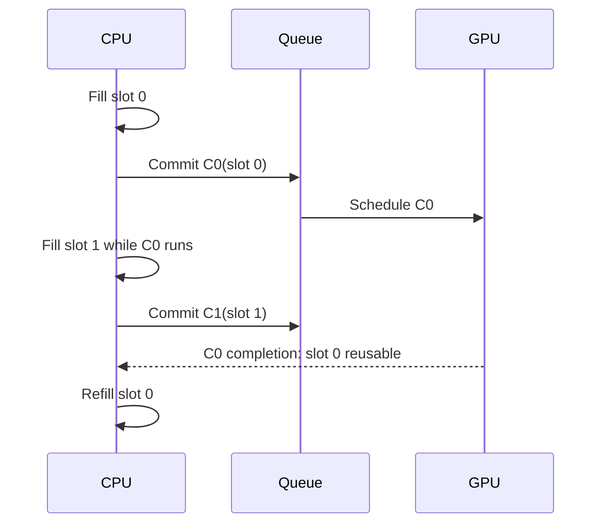

The source material describes a per-frame bump arena and ring buffers. A **bump arena** allocates by advancing a cursor through a larger allocation; reclaiming the whole arena at once is cheap. A **ring buffer** reserves a contiguous logical stream whose physical allocation wraps around. Both need a retirement rule: the CPU may not reclaim a range while the GPU still refers to it. A fixed 256-byte alignment often appears as a project policy for uniform or argument records, but it is not a universal rule for every Metal binding. The correct alignment depends on resource type, binding path, platform capability, and documented API requirements. Store the chosen alignment beside the allocator contract rather than teaching a magic number as a law.

## Dependency graphs are the real meaning of asynchrony

An asynchronous command submission lets the CPU continue without waiting for GPU completion. It does not mean the GPU work is independent. If a culling compute pass writes visible IDs and an indirect draw reads them, the draw depends on the compute pass. If a copy engine uploads a texture and a render pass samples it, rendering depends on the copy. If a readback buffer is consumed by the CPU, CPU access depends on the GPU finishing and on any required visibility/coherency operation.

Represent each operation as a node and each “must happen before and be visible to” relation as an edge. For example, `upload → cull → compact → indirect draw → present` is one path. A second independent shadow-map pass might overlap part of it, but only if it does not contend for the same constrained resources and has no data dependency. Two queues or command streams do not guarantee overlap. If both saturate memory bandwidth, or one waits on the other’s output, additional scheduling machinery can increase overhead without shortening the critical path.

Apple’s command-structure guidance says command buffers on a queue are scheduled after earlier committed buffers waiting in that queue; the perceived order is preserved, though implementation reordering is possible when it does not change observable behavior. A committed command buffer cannot be reused. Its scheduled callback marks scheduling, not completion; `addCompletedHandler` runs when the GPU has finished the commands. A blocking `waitUntilCompleted` stalls the calling CPU thread and is usually inappropriate in an interactive frame loop. See Apple’s [command structure guide](https://developer.apple.com/documentation/Metal/setting-up-a-command-structure) and [MTLCommandBuffer reference](https://developer.apple.com/documentation/metal/mtlcommandbuffer).

Metal hazard tracking and explicit synchronization must be understood at the resource-access level. In classic `MTLCommandQueue` paths, Metal can automatically synchronize conflicts for directly bound resources using tracked hazard mode; heap-created resources default to untracked, and newer Metal 4 queue paths require explicit resource synchronization regardless of the resource hazard-tracking property. Check the exact queue/API generation and resource provenance. A fence, event, or barrier is not a universal “flush everything” switch. `MTLFence` orders GPU memory operations between passes; Apple documents its supported scopes and encoding rules. Events coordinate workloads across queues, and shared events extend synchronization to CPU code and, where supported, other devices. Do not transplant Vulkan’s host fence meaning onto `MTLFence`; the word “fence” is reused by APIs for different synchronization layers. When correctness depends on a cross-queue producer-consumer edge, state which resource is written, which operation consumes it, and which Metal mechanism establishes ordering and visibility.

There is a subtle but important distinction between a **lifetime edge** and a **data dependency edge**. A resource can stay alive for the entire frame and still be read before its producer’s writes are visible. Conversely, a dependency may be correct while the CPU frees an object or recycles its memory too early. For every transient resource, write down: who allocates it, who writes it, who reads it, what event makes the write available, and what completion permits reuse. This five-question habit catches many “works on my GPU” failures.

## Arithmetic intensity tells you what to measure next

A kernel’s **arithmetic intensity** is the number of floating-point operations performed per byte transferred at a chosen level of the memory hierarchy. “Chosen level” matters: data can be fetched from external memory once and reused many times from a cache or threadgroup memory. A byte count that ignores reuse can misclassify the bottleneck.

For a vector multiply $y_i=a_i b_i$ with 32-bit floats, each element performs one multiplication and, in an ideal streaming pass, reads 4 bytes from $a$, reads 4 from $b$, and writes 4 to $y$. Thus

$$
I=\frac{1\text{ FLOP}}{12\text{ bytes}}\approx0.0833\text{ FLOP/byte}.
$$

This low intensity suggests that memory bandwidth may dominate on a device capable of far more floating-point work per second than this stream can feed. But the conclusion must be tested: cache behavior, launch overhead, CPU synchronization, and the actual memory traffic may dominate a small benchmark. A benchmark that calls `waitUntilCompleted` after every dispatch measures an intentionally serialized path, not necessarily the throughput of a pipelined application.

For matrix multiplication, $C_{ij}=\sum_k A_{ik}B_{kj}$, a naïve output-at-a-time implementation reloads many values. A tiled kernel loads a tile of A and B into fast local storage and reuses each value across multiple multiply-adds. For square tile width $T$, one tile step performs about $2T^3$ floating operations (counting multiply and add separately) and moves about $8T^2$ bytes of 32-bit A/B inputs, before output traffic and cache effects. So the simplified intensity is

$$
I\approx\frac{2T^3}{8T^2}=\frac{T}{4}\text{ FLOP/byte}.
$$

At $T=16$, that model gives about 4 FLOP/byte. This is an idealized comparison, not a benchmark prediction: it omits output stores, padding, edge tiles, synchronization, register spills, and whether the cache already retains data.

The roofline model bounds attainable performance by

$$
P\le \min(P_{\max}, B_{\max} I),
$$

where $P_{\max}$ is peak compute throughput, $B_{\max}$ is sustainable bandwidth at the memory level under study, and $I$ is arithmetic intensity at that level. If an illustrative GPU sustains 10 TFLOP/s and 500 GB/s, its “ridge point” is $10{,}000/500=20$ FLOP/byte. A vector multiply at 0.083 FLOP/byte lies far to the bandwidth side of this simplified roof. A tiled matrix operation at 4 FLOP/byte is improved, but still below the example ridge. The values are hypothetical and should never be reported as a device measurement.

The model suggests choices, not guarantees. Fusion can remove an intermediate write/read and increase useful operations per byte, but may extend register lifetimes or reduce occupancy. Fission can add memory traffic but make each kernel simpler, increase parallelism, or lower register pressure. Reducing registers per thread may permit more resident workgroups, yet additional spills can make the kernel slower. Measure GPU time separately from CPU submission time, warm-up, allocation, and synchronization. Inspect a representative workload and a profiler capture before deciding which roof is relevant.

## Metal is a chain of objects with distinct jobs

Metal’s core object model is easier to remember if each object answers one question. `MTLDevice` represents a GPU and creates resources or pipeline states. `MTLCommandQueue` accepts command buffers for that device. `MTLCommandBuffer` records a sequence of work to submit. A **command encoder** writes one kind of work into it: render commands, compute commands, or blits (resource copies and related transfer operations). A render pipeline state packages compiled vertex/fragment stages and fixed configuration such as attachment formats. A compute pipeline state represents a compiled kernel and exposes device/pipeline properties relevant to dispatch.

An encoder is not a reusable global command stream; it is the scoped place where commands of that type are encoded into a command buffer. End the encoder before starting another encoder on the same command buffer. The sequence might be: create command buffer, encode compute culling, end compute encoder, encode a blit or another compute stage if needed, end it, encode render, end render, register presentation, commit. The command buffer owns the ordered command recording; the encoder configures and emits one segment. Pipeline state is reusable across frames; command buffer and encoder are per-submission work objects. Mixing these lifetimes obscures bugs.

A drawable is a scarce presentation image supplied through a view or layer. Apple recommends obtaining it as late as practical—ideally just before encoding the onscreen pass—and holding it as briefly as possible. `MTKView.currentRenderPassDescriptor` implicitly obtains the current drawable; `currentDrawable` may be nil if all drawable objects are in use. Encode into that drawable’s texture, register its presentation on the command buffer, then commit. See [MTKView](https://developer.apple.com/documentation/metalkit/mtkview/) and [currentDrawable](https://developer.apple.com/documentation/MetalKit/MTKView/currentDrawable). This is why expensive CPU scene preparation should generally happen before acquiring the drawable.

Render attachments also have a begin/end contract. A load action says whether an attachment’s previous contents are needed, should be cleared, or need not be preserved. A store action says whether the result must survive the pass. If depth is only used during one pass and discarded afterward, storing it to external memory is unnecessary. Apple-family tile rendering can keep eligible temporary attachment data in tile memory, and Metal memoryless resources are explicitly temporary pass-local resources; they cannot be loaded from or stored to. This is a useful optimization when its constraints match the render graph, not a universal promise that a pass will run faster. Resource type, GPU family, attachment action, format, and later consumers matter. See Apple’s [storage-mode guide](https://developer.apple.com/documentation/metal/setting-resource-storage-modes) and [`storageModeMemoryless`](https://developer.apple.com/documentation/metal/mtlresourceoptions/storagemodememoryless).

Metal storage modes describe where a resource lives and who can access it. Shared storage gives CPU and GPU access to system memory; private storage is GPU-only; managed storage can represent separate CPU/GPU copies on platforms that support it; memoryless storage is temporary render-pass memory on supported Apple GPUs. Defaults vary by architecture. Apple advises using the system default when suitable and checking feature support rather than assuming a particular machine from a product label. “Unified memory” removes a separate-copy topology for many resources; it does not remove the need to avoid CPU/GPU races or to observe completion before changing data that GPU work still uses.

## C++, Objective-C++, and Swift have different ownership rules

A renderer commonly has a C++ engine core and an Objective-C/Swift presentation shell. Objective-C++ (`.mm`) lets one translation unit speak both C++ and Objective-C, making it a practical narrow bridge: C++ contracts and data structures remain on one side, Metal objects and Cocoa view types on the other. Keep that boundary deliberate. A generic renderer should not expose `id<MTLDevice>` through every public engine interface if a small backend-specific implementation can own the handle.

Objective-C ARC (Automatic Reference Counting) manages strong and weak object references inserted by the compiler. It is not C++ RAII (resource acquisition is initialization): C++ destructors govern C++ object lifetime, while Objective-C objects follow ARC ownership. `__bridge`, `__bridge_retained`, and `__bridge_transfer` express different transfer behavior between Objective-C object pointers and opaque C pointers. A bridge cast does not, by itself, prove that a GPU submission has stopped using a resource. The CPU object’s retain lifetime and the allocation’s safe-to-reuse lifetime are related but distinct questions.

A completion handler is an asynchronous callback. It should capture only what it needs, avoid unprotected mutation of renderer state, and move UI changes onto the main queue when required by the UI framework. A safe pattern is often: completion signals a slot-retirement mechanism or publishes a small immutable result; the main thread consumes it at an appropriate point. Do not block the render/UI thread waiting for every command buffer unless the operation inherently requires an immediate answer, such as a deliberately synchronous picking path. For ordinary rendering, asynchronous submission plus per-slot completion tracking is the shape that allows overlap.

For a C++/Swift boundary, prefer a narrow C-compatible interface or Objective-C++ wrapper with explicit ownership and error semantics. A Swift closure retained by C++ needs a clear release path; a raw pointer must state whether it is borrowed, retained, or owned. An `NSError` should preserve a meaningful domain, code, and description rather than being flattened into a generic failure. These are interface design principles; they do not certify any particular Kairo or Maveb bridge implementation, which was not checked against source code here.

## A repeatable design and debugging walk-through

Take GPU culling as a concrete exercise. First write the CPU baseline and measure separately: scene traversal, culling, list construction, command submission, and GPU rendering. Next define the output contract: visible object IDs, exact count, allowed ordering, and capacity. If order does not matter and the count is modest, start with atomic append. If stable order or per-item offsets matter, build a scan pipeline and account for all intermediate arrays and dispatch boundaries. Then keep the count on the GPU and produce indirect work rather than reading it back only to issue a draw.

Now draw the dependency graph: bounds upload must be complete before culling reads; culling writes predicates; scan reads predicates; scatter writes the compact list; indirect-argument generation writes count fields; render consumes list and arguments. Mark every producer-to-consumer edge and every lifetime end. Assign temporary memory to a frame slot or a transient pass, and refuse to recycle it until the last consumer’s command buffer completes. If resources cross queues, encode the exact synchronization relationship. If they stay on one queue, rely only on documented queue and hazard rules, not an intuition that “GPU commands happen in order.”

Then inspect the cost model. Estimate arithmetic intensity for the kernel’s data movement. Estimate bytes uploaded and whether persistent/ring allocation can reduce CPU allocation overhead. Measure GPU timestamps around the actual stages and CPU wall time around preparation and submission. An optimization that shortens culling but adds two dispatches may lose for 100 objects and win for 100,000. A change that cuts average frame time may increase worst-case latency if it adds queued frames. Report workload size, device, configuration, warm-up, and whether the measurement waited for completion.

Finally construct a failure trace deliberately. For a frame-slot overwrite: CPU writes slot 0 for C0; GPU starts C0; CPU wraps and writes slot 0 for C3 before C0 completes; C0 now reads some old and some new values. The symptom may be intermittent geometry corruption. For a missing dependency: compute writes an indirect count; render consumes it without an ordering/visibility edge; GPU may see stale or partial arguments. For wrong scan math: exclusive offset uses an inclusive sum; first passing item writes to slot 1, leaving a hole and potentially exceeding capacity. For the wrong roofline diagnosis: benchmark blocks after every tiny kernel, reporting CPU launch/sync overhead as if it were shader throughput. Each trace begins with a violated contract, not with a mysterious graphics driver.

The reliable mental model is compact: a GPU algorithm produces data; a dependency graph makes that data ready for its consumer; a frame-slot lifetime makes its storage safe to reuse; a command buffer carries the ordered work to a Metal queue; a completion signal retires work that has truly finished; a performance model tells you which measurement to improve. Keep these contracts explicit and API details become easier to place.

## Give one image an explicit path through the machine

Imagine the workshop scene is ready: meshes, materials, a camera and an editor panel waiting for the next image. The rendering mathematics tells us which values to calculate. An explicit graphics API asks a different set of questions: where will those values live, which operations will read them, and what proves the previous user has finished? Vulkan exposes those contracts through resource objects, recorded commands and dependencies. Its handles are names for parts of this agreement, not a sequence of unrelated incantations.

### Start by separating discovery from permission

An instance connects the application to a Vulkan implementation. A physical-device handle identifies an enumerated adapter; a logical device opens the selected features and queues of that adapter for the application. A surface represents a particular window-system presentation target. Presentation support must therefore be checked for the chosen surface and queue family. A queue family describes compatible operation capabilities and command allocation; a queue is a submission channel, not a CPU thread or proof of an independent hardware engine.

A property reports a limit or characteristic, such as an alignment or maximum image size. A feature reports a capability that may need enabling. An extension adds an API capability beyond a declared baseline. Support, enablement and actual use are three separate facts. Record the capability that each renderer path requires and what happens when it is unavailable. This is more useful than ranking adapters only by a familiar vendor or assuming the first enumerated adapter works.

On a portability implementation, instance enumeration policy and the device's portability-subset contract are separate steps. A loader can hide portability adapters unless the appropriate enumeration extension and creation flag are used; a device advertising the portability-subset extension brings additional device requirements. Validation and diagnostic extensions likewise need discovery. An example that requests a recent command or feature cannot quietly assume it is part of a Vulkan 1.1 baseline.

### Create storage and then describe how to interpret it

A buffer describes a linear byte resource. An image describes structured storage with a format, extent, mips, layers, sample count and usage. Device memory supplies backing allocation. A view selects an interpretation and subresource range; a sampler supplies filtering and addressing behavior. A descriptor connects a shader binding to the intended buffer or image view and sampler. A descriptor's layout field describes the image layout expected during access; writing that field does not transition the image.

Before binding ordinary resource memory, query its size, alignment and compatible memory-type mask. A type is usable only if the resource permits its index and its property flags meet the required properties. A preference is different from a requirement. Device-local and host-visible can coexist in one type; therefore “device-local means the CPU cannot map it” is false in general. Mapping an optimal-tiled image allocation also does not by itself provide a simple tightly packed pixel layout. A staging copy is one explicit upload design, not a synonym for every possible device-local allocation.

Suppose a suballocator has cursor $c=300$, required alignment $a=256$, and resource size $s=160$. The next start is $o=\lceil c/a\rceil a=512$, and the occupied interval is $[512,672)$. The 212-byte gap is alignment padding. A checked implementation must reject zero alignment and detect arithmetic overflow before applying a bit-mask shortcut. Mixed buffers and images can add granularity and dedicated-allocation constraints; satisfying one offset equation does not establish complete Vulkan allocation compatibility.

A pipeline layout declares the resource interface: descriptor-set layouts and push-constant ranges. The pipeline combines that interface with shader stages and rendering state. A shader module contains intermediate code, not a guarantee that every final pipeline using it has been compiled. Pipeline caches are implementation-specific acceleration data; retain enough identity and failure handling to rebuild rather than treating an arbitrary cache blob as portable executable code.

### Follow a frame slot and a presentation image separately

Let the renderer use two frame slots and a swapchain with three images. For frame number $n$, the CPU may choose slot $n\bmod2$. Acquisition returns an image index independently. A possible sequence is:

| Frame | Reusable CPU/GPU slot | Acquired image |
|---:|---:|---:|
| 0 | 0 | 2 |
| 1 | 1 | 0 |
| 2 | 0 | 1 |
| 3 | 1 | 2 |

Slot 0's fence proves when slot 0's command storage and mutable uniform region may be reused. It does not say which swapchain image will be acquired next. Keep slot-indexed command pools, descriptors and upload regions separate from image-indexed image views and presentation state. A readback also needs its frame, camera and resource generation so a delayed result is interpreted against the state that produced it.

Use an acquire semaphore associated with the frame slot, after its previous wait is known to have completed. For present-wait semaphores, a robust basic pattern associates one with each swapchain image. Waiting for graphics completion alone does not prove that presentation has finished consuming a semaphore. Reacquiring the same image and establishing the acquire wait provides the relevant reuse ordering. This is the specific distinction documented in the [Khronos swapchain semaphore guide](https://docs.vulkan.org/guide/latest/swapchain_semaphore_reuse.html).

The safe frame loop is a small transaction. First wait for the chosen slot's previous work, collect eligible retired payloads, and handle completed readbacks. Then acquire an image. An out-of-date result before a usable acquisition must not leave a reset fence that no submission will signal. Prepare and record the new work; reset its completion fence only when entering a path that will submit, with an explicit failure policy. Submit waits on acquisition at a stage covering the first relevant image use. Presentation waits on rendering's signal.

After successful acquisition, an arbitrary exception cannot simply abandon both the image and a signaled binary semaphore and then repeat the ordinary loop. The recovery policy must resolve that acquired-image/semaphore state, for example by completing a defined fallback frame or performing controlled presentation-resource recovery. A supported maintenance API may offer more explicit operations, but it requires its own feature and synchronization handling. Likewise, submission failure is not a successful frame: device loss stops normal work, and other failures require a documented recovery path before waiting on a fence that has no pending signal.

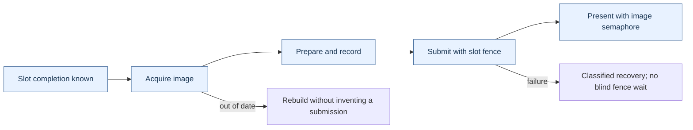

This diagram shows control obligations. Its arrows do not mean the CPU waits between every box: semaphores carry device-side dependencies while the CPU continues preparing independent work.

### A command buffer is reusable only under its actual state contract

Recording turns commands into an executable stream. Submission makes that stream pending. It cannot be reset while pending. After completion, an ordinary reusable command buffer can become executable again; one recorded with one-time-submit usage instead becomes invalid and must be reset before another recording. Destroyed referenced resources or invalidated secondary recordings can also invalidate a previously recorded stream. “The fence signaled” establishes a completion fact, not permanent validity of everything ever referenced.

A command pool is externally synchronized allocation state. Recording a buffer allocated from a pool participates in that synchronization contract; having one command-buffer handle per worker does not automatically make a shared pool safe. A common organization is one pool for each recording worker, queue family and reusable lifetime class. Reset only when every submission using the relevant buffers is finished. The [command-buffer specification](https://docs.vulkan.org/spec/latest/chapters/cmdbuffers.html) defines these state and synchronization obligations.

### Derive a dependency from the real producer and consumer

Suppose compute culling writes indirect arguments. The consumer is the draw-indirect stage reading commands, not a vertex shader reading ordinary data. If the same compute pass also produces instance attributes consumed by vertex fetch, that second resource use requires the corresponding vertex-input read scope. One dependency tuple does not automatically cover all other outputs of the dispatch.

Distinguish read-after-write, write-after-read and write-after-write. A later reader must observe the producer's values. A later writer must wait until earlier readers no longer need the overwritten contents. A later writer must be ordered against an earlier writer when the result depends on their order. An execution-only dependency can suffice for a pure write-after-read hazard; visibility operations are needed when values must be carried from a write to a later access. This distinction is illustrated by the [Khronos synchronization examples](https://docs.vulkan.org/guide/latest/synchronization_examples.html).

For a shadow map, include every stage in which the actual depth writes can occur. Early and late fragment tests are distinct possibilities; naming only late tests is not a universal shadow barrier. For an image, also identify the aspect, mip and layer range, old and new layouts, and any required queue-family ownership transfer. Layout, access, ownership and completion are related contracts, not alternative spellings for the same thing.

Readback completes a longer path. Make the GPU's writes available to the host through the required memory dependency, establish completion, and invalidate a noncoherent mapped range before CPU reads where required. Host-coherent memory removes explicit cache-maintenance operations; it does not replace producer/consumer dependencies or authorize a CPU read before the copy finishes. The retained source's fence-plus-coherency description assumes the rest of that path is correctly established; it is not a complete readback proof by itself.

### Retire a resource after every user, not after one convenient clock

The C++ owner answers who will eventually destroy a payload. The GPU dependency system answers when destruction is legal. Releasing a logical texture handle can remove it from future scene use while an owning retirement record keeps its old native image, view and memory alive. Capture that payload by ownership; a callback that refers to an already destroyed wrapper does not preserve it.

For a resource used on graphics, compute and transfer queues, write a completion stamp $r=(r_g,r_c,r_t)$. If the observed completion values are $d=(d_g,d_c,d_t)$, the payload is ready only when

$$
d_g\ge r_g\quad\land\quad d_c\ge r_c\quad\land\quad d_t\ge r_t.
$$

The example $r=(9,5,3)$ is not ready at $d=(10,4,100)$: compute is still using it. Values from separate timeline semaphores cannot be compared as if they were one global timestamp. A single joined completion token can be sufficient if a dependency chain proves that its signal follows every relevant use. A host counter that merely assigns increasing numbers to independent queues does not prove that order.

A FIFO retirement queue also has a data-structure assumption. If entries arrive with retirement values 100 and then 3, a collector that checks only the front will keep the second entry even when completion reaches 5. It remains safe but delays reclamation. Enforce ordered insertion, use a structure appropriate to the ordering, or scan ready entries independently. With multiple queue stamps there may be no single scalar order at all.

The complete CPU model below tests ownership and the completion predicate. It deliberately does not call Vulkan: passing the model tests establishes those bookkeeping rules, not correct native API barriers, device lifetime, presentation or GPU execution.

```cpp
#include <algorithm>
#include <array>
#include <cassert>
#include <cstdint>
#include <memory>
#include <stdexcept>
#include <utility>
#include <vector>

// CPU bookkeeping model. These values are not native GPU handles.
using Stamp = std::array<std::uint64_t, 3>; // graphics, compute, transfer

struct Payload {
    int id;
    std::vector<int>* destructionLog;
    Payload(int value, std::vector<int>& log) : id(value), destructionLog(&log) {}
    Payload(const Payload&) = delete;
    Payload& operator=(const Payload&) = delete;
    ~Payload() { destructionLog->push_back(id); }
};

class RetirementQueue {
    struct Entry {
        Stamp required;
        std::unique_ptr<Payload> payload;
    };
    std::vector<Entry> entries;
    Stamp observed{};

    static bool covers(const Stamp& completed, const Stamp& required) {
        for (std::size_t i = 0; i < completed.size(); ++i)
            if (completed[i] < required[i]) return false;
        return true;
    }

public:
    void retire(Stamp required, std::unique_ptr<Payload> payload) {
        if (!payload) throw std::invalid_argument("missing payload");
        entries.push_back({required, std::move(payload)});
    }

    std::size_t collect(Stamp completed) {
        if (!covers(completed, observed))
            throw std::invalid_argument("completion counters regressed");
        observed = completed;
        const auto before = entries.size();
        std::erase_if(entries, [&](const Entry& entry) {
            return covers(completed, entry.required);
        });
        return before - entries.size();
    }

    std::size_t size() const { return entries.size(); }
};

int main() {
    std::vector<int> destroyed; // outlives every Payload in this test
    RetirementQueue queue;

    queue.retire({100, 0, 0}, std::make_unique<Payload>(1, destroyed));
    auto payload = std::make_unique<Payload>(2, destroyed);
    queue.retire({3, 0, 0}, std::move(payload));
    assert(!payload); // retirement queue now owns it
    queue.retire({9, 5, 3}, std::make_unique<Payload>(3, destroyed));
    assert(destroyed.empty());

    // Unordered insertion must not block a ready entry behind value 100.
    assert(queue.collect({5, 0, 0}) == 1);
    assert((destroyed == std::vector<int>{2}));

    // A large transfer completion cannot replace unfinished compute work.
    assert(queue.collect({10, 4, 100}) == 0);
    assert(queue.size() == 2);
    assert(queue.collect({10, 5, 100}) == 1);
    assert((destroyed == std::vector<int>{2, 3}));
    assert(queue.collect({100, 5, 100}) == 1);
    assert(queue.size() == 0);
    assert((destroyed == std::vector<int>{2, 3, 1}));

    bool rejected = false;
    try { queue.collect({99, 5, 100}); }
    catch (const std::invalid_argument&) { rejected = true; }
    assert(rejected);

    rejected = false;
    try { queue.retire({0, 0, 0}, nullptr); }
    catch (const std::invalid_argument&) { rejected = true; }
    assert(rejected);
    // A real renderer must likewise drain/resolve all payload uses at shutdown.
}
```

The test drains every payload before the queue dies. A real shutdown must first resolve all relevant device uses and keep the device, allocation machinery, and destruction dependencies alive until retirement finishes. A default C++ container destructor is not a substitute for that shutdown protocol. This CPU model was compiled and run with address and undefined-behavior sanitizers; no native Vulkan execution is claimed.


## Build variable GPU workloads without a CPU round trip

### + M132

Pass 10 completes **Phase 22: GPU Architecture, SIMT Execution, Memory Hierarchy, Compute, and Parallel GPU Algorithms**.


The mastery cards make the intent explicit: M130 is the shift into **GPU-resident scheduling and GPU-driven pipelines**, M131 is about keeping CPU, GPU and memory systems overlapped without accidental stalls, and M132 asks you to predict performance from resource usage and data movement instead of treating GPU optimization as trial-and-error.

---

### GPU-RESIDENT DATA STRUCTURES & GPU-DRIVEN WORK

**The next GPU transition: from parallel computation to parallel scheduling**

Pass 9 taught:

$$
\text{map},
\quad
\text{reduce},
\quad
\text{scan},
\quad
\text{compact},
\quad
\text{sort}.
$$

Those operations become far more powerful once the GPU stops merely processing work selected by the CPU and begins deciding:

$$
\boxed{
\text{what work should exist at all}.
}
$$

A traditional renderer might do:

```text id="p10-cpu-driven"
CPU:
    inspect every object
    determine visibility
    choose LOD
    build draw list
    upload commands
    submit draws

GPU:
    execute them
```

A GPU-driven renderer tries to move toward:

```text id="p10-gpu-driven"
GPU:
    inspect object data
    determine visibility
    select LOD
    compact visible objects
    produce command arguments
    consume those arguments
```

The CPU submits the **algorithm**, not necessarily every individual piece of work.

---

**GPU hash tables**

A hash table maps:

$$
key\rightarrow value.
$$

Hash function:

$$
h(k)\in[0,M).
$$

On a CPU we might use linked buckets, trees or dynamically allocated nodes.

Those are usually poor GPU representations because they introduce:

- pointer chasing,
- random memory,
- dynamic allocation,
- divergent traversal.

A more GPU-friendly representation is frequently a flat array with open addressing.

---

**Open-addressed hash table**

Suppose table capacity is:

$$
M.
$$

Initial position:

$$
i_0=h(k)\bmod M.
$$

If occupied by another key, probe:

$$
i_j=
(i_0+j)\bmod M
$$

for linear probing.

Insertion needs an atomic compare-and-swap.

Conceptually:

```cpp id="p10-hash-insert"
constexpr uint32_t Empty =
    0xffffffffu;

void Insert(
    uint32_t key,
    uint32_t value)
{
    uint32_t slot =
        Hash(key) & (TableSize - 1);

    for (uint32_t probe = 0;
         probe < MaxProbe;
         ++probe)
    {
        uint32_t previous =
            atomic_compare_exchange(
                table[slot].key,
                Empty,
                key);

        if (previous == Empty ||
            previous == key)
        {
            table[slot].value =
                value;

            return;
        }

        slot =
            (slot + 1) &
            (TableSize - 1);
    }

    // Overflow/failure must be tracked.
}
```

The atomic ensures two lanes cannot both claim the same empty slot.

---

**Hash-table load factor matters enormously on GPUs**

Define:

$$
\boxed{
\alpha=
\frac{
N_{\text{occupied}}
}{
M_{\text{capacity}}
}.
}
$$

At low:

$$
\alpha,
$$

most lookups resolve quickly.

As:

$$
\alpha\rightarrow1,
$$

probe lengths grow dramatically.

That creates:

- more random memory traffic,
- longer divergent loops,
- greater atomic contention.

A CPU might tolerate moderate extra probing.

On SIMT hardware, one lane performing 30 probes can hold up a subgroup whose other lanes finished after two.

Thus hash-table performance is not just average lookup count.

It is also:

$$
\boxed{
\text{distribution of probe lengths across lanes in the same subgroup}.
}
$$

---

**Spatial hashing**

For spatial data, convert position:

$$
P=(x,y,z)
$$

into integer cell coordinate:

$$
c_x=
\left\lfloor
\frac{x}{s}
\right\rfloor,
$$

$$
c_y=
\left\lfloor
\frac{y}{s}
\right\rfloor,
$$

$$
c_z=
\left\lfloor
\frac{z}{s}
\right\rfloor
$$

where:

$$
s=\text{cell size}.
$$

Then hash:

$$
H(c_x,c_y,c_z).
$$

A simple conceptual mixer is:

$$
H=
(c_xp_1)
\oplus
(c_yp_2)
\oplus
(c_zp_3).
$$

Spatial hashing is useful when the conceptual grid is enormous or sparse.

A dense $1000^3$ grid contains:

$$
10^9
$$

cells.

If only 10,000 are occupied, dense storage is absurd.

Hash only occupied cells.

---

**Dense spatial binning versus spatial hashing**

Do not confuse them.

For a screen divided into:

$$
120\times68
$$

tiles, the total tile count is only:

$$
8160.
$$

A dense array of 8160 counters/offsets is cheap.

Hashing would add unnecessary collisions and indirection.

For an effectively unbounded sparse 3D world, hashing becomes attractive.

Your Gaussian renderer correctly uses **dense tile binning**, not a hash table.

That is the better data structure for its domain.

---

**Spatial binning**

Suppose object $i$ belongs to bin:

$$
b_i.
$$

We need data structure:

```text id="p10-csr-bins"
bin 0 → object indices...
bin 1 → object indices...
bin 2 → object indices...
```

The canonical GPU representation is CSR-like:

$$
counts[b],
$$

$$
offsets[b],
$$

$$
references[].
$$

For bin $b$:

$$
references[
offset_b
:
offset_{b+1}
]
$$

are that bin's objects.

Your Vulkax Gaussian scheduler's comments explicitly describe this structure: tile counts, prefix offsets and references, with a CPU oracle validating CSR shape, bounds, tile membership and deterministic ordering.

---

**Atomic append construction**

The simplest GPU builder:

```cpp id="p10-atomic-bin"
uint32_t local =
    atomic_fetch_add(
        binCounts[bin],
        1);

binEntries[
    bin * MaxEntriesPerBin +
    local
] = objectID;
```

Or one global append:

```cpp id="p10-global-append"
uint32_t dst =
    atomic_fetch_add(
        globalCount,
        1);

output[dst] =
    objectID;
```

This is extremely easy.

And often perfectly good.

---

**Atomic append problems**

Imagine every projected Gaussian overlaps the same central screen tile.

Thousands of threads execute:

$$
atomicAdd(
count[\text{center}],
1
).
$$

That one counter becomes a serialization hotspot.

Other issues include capacity management and nondeterministic ordering.

If threads race for append positions, the output order depends on execution timing.

If deterministic order matters, atomic append alone may be insufficient.

---

**Count → scan → scatter construction**

The more scalable construction from Pass 9:

First calculate each producer's output count:

$$
c_i.
$$

Then exclusive scan:

$$
o_i=
\sum_{j<i}c_j.
$$

Now producer $i$ owns:

$$
[o_i,o_i+c_i).
$$

It writes without atomics.

This is exactly how Maveb's Gaussian tile expansion works.

Projected Gaussian $i$:

$$
c_i=
\text{number of overlapping tiles}.
$$

Scan gives its base destination.

Then it writes all tile references to its private region.

---

**Atomic append versus scan is not ideological**

Atomic append costs roughly:

$$
\text{one atomic per output}
$$

and often one dispatch.

Scan construction costs multiple phases:

$$
\text{count}
\rightarrow
\text{scan}
\rightarrow
\text{scatter}.
$$

For small or sparse output:

$$
\boxed{
\text{atomic append may be faster}.
}
$$

For huge output with contention or deterministic-layout requirements:

$$
\boxed{
\text{scan construction often scales better}.
}
$$

This is a recurring engine design decision.

---

**Indirect argument buffers**

Now suppose the GPU computes that only:

$$
K
$$

items remain.

The naive route is:

```text id="p10-bad-readback"
GPU computes K
↓
CPU reads K
↓
CPU submits dispatch(K)
```

That requires a GPU→CPU synchronization/readback.

Terrible.

Instead GPU writes a buffer containing command arguments.

Later the GPU command processor consumes that buffer.

That is **indirect dispatch/draw**.

---

**Current Maveb indirect dispatch is already real**

Maveb allocates:

```text id="p10-indirect-buffer"
Gaussian Radix Indirect Dispatch
```

as a GPU-private buffer containing three `uint32_t`s.

Its scan stage writes:

$$
dispatch_x
=
\left\lceil
\frac{
N_{\text{generated entries}}
}{
256
}
\right\rceil,
$$

$$
dispatch_y=1,
\qquad
dispatch_z=1.
$$

Then later Metal executes:

```cpp id="p10-indirect-dispatch"
histogram->
    dispatchThreadgroups(
        indirectDispatchBuffer,
        0,
        {256,1,1});
```

and does the same for radix scatter.

The CPU never needs to know the dynamic entry count before launching those stages.

That is exactly Part 2161.

---

**Why indirect execution matters**

Without it:

$$
GPU\rightarrow CPU\rightarrow GPU
$$

forms a round trip.

With indirect arguments:

$$
GPU_A
\rightarrow
\text{argument buffer}
\rightarrow
GPU_B.
$$

No CPU stall.

This is a foundational primitive of GPU-driven rendering.

---

**GPU-driven culling pipeline**

Suppose there are:

$$
N=1,000,000
$$

renderable instances.

A scalable pipeline can do:

```text id="p10-cull-pipeline"
instance bounds
    ↓
frustum test
    ↓
optional occlusion test
    ↓
LOD selection
    ↓
visibility predicate/count
    ↓
compaction
    ↓
draw/dispatch arguments
    ↓
indirect rendering
```

The CPU submits a small number of passes rather than inspecting one million objects every frame.

---

**Frustum culling in compute**

A perspective frustum can be represented by six planes:

$$
P_j=(n_j,d_j)
$$

with signed distance:

$$
s_j(x)
=
n_j\cdot x+d_j.
$$

For bounding sphere center $C$, radius $r$, if:

$$
n_j\cdot C+d_j<-r
$$

for any plane $j$, sphere is entirely outside.

Therefore:

$$
\boxed{
visible_{\text{frustum}}
=
\bigwedge_j
[
n_j\cdot C+d_j\ge-r
].
}
$$

One invocation per object.

Very parallel.

---

**AABB frustum test**

For an AABB you can use the positive vertex relative to each plane normal.

For plane normal:

$$
n=(n_x,n_y,n_z),
$$

choose box corner:

$$
p_x=
\begin{cases}
x_{\max},&n_x\ge0\\
x_{\min},&n_x<0
\end{cases}
$$

and similarly for $y,z$.

If even the most positive point satisfies:

$$
n\cdot p+d<0,
$$

box is completely outside.

This avoids testing all eight corners.

---

**Visibility predicate into compaction**

Each object writes:

$$
p_i=
\begin{cases}
1,&\text{visible}\\
0,&\text{culled}.
\end{cases}
$$

Exclusive scan:

$$
o_i=
\sum_{j<i}p_j.
$$

Then:

$$
p_i=1
\Rightarrow
visible[o_i]=i.
$$

Number of visible objects:

$$
N_v=
o_{N-1}+p_{N-1}.
$$

GPU can then write indirect arguments:

$$
instanceCount=N_v.
$$

No CPU visibility list.

---

**Hi-Z occlusion culling**

Frustum culling answers:

> Could this object project onto the image?

It does not answer:

> Is it hidden behind already visible geometry?

For that we use a hierarchical depth pyramid, often called Hi-Z.

Mip 0 contains full-resolution depth.

Each higher mip summarizes a larger region.

---

**What depth should a Hi-Z level store?**

This depends on depth convention.

For conventional depth:

$$
near=0,
\qquad
far=1,
$$

a conservative occlusion hierarchy commonly stores:

$$
\boxed{
\max(\text{depths})
}
$$

for a region.

Why?

To prove an object is behind **every** occluder in that region, its nearest possible depth must be farther than the farthest stored occluder depth.

With reversed-Z:

$$
near=1,
\qquad
far=0,
$$

the relationship reverses and the conservative hierarchy stores:

$$
\boxed{
\min(\text{depths})
}.
$$

Your earlier reversed-Z work therefore changes Hi-Z reduction semantics too.

---

**Building the depth pyramid**

For conventional Z:

$$
H_{l+1}(x,y)
=
\max
\begin{cases}
H_l(2x,2y),\\
H_l(2x+1,2y),\\
H_l(2x,2y+1),\\
H_l(2x+1,2y+1).
\end{cases}
$$

For reversed Z, substitute `min`.

Each mip covers twice the linear screen extent.

This lets one coarse sample conservatively represent many full-resolution pixels.

---

**Testing an object's screen rectangle**

Project the object's bounds into screen space.

Suppose projected rectangle dimensions are approximately:

$$
w\times h.
$$

Choose a mip where one/few texels cover that rectangle:

$$
\boxed{
m
\approx
\left\lfloor
\log_2
\max(w,h)
\right\rfloor.
}
$$

Sample Hi-Z around the rectangle.

Compare object's nearest possible depth against the conservative depth value.

If object is definitely behind all represented depth, cull.

---

**Hi-Z must be conservative**

A false negative:

> object considered visible even though hidden

costs performance.

A false positive:

> visible object incorrectly culled

produces missing geometry.

Therefore culling algorithms deliberately err toward:

$$
\boxed{
\text{visible}.
}
$$

Numerical margins, previous-frame depth and fast-moving cameras make conservative bias essential.

---

**Previous-frame Hi-Z**

One practical GPU-driven renderer often culls frame $N$ using depth from frame $N-1$.

That avoids needing a complete depth prepass before all culling.

But camera/object movement can expose previously hidden geometry.

Hence conservative expansion, temporal hysteresis or a two-phase renderer may be necessary.

Occlusion culling is not merely a depth comparison; it is also a temporal correctness problem.

---

**GPU LOD selection**

An object's projected size determines how much detail is useful.

For bounding sphere radius:

$$
r
$$

at view-space depth:

$$
z,
$$

projected screen radius is approximately:

$$
\boxed{
r_{\text{px}}
\propto
\frac{
f_{\text{px}}r
}{
z
}.
}
$$

As $z$ increases, projected size falls.

LOD thresholds can then be:

$$
r_{\text{px}}>T_0
\Rightarrow
LOD_0,
$$

$$
T_1<r_{\text{px}}\le T_0
\Rightarrow
LOD_1
$$

and so forth.

---

**LOD hysteresis**

Without hysteresis, an object near a threshold can alternate:

```text id="p10-lod-flicker"
LOD 1
LOD 2
LOD 1
LOD 2
```

due to camera jitter.

Use different enter/leave thresholds.

For example:

$$
LOD_1\rightarrow LOD_2
$$

at:

$$
r_{\text{px}}<90
$$

but return:

$$
LOD_2\rightarrow LOD_1
$$

only at:

$$
r_{\text{px}}>110.
$$

State reduces temporal popping.

---

**GPU-driven command generation**

The culling/LOD kernel can output records such as:

```cpp id="p10-draw-command"
struct DrawCommand
{
    uint indexCount;
    uint instanceCount;

    uint firstIndex;
    int  vertexOffset;
    uint firstInstance;
};
```

or the equivalent command format for the backend.

Then an indirect renderer consumes those commands.

Potential CPU workload becomes:

```text id="p10-cpu-small"
update camera
submit culling
submit indirect rendering
```

instead of thousands of individual draw decisions.

---

**GPU particle simulation**

Particles are almost ideal compute workload.

Each particle might store:

$$
P,
V,
age,
lifetime,
color,
size.
$$

Simple integration:

$$
V_{t+\Delta t}
=
V_t+
a\Delta t,
$$

$$
P_{t+\Delta t}
=
P_t+
V_{t+\Delta t}\Delta t,
$$

$$
age\leftarrow age+\Delta t.
$$

One invocation per particle.

---

**Structure of arrays for particles**

Instead of:

```cpp id="p10-particle-aos"
struct Particle
{
    float3 position;
    float3 velocity;
    float age;
    float lifetime;
};
```

a compute-heavy particle system may prefer:

```text id="p10-particle-soa"
positions[]
velocities[]
ages[]
lifetimes[]
```

if different kernels touch different fields.

Simulation might need position/velocity/age.

Rendering might only need position/color/size.

SoA reduces irrelevant memory traffic.

---

**Particle spawning**

You need a dead particle slot.

One design maintains a free-index stack:

```text id="p10-free-list"
freeIndices[]
freeCount
```

Spawn:

$$
slot=
atomicSub(freeCount,1)-1.
$$

Index:

$$
particleID=
freeIndices[slot].
$$

Initialize particle.

When particle dies, return ID:

$$
slot=
atomicAdd(freeCount,1),
$$

$$
freeIndices[slot]=particleID.
$$

This works well when spawn/death volume is moderate.

---

**Free-list hazards**

You must establish ownership.

A slot must not simultaneously be:

- alive,
- in the free list,
- allocated twice.

Phase boundaries help.

For example:

```text id="p10-particle-phases"
simulate/mark dead
    ↓
collect dead IDs
    ↓
spawn using updated free list
```

is easier to reason about than arbitrary simultaneous mutation of everything.

GPU algorithms become tractable when ownership is phase-structured.

---

**Particle compaction**

Another model stores a dense alive-particle list every frame.

Predicate:

$$
alive_i=
(age_i<lifetime_i).
$$

Scan:

$$
offset_i=
\operatorname{exclusiveScan}(alive).
$$

If alive:

$$
nextParticles[offset_i]
=
particles[i].
$$

Now:

$$
N_{\text{next}}
=
\sum alive_i.
$$

Next simulation only processes live particles.

That can be far better when many particles die.

---

**Free-list versus compaction**

A free list maintains stable particle slots but leaves holes.

Compaction produces dense arrays but moves particles.

Stable IDs may require separate identity fields.

Again, no universal winner.

If rendering/simulation benefits strongly from contiguous alive data, compaction is attractive.

If stable slots and incremental spawning matter, free lists may win.

Hybrid systems are common.

---

**Particle sorting**

Transparent particles often need approximate back-to-front rendering.

Generate:

$$
key_i=
\text{depth}.
$$

Value:

$$
particleID_i.
$$

Then key-value sort.

Your Maveb Gaussian system is effectively solving a closely related problem: depth ordering translucent splats within screen tiles.

The radix infrastructure from Pass 9 transfers naturally.

---

**Ping-pong buffers**

Suppose simulation update reads old state and writes new state:

$$
S_{t+1}=F(S_t).
$$

If every thread reads and writes the same array, invocation $i$ may observe already-updated neighbor state.

Instead:

```text id="p10-pingpong"
Frame/iteration n:
    read A
    write B

Frame/iteration n+1:
    read B
    write A
```

This is ping-ponging.

It solves a **data dependency**.

---

**Ping-pong is not the same as double buffering**

They often both use two buffers, but their purposes differ.

Ping-pong:

$$
\boxed{
\text{algorithmic old state versus new state}
}
$$

Double buffering:

$$
\boxed{
\text{one frame/resource can be consumed while another is produced}
}
$$

A particle simulation may use two state buffers for ping-pong **and** three copies of other per-frame resources for frames in flight.

Keep those concepts separate.

---

**Maveb radix uses ping-pong**

You already have:

```text id="p10-radix-ping"
keysA
keysB

valuesA
valuesB
```

Pass 0:

$$
A\rightarrow B.
$$

Pass 1:

$$
B\rightarrow A.
$$

That is algorithmic ping-pong.

The same principle appears in iterative fluid solvers, temporal buffers and image processing.

---

**Double buffering**

CPU produces frame $N+1$ resource while GPU consumes frame $N$.

Two copies prevent overwrite.

Timeline:

```text id="p10-double"
time →
CPU: [prepare A] [prepare B] [wait?]
GPU:             [use A   ] [use B]
```

If GPU occasionally lags by more than one frame, CPU may catch up and stall.

Triple buffering increases slack.

---

**Triple buffering**

With three frame contexts:

```text id="p10-triple"
frame 0 → slot A
frame 1 → slot B
frame 2 → slot C
frame 3 → slot A again
```

Slot A may only be reused after GPU has finished frame 0.

Advantages:

- more overlap,
- fewer CPU waits.

Costs:

- more memory,
- potentially more frame latency.

---

**Maveb is genuinely triple buffered**

Current renderer creates three frame contexts and initializes:

```cpp id="p10-maveb-semaphore"
frameSemaphore =
    dispatch_semaphore_create(3);
```

Frame slot:

$$
\boxed{
slot=
frameNumber\bmod3.
}
$$

Before creating new GPU work the CPU waits for an available frame slot.

When the command buffer completes, its completion handler signals the semaphore.

This is a real three-frames-in-flight system, not merely a theoretical `frameIndex % 3` variable.

---

**CPU–GPU pipelining**

Without pipelining:

```text id="p10-serialized"
CPU prepare frame
GPU execute frame
CPU prepare next
GPU execute next
```

one processor is idle almost constantly.

Desired:

```text id="p10-pipeline"
time →
CPU: F0 prepare | F1 prepare | F2 prepare
GPU:            | F0 GPU     | F1 GPU     | F2 GPU
```

Total frame latency may span multiple stages, but throughput can approach the slower stage:

$$
T_{\text{frame throughput}}
\approx
\max(
T_{\text{CPU}},
T_{\text{GPU}}
).
$$

Not:

$$
T_{\text{CPU}}+T_{\text{GPU}}.
$$

That is the point of frames in flight.

---

### COMMAND EXECUTION, ASYNC WORK & MEMORY LIFETIMES

**GPU command processor**

Your CPU does not directly call an ALU and say:

> Run this shader now.

It records command data describing:

- pipeline state,
- resources,
- dispatch/draw dimensions,
- copies,
- barriers.

The GPU command processor/front-end consumes those commands and schedules work onto execution engines.

Therefore there are at least two parallel timelines:

$$
\boxed{
\text{CPU command generation}
}
$$

and:

$$
\boxed{
\text{GPU command execution}.
}
$$

A well-designed renderer prevents unnecessary synchronization between them.

---

**Submission overhead**

Imagine issuing 100,000 tiny dispatches each doing 20 arithmetic instructions.

Even if GPU arithmetic is fast, command encoding, validation, queue processing and state transitions become significant.

Hence GPU work should usually have enough granularity.

“Use more dispatches” is not free.

This is one reason kernels sometimes fuse adjacent stages.

But excessive fusion increases register pressure and divergence.

Once again:

$$
\boxed{\text{tradeoff}.}
$$

---

**KairoGPU's current compute wrapper is intentionally synchronous**

Current Kairo Metal vector operation performs:

```objc id="p10-kairo-sync"
command = queue.commandBuffer();
encode();
command.commit();
command.waitUntilCompleted();
```

for every vector add/multiply call.

That is excellent for a simple deterministic wrapper and unit-testable API.

But it destroys CPU–GPU overlap.

The caller cannot enqueue:

$$
64
$$

operations and let the GPU work asynchronously.

The CPU waits after each one.

That distinction is essential when interpreting its benchmark.

---

**Asynchronous compute**

Async compute means compute work can be scheduled independently of graphics work, potentially overlapping.

Conceptually:

```text id="p10-async"
Graphics: [shadow][gbuffer]------[lighting]
Compute :        [particles][SSAO]
```

If resource dependencies permit and hardware has available execution capacity, some work can overlap.

But:

$$
\boxed{
\text{asynchronous submission does not guarantee physical parallel execution}.
}
$$

---

**Why graphics + compute can fail to speed up**

Suppose graphics already saturates:

- shader ALUs,
- memory bandwidth,
- register capacity.

Launching compute concurrently may merely make both workloads compete.

Frame may become slower.

Async compute is valuable when workloads complement each other.

For example one phase may be raster/backend heavy while compute uses spare arithmetic capacity.

Or one workload may stall on memory while another has independent arithmetic.

You profile.

---

**Resource dependencies constrain overlap**

Suppose compute writes buffer:

$$
B.
$$

Graphics immediately reads:

$$
B.
$$

Then:

$$
Compute(B)
\rightarrow
Graphics(B)
$$

is a real dependency.

No amount of async queue magic removes it.

To overlap, find independent work:

$$
Compute(A)
$$

while:

$$
Graphics(B)
$$

runs.

Dependency graphs, not queue count, determine possible overlap.

---

**Transfer engines / copy queues**

Many GPUs provide dedicated mechanisms for:

- buffer copies,
- texture copies,
- uploads,
- readbacks.

On discrete GPUs these may correspond to separate DMA/copy engines.

Using them can allow copying while graphics/compute continue.

On Apple unified-memory systems, the physical memory model differs, but blit/copy encoders and resource synchronization still matter.

Do not blindly transfer discrete-GPU assumptions to unified memory.

---

**CPU→GPU upload bandwidth**

On a discrete GPU, uploads typically cross a PCIe-like interconnect.

If every frame uploads:

$$
1\text{ GB}
$$

at 60 FPS:

$$
60\text{ GB/s}
$$

of host→device traffic would be required before considering anything else.

That can exceed the interconnect budget.

Hence:

$$
\boxed{
\text{keep persistent data resident on the GPU}.
}
$$

Upload only changes.

---

**Apple unified memory changes the topology, not the optimization problem**

CPU and GPU can share physical memory.

That can avoid an explicit host→VRAM copy.

But memory traffic is still finite.

Caches still matter.

Synchronization still matters.

Writing massive CPU buffers that the GPU immediately streams still consumes DRAM bandwidth.

Unified memory removes one kind of transfer bottleneck; it does not create infinite bandwidth.

---

**GPU→CPU readback stalls**

This is among the easiest ways to destroy a renderer.

Bad pattern:

```cpp id="p10-bad-read"
DispatchGPU();

WaitForGPU();

count =
    ReadBuffer();

SubmitNextWork(count);
```

CPU stalls until GPU finishes.

GPU may then stall waiting for CPU to submit subsequent work.

The pipeline collapses.

---

**Indirect buffers are one answer to readback**

Instead:

```text id="p10-gpu-chain"
GPU creates count
GPU creates indirect args
GPU consumes indirect args
```

Read the result back only when the CPU actually needs it, possibly several frames later.

Maveb's radix dispatch does exactly this.

This is why indirect execution and pipelining are deeply connected topics.

---

**Asynchronous readback**

If CPU genuinely needs GPU data, copy into a CPU-visible readback buffer and process after completion.

Current Maveb frame capture does this correctly.

It encodes texture→buffer copy.

Then registers a command-buffer completion handler.

Only when GPU work has completed does the handler access buffer contents and construct the CPU capture.

The main frame function does not call:

```cpp id="p10-no-wait"
waitUntilCompleted()
```

for every screenshot copy.

That preserves normal frame pipelining.

---

**Persistent mapped upload buffers**

The inefficient model:

```text id="p10-map-everything"
create/map buffer
write 64 bytes
unmap
submit

create/map another buffer
...
```

causes allocation/mapping overhead.

Instead allocate a large CPU-visible upload buffer once and keep its CPU pointer available.

Every frame allocate slices:

$$
[offset,offset+size).
$$

Write directly.

Bind GPU buffer + offset.

This is persistent mapped arena allocation.

---

**Maveb FrameContext does exactly this**

Each frame context owns an 8 MiB `StorageModeShared` upload buffer.

Allocation:

$$
offset=
alignUp(cursor,alignment).
$$

Then:

$$
cursor\leftarrow offset+size.
$$

Returned slice contains:

```cpp id="p10-slice"
buffer
offset
size
cpuAddress
```

Default alignment:

$$
256\text{ bytes}.
$$

CPU writes directly through the shared buffer's `contents()` pointer.

No per-object Metal buffer creation.

Very good.

---

**It is technically a per-frame bump arena**

The source labels it an `"Upload Ring"`.

Inside one `FrameContext`, allocation is currently:

$$
\boxed{
\text{monotonic cursor reset at beginFrame()}
}
$$

rather than a circular buffer with independent head and tail.

The **three FrameContexts together form the frame ring**.

Slot 0's cursor is reset only when its frame context becomes reusable after GPU completion.

This architecture is simpler than managing one giant circular arena with arbitrary in-flight ranges.

---

**Ring buffer principle**

For a true single-buffer ring, maintain:

$$
head
$$

for new allocations and:

$$
tail
$$

for oldest GPU-in-use data.

Never let head overtake live tail.

If allocation reaches buffer end:

$$
head\rightarrow0
$$

only if the wrapped range is no longer in flight.

This requires fences/timeline tracking.

Per-frame arenas avoid much of that complexity.

---

**Readback arena**

Maveb also allocates a:

$$
256\text{ KiB}
$$

shared readback buffer per frame context.

Same aligned bump mechanism.

That provides bounded CPU-visible storage for GPU results without creating one tiny readback resource per query.

This is exactly the same allocation principle in the opposite data direction.

---

**GPU memory suballocation**

Suppose you need:

$$
10,000
$$

small 4 KiB GPU buffers.

Requesting 10,000 dedicated GPU memory allocations can be expensive and fragmented.

Instead reserve a large block:

$$
256\text{ MiB}
$$

and allocate slices from it.

Resource:

$$
(block,\ offset,\ size).
$$

This is suballocation.

---

**Dedicated allocations versus suballocation**

Dedicated allocation is attractive for:

- enormous textures/buffers,
- special alignment/tiling requirements,
- resources whose lifetime spans most of the application,
- allocations where backend recommends/requires dedication.

Suballocation is excellent for:

- many small resources,
- dynamic/transient resources,
- predictable lifetime pools.

A serious allocator usually supports both.

---

**Internal and external fragmentation**

Internal fragmentation:

You allocate 300 bytes from a 512-byte block.

Unused:

$$
212\text{ bytes}.
$$

External fragmentation:

There is enough total free memory, but it exists in disconnected chunks.

For example:

```text id="p10-frag"
free 10 MB
used 5 MB
free 10 MB
used 5 MB
free 10 MB
```

Total free:

$$
30\text{ MB}.
$$

A contiguous 25 MB allocation cannot fit.

Allocator design matters in long-running engines.

---

**Common suballocators**

A linear/bump allocator is ideal for:

$$
\text{reset-whole-pool-at-once}
$$

transient data.

A free-list allocator handles arbitrary lifetimes.

Buddy allocation makes split/merge efficient while restricting block sizes to powers of two.

Slab/pool allocators are excellent when many objects have equal size.

There is no single GPU allocator for every lifetime class.

---

**Resource aliasing**

Suppose texture A is only used during shadow generation.

Texture B is only used much later during bloom.

Their lifetimes do not overlap.

Instead of allocating:

$$
Memory(A)+Memory(B),
$$

the renderer may place both resources in the same physical region at different times.

That is resource aliasing.

---

**Lifetime interval view**

Represent resource lifetime as:

$$
[l_i,r_i].
$$

Two resources may alias if:

$$
[l_A,r_A]
\cap
[l_B,r_B]
=
\varnothing.
$$

This turns transient resource allocation into an interval-allocation problem.

A frame graph can compute lifetimes automatically.

---

**Aliasing requires synchronization discipline**

Memory reuse is legal only after prior resource use has truly ended.

Otherwise:

```text id="p10-alias-bug"
pass A still reading memory
pass B overwrites same bytes
```

gives corruption.

Alias transitions may require explicit API barriers or hazard tracking depending on backend.

Aliasing is memory optimization built on correct lifetime analysis.

---

**Transient memory**

A resource is transient if its contents need exist only during part of a frame.

Examples:

- blur intermediates,
- temporary visibility lists,
- scan workspace,
- G-buffer attachments not needed after lighting.

Because lifetimes are short and predictable, transient resources are ideal candidates for pooled/aliased memory.

---

**Maveb already reserves per-frame transient memory infrastructure**

Each `FrameContext` creates a private:

$$
64\text{ MiB}
$$

Metal heap labelled:

```text id="p10-transient"
Frame N Transient Heap
```

with tracked hazards.

That is exactly the kind of backing storage from which transient resources can be allocated.

From the inspected code, I would not yet claim that a general lifetime-aware frame-graph alias allocator is fully using this heap everywhere—the infrastructure is present, while full transient lifetime aliasing is a separate system.

That distinction matters.

---

**GPU timestamp queries**

CPU timing:

```cpp id="p10-wrong-gpu-time"
auto t0 = CPUClock::now();
submit();
auto t1 = CPUClock::now();
```

mostly measures:

$$
\text{command submission cost}.
$$

It does **not** measure shader execution.

To measure GPU duration, the GPU itself records timestamps around work.

Conceptually:

$$
t_0=\text{GPU timestamp before pass},
$$

$$
t_1=\text{GPU timestamp after pass}.
$$

Duration:

$$
\boxed{
T=
(t_1-t_0)\times
\text{timestamp period}.
}
$$

---

**Coarse GPU timing already exists in Maveb**

The frame command buffer completion handler reads:

```cpp id="p10-gpu-time"
GPUEndTime() -
GPUStartTime()
```

and stores milliseconds.

That gives coarse command-buffer/frame GPU duration.

Useful.

But it does not tell you:

```text id="p10-pass-timing-needed"
Gaussian projection: 0.3 ms
Radix sort: 1.1 ms
Scene pass: 2.8 ms
TAA: 0.4 ms
```

For that you need pass-level GPU timestamp/counter instrumentation.

---

**Pipeline statistics queries**

Timing tells you:

$$
\text{how long}.
$$

Pipeline statistics can tell you:

$$
\text{how much work}.
$$

Depending on API/hardware, possible counters include:

- vertices processed,
- primitives generated,
- fragments,
- compute invocations,
- clipping statistics.

If frame suddenly doubles from:

$$
8\text{ ms}\rightarrow16\text{ ms},
$$

statistics help distinguish:

> Shader got slower

from:

> We accidentally submitted twice as much geometry.

Not all metrics are available on every backend.

Capability querying matters.

---

**GPU profiling zones**

A profiling system should expose named zones:

```text id="p10-zones"
Frame
 ├── Shadow
 ├── Gaussian Project
 ├── Gaussian Scan
 ├── Gaussian Radix
 ├── Gaussian Composite
 ├── Scene
 ├── TAA
 └── Presentation
```

Each zone can associate:

- CPU encoding time,
- GPU start/end timestamp,
- counters,
- command-buffer identity.

Then profiler visualizes dependency/overlap.

Without zones, optimization becomes guesswork.

---

**Current Maveb profiler status**

The inspected `Profiler.cpp` is a CPU-side `ProfileScope`.

It records:

$$
\text{name},
\quad
\text{milliseconds}
$$

under a mutex.

The renderer separately records whole-command-buffer GPU time.

So current infrastructure distinguishes some CPU/GPU timing, but a full per-pass GPU timestamp-zone system is still a useful future step.

That would be particularly valuable for your Gaussian scan/radix pipeline.

---

### PERFORMANCE MODELING & PRINCIPLED GPU REDESIGN

**Occupancy versus instruction throughput**

Pass 9 established:

$$
\text{occupancy}
=
\frac{
\text{resident warps/waves}
}{
\text{maximum}
}.
$$

Now comes the warning:

$$
\boxed{
\text{high occupancy is useful only if it helps keep execution units productive}.
}
$$

Imagine kernel A:

$$
50\%\text{ occupancy}
$$

but every active warp continuously issues FMAs.

Kernel B:

$$
100\%\text{ occupancy}
$$

but half its instructions are spill loads/stores.

Kernel A may be much faster.

---

**Register reduction can make performance worse**

Suppose original kernel uses:

$$
80
$$

registers/thread.

Compiler keeps all important state in registers.

You manually rewrite it to use:

$$
48
$$

registers and occupancy rises.

But now expensive values are recomputed repeatedly or memory accesses increase.

Total work rises.

Occupancy is not the objective.

The objective is:

$$
\boxed{
\text{useful completed work per unit time}.
}
$$

---

**Arithmetic intensity**

Arithmetic intensity is:

$$
\boxed{
I=
\frac{
\text{arithmetic operations}
}{
\text{bytes transferred from limiting memory level}
}.
}
$$

Typically measured:

$$
\text{FLOP/byte}.
$$

A low-intensity kernel spends most of its effort moving data.

A high-intensity kernel reuses data heavily and performs substantial computation per byte.

---

**KairoGPU vector multiply arithmetic intensity**

Per element:

Load:

$$
lhs[i]
$$

= 4 bytes.

Load:

$$
rhs[i]
$$

= 4 bytes.

Store:

$$
out[i]
$$

= 4 bytes.

Total:

$$
12\text{ bytes}.
$$

Arithmetic:

$$
1\text{ floating multiply}.
$$

Therefore:

$$
\boxed{
I=
\frac1{12}
\approx0.0833
\text{ FLOP/byte}.
}
$$

Extremely low arithmetic intensity.

This is almost certainly a memory-bandwidth-oriented workload on any modern GPU.

Making the multiply itself twice as fast will barely help.

---

**Effective bandwidth metric**

If vector multiply processes $N$ elements in $T$ seconds:

$$
\boxed{
B_{\text{effective}}
=
\frac{
12N
}{
T
}.
}
$$

For repeated operations, multiply by iteration count.

This metric is more informative than FLOP/s for such a kernel.

---

**Current KairoGPU benchmark**

Benchmark uses:

$$
N=2^{20}
=
1,048,576
$$

elements.

Per dispatch logical traffic:

$$
12N
=
12,582,912\text{ bytes}
$$

approximately:

$$
12\text{ MiB}.
$$

For:

$$
64
$$

iterations:

$$
768\text{ MiB}
$$

of logical buffer traffic.

But every `VectorMultiplyFloat()` currently commits and waits for GPU completion.

Therefore benchmark includes repeated command submission/synchronization overhead.

It is useful as an end-to-end dispatch benchmark, but it is **not yet a pure kernel-bandwidth benchmark**.

---

**Better benchmark separation**

Measure separately:

$$
T_{\text{submit}},
$$

$$
T_{\text{GPU}},
$$

$$
B_{\text{effective}},
$$

$$
\text{dispatch count}.
$$

Warm the pipeline first.

Batch many dispatches in one command buffer if testing kernel throughput.

Use GPU timestamps rather than CPU wall time for kernel execution.

Then also maintain an end-to-end test because application overhead still matters.

Both measurements answer different questions.

---

**Matrix multiplication arithmetic intensity**

Now examine Kairo's tiled matrix multiply.

Tile width:

$$
T=16.
$$

For one $K$-tile step, workgroup loads:

$$
T^2
$$

elements from A and:

$$
T^2
$$

from B.

Float bytes:

$$
4(2T^2)
=
8T^2.
$$

It computes:

$$
T^3
$$

multiply-adds.

Counting one FMA as two FLOPs:

$$
2T^3.
$$

Arithmetic intensity approximately:

$$
\boxed{
I=
\frac{
2T^3
}{
8T^2
}
=
\frac T4.
}
$$

At:

$$
T=16:
$$

$$
\boxed{
I\approx4\text{ FLOP/byte}.
}
$$

That is roughly:

$$
48\times
$$

the arithmetic intensity of simple vector multiply.

Threadgroup-memory reuse is why.

---

**Why larger tiles can raise intensity**

Formula:

$$
I\approx T/4.
$$

At:

$$
T=32,
$$

theoretical tile intensity becomes around:

$$
8\text{ FLOP/byte}.
$$

But a $32\times32$ group would contain:

$$
1024
$$

threads and require much more shared memory/register state.

Occupancy or hardware group-size limits may collapse.

Hence:

$$
\boxed{
\text{greater data reuse can conflict with occupancy/resources}.
}
$$

This is the kind of multi-variable optimization M132 expects.

---

**Bandwidth-bound kernel**

A kernel is bandwidth-bound when arithmetic units could process more work, but memory cannot feed them fast enough.

Symptoms include:

- measured memory bandwidth near hardware limit,
- low ALU utilization,
- increasing arithmetic throughput doesn't improve runtime,
- reducing bytes improves runtime strongly.

Typical examples:

- vector copy,
- vector addition,
- simple particle state update,
- sparse gather.

---

**Compute-bound kernel**

A kernel is compute-bound when arithmetic pipelines are the limiting resource.

Symptoms:

- high math-unit utilization,
- memory bandwidth below peak,
- reducing arithmetic improves runtime,
- more data reuse no longer matters much.

Examples can include:

- large matrix multiplication,
- expensive procedural shading,
- heavy transcendental math,
- dense numerical kernels.

---

**Roofline model**

Let:

$$
P_{\max}
=
\text{peak compute throughput}
$$

in FLOP/s.

Let:

$$
B_{\max}
=
\text{peak memory bandwidth}
$$

in bytes/s.

For arithmetic intensity:

$$
I
$$

FLOP/byte, memory can supply at most:

$$
B_{\max}I
$$

FLOP/s worth of work.

Therefore attainable performance is bounded by:

$$
\boxed{
P
\le
\min(
P_{\max},
B_{\max}I
).
}
$$

That is the roofline model.

---

**Ridge point**

The two roofs intersect when:

$$
P_{\max}
=
B_{\max}I^*.
$$

Thus:

$$
\boxed{
I^*
=
\frac{
P_{\max}
}{
B_{\max}
}.
}
$$

If:

$$
I<I^*,
$$

kernel is potentially bandwidth bound.

If:

$$
I>I^*,
$$

kernel can potentially become compute bound.

This gives you a numerical way to decide whether to optimize data movement or arithmetic.

---

**Example roofline reasoning**

Imagine hypothetical GPU:

$$
P_{\max}=10\text{ TFLOP/s}
$$

and:

$$
B_{\max}=500\text{ GB/s}.
$$

Ridge intensity:

$$
I^*
=
\frac{
10\times10^{12}
}{
500\times10^9
}
=
20\text{ FLOP/byte}.
$$

Vector multiply:

$$
I=0.083.
$$

Memory roof:

$$
500\times0.083
\approx41.7\text{ GFLOP/s}.
$$

Far below:

$$
10\text{ TFLOP/s}.
$$

Optimizing multiply instruction is pointless.

Your challenge is bandwidth and overhead.

---

**Same hypothetical GPU, tiled matmul**

Kairo's $16\times16$ tiled kernel:

$$
I\approx4.
$$

Memory roof:

$$
500\text{ GB/s}
\times
4
=
2\text{ TFLOP/s}.
$$

Still below:

$$
10\text{ TFLOP/s}.
$$

So even that hypothetical implementation may remain bandwidth-limited unless cache reuse or larger tiles raise effective intensity.

This is why high-end GEMM kernels use sophisticated blocking across multiple memory levels.

---

**Arithmetic intensity is measured at a memory level**

Important subtlety.

A value loaded once from DRAM may then be reused ten times from shared memory.

DRAM arithmetic intensity is high.

Shared-memory arithmetic intensity is different.

Cache behavior changes effective traffic.

Roofline analysis requires specifying the memory level whose bandwidth roof you are modeling.

Advanced performance analysis can use hierarchical rooflines:

$$
L1,
L2,
DRAM.
$$

---

**Shader compiler optimization**

Shader source is not hardware machine code.

Compiler performs things such as:

- constant folding,
- dead-code elimination,
- common-subexpression elimination,
- loop transformations,
- FMA formation,
- instruction scheduling,
- register allocation,
- strength reduction.

Therefore source code that “looks shorter” can generate worse machine code.

And source that appears more complicated can compile better.

---

**Common-subexpression versus register lifetime**

Suppose:

```cpp id="p10-cse"
float expensive =
    f(x);

a =
    expensive * y;

... many instructions ...

b =
    expensive * z;
```

Keeping `expensive` avoids recomputation.

But it remains live for a long time and occupies a register.

Recomputing `f(x)` later may paradoxically improve occupancy if `f` is cheap.

This is an advanced but fundamental compiler/performance tradeoff:

$$
\boxed{
\text{compute versus storage even exists at the register level}.
}
$$

---

**Loop unrolling**

Unrolling:

```text id="p10-unroll"
for i=0..7
```

into eight explicit operations can remove loop-control overhead and expose instruction-level parallelism.

But it increases:

- code size,
- live temporaries,
- register pressure.

A small fixed loop may benefit.

A giant unrolled loop can spill catastrophically.

Never assume `unroll = faster`.

---

**Fast math**

Strict IEEE-like arithmetic preserves semantics around:

- NaN,
- infinity,
- signed zero,
- rounding,
- operation ordering.

Fast-math modes may permit:

- reassociation,
- reciprocal approximations,
- reciprocal-square-root approximations,
- approximate transcendental functions,
- FMA contraction,
- assumptions about finite values.

This can increase speed substantially.

But mathematical identity under real numbers does not imply bitwise identity under floating point.

---

**Reassociation example**

Strict:

$$
(a+b)+c
$$

is not necessarily equal to:

$$
a+(b+c)
$$

in floating point.

Take:

$$
a=10^{20},
\quad
b=-10^{20},
\quad
c=3.14.
$$

First:

$$
(a+b)+c
\approx
0+3.14
=
3.14.
$$

Second:

$$
a+(b+c)
\approx
a-b
\approx0
$$

depending on rounding.

Fast math can permit such reassociation.

For shading this may be harmless.

For deterministic reductions or fragile geometric predicates it may not be.

---

**Reciprocal approximation**

Instead of:

$$
y=\frac{x}{z},
$$

compiler might use approximate reciprocal:

$$
r\approx\frac1z
$$

then:

$$
y=xr.
$$

Likewise normalization may use approximate:

$$
\frac1{\sqrt{x}}
$$

hardware instructions.

These can be excellent for normals, lighting or iterative algorithms tolerant to small error.

They require careful validation in robust intersection/codecs/synchronization counters.

---

**Half precision**

IEEE FP16 has:

$$
1\text{ sign bit},
$$

$$
5\text{ exponent bits},
$$

$$
10\text{ explicit fraction bits}.
$$

Largest finite magnitude:

$$
65504.
$$

Precision is roughly:

$$
3\text{ decimal digits}
$$

depending on magnitude.

It is not “a slightly less precise float.”

Its numerical envelope is dramatically smaller than FP32.

---

**Why FP16 can be fast**

Half precision can reduce memory traffic by half:

$$
4\text{ bytes}
\rightarrow
2\text{ bytes}.
$$

That doubles the number of values fitting in:

- cache,
- shared memory,
- memory transactions.

Many GPUs also have higher native FP16 arithmetic throughput.

So FP16 can help both:

$$
\text{bandwidth}
$$

and:

$$
\text{compute}.
$$

---

**Good FP16 candidates**

Quantities with naturally bounded ranges can work well:

$$
color\in[0,1]\text{ or moderate HDR},
$$

$$
normal\in[-1,1],
$$

$$
roughness\in[0,1],
$$

$$
texture-like intermediate values.
$$

Poor candidates include huge world coordinates or accumulated sums spanning many orders of magnitude.

---

**Mixed precision**

The mature solution is rarely:

> Make the entire renderer FP16.

Instead:

```text id="p10-mixed"
storage: half
load
convert/compute critical terms: float
accumulate: float
store: half
```

or:

$$
FP16\times FP16
\rightarrow
FP32\text{ accumulator}.
$$

This is especially common in matrix hardware.

---

**FP16 Gaussian implications**

Gaussian rendering contains values such as:

- positions,
- log scales,
- rotations,
- spherical harmonic coefficients,
- opacities.

Some may tolerate half precision.

World position may not, especially in large scenes.

Depth sorting keys certainly should not casually become FP16 because ordering precision matters.

Mixed-precision analysis should be per field.

That would be an excellent research/performance experiment for Maveb.

---

**SIMD-group matrix operations**

Modern GPUs often expose specialized cooperative matrix hardware.

Instead of each lane calculating a scalar dot product independently, a subgroup cooperatively multiplies matrix tiles:

$$
D=
AB+C.
$$

Think:

$$
\boxed{
\text{subgroup owns a matrix fragment rather than one scalar output}.
}
$$

Exact APIs differ by platform:

- tensor/matrix cores,
- cooperative matrices,
- subgroup matrix operations.

The key architectural idea is common.

---

**Why matrix units change algorithm design**

Traditional tiled GEMM:

```text id="p10-gemm-old"
load tile
each thread performs scalar FMAs
```

Matrix units:

```text id="p10-gemm-matrix"
load compatible fragments
subgroup matrix multiply-accumulate
store result
```

Throughput can be enormously higher for supported:

- dimensions,
- layouts,
- data types.

But data must be shaped appropriately.

You do not get matrix-unit performance from arbitrary irregular code.

---

**KairoGPU matmul's future path**

Current KairoGPU $16\times16$ threadgroup matrix multiply is a clean educational tiled GEMM.

A later optimized backend could dispatch a capability-dependent matrix implementation when subgroup matrix operations are available.

That should remain behind the same semantic interface:

```cpp id="p10-matmul-interface"
Device::MatrixMultiply(...)
```

so correctness remains independent of the execution path.

This is exactly where Vulkax-style capability querying becomes useful.

---

**Debugging GPU races**

GPU races are especially nasty because output may depend on scheduling.

Typical symptoms:

```text id="p10-race-symptoms"
works in debug
fails in release

works on one GPU
fails on another

adding printf/logging fixes it

random flickering values

failure rate changes with workload
```

These are classic indicators of missing synchronization or overlapping ownership.

---

**Race example**

Wrong:

```cpp id="p10-race"
threadgroup uint sum;

if (local == 0)
    sum = 0;

sum += value;
```

Problems:

Other threads may execute before lane 0 initializes.

Multiple threads perform non-atomic RMW.

Correctness requires synchronization and aggregation design.

A barrier alone after initialization does **not** make `sum += value` atomic.

This distinction is essential:

$$
\boxed{
\text{ordering}
\neq
\text{mutual exclusion/atomicity}.
}
$$

---

**Correct reduction instead of atomic race**

```metal id="p10-correct-reduction"
threadgroup uint scratch[256];

scratch[local] =
    value;

threadgroup_barrier(
    mem_flags::mem_threadgroup);

for (uint stride = 128;
     stride > 0;
     stride >>= 1)
{
    if (local < stride)
    {
        scratch[local] +=
            scratch[
                local + stride];
    }

    threadgroup_barrier(
        mem_flags::mem_threadgroup);
}

if (local == 0)
    output[group] =
        scratch[0];
```

Ownership at each stage is explicit.

Far easier to prove correct.

---

**Never “debug” a race by adding random barriers**

A common reaction:

```text id="p10-barrier-everywhere"
maybe barrier here?
maybe another here?
```

This can:

- accidentally hide the race,
- destroy performance,
- still be wrong,
- deadlock if control flow diverges.

Instead establish:

$$
\boxed{
\text{who writes each location?}
}
$$

$$
\boxed{
\text{who reads it?}
}
$$

$$
\boxed{
\text{what dependency must order those events?}
}
$$

Then choose the minimum correct primitive.

---

**Race-debugging technique: deterministic oracle**

Exactly like your BVH oracle and Vulkax Gaussian scheduler oracle:

Implement a small CPU reference.

For randomized input:

$$
GPU(x)
\stackrel{?}{=}
CPU(x).
$$

Test thousands of seeds/sizes.

Especially test:

$$
0,
1,
W-1,
W,
W+1,
$$

where:

$$
W=\text{workgroup size}.
$$

Parallel bugs love boundary sizes.

---

**Poison and sentinel values**

Initialize output to impossible values:

$$
0xDEADBEEF
$$

or NaNs.

After execution, check whether every required element changed exactly once.

For compaction, validate:

- every output index in range,
- no duplicate IDs unless allowed,
- output count exact,
- stable ordering if promised.

Structural validation often catches race bugs before pixel inspection does.

---

**Designing a GPU algorithm systematically**

Before writing shader code, write down the data model.

What are inputs?

What are outputs?

What is one unit of independent work?

Which outputs have unique writers?

Where do threads need communication?

Where does global synchronization occur?

What bytes are read/written per element?

What branch divergence exists?

What limits occupancy?

Then design kernels.

This prevents “CPU code translated into 100,000 threads.”

---

**A serial CPU visibility algorithm**

Suppose CPU code is:

```cpp id="p10-serial-cull"
std::vector<DrawCommand>
BuildDraws(
    std::span<const Object> objects,
    const Camera& camera)
{
    std::vector<DrawCommand> out;

    for (const Object& object :
         objects)
    {
        if (!InsideFrustum(
                object.bounds,
                camera.frustum))
        {
            continue;
        }

        if (Occluded(
                object.bounds))
        {
            continue;
        }

        const uint32_t lod =
            ChooseLOD(
                object,
                camera);

        out.push_back(
            MakeDrawCommand(
                object,
                lod));
    }

    return out;
}
```

Naively moving loop body to GPU is not the full solution because `push_back()` is a serial dynamic operation.

---

**First GPU translation: atomic append**

```cpp id="p10-atomic-cull"
uint i =
    globalID;

if (i >= objectCount)
    return;

if (!Visible(objects[i]))
    return;

uint dst =
    atomic_fetch_add(
        visibleCount,
        1);

draws[dst] =
    MakeDraw(objects[i]);
```

This may be excellent.

Simple.

One pass.

If visibility is sparse and contention moderate, stop here.

Do not overengineer.

---

**Scalable deterministic translation**

If atomic append becomes bottleneck or deterministic order is required:

Pass A:

$$
visible_i\in\{0,1\}.
$$

Scan:

$$
offset_i=
exclusiveScan(visible).
$$

Pass B:

```cpp id="p10-scan-cull"
if (visible[i])
{
    draws[offset[i]] =
        MakeDraw(objects[i]);
}
```

Count:

$$
drawCount=
offset_{N-1}
+
visible_{N-1}.
$$

Generate indirect args on GPU.

Now every visible object has mathematically unique output ownership.

---

**“More threads” can be slower**

Suppose CPU algorithm processes:

$$
N=128
$$

items.

GPU implementation requires:

- upload,
- dispatch,
- barriers,
- scan,
- second dispatch,
- readback.

CPU may finish before GPU submission overhead alone.

Parallel hardware is useful when:

$$
\boxed{
\text{available parallel work}
\times
\text{work per item}
}
$$

is large enough to amortize overhead.

GPU is not a magical function accelerator.

---

**Serial dependency cannot be solved by launching N threads**

Consider:

$$
x_i=
x_{i-1}+a_i.
$$

Naively:

```cpp id="p10-bad-prefix"
thread i:
    x[i] =
        x[i-1] +
        a[i];
```

All threads have a dependency chain.

Launching them simultaneously creates a race, not a scan.

You must **change the algorithm**—for example to Blelloch's tree structure.

This is the core lesson of Part 2200:

$$
\boxed{
\text{GPU optimization often requires algorithmic reformulation, not parallel syntax}.
}
$$

---

**Amdahl's law**

Suppose fraction:

$$
p
$$

is perfectly parallelizable and fraction:

$$
1-p
$$

remains serial.

With theoretically infinite processors:

$$
\boxed{
S_{\max}
=
\frac1{1-p}.
}
$$

If:

$$
p=0.95,
$$

then:

$$
S_{\max}=20.
$$

Even infinite GPU cores cannot exceed 20× if 5% remains serial.

This directly applies to Maveb's currently serial block-sum/radix-offset stages at sufficiently large workloads.

They may be insignificant today.

But if they become dominant, adding more parallelism to histogram/scatter will not help.

---

**Gustafson-style perspective**

A GPU also lets us scale the problem.

Instead of rendering the same 10,000 Gaussians faster, perhaps process:

$$
10,000,000.
$$

Parallel computing often makes larger feasible workloads possible.

Thus speedup is not the only objective.

Throughput and problem scale matter.

That is particularly relevant for reconstruction/rendering research like Maveb.

---

**Optimization order**

Before modifying code, classify bottleneck.

If bandwidth-bound:

reduce memory traffic or improve locality.

If compute-bound:

reduce arithmetic, use faster operations or specialized units.

If latency-bound due to low occupancy:

reduce registers/shared memory or expose more parallelism.

If synchronization-bound:

redesign ownership/aggregation.

If command-bound:

batch work/reduce dispatch count.

If CPU-GPU synchronization-bound:

remove waits/readbacks.

If divergent:

reorganize work or data.

Without classification, optimization is gambling.

---

**A practical roofline analysis of KairoGPU vector multiply**

Known logical work per element:

$$
F=1\text{ FLOP}.
$$

Logical traffic:

$$
Q=12\text{ bytes}.
$$

Intensity:

$$
I=0.0833.
$$

Measure GPU duration:

$$
T.
$$

Then:

$$
P_{\text{measured}}
=
\frac{
N
}{
T
}
\text{ FLOP/s}
$$

and:

$$
B_{\text{measured}}
=
\frac{
12N
}{
T
}
.
$$

If:

$$
B_{\text{measured}}
$$

is near achievable memory bandwidth, stop optimizing arithmetic.

Possible improvements become:

- fuse neighboring kernels to eliminate intermediate writes,
- operate in-place where legal,
- compress data,
- use half precision if error permits.

---

**Kernel fusion increases arithmetic intensity**

Suppose pipeline:

```text id="p10-fusion-before"
A → kernel1 → temporary B
B → kernel2 → C
```

Kernel 1 writes:

$$
B.
$$

Kernel 2 reads:

$$
B.
$$

If fused:

```text id="p10-fusion-after"
A → fused kernel → C
```

temporary B may stay in registers.

You remove global:

$$
\text{write B}+\text{read B}.
$$

Arithmetic work stays roughly the same.

Bytes fall.

Thus:

$$
\boxed{
I=\frac{FLOPs}{bytes}
}
$$

increases.

But fused kernel may increase registers and reduce occupancy.

Again, every optimization has a shadow.

---

**Kernel fission can also help**

Suppose one giant shader handles:

```text id="p10-mega"
diffuse
glass
metal
skin
hair
clearcoat
volume
debug
```

Register pressure and divergence become enormous.

Splitting into specialized kernels can improve coherence and occupancy even though it increases dispatch overhead and intermediate traffic.

Wavefront path tracing from Pass 8 is exactly this tradeoff.

---

**Performance is a constrained optimization problem**

Think of throughput as constrained by several ceilings:

$$
\boxed{
P
\le
\min(
P_{\text{compute}},
P_{\text{bandwidth}},
P_{\text{occupancy}},
P_{\text{sync}},
P_{\text{front-end}}
).
}
$$

Improving a ceiling that is not currently minimum does nothing.

If memory bandwidth is bottleneck:

doubling ALUs gives:

$$
0\%
$$

speedup.

If command submission is bottleneck:

better shared-memory tiling may barely matter.

This mindset is more important than memorizing any one optimization.

---

**Maveb performance reading from this phase**

Your Gaussian pipeline currently performs:

$$
\text{projection}
\rightarrow
\text{tile counts}
\rightarrow
\text{scan}
\rightarrow
\text{key generation}
\rightarrow
\text{radix histogram}
\rightarrow
\text{prefix}
\rightarrow
\text{scatter}
\rightarrow
\text{tile ranges}
\rightarrow
\text{composite}.
$$

Potential bottleneck classes are very different.

Projection can be arithmetic-heavy.

Key generation can be output-bandwidth-heavy.

Radix sort can be memory-bandwidth/synchronization heavy.

Serial radix-offset stage can become latency/serial-fraction limited.

Composite can become overdraw/bandwidth or arithmetic heavy depending Gaussian occupancy and SH degree.

Do not optimize “the Gaussian renderer” as one monolithic thing.

Profile each phase.

---

**Gaussian occupancy diagnostic is already useful**

The shader has a debug mode visualizing approximately:

$$
\frac{
\text{Gaussians in tile}
}{
64
}.
$$

This tells you spatial load distribution.

A screen region with huge per-tile occupancy implies composite work is highly imbalanced.

That suggests different optimization strategies than a uniform screen.

For example:

- finer tiles,
- early opacity termination,
- workload splitting.

The correct response follows from data distribution.

---

**Early opacity termination as algorithmic work reduction**

Gaussian composite accumulates opacity and stops when:

$$
opacity>0.999.
$$

This is not merely an arithmetic micro-optimization.

If sorted front-to-back for the chosen compositing formulation, opaque-enough pixels can skip many later splats.

The best optimization is often:

$$
\boxed{
\text{do less work}
}
$$

rather than:

$$
\text{do identical work 5% faster}.
$$

---

**Current Kairo/Maveb/Vulkax audit for M130–M132**

| Topic | Current state from inspected code |
|---|---|
| GPU spatial binning | Yes: Gaussian tiles |
| CPU oracle for GPU scheduling | Yes in Vulkax |
| CSR-like counts/offsets/references | Yes by scheduler design |
| Scan-based variable output | Yes |
| Atomic counters | Yes |
| GPU indirect dispatch | Yes |
| GPU-generated dynamic dispatch count | Yes |
| Frustum/Hi-Z GPU culling | Not established by inspected snippets |
| GPU LOD selection | Not established here |
| Particle system/free list | Not established here |
| Ping-pong buffers | Yes: Gaussian radix keys/values |
| Double/triple frame buffering | Yes: Maveb triple frame contexts |
| CPU-GPU frame pipeline | Yes |
| Synchronous demo compute API | KairoGPU currently waits per operation |
| Persistent CPU-visible upload arena | Yes |
| Upload arena capacity | 8 MiB/frame context |
| Readback arena | 256 KiB/frame context |
| Private transient heap | 64 MiB/frame context |
| Full lifetime-based alias allocator | Not demonstrated in inspected snippets |
| Asynchronous frame capture readback | Yes |
| Whole-command-buffer GPU time | Yes |
| Per-pass GPU timestamp zones | Not established |
| CPU profiling scopes | Yes |
| Vector multiply AI | ~0.083 FLOP/byte |
| Tiled matmul AI | ~4 FLOP/byte per tile stage at T=16 |
| FP16/matrix-specialized backend path | Not established |
| Parallel radix | Yes |
| Parallel local scan | Yes |
| Serial block-sum scan | Yes; possible scale bottleneck |
| Serial global radix-offset stage | Yes; possible scale bottleneck |
| Race/correctness validation oracle | Strong in Vulkax scheduler design |

---

**The deepest M130–M132 connection**

Notice the progression:

Pass 9 taught:

$$
scan.
$$

M130 turns scan into:

$$
\text{bin construction},
$$

$$
\text{visible lists},
$$

$$
\text{indirect commands}.
$$

M131 asks:

> How do I keep all of those results GPU-resident and avoid waiting on the CPU?

M132 asks:

> After removing the obvious waits, what physical resource is actually limiting throughput?

This is one continuous chain.

---

**Serial CPU thinking versus GPU systems thinking**

A CPU algorithm often owns one mutable container:

```cpp id="p10-cpu-push"
for (...)
{
    if (...)
        vector.push_back(...);
}
```

GPU thinking asks:

$$
\text{How many outputs does each producer create?}
$$

$$
\text{Can I derive disjoint output ownership?}
$$

$$
\text{Can I avoid CPU visibility?}
$$

$$
\text{Can the GPU construct the next dispatch itself?}
$$

$$
\text{Can data remain resident?}
$$

$$
\text{Can CPU prepare frame }N+1
\text{ while GPU executes }N?
$$

$$
\text{What roof am I hitting afterward?}
$$

That is the architectural mindset Phase 22 is trying to establish.

---

**Reconstruction: build a GPU-driven renderer from first principles**

Start with objects:

$$
O_0,\dots,O_{N-1}.
$$

Each has:

$$
bounds,
mesh,
material,
LOD data.
$$

Compute kernel maps:

$$
\text{thread }i
\leftrightarrow
O_i.
$$

Frustum:

$$
p_i^{F}.
$$

Hi-Z:

$$
p_i^{O}.
$$

Combined:

$$
p_i=
p_i^F p_i^O.
$$

Select LOD:

$$
l_i=f(projectedSize_i).
$$

Compact:

$$
offset_i=
exclusiveScan(p).
$$

If visible:

$$
visible[offset_i]
=
(i,l_i).
$$

Then grouping/sorting can arrange by mesh/material/LOD.

Generate indirect commands.

GPU consumes those commands.

CPU never needs the individual visible set.

That is a GPU-driven pipeline.

---

**Reconstruction: spatial bin construction**

Given object $i$ overlaps bins:

$$
B_i.
$$

Count:

$$
c_i=|B_i|.
$$

Scan:

$$
o_i=
\sum_{j<i}c_j.
$$

Thread $i$ writes:

$$
references[
o_i+k
]
=
(
bin_{ik},
i
).
$$

Then either sort by `bin` or directly construct per-bin counts/offsets depending algorithm.

This is exactly the intellectual pattern behind Gaussian scheduling.

---

**Reconstruction: frame pipeline**

Frame contexts:

$$
F_0,F_1,F_2.
$$

CPU frame:

$$
n
$$

uses:

$$
F_{n\bmod3}.
$$

Before reuse:

$$
wait(
F_{n\bmod3}
\text{ retired}
).
$$

Then reset:

$$
uploadCursor=0,
$$

$$
readbackCursor=0.
$$

Encode.

Submit.

Completion marks slot reusable.

CPU proceeds.

That is how Maveb's current triple-buffered frame structure should be understood.

---

**Reconstruction: choose the optimization from the roof**

Suppose measured kernel has:

$$
I=0.1\text{ FLOP/B}
$$

and already consumes most memory bandwidth.

Do not:

- unroll arithmetic,
- use matrix units,
- chase higher ALU occupancy.

Instead reduce bytes.

Suppose:

$$
I=100\text{ FLOP/B}
$$

and bandwidth utilization is low while compute pipelines are saturated.

Then reduce arithmetic or use faster precision/special units.

Suppose both are low.

Look for:

- synchronization,
- poor occupancy,
- divergence,
- front-end/dispatch overhead,
- dependency stalls.

Roofline starts the diagnosis; it does not end it.

---

**Phase 22 recall sheet**

| Concept | Core idea |
|---|---|
| GPU hash table | flat concurrent key→value structure, often open addressed |
| Load factor | occupied/capacity; high values increase probe divergence |
| Spatial hashing | quantized cell coordinate → hash |
| Spatial binning | objects grouped into spatial cells/tiles |
| Atomic append | simple dynamic output, but contention/order issues |
| Scan construction | count → scan → unique offsets → scatter |
| Indirect args | GPU writes commands later consumed by GPU |
| GPU-driven renderer | GPU decides visibility/LOD/work counts |
| Frustum culling | reject bound outside any frustum plane |
| Hi-Z | hierarchical conservative depth summary |
| Conventional Hi-Z | commonly max depth for conservative region test |
| Reversed-Z Hi-Z | corresponding min-depth hierarchy |
| GPU LOD | choose detail from projected screen size |
| Particle free list | atomic pool of reusable IDs |
| Particle compaction | alive predicate → scan → dense output |
| Ping-pong | algorithm reads old buffer, writes new one |
| Double/triple buffering | duplicate frame resources for overlap |
| CPU-GPU pipeline | CPU prepares future frame while GPU executes prior |
| Command processor | GPU consumes encoded draw/dispatch/copy commands |
| Async compute | potentially overlap compute and graphics |
| Copy engine | independent transfer mechanism where available |
| Upload buffer | CPU-visible staging/persistent memory |
| Readback | GPU→CPU path; immediate wait is dangerous |
| Ring arena | aligned slices reclaimed after GPU retirement |
| Suballocation | many resources from large memory block |
| Dedicated allocation | one allocation for one large/special resource |
| Aliasing | nonoverlapping resource lifetimes reuse physical memory |
| Transient resource | short frame-local lifetime |
| GPU timestamp | timing measured on GPU timeline |
| Pipeline statistics | counters describing amount of processed work |
| Profiling zone | named GPU interval/counter region |
| Occupancy | resident execution groups, not a performance score |
| Arithmetic intensity | FLOPs / transferred bytes |
| Bandwidth bound | memory roof limits throughput |
| Compute bound | arithmetic roof limits throughput |
| Roofline | $P\le\min(P_{\max},B_{\max}I)$ |
| Ridge point | $I^*=P_{\max}/B_{\max}$ |
| Fast math | relaxed floating semantics for throughput |
| FP16 | lower bandwidth/storage and often higher throughput, much less precision |
| Matrix units | subgroup-cooperative tiled matrix MAC hardware |
| GPU race | scheduling-dependent conflicting memory access |
| GPU redesign | change dependency structure, not merely thread the CPU loop |

---

**Blank-page mastery gate**

You should now be able to take a CPU loop that appends visible objects into a vector and produce two correct GPU versions: first an atomic-append implementation and then a deterministic predicate–scan–scatter version, while explaining exactly when each is preferable.

From there, you should be able to explain why reading the visible count back to the CPU before drawing destroys GPU-driven execution, and replace that round trip with an indirect argument buffer.

Then derive a compute frustum test from:

$$
n\cdot C+d<-r,
$$

explain why conventional and reversed-Z Hi-Z pyramids use opposite conservative reductions, and derive a projected-size LOD metric proportional to:

$$
\frac{fr}{z}.
$$

You should be able to distinguish algorithmic ping-ponging from double/triple frame buffering, reconstruct Maveb's three-frame semaphore/context system, and explain why resetting a frame's upload cursor is only safe after that frame slot has retired on the GPU.

Then take KairoGPU's vector multiply and derive:

$$
I=
\frac1{12}
\approx0.083
\text{ FLOP/B}.
$$

Take its tiled matrix multiply and derive:

$$
I\approx\frac T4,
$$

therefore:

$$
I_{T=16}\approx4.
$$

Then derive the roofline:

$$
\boxed{
P
\le
\min(
P_{\max},
B_{\max}I
)
}
$$

and the ridge point:

$$
\boxed{
I^*=
P_{\max}/B_{\max}.
}
$$

You should be able to explain why reducing register count can make a shader slower, why FP16 can improve both storage and arithmetic throughput but destroy world-space precision, why a subgroup matrix operation requires restructuring data into matrix fragments, and why adding a barrier does not repair an atomicity bug.

Finally, reconstruct the complete Maveb Gaussian compute chain from the hardware perspective:

$$
\text{project}
\rightarrow
\text{count tile references}
\rightarrow
\text{parallel scan}
\rightarrow
\text{GPU-generated indirect count}
\rightarrow
\text{generate key/value records}
\rightarrow
\text{subgroup histogram}
\rightarrow
\text{prefix}
\rightarrow
\text{stable radix scatter}
\rightarrow
\text{tile ranges}
\rightarrow
\text{composite}.
$$

Then identify its likely scaling frontiers:

$$
\text{serial block-sum scan},
$$

$$
\text{serial radix group-offset computation},
$$

$$
\text{memory traffic from repeated radix passes},
$$

$$
\text{per-tile compositing imbalance}.
$$

That is the final Phase-22 skill: not merely knowing GPU algorithms, but being able to look at a real GPU pipeline and say **which resource, dependency or data movement pattern is likely to become the next limit—and redesign the algorithm accordingly**.


We now enter **Phase 23: Vulkan — Objects, Resources, Descriptors, Commands, Synchronization, Presentation, and Profiling**. Pass 11 will go from Vulkan's explicit-control philosophy through `VkInstance`, physical/logical devices, queues and queue families, swapchains/surface capabilities, buffers/images/memory heaps and memory types, staging and mapping, image layouts and views, samplers, descriptor sets/layouts/pools, push constants and pipeline layouts, shader modules/SPIR-V, graphics/compute pipeline construction and pipeline caches, command pools/buffers, primary/secondary command buffers, and command recording—all tied directly against your current Kairo Vulkan implementation rather than taught as disconnected API calls.


## Open the device and describe its storage

**Clarification before the allocation examples:** device-local and host-visible are independent memory properties and can coexist. The explicit-execution narrative above defines the distinction.

### + M135

This pass begins **Phase 23: Vulkan — Objects, Resources, Descriptors, Commands, Synchronization, Presentation, and Profiling**. The exact ownership is: **M133 = Parts 2201–2220**, covering Vulkan's explicit design, instance/device/queues/surface/swapchain; **M134 = Parts 2221–2243**, covering buffers, images, memory, staging and resource classes; and **M135 = Parts 2244–2264**, covering descriptors, push constants, pipeline layouts, SPIR-V, graphics pipeline state, pipeline caches, dynamic rendering versus render passes/subpasses, and attachment load/store semantics.

The original curriculum sequence confirms the boundary: swapchain recreation ends at Part 2220, Vulkan resources/memory occupy 2221–2243, descriptors begin at 2244, and Part 2264 is attachment load/store. **Command pools begin at 2265, so command-buffer lifecycle belongs to Pass 12 rather than this pass.**

The important mental change is that Vulkan does not try to infer what you meant.

It asks you to state it.

That is the entire API philosophy.

---

### VULKAN PHILOSOPHY, INSTANCE, DEVICES, QUEUES, SURFACE & SWAPCHAIN

**Vulkan's central philosophy**

Older high-level graphics APIs tend to maintain substantial hidden state.

You might say:

```cpp
BindTexture(...);
Draw(...);
```

and the driver internally figures out:

- resource transitions,
- state validation,
- pipeline compilation,
- synchronization,
- memory placement,
- command batching.

Vulkan moves much of that responsibility toward the engine.

Conceptually:

$$
\boxed{
\text{more programmer responsibility}
\Longrightarrow
\text{less runtime guesswork}
}
$$

The intended advantages are:

$$
\boxed{
\text{predictability}
+
\text{parallel command construction}
+
\text{explicit synchronization}
+
\text{lower driver overhead}
}
$$

but the cost is also real:

$$
\boxed{
\text{more objects}
+
\text{more lifetime management}
+
\text{more ways to be subtly wrong}.
}
$$

---

**Vulkan is not “OpenGL with more parameters”**

The API is architecturally different.

OpenGL-like thinking:

```text
global context state
→ issue command
→ driver interprets current state
```

Vulkan thinking:

```text
construct immutable-ish state objects
→ explicitly bind resources/state
→ record commands
→ explicitly submit
→ explicitly synchronize
```

That is why a Vulkan renderer tends to have objects such as:

```text
Instance
PhysicalDevice
Device
Queue
Surface
Swapchain
Image
ImageView
Buffer
DeviceMemory
DescriptorSetLayout
DescriptorPool
DescriptorSet
PipelineLayout
Pipeline
RenderPass
Framebuffer
```

Each object corresponds to a real contract with the API.

---

**The Vulkan object hierarchy**

A useful ownership graph is:

```text
VkInstance
    ↓
VkPhysicalDevice
    ↓
VkDevice
    ↓
VkQueue

VkInstance
    ↓
VkSurfaceKHR
    ↓
VkSwapchainKHR
        ↓
    swapchain VkImage objects
        ↓
    VkImageView objects

VkDevice
    ↓
Buffers / Images
    ↓
VkDeviceMemory

VkDevice
    ↓
Descriptor layouts / pools / sets
    ↓
Pipeline layout
    ↓
Graphics / compute pipelines
```

Not all arrows imply strict C++ ownership, but they express API dependency.

Destroying things in the wrong order can violate object lifetime rules.

---

**`VkInstance`**

`VkInstance` is the connection between your application and the Vulkan implementation.

It does **not** represent the GPU.

It exists before physical-device selection.

You provide metadata:

```cpp
VkApplicationInfo app{};
app.sType =
    VK_STRUCTURE_TYPE_APPLICATION_INFO;

app.pApplicationName =
    "Kairo";

app.pEngineName =
    "Kairo";

app.apiVersion =
    VK_API_VERSION_1_1;
```

Then:

```cpp
VkInstanceCreateInfo create{};
create.sType =
    VK_STRUCTURE_TYPE_INSTANCE_CREATE_INFO;

create.pApplicationInfo =
    &app;
```

and:

```cpp
vkCreateInstance(
    &create,
    nullptr,
    &instance);
```

Kairo currently targets:

$$
\boxed{\text{Vulkan 1.1}}
$$

in `VulkanInstance.cppm`.

---

**Why instance extensions exist**

The Vulkan core cannot know every platform/window-system integration mechanism.

So optional capabilities are exposed through extensions.

For example, creating a drawable surface requires platform-specific window-system support.

GLFW provides the required instance extension names.

Kairo takes those surface extensions and passes them into instance creation.

This is exactly the correct architecture:

```text
Window system
    ↓
required Vulkan instance extensions
    ↓
VkInstance
```

---

**Extension discovery is mandatory**

You should not blindly enable an extension because your development machine supports it.

The general pattern is:

```cpp
uint32_t count = 0;

vkEnumerateInstanceExtensionProperties(
    nullptr,
    &count,
    nullptr);

std::vector<VkExtensionProperties>
extensions(count);

vkEnumerateInstanceExtensionProperties(
    nullptr,
    &count,
    extensions.data());
```

Then test by name.

Kairo's `HasExtension()` does exactly this.

---

**MoltenVK portability enumeration**

This matters specifically because you are developing on macOS.

Vulkan is not natively exposed by macOS in the same way Metal is.

MoltenVK implements Vulkan over Metal.

Portable Vulkan implementations may expose devices through:

$$
VK_KHR_portability_enumeration.
$$

Kairo checks for:

```cpp
VK_KHR_PORTABILITY_ENUMERATION_EXTENSION_NAME
```

and if present adds:

```cpp
VK_INSTANCE_CREATE_ENUMERATE_PORTABILITY_BIT_KHR
```

to the instance flags.

Without this, physical-device enumeration through portability implementations may not behave as expected.

This is a particularly important cross-platform detail in your current setup.

---

**Validation layers**

Vulkan deliberately performs relatively little runtime validation in normal production operation.

Incorrect usage may produce:

- validation errors,
- undefined results,
- GPU hangs,
- device loss,
- silent corruption.

During development, use:

$$
\boxed{
VK_LAYER_KHRONOS_validation
}
$$

when available.

Kairo checks whether the validation layer exists before enabling it.

Good.

---

**Validation is not the graphics driver**

Validation layers sit between your application and implementation.

Conceptually:

```text
application
    ↓
validation layers
    ↓
Vulkan implementation
    ↓
driver / GPU
```

They inspect API use and report mistakes such as:

- wrong object lifetime,
- missing synchronization,
- invalid descriptor bindings,
- layout mismatches,
- wrong render-pass compatibility,
- out-of-range API parameters.

They do not make invalid code valid.

They diagnose it.

---

**Kairo validation nuance**

Kairo currently enables validation only when both:

```text
VK_LAYER_KHRONOS_validation
```

and:

```text
VK_EXT_debug_utils
```

are available.

That makes sense for a debug-capable configuration.

Later M138 will go deeper into debug messengers and diagnostic naming.

---

**Physical devices**

A:

$$
VkPhysicalDevice
$$

represents a physical or logical Vulkan-capable adapter exposed by the implementation.

Examples could correspond to:

- discrete GPU,
- integrated GPU,
- software implementation,
- portability device.

You do not create a `VkPhysicalDevice`.

You enumerate it:

```cpp
uint32_t count = 0;

vkEnumeratePhysicalDevices(
    instance,
    &count,
    nullptr);
```

Then fetch handles.

Kairo does exactly this.

---

**Physical-device selection should be capability driven**

A common tutorial mistake is:

```cpp
device = devices[0];
```

Kairo correctly does not assume the first device works.

It checks each candidate for:

$$
\text{graphics queue}
$$

and:

$$
\text{presentation support}
$$

and:

$$
VK_KHR_swapchain
$$

and:

$$
independentBlend.
$$

Only then does it select the adapter.

That is much better than hardcoding enumeration order.

---

**Device properties versus device features**

These are different concepts.

**Properties** describe characteristics/limits:

```text
device name
device type
vendor/device IDs
maximum image dimensions
maximum descriptor counts
timestamp period
alignment limits
subgroup characteristics
```

These are mostly facts about the implementation.

**Features** are capabilities that may need to be explicitly enabled:

```text
geometry shaders
sampler anisotropy
independent blend
wide lines
fill mode non-solid
```

You query support before device creation, then enable selected features when creating the logical device.

---

**`vkGetPhysicalDeviceProperties`**

General usage:

```cpp
VkPhysicalDeviceProperties props{};

vkGetPhysicalDeviceProperties(
    physical,
    &props);
```

Then:

```cpp
props.deviceName;
props.deviceType;
props.limits.maxImageDimension2D;
```

These limits should feed engine capability decisions.

Do not assume desktop-NVIDIA-style limits on every backend.

---

**`vkGetPhysicalDeviceFeatures`**

Kairo currently does:

```cpp
VkPhysicalDeviceFeatures
supported{};

vkGetPhysicalDeviceFeatures(
    candidate,
    &supported);
```

and specifically requires:

```cpp
supported.independentBlend ==
VK_TRUE
```

because its viewport writes multiple attachments whose blend behavior differs.

That is a great example of feature selection being driven by renderer semantics rather than by “enable everything.”

---

**Why enabling every feature is poor practice**

The logical device declares the feature contract your application intends to use.

A feature should generally be enabled because some engine path requires it.

That makes:

- portability clearer,
- compatibility checks easier,
- fallback design explicit.

Kairo enables:

$$
\boxed{
independentBlend
}
$$

because object-ID and color attachments need distinct blending behavior.

That is disciplined capability use.

---

**Queue families**

A physical device exposes one or more queue families.

Each family supports some subset of:

$$
VK_QUEUE_GRAPHICS_BIT,
$$

$$
VK_QUEUE_COMPUTE_BIT,
$$

$$
VK_QUEUE_TRANSFER_BIT,
$$

and possibly other operations.

Presentation support is surface-specific and queried separately.

This is important:

$$
\boxed{
\text{presentation capability is not merely a queue flag}.
}
$$

You ask:

```cpp
vkGetPhysicalDeviceSurfaceSupportKHR(
    physical,
    family,
    surface,
    &supported);
```

Kairo correctly does this.

---

**Graphics, compute and transfer queues**

A graphics-capable queue generally supports graphics work and often compute/transfer too.

A compute-only queue may exist.

A transfer-only queue may exist.

Why care?

Dedicated compute/transfer families can sometimes allow:

- concurrent work,
- lower contention,
- specialized scheduling.

But they also introduce:

- queue-family ownership transfers,
- more synchronization,
- more scheduling complexity.

Therefore:

$$
\boxed{
\text{dedicated queue}
\neq
\text{automatic performance win}.
}
$$

---

**Kairo's current queue model**

Kairo finds:

$$
\boxed{
\text{one graphics family}
}
$$

and:

$$
\boxed{
\text{one present family}.
}
$$

These may be the same or different.

It does **not** yet separately search for:

- dedicated compute family,
- dedicated transfer family.

That is reasonable for the renderer's current scope.

General Vulkan engine design should still understand those distinctions.

---

**Queue-family selection heuristic**

A more advanced engine may conceptually prefer:

```text
graphics:
    family with GRAPHICS

compute:
    COMPUTE but preferably not GRAPHICS

transfer:
    TRANSFER but preferably neither GRAPHICS nor COMPUTE
```

because dedicated families may map to specialized hardware queues.

But if no dedicated queue exists:

$$
\boxed{
\text{fallback to shared graphics family}.
}
$$

Capability-driven fallback is essential.

---

**Logical device**

`VkDevice` is your application's logical interface to one selected physical device.

You tell Vulkan:

- which queue families you need,
- how many queues,
- which device extensions,
- which features.

Kairo builds one `VkDeviceQueueCreateInfo` per unique graphics/present family.

If both families are identical, only one queue-family request is created.

That avoids redundant queue-create entries.

---

**Device queues**

After device creation:

```cpp
vkGetDeviceQueue(
    device,
    graphicsFamily,
    0,
    &graphicsQueue);
```

and similarly for present queue.

A `VkQueue` is where commands are eventually submitted.

Do not think of it as a CPU thread.

It is a logical submission channel into GPU execution.

---

**Multiple queues from one family**

A family may expose:

$$
queueCount>1.
$$

You can request multiple logical queues.

That does not necessarily imply completely independent physical engines.

The implementation may schedule them onto shared hardware.

Again:

$$
\boxed{
\text{logical concurrency}
\neq
\text{guaranteed hardware parallelism}.
}
$$

---

**Window-system surfaces**

`VkSurfaceKHR` connects Vulkan presentation to a native window.

It belongs conceptually to:

$$
VkInstance.
$$

It does not itself contain rendered pixels.

It describes:

> the window-system target to which swapchain images may eventually be presented.

Kairo uses:

```cpp
glfwCreateWindowSurface(...)
```

and wraps the resulting handle in RAII.

---

**Surface lifetime**

Kairo stores:

```cpp
VkInstance m_Instance;
VkSurfaceKHR m_Handle;
```

and destroys with:

```cpp
vkDestroySurfaceKHR(...)
```

before the instance disappears.

This is exactly the sort of explicit lifetime dependency Vulkan makes visible.

---

**Surface capabilities**

Before creating a swapchain, query:

```cpp
VkSurfaceCapabilitiesKHR caps{};

vkGetPhysicalDeviceSurfaceCapabilitiesKHR(
    physical,
    surface,
    &caps);
```

This gives information such as:

$$
minImageCount,
$$

$$
maxImageCount,
$$

$$
currentExtent,
$$

$$
minImageExtent,
$$

$$
maxImageExtent,
$$

$$
currentTransform.
$$

Swapchain configuration must fit these limits.

---

**Swapchain extent**

Sometimes:

```cpp
capabilities.currentExtent
```

already specifies the required extent.

Otherwise the application selects one constrained by:

$$
[minImageExtent,maxImageExtent].
$$

Kairo correctly does:

$$
width=
clamp(
framebufferWidth,
minWidth,
maxWidth
)
$$

and similarly for height.

---

**Why framebuffer size rather than logical window size matters**

On HiDPI displays:

$$
\text{window points}
\neq
\text{framebuffer pixels}.
$$

Rendering targets need physical framebuffer dimensions.

Using logical window dimensions can produce scaling bugs.

GLFW exposes framebuffer extent separately for this reason.

---

**Surface formats**

A surface exposes supported:

$$
(format,colorSpace)
$$

pairs.

Kairo prefers:

```text
VK_FORMAT_B8G8R8A8_SRGB
+
VK_COLOR_SPACE_SRGB_NONLINEAR_KHR
```

and otherwise falls back to first available format.

This matters because swapchain images are display-facing resources.

---

**sRGB swapchain format**

With an sRGB format, color written from the shader is treated as linear input to the attachment and encoded appropriately for storage/display behavior according to the API's sRGB rules.

That is why your lighting should remain in linear space before final output.

This connects directly to Pass 3.

---

**Present modes**

Important present modes conceptually include:

$$
FIFO,
$$

$$
MAILBOX,
$$

$$
IMMEDIATE
$$

depending on platform.

`FIFO` behaves like queued vsync and is the universally required safe mode.

`MAILBOX` keeps a pending image model that can reduce latency without tearing when supported.

Kairo:

$$
\boxed{
MAILBOX\text{ if available}
}
$$

otherwise:

$$
\boxed{
FIFO.
}
$$

A sensible choice.

---

**Swapchain creation**

Swapchain is created from:

```cpp
VkSwapchainCreateInfoKHR
```

with:

- surface,
- image count,
- format,
- color space,
- extent,
- image usage,
- sharing mode,
- transform,
- present mode.

Kairo requests:

```cpp
VK_IMAGE_USAGE_TRANSFER_DST_BIT |
VK_IMAGE_USAGE_COLOR_ATTACHMENT_BIT
```

which means swapchain images can be rendering destinations and transfer destinations.

---

**Swapchain image count**

Kairo chooses:

$$
imageCount=
minImageCount+1
$$

then clamps to `maxImageCount` if nonzero.

The intuition is to request one additional image beyond the minimum to reduce chances that rendering blocks waiting for the presentation engine.

This is related to buffering, but swapchain image count is not exactly equivalent to your own frames-in-flight count.

Keep those concepts separate.

---

**Graphics and present queue-family sharing**

If graphics and present families are the same:

$$
VK_SHARING_MODE_EXCLUSIVE.
$$

If different, Kairo uses:

$$
VK_SHARING_MODE_CONCURRENT
$$

with both family indices.

Concurrent sharing avoids explicit ownership transfer between those families.

Potential cost is less optimized ownership assumptions.

An advanced renderer may choose exclusive mode plus explicit transfers, but concurrent mode simplifies the implementation.

---

**Swapchain images are not allocated by your code**

After creation:

```cpp
vkGetSwapchainImagesKHR(...)
```

returns image handles.

These images are owned by the swapchain implementation.

You do not call `vkDestroyImage()` on them.

You do, however, usually create image views for them.

Kairo does exactly that.

---

**Swapchain image views**

For every swapchain image, Kairo creates:

```cpp
VkImageViewCreateInfo view{};
view.image =
    image;

view.viewType =
    VK_IMAGE_VIEW_TYPE_2D;

view.format =
    swapchainFormat;
```

with color aspect.

Why image view?

Because many APIs do not bind raw image objects directly into render operations.

A view tells Vulkan:

> interpret this image using this format/subresource range/aspect.

The resource and its interpretation are separated.

---

**Acquiring a swapchain image**

Before rendering to a presentable image:

```cpp
vkAcquireNextImageKHR(...)
```

returns an image index.

This does not mean:

> CPU now owns the image forever.

It establishes presentation/rendering synchronization semantics through the provided semaphore/fence.

Kairo correctly handles:

$$
VK_ERROR_OUT_OF_DATE_KHR.
$$

It also permits:

$$
VK_SUBOPTIMAL_KHR
$$

as a usable-but-recreate-soon result.

---

**`VK_ERROR_OUT_OF_DATE_KHR`**

This commonly occurs when:

- window resized,
- display configuration changed,
- surface no longer matches swapchain configuration.

The existing swapchain cannot be used.

Kairo responds by recreating it.

Correct.

---

**`VK_SUBOPTIMAL_KHR`**

The swapchain can still function, but no longer perfectly matches surface conditions.

For example the surface characteristics may have changed.

The frame can often complete, then swapchain gets recreated.

Kairo treats this as recreation-worthy.

---

**Presenting**

After graphics work has produced the image, presentation uses:

```cpp
VkPresentInfoKHR present{};
```

then:

```cpp
vkQueuePresentKHR(
    presentQueue,
    &present);
```

Presentation is queue work.

It must wait for rendering completion through appropriate synchronization.

The exact semaphore mechanics come in Pass 12.

---

**Swapchain recreation**

Current Kairo's `Recreate()` does:

```cpp
vkDeviceWaitIdle(device);

Destroy();

Create(window);
```

This is simple and correct for its current one-frame-oriented architecture.

But it stalls the entire device.

For a more advanced multi-frame engine, you can create a replacement swapchain while old resources retire after fences/timeline values.

Kairo's source itself comments that a future multi-frame scheduler could do this.

Excellent comment.

---

**Resources depending on the swapchain must also be rebuilt**

When Kairo recreates the swapchain, it also recreates:

$$
\text{synchronization resources}
$$

and:

$$
\text{triangle renderer swapchain-dependent state}.
$$

Why?

Because framebuffers and render-pass compatibility may depend on:

- extent,
- format,
- image views.

A swapchain resize is not merely “replace one handle.”

It is a dependency-tree rebuild.

---

### BUFFERS, IMAGES, MEMORY & UPLOADS

**Vulkan separates resources from memory**

This is one of Vulkan's most important concepts.

Creating:

```cpp
VkBuffer
```

does not necessarily allocate its backing bytes.

Similarly:

```cpp
VkImage
```

describes an image resource but not necessarily its allocated memory.

The general model is:

```text
create resource
    ↓
query memory requirements
    ↓
allocate VkDeviceMemory
    ↓
bind memory to resource
```

This separation enables sophisticated memory allocators and aliasing.

---

**`VkBuffer`**

A buffer is an unformatted linear byte range.

Creation:

```cpp
VkBufferCreateInfo create{};
create.sType =
    VK_STRUCTURE_TYPE_BUFFER_CREATE_INFO;

create.size =
    bytes;

create.usage =
    usageFlags;

create.sharingMode =
    VK_SHARING_MODE_EXCLUSIVE;
```

then:

```cpp
vkCreateBuffer(...);
```

Its meaning comes from usage and how commands/shaders interpret its bytes.

---

**Buffer usage flags**

Possible roles include:

```text
vertex data
index data
uniform data
storage data
transfer source
transfer destination
indirect arguments
texel buffer
```

A buffer can combine roles.

For example:

```cpp
VK_BUFFER_USAGE_TRANSFER_DST_BIT |
VK_BUFFER_USAGE_VERTEX_BUFFER_BIT
```

means:

> data may be copied into this buffer, then consumed as vertex input.

Usage flags are not decorative.

They tell the driver what operations will legally use the resource.

---

**Kairo's host buffer**

Current `VulkanHostBuffer` creates a buffer with caller-provided usage flags, then chooses memory requiring:

$$
HOST_VISIBLE
$$

and:

$$
HOST_COHERENT.
$$

It maps the allocation once during construction and retains:

```cpp
void* m_Mapped;
```

for its entire lifetime.

That is essentially persistent mapping.

---

**`VkImage`**

An image is not merely “a 2D pixel array.”

Its creation specifies:

$$
\text{image type},
$$

$$
\text{format},
$$

$$
\text{extent},
$$

$$
\text{mip levels},
$$

$$
\text{array layers},
$$

$$
\text{sample count},
$$

$$
\text{tiling},
$$

$$
\text{usage},
$$

$$
\text{initial layout}.
$$

These properties determine how memory is interpreted and accessed.

---

**Kairo texture image**

Kairo creates:

```cpp
imageType =
    VK_IMAGE_TYPE_2D;

extent =
    {width,height,1};

mipLevels =
    textureMipCount;

arrayLayers =
    1;

samples =
    VK_SAMPLE_COUNT_1_BIT;

tiling =
    VK_IMAGE_TILING_OPTIMAL;

usage =
    VK_IMAGE_USAGE_TRANSFER_DST_BIT |
    VK_IMAGE_USAGE_SAMPLED_BIT;

initialLayout =
    VK_IMAGE_LAYOUT_UNDEFINED;
```

This describes a typical immutable sampled texture upload destination.

---

**Image dimensions**

Image types conceptually include:

$$
1D,\ 2D,\ 3D.
$$

A cube map is generally represented using a 2D image with six layers and cube-compatible usage/view semantics.

An array texture similarly uses:

$$
arrayLayers>1.
$$

Mipmap count:

$$
L=
1+
\lfloor
\log_2
\max(W,H,D)
\rfloor
$$

for a full chain.

---

**Mip subresources**

An image is divided into subresources by:

$$
\text{aspect},
$$

$$
\text{mip level},
$$

$$
\text{array layer}.
$$

A barrier/view/copy may affect one subset rather than the entire image.

For example:

```cpp
baseMipLevel = 2;
levelCount   = 3;
baseArrayLayer = 0;
layerCount   = 1;
```

selects mip levels 2–4.

This explicitness becomes crucial for streaming and render graphs.

---

**Image formats**

A format defines:

- channel count,
- channel size,
- numeric interpretation,
- ordering,
- possibly sRGB decoding/encoding behavior.

Examples from Kairo:

$$
VK_FORMAT_R8_UNORM,
$$

$$
VK_FORMAT_R8G8B8A8_SRGB,
$$

$$
VK_FORMAT_R16G16B16A16_SFLOAT.
$$

Kairo maps the asset's **semantic color-space metadata** to sRGB versus linear Vulkan formats.

That is exactly correct.

---

**`UNORM` versus `SFLOAT`**

`UNORM` stores integer bits interpreted as normalized values.

For 8-bit:

$$
0\rightarrow0,
$$

$$
255\rightarrow1.
$$

`SFLOAT` stores floating-point values.

Use:

$$
RGBA16F
$$

when HDR values above 1 must be represented.

Do not mistake “16-bit format” for a single numerical category.

---

**Image views**

A `VkImageView` selects how an image is accessed.

It specifies:

- view type,
- format interpretation,
- subresource range.

One underlying image may have several views.

For example, an array texture might have:

- one 2D-array view over all layers,
- separate 2D views for individual layers.

This resource/view separation is extremely useful.

---

**Kairo texture view**

Kairo creates one:

$$
VK_IMAGE_VIEW_TYPE_2D
$$

view covering:

$$
mip=0\dots L-1
$$

and:

$$
layer=0.
$$

The color aspect is selected.

So the shader can sample across the full mip chain through one view.

---

**Samplers**

A sampler describes **how** a sampled image is filtered/addressed.

This is separate from image storage.

Sampler state includes:

$$
magFilter,
$$

$$
minFilter,
$$

$$
mipmapMode,
$$

$$
addressU/V/W,
$$

$$
LOD range,
$$

$$
anisotropy,
$$

$$
comparison mode.
$$

Kairo currently uses linear min/mag and linear mip interpolation:

$$
\boxed{\text{trilinear filtering}}
$$

with configurable address modes.

---

**Sampler LOD range**

Kairo sets:

$$
minLod=0,
$$

$$
maxLod=L-1.
$$

That permits the sampler to access the entire mip chain.

The derivatives generated by fragment execution drive ordinary implicit LOD selection.

---

**Anisotropy**

Current Kairo:

```cpp
maxAnisotropy = 1.0f;
```

so anisotropic filtering is effectively disabled.

Enabling higher anisotropy generally requires:

- checking physical-device feature,
- enabling `samplerAnisotropy`,
- respecting device limit.

That would be an example of feature-driven optional quality.

---

**Device-memory heaps**

Vulkan distinguishes:

$$
\boxed{
\text{memory heaps}
}
$$

from:

$$
\boxed{
\text{memory types}.
}
$$

A heap represents a large physical memory pool/budget.

A memory type describes properties of allocations sourced from a heap.

Conceptually:

```text
heap 0: device local memory
    type 0: DEVICE_LOCAL

heap 1: host accessible memory
    type 1: HOST_VISIBLE | HOST_COHERENT
    type 2: HOST_VISIBLE | HOST_CACHED
```

Exact organization is device specific.

---

**Integrated versus discrete GPU memory types**

On a discrete GPU:

$$
DEVICE_LOCAL
$$

often means VRAM that the CPU cannot directly access efficiently.

Host-visible memory may reside in system memory or in a special host-visible region.

On an integrated/unified device, memory types may simultaneously expose combinations such as:

$$
DEVICE_LOCAL
+
HOST_VISIBLE.
$$

Never hardcode assumptions.

Query memory properties.

---

**Memory requirements**

After creating a buffer/image:

```cpp
VkMemoryRequirements req{};

vkGetBufferMemoryRequirements(
    device,
    buffer,
    &req);
```

or image equivalent.

Requirements include:

$$
size,
$$

$$
alignment,
$$

$$
memoryTypeBits.
$$

The `memoryTypeBits` mask says which memory types are legal for this resource.

---

**Finding a memory type**

Kairo's function:

```cpp
if (
    bits & (1u << index)
)
```

checks whether resource permits type `index`.

Then:

```cpp
(
propertyFlags & required
)
==
required
```

ensures requested properties are all present.

Mathematically:

$$
\boxed{
legal(i)
=
bit_i(memoryTypeBits)
\land
[(props_i\&required)=required].
}
$$

This pattern is canonical Vulkan memory selection.

---

**Host-visible memory**

$$
VK_MEMORY_PROPERTY_HOST_VISIBLE_BIT
$$

means CPU can map the allocation:

```cpp
vkMapMemory(...)
```

and access it through a pointer.

It does **not** automatically mean writes become immediately visible to the GPU without cache management.

That is where coherency matters.

---

**Host-coherent memory**

With:

$$
HOST_COHERENT
$$

you generally do not need explicit flush/invalidate calls for host/device visibility of mapped writes/reads within Vulkan's synchronization rules.

Without it, host writes may require:

```cpp
vkFlushMappedMemoryRanges(...)
```

and device-written data may require:

```cpp
vkInvalidateMappedMemoryRanges(...)
```

before CPU reads.

Kairo requests both:

$$
HOST_VISIBLE
|
HOST_COHERENT.
$$

Therefore `memcpy()` into mapped memory is sufficient from the host-cache-coherency perspective.

GPU execution ordering is still a separate concern.

---

**Coherency is not synchronization**

This deserves emphasis.

Host coherent means:

> caches do not require explicit flush/invalidate for visibility.

It does not mean:

> CPU may overwrite memory while GPU is reading it.

You still need fences/timeline ownership or per-frame buffer slices.

Similarly:

$$
\boxed{
\text{visibility/coherency}
\neq
\text{execution ordering}.
}
$$

This distinction becomes central in M137.

---

**Device-local memory**

$$
VK_MEMORY_PROPERTY_DEVICE_LOCAL_BIT
$$

is desirable for frequently GPU-accessed resources.

Kairo textures allocate device-local memory.

That is the correct default for static sampled images.

The CPU therefore cannot simply `memcpy` texture pixels directly into their final image allocation.

So we need staging.

---

**Binding memory**

After allocation:

```cpp
vkBindBufferMemory(
    device,
    buffer,
    memory,
    offset);
```

or:

```cpp
vkBindImageMemory(...)
```

connects the logical resource to bytes inside a memory allocation.

The offset must satisfy alignment requirements.

Kairo currently binds dedicated allocations at:

$$
offset=0.
$$

---

**Dedicated allocation versus suballocation**

Kairo's small wrapper currently tends to perform:

```text
resource
→ query requirements
→ vkAllocateMemory
→ bind at offset 0
```

for each resource.

That is simple.

A production Vulkan allocator often instead does:

```text
large VkDeviceMemory block
    ↓
suballocate offsets
    ↓
bind many resources to slices
```

because frequent `vkAllocateMemory()` calls are expensive and device allocation counts are limited.

---

**Suballocation math**

Suppose allocation cursor:

$$
c.
$$

Resource alignment:

$$
a.
$$

Aligned start:

$$
\boxed{
o=
\left\lceil
\frac ca
\right\rceil a.
}
$$

For power-of-two alignment:

$$
\boxed{
o=
(c+a-1)\&( \sim(a-1)).
}
$$

Then resource occupies:

$$
[o,o+size).
$$

Next cursor:

$$
c'=o+size.
$$

This is the same bump-allocation principle we saw in Maveb's Metal frame arenas.

Different API; same allocator mathematics.

---

**Staging buffers**

A staging buffer is a host-visible temporary transfer source.

Static resource upload:

```text
CPU
 ↓
mapped host-visible staging buffer
 ↓ copy command
device-local buffer/image
```

This lets final GPU resource live in fast device-local memory.

Kairo texture upload follows exactly this design.

---

**Kairo texture upload**

It packs all mip pixels into one contiguous staging buffer.

For each mip it creates a `VkBufferImageCopy` with:

$$
bufferOffset
$$

and the mip's extent.

Then issues:

```cpp
vkCmdCopyBufferToImage(...)
```

covering all mip levels in one copy command sequence.

That is a good bulk-upload design.

---

**Image layouts appear during upload**

The texture starts at:

$$
VK_IMAGE_LAYOUT_UNDEFINED.
$$

Before copy:

$$
\boxed{
UNDEFINED
\rightarrow
TRANSFER_DST_OPTIMAL.
}
$$

After copy:

$$
\boxed{
TRANSFER_DST_OPTIMAL
\rightarrow
SHADER_READ_ONLY_OPTIMAL.
}
$$

Kairo performs exactly these transitions.

Detailed barrier semantics belong to M137, but the resource-state intent belongs here.

---

**Why `UNDEFINED` is useful**

If old contents do not matter, transitioning from:

$$
VK_IMAGE_LAYOUT_UNDEFINED
$$

allows the implementation to discard previous image contents.

This can avoid preserving memory unnecessarily.

Never use `UNDEFINED` when old contents must survive.

---

**Kairo's upload synchronization is intentionally simple**

Texture upload creates a temporary command pool and command buffer, submits to the graphics queue, then calls:

```cpp
vkQueueWaitIdle(...)
```

before destroying staging resources.

This is correct.

But it serializes the queue.

A high-throughput asset streamer would instead batch uploads and retire staging buffers using fences/timeline semaphores without queue-wide idle.

That optimization belongs naturally to later synchronization work.

---

**Vertex buffers**

A vertex buffer is merely a `VkBuffer` used through:

$$
VK_BUFFER_USAGE_VERTEX_BUFFER_BIT.
$$

The pipeline's vertex-input state says how bytes are interpreted.

Your `MeshVertex` layout is:

$$
Position:float3,
$$

$$
Color:float3,
$$

$$
Normal:float3,
$$

$$
TexCoord:float2.
$$

The Vulkan pipeline specifies matching offsets and formats.

---

**Index buffers**

Index data allows multiple primitives to reuse vertices.

Kairo binds:

```cpp
vkCmdBindIndexBuffer(
    ...,
    VK_INDEX_TYPE_UINT32);
```

therefore indices are:

$$
32\text{-bit unsigned integers}.
$$

Index buffer's resource usage must permit index consumption.

---

**Uniform buffers**

Uniform buffers represent relatively small read-only shader parameter blocks.

Typical data:

- camera matrices,
- lighting constants,
- frame parameters.

Kairo has a large `CameraUniform` written through its host buffer and exposed via descriptor binding 0.

Uniform-buffer access is designed for relatively uniform reads across shader invocations.

---

**Storage buffers**

Storage buffers permit larger/general shader-readable/writable data.

Examples:

- particle arrays,
- material tables,
- visible-instance lists,
- GPU-driven draw data.

Unlike uniform buffers, storage buffers are suited to broader random/indexed access and shader writes.

Current Kairo material system does not yet use a large bindless material SSBO, but that is the natural future architecture discussed in Pass 5.

---

**Texel buffers**

A texel buffer combines a buffer with a format interpretation through a buffer view.

Instead of reading raw bytes/structs, shader accesses formatted texel values.

Useful for some large one-dimensional formatted datasets.

Less common in modern engine code than storage buffers/images, but still part of Vulkan's resource model.

---

### DESCRIPTORS, PIPELINE LAYOUTS, SHADERS & RENDERING STATE

**Descriptors solve one core question**

A shader contains something conceptually like:

```glsl
layout(set=0, binding=7)
uniform MaterialData
{
    vec4 baseColor;
};
```

The shader needs to know:

> Which actual buffer backs this declaration?

That association is represented through descriptors.

A descriptor is effectively metadata connecting a shader-visible binding slot to a resource.

---

**Descriptor types**

Important descriptor types include:

$$
UNIFORM_BUFFER,
$$

$$
STORAGE_BUFFER,
$$

$$
COMBINED_IMAGE_SAMPLER,
$$

$$
SAMPLED_IMAGE,
$$

$$
SAMPLER,
$$

$$
STORAGE_IMAGE,
$$

plus dynamic-buffer variants and others.

The descriptor type must match shader declaration semantics.

---

**Kairo's descriptor model**

Kairo's material descriptor set has ten bindings.

The important layout is approximately:

| Binding | Resource |
|---:|---|
| 0 | Camera uniform buffer |
| 1 | Shadow sampled image |
| 2 | Base-color texture |
| 3 | Normal texture |
| 4 | Metallic-roughness texture |
| 5 | Emissive texture |
| 6 | Occlusion texture |
| 7 | Material uniform buffer |
| 8 | Environment sampled image |
| 9 | Optional skin uniform buffer |

This is a conventional per-material/per-draw descriptor architecture.

---

**Descriptor-set layout**

`VkDescriptorSetLayout` defines the **shape** of a descriptor set.

For each binding:

```cpp
VkDescriptorSetLayoutBinding b{};
b.binding =
    7;

b.descriptorType =
    VK_DESCRIPTOR_TYPE_UNIFORM_BUFFER;

b.descriptorCount =
    1;

b.stageFlags =
    VK_SHADER_STAGE_FRAGMENT_BIT;
```

The layout says:

> binding 7 exists, contains one UBO descriptor, and fragment shaders may access it.

It does not yet point to a particular buffer.

---

**Descriptor pool**

Descriptor sets are allocated from a:

$$
VkDescriptorPool.
$$

Pool creation reserves capacities by descriptor type.

If you want 100 sets each containing:

- 3 UBOs,
- 7 combined samplers,

pool needs approximately:

$$
300\text{ UBO descriptors}
$$

and:

$$
700\text{ combined image-sampler descriptors}.
$$

Kairo computes exactly this for its material set rebuild.

---

**Descriptor-set allocation**

Given a pool and one or more layouts:

```cpp
VkDescriptorSetAllocateInfo info{};
```

then:

```cpp
vkAllocateDescriptorSets(...)
```

returns actual sets.

A set has a defined layout but does not yet necessarily contain meaningful resource descriptors.

That comes through update.

---

**Updating descriptor sets**

Kairo builds:

```cpp
VkDescriptorBufferInfo
```

for buffers and:

```cpp
VkDescriptorImageInfo
```

for images/samplers.

Then fills:

```cpp
VkWriteDescriptorSet
```

and calls:

```cpp
vkUpdateDescriptorSets(...)
```

This is the “connect actual resource to slot” step.

---

**Descriptor lifetime hazard**

Suppose descriptor points to:

$$
VkImageView A.
$$

You destroy image view A while GPU still executes a draw that uses the descriptor.

That is invalid even though the descriptor set object itself still exists.

Resource lifetime must extend through all GPU uses.

Kairo's comments explicitly say descriptor pools are rebuilt only after fence-safe frame boundaries.

That is the right mindset.

---

**Kairo descriptor rebuild architecture**

`VulkanMaterialDescriptors::Rebuild()` first clears the old pool.

But its precondition says:

$$
\boxed{
\text{render fence must have completed}.
}
$$

That is essential.

Otherwise destroying pool/material buffers would invalidate resources still referenced by in-flight commands.

Later M137 will formalize deferred lifetime rules.

---

**Dynamic buffer offsets**

Suppose one large uniform buffer contains:

```text id="p11-dyn-ubo"
camera 0 at offset 0
camera 1 at offset 256
camera 2 at offset 512
...
```

A dynamic uniform-buffer descriptor can bind the same buffer descriptor, while the draw call provides a dynamic offset.

This avoids creating/updating separate descriptor sets for many small per-object blocks.

Offset must obey:

$$
minUniformBufferOffsetAlignment.
$$

---

**Why dynamic offsets matter**

Without dynamic offsets:

```text
1000 objects
→ potentially 1000 descriptor updates/sets
```

With one big ring buffer:

```text
one descriptor
+ per-draw offset
```

This can reduce descriptor management overhead substantially.

Kairo's current material system instead creates separate small host buffers and sets per draw/material instance.

Simple, but not maximally scalable.

---

**Descriptor indexing / bindless**

Traditional descriptors require resources to be bound into relatively fixed slots.

Bindless-style systems instead expose a large descriptor array:

```glsl
layout(set=0,binding=0)
uniform sampler2D textures[];
```

Material record stores:

$$
textureIndex.
$$

Shader:

```glsl
color =
    texture(
        textures[
            nonuniformEXT(material.textureIndex)
        ],
        uv);
```

This makes material data far more GPU-driven.

We already explored this architecturally in Pass 5.

---

**Descriptor indexing is not one feature bit**

A robust Vulkan bindless design may involve capabilities such as:

- runtime descriptor arrays,
- partially bound descriptors,
- variable descriptor counts,
- nonuniform indexing,
- update-after-bind.

These need to be queried/enabled appropriately.

Kairo currently does not use this path.

Its descriptor system is deliberately conventional.

---

**Push constants**

Push constants are a tiny block of command-supplied shader data associated with pipeline layout.

They are ideal for:

- per-draw matrix,
- object ID,
- small scalar constants.

Kairo uses a push block containing its mesh/model transform.

---

**Kairo push constants**

Pipeline layout declares:

```cpp
VkPushConstantRange
{
    VK_SHADER_STAGE_VERTEX_BIT |
    VK_SHADER_STAGE_FRAGMENT_BIT,

    0,

    sizeof(MeshPushConstants)
}
```

Earlier we verified this is:

$$
128\text{ bytes}
$$

in the current design.

Then draw code executes:

```cpp
vkCmdPushConstants(...)
```

before each mesh draw.

---

**Why push constants differ from uniform buffers**

Uniform buffer:

```text
resource object
→ descriptor
→ memory load
```

Push constant:

```text
small command-recorded value
→ pipeline layout range
```

Push constants are limited in size.

They are excellent for data changing extremely frequently.

Do not try to store an entire material database in them.

---

**Pipeline layout**

A:

$$
VkPipelineLayout
$$

defines the shader-visible interface at the pipeline level.

It contains:

$$
\text{descriptor-set layouts}
$$

and:

$$
\text{push-constant ranges}.
$$

Think of it as the ABI between command recording and shaders.

If shader expects set/binding layout incompatible with pipeline layout, the engine contract is broken.

---

**Kairo pipeline layout**

Kairo currently uses:

$$
1
$$

descriptor-set layout:

```text
material/camera/shadow/environment/skin set
```

plus one push-constant range.

This same layout is shared across mesh/shadow pipeline variants.

That allows common draw-binding logic.

---

**Shader modules**

Vulkan consumes shader code in SPIR-V form.

SPIR-V is a binary intermediate representation.

Pipeline creation references a:

$$
VkShaderModule.
$$

Kairo loads `.spv` files into:

```cpp
std::vector<uint32_t>
```

and passes the words to:

```cpp
vkCreateShaderModule(...)
```

Exactly correct.

---

**Why SPIR-V is 32-bit word aligned**

SPIR-V binary is defined as a stream of 32-bit words.

Kairo checks file byte count is divisible by:

$$
sizeof(uint32_t).
$$

This is a useful sanity check before creating the module.

---

**Shader module is not the final executable pipeline**

`VkShaderModule` represents shader IR.

Graphics pipeline creation combines shader stages with:

- vertex input,
- assembly,
- rasterizer state,
- multisampling,
- depth/stencil,
- blending,
- render-pass compatibility,
- pipeline layout.

Driver may perform compilation/optimization during pipeline creation.

This is why pipeline creation can be expensive.

---

**Graphics pipeline state**

A Vulkan graphics pipeline packages a huge amount of state that older APIs allowed to mutate independently.

Conceptually:

```text
shader stages
vertex-input interpretation
input assembly
viewport/scissor policy
rasterization
multisampling
depth/stencil
color blending
pipeline layout
rendering/render-pass compatibility
```

Some state can be marked dynamic.

Everything else is baked into the pipeline.

---

**Shader stages**

Kairo regular mesh pipeline uses:

$$
vertex
$$

plus:

$$
fragment.
$$

Shadow pipeline uses vertex only because it writes no color.

That is efficient.

No fragment stage is needed when only depth is relevant and rasterization rules permit omission.

---

**Input assembly**

Kairo opaque mesh pipeline:

$$
VK_PRIMITIVE_TOPOLOGY_TRIANGLE_LIST.
$$

Debug pipeline:

$$
VK_PRIMITIVE_TOPOLOGY_LINE_LIST.
$$

Input assembly interprets indices/vertices into primitives before rasterization.

---

**Rasterization state**

Kairo currently configures:

$$
polygonMode=FILL,
$$

$$
cullMode=NONE,
$$

$$
frontFace=CCW,
$$

$$
lineWidth=1.
$$

Disabling culling simplifies double-sided and current rendering behavior but sacrifices potential triangle rejection.

Material-dependent culling would require pipeline variants or dynamic cull state if supported/enabled.

---

**Vertex-input state**

Kairo's main vertex binding:

$$
stride=sizeof(MeshVertex).
$$

Attributes:

$$
location0:
R32G32B32_SFLOAT
\rightarrow Position,
$$

$$
location1:
R32G32B32_SFLOAT
\rightarrow Color,
$$

$$
location2:
R32G32B32_SFLOAT
\rightarrow Normal,
$$

$$
location3:
R32G32_SFLOAT
\rightarrow TexCoord.
$$

This is the CPU↔GPU vertex ABI.

If `offsetof()` disagrees with asset/buffer layout, vertices decode incorrectly.

---

**Skinning uses a second vertex binding**

Kairo skinned pipeline adds binding 1 with:

$$
Joints:
R32G32B32A32_UINT,
$$

$$
Weights:
R32G32B32A32_SFLOAT.
$$

Both bindings use per-vertex input rate.

This is a nice example of multiple vertex streams.

The static mesh buffer and skin influence buffer remain separate.

---

**Depth/stencil state**

Kairo uses:

$$
depthTestEnable=TRUE,
$$

$$
depthCompareOp=LESS.
$$

Opaque pipeline:

$$
depthWriteEnable=TRUE.
$$

Transparent pipeline:

$$
depthWriteEnable=FALSE.
$$

That matches our Pass 2 analysis.

Transparent fragments test against opaque depth but do not overwrite it.

---

**Kairo does not currently use reversed-Z in this Vulkan path**

The depth compare is:

$$
LESS
$$

with conventional depth behavior.

Your Maveb Metal pipeline has reverse-Z work, but current Kairo Vulkan mesh pipeline remains conventional.

Do not mix assumptions between those projects.

---

**Blend state**

Opaque color attachment:

$$
blendEnable=FALSE.
$$

Transparent:

$$
src=SRC_ALPHA,
$$

$$
dst=ONE_MINUS_SRC_ALPHA,
$$

$$
op=ADD.
$$

Thus:

$$
C_{out}
=
\alpha_sC_s
+
(1-\alpha_s)C_d.
$$

For alpha channel Kairo uses:

$$
src=ONE,
$$

$$
dst=ONE-\alpha_s.
$$

---

**Independent blending**

Kairo has two attachments in the viewport path:

- shaded color,
- object ID.

Color can blend.

Object IDs must remain exact.

Therefore attachment 0 and attachment 1 have different blend behavior.

That is why Kairo explicitly requires:

$$
\boxed{independentBlend}
$$

during physical-device selection.

This is a perfect example of an API feature requirement being traceable to renderer semantics.

---

**Dynamic state**

Kairo marks:

$$
viewport
$$

and:

$$
scissor
$$

dynamic.

Shadow pipeline additionally makes:

$$
depthBias
$$

dynamic.

Therefore those values can change at command-recording time without creating a new pipeline object.

Everything not dynamic remains baked.

---

**Why not make everything dynamic?**

Historically Vulkan exposed limited dynamic state; newer extensions/core versions expand it considerably.

Even when available, fully dynamic state is not automatically ideal.

Static state lets driver optimize more aggressively and makes pipeline behavior predictable.

Dynamic state reduces pipeline permutations.

It is an engine-design tradeoff.

---

**Pipeline creation cost**

`vkCreateGraphicsPipelines()` can trigger significant compilation.

Inputs include shaders and state.

That can involve:

- shader compilation,
- specialization,
- hardware ISA generation,
- state optimization.

Doing this during gameplay can cause stutter.

Pipelines should usually be:

- created ahead of time,
- cached,
- prewarmed,
- asynchronously compiled where architecture permits.

---

**Current Kairo pipeline variants**

Kairo builds variants for:

```text
static opaque
skinned opaque
static transparent
skinned transparent
static shadow
skinned shadow
debug lines
```

This is a manageable permutation set.

It has not yet exploded features such as normal-map on/off, metallic on/off, emissive on/off into separate pipelines.

That is good.

---

**Pipeline caches**

Vulkan lets you supply:

$$
VkPipelineCache
$$

to pipeline creation.

The implementation may store reusable compilation artifacts.

A cache can potentially be serialized and reused between runs, subject to compatibility requirements.

Kairo currently calls:

```cpp
vkCreateGraphicsPipelines(
    device,
    VK_NULL_HANDLE,
    ...
);
```

So:

$$
\boxed{
\text{current Kairo uses no pipeline cache}.
}
$$

That is a concrete future optimization.

---

**Pipeline cache is not magic portable shader binary storage**

Cache data is implementation/device/driver dependent.

You cannot assume a pipeline-cache blob from one GPU/driver is valid on another.

The engine needs cache identity/version handling.

Think:

$$
\boxed{
\text{implementation-specific acceleration artifact}
}
$$

not:

$$
\text{universal compiled shader package}.
$$

---

**Dynamic rendering**

Modern Vulkan can begin rendering without constructing a traditional `VkRenderPass`/`VkFramebuffer` pair.

Instead the command specifies current attachments directly.

Conceptually:

```text
old model:
VkRenderPass
+ VkFramebuffer
→ begin render pass

dynamic rendering:
attachment descriptions at command time
→ begin rendering
```

This substantially reduces boilerplate and render-pass object management.

---

**Dynamic rendering does not remove attachment semantics**

You still need to know:

- image format,
- layout,
- load operation,
- store operation,
- synchronization,
- sample count.

Dynamic rendering removes the traditional render-pass object structure.

It does **not** make rendering state implicit again.

---

**Current Kairo uses traditional render passes**

Current `VulkanTriangle` creates:

```cpp
vkCreateRenderPass(...)
```

and creates framebuffers per swapchain image.

Pipelines reference compatible render passes.

Therefore current Kairo does **not** use Vulkan dynamic rendering.

That is completely valid, especially for Vulkan 1.1 portability.

---

**Traditional render pass**

A `VkRenderPass` describes:

$$
\text{attachments},
$$

$$
\text{subpasses},
$$

$$
\text{dependencies}.
$$

Attachment description includes:

- format,
- sample count,
- load/store operations,
- initial/final layouts.

A framebuffer supplies the actual image views used by that render pass.

So:

$$
\boxed{
\text{render pass = structural rendering contract}
}
$$

while:

$$
\boxed{
\text{framebuffer = concrete attachment instances}.
}
$$

---

**Kairo swapchain render pass**

Its swapchain pass has one color attachment.

It begins:

$$
initialLayout=
UNDEFINED.
$$

Rendering uses:

$$
COLOR_ATTACHMENT_OPTIMAL.
$$

Ends:

$$
finalLayout=
PRESENT_SRC_KHR.
$$

That is the canonical render-to-present lifecycle.

---

**Why initial `UNDEFINED` is valid here**

Attachment uses:

$$
loadOp=CLEAR.
$$

Previous swapchain image contents are irrelevant.

Therefore:

$$
UNDEFINED
$$

is appropriate.

The implementation may discard old contents freely.

If you wanted to preserve old image contents, this would be wrong.

---

**Subpasses**

A render pass may contain multiple subpasses.

Conceptually:

```text
subpass 0:
    geometry writes attachments

subpass 1:
    lighting consumes prior attachment as input

subpass 2:
    composition
```

Subpasses historically let tile-based/mobile GPUs keep data in on-chip tile memory and avoid external memory round trips.

They also formalize attachment dependencies.

---

**Why modern engines sometimes prefer dynamic rendering instead**

Subpasses are powerful but make render-pass compatibility/state management more rigid.

Modern explicit APIs increasingly favor flexible pass graphs and dynamic rendering plus explicit synchronization.

This often maps better to complex cross-platform render-graph systems.

But traditional subpasses remain important to understand because:

- many engines use them,
- Vulkan compatibility rules reference them,
- tile-based architectures may benefit.

---

**Attachment load operation**

At beginning of rendering:

$$
loadOp
$$

specifies what happens to existing attachment contents.

Main choices conceptually:

$$
LOAD,
$$

$$
CLEAR,
$$

$$
DONT_CARE.
$$

`LOAD` preserves previous contents.

`CLEAR` initializes to specified clear value.

`DONT_CARE` says previous values need not be preserved.

---

**Attachment store operation**

At end:

$$
storeOp
$$

states whether rendered results must be preserved.

$$
STORE
$$

keeps results for later use/presentation.

$$
DONT_CARE
$$

allows implementation to discard them.

Using `STORE` unnecessarily can force memory traffic, especially on tile-based GPUs.

---

**Load/store are performance semantics, not just correctness flags**

Imagine a mobile tile renderer.

Color attachment begins in system memory.

If:

$$
loadOp=CLEAR,
$$

the GPU need not load old color from memory.

It can clear tile storage on-chip.

If final result will never be read:

$$
storeOp=DONT_CARE
$$

means no writeback required.

Thus correct load/store selection can eliminate significant bandwidth.

This is one reason explicit APIs expose them.

---

**Kairo swapchain attachment**

Current main swapchain attachment:

$$
loadOp=CLEAR,
$$

$$
storeOp=STORE.
$$

Correct:

- old frame contents irrelevant,
- final image must survive for presentation.

---

**Object-ID attachment**

For the offscreen viewport path, object-ID attachment is cleared at start and stored because tools/picking need the result later.

That also makes sense.

If the ID attachment were never read after the pass, `STORE` would be wasteful.

This is the mindset to maintain across every attachment.

---

**Depth attachment store semantics**

Depth may be:

$$
load=CLEAR
$$

and:

$$
store=DONT_CARE
$$

if no later pass samples/reads depth.

But if:

- SSAO,
- Hi-Z,
- TAA,
- picking,
- depth-aware postprocess

needs it later, then:

$$
store=STORE.
$$

Load/store decisions derive from downstream consumers.

A render graph can automate this from resource lifetime analysis.

---

**Vulkan's explicitness is dependency visibility**

At first Vulkan feels verbose because it asks you to specify:

```text
which queue?
which format?
which layout?
which memory type?
which descriptor binding?
which pipeline?
which render pass?
which load/store?
```

But every one of those questions corresponds to something the hardware/driver must know anyway.

Vulkan's philosophy is to move those decisions into a form where the engine can reason about them ahead of time.

That is why it pairs so naturally with:

- render graphs,
- explicit allocators,
- pipeline caches,
- GPU-driven rendering.

---

**Current Kairo Vulkan architecture end to end**

The current path is approximately:

```text id="p11-kairo-chain"
VulkanInstance
    ↓
GLFW Vulkan extensions
+ optional portability enumeration
+ optional validation

VulkanSurface
    ↓
physical-device enumeration

VulkanDevice
    ↓
select device with:
    graphics family
    present family
    swapchain extension
    independentBlend

VkDevice
    ↓
graphics queue
present queue

VulkanSwapchain
    ↓
surface capabilities
format
present mode
extent
images
image views

resources
    ↓
VulkanHostBuffer
VulkanTexture2D

texture upload
    ↓
host-coherent staging buffer
    ↓
copy to device-local image
    ↓
shader-read layout

descriptors
    ↓
camera
shadow
material textures
material UBO
environment
skin UBO

pipeline layout
    ↓
descriptor layout
+ push constants

SPIR-V modules
    ↓
graphics pipeline variants

traditional render pass
    ↓
framebuffers
    ↓
swapchain presentation
```

That is already a coherent explicit renderer.

---

**Where current Kairo is intentionally simple**

It currently favors correctness/clarity over maximum Vulkan sophistication.

It uses:

$$
\boxed{
\text{Vulkan 1.1}
}
$$

rather than building around newer core features.

It uses:

$$
\boxed{
\text{graphics + present queues}
}
$$

without separate compute/transfer queue architecture.

It uses:

$$
\boxed{
\text{one VkDeviceMemory allocation per simple resource}
}
$$

rather than a global suballocator.

Texture upload creates a transient command pool and waits on queue idle.

Descriptors are conventional per-draw/per-material rather than bindless.

Pipeline creation uses:

$$
VK_NULL_HANDLE
$$

pipeline cache.

Rendering uses traditional render passes rather than dynamic rendering.

These are all reasonable simplifications for an engine that is still establishing correctness.

---

**Where I would evolve Kairo next**

The highest-value resource-side step is a real Vulkan memory allocator.

Instead of:

```text
every buffer
→ vkAllocateMemory
```

use:

```text
device-local pools
host-visible upload pools
readback pools
```

with aligned suballocation.

Then static vertex/index data should move toward:

```text
host staging
→ device-local vertex/index buffers
```

instead of permanently host-visible allocations for everything.

This better matches the GPU memory hierarchy.

---

**Next descriptor evolution**

Current descriptor-per-draw design is easy to reason about.

The next scalable model would likely be:

```text
frame set
    camera/light globals

material table
    SSBO of material records

global texture descriptor array
    bindless/indexed textures

per-draw
    material ID + transform
```

This reduces descriptor-set binding frequency and fits GPU-driven draw generation.

But do this only when current architecture becomes a measured bottleneck.

---

**Next pipeline evolution**

Introduce a pipeline cache.

Potentially compile pipelines asynchronously.

Separate shader permutation identity from runtime material values.

Keep variant count controlled.

If portability target later moves beyond Vulkan 1.1, consider dynamic rendering to simplify render-target management.

But do not rewrite working render-pass infrastructure merely because newer API exists.

Solve an actual architectural problem.

---

**One subtle but important resource-lifetime issue**

Kairo texture destruction currently destroys:

```text
sampler
view
image
memory
```

in that order.

Correct conceptual dependency:

$$
sampler
$$

does not own image, but descriptors may reference both.

The engine must ensure no in-flight descriptor uses them before destruction.

RAII controls CPU lifetime.

It does **not** automatically solve GPU lifetime.

This is the single most important explicit-API lifetime concept to carry into Pass 12/13.

---

**CPU lifetime versus GPU lifetime**

Suppose:

```cpp
{
    VulkanTexture texture;
    RecordDraw(texture);
}
```

C++ scope ends.

Destructor runs.

But recorded command buffer may execute 10 ms later.

Then GPU references destroyed resources.

CPU lifetime:

$$
\text{ended}.
$$

GPU lifetime:

$$
\text{still active}.
$$

Therefore:

$$
\boxed{
\text{RAII alone is insufficient for GPU resources}.
}
$$

You need retirement synchronization.

This is why fences/timeline values become so important next.

---

**Descriptor ABI reasoning**

Shader:

```glsl
layout(set = 0, binding = 7)
uniform MaterialData
{
    vec4 baseColorFactor;
    vec4 emissiveAndNormalScale;
    vec4 factors;
    vec4 flags;
};
```

CPU layout:

$$
4\times vec4
=
64\text{ bytes}.
$$

Kairo CPU uses:

```cpp
std::array<float,16>
```

also:

$$
16\times4=64\text{ bytes}.
$$

This is an intentional ABI.

Descriptors point to bytes.

They do not understand C++ classes.

If CPU/GPU layout disagrees, Vulkan will faithfully provide the wrong bytes to your shader.

Explicit API does not rescue your struct layout.

---

**Pipeline ABI reasoning**

Pipeline layout says:

$$
set_0
=
\text{MaterialDescriptors layout}
$$

and push constants:

$$
[0,128)
$$

visible to vertex+fragment.

Every shader used with that layout must conform.

Therefore:

$$
\boxed{
\text{pipeline layout is effectively a shader-resource ABI}.
}
$$

This is a better mental model than “some Vulkan object I have to create before pipeline.”

---

**Render-pass compatibility reasoning**

A pipeline created against a traditional render pass expects compatible attachment structure.

The renderer cannot arbitrarily bind it inside an unrelated render pass.

That is one reason render-pass architecture can produce many pipeline compatibility relationships.

Dynamic rendering weakens some of that object coupling but not the underlying format/sample requirements.

---

**Swapchain is not your scene framebuffer**

This is a subtle architectural distinction.

A sophisticated renderer often renders scene into:

$$
HDR\ offscreen\ texture
$$

then tone maps/composites into swapchain.

The swapchain is presentation infrastructure.

It should not necessarily dictate all internal rendering formats.

Kairo already has offscreen viewport targets elsewhere in the rendering architecture, which is the right direction.

---

**Vulkan image view versus sampler versus descriptor**

These three are often confused.

`VkImage`:

$$
\text{storage/resource}.
$$

`VkImageView`:

$$
\text{interpretation/subresource selection}.
$$

`VkSampler`:

$$
\text{filter/addressing behavior}.
$$

Descriptor:

$$
\text{shader binding referencing view/sampler}.
$$

For combined image sampler:

$$
\boxed{
descriptor
=
(imageView,sampler,layout)
}
$$

conceptually.

Kairo's `VkDescriptorImageInfo` contains exactly those three pieces.

---

**Why descriptor contains image layout**

Kairo descriptor writes:

```cpp
{
    sampler,
    view,
    VK_IMAGE_LAYOUT_SHADER_READ_ONLY_OPTIMAL
}
```

The descriptor states the layout in which the image is expected when accessed.

The actual image must truly be in that layout when shader access occurs.

Descriptor metadata does not perform the transition.

This is another crucial distinction:

$$
\boxed{
\text{descriptor declares expected state}
\neq
\text{barrier establishes state}.
}
$$

---

**Buffer memory type choice should derive from access frequency**

A static vertex buffer:

CPU writes once.

GPU reads millions of times.

Ideal:

$$
\boxed{
device-local final buffer
}
$$

with staging upload.

A frequently updated tiny uniform:

CPU writes every frame.

GPU reads once/few times.

Host-visible/coherent mapped ring buffer may be ideal.

A readback counter:

GPU writes.

CPU occasionally reads after synchronization.

Use host-visible readback memory.

Resource usage pattern should drive memory architecture.

---

**Current Kairo host buffers trade simplicity for performance**

`VulkanHostBuffer` always chooses:

$$
HOST_VISIBLE
|
HOST_COHERENT.
$$

That means even vertex/index/debug/uniform data can be straightforwardly updated.

But it does not guarantee ideal device-local bandwidth.

On some architectures host-visible memory is also device-local.

On others it is not.

A more mature allocator should distinguish:

```text
UploadBuffer
ReadbackBuffer
DeviceBuffer
DynamicUniformRing
```

rather than one universal host buffer class.

---

**Descriptor pool lifetime model**

A descriptor pool owns descriptor-set allocations.

Destroying the pool implicitly invalidates its sets.

Therefore:

```text
pool
    ↓ owns allocation storage
descriptor sets
```

Kairo's `ClearPool()` correctly clears set handles before destroying pool.

But CPU vector clearing does not itself synchronize GPU.

The method relies on its fence-safe precondition.

Again:

$$
\boxed{
\text{lifetime correctness has two layers}
}
$$

CPU ownership and GPU completion.

---

**Why descriptor pools exist at all**

If every descriptor-set allocation had to individually allocate driver memory, overhead would be high.

Pools allow bulk resource management.

They are especially useful for allocation patterns such as:

```text
per frame pool
→ reset when frame fence completes
```

or:

```text
long-lived material pool
```

Different lifetime classes can have separate pools.

---

**Pipeline creation object graph**

To create Kairo's mesh pipeline, all these contracts converge:

```text id="p11-pso-graph"
SPIR-V vertex module
SPIR-V fragment module

vertex binding/attributes

input assembly

raster state

multisample state

depth state

blend state

dynamic-state declaration

pipeline layout
    descriptors
    push constants

render-pass compatibility
```

Only after all that:

```cpp
vkCreateGraphicsPipelines(...)
```

returns a pipeline.

This is why Vulkan pipeline creation feels heavy.

The advantage is that a huge amount of state validation/compilation can happen before draw time.

---

**Draw-time state becomes relatively small**

Once pipeline/resources exist, actual draw recording mainly says:

```text
bind pipeline
bind descriptor set
set dynamic viewport/scissor
push constants
bind vertex/index buffers
draw
```

That is deliberately lightweight compared with rebuilding/validating state every draw.

This is the payoff of up-front pipeline construction.

---

**The explicit renderer lifecycle**

Before frame:

$$
\text{create stable objects/resources}.
$$

At frame time:

$$
\text{select current dynamic resources}.
$$

Then:

$$
\text{record lightweight commands}.
$$

Then:

$$
\text{submit}.
$$

Then GPU executes asynchronously.

Then resources retire only when synchronization proves they are unused.

That complete final half begins next pass.

---

**PASS 11 RECALL SHEET**

| Concept | Reconstruction |
|---|---|
| Vulkan philosophy | Explicit state, memory, synchronization and lifetime |
| `VkInstance` | Application↔Vulkan implementation connection |
| Instance extension | Optional instance-level capability |
| Validation layer | Development-time API correctness diagnostics |
| `VkPhysicalDevice` | Enumerated adapter |
| Properties | Device facts/limits |
| Features | Optional capabilities explicitly enabled |
| Queue family | Group of queues with operation capabilities |
| Present support | Surface-specific queue capability |
| `VkDevice` | Logical device created from selected physical device |
| `VkQueue` | Submission channel |
| `VkSurfaceKHR` | Window-system presentation target |
| Surface capabilities | Extent/image-count/transform constraints |
| Surface format | Image format + color space |
| Present mode | FIFO/mailbox/etc. presentation policy |
| Swapchain | Rotating presentable image set |
| Acquire | Obtain usable swapchain image index |
| Present | Queue presentation of completed image |
| Out-of-date | Swapchain no longer usable |
| Suboptimal | Still usable but should recreate |
| Buffer | Linear unformatted resource |
| Image | Structured multidimensional resource |
| Image view | Format/subresource interpretation of image |
| Sampler | Filtering/addressing state |
| Heap | Physical memory budget/pool |
| Memory type | Heap-backed memory with property flags |
| Host visible | CPU mappable |
| Host coherent | No explicit host cache flush/invalidate needed |
| Device local | Efficient GPU-local access |
| Requirements | Size, alignment, compatible memory-type mask |
| Bind memory | Attach resource to allocation/offset |
| Suballocation | Many resources from one large allocation |
| Staging | Host-visible temporary transfer source |
| Vertex buffer | Buffer consumed as vertex input |
| Index buffer | Buffer consumed as primitive indices |
| Uniform buffer | Small read-only shader parameter block |
| Storage buffer | General larger shader data |
| Texel buffer | Formatted buffer access through buffer view |
| Descriptor | Resource binding metadata |
| Descriptor set layout | Binding ABI/shape |
| Descriptor pool | Allocation arena for descriptor sets |
| Descriptor set | Concrete collection of descriptors |
| Dynamic offset | Runtime offset into dynamic buffer descriptor |
| Bindless | Large indexed descriptor/resource arrays |
| Push constant | Tiny high-frequency command-supplied data block |
| Pipeline layout | Descriptor-set + push-constant ABI |
| SPIR-V | Vulkan shader intermediate representation |
| Graphics pipeline | Shader + fixed/dynamic rendering state bundle |
| Pipeline cache | Implementation-specific pipeline compilation reuse |
| Dynamic rendering | Render directly with attachment info, no `VkRenderPass` object |
| Traditional render pass | Attachment/subpass/dependency contract |
| Subpass | Rendering phase inside one render pass |
| `LOAD` | Preserve existing attachment contents |
| `CLEAR` | Initialize attachment |
| `DONT_CARE` load | Old contents irrelevant |
| `STORE` | Preserve rendered result |
| `DONT_CARE` store | Final contents may be discarded |

---

**Blank-page mastery gate**

Without looking back, reconstruct Vulkan startup from nothing:

$$
\boxed{
VkInstance
\rightarrow
VkSurfaceKHR
\rightarrow
VkPhysicalDevice
\rightarrow
queue-family discovery
\rightarrow
VkDevice
\rightarrow
VkQueue
}
$$

and explain why presentation support cannot be inferred only from `VK_QUEUE_GRAPHICS_BIT`.

Then explain exactly why Kairo requires `independentBlend`, why it checks `VK_KHR_swapchain`, and why MoltenVK requires portability-enumeration awareness.

Then derive swapchain creation from:

$$
\text{surface capabilities}
\rightarrow
\text{format}
\rightarrow
\text{present mode}
\rightarrow
\text{extent}
\rightarrow
\text{image count}.
$$

Explain why swapchain images are not manually freed with `vkDestroyImage`, but their image views are.

Then explain:

$$
VkBuffer
\neq
VkDeviceMemory
$$

and derive the resource memory process:

$$
create
\rightarrow
requirements
\rightarrow
memory type
\rightarrow
allocate
\rightarrow
bind.
$$

Then distinguish:

$$
HOST_VISIBLE,
$$

$$
HOST_COHERENT,
$$

$$
DEVICE_LOCAL
$$

and explain why coherency does **not** remove GPU synchronization requirements.

Then reconstruct Kairo's texture upload:

$$
\text{asset mips}
\rightarrow
\text{mapped staging buffer}
\rightarrow
UNDEFINED
\rightarrow
TRANSFER_DST
\rightarrow
vkCmdCopyBufferToImage
\rightarrow
SHADER_READ_ONLY.
$$

Then explain the difference between:

$$
VkImage,
$$

$$
VkImageView,
$$

$$
VkSampler,
$$

$$
VkDescriptorImageInfo.
$$

Then reconstruct descriptors from shader declaration to actual bound resource:

$$
shader(set,binding)
\rightarrow
descriptor-set layout
\rightarrow
descriptor pool
\rightarrow
descriptor set
\rightarrow
vkUpdateDescriptorSets
\rightarrow
pipeline layout.
$$

Then explain why pipeline layout is an ABI, not merely “something Vulkan asks for.”

Then rebuild a graphics pipeline from its parts:

$$
SPIR\text{-}V
+
vertex\ input
+
assembly
+
rasterizer
+
multisampling
+
depth
+
blend
+
dynamic\ state
+
pipeline\ layout
+
rendering compatibility.
$$

Finally explain these two attachment configurations:

$$
load=CLEAR,\quad store=STORE
$$

versus:

$$
load=DONT_CARE,\quad store=DONT_CARE
$$

and identify exactly what memory traffic/correctness assumptions each permits.

If you can do all that from a blank sheet, then Vulkan stops looking like an arbitrary pile of handles. It becomes what it actually is:

$$
\boxed{
\text{a typed description of resources, execution interfaces, memory ownership and rendering contracts}.
}
$$


That will finish Phase 23 and tackle the part of Vulkan that causes most real bugs: **command pools and primary/secondary buffers, recording lifecycle, render scopes, binding and draws/dispatch, queue submissions, fences, binary/timeline semaphores, pipeline stages/access masks, execution versus memory dependencies, buffer/image barriers, queue-family ownership, Synchronization2, frames in flight, per-frame resources, deferred destruction, timestamp queries, validation synchronization diagnostics, debug naming, device loss, MoltenVK portability, the full acquire→record→submit→present frame trace, and an RAII layer that preserves—not hides—Vulkan's synchronization semantics.**


## Record, synchronize and retire explicit work

**Clarifications before the retained examples:** ordinary reusable and one-time-submit command buffers have different completion states. Frame completion does not prove present-wait semaphore consumption. Use the image-indexed present semaphore policy and late fence-reset/error handling developed above. A FIFO deletion example assumes ordered retirement values; independent queues require joined completion or a componentwise stamp. The retained `VulkanBuffer` move-constructor fragment delegates to an assignment operator that is not supplied, so it is an incomplete illustration, not a standalone compilable class. Readback additionally needs device-write-to-host-read visibility, and depth barriers must include the actual early/late writers.

### + M138

This closes **Phase 23**.

The exact curriculum ownership is: **M136 = Parts 2265–2279**, command pools/buffers, recording, draw/dispatch, submission, fences and binary/timeline semaphores; **M137 = Parts 2280–2292**, synchronization stages/accesses, execution versus memory dependencies, barriers/layouts/queue ownership, Synchronization2, frames in flight and deferred destruction; **M138 = Parts 2293–2300**, timestamp queries/readback, synchronization validation, debug naming, device loss, MoltenVK, full frame tracing and correct Vulkan RAII.

The original contract confirms the sequence: command pools begin at 2265; queue submission/fences/semaphores close M136 at 2279; synchronization starts at 2280; frame lifetime occupies 2290–2292; diagnostics and explicit RAII finish the phase at 2300.

This is arguably the most important Vulkan pass.

Most Vulkan bugs are not:

> My matrix multiplication is wrong.

They are:

> This resource was used too early, destroyed too early, transitioned incorrectly, waited at the wrong stage, reused while still in flight, or made visible without actually ordering the producer.

The central equation for this pass is therefore not numerical.

It is:

$$
\boxed{
\text{Correct GPU execution}
=
\text{ordering}
+
\text{memory visibility}
+
\text{lifetime}
}
$$

and all three are distinct.

---

### COMMAND POOLS, COMMAND BUFFERS, SUBMISSION & SEMAPHORES

**Vulkan commands are recorded before execution**

When you call:

```cpp
vkCmdDraw(...);
```

the GPU does **not** necessarily draw at that moment.

You are recording an instruction into a command buffer.

Conceptually:

```text
CPU recording time:
    vkCmdBindPipeline
    vkCmdBindDescriptorSets
    vkCmdDrawIndexed
    vkCmdPipelineBarrier
    ...

                ↓

VkCommandBuffer

                ↓ later

vkQueueSubmit

                ↓

GPU execution
```

This separation is one of Vulkan's fundamental architectural properties.

---

**Command pools**

A `VkCommandPool` owns allocation backing for command buffers.

It is created for one:

$$
\boxed{\text{queue family}}
$$

not one particular queue handle.

Kairo:

```cpp
VkCommandPoolCreateInfo pool{};
pool.sType =
    VK_STRUCTURE_TYPE_COMMAND_POOL_CREATE_INFO;

pool.flags =
    VK_COMMAND_POOL_CREATE_RESET_COMMAND_BUFFER_BIT;

pool.queueFamilyIndex =
    device.GraphicsFamily();
```

So command buffers allocated from this pool are compatible with queues belonging to Kairo's graphics family.

---

**Why the queue-family index belongs to the pool**

Command-buffer implementation may maintain internal state optimized for a particular family of commands.

If a command buffer was allocated from a pool associated with graphics family $G$, it is intended to be submitted to compatible queues from that family.

This makes pool organization naturally follow threading/queue architecture.

---

**Command pools are externally synchronized**

A subtle Vulkan rule:

$$
\boxed{
\text{simultaneous host access to the same command pool must be synchronized}.
}
$$

This matters when multithread-recording.

A good design is often:

```text
thread 0
    own command pool

thread 1
    own command pool

thread 2
    own command pool
```

rather than all CPU workers allocating/resetting from one pool behind a mutex.

---

**Kairo currently has one command pool**

Current `VulkanCommandBuffer` owns:

$$
1\text{ command pool}
$$

and:

$$
1\text{ primary command buffer}.
$$

The source comment explicitly says this is a:

$$
\boxed{\text{single-frame renderer baseline}}
$$

and that the buffer is not safe for concurrent recording.

This is simple and correct for the current architecture.

---

**Command-pool reset strategies**

There are several ways to reuse command storage.

You can reset a particular command buffer if pool supports:

$$
VK_COMMAND_POOL_CREATE_RESET_COMMAND_BUFFER_BIT.
$$

Or reset the entire pool:

```cpp
vkResetCommandPool(...);
```

which can be more efficient when all command buffers have the same frame lifetime.

A multi-frame renderer often has:

```text
FrameContext 0 → command pool
FrameContext 1 → command pool
FrameContext 2 → command pool
```

and resets the whole pool only when that frame's fence/timeline proves completion.

---

**Primary command buffers**

Primary buffers can be submitted directly to a queue.

Kairo allocates:

```cpp
allocate.level =
    VK_COMMAND_BUFFER_LEVEL_PRIMARY;
```

Primary buffer can contain:

- render pass begin/end,
- pipeline bindings,
- barriers,
- draws,
- copies,
- dispatches,
- secondary command-buffer execution.

This is what Kairo records every frame.

---

**Secondary command buffers**

Secondary command buffers cannot ordinarily be independently submitted like primaries.

They are executed from primary buffers:

```cpp
vkCmdExecuteCommands(
    primary,
    count,
    secondaryBuffers);
```

They are particularly useful for multithreaded command generation.

For example:

```text
CPU thread 0 → secondary for opaque batch A
CPU thread 1 → secondary for opaque batch B
CPU thread 2 → secondary for opaque batch C

main thread:
    primary
        begin render pass
        execute A/B/C
        end render pass
```

This lets several CPU threads record rendering work in parallel.

---

**Secondary rendering inheritance**

If a secondary command buffer executes inside a render pass, Vulkan needs enough inherited render-state context to validate/execute it.

Traditional render-pass secondary command recording uses:

```cpp
VkCommandBufferInheritanceInfo
```

and flags such as:

```cpp
VK_COMMAND_BUFFER_USAGE_RENDER_PASS_CONTINUE_BIT
```

to describe the render pass/subpass context.

This is one of the complexities secondary command buffers introduce.

---

**Secondary buffers are not automatically faster**

They can reduce CPU command-recording bottlenecks.

But they also add:

- more command buffers,
- execution indirection,
- pool management,
- synchronization between CPU workers.

If command recording costs only:

$$
0.2\text{ ms},
$$

parallelizing it may be pointless.

Use them when CPU profiling establishes a recording bottleneck.

---

**Command-buffer lifecycle**

A simplified state model is:

```text
Initial
   ↓ vkBeginCommandBuffer
Recording
   ↓ vkEndCommandBuffer
Executable
   ↓ vkQueueSubmit
Pending
   ↓ GPU completes
Executable again
   ↓ reset
Initial
```

The key dangerous state is:

$$
\boxed{Pending}.
$$

A pending command buffer is still potentially being consumed by the GPU.

You cannot simply reset/re-record it.

---

**Kairo's `Begin()`**

Current Kairo performs:

```cpp
vkResetCommandBuffer(
    m_Handle,
    0);
```

then:

```cpp
vkBeginCommandBuffer(
    m_Handle,
    &begin);
```

but its comment explicitly states the precondition:

$$
\boxed{
\text{GPU work previously submitted with this buffer has completed}.
}
$$

That precondition is guaranteed because `DrawFrame()` waits on the one in-flight fence before re-recording.

Correct.

---

**Why resetting a pending command buffer is disastrous**

Suppose GPU still reads command data:

```text
draw mesh A
draw mesh B
```

while CPU resets and overwrites buffer with:

```text
draw mesh C
```

You have violated lifetime/execution ownership.

The API may report validation errors or behavior may be undefined.

The fence is therefore protecting not just “the image.”

It protects reusable CPU-side Vulkan state too.

---

**Beginning and ending rendering**

Traditional Vulkan:

```cpp
vkCmdBeginRenderPass(...);
```

then draw commands.

Finally:

```cpp
vkCmdEndRenderPass(...);
```

Current Kairo does this for:

- directional shadow pass,
- HDR editor viewport pass,
- swapchain presentation/overlay pass.

Inside a render pass, attachment semantics and subpass structure are active.

---

**Kairo frame recording structure**

Current `VulkanTriangle::Record()` is approximately:

```text
Begin command buffer

if meshes:
    shadow render pass

viewport render pass
    draw meshes
    draw debug lines
end viewport pass

optional object-ID copy
optional HDR color readback

swapchain presentation render pass
    tooling overlay
end presentation pass

End command buffer
```

This is already a multi-pass frame inside one primary command buffer.

---

**Binding pipelines**

Before graphics commands use a graphics pipeline:

```cpp
vkCmdBindPipeline(
    command,
    VK_PIPELINE_BIND_POINT_GRAPHICS,
    pipeline);
```

Pipeline defines the shader/fixed-state contract we covered in Pass 11.

For compute:

```cpp
VK_PIPELINE_BIND_POINT_COMPUTE.
```

Pipeline binding persists until replaced, within applicable recording semantics.

---

**Pipeline sorting**

If 10,000 objects alternate:

```text
pipeline A
pipeline B
pipeline A
pipeline B
...
```

you repeatedly change GPU state.

Sorting compatible draws by pipeline/material can reduce state changes.

But transparent rendering may impose strict depth ordering.

Therefore command ordering balances:

$$
\boxed{
\text{state locality}
}
$$

against:

$$
\boxed{
\text{rendering correctness}.
}
$$

---

**Binding vertex buffers**

Kairo uses:

```cpp
vkCmdBindVertexBuffers(...)
```

with one or two bindings.

Static mesh:

$$
binding_0=\text{MeshVertex}.
$$

Skinned mesh additionally has:

$$
binding_1=\text{SkinVertexInfluence}.
$$

Each binding has its own byte offset.

---

**Binding an index buffer**

Kairo:

```cpp
vkCmdBindIndexBuffer(
    command,
    mesh.Indices->Handle(),
    0,
    VK_INDEX_TYPE_UINT32);
```

The index type tells Vulkan how to interpret index bytes.

Then indexed drawing becomes possible.

---

**Descriptor-set binding**

Current Kairo:

```cpp
vkCmdBindDescriptorSets(
    command,
    VK_PIPELINE_BIND_POINT_GRAPHICS,
    layout,
    0,
    1,
    &descriptor,
    0,
    nullptr);
```

This means:

- graphics bind point,
- pipeline layout defines compatibility,
- first set is set 0,
- one descriptor set,
- no dynamic offsets.

Descriptor-set contents connect actual resources to shader bindings.

---

**Push constants**

Kairo also records per-draw transform/object state:

```cpp
vkCmdPushConstants(...)
```

So its per-draw resource state is currently approximately:

```text
descriptor set
    camera + material + textures + skin

push constants
    model/normal matrix + draw flags/object ID
```

This cleanly separates larger persistent resources from tiny high-frequency draw constants.

---

**`vkCmdDraw`**

Non-indexed draw:

```cpp
vkCmdDraw(
    command,
    vertexCount,
    instanceCount,
    firstVertex,
    firstInstance);
```

The vertex shader's logical vertex index derives from these parameters.

Kairo's debug line system uses:

```cpp
vkCmdDraw(
    command,
    debugVertexCount,
    1,
    0,
    0);
```

because debug lines are directly stored as a vertex stream.

---

**`vkCmdDrawIndexed`**

Kairo meshes use:

```cpp
vkCmdDrawIndexed(
    command,
    mesh.IndexCount,
    1,
    0,
    0,
    0);
```

Parameters conceptually mean:

$$
indexCount,
instanceCount,
firstIndex,
vertexOffset,
firstInstance.
$$

Per indexed vertex:

$$
vertexIndex
=
indexBuffer[firstIndex+i]
+
vertexOffset.
$$

This is how submeshes can reference ranges/base vertices without copying data.

---

**Instancing**

If:

$$
instanceCount>1,
$$

one draw launches multiple logical instances.

Vertex shader receives instance identity.

This is important for:

- repeated meshes,
- foliage,
- crowds,
- particles.

Eventually GPU-driven indirect draws extend this further.

---

**Compute dispatch**

Compute pipeline dispatch:

```cpp
vkCmdDispatch(
    command,
    groupCountX,
    groupCountY,
    groupCountZ);
```

Total invocation count depends on shader's local size:

$$
N_x=
groupCountX\times localSizeX
$$

and similarly for $y,z$.

The workgroup ideas from Pass 9 map directly onto Vulkan compute dispatch.

---

**Queue submission**

Recording produces an executable command buffer.

Execution begins when it is submitted:

```cpp
vkQueueSubmit(...)
```

Current Kairo builds:

```cpp
VkSubmitInfo submit{};
```

containing:

- semaphore to wait on,
- stage at which to wait,
- command buffer,
- semaphore to signal.

It also associates a fence with the submission.

This one call links nearly every synchronization concept in M136.

---

**Kairo's submit**

Current flow:

```text
wait:
    imageAvailable semaphore

wait stage:
    COLOR_ATTACHMENT_OUTPUT

execute:
    primary command buffer

signal:
    renderFinished[imageIndex]

CPU completion:
    inFlight fence
```

Then presentation waits on:

$$
renderFinished[imageIndex].
$$

That is a classic acquire→submit→present chain.

---

**Fence**

A fence is primarily a:

$$
\boxed{\text{GPU → CPU completion primitive}.}
$$

Create a fence.

Submit work with fence.

Later CPU does:

```cpp
vkWaitForFences(...)
```

and learns:

> work associated with that fence has completed.

This is different from a semaphore, which primarily coordinates GPU/queue operations.

---

**Why Kairo's first fence starts signaled**

Kairo creates:

```cpp
fence.flags =
    VK_FENCE_CREATE_SIGNALED_BIT;
```

Why?

At the first frame, no previous GPU frame exists.

But frame loop begins by:

```cpp
vkWaitForFences(...)
```

If the fence began unsignaled, first frame would wait forever because nothing had ever been submitted to signal it.

Starting signaled means:

$$
\boxed{
\text{frame 0's reusable resources are initially free}.
}
$$

---

**Fence reuse cycle**

Kairo performs:

```text
wait fence
    ↓
fence is signaled

acquire image

reset fence
    ↓
fence becomes unsignaled

submit graphics with fence

GPU finishes
    ↓
fence becomes signaled
```

Then next frame repeats.

The ordering is crucial.

---

**Never reset a fence before knowing you will submit**

Suppose you reset the fence first.

Then acquire returns:

$$
VK_ERROR_OUT_OF_DATE.
$$

You skip submission.

The fence remains unsignaled forever.

Next frame waits forever.

Kairo correctly acquires first and only resets the fence after successful/suboptimal acquisition.

This is a very important frame-loop edge case.

---

**Binary semaphores**

Binary semaphore has two conceptual states:

$$
unsignaled,
$$

$$
signaled.
$$

One GPU operation signals it.

Another waits.

You do not assign a numerical value.

Typical chain:

```text
presentation engine
   signal imageAvailable
          ↓
graphics submission waits
          ↓
graphics finishes
   signal renderFinished
          ↓
present operation waits
```

Exactly Kairo's model.

---

**Binary semaphore is not a CPU mutex**

You typically do not inspect its “state” on CPU.

It exists to build asynchronous dependency chains.

The virtue is that CPU does not need to stall between:

$$
acquire,
render,
present.
$$

Dependencies execute on the GPU/queue side.

---

**Why Kairo has one image-available semaphore**

Current Kairo has only:

$$
1\text{ frame in flight}.
$$

It waits the previous frame's fence before reacquiring.

Therefore the single `imageAvailable` semaphore has already been consumed before being reused.

This is safe under the current architecture.

With several frames in flight, you normally need per-frame acquire semaphores.

---

**Why Kairo uses render-finished semaphore per swapchain image**

Presentation completion is subtle because the graphics submission fence does not directly mean the presentation engine has finished consuming the present-wait semaphore.

Using one render-finished semaphore associated with each swapchain image is a robust pattern: reacquiring that image gives a natural guarantee that its previous presentation cycle has progressed far enough for reuse.

Kairo creates:

$$
renderFinished[imageIndex].
$$

Good.

---

**Timeline semaphores**

A timeline semaphore contains monotonically increasing 64-bit values.

Instead of:

```text
semaphore A
semaphore B
semaphore C
```

you can have:

$$
timeline=1
$$

for frame/job 1,

$$
timeline=2
$$

for frame/job 2,

$$
timeline=3.
$$

GPU signals values.

GPU or CPU waits for values.

---

**Timeline model**

Suppose:

$$
T
$$

is one timeline semaphore.

Upload submission signals:

$$
T=5.
$$

Graphics waits:

$$
T\ge5.
$$

Later graphics signals:

$$
T=6.
$$

CPU resource-retirement logic can ask whether:

$$
T\ge6.
$$

This creates a much more expressive completion sequence than a large collection of one-shot fences/semaphores.

---

**Timeline semaphores are excellent for resource retirement**

Suppose texture last used in submission value:

$$
137.
$$

Do not destroy immediately.

Store:

```text
resource → retireAfter = 137
```

Later query completed timeline value:

$$
C.
$$

If:

$$
C\ge137,
$$

destruction is safe.

This is vastly better than calling:

```cpp
vkDeviceWaitIdle()
```

every time a resource is destroyed.

---

**Kairo does not currently use timeline semaphores**

Current repository search shows no:

```text
VK_SEMAPHORE_TYPE_TIMELINE
```

or `VkSemaphoreTypeCreateInfo`.

So current Kairo uses:

$$
\boxed{
\text{one fence + binary semaphores}
}
$$

for its one-frame-in-flight baseline.

Timeline retirement is the natural next architectural step.

---

### VULKAN MEMORY MODEL, BARRIERS & MULTI-FRAME LIFETIMES

**Synchronization starts with pipeline stages**

A GPU command does not execute at one indivisible moment.

Graphics pipeline contains conceptual stages such as:

```text
vertex input
vertex shader
rasterization
early fragment tests
fragment shader
late fragment tests
color attachment output
```

Transfer and compute operations have their own stages.

Synchronization says not merely:

> B happens after A.

It says:

> Which **parts** of A and B participate in the dependency?

---

**Source stage and destination stage**

A dependency often has:

$$
S_{src}
$$

and:

$$
S_{dst}.
$$

Source stage identifies producer-side execution scope.

Destination stage identifies consumer-side execution scope.

If transfer writes texture and fragment shader later samples it:

$$
S_{src}
=
TRANSFER,
$$

$$
S_{dst}
=
FRAGMENT_SHADER.
$$

That matches Kairo texture upload.

---

**Stage mask is not memory type**

This is wrong reasoning:

> `FRAGMENT_SHADER` means shader-readable memory.

No.

Pipeline stage says **where in execution**.

Memory access mask says **what kind of memory operation**.

You usually need both concepts.

---

**Access masks**

Examples:

$$
VK_ACCESS_TRANSFER_WRITE_BIT,
$$

$$
VK_ACCESS_SHADER_READ_BIT,
$$

$$
VK_ACCESS_COLOR_ATTACHMENT_WRITE_BIT,
$$

$$
VK_ACCESS_TRANSFER_READ_BIT.
$$

These identify memory access types in producer/consumer scopes.

---

**A dependency has two orthogonal dimensions**

Think:

$$
\boxed{
(\text{pipeline stage},\text{memory access})
}
$$

Producer:

$$
(S_s,A_s).
$$

Consumer:

$$
(S_d,A_d).
$$

Example:

$$
(TRANSFER,\ TRANSFER_WRITE)
$$

to:

$$
(FRAGMENT_SHADER,\ SHADER_READ).
$$

That pair says far more precisely what is being synchronized.

---

**Execution dependency**

Execution dependency alone ensures:

$$
\boxed{
\text{certain destination execution does not begin before certain source execution reaches the required point}.
}
$$

Think:

$$
A_{\text{execution}}
\prec
B_{\text{execution}}.
$$

This is ordering.

It does not by itself fully express memory availability/visibility for arbitrary read/write hazards.

---

**Memory dependency**

A memory dependency additionally handles producer memory writes becoming available and visible to consumer reads/writes.

Conceptually:

Producer:

$$
W_A(x).
$$

Consumer:

$$
R_B(x).
$$

Correctness requires:

$$
\boxed{
W_A
\rightarrow
\text{available}
\rightarrow
\text{visible}
\rightarrow
R_B.
}
$$

This is deeper than “A executes before B.”

---

**Why ordering alone is insufficient**

CPU analogy:

Core 0 writes `x=5`.

Core 1 is told to execute later.

Without appropriate cache/memory-order semantics, “later” is not automatically equivalent to “observes value 5.”

GPU memory systems similarly require explicit visibility rules.

Hence Vulkan distinguishes execution and memory dependencies.

---

**Pipeline barriers**

Classic Vulkan uses:

```cpp
vkCmdPipelineBarrier(...)
```

with:

- source stage mask,
- destination stage mask,
- memory barriers,
- buffer barriers,
- image barriers.

It records a dependency into a command buffer.

A barrier is not a CPU-side blocking call.

It constrains GPU execution.

---

**The misconception: “barrier stalls the whole GPU”**

A carefully scoped barrier does not necessarily mean:

> every unit stops until all previous work finishes.

It restricts only relevant source/destination scopes.

Modern GPUs can continue unrelated work if dependency permits.

This is why overly broad barriers hurt performance.

---

**`TOP_OF_PIPE → BOTTOM_OF_PIPE` is not “extra safe”**

A common beginner habit:

```text
src = ALL_COMMANDS
dst = ALL_COMMANDS
```

for everything.

It may produce correctness in some cases but destroys useful overlap.

Worse, access/stage combinations can still be semantically wrong.

Correct synchronization is:

$$
\boxed{
\text{smallest scopes that fully cover producer and consumer}.
}
$$

---

**Buffer memory barrier**

`VkBufferMemoryBarrier` additionally identifies:

- buffer,
- byte offset/range,
- access masks,
- queue-family ownership indices.

Use when specific buffer memory requires synchronization.

Example:

```text
compute writes SSBO
↓
indirect draw reads same bytes as commands
```

Producer:

$$
COMPUTE_SHADER
+
SHADER_WRITE.
$$

Consumer:

$$
DRAW_INDIRECT
+
INDIRECT_COMMAND_READ.
$$

---

**Image memory barrier**

Images have an extra dimension:

$$
\boxed{\text{layout}.}
$$

A `VkImageMemoryBarrier` can combine:

- execution/memory dependency,
- layout transition,
- queue ownership transfer,
- subresource selection.

That is why image barriers appear everywhere in Vulkan.

---

**Kairo HDR capture barrier**

After viewport render pass, HDR color image is in:

$$
SHADER_READ_ONLY_OPTIMAL.
$$

For capture Kairo wants to copy it to a buffer.

It records:

$$
COLOR_ATTACHMENT_OUTPUT
+
COLOR_ATTACHMENT_WRITE
$$

to:

$$
TRANSFER
+
TRANSFER_READ
$$

and transitions:

$$
SHADER_READ_ONLY_OPTIMAL
\rightarrow
TRANSFER_SRC_OPTIMAL.
$$

Then performs:

```cpp
vkCmdCopyImageToBuffer(...)
```

Then transitions back:

$$
TRANSFER_SRC_OPTIMAL
\rightarrow
SHADER_READ_ONLY_OPTIMAL
$$

with:

$$
TRANSFER_READ
\rightarrow
SHADER_READ.
$$

This is a concrete correct synchronization story.

---

**Why source access says color-attachment write even though oldLayout is shader-read**

This initially looks odd.

The image's **layout at the barrier** is `SHADER_READ_ONLY_OPTIMAL` because the render pass automatically transitioned it to its final layout.

But the producer operation whose writes we need to make available was:

$$
COLOR_ATTACHMENT_WRITE.
$$

Layout describes image state.

Access mask describes the producer memory operation.

These are related but not identical.

Excellent example.

---

**Render passes can perform implicit layout transitions**

Current viewport color attachment:

$$
initialLayout=UNDEFINED
$$

is used as:

$$
COLOR_ATTACHMENT_OPTIMAL
$$

inside subpass.

Final:

$$
SHADER_READ_ONLY_OPTIMAL.
$$

The render pass handles these transitions through its declared attachment/subpass structure and dependencies.

You do not need an explicit external barrier for every internal render-pass transition.

---

**Object-ID attachment final state**

Kairo viewport target sets object-ID attachment final layout to:

$$
\boxed{
TRANSFER_SRC_OPTIMAL
}
$$

because object picking immediately copies a pixel to a readback buffer.

Its external subpass dependency covers:

$$
COLOR_ATTACHMENT_WRITE
\rightarrow
TRANSFER_READ.
$$

Therefore `Record()` can issue:

```cpp
vkCmdCopyImageToBuffer(
    ObjectIDImage,
    VK_IMAGE_LAYOUT_TRANSFER_SRC_OPTIMAL,
    ...);
```

without a separate explicit layout barrier there.

This is deliberately encoded into the render-pass contract.

---

**Shadow-map synchronization**

Shadow render pass writes depth in:

$$
EARLY/LATE_FRAGMENT_TESTS
$$

with:

$$
DEPTH_STENCIL_ATTACHMENT_WRITE.
$$

It ends in:

$$
DEPTH_STENCIL_READ_ONLY_OPTIMAL.
$$

Later fragment shading samples it with:

$$
SHADER_READ.
$$

Kairo's subpass dependency expresses exactly:

$$
\text{depth write}
\rightarrow
\text{fragment shader read}.
$$

This is the canonical shadow-map producer→consumer hazard.

---

**RAW, WAR and WAW hazards**

Synchronization reasoning gets easier when you classify hazards.

**RAW — Read After Write**

$$
W_A(x)
\rightarrow
R_B(x)
$$

Consumer must see producer.

Example:

shadow pass writes depth, lighting samples shadow map.

**WAR — Write After Read**

$$
R_A(x)
\rightarrow
W_B(x)
$$

New write must not destroy data before earlier read finishes.

**WAW — Write After Write**

$$
W_A(x)
\rightarrow
W_B(x)
$$

Ordering must define which result wins.

These are the same dependency classes render graphs track.

---

**Kairo's backend-neutral render graph already reasons in hazards**

Current `RenderGraph` compiler tracks:

```text
last writer
active readers
initialized state
```

For read:

- depend on previous writer.

For write:

- depend on previous writer,
- depend on all readers.

That is essentially RAW/WAW/WAR dependency construction.

The graph then topologically sorts passes.

This is exactly the right high-level model.

---

**But current Vulkan frame graph is not yet translating every graph transition to native barriers**

The generic `CompiledRenderGraph` exposes an `ApplyTransitions` hook intended for Vulkan/D3D12/Metal backends.

Current Vulkan frame lifecycle graph mainly uses it to establish CPU/control ordering among:

```text
Retire
Acquire
Record
Submit
Present
```

while actual image barriers remain manually recorded inside Vulkan rendering code.

This is a sensible intermediate architecture.

A future Vulkan render-graph backend can map logical state transitions into native Vulkan synchronization.

---

**Image layouts**

Layouts describe optimized usage/state of image subresources.

Common examples:

$$
UNDEFINED,
$$

$$
TRANSFER_SRC_OPTIMAL,
$$

$$
TRANSFER_DST_OPTIMAL,
$$

$$
COLOR_ATTACHMENT_OPTIMAL,
$$

$$
DEPTH_STENCIL_ATTACHMENT_OPTIMAL,
$$

$$
SHADER_READ_ONLY_OPTIMAL,
$$

$$
PRESENT_SRC_KHR.
$$

A layout transition is part of synchronization.

---

**Layout does not imply automatic synchronization**

This is important:

$$
\boxed{
\text{newLayout}
}
$$

does not alone tell Vulkan:

- which prior writes matter,
- which consumer accesses need visibility.

You must specify correct dependency scopes.

A layout is not a substitute for access/stage masks.

---

**Image subresource transitions**

Barrier can affect:

$$
aspect,
mip,
layer.
$$

You do not have to transition entire image.

Texture streaming might transition only:

$$
mip_5.
$$

Shadow atlas might transition one layer.

This granularity is essential for advanced engines.

---

**Queue-family ownership**

Resources in:

$$
VK_SHARING_MODE_EXCLUSIVE
$$

are generally owned by one queue family at a time.

If transfer queue writes a texture and graphics queue later uses it, ownership may need transfer.

This is distinct from ordinary memory visibility.

---

**Ownership transfer concept**

Transfer queue:

```text
release resource from transfer family
```

Graphics queue:

```text
acquire resource into graphics family
```

and queues also need an inter-queue execution dependency, usually semaphore.

So cross-family resource transfer requires two conceptual things:

$$
\boxed{
\text{ownership transfer}
+
\text{queue synchronization}.
}
$$

One does not replace the other.

---

**Why Kairo avoids this complexity currently**

Kairo uploads through the graphics queue itself.

Textures use:

$$
VK_SHARING_MODE_EXCLUSIVE.
$$

No queue-family transfer is needed because the resource remains within one family.

This is simpler.

A dedicated transfer queue becomes worthwhile only when the performance benefit outweighs synchronization complexity.

---

**Swapchain concurrent sharing exception**

In Pass 11 we saw Kairo uses:

$$
VK_SHARING_MODE_CONCURRENT
$$

if graphics and present families differ.

This permits both families to access swapchain image without explicit ownership transfer.

It trades some optimization opportunity for simpler correctness.

---

**Synchronization2**

Classic synchronization APIs combine many old flag types and call shapes.

Synchronization2 modernizes the model with structures such as:

```cpp
VkMemoryBarrier2
VkBufferMemoryBarrier2
VkImageMemoryBarrier2
VkDependencyInfo
VkSubmitInfo2
```

and 64-bit stage/access flags.

The conceptual model remains the same.

The API becomes easier to express locally.

---

**Synchronization2 image barrier**

Conceptually:

```cpp
VkImageMemoryBarrier2 b{};

b.srcStageMask =
    VK_PIPELINE_STAGE_2_TRANSFER_BIT;

b.srcAccessMask =
    VK_ACCESS_2_TRANSFER_WRITE_BIT;

b.dstStageMask =
    VK_PIPELINE_STAGE_2_FRAGMENT_SHADER_BIT;

b.dstAccessMask =
    VK_ACCESS_2_SHADER_SAMPLED_READ_BIT;

b.oldLayout =
    VK_IMAGE_LAYOUT_TRANSFER_DST_OPTIMAL;

b.newLayout =
    VK_IMAGE_LAYOUT_SHADER_READ_ONLY_OPTIMAL;
```

Then put it into:

```cpp
VkDependencyInfo
```

and call:

```cpp
vkCmdPipelineBarrier2(...);
```

This expresses stage/access pairs together instead of splitting stage masks into the outer function arguments.

---

**Why Synchronization2 is conceptually cleaner**

Old API:

```text
source stages supplied globally
destination stages supplied globally
barriers separately carry access masks
```

Synchronization2:

```text
each barrier describes:
    source stage + source access
    destination stage + destination access
```

This matches the mental model we actually want:

$$
(S_s,A_s)\rightarrow(S_d,A_d).
$$

---

**Kairo currently uses classic synchronization**

Repository search shows no:

```text
vkCmdPipelineBarrier2
VK_KHR_synchronization2
```

in current Vulkan renderer.

This fits its Vulkan 1.1 baseline.

The existing barriers are valid classic Vulkan barriers.

---

**Wait-stage masks in queue submission**

This deserves detailed attention.

Kairo waits on:

$$
imageAvailable
$$

at:

$$
VK_PIPELINE_STAGE_COLOR_ATTACHMENT_OUTPUT_BIT.
$$

This means commands in the submission may begin before acquire semaphore signals **until they reach relevant destination-stage work**.

That is more permissive than:

$$
TOP_OF_PIPE,
$$

which would effectively block the whole submission earlier.

---

**Why `COLOR_ATTACHMENT_OUTPUT` is common for swapchain acquisition**

The swapchain image is first used as a color attachment.

Earlier work such as:

- vertex processing,
- unrelated compute,
- unrelated shadow work

does not fundamentally need the acquired presentation image.

So waiting only when color-output stage needs the image can permit overlap.

---

**A subtle Kairo performance limitation**

Kairo places shadow rendering, offscreen viewport rendering and final swapchain presentation in **one primary submission**.

Its acquire semaphore waits at:

$$
COLOR_ATTACHMENT_OUTPUT.
$$

However the earlier offscreen viewport pass also uses color-attachment-output stage.

Therefore its color writes may also be held behind the swapchain acquire semaphore even though they do not touch the swapchain image.

The dependency is correct but broader than semantically necessary.

A more advanced architecture could separate:

```text
offscreen rendering submission
```

from:

```text
swapchain-dependent presentation submission
```

or use a more precise scheduling structure.

This is the difference between **correct synchronization** and **optimal synchronization**.

---

**Frames in flight**

Current Kairo:

$$
\boxed{1\text{ frame in flight}.}
$$

That means before recording frame $N+1$, CPU waits for GPU completion of frame $N$.

Timeline:

```text
CPU: record F0 ------- wait ------ record F1
GPU:          execute F0 ------- execute F1
```

Simple.

But CPU and GPU cannot run far ahead of one another.

---

**Two frames in flight**

With two frame contexts:

```text
CPU records F0
GPU begins F0

CPU records F1 while GPU executes F0

CPU waits for slot 0 only when preparing F2
```

This increases overlap.

Each frame needs separate mutable resources that cannot be overwritten while its GPU work is pending.

---

**Per-frame resources**

A frame context commonly contains:

```cpp
struct FrameContext
{
    VkCommandPool CommandPool;
    VkCommandBuffer Command;

    VkFence Fence;

    VkSemaphore ImageAvailable;
    VkSemaphore RenderFinished;

    DescriptorArena Descriptors;
    UniformRing Uniforms;

    DeferredDeletionQueue Garbage;
};
```

If:

$$
framesInFlight=3,
$$

you maintain three such contexts.

---

**Why descriptor resources must often be per-frame**

Suppose frame 0 descriptor references:

$$
uniform offset=0.
$$

Before GPU finishes, CPU updates descriptor to point to new frame-1 buffer.

If descriptor is modified while in use and feature/lifetime rules do not permit it, you have a hazard.

Simplest solution:

$$
\boxed{
\text{each in-flight frame gets immutable-for-that-frame descriptor state}.
}
$$

---

**Uniform ring buffering**

If one large host-visible uniform buffer is split into frame regions:

$$
[Frame0],
[Frame1],
[Frame2],
$$

CPU writes only current frame's region.

Region is reused after corresponding frame completion.

This avoids per-object buffer allocations and prevents CPU overwrite races.

---

**Command pool per frame**

Likewise:

```text
Frame 0 command pool
Frame 1 command pool
Frame 2 command pool
```

When frame 0 fence completes:

```cpp
vkResetCommandPool(
    frame0.pool,
    0);
```

You know every command buffer from that pool is no longer pending.

This is much cleaner than individually tracking hundreds of command buffers.

---

**Deferred destruction**

Suppose texture is deleted during frame 100.

GPU frame 98/99 may still reference it.

Do **not** immediately destroy.

Instead:

```cpp
garbage.push({
    .retireValue = submittedTimelineValue,
    .destroy = [...]
});
```

Later:

$$
completed\ge retireValue
$$

then execute destruction.

---

**Fence-based retirement**

With frame fences:

```text
resource scheduled for destruction
↓
attach to current frame's garbage list
↓
when that frame fence completes
↓
destroy
```

Works well when resource use is tied to frame boundaries.

---

**Timeline-based retirement**

More general:

Every submission gets increasing value:

$$
1,2,3,\dots
$$

Resource remembers last submission value using it:

$$
lastUse=417.
$$

Safe when:

$$
completedTimeline\ge417.
$$

This supports:

- async uploads,
- multiple queues,
- resources spanning different frame lifetimes.

---

**Current Kairo resource destruction strategy**

`DestroyMesh()` and `DestroyTexture()` currently call:

```cpp
vkDeviceWaitIdle(...)
```

before releasing resources.

This is:

$$
\boxed{\text{correct but globally blocking}.}
$$

No in-flight command can still use them after the device idle.

But you stop all GPU work.

A deferred destruction queue would eliminate that global stall.

---

**Same with viewport resize**

Current resize:

```cpp
vkDeviceWaitIdle(...)
```

then replace viewport resources.

Again, very safe.

A production multi-frame renderer would retire the old image-generation resources after their last-use fence/timeline instead.

The current code comments explicitly anticipate this future design.

---

### TIMESTAMPS, VALIDATION, DEVICE LOSS, MOLTENVK & EXPLICIT RAII

**GPU timestamp query pools**

CPU wall-clock around:

```cpp
vkQueueSubmit(...)
```

does not measure actual shader duration.

Submission is asynchronous.

For GPU time, create:

```cpp
VkQueryPool
```

with:

$$
VK_QUERY_TYPE_TIMESTAMP.
$$

Write GPU timestamps into slots during command execution.

---

**Timestamp recording**

Conceptually:

```cpp
vkCmdWriteTimestamp(
    command,
    VK_PIPELINE_STAGE_TOP_OF_PIPE_BIT,
    queryPool,
    beginQuery);

DrawStuff();

vkCmdWriteTimestamp(
    command,
    VK_PIPELINE_STAGE_BOTTOM_OF_PIPE_BIT,
    queryPool,
    endQuery);
```

Modern synchronization APIs provide more precise variants/stages.

Timestamp difference gives GPU clock ticks.

---

**Convert timestamp ticks to time**

Physical-device limits provide:

$$
timestampPeriod
$$

in nanoseconds per timestamp unit.

If:

$$
\Delta ticks=
t_1-t_0,
$$

then:

$$
\boxed{
T_{ns}
=
\Delta ticks
\times
timestampPeriod.
}
$$

Milliseconds:

$$
T_{ms}
=
\frac{
\Delta ticks\times timestampPeriod
}{
10^6
}.
$$

---

**Timestamp valid bits**

Queue-family properties can expose how many timestamp bits are valid.

If only $b$ bits are valid, timestamps wrap modulo:

$$
2^b.
$$

Robust profiler respects that.

Another reason GPU profiling is more subtle than subtracting arbitrary integers.

---

**Resetting query pools**

Query indices must be reset before reuse.

Depending on Vulkan version/features, this may be performed by:

- command-buffer reset commands,
- host reset extension/core functionality.

The reset itself has lifetime/order requirements.

A per-frame query region is often easiest.

---

**Safe query readback**

This is wrong:

```cpp
submit();

vkGetQueryPoolResults(...);
```

with assumptions that GPU has finished.

Correct approaches include:

- wait for frame fence,
- read an earlier frame's queries,
- use availability bits,
- use `VK_QUERY_RESULT_WAIT_BIT` when blocking is intentionally acceptable.

For a real-time profiler, avoid immediate CPU wait.

---

**Query availability**

With availability results, each query can return:

$$
(value,available).
$$

CPU can say:

> If frame $N-2$'s timestamp results are ready, consume them; otherwise skip for now.

This prevents profiler itself from stalling rendering.

---

**Kairo currently lacks Vulkan timestamp queries**

Repository inspection found no:

```text
vkCreateQueryPool
vkCmdWriteTimestamp
vkGetQueryPoolResults
```

in current Vulkan backend.

Its `RenderGraphExecutionProfile` currently measures:

$$
\boxed{\text{CPU pass callback/recording duration}}
$$

with `std::chrono`.

That is useful CPU-side information.

It is **not GPU pass timing**.

This distinction matters enormously.

---

**What Kairo's current frame profile actually measures**

For each graph pass:

```text
Retire
Acquire
Record
Submit
Present
```

it measures the CPU duration spent executing its callback.

For example:

$$
Record=0.7\text{ ms}
$$

means CPU command recording took roughly 0.7 ms.

It does not mean the GPU rendered the scene in 0.7 ms.

A future profiling system should expose both:

```text
CPU Record: 0.7 ms
GPU Shadow: 0.4 ms
GPU Viewport: 2.8 ms
GPU Present pass: 0.2 ms
```

---

**Synchronization validation**

Standard Vulkan validation catches broad API misuse.

Synchronization validation performs hazard analysis looking for cases such as:

- RAW without dependency,
- WAW without dependency,
- incorrect layout/use,
- bad stage/access scopes.

It is one of the most valuable tools for Vulkan development.

---

**Synchronization validation does not prove correctness**

If your barrier is far too broad:

```text
ALL_COMMANDS
→ ALL_COMMANDS
```

validation may be satisfied.

But performance may be terrible.

And logical mistakes outside what the validator can infer may remain.

Validation establishes:

$$
\boxed{
\text{absence of detected API hazards}
}
$$

not:

$$
\text{optimal synchronization}.
$$

---

**Kairo currently enables standard validation layer but not explicit synchronization-validation feature configuration**

Repository search found no:

```text
VK_VALIDATION_FEATURE_ENABLE_SYNCHRONIZATION_VALIDATION_EXT
```

configuration.

So current validation infrastructure is a good baseline, but enabling dedicated synchronization validation during development would be valuable as the render graph begins generating native barriers.

---

**Debug utils naming**

Opaque handles are miserable in GPU debuggers:

```text
Image 0x18F2A
Buffer 0x83CB1
```

Use:

```cpp
vkSetDebugUtilsObjectNameEXT(...)
```

to label resources:

```text
Viewport HDR Color
Viewport Object ID
Directional Shadow Map
Frame 1 Uniform Ring
Gaussian Visible List
```

Then RenderDoc/Xcode/MoltenVK diagnostics become dramatically easier to understand.

---

**Kairo currently doesn't assign Vulkan debug object names**

Repository search found no:

```text
vkSetDebugUtilsObjectNameEXT.
```

This is a low-complexity, high-value addition.

Kairo already enables `VK_EXT_debug_utils` when validation is available, so adding a helper around object naming fits naturally.

---

**Debug labels**

Debug utils can also annotate command buffers with regions:

```text
Directional Shadow
Viewport Opaque
Viewport Transparent
Object-ID Readback
Presentation
```

GPU debuggers then display meaningful nested regions.

This should mirror render-graph pass names.

Your render graph already has semantic names.

The natural next step is emitting those names into native GPU debug labels.

---

**Device loss**

Vulkan commands can return:

$$
VK_ERROR_DEVICE_LOST.
$$

This means normal operation of the logical device can no longer continue.

Causes can include:

- GPU reset,
- driver failure,
- severe invalid GPU behavior,
- hardware/OS intervention.

Do not treat it like:

$$
VK_SUBOPTIMAL_KHR.
$$

You cannot simply recreate the swapchain and continue.

---

**Device-loss strategy**

When a Vulkan call returns device lost:

First preserve diagnostic context.

Record:

- operation that failed,
- last submitted frame number,
- active passes,
- pipeline/resource IDs,
- driver/device metadata,
- validation messages.

Then stop issuing normal device work.

Depending on application class, either:

- gracefully terminate renderer,
- attempt full device recreation,
- restart application/renderer subsystem.

Full recreation is a major operation because every device object becomes invalid.

---

**Device loss and fault extensions**

On supported implementations, extensions can provide extra device-fault information.

A production renderer should query optional diagnostic capabilities rather than assuming availability.

The basic engine rule is:

$$
\boxed{
\text{device loss must have an explicit failure path}.
}
$$

Do not throw generic `"vkQueueSubmit failed"` and discard the specific `VkResult`.

---

**Current Kairo loses some diagnostic specificity**

Many current calls do:

```cpp
if (vkQueueSubmit(...) != VK_SUCCESS)
    throw runtime_error(
        "vkQueueSubmit failed.");
```

This is adequate while building the renderer.

But for robust diagnostics, store the result:

```cpp
const VkResult result =
    vkQueueSubmit(...);

if (result == VK_ERROR_DEVICE_LOST)
{
    HandleDeviceLoss(...);
}
```

and include:

$$
VulkanResultText(result).
$$

The instance code already uses result-to-text for `vkCreateInstance`; that discipline can be extended.

---

**MoltenVK portability**

Your macOS Vulkan environment matters.

MoltenVK translates Vulkan semantics onto Metal.

This means:

$$
\boxed{
\text{valid Vulkan}
}
$$

does not always mean:

$$
\boxed{
\text{identical implementation behavior/performance to native desktop Vulkan}.
}
$$

Portability matters in:

- supported extensions,
- feature availability,
- queue topology,
- memory model exposure,
- performance characteristics.

---

**Portability subset**

Kairo checks:

```text
VK_KHR_portability_subset
```

during logical-device creation and enables it when exposed.

That is correct for portability implementations such as MoltenVK.

Combined with portability enumeration at instance level, this makes Kairo more robust on macOS.

---

**Queue-family expectations under MoltenVK**

Do not expect a desktop discrete-GPU topology with:

```text
graphics queue
dedicated async compute queue
dedicated DMA queue
```

to map exactly to Apple GPU hardware.

MoltenVK must map Vulkan queue abstractions into Metal command queues/encoders.

Therefore:

$$
\boxed{
\text{query capabilities and benchmark}
}
$$

rather than designing around assumed queue hardware.

---

**Vulkan barriers on Metal-backed implementation**

Vulkan may express:

```text
pipeline stage
access mask
layout transition
```

but MoltenVK translates those semantics into what Metal needs.

This is another reason to write **correct minimal Vulkan dependencies**.

Do not rely on accidental behavior of one native Vulkan driver if you want portability.

---

**Full Kairo frame — CPU/GPU synchronization trace**

Now reconstruct current frame.

At frame start:

$$
F=\text{m\_Sync.InFlight()}.
$$

CPU waits:

```cpp
vkWaitForFences(
    device,
    1,
    &F,
    VK_TRUE,
    UINT64_MAX);
```

Meaning:

$$
\boxed{
\text{previous graphics submission using reusable frame resources is complete}.
}
$$

This also makes pending viewport readbacks safe for CPU consumption.

---

**Readback completion**

After fence:

```cpp
CompleteViewportPick();
CompleteViewportCapture();
```

This ordering is essential.

The readback buffer is host-coherent, but host coherency alone did not prove GPU had completed transfer.

The fence did.

So:

$$
\boxed{
\text{Fence gives execution completion}
+
\text{coherent memory gives host visibility}.
}
$$

Both are part of the story.

---

**Acquire**

Then:

```cpp
vkAcquireNextImageKHR(
    swapchain,
    UINT64_MAX,
    imageAvailable,
    nullptr,
    &imageIndex);
```

Presentation engine eventually signals:

$$
imageAvailable.
$$

If out of date, frame aborts and swapchain recreates.

Fence has **not** been reset yet.

Correct.

---

**Fence reset**

Only after a usable acquired image:

```cpp
vkResetFences(...)
```

Now fence represents future submission completion.

This avoids the unsignaled-fence deadlock discussed earlier.

---

**Command recording begins**

`VulkanTriangle::Record()` calls:

```cpp
command.Begin();
```

which resets and begins the single primary command buffer.

Safe because we waited its previous submission fence.

Then resource CPU updates occur before/around recording:

- material descriptor rebuild if needed,
- uniform write,
- debug vertex upload.

Current host buffers are coherent.

---

**Shadow pass**

If draws exist:

```text
begin shadow render pass
clear depth to 1
bind shadow pipeline
bind descriptors
push model transform
bind vertex/index
draw indexed
end shadow pass
```

Render-pass dependency transitions depth map into:

$$
DEPTH_STENCIL_READ_ONLY_OPTIMAL.
$$

This makes shadow writes visible to later fragment shader sampling.

---

**Viewport pass**

Begin HDR/editor render pass.

Attachments:

$$
RGBA16F\ color,
$$

$$
R32_UINT\ objectID,
$$

$$
D32\ depth.
$$

Clear all.

Draw opaque/transparent meshes and debug lines.

End pass.

Final layouts:

Color:

$$
SHADER_READ_ONLY_OPTIMAL.
$$

Object ID:

$$
TRANSFER_SRC_OPTIMAL.
$$

Depth remains depth-attachment state and can be discarded because its store op is `DONT_CARE`.

---

**Optional picking**

If object pick requested:

```cpp
vkCmdCopyImageToBuffer(
    ObjectID,
    TRANSFER_SRC_OPTIMAL,
    pickReadback);
```

The viewport render-pass external dependency already established:

$$
COLOR_ATTACHMENT_WRITE
\rightarrow
TRANSFER_READ.
$$

After the submission fence signals next frame, CPU reads one uint32 object ID.

No immediate GPU wait at request time.

Good asynchronous pattern.

---

**Optional HDR capture**

If capture requested:

Color image transitions:

$$
SHADER_READ_ONLY
\rightarrow
TRANSFER_SRC.
$$

Copy whole HDR image to host-visible buffer.

Then transition back:

$$
TRANSFER_SRC
\rightarrow
SHADER_READ_ONLY.
$$

Later frame fence signals.

CPU reads half-float pixels.

No immediate `vkDeviceWaitIdle()`.

This is a much better readback architecture than synchronous screenshot capture.

---

**Swapchain render pass**

Then current acquired swapchain framebuffer is begun.

Clear background.

Set viewport/scissor.

Tooling overlay records commands.

End render pass.

Render pass transitions swapchain image to:

$$
PRESENT_SRC_KHR.
$$

Command buffer ends.

---

**Submission**

Graphics queue submission waits on:

$$
imageAvailable
$$

at:

$$
COLOR_ATTACHMENT_OUTPUT.
$$

Executes command buffer.

Signals:

$$
renderFinished[imageIndex].
$$

Associates:

$$
inFlight fence.
$$

GPU can now execute asynchronously.

---

**Presentation**

`vkQueuePresentKHR()` waits on:

$$
renderFinished[imageIndex].
$$

Therefore presentation engine will not use image before rendering is done.

If present returns out-of-date/suboptimal, swapchain recreation happens.

Current recreation:

$$
vkDeviceWaitIdle
$$

then destroys/recreates dependent swapchain state.

Correct, though coarse.

---

**Current Kairo frame dependency diagram**

```text
CPU
│
├─ wait previous inFlight fence
│      ↓
│   read previous pick/capture
│
├─ acquire swapchain image
│      ↓ signals imageAvailable asynchronously
│
├─ reset fence
│
├─ record primary command buffer
│      ├─ shadow pass
│      ├─ viewport pass
│      ├─ optional readback copies
│      └─ swapchain pass
│
├─ queue submit
│      wait imageAvailable
│      execute command
│      signal renderFinished[image]
│      signal inFlight fence on completion
│
└─ queue present
       wait renderFinished[image]
```

This is a complete valid explicit frame.

---

**What one-frame-in-flight buys Kairo**

A huge amount of complexity disappears.

Because every frame starts with:

$$
vkWaitForFences(previousFrame),
$$

Kairo can safely reuse:

- one primary command buffer,
- one camera uniform buffer,
- one acquire semaphore,
- descriptor state,
- debug buffer,
- pick buffer.

No CPU writes can overlap prior GPU reads because there is no prior GPU frame still alive.

Correctness is exceptionally easy.

---

**What it costs**

CPU and GPU overlap is limited.

Every frame has a mandatory CPU wait for previous GPU frame.

If GPU frame takes:

$$
12\text{ ms}
$$

and CPU frame work would take:

$$
4\text{ ms},
$$

the CPU often cannot use those 4 ms productively to prepare the next frame while GPU runs.

Two/three frame contexts can improve throughput.

---

**Converting Kairo to three frames in flight**

Architecturally:

```cpp
struct VulkanFrameContext
{
    VulkanCommandPool Pool;
    VkCommandBuffer Command;

    VkFence Completion;

    VkSemaphore ImageAvailable;

    UniformRing Uniforms;
    DescriptorArena Descriptors;

    std::vector<DeferredDestroy>
        Garbage;
};
```

Create:

$$
frames[3].
$$

Current frame:

$$
F=
frames[
frameNumber\bmod3
].
$$

Wait only:

$$
F.Completion.
$$

Do not wait other frames.

---

**Present semaphores need special thought**

Naively placing one `renderFinished` semaphore per frame can be dangerous because CPU frame fence signals graphics completion, not necessarily completion of presentation wait consumption.

A robust pattern is the one Kairo already uses:

$$
\boxed{
renderFinished\ semaphore\ per\ swapchain\ image.
}
$$

Then reuse occurs naturally when same image is reacquired.

Keep that design when expanding frames in flight.

---

**Per-frame camera uniform**

Current one global camera uniform becomes:

```text
frame 0 uniform region
frame 1 uniform region
frame 2 uniform region
```

or separate buffers.

CPU writes only current frame.

GPU may simultaneously read previous frame.

This removes write-after-read races.

---

**Descriptor architecture for multiple frames**

Static material texture descriptors need not be duplicated if they never mutate in flight.

Dynamic per-frame resources do.

A sensible set architecture:

```text
Set 0 — frame
    camera/lights/environment frame state

Set 1 — material
    mostly immutable textures/material data

Set 2 — object / bindless indices
```

Then only frame set rotates per frame.

This scales better than duplicating every descriptor blindly.

---

**Correct Vulkan RAII**

Now the final curriculum part.

Naive RAII:

```cpp
class Buffer
{
public:
    ~Buffer()
    {
        vkDestroyBuffer(
            device,
            buffer,
            nullptr);
    }
};
```

This solves CPU handle ownership.

It does **not** solve GPU lifetime.

If destructor runs while command buffer still uses buffer:

$$
\boxed{\text{undefined behavior}.}
$$

---

**RAII has two lifetime axes**

CPU ownership:

$$
\boxed{
\text{Who calls }vkDestroyX?
}
$$

GPU ownership:

$$
\boxed{
\text{When is }vkDestroyX\text{ allowed?}
}
$$

A good Vulkan abstraction must preserve both.

---

**The wrong abstraction: hidden `vkDeviceWaitIdle()`**

You could make every destructor:

```cpp
~Texture()
{
    vkDeviceWaitIdle(device);
    Destroy();
}
```

Now lifetime is always safe.

But every destruction stalls the entire GPU.

The abstraction technically “works” while destroying explicit Vulkan performance semantics.

This is exactly what Part 2300 warns against.

---

**Better RAII: explicit retirement**

Resource wrapper owns native handles.

When high-level resource is released:

```cpp
renderer.Retire(
    std::move(texture),
    lastUseValue);
```

Retirement queue keeps ownership.

When GPU timeline reaches value:

$$
completed\ge lastUseValue,
$$

queue finally destroys it.

Thus C++ owner can logically release resource now while native bytes survive until GPU safety is proven.

---

**Example deferred destruction queue**

```cpp
class DeferredDeletionQueue
{
    struct Entry
    {
        uint64_t RetireAfter;
        std::function<void()> Destroy;
    };

    std::deque<Entry> m_Entries;

public:
    void Retire(
        uint64_t value,
        std::function<void()> destroy)
    {
        m_Entries.push_back(
            {
                value,
                std::move(destroy)
            });
    }

    void Collect(
        uint64_t completedValue)
    {
        while (!m_Entries.empty() &&
               m_Entries.front()
                       .RetireAfter
                   <= completedValue)
        {
            m_Entries.front()
                .Destroy();

            m_Entries.pop_front();
        }
    }
};
```

The critical point is not this exact container.

It is that destruction occurs only after explicit completion evidence.

---

**Resource wrapper can remain move-only**

```cpp
class VulkanBuffer
{
    VkDevice m_Device = VK_NULL_HANDLE;
    VkBuffer m_Buffer = VK_NULL_HANDLE;
    VkDeviceMemory m_Memory =
        VK_NULL_HANDLE;

public:
    VulkanBuffer(
        const VulkanBuffer&) = delete;

    VulkanBuffer&
    operator=(
        const VulkanBuffer&) = delete;

    VulkanBuffer(
        VulkanBuffer&& other)
        noexcept
    {
        *this =
            std::move(other);
    }

    // Destruction assumes wrapper itself owns
    // only already-retired native resources.
};
```

Move-only RAII is good.

The mistake is letting ordinary C++ destruction implicitly decide GPU retirement timing.

---

**Separate logical resource from native retired payload**

A powerful architecture:

```text
TextureHandle
    ↓
Renderer resource registry
    ↓
NativeTexture generation

DestroyTexture(handle)
    ↓
remove from future scene use
    ↓
move NativeTexture to deferred queue
    ↓
destroy after timeline completion
```

This cleanly separates:

$$
\text{logical lifetime}
$$

from:

$$
\text{physical GPU lifetime}.
$$

---

**Generation IDs**

Your `VulkanViewportTexture` already uses a:

$$
Generation
$$

counter when resize replaces views.

That is excellent.

Borrowing systems can compare:

$$
cachedGeneration
\neq
currentGeneration
$$

and know their descriptor/reference is stale.

Generation IDs are a powerful defense against handle reuse/stale-resource bugs.

---

**Explicit synchronization should remain visible in abstractions**

Avoid wrapper:

```cpp
Texture::MakeReadable();
```

if nobody can tell what stage/access dependency it emits.

Prefer something semantically explicit such as:

```cpp
TransitionImage(
    command,
    image,

    {
        .srcStage =
            Transfer,

        .srcAccess =
            TransferWrite,

        .dstStage =
            FragmentShader,

        .dstAccess =
            ShaderSampledRead,

        .oldLayout =
            TransferDst,

        .newLayout =
            ShaderReadOnly
    });
```

The helper removes boilerplate but preserves synchronization meaning.

That is good abstraction.

---

**Render graph can become the synchronization owner**

Rather than manually author every barrier:

```text
Pass A:
    writes ShadowMap as DepthAttachment

Pass B:
    reads ShadowMap as Sampled
```

render graph compiler derives:

$$
DEPTH_WRITE
\rightarrow
SHADER_READ.
$$

Then backend maps to Vulkan barrier/subpass dependency.

This is why your existing RenderGraph is strategically important.

It already tracks logical hazards and state transitions.

Phase 24 will take this much further.

---

**Validation + render graph**

A very strong development loop is:

```text
render graph
    derives dependency

Vulkan backend
    emits native barrier

synchronization validation
    verifies no detectable hazard

GPU timestamp profiler
    measures whether dependency is too broad
```

Correctness and performance become two separate feedback channels.

Exactly what an explicit renderer needs.

---

**Debug-name everything the render graph creates**

If graph knows resource name:

```text
ViewportColor
ShadowDepth
ObjectID
TAAHistory
```

then Vulkan backend should name native resources with those strings.

If graph knows pass name:

```text
Shadow
Viewport
Capture
Present
```

emit debug command labels.

Now RenderDoc/Xcode captures reflect the same vocabulary as your engine.

That dramatically reduces cognitive load.

---

**Robust Vulkan result handling**

Instead of:

```cpp
if (vkCall() != VK_SUCCESS)
    throw;
```

prefer:

```cpp
const VkResult result =
    vkCall();

switch (result)
{
case VK_SUCCESS:
    break;

case VK_ERROR_DEVICE_LOST:
    HandleDeviceLoss();
    break;

case VK_ERROR_OUT_OF_DATE_KHR:
    RecreateSwapchain();
    break;

default:
    ThrowVulkanError(result);
}
```

Not every non-success has the same recovery semantics.

Explicit APIs deserve explicit error classification.

---

**Current Kairo phase audit**

| System | Current state |
|---|---|
| Command pool | One graphics-family pool |
| Command buffers | One reusable primary |
| Secondary buffers | Not currently used |
| Reset | Per command buffer |
| Render scopes | Traditional render passes |
| Pipeline binding | Yes |
| Vertex/index binding | Yes |
| Descriptor binding | Yes |
| Draw | Yes, debug lines |
| Indexed draw | Yes, meshes/shadows |
| Compute dispatch | Conceptually supported by Vulkan, not central in inspected Kairo path |
| Queue submit | One graphics submit/frame |
| Fence | One in-flight fence |
| Binary acquire semaphore | One |
| Binary render-finished | One per swapchain image |
| Timeline semaphore | Not currently used |
| Classic barriers | Yes |
| Synchronization2 | Not currently used |
| Image transitions | Explicit + render-pass automatic |
| Queue ownership transfer | Avoided by current design |
| Frames in flight | One |
| Deferred destruction | Not yet; uses `vkDeviceWaitIdle()` at destructive boundaries |
| Async pick readback | Yes |
| Async HDR capture readback | Yes |
| Timestamp queries | Not currently used |
| CPU render-graph profiling | Yes |
| Sync validation feature | Not explicitly enabled |
| Debug object naming | Not currently used |
| Device-loss strategy | Not specialized yet |
| Portability enumeration | Yes |
| Portability subset | Yes |
| MoltenVK-aware architecture | Yes |
| Hazard-aware generic RenderGraph | Yes |
| Native graph-driven Vulkan barriers | Future integration point |

---

**The three synchronization questions**

Whenever you see a Vulkan hazard, ask in this order.

**Who produced the data?**

Example:

$$
ColorAttachmentWrite.
$$

**Who consumes it?**

Example:

$$
TransferRead.
$$

**What is the resource state/lifetime transition?**

Example:

$$
ShaderReadOnly
\rightarrow
TransferSrc.
$$

Then formulate:

$$
(S_s,A_s,L_s)
\rightarrow
(S_d,A_d,L_d).
$$

This is the most useful synchronization equation in the whole phase.

---

**Example: texture upload**

Producer:

$$
S_s=TRANSFER
$$

$$
A_s=TRANSFER_WRITE.
$$

Consumer:

$$
S_d=FRAGMENT_SHADER
$$

$$
A_d=SHADER_READ.
$$

Layout:

$$
TRANSFER_DST
\rightarrow
SHADER_READ_ONLY.
$$

Therefore:

$$
\boxed{
(TRANSFER,TRANSFER_WRITE,TRANSFER_DST)
\rightarrow
(FRAGMENT,SHADER_READ,SHADER_READ_ONLY)
}
$$

That is the barrier.

---

**Example: compute culling → indirect draw**

Compute writes indirect commands.

Producer:

$$
COMPUTE_SHADER
+
SHADER_WRITE.
$$

Consumer:

$$
DRAW_INDIRECT
+
INDIRECT_COMMAND_READ.
$$

Buffer has no image layout.

Barrier:

$$
\boxed{
(COMPUTE,SHADER_WRITE)
\rightarrow
(DRAW_INDIRECT,INDIRECT_READ)
}
$$

This exact reasoning will matter when Kairo gets GPU-driven rendering.

---

**Example: compute writes vertex data**

Producer:

$$
COMPUTE_SHADER
+
SHADER_WRITE.
$$

Consumer:

$$
VERTEX_INPUT
+
VERTEX_ATTRIBUTE_READ.
$$

Not:

$$
VERTEX_SHADER
$$

unless shader itself reads the buffer as a descriptor.

Pipeline stage must correspond to the actual consumer operation.

This is a common synchronization mistake.

---

**Example: depth prepass → fragment sampling**

Producer:

$$
LATE_FRAGMENT_TESTS
+
DEPTH_STENCIL_ATTACHMENT_WRITE.
$$

Consumer:

$$
FRAGMENT_SHADER
+
SHADER_SAMPLED_READ.
$$

Layout:

$$
DEPTH_STENCIL_ATTACHMENT
\rightarrow
DEPTH_STENCIL_READ_ONLY.
$$

Again, describe actual producer/consumer.

---

**Why “ALL_COMMANDS” hides understanding**

If you write:

```text
ALL_COMMANDS
ALL_MEMORY
→
ALL_COMMANDS
ALL_MEMORY
```

you no longer know:

- who produced resource,
- who consumes it,
- whether graph dependencies are correct.

The program may work, but architecture has lost semantic information.

Precise synchronization is both a performance tool and a correctness-documentation tool.

---

**Phase-23 mental model**

Vulkan is now no longer:

> API with thousands of structs.

It is four explicit systems.

**Resource system**

$$
Buffer/Image
+
Memory
+
Views/Descriptors.
$$

**Execution system**

$$
CommandBuffer
\rightarrow
Queue.
$$

**Dependency system**

$$
Stages
+
Accesses
+
Barriers
+
Semaphores/Fences.
$$

**Lifetime system**

$$
Frames
+
Completion values
+
Deferred retirement.
$$

Every Vulkan object fits primarily into one of those systems.

---

**PASS 12 RECALL SHEET**

| Concept | Reconstruction |
|---|---|
| Command pool | Queue-family-associated command allocator |
| Primary command buffer | Directly queue-submittable command stream |
| Secondary command buffer | Executed from primary, useful for parallel recording |
| Command lifecycle | Initial → Recording → Executable → Pending → reusable |
| Reset rule | Never reset while pending |
| Render scope | Region where render-pass/dynamic-rendering attachment contract is active |
| Bind pipeline | Select shader/fixed-state program |
| Bind vertex/index | Select geometry data |
| Bind descriptors | Connect shader bindings to resources |
| Draw | Non-indexed vertex execution |
| DrawIndexed | Index-buffer-driven primitive execution |
| Dispatch | Compute workgroup launch |
| Queue submit | Schedule recorded work |
| Fence | GPU→CPU completion |
| Binary semaphore | GPU/queue dependency token |
| Timeline semaphore | Monotonic value-based dependency/completion primitive |
| Pipeline stage | Where execution occurs |
| Access mask | What memory operation occurs |
| Execution dependency | Orders execution scopes |
| Memory dependency | Makes writes available/visible to later accesses |
| Pipeline barrier | Command-buffer dependency |
| Buffer barrier | Dependency for buffer range/ownership |
| Image barrier | Dependency + possible layout/ownership transition |
| Image layout | Image usage/state optimization contract |
| Queue ownership | Exclusive resource family ownership |
| Synchronization2 | Stage/access-paired modern sync API |
| Frame in flight | Submitted frame whose GPU work has not retired |
| Per-frame resources | Mutable state isolated by frame slot |
| Deferred destruction | Destroy only after last GPU use completes |
| Query pool | GPU-side measurements/results storage |
| Timestamp period | Nanoseconds per GPU timestamp tick |
| Safe timestamp read | Read only after availability/completion |
| Sync validation | Validation-layer hazard analysis |
| Debug name | Human-readable native GPU object identity |
| Device lost | Device no longer usable for ordinary rendering |
| MoltenVK | Vulkan portability implementation over Metal |
| Explicit RAII | CPU ownership without hiding GPU synchronization/lifetime |
| Current Kairo | One frame, classic sync, binary semaphores, async readback, device-idle destruction |
| Future Kairo | Frames in flight + timeline retirement + native graph barriers + GPU timestamps |

---

**Blank-page mastery gate**

From nothing, reconstruct the state machine of a command buffer and explain exactly why this is illegal:

```cpp
vkQueueSubmit(queue, command, fence);

vkResetCommandBuffer(command, 0);
```

unless completion has first been proven.

Then explain the difference between:

$$
\boxed{\text{fence}}
$$

and:

$$
\boxed{\text{semaphore}}.
$$

A fence tells the CPU that submitted GPU work completed.

A semaphore builds asynchronous execution dependencies.

Then derive Kairo's frame:

$$
\text{wait fence}
\rightarrow
\text{acquire}
\rightarrow
\text{reset fence}
\rightarrow
\text{record}
\rightarrow
\text{submit}
\rightarrow
\text{present}.
$$

Explain why resetting the fence **before** acquisition could deadlock after an out-of-date swapchain result.

Then explain why Kairo's acquire semaphore waits at:

$$
COLOR_ATTACHMENT_OUTPUT
$$

rather than `TOP_OF_PIPE`, and also identify why its single combined command submission can make that dependency broader than necessary for the earlier offscreen pass.

Then derive the synchronization tuple:

$$
\boxed{
(S_s,A_s,L_s)
\rightarrow
(S_d,A_d,L_d)
}
$$

for all four cases:

$$
\text{texture upload}
\rightarrow
\text{fragment sampling},
$$

$$
\text{shadow depth write}
\rightarrow
\text{shadow-map sampling},
$$

$$
\text{viewport color write}
\rightarrow
\text{readback transfer},
$$

$$
\text{compute-generated indirect commands}
\rightarrow
\text{indirect drawing}.
$$

Then explain why:

$$
HOST_COHERENT
$$

does not mean the CPU can read a GPU-written mapped buffer before its fence completes.

Then distinguish:

$$
\text{execution dependency}
$$

from:

$$
\text{memory dependency}.
$$

Then distinguish:

$$
\text{image layout}
$$

from:

$$
\text{access mask}.
$$

Then explain why a resource may have layout `SHADER_READ_ONLY_OPTIMAL` at a barrier while the source access being synchronized is still:

$$
COLOR_ATTACHMENT_WRITE.
$$

That one question proves whether you actually understand Vulkan image synchronization.

Then convert Kairo from one frame in flight to three on paper:

$$
frameIndex\bmod3
$$

with per-frame:

- command pool/buffer,
- fence,
- acquire semaphore,
- dynamic descriptors,
- uniform ring,
- deletion queue,

while keeping present-wait semaphores safely associated with swapchain images.

Then design timeline retirement:

$$
resource.lastUse=417
$$

and destroy only when:

$$
completedTimeline\ge417.
$$

Then explain why this is a terrible destructor:

```cpp
~GpuTexture()
{
    vkDeviceWaitIdle(device);
    DestroyNativeHandles();
}
```

even though it is “safe.”

Finally reconstruct the complete Kairo frame at the hardware-dependency level:

$$
\boxed{
\begin{aligned}
&\text{Fence}_{N-1}\text{ complete}\\
&\downarrow\\
&\text{CPU consumes previous readback}\\
&\downarrow\\
&\text{Acquire image}\\
&\downarrow\\
&\text{Record shadow pass}\\
&\downarrow\\
&\text{Depth write}\rightarrow\text{fragment sample}\\
&\downarrow\\
&\text{Record HDR/object-ID viewport}\\
&\downarrow\\
&\text{Optional transfer readback}\\
&\downarrow\\
&\text{Record swapchain pass}\\
&\downarrow\\
&\text{Submit waiting on imageAvailable}\\
&\downarrow\\
&\text{Signal renderFinished + fence}\\
&\downarrow\\
&\text{Present waits renderFinished}
\end{aligned}
}
$$

If you can explain which object proves **execution completion**, which dependency proves **memory visibility**, which object proves **presentation ordering**, and which mechanism proves **resource destruction safety**, then Vulkan synchronization has stopped being “barrier magic.”

It has become a dependency graph you can reconstruct.


That starts **Phase 24 — Metal, Render Graphs, Resource Lifetimes, Apple GPU Concerns, and Multi-Backend Rendering**: Metal's object model and command queues/buffers/encoders, buffers/textures/samplers/resource options, render/compute pipelines and argument buffers, drawable/present flow, Metal synchronization and resource hazards, then render-graph DAG construction, logical resource state, pass dependencies, lifetime analysis, transient-resource aliasing, barrier generation, pass culling, queue scheduling, and finally the Apple GPU/tile-based architecture consequences that explain *why* Metal wants you to structure rendering differently from a desktop immediate-memory GPU.


## Execute and measure a Metal frame

### + M141

Pass 13 begins **Phase 24 — Metal, Render Graphs, Resource Lifetimes, Apple GPU Concerns, and Multi-Backend Rendering**. The exact boundary is important: M139 owns **2301–2316**, Metal's core execution/resource/shader model; M140 owns **2317–2340**, storage modes, tile-memory implications, drawable/presentation, frames in flight, heaps and synchronization; and M141 owns **2341–2350**, profiling/debugging plus Objective-C++/Swift ownership and threading boundaries. Render-graph construction itself begins later at Part 2361, so that belongs to Pass 14.

This phase is especially useful for you because we now have three concrete implementation levels to compare:

$$
\boxed{
\text{Kairo Metal}
\rightarrow
\text{small explicit Metal backend}
}
$$

$$
\boxed{
\text{Maveb Metal}
\rightarrow
\text{multi-pass, triple-buffered production-style renderer}
}
$$

$$
\boxed{
\text{AetherStudio bridge}
\rightarrow
\text{C++ Metal core}\leftrightarrow\text{Objective-C++}\leftrightarrow\text{SwiftUI}
}
$$

The important conceptual shift from Vulkan is not that Metal is “less explicit.” It is that Metal chooses **different explicit boundaries**.

Vulkan makes state transitions, access scopes and synchronization extraordinarily visible.

Metal exposes a somewhat higher-level execution model around:

$$
\text{device}
\rightarrow
\text{queue}
\rightarrow
\text{command buffer}
\rightarrow
\text{encoder}
$$

while still giving you direct control over memory placement, render-pass semantics, heaps, hazards and GPU scheduling.

---

### METAL'S CORE EXECUTION MODEL

**Metal design philosophy**

Metal is Apple's low-overhead GPU API.

Its design goal is approximately:

$$
\boxed{
\text{minimal driver ambiguity}
+
\text{low CPU submission overhead}
+
\text{explicit resource ownership}
+
\text{tight mapping to Apple GPU architecture}
}
$$

but it intentionally exposes fewer low-level synchronization permutations than Vulkan.

A useful comparison is:

| Vulkan | Metal |
|---|---|
| `VkDevice` | `MTLDevice` |
| `VkQueue` | `MTLCommandQueue` |
| `VkCommandBuffer` | `MTLCommandBuffer` |
| command recording directly into buffer | commands grouped through encoders |
| graphics pipeline | `MTLRenderPipelineState` |
| compute pipeline | `MTLComputePipelineState` |
| descriptor sets | direct resource binding / argument buffers |
| image layouts | no direct equivalent exposed in same form |
| explicit pipeline barriers | hazard tracking + barriers/fences/events |
| swapchain | `CAMetalLayer` / `CAMetalDrawable` |
| SPIR-V | Metal library / MSL functions |

The biggest conceptual difference is the **encoder model**.

In Vulkan, one command buffer can directly contain:

```text
vkCmdDraw
vkCmdDispatch
vkCmdCopyBuffer
...
```

Metal groups commands by operation family:

```text
MTLRenderCommandEncoder
MTLComputeCommandEncoder
MTLBlitCommandEncoder
```

That is not merely cosmetic.

It gives Metal a strong phase structure.

---

**`MTLDevice`**

`MTLDevice` represents a GPU and its Metal capabilities.

Objective-C:

```objective-c
id<MTLDevice> device =
    MTLCreateSystemDefaultDevice();
```

metal-cpp equivalent:

```cpp
MTL::Device* device =
    MTL::CreateSystemDefaultDevice();
```

depending on wrapper/API style.

The device creates most GPU resources:

```text
buffers
textures
samplers
pipeline states
heaps
command queues
libraries
```

It also exposes hardware capabilities.

Maveb explicitly queries Apple GPU family support and capabilities such as:

$$
\text{ray tracing}
$$

and:

$$
\text{dynamic libraries}.
$$

Its current capability inspection iterates Apple GPU family support and records the highest family exposed.

That is preferable to saying:

> I am on an M-series Mac, therefore feature X exists.

Query actual capabilities.

---

**Kairo's device ownership**

Kairo's Metal backend creates:

```objective-c
Device =
    MTLCreateSystemDefaultDevice();
```

and throws if no device exists.

Then:

```objective-c
Queue =
    [Device newCommandQueue];
```

That gives the backend a single default device and one primary command queue.

Maveb instead receives/retains a device from its MetalKit bridge and creates its queue internally.

Both designs are legitimate.

The latter is especially useful when UI layer already owns an `MTKView` with a selected device.

---

**Device identity versus rendering context**

Unlike legacy OpenGL, there is no giant implicit global rendering context.

A Metal resource carries device association.

The application can have references to:

$$
device_A,
device_B
$$

although Apple systems commonly expose one integrated/default GPU in modern Apple-silicon environments.

The important architectural idea is:

$$
\boxed{
\text{GPU ownership is object-based, not implicit-context-based}.
}
$$

---

**`MTLCommandQueue`**

A command queue receives command buffers.

Creation:

```objective-c
id<MTLCommandQueue> queue =
    [device newCommandQueue];
```

Conceptually:

```text
CPU
 ↓
command buffer 0
command buffer 1
command buffer 2
 ↓
MTLCommandQueue
 ↓
GPU scheduling
```

Command buffers submitted to one queue have ordered queue semantics.

That does not mean every GPU instruction from one command buffer must completely finish before any useful work from the next can exist internally.

The implementation may pipeline work where legal.

But command dependencies/order must remain semantically correct.

---

**Maveb's queue**

Maveb:

```cpp
commandQueue_ =
    adopt(
        device->newCommandQueue());
```

and labels it:

```text
AETHER Primary Queue
```

This is good instrumentation.

The label becomes visible in GPU tools.

---

**One queue is often enough on Apple GPUs**

Do not import desktop Vulkan thinking too literally.

You might imagine:

```text
graphics queue
compute queue
copy queue
```

as mandatory architecture.

Metal supports multiple command queues, but Apple GPU execution and unified memory architecture mean more queues do not inherently mean more physical parallelism.

A single well-scheduled command queue can already provide excellent throughput.

Use additional queues where dependency structure and measurement justify them.

---

**`MTLCommandBuffer`**

A command buffer is a package of GPU work destined for a command queue.

Creation:

```objective-c
id<MTLCommandBuffer> command =
    [queue commandBuffer];
```

or metal-cpp:

```cpp
MTL::CommandBuffer* commandBuffer =
    commandQueue_->commandBuffer();
```

You create encoders from it.

Then:

```cpp
encoder->endEncoding();

commandBuffer->commit();
```

After commit, the GPU can execute it.

---

**Command-buffer lifecycle**

Conceptually:

```text
Created
    ↓
Encoding
    ↓
Committed
    ↓
Scheduled
    ↓
Completed
```

or:

```text
Completed with error
```

You cannot keep appending commands after committing.

This is analogous to Vulkan's command recording/submission model but without the same reusable command-buffer reset model exposed to the application.

Metal command buffers are normally short-lived command objects.

---

**Kairo's one-command-per-frame model**

Kairo does:

```objective-c
id<MTLCommandBuffer> command =
    [Queue commandBuffer];

EncodeScene(
    command,
    frame);

Present(command);

[command commit];

LastCommand =
    command;
```

So each frame produces a fresh command buffer.

That is idiomatic Metal.

---

**Maveb does the same at a larger scale**

At frame start:

```cpp
MTL::CommandBuffer* commandBuffer =
    commandQueue_->commandBuffer();
```

Then that one frame command buffer accumulates numerous passes:

$$
\text{Gaussian work},
$$

$$
\text{shadows},
$$

$$
\text{mesh scene},
$$

$$
\text{TAA},
$$

$$
\text{bloom},
$$

$$
\text{presentation},
$$

$$
\text{optional readback}.
$$

Then:

```cpp
commandBuffer->presentDrawable(
    drawable);

commandBuffer->commit();
```

That is a much richer example of the same execution model.

---

**One active encoder at a time**

Metal command buffers are generally structured as sequential encoding regions.

Conceptually:

```text
command buffer

    RenderEncoder A
        ...
    endEncoding

    ComputeEncoder B
        ...
    endEncoding

    BlitEncoder C
        ...
    endEncoding
```

You do not arbitrarily interleave commands from multiple normal encoders into the same command stream.

Each encoder defines a GPU operation domain.

This structure makes resource/hazard reasoning easier.

---

**`MTLRenderCommandEncoder`**

A render encoder records rasterization work.

Creation:

```objective-c
id<MTLRenderCommandEncoder> encoder =
    [command
        renderCommandEncoderWithDescriptor:
            renderPass];
```

The descriptor specifies attachments and their load/store semantics.

Inside encoder you bind:

```text
render pipeline
depth/stencil state
vertex buffers
fragment buffers
textures
samplers
viewport
scissor
culling state
```

then issue:

```text
drawPrimitives
drawIndexedPrimitives
```

---

**Kairo render encoder**

Kairo's scene pass creates:

```objective-c
id<MTLRenderCommandEncoder> encoder =
    [command
        renderCommandEncoderWithDescriptor:
            pass];
```

and binds:

```text
DepthState
CullMode
FrontFacingWinding
frame uniforms
shadow map
material textures
mesh buffers
```

Then draws its opaque and transparent objects.

This maps closely to its Vulkan backend semantically.

The API details differ.

---

**Metal separates pipeline state from many dynamic states**

`MTLRenderPipelineState` contains compiled shader/pipeline configuration, but states such as:

$$
cullMode,
$$

$$
frontFacingWinding,
$$

$$
viewport,
$$

$$
scissor,
$$

$$
depthStencilState
$$

are bound independently on encoder.

Compare Vulkan's more aggressively baked pipeline-state object.

Metal's split makes certain state changes less pipeline-permutation-heavy.

---

**`MTLComputeCommandEncoder`**

Compute encoder records general compute kernels.

Conceptually:

```cpp
auto* encoder =
    commandBuffer->
        computeCommandEncoder();

encoder->
    setComputePipelineState(
        pipeline);

encoder->
    setBuffer(
        buffer,
        offset,
        slot);

encoder->
    dispatchThreads(
        grid,
        group);

encoder->
    endEncoding();
```

This is where Maveb's Gaussian scan/radix pipeline from Pass 9 lives.

---

**Compute dispatch mapping**

If:

$$
N
$$

threads are needed and group size:

$$
G,
$$

you can issue:

```cpp
dispatchThreads(
    MTL::Size(N,1,1),
    MTL::Size(G,1,1));
```

Metal generates enough threadgroups to cover the logical grid.

Or explicitly dispatch threadgroups.

The MSL kernel receives IDs such as:

```metal
uint id
    [[thread_position_in_grid]]
```

exactly as we discussed in GPU architecture.

---

**Compute pipeline properties**

A `MTLComputePipelineState` can expose:

$$
threadExecutionWidth
$$

and:

$$
maxTotalThreadsPerThreadgroup.
$$

These matter for choosing good workgroup sizes.

Recall Pass 9:

$$
\boxed{
\text{workgroup size should respect subgroup/execution width}.
}
$$

Metal gives you implementation data for this rather than requiring you to assume a 32-lane warp.

---

**`MTLBlitCommandEncoder`**

Blit encoder handles data movement and utility transfer operations.

Examples include:

$$
buffer\rightarrow buffer,
$$

$$
texture\rightarrow buffer,
$$

$$
buffer\rightarrow texture,
$$

$$
texture\rightarrow texture,
$$

mipmap generation and synchronization/copy operations depending on resource/storage mode.

Maveb uses a blit encoder to generate mipmaps:

```cpp
blit->generateMipmaps(
    texture);
```

and to copy a presented drawable into a CPU-readable buffer for frame capture.

---

**Why use a blit encoder rather than a compute shader for copies?**

A compute shader can copy bytes.

But dedicated copy/blit hardware and driver paths may be more efficient.

Blit commands also clearly communicate intent:

$$
\boxed{
\text{this operation moves data}
}
$$

rather than:

$$
\text{this is arbitrary shader computation}.
$$

That can improve scheduling and optimization.

---

**Maveb frame capture**

Maveb creates a shared buffer and records:

```cpp
captureEncoder->
    copyFromTexture(
        drawableTexture,
        ...
        captureBuffer,
        ...);
```

Then completion handler reads `captureBuffer->contents()` only after command buffer has completed.

That is the correct asynchronous readback pattern.

---

**`MTLBuffer`**

A Metal buffer is a linear byte allocation.

Creation can be:

```objective-c
id<MTLBuffer> b =
    [device
        newBufferWithLength:
            size
        options:
            MTLResourceStorageModeShared];
```

or from initial bytes:

```objective-c
newBufferWithBytes:
    data
length:
    bytes
options:
    ...
```

Like Vulkan buffer, interpretation comes from binding context.

---

**Buffer offset binding**

You can bind one buffer at different offsets:

```cpp
encoder->setVertexBuffer(
    frameBuffer,
    frameOffset,
    0);
```

Thus one giant upload arena can hold:

```text
camera
draw constants
skin palette
lights
cluster data
...
```

without creating a new Metal buffer for each allocation.

Maveb's `FrameContext` is explicitly designed around this.

---

**`MTLTexture`**

Texture stores structured image data.

Descriptor specifies:

$$
type,
format,
width,
height,
depth,
mipCount,
arrayLength,
sampleCount,
storageMode,
usage.
$$

Maveb's scene HDR texture:

$$
RGBA16Float
$$

with:

$$
StorageModePrivate
$$

and usage:

$$
RenderTarget
|
ShaderRead.
$$

That is exactly the right shape for a GPU-only HDR render target later sampled by post-processing.

---

**Texture usage flags matter**

Examples:

$$
ShaderRead,
$$

$$
ShaderWrite,
$$

$$
RenderTarget,
$$

$$
PixelFormatView.
$$

Declaring correct usage lets Metal optimize resource placement/layout internally.

This is conceptually similar to Vulkan image usage flags, although Metal hides explicit image layouts from you.

---

**`MTLSamplerState`**

Sampler state controls:

$$
minification,
magnification,
mip filtering,
addressing,
comparison sampling,
anisotropy,
LOD range.
$$

Creation:

```objective-c
MTLSamplerDescriptor* d =
    [MTLSamplerDescriptor new];

d.minFilter =
    MTLSamplerMinMagFilterLinear;

d.magFilter =
    MTLSamplerMinMagFilterLinear;

id<MTLSamplerState> sampler =
    [device
        newSamplerStateWithDescriptor:d];
```

Kairo binds texture and sampler separately, unlike Vulkan's commonly used combined-image-sampler descriptor.

---

**Comparison samplers**

Maveb's shadow sampler uses:

$$
CompareFunctionLessEqual.
$$

Shader sampling can perform depth comparison directly.

This is useful for:

- PCF shadows,
- hardware comparison filtering.

Sampler state therefore has semantic impact beyond visual filtering.

---

**`MTLRenderPipelineState`**

This is a compiled render pipeline.

Descriptor includes:

- vertex function,
- fragment function,
- color formats,
- blend state,
- depth/stencil attachment formats,
- sample count,
- vertex descriptor where required.

Then:

```objective-c
id<MTLRenderPipelineState>
pipeline =
    [device
        newRenderPipelineStateWithDescriptor:
            descriptor
        error:
            &error];
```

---

**Kairo pipeline construction**

Kairo builds runtime Metal source into a library.

Then obtains:

```text
mesh_vertex
mesh_fragment
skinned_mesh_vertex
shadow_vertex
debug_vertex
...
```

and creates pipeline variants.

It configures:

$$
ViewportColorFormat=RGBA16Float
$$

and:

$$
ViewportIDFormat=R32Uint.
$$

The same semantic attachments exist in its Vulkan backend.

This is good backend agreement.

---

**Blend state belongs to pipeline descriptor**

For transparent pipeline Kairo sets:

$$
sourceRGB=
SourceAlpha,
$$

$$
destinationRGB=
OneMinusSourceAlpha.
$$

Exactly the same blend equation as Vulkan:

$$
C_o=
\alpha_s C_s
+
(1-\alpha_s)C_d.
$$

This demonstrates an important multi-backend principle:

$$
\boxed{
\text{rendering semantics can match even when API object models differ}.
}
$$

---

**`MTLComputePipelineState`**

Compute state is built from an MSL `kernel` function.

Conceptually:

```cpp
auto function =
    library->
        newFunction(
            "scan");

auto pipeline =
    device->
        newComputePipelineState(
            function,
            &error);
```

Then bind:

```cpp
encoder->
    setComputePipelineState(
        pipeline);
```

Maveb's Gaussian system contains multiple pipelines for:

- projection,
- counting,
- scan,
- key generation,
- radix histogram,
- radix scatter,
- compositing.

Each represents a specialized compute stage.

---

**Why compute pipeline state is separate**

Compute has no:

- rasterizer,
- blend state,
- color attachments,
- vertex assembly.

So its pipeline object is simpler.

It still contains compiled executable metadata and execution-width/resource usage relevant to dispatch.

---

**shader libraries**

Metal shader functions live inside a:

$$
MTLLibrary.
$$

There are two major workflows.

Runtime source compilation:

```objective-c
newLibraryWithSource
```

and offline compiled:

```text
.metal
↓
Metal compiler
↓
.metallib
```

loaded with:

```cpp
device->newLibrary(
    path,
    &error);
```

---

**Kairo versus Maveb shader strategy**

Kairo currently stores MSL source in its backend and performs:

```objective-c
newLibraryWithSource
```

during initialization.

Excellent for:

- simplicity,
- rapid testing,
- self-contained backend.

Maveb loads:

```text
AetherShaders.metallib
```

from its app bundle.

That is the more production-oriented approach because shader compilation moves out of the normal runtime path.

---

**Offline shader compilation advantages**

It reduces runtime pipeline startup cost.

It allows build-time validation.

It makes application binaries less dependent on runtime source compilation.

It enables better build-system integration.

For an engine like Kairo, you can eventually keep source in repository but compile to metallib during asset/build pipeline.

---

**MSL vertex functions**

A Metal vertex function looks conceptually like:

```metal
struct VertexOut
{
    float4 position
        [[position]];

    float2 uv;
};

vertex VertexOut vertexMain(
    uint vertexID
        [[vertex_id]],

    const device Vertex* vertices
        [[buffer(0)]])
{
    VertexOut out;

    const Vertex v =
        vertices[vertexID];

    out.position =
        ...;

    out.uv =
        v.uv;

    return out;
}
```

`vertex` is the stage qualifier.

---

**MSL address spaces**

MSL makes memory domains explicit.

Common qualifiers:

$$
device,
$$

$$
constant,
$$

$$
threadgroup,
$$

$$
thread.
$$

`device` refers to GPU-accessible device memory.

`constant` is read-only uniform-ish memory.

`threadgroup` is workgroup-shared on-chip memory.

`thread` is private per invocation.

These map directly to the GPU memory hierarchy from Pass 9.

---

**Vertex input can use buffer pointers or stage-in attributes**

Metal supports different vertex-input styles.

You can use a vertex descriptor and:

```metal
[[stage_in]]
```

or manually index a device buffer using:

$$
vertex_id.
$$

Both are valid.

Explicit buffer access can be useful when building custom geometry pipelines.

---

**MSL fragment functions**

Fragment:

```metal
fragment float4 fragmentMain(
    VertexOut in
        [[stage_in]],

    texture2d<float> albedo
        [[texture(0)]],

    sampler s
        [[sampler(0)]])
{
    return albedo.sample(
        s,
        in.uv);
}
```

Fragment function runs for generated fragment/sample work.

It can access:

- interpolated stage data,
- buffers,
- textures,
- samplers.

---

**Metal texture/sampler separation**

MSL:

```metal
texture2d<float>
    texture [[texture(0)]]

sampler
    sampler0 [[sampler(0)]]
```

lets same texture be used with different samplers.

This differs from Vulkan's commonly used:

```text
combined image sampler
```

although Vulkan can also bind images and samplers separately.

API abstraction should therefore not assume that:

$$
TextureHandle
=
Texture+Sampler
$$

is always the best universal representation.

---

**MSL compute kernels**

Compute functions use:

```metal
kernel
```

rather than `vertex` or `fragment`.

Example:

```metal
kernel void multiply(
    const device float* lhs
        [[buffer(0)]],

    const device float* rhs
        [[buffer(1)]],

    device float* output
        [[buffer(2)]],

    uint id
        [[thread_position_in_grid]])
{
    output[id] =
        lhs[id] *
        rhs[id];
}
```

This is essentially the exact execution model we derived in Pass 9.

---

**Threadgroup memory in MSL**

Example reduction:

```metal
kernel void reduce(
    const device float* input
        [[buffer(0)]],

    device float* output
        [[buffer(1)]],

    uint local
        [[thread_index_in_threadgroup]],

    uint group
        [[threadgroup_position_in_grid]])
{
    threadgroup float
        scratch[256];

    scratch[local] =
        input[
            group * 256 +
            local];

    threadgroup_barrier(
        mem_flags::mem_threadgroup);

    ...
}
```

The keyword `threadgroup` is the concrete Metal spelling of shared-memory concepts from Phase 22.

---

### STORAGE MODES, TILE MEMORY, DRAWABLES, FRAMES IN FLIGHT, HEAPS & SYNCHRONIZATION

**Metal storage modes**

Metal's storage modes describe where/how a resource's backing storage is accessible.

The major conceptual modes are:

$$
Shared,
$$

$$
Private,
$$

$$
Managed,
$$

$$
Memoryless.
$$

These are not merely performance hints.

They define CPU/GPU access rules.

---

**`Shared`**

Shared storage is directly CPU and GPU accessible.

For buffer:

```cpp
auto* b =
    device->
        newBuffer(
            bytes,
            MTL::ResourceStorageModeShared);
```

CPU pointer:

```cpp
void* p =
    b->contents();
```

Then CPU can write directly.

On Apple unified-memory architectures this maps very naturally to physical unified memory.

---

**Best uses of shared memory**

Typical:

$$
\text{per-frame constants},
$$

$$
\text{dynamic geometry},
$$

$$
\text{upload staging},
$$

$$
\text{readback}.
$$

But shared does not mean:

> use it for every large GPU resource.

GPU-only textures and large static compute buffers may be better as private resources because Metal can optimize them for GPU use.

---

**Maveb frame uploads**

Each `FrameContext` creates:

$$
8\text{ MiB}
$$

shared upload buffer.

It also creates:

$$
256\text{ KiB}
$$

shared readback buffer.

Allocation is:

$$
offset=
alignUp(cursor,alignment).
$$

Current default alignment:

$$
256.
$$

Then:

```cpp
cpuAddress =
    buffer->contents()
    + offset;
```

This is a clean per-frame arena.

---

**Why shared memory still needs lifetime synchronization**

Unified physical memory does not remove races.

Suppose CPU writes:

$$
cameraFrame1
$$

into the same bytes while GPU is still reading:

$$
cameraFrame0.
$$

Physical memory is shared.

That makes the race more direct, not less real.

You still need frame-slot ownership.

---

**`Private`**

Private resources are GPU-access-only from ordinary CPU perspective.

CPU does not obtain meaningful direct pointer to resource data.

Use for:

$$
\text{render targets},
$$

$$
\text{static geometry},
$$

$$
\text{large compute buffers},
$$

$$
\text{GPU-only intermediate textures}.
$$

Upload normally goes:

$$
Shared\ staging
\rightarrow
Blit
\rightarrow
Private.
$$

---

**Maveb uses private render targets**

Its:

```text
Scene HDR Color
Scene Reverse-Z Depth
Scene Entity IDs
Scene Motion Vectors
Bloom textures
TAA histories
Gaussian Color/Depth/IDs
Shadow arrays
```

are allocated with:

$$
MTL::StorageModePrivate.
$$

That is exactly the right architecture for GPU-resident working data.

---

**Kairo currently makes a different simplification**

Kairo's smaller Metal backend creates viewport textures with:

$$
MTLStorageModeShared.
$$

That allows simple synchronous:

```objective-c
getBytes:
```

readback for picking/capture.

This favors code simplicity.

Maveb's private targets plus explicit blit readback are the more scalable production architecture.

This is a good example of why architecture evolves with engine maturity.

---

**`Managed` storage concept**

Managed storage is primarily a macOS-oriented concept for systems where CPU and GPU may maintain distinct copies.

Conceptually:

```text
CPU-visible copy
↕ synchronization
GPU-visible copy
```

CPU writes may require notifying Metal that a range changed.

GPU-produced data may need synchronization back toward the CPU copy before CPU reads.

The exact availability/behavior is platform-dependent, so query/use it only where appropriate.

On Apple-silicon unified-memory engines, `Shared` and `Private` are usually the more central choices.

---

**Why Managed exists historically**

Discrete GPU memory architecture:

```text
CPU RAM
     ↕
interconnect
     ↕
GPU VRAM
```

A resource that both CPU and GPU use may have two copies.

Managed mode helps Metal track/coherently synchronize those representations.

This is fundamentally different from physically shared Apple-silicon DRAM.

---

**Memoryless resources**

A memoryless render target need not have persistent backing storage outside on-chip tile memory.

Conceptually:

```text
tile begins
    ↓
temporary depth/color data lives on-chip
    ↓
tile processing ends
    ↓
data discarded
```

No need to write the entire attachment to system memory if nobody needs it afterward.

This is powerful on tile-based GPUs.

---

**When memoryless is valid**

Suppose depth exists only for depth testing during one render pass.

No later pass samples depth.

Then:

$$
\boxed{
\text{depth data is temporally local to the pass}.
}
$$

A memoryless depth attachment may be ideal where supported.

But if later TAA/SSAO/Hi-Z needs depth:

$$
\boxed{
\text{depth must survive}.
}
$$

Then memoryless would be wrong.

---

**Apple tile-based deferred rendering intuition**

This is one of the most important Apple GPU concepts.

A conventional immediate mental model says:

```text
triangle
↓
rasterize
↓
write every fragment result to framebuffer memory
```

A tile-based renderer instead divides the framebuffer into screen tiles.

Conceptually:

```text
geometry processing
      ↓
bin primitives into tiles
      ↓

Tile 0:
    load/clear tile attachments
    rasterize relevant primitives
    blend/depth test in on-chip tile memory
    store needed results

Tile 1:
    same
...
```

The crucial resource is:

$$
\boxed{
\text{fast on-chip tile memory}.
}
$$

---

**Why tile rendering saves bandwidth**

Suppose the same pixel is written by 20 overlapping fragments.

Immediate external-memory mental model might imply repeated:

$$
read\ depth,
write\ depth,
read\ color,
write\ color.
$$

Tile memory lets many of those operations remain on-chip.

Only the final attachment result may need to be written to system memory.

This is why attachment `loadAction` and `storeAction` matter so much on Apple GPUs.

---

**Bandwidth is expensive**

Apple GPUs operate under power and memory-bandwidth constraints.

On-chip tile operations are much cheaper than repeatedly hitting DRAM.

Therefore one of the most important Metal performance principles is:

$$
\boxed{
\text{avoid unnecessary attachment loads and stores}.
}
$$

---

**Metal load/store actions**

At start of render pass, an attachment has a load action.

Conceptually:

$$
Load,
Clear,
DontCare.
$$

At end:

$$
Store,
DontCare
$$

plus resolve variants for multisampling.

Same semantic idea as Vulkan Pass 11.

But on tile-based GPUs the bandwidth consequences become especially tangible.

---

**LoadActionClear**

If pass overwrites entire target and old contents are irrelevant:

```cpp
attachment->
    setLoadAction(
        MTL::LoadActionClear);
```

GPU can initialize tile memory directly.

It need not load old attachment data from system memory.

This is often significantly better than:

$$
Load
$$

followed by shader overwrite.

---

**LoadActionDontCare**

If every relevant pixel will definitely be overwritten and you do not even require a defined initial clear:

$$
DontCare.
$$

The GPU may skip initialization entirely.

Only use it when shader/render coverage guarantees old values are never semantically observed.

---

**StoreActionDontCare**

If attachment is only temporary:

```cpp
depthAttachment->
    setStoreAction(
        MTL::StoreActionDontCare);
```

Metal does not need to preserve tile result after render pass.

For a transient depth buffer, this can avoid large memory writeback.

---

**Kairo's depth target**

Kairo's viewport scene pass sets:

$$
depth.loadAction=Clear
$$

and:

$$
depth.storeAction=DontCare.
$$

That is ideal if depth is used only for that pass.

It says:

> I need a fresh depth buffer during rasterization, but I do not care about its value afterward.

This is exactly how you should reason on a tile GPU.

---

**Maveb differs because it uses depth later**

Maveb's scene depth participates in later temporal/postprocessing logic.

Therefore it cannot universally throw it away at the end of the geometry pass.

Resource lifetime determines store action.

This is precisely the kind of decision a future render graph can infer.

---

**Color attachments**

A Metal render pass color attachment specifies:

$$
texture,
$$

$$
loadAction,
$$

$$
storeAction,
$$

$$
clearColor.
$$

For MSAA there may also be resolve texture.

Maveb temporal pass:

```text
destination = TAA history output
load = DontCare
store = Store
```

Correct because every result is newly written, but later presentation/bloom needs it.

---

**Multiple render targets**

Kairo/Maveb can attach multiple color targets:

```text
HDR color
Object ID
Motion vector
Normal/confidence
```

One fragment shader may output different values to different attachments.

This is Metal's equivalent of MRT.

Formats are baked into render pipeline state.

Therefore pipeline must match attachment formats.

---

**Depth attachments**

Depth attachment descriptor contains:

$$
texture,
loadAction,
storeAction,
clearDepth.
$$

Depth compare/write behavior itself lives in:

$$
MTLDepthStencilState.
$$

These are separate.

Render pass says:

> Which depth texture exists and how its lifetime begins/ends.

Depth state says:

> How fragments compare/write depth.

---

**Maveb reverse-Z**

Maveb explicitly labels scene depth:

```text
Scene Reverse-Z Depth
```

and uses reverse-Z states.

With reverse-Z:

$$
near\rightarrow1,
$$

$$
far\rightarrow0.
$$

So clear depth commonly becomes:

$$
0.
$$

Depth comparison becomes:

$$
Greater
$$

or equivalent.

This contrasts with Kairo's conventional depth path.

---

**Drawable acquisition**

To present to a screen, Metal gives you a drawable.

With `MTKView`:

```cpp
auto* drawable =
    view->
        currentDrawable();
```

or Objective-C:

```objective-c
id<CAMetalDrawable>
drawable =
    layer.nextDrawable;
```

This drawable owns/presents a texture.

You render into that texture.

---

**Acquire drawable as late as practical**

Drawable pools are finite.

Once you call:

```text
nextDrawable
```

you hold one presentation resource.

Acquiring far earlier than needed can reduce presentation pipeline flexibility and potentially block if drawable pool is exhausted.

A good rule:

$$
\boxed{
\text{acquire presentation resource near the point it becomes necessary}.
}
$$

---

**Maveb MetalKit acquisition**

Maveb obtains:

```cpp
renderPass =
    view->
        currentRenderPassDescriptor();

drawable =
    view->
        currentDrawable();
```

and immediately validates them.

If window is unavailable/minimized and drawable is nil:

$$
\boxed{
\text{skip frame cleanly}.
}
$$

Correct.

---

**`CAMetalLayer`**

`CAMetalLayer` is the lower-level Core Animation layer that supplies Metal drawables.

Kairo constructs one directly:

```objective-c
Layer =
    [CAMetalLayer layer];

Layer.device =
    Device;

Layer.pixelFormat =
    MTLPixelFormatBGRA8Unorm_sRGB;

Layer.framebufferOnly =
    YES;

Layer.displaySyncEnabled =
    YES;
```

then attaches it to the Cocoa window's content view.

---

**`framebufferOnly`**

If true, drawable texture is optimized for render-target presentation and restricted from broader shader/readback use.

This can improve performance.

Maveb temporarily sets its MetalKit view's framebuffer-only behavior differently when frame capture is required because it needs to copy/read the drawable.

That demonstrates the real tradeoff:

$$
\boxed{
\text{narrow usage permits stronger optimization}.
}
$$

---

**Drawable size**

Kairo updates:

```objective-c
Layer.drawableSize =
    CGSizeMake(
        width,
        height);
```

with physical framebuffer dimensions.

As with Vulkan, retina logical points are not necessarily framebuffer pixels.

Renderer must work in drawable pixel dimensions.

---

**presenting drawables**

You do not immediately display the drawable when you finish encoding.

You schedule presentation on a command buffer:

```objective-c
[command
    presentDrawable:
        drawable];

[command commit];
```

Presentation occurs after command buffer reaches appropriate point.

Maveb metal-cpp:

```cpp
commandBuffer->
    presentDrawable(
        drawable);

commandBuffer->
    commit();
```

---

**Why presentation belongs to command buffer**

The GPU must finish rendering the drawable before display consumes it.

By encoding presentation into the command stream, Metal naturally associates presentation with rendering completion.

This is conceptually similar to Vulkan:

$$
renderFinished
\rightarrow
vkQueuePresentKHR,
$$

but Metal makes the common dependency more integrated.

---

**command-buffer completion handlers**

Metal allows:

```cpp
commandBuffer->
    addCompletedHandler(
        [](MTL::CommandBuffer* cb)
        {
            ...
        });
```

Handler executes after GPU finishes command buffer.

This is useful for:

- releasing frame slot,
- processing readback,
- statistics,
- deferred cleanup,
- error inspection.

---

**Completion handlers are asynchronous**

Do not assume completion handler runs on:

$$
\text{main UI thread}.
$$

Treat it as arbitrary asynchronous callback context.

Therefore it should not directly mutate AppKit/SwiftUI UI state unless explicitly marshalled to main thread.

---

**Maveb completion handler**

Maveb:

```cpp
commandBuffer->
    addCompletedHandler(
        [this,semaphore](...)
        {
            ...
            dispatch_semaphore_signal(
                semaphore);
        });
```

It computes coarse GPU duration:

$$
GPUEndTime-GPUStartTime
$$

stores it atomically, increments completed-frame count and releases one frame-in-flight slot.

That is excellent use of completion handler.

---

**Frame capture completion**

Another handler copies data out of shared readback buffer only after GPU is finished.

It protects completed capture with:

```cpp
std::lock_guard
```

because completion occurs asynchronously from app/UI thread.

Again, correct cross-thread ownership.

---

**frames-in-flight semaphore limiting**

Maveb creates:

$$
dispatch_semaphore_create(3).
$$

At frame start:

```cpp
dispatch_semaphore_wait(
    frameSemaphore_,
    FOREVER);
```

At command completion:

```cpp
dispatch_semaphore_signal(
    frameSemaphore_);
```

So maximum submitted-not-completed frames is:

$$
\boxed{3}.
$$

---

**Why this prevents overwrite**

Frame slot:

$$
slot=
frameNumber\bmod3.
$$

Because semaphore guarantees no more than three incomplete frames, by the time CPU cycles back to same slot, earlier GPU work using that slot must have completed.

Then:

```cpp
frame.beginFrame();
```

can reset upload/readback cursors safely.

This is the Metal analogue of multi-frame fence slots in Vulkan.

---

**Triple buffering latency tradeoff**

More frames in flight improve CPU/GPU overlap.

But worst-case input-to-display latency can increase.

If CPU gets three frames ahead:

$$
Input_N
$$

may not be visible until several queued frames execute.

Therefore:

$$
\boxed{
\text{throughput}
\neq
\text{latency}.
}
$$

Competitive interactive applications may deliberately cap frames in flight lower.

---

**per-frame upload buffers**

Maveb has one:

$$
8\text{ MiB}
$$

shared upload arena per frame context.

At frame start:

$$
cursor=0.
$$

Each upload:

$$
offset=
alignUp(cursor,a).
$$

Then:

$$
cursor=
offset+size.
$$

This avoids hundreds/thousands of tiny allocations.

---

**Example frame allocation**

Suppose frame needs:

$$
320\text{ byte camera}
$$

with:

$$
256\text{ byte alignment}.
$$

Allocate at:

$$
0.
$$

Next 80-byte material data:

current cursor:

$$
320.
$$

Aligned:

$$
512.
$$

So:

$$
offset=512.
$$

Next cursor:

$$
592.
$$

That wasted padding is the cost of alignment.

---

**Metal buffer offsets and alignment**

Binding:

```cpp
encoder->
    setVertexBuffer(
        buffer,
        offset,
        index);
```

requires offset satisfying relevant alignment requirements.

Different resource usages have different constraints.

The safe architecture is to centralize allocation alignment rules rather than scatter magic padding throughout shaders/render code.

Maveb defaults its frame arena allocations to:

$$
256
$$

byte alignment, which is conservative and convenient for uniform-like data.

---

**Alignment formula**

For power-of-two alignment:

$$
\boxed{
alignUp(x,a)
=
(x+a-1)\&
\sim(a-1)
}
$$

Maveb uses exactly:

```cpp
(value + alignment - 1)
&
~(alignment - 1)
```

and validates alignment is power of two.

Good allocator hygiene.

---

**argument buffers**

Direct binding:

```text
setBuffer slot 0
setBuffer slot 1
setTexture slot 0
setTexture slot 1
setSampler slot 0
...
```

can become expensive for large material/resource sets.

Argument buffers package references to multiple resources into a buffer-backed structure.

MSL concept:

```metal
struct MaterialArguments
{
    texture2d<float>
        baseColor
        [[id(0)]];

    texture2d<float>
        normal
        [[id(1)]];

    sampler
        samplerState
        [[id(2)]];
};
```

Shader receives argument-buffer structure at one buffer slot.

---

**Argument buffers are Metal's route toward bindless-style resource indexing**

Instead of rebinding every texture per draw, you can build arrays/tables of:

$$
textures,
samplers,
buffers.
$$

Material stores indices.

GPU selects appropriate resources.

This aligns extremely well with:

- GPU-driven rendering,
- large material databases,
- indirect draws.

Conceptually it corresponds to Vulkan descriptor indexing/bindless architectures.

---

**Argument buffers do not erase residency/hazard concerns**

A buffer containing references to resources does not mean Metal automatically knows all intended indirect resource usage in every configuration.

Depending on argument-buffer tier/resource model, you may need to explicitly declare resource/heap usage to an encoder.

This is analogous to the principle:

$$
\boxed{
\text{indirect reference}
\neq
\text{resource lifetime magically solved}.
}
$$

---

**Current repository state**

The inspected Kairo/Maveb source paths use direct:

```text
setVertexBuffer
setFragmentBuffer
setFragmentTexture
setFragmentSamplerState
```

binding extensively.

I did not find an established argument-buffer architecture in the inspected paths.

So argument buffers are a future scalability tool, not something I will pretend is already implemented.

---

**Metal heaps**

`MTLHeap` is a large resource-memory pool from which buffers/textures can be created.

Conceptually:

```text
MTLHeap
    ↓
Texture A
Texture B
Buffer C
...
```

Benefits include:

- reduced allocation overhead,
- memory control,
- resource aliasing potential,
- predictable transient allocation.

---

**Maveb frame heap**

Each frame context creates:

$$
64\text{ MiB}
$$

private heap.

Descriptor:

$$
StorageModePrivate
$$

and:

$$
HazardTrackingModeTracked.
$$

It is labelled:

```text
Frame N Transient Heap
```

That is exactly the infrastructure you want for short-lived GPU resources.

---

**heap suballocation**

When resources are allocated from a heap, Metal manages placement within heap according to resource size/alignment requirements.

The engine still needs to reason about:

$$
\text{heap capacity},
$$

$$
\text{resource lifetime},
$$

$$
\text{reuse}.
$$

For advanced aliasing, logically non-overlapping resources can reuse backing heap space where API/resource rules allow.

---

**Heap aliasing intuition**

Suppose:

$$
Texture_A
$$

exists during passes 1–3.

$$
Texture_B
$$

exists during passes 5–7.

Their lifetimes do not overlap.

Instead of reserving:

$$
memory(A)+memory(B),
$$

they can conceptually reuse:

$$
\max(memory(A),memory(B))
$$

of physical storage.

This will become explicit render-graph lifetime analysis in Pass 14.

---

**Heaps do not automatically give optimal aliasing**

Creating a heap does not mean:

> all resources magically share memory efficiently.

Engine still needs lifetime knowledge and appropriate resource creation/reuse strategy.

Maveb has the per-frame heap infrastructure, but I would not claim its current renderer already performs a full graph-driven interval alias plan.

That belongs to the next architecture stage.

---

**hazard tracking**

A hazard occurs when memory accesses overlap in an unsafe way.

Same familiar classes:

$$
RAW,
WAR,
WAW.
$$

Metal can automatically track many hazards for tracked resources.

This is an important difference from Vulkan's normal explicit synchronization philosophy.

---

**Tracked resources**

With:

$$
MTLHazardTrackingModeTracked,
$$

Metal tracks usage dependencies and inserts required synchronization where needed across relevant encoders/command buffers according to its model.

This greatly simplifies application code.

Maveb's transient heap explicitly uses:

$$
\boxed{HazardTrackingModeTracked}.
$$

That is a deliberate correctness-first choice.

---

**explicit versus implicit hazard tracking**

Tracked mode:

$$
\boxed{
\text{driver/runtime tracks dependencies}
}
$$

Untracked mode:

$$
\boxed{
\text{application promises to synchronize correctly}
}
$$

Why ever use untracked?

Because automatic tracking has overhead.

A sophisticated render graph that already knows every producer/consumer may be able to emit precise synchronization itself.

But if the graph is wrong:

$$
\boxed{
\text{untracked resource can race silently}.
}
$$

---

**This is analogous to Vulkan philosophy**

Vulkan effectively expects you to own synchronization semantics.

Metal lets you choose a more automatic path for many resources.

A mature multi-backend renderer can have high-level resource graph semantics, then map:

```text
Vulkan:
    explicit barrier

Metal tracked resource:
    maybe no manual action

Metal untracked:
    fence/barrier/event as required
```

Same engine-level dependency.

Different backend mechanism.

---

**resource barriers in Metal**

Within compute/render encoders, Metal exposes memory barrier mechanisms for ordering shader/resource memory accesses where needed.

Exact APIs depend on encoder/resource scope and Metal version.

Conceptually:

$$
write
\rightarrow
memoryBarrier
\rightarrow
read.
$$

This is especially relevant when one dispatch/stage writes data that a later dispatch/stage inside the same encoder reads.

---

**Barrier versus encoder boundary**

Ending one encoder and beginning another can establish certain ordering/hazard behavior, especially for tracked resources.

But do not use encoder splitting as random “synchronization superstition.”

You need to know:

- which resource is written,
- where read occurs,
- whether automatic tracking covers it,
- whether same/different command buffer/queue is involved.

Same conceptual discipline as Vulkan remains.

---

**fences and events**

Metal exposes multiple synchronization primitives.

`MTLFence` is a GPU synchronization primitive suited to expressing dependencies between command encoders on a device/queue timeline.

Conceptually:

```text
encoder A
    updateFence(F)

encoder B
    waitForFence(F)
```

This is useful especially with untracked resources/heaps.

---

**Metal fence versus Vulkan fence**

They are **not semantically equivalent despite the name**.

Vulkan:

$$
VkFence
$$

is mainly CPU-visible submission completion.

Metal:

$$
MTLFence
$$

is GPU-side synchronization between encoded work.

Always translate semantics, not names.

This will matter massively in multi-backend abstraction.

---

**Events**

`MTLEvent` and especially:

$$
MTLSharedEvent
$$

support synchronization across command buffers/queues.

Events are more timeline-like than fences.

They can express signal/wait operations between asynchronous work streams.

---

**shared events as timeline synchronization**

Shared event has a:

$$
64\text{-bit value}
$$

conceptually similar to Vulkan timeline semaphore values.

GPU can encode:

$$
signal(event,v)
$$

and later:

$$
wait(event,v).
$$

CPU can also observe/signal shared event state under its API semantics.

Thus you can build:

```text
Upload queue:
    signal 52

Render queue:
    wait 52
    consume uploaded resource

Render:
    signal 53

CPU retirement:
    when completed >= 53
        free resource
```

This is much closer to Vulkan timeline semaphore thinking than `MTLFence`.

---

**Why monotonically increasing values are powerful**

With binary synchronization:

```text
Semaphore A
Semaphore B
Semaphore C
...
```

With a timeline:

$$
1,2,3,\dots
$$

one object can describe a long execution history.

Resource retirement becomes:

$$
lastUseValue
\le
completedValue.
$$

Exactly the model from Pass 12.

---

### PROFILING, OBJECTIVE-C++ OWNERSHIP, SWIFTUI & THREAD BOUNDARIES

**GPU counters and Metal profiling**

You should distinguish at least three kinds of performance measurements.

CPU encoding time:

$$
\text{how long CPU spent building commands}.
$$

Command-buffer GPU duration:

$$
\text{how long GPU command buffer occupied GPU timeline}.
$$

Detailed GPU counters:

$$
\text{what hardware was doing inside that duration}.
$$

Those answer different questions.

---

**Maveb's current coarse GPU timing**

Completion handler reads:

```cpp
completed->GPUEndTime()
-
completed->GPUStartTime()
```

then converts to milliseconds.

This gives whole-command-buffer GPU duration.

Useful for:

$$
\text{frame GPU ms}.
$$

But not sufficient to tell whether:

```text
Gaussian sort
shadow
TAA
bloom
presentation
```

is slow.

---

**Counter sample buffers**

Modern Metal profiling can use counter sampling mechanisms where supported.

Conceptually record counter samples at boundaries:

```text
sample 0
Gaussian projection
sample 1
Radix
sample 2
Composite
sample 3
```

Then resolve/read results after GPU completion.

Counters can expose architecture-dependent metrics such as timestamps and other supported statistics.

Capabilities must be queried.

---

**Profiling should not stall**

Bad profiler:

```text
commit
waitUntilCompleted
read counters
```

every frame.

That destroys CPU/GPU overlap.

Better:

```text
frame N records counters
frame N+2 reads frame N when already completed
```

This is the same latency-hiding principle as Vulkan query pools.

---

**Xcode GPU capture**

Xcode's Metal GPU capture can inspect:

- command buffers,
- encoders,
- resources,
- pipeline state,
- textures,
- draw calls,
- shader execution,
- performance.

This is the Metal equivalent of the workflow you might use RenderDoc for Vulkan, though Apple's integration can expose Apple-specific GPU details.

---

**Capture tells you execution reality**

Your source might say:

```text
Render scene
```

but GPU capture may reveal:

- five unexpected render passes,
- attachment stored and reloaded repeatedly,
- gigantic intermediate texture,
- redundant state binding,
- unexpected shader variant.

Performance optimization should eventually inspect the executed GPU workload, not merely source code.

---

**Metal labels**

Metal resources and command objects expose labels.

Maveb labels extensively:

```text
AETHER Primary Queue
AETHER Frame
Scene HDR Color
Scene Reverse-Z Depth
Gaussian HDR Color
Temporal Resolve Pass
Presentation Tone Map Pass
Mesh Upload
Presented Frame Capture
```

This is excellent.

It means GPU capture shows semantic engine names rather than anonymous resources.

---

**Encoder labels**

For every meaningful pass:

```cpp
encoder->
    setLabel(
        "Gaussian Radix Histogram");
```

or equivalent.

You can also use debug groups where useful:

```text
Frame
    Shadow
    Scene
    Gaussian
        Project
        Sort
        Composite
    TAA
    Bloom
    Present
```

A profiler/capture should reflect your engine's conceptual hierarchy.

---

**Why labels are not optional fluff**

When debugging a 200-pass renderer, names save enormous time.

Compare:

```text
Texture 0x173902
Encoder 0x77193
```

with:

```text
Scene Motion Vectors
Temporal Resolve Pass
```

Labels are part of engine observability.

---

**Objective-C retain/release intuition under ARC**

Objective-C objects use reference counting.

Conceptually:

$$
retain
\Rightarrow
refcount+1,
$$

$$
release
\Rightarrow
refcount-1.
$$

When count reaches zero:

$$
object\ destroyed.
$$

ARC automatically inserts many retain/release operations based on ownership semantics.

---

**Strong ownership**

A strong reference keeps object alive.

Objective-C property:

```objective-c
@property(strong)
id<MTLDevice> device;
```

means owner retains it.

When owner releases property, reference count can fall.

This is analogous conceptually to `shared_ptr`, but implementations and semantics are not identical.

---

**Weak references**

Weak reference:

$$
\boxed{\text{does not keep object alive}}
$$

and is automatically zeroed when referenced Objective-C object dies.

Useful for delegate relationships to avoid retain cycles.

Again, this is Objective-C object lifetime, not GPU completion lifetime.

A Metal object can be strongly alive while GPU work is unfinished, and command-buffer/resource retention semantics matter too.

---

**Autorelease pools**

Some Objective-C APIs return autoreleased temporary objects.

A tight render loop without a local autorelease pool can accumulate temporary objects until outer pool drains.

Therefore render code frequently uses:

```objective-c
@autoreleasepool
{
    ...
}
```

Kairo does this in Metal draw calls.

Maveb's C++ Metal renderer explicitly creates/releases an autorelease pool per frame.

That is correct.

---

**ARC does not manage C++ objects**

Suppose Objective-C++ object contains:

```cpp
std::unique_ptr<
    aether::metal::Renderer>
    _renderer;
```

ARC does not manage that pointer.

C++ RAII does.

So in Objective-C++ source you have **two ownership systems simultaneously**:

$$
\boxed{
\text{ARC for Objective-C objects}
}
$$

and:

$$
\boxed{
\text{C++ RAII for C++ objects}.
}
$$

You must understand which system owns each object.

---

**metal-cpp adds a third-looking syntax, but same ownership reality**

Maveb uses C++ wrappers around Objective-C Metal objects.

Its helper pattern distinguishes:

$$
adopt(x)
$$

from:

$$
retain(x).
$$

Conceptually:

`adopt()` means:

> this newly created object already carries ownership; wrap it without adding another retain.

`retain()` means:

> borrowed object must be retained because wrapper will own it.

Mix those incorrectly and you get:

- leaks,
- double releases,
- dangling pointers.

---

**Objective-C++ `.mm` translation units**

A `.mm` file can contain both:

```objective-c
id<MTLDevice>
```

and:

```cpp
std::unique_ptr<Renderer>
```

and Objective-C message syntax:

```objective-c
[object method]
```

plus ordinary modern C++.

This is the ideal bridge layer between:

$$
\text{C++ engine core}
$$

and:

$$
\text{AppKit/Metal/Objective-C APIs}.
$$

---

**Why not put Objective-C in all C++ files?**

It infects portability.

If core engine headers contain:

```objective-c
#import <Metal/Metal.h>
```

or Objective-C object syntax, Linux/Windows compilers cannot parse them.

Better architecture:

```text
portable C++ headers
        ↓
Objective-C++ implementation bridge (.mm)
        ↓
Metal / AppKit
```

This keeps platform code localized.

---

**Kairo follows this idea**

Public module:

```text
MetalRenderer.cppm
```

talks through:

```text
detail::MetalBackend
```

while raw Objective-C Metal implementation lives in:

```text
detail/MetalBackend.mm.
```

That is a good boundary.

The public renderer-neutral host does not need Objective-C syntax leaking through every module.

---

**C++ ownership across Objective-C++ bridges**

AetherStudio's bridge contains:

```cpp
std::unique_ptr<
    aether::metal::Renderer>
    _renderer;
```

inside:

```objective-c
@implementation
AetherViewportDelegate
```

This is a very clean boundary.

Objective-C object owns a C++ unique pointer.

When delegate dies, C++ renderer destructor executes.

Renderer then releases its own Metal C++ wrapper resources through its RAII mechanisms.

---

**Passing an Objective-C Metal device into C++**

Aether bridge:

```objective-c
id<MTLDevice> device
```

is converted to metal-cpp representation with a non-owning bridge cast.

Then:

```cpp
Renderer::create(
    reinterpret_cast<
        MTL::Device*>(
        (__bridge void*)device));
```

The `__bridge` cast does not transfer Objective-C ownership.

Therefore C++ renderer must establish its own ownership if it stores the device.

Maveb constructor does:

```cpp
device_(retain(device))
```

which is exactly what you want.

---

**Ownership equation**

At bridge:

$$
\boxed{
\text{borrow ObjC device}
}
$$

then inside persistent C++ renderer:

$$
\boxed{
\text{retain device for C++ lifetime}.
}
$$

If it merely stored borrowed pointer, Objective-C owner could disappear and leave dangling C++ Metal pointer.

The retain is the lifetime bridge.

---

**error bridging C++ → Objective-C/Swift**

Never casually allow C++ exceptions to cross into Swift/Objective-C API boundaries.

Different exception runtimes/ABI semantics make that unsafe architecture.

Instead transform:

$$
C++\ Result<T,Error>
$$

into:

$$
Objective\text{-}C\ return\ value
+
NSError.
$$

---

**Example bridge**

C++:

```cpp
Result<void>
SaveThing(...);
```

Objective-C++:

```objective-c
BOOL SaveThingBridge(
    NSURL* destination,
    NSError** error)
{
    auto result =
        SaveThing(...);

    if (!result)
    {
        if (error)
        {
            *error =
                [NSError
                    errorWithDomain:
                        @"com.engine"
                    code:
                        1
                    userInfo:
                        @{
                          NSLocalizedDescriptionKey:
                            ...
                        }];
        }

        return NO;
    }

    return YES;
}
```

This is exactly the pattern Aether uses in `AetherWriteDiagnostics`.

---

**Current Aether error bridge has multiple levels**

`AetherWriteDiagnostics()` converts failures into:

$$
NSError**.
$$

Many viewport operations currently instead:

- return `BOOL`,
- return `nil`,
- return empty arrays,
- log engine error.

That is acceptable for internal editor operations.

For APIs where caller must distinguish failure reasons, promote them to structured `NSError`/Swift `Error`.

---

**Preserve error semantics**

Do not reduce:

```text
resource exhausted
invalid argument
file not found
corrupt data
Metal command failure
```

into:

```text
"something failed"
```

A bridge should preserve:

$$
error\ code,
$$

$$
message,
$$

$$
context.
$$

Maveb's internal errors already carry:

$$
ErrorCode
+
description/context.
$$

That is useful information to carry upward.

---

**SwiftUI view versus rendering-core responsibility**

This separation is extremely important.

SwiftUI should own:

$$
\text{application/UI state}.
$$

Renderer should own:

$$
\text{GPU resources and frame execution}.
$$

Bridge translates between them.

Do not let SwiftUI understand:

```text
MTLBuffer
MTLTexture
command encoders
Gaussian radix buffers
BVH nodes
```

and do not make render core understand:

```text
@Binding
@State
@AppStorage
NSViewRepresentable
```

---

**Aether's architecture**

SwiftUI:

```text
AetherViewport
```

contains bindings:

```text
selectedGaussianId
selectedMeshId
camera
materials
lights
playback
debug settings
```

It creates:

```text
AetherViewportView
```

through `NSViewRepresentable`.

Objective-C++ view owns:

```text
MTKView
AetherViewportDelegate
```

Delegate owns:

```cpp
std::unique_ptr<
    aether::metal::Renderer>
```

This is a strong layered architecture.

---

**The responsibility chain**

```text
SwiftUI
    declarative editor state

        ↓

NSViewRepresentable
    lifecycle/update synchronization

        ↓

AetherViewportView
    AppKit input/window/view integration

        ↓

AetherViewportDelegate
    Objective-C++ conversion boundary

        ↓

aether::metal::Renderer
    C++ rendering system

        ↓

Metal
```

Every layer speaks its natural language.

That is what good platform integration looks like.

---

**Why SwiftUI should not issue GPU commands**

SwiftUI body/update execution is driven by declarative state changes.

It is not a stable real-time rendering loop.

GPU frame execution needs:

- consistent timing,
- resource lifetimes,
- command-buffer scheduling,
- frames in flight.

`MTKView`/renderer handles that.

SwiftUI configures it.

---

**`NSViewRepresentable`**

Aether:

```swift
struct AetherViewport:
    NSViewRepresentable
```

implements:

```swift
makeNSView(...)
```

and:

```swift
updateNSView(...)
```

`makeNSView` constructs native Metal-backed view once.

`updateNSView` propagates changes in Swift state into existing native renderer/view.

That is exactly how a long-lived renderer should integrate with SwiftUI.

---

**Coordinator prevents redundant work**

Aether's `Coordinator` caches previously applied:

```text
scenePath
dynamicMeshPath
transform overrides
materials
lights
camera
playback
```

Then `updateNSView` compares.

Only changed values are pushed into renderer.

This matters because SwiftUI may call update many times.

You do not want to reload a scene or re-upload every material because some unrelated UI state changed.

---

**main-thread UI constraints**

AppKit and SwiftUI state/view operations generally belong on the main thread.

Examples:

```text
creating/changing NSView hierarchy
mutating SwiftUI-observed UI state
handling many AppKit events
```

GPU completion handlers, worker threads and asset loaders may run elsewhere.

The rule becomes:

$$
\boxed{
\text{renderer thread may produce data}
\rightarrow
\text{main thread consumes UI-facing result}.
}
$$

---

**Why this matters with Metal completion handlers**

Completion handler might do:

```cpp
completedFrameCapture_ =
    capture;
```

under mutex.

Good.

It should not directly do:

```swift
selectedImage = capture
```

or manipulate `NSView` from unknown callback thread.

Instead:

```text
GPU callback
    ↓
thread-safe result queue/state
    ↓
DispatchQueue.main
    ↓
UI update
```

---

**Aether Swift code already uses main dispatch for deferred state updates**

Examples in `updateNSView`:

```swift
DispatchQueue.main.async {
    selectedMeshTransform =
        snapshot
}
```

and similar material/selection updates.

This avoids mutating SwiftUI binding synchronously in problematic update cycles and keeps UI mutation on main.

---

**cross-thread renderer callbacks**

Once renderer becomes asynchronous, events can originate from:

```text
GPU completion
asset loader
simulation
network
background reconstruction
```

while UI exists on main thread.

A callback boundary therefore needs an explicit threading contract.

For every callback answer:

$$
\boxed{
\text{What thread invokes it?}
}
$$

$$
\boxed{
\text{Who owns captured data?}
}
$$

$$
\boxed{
\text{May receiver outlive sender?}
}
$$

$$
\boxed{
\text{Must callback be marshalled to main thread?}
}
$$

---

**Bad cross-thread callback**

Imagine:

```cpp
commandBuffer->
    addCompletedHandler(
        [this]
        {
            uiView->
                setProgress(1.0);
        });
```

Problems:

`uiView` may have been destroyed.

Callback thread may not be main.

`this` may have died.

UI state may race.

This is several bugs hidden in five lines.

---

**Safer architecture**

GPU callback produces plain data:

```cpp
struct CompletedFrameInfo
{
    uint64_t Frame;
    double GpuMs;
};
```

Then places it into thread-safe storage.

Main/UI side polls or receives main-thread dispatch.

Conceptually:

```cpp
commandBuffer->addCompletedHandler(
    [weakState](...)
    {
        if (auto state =
                weakState.lock())
        {
            state->
                PushCompleted(...);
        }
    });
```

Then UI:

```swift
DispatchQueue.main.async {
    consumeResult()
}
```

Ownership and threading are explicit.

---

**Completion handlers and renderer destruction**

Maveb's renderer destructor drains its three frame-semaphore tokens.

Conceptually it waits until all submitted frames have completed before destruction continues.

That protects callbacks/resources referencing renderer state.

This is the Metal analogue of waiting/retiring in-flight frames before Vulkan teardown.

---

**Deferred cleanup in Maveb FrameContext**

Each frame context contains:

```cpp
deferredCleanup_
```

and:

```cpp
deferUntilReusable(...)
```

At:

```cpp
beginFrame()
```

it runs those cleanup functions.

Because frame slot is only reusable after semaphore completion discipline, this provides a simple frame-retirement mechanism.

Same idea as Vulkan deferred destruction.

Different synchronization primitive.

---

**This is the recurring cross-API pattern**

Vulkan:

$$
frameFence/timeline
\rightarrow
resource retirement.
$$

Metal:

$$
completion handler/frame semaphore/shared event
\rightarrow
resource retirement.
$$

The high-level engine concept is identical:

$$
\boxed{
\text{destroy only when last GPU use has completed}.
}
$$

This is precisely why the upcoming multi-backend abstraction must model **intent**, not API object names.

---

**Kairo Metal versus Maveb Metal**

The two backends represent two maturity points.

| Concern | Kairo Metal | Maveb Metal |
|---|---|---|
| Device | default Metal device | supplied/retained device |
| Queue | one command queue | one labelled primary queue |
| Shader library | runtime source compilation | offline `.metallib` |
| Frame command buffer | one/frame | one complex command buffer/frame |
| Frames in flight | effectively simple/last-command model | 3 |
| Frame limiting | waits where needed | semaphore count 3 |
| Uploads | direct/shared buffers | per-frame 8 MiB shared arena |
| Readback | direct/shared + waits for simple operations | 256 KiB frame readback + async capture |
| Render targets | shared in simple backend | private |
| Transient heap | none in simple backend | 64 MiB private/frame |
| Hazard mode | default | tracked transient heap |
| Presentation | direct `CAMetalLayer` | `MTKView` drawable |
| Capture | waits on `LastCommand` | asynchronous blit + completion callback |
| GPU timing | not central | `GPUStartTime/GPUEndTime` |
| Labels | limited | extensive |
| UI bridge | renderer-neutral runtime | Objective-C++ + SwiftUI editor bridge |

Neither codebase is “wrong.”

Kairo prioritizes:

$$
\boxed{
\text{small comprehensible backend}
}
$$

while Maveb prioritizes:

$$
\boxed{
\text{overlapped multi-pass production behavior}.
}
$$

---

**A more production-oriented Kairo Metal evolution**

The most useful progression would be:

$$
\text{single LastCommand wait}
$$

to:

$$
\text{FrameContext[2 or 3]}.
$$

Each frame context gets:

```cpp
struct MetalFrameContext
{
    id<MTLBuffer> Upload;
    size_t UploadCursor;

    std::vector<
        std::function<void()>>
        DeferredCleanup;
};
```

At frame begin, wait only if rotating into a still-busy slot.

Then encode/commit.

Completion handler releases slot.

Exactly the model Maveb proves works.

---

**Kairo static meshes should eventually become private**

Current Metal mesh buffers are created with:

$$
StorageModeShared.
$$

For static geometry:

$$
CPU writes once,
GPU reads repeatedly.
$$

Better architecture:

```text
shared upload buffer
    ↓
blit
    ↓
private vertex/index buffer
```

Whether this materially improves Apple-silicon performance should be benchmarked, but it is the more general GPU-local architecture and mirrors Maveb's static upload path.

---

**Maveb's upload path demonstrates this**

Its static mesh upload creates destination and staging buffers.

Then:

```cpp
blit->
    copyFromBuffer(
        staging,
        destination);
```

Completion handler keeps staging object alive until copy finishes.

This is a subtle but important lifetime technique.

The lambda captures `staging`.

Therefore staging cannot be destroyed before GPU finishes copy.

Very elegant.

---

**Command-buffer retention of resources**

Metal generally retains resources referenced by encoded commands sufficiently for execution semantics, but your wrapper/application ownership still matters around buffers not directly retained in the same way, indirect pointers, callbacks and CPU-side state.

Do not treat command-buffer retention as an excuse to forget logical resource lifetime.

The engine still needs a coherent ownership model.

---

**Apple GPU thinking versus desktop immediate thinking**

The biggest practical mental shift is this:

Desktop-style intuition often optimizes around:

$$
\boxed{
\text{VRAM bandwidth + large caches + immediate framebuffer writes}.
}
$$

Apple GPU intuition should additionally prioritize:

$$
\boxed{
\text{tile locality}
}
$$

$$
\boxed{
\text{attachment lifetime}
}
$$

$$
\boxed{
\text{load/store elimination}
}
$$

$$
\boxed{
\text{unified-memory traffic}
}
$$

$$
\boxed{
\text{render-pass grouping}.
}
$$

This does not mean every Apple GPU is identical.

It means the tile-based architecture strongly affects good rendering structure.

---

**Why unnecessary pass splitting can hurt**

Imagine:

```text
Pass A
    render color
    STORE to memory

Pass B
    LOAD color
    modify
    STORE

Pass C
    LOAD
    modify
    STORE
```

Each pass boundary can force memory traffic.

If operations could legally remain in one rendering scope or use tile-local mechanisms, you may save enormous bandwidth.

This is one motivation behind render-pass/subpass/tile-aware graph optimization.

---

**Why over-fusing can also hurt**

One giant pass can:

- require too many attachments,
- increase shader complexity,
- force resources to remain live,
- prevent async compute,
- reduce modularity.

Again, the objective is not:

> fewer passes at any cost.

It is:

$$
\boxed{
\text{minimize unnecessary external memory traffic while preserving useful execution structure}.
}
$$

---

**Attachment lifetime equation**

For attachment $R$:

If previous content is irrelevant:

$$
LoadCost(R)=0
$$

using Clear/DontCare semantics.

If result never needed after pass:

$$
StoreCost(R)=0.
$$

Ideal transient attachment:

$$
\boxed{
Load=DontCare/Clear
,\quad
Store=DontCare
}
$$

and memoryless where supported.

That resource can conceptually live entirely inside tile execution.

---

**Why temporal buffers cannot be transient**

TAA history:

$$
H_t
$$

must be consumed by frame:

$$
t+1.
$$

Therefore its lifetime crosses frame boundary.

It must:

$$
Store
$$

and remain allocated.

This is the opposite of memoryless.

The renderer must distinguish:

$$
\boxed{
\text{transient frame-local resource}
}
$$

from:

$$
\boxed{
\text{history/persistent resource}.
}
$$

#### First-use completion — lifetime analysis for a frame-local attachment and a history image

Here is the actual render-graph reasoning now, while transient and persistent storage first affect the result. Consider four operations: **geometry** writes a screen-space normal attachment $N_k$; **lighting** reads $N_k$ and writes a linear HDR image $C_k$; **temporal accumulation** reads $C_k$ and the preceding history $H_{k-1}$ and writes new history $H_k$; **presentation** reads $H_k$. These are logical resource *versions*. The graph edges are
$$
\text{geometry}\to\text{lighting}\to\text{temporal}\to\text{present}
$$
with another edge $H_{k-1}\to\text{temporal}$ arriving from the preceding frame. An edge describes both the required execution ordering and the visibility of the producer's writes to the consumer, using the exact API's synchronization mechanisms. A memory allocation remaining alive is not proof that this happens-before relationship exists.

The graph can find a resource's logical **live interval** by recording the first writing pass and the last pass that must read it. The normal attachment $N_k$ is needed from geometry through lighting but does not have to survive the frame when no later pass samples it. In a compatible tile-local rendering scope, and only where the platform/API supports the requested attachment usage, that can permit clear/dont-care load/store decisions or memoryless storage. The HDR image $C_k$ must survive until the temporal pass reads it, so the compiler cannot discard it immediately after lighting. The history $H_{k-1}$ must survive from its previous producer through *this* temporal read, and $H_k$ must survive until the following frame's temporal pass. Memoryless storage cannot fulfill that cross-frame read contract.

For an ordinary RGBA16F history, each pixel stores four 16-bit channels: $4\times2=8$ bytes. At $1920\times1080$ pixels one history uses $1920(1080)(8)=16{,}588{,}800$ bytes, about $15.82$ MiB, before alignment, tiling or additional metadata. Two such images alone account for about $31.64$ MiB. The word **persistent** does not say they must always live in dedicated physical allocations, but it says that their contents cannot be thrown away while future work still needs them.

Two history versions are also not automatically sufficient for safe frames-in-flight. Frame $k$ can read image A and write B. Frame $k+1$ may read B and intend to write A, but A can be recycled only after the last asynchronous read that uses A has completed. A ring of physical images plus completion-aware retirement may be necessary. The distinction is between a **logical version** (the meaning of a frame's history) and a **physical allocation** (memory that can carry one version when no overlapping use forbids it). Conversely, allocating a separate texture for every named graph version may waste large amounts of memory if two transient versions have provably disjoint lifetimes and compatible usage.

```text
geometry:
    WRITE N[k]                   # valid normal/color encoding, declared format
lighting:
    READ  N[k]                   # require producer-write visibility
    WRITE C[k]
temporal:
    READ  C[k]
    READ  H[k-1]                 # prior-frame content, not memoryless
    WRITE H[k]                   # new version, not an alias of a live input
present:
    READ H[k]

# The compiler can alias physical storage only if lifetime/schedule
# non-overlap, format/usage restrictions and synchronization all hold.
```

One important qualification is that a linear list of passes does **not** automatically establish safe aliasing. With asynchronous compute or multiple command queues, two apparently non-overlapping entries in a textual schedule may actually execute concurrently. Aliasing is safe only after the compiler proves no overlapping physical access in the *scheduled* dependency graph and establishes the required reuse barrier or completion. If a pass writes a resource and the next reads it, aliasing does not fix a missing visibility edge; if a pass reads a resource after its allocation has been reused, a correct barrier elsewhere does not restore the lost contents.

Temporal **validity** adds a second, semantic condition. Keeping $H_{k-1}$ allocated and synchronized does not make its pixels meaningful after a camera teleport, resolution change, projection-convention change, material edit, estimator change or discontinuity in object identity. A history epoch should identify which camera/scene state produced the previous estimate; reset or deliberately reproject according to documented validity rules. A renderer that displays a stable but ghosted image can have perfectly correct GPU lifetime synchronization and still have incorrect history semantics.

At first use, therefore, a render-graph resource requires five answers: **who creates this version, who last consumes it, which operation makes writes visible, what completion permits storage reuse, and what semantic state makes its contents valid?** A test should intentionally delay one GPU submission and verify no buffer is recycled early; another should change the camera and verify history invalidation. Those are different tests. This is the complete reasoning needed here, not a placeholder for a later render-graph pass.

---

**Metal resource synchronization mental model**

You can now think in four levels.

Same encoder:

$$
\text{use barriers where shader memory dependency requires}.
$$

Different encoders, tracked resource:

$$
\text{Metal hazard tracking commonly orders required use}.
$$

Different encoders, untracked resource:

$$
\text{explicit fence/barrier semantics may be necessary}.
$$

Different queues/command streams:

$$
\text{events/shared events encode inter-stream dependency}.
$$

This hierarchy prevents treating all Metal synchronization as one thing.

---

**Metal/Vulkan naming trap**

Never build a cross-platform abstraction by matching names:

```text
VkFence ↔ MTLFence
```

because semantics are different.

Instead map concepts:

| Engine concept | Vulkan | Metal |
|---|---|---|
| CPU knows GPU submission completed | `VkFence` / timeline value | completion handler / shared event value |
| GPU queue-to-queue timeline | timeline semaphore | shared event |
| encoder-local GPU dependency | barrier | memory barrier |
| resource dependency between phases | pipeline/image/buffer barrier | tracked hazard / fence / event depending scope |
| presentation image | swapchain image | drawable texture |

This is the beginning of correct multi-backend thinking.

Pass 14 will formalize it.

---

**ARC versus GPU lifetime**

ARC answers:

$$
\boxed{
\text{Is the Objective-C object alive?}
}
$$

It does not answer:

$$
\boxed{
\text{Has GPU stopped using the object's underlying resource?}
}
$$

Those are different questions.

Likewise C++ `unique_ptr` answers CPU ownership.

GPU completion remains another dimension.

Same lesson as Vulkan RAII.

---

**A robust bridge lifetime diagram**

```text
SwiftUI AetherViewport
       ↓ owns
AetherViewportView
       ↓ owns
AetherViewportDelegate
       ↓ C++ unique_ptr owns
aether::metal::Renderer
       ↓ MetalPtr owns
MTL resources

GPU command buffer
       ↓ temporarily uses
MTL resources

completion
       ↓
frame slot becomes reusable
```

Every arrow has a different ownership/synchronization meaning.

Understanding those arrows is much more valuable than memorizing ARC syntax.

---

**Swift closure lifetime**

A view property such as:

```objective-c
@property(copy)
void (^onEntityPicked)(...);
```

owns a copied block.

Swift closure assigned to it can capture values/objects.

If it strongly captures the same object that strongly owns the view, you can form a retain cycle.

Therefore class-heavy bridges often use:

```swift
[weak self]
```

when appropriate.

In Aether's current `NSViewRepresentable` closures, the bindings/value context differs from a typical view-controller retain cycle, but the general rule remains:

$$
\boxed{
\text{inspect closure capture graph explicitly}.
}
$$

---

**Thread ownership is part of API design**

Instead of documentation:

> callback occurs later.

Write:

> callback may execute on a Metal completion thread; callback must be nonblocking and may not access AppKit. Results are marshalled to main thread.

That is a real API contract.

Similarly:

> `draw()` is invoked by MTKView frame lifecycle.

> `setCameraState()` must be called from UI/main integration layer.

Threading assumptions should be first-class.

---

**Avoid holding locks in GPU completion handlers**

Completion handlers should be quick.

A callback that blocks on:

$$
heavy\ disk\ IO
$$

or a contended mutex can delay callback processing.

Good handler:

```text
copy minimal metadata
move finished payload
atomic counter
signal semaphore
enqueue lightweight task
```

Then larger work occurs elsewhere.

Maveb's handler mostly follows this pattern.

---

**Synchronous picking caveat in Maveb**

Some current picking paths create a command buffer, blit one pixel and call:

```cpp
waitUntilCompleted();
```

This is simple and correct.

But it stalls caller until GPU finishes.

For occasional editor clicks that may be acceptable.

For continuous hover picking at 60–120 Hz, convert to asynchronous frame readback just like Kairo's Vulkan pick path.

This is exactly the kind of design decision that depends on workload frequency.

---

**Kairo Metal's `WaitForLastCommand()`**

Kairo's destruction/pick/capture path waits for:

$$
LastCommand.
$$

Again:

$$
\boxed{
\text{simple and correct}
}
$$

but it serializes.

Its next maturity step is not “remove the wait.”

It is:

$$
\boxed{
\text{replace global wait with explicit frame/resource retirement}.
}
$$

Never remove synchronization without adding an ownership model.

---

**The three Metal memory questions**

For every resource ask:

$$
\boxed{
\text{Does CPU need direct access?}
}
$$

If yes, Shared/Managed may be appropriate.

Then:

$$
\boxed{
\text{Does data need survive the render pass/frame?}
}
$$

If no, memoryless/transient strategy may apply.

Then:

$$
\boxed{
\text{Who synchronizes hazards?}
}
$$

Tracked mode or explicit synchronization.

These three questions often determine the correct Metal resource architecture.

---

**The three encoder questions**

Before adding an encoder ask:

$$
\boxed{
\text{Is this rasterization, compute, or transfer?}
}
$$

Then:

$$
\boxed{
\text{What resources does it read/write?}
}
$$

Then:

$$
\boxed{
\text{Can its work remain on-chip or does it force resource store/load?}
}
$$

This prevents accidental pass fragmentation.

---

**Practical Maveb optimization candidates revealed by M140**

Your current architecture already does many strong things:

$$
Private\ render\ targets,
$$

$$
3\ frames\ in\ flight,
$$

$$
Shared\ per-frame\ upload,
$$

$$
Shared\ readback,
$$

$$
Private\ transient\ heap,
$$

$$
Tracked\ hazards,
$$

$$
offline\ metallib,
$$

$$
labels,
$$

$$
async\ frame\ capture.
$$

The next questions are therefore not basic Metal correctness.

They are more advanced:

Can some strictly transient attachments become memoryless where supported?

Can graph lifetime analysis allocate actual temporary resources from the per-frame heap and alias them?

Can direct bindings become argument-buffer/resource-table architecture where material scale demands it?

Can synchronous pick commands become asynchronous if interaction frequency rises?

Can detailed counter sampling show whether Gaussian work is compute-, bandwidth- or tile-pressure-limited?

Those are mature optimization questions.

---

**PASS 13 RECONSTRUCTION TABLE**

| Topic | Reconstruction |
|---|---|
| `MTLDevice` | GPU/capability/resource factory |
| `MTLCommandQueue` | ordered command-buffer submission stream |
| `MTLCommandBuffer` | one asynchronously executed GPU work package |
| Render encoder | rasterization commands |
| Compute encoder | general thread-grid kernels |
| Blit encoder | copies/mip generation/transfer work |
| `MTLBuffer` | linear byte resource |
| `MTLTexture` | structured image resource |
| `MTLSamplerState` | filtering/addressing/comparison |
| Render pipeline | compiled vertex+fragment and attachment-format/blend contract |
| Compute pipeline | compiled `kernel` state + execution properties |
| Metal library | container of compiled/runtime MSL functions |
| MSL vertex | `vertex` function producing `[[position]]` |
| MSL fragment | `fragment` function consuming interpolants/resources |
| MSL compute | `kernel` over thread grid |
| Shared | CPU+GPU accessible |
| Private | GPU-only optimized resource |
| Managed | CPU/GPU copies synchronized on applicable macOS configurations |
| Memoryless | transient tile-only attachment where supported |
| TBDR | bin geometry, rasterize per tile in on-chip memory |
| Load action | how attachment begins |
| Store action | whether tile result survives pass |
| Drawable | presentable texture instance |
| `CAMetalLayer` | drawable provider / Core Animation presentation layer |
| `presentDrawable` | schedule presentation through command buffer |
| Completion handler | asynchronous post-GPU callback |
| Frame semaphore | cap frames in flight |
| Upload arena | one shared per-frame buffer + aligned slices |
| Argument buffer | table of indirectly bound resources |
| Heap | pooled resource memory |
| Hazard tracking | automatic dependency tracking |
| Untracked resource | application owns synchronization |
| Memory barrier | shader/resource ordering within relevant execution scope |
| `MTLFence` | GPU encoder dependency primitive |
| Shared event | timeline-style inter-command/queue/CPU synchronization |
| GPU counters | hardware/timestamp measurements |
| Xcode capture | GPU workload inspection |
| Labels | semantic names for GPU tools |
| ARC | Objective-C reference-count automation |
| `.mm` | Objective-C++ translation unit |
| C++ bridge ownership | RAII and ARC coexist |
| Error bridge | C++ Result → NSError/BOOL/nil/etc. |
| SwiftUI role | declarative application/editor state |
| Renderer role | GPU resources/execution |
| Main-thread rule | UI work stays on UI thread |
| Renderer callback rule | thread and ownership contract must be explicit |

---

**Blank-page mastery gate**

Reconstruct a Metal frame from nothing.

Start with:

$$
MTLDevice
$$

then create:

$$
MTLCommandQueue.
$$

At frame $N$, acquire one frame context:

$$
F_{N\bmod3}.
$$

Explain why the frame semaphore must guarantee that $F$'s previous GPU use has completed before resetting:

$$
uploadCursor=0.
$$

Then create:

$$
MTLCommandBuffer.
$$

Encode a shadow render encoder.

End it.

Encode a compute encoder.

End it.

Encode the scene render encoder.

End it.

Encode TAA/bloom.

Acquire drawable.

Encode final presentation pass.

Schedule:

$$
presentDrawable.
$$

Add completion handler.

Commit.

Then explain why the CPU can immediately begin preparing a future frame without waiting for current GPU completion.

From there, derive why this resource:

```text
CPU updates every frame
small
GPU reads
```

should usually be:

$$
Shared.
$$

Why this:

```text
large HDR render target
CPU never directly reads it
```

should usually be:

$$
Private.
$$

Why this:

```text
depth used only during one tile-local pass
never sampled later
```

can potentially be:

$$
Memoryless.
$$

Then explain exactly why:

$$
LoadActionClear
$$

can save external memory bandwidth relative to `Load`, and why:

$$
StoreActionDontCare
$$

can eliminate writeback.

If you cannot connect load/store actions to Apple's tile memory, you do not yet understand Metal performance.

Then compare:

$$
MTLFence
$$

against:

$$
VkFence.
$$

Explain why mapping them by name would be wrong.

Then compare:

$$
MTLSharedEvent(value=N)
$$

with:

$$
VkTimelineSemaphore(value=N).
$$

Then reconstruct Maveb's `FrameContext`:

$$
8\text{ MiB Shared Upload}
+
256\text{ KiB Shared Readback}
+
64\text{ MiB Private Tracked Heap}.
$$

Explain why:

$$
offset=
(value+a-1)\&
\sim(a-1)
$$

requires $a$ to be a power of two.

Then explain why:

```cpp
frame.beginFrame();
```

is safe only after that frame slot has retired.

Then reconstruct the ownership boundary:

$$
SwiftUI
\rightarrow
AetherViewport
\rightarrow
AetherViewportView
\rightarrow
AetherViewportDelegate
\rightarrow
std::unique_ptr<Renderer>
\rightarrow
MetalPtr<MTLResource>.
$$

Explain where ARC is responsible.

Explain where C++ RAII is responsible.

Explain why neither one by itself proves GPU completion.

Then explain why this bridge cast:

```objective-c
(__bridge void*)device
```

does not transfer ownership, and why the persistent C++ renderer must retain the device if it stores it.

Then explain why a Metal completion handler must not blindly mutate SwiftUI state.

Correct chain is:

$$
GPU\ completion
\rightarrow
thread\text{-}safe\ result
\rightarrow
DispatchQueue.main
\rightarrow
UI.
$$

Finally compare your two implementations.

Kairo Metal currently chooses:

$$
\boxed{
\text{shared resources + simple last-command waiting}
}
$$

for clarity.

Maveb chooses:

$$
\boxed{
\text{private GPU resources + triple buffering + per-frame arenas + async completion}
}
$$

for throughput.

The difference is not API knowledge.

It is **lifetime and scheduling architecture**.

Once you can see that, Metal stops looking like a collection of Objective-C calls and becomes a coherent execution machine:

$$
\boxed{
\text{resources}
+
\text{encoder phases}
+
\text{tile locality}
+
\text{frame ownership}
+
\text{async lifetime}
}.
$$


This is where Phase 24 becomes genuinely engine-architectural: **backend-neutral handles and resource descriptions without lowest-common-denominator design; feature/capability contracts and backend escape hatches; then the complete render-graph system—resources, passes, reads/writes, dependency inference, cycle detection, topological scheduling, lifetime intervals, transient allocation and aliasing, barrier/state inference, cross-queue dependencies, pass culling, imported/history/swapchain resources and graph debugging—followed by Metal↔Vulkan conversion boundaries, portable mesh/material/scene extraction, private native handles, shader/reflection/layout strategy, coordinate/depth convention adaptation, backend visual agreement, and designing a multi-backend renderer that shares engine intent without pretending Vulkan and Metal are identical.**


Graph connections: [[GPU workgroups and synchronization]] and [[Prefix scan and stream compaction]]. The shared spatial/order/lifetime visual is [[University - Worlds, Images and Inference - Graphics, Vision and Photography#Figure ER1 - Footprint, compositing order and storage lifetime|Figure ER1]].

### Distinguish host allocation callbacks from device-memory allocation

There are two allocator conversations inside a Vulkan renderer. An application allocates and binds device memory for buffers and images. Separately, Vulkan implementation code may need host memory for its own internal bookkeeping. `VkAllocationCallbacks` lets the application supply functions for that second purpose. A host allocation callback is not a replacement for `vkAllocateMemory`, and a counter attached to that callback is not a measurement of all resident graphics memory.

The allocation function receives a requested byte count and an address alignment. **Size** answers how many usable bytes must exist. **Alignment** answers which addresses are permitted for the returned pointer. A request for 37 bytes at 16-byte alignment does not require a 64-byte logical size: the returned address must be divisible by 16 and the block must contain at least 37 usable bytes. An allocator may round its internal consumption upward, but that is its storage policy. In particular, the power-of-two requirement belongs to alignment. An extracted caption claim that assigns it to the byte count must be corrected; the original subtitle text explicitly refers to alignment.

Reallocation asks to change a block while retaining the shared prefix of its contents. If an old 37-byte block becomes a 70-byte block, its first 37 bytes must remain. If it shrinks to 20 bytes, its first 20 remain. A replacement strategy can allocate the new block, copy the smaller byte count, then free the old block. It must not free the old block before it knows replacement succeeded. Otherwise failure destroys the caller's only valid copy.

Three boundary cases deserve explicit branches. A null original pointer requests allocation behavior. A zero requested size requests free behavior. When a non-null original block cannot be reallocated, the application must leave the old allocation intact. The requested alignment for reallocation of an existing block must agree with the alignment originally used. Free must also accept a null pointer safely. These are callback semantics, rather than a reason to guess at an apparent documentation typo. They are defined in the [Khronos allocation-callback specification](https://docs.vulkan.org/spec/latest/chapters/memory.html).

A useful trace begins with a 37-byte block containing an identifier and payload. A request for 70 bytes fails: the returned replacement is null, the original pointer still owns the same 37 bytes, and the caller can retry or report failure. A later successful request returns a valid aligned block with the prefix intact; only then does ownership move and the original block cease to be valid. Finally a zero-size request releases that allocation through the specified free behavior. An adapter must preserve these cases even if its underlying allocator uses a different convention.

The source episode also distinguishes internal-allocation notifications from application-supplied allocation/free callbacks. A notification reports an event for accounting; it does not hand the engine a new memory block to destroy. Mixing those paths can double-free memory or make diagnostics look more complete than they are. Keep each counter's measured scope beside its display: hooked host requests, application device allocations, driver estimates, and resident hardware usage answer different questions.

This clarification resolves the uncertainty noted in [[Game Engine - From First Frame to Living Worlds#Bridge Vulkan allocation callbacks to an engine allocator|the engine allocator walkthrough]]. It checks the interface contract against primary documentation; it does not certify the episode's implementation or every allocation path in Kohi.


## A generated binding is still an API boundary

A code generator can remove repetitive wrapper work, but it does not erase the difference between languages. The Sparky branch in this devlog experiments with exposing selected C++ engine operations through C++/CLI. C++/CLI is a C++ extension for working with the .NET managed runtime while interoperating with native C++ code. The language extension is not a language-neutral ABI. Its wrapper calls the native API and converts values at the boundary—for example, a managed string must be converted into the representation expected by the native C++ method. The episode also describes limiting exposure to public or protected operations and says that the branch is a learning project with substantial work remaining. Treat this as a prototype snapshot rather than a production generator or complete C# integration (Sparky Engine Dev Log #12, 00:29:20–00:30:03; source `src-a539341c398d4c55cdb1`, unit `u-486c51f3035705147bf6ac71`, with the branch status in `u-461e47c9ea075d3a77cdba67`).

This small example exposes the actual generator contract. The native API has types, ownership rules, error behavior, and lifetimes. The target language has its own strings, arrays, exceptions, and object model. A wrapper must decide which native operations are visible, how each type is represented, who owns the converted value, how errors cross the boundary, and whether callbacks can safely outlive the wrapper object. Generating a method signature is easy compared with preserving those semantics.

A reliable binding workflow starts from a narrow API surface and an explicit mapping table. For each supported native type, define its target-language form and conversion, including ownership and nullability. For each function, identify which side allocates and releases memory, how errors are reported, and whether references are borrowed or retained. Generate a small wrapper, compile it, and exercise one call in both directions where callbacks are involved. Keep generated output reproducible from the declared source and tool version; inspect representative generated code during development so an accidental mapping does not become hundreds of opaque failures.

The devlog’s filesystem section offers a parallel lesson: a virtual path such as `/models/hero` decouples an asset reference from a workstation’s physical directory, while ordered mounts determine where a request resolves. Both mechanisms insert a stable vocabulary between a client and an implementation. The vocabulary is useful only when its resolution and ownership rules are explicit. The source says packed-asset support is future work, so no archive format or package performance is implied here (00:04:01–00:05:40, unit `u-700ebba84bd2d2a5f5cabfeb`, and future-plan point `p-000011`).


A generator does not bypass C++ access control: protected native operations still need a valid class/access context and a deliberate exposure policy. A managed string conversion must specify encoding and temporary-buffer lifetime, not merely make the types compile. A generated signature is evidence of a proposed interface; a compiled wrapper, a successful call and a correct ownership/error path are separate verification steps.


### Choose the language boundary before choosing a generator

**Managed code** runs with a runtime's type and execution model; **native code** follows its compiled platform's binary interface and its own ownership contracts. C++/CLI can combine managed and native operations in a .NET bridge. That does not make a native pointer a garbage-collected owner or define how long a borrowed buffer remains valid. Microsoft documents mixed managed/native interoperability and describes C++/CLI as a Windows bridge retained primarily for existing systems. The old Sparky experiment is useful for understanding the boundary, rather than as a default architecture for every new engine. [Microsoft native/.NET interoperability](https://learn.microsoft.com/en-us/cpp/dotnet/native-and-dotnet-interoperability), [C++/CLI scope](https://learn.microsoft.com/en-us/cpp/dotnet/).

For a cross-language engine interface, another design exposes a narrow C-compatible boundary: create an opaque engine handle, perform operations through functions, return explicit status/results, and destroy the handle through its owning module. Keep C++ object layouts, exceptions and allocator assumptions behind that boundary. This does not make one binary portable across all operating systems; each target still has a platform ABI. It does make the supported calling surface easier to specify and bind. Microsoft's .NET guidance recommends a C-style boundary for ordinary C++ interoperability because C++ has no single consistent ABI across its supported compilers and platforms. Choose the actual runtime, platforms, callback needs and ownership model first; then select tooling that can preserve that contract. [Microsoft native interoperability ABI guidance](https://learn.microsoft.com/dotnet/standard/native-interop/abi-support).


### A visual description does not identify a shader operator

The 2D-API narration describes leaving a red control at one and lowering green and blue controls to 0.9. It calls the effect “subtracting” those channels “in a way.” That language describes the visible suppression of green and blue; it does not identify the arithmetic operator in an uninspected shader. A standard multiplicative tint is fully compatible with the explanation:

$$
C_{out}=C_{texture}\odot(1,0.9,0.9),
$$

where $\odot$ means component-wise multiplication in the declared shader working space. The red component is unchanged and the others are reduced. White factors $(1,1,1)$ are neutral for multiplication. A literal subtraction of those control values would have a very different neutral point, while subtraction of a separately computed offset could again look similar for a particular image.

To distinguish models, use known input texels and inspect the shader or measured output. For a channel value of $0.5$, multiplying by $0.9$ yields $0.45$, whereas subtracting an offset of $0.1$ yields $0.4$. A saturated white input may hide that difference. This small witness explains why visual similarity and casual words are weak evidence about implementation. It does not prove what the historical episode's shader executed. Preserve the mathematical teaching model and label the exact episode operation unverified until its code or a controlled test establishes it.

## A platform escape hatch must also restore process-wide state

The Linux-windowing episode gives a concrete example of why a backend boundary needs to include side effects, not only function signatures. The Kohi #005 Linux platform episode uses Xlib and XCB together for an X11 window. It calls Xlib to disable key-repeat events because repeated key presses would complicate the engine's input handling. The presenter explicitly warns that the call is global to the X server/session rather than scoped to this window. If the process exits without turning repeat back on, the user may continue to experience changed keyboard behavior outside the game. The same episode therefore adds an explicit shutdown action to re-enable repeat before destroying its window. (Kohi #005, source `src-994a368b666ebd1bf250`, units `u-81fe6c39aad8fdcf8055e768`, `u-f4883a4974cbd13730aea658`.)

The transferable engineering lesson is to model a platform call as a resource or state transition with a matching cleanup obligation. Record: what state is changed, who else can observe it, how the change is scoped, and what cleanup runs on normal close and failure. A platform adapter that exposes only `disable_key_repeat()` hides the important contract. A safer boundary either avoids changing global behavior, uses a window-scoped mechanism where available, or makes acquisition and restoration explicit and testable. If initialization fails after changing the setting, rollback still needs to occur. This is proposed API design based on the tutorial's warning, not a claim about all X11 input systems.

The episode’s choice to use both Xlib and XCB is also a reminder to distinguish protocol concepts from bindings and libraries. It demonstrates one historically specific implementation path; its remarks about documentation and deprecation are the speaker's assessment at recording time, not current Linux platform guidance. A modern engine should first identify the presentation and input contracts it needs, then select and verify supported platform APIs for its target environments. The supplied source does not establish present-day X11 recommendations or behavior under Wayland.

### Restore the state that existed before the adapter changed it

Unconditionally enabling repeat on close is not the same as restoring the user's previous setting. Xlib exposes the current keyboard controls, including global auto-repeat mode, through `XGetKeyboardControl`; its global repeat calls affect the keyboard for the selected display. Record the initial state before a deliberate global change and restore that state on the supported cleanup paths. [X.Org Xlib keyboard controls](https://www.x.org/releases/X11R7.6/doc/libX11/specs/libX11/libX11.html).

A destructor or rollback handler can organize normal cleanup, but it cannot guarantee restoration after every abrupt process termination. Global state can also be changed by another client while the application runs. These limitations strengthen the case for an input design that avoids changing shared session preferences. If a platform workaround must change them, its scope, rollback and competing-user assumptions belong in the adapter contract alongside its function signatures. This is a design qualification of the historical tutorial, not a native X11 test on this machine.

### Range count, byte capacity and API guarantees are different quantities

An array containing 32 `VkPushConstantRange` records stores 32 descriptions in host memory. It does not create 128 bytes of push-constant capacity on a device. Each record describes a byte offset, a byte size and the shader stages that use that range. Counting records and counting bytes answer different questions.

For a declared range, its end offset must fit the queried `maxPushConstantsSize`. For example, offset 64 and size 96 end at byte 160: this fails a 128-byte device limit and passes that particular extent check against 256 bytes. Alignment, stage flags and the pipeline's interface still have their own requirements. Passing one byte-count check does not validate an entire pipeline layout. [Khronos physical-device limits](https://docs.vulkan.org/spec/latest/chapters/limits.html).

The name `maxPushConstantsSize` reports this device's supported maximum; the specification separately defines a minimum capability that an implementation must provide. Vulkan 1.0 through 1.3 guarantee at least 128 bytes, while Vulkan 1.4 raises that required minimum to 256 bytes. A device can report more than its baseline minimum. Query the actual property and state the application's supported baseline before designing a block layout. A tutorial's 128-byte example is a useful portable baseline for its version, not a universal maximum for all Vulkan devices. [Khronos versions and limit changes](https://docs.vulkan.org/guide/latest/versions.html).

This distinction applies far beyond push constants: a wrapper's array length, an allocation's host byte size, an API version's guaranteed floor and a device's advertised limit are four separate facts. Keep their units and owners beside their names so a local implementation constant cannot quietly become a claimed hardware rule.

---

## Integrated Systems Continuation — From Machine State to Reproducible Execution

The systems material that previously lived in its own continuous note belongs here because the C++ and systems-API story does not end when code compiles. Bytes become machine state, machine state becomes execution, and useful execution must eventually become observable, serializable, reproducible, and debuggable. The following material is retained from the former standalone systems narrative and now continues this volume directly.


A saved game state is not just a file, and a functioning emulator is not just a switch statement. The same intellectual task connects a bytecode interpreter, a GPU command stream, an operating-system file, and a remote game server: define an observable machine, preserve its state and ownership, and explain why a given sequence of bytes causes precisely the observed transition.

This new subject volume opens Phase 28, the original 2701–2800 interval, at the real boundary after graphics and engine implementation. It begins with M163–M164 (Parts 2701–2744): CPU/6502 emulation and NES cartridge/PPU/APU timing foundations. Later M165–M168 (OS, file systems, networking, cryptography and trusted low-level systems) belong to the same volume rather than to 56 disconnected notes. Original part numbers remain recorded in [[Supplementary/Foundations#Phase 28 M163–M168 — Parts 2701–2800 deterministic and trusted low-level systems|the coverage ledger]]. The fully documented [[tools/labs/phase28_emulator_core_lab.cpp|CPU/bus reference]] is an executable teaching witness, not a complete NES emulator or a source audit of an existing NESEmulator repository.

## An executable byte acquires meaning only inside a machine

Imagine the user selecting a cartridge image. The file begins with identifying header bytes and some ROM banks. When the emulator is started, the CPU reads an instruction from the address indicated by its program counter. That byte has no meaning by itself: it becomes an instruction only under the chosen instruction-set specification and the device map that determines which memory owns the address. The state-transition view is

$$
S_{t+1}=T(S_t,\mathrm{input}_t).
$$

where the architectural state may contain the accumulator A, index registers X and Y, stack pointer SP, program counter PC, processor flags P, CPU memory, device registers, mapper state, cycle counters, interrupt requests and controller state. Determinism means that *all machine-observable state* plus the same input sequence produces the same observable transition, under a fixed machine implementation. Saving A and PC while omitting the mapper's currently selected ROM bank does not preserve the machine state.

The Nintendo Entertainment System CPU is derived from the 6502 family. A, X, Y, SP and P are 8-bit registers, while PC is 16-bit. A fetch normally reads at PC and advances PC. Decode identifies the instruction and its addressing mode, execution reads or writes operands, updates registers and flags, and assigns timing. A straightforward interpreter can implement this with a switch. A dispatch table can map opcode values to handlers. A generated micro-operation interpreter can model individual bus reads and writes. The implementation style does not guarantee accuracy; the contract is that the resulting effects and timing match the specified CPU variant. In particular, a generic 6502 and the NES Ricoh 2A03 are not interchangeable for decimal arithmetic.

A reset vector is an excellent first test of whether we understand the bus. The CPU constructs PC from the two bytes visible at addresses `$FFFC` and `$FFFD`, low byte first. Those addresses are mapped by the cartridge. On an NROM cartridge with one 16-KiB PRG bank, the bank appears twice in CPU space from `$8000` to `$FFFF`. The reset vector stored near the end of that bank can direct execution to `$8000`. A test that always hard-codes PC=`$8000` could appear to work on a toy ROM while being architecturally wrong for a cartridge whose reset vector points elsewhere.

A stack pointer does not magically reference host language call frames. The 6502 stack lives on CPU page `$0100`–`$01FF` and grows downward as SP changes. Subroutine call JSR stores a return address using the emulated stack and jumps to the callee; RTS pulls the saved address and adds one to resume after the call. This differs from a typical high-level program's description of calling a function. Interrupt entry similarly saves a return context and jumps to an interrupt vector. The saved status byte must respect the 6502-specific break/unused-bit conventions; they are not simply independent physical flags that can be blindly copied.

### Addressing is an algorithm for finding a value, not a suffix

Immediate addressing obtains the operand directly from the instruction stream. Zero-page addressing takes an 8-bit address from the stream and reads at that address within `$0000`–`$00FF`. Absolute addressing combines two operand bytes into a 16-bit little-endian address. Zero-page-indexed addressing adds X or Y with 8-bit wraparound, while absolute-indexed modes add to a 16-bit base and may cross a 256-byte page. Indexed-indirect means the index is applied to a zero-page pointer location *before* fetching the target address. Indirect-indexed obtains the pointer first and adds the index to the fetched address. Confusing these yields a program that may execute correctly for one set of values and fail as soon as a pointer crosses a page.

Relative branches interpret an 8-bit displacement as signed. The displacement is added to PC *after* fetching the branch operand. A taken conditional branch normally adds a cycle over the two-cycle not-taken path, and crossing a 256-byte page adds another. Returning the correct resulting PC is not the whole execution contract when an instruction interacts with a device that changes every cycle. For each opcode, an implementation should record its instruction bytes, addressing mode, conditional cycle penalties, bus reads/writes and changed status bits. A complete cycle-accurate emulator also needs correct ordering of the individual memory accesses; a total-cycle counter is useful but is not sufficient to reproduce all hardware behavior.

### Unsigned carry is not signed overflow

For ADC, let A be the accumulator's original 8-bit unsigned value, M the operand and C the incoming carry bit. Form the full integer sum $u=A+M+C$ and the 8-bit result $r=u\bmod256$. Set carry if $u>255$, zero if $r=0$, and negative from result bit 7. Signed overflow is a different condition: the sum of two same-sign two's-complement operands cannot be represented in the signed 8-bit range. One bitwise expression for overflow is


$$
V= ((\neg(A\oplus M))\mathbin{\&}(A\oplus r)\mathbin{\&}0x80)\ne0.
$$


A=`$7F`, M=`$01`, C=0 produces `$80`: signed overflow V=1, N=1, and unsigned carry C=0. By contrast `$FF`+`$01` produces `$00` with C=1 and Z=1 but V=0. These two independently testable cases prove why a CPU interpreter must not use one generic overflow boolean for both flags. The NES 2A03 does not perform BCD decimal ADC even if the decimal-status bit is set. An apparently minor misunderstanding here breaks arithmetic, conditional branches and some game logic.

The CPU status also includes interrupt disable I and decimal D; B and the always-set status bit have nuanced behavior when a byte is pushed or pulled. Branches read flags generated by earlier instructions. Therefore a bug in a flag update can remain latent until a much later branch, making deterministic instruction traces invaluable. A useful trace row contains old PC, opcode and operands, old/new registers, old/new P, bus side effects and consumed cycles, not just the mnemonic.

## The memory bus is a device router, not one enormous RAM array

An NES CPU address is a request to the bus, and the address decoder decides which hardware responds. The 2 KiB internal RAM occupies `$0000`–`$07FF`, mirrored through `$1FFF`. CPU addresses `$2000`–`$2007` correspond to PPU registers, mirrored across `$2008`–`$3FFF`. Selected APU and controller registers occur around `$4000`–`$4017`, while cartridge-controlled space usually includes `$4020`–`$FFFF` and, on common NROM boards, PRG ROM from `$8000` upward.

This matters because a read can have effects. Reading a controller register can advance its shift position. Reading PPU status can clear or otherwise affect status/latch state under hardware timing rules. Writing a mapper register can change what later CPU ROM reads mean at the same address. Writing `$4014` requests a DMA transfer into PPU sprite OAM; an actual transfer and CPU stall must obey the hardware cycle schedule. Representing every device register as a plain mutable byte array cannot reproduce those observable behaviors.

The reference CPU bus intentionally implements only 2-KiB RAM mirroring, NROM PRG read mapping, a controller serial interface and a simplified OAM copy. Reads from the unimplemented PPU registers return a placeholder; mapper/APU/open-bus behavior is not simulated. This is an explicit boundary, not an accidental omission hidden behind a broad claim of NES support. The CPU code increments total CPU cycles and a notional three PPU dots per CPU cycle. Such a counter can help explain relative timebases, but it cannot itself model device events at each dot.

A controller is itself a small state machine. With strobe asserted, reads return the current first-button state. After the appropriate strobe transition, reads return successive button bits, with defined behavior after the eighth read. An emulator that samples host keyboard state on every CPU read rather than latching at the prescribed event can produce non-deterministic playback even when the recorded button presses were identical.

### An iNES file describes cartridge memory; it is not executable code itself

The iNES header occupies 16 bytes and begins with the bytes `$4E` `$45` `$53` `$1A`. A classic header records PRG ROM size in 16-KiB units, CHR ROM size in 8-KiB units and flags encoding mapper number, mirroring and optional features. A 16-KiB PRG NROM bank mirrors in CPU space; a 32-KiB bank maps directly. CHR size zero commonly selects CHR RAM, not necessarily an error. The mapper determines how cartridge circuitry maps CPU and PPU addresses, including bank switching. NROM or mapper 0 is only the simplest case; a real emulator cannot accept every mapper value and treat it as NROM.

A robust parser first validates the header and supported format, then performs checked size/offset arithmetic before copying or mapping any data. If a trainer is present, its 512 bytes shift subsequent bank offsets. NES 2.0 headers encode some metadata differently from iNES 1.0, and treating one as the other can misinterpret bank size or mapper IDs. The lab deliberately rejects NES 2.0, nonzero mappers and trainers instead of guessing; it supports one or two PRG banks and zero or one CHR bank. That behavior is far preferable to silently loading a malformed image whose pointer arithmetic could exceed the file.

A parser should also distinguish content validation from ROM compatibility. Passing its supported-format checks proves that the byte layout can be interpreted as the selected subset, not that the ROM will execute under the few opcodes the test interpreter understands. The executable test uses a tiny synthetic PRG, sets its reset vector and confirms that `$C000` aliases `$8000` for a one-bank NROM fixture.

## Rendering time is not the same clock as CPU time

The PPU is a separate video-processing machine. Pattern tables supply graphics patterns; nametables refer to tile placements and attribute regions; cartridge mirroring determines how logical nametable addresses map to physical memory. Object attribute memory (OAM) describes sprites. During visible scanlines the PPU fetches background and sprite data in an order that influences pixels and can trigger status conditions. A simplified framebuffer routine cannot reproduce the same mid-frame register effects as a dot-based emulator.

For NTSC operation, a PPU scanline has 341 dots and a nominal frame has 262 scanlines. The PPU runs three dots per CPU clock, but rendering-enabled odd frames have a documented skipped PPU clock. VBlank is a precisely timed condition, and an enabled NMI can arrive near its start. Reads of PPU status near this boundary can produce edge cases that cannot be modeled by sending one event every 16.67 milliseconds from the host application.

Sprite evaluation examines OAM during specific dot windows, selects sprites intersecting the relevant scanline and has behavior such as sprite limits, overflow and sprite-zero interactions. OAM DMA transfers 256 bytes from a CPU memory page and stalls the CPU for a phase-dependent interval commonly described as 513/514 CPU cycles, with further bus arbitration nuance. The test bus copies 256 bytes but does not emulate its stall; the CPU clock counter therefore cannot be used as a real timing reference for OAM DMA. APU channels similarly derive timing from emulated CPU/APU clocks and hardware state. Merely producing audio samples at the host device's sample rate does not emulate those channels.

An accurate PPU/APU is a substantial further implementation project, with visual test ROMs, traces and timing regressions. Nothing in the CPU-only test should imply that a commercial game can render or play audio. The distinction between reference teaching and completed software is part of the curriculum's research discipline.

## Deterministic replay requires an explicit state contract

An emulator save-state is not safe to write by copying the native bytes of a C++ object. A struct may contain padding, references, pointers, compiler-dependent alignment or host-endian values. Restoring those bytes on another executable or after a code change can corrupt state or silently change meaning.

Define a durable format with signature and version, explicit byte order, validated lengths, known field order, device-state versioning and cartridge identity. A snapshot must include **every state element that affects subsequent transitions**: CPU registers, memory, mapper banks, pending interrupt state, PPU timing/latches, APU phases, controller shift position, DMA state and synchronized input history as relevant. Recording only memory and CPU registers is insufficient when the program later touches an omitted device.

The reference laboratory demonstrates a limited but inspectable step. It writes a versioned little-endian sequence containing CPU registers, PC, cycle counters, RAM and OAM. It rejects an invalid version before mutating the target CPU. It saves a state, executes another instruction, restores, repeats the instruction and checks identical PC/cycle behavior. That is reproducibility for the modeled subset; the controller, PPU, APU, mapper and interrupt state are not fully serialized, so the result must **not** be marketed as a general NES save-state implementation.

A higher-integrity replay system would include exact cartridge content hash, emulator implementation version and feature support, a monotonic input-event stream with tick timestamps, deterministic startup state, selected architecture policies, and golden traces. Compare not just the final score or one screenshot but architectural registers, RAM mutations, bus transactions, frame hashes and audio checksums at known boundaries. Most importantly, identify whether differences are expected due to an explicitly different model or are evidence of a bug.

## Reference implementation and evidence gate

The standalone [[tools/labs/phase28_emulator_core_lab.cpp|C++20 machine oracle]] executes selected instructions (LDA, ADC, STA, INX, conditional BNE, CLC/SEC, CMP, JMP, JSR, RTS and NOP), reads the reset vector, tracks nominal instruction cycle costs, tests arithmetic flags, mirrors RAM/PRG, decodes a small iNES NROM fixture, latches/shifts controller input, copies a simple OAM page and serializes a narrow versioned snapshot. It is automatically picked up by the existing C++20 multi-compiler laboratory CI because its filename ends in _lab.cpp. Tests use active throwing checks, so GCC optimized -DNDEBUG does not silently disable them.

What it does **not** implement is equally important: most 6502 opcodes, interrupt entry/RTI, precise bus-cycle sequencing, other mapper types, PPU rendering, accurate sprite evaluation, APU generation, DMA stalls, open-bus electrical behavior, full save-state completeness or commercial ROM compatibility. The original curriculum references the user's NESEmulator sources; that external repository has not been fetched or audited here.

For authoritative technical distinctions, the original source route is [NESdev CPU memory map](https://www.nesdev.org/wiki/CPU_memory_map), [CPU addressing modes](https://www.nesdev.org/wiki/Addressing_modes), [status flags](https://www.nesdev.org/wiki/Status_flag), [iNES format](https://www.nesdev.org/wiki/INES), [PPU frame timing](https://www.nesdev.org/wiki/PPU_frame_timing) and [PPU sprite evaluation](https://www.nesdev.org/wiki/PPU_sprite_evaluation). This chapter records them as current documentary references, not a claim that their every example was reproduced in code. The next systems chapters extend this same state-and-byte contract to OS files, networks and security. Their existence is not silently inferred from the first emulator laboratory.


## From a deterministic emulator state to an operating-system file

The CPU program can now produce a versioned snapshot. To retain the snapshot after the interpreter exits, we must make a stronger promise: bytes become durable state even if a process terminates during writing. This continues the exact same problem rather than introducing an unrelated operating-systems glossary.

A process runs in its own virtual address space and operating-system resource context. Threads in the same process share that address space but each has its own execution stack and scheduling state. A system call crosses the user/kernel boundary to request services such as opening a file or allocating mappings. A file descriptor is a process-local reference to an open file description or resource, not a universal stable identity for a pathname. Duplicated descriptors may share file offsets; two separate opens of a path need not. Closing a descriptor releases that process reference but does not necessarily remove the named file or invalidate another process's open descriptor.

Suppose our emulator snapshot is 2,324 bytes. A low-level write may transfer fewer bytes than requested. Repeating a write operation requires accounting for how many were actually consumed, with explicit treatment of interrupted calls, zero progress, errors and cancellation. Buffered standard-library streams may accumulate bytes before sending them to the kernel; unbuffered system calls can reduce intermediate buffering but increase syscall count. Neither the presence of a buffer nor the successful return of a single write guarantees that the bytes survive sudden power loss.

Random access involves an explicit offset. A seek changes the offset used for subsequent reads/writes on certain open-file descriptions; positional I/O can name the offset per operation. File offsets and file size must be checked in types wide enough to represent the full range. Memory mapping connects a file region to process virtual memory. It can avoid an explicit copy but introduces page-fault costs, alignment requirements, mapping lifetime and risks when files are truncated or replaced. An mmap view is borrowed and must not be mistaken for an owning vector; dereferencing it after unmapping is invalid. A mapped file should not be written by arbitrary raw pointer mutation if the application assumes transactional semantics.

For a published save state, use a temporary file in the target filesystem and an explicit **commit point**. Prepare and validate the entire versioned state first; open a unique temporary path with collision-safe creation and appropriate permissions; write and handle partial writes; flush user buffers; synchronize file content if required; close or otherwise establish the chosen durability preconditions; atomically rename/replace in the supported filesystem; and, on systems that require it for crash durability, synchronize the containing directory. Atomic rename provides a visibility property under particular filesystems. It is not automatically equivalent to durable persistence after power loss.

A loader should read a completed file, never a partially published temporary. It verifies magic, format version, declared lengths and integrity before mutating the live world. If parsing fails, keep the current world unchanged. The same transactional publication idea appeared in the C++ asset registry: prepare before changing the visible owner. Here the failure boundary is a crash, not just a thrown exception.

Directory traversal is another trust boundary. A save or archive that includes paths such as parent-directory components cannot be allowed to escape a designated root. String prefix comparisons alone are insufficient when symlinks, case folding, canonicalization and concurrent filesystem changes exist. Directory-relative, handle-based operations and appropriate no-follow policies can reduce race windows, but must be matched to the target OS. File locks can coordinate cooperating writers yet may be advisory and have filesystem-specific rules; they are not a substitute for atomic publication.

This section develops Parts 2745–2755, including processes, threads, system calls, descriptors, buffered/unbuffered I/O, mmap, offsets, directory traversal, atomic rename, temporary publication and locking. No filesystem fault injection has been executed in the CPU emulator lab, so these are architectural, specification-grounded teaching claims awaiting an independent OS laboratory.

## From a file to a message on an unreliable network

A remote editor or emulator cannot transmit a pointer to its local C++ object and expect it to identify equivalent memory on another machine. It must serialize a message with a precisely stated binary format. An IP address identifies a network-layer endpoint; a transport port identifies a service endpoint within the host's networking stack. A socket is a process-facing interface whose lifetime and errors are managed separately from any application messages.

A UDP send produces a datagram, preserving a message boundary in the receiving interface, but UDP provides no general guarantee that the packet is delivered exactly once, in order or at all. Packet loss, duplication, delay and reordering must be considered if the application wants ordered reliable state updates. TCP provides an ordered reliable byte stream while the connection remains healthy; it does not preserve application message boundaries. One send of 1,000 bytes may arrive through several reads, and multiple sends may be coalesced into one read.

A practical protocol therefore defines its own framing. For example, a frame could contain a four-byte big-endian payload length followed by a versioned message body. The receiver reads the entire length field, validates the bound before allocating memory, and then repeatedly reads until the declared body length has arrived or the stream fails. Never trust an attacker-controlled length that could overflow arithmetic or allocate gigabytes. Declare the maximum frame size, permitted message types, byte order, header validation, deadline and cancellation semantics. A disconnected peer in the middle of a frame is not a valid empty message.

Network byte order conventionally means big-endian for the relevant transport header fields; application formats must still declare their own endianness. Packet serialization must avoid copying host struct padding or raw pointers. A transport checksum can detect certain accidental corruption but does not authenticate the sender or prevent an attacker from altering data and recomputing the checksum. Any integrity and authenticity requirement must be addressed separately.

Latency and bandwidth measure different things. For payload size B and sustainable throughput R, B/R is a lower-bound transfer component, while round-trip delay, queueing, flow control, sender/receiver CPU work and serialization all contribute. A 1-KiB control message can feel slow on a high-bandwidth network if it must wait for multiple round trips. A giant snapshot can take substantial transfer time on a low-bandwidth connection despite low propagation latency. Benchmark end-to-end response under representative network conditions, not just a link's nominal speed.

When networking an interactive simulation, the client may predict local motion to hide round-trip delay. The server's authoritative state can later differ from the client's prediction. Reconciliation requires a common tick counter, acknowledgment of processed inputs, a retained input history, restoration of the authoritative state and replay of unacknowledged inputs. Physics solver ordering, floating-point modes, source revisions and time step become visible networking design choices. Smooth visual interpolation can hide corrections, but cannot make inconsistent state transitions mathematically identical.

Parts 2756–2770 therefore emerge from the need to transfer and reconcile an emulator or world snapshot. There is no tested socket, UDP-loss harness or TCP partial-read implementation in the current lab; those have been authored as contracts, not certified as completed network code.

## From received bytes to a trust decision

Once a remote peer sends a snapshot, parser validity alone is insufficient. We must answer whether the bytes were altered, whether the sender is authorized, whether the snapshot may be replayed, and whether the application should expose its contents. Cryptography helps with some of these questions, but secure system design also depends on identities, access policies and key custody.

A cryptographic hash deterministically maps an input byte sequence to a fixed-length digest. SHA-256 produces 256 bits, but different security properties should not be collapsed into one vague 'secure hash' label. **Preimage resistance** concerns finding an input for a given digest, **second-preimage resistance** concerns finding another message matching a given message's digest, and **collision resistance** concerns finding any pair of messages with the same digest. A random accidental collision estimate is not itself a proof against a targeted cryptanalytic attack. A bare SHA-256 checksum of a downloaded file does not authenticate the file if an attacker can replace both the file and its expected checksum.

An HMAC uses a secret key with an underlying hash to authenticate a message. It does not hide message contents. A key derivation function turns suitable initial key material into new keys for defined purposes. HKDF, specified by RFC 5869, separates an extract stage from an expand stage. Given input key material IKM and a salt, it derives PRK using HMAC. To expand, it generates blocks

$$
\begin{aligned}
T(0)&=\epsilon,\\
T(i)&=\operatorname{HMAC}_{\mathrm{PRK}}
\bigl(T(i-1)\parallel\mathrm{info}\parallel\operatorname{byte}(i)\bigr).
\end{aligned}
$$

then concatenates blocks until reaching the requested length. Here epsilon denotes the empty byte string, and byte(i) is one counter octet for i from 1 through 255, not the decimal text of i. RFC 5869 limits the requested output to 255 times the hash-output length in bytes. [HKDF expansion specification](https://www.rfc-editor.org/rfc/rfc5869.html#section-2.3). The information string helps separate cryptographic contexts, so a key intended for snapshot authentication need not coincide with one intended for a different protocol purpose. This is not a substitute for a password-hardening KDF or sufficient entropy in initial key material.

A symmetric encryption key protects confidentiality under an appropriate scheme. AES is a block cipher, while GCM defines authenticated encryption using counter-mode encryption and a polynomial tag. An AES-GCM application must ensure nonce uniqueness for a given key, validate authentication tags and apply the associated authenticated data (AAD) consistently. Reusing the same nonce under the same GCM key can expose relationships between plaintexts and undermine authenticity. A process-local nonce counter reset to zero at every restart is unsafe unless rekeying and global uniqueness are properly designed. AAD can authenticate metadata such as protocol version, message type or resource identifier even when those fields are not encrypted.

Authenticated decryption must not be turned into 'decrypt, parse, execute, then check the tag.' The appropriate API's authentication success must be established before untrusted plaintext is treated as authoritative. Error paths must not disclose keys or sensitive payloads in logs, and nonce/key lifecycle must survive crashes. Established cryptographic libraries and protocols are required; writing a fresh AES-GCM algorithm inside an educational game-engine repository would create unnecessary security risk.

Public-key methods solve different problems. A verified signature can authenticate a message relative to a trusted public key; key exchange can establish shared secrets to feed through a KDF; public-key encryption can provide confidentiality under a recipient's key. None automatically proves that the public key itself belongs to the claimed person. Trust establishment, certificate identity, revocation, replay prevention and authorization remain separate.

A Shamir secret-sharing threshold scheme places a secret s as the constant term in a random degree-(t−1) polynomial over a finite field:

$$
f(x)=s+a_1x+\cdots+a_{t-1}x^{t-1}\pmod p.
$$

Each share is a distinct pair (x_i,f(x_i)). Any t valid shares can reconstruct s by polynomial interpolation; under the ideal model fewer than t reveal no information about the secret. This requires secure random coefficients, distinct nonzero x values, a suitable field and correct encoding. Authentication of shares and handling of dishonest participants are additional system concerns. Floating-point polynomial fitting is not a substitute for finite-field threshold cryptography.

A Merkle tree recursively hashes encoded leaves and internal nodes to commit to a set or ordered sequence of records. An inclusion proof contains the necessary sibling hashes and left/right positions to recompute the root. Verifying the proof establishes membership *relative to a trusted root*, not that the root was issued by the right authority, is current, or contains truthful records. Append-only audit logs need further protection against rollback and split-view attacks.

A token vault maps sensitive values to surrogates under explicit authorization and retention policies. Format-preserving encryption retains syntactic structure under its own security assumptions but can leak structural information through permitted domains. Redaction must propagate through all views and storage that expose the sensitive value; hiding characters in a UI while retaining the value in logs or search indexes is not comprehensive redaction. A trust engine can return allow, redact or deny with an auditable reason, a default policy and a clear identity boundary.

The last interface is often between implementation languages. Rust-to-Python FFI through PyO3 changes who may borrow memory, which interpreter state must be held, how errors cross the boundary and whether a panic may unwind through foreign code. A Rust raw pointer crossing into Python or C++ does not automatically inherit Rust's ordinary borrow-checker protections. Define allocation/free responsibility, string encoding, object lifetime, thread rules and exception conversion. A Python wrapper can be memory-safe on its own side while still calling a native library after the referenced buffer has been freed.

Security threat modeling ties the pieces together. Identify attackers, assets, entry points and trust boundaries. A correct cryptographic primitive does not prevent arbitrary path traversal, bad access control, unsafe plugin loading, unbounded allocation, replayed authorization or accidental logging of secrets. Conversely, a safe parser does not by itself authenticate a received packet.

Parts 2771–2800 cover SHA-256/HMAC/HKDF, AES/GCM and nonce discipline, public keys, Shamir shares, Merkle proofs, tokenization, FFI, trust policy and a deterministic low-level-systems capstone. **Their present state is fully connected authored explanation, not a tested encryption engine or a security certification.** The CPU-only C++ lab does not claim those operations were executed.


---

# Python, scientific computing and data analysis as graphics-systems infrastructure

Python is a high-productivity control plane around performance-critical systems: experiments, asset tooling, numerical prototypes, dataset analysis, neural training, validation and publication.

## Python abstractions still have machine cost

Fluent Python's data-model perspective matters because sequences, mappings, iterators, generators, protocols and async objects have precise behavior.

A Python list stores references to Python objects. A NumPy array is a dense typed memory view described by data, shape, strides and dtype. For graphics-style numeric work that distinction dominates locality and bandwidth.

For a C-contiguous array of shape \((H,W,C)\) and element size \(s\),

\[
offset=s(iWC+jC+k).
\]

A slice may share storage with different strides. A downstream API that requires contiguous storage can silently introduce a copy. Log shape, dtype and strides when debugging data movement.

## Buffer interfaces help only when the entire path stays zero-copy

memoryview and the buffer protocol can expose raw array storage without per-element Python conversion. But zero-copy is end-to-end. If the next library changes dtype/layout or stages through another buffer, the whole path is not zero-copy.

Always ask who owns the bytes, whether they are writable, their dtype/stride, validity lifetime and which thread/process may access them.

## Profile before optimizing

High Performance Python's durable workflow is measure total time, locate hot functions, measure hot lines/kernels, inspect memory, change one hypothesis, rerun correctness tests and compare distributions.

Amdahl's law gives the upper bound when only fraction \(p\) is accelerated by factor \(s\):

\[
S=\frac{1}{(1-p)+p/s}.
\]

Speeding up a tiny fraction cannot transform the whole application.

## Vectorization moves loops out of the interpreter

NumPy executes regular typed loops in compiled code. This reduces interpreter overhead, but temporary arrays still cost bandwidth and memory.

For

\[
C=A+B\cdot D,
\]

an implementation may allocate an intermediate product. In-place or fused operations can reduce traffic when aliasing allows it. Image buffers, dense grids and point clouds are often bandwidth-limited.

## Broadcasting is shape algebra

For point cloud \(P\in\mathbb R^{N\times3}\) and translation \(t\in\mathbb R^3\),

\[
P'=P+t.
\]

The translation is logically expanded across rows. Broadcasting avoids storing repeated \(t\), but later operations can still create large temporaries. Treat ndim, shape, dtype and finite-value checks as runtime contracts.

## The GIL separates concurrency from CPU parallelism

Threads overlap I/O and can benefit when native extensions release the GIL, but ordinary Python bytecode does not become CPU-parallel merely by spawning threads.

Use asyncio for structured I/O, threads for I/O/native libraries that release the GIL, processes for independent CPU-bound Python work, and native/Numba/Cython/GPU kernels for tight numerics.

Process parallelism has serialization and memory cost. Copying a multi-gigabyte point cloud to every worker can erase the benefit.

## Native acceleration is a boundary-design problem

Numba JIT-compiles supported numeric code. Cython adds static/native compilation. CFFI, pybind11, PyO3 and extension APIs connect Python to compiled libraries.

The total cost is

\[
T_{total}=T_{marshal}+T_{copy}+T_{kernel}+T_{sync}.
\]

A fast kernel called once on a large array is often better than millions of tiny cross-language calls.

## Scientific computing begins with conditioning and stability

Michael Heath's framework is essential for graphics. Error can come from uncertain input data, an ill-conditioned problem, an unstable algorithm, discretization/truncation, floating-point rounding or a poor stopping rule.

Forward error measures error in the answer. Backward error asks what nearby input would make the computed answer exact. Stable algorithms often solve a nearby problem accurately.

For scalar \(y=f(x)\), a local relative condition number is approximately

\[
\kappa_f(x)=\left|\frac{x f'(x)}{f(x)}\right|.
\]

Large \(\kappa\) means small relative input errors can become large output errors even with a stable implementation.

## Floating point changes algebra

Floating-point addition is not associative:

\[
(a+b)+c\neq a+(b+c)
\]

in general.

This affects parallel reductions, path-tracing accumulation, covariance estimates and large point-cloud sums. Reproducibility must state whether bitwise identity or tolerance-based agreement is required.

Prefer stable formulations: avoid catastrophic subtraction, scale problems, use structured solvers rather than explicit inverses, and inspect conditioning.

## Linear algebra has structure-specific algorithms

Do not compute \(A^{-1}\) merely to solve \(Ax=b\).

LU is general; Cholesky exploits SPD structure; QR is robust for least squares; SVD exposes rank and singular directions; iterative methods matter for sparse systems.

Graphics uses these in calibration, fitting, PCA, bundle adjustment, FEM and inverse rendering.

## Optimization needs a model, derivatives and a stopping rule

For

\[
\min_\theta L(\theta),
\]

gradient descent is

\[
\theta_{k+1}=\theta_k-\eta_k\nabla L(\theta_k).
\]

The hard questions are parameterization, scale, local minima, derivative quality and identifiability. Automatic differentiation differentiates the implementation; it does not prove the implementation is the intended physical model.

Neural rendering is especially vulnerable because camera pose, geometry, appearance and exposure can compensate for one another.

## ODE/PDE numerics connect to simulation and reconstruction

For

\[
\dot y=f(t,y),\qquad y(t_0)=y_0,
\]

explicit Euler gives

\[
y_{n+1}=y_n+h f(t_n,y_n).
\]

It is simple but can be unstable for stiff systems. Higher-order explicit methods improve local accuracy; implicit methods can improve stability at solve cost.

PDE discretization turns continuous models into algebraic systems. Grid spacing and time step control truncation error and stability. A smooth-looking result is not evidence of convergence.

## FFT is an algorithmic change

A direct DFT costs \(O(N^2)\); FFT algorithms reduce common cases to \(O(N\log N)\). This matters in convolution, spectral simulation, filtering and signal analysis. FFT convolution still needs explicit padding and boundary semantics because circular and linear convolution differ.

## pandas is a relational layer for experiments

Python for Data Analysis contributes disciplined loading, cleaning, joining, grouping, reshaping and time-series analysis.

A graphics result table might use keys such as run, scene, device, method, seed and frame. Every join should have an intended cardinality. Duplicate keys can multiply rows and silently bias averages.

For latency, retain raw samples and report distributions, P95/P99 and deadline misses rather than only means.

## Jupyter is exploratory; the repository is authoritative

A notebook is useful for inspecting a cloud or testing an equation, but hidden cell execution state is weak provenance. Move stable logic into modules/CLIs. Record environment versions, random seeds, dataset hashes, config files and output manifests.

## SICP contributes architecture beneath syntax

Structure and Interpretation of Computer Programs is not a Python book, but its durable ideas apply directly: procedural abstraction, data abstraction, higher-order operations, state and identity, streams, metalinguistic abstraction, register-machine models and compilation.

In a graphics engine these ideas become render graphs, ECS queries, shader/material languages, asset pipelines and command buffers. Choose abstractions whose semantics match the domain, then understand their machine cost.

## A reproducible graphics-research stack

A strong project has:

1. immutable/raw input manifests with hashes;
2. configuration containing every experimental parameter;
3. explicit seed policy;
4. locked environment or container description;
5. preprocessing that writes versioned intermediates;
6. native/GPU executables behind stable CLI or FFI;
7. result tables with run IDs and timestamps;
8. validation scripts that check invariants before plotting;
9. report generation that consumes result artifacts;
10. provenance linking commit, hardware, driver/runtime and dataset version.

Python then becomes a trustworthy scientific control plane rather than disposable glue.


## The deterministic system capstone and its evidence boundary

The conceptual capstone is a single pipeline: a validated cartridge file enters a deterministic CPU interpreter; a complete versioned state snapshot is constructed; a temporary filesystem object is atomically published with an explicitly chosen crash-durability contract; the state is length-framed for transport; received bytes are authenticated and authorized; a trusted snapshot is restored; and time-stamped input is replayed to reproduce the same program behavior. Any stage can fail, and the complete application must preserve the previous valid state or report a safe, diagnosable error.

The evidence layer is now broader than the original CPU/iNES witness. `tools/labs/posix_vm_file_lab.cpp` executes real POSIX descriptor sharing, unlink lifetime and file-backed `MAP_SHARED` behavior; `tools/labs/network_loopback_lab.cpp` executes real loopback TCP framing across arbitrary write/read splits and contrasts it with UDP datagram boundaries; and `tools/labs/crypto_primitives_lab.cpp` checks SHA-256, HMAC-SHA256 and HKDF-SHA256 against known-answer vectors while separately exercising a domain-separated Merkle tree and finite-field Shamir reconstruction. Those programs raise the evidence level without pretending to prove crash durability, Internet loss/reordering, side-channel resistance, secure key storage, nonce persistence, Windows parity, or a complete secure protocol. Real NESEmulator, ReliQuary and Memory Retrieval Cue production code still require separate current-revision inspection.

The relevant primary-source routes are the platform's POSIX/Windows syscall specifications for file durability, TCP/UDP and IP RFCs for transport semantics, RFC 5869 for HKDF, and NIST SP 800-38D for authenticated GCM. This narrative is original teaching informed by those standards; no claim is made to have implemented a secure network/cryptographic stack. The source/coverage ledger explicitly separates these narrative entries from the running emulator oracle.

---

## From model bytes to a validated compressed-inference runtime

The same representation discipline used for cartridges, assets and GPU records applies to machine-learning runtimes. A tensor is not “an array of numbers” until shape, element type, strides, storage ownership and view rules agree on which byte each logical index means. A model container is not “loaded” until its header, metadata, tensor descriptors, alignment, ranges and architecture contract have been validated. An imported graph is not executable merely because it parsed: value names, SSA ownership, topological order, shapes, operator semantics and backend capabilities still have to be lowered into one internal contract.

The reconstruction path is deliberately continuous:

$
\text{GGUF / ONNX bytes}
\rightarrow
\text{validated metadata and graph}
\rightarrow
\text{tensor shape + stride map}
\rightarrow
\text{quantized or floating kernel}
\rightarrow
\text{stable softmax / attention}
\rightarrow
\text{KV-cache state}
\rightarrow
\text{measured backend execution}.
$

The new reference witness at `tools/labs/phase29_ml_runtime_lab.cpp` owns the first executable slice of that path. It checks contiguous row-major strides, multi-index addressing and trailing-axis broadcasting; compares a simple symmetric Q8 dot product with its floating-point reference under an explicit error budget; evaluates max-subtracted stable softmax; executes incremental causal attention over a KV cache; validates the fixed GGUF prefix boundary; and validates a backend-neutral post-decode graph for use-before-definition and SSA output collisions.

This is **not** labeled “full GGUF” or “ONNX support.” The GGUF witness stops before the complete metadata and block-quantization catalog. The ONNX witness starts *after* protobuf decoding and therefore does not claim opset/operator coverage or shape-inference parity. The attention witness is one-head instructional execution, not rotary embeddings, grouped-query attention, paged KV caches or a production transformer. Those boundaries are part of the lesson: parsing, semantic lowering, numerical kernels, scheduling and native backend parity are distinct proof obligations.

Use the connected derivations when reconstructing this runtime: [[Tensor runtime layout and views]], [[GGUF binary model loading]], [[ONNX graph import and lowering]], [[Quantized matvec and dequantization]], and [[Transformer attention and KV cache runtime]]. The next evidence level is an independent full-format loader plus SIMD/Metal kernels compared against the scalar reference and then against an external trusted model runtime.

---

## Mathematical Foundations for Visual Computing — From Vectors to Images

The mathematics note is now part of the same foundations volume because the systems and graphics material repeatedly depends on vectors, transforms, calculus, probability, numerical methods, geometry, optimization, and signal reasoning. The former standalone mathematical narrative is preserved below as a full integrated foundation rather than reduced to a summary.

This is the new integrated teaching edition of continuous volumes 06–11. Every source section, equation, code/trace block, figure and evidence record is retained. The six source books are preserved in the verified archive; this is the active continuous mathematics volume. The order follows what a concept needs: geometry and maps, constraints and solvers, change and probability, singular directions, numerical computation, sampling, and cameras. Original numbered-source coverage and reconstructed/source-reported distinctions remain visible in the retained records.

New worked bridges and first-use explanations give the meaning of a term before it is needed. Internal lesson links jump directly within this book. Concept graph links and original-volume provenance are collected at the end. A repeated explanation is retained deliberately when it carries a different example, derivation, condition or failure case; no deduplication deletes source content.

**Convention passport.** Each example declares its coordinate system, units and domain. A graphics camera looking along −Z and a computer-vision camera with positive optical Z are different local conventions; do not copy a sign or projection matrix between them without the stated conversion. Matrix row/column indexing, storage order, and vector convention are separate choices. Complete C++ programs with separate main functions are independent laboratories.

## Reading route

- [[#Movement becomes geometry|Movement becomes geometry]]
- [[#A matrix is a rule acting on geometry|A matrix is a rule acting on geometry]]
- [[#Measurements become constraints and computable answers|Measurements become constraints and computable answers]]
- [[#Change and uncertainty acquire a mathematical language|Change and uncertainty acquire a mathematical language]]
- [[#Singular directions explain reconstruction and variation|Singular directions explain reconstruction and variation]]
- [[#Continuous models meet numerical computation|Continuous models meet numerical computation]]
- [[#Samples become estimates with defensible uncertainty|Samples become estimates with defensible uncertainty]]
- [[#Geometry becomes an image and an inverse problem|Geometry becomes an image and an inverse problem]]
- [[#The mathematics becomes a reliable implementation|The mathematics becomes a reliable implementation]]
- [[#Teaching reconstruction, source records, and research navigation|Teaching reconstruction, source records, and research navigation]]


# Movement becomes geometry

Start with what a number measures, how a displacement differs from a point, and how dot products, projections and orientation answer geometric questions. The initial Euclidean projection formulas assume an orthonormal coordinate basis; the later Gram-matrix section makes the metric explicit for a slanted basis.

## From Movement to Meaning: Vectors, Geometry, and Reliable Code

Phase 6 asks one large question: **how do we turn a physical relationship into a calculation whose meaning survives a change of coordinates, a floating-point computation, and an engine API?**

We will answer it by building a small robot workcell. A robot must inspect a triangular metal panel, move a sensor over it, illuminate it, and avoid nearby obstacles. The same panel gives us a reason to learn numbers, vectors, lengths, projections, orientations, surface frames, interpolation, collision geometry, and reliable C++.

The robot's inspection task is the organizing principle of this chapter. Rather than meeting the definitions of fields, matrices, determinants, inner products, covectors and adjoints as an entrance examination, we will derive each of them when a concrete calculation first demands it. The original compact definitions have been preserved as an optional [reference recap](#reference-recap--definitions-after-the-workcell) after this physical investigation; they are not prerequisites to memorize before starting.

## The panel gives us a reason to learn

### Figure G0 - The robot and its inspection panel

![[Visual Recall/geometry_robot_panel.png]]

**Figure G0.** This original AI-generated scene gives the robot, triangular panel and sensor task a physical setting. It is a qualitative illustration, not calibrated geometry: use the coordinates and equations below for measurements, axes, corner identities and numerical work. The cyan cone schematically indicates the camera's field of view; it does not represent a measured beam or active emitted light. The following figures turn this scene into explicit mathematical relationships.

Place the panel's corners at

$$
A=(0,0,0),\qquad B=(4,0,0),\qquad C=(0,3,0).
$$

Coordinates are in metres in the workcell frame. A sensor touches the panel at

$$
P=(1,1,0).
$$

We deliberately choose simple numbers first. They make intermediate steps visible. Later we will tilt the panel, change its coordinate frame, stretch it, and move the workcell far from the origin. Those changes reveal assumptions that a tidy first example can hide.

At the beginning, the robot knows only three coordinate tuples. That is not enough. Which tuple is a location? Which is a movement? Which direction is the front face? Do the coordinates refer to the robot, panel, or camera? Is a number a metre, a second, or a dimensionless ratio?

Our central habit is to ask four questions before using a formula:

1. What does each input mean?
2. Which coordinates and units describe it?
3. What must be true for the operation to exist?
4. What can the machine lose while computing it?

You do not need a matrix course before reading this chapter. When matrices appear, read a matrix as a compact arrangement of coefficients that reconstructs or measures vectors. We explain the necessary rows, columns, transpose, determinant, and inverse at their first use.

## Numbers become a system of permitted operations

The robot moves a distance, waits a time, and adjusts a speed. Each quantity has a numeric amount. In vector algebra, a number used to scale a vector is called a [[#Numbers become a system of permitted operations|scalar]]. Scalar describes a role. It does not mean “a `float`,” “dimensionless,” or “exactly one machine word.” A complex number can be a scalar in a complex vector space.

### Why ordinary algebra needs a field

A **set** is a collection of elements. The integers form $\mathbb Z$, rational numbers form $\mathbb Q$, real numbers form $\mathbb R$, and complex numbers form $\mathbb C$. Rational means a ratio of integers with a nonzero denominator.

A **field** is a set with addition and multiplication that support consistent ordinary algebra. The rules are worth understanding, not merely reciting:

| Rule | What it allows us to do |
|---|---|
| Closure | Adding or multiplying two allowed scalars produces another allowed scalar. |
| Associativity | Parentheses may move in a sum or product without changing the exact mathematical result. |
| Commutativity | The order of two scalar addends or factors may be exchanged. |
| Identities | Adding $0$ and multiplying by $1$ preserve the value. |
| Inverses | Every value has an additive opposite; every nonzero value has a multiplicative reciprocal. |
| Distributivity | Multiplication can expand across addition. |

For scalars $a,b,c$ these last relationships include

$$
a+(-a)=0,\qquad aa^{-1}=1\quad(a\ne0),\qquad a(b+c)=ab+ac.
$$

The reciprocal rule explains the familiar solution of $ax=b$: multiply by $a^{-1}$ to obtain $x=b/a$, provided $a\ne0$.

Why exclude zero? Distributivity implies

$$
0a=(0+0)a=0a+0a.
$$

Subtract $0a$ from both sides to obtain $0a=0$. No number can therefore multiply zero into $1$.

The integers are not a field: $2$ has no integer reciprocal. Integer-coordinate objects still have useful addition and scaling, but they are not vector spaces over the integers in the field-based sense used here. The corresponding algebraic structure is called a **module**; we do not need its further theory yet.

### Why graphics uses real-number models

The reals form an **ordered field**. The order agrees with arithmetic: adding the same value preserves an inequality, and multiplying by a positive number preserves its direction. Multiplication by a negative number reverses it. This supports interval checks, positive distances, and bounds.

The reals also have **completeness**: every nonempty set of real numbers that has an upper bound has a least upper bound. An upper bound lies at or above every member; the least upper bound is the smallest such bound. It need not be a member of the set.

For example, positive rational numbers whose squares are below $2$ have no rational least upper bound, but have the real least upper bound $\sqrt2$. To see why $\sqrt2$ is not rational, suppose it equals $p/q$ in lowest terms. Then $p^2=2q^2$, so $p$ is even. Write $p=2r$; then $q^2=2r^2$, so $q$ is even too. This contradicts lowest terms.

This is not a demand to construct real numbers inside an engine. It explains why our ideal geometry can describe roots, continuous movement, and limiting processes without holes in its number line.

For a real scalar $x$, **absolute value** $|x|$ is its nonnegative distance from zero. An **interval** selects values between endpoints: $[a,b]$ includes both endpoints, while $(a,b)$ excludes them. A function assigns an output to each allowed input; its **domain** is the set of allowed inputs. A square-root function on the reals needs a nonnegative input. A reciprocal needs a nonzero input. These domain restrictions will reappear as API contracts.

Complex numbers cannot be ordered like an ordered field. In any ordered field a nonzero square is positive. But $i^2=-1$ for the imaginary unit $i$, which would force a negative number to be positive.

### The machine is a model of the field, not the field

Finite floating-point values do not obey all field laws. Their range is bounded, division can produce non-finite results, and addition is not associative. An illustrative binary32 calculation is

$$
\operatorname{fl}\!\left(\operatorname{fl}(10^8+(-10^8))+1\right)=1,
$$

while the other grouping can produce

$$
\operatorname{fl}\!\left(10^8+\operatorname{fl}(-10^8+1)\right)=0.
$$

$\operatorname{fl}$ means rounding an operation to the chosen floating-point format. The small $1$ disappears in the second grouping before the final addition. The ideal law is useful for derivation; it does not authorize arbitrary compiler reassociation when result reproducibility matters. See [[Floating-point reassociation]] and [[Dot and cross-product rounding]].

A scalar may carry units. Multiplying velocity in metres per second by time in seconds gives a displacement in metres:

$$
\left(\frac{\mathrm m}{\mathrm s}\right)\mathrm s=\mathrm m.
$$

Type, units, finite-state policy, and mathematical role are four different pieces of information. A `double` alone tells us only one of them.

## An arrow is not the address written beside it

The robot moves from $A$ to $B$. The location $A$ is a **point**. The movement is a [[#An arrow is not the address written beside it|displacement vector]]:

$$
\mathbf e_1=B-A=(4,0,0).
$$

Similarly $\mathbf e_2=C-A=(0,3,0)$. Bold letters denote vectors; ordinary uppercase letters denote points when the context is geometric. This notation helps, but meaning still comes from the declared role.

A **free vector** represents magnitude and direction without a fixed starting point. Move its drawing elsewhere without rotating or stretching it and it still represents the same vector. A displacement therefore survives a translation of the coordinate origin. A point does not.

### First movement, then coordinate arithmetic

Walk along $\mathbf a$, then along $\mathbf b$. The complete movement is $\mathbf a+\mathbf b$. Drawing both from the same starting point makes a parallelogram; its diagonal is the same result. Scaling $\mathbf a$ by a positive scalar stretches or shrinks it; a negative scalar also reverses its direction. Scaling by zero produces the zero movement.

Once a common basis has been chosen, these operations become componentwise:

$$
(a_x,a_y,a_z)+(b_x,b_y,b_z)
=(a_x+b_x,a_y+b_y,a_z+b_z),
$$

$$
s(a_x,a_y,a_z)=(sa_x,sa_y,sa_z).
$$

A **tuple** is an ordered list. A **component** is one entry of that list. Order matters: $(4,3)$ and $(3,4)$ are generally different coordinate descriptions. A tuple may describe a displacement, color, texture coordinate, or arbitrary measurements. Its storage shape does not choose its meaning.

Subtraction means adding the opposite movement. For two points, $Q-P$ is the displacement from $P$ to $Q$. Swapping them reverses the direction:

$$
P-Q=-(Q-P).
$$

The robot's velocity is $\mathbf v=(2,0,0)\,\mathrm{m/s}$. After $\Delta t=0.5\,\mathrm s$, its displacement is $(1,0,0)\,\mathrm m$. Its new location is old point plus displacement. We do not add a velocity directly to a position; the units would not match.

### Affine points do not have an intrinsic zero

An **affine space** has points and displacement vectors but no preferred origin. We may subtract two points, or translate a point by a vector. The natural operations are

$$
Q-P=\mathbf d,\qquad P+\mathbf d=Q,\qquad P-\mathbf d=\text{another point}.
$$

Point plus point is not an intrinsic affine operation. If we choose an origin $O$, the **position vector** of $P$ is $P-O$. Changing the origin changes this vector's coordinates. But a difference cancels the origin:

$$
(Q-O)-(P-O)=Q-P.
$$

This is the first safety lesson for C++: `Point3` and `Vec3` may both contain three floating-point values, yet deserve different operations. Do not turn a storage coincidence into a semantic promise.

A **direction** answers “which way?” A nonzero displacement also contains “how far?” A zero displacement is valid; a zero direction cannot specify a way to travel. A **unit vector** has length one, so it keeps direction while removing the original length. We will earn normalization rather than assume it is always possible.

## A basis is a measuring arrangement, not the vector itself

The panel has its own coordinate frame. The workcell has another. A vector does not change merely because we describe it in a different frame.

An ordered **basis** is a set of independent vectors that can reconstruct every vector in the space. **Ordered** matters: the first coordinate multiplies the first basis vector. In the familiar standard basis,

$$
\mathbf e_x=(1,0,0),\quad
\mathbf e_y=(0,1,0),\quad
\mathbf e_z=(0,0,1),
$$

we reconstruct $\mathbf v=(x,y,z)$ as $x\mathbf e_x+y\mathbf e_y+z\mathbf e_z$.

These symbols mean coordinate axes, not universal physical directions. A screen may use increasing vertical coordinates downward. A camera may look along either sign of its depth axis. “Standard basis” alone does not mean “up,” “forward,” or a particular API convention.

### The same arrow can have different coordinates

Use a two-dimensional slanted basis

$$
\mathbf b_1=(1,0),\qquad \mathbf b_2=(1,1).
$$

The world-coordinate vector $\mathbf v=(3,2)$ has coordinates $(1,2)$ in this basis, because

$$
1\mathbf b_1+2\mathbf b_2=(1,0)+(2,2)=(3,2).
$$

The vector is the same arrow. $(3,2)$ and $(1,2)$ are two descriptions. Conversely, the tuple $(1,2)$ in the world basis describes a different arrow from $(1,2)$ in the slanted basis.

We write $[\mathbf v]_B$ for the coordinate column in basis $B$. Place basis vectors into the columns of a matrix $B$:

$$
B=\begin{pmatrix}1&1\\0&1\end{pmatrix},\qquad
\mathbf v=B[\mathbf v]_B.
$$

Here matrix multiplication is simply weighted column addition. To change to another basis $C$, solve

$$
C[\mathbf v]_C=B[\mathbf v]_B.
$$

If $C$ is an invertible square basis matrix, this becomes

$$
[\mathbf v]_C=C^{-1}B[\mathbf v]_B.
$$

An **inverse** undoes a mapping. We display it to explain the relationship, not to recommend explicitly forming inverses for every numerical solve.

A **passive change** changes the description while preserving the physical vector. An **active transform** moves or changes the physical object while keeping the describing frame fixed. They may use related matrices but answer different questions.

### Recover a component with the right measuring rule

Our slanted basis reconstructs the panel movement correctly, but it leaves a practical question: how do we recover its coordinates from an arrow measured in world space? Dotting with each basis vector works only for an orthonormal basis. In the example $b_1=(1,0)$, $b_2=(1,1)$ and $v=(3,2)$, those two dot products are $(3,5)$, whereas the actual coefficients are $(1,2)$.

The solution is a [[Concepts/Reciprocal bases and coordinate measurements|reciprocal basis]]: measuring vectors $b^1,b^2$ satisfying $b^i\cdot b_j=\delta^i_j$. The symbol $\delta^i_j$ is one when the indices match and zero otherwise. Each reciprocal vector accepts its own basis direction and rejects the other. Here choose

$$
b^1=(1,-1),\qquad b^2=(0,1).
$$

Now $b^1\cdot v=1$ and $b^2\cdot v=2$. Reconstruction and measurement are different jobs, performed by two related bases. In matrix form, with basis directions as columns of $B$, the rows of $B^{-1}$ recover coordinates. In Euclidean world coordinates the reciprocal vectors are the columns of $B^{-\mathsf T}$. The superscript $\mathsf T$ means transpose; the inverse transpose means invert and then transpose. In code, solve a system rather than repeatedly constructing an inverse.

A **covector** is a linear scalar measurement: a rule $\ell$ satisfying $\ell(au+bv)=a\ell(u)+b\ell(v)$. A reciprocal coordinate measurement is one example. The rule is the primary object. Drawing a reciprocal vector is possible because our Euclidean inner product identifies a covector with an arrow. A different inner product gives a different representing arrow for the same measurement rule. This distinction will explain normal transformation and gradients without memorizing unrelated exceptions.

**Teaching trace.** Ask what $(3,5)$ means before calling it wrong: it is the list of dot measurements against the original basis, not the coefficient list. The Gram matrix $G=B^{\mathsf T}B$ relates the two by $Gc=B^{\mathsf T}v$. It stores the geometry needed to convert measurements into coefficients. For our movement, $c=(1,2)$, $Gc=(3,5)$ and $c^{\mathsf T}Gc=13$. Thus the same numbers have different meanings depending on the operation that produced them.

#### First-use completion — how coordinate measurements become normals, gradients, and reliable code

We can now derive rather than memorize the inverse-transpose rule. Write the physical displacement as $v=Bc$, with the two columns of $B$ holding the basis directions and $c$ holding their coefficients. A coordinate measurement is a *row* $\ell$ acting on $v$. If we want the number it reports to remain unchanged, then
$$
\ell(v)=\ell(Bc)=(\ell B)c.
$$
Thus the same measurement is represented by the row $\ell B$ in the new coordinate system; conversely, a row specified on $c$ becomes $\ell_c B^{-1}$ when we express it in the world coordinates $v$. This is not a special normal-vector trick: it follows from demanding that measuring the same displacement gives the same scalar. A vector's coordinates and the coordinates of a linear measurement cannot generally obey the same conversion rule.

In the slanted example, the world-to-rail matrix is
$$
B^{-1}=\begin{bmatrix}1&-1\\0&1\end{bmatrix}.
$$
Its rows are exactly the coordinate measurements $b^1=(1,-1)$ and $b^2=(0,1)$ introduced above. Their dot products with $v=(3,2)$ are $1$ and $2$. Equivalently the **reciprocal vectors**, written as *columns*, form $B^{-T}$. They are dual to the original basis, not new directions of robot motion. A different Gram matrix would change which arrows represent these measurements, but not what the measurements mean.

A normal makes the distinction unavoidable. Consider the line $x+y=1$ in a world plane; a tangent displacement is $t=(1,-1)$ and the normal covector is $n^T=(1,1)$, so $n^Tt=0$. Apply the nonuniform geometric transformation $x'=2x,\ y'=y$, whose matrix is $A=\operatorname{diag}(2,1)$. The transformed tangent is $At=(2,-1)$. The transformed line is $x'/2+y'=1$, so its measuring row is $n'^T=(1/2,1)=n^TA^{-1}$. Verify the required invariant:
$$
n'^T(At)=\tfrac12(2)+1(-1)=0.
$$
If we incorrectly transform the normal as an ordinary direction $An=(2,1)$, its dot product with $At$ becomes $3$, so it no longer annihilates the surface tangent. In Euclidean column-vector notation the correct normal transform is therefore $n'=A^{-T}n$; normalize its *direction* after transformation if the consumer needs a unit normal. The inverse transpose requires an invertible linear part. When the surface is collapsed by a singular map, the original normal cannot generally be transported this way; reconstruct the normal from the surviving geometry or define a different policy.

The same calculation explains **gradients** at the moment they become necessary. For a scalar field $f(x)$, its differential $df$ is the covector that converts a small displacement $dx$ into a first-order value change $df(dx)$. If $x'=Ax$, then $f'(x')=f(A^{-1}x')$ and the chain rule gives $df'=df\,A^{-1}$. With the standard Euclidean metric, writing that covector as a gradient *arrow* yields $\nabla_{x'}f'=A^{-T}\nabla_x f$. With a general metric matrix $G$, the gradient arrow satisfies $G\,\operatorname{grad}f=(df)^T$, so its coordinates are $G^{-1}(df)^T$. Calling every derivative row a gradient vector would hide this metric choice.

There is also an implementation obligation. If a sensor reports a world displacement and our controller needs rail coefficients, solve $Bc=v$, and verify the *reconstructed world displacement* rather than checking only the returned coefficients. For the two-dimensional case, partial-pivot Gaussian elimination stores an augmented $2\times3$ table: two coefficient columns plus the measured displacement. At each column it chooses a larger remaining pivot, eliminates the lower coefficient, and then back-substitutes. A nearly dependent basis makes those steps sensitive to small errors; rejecting a tiny pivot relative to the input matrix scale is a policy for this teaching laboratory, not a universal proof that a physical basis is unusable.

```cpp
#include <algorithm>
#include <array>
#include <cmath>
#include <limits>
#include <optional>

struct Point2 { double x, y; };

std::optional<std::array<double, 2>> rail_coordinates(
    Point2 first_axis, Point2 second_axis, Point2 displacement)
{
    // Rows are the world X and Y equations; the third column is their RHS.
    double a[2][3] = {{first_axis.x, second_axis.x, displacement.x},
                      {first_axis.y, second_axis.y, displacement.y}};

    const double scale = std::max({std::abs(first_axis.x),
                                   std::abs(first_axis.y),
                                   std::abs(second_axis.x),
                                   std::abs(second_axis.y)});
    if (!(scale > 0) || !std::isfinite(scale) ||
        !std::isfinite(displacement.x) || !std::isfinite(displacement.y))
        return std::nullopt;

    // Choose the strongest X-equation pivot rather than assuming row 0 is safe.
    if (std::abs(a[1][0]) > std::abs(a[0][0]))
        for (int j = 0; j != 3; ++j) std::swap(a[0][j], a[1][j]);

    const double tolerance = 32 * std::numeric_limits<double>::epsilon() * scale;
    if (!(std::abs(a[0][0]) > tolerance)) return std::nullopt;

    const double factor = a[1][0] / a[0][0];
    a[1][1] -= factor * a[0][1];
    a[1][2] -= factor * a[0][2];
    if (!(std::abs(a[1][1]) > tolerance)) return std::nullopt;

    const double c2 = a[1][2] / a[1][1]; // Last equation contains only c2.
    const double c1 = (a[0][2] - a[0][1] * c2) / a[0][0];
    if (!std::isfinite(c1) || !std::isfinite(c2)) return std::nullopt;

    // A production caller should also evaluate a scaled residual and condition.
    return std::array<double, 2>{c1, c2};
}
```

For axes $(1,0)$, $(1,1)$ and world displacement $(3,2)$, this returns $(1,2)$. Feeding identical axes rejects the second zero pivot instead of dividing by zero. The accompanying executable [[#A complete scalar laboratory makes the story executable|laboratory]] and the additional [first-use C++ witness](../tools/labs/first_use_contract_lab.cpp) test coordinate reconstruction and a singular basis. The function above is a deliberately compact double-precision reference, not a replacement for a scale-aware QR or SVD solver when solving noisy or high-dimensional calibration problems. Test residuals, coordinate scaling and conditioning before treating success as a reliable physical measurement.

The important conceptual consequence is immediate: **vectors answer what motion is being described; covectors answer what a measurement reports about that motion**. The requirement that those answers remain compatible under a changed coordinate system has already given us reciprocal coordinates, normal transformation and the gradient's transformation rule.


This development uses the reciprocal-vector treatment in *Mathematical Methods for Physics and Engineering*, physical PDF page 264, together with the inner-product discussion on pages 250–251. The numerical example and teaching sequence above are original reconstructions.

### A coordinate frame becomes an implementable service: reconstruct, invert, reject, and measure

Our sheared panel has already shown that a vector is not its coordinate list. To implement that statement in an engine, we need two distinct operations. **Construction** takes local coordinates and produces a world-space position. **Recovery** starts with a measured world point and determines its local coordinates. If these are confused, imported mesh vertices, UV frames, hit locations and moving-object attachments drift or point to the wrong feature even when every multiplication has the right dimensions.

Fix a two-dimensional affine frame consisting of an origin \(o\) and two ordered world-space displacement axes \(a,b\), each measured in metres. Local coefficients \(u,v\) count how many steps to take along each axis; they are dimensionless if each axis represents a world displacement per unit local coordinate. The geometric definition is

\[
p=o+ua+vb,\qquad d=p-o,\qquad
B=\begin{bmatrix}a_x&b_x\\a_y&b_y\end{bmatrix},\qquad
B\begin{bmatrix}u\\v\end{bmatrix}=d.
\]

The expression \(p-o\) is legitimate point subtraction and produces a displacement. Adding \(a\) and \(b\) to the origin produces another point. Changing the origin alone is translation; changing the axes changes both the basis and the metric seen by coordinate lists. This distinction is why transforming a *direction* must not add translation, while transforming a *point* does.

Recovery is a linear solve. Cross the equation \(d=ua+vb\) with \(b\): because \(b\times b=0\), we obtain \(d\times b=u(a\times b)\). Similarly \(a\times d=v(a\times b)\). Thus

\[
u=\frac{d_xb_y-d_yb_x}{a_xb_y-a_yb_x},
\qquad
v=\frac{a_xd_y-a_yd_x}{a_xb_y-a_yb_x}.
\]

Here the 2D cross product returns a signed **area**, not a 3D direction. The common denominator is \(\det B\). If it vanishes, the axes are linearly dependent and infinitely many or no coordinate pairs may explain the observation. A small *relative* determinant is more subtle: the frame is technically invertible but tiny measurement errors can cause large coefficient errors. The signed quantity \(\det B/(\|a\|\|b\|)=\sin\theta\) measures the angle between the axes independently of their lengths. A numerical implementation should reject an axis of zero length, reject nonfinite data, and define a documented conditioning policy. The threshold below is **an application policy**, not the mathematical definition of singularity.

Our panel frame uses \(o=(5,-1)\,\mathrm m\), \(a=(2,0)\,\mathrm m\), and \(b=(1,3)\,\mathrm m\). A local point \(q=(2,-1)\) becomes \(p=(5,-1)+2(2,0)-(1,3)=(8,-4)\,\mathrm m\). Starting instead with \(p\), the displacement \(d=(3,-3)\) gives \(\det B=6\), \(u=12/6=2\), and \(v=-6/6=-1\). Both directions agree, and the intermediate values let us distinguish a basis-order bug from a rounding bug.

A coordinate list is **not** automatically a Euclidean ruler. For our axes, \(G=B^\mathsf{T}B=\left[\begin{smallmatrix}4&2\\2&10\end{smallmatrix}\right]\). The world squared distance of a local difference \(q\) is \(q^\mathsf{T}Gq\), giving \(16-8+10=18\,\mathrm m^2\) for \(q=(2,-1)\). Its ordinary coordinate sum of squares is only \(5\), which has no claim to be the physical squared distance. This same metric issue reappears in collision margins, gradient descent with nonorthogonal coordinates, texel footprints and surface parameterization.

The following **complete C++20 laboratory** implements both operations and makes the failure contract visible. It uses \(\mathrm{hypot}\) to compute axis lengths, divides each axis by its own norm before forming the determinant, and checks nonfinite input and output. These scaling steps reduce some intermediate overflow hazards; they do not guarantee accuracy for all floating-point exponents or for extremely ill-conditioned frames. Production code should expose error diagnostics, coordinate-space types and domain-specific tolerances. A \(\texttt{Vec2}\) of two doubles is a host-side mathematical record, **not** a portable shader ABI contract.

```cpp
#include <algorithm>
#include <stdexcept>
#include <cmath>
#include <limits>
#include <optional>

// World-space positions and basis axes are measured in metres.
// Local coefficients are dimensionless multiples of the chosen axes.
struct Vec2 {
    double x{};
    double y{};
};

struct Frame2 {
    Vec2 origin; // World-space location of local (0,0).
    Vec2 axis0;  // World displacement made by one local-X step.
    Vec2 axis1;  // World displacement made by one local-Y step.
};

constexpr Vec2 operator+(Vec2 a, Vec2 b) { return {a.x+b.x, a.y+b.y}; }
constexpr Vec2 operator-(Vec2 a, Vec2 b) { return {a.x-b.x, a.y-b.y}; }
constexpr Vec2 operator/(Vec2 a, double s) { return {a.x/s, a.y/s}; }
constexpr double cross(Vec2 a, Vec2 b) { return a.x*b.y - a.y*b.x; }
bool finite(Vec2 p) { return std::isfinite(p.x) && std::isfinite(p.y); }

// Active construction: build a world point from an origin and two basis axes.
Vec2 to_world(const Frame2& f, Vec2 local) {
    return {
        std::fma(local.y, f.axis1.x, std::fma(local.x, f.axis0.x, f.origin.x)),
        std::fma(local.y, f.axis1.y, std::fma(local.x, f.axis0.y, f.origin.y))
    };
}

// Passive coordinate recovery. No inverse matrix is constructed in memory;
// the two signed-area ratios are Cramer's rule applied to a 2x2 system.
std::optional<Vec2> to_local(const Frame2& f, Vec2 world) {
    if (!finite(world) || !finite(f.origin) ||
        !finite(f.axis0) || !finite(f.axis1)) return std::nullopt;

    const double n0 = std::hypot(f.axis0.x, f.axis0.y);
    const double n1 = std::hypot(f.axis1.x, f.axis1.y);
    if (!(std::isfinite(n0) && std::isfinite(n1)) || n0 == 0 || n1 == 0)
        return std::nullopt;

    // Sine of the signed angle between unit basis axes; independent of scale.
    const Vec2 a = f.axis0 / n0;
    const Vec2 b = f.axis1 / n1;
    const double signed_sin = cross(a, b);
    constexpr double min_sin = 64 * std::numeric_limits<double>::epsilon();
    if (!std::isfinite(signed_sin) || std::abs(signed_sin) <= min_sin)
        return std::nullopt; // Exact or numerically ill-conditioned basis.

    const Vec2 displacement = world - f.origin;
    if (!finite(displacement)) return std::nullopt;

    // Coordinate i is the oriented area ratio. Scale BEFORE multiplying
    // to avoid an avoidable overflow in cross(axis0, axis1).
    const Vec2 local{
        cross(displacement / n0, b) / signed_sin,
        cross(a, displacement / n1) / signed_sin
    };
    if (!finite(local)) return std::nullopt;
    return local;
}

bool near(double a, double b, double tol = 1e-12) {
    return std::abs(a-b) <= tol * std::max({1.0, std::abs(a), std::abs(b)});
}

void require(bool condition, const char* message) {
    if (!condition) throw std::runtime_error(message);
}

int main() {
    const Frame2 panel{{5,-1}, {2,0}, {1,3}};
    const Vec2 target{2,-1};
    const Vec2 measured = to_world(panel, target);
    require(near(measured.x, 8) && near(measured.y, -4), "World coordinate mapping failed");

    const auto recovered = to_local(panel, measured);
    require(recovered && near(recovered->x, 2) && near(recovered->y, -1), "Coordinate recovery failed");

    // The basis Gram metric measures actual world length in local coordinates.
    // G = [[4,2],[2,10]]; q = [2,-1] => q^T G q = 18 m^2.
    const double g00 = 4, g01 = 2, g11 = 10;
    const double squared_length =
        g00*target.x*target.x + 2*g01*target.x*target.y + g11*target.y*target.y;
    require(near(squared_length, 18), "Gram metric length mismatch");

    const Frame2 nearly_parallel{{0,0}, {1,0}, {1,1e-15}};
    require(!to_local(nearly_parallel, {1,2}), "Ill-conditioned basis not rejected");
    require(!to_local(panel, {std::numeric_limits<double>::infinity(),0}), "Nonfinite input not rejected");
}
```

**Execution and failure reconstruction.** Compile with `clang++ -std=c++20 -O1 -g -Wall -Wextra -Wpedantic -Werror -fsanitize=address,undefined tools/labs/basis_measurement_lab.cpp -o /tmp/basis_lab && /tmp/basis_lab`. The exact program was compiled and run with Clang 17 under AddressSanitizer and UndefinedBehaviorSanitizer in the local verification environment. Tests establish the round trip for one nonorthogonal frame, the Gram-metric calculation, rejection of one nearly parallel frame and rejection of nonfinite input. They do **not** prove general overflow immunity, perfect conditioning, GPU agreement, or the correctness of a 3D inverse. To reconstruct rather than memorize, derive the signed-area ratios, prove the metric identity by expanding \((Bq)\cdot(Bq)\), then change the basis to left-handed and verify the signs still recover the correct local point.

This example is an original implementation bridge informed by the reciprocal-basis, inner-product and matrix treatments in the supplied *Mathematical Methods for Physics and Engineering*. Its implementation and test claims refer to this stand-alone program, not to an uninspected production Kairo source file.


### G1 - One movement, two descriptions

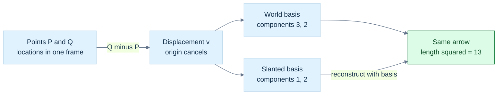

**Figure G1.** The two coordinate lists encode the same movement because $\mathbf b_1=(1,0)$ and $\mathbf b_2=(1,1)$ give $\mathbf v=1\mathbf b_1+2\mathbf b_2=(3,2)$. Points carry locations; their difference carries movement. **Limit:** all inputs must refer to a common frame before subtraction. Squaring slanted-basis coefficients gives $5$, which is not the physical squared length; use $c^\mathsf TGc=13$. See [[#The same arrow can have different coordinates|the reconstruction]] and [[#A Gram matrix remembers the geometry of a slanted basis|the metric calculation]].

### Why a basis can become unreliable

Suppose two basis directions are nearly parallel:

$$
\mathbf b_1=(1,0),\qquad \mathbf b_2=(1,\delta),\qquad 0<|\delta|\ll1.
$$

To represent $(0,1)$, coefficients must satisfy $c_2\delta=1$ and $c_1+c_2=0$. Therefore $c_2=1/\delta$ and $c_1=-1/\delta$. A modest vector requires huge cancelling coefficients. Small errors in $\delta$ can produce large coefficient errors.

This is [[#An inverse can exist and still amplify uncertainty|conditioning]]: sensitivity of the answer to small changes in the input. When $\delta=0$, the directions are dependent and cannot form a two-dimensional basis. The mapping is **singular**, meaning it cannot be uniquely inverted.

A small determinant alone is not a scale-independent conditioning test. Uniformly shrinking a perfectly perpendicular basis shrinks its determinant but does not make its directions nearly parallel. Inspect relative geometry, residuals, and appropriate condition estimates.


## The reachable movements form a vector space

Why does the previous reasoning work? Because movements form a [[#The reachable movements form a vector space|vector space]] over a field. Such a space has vector addition and scalar multiplication. The rules make combined movement consistent:

$$
\mathbf u+\mathbf v=\mathbf v+\mathbf u,\qquad
(\mathbf u+\mathbf v)+\mathbf w=\mathbf u+(\mathbf v+\mathbf w),
$$

$$
\mathbf v+\mathbf0=\mathbf v,\qquad
\mathbf v+(-\mathbf v)=\mathbf0,
$$

$$
1\mathbf v=\mathbf v,\qquad
a(b\mathbf v)=(ab)\mathbf v,
$$

$$
a(\mathbf u+\mathbf v)=a\mathbf u+a\mathbf v,\qquad
(a+b)\mathbf v=a\mathbf v+b\mathbf v.
$$

Both operations must stay inside the space. These are exact mathematical laws. A machine representation approximates them.

The rules imply $0\mathbf v=\mathbf0$: expand $(0+0)\mathbf v$ and subtract one copy of $0\mathbf v$. Similarly $a\mathbf0=\mathbf0$ and $(-1)\mathbf v=-\mathbf v$. They are consequences, not extra magic rules.

Vectors need not be arrows. Polynomials of degree at most two form a real vector space with basis $1,x,x^2$. Matrices of a fixed shape form a vector space. Real-valued functions on a fixed domain also support pointwise addition and scaling. Complex numbers form a one-dimensional vector space over $\mathbb C$, but a two-dimensional one over $\mathbb R$. **Dimension depends on the field.**

Unit vectors do not form a vector space: adding two can change the length, and multiplying by zero leaves the set. Nonnegative light values are also not closed under arbitrary real scaling. Useful constrained sets should not be mislabeled vector spaces.

### A subspace is a complete movement system inside a larger one

The panel lies in the workcell's plane $z=0$. Movements restricted to this plane still support addition and arbitrary real scaling. This set is a **subspace** of $\mathbb R^3$.

The compact subspace test is: a nonempty set $W$ inside a vector space is a subspace if

$$
a\mathbf u+b\mathbf v\in W
\quad\text{for every }\mathbf u,\mathbf v\in W
\text{ and scalars }a,b.
$$

Choosing both scalars zero puts $\mathbf0$ in $W$. Choosing $a=-1$ gives additive inverses. The remaining addition rules are inherited from the larger space.

The plane $z=1$ is not a subspace. It lacks the zero vector, and adding two of its points gives depth $2$. It is an affine plane: a translated subspace. A quadrant fails closure under negative scaling. A circle boundary fails addition. Intersections of subspaces remain subspaces, but unions need not: the union of the two coordinate axes excludes $(1,1)$ even though it contains $(1,0)$ and $(0,1)$.

### Combinations describe what the robot can reach

A **linear combination** is a weighted sum of vectors:

$$
\mathbf v=\sum_{j=1}^{k}c_j\mathbf b_j.
$$

The weights $c_j$ may be negative and need not sum to one. If the robot can move along the panel edges, then

$$
\mathbf v=s(4,0,0)+t(0,3,0)=(4s,3t,0).
$$

Every in-plane movement is reachable, but no movement with nonzero depth is. The **span** of the generators is the set of all such combinations. It is the smallest subspace containing the generators: any subspace containing them must also contain their combinations. “Smallest” concerns set inclusion, not a finite count of vectors. The span normally contains infinitely many vectors.

Repeated or already-reachable generators do not enlarge the span. The span of only the zero vector is the zero subspace. By the empty-sum convention, the span of no generators is also the zero subspace.

### Independence removes redundant controls

Generators are [[#Coordinates can change while the geometric object stays still|linearly independent]] if

$$
\sum_jc_j\mathbf b_j=\mathbf0
\quad\Longrightarrow\quad c_j=0\text{ for every }j.
$$

If a nonzero collection of coefficients produces zero, at least one generator can be expressed using the others. It is redundant. For example, $(2,0)=2(1,0)$ adds no new direction. Any generator set containing the zero vector is dependent.

Independence also proves coordinate uniqueness. If two coefficient lists reconstruct the same vector, subtract them. Their difference reconstructs zero; independence forces every coefficient difference to vanish.

A basis must both span and be independent. Independence alone may leave unreachable directions; spanning alone may allow multiple coefficient lists. The **dimension** of a finite-dimensional space is the number of vectors in a basis. The panel's movement plane has dimension two even though its coordinates are stored in three components. The zero subspace has dimension zero.

Before continuing, ask a learner to distinguish three things: a set of generators, the span they produce, and a basis extracted by removing redundancy. Confusing them makes later matrices look much more mysterious than they are.


### Immediate footing — norm

A norm measures vector size and obeys nonnegativity, vanishing only at zero, scaling, and the triangle inequality. The Euclidean norm is $\|x\|_2=\sqrt{\sum_i x_i^2}$; therefore $\|(3,4)\|_2=5$. Length depends on the coordinate metric, and normalization $x/\|x\|$ is undefined when $x=0$. A stable implementation scales components before squaring to reduce overflow or underflow risk. A residual norm measures equation error, whose meaning also depends on units and problem scale.

[[#A ruler needs more than coordinate components|Full explanation and worked examples in this book]]

### The same vector rules can describe a triangle's boundary

The word “vector” describes algebraic operations, not a requirement to draw a spatial arrow. A list of mesh-vertex temperatures is a vector: add temperatures componentwise and multiply the list by a scalar. A polynomial is another example: add its coefficients and scale them. The basis names tell us what each coefficient measures.

For a small mesh, choose three vertices $v_0,v_1,v_2$ and directed edges $e_{01},e_{12},e_{20}$. A **chain** is a formal weighted combination of mesh elements. A 1-chain weights edges, while a 0-chain weights vertices. “Formal” means that we initially manipulate the coefficients and named elements; adding two edges does not require geometrically joining them into a new straight edge.

Define the boundary of an edge by its endpoint difference:

$$
\partial e_{01}=v_1-v_0,\quad
\partial e_{12}=v_2-v_1,\quad
\partial e_{20}=v_0-v_2.
$$

Extend the operation linearly to combinations of edges. The oriented triangle boundary is $e_{01}+e_{12}+e_{20}$. Taking its boundary again gives zero because every vertex appears once with each sign. A **cycle** is a chain with zero boundary. A **boundary** is a chain obtained as the boundary of a higher-dimensional chain. Every boundary is a cycle, but a cycle need not be a boundary in the available mesh.

The distinction is tangible. Three edges without a filled face have a loop that does not bound an available face. Add the face and that same loop becomes its boundary. **Homology** identifies cycles that differ by available boundaries. Its dimensions, called **Betti numbers** when computed over a field, count independent surviving classes: connected components in dimension zero, loops in dimension one, enclosed shells in dimension two. “Independent” means one class cannot be built as a linear combination of the others. These counts do not completely classify every geometric or topological shape.

We can even change the coefficient system. Over the two-element field $\mathbb F_2$, coefficients are zero or one, with $1+1=0$. A mesh element present twice cancels. Signs disappear because $-1=1$. Over the real numbers we retain signed coefficients and orientation. The geometric mesh can stay the same while the algebraic question changes. Never apply real-valued elimination and a numerical rank tolerance to a modulo-two matrix and assume it computes the same homology.

The boundary map becomes an ordinary matrix once the elements are ordered. Rows represent output elements; columns describe each input element's boundary. The identity $\partial\partial=0$ becomes a matrix product equal to zero. This is a useful early example of what linear algebra will do: encode a meaningful operation by its action on a basis. It also supplies an exact implementation invariant, independent of how attractive the mesh looks.

The chain/cycle/boundary treatment follows the selected physical PDF pages 105–107 of Edelsbrunner and Harer's *Computational Topology*. The signed real-coefficient triangle and the comparison with $\mathbb F_2$ are explicit teaching reconstructions; the cited book develops the modulo-two setup in detail.

## A ruler needs more than coordinate components

The robot must measure how far the sensor travels. In perpendicular unit axes, the [[#A ruler needs more than coordinate components|Euclidean length]] of $\mathbf v=(x,y,z)$ is

$$
\|\mathbf v\|_2=\sqrt{x^2+y^2+z^2}.
$$

This follows by applying Pythagoras first to the horizontal components, then to the remaining depth component. The positive square root gives a nonnegative length. For $(3,4,12)$ the squared length is $9+16+144=169$, so the length is $13$.

The hidden assumption is important: these must be orthonormal Euclidean coordinates. In a slanted basis, blindly squaring coefficients measures the wrong geometry. We will restore the missing geometry with a Gram matrix.

### What makes a norm a norm?

A **norm** assigns a nonnegative size to a vector and satisfies

$$
\|\mathbf v\|=0\iff\mathbf v=\mathbf0,\qquad
\|a\mathbf v\|=|a|\|\mathbf v\|,
$$

$$
\|\mathbf u+\mathbf v\|\le\|\mathbf u\|+\|\mathbf v\|.
$$

The last rule is the **triangle inequality**: the direct combined movement cannot be longer than walking the two movements separately, according to that norm.

Common coordinate norms are

$$
\|\mathbf v\|_1=\sum_i|v_i|,\qquad
\|\mathbf v\|_2=\sqrt{\sum_iv_i^2},\qquad
\|\mathbf v\|_\infty=\max_i|v_i|.
$$

For $(3,-4)$ they give $7$, $5$, and $4$. The first is often called Manhattan length: travel along coordinate-aligned streets. The infinity norm counts the largest component movement, useful when one step may advance all coordinates at once.

In two dimensions their unit balls are a diamond, circle, and axis-aligned square. A **unit ball** contains vectors of norm at most one. Rotating Euclidean coordinates preserves the circle and Euclidean length. It generally changes the coordinate-defined Manhattan and infinity lengths.

To check the infinity triangle inequality, use $|u_i+v_i|\le|u_i|+|v_i|\le\|\mathbf u\|_\infty+\|\mathbf v\|_\infty$ for every component, then take the maximum. The first norm follows by summing the scalar inequalities. The Euclidean proof will follow from Cauchy–Schwarz below.

For a finite coordinate vector and $p\ge1$, $\|\mathbf v\|_p=(\sum_i|v_i|^p)^{1/p}$. If $M=\max_i|v_i|$, then $M\le\|\mathbf v\|_p\le n^{1/p}M$. As $p$ grows, $n^{1/p}$ approaches one. That explains the infinity notation without invoking an infinite component value.

### Distance compares points through a movement

A norm induces a **metric**, or distance rule:

$$
d(P,Q)=\|Q-P\|.
$$

It is nonnegative, vanishes only for equal points, is symmetric, and obeys a triangle inequality. These follow from the norm's rules. Translating both points equally leaves their difference unchanged.

The choice changes which object is nearest. From the origin, $(3,0)$ is closer than $(2,2)$ in the first norm because $3<4$, but farther in the Euclidean norm because $3>\sqrt8$. A spatial-query algorithm must know which distance it is optimizing.

**Squared length** is useful but is not a norm: doubling a vector quadruples its squared length. Squared Euclidean distance is not a metric either. On a line, the squared distance from $0$ to $2$ is $4$,apls larger than the sum $1+1$ through the intermediate point $1$.

For a nonnegative radius $r$, the mathematical comparison

$$
\|Q-P\|_2\le r
\iff\|Q-P\|_2^2\le r^2
$$

avoids a square root. It remains necessary to consider overflow and underflow in the squared quantities. Never compare a squared distance in square metres with an ordinary radius in metres.

### Choose what a length is meant to measure

A **norm** assigns a nonnegative size to a vector. It is zero only at the zero vector, scales by the absolute value of a scalar, and obeys the triangle inequality. A **distance** can then be defined by the norm of a difference: $d(x,y)=\|x-y\|$. Not every useful distance comes from a norm, and not every norm comes from an inner product. Those are progressively stronger structures.

For a displacement $(3,2)$, Euclidean length is $\sqrt{13}$, taxicab length is $|3|+|2|=5$, and maximum-component length is $\max(3,2)=3$. Taxicab length describes axis-aligned travel cost; maximum-component length describes the largest coordinate deviation. Their different answers do not contradict one another. They measure different questions. A **unit ball** is the set of vectors with norm at most one: a circle for Euclidean length, a diamond for the taxicab norm, and a square for the maximum norm in two dimensions.

An inner product supplies more structure: angles, perpendicularity and the usual orthogonal projection. A norm induced by an inner product satisfies the parallelogram identity

$$
\|u+v\|^2+\|u-v\|^2=2\|u\|^2+2\|v\|^2.
$$

For $u=(1,0)$ and $v=(0,1)$, the taxicab norm gives $8$ on the left and $4$ on the right. Therefore its geometry cannot be explained by quietly reusing the Euclidean dot product and angle formulas. The word “length” alone does not justify a particular projection algorithm.

A **metric matrix** $G$ can encode a chosen inner product in coordinates:

$$
\langle u,v\rangle_G=u^{\mathsf T}Gv,\qquad
\|u\|_G=\sqrt{u^{\mathsf T}Gu}.
$$

Require $G$ to be symmetric positive definite: $G^{\mathsf T}=G$, and $u^{\mathsf T}Gu>0$ whenever $u\ne0$. The first condition makes the two argument orders agree; the second prevents a nonzero movement from receiving zero or negative squared length. A positive semidefinite matrix allows zero-size nonzero directions and therefore defines only a seminorm unless the space is restricted appropriately. A **seminorm** obeys the norm rules except that zero size need not identify the zero vector.

If $G=\operatorname{diag}(1,4)$, a unit vertical displacement costs twice as much as a unit horizontal displacement. The unit ball is the ellipse $x^2+4y^2\le1$. This could encode an anisotropic movement penalty: “anisotropic” means direction-dependent. It is a modeling decision. By contrast, $G=B^{\mathsf T}B$ for a slanted basis describes the same old Euclidean ruler in new coordinates. Changing the ruler and changing coordinates are distinct operations even though both involve a matrix called $G$.

If coordinates change by $u=Bc$, the metric becomes $G_c=B^{\mathsf T}G_uB$. Check this by substitution into $u^{\mathsf T}G_uu$. The measured size stays the same. Units matter too: combining metres and radians in one coordinate vector requires a stated scaling or physical model. Adding their raw squares does not create a universal physical length.

### Bound a measurement using a dual norm

Suppose an error vector $e$ lies in a unit ball and a sensor reports the scalar $a^{\mathsf T}e$. How large can that reading become? The [[Concepts/Norms, dual norms and error budgets|dual norm]] answers precisely that question:

$$
\|a\|_* = \max_{\|e\|\le1} a^{\mathsf T}e,
\qquad |a^{\mathsf T}e|\le\|a\|_*\|e\|.
$$

The absolute-value bound follows because a norm ball is symmetric: if it contains $e$, it contains $-e$. A measurement is therefore bounded by its sensitivity norm times the allowed error size. For a Euclidean ball, Cauchy–Schwarz gives $\|a\|_* =\|a\|_2$. For a box $\|e\|_\infty\le1$, each component can align independently with its coefficient, so $\|a\|_* =\sum_i|a_i|=\|a\|_1$. For a taxicab ball, concentrating its budget in the largest coefficient gives the maximum-component dual norm.

For $a=(2,-3)$ and componentwise errors bounded by $0.1$, the worst magnitude is $0.1(2+3)=0.5$. Under a Euclidean radius-$0.1$ error model it is $0.1\sqrt{13}\approx0.360555$. State the error model before promising a tolerance.

For the positive-definite metric above, the dual measurement norm is $\sqrt{a^{\mathsf T}G^{-1}a}$. A practical implementation solves $Gz=a$ and evaluates $a^{\mathsf T}z$. This same expression will later control confidence widths and steepest descent. We have already established its meaning here: the largest possible scalar response over the allowed displacement ball.

The dual-norm and convex-geometry foundations are developed in Boyd and Vandenberghe, physical PDF pages 66–67 and Chapter 8. These error examples are original applications, not extracted performance guarantees.

## Reading the C++ laboratories

A `double` stores an approximation to a real number. An `int` stores an integer in a finite range. `std::array` has a fixed element count; `std::vector` owns a resizable sequence. A reference such as `T&` refers to an existing object, while a value normally represents an independent object. `const` restricts modification through that access path. A pointer or `std::span` can borrow storage without owning it; the owner must outlive every use of the borrowed view.

A `template` describes a family of types or functions. An overload lets the same function name accept different declared parameter types. `size_t` is an unsigned size/index type, so a negative sentinel is not an ordinary valid index. An `assert` checks a condition only when assertions are enabled; it is not a replacement for an explicit runtime input contract. `std::isfinite` rejects infinities and NaNs where a formula requires finite values.

Each complete program in this book is a separate laboratory with its own `main`. Compile it independently. Smaller snippets illustrate a particular operation and may depend on nearby declarations. Distinguish a mathematical assumption, a checked precondition, an asserted invariant, and a source-reported claim that has not been independently tested.

-----

### Immediate footing — unit roundoff

Unit roundoff describes the scale of relative rounding error in a floating-point operation. Under the usual model, $\operatorname{fl}(a\circ b)=(a\circ b)(1+\delta)$ with $|\delta|\le u$ for round-to-nearest when the exact result is finite and normal and no exceptional case occurs. Unit roundoff is not the smallest positive number and does not bound accumulated error by itself. Repeated operations, cancellation, overflow, underflow, and ill-conditioning matter. Use scale-aware tolerances and state assumptions rather than treating a tiny residual as exact zero.

[[#Floating-point answers: error, conditioning, stability, and stable arithmetic|Full explanation and worked examples in this book]]
## A direction can exist even when the naive length overflows

[[#A direction can exist even when the naive length overflows|Normalization]] asks for a unit vector pointing the same way as a nonzero vector:

$$
\widehat{\mathbf v}=\frac{\mathbf v}{\|\mathbf v\|_2}.
$$

For $(3,4,0)$ this is $(0.6,0.8,0)$. Its squared length is $0.36+0.64=1$. Normalization removes the original magnitude and its units. It is not linear: normalizing a sum is not the sum of normalized inputs.

Zero has no direction. Dividing its components by zero cannot invent one. A safe API should report failure, enforce a documented nonzero precondition, or apply a caller-chosen fallback. Silently returning zero under a “unit direction” promise is false.

### Scale first, then measure

Finite components can still produce overflowing squares. In binary32, components around $10^{20}$ have representable values, but their squares need not. Tiny values can have the opposite problem: their squares round to zero.

For a finite nonzero vector, set

$$
m=\max(|x|,|y|,|z|),\qquad
\mathbf s=\mathbf v/m.
$$

Each scaled component has magnitude at most one, and at least one has magnitude one. Therefore

$$
1\le\mathbf s\cdot\mathbf s\le3.
$$

Compute the unit direction as

$$
\widehat{\mathbf v}=\frac{\mathbf s}{\sqrt{\mathbf s\cdot\mathbf s}}.
$$

We never need to form the potentially unrepresentable original length. For $(10^{300},10^{300},0)$ in a suitable binary64 implementation, scaling gives $(1,1,0)$ and the direction $(1/\sqrt2,1/\sqrt2,0)$.

To compute an actual length, multiply the scaled length by $m$, or use `std::hypot`. The final length can genuinely exceed the result type's range; robust intermediates do not make an impossible final result representable. See [[Robust norm and intermediate range]].

There are two different rejection decisions:

- **Numerical existence:** is the vector finite and nonzero, so a direction can be computed?
- **Application meaning:** is its length large enough relative to measurement noise or scene scale to be trusted?

A mathematically nonzero displacement may be too small for a noisy sensor to define a stable direction. Specify that policy in metres or as a scale-relative threshold. Machine epsilon describes spacing near one, not a universal geometry tolerance.

Under flush-to-zero modes, very small components may already be erased or treated as zero by hardware. The scaled method cannot recover those inputs. Tests and documented assumptions must cover [[Flush-to-zero and denormals-are-zero]].

## The dot product turns two movements into a measurement

The robot needs to know how much a movement follows its guide rail. A [[#The dot product turns two movements into a measurement|dot product]] measures alignment, weighted by the magnitudes.

In orthonormal real coordinates,

$$
\mathbf a\cdot\mathbf b=\sum_i a_i b_i.
$$

It is symmetric and linear in each argument, and $\mathbf v\cdot\mathbf v$ is nonnegative, vanishing only at zero. These properties make it an **inner product**. A general vector space does not automatically arrive with one. Complex inner products require conjugation and convention choices; the real formulas here must not be copied unchanged into a complex library.

### Derive the angle relationship

Expand the squared length of a difference using component arithmetic:

$$
\|\mathbf a-\mathbf b\|^2
=\|\mathbf a\|^2+\|\mathbf b\|^2-2\mathbf a\cdot\mathbf b.
$$

For the triangle formed by the two arrows, the cosine rule gives

$$
\|\mathbf a-\mathbf b\|^2
=\|\mathbf a\|^2+\|\mathbf b\|^2
-2\|\mathbf a\|\|\mathbf b\|\cos\theta.
$$

Comparing them yields

$$
\mathbf a\cdot\mathbf b=\|\mathbf a\|\|\mathbf b\|\cos\theta.
$$

For nonzero vectors, a positive dot means an acute angle, zero means a right angle, and a negative dot means an obtuse angle. It equals the cosine only when both inputs are unit length.

For $\mathbf a=(3,4,0)$ and $\mathbf b=(2,0,0)$, the dot is $6$. The lengths are $5$ and $2$, so $\cos\theta=6/10=0.6$. The dot itself was not an angle and not a cosine.

**Orthogonal** means zero inner product. In Euclidean geometry, nonzero orthogonal vectors are perpendicular. The zero vector is algebraically orthogonal to every vector but has no direction, so “its angle is ninety degrees” is not meaningful.

### A useful inequality and the missing norm proof

For nonzero $\mathbf b$, the squared length of $\mathbf a-t\mathbf b$ cannot be negative. Choose $t=(\mathbf a\cdot\mathbf b)/(\mathbf b\cdot\mathbf b)$, expand, and obtain

$$
0\le\|\mathbf a\|^2-
\frac{(\mathbf a\cdot\mathbf b)^2}{\|\mathbf b\|^2}.
$$

Hence the **Cauchy–Schwarz inequality**:

$$
|\mathbf a\cdot\mathbf b|\le\|\mathbf a\|\|\mathbf b\|.
$$

It is also true when either vector is zero. Now expand a sum's squared length and bound its dot term:

$$
\|\mathbf a+\mathbf b\|^2
\le\|\mathbf a\|^2+2\|\mathbf a\|\|\mathbf b\|+\|\mathbf b\|^2
=(\|\mathbf a\|+\|\mathbf b\|)^2.
$$

Taking nonnegative square roots proves the Euclidean triangle inequality.

For an approximate orthogonality test, a dimensionless criterion is

$$
\frac{|\mathbf a\cdot\mathbf b|}{\|\mathbf a\|\|\mathbf b\|}
\le\varepsilon_\theta.
$$

Handle zero and non-finite inputs separately; scale or safely normalize before evaluating the ratio when ranges are large. An absolute threshold on the raw dot changes its meaning when vector lengths change.

### Immediate footing — least squares

Least squares chooses parameters that minimize the sum of squared residuals, where a residual is predicted minus measured value. For a matrix model it minimizes $\lVert Ax-b\rVert_2^2$. Fitting one constant $x$ to measurements $1$ and $3$ minimizes $(x-1)^2+(x-3)^2$, so the answer is $x=2$. A zero residual is possible only if the model can match every measurement. Rank deficiency can give multiple minimizing parameter vectors. Weights, measurement units, outliers and noise assumptions affect which squared-error problem is appropriate.

[[#QR turns least squares into a triangular solve plus an irreducible residual|Full explanation and worked examples in this book]]

## Projection separates useful movement from sideways movement

The rail follows a nonzero vector $\mathbf b$. The robot's requested movement is $\mathbf a$. We want the part along the rail and the part left over.

The along-rail part must have form $\alpha\mathbf b$. Require the remainder to be perpendicular:

$$
(\mathbf a-\alpha\mathbf b)\cdot\mathbf b=0.
$$

Distribute and solve:

$$
\alpha=\frac{\mathbf a\cdot\mathbf b}{\mathbf b\cdot\mathbf b},\qquad
\operatorname{proj}_{\mathbf b}\mathbf a=\alpha\mathbf b.
$$

This is [[#Projection separates useful movement from sideways movement|vector projection]]. The **rejection** is

$$
\mathbf r=\mathbf a-\operatorname{proj}_{\mathbf b}\mathbf a.
$$

The **signed scalar projection** is a different output:

$$
s=\frac{\mathbf a\cdot\mathbf b}{\|\mathbf b\|}.
$$

It measures signed length along the target direction. The coefficient $\alpha$ multiplies the target vector; the vector projection is a vector. These three quantities coincide only in special ways, not by definition.

### An execution trace you can teach at the board

Take $\mathbf a=(3,4,0)$ and rail vector $\mathbf b=(2,0,0)$:

| Step | Result |
|---|---|
| Dot with the rail | $\mathbf a\cdot\mathbf b=6$ |
| Rail squared length | $\mathbf b\cdot\mathbf b=4$ |
| Coefficient | $\alpha=6/4=1.5$ |
| Vector projection | $1.5(2,0,0)=(3,0,0)$ |
| Rejection | $(3,4,0)-(3,0,0)=(0,4,0)$ |
| Signed scalar projection | $s=6/2=3$ |

The remainder dotted with the rail is zero. The squared lengths satisfy $25=9+16$. Scaling the rail vector to $(20,0,0)$ changes the coefficient but not the vector projection: the geometric line is unchanged.

### G2 - Split the request into rail travel and sideways travel

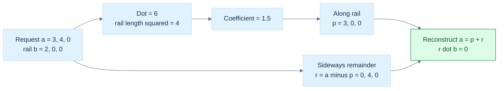

**Figure G2.** Each box is a checkable stage, not a drawing to scale. The coefficient $1.5$ is dimensionless here; the signed along-rail length is $3$, and the projected vector is $(3,0,0)$. **Limit:** $\mathbf b\ne\mathbf0$ and Euclidean measurement are required. For a unit axis $\widehat{\mathbf b}$, use $\mathbf p=(\mathbf a\cdot\widehat{\mathbf b})\widehat{\mathbf b}$. Extreme arithmetic ranges and a tiny cancellation residual still need the policies explained below.

Projection onto zero is undefined because zero defines no line. Projecting zero onto a valid line is fine and gives zero.

Why is the projection the closest rail movement? Every candidate $t\mathbf b$ differs from $\mathbf a$ by

$$
\mathbf a-t\mathbf b=\mathbf r+(\alpha-t)\mathbf b.
$$

The two terms are perpendicular, so

$$
\|\mathbf a-t\mathbf b\|^2
=\|\mathbf r\|^2+(\alpha-t)^2\|\mathbf b\|^2.
$$

The smallest value occurs at $t=\alpha$. This is a **least-squares** problem: choose a parameter that minimizes the sum of squared coordinate errors.

Projection is **idempotent**: projecting an already-projected vector changes nothing. For a fixed target line it is linear in the input. Rejection is also linear and idempotent. Reflection will reverse the rejected or projected portion according to which geometric mirror we choose; rejection itself is not reflection.

On a unit normal $\mathbf n$, removing the normal component gives surface-sliding movement:

$$
\mathbf v_{\mathrm{slide}}=\mathbf v-(\mathbf v\cdot\mathbf n)\mathbf n.
$$

If the requested movement is almost entirely normal, the small tangential remainder can be sensitive to cancellation. Correct decomposition does not guarantee high relative accuracy in a tiny residual.

### A camera-framing trace uses the same angle

In camera-local coordinates with forward along $+z$, a point in front of the camera at $(x,y,z)$ has vertical angle $\theta=\operatorname{atan2}(y,z)$. Points $(0,3,4)$ and $(0,-1,5)$ have angles about $36.87^\circ$ and $-11.31^\circ$. A fixed axis needs a full vertical field of view of about $73.74^\circ$ to include both. A sphere of radius $r$ at center distance $d>r$ adds angular radius $\arcsin(r/d)$. Freya Holmér's trigonometry lesson develops the right-triangle camera-FOV relation; the selected interpolation lesson covers multiple-target camera fitting and the sphere angular radius. Behind-camera points and horizontal aspect constraints still need explicit treatment. [Freya Holmér, Trigonometry](https://www.youtube.com/watch?v=1NLekEd770w), [Freya Holmér, Interpolation & Velocity](https://www.youtube.com/watch?v=-Ii3MrJFBkQ)

### Immediate footing — radians

A radian measures angle as arc length divided by radius. One full circle is $2\pi$ radians, so a quarter-turn is $\pi/2$. The unit-circle point at angle $\theta$ is $(\cos\theta,\sin\theta)$; at $\theta=\pi/2$ it is $(0,1)$. Rotation formulas and calculus conventionally use radians. Convert degrees using $\theta_{\mathrm{rad}}=\theta_{\mathrm{deg}}\pi/180$. For a signed planar angle, $\operatorname{atan2}(y,x)$ retains quadrant information, while $\operatorname{atan}(y/x)$ does not and is undefined at $x=0$.

[[#Rotation first becomes understandable in a plane|Full explanation and worked examples in this book]]

### A rail, a wall, and a feasible region use the same nearest-point question

The rail projection minimizes distance to a line. We can ask the same question for a **feasible set** $C$, the collection of states that satisfy the current constraints:

$$
P_C(x)=\underset{y\in C}{\operatorname{argmin}}\;\frac12\|x-y\|_2^2.
$$

The notation $\operatorname{argmin}$ requests a minimizing point, whereas $\min$ requests the smallest objective value. For a nonempty closed convex set in finite-dimensional Euclidean space, this point exists and is unique. “Closed” includes the set's limit points. “Convex” means that the straight segment joining any two feasible points remains feasible.

Here is why uniqueness needs an argument. If two different points $p,q$ were equally nearest, convexity would make their midpoint feasible, while

$$
\left\|x-\frac{p+q}{2}\right\|^2
=\frac{\|x-p\|^2+\|x-q\|^2}{2}-\frac{\|p-q\|^2}{4}
$$

would make it strictly nearer. A nonconvex set can have several equally nearest points: the center of a circle has every point on the circumference as a Euclidean nearest point. The circumference and the filled disk have different projection behavior.

At a nearest point $p$, every feasible direction toward another point $y$ must initially fail to reduce distance. Differentiate along $p+t(y-p)$ at $t=0$ to obtain

$$
(x-p)^{\mathsf T}(y-p)\le0\qquad\text{for all }y\in C.
$$

For a whole line or plane, feasible directions occur with both signs, so this becomes perpendicularity. At a corner or boundary, only an inequality remains. This explains why the old rail derivation is one case of a broader rule.

A **halfspace** is one side of a plane, $C=\{y:a^{\mathsf T}y\le b\}$, with nonzero normal $a$. If $x$ is already inside, leave it alone. Otherwise

$$
P_C(x)=x-\frac{a^{\mathsf T}x-b}{a^{\mathsf T}a}a.
$$

For $a=(1,1)$, $b=1$ and $x=(2,2)$, the projection is $(1/2,1/2)$. The residual $(3/2,3/2)$ points outward. For every feasible $y$, its dot product with $y-p$ is nonpositive, exactly as the optimality condition requires.

An axis-aligned box permits independent coordinate clamping under Euclidean distance. A slanted intersection of constraints generally does not. Repeatedly projecting onto each halfspace is an iterative algorithm, and one pass need not produce the nearest point in the intersection. An **active constraint** is one satisfied at equality at the solution; it helps identify which boundary currently matters.

If our error ruler is $G$, the nearest point on the plane $a^{\mathsf T}y=b$ is instead

$$
p=x-\frac{a^{\mathsf T}x-b}{a^{\mathsf T}G^{-1}a}\,G^{-1}a.
$$

This follows by requiring the objective's change to vanish along every feasible tangent direction. The correction follows $G^{-1}a$, not generally the Euclidean normal $a$. With $G=\operatorname{diag}(1,4)$ and the same point and plane, $G^{-1}a=(1,1/4)$, the multiplier is $3/(5/4)=12/5$, and $p=(-2/5,7/5)$. It lies on the plane. Vertical error is expensive, so the solution changes the horizontal coordinate more strongly. Its squared $G$-distance is $36/5$, compared with $45/4$ for the Euclidean projection. The “closest” answer changes when the chosen cost changes.

Finally, the Euclidean residual $x-p$ provides a separating measurement when $x$ lies outside a closed convex set. Every point of the set is on one side of the supporting plane through $p$; a parallel plane midway between $x$ and $p$ strictly separates the point from the set. This connects projection to collision separation and constrained optimization without introducing a different mysterious mechanism.

This section develops the projection and separation treatment in *Convex Optimization*, physical PDF pages 411–414, using original rail/wall and weighted-distance examples.

### A line fit is projection in observation space

Three measurements at times $t=(0,1,2)$ have values $y=(1,1,3)$. Fit the model $\widehat y_i=c+mt_i$. Its possible predicted data vectors form the span of $(1,1,1)$ and $(0,1,2)$ in three-dimensional observation space. The closest prediction is therefore a projection onto that span, even though the fitted curve is a line in the original time-value plot.

Requiring residual $r=y-\widehat y$ to be perpendicular to both generating vectors gives $\sum_i r_i=0$ and $\sum_i t_ir_i=0$. Substitute the model to obtain $3c+3m=5$ and $3c+5m=7$. Subtraction gives $m=1$, then $c=2/3$. The prediction is $(2/3,5/3,8/3)$ and residual is $(1/3,-2/3,1/3)$. Its ordinary sum and time-weighted sum are both zero. These are direct witnesses of least-squares optimality, not a promise that the linear model is scientifically correct.

MIT's projection lesson emphasizes this connection between regression and linear projection. The numerical dataset here is an original example. The later matrix and QR chapters develop stable algorithms and rank-deficient cases. [MIT OCW: Projection Matrices and Least Squares](https://www.ocw.mit.edu/courses/18-06sc-linear-algebra-fall-2011/pages/least-squares-determinants-and-eigenvalues/projection-matrices-and-least-squares/)

## Rotation first becomes understandable in a plane

Before constructing the panel's three-dimensional frame, rotate its sensor sweep within a plane. [[#Rotation first becomes understandable in a plane|Complex numbers]] provide a compact explanation.

Write a complex number as $z=x+iy$, where $i^2=-1$. Its real and imaginary components locate a point in a two-dimensional diagram. Addition adds these components. Multiplication follows distributivity:

$$
(a+ib)(x+iy)=(ax-by)+i(ay+bx).
$$

Multiplication by $i$ sends $(x,y)$ to $(-y,x)$. Applying it twice sends the vector to $(-x,-y)$, because $i^2=-1$. In conventional upward-positive Cartesian coordinates, one application is a counterclockwise quarter-turn.


For an arbitrary angle, use the unit complex number

$$
r=\cos\theta+i\sin\theta.
$$

Multiplying a coordinate pair by $r$ gives

$$
x'=x\cos\theta-y\sin\theta,\qquad
y'=x\sin\theta+y\cos\theta.
$$

For $(1,0)$ and $\theta=\pi/2$, the result is $(0,1)$. For $(2,1)$, the same quarter-turn gives $(-1,2)$. Trigonometric functions in our code use radians: $\pi$ radians equal $180^\circ$.

The **conjugate** of $z=x+iy$ is $\overline z=x-iy$. It satisfies

$$
z\overline z=x^2+y^2=|z|^2.
$$

Therefore $z^{-1}=\overline z/|z|^2$ when $z\ne0$. For a unit rotation, the inverse is just the conjugate. Multiplying two unit rotations composes them; angle-addition identities show that their angles add.

A non-unit multiplier rotates and scales, rather than only rotating. Repeated floating-point composition can gradually change the stored magnitude. Re-normalize under an explicit drift policy when the representation promises a rotation. The complex zero is not a valid rotation: multiplication by it collapses every point.

There is a numerical warning in the inverse formula. Squaring very large components can overflow even when a useful reciprocal exists; squaring tiny ones can underflow. Use a range-aware complex division algorithm rather than treating the displayed derivation as a universally safe implementation.

```cpp
struct Complex2 {
    double real{}, imag{};
};
constexpr Complex2 multiply(Complex2 a, Complex2 b) noexcept {
    return {a.real * b.real - a.imag * b.imag,
            a.real * b.imag + a.imag * b.real};
}
```

This excerpt implements multiplication, not a validated rotation type. The later laboratory uses a separate unit-vector wrapper for the same reason: a representation and a validated promise are different things.

## Oriented area tells us which side of the panel is front

The panel needs a facing direction. Its edge vectors lie in its plane, so their dot product alone cannot provide an out-of-plane direction. We need [[#Oriented area tells us which side of the panel is front|oriented area]].

### The cross product and its definition

In an oriented three-dimensional Euclidean space, the **cross product** $\mathbf a\times\mathbf b$ is perpendicular to both inputs. Its magnitude is the parallelogram area, and its sign follows the chosen orientation. Parallel inputs produce zero.

For a positively oriented orthonormal basis, the component rule is

$$
\mathbf a\times\mathbf b=
\begin{pmatrix}
a_yb_z-a_zb_y\\
a_zb_x-a_xb_z\\
a_xb_y-a_yb_x
\end{pmatrix}.
$$

This explicitly supplies the Part 542 definition absent as a standalone source. We now derive rather than merely memorize its components.

The signed area spanned by two coordinate pairs in the first two axes is the $2\times2$ determinant

$$
\det\begin{pmatrix}a_x&b_x\\a_y&b_y\end{pmatrix}
=a_xb_y-a_yb_x.
$$

It is positive for the ordered pair of standard axes and changes sign when the arrows swap. Similar area measurements in the other coordinate planes give the three components above. The familiar symbolic determinant containing basis vectors is a mnemonic for these three signed minors, not a new unexplained arithmetic object.

Check perpendicularity directly: expand $\mathbf a\cdot(\mathbf a\times\mathbf b)$. Each product cancels a matching term of opposite sign, leaving zero. The same calculation with $\mathbf b$ also gives zero. The construction is linear in each input and changes sign under exchange:

$$
\mathbf a\times\mathbf b=-\mathbf b\times\mathbf a.
$$

### The panel's normal and area

For the panel edges,

$$
(B-A)\times(C-A)=(4,0,0)\times(0,3,0)=(0,0,12).
$$

The raw result has magnitude $12\,\mathrm{m}^2$, the parallelogram area. The triangular panel occupies half of that, so its area is $6\,\mathrm{m}^2$. Its unit front normal is $(0,0,1)$ under this vertex ordering.

The identity

$$
\|\mathbf a\times\mathbf b\|^2
=\|\mathbf a\|^2\|\mathbf b\|^2-(\mathbf a\cdot\mathbf b)^2
$$

follows by expanding both sides into products of components and cancelling matching terms. Insert the cosine relation to obtain

$$
\|\mathbf a\times\mathbf b\|=\|\mathbf a\|\|\mathbf b\|\sin\theta
\quad(0\le\theta\le\pi).
$$

This is base times perpendicular height. It connects cross products, Gram determinants, area, and angle rather than introducing unrelated facts.

The cross components of nearly parallel inputs subtract nearly equal products. Their small result may be sensitive to rounding. The area identity is not automatically a numerically safer alternative: its right side can suffer severe cancellation too. Scale-aware nonparallelness is expressed by

$$
\frac{\|\mathbf a\times\mathbf b\|}{\|\mathbf a\|\|\mathbf b\|}=\sin\theta,
$$

with nonzero inputs and range-safe evaluation. A tiny raw cross magnitude alone may mean tiny geometry rather than nearly parallel directions.

### Orientation is not storage order in memory

An ordered frame $(\mathbf x,\mathbf y,\mathbf z)$ is right-handed relative to our chosen positive orientation when

$$
(\mathbf x\times\mathbf y)\cdot\mathbf z>0.
$$

It is left-handed when the sign is negative; zero means a degenerate frame, not a third handedness. Swapping two axes reverses the sign. Cyclic permutation preserves it. An orientation-preserving rotation cannot turn a right-handed frame into a left-handed one; a reflection can.

[[#Oriented area tells us which side of the panel is front|Handedness]] does not specify which axis is up, whether a camera looks toward positive or negative depth, or whether a matrix is stored by rows or columns. Define all these conventions separately.

For an orthogonal transform $R$,

$$
(R\mathbf a)\times(R\mathbf b)
=\det(R)R(\mathbf a\times\mathbf b).
$$

A proper rotation has determinant $1$. A reflection has determinant $-1$, so the oriented-area vector gains an extra sign. This explains why blindly treating a cross-derived normal as an ordinary direction through a mirror can reverse mesh orientation.

The same component cross formula encodes a chosen positive orientation. When using a basis of opposite orientation, decide whether the code's algebraic convention or the external geometric orientation is authoritative and convert consistently. Calling a whole graphics API “left-handed” does not settle every stage of that pipeline.

### Why three dimensions are special, but not the whole story

In two dimensions an oriented area has one independent component; it is not an in-plane perpendicular vector. The often-named “2D cross” is the scalar signed area $a_xb_y-a_yb_x$.

In $n$ dimensions, oriented two-dimensional areas have $n(n-1)/2$ independent components. In three dimensions that count equals three, allowing area components to be identified with a vector after a metric and orientation are chosen. In four dimensions there are six area components, not four. Also, two independent vectors in four-dimensional space have a two-dimensional perpendicular space rather than one uniquely oriented perpendicular direction.

There is an exceptional seven-dimensional binary cross product with additional structure. Do not turn the introductory three-dimensional explanation into the false claim that no such operation exists anywhere else. The ordinary graphics cross product remains the three-dimensional one described here.

## Signed volume extends the same idea into space

Move a test point above the panel to $D=(0,0,2)$. The [[#Signed volume extends the same idea into space|scalar triple product]] is

$$
(B-A)\cdot\big((C-A)\times(D-A)\big)=24.
$$

Equivalently, dot the area normal $(B-A)\times(C-A)$ with $D-A$; cyclic rearrangement preserves the scalar value. The signed parallelepiped volume is $24\,\mathrm{m}^3$. The tetrahedron formed by four corners has one sixth of it, so its ordinary volume is $4\,\mathrm{m}^3$.

Why area times height? The cross product contributes an area vector. Dotting with the third movement selects the signed component perpendicular to the base. A third vector lying in the base plane contributes zero height. Swapping two inputs reverses orientation, while taking absolute value gives ordinary volume.

In coordinates the triple product is a $3\times3$ determinant. A **determinant** measures oriented area or volume scaling for a square linear map. A zero determinant indicates lost dimensions. It is not a universal conditioning score.

### Nested cross products are not associative

The **vector triple-product identity** is

$$
\mathbf a\times(\mathbf b\times\mathbf c)
=\mathbf b(\mathbf a\cdot\mathbf c)-\mathbf c(\mathbf a\cdot\mathbf b).
$$

For its first component, expand the left side:

$$
a_y(b_xc_y-b_yc_x)-a_z(b_zc_x-b_xc_z)
=b_x(a_yc_y+a_zc_z)-c_x(a_yb_y+a_zb_z).
$$

Add the cancelling pair $b_xa_xc_x-c_xa_xb_x$ and recover the first component of the right side. The other components follow by cycling indices.

For the other grouping,

$$
(\mathbf a\times\mathbf b)\times\mathbf c
=\mathbf b(\mathbf a\cdot\mathbf c)-\mathbf a(\mathbf b\cdot\mathbf c).
$$

These generally differ. Parentheses are part of the geometry, not optional punctuation. For example, $\mathbf e_x\times(\mathbf e_x\times\mathbf e_y)=-\mathbf e_y$, but $(\mathbf e_x\times\mathbf e_x)\times\mathbf e_y=\mathbf0$.

For unit $\mathbf n$, the related identity

$$
\mathbf n\times(\mathbf v\times\mathbf n)
=\mathbf v-\mathbf n(\mathbf v\cdot\mathbf n)
$$

is precisely tangent-plane rejection. A nested cross has now become a previously understood projection operation.

### Immediate footing — derivative

A derivative is the best linear prediction of how a function changes near an input. For $f(x)=x^2$, $f(x+h)-f(x)=2xh+h^2$, so near $x=3$ the leading change is $6h$ and $f'(3)=6$. The derivative is local: the omitted $h^2$ term matters for larger steps. Derivative units are output units divided by input units. At corners or discontinuities an ordinary derivative may not exist, so algorithms that rely on smoothness must state that assumption.
[[#Functions, limits, continuity, and scalar change|Full explanation and worked examples in this book]]

### A volume also constructs reciprocal measuring directions

In three dimensions, independent basis vectors $b_1,b_2,b_3$ have reciprocal directions

$$
b^1=\frac{b_2\times b_3}{b_1\cdot(b_2\times b_3)},\quad
b^2=\frac{b_3\times b_1}{b_1\cdot(b_2\times b_3)},\quad
b^3=\frac{b_1\times b_2}{b_1\cdot(b_2\times b_3)}.
$$

The denominator is signed volume. A cross product measures oriented area; a scalar triple product measures oriented volume. These formulas explain the geometry, but a nearly collapsed volume makes reciprocal measurements sensitive to error. They are not a recommendation to use cross-product inversion for every floating-point basis solve. The cross product and signed volume just derived supply every operation in this construction.

## An angle is a question with a domain

The [[#An angle is a question with a domain|unsigned angle]] between nonzero vectors lies in $[0,\pi]$. The familiar expression is

$$
\theta=\arccos\left(
\frac{\mathbf a\cdot\mathbf b}{\|\mathbf a\|\|\mathbf b\|}
\right).
$$

After checking finite, nonzero inputs, clamp a small numerical overshoot of the computed cosine to $[-1,1]$. Clamping is not a substitute for valid inputs. Near parallel or antiparallel directions, the derivative of inverse cosine is large, so small cosine errors can produce relatively large angle errors.

Dot and cross provide cosine-like and sine-like information together. Therefore a useful alternative is

$$
\theta=\operatorname{atan2}
\left(\|\mathbf a\times\mathbf b\|,\mathbf a\cdot\mathbf b\right).
$$

$\operatorname{atan2}(y,x)$ determines an angle from both components and their signs. Using the nonnegative cross length makes this an unsigned angle. Identical directions give zero; opposite directions give $\pi$; perpendicular directions give $\pi/2$.

Scale each input by its own largest absolute component before computing dot and cross. Both quantities then acquire the same positive scale factor relative to the originals, leaving the angle unchanged while reducing overflow risk. This does not make cancellation disappear or recover already-rounded inputs.

A signed angle needs an orientation reference. For two vectors lying in a plane with unit positive normal $\mathbf n$,

$$
\theta_{\mathrm{signed}}=
\operatorname{atan2}\big(\mathbf n\cdot(\mathbf a\times\mathbf b),
\mathbf a\cdot\mathbf b\big).
$$

For arbitrary non-coplanar inputs, first define which plane or projected directions the signed angle refers to. A reference normal cannot resolve an unstated geometric question.

Often no angle is needed. To test whether unit directions differ by at most $\theta_{\max}$ in $[0,\pi]$, compare their dot product with $\cos\theta_{\max}$. This saves inverse trigonometry and states the actual decision.

## Surface movement becomes a local frame

The robot needs a front-facing normal and two directions along the panel. A [[#Surface movement becomes a local frame|tangent]] lies in a surface's local tangent plane. A **normal** is perpendicular to that plane. A **bitangent** supplies a second tangent direction, often paired with increasing texture coordinates.

For a smooth parameterized surface $\mathbf p(u,v)$, the partial derivatives $\partial\mathbf p/\partial u$ and $\partial\mathbf p/\partial v$ are local tangent vectors when they are independent. “Partial derivative” means the rate of change while varying one parameter and holding the other fixed. On a triangle, edge vectors directly span the flat tangent plane.

For a sphere centered at $C$, the outward normal at a surface point $P$ follows $P-C$. For a plane through $A$ with normal $\mathbf n$, points obey

$$
\mathbf n\cdot(P-A)=0.
$$

A normal need not be unit length. If it is used as a signed distance ruler, it must be unit, otherwise the dot result contains an extra scale factor.

A **geometric normal** comes from the actual surface. A **shading normal** may be interpolated or modified to make lighting appear smooth. They can differ and have different responsibilities. Averaging unit normals usually yields a non-unit vector; re-normalize only after checking that the average has a usable direction. A collapsed triangle has no uniquely reliable face normal.

### Texture coordinates specify preferred tangents

Let the panel corners have texture coordinates $(0,0)$, $(1,0)$, and $(0,1)$. The panel's position changes by $(4,0,0)$ when its first texture parameter increases by one, and by $(0,3,0)$ when the second increases by one. The raw texture tangents therefore carry spatial stretch, not merely direction.

For general texture differences, write

$$
\mathbf e_1=\Delta u_1\mathbf t+\Delta v_1\mathbf b,
\qquad
\mathbf e_2=\Delta u_2\mathbf t+\Delta v_2\mathbf b.
$$

Eliminate one unknown at a time. With

$$
D=\Delta u_1\Delta v_2-\Delta u_2\Delta v_1,
$$

the result is

$$
\mathbf t=\frac{\Delta v_2\mathbf e_1-\Delta v_1\mathbf e_2}{D},
\qquad
\mathbf b=\frac{\Delta u_1\mathbf e_2-\Delta u_2\mathbf e_1}{D}.
$$

$D$ is the signed texture-area scale. Zero means the texture triangle has collapsed and cannot identify two distinct texture directions. Nearly zero can amplify input error. Spatial degeneracy and texture degeneracy are separate checks.

### Clean the frame without erasing its orientation

Given a unit normal $\mathbf n$ and raw tangent $\mathbf t$, remove normal contamination and normalize:

$$
\mathbf t'=\mathbf t-(\mathbf t\cdot\mathbf n)\mathbf n,
\qquad \widehat{\mathbf t}=\operatorname{normalize}(\mathbf t').
$$

To preserve a mirrored texture island, keep a handedness sign

$$
h=\operatorname{sign}\big((\mathbf n\times\widehat{\mathbf t})\cdot\mathbf b_{\mathrm{raw}}\big),
\qquad
\widehat{\mathbf b}=h(\mathbf n\times\widehat{\mathbf t}).
$$

When the sign test is zero or too uncertain, the input frame does not reliably determine handedness. Do not quietly invent a positive sign while claiming the original frame was valid.

The resulting **TBN frame** consists of tangent, bitangent, and normal. It converts a texture-local normal into the surface's frame through weighted column addition. Document whether $h$ is encoded with this convention or its opposite.

The distinction between geometric and shading frames is used in real rendering systems; PBRT's triangle implementation separately constructs these quantities and accounts for orientation reversal. That reference is an implementation anchor, not evidence that our simplified lab covers every seam and interpolation rule. [PBRT, Triangle Meshes](https://www.pbr-book.org/4ed/Shapes/Triangle_Meshes).

### Immediate footing — rank and nullspace

The rank of a map is the number of independent output directions it can produce. Its nullspace (kernel) contains inputs mapped to zero. For $A=\begin{bmatrix}1&1\\2&2\end{bmatrix}$, only one output direction is independent, so $\operatorname{rank}(A)=1$; every vector $(t,-t)$ lies in the nullspace. Rank plus nullity equals the input dimension: $\operatorname{rank}(A)+\dim\ker(A)=n$. In solving $Ax=b$, rank shows which constraints are independent and which input directions remain free. In floating-point work, numerical rank uses a tolerance because an exact zero may appear as a small computed singular value.

[[#Rank, the four spaces, and the shape of the answer|Full explanation and worked examples in this book]]

## Orthonormal frames make reconstruction simple

A [[#Orthonormal frames make reconstruction simple|frame is orthonormal]] when all its axes have length one and are mutually perpendicular. Its Gram matrix is identity. Coordinates of a vector are simply its dot products with the axes:

$$
\mathbf v=\sum_i(\mathbf v\cdot\mathbf q_i)\mathbf q_i.
$$

Orthonormality is why local lighting directions can be measured without solving a slanted-basis system each time.

### Build a frame from one direction

A unit normal does not uniquely specify two tangent axes: they may rotate around it. We must choose a convention.

Choose a coordinate axis $\mathbf h$ least aligned with the normal. In practice, select the axis corresponding to the smallest absolute component of $\mathbf n$. Then compute

$$
\mathbf t=\operatorname{normalize}(\mathbf h\times\mathbf n),
\qquad \mathbf b=\mathbf n\times\mathbf t.
$$

Because one squared component of a unit normal is at most $1/3$, this helper has

$$
\|\mathbf h\times\mathbf n\|^2
=1-(\mathbf h\cdot\mathbf n)^2\ge\frac23.
$$

So this exact-arithmetic helper cannot become almost parallel to the normal. For $\mathbf n=(0,0,1)$ and helper $(1,0,0)$, tangent is $(0,-1,0)$ and bitangent $(1,0,0)$. These are valid axes even though they differ from a texture-preferred orientation.

This construction is easy to teach, but its selected helper can change abruptly at tie boundaries. That matters for animated or spatially coherent frames. Robustness against division by a small quantity does not guarantee continuity of the output convention.

Research on orthonormal-basis construction investigates such numerical behavior. Duff and colleagues' *Building an Orthonormal Basis, Revisited* is a useful comparison target for a faster specialized construction. We use the transparent helper-axis method here; we do not claim to have benchmarked or implemented that paper's algorithm. [Duff et al., 2017](https://graphics.pixar.com/library/OrthonormalB/paper.pdf).

### Gram–Schmidt is repeated rejection

Given independent generators $\mathbf v_1,\mathbf v_2,\mathbf v_3$, first normalize $\mathbf v_1$ to $\mathbf q_1$. Then remove its component from the second generator:

$$
\mathbf u_2=\mathbf v_2-(\mathbf v_2\cdot\mathbf q_1)\mathbf q_1,
\qquad \mathbf q_2=\mathbf u_2/\|\mathbf u_2\|.
$$

For the third,

$$
\mathbf u_3=\mathbf v_3
-(\mathbf v_3\cdot\mathbf q_1)\mathbf q_1
-(\mathbf v_3\cdot\mathbf q_2)\mathbf q_2,
\qquad \mathbf q_3=\mathbf u_3/\|\mathbf u_3\|.
$$

Each new axis keeps only movement not represented by previous axes. Because we subtract combinations of earlier generators, the span is preserved. A zero residual reveals dependence. A very small residual may reveal near dependence and unreliable input geometry.

Use $\mathbf v_1=(1,1,0)$ and $\mathbf v_2=(1,0,0)$. The first axis is $(1,1,0)/\sqrt2$. The projection of the second is $(1/2,1/2,0)$. The residual is $(1/2,-1/2,0)$, yielding axis $(1,-1,0)/\sqrt2$. Both original generators remain in the reconstructed span.

### Modified order changes floating-point behavior

Classical Gram–Schmidt evaluates every projection coefficient against the original current generator, then subtracts the combined projections. **Modified Gram–Schmidt** repeatedly measures and subtracts from the updated residual:

```text
r = current generator
for each earlier unit axis q:
    coefficient = dot(q, r)
    r = r - coefficient * q
validate the residual, then normalize it
```

They agree in exact arithmetic when previous axes are exactly orthonormal. Floating-point axes and subtractions are not exact, so the order matters. Modified Gram–Schmidt often retains orthogonality better, but it cannot repair fundamentally uncertain near-dependent inputs. A second orthogonalization pass can help; rank detection and tolerance remain deliberate policies.

Validate both $\|Q^\mathsf TQ-I\|$ and $\|V-QR\|$ under declared norms. The first checks axis orthogonality; the second checks reconstruction. A small reconstruction error alone does not prove good orthogonality.

For dense general-purpose solves, Householder QR is an important alternative. LAPACK represents the orthogonal factor through elementary reflectors rather than simply materializing a Gram matrix. This is the next-depth connection, not a new dependency for this vault's small laboratory. [LAPACK, QR Factorization](https://www.netlib.org/lapack/lug/node40.html).

## Light uses the same decomposition in a new role

Our panel is now a surface, not just a movement plane. A ray approaches it with unit direction $\mathbf i$ pointing **toward** the interface. Choose a unit normal $\mathbf n$ pointing back into the incident medium, so front-side incidence obeys $\mathbf i\cdot\mathbf n\le0$.

### Reflection reverses the normal component

The tangential part is unchanged and the normal part reverses. Therefore [[#Light uses the same decomposition in a new role|reflection across the surface plane]] gives

$$
\mathbf r=\mathbf i-2(\mathbf i\cdot\mathbf n)\mathbf n.
$$

For $\mathbf i=(0.6,0,-0.8)$ and $\mathbf n=(0,0,1)$, the result is $(0.6,0,0.8)$. The length stays one in exact arithmetic. At normal incidence, $\mathbf i=-\mathbf n$ reflects to $\mathbf n$.

If the normal is not unit, use the general projection denominator:

$$
\mathbf r=\mathbf i-2\frac{\mathbf i\cdot\mathbf n}{\mathbf n\cdot\mathbf n}\mathbf n.
$$

Reflection across a line instead preserves the along-line component and reverses the perpendicular component. State which mirror you mean. “Reflect around the normal” is otherwise ambiguous.

### Refraction changes the tangent amount

For a transparent material with scalar refractive indices $n_1,n_2$, define $\eta=n_1/n_2$ and $c_i=-\mathbf i\cdot\mathbf n$. Snell's law is

$$
n_1\sin\theta_i=n_2\sin\theta_t.
$$

The incident tangential vector is $\mathbf i+c_i\mathbf n$ and has length $\sin\theta_i$. The transmitted tangent must therefore be $\eta(\mathbf i+c_i\mathbf n)$. To complete a unit transmitted direction, its normal magnitude must be

$$
c_t=\sqrt{k},\qquad k=1-\eta^2(1-c_i^2).
$$

Choose its normal component into the second medium, opposite $\mathbf n$:

$$
\mathbf t=\eta\mathbf i+(\eta c_i-\sqrt{k})\mathbf n.
$$

For air-to-glass indices $1$ and $1.5$ at $45^\circ$ incidence, the transmitted sine is $\sqrt2/3$ and the angle is approximately $28.1^\circ$. The ray bends toward the normal. These indices are a simplified example, not a wavelength-dependent material model.

If $k<0$, no real transmitted direction satisfies Snell's law: **total internal reflection** occurs. When $n_1>n_2$, the critical angle obeys

$$
\theta_c=\arcsin(n_2/n_1).
$$

At the threshold, tiny arithmetic errors can change the sign of $k$. A physically chosen uncertainty policy may treat a narrow interval specially. Unconditionally clamping every negative $k$ to zero destroys the distinction between rounding and genuine total internal reflection.

When a ray leaves rather than enters, orient the normal against the incident direction and use the correct incident/transmitted index ratio. Snell's law computes a direction, not Fresnel energy splitting, absorption, dispersion, or full material appearance.

The sign conventions and formulas agree with the GLSL reflection/refraction definitions when their input requirements are met; the shader specification's zero-return convention for total internal reflection differs from our explicit failure result. [GLSL 4.60, Geometric Functions](https://registry.khronos.org/OpenGL/specs/gl/GLSLangSpec.4.60.html#geometric-functions).

### A half-vector is a bisector only after its inputs are understood

For shading, let $\mathbf l$ point from the surface toward the light and $\mathbf v$ toward the viewer. Both are unit directions, which differs from the incident-travel convention above. The **half-vector** is

$$
\mathbf h=\frac{\mathbf l+\mathbf v}{\|\mathbf l+\mathbf v\|}.
$$

Because $\mathbf l\cdot(\mathbf l+\mathbf v)=1+\mathbf l\cdot\mathbf v$ and the same expression holds for $\mathbf v$, the normalized sum makes equal angles with both directions. If the directions are opposite, their sum is zero and no unique half-vector exists.

If the inputs have unequal magnitudes, their sum is biased toward the larger one and is not the desired angular bisector. The half-vector supports certain specular-lighting models; it does not by itself define a physically complete reflectance law. The panel's geometry gives a direction, while material modeling determines what that direction means for brightness.

### Immediate footing — gradient

For a differentiable scalar function, the gradient is the vector of partial derivatives. Under the ordinary Euclidean metric it points in the direction of steepest increase. For $f(x,y)=x^2+3y$, $\nabla f=(2x,3)$, so at $(1,2)$ it is $(2,3)$. A small displacement $\delta$ changes the function approximately by $\nabla f\cdot\delta$. In a non-orthonormal metric, the gradient vector depends on that metric even though the differential is a covector. Gradient descent moves opposite the gradient, with step size controlling progress and stability.

[[#Multivariable derivatives and sensitivity|Full explanation and worked examples in this book]]

### A derivative measures change; a gradient needs a ruler

At a fixed point, the differential $df$ is a linear measurement of a small displacement $h$. If the coordinate derivatives form the column $g$, then $df[h]=g^{\mathsf T}h$. The notation does not require that $g$ itself already be the physically correct steepest-direction arrow. It is first a list of coefficients of a covector.

With inner product $\langle u,h\rangle_G=u^{\mathsf T}Gh$, the [[Concepts/Metric gradients and differential measurements|gradient]] is the vector satisfying $df[h]=\langle\operatorname{grad}_G f,h\rangle_G$ for every displacement. Therefore

$$
\operatorname{grad}_G f=G^{-1}g.
$$

In ordinary orthonormal Euclidean coordinates $G=I$, so the distinction is invisible: the coordinate derivative column and gradient arrow have the same numbers. In slanted coordinates or a deliberately weighted error geometry, the distinction changes the answer.

Take $f(x,y)=x+y$ and $G=\operatorname{diag}(1,4)$. Then $g=(1,1)$ but $\operatorname{grad}_Gf=(1,1/4)$. Among directions with $h^{\mathsf T}Gh\le1$, the largest first-order increase is

$$
\max g^{\mathsf T}h=\sqrt{g^{\mathsf T}G^{-1}g}=\frac{\sqrt5}{2},
$$

attained by $h=(1,1/4)/(\sqrt5/2)$. This is the dual-norm bound applied to a derivative. Moving a Euclidean unit distance along $(1,1)$ answers a different optimization question.

If $u=Bc$ is a coordinate change, the derivative coefficients transform as $g_c=B^{\mathsf T}g_u$, while the metric transforms as $G_c=B^{\mathsf T}G_uB$. Combining them gives the correct coordinate transformation of the gradient vector. This explains why normals, derivatives and directions can use related but different matrix formulas. Establish the role of the quantity before choosing the multiplication.

For teaching, trace one small move. In the slanted basis $B=[(1,0),(1,1)]$, let the world function be $f(u_x,u_y)=u_y$. Then $f(Bc)=c_2$, so $g_c=(0,1)$ and $G_c=\begin{pmatrix}1&1\\1&2\end{pmatrix}$. Solving $G_cz=g_c$ gives $z=(-1,1)$. Reconstruct $Bz=(0,1)$: the world gradient points vertically, as expected. Treating $(0,1)$ as slanted-basis vector coefficients would instead produce $(1,1)$ and the wrong direction.

## The sensor needs coordinates inside the triangle

Cartesian coordinates tell us where the sensor is in the workcell. [[#The sensor needs coordinates inside the triangle|Barycentric coordinates]] tell us how it sits relative to the panel's three corners.

We seek weights satisfying

$$
P=\alpha A+\beta B+\gamma C,
\qquad \alpha+\beta+\gamma=1.
$$

This is shorthand for an affine construction, not permission for unrestricted point arithmetic. Translate all coordinate origins by a vector $\mathbf t$. The weighted expression changes by $(\alpha+\beta+\gamma)\mathbf t=\mathbf t$, exactly as a point should. Without the sum-to-one constraint, it would depend incorrectly on the origin.

Subtract $A$ to obtain a purely vector equation:

$$
P-A=\beta(B-A)+\gamma(C-A).
$$

For our panel, $P-A=(1,1,0)$, so $4\beta=1$ and $3\gamma=1$. Therefore

$$
\beta=\frac14,\qquad\gamma=\frac13,\qquad
\alpha=1-\frac14-\frac13=\frac5{12}.
$$

All weights are nonnegative, so the sensor lies inside or on the triangle. An edge has one zero weight; a vertex has one weight equal to one and the others zero. The triangle's **centroid**, its uniform geometric center, has three equal weights $1/3$. A **barycenter**, also spelled barycentre, is a weighted center. With nonnegative masses at the corners, normalized mass weights describe their center of mass. Barycentric weights in general are not distances, and need not be mass fractions. Do not confuse a triangle's centroid with an unweighted average of vertices for every possible shape.

### G3 - Reconstruct a sensor location from the corners

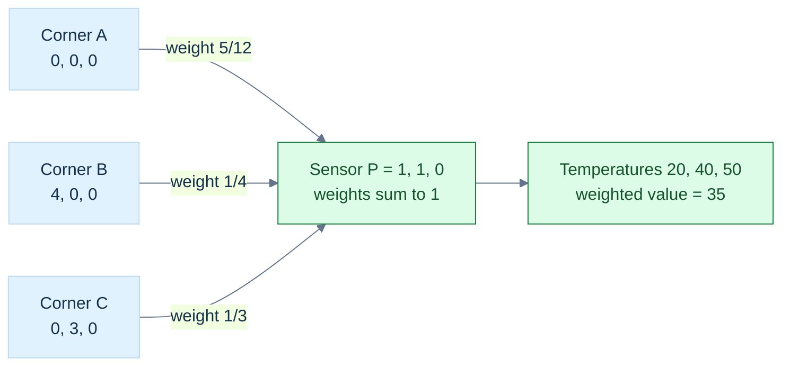

**Figure G3.** This is a weighted reconstruction diagram, not a perspective view of the panel. The point equation is $P=\frac5{12}A+\frac14B+\frac13C$; the same weights interpolate an attribute assumed affine on the triangle. **Limit:** corners must be noncollinear and $P$ must lie in their plane for an exact point reconstruction. Nonnegative weights then locate the point in the closed triangle. For an off-plane input, the Gram solve gives its planar projection; check the residual. Screen-space interpolation under perspective needs [[#Perspective changes the interpolation weights|reciprocal clip-depth correction]].

### Derive the weights in a tilted triangle

Let $\mathbf e_1=B-A$, $\mathbf e_2=C-A$, and $\mathbf q=P-A$. Dot the reconstruction equation with each edge:

$$
\begin{pmatrix}
\mathbf e_1\cdot\mathbf e_1&\mathbf e_1\cdot\mathbf e_2\\
\mathbf e_1\cdot\mathbf e_2&\mathbf e_2\cdot\mathbf e_2
\end{pmatrix}
\begin{pmatrix}\beta\\\gamma\end{pmatrix}
=\begin{pmatrix}\mathbf e_1\cdot\mathbf q\\\mathbf e_2\cdot\mathbf q\end{pmatrix}.
$$

This is the two-edge Gram system. Define $g_{11},g_{12},g_{22}$ from its left side and $r_1,r_2$ from its right side. Eliminating the unknowns gives

$$
D=g_{11}g_{22}-g_{12}^2,
\qquad
\beta=\frac{g_{22}r_1-g_{12}r_2}{D},
\qquad
\gamma=\frac{g_{11}r_2-g_{12}r_1}{D}.
$$

$D=\|\mathbf e_1\times\mathbf e_2\|^2$. It vanishes for a degenerate triangle. Near degeneracy, solving for weights is sensitive even if a denominator happens to be nonzero in machine arithmetic.

If $P$ is off the plane, this system returns coordinates of its orthogonal projection onto the plane, not proof that $P$ belongs to the triangle. Check the reconstruction residual or signed plane distance separately.

### Signed area also answers which side we are on

For two-dimensional points, define

$$
\operatorname{orient}_2(A,B,C)
=(B_x-A_x)(C_y-A_y)-(B_y-A_y)(C_x-A_x).
$$

It is the signed doubled area. Positive means counterclockwise in an upward-positive, positively oriented Cartesian drawing; negative means clockwise. Reverse vertical screen coordinates and the visual interpretation reverses too.

The barycentric weights can be written as signed area ratios:

$$
\alpha=\frac{\operatorname{orient}_2(P,B,C)}{\operatorname{orient}_2(A,B,C)},\quad
\beta=\frac{\operatorname{orient}_2(A,P,C)}{\operatorname{orient}_2(A,B,C)},\quad
\gamma=\frac{\operatorname{orient}_2(A,B,P)}{\operatorname{orient}_2(A,B,C)}.
$$

For the panel in its plane, the denominator is $12$. The three numerators are $5$, $3$, and $4$, reproducing the earlier weights. With a fixed base, a subtriangle's area scales with the opposite point's perpendicular height. That is why an area ratio gives an affine coordinate.

In three dimensions the four-point orientation quantity is

$$
\operatorname{orient}_3(A,B,C,D)
=\big((B-A)\times(C-A)\big)\cdot(D-A).
$$

It tells which side of the oriented plane contains $D$. Some libraries define the opposite ordering and hence the opposite sign. Match the documented definition rather than comparing function names.

### A predicate needs a trustworthy sign

A **predicate** answers a categorical question, such as left/right or inside/outside. A measurement estimates a magnitude. A slightly inaccurate area may be acceptable; a wrong sign used to connect a mesh can corrupt topology.

Near cancellation, ordinary floating-point determinants may have the wrong sign. Wider arithmetic helps but is not a universal certificate. Nor is replacing “small” values with zero: that changes the geometry and can make decisions inconsistent.

[[#The sensor needs coordinates inside the triangle|Adaptive predicates]] first use a fast calculation with a justified error bound, then use more exact arithmetic when the sign is uncertain. Shewchuk's work supplies orientation and incircle implementations and discusses the required arithmetic environment. This protects decisions about the stored coordinates; it cannot restore physical accuracy lost before those coordinates were stored. [Shewchuk, Robust Geometric Predicates](https://www.cs.cmu.edu/~quake/robust.html).

Our laboratory tests well-conditioned examples with ordinary arithmetic. It does **not** implement certified orientation predicates, watertight triangle intersection, or shared-edge rasterization ownership. Those are next-depth topics with stricter contracts.

### The same weights interpolate attributes

Suppose corner temperatures are $20$, $40$, and $50$ degrees Celsius. An affine interpolation gives

$$
T(P)=\frac5{12}(20)+\frac14(40)+\frac13(50)=35.
$$

The weights reconstruct any attribute assumed to vary affinely across this triangle: texture coordinates, scalar fields, and suitable vector-valued data. At a vertex the formula returns that vertex's attribute. Along an edge the opposite attribute contributes nothing.

Interpolation preserves linear constraints, not all nonlinear ones. A weighted average of unit normals need not be unit. Colors stored in nonlinear transfer-encoded channels need conversion to a linear-light representation before physical light interpolation; see [[Color encoding and linear-light operations]]. A unit-direction interpolation needs a specified path and a zero/antiparallel policy, not just a call to `lerp`.

The barycentric gradients are constant over a flat affine triangle. For our panel, $\beta=x/4$, $\gamma=y/3$, and $\alpha=1-x/4-y/3$. This means the temperature gradients are

$$
\frac{\partial T}{\partial x}=\frac{40-20}{4}=5,
\qquad
\frac{\partial T}{\partial y}=\frac{50-20}{3}=10
$$

in degrees Celsius per metre. A derivative is not an extra decoration: it tells the robot how the interpolated measurement changes as the sensor moves.

### Perspective changes the interpolation weights

Screen-space barycentric weights $\lambda_i$ are not generally the original affine surface weights after perspective projection. For an attribute $a_i$ and clip-space coordinates $w_i$ at the three vertices, perspective-correct interpolation has the form

$$
a(P)=\frac{\sum_i\lambda_i a_i/w_i}{\sum_i\lambda_i/w_i}.
$$

To see the weighting issue without a full rasterizer, consider two endpoints with $w_0=1,w_1=2$ and equal screen weights $1/2$. Their corrected weights are $(1/2)/(3/4)=2/3$ and $(1/4)/(3/4)=1/3$, not equal halves. A texture that ignores this correction can appear to swim or bend incorrectly.

This formula requires a valid projected configuration and clipping policy. A denominator near zero or a primitive crossing the camera's projective boundary cannot be repaired by casually dividing. The projective story below explains why.

## Weighted points lead from affine geometry to collision shapes

We have now met three kinds of combinations. They answer different questions:

| Combination | Restrictions | Meaning |
|---|---|---|
| Linear combination of vectors | Arbitrary scalar weights | Reachable movement in a span. |
| Affine combination of points | Weights sum to one | Origin-independent location, including extrapolation. |
| Convex combination of points | Weights sum to one and are nonnegative | Weighted location inside the contributors' convex hull. |

An affine combination can lie outside a segment or triangle. For example, $2B-A$ extrapolates beyond $B$. A combination whose weights sum to zero transforms as a displacement rather than a point. These statements follow by translating every contributor and tracking the total translation coefficient.

### Convex means every straight connection stays inside

A [[#Weighted points lead from affine geometry to collision shapes|convex set]] contains the complete line segment joining any two of its points:

$$
(1-t)P+tQ\in C\qquad(P,Q\in C,\ 0\le t\le1).
$$

A filled disk is convex; its circular boundary alone is not. A rectangle is convex; a crescent-shaped region generally is not. Repeatedly applying the segment property gives closure under any finite convex combination.

The **convex hull** of a point set is all of its finite convex combinations. It is the smallest convex set containing those points. Imagine a taut rubber band around two-dimensional samples; in three dimensions imagine a tight enclosing convex shell. Interior samples do not necessarily become hull vertices.

The triangular panel is its corners' convex hull. Convex models simplify collision queries, but a convex hull may fill holes and concavities in the original object. Faster geometry does not mean identical geometry.

### Sweeping an object is a set addition

For sets expressed relative to a common frame and origin, the [[#Weighted points lead from affine geometry to collision shapes|Minkowski sum]] is

$$
A\oplus B=\{\mathbf a+\mathbf b:\mathbf a\in A,\mathbf b\in B\}.
$$

Here point locations are represented by position coordinates; the set operation is not an unrestricted intrinsic point-plus-point API. A singleton offset translates a shape. A horizontal segment plus a vertical segment makes a rectangle. A line-segment path plus a radius-$r$ disk makes a capsule-shaped swept region in the plane.

For a circular robot moving around an obstacle $O$, forbidden center positions are $O\oplus(-R)$, where $R$ is the robot shape centered at its reference point. A symmetric disk equals its own reflection, so this becomes expansion of the obstacle by the robot radius. Non-symmetric robot shapes need the reflection explicitly.

Convexity is preserved. For $x=a_1+b_1$ and $y=a_2+b_2$, their convex mixture is

$$
(1-t)x+ty=[(1-t)a_1+ta_2]+[(1-t)b_1+tb_2].
$$

Both bracketed terms remain in their respective convex sets, so the result stays in the sum. A naive vertex-pair construction produces $mn$ candidate sums for $m$ and $n$ vertices; support queries can avoid materializing that whole set.

### A swept region answers *whether*; a time-of-impact equation answers *when*

We just constructed the swept region of a moving disk as a Minkowski sum. The next question is more demanding: the robot or physics engine needs to know *the first time* its boundary touches another object, because it must integrate only up to that event before changing velocity. That is a different mathematical object from a yes/no overlap query. It is also the point where convex geometry, quadratic equations, constrained dynamics, and floating-point error become one computational system.

Let two planar disks have initial centres $\mathbf x_A,\mathbf x_B\in\mathbb R^2$, constant velocities $\mathbf v_A,\mathbf v_B$ in metres per second, and positive radii $r_A,r_B$ in metres. Define $\mathbf p=\mathbf x_B-\mathbf x_A$ (relative centre position), $\mathbf v=\mathbf v_B-\mathbf v_A$ (relative velocity), and $R=r_A+r_B$ (combined radius). The moving disk centres touch at a time $t$ precisely if $\|\mathbf p+t\mathbf v\|=R$. Squaring is valid because both sides are nonnegative. Expanding the Euclidean inner product gives

$
\begin{aligned}
(\mathbf p+t\mathbf v)\cdot(\mathbf p+t\mathbf v)&=R^2,\\
(\mathbf v\cdot\mathbf v)t^2+2(\mathbf p\cdot\mathbf v)t
+\mathbf p\cdot\mathbf p-R^2&=0,\\
at^2+bt+c&=0,\\
a=\mathbf v\cdot\mathbf v,\quad
b=2\mathbf p\cdot\mathbf v,\quad
c=\mathbf p\cdot\mathbf p-R^2.&
\end{aligned}
$

Here $a$ has units $\mathrm{m}^2/\mathrm{s}^2$, $b$ has units $\mathrm{m}^2/\mathrm{s}$, and $c$ has units $\mathrm{m}^2$: every term in the equation has units of squared distance. Unit consistency is a useful implementation test. An initial overlap corresponds to $c<0$ and needs a separate positional-contact policy; it is not a new impact with a negative time. If $c>0$ and $a=0$, the relative positions do not move and cannot make first contact. If $c>0$ and $b\ge0$, squared separation is initially nondecreasing and, under constant relative velocity, no future positive-time first contact occurs. If the discriminant $D=b^2-4ac<0$, the path misses; $D=0$ is a geometrically tangent path whose normal closing speed at touch is zero. A valid approaching root must lie inside $[0,\Delta t]$ for the requested step.

The quadratic formula appears sufficient until the near root is obtained by subtracting nearly equal floating-point values. Under $b<0$ and $c>0$, use the numerically more stable $q=-\tfrac12(b-\sqrt D)$, then compute $t_{\mathrm{near}}=c/q$ and $t_{\mathrm{far}}=q/a$. This follows from Vieta's identity: the product of the two roots equals $c/a$. Choose the earlier nonnegative root, check it against the time horizon, and reject nonfinite coefficients or endpoints. Computing $D$ with a fused multiply-add can avoid one rounding step, but does not magically make arbitrary floating-point inputs exact. The independent, compilable implementation and its edge-case tests live in [the CCD lab](../tools/labs/disk_ccd_lab.cpp); the corresponding geometry lesson explains outward-rounded swept bounds.

For a fixed radius-1 disk at $x_A=0$ and radius-1 disk initially at $x_B=10$ moving at $-100\ \mathrm{m/s}$, $\mathbf p=(10,0)$, $\mathbf v=(-100,0)$ and $R=2$. The quadratic is $10000t^2-2000t+96=0$, giving roots $t=0.08$ and $t=0.12$ seconds. The first is *entry*, the second would be *exit* if the two disks passed through each other without a collision response. During a $0.10$-second frame the engine must advance only $0.08$ seconds before solving the contact. A return value of “yes, these swept regions intersect” does not specify that event boundary.

### The same contact has a second quadratic structure: effective mass

At the impact, a velocity constraint determines what impulse is required. For planar rigid bodies, let $\mathbf r_A=\mathbf x_c-\mathbf x_A$ and $\mathbf r_B=\mathbf x_c-\mathbf x_B$ be contact-point offsets measured from centres of mass, with $\mathbf n$ a unit normal pointing A to B. A body point has velocity $\mathbf u=\mathbf v+\omega(-r_y,r_x)$; the scalar $\omega$ is angular velocity in radians per second, which acts as reciprocal seconds because radians are dimensionless. Define the relative normal velocity

$
v_n=\mathbf n\cdot\left[
(\mathbf v_B+\omega_B\times\mathbf r_B)-
(\mathbf v_A+\omega_A\times\mathbf r_A)\right].
$

Here planar $\omega\times(r_x,r_y)=(-\omega r_y,\omega r_x)$. An impulse $+\lambda\mathbf n$ on B and $-\lambda\mathbf n$ on A changes both linear and angular velocity. Applying $\Delta\mathbf v=\mathbf P/m$ and $\Delta\omega=I^{-1}(\mathbf r\times\mathbf P)$, then substituting into $v_n$, gives

$
\Delta v_n=k_n\lambda,\qquad
k_n=m_A^{-1}+m_B^{-1}
+I_A^{-1}(\mathbf r_A\times\mathbf n)^2
+I_B^{-1}(\mathbf r_B\times\mathbf n)^2.
$

The scalar $k_n$ is the **inverse effective mass** of the contact direction; the rotational terms are not arbitrary corrections but the projection of the angular impulse back into contact-point velocity. A positive inverse mass or inverse inertia is a measure of how readily the body responds, and a static body is represented by zero for both. The expression is nonnegative under physically valid inverse masses. A static/static pair has $k_n=0$ and cannot be solved by division. In matrix language this is one row of $JM^{-1}J^\mathsf T$, where $M^{-1}$ is the generalized inverse-mass matrix and $J$ maps generalized velocity to relative normal velocity.

For a nonpenetrating frictionless contact at the velocity level, normal impulse $\lambda\ge0$ must not attract the bodies. With desired outgoing normal speed $b_{\mathrm{out}}$ frozen from the initial impact state, an iterative projected update is

$
\lambda_{\mathrm{new}}=\max\!\left(0,\lambda_{\mathrm{old}}
+\frac{b_{\mathrm{out}}-v_n}{k_n}\right).
$

Only the **change** $\Delta\lambda=\lambda_{\mathrm{new}}-\lambda_{\mathrm{old}}$ is applied to velocities, because $\lambda_{\mathrm{old}}$ has already been applied in prior iterations or a carefully initialized warm start. Reapplying the full accumulated impulse double-counts a historical correction. Friction introduces a tangential direction $\mathbf t=(-n_y,n_x)$ and projected constraint $|\lambda_t|\le\mu\lambda_n$; in three dimensions a single tangent scalar becomes a two-dimensional tangent impulse. These are constraints on *impulses*, not an invitation to add arbitrary forces every frame.

For equal unit masses at a central contact, $\mathbf r_A\times\mathbf n=\mathbf r_B\times\mathbf n=0$, hence $k_n=2\ \mathrm{kg}^{-1}$. If A moves at $2\ \mathrm{m/s}$ and B is stationary, $v_n=-2\ \mathrm{m/s}$. For restitution $e=1$ the outgoing target is $b_{\mathrm{out}}=-e\,v_n^{\mathrm{before}}=+2\ \mathrm{m/s}$. The first impulse is $(2-(-2))/2=2\ \mathrm{kg\,m/s}$; A becomes stationary and B moves at $2\ \mathrm{m/s}$. Linear momentum and kinetic energy are each conserved for this isolated ideal elastic pair. In contrast, an inelastic pair loses kinetic energy even while preserving its combined linear momentum.

### Conservative bounds are a mathematical inclusion guarantee, not a collision decision

A moving disk's **exact swept set** over $[0,h]$ is the Minkowski sum of its centre-path segment and its closed radius-$r$ disk. Its axis-aligned bounding box has x limits $\min(x_0,x_0+hv_x)-r$ and $\max(x_0,x_0+hv_x)+r$, and corresponding y limits. Let $S_i$ be a disk's swept set and $B_i$ its box. By construction $S_i\subseteq B_i$. If two disks ever overlap at a shared time, some point belongs to both swept sets; hence $B_i\cap B_j\neq\varnothing$. This gives the **no false negatives** proof for the broad phase.

The converse fails: boxes may overlap even if the disks are never at the same place at the same time. Such false positives are intentionally passed to a narrower collision test. In floating-point code, outward rounding and finite-input checks help preserve inclusion. For accelerating bodies, using only linear-motion endpoints may no longer enclose the true path, so the proof's assumptions must be changed; invoking the same code without stronger motion bounds is unsound.

A full event step repeatedly finds the earliest surviving narrow-phase hit, advances all bodies to that time, solves simultaneous contacts, and recomputes candidates for the remaining interval after velocity changes. In the worked wall impact, after $0.08$ seconds the moving disk is at $x=2$, reverses to $+100\ \mathrm{m/s}$, and ends at $x=4$ after another $0.02$ seconds. This can be checked against the [complete event simulation lab](../tools/labs/disk_event_pipeline_lab.cpp), its [10,000-case seeded property regression](../tools/labs/disk_event_property_lab.cpp), and the [swept-bound candidate oracle](../tools/labs/swept_broadphase_lab.cpp). These are independent CPU witnesses, not a certificate that a particular engine runtime uses the same pipeline.

**Reconstruction gate.** Without looking at the formulas, derive the contact-time polynomial from relative position, explain why its three coefficients have compatible physical units, reconstruct $k_n$ by tracking one impulse through linear and angular point velocity, and prove why intersecting swept disks force intersecting bounding boxes. Then write two tests: a fast disk that would cross an obstacle in one frame, and an equal-mass elastic collision whose outgoing velocities conserve momentum and energy. Finally identify the cases deliberately *not* solved here: initial deep penetration, nonconstant acceleration, finite-precision degeneracies, persistent resting manifolds, arbitrary spinning convex shapes, and solver convergence for large coupled contact graphs.

### Collision becomes a question about the origin

In collision detection, the commonly named **Minkowski difference** is

$$
A-B=A\oplus(-B)=\{\mathbf a-\mathbf b\}.
$$

It is not ordinary set subtraction, and some mathematical sources use “difference” for erosion instead. Always check the definition.

The shapes intersect exactly when their difference contains zero:

$$
A\cap B\ne\varnothing\iff\mathbf0\in A-B.
$$

If they share point $p$, choose $a=b=p$ and obtain zero. Conversely, zero difference means some $a=b$, a shared point. This proof works for arbitrary sets; convexity is an additional condition used by algorithms such as GJK.

For intervals $A=[2,4]$ and $B=[3,5]$, the difference is $[-3,1]$, which contains zero. For $A=[0,1]$ and $B=[3,4]$, it is $[-4,-2]$, which does not. The abstract construction has become a visible one-dimensional collision trace.

### Support queries inspect the boundary without constructing it

For a nonempty compact set $C$, its **support function** is

$$
h_C(\mathbf d)=\max_{\mathbf x\in C}\mathbf d\cdot\mathbf x.
$$

Compact means closed and bounded in this finite-dimensional setting; it ensures a continuous linear measurement attains its maximum. For more general sets one uses a supremum, which may be infinite or unattained.

A **support point** is any location attaining the maximum. The function returns a scalar; the mapping returns a point. In a square and direction $(1,0)$, every point on the right edge is a maximizer. A deterministic implementation must define its tie rule if repeatability matters.

For a sphere with center $c$ and radius $r$,

$$
\operatorname{support}_C(\mathbf d)=c+r\frac{\mathbf d}{\|\mathbf d\|},
\qquad h_C(\mathbf d)=\mathbf d\cdot c+r\|\mathbf d\|
$$

for nonzero $\mathbf d$. For an axis-aligned box, independently choose each coordinate's upper endpoint for a positive direction component and lower endpoint for a negative one. For a finite convex hull, scan vertex dot products; one maximizer suffices.

Because choices in two sets are independent,

$$
h_{A\oplus B}(\mathbf d)=h_A(\mathbf d)+h_B(\mathbf d),
$$

$$
\operatorname{support}_{A-B}(\mathbf d)
=\operatorname{support}_A(\mathbf d)-\operatorname{support}_B(-\mathbf d).
$$

This lets GJK explore the difference shape on demand. GJK stands for Gilbert–Johnson–Keerthi. Its full simplex update, termination, degeneracy, and contact policies are not supplied by this identity; they belong to later collision lessons. Zero direction also needs a separate support-query policy.

# A matrix is a rule acting on geometry

Now turn a rule for one vector into a rule for every vector. Keep the map, coordinate frame, geometric metric and storage layout separate. Determinants, inverses, dual measurements and composed rotations each have a precise job.

## From Basis Images to Moving Worlds: Matrices, Transforms and Quaternions

The robot in [[#The panel gives us a reason to learn|Phase 6]] could measure directions and inspect one triangular panel. Now place that panel on a moving tool, mount the tool on a robot, and view both through a camera. A point must survive several changes of description before it becomes a screen sample. A normal must remain perpendicular after deformation. An orientation must turn smoothly without confusing a storage format with a geometric rule.

This volume develops the machinery needed to answer those questions. We begin with the images of basis vectors, derive matrix multiplication from composition, discover when information is lost, then add origins and coordinate frames. Quaternions arrive when the controller needs an orientation that composes and interpolates cleanly. The last step is a computational contract: what the data means, how it is stored, how failure is reported, and what our tests actually establish.

### Immediate footing — quaternion

A quaternion has one scalar and three vector components, written $q=(w,\mathbf v)$. Unit quaternions can represent three-dimensional rotations. For unit axis $\mathbf a$ and angle $\theta$, use $q=(\cos(\theta/2),\mathbf a\sin(\theta/2))$. Applying the corresponding rotation to a vector uses the quaternion product $q(0,\mathbf x)q^{-1}$. The multiplication law makes composition possible and noncommutative. The values $q$ and $-q$ represent the same rotation; arbitrary component-wise interpolation therefore needs care. State the multiplication order, frame convention and normalization contract.

[[#Orientation needs a state that can be composed|Full explanation and worked examples in this book]]
## Reference recap — definitions after the workcell

The following compact definitions are retained verbatim from the earlier opening. They serve as review after the causal demonstrations, **not** as a substitute for the full first-use explanations above.

### Immediate footing — field

A field is a number system in which addition, subtraction, and multiplication follow the familiar algebraic rules, and every nonzero number has a reciprocal. The real numbers form a field: $3/2$ is defined, while division by zero is not. Vector spaces use field elements as scalars. In graphics, calculations are modeled over the real numbers, while code stores rounded finite-precision approximations. The identity $a(b+c)=ab+ac$ holds exactly in the model, though floating-point evaluation can round.

[[#Numbers become a system of permitted operations|Full explanation and worked examples in this book]]


### Immediate footing — matrix

A matrix is a rectangular table that defines an input-output rule formed from weighted sums after input and output coordinates are chosen. With column vectors, its columns are the images of the input coordinate directions. For example, $A=\begin{bmatrix}2&1\\1&3\end{bmatrix}$ maps $\begin{bmatrix}1\\2\end{bmatrix}$ to $\begin{bmatrix}4\\7\end{bmatrix}$ because $A\begin{bmatrix}1\\2\end{bmatrix}=\begin{bmatrix}2+2\\1+6\end{bmatrix}$. The matrix shape determines which inputs it accepts. Row-major and column-major describe memory layout, not a different mathematical map.

[[#A linear rule is determined by its basis images|Full explanation and worked examples in this book]]


### Immediate footing — determinant

The determinant of a square matrix is its signed volume scale. For two columns $u=(a,b)$ and $v=(c,d)$ in 2D, $\det\begin{bmatrix}a&c\\b&d\end{bmatrix}=ad-bc$ is their signed parallelogram area. The identity matrix has determinant $1$; swapping its columns gives $-1$, indicating reversed orientation. A zero determinant means the columns are dependent and the map is not invertible. Determinants explain orientation, area scaling, and invertibility, but determinant formulas are usually a numerically fragile way to compute an inverse.

[[#Determinant measures oriented volume and exposes lost dimensions|Full explanation and worked examples in this book]]


### Immediate footing — inner product

An inner product pairs two vectors to produce a scalar and defines lengths and angles. In ordinary real orthonormal coordinates, $\langle u,v\rangle=\sum_i u_i v_i$. For $u=(1,0)$ and $v=(3,4)$, the value is $3$, the component of $v$ along the unit direction $u$. The induced length is $\|u\|=\sqrt{\langle u,u\rangle}$, and perpendicular vectors have inner product zero. In a slanted basis, include the metric or Gram matrix; the plain coordinate dot product may not represent geometric measurement.

[[#The dot product turns two movements into a measurement|Full explanation and worked examples in this book]]


### Immediate footing — linear map

A linear map $T$ preserves vector addition and scalar multiplication: $T(u+v)=T(u)+T(v)$ and $T(cu)=cT(u)$. Scaling and rotation about the origin are linear; translation by a nonzero offset is not, because it moves the zero vector. A map is determined by its action on a basis. If $T(e_1)=(2,1)$ and $T(e_2)=(1,3)$, then $T(3e_1+2e_2)=3(2,1)+2(1,3)=(8,5)$. Once bases are selected, the basis images form the columns of its matrix.

[[#The robot needs a rule for moving every direction|Full explanation and worked examples in this book]]


### Immediate footing — covector and dual space

A covector is a linear measurement that takes a vector to a scalar; in coordinates it can be written as a row $n^T$ acting on displacement $t$ by $n^Tt$. The dual space contains all such linear measurements. A normal to a surface can be defined as a covector that returns zero on every tangent displacement: $n^Tt=0$. Under a basis change, vector and covector coordinates transform differently so their pairing stays the same. In an orthonormal Euclidean frame a covector is often identified with a normal column vector, but that identification depends on the metric.

[[#A normal is a measuring rule before it is an arrow|Full explanation and worked examples in this book]]


### Immediate footing — transpose and adjoint

The transpose $A^T$ swaps matrix rows and columns and obeys $(AB)^T=B^TA^T$. For real Euclidean inner products it is the adjoint: $\langle Ax,y\rangle=\langle x,A^Ty\rangle$. For complex vectors with the standard Hermitian inner product, the adjoint is the conjugate transpose $A^H=\overline{A}^T$. With coordinate Gram matrices $G_X$ and $G_Y$ on the input and output spaces, the adjoint matrix is $A^*=G_X^{-1}A^HG_Y$ (for real spaces, replace $A^H$ by $A^T$). State the scalar field and metrics before using the identity.

[[#Transpose lets us compare measurements and structure|Full explanation and worked examples in this book]]


## Keep the promises visible while moving between representations

| Question                                 | Vocabulary and promise                                                                                                                                                                                                                                  |
| ---------------------------------------- | ------------------------------------------------------------------------------------------------------------------------------------------------------------------------------------------------------------------------------------------------------- |
| What does the table mean?                | [[Matrices as linear maps and basis images]]; [[#Jacobians, curvature, and local approximation\|Matrix multiplication and composition order]]; [[Matrix transpose symmetry and trace]]. Shape and basis determine meaning before layout does.           |
| Can the operation be undone reliably?    | [[Determinants orientation and volume]]; [[Matrix inversion pivoting and residuals]]; [[#An inverse can exist and still amplify uncertainty\|Conditioning and singularity]]. Algebraic invertibility and numerical usefulness are separate questions.   |
| Which frame describes the point?         | [[Linear affine and projective transformations]]; [[#A camera model must close the loop\|Coordinate frames and change of basis]]; [[#A camera model must close the loop\|Camera view and clip-space pipeline]]. Name the input and output spaces.       |
| Where do the entries live?               | [[Matrix storage indexing and strides]]; [[Matrix SIMD tiling and cache reuse]]. Memory layout, ownership and execution order need explicit contracts.                                                                                                  |
| Which orientation operation is intended? | [[Quaternion algebra and Hamilton product]]; [[Quaternion rotation and double cover]]; [[Quaternion matrix and axis-angle conversion]]; [[Quaternion interpolation and shortest paths]]. Component order and multiplication convention are independent. |
| What can the representation retain?      | [[Euler angles and gimbal singularity]]; [[Dual quaternions and rigid motion]]; [[Transform hierarchies TRS and shear]]. A compact representation has a domain, not unlimited expressive power.                                                         |

### Immediate footing — expectation

Expectation is the probability-weighted average of a random quantity. For a fair die, $\mathbb{E}[X]=\sum_{k=1}^6 k/6=3.5$, although no single roll shows $3.5$. It describes the model's long-run center, not a guarantee about one sample. For a continuous variable with density $p(x)$, $\mathbb{E}[X]=\int x p(x)\,dx$ when the integral exists. Linearity gives $\mathbb{E}[aX+bY]=a\mathbb{E}[X]+b\mathbb{E}[Y]$ without requiring independence. A finite-sample estimate has sampling error, distinct from model error and floating-point rounding.

[[#3. Expected values describe centers; covariance describes dependence|Full explanation and worked examples in this book]]

### Immediate footing — covariance

The mean of a random quantity is its expectation: for a random vector $X$, write $\mu=\mathbb{E}[X]$. Covariance measures how deviations from these means vary together: $\operatorname{Cov}(X,Y)=\mathbb{E}[(X-\mathbb{E}[X])(Y-\mathbb{E}[Y])]$. Positive covariance means deviations tend to share a sign; negative covariance means they tend to have opposite signs. The vector covariance matrix is $\Sigma=\mathbb{E}[(X-\mu)(X-\mu)^T]$; it is symmetric positive semidefinite. For centered observations $x_i-\bar{x}$, estimate it by averaging their outer products, with divisor $N$ for the observed-cloud covariance or often $N-1$ for an unbiased population estimate under independent sampling. Its eigenvectors give principal variation directions and eigenvalues give variance along them.

[[#3. Expected values describe centers; covariance describes dependence|Full explanation and worked examples in this book]]

## The robot needs a rule for moving every direction

The panel from Phase 6 is still on the workbench. We know how to describe a point, a displacement, a tangent and a normal. Now the robot needs to turn an entire tool, stretch a model, express measurements in a different frame, or reverse a calibration. Storing a new answer for every possible input would be impossible. We need a compact rule that determines all those answers.

A **matrix** starts as a rectangular arrangement of scalars. The word *scalar* means one value from the number system being used; here the mathematical model uses real numbers, while the implementation stores floating-point approximations. The notation $A\in\mathbb R^{m\times n}$ says that $A$ has $m$ rows and $n$ columns. The entry $a_{ij}$ is in row $i$, column $j$. Mathematical subscripts usually start at one; our C++ accessors use zero-based `A(row, column)`.

Consider

$$
A=\begin{bmatrix}1&2&3\\4&5&6\end{bmatrix}.
$$

This is a $2\times3$ matrix, not a $3\times2$ matrix. Its shape is rows first, columns second. It has six scalar positions, and its two rows each contain three values. A matrix does not need to be square. Square means only that the two dimensions agree.

The rectangular table does not announce its meaning. It could hold coefficients of equations, a linear map, a covariance, or image samples. A transform interpretation needs an additional contract: what the input coordinates mean, what the output coordinates mean, which bases are used, and how the matrix acts. This is the same lesson as the earlier bit story: a representation acquires meaning through an interpretation.

### The convention contract for this volume

Unless a section explicitly changes the convention, vectors are columns and a map acts on the left:

$$
\mathbf y=A\mathbf x.
$$

The geometric coordinate frame is right-handed, positive rotations follow the right-hand rule, and rotation examples are **active**: the vector moves while the coordinate axes stay fixed. Angles used by code are in radians. Thus $90^\circ=\pi/2$ radians. Each of these choices is independent of how the scalars are arranged in memory.

Under this convention, $A\in\mathbb R^{m\times n}$ represents a linear map from an $n$-component input to an $m$-component output. It needs one column for each input basis direction, and each column contains the $m$ coordinates of that direction's output. Shape is therefore a mathematical type contract. A $2\times3$ map accepts a three-component vector and produces a two-component vector; equal byte counts do not make incompatible shapes interchangeable.

We also need to distinguish a vector's role from its written orientation. A row of coefficients can represent a measurement, or it can be the row-vector convention's representation of a vector. Those roles should not be inferred from the fact that three numbers happen to be horizontal. Later, a frame change will reveal why the distinction matters.
## A linear rule is determined by its basis images

A **map** assigns an output to each permitted input. A map $T$ is **linear** when it preserves addition and scalar multiplication:

$$
T(a\mathbf u+b\mathbf v)=aT(\mathbf u)+bT(\mathbf v).
$$

This is a rule about the behavior of the map, not about how straight its graph looks. In particular, $T(\mathbf0)=\mathbf0$: substitute zero for the scalar in the scaling rule. Translation by a nonzero vector therefore cannot be a linear map on ordinary point coordinates. Moving every point by $\mathbf t$ moves the origin to $\mathbf t$. We will add a larger representation when we need translation.

Every vector in a chosen basis has an expansion. In the standard two-dimensional basis,

$$
\mathbf x=x_1\mathbf e_1+x_2\mathbf e_2.
$$

Apply linearity:

$$
T(\mathbf x)=x_1T(\mathbf e_1)+x_2T(\mathbf e_2).
$$

So knowing the two basis images determines the output of every vector. Suppose the calibration sends

$$
T(\mathbf e_1)=\begin{bmatrix}2\\1\end{bmatrix},\qquad
T(\mathbf e_2)=\begin{bmatrix}-1\\3\end{bmatrix}.
$$

Put those images into the columns:

$$
A=\begin{bmatrix}2&-1\\1&3\end{bmatrix}.
$$

The columns tell us where the input basis directions go. For $\mathbf x=(4,2)^{\mathsf T}$, retain the same input coefficients but combine the new directions:

$$
A\mathbf x
=4\begin{bmatrix}2\\1\end{bmatrix}
+2\begin{bmatrix}-1\\3\end{bmatrix}
=\begin{bmatrix}8\\4\end{bmatrix}+\begin{bmatrix}-2\\6\end{bmatrix}
=\begin{bmatrix}6\\10\end{bmatrix}.
$$

This is matrix-vector multiplication. The arithmetic comes directly from preserving the vector's basis expansion. In general, if $\mathbf c_j$ is column $j$ of $A$,

$$
A\mathbf x=\sum_{j=1}^{n}x_j\mathbf c_j.
$$

### Figure M1 - Coordinates weight the new basis directions

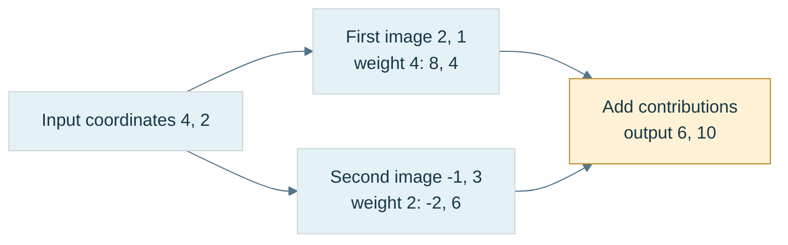

**Figure M1.** The diagram expands a vector into its input-basis coefficients and then recombines the stored output directions. It is an arithmetic trace rather than a scale drawing. Its coordinates are tied to the declared bases; changing a basis changes the table representing the same geometric map.

### Rows describe how to compute one output coordinate

Read the same example row by row:

$$
y_1=2x_1-x_2,\qquad y_2=x_1+3x_2.
$$

Each row supplies the coefficients of one output measurement. The component formula is

$$
y_i=\sum_{j=1}^{n}a_{ij}x_j.
$$

In standard orthonormal Euclidean coordinates this is the familiar row dot input calculation. More generally it is a row acting as a linear functional on the coordinate tuple; do not silently replace a geometric inner product in a skew basis with an ordinary component dot product. Phase 6's Gram matrix is still needed when that is the actual measurement question.

A rectangular example makes the dimensions visible:

$$
B=\begin{bmatrix}2&1&-1\\0&3&4\end{bmatrix},\qquad
\mathbf x=\begin{bmatrix}5\\2\\-1\end{bmatrix}.
$$

The output is $B\mathbf x=(13,2)^{\mathsf T}$ because the row sums are $10+2+1=13$ and $0+6-4=2$. A fourth input coordinate would have no matching coefficient; a two-component input would leave a coefficient unused. The shape mismatch is an undefined mathematical request, not a small implementation inconvenience.

### One projection, two coordinate descriptions

Projecting onto $y=x$ has standard-coordinate matrix
$$
P=\begin{bmatrix}1/2&1/2\\1/2&1/2\end{bmatrix}.
$$
Both $(1,0)$ and $(0,1)$ map to $(1/2,1/2)$. In the adapted orthonormal basis $v_1=(1,1)/\sqrt2$, $v_2=(-1,1)/\sqrt2$, the same map keeps $v_1$ and removes $v_2$, so its matrix is $\operatorname{diag}(1,0)$. In either basis $P^2=P$. The geometric map is unchanged; only its coordinate description changes. The basis-image principle is illustrated in MIT 18.06 Lecture 30. [MIT 18.06 Lecture 30, official notes](https://ocw.mit.edu/courses/18-06-linear-algebra-spring-2010/71bffaffa75c005516ee010daf17868b_MIT18_06S10_L30.pdf)

The derivative is another linear map whose matrix depends on the chosen input and output bases. For $D:P_2\to P_1$, use input basis $(1,x,x^2)$ and output basis $(1,x)$. Since $D(c_0+c_1x+c_2x^2)=c_1+2c_2x$, the matrix is
$$
[D]=\begin{bmatrix}0&1&0\\0&0&2\end{bmatrix}.
$$
This is the basis-image rule applied to a function space, as in MIT 18.06 Lecture 30. [MIT 18.06 Lecture 30, official notes](https://ocw.mit.edu/courses/18-06-linear-algebra-spring-2010/71bffaffa75c005516ee010daf17868b_MIT18_06S10_L30.pdf)
## Keep the transformation separate from its storage

The logical element `A(0, 1)` means row zero, column one regardless of the memory layout. For the $2\times3$ table with rows $(1,2,3)$ and $(4,5,6)$, two compact layouts are

```text
row-major:    [1][2][3][4][5][6]
column-major: [1][4][2][5][3][6]
```

For $m$ rows and $n$ columns, zero-based compact row-major indexing uses $rn+c$, while compact column-major indexing uses $cm+r$. These are element offsets; multiply by the element size to obtain byte offsets. Bounds still require $0\le r<m$ and $0\le c<n$. A stride is the number of elements or bytes advanced when an index increases by one; an API must state which unit it uses. Padding and views can make the actual stride larger than the logical row or column length.

Row-major does not mean row-vector mathematics. Column-vector multiplication works with either storage layout when the accessor returns the correct logical element. Conversely, changing from column-vector mathematics to an equivalent row-vector representation requires transposing the represented map:

$$
\mathbf y=A_c\mathbf x
\quad\Longrightarrow\quad
\mathbf y^{\mathsf T}=\mathbf x^{\mathsf T}A_c^{\mathsf T}.
$$

Thus $A_r=A_c^{\mathsf T}$ represents the same map with row vectors relative to the same corresponding bases. That is an algebraic conversion, not a decision to store the old table in a different order.

The matrix itself has $mn$ scalar entries. A particular C++ object may also have padding or chosen alignment. If the component really occupies four bytes, a compact $4\times4$ component payload contains 64 bytes. Neither that arithmetic nor `sizeof` proves a shader interface contract. At a CPU/GPU boundary, check the component type, logical row/column interpretation, declared shader layout, stride and upload behavior together.

For a layout diagnostic, use distinct asymmetric values. Identity is a poor diagnostic because its transpose is identical. Applying a matrix to standard basis vectors isolates its columns: $A\mathbf e_j$ must reproduce column $j$. That test can locate a transposition mistake before camera or hierarchy code makes it harder to see.

## Combining rules explains the multiplication law

Addition and scalar multiplication are the simplest matrix operations. They act entry by entry:

$$
(A+B)_{ij}=A_{ij}+B_{ij},\qquad
(\lambda A)_{ij}=\lambda A_{ij}.
$$

Addition needs the same shape. Scalar multiplication preserves shape. The meaning is also direct: $(A+B)\mathbf x=A\mathbf x+B\mathbf x$, and $(\lambda A)\mathbf x=\lambda(A\mathbf x)$. Adding two maps adds their outputs; it does not apply one after the other. Two rotations generally do not add to a rotation, and multiplying every entry of a rotation by two doubles output lengths.

All $m\times n$ real matrices form a vector space of dimension $mn$: one basis matrix has a one at each chosen position and zero everywhere else. This vector-space structure is useful, but special families inside it can have extra constraints. The family of rotation matrices is constrained by orthonormality and positive orientation; arbitrary sums do not preserve those constraints.

To apply one rule after another, we need composition. Let $B:\mathbb R^n\to\mathbb R^p$ and $A:\mathbb R^p\to\mathbb R^m$. The output of $B$ is a valid input to $A$, so the combined map is $A\circ B$. We want a matrix $C$ satisfying $C\mathbf x=A(B\mathbf x)$ for every permitted input.

Expand one component:

$$
y_k=\sum_{j=1}^{n}B_{kj}x_j,
\qquad
z_i=\sum_{k=1}^{p}A_{ik}y_k
=\sum_{j=1}^{n}\left(\sum_{k=1}^{p}A_{ik}B_{kj}\right)x_j.
$$

Comparing coefficients gives the product rule:

$$
C=AB,\qquad C_{ij}=\sum_{k=1}^{p}A_{ik}B_{kj}.
$$

The inner dimension is the intermediate coordinate space. In the product $(m\times p)(p\times n)$ it must match, and the result has shape $m\times n$. Equivalently, each column of $AB$ is $A$ applied to the corresponding column of $B$. This is why row-column multiplication is the rule: it makes the stored table agree with composed linear maps.
For

$$
A=\begin{bmatrix}1&2\\3&4\end{bmatrix},\qquad
B=\begin{bmatrix}5&6\\7&8\end{bmatrix},
$$

the product is

$$
AB=\begin{bmatrix}1(5)+2(7)&1(6)+2(8)\\3(5)+4(7)&3(6)+4(8)\end{bmatrix}
=\begin{bmatrix}19&22\\43&50\end{bmatrix}.
$$

The reverse product is $BA=\begin{bmatrix}23&34\\31&46\end{bmatrix}$. Both products are defined here, but they differ. With rectangular matrices, one order may not even be defined.

### Order describes actions; parentheses describe grouping

Take $\mathbf p=(1,1)^{\mathsf T}$, an X stretch $S=\operatorname{diag}(2,1)$, and a quarter-turn $R=\begin{bmatrix}0&-1\\1&0\end{bmatrix}$. Applying scale then rotation gives

$$
\mathbf p\xrightarrow{S}(2,1)^{\mathsf T}\xrightarrow{R}(-1,2)^{\mathsf T}.
$$

The product is $RS\mathbf p$. Reverse the actions and the result is $SR\mathbf p=(-2,1)^{\mathsf T}$. Matrix multiplication is **noncommutative**: order is not generally interchangeable. Some pairs commute, including diagonal matrices with each other and uniform scaling with any compatible linear map. Noncommutative does not mean that every pair fails to commute.

### Figure M2 - The same operations give different results in different orders

```mermaid
%%{init: {'theme':'base','themeVariables':{'primaryColor':'#e4f1f6','primaryTextColor':'#173746','lineColor':'#527589'}}}%%
flowchart LR
    P["Point 1, 1"] --> S["Scale X by 2<br/>2, 1"]
    S --> R["Rotate by 90 degrees<br/>-1, 2"]
    P --> Q["Rotate by 90 degrees<br/>-1, 1"]
    Q --> T["Scale X by 2<br/>-2, 1"]
    style R fill:#fff1d5,stroke:#bc892a
    style T fill:#fff1d5,stroke:#bc892a
```

**Figure M2.** The arrows show execution order. In column-vector notation the upper path is $RS\mathbf p$ and the lower path is $SR\mathbf p$. Both stretches use the declared fixed coordinate axes. A hierarchy may instead ask for a local-axis operation, so name the space before choosing multiplication order.

Grouping is different. Exact real matrix multiplication is **associative**: $(AB)C=A(BC)$ when shapes permit the products. Both sides apply $C$, then $B$, then $A$. Expanding either component produces the same finite double sum. In floating-point arithmetic, different grouping can change rounding and overflow, so algebraic equality is not a bitwise reproducibility guarantee.

Grouping also changes cost. If $A$ is $1000\times10$, $B$ is $10\times1000$, and $C$ is $1000\times1$, the classical algorithm uses about 11 million multiply-accumulate terms for $(AB)C$, versus 20 thousand for $A(BC)$. The first route also creates a million-entry intermediate; the second creates ten entries. These are arithmetic counts, not measured timings.

For a classical dense product of shapes $(M\times K)(K\times N)$, there are $MN$ output entries and $K$ terms per entry, giving $\Theta(MKN)$ work. Matrix-vector multiplication costs $\Theta(MN)$ for an $M\times N$ map. Addition, scalar multiplication and transpose touch $MN$ entries and take $\Theta(MN)$ work. Layout and loop ordering change data reuse; they do not change these mathematical shapes or classical asymptotic counts.

## A mathematical object is more than its coordinates

A graphics calculation begins with an object in a space and a question about that object. A point, a direction, a color, a velocity, a pixel measurement, and a list of unknown parameters may all be stored as arrays of numbers. They do not thereby become the same kind of thing. The meaning of each array depends on the operations it supports, the units of its entries, and the coordinate frame in which those entries were measured.

A vector space supplies operations for adding vectors and multiplying them by scalars. If $u$ and $v$ are vectors and $a$ and $b$ are real numbers, then $au+bv$ is another vector. A basis is a collection of independent vectors that lets every vector be expressed uniquely as a weighted sum. In a chosen basis $B=(b_1,\ldots,b_n)$, the coordinate tuple $[v]_B$ records those weights; it is a description of $v$, not the vector itself. Changing the basis changes the tuple while leaving the represented geometric object unchanged.
A linear map $T$ preserves addition and scalar multiplication:

$$
T(au+bv)=aT(u)+bT(v).
$$

Once input and output bases are chosen, the map has a matrix representation. Its $j$th column is the coordinate vector of $T(b_j)$, the image of the $j$th input basis vector. This fact is the simplest way to understand what a matrix means: each column records where one basis direction goes. Matrix multiplication follows function composition. If $S$ acts first and $T$ second, the composite is $T\circ S$, represented by the product $[T][S]$ when the coordinate conventions agree.

This interpretation prevents a common error in graphics: treating a matrix as a bag of numbers divorced from its input frame, output frame, and storage convention. A transform may map object coordinates to world coordinates, world coordinates to camera coordinates, or one basis representation to another. Those maps have different semantic directions even if they happen to use the same dimensions. Multiplying in the wrong order is not a minor coding mistake; it composes different functions.

Coordinates become measurements only after geometry is specified. A dot product gives a way to measure length and angle. In an orthonormal Euclidean basis, $u\cdot v=u^Tv$ and $\|u\|_2=\sqrt{u^Tu}$. In a non-orthonormal basis, the coordinate dot product is generally not the geometric dot product. If the basis matrix is $B$, then the Gram matrix $G=B^TB$ stores the basis inner products, and

$$
\langle u,v\rangle = [u]_B^T G [v]_B.
$$

The metric is therefore part of the problem. It says what counts as a unit of distance and which directions are orthogonal. This becomes essential when parameter vectors combine quantities with different units, when a fit weights some residuals more strongly, or when PCA is applied to differently scaled measurements.

For an approachable numerical example, let a 2D linear map send $e_1=(1,0)$ to $(2,1)$ and $e_2=(0,1)$ to $(-1,1)$. Its matrix is

$$
A=\begin{bmatrix}2&-1\\1&1\end{bmatrix}.
$$

A point with coordinates $(3,2)$ maps to $A(3,2)^T=(4,5)^T$. This result can be reconstructed from the columns: $3(2,1)+2(-1,1)=(4,5)$. If the input coordinates had instead been expressed in a skew basis, the same geometric point would have different coordinates, and the matrix entries would have to describe the map relative to that basis. The picture is unchanged; its numerical description is not.

### Immediate footing — eigenpair

An eigenpair is a nonzero vector $v$ and scalar $\lambda$ satisfying $Av=\lambda v$. The map preserves the direction of $v$ and scales it by $\lambda$; a negative value also reverses orientation. For $A=\operatorname{diag}(2,3)$, the coordinate directions $e_1=(1,0)$ and $e_2=(0,1)$ have eigenvalues $2$ and $3$. Not every matrix has a full basis of real eigenvectors. Real symmetric matrices have real eigenvalues and can be diagonalized with orthonormal eigenvectors. Eigenvectors of a general matrix may be sensitive to perturbations, especially when eigenvalues are close.
[[#Eigenvectors reveal the directions a square map does not turn|Full explanation and worked examples in this book]]
### Immediate footing — symmetric positive definite

A real symmetric matrix $A$ is positive definite when $x^TAx>0$ for every nonzero $x$. For $A=\operatorname{diag}(2,5)$, $x^TAx=2x_1^2+5x_2^2$, which is positive except at zero. This property makes the associated quadratic form bowl-shaped and guarantees a unique solution to $Ax=b$. Positive definite matrices admit a Cholesky factorization $A=LL^T$ in exact arithmetic. Symmetry alone is insufficient: $\operatorname{diag}(1,-1)$ is symmetric but indefinite. Finite-precision algorithms must check symmetry and handle loss of positive definiteness.
[[#Positive definiteness is a structural promise|Full explanation and worked examples in this book]]


### Immediate footing — singular value and SVD

For any real $m\times n$ matrix, the singular value decomposition is $A=U\Sigma V^T$. The columns of $V$ are orthonormal input directions; $A$ maps each to an orthogonal output direction in $U$, scaled by a nonnegative singular value in $\Sigma$. For $A=\operatorname{diag}(3,1)$, the coordinate directions are scaled by $3$ and $1$. A zero singular value marks an erased direction; a very small one marks a direction that is hard to invert reliably. Unlike eigen decomposition, SVD applies to rectangular matrices.
[[#Singular value decomposition covers every rectangular map|Full explanation and worked examples in this book]]


### Immediate footing — condition number

A condition number measures how strongly a problem's answer can change when its input changes slightly. For an invertible matrix in the 2-norm, $\kappa_2(A)=\sigma_{\max}/\sigma_{\min}$. Thus $\operatorname{diag}(100,1)$ has condition number $100$, while $\operatorname{diag}(100,0.001)$ has condition number $100{,}000$; solving can amplify error along the weakly scaled direction. Conditioning is a property of the mathematical problem and chosen norm, not proof that an algorithm is inaccurate. Stability describes whether an algorithm adds excessive error; both matter when interpreting residuals.
[[#Conditioning: weak singular directions amplify uncertainty|Full explanation and worked examples in this book]]

## A Gram matrix remembers the geometry of a slanted basis

In the slanted basis from earlier, dotting coordinate lists directly gives the wrong answer. Let basis columns be $\mathbf b_1,\ldots,\mathbf b_k$. The [[#A Gram matrix remembers the geometry of a slanted basis|Gram matrix]] stores all pairwise inner products:

$$
G_{ij}=\mathbf b_i\cdot\mathbf b_j.
$$

The diagonal holds squared lengths; off-diagonal entries hold alignment. With $\mathbf b_1=(1,0)$ and $\mathbf b_2=(1,1)$,

$$
G=\begin{pmatrix}1&1\\1&2\end{pmatrix}.
$$

If $\mathbf v=\sum_i c_i\mathbf b_i$ and $\mathbf w=\sum_jd_j\mathbf b_j$, distribute the dot product:

$$
\mathbf v\cdot\mathbf w
=\sum_{i,j}c_iG_{ij}d_j=c^\mathsf TGd.
$$

The superscript $\mathsf T$ means **transpose**: exchange rows and columns. It lets a column coordinate list act as the row that weights the next expression.

For $c=(1,2)^\mathsf T$, compute $Gc=(3,5)^\mathsf T$, then $c^\mathsf TGc=3+10=13$. The reconstructed vector is $(3,2)$, whose Euclidean squared length is also $13$. Blindly squaring the coordinates would give $5$.
$G$ is symmetric. It is **positive semidefinite** because

$$
c^\mathsf TGc=\left\|\sum_i c_i\mathbf b_i\right\|^2\ge0.
$$

For independent columns it is **positive definite**: this quantity is positive for every nonzero coefficient vector. For dependent columns a nonzero coefficient list can reconstruct zero, so $G$ is singular. An orthonormal basis has $G=I$, the identity matrix, explaining why ordinary coordinate dotting is then correct.

The Gram determinant measures squared area for two vectors and squared volume for three. But it does not retain orientation; reflecting every basis vector can preserve every dot product. A Gram matrix remembers metric geometry, not the complete physical frame.

To project onto a multi-vector span, require the residual to be perpendicular to every generator. In matrix notation this produces

$$
Gc=B^\mathsf T\mathbf v.
$$

This explains the system, but forming $G=B^\mathsf TB$ can square the two-norm condition number of a full-column-rank $B$:

$$
\kappa_2(B^\mathsf TB)=\kappa_2(B)^2.
$$

QR-based solves are usually a better route when numerical conditioning matters. We will build the orthogonalization intuition shortly rather than hide this behind a matrix recipe.

## Special matrices tell us what information a rule preserves

The **identity** $I_n$ has ones on the diagonal and zeros elsewhere. It sends every basis direction to itself, so $I_n\mathbf x=\mathbf x$. For an $m\times n$ matrix, use $I_mA=A$ and $AI_n=A$. A transform product must begin with identity, while an accumulation of additions begins with the zero matrix. Starting a product at zero destroys every later contribution.

The **zero matrix** maps every input to zero. It is the additive identity, but it destroys all information as a map. From $AB=AC$ one cannot generally cancel $A$; if $A$ is zero the equality tells us nothing about $B$ and $C$.

A **diagonal matrix** permits nonzero entries only on the main diagonal. In $D=\operatorname{diag}(d_1,d_2,d_3)$, each output coordinate is $d_ix_i$; coordinates do not mix. An ordinary three-axis scaling matrix has exactly this form. Uniform nonzero scaling preserves angles, while nonuniform scaling can change angles between arbitrary directions. A negative scale reverses a basis direction; a zero scale erases the corresponding coordinate and cannot be undone.

A **shear** changes one coordinate in proportion to another. The elementary planar example

$$
H=\begin{bmatrix}1&k\\0&1\end{bmatrix}
\quad\Longrightarrow\quad(x,y)\mapsto(x+ky,y)
$$

slides higher layers farther sideways, like a stack of cards. It sends $\mathbf e_1$ to $(1,0)$ and $\mathbf e_2$ to $(k,1)$, preserving area but generally changing angles. Off-diagonal entries mean coordinate coupling, but they are not by themselves proof of shear: rotation also mixes coordinates. Nor does a general matrix with all diagonal entries equal to one automatically have determinant one. For example $\begin{bmatrix}1&2\\3&1\end{bmatrix}$ has determinant $-5$; it is not the area-preserving elementary shear above.

## Derive rotations from the directions that stay fixed

A **proper rotation** preserves Euclidean lengths, angles and orientation. In two dimensions, rotate the first unit axis through angle $\theta$. Its image is $(\cos\theta,\sin\theta)^{\mathsf T}$. The second unit axis began at angle $\pi/2$, so its image is

$$
\begin{bmatrix}\cos(\pi/2+\theta)\\\sin(\pi/2+\theta)\end{bmatrix}
=\begin{bmatrix}-\sin\theta\\\cos\theta\end{bmatrix}.
$$

Place the two images into columns. Writing $c=\cos\theta$ and $s=\sin\theta$ gives

$$
R(\theta)=\begin{bmatrix}c&-s\\s&c\end{bmatrix},\qquad
x'=cx-sy,\quad y'=sx+cy.
$$

At $\theta=\pi/2$, $\mathbf e_x$ goes to $\mathbf e_y$, and $\mathbf e_y$ goes to $-\mathbf e_x$. These basis tests expose a wrong sign immediately. A general vector $(2,3)^{\mathsf T}$ goes to $(-3,2)^{\mathsf T}$.

Why is this truly length preserving? Expand the squared output length:

$$
(cx-sy)^2+(sx+cy)^2
=x^2(c^2+s^2)+y^2(c^2+s^2)=x^2+y^2.
$$

The cross terms cancel and $c^2+s^2=1$. The columns are also unit length and mutually perpendicular, summarized by $R^{\mathsf T}R=I$. Therefore $R^{-1}=R^{\mathsf T}=R(-\theta)$. Multiplying two such matrices and applying the angle-addition identities gives $R(\alpha)R(\beta)=R(\alpha+\beta)$, so planar rotations commute.

### The oriented plane explains the Y-rotation signs

In three dimensions, rotation about an axis leaves that axis fixed. Choose the ordered perpendicular-plane coordinates so their basis cross product points along the positive rotation axis. For X use $(y,z)$ because $\mathbf e_y\times\mathbf e_z=\mathbf e_x$. For Y use $(z,x)$ because $\mathbf e_z\times\mathbf e_x=\mathbf e_y$. For Z use $(x,y)$ because $\mathbf e_x\times\mathbf e_y=\mathbf e_z$.
Insert the same planar rotation into each ordered plane. For X,

$$
y'=cy-sz,\quad z'=sy+cz,\quad x'=x,
\qquad
R_x=\begin{bmatrix}1&0&0\\0&c&-s\\0&s&c\end{bmatrix}.
$$

For Y, first rotate the ordered pair $(z,x)$:

$$
z'=cz-sx,\qquad x'=sz+cx,\qquad y'=y.
$$

Then return to the usual output order $(x',y',z')$:

$$
R_y=\begin{bmatrix}c&0&s\\0&1&0\\-s&0&c\end{bmatrix}.
$$

The differing-looking signs are consequences of choosing an oriented plane, not exceptions to the two-dimensional rule. Finally,

$$
R_z=\begin{bmatrix}c&-s&0\\s&c&0\\0&0&1\end{bmatrix}.
$$

Use the actual vector $\mathbf v=(2,3,4)^{\mathsf T}$ at a positive quarter-turn:

$$
R_x\mathbf v=(2,-4,3)^{\mathsf T},\qquad
R_y\mathbf v=(4,3,-2)^{\mathsf T},\qquad
R_z\mathbf v=(-3,2,4)^{\mathsf T}.
$$

For the Y case, explicitly read the rows: $x'=0(2)+0(3)+1(4)=4$, $y'=3$, and $z'=-1(2)+0(3)+0(4)=-2$. Its squared length is $16+9+4=29$, matching the input's $4+9+16=29$. The right-hand rule agrees: positive Y sends positive Z toward positive X and positive X toward negative Z.

Arbitrary rotations in three dimensions do not share one axis. For example, with $\mathbf e_z$ and quarter-turns, $R_yR_x\mathbf e_z=-\mathbf e_y$ while $R_xR_y\mathbf e_z=\mathbf e_x$. This is why a rotation API must state the axes, the coordinate space and the composition order.

A diagonal matrix can represent some nonidentity rotations: in two dimensions $\operatorname{diag}(-1,-1)$ is a half-turn, and in three dimensions $\operatorname{diag}(-1,-1,1)$ is a half-turn about Z. What a diagonal matrix cannot do is continuous general coordinate mixing. Do not turn a useful pattern-recognition shortcut into an absolute claim.

Repeated floating-point rotation products can drift away from orthonormality. Check $R^{\mathsf T}R$ against identity with a meaningful residual. Finite entries alone do not prove that a matrix remains a rotation. Later quaternion normalization gives a compact orientation-maintenance method, with its own preconditions.

## Transpose lets us compare measurements and structure

The **transpose** exchanges logical indices: $(A^{\mathsf T})_{ij}=A_{ji}$. A $2\times3$ table becomes $3\times2$. This operation is not a physical rotation of the represented geometry, nor is it merely a memory-layout conversion. For real columns $\mathbf x,\mathbf y$ in an orthonormal Euclidean basis, $\mathbf x^{\mathsf T}\mathbf y$ is their dot product.

Transpose twice returns the original matrix; it distributes over addition and scalar multiplication. Products reverse order:

$$
(AB)^{\mathsf T}=B^{\mathsf T}A^{\mathsf T}.
$$

Indeed, the $(i,j)$ entry on the left is $\sum_kA_{jk}B_{ki}$, which is the $(i,j)$ entry of the right side after commuting each pair of real scalars. The dimensions also force the reversed order. This identity will support the inverse-transpose normal rule later.

A real square matrix is **symmetric** when $A^{\mathsf T}=A$. Its opposite-side entries match; only $n(n+1)/2$ values are independent. A covariance matrix is symmetric because exchanging the two variables leaves the covariance unchanged. The product $A^{\mathsf T}A$ is symmetric by the transpose identity, though using it to solve systems can worsen conditioning and is not a universal numerical recommendation.

A matrix is **skew-symmetric** when $K^{\mathsf T}=-K$. Over the reals its diagonal is zero because $k_{ii}=-k_{ii}$. In three dimensions,

$$
[\boldsymbol\omega]_\times=
\begin{bmatrix}0&-\omega_z&\omega_y\\\omega_z&0&-\omega_x\\-\omega_y&\omega_x&0\end{bmatrix}
\quad\Longrightarrow\quad
[\boldsymbol\omega]_\times\mathbf v=\boldsymbol\omega\times\mathbf v.
$$

For $\boldsymbol\omega=(1,2,3)^{\mathsf T}$ and $\mathbf v=(4,5,6)^{\mathsf T}$, both calculations give $(-3,6,-3)^{\mathsf T}$. This connects a cross product to a linear operator. A small rotation has the form $I+\theta[\widehat{\mathbf a}]_\times+O(\theta^2)$; dropping the higher terms gives a first-order approximation, not an exactly orthogonal finite rotation.

Every real square matrix separates uniquely into symmetric and skew parts:

$$
A=\underbrace{\frac{A+A^{\mathsf T}}2}_{S}
+\underbrace{\frac{A-A^{\mathsf T}}2}_{K}.
$$

For $A=\begin{bmatrix}1&4\\2&3\end{bmatrix}$, these are $S=\begin{bmatrix}1&3\\3&3\end{bmatrix}$ and $K=\begin{bmatrix}0&1\\-1&0\end{bmatrix}$. This is an additive decomposition of coefficients. It is not a rotation-times-stretch factorization.

The **trace** of a square matrix is $\operatorname{tr}A=\sum_i a_{ii}$. For compatible rectangular $A$ and $B$ with square products, expanding the sums gives $\operatorname{tr}(AB)=\operatorname{tr}(BA)$. This permits cyclic reorderings of longer products when dimensions permit, not arbitrary permutations. If $P$ is an invertible change-of-basis matrix,

$$
\operatorname{tr}(P^{-1}AP)=\operatorname{tr}(APP^{-1})=\operatorname{tr}(A).
$$

Trace is therefore independent of the chosen basis for the same endomorphism, meaning a linear map from a vector space to itself. It summarizes one invariant; it does not identify the complete transformation. Eigenvalue interpretations will be developed when those terms have their own foundations.

## Determinant measures oriented volume and exposes lost dimensions

In two dimensions, the columns of $A=\begin{bmatrix}a&b\\c&d\end{bmatrix}$ are the images of the unit square's edge directions. Their oriented parallelogram area is

$$
\det A=ad-bc.
$$

For $A=\begin{bmatrix}3&1\\2&4\end{bmatrix}$, the determinant is $12-2=10$: ordinary areas scale by ten and orientation is preserved. A reflection $\operatorname{diag}(-1,1)$ has determinant $-1$: area magnitude is preserved but orientation reverses. The singular table $\begin{bmatrix}1&2\\2&4\end{bmatrix}$ has dependent columns and zero area.

In three dimensions, let the columns be $\mathbf u,\mathbf v,\mathbf w$ in that order. Their oriented parallelepiped volume is

$$
\det A=\mathbf u\cdot(\mathbf v\times\mathbf w).
$$

This is the scalar triple product from Phase 6: base area times signed height. For a general table,

$$
\det\begin{bmatrix}a&b&c\\d&e&f\\g&h&i\end{bmatrix}
=a(ei-fh)-b(di-fg)+c(dh-eg).
$$

Use one calibration throughout the following inversion examples:

$$
A=\begin{bmatrix}1&2&3\\0&1&4\\5&6&0\end{bmatrix}.
$$

Expansion gives $-24+40-15=1$. Independently, its columns are $(1,0,5)^{\mathsf T}$, $(2,1,6)^{\mathsf T}$ and $(3,4,0)^{\mathsf T}$. The cross product of the last two is $(-24,18,5)^{\mathsf T}$, whose dot product with the first is $-24+25=1$.

This map preserves volume and orientation, but not necessarily lengths or angles. A determinant of one does not prove rotation. Proper rotations additionally satisfy $R^{\mathsf T}R=I$. Elementary shears also have determinant one while distorting angles.

In $n$ dimensions, $|\det A|$ is the ordinary $n$-volume scale. The sign records orientation. Composition multiplies the scales: $\det(AB)=\det A\det B$. Therefore $\det(A^{-1})=1/\det A$ when an inverse exists. A scale $\operatorname{diag}(2,3,4)$ multiplies volume by 24; its inverse multiplies it by $1/24$.

### Figure M3 - Three different questions answered by one determinant

```mermaid
%%{init: {'theme':'base','themeVariables':{'primaryColor':'#e4f1f6','primaryTextColor':'#173746','lineColor':'#527589'}}}%%
flowchart LR
    D["Square matrix determinant"] --> V["Magnitude<br/>volume scale"]
    D --> S["Sign<br/>orientation if nonzero"]
    D --> Z["Zero<br/>dimension collapses"]
    Z --> N["No two-sided inverse"]
    style N fill:#fff1d5,stroke:#bc892a
```

**Figure M3.** These are distinct interpretations. None gives a reliable condition estimate by itself. Orientation is defined for a full-dimensional nonsingular map; a collapsed image does not retain a full ordered basis. In a renderer, a negative model determinant may reverse winding, but rasterizer front-face settings and the complete viewing/projection convention still determine actual culling behavior.

A square matrix is **singular** when it has no two-sided inverse. The matrix $\begin{bmatrix}1&2\\2&4\end{bmatrix}$ sends both $(2,0)^{\mathsf T}$ and $(0,1)^{\mathsf T}$ to $(2,4)^{\mathsf T}$. Its nonzero vector $(2,-1)^{\mathsf T}$ maps to zero. An inverse could not distinguish the original inputs. For a square matrix over the reals, these are equivalent: nonzero determinant, independent columns, no nonzero null vector, and existence of an inverse. Rectangular maps need separate questions about left inverses, right inverses, injectivity and surjectivity; do not apply the square determinant test to them.

## Recovering an input has an algebraic route and a computational route

An inverse $A^{-1}$ must satisfy both $A^{-1}A=I$ and $AA^{-1}=I$ for a square map. It undoes the same specified input/output relationship; it does not reverse lost information. When $C=AB$, undoing $A$ must happen before undoing $B$, so $(AB)^{-1}=B^{-1}A^{-1}$. Scale inverses reciprocate nonzero scales. Rotation inverses transpose an orthogonal matrix. Use known structure when it is guaranteed rather than invoking an unnecessary general inverse.

### Minors and cofactors build a symbolic inverse

The **minor** $M_{ij}$ is the determinant remaining after deleting row $i$ and column $j$. The **cofactor** is $C_{ij}=(-1)^{i+j}M_{ij}$, adding alternating signs. The **adjugate** is the cofactor matrix transposed, $\operatorname{adj}A=C^{\mathsf T}$. Do not confuse adjugate with a conjugate-transpose adjoint used elsewhere.

For our determinant-one calibration, the cofactor matrix is

$$
C=\begin{bmatrix}-24&20&-5\\18&-15&4\\5&-4&1\end{bmatrix}.
$$

For instance, deleting row one and column two leaves $\begin{bmatrix}0&4\\5&0\end{bmatrix}$, with minor $-20$ and cofactor $+20$. The resulting inverse is

$$
A^{-1}=\frac{\operatorname{adj}A}{\det A}
=\begin{bmatrix}-24&18&5\\20&-15&-4\\-5&4&1\end{bmatrix}.
$$

Why does the formula work? A diagonal entry of $A\operatorname{adj}A$ is a row's cofactor expansion, hence $\det A$. An off-diagonal entry has the same expansion with a different row inserted, producing a determinant with repeated rows, hence zero. Therefore $A\operatorname{adj}A=(\det A)I$. Division is valid only when $\det A\ne0$.

Verify rather than trust the table. The first row of $AA^{-1}$ is $(-24+40-15,\ 18-30+12,\ 5-8+3)=(1,0,0)$. The second row is $(20-20,-15+16,-4+4)=(0,1,0)$; the third is $(-120+120,90-90,25-24)=(0,0,1)$. The reverse product also equals identity. A left-side check alone is insufficient as a general software interface test, even though exact square algebra makes the two-sided relationship follow.
For a $2\times2$ matrix this construction reduces to

$$
\begin{bmatrix}a&b\\c&d\end{bmatrix}^{-1}
=\frac1{ad-bc}\begin{bmatrix}d&-b\\-c&a\end{bmatrix}.
$$

Closed formulas are useful for symbolic reasoning and some carefully implemented small matrices. Recursive cofactor expansion is not an appropriate general dense-matrix inversion algorithm. A compact formula does not automatically minimize numerical error.

### Row reduction makes the inverse observable

Form the augmented table $[A\mid I]$ and apply each row operation to both halves. A row operation is multiplication on the left by an invertible **elementary matrix**. If their combined operation is $E$ and $EA=I$, then $E=A^{-1}$; the right half becomes $EI=A^{-1}$.
For the same calibration, the complete useful trace is:

| Operation | Left half after operation | Right half after operation |
|---|---|---|
| Start | $\begin{bmatrix}1&2&3\\0&1&4\\5&6&0\end{bmatrix}$ | $I$ |
| $R_3\leftarrow R_3-5R_1$ | $\begin{bmatrix}1&2&3\\0&1&4\\0&-4&-15\end{bmatrix}$ | $\begin{bmatrix}1&0&0\\0&1&0\\-5&0&1\end{bmatrix}$ |
| $R_3\leftarrow R_3+4R_2$ | $\begin{bmatrix}1&2&3\\0&1&4\\0&0&1\end{bmatrix}$ | $\begin{bmatrix}1&0&0\\0&1&0\\-5&4&1\end{bmatrix}$ |
| $R_2\leftarrow R_2-4R_3$ | $\begin{bmatrix}1&2&3\\0&1&0\\0&0&1\end{bmatrix}$ | $\begin{bmatrix}1&0&0\\20&-15&-4\\-5&4&1\end{bmatrix}$ |
| $R_1\leftarrow R_1-3R_3$ | $\begin{bmatrix}1&2&0\\0&1&0\\0&0&1\end{bmatrix}$ | $\begin{bmatrix}16&-12&-3\\20&-15&-4\\-5&4&1\end{bmatrix}$ |
| $R_1\leftarrow R_1-2R_2$ | $I$ | $\begin{bmatrix}-24&18&5\\20&-15&-4\\-5&4&1\end{bmatrix}$ |

A **pivot** is the entry used to eliminate other entries in its column. An initial zero pivot does not prove singularity: $\begin{bmatrix}0&1\\2&3\end{bmatrix}$ is invertible with determinant $-2$. A row swap brings the two into the first pivot position. **Partial pivoting** chooses the largest available absolute entry in the current column among the remaining rows, reducing unnecessary division by small pivots. It improves many calculations but does not guarantee tiny error for every matrix or cure a sensitive problem.

Dense Gauss–Jordan inversion takes $\Theta(n^3)$ arithmetic and $\Theta(n^2)$ storage. To solve $A\mathbf x=\mathbf b$ for one or several right-hand sides, a factorization and direct solve is usually preferable to forming $A^{-1}$ and multiplying. A transform inverse remains useful when the inverse map itself is the object required, such as a cached world-to-local transform. The requirement decides the operation.

## An inverse can exist and still amplify uncertainty

An **ill-conditioned problem** is one whose exact answer changes greatly when its input changes slightly, measured relative to the stated input/output scales. **Algorithmic stability** describes how much additional error an algorithm introduces. A stable algorithm cannot erase uncertainty already inherent in an ill-conditioned problem.
Take

$$
A_\varepsilon=\begin{bmatrix}1&1\\1&1+\varepsilon\end{bmatrix},\qquad
A_\varepsilon^{-1}=\frac1\varepsilon\begin{bmatrix}1+\varepsilon&-1\\-1&1\end{bmatrix}.
$$

The columns approach parallel directions as $\varepsilon\to0$. For $\varepsilon=0.001$, the input $(1,1)^{\mathsf T}$ produces $(2,2.001)^{\mathsf T}$. Change only the second observed output to $2.002$. The exact recovered input becomes $(0,2)^{\mathsf T}$: the equations give $x_1+x_2=2$ and $0.001x_2=0.002$. The output perturbation is small, but the reconstructed input changes substantially. No implementation bug is needed to produce this effect.

### Figure M4 - Uncertainty can be amplified by a reversible map

```mermaid
%%{init: {'theme':'base','themeVariables':{'primaryColor':'#e4f1f6','primaryTextColor':'#173746','lineColor':'#527589'}}}%%
flowchart LR
    A["Near-parallel columns<br/>epsilon = 0.001"] --> B["Exact observation<br/>2, 2.001"]
    B --> C["Recover input<br/>1, 1"]
    A --> D["Perturbed observation<br/>2, 2.002"]
    D --> E["Recover input<br/>0, 2"]
    style E fill:#fff1d5,stroke:#bc892a
```

**Figure M4.** Both paths solve the same invertible matrix. The different answers follow from different observations. This separates problem sensitivity from an algorithm defect. Values are exact decimal examples for reasoning; floating-point storage adds another approximation layer.

A compatible induced matrix norm measures the largest amplification relative to a chosen vector norm. A corresponding normwise condition number for a nonsingular square matrix is

$$
\kappa(A)=\|A\|\,\|A^{-1}\|.
$$

For a fixed matrix and a perturbed right-hand side, the relative solution error is bounded by the relative right-hand-side error multiplied by $\kappa(A)$, in the same compatible norm. When both matrix and right-hand side change, additional terms and smallness conditions enter the bound. A condition number is tied to a problem and scaling; it is not an unqualified quality score for every possible downstream use.

In the 2-norm, $\kappa_2(A)=\sigma_{\max}/\sigma_{\min}$, where the singular values describe the largest and smallest directional stretches. This is a preview of later SVD, not a requirement to learn its full construction now. Equal stretches have condition one; a huge ratio means one direction was compressed relative to another.

This immediately disproves a determinant-only numerical threshold. Compare two matrices with the same determinant:

$$
U=\operatorname{diag}(10^{-10},10^{-10}),\qquad
V=\operatorname{diag}(1,10^{-20}).
$$

Both determinants equal $10^{-20}$, yet $\kappa_2(U)=1$ and $\kappa_2(V)=10^{20}$. The first scales every direction equally; the second nearly erases one direction relative to the other. The source's earlier comparison used different determinant magnitudes; this equal-determinant pair makes the intended argument exact.

Uniform tiny scaling can still create absolute range problems or amplify an absolute measurement error. Relative conditioning one does not promise that an application can ignore those issues. Similarly, a determinant of one does not imply good conditioning: $\operatorname{diag}(10^{10},10^{-10})$ has determinant one and condition $10^{20}$.

An inverse API should therefore return a failure state or diagnostic result when it cannot meet its contract. Check finite inputs and outputs, use scale-aware pivot/condition information, and inspect an inverse residual such as $\|I-A\widehat{A^{-1}}\|$. A small residual supports the computed relationship, but by itself does not guarantee small forward error in every recovered input. Choose tolerances from the represented units, precision and use case; a global determinant epsilon hides those decisions.

### Reconstruct the machine before adding translation

At the board, start with two basis images and rebuild a matrix. Apply it by column weights and by row sums. Compose it with a second map and explain why the product order follows the action order. Rebuild the rotation matrices from the three oriented planes, then test the unit axes and one asymmetric vector. Finally, use the determinant-one calibration to derive an inverse by cofactors and by row reduction, and use the near-parallel example to explain why obtaining an inverse is only the beginning of the numerical question.

The remaining limitation is now visible. Every linear map still fixes the origin. The robot must also place its tool at a location, carry it through parent frames and look at it from a camera. That need leads to affine transforms and coordinate-frame matrices rather than another arbitrary matrix formula.

## A normal is a measuring rule before it is an arrow

The panel is scaled nonuniformly. Its edges transform as ordinary movements. Its normal must remain perpendicular to those transformed edges. Why does the same transform not always work?

A [[#Normals undo scale before following rotation|linear functional]] is a rule $\omega$ that turns a vector into a scalar and obeys

$$
\omega(a\mathbf u+b\mathbf v)=a\omega(\mathbf u)+b\omega(\mathbf v).
$$

“Functional” simply means a scalar-valued function in this setting. A **covector** is such a linear measurement rule. The **dual space** $V^*$ is the vector space of these rules on $V$.

For $\omega(x,y)=2x+y$, movement $(3,2)$ gives measurement $8$. Think of a price list applied to a quantity basket: the price list is not another basket even though both can be stored as two numbers. A covector's units can be reciprocal to the vector's units.

Its **kernel** is the set of vectors it measures as zero. Saying the rule **annihilates** a tangent only means it returns zero for that tangent. This vocabulary is useful only after the ordinary meaning is clear.

A plane normal defines such a rule: $\omega_{\mathbf n}(\mathbf v)=\mathbf n\cdot\mathbf v$. Tangent vectors lie in its kernel. In orthonormal Euclidean coordinates we identify the measurement with a vector using the inner product, hiding the distinction. In general basis coordinates, the conversion uses the metric: a coordinate vector $n$ represents covector coefficients $Gn$.

### Derive the inverse transpose

Let an invertible active linear map send tangents to $\mathbf v'=A\mathbf v$. To preserve the measurement relationship, require

$$
\mathbf n'^\mathsf TA\mathbf v=\mathbf n^\mathsf T\mathbf v
\quad\text{for every }\mathbf v.
$$

Therefore $\mathbf n'^\mathsf TA=\mathbf n^\mathsf T$, and

$$
\mathbf n'=A^{-\mathsf T}\mathbf n.
$$

The inverse compensates for transformed motion; the transpose converts row measurement coefficients back into the column storage convention. This is a derived requirement, not a special shader incantation.

Use tangent $\mathbf t=(1,1,0)$ and normal $\mathbf n=(1,-1,0)$. Their dot is zero. Under $A=\operatorname{diag}(2,1,1)$, the tangent becomes $(2,1,0)$. Naively applying $A$ to the normal gives $(2,-1,0)$, whose dot with the new tangent is $3$. The correct normal $(1/2,-1,0)$ gives dot zero.

Re-normalize if a unit shading normal is needed. Translation does not enter this tangent calculation. Under a pure rotation, $A^{-\mathsf T}=A$, which explains why the bug stays hidden until nonuniform scale or shear appears.
### G4 - Transform the normal and prove the relationship survived

```mermaid
%%{init: {'theme':'base','themeVariables':{'primaryColor':'#e0f2fe','primaryTextColor':'#15304a','lineColor':'#64748b','fontFamily':'sans-serif'}}}%%
flowchart LR
    I["Tangent 1, 1, 0<br/>normal 1, -1, 0"] --> F{"Finite inputs;<br/>usable inverse?"}
    F -->|yes| T["Stretch x by 2<br/>tangent becomes 2, 1, 0"]
    T --> N["Inverse transpose<br/>normal becomes 1/2, -1, 0"]
    N --> V["Check dot = 0<br/>then normalize if needed"]
    F -->|no| E["Report failure or reconstruct<br/>from surviving tangents"]
    classDef result fill:#dcfce7,stroke:#15803d,color:#14532d;
    classDef caution fill:#fff7ed,stroke:#c2410c,color:#7c2d12;
    class V result;
    class E caution;
```

**Figure G4.** The inverse transpose compensates for the tangent stretch: $(2,1,0)\cdot(1/2,-1,0)=0$. Applying the original stretch to both instead gives dot product $3$, breaking perpendicularity. **Limit:** an invertible matrix is mathematically sufficient, but an ill-conditioned numerical inverse can still be unreliable. Check finite output, conditioning and an appropriate normalized dot residual. Reconstructed normals require independent transformed tangents; collapsed surfaces have no unique normal. Cross-derived area normals also retain the determinant's area scale and orientation sign, as derived below.

If $A$ is singular, the inverse does not exist. Some surviving surfaces still have geometric normals that can be reconstructed from transformed tangents, but there is no general invertible normal-map formula. Decide how collapsed geometry is represented rather than forcing an inverse.

An area normal computed by crossing transformed edges obeys the fuller identity

$$
(A\mathbf u)\times(A\mathbf v)
=\det(A)A^{-\mathsf T}(\mathbf u\times\mathbf v)
$$

when $A$ is invertible. The determinant retains area scaling and orientation, including a mirror sign. A plane-measurement normal and a cross-derived oriented area normal are closely related, but not identical in every transformation policy.

![[Visual Recall/Math Foundations/M06-1_vector-reflection.png]]

**M06-1. Reflection across the horizontal mirror normal.** The shown incident vector has v dot n=-1 and reflected vector r=(2,1); both squared norms are 5.
For velocity $\mathbf v=(3,4)$ and unit surface normal $\mathbf n=(0,1)$, $\mathbf v\cdot\mathbf n=4$ is signed normal speed: positive means movement toward the chosen normal side. The tangent component is $(3,0)$. This applies projection without assuming a collision response or sign convention. Freya Holmér also uses a velocity projected onto a surface normal for collision-audio intensity; the chosen absolute or inward component depends on the application. [Freya Holmér, Vectors & Dot Product](https://www.youtube.com/watch?v=MOYiVLEnhrw)

## Oriented areas deserve their own representation

The cross product encodes area as a vector only in a special setting. [[#Oriented areas deserve their own representation|Exterior algebra]] keeps the area itself. Its **wedge product** $\mathbf a\wedge\mathbf b$ is bilinear and antisymmetric:

$$
\mathbf a\wedge\mathbf b=-\mathbf b\wedge\mathbf a,
\qquad \mathbf a\wedge\mathbf a=0.
$$

In three-dimensional coordinates,

$$
\mathbf a\wedge\mathbf b
=(a_xb_y-a_yb_x)\mathbf e_x\wedge\mathbf e_y
+(a_xb_z-a_zb_x)\mathbf e_x\wedge\mathbf e_z
+(a_yb_z-a_zb_y)\mathbf e_y\wedge\mathbf e_z.
$$

A **bivector** represents oriented area; it is not merely two independent vectors stored together. A **grade** counts the dimensional character: scalars have grade zero, vectors grade one, area elements grade two, and volume elements grade three. A decomposable wedge of two vectors is a **simple bivector**. In higher dimensions, a sum of simple bivectors need not describe one single plane.

Expand the wedge in a basis to obtain those signed area coefficients. If the inputs are dependent, all two-dimensional minors vanish and the wedge is zero. In an appropriate Euclidean metric, its squared magnitude is the two-vector Gram determinant. A metric and orientation supply the **Hodge dual** identification that turns a three-dimensional bivector into the familiar cross-product vector. This identification is extra structure, not part of the wedge's definition.

### Geometric algebra unifies measurement and area

In Euclidean geometric algebra, the product of two vectors combines their inner and exterior products:

$$
\mathbf a\mathbf b=\mathbf a\cdot\mathbf b+\mathbf a\wedge\mathbf b.
$$

The symmetric and antisymmetric pieces recover the two operations:

$$
\mathbf a\cdot\mathbf b=\frac{\mathbf a\mathbf b+\mathbf b\mathbf a}{2},\qquad
\mathbf a\wedge\mathbf b=\frac{\mathbf a\mathbf b-\mathbf b\mathbf a}{2}.
$$

In two orthonormal axes, the plane element $I=\mathbf e_1\mathbf e_2$ has

$$
I^2=\mathbf e_1\mathbf e_2\mathbf e_1\mathbf e_2=-1.
$$

This reconnects planar rotation to complex-number behavior. A **rotor** encodes rotation as a sandwich action, for example $\mathbf v'=R\mathbf v\widetilde R$, where the reverse $\widetilde R$ reverses product order. In one oriented plane we can use $R=\cos(\theta/2)-I\sin(\theta/2)$ with the corresponding convention. The half-angle appears because the rotor acts on both sides.

With unit plane normal $\mathbf n$, reflection of a vector in the plane can be written $-\mathbf n\mathbf v\mathbf n$. Expanding the geometric product recovers $\mathbf v-2(\mathbf v\cdot\mathbf n)\mathbf n$, the earlier formula. Composition of reflections naturally produces rotations.

This chapter establishes motivation and basic identities, not a complete geometric-algebra implementation or performance claim. Matrices and quaternions remain useful representations with established engine interfaces. The gain here is understanding why vectors, areas, measurements, and orientations should not all be collapsed into an unqualified `Vec3`.
### Immediate footing — homogeneous coordinates

Homogeneous coordinates append a scale component to ordinary coordinates. An affine point can be written $(x,y,z,1)$ and a direction $(d_x,d_y,d_z,0)$. Multiplying a homogeneous tuple by a nonzero common scale leaves the represented projective point unchanged. A tuple with nonzero last component $w$ returns to an affine chart by dividing the first components by $w$. A zero last component represents an ideal direction, so that division is invalid. This representation lets translation and perspective participate in matrix operations, while their geometric meanings remain distinct.
[[#Homogeneous coordinates preserve the role of a location|Full explanation and worked examples in this book]]

## Homogeneous coordinates preserve the role of a location

Translation affects a point but not a free direction. [[#Figure M6 - Follow one point through named spaces|Homogeneous coordinates]] make that distinction visible in an extra component:

$$
P_h=(x,y,z,1),\qquad \mathbf d_h=(d_x,d_y,d_z,0).
$$

For an affine transform with linear part $A$ and translation $t$, the rule on a homogeneous pair is

$$
(x,w)\longmapsto(Ax+wt,w).
$$

When $w=1$, translation is added; when $w=0$, it is not. Subtract two canonical point representatives and the result has $w=0$. Add a direction to a point and the result retains $w=1$. This is the affine algebra from earlier, not an arbitrary convention.

### A projective point has many representatives

A nonzero tuple $H=(X,Y,Z,W)$ represents the same projective point as $\lambda H$ for any nonzero scalar $\lambda$. We write $H\sim\lambda H$. If $W\ne0$, divide to select a finite representative:

$$
(x,y,z)=\left(\frac XW,\frac YW,\frac ZW\right).
$$

For example, $(2,4,6,2)$ and $(1,2,3,1)$ represent the same finite point. The all-zero homogeneous tuple is invalid: it describes no projective line through the origin.

Nonzero tuples with $W=0$ describe projective points at infinity. They encode directions of parallel lines. This is the formal origin of vanishing-point intuition. However, a projective point identifies $H$ with $-H$, so it forgets an oriented direction's sign and magnitude. A physical direction represented as $(\mathbf d,0)$ retains vector information in the affine transform pipeline; treating it as a projective equivalence class is a different semantic step.

Adding two canonical point representatives gives $(P+Q,2)$; dividing by the last component gives their midpoint. But projective representatives may be independently rescaled, so adding arbitrary representatives is not a well-defined projective point operation. Define affine weights before combining them.

### NDC is not unit-vector normalization

After a camera projection, a point may have clip coordinates $(X_c,Y_c,Z_c,W_c)$. **Normalized device coordinates**, or NDC, typically follow from perspective division:

$$
x_n=X_c/W_c,\qquad y_n=Y_c/W_c,\qquad z_n=Z_c/W_c.
$$

“Normalized” here means mapped to a canonical coordinate range, not length one. Depth conventions and clipping ranges depend on the chosen API and projection. State them rather than infer them from the letters NDC.

The division is not linear. If $F(X,W)=X/W$, then $F(1,1)=1$, yet $F((1,1)+(1,1))=F(2,2)=1$, not $2$. A homogeneous matrix stage can be linear while the complete dehomogenized mapping is not.

Clip primitives in the proper homogeneous domain before division. In particular, negative common scaling is valid projective equivalence but does not preserve an oriented clip representative's inequalities. Do not rescale clip coordinates arbitrarily and assume rasterization is unchanged.

For a viewport of width $W$ and height $H$ with downward-positive pixel coordinates, one common mapping is

$$
x_{\mathrm{pixel}}=\frac{x_n+1}{2}W,\qquad
y_{\mathrm{pixel}}=\frac{1-y_n}{2}H.
$$

For $x_n=-0.5$ and $W=1920$, the horizontal coordinate is $480$. This maps continuous boundaries; the last pixel index is $W-1$, and sample-center conventions require their own care. Apply this to NDC, not raw clip coordinates.

## The origin exposes the limit of an ordinary linear map

Our robot can now rotate, stretch and shear a displacement. But it still cannot place the panel somewhere else in the workcell using a three-by-three linear map alone. The reason is already inside the definition of linearity. A linear map $L$ obeys $L(a\mathbf u+b\mathbf v)=aL(\mathbf u)+bL(\mathbf v)$. Set both coefficients to zero and we obtain $L(\mathbf0)=\mathbf0$. The origin is fixed. A translation by a nonzero vector $\mathbf t$ sends zero to $\mathbf t$, so translation is not linear in ordinary three-dimensional coordinates.

This is a useful boundary, rather than a defect in matrices. We were asking a displacement-only operation to answer a location question. A **point** names a location; a **free vector** names a displacement independently of where its arrow is drawn. Changing the panel's position should move its points, while a displacement between two of its points should receive no extra translation. If $P'=AP+\mathbf t$ and $Q'=AQ+\mathbf t$, then

$$
Q'-P'=A(Q-P).
$$

The translations cancel because a displacement measures the difference between locations. That cancellation is the bridge from the vector-space material in Phase 6 to the affine transformations needed for scenes.
### Homogeneous coordinates give points and directions different roles

An **affine map** has the form

$$
P'=AP+\mathbf t,
$$

where $A$ is its linear part and $\mathbf t$ is its translation. $A$ may rotate, scale, reflect, shear or collapse directions. An affine map need not be invertible; we will require invertibility when it is used as a full coordinate frame or when an inverse is requested.

Append a fourth coordinate and write an ordinary finite point as $\widetilde P=(P_x,P_y,P_z,1)^{\mathsf T}$. Write a displacement as $\widetilde{\mathbf v}=(v_x,v_y,v_z,0)^{\mathsf T}$. The affine matrix is

$$
F(A,\mathbf t)=
\begin{bmatrix}
A&\mathbf t\\
\mathbf0^{\mathsf T}&1
\end{bmatrix}.
$$

Multiplication makes the roles explicit:

$$
F\begin{bmatrix}P\\1\end{bmatrix}
=\begin{bmatrix}AP+\mathbf t\\1\end{bmatrix},
\qquad
F\begin{bmatrix}\mathbf v\\0\end{bmatrix}
=\begin{bmatrix}A\mathbf v\\0\end{bmatrix}.
$$

The final coordinate is not a flag that authorizes arbitrary operations. In projective geometry a finite point also has representatives $(wP,w)$ for any nonzero $w$, and recovering ordinary coordinates requires division by $w$. For the present affine matrices, the conventional representatives with $w=1$ for points and $w=0$ for directions make translation behavior especially easy to inspect. A general four-by-four matrix may change $w$ and need not be an affine frame at all.

### Figure M5 - The same frame moves a point and redirects a displacement

```mermaid
%%{init: {'theme':'base','themeVariables':{'primaryColor':'#e7f2fa','primaryTextColor':'#17364d','primaryBorderColor':'#4f86a6','lineColor':'#57768a'}}}%%
flowchart LR
    P["Point: 1, 2, 0<br/>homogeneous w = 1"] --> R["Rotate 90 degrees about Z<br/>linear result: -2, 1, 0"]
    R --> T["Add origin: 10, 3, 0"] --> Q["Location: 8, 4, 0"]
    V["Displacement: 1, 2, 0<br/>homogeneous w = 0"] --> D["Rotate only<br/>displacement: -2, 1, 0"]
    style Q fill:#e1f5e8,stroke:#458665
    style D fill:#e1f5e8,stroke:#458665
```

**Caption:** this uses active, right-handed positive rotation about $Z$, column vectors and a fixed parent frame. The two equal three-component tuples begin with different geometric roles. Translation changes only the point result. The arrows describe calculation dependencies; they are not a drawing of the coordinate axes to scale.

## A frame combines directions with a place to stand

A **basis** supplies independent direction vectors. A **coordinate frame** supplies a basis and an origin. Its origin answers “where is local zero?”; its basis answers “what does one unit along each local axis mean in the parent frame?” Those answers can be encoded together:

$$
F=\begin{bmatrix}B&\mathbf o\\\mathbf0^{\mathsf T}&1\end{bmatrix},
\qquad B=[\,\mathbf b_x\ \mathbf b_y\ \mathbf b_z\,].
$$

The upper-left three-by-three block contains the three basis columns; the rightmost upper column contains the local origin expressed in the parent frame. The basis columns must be independent for a full three-dimensional frame. An affine matrix with dependent columns can still map points, but it cannot uniquely convert every parent coordinate back into local coordinates.
For the frame in Figure M5,

$$
F=
\begin{bmatrix}
0&-1&0&10\\
1&0&0&3\\
0&0&1&0\\
0&0&0&1
\end{bmatrix}.
$$

Read column zero: local $+X$ points along parent $+Y$. Read column one: local $+Y$ points along parent $-X$. Read column three: the local origin lies at parent position $(10,3,0)$. A local point $(1,2,0)$ therefore means “start at that origin, take one local $X$ step, and two local $Y$ steps,” giving $(8,4,0)$. Reading columns this way is often faster than guessing which Euler angles produced a matrix.

### Composition follows the dependency of locations

Suppose one transform first applies $P_1=BP+\mathbf u$, and a second applies $P_2=AP_1+\mathbf t$. Substitute before memorizing any product formula:

$$
P_2=A(BP+\mathbf u)+\mathbf t
=ABP+(A\mathbf u+\mathbf t).
$$

Consequently,

$$
F(A,\mathbf t)F(B,\mathbf u)
=F(AB,A\mathbf u+\mathbf t).
$$

The earlier translation $\mathbf u$ is also transformed by the later linear map. Merely adding translation columns is incorrect when the later transform rotates or scales their frame. With our column-vector convention, $M_2M_1P$ means apply $M_1$ first. A notation change to row vectors would change how the same composition is written; a storage-layout change would not.

If an object should be scaled in local axes, then rotated, then placed in world coordinates, its matrix is $M=TRS$. The rightmost operation acts first. If it should rotate about a pivot $\mathbf c$ expressed in the same coordinate frame as the points, use $T(\mathbf c)RT(-\mathbf c)$: move the pivot to zero, rotate, move back. For a door hinge at $\mathbf c=(1,0,0)$, a point $P=(2,0,0)$ rotated $90^\circ$ about $Z$ follows $(2,0,0)\to(1,0,0)\to(0,1,0)\to(1,1,0)$. That trace explains the order more clearly than naming a “pivot matrix.”

A **transform hierarchy** stores relationships such as panel relative to robot base, then base relative to world. If $L$ maps child-local to parent-local and $W_p$ maps parent-local to world, the child's world matrix is $W_c=W_pL$. This is ordinary composition with meaningful endpoints.

If world matrices are cached, a **dirty flag** means “this cached result no longer agrees with the data it depends on.” Changing a parent's local transform invalidates its own world matrix and the world matrices of dependent descendants. A correct update evaluates the parent before the child or ensures the parent is current on demand. The invariant is explicit: whenever a world matrix is consumed, it equals the current parent world matrix times the current local matrix. The word “dirty” is bookkeeping for that invariant, not a mathematical property of a matrix.

Do not assume arbitrary hierarchy products remain expressible as translation, rotation and diagonal scale without shear. A rotated child under a nonuniformly scaled parent can produce a linear block whose transformed basis columns are not perpendicular. A four-by-four affine matrix preserves that full result; a restricted TRS representation may require decomposition, approximation, or rejection. Later quaternion operations do not remove this closure problem.

### Undo the linear action before undoing its translated origin

From $Q=AP+\mathbf t$, subtract the translation and solve:

$$
P=A^{-1}(Q-\mathbf t)=A^{-1}Q-A^{-1}\mathbf t.
$$

Therefore, if $A$ is invertible,

$$
F(A,\mathbf t)^{-1}
=F(A^{-1},-A^{-1}\mathbf t).
$$

The inverse translation is generally not just $-\mathbf t$; it is expressed after the inverse linear action. For a rigid frame whose linear block $R$ is an orthonormal rotation, $R^{-1}=R^{\mathsf T}$, and the inverse is $F(R^{\mathsf T},-R^{\mathsf T}\mathbf t)$. That shortcut does not apply to a basis containing nonunit scale or shear. Check the actual promise, not the variable name `rotation`.
## Coordinates can change while the geometric object stays still

A basis matrix $B=[\mathbf b_1\ \mathbf b_2\ \mathbf b_3]$ converts coefficients in that basis into the surrounding reference coordinates:

$$
\mathbf v=B[\mathbf v]_B.
$$

The coordinate tuple $[\mathbf v]_B$ says how much of each basis direction to combine. It is a description, not a second geometric vector wandering somewhere else in the world. For $\mathbf b_1=(1,0)$ and $\mathbf b_2=(1,1)$, the coefficients $(2,3)$ reconstruct $(5,3)$ because $2(1,0)+3(1,1)=(5,3)$.

Now describe one vector using two full bases $B$ and $C$. Both reconstructions must agree:

$$
B[\mathbf v]_B=C[\mathbf v]_C.
$$

Solving for the new coordinates gives

$$
[\mathbf v]_C=C^{-1}B[\mathbf v]_B.
$$

The direction of this conversion matters. $C^{-1}B$ takes $B$-coordinates to $C$-coordinates. Multiplying it by a tuple already expressed in the wrong frame is a semantic error even when the matrix dimensions match.

For a concrete check, let $B=I$ and

$$
C=\begin{bmatrix}1&-1\\1&1\end{bmatrix},
\qquad
C^{-1}=\frac12\begin{bmatrix}1&1\\-1&1\end{bmatrix}.
$$

The fixed vector with standard coordinates $(4,2)$ receives new coordinates $(3,-1)$. Reconstruction gives $3(1,1)-(-1,1)=(4,2)$. The vector did not rotate. Its coefficients changed because our measuring directions changed.

An **active transformation** moves the geometric vector while keeping the reference axes fixed. A **passive transformation** changes the coordinates used to describe the same vector. If axes are actively rotated by $R$ relative to the old axes, a fixed vector's components in those new axes are $R^{-1}\mathbf v$. For orthonormal rotations this inverse is $R^{\mathsf T}$. Thus active rotation by $+90^\circ$ takes world $+X$ to world $+Y$, whereas describing unchanged world $+X$ in axes rotated by $+90^\circ$ gives local $(0,-1)$.

The same distinction applies to whole frames, including their different origins. If $F_B$ and $F_C$ map frame-local points into one common parent/world frame, then

$$
[P]_C=F_C^{-1}F_B[P]_B
$$

using homogeneous point representatives. The inverse is needed because we first leave one local description and then enter the other. This is why endpoint names such as `world_from_object` and `camera_from_world` are more useful than an unexplained name such as `matrix1`.

![[Visual Recall/Math Foundations/M07-1_rotated-coordinate-chart.png]]

**M07-1. A point expressed in a rotated local chart.** For the quarter-turn basis at (1,1), point (3,2) has local coordinates (1,-2) and reconstructs the original point.

## A camera is another frame, so viewing uses its inverse

**Object space** is the model's authoring frame. A mesh vertex near its own origin does not say where that mesh instance is in the scene. Its origin may be a wheel axle, door hinge, character root, or artist-chosen pivot. The object's model matrix $M$ maps those local points into **world space**, the shared scene frame used to compare separate objects.

Two vertices both stored as $(1,0,0)$ need not coincide: their model matrices may place them far apart. Compare $M_A P_A$ with $M_B P_B$, not their unrelated local tuples. Large absolute world coordinates can also lose small differences through floating-point spacing; a shared frame solves meaning, not every precision problem. Camera-relative coordinates, origin rebasing and higher precision are design responses that require their own contracts.

Let $C$ be the camera's world frame. It maps camera-local points into world coordinates. Rendering asks the reverse question: “what are these world points in camera coordinates?” The **view matrix** is therefore $V=C^{-1}$. A camera at world $(10,0,0)$ with no rotation sees world point $(13,2,-5)$ at view coordinates $(3,2,-5)$. Nothing in the world moved; the description became relative to the camera. If the camera rotates, its inverse orientation appears in $V$ for the same reason.

### Figure M6 - Follow one point through named spaces

```mermaid
%%{init: {'theme':'base','themeVariables':{'primaryColor':'#e7f2fa','primaryTextColor':'#17364d','primaryBorderColor':'#4f86a6','lineColor':'#57768a'}}}%%
flowchart LR
    O["Object point<br/>1, 0, -5"] -->|"model: +5 X"| W["World point<br/>6, 0, -5"]
    W -->|"view: camera at +2 X"| V["View point<br/>4, 0, -5"]
    V -->|"chosen perspective"| C["Clip tuple<br/>4, 0, 35/9, 5"]
    C -->|"divide by w = 5"| N["NDC<br/>0.8, 0, 7/9"]
    style N fill:#e1f5e8,stroke:#458665
```

**Caption:** these are numerical states of one point under an explicitly chosen projection, not a picture of its motion. The camera has no rotation. The point stays in front of a right-handed camera looking along $-Z$. The projection below uses an illustrative normalized depth range of $[-1,1]$; it is not an assertion that every graphics API or every engine uses that range.

### Clip coordinates retain the divisor

With a projection matrix $P$, the full vertex chain is

$$
\widetilde P_{\mathrm{clip}}=PVM\widetilde P_{\mathrm{object}}.
$$

**Clip space** contains the four homogeneous components $(x_c,y_c,z_c,w_c)$. **Normalized device coordinates**, abbreviated NDC, are the three components $(x_c/w_c,y_c/w_c,z_c/w_c)$ after perspective division. They are different stages. Applying a four-by-four matrix does not automatically include the divide in a CPU helper, and a helper named `transformPoint` must say whether it performs affine transformation or a projective transformation with a checked divide.

For Figure M6, choose a symmetric $90^\circ$ vertical field of view, aspect ratio one, near distance $1$, far distance $10$, and the right-handed $-Z$ viewing convention just stated. One suitable educational projection is

$$
P=\begin{bmatrix}
1&0&0&0\\
0&1&0&0\\
0&0&-11/9&-20/9\\
0&0&-1&0
\end{bmatrix}.
$$

For view point $(4,0,-5,1)$, multiplication gives $(4,0,35/9,5)$, and division yields $(0.8,0,7/9)$. At view depth $z=-1$, the same matrix gives normalized depth $-1$; at $z=-10$, it gives $+1$. Those endpoint checks tell us what depth convention the matrix actually implements.

A view-space point at $z=0$ would have $w_c=0$ with this matrix, so it would not supply a finite NDC point. A pipeline sketch that blindly divides such a point is incomplete. A CPU projection routine must handle a zero, nonfinite, or policy-defined too-small divisor. A negative divisor or an out-of-volume point also requires appropriate visibility/clipping handling; dividing its numbers is not proof it should be displayed.

Graphics pipelines typically clip primitives using homogeneous inequalities before perspective division and rasterization. Clipping an edge can create new vertices; simply dropping every outside vertex would damage a triangle crossing the boundary. Different API and backend conventions affect depth range, viewport orientation, front-face rules and related setup. Preserve a declared convention through the CPU matrix, shader interface and backend rather than applying a remembered transpose or sign flip until one scene looks right.

### Tangent space supplies a surface-local measuring frame

At a surface point, a tangent $T$, bitangent $B$ and normal $N$ can form a local **TBN frame**. When stored as columns in parent coordinates, $F_{TBN}=[T\ B\ N]$ converts tangent-frame coefficients into that parent description. A normal-map sample decoded to $(0,0,1)$ should map to the local surface normal, because it selects the third basis column.
For $T=(1,0,0)$, $B=(0,0,1)$ and $N=(0,1,0)$,

$$
F_{TBN}=\begin{bmatrix}1&0&0\\0&0&1\\0&1&0\end{bmatrix}.
$$

Its third column is $(0,1,0)$, so the expected mapping works. Notice that this basis has determinant $-1$: it is orthonormal but left-handed. Orthonormality and positive orientation are separate properties. If reconstructing the bitangent as $B=h(N\times T)$, this example needs $h=-1$. A stored tangent handedness sign records precisely that relationship; it is not a disposable decorative attribute.

Interpolation, compression and deformation can disturb unit lengths and perpendicularity. Renormalizing a vector repairs its length when valid, but does not alone make three arbitrary axes perpendicular. Decide whether the surface frame needs re-orthogonalization, how the handedness sign is retained, and which geometric or shading normal the operation uses. Applying an ordinary basis expansion to a tangent-space direction and transforming a general geometric normal through an arbitrary deformation are related but distinct tasks.

## A normal transforms as a measurement that must still vanish on tangents

Suppose a surface tangent $\mathbf u$ and normal $\mathbf n$ obey $\mathbf n^{\mathsf T}\mathbf u=0$. Under the object's linear transform $A$, the tangent becomes $\mathbf u'=A\mathbf u$. We want a new normal satisfying $\mathbf n'^{\mathsf T}\mathbf u'=0$ for every transformed tangent. Choose

$$
\mathbf n'=A^{-\mathsf T}\mathbf n.
$$

Then

$$
\mathbf n'^{\mathsf T}\mathbf u'
=\mathbf n^{\mathsf T}A^{-1}A\mathbf u
=\mathbf n^{\mathsf T}\mathbf u=0.
$$

That is the **inverse-transpose normal transform**. Translation does not enter because the tangent is a displacement and a normal measures directions. For $\mathbf u=(1,1,0)$, $\mathbf n=(1,-1,0)$ and $A=\operatorname{diag}(2,1,1)$, the transformed tangent is $(2,1,0)$ and the correct normal is $(1/2,-1,0)$, whose dot product remains zero. Transforming the normal with $A$ instead gives $(2,-1,0)$; its dot product with the tangent is $3$, exposing the error.

After a valid transform, normalize a shading normal when the shading model requires a unit direction. Normalization cannot repair a normal produced by the wrong matrix, and an inverse cannot be obtained for a singular $A$. If independent transformed tangents still define a surface, their cross product may reconstruct a normal; if the surface collapses, there may be no unique normal to reconstruct. An almost singular transform also needs a conditioning policy, not merely an exact determinant-zero check. The earlier inversion chapter supplies the numerical reason.

## Orientation needs a state that can be composed

The robot now knows where its local axes point. A rotation matrix records those three axis images explicitly, which is ideal when many vertices must pass through the same transform. But the robot's controller also needs to store an orientation, add a small turn, and interpolate toward a target. These are related operations with different representation needs.

A proper rotation matrix has nine scalar entries but only three continuous degrees of freedom: its columns must be orthonormal and its determinant must be positive one. Three Euler angles use only three entries, but their coordinate chart becomes singular at certain orientations. A unit quaternion takes a useful middle route: four real numbers constrained to unit length. It represents orientation compactly and composes without choosing three sequential angle coordinates for every update.

We keep the chapter's conventions throughout: active rotations of geometric vectors, a right-handed coordinate system, and column-vector matrix action. A quaternion is written scalar first, $q=(w,x,y,z)$. Multiplication is Hamilton multiplication. Under these choices, first applying $q_A$, then $q_B$, is represented by $q_Bq_A$. An external library may expose components in a different order or use another convention. Convert at that boundary; do not repair an unexplained discrepancy by randomly transposing or negating values.

### A quaternion is an algebra before it is an orientation

A quaternion is a number of the form

$$
q=w+xi+yj+zk,
\qquad w,x,y,z\in\mathbb R.
$$

The basis symbols obey $i^2=j^2=k^2=-1$ and the cyclic rules $ij=k$, $jk=i$, $ki=j$. Reversing one of those mixed products changes its sign: $ji=-k$, $kj=-i$, $ik=-j$. Addition and multiplication by an ordinary real scalar remain componentwise. Quaternion multiplication is the extra structure; it is associative but generally not commutative.

The four coefficients form a vector in $\mathbb R^4$, but ordinary four-dimensional vector addition is not rotation composition. It helps to group the imaginary coefficients as a three-vector $\mathbf u=(x,y,z)$ and write $q=(w,\mathbf u)$. A quaternion with zero scalar part, $(0,\mathbf v)$, is called a **pure quaternion**. It lets a three-dimensional vector enter the algebra without claiming that the vector gained another geometric coordinate.

To derive the product, expand $(w_1+x_1i+y_1j+z_1k)(w_2+x_2i+y_2j+z_2k)$. Products of matching imaginary basis units contribute $-x_1x_2-y_1y_2-z_1z_2$. Mixed imaginary products collect into the cross product because their signs are antisymmetric. The remaining mixed scalar/vector terms are ordinary scalar multiples. Thus

$$
(w_1,\mathbf u_1)(w_2,\mathbf u_2)=
\left(w_1w_2-\mathbf u_1\cdot\mathbf u_2,
w_1\mathbf u_2+w_2\mathbf u_1+\mathbf u_1\times\mathbf u_2\right).
$$

The minus dot product records $i^2=j^2=k^2=-1$; the cross product records the order-sensitive mixed products. This is a reconstruction method for the formula, not a mnemonic detached from it. For implementation, its vector coefficients are

$$
\begin{aligned}
x&=w_1x_2+x_1w_2+y_1z_2-z_1y_2,\\
y&=w_1y_2-x_1z_2+y_1w_2+z_1x_2,\\
z&=w_1z_2+x_1y_2-y_1x_2+z_1w_2.
\end{aligned}
$$

A general quaternion is not automatically an orientation. Identity rotation uses $(1,0,0,0)$, the multiplicative identity. The zero quaternion $(0,0,0,0)$ is an additive zero with no inverse; accepting it as a rotation silently changes the input contract.

Four stored coefficients do not tell a caller which contract applies. A useful API distinguishes a general algebraic quaternion, a checked unit orientation, and a borrowed four-component view. The general type permits addition and arbitrary multiplication. The orientation type promises finite unit coefficients, so inverse-by-conjugate and optimized rotation become legal operations. A view promises only access to coefficients; it does not enforce a rotation invariant. A packed network or animation format additionally needs declared component order, scale, quantization and sign policy. Sixteen bytes on one ABI are a storage observation, not a serialized representation contract.

### Conjugation gives the inverse and its precondition

Conjugation keeps the scalar and reverses the imaginary part: $q^*=(w,-\mathbf u)$. Multiply once using the derived product:

$$
qq^*=(w^2+\mathbf u\cdot\mathbf u,\mathbf0)
=\|q\|^2.
$$

The vector terms cancel and $\mathbf u\times\mathbf u=\mathbf0$. Therefore, for $q\ne0$,

$$
q^{-1}=\frac{q^*}{\|q\|^2},
\qquad
\|q\|=\sqrt{w^2+x^2+y^2+z^2}.
$$

For example, $q=(1,2,2,1)$ has squared norm $10$, so its inverse is $(1,-2,-2,-1)/10$. A unit quaternion has norm one, and only then is conjugation alone the inverse. Conjugation reverses product order: $(ab)^*=b^*a^*$. Norms multiply, so exact multiplication of two unit quaternions produces a unit quaternion.

The norm multiplication rule can itself be reconstructed. Compute $(ab)(ab)^*=abb^*a^*$. Since $bb^*=\|b\|^2$ is real, it commutes with $a$ and $a^*$, giving $\|b\|^2aa^*=\|a\|^2\|b\|^2$. Taking nonnegative square roots yields $\|ab\|=\|a\|\|b\|$. This explains unit closure using the same conjugate identity that supplied the inverse; it does not require memorizing another unrelated rule.

Computing the norm naively can overflow before the final answer would be problematic. A checked normalization routine first rejects nonfinite inputs, finds $m=\max(|w|,|x|,|y|,|z|)$, rejects $m=0$, forms $s=q/m$, and returns $s/\|s\|$. Its intermediate squares are bounded. This validates a finite direction in four-dimensional coefficient space; it does not prove that arbitrary source data was intended to be an orientation.

## The sandwich turns half angles into a full rotation

Complex multiplication already rotates a plane: multiplying $x+iy$ by $\cos\theta+i\sin\theta$ produces the familiar sine/cosine rotation. For three dimensions, a single left multiplication generally sends a pure quaternion out of the pure subspace. The rotation action uses both sides:

$$
(0,\mathbf v')=q(0,\mathbf v)q^{-1}.
$$

For the normal orientation representation, $q$ is unit and $q^{-1}=q^*$. For a nonzero quaternion of arbitrary magnitude the action with the **true inverse** is still a pure rotation: write $q=m\widehat q$, where $m=\|q\|>0$, and the factors $m$ and $1/m$ cancel. By contrast, replacing the inverse with the conjugate for that nonunit input gives $q(0,\mathbf v)q^*=m^2\widehat q(0,\mathbf v)\widehat q^*$, which scales the rotated vector by $m^2$. These two operations must not be conflated.

### Derive the axis-angle mapping by deriving its action

Let $\mathbf a$ be a unit rotation axis and try $q=(c,s\mathbf a)$, with $c^2+s^2=1$. The first Hamilton product is

$$
q(0,\mathbf v)=
\left(-s\mathbf a\cdot\mathbf v,
c\mathbf v+s\mathbf a\times\mathbf v\right).
$$

Multiplying that result by $(c,-s\mathbf a)$ cancels its scalar part. The vector part is

$$
\mathbf v'=(c^2-s^2)\mathbf v
+2cs(\mathbf a\times\mathbf v)
+2s^2\mathbf a(\mathbf a\cdot\mathbf v).
$$

To check the algebra, the term involving two crosses reduces using $(\mathbf a\times\mathbf v)\times\mathbf a=\mathbf v-\mathbf a(\mathbf a\cdot\mathbf v)$. Now choose $c=\cos(\theta/2)$ and $s=\sin(\theta/2)$. The double-angle identities give $c^2-s^2=\cos\theta$, $2cs=\sin\theta$, and $2s^2=1-\cos\theta$. Consequently,

$$
q=\left(\cos\frac\theta2,\mathbf a\sin\frac\theta2\right),
\qquad
\mathbf v'=\mathbf v\cos\theta
+(\mathbf a\times\mathbf v)\sin\theta
+\mathbf a(\mathbf a\cdot\mathbf v)(1-\cos\theta).
$$

This is Rodrigues' rotation formula. The axis-parallel component stays fixed, while the perpendicular component rotates in its plane. The half angle appears because the two-sided action combines its sine and cosine through double-angle identities. It is not a spare convention to change independently.

For a $90^\circ$ turn around positive Z, let $h=\sqrt2/2$ and $q_Z=(h,0,0,h)$. Acting on $\mathbf e_x$ gives a first pure product $(0,h,h,0)$, then the final vector $(h^2-h^2,2h^2,0)=(0,1,0)$. The original basis vector has turned toward positive Y as required by the right-hand rule.

### Figure M8 - One orientation, several checkable actions

```mermaid
%%{init: {'theme':'base','themeVariables':{'primaryColor':'#e0f2fe','primaryTextColor':'#153047','lineColor':'#58758b','tertiaryColor':'#dcfce7'}}}%%
flowchart LR
 A["Axis + angle<br/>Z, 90 degrees"] --> Q["Unit quaternion<br/>h, 0, 0, h"]
 Q --> S["Sandwich action<br/>q p inverse q"]
 Q --> R["Rotate basis vectors<br/>matrix columns"]
 S --> V["X direction becomes Y"]
 R --> V
```

**Caption:** $h=\sqrt2/2$; the sandwich label means $qpq^{-1}$, in that order. This diagram compares representations of the same active rotation. It is not a picture of four-dimensional space. The unit invariant permits conjugation in place of the inverse.

### Recover the axis while admitting when it is undefined

For a normalized orientation $q=(w,\mathbf u)$, a useful angle is $\theta=2\operatorname{atan2}(\|\mathbf u\|,w)$. When $\mathbf u\ne0$, its normalized direction is the axis. If the quaternion is the identity, the rotation angle is zero and every axis gives the same action; there is no unique physical axis to recover. A routine may return a documented arbitrary axis with a status describing that degeneracy.

Choosing the sign of $q$ changes the reported axis-angle representative. For a shortest-angle report, one may choose the representative with $w\ge0$, giving an angle in $[0,\pi]$, with an additional tie rule at $w=0$. This is a reporting convention. It can jump near the boundary and should not be imposed blindly on every frame of a continuous animation.

### Remove the redundant arithmetic only after preserving the proof

Write a unit quaternion as $q=(w,\mathbf u)$. Expanding the sandwich gives

$$
\mathbf v'=(w^2-\mathbf u\cdot\mathbf u)\mathbf v
+2\mathbf u(\mathbf u\cdot\mathbf v)
+2w(\mathbf u\times\mathbf v).
$$

Use $w^2+\mathbf u\cdot\mathbf u=1$ and $\mathbf u\times(\mathbf u\times\mathbf v)=\mathbf u(\mathbf u\cdot\mathbf v)-\mathbf v(\mathbf u\cdot\mathbf u)$. Then define $\mathbf t=2\mathbf u\times\mathbf v$ to obtain

$$
\mathbf v'=\mathbf v+w\mathbf t+\mathbf u\times\mathbf t.
$$

For $q_Z$ and $\mathbf v=(1,0,0)$, $\mathbf t=(0,\sqrt2,0)$, $w\mathbf t=(0,1,0)$, and $\mathbf u\times\mathbf t=(-1,0,0)$; the sum is $(0,1,0)$. The optimized form is a useful computational result because we can explain its agreement with the literal sandwich. Off the unit sphere it is generally neither the true-inverse action nor simply the conjugate sandwich; validate or restore the input invariant instead of assuming one error model.

One adversarial input makes the three contracts visible. Double every coefficient of $q_Z$, obtaining $q=2q_Z=(\sqrt2,0,0,\sqrt2)$, and keep $\mathbf v=(1,0,0)$. The true inverse is $q^{-1}=q_Z^*/2$, so the two scale factors cancel and the action still gives $(0,1,0)$. The conjugate-only sandwich instead produces $(0,4,0)$, because $\|q\|^2=4$. In the unit-optimized formula, however, $\mathbf t=(0,2\sqrt2,0)$, $w\mathbf t=(0,4,0)$, and $\mathbf u\times\mathbf t=(-4,0,0)$. Its answer is $(-3,4,0)$, whose length is five. It is not even the same direction as the conjugate-sandwich result.

This counterexample explains why a debug norm assertion and a checked construction boundary are worthwhile. The optimized routine has a legitimate narrow precondition; it is not defective for requiring unit inputs. The API becomes defective when it exposes unrestricted coefficients while presenting the routine as valid for every quaternion. A test with only identity and a single normalized quarter turn would miss this failure entirely.
## Composition remembers which frame a new turn belongs to

Apply $q_A$, then $q_B$:

$$
q_B\bigl(q_Apq_A^{-1}\bigr)q_B^{-1}
=(q_Bq_A)p(q_Bq_A)^{-1}.
$$

Associativity lets the products regroup; it never permits reversing them. The rightmost turn happens first under our action. As a complete check, take $q_Z=(h,0,0,h)$ and $q_Y=(h,0,h,0)$. Their product is

$$
q_Yq_Z=\left(\frac12,\frac12,\frac12,\frac12\right).
$$

It is unit length and encodes $120^\circ$ about $(1,1,1)/\sqrt3$. It sends X to Y, Y to Z, and Z to X. In reverse order, $q_Zq_Y=(1/2,-1/2,1/2,1/2)$; X first goes to negative Z under the Y turn and stays there under the Z turn. The product order changes the physical result.

Suppose $q$ maps an object's local directions into world space. A delta expressed in the object's local axes acts before that existing map, so $q_{\mathrm{new}}=q\,\Delta q$. A delta expressed in fixed world axes acts afterward, so $q_{\mathrm{new}}=\Delta q\,q$. Neither multiplication side is universally correct; the delta's frame determines it. The same rule explains why world-space angular velocity uses $\dot q=\tfrac12(0,\boldsymbol\omega_W)q$, while local angular velocity uses $\dot q=\tfrac12q(0,\boldsymbol\omega_L)$ under these conventions.

### The sign changes the stored value without changing the orientation

The inverse of $-q$ is $-q^{-1}$, so $(-q)p(-q)^{-1}=qpq^{-1}$. Thus $q$ and $-q$ are different algebraic values with the same three-dimensional rotation action. Unit quaternion coefficients lie on $S^3$, the unit sphere in four-dimensional coefficient space; opposite points correspond to the same physical orientation. This is the **double cover**.

A $360^\circ$ axis-angle turn gives $(-1,0,0,0)$ and therefore identity action, while $720^\circ$ returns the coefficients to $(1,0,0,0)$. A chosen continuous quaternion trajectory can record the path between those representatives, but a final orientation does not record an object's accumulated number of turns. Keep turn count separately if the application needs it.
Component equality and orientation equality therefore answer different questions. For normalized $a,b$, the shortest relative angle is

$$
\delta=2\arccos\bigl(\min(1,|a\cdot b|)\bigr).
$$

An angular tolerance on $\delta$ has a physical interpretation. Clamping here handles small numerical excess only after finite normalized inputs have been established. Near equality, an appropriately sign-aligned relative quaternion and an $\operatorname{atan2}$ extraction can be more informative than an $\arccos$ of a nearly-one dot product.

## A matrix and a quaternion should agree on every basis direction

To derive quaternion-to-matrix conversion, rotate $\mathbf e_x$, $\mathbf e_y$, and $\mathbf e_z$ with the expanded action. Put those results in the columns. With normalized $q=(w,x,y,z)$ this yields

$$
R(q)=\begin{bmatrix}
1-2(y^2+z^2)&2(xy-wz)&2(xz+wy)\\
2(xy+wz)&1-2(x^2+z^2)&2(yz-wx)\\
2(xz-wy)&2(yz+wx)&1-2(x^2+y^2)
\end{bmatrix}.
$$

For example, the first column follows from $\mathbf u\cdot\mathbf e_x=x$ and $\mathbf u\times\mathbf e_x=(0,z,-y)$. Its result is $(1-2y^2-2z^2,2xy+2wz,2xz-2wy)$. Nothing about row-major or column-major **memory storage** enters this derivation; those choices only determine how the logical entries are indexed in memory.

For $q_Z$, the matrix is exactly the familiar $\begin{bmatrix}0&-1&0\\1&0&0\\0&0&1\end{bmatrix}$ in real arithmetic. For $(1/2,1/2,1/2,1/2)$, its columns are Y, Z and X. Tests should compare the matrix and quaternion actions on multiple vectors, not compare a screenshot that happens to look plausible from one camera.

### Recover a large component instead of dividing by a nearly-zero one

Inverting the representation map requires choosing one of $q,-q$. From the matrix diagonal,

$$
\begin{aligned}
4w^2&=1+r_{00}+r_{11}+r_{22},\\
4x^2&=1+r_{00}-r_{11}-r_{22},\\
4y^2&=1-r_{00}+r_{11}-r_{22},\\
4z^2&=1-r_{00}-r_{11}+r_{22}.
\end{aligned}
$$

If the $w$ expression is well conditioned, choose $w>0$ from its square root and recover $x=(r_{21}-r_{12})/(4w)$, $y=(r_{02}-r_{20})/(4w)$, $z=(r_{10}-r_{01})/(4w)$. Near a $180^\circ$ turn, $w$ approaches zero; those divisions become poor choices. Choose the largest of the four squared-component expressions instead. If $x$ is selected, recover it first, then use

$$
w=\frac{r_{21}-r_{12}}{4x},\quad
y=\frac{r_{01}+r_{10}}{4x},\quad
z=\frac{r_{02}+r_{20}}{4x}.
$$

The Y and Z branches follow the same diagonal/symmetric-entry logic. At an exact $180^\circ$ X turn, $R=\operatorname{diag}(1,-1,-1)$, so the X expression is $4$ and the branch safely produces $(0,1,0,0)$ without dividing by $w=0$.

The input must be a finite matrix close to a **proper rotation**, with $R^TR\approx I$ and $\det R\approx1$. A scale, shear or reflection is outside that conversion contract. Tiny negative radicands caused by rounding can be handled with a narrow documented numerical policy; blindly clamping arbitrary invalid matrices hides the wrong input. Extracting a nearest rotation from a general affine matrix is a separate problem, for which polar decomposition or SVD supplies principled tools later.

## Animation asks for a path, not merely an intermediate tuple

An animation needs orientations between unit endpoints $q_0$ and $q_1$. Componentwise matrix averaging can collapse an object: the midpoint between the 2D identity and a $180^\circ$ rotation is the zero matrix. Raw quaternion linear interpolation stays on a chord, not the sphere:

$$
\ell(t)=(1-t)q_0+tq_1,\qquad 0\le t\le1.
$$

From identity to a $180^\circ$ Z quaternion, the midpoint is $(1/2,0,0,1/2)$ with norm $1/\sqrt2$. Normalized linear interpolation, **NLERP**, divides that chord point by its length. It follows the same short great-circle route after suitable sign handling, but its parameter does not advance at constant angular speed.

Before either NLERP or SLERP, choose consistent endpoint signs. If $q_0\cdot q_1<0$, negate the target. This selects a nearer representative of the same target orientation. Otherwise interpolating $q_0$ and $-q_0$ would reach the zero quaternion at the midpoint despite both endpoints meaning the same orientation. At a physical relative angle of exactly $180^\circ$, the dot is zero and there are two equally short rotation paths; an application that needs stable direction must choose a tie-breaking or continuity policy.

### Derive SLERP in a two-dimensional plane inside four dimensions

After sign alignment, let $d=q_0\cdot q_1=\cos\Omega$, with $0\le\Omega\le\pi/2$. For distinct endpoints, define

$$
u=\frac{q_1-q_0\cos\Omega}{\sin\Omega}.
$$

This $u$ is a unit vector in quaternion coefficient space, perpendicular to $q_0$. It is not a three-dimensional rotation axis. The endpoint decomposition is $q_1=q_0\cos\Omega+u\sin\Omega$. Advancing a fraction $t$ along the unit circle in this plane gives $q(t)=q_0\cos(t\Omega)+u\sin(t\Omega)$. Substitute $u$ and use the sine-subtraction identity:

$$
\operatorname{slerp}(q_0,q_1,t)=
\frac{\sin((1-t)\Omega)}{\sin\Omega}q_0
+\frac{\sin(t\Omega)}{\sin\Omega}q_1.
$$

At the endpoints the weights reduce to $(1,0)$ and $(0,1)$. The orthogonal-plane form proves its norm stays one. The physical rotation advances through angle $2t\Omega$, so the ideal path has constant angular speed when $t$ advances uniformly. Easing the parameter deliberately changes that speed.

Take identity and a $120^\circ$ Z rotation: $q_1=(1/2,0,0,\sqrt3/2)$. At $t=1/4$, SLERP gives a $30^\circ$ physical turn. NLERP normalizes $(0.875,0,0,\sqrt3/8)$; its angle is $2\operatorname{atan2}(\sqrt3/8,0.875)\approx27.7958^\circ$. NLERP reaches the same endpoints with different speed. Neither numerical choice is universally preferable; the motion contract decides whether constant speed matters.

The halfway case alone is therefore a weak test: on a common short arc NLERP and SLERP agree at the midpoint by symmetry, even though their quarter points differ. Test a quarter point as well as both endpoints. Also test equivalent opposite-sign endpoints, a tiny separation, and a physical half turn. Compare orientation action and unit norm, not just raw coefficient equality. A routine may legitimately return $-q_1$ at $t=1$ after shortest-path sign alignment because it reaches the same target orientation. If the application promises raw coefficient interpolation instead, that is a different function.

When $\Omega\to0$, $\sin(t\Omega)/\sin\Omega\to t$. A normalized linear blend therefore supplies a stable small-angle fallback. A practical implementation validates and normalizes both endpoints, sign-aligns them, clamps the dot against rounding excess, takes a documented near-equality branch, and checks the final finite norm. A threshold such as $0.9995$ is a numerical design choice, not a geometric law. The statements here assume interpolation over $0\le t\le1$; extrapolation requires its own conditioning and behavior policy.

### Figure M9 - Choose a representative before choosing a path

```mermaid
%%{init: {'theme':'base','themeVariables':{'primaryColor':'#e0f2fe','primaryTextColor':'#153047','lineColor':'#58758b','tertiaryColor':'#dcfce7'}}}%%
flowchart LR
 A["Finite unit endpoints"] --> D{"4D dot negative?"}
 D -->|yes| F["Negate target representative"]
 D -->|no| P["Use target representative"]
 F --> C{"Separation tiny?"}
 P --> C
 C -->|yes| N["Normalized linear limit"]
 C -->|no| S["Great-circle SLERP"]
```

**Caption:** Sign alignment preserves the target orientation while changing its coefficient representative. The short-path tie at a physical half turn needs a chosen policy. The figure assumes valid unit endpoints and an interpolation parameter in $[0,1]$; it does not validate arbitrary four-float input by drawing it on a sphere.

### Norm repair and sign selection solve different problems

Floating-point composition perturbs the unit constraint. Explicit Euler integration also leaves the unit sphere even in exact arithmetic because it follows a tangent-line approximation to curved motion. A renormalization policy can normalize after each update or when the measured squared-norm error exceeds a justified threshold. Use finite/range-safe normalization; a NaN can evade an ordinary `if (n2 <= 0)` test, and squaring extreme finite coefficients can overflow.

Normalization restores unit length. Canonicalization chooses a sign representative, for example $w\ge0$. It does not restore length and can introduce a discontinuity at $w=0$. For sampled animation continuity, a common approach aligns each quaternion's sign with the previous stored sample. For a single serialized orientation, a deterministic canonical sign may be useful. Different tasks call for different choices.

### Angle rates are not three components of angular velocity

The panel's orientation is a state. Angular velocity describes its instantaneous rotation. Three numbers used to label the state do not automatically have derivatives equal to angular-velocity components. This distinction connects the earlier basis lesson to a common simulation failure.

The set $SO(3)$ consists of real matrices satisfying $R^{\mathsf T}R=I$ and $\det R=1$: length-preserving, orientation-preserving three-dimensional rotations. It is not a vector space under ordinary matrix addition. Adding two valid rotations does not generally yield another valid rotation. A **configuration** is the current state, and a **local coordinate chart** assigns numerical parameters to a neighborhood of configurations. Euler angles provide one such local description, with singularities analogous to the loss of a longitude direction at a geographical pole.

Declare a convention before deriving anything. Here use column vectors, active right-handed rotations, and

$$
R=R_z(\psi)R_y(\theta)R_x(\phi),
$$

where $\psi$ is yaw, $\theta$ pitch and $\phi$ roll. The rightmost rotation acts first. Contributions to world angular velocity are rotations about the actual instantaneous axes:

$$
\omega=
\dot\phi\,R_z(\psi)R_y(\theta)e_x
+\dot\theta\,R_z(\psi)e_y
+\dot\psi\,e_z.
$$

Roll's axis has already been moved by pitch and yaw; pitch's axis has been moved by yaw. Define $q=(\phi,\theta,\psi)$ and collect these axes as columns of $E(q)$. Then $\omega=E(q)\dot q$. This is a change from parameter rates to physical instantaneous rotation, not a fixed orthogonal basis transform.

At zero yaw and pitch, the axes are $e_x,e_y,e_z$, so their rate coefficients do equal world angular-velocity components. At $\theta=\pi/2$, the first column becomes $-e_z$ and the last remains $e_z$. The columns are dependent. Equal nonzero roll and yaw rates can cancel to give zero angular velocity. The rigid body still has three rotational degrees of freedom; the chosen angle coordinates have become singular.

More generally, these columns give

$$
\|\omega\|^2=
\dot\phi^2+\dot\theta^2+\dot\psi^2
-2\sin\theta\,\dot\phi\dot\psi.
$$

Simply summing the squared angle rates drops the cross term. Near the singularity, recovering angle rates from a small physical rotation can require very large cancelling coefficients, exactly like recovering coordinates in a nearly dependent slanted basis.

Rotational kinetic energy supplies another useful ruler. With symmetric physical inertia $I_w$ expressed in world coordinates,

$$
T=\frac12\omega^{\mathsf T}I_w\omega
=\frac12\dot q^{\mathsf T}E^{\mathsf T}I_wE\dot q.
$$

The matrix $E^{\mathsf T}I_wE$ measures kinetic cost in angle-rate coordinates. It can lose rank at a chart singularity even when the physical body's inertia is positive definite. That is a coordinate failure, not disappearance of physical inertia. Re-expressing orientation with a quaternion or rotation matrix avoids this particular chart problem, while introducing its own representation constraints and integration requirements.

Arnold's *Mathematical Methods of Classical Mechanics*, physical pages 165–166, printed pages 148–149, motivates this distinction using a symmetric top and a proper-Euler construction with stationary and body axes. Those scanned pages were rendered and visually read. The yaw-pitch-roll sequence above is explicitly a different convention, derived here so its axes, cross term and singularity can be checked independently.

## Euler coordinates remain useful when their chart is explicit

Editors often expose roll, pitch and yaw because people can reason about named controls. The names do not specify an equation. Here roll $\phi$ is about X, pitch $\theta$ about Y, and yaw $\psi$ about Z, with

$$
R=R_Z(\psi)R_Y(\theta)R_X(\phi).
$$

With active column-vector action this means fixed-axis X, then Y, then Z. Three distinct axes form a Tait–Bryan sequence, informally included under “Euler angles”; a proper Euler sequence repeats its first axis, such as ZXZ. State the actual matrix product rather than relying on an ambiguous “XYZ” label.

Writing $c_\phi=\cos\phi$, $s_\phi=\sin\phi$ and similarly for the other angles, multiplication gives

$$
R=\begin{bmatrix}
c_\psi c_\theta&c_\psi s_\theta s_\phi-s_\psi c_\phi&c_\psi s_\theta c_\phi+s_\psi s_\phi\\
s_\psi c_\theta&s_\psi s_\theta s_\phi+c_\psi c_\phi&s_\psi s_\theta c_\phi-c_\psi s_\phi\\
-s_\theta&c_\theta s_\phi&c_\theta c_\phi
\end{bmatrix}.
$$

At $\theta=\pi/2$, this reduces to

$$
R=\begin{bmatrix}
0&\sin(\phi-\psi)&\cos(\phi-\psi)\\
0&\cos(\phi-\psi)&-\sin(\phi-\psi)\\
-1&0&0
\end{bmatrix}.
$$

Only the difference $\phi-\psi$ remains. The triples $(0^\circ,90^\circ,30^\circ)$ and $(10^\circ,90^\circ,40^\circ)$ consequently give the same orientation. The Euler parameterization has lost local independence between two controls; the physical orientation and its matrix remain valid. This is the coordinate singularity called **gimbal lock**. Storing a quaternion avoids that Euler chart singularity, but converting back to Euler controls reintroduces it. No representation can change the mechanical constraints of real nested gimbals.

### Conversion cannot recover a historical sequence that was discarded

Construct Euler-to-quaternion conversion from $q=q_Z(\psi)q_Y(\theta)q_X(\phi)$. Let $c_r,s_r$ denote cosine/sine of $\phi/2$, $c_p,s_p$ of $\theta/2$, and $c_y,s_y$ of $\psi/2$. Hamilton multiplication gives

$$
q=(c_rc_pc_y+s_rs_ps_y,
s_rc_pc_y-c_rs_ps_y,
c_rs_pc_y+s_rc_ps_y,
c_rc_ps_y-s_rs_pc_y).
$$

For $(\phi,\theta,\psi)=(0,90^\circ,90^\circ)$, this is $(1/2,-1/2,1/2,1/2)$. The X coefficient is not a stored X angle; it arises from the product. This is another useful cross-check against the misconception that quaternion components are axis rotations.

In the ordinary extraction branch, choose $\theta\in[-\pi/2,\pi/2]$. Then

$$
\theta=\arcsin(-r_{20}),\quad
\phi=\operatorname{atan2}(r_{21},r_{22}),\quad
\psi=\operatorname{atan2}(r_{10},r_{00}).
$$

Clamp $-r_{20}$ only for small roundoff after validating the matrix. Near $\cos\theta=0$, the ordinary roll/yaw equations have nearly-zero arguments and cannot pick a unique original pair. One explicit singular reporting convention is to choose $\phi=0$ and return $\psi=\operatorname{atan2}(-r_{01},r_{11})$, along with the signed limiting pitch. This yields an equivalent orientation at either pitch singularity for this particular sequence. A threshold and continuity policy are still needed nearby. Test the reconstructed rotation, rather than demanding the original typed angle triple: periodicity, alternative Euler branches and singularity make that demand impossible.

## Rigid motion adds translation without adding scale or shear

A rigid transform acts as $\mathbf p'=R\mathbf p+\mathbf t$, preserving lengths and relative angles. It is perfectly reasonable to store a position vector and a unit quaternion separately. A dual quaternion packages the same rigid motion into one composable algebraic object.

Introduce a commuting symbol $\varepsilon$ with $\varepsilon^2=0$ but $\varepsilon\ne0$. A dual quaternion is $\widehat q=q_r+\varepsilon q_d$, where both $q_r$ and $q_d$ are ordinary quaternions. The subscript “real” here distinguishes the two quaternion parts; $q_r$ is not generally a scalar-only quaternion.

For unit rotation $q_r$ and translation pure quaternion $T=(0,\mathbf t)$, use

$$
q_d=\tfrac12Tq_r,\qquad T=2q_dq_r^*.
$$

The order is part of the convention. Multiplying two dual quaternions gives

$$
(a_r+\varepsilon a_d)(b_r+\varepsilon b_d)
=a_rb_r+\varepsilon(a_rb_d+a_db_r).
$$

The second-order term vanishes because $\varepsilon^2=0$. This matches rigid-transform composition when the rotation and translation encodings above are used. For pure translation $(2,0,0)$ with identity rotation, $q_r=(1,0,0,0)$ and $q_d=(0,1,0,0)$; recovery doubles the vector part of $q_d$ and obtains the original translation.

For the same translation combined with the positive-Z quarter turn, $q_r=(h,0,0,h)$ and $q_d=(0,h,-h,0)$. The dual part's negative Y coefficient does not mean that the body translated in negative Y. It is a coefficient in the coupled encoding. Multiplication by $q_r^*$ recovers $(0,1,0,0)$, and the factor two recovers $(2,0,0)$. Treating the dual vector coefficients directly as a position would be as mistaken as treating quaternion $x,y,z$ directly as Euler angles.

We can verify the composition rule without appealing to its name. For transforms A and B, substitute $a_d=\tfrac12T_Aa_r$ and $b_d=\tfrac12T_Bb_r$ into the dual product. Its dual part becomes $\tfrac12(a_rT_Bb_r+T_Aa_rb_r)$. Multiply on the right by $(a_rb_r)^*=b_r^*a_r^*$ and double. The result is $T_A+a_rT_Ba_r^*$: translation A plus translation B rotated into A's frame. The real part is $a_rb_r$. These are exactly the ordinary rigid composition equations, in the same order.

### Two coupled constraints make the eight coefficients a rigid motion

An arbitrary pair of quaternions is not automatically a valid rigid dual quaternion. The unit rigid constraints are

$$
\|q_r\|=1,\qquad q_r\cdot q_d=0,
$$

where the dot is the ordinary four-component dot product. The second condition makes the recovered translation pure: the scalar part of $q_dq_r^*$ is $q_d\cdot q_r$. The translation construction satisfies this condition because $T$ is pure.

Blending dual quaternions requires aligning signs of both halves together and restoring the coupled constraints. Normalizing $q_r$ and $q_d$ independently is incorrect and fails even for zero translation, whose $q_d$ is zero. Given finite blended $(r,d)$ with $a=\|r\|\ne0$, one projection to the constraints is $r'=r/a$, $d_0=d/a$, $d'=d_0-r'(r'\cdot d_0)$. It removes the dual component parallel to the real part. Degenerate cancellation and application-specific skinning weights still require an explicit failure policy.

Dual-quaternion blending can reduce characteristic matrix-blend twisting artifacts in suitable rigid skinning problems. It does not make an arbitrary weighted blend an exact physical interpolation, and a conventional rigid dual quaternion cannot encode general nonuniform scaling, shear or reflection. Choose it for the rigid domain it actually represents.

### Figure M10 - Representation follows the permitted operation

```mermaid
%%{init: {'theme':'base','themeVariables':{'primaryColor':'#e0f2fe','primaryTextColor':'#153047','lineColor':'#58758b','tertiaryColor':'#dcfce7'}}}%%
flowchart LR
 H["Editable angles"] --> Q["Unit quaternion<br/>compose orientation"]
 Q --> T["Local TRS<br/>author position and scale"]
 T --> M["Affine matrix<br/>compose hierarchy"]
 Q --> D["Rigid dual quaternion<br/>rotation + translation"]
 M --> G["GPU boundary<br/>explicit matrix layout"]
```

**Caption:** The branches reflect different contracts. Euler coordinates carry chart choices; a quaternion carries proper rotation; a rigid dual quaternion carries proper rotation plus translation; a general affine matrix can also carry scale, shear and reflection. Data conversions must check those domain boundaries.

## A transform type must say what its stored fields mean

For a local authoring transform, choose finite translation $\mathbf t$, unit orientation $q$, and axis scales $\mathbf s=(s_x,s_y,s_z)$, with matrix convention $M=TRS$. The **Hadamard product** $\odot$ means componentwise multiplication. A local point and direction then follow different paths:

$$
\mathbf p'=\mathbf t+R(q)(\mathbf s\odot\mathbf p),
\qquad
\mathbf v'=R(q)(\mathbf s\odot\mathbf v).
$$

Translation applies to points because their location changes; a free vector has no location to translate. The transform's linear part is $A=RS$. Its matrix columns are the rotated local basis directions multiplied by their respective scales, and its last homogeneous column contains translation.

For a point inverse, solve the steps backward:

$$
\mathbf p=\mathbf s^{-1}\odot R(q)^T(\mathbf p'-\mathbf t),
$$

requiring each scale component to be nonzero. The inverse operation is well defined under those conditions even when its result cannot be stored as another transform with the same restricted $TRS$ field convention. Finite input does not promise a finite or usable inverse: very small scales can overflow reciprocals or amplify uncertainty severely. Return a status when the requested operation is invalid or outside the numerical contract.

### Normals undo scale before following rotation

A normal is a measurement covector whose zero action identifies tangent directions. Preserving that relation requires $\mathbf n'=A^{-T}\mathbf n$. For $A=RS$ and orthogonal $R$,

$$
A^{-T}=\left(S^{-1}R^T\right)^T=RS^{-1}.
$$

Therefore apply reciprocal scale to the normal, rotate, and normalize when a unit shading direction is wanted. Never translate a normal. Zero scale makes the inverse-transpose undefined; an implementation may reconstruct a geometric normal from surviving transformed tangents when they remain independent, but that is a separate operation with its own degeneracy case.

For example, use tangent $(1,1,0)$ and normal $(1,-1,0)$ with $S=\operatorname{diag}(2,1,1)$ and identity rotation. The tangent becomes $(2,1,0)$ while the unnormalized normal becomes $(1/2,-1,0)$; their dot is zero. Transforming both with $S$ instead would give dot $3$ and break perpendicularity. Negative determinant additionally reverses orientation: a cross-derived area normal carries determinant sign as well as inverse-transpose direction. Keep face winding, geometric area and shading-normal policies distinct.

### The world result may no longer fit the local authoring fields

Rigid transforms are closed under composition. Applying local transform B and then parent A gives $R_C=R_AR_B$ and $\mathbf t_C=\mathbf t_A+R_A\mathbf t_B$, or $q_C=q_Aq_B$. This is why position plus quaternion is such a convenient rigid representation.

With nonuniform scale, the linear product becomes $R_AS_AR_BS_B$. The middle factors generally cannot be swapped, and the result need not equal any proper rotation times a diagonal scale. A concrete planar example makes the issue measurable. Let $S=\operatorname{diag}(2,1)$ and $R$ be a $45^\circ$ rotation. The columns of $SR$ are $(\sqrt2,\sqrt2/2)$ and $(-\sqrt2,\sqrt2/2)$. Their dot is $-2+1/2=-3/2$, so they are not perpendicular. The columns of any $R'D'$ with orthogonal $R'$ and diagonal $D'$ must be perpendicular. Consequently this composed map cannot be represented exactly by that restricted rotation/diagonal-scale form.

The same structural problem affects inverse storage: $(RS)^{-1}=S^{-1}R^T$, while storing inverse fields in the original order would yield $R^TS^{-1}$. Uniform scale commutes with rotation; arbitrary nonuniform scale does not. Some particular rotations and scale patterns also commute, but they are conditions to verify, not a default assumption.

The failure is a property of the restricted representation, rather than an inability to invert the underlying map. A general invertible affine matrix remains closed under inversion. A TRS object can consequently provide `inverseTransformPoint` by reversing its operations, or provide an inverse affine matrix, while correctly declining to promise another exact TRS object. Returning a transform with guessed reciprocal scales and inverse orientation silently changes the operation. The return type and name should express whether the result is exact, approximate, or potentially unavailable.
Store editable local transforms as TRS when useful, and compute general world affine matrices by hierarchy multiplication:

$$
M_{\mathrm{world,child}}=M_{\mathrm{world,parent}}M_{\mathrm{local,child}}.
$$

If an editor requests world TRS, disclose whether decomposition is exact, includes shear, or returns an approximation. A quaternion cannot absorb a reflection because its rotation has determinant positive one. A zero-scale matrix can still map points forward but has no inverse. These are API facts, not exceptional nuisances to hide behind a default identity result.

## A cached matrix is a dependency promise

Suppose local position, orientation and scale are canonical, while the matrix is cached for repeated use. A setter changes position but leaves the old matrix bytes in place until recomputation. The flag `localDirty` means exactly that those bytes no longer represent the current canonical fields. It does not mean that the transform data is corrupt.

World state has another dependency: parent world times local. If a door rotates on a car, the door's local and world values become dirty. A mirror attached to the door keeps the same local placement relative to the door, so its local matrix remains valid; its world matrix becomes dirty. The car's local and world matrices need not change. Cached world inverses and normal matrices become stale whenever their underlying world matrix changes.

### Figure M11 - Invalidate the values that actually depend on the edit

```mermaid
%%{init: {'theme':'base','themeVariables':{'primaryColor':'#e0f2fe','primaryTextColor':'#153047','lineColor':'#58758b','tertiaryColor':'#dcfce7'}}}%%
flowchart LR
 E["Door local edit"] --> L["Door local cache stale"]
 L --> W["Door world cache stale"]
 W --> C["Mirror world cache stale<br/>mirror local unchanged"]
 W --> I["Door inverse and normal<br/>derived caches stale"]
 C --> J["Mirror inverse and normal<br/>derived caches stale"]
```

**Caption:** Local and world dirtiness name different dependencies. The hierarchy must be acyclic; the update order must make parents current before children. This figure describes invalidation, not a thread-safety mechanism or a complete transform-system scheduler.

Lazy recomputation rebuilds a cache only when read, potentially merging several edits into one rebuild. Immediate recomputation simplifies state but may rebuild repeatedly. Either strategy needs one authoritative representation. Independently writable TRS and matrix fields create conflicting truths.

Boolean propagation can mark an affected subtree. Skipping a node already marked dirty is valid only if the system guarantees that its descendants were invalidated under the same strategy, including after reparenting or insertion. An alternative stores local/world version counters and the parent/local versions used by each cache. On access, first refresh the parent, compare dependencies, then rebuild if necessary. Version wrap, stale handles, concurrent readers and writes, and graph cycles still need system-level policies. A `mutable` lazy cache is not automatically safe to access from multiple threads.

Reparenting is a useful stress test because it changes a dependency without necessarily changing the child's local coefficients. If a node is attached to a different parent while retaining its local TRS, its local matrix can stay valid while its world matrix must be invalidated. If the editor instead promises to preserve the world pose, it must solve for a new local affine map using the new parent's inverse, and then determine whether that map fits the allowed local TRS representation. A singular parent can make the requested operation impossible; nonuniform scale can make an exact local result require shear. A robust interface reports that situation instead of disguising it as a successful unchanged pose.

A cache reference also has a lifetime and mutation contract. Returning `const Mat4&` avoids a copy, but later recomputation can change the referenced object. A caller that needs a stable snapshot across updates should take a value or use a documented read phase. The word `const` limits writes through that reference; it does not stop the owner or another thread from changing the cache. This connects the transform system directly to the earlier C++ borrowing and logical-constness lessons.

The controller can now choose representations deliberately: Euler angles for specified editing controls, a checked unit quaternion for orientation, TRS for local authoring, an affine matrix for arbitrary world composition, inverse transpose for normal measurements, and optionally a constrained dual quaternion for rigid-motion blending. The useful result is not a winning representation. It is an explicit contract at every conversion and a test that can reveal when that contract was broken.

There is also a workload reason to keep these representations together. Composing an orientation once per object update and transforming a large vertex buffer are different tasks. A compact quaternion is convenient state for the first; a matrix prepared once can amortize conversion over the second and match a shader interface directly. This is a design possibility, not a benchmark result. Measure actual update counts, batch sizes, layout, precision and target instructions before asserting which path is faster. Avoid rebuilding the same matrix for every vertex or normalizing the same checked orientation redundantly at every inner-loop operation. Keep validation at trustworthy boundaries, then make the narrower inner-loop preconditions visible in names, types and tests.

### Quaternion and transform reconstruction desk

Derive the Hamilton product from the imaginary multiplication table, then derive the inverse from $qq^*=\|q\|^2$. Execute the positive-Z quarter turn on X and check both the literal sandwich and the optimized cross-product form. Compose Z then Y and recover the $120^\circ$ diagonal-axis result. Change the order and predict the changed basis image before running code.

Rebuild the quaternion matrix from its three basis images. At an exact half turn, demonstrate why dividing by the scalar component fails and a largest-component branch succeeds. Compare orientation actions after a matrix round trip, allowing $q$ or $-q$ as the coefficient result.

Finally, derive SLERP in its coefficient-space plane, expose the Euler chart singularity by substitution, verify the two dual-quaternion constraints, and exhibit the nonperpendicular columns of the composed nonuniform-scale example. For the car/door/mirror hierarchy, trace which canonical fields changed and which cached values became stale. Those questions connect algebraic understanding to an implementable transform system.

# Measurements become constraints and computable answers

A system of equations describes measurements that must hold together. Rank explains which answers exist; norms give errors a scale; elimination, pivoting and structured decompositions make the answer computable.
## From Constraints to Spectra: Systems, Decompositions, and Matrix Functions

### Immediate footing — principal component analysis

Principal component analysis (PCA) finds directions along which centered measurements vary most. Subtract the mean from each observation, form its covariance matrix, and choose orthonormal eigenvectors in decreasing eigenvalue order. For covariance $\operatorname{diag}(9,1)$, the first coordinate direction has variance $9$ and the second has variance $1$. Keeping only the first direction is a lossy one-dimensional description. The result depends on centering, units and scaling. Variance explains a dataset; a large principal component does not by itself establish a causal mechanism.
[[#PCA turns a cloud of points into measured variation|Full explanation and worked examples in this book]]

## The graphics problem hiding inside a matrix equation

Imagine a graphics engine fitting a flat surface to noisy depth samples, solving for a camera correction, estimating the dominant direction in a point cloud, or integrating a small deformation over time. Every one of these tasks asks a related question: what does a collection of linear measurements allow us to know, and how can we compute that answer without inventing information the data did not contain?

We will follow one chain. A row of a matrix is a measurement or constraint. A system asks for an input satisfying many such measurements. Elimination reveals which constraints are independent and which degrees of freedom remain. Factorizations organize that elimination so it can be reused and made stable. Eigenvectors identify directions preserved by a square map; singular vectors do the more general job of identifying input directions that are stretched into mutually perpendicular output directions. From that picture come least squares, pseudoinverses, PCA, low-rank approximation, polar decomposition, and a principled view of matrix functions. The final question is practical: how should a graphics library represent, compute, and validate these operations?

This phase builds directly on the earlier geometry and transform stories. [[#The panel gives us a reason to learn|Phase 6]] supplies vectors, dot products, Gram matrices, projections, and the meaning of orthogonality. [[#Keep the promises visible while moving between representations|Phase 7]] supplies matrix maps, basis images, determinants, composition, and storage/layout contracts. Phase 8 asks what can be recovered when those maps are observed through measurements, and what numerical risk remains when a direction is almost lost.

The connecting question is always the same: **what information enters, what information can the map preserve, and what evidence tells us the computed answer is trustworthy?** This chapter combines the supplied Phase 8 lessons into a concept-led teaching sequence. The exact canonical titles remain in [[Supplementary/Foundations#Phase 8 - Parts 701-800|the coverage ledger]], while this chapter teaches them as one story.

## Constraints, rank, and what data can determine

Many graphics tasks ask for an unknown vector $x$ that satisfies measured constraints. A collection of linear measurements has the form

$$
Ax=b,
$$

where each row of $A$ describes one scalar measurement of $x$, and the matching entry of $b$ is the observed value. A single equation in three unknowns usually describes a plane; several equations describe the intersection of planes. The intersection can be one point, a line or plane of solutions, or empty if the observations conflict.

Rank is the number of independent constraints, equivalently the number of independent rows or columns. If $A$ has $n$ columns and rank $r$, then its nullspace has dimension $n-r$. A vector $z$ in this nullspace satisfies $Az=0$, so $x$ and $x+z$ produce the same measurements. This is the algebraic form of ambiguity: the data cannot distinguish those alternatives. Rank is not merely a property of a matrix algorithm. It says which degrees of freedom the experiment observes.

Consider two measurements of a three-component unknown:

$$
\begin{bmatrix}1&0&1\\0&1&1\end{bmatrix}
\begin{bmatrix}x_1\\x_2\\x_3\end{bmatrix}
=
\begin{bmatrix}4\\5\end{bmatrix}.
$$

There are two independent equations and three unknowns. Let $x_3=t$; then $x_1=4-t$ and $x_2=5-t$. Every value of $t$ gives a solution. The free parameter is not a defect of elimination. It is a direction the measurements do not determine. A regularizer, prior, extra view, or physical constraint can choose among solutions, but that choice adds information or preference that was not present in the original equations.

When noisy observations make exact equality impossible, choose $x$ to minimize the residual $r=Ax-b$. Least squares minimizes $\|Ax-b\|_2^2$. Orthogonal transformations preserve Euclidean lengths, which is why QR factorization is valuable: writing $A=QR$ separates the component of $b$ explained by the columns of $A$ from the orthogonal residual that no parameter choice can remove. The residual measures mismatch; it does not alone tell whether the estimated parameters are trustworthy. If small changes in $b$ cause large changes in $x$, the problem is ill-conditioned even when the computed residual is tiny.

Singular values make this distinction visible. For $A\in\mathbb R^{m\times n}$, a singular value decomposition has the form

$$
A=U\Sigma V^T,
$$

where the columns of $U$ and $V$ are orthonormal directions and the diagonal entries $\sigma_i\ge 0$ of $\Sigma$ are the stretch factors along paired input and output directions. A zero singular value marks a direction erased by the map. A very small singular value marks a direction that is almost erased: inversion along it amplifies noise by approximately $1/\sigma_i$. Thus numerical rank depends on a tolerance tied to scale and uncertainty; it is not always a crisp count encoded by exact zeros.

The Moore–Penrose pseudoinverse chooses a least-squares solution, and among tied least-squares solutions chooses the one with minimum Euclidean norm. This is a mathematically precise convention, but “minimum norm” depends on the metric and parameter units. If one parameter is measured in meters and another in micrometers, an unweighted Euclidean norm silently treats their raw numbers as comparable. Rescaling or weighting changes the preferred answer. Keep the units and metric beside the optimization objective.

<!-- begin V08.03 -->
## A linear equation is a measurement, and several equations are geometry

Start with one equation in two unknowns:

$$
2x+y=5.
$$

Each pair $(x,y)$ is a point in the plane. The equation selects a line: every point on it satisfies the same measurement. In three variables one nontrivial linear equation selects a plane, and in $n$ variables it selects a hyperplane. Here *hyperplane* means the flat set one dimension lower than the ambient space. The coefficients $(2,1)$ set the measurement direction; the right side $5$ moves the set without changing its orientation.

Several equations ask for the intersection of their constraint sets. Parallel distinct lines have no common point; distinct lines crossing once have one; repeated equations leave a whole line of answers. This geometric picture explains why the number of equations alone does not tell us how many independent facts we have. We need rank.

Write the [[#A system is an intersection of constraints|linear system]] compactly as

$$
A\mathbf x=\mathbf b,
\qquad A\in\mathbb R^{m\times n},\quad
\mathbf x\in\mathbb R^n,\quad\mathbf b\in\mathbb R^m.
$$

The row view says each row of $A$ tests the unknown vector and produces one scalar measurement. The column view says $A\mathbf x$ is a weighted sum of the columns of $A$. Therefore an exact solution exists precisely when $\mathbf b$ can be made from those columns:

$$
A\mathbf x=\mathbf b\text{ is consistent}
\quad\Longleftrightarrow\quad
\mathbf b\in\operatorname{Col}(A).
$$

This is a powerful diagnostic. If a measured target lies outside the reachable column space, no amount of more careful elimination will make an exact solution exist. We must instead change the model, accept an approximation, or report failure.

Use the running system

$$
\begin{aligned}
x+y+z&=6,\\
2x-y+z&=3,\\
x+2y-z&=2.
\end{aligned}
$$

Its matrix form is $A\mathbf x=\mathbf b$ with rows $(1,1,1)$, $(2,-1,1)$, $(1,2,-1)$ and target $(6,3,2)^\mathsf T$. The solution $(1,2,3)^\mathsf T$ can be checked by substituting into the original measurements. Keeping this direct check in view matters: a transformed system is only useful if it preserves the same solution set.


<!-- end V08.03 -->

<!-- begin V08.04 -->
## A system is an intersection of constraints

One nontrivial equation $a_1x_1+\cdots+a_nx_n=b$ describes an $(n-1)$-dimensional hyperplane in $\mathbb R^n$. Its normal vector is $a=(a_1,\ldots,a_n)^\mathsf T$: moving parallel to the hyperplane changes the point while keeping the dot product with $a$ fixed. The scalar $b$ selects which parallel hyperplane is meant. For $a\ne0$, the plane's signed offset along its chosen unit normal is $b/\|a\|_2$, and its closest point to the origin is $ba/\|a\|_2^2$: that point is parallel to the normal and satisfies $a^\mathsf Tx=b$. If $a=0$, the equation is exceptional: it says either $0=b$, which is always true when $b=0$, or an impossibility when $b\ne0$.

Stacking $m$ equations gives $Ax=b$, with $A\in\mathbb R^{m\times n}$, $x\in\mathbb R^n$, and $b\in\mathbb R^m$. Each row is a constraint on the same unknown. Geometrically, solutions are points in the intersection of those hyperplanes. The intersection can be empty, a single point, or an affine flat with positive dimension. More equations do not necessarily mean more information: a duplicate or a linear combination of earlier rows adds no independent constraint.

The [[#A system is an intersection of constraints|fundamental-subspace view]] keeps the reachable outputs and invisible inputs distinct.

There is a second view that is equally useful. Writing the columns as $a_1,\ldots,a_n$, the product is $Ax=x_1a_1+\cdots+x_na_n$. Thus a solution exists exactly when $b$ is in the column space of $A$. The row view explains the constraints; the column view explains which outputs are reachable. For an overdetermined data fit, an observed target may lie outside that reachable space, so an exact solution does not exist even though an approximate fit does.

For example,

$$
\begin{bmatrix}1&2&1\\2&4&2\\1&1&0\end{bmatrix}
\begin{bmatrix}x\\y\\z\end{bmatrix}
=\begin{bmatrix}4\\8\\1\end{bmatrix}
$$

has three equations but only two independent constraints. The first two rows and right-hand sides repeat the same equation at double scale. From $x+y=1$, write $x=t$ and $y=1-t$; then $x+2y+z=4$ gives $z=t+2$. Thus every solution is $(t,1-t,t+2)^\mathsf T$. The solution set is a line, not one point. If the second target changes from $8$ to $9$, the first two equations demand both $x+2y+z=4$ and $2x+4y+2z=9$, an inconsistency.


<!-- end V08.04 -->


### Immediate footing — gauge freedom

Gauge freedom means different parameter values describe the same observable configuration, so the parameters are not uniquely determined without a convention or anchor. Translating and rotating an entire scene and all cameras together may leave every image unchanged; absolute world pose is therefore unobservable. Fix a reference camera pose to choose world origin and orientation, and fix a baseline or known length when scale is also free. These choices select a representative solution, not an absolute truth. Gauge freedom produces singular directions in the equations, which calibration and optimization must identify and handle.

[[#Calibration needs informative observations and a fixed gauge|Full explanation and worked examples in this book]]

<!-- begin V08.05 -->
## Rank separates what the measurements determine from what they leave free

The **[[#A system is an intersection of constraints|row space]]** is the span of the measurement rows. It records the independent linear tests the system can make. The **[[#A system is an intersection of constraints|column space]]** is the set of outputs the map can produce. The **[[#A system is an intersection of constraints|null space]]** is the set of input changes invisible to every measurement:

$$
\operatorname{Null}(A)=\{\mathbf z:A\mathbf z=\mathbf0\}.
$$

If $\mathbf x_0$ is one solution, every solution is $\mathbf x_0+\mathbf z$ for some $\mathbf z\in\operatorname{Null}(A)$. The null vector is not measurement error; it is a direction the system cannot observe. In graphics, this can represent a gauge freedom, an unconstrained parameter, or a motion that does not change the sampled data.

The **rank** $r$ is the number of independent rows, equivalently the dimension of the row space or column space. Rank-nullity says

$$
\operatorname{rank}(A)+\dim\operatorname{Null}(A)=n.
$$

The input space splits into $r$ observable degrees of freedom and $n-r$ invisible ones. This immediately predicts the solution shape. For a consistent system, full column rank ($r=n$) gives a unique solution. If $r<n$, there are free directions and infinitely many solutions. If $\mathbf b$ lies outside the column space, there is no exact solution regardless of the number of free variables.

The row space is perpendicular to the null space: every row $\mathbf a_i^\mathsf T$ satisfies $\mathbf a_i^\mathsf T\mathbf z=0$ for every null vector. Thus the unobservable motions are precisely those orthogonal to all measurement directions. The left null space, $\operatorname{Null}(A^\mathsf T)$, instead describes dependencies among the rows and therefore among the measurement equations. These are distinct spaces with distinct jobs.

Do not infer rank from a determinant except in the narrow square case, and do not infer reliable rank from exact floating-point equality. In exact arithmetic rank is algebraic. In finite precision, *numerical rank* needs a scale and a tolerance or a singular-value threshold. A tiny singular value may mean weakly observed information rather than a truly absent dimension. This distinction returns when we build the pseudoinverse and truncate an SVD.

### Figure L2 - Consistency, freedom, and the four fundamental spaces

```mermaid
%%{init: {'theme':'base','themeVariables':{'primaryColor':'#e0f2fe','primaryTextColor':'#15304a','lineColor':'#64748b','fontFamily':'sans-serif'}}}%%
flowchart LR
  B["Target b"] --> C{"b in Col(A)?"}
  C -->|"yes"| S["Solutions exist"]
  C -->|"no"| N["No exact solution"]
  S --> X["One solution x₀"]
  X --> F["Add any z in Null(A)"]
  R["Row(A): measured directions"] -. "perpendicular to" .-> Z["Null(A): invisible changes"]
  classDef decision fill:#fef3c7,stroke:#b45309,color:#78350f;
  class C decision;
```

> **How to read Figure L2.** First ask whether the target is reachable. Only after consistency is established do we count the family's free directions; rank-nullity gives their number.


<!-- end V08.05 -->

<!-- begin V08.06 -->
## Rank, the four spaces, and the shape of the answer

The rank $r$ is the dimension of the row space and, by the row-column rank theorem, also the dimension of the column space. It counts independent constraints and independent reachable output directions. It is bounded by $r\le\min(m,n)$, not automatically equal to either dimension. The four fundamental spaces describe different sides of the map:

| Space | Ambient space | Meaning |
|---|---:|---|
| $\operatorname{Row}(A)$ | $\mathbb R^n$ | input directions tested by rows |
| $\operatorname{Null}(A)$ | $\mathbb R^n$ | input changes invisible to the map |
| $\operatorname{Col}(A)$ | $\mathbb R^m$ | outputs the map can produce |
| $\operatorname{Null}(A^\mathsf T)$ | $\mathbb R^m$ | dependencies among row constraints |

For any $z\in\operatorname{Null}(A)$, every row $a_i^\mathsf T$ obeys $a_i^\mathsf Tz=0$. Therefore $\operatorname{Null}(A)=\operatorname{Row}(A)^\perp$. Likewise, a vector $y\in\mathbb R^m$ is perpendicular to every column of $A$ exactly when $A^\mathsf Ty=0$, so $\operatorname{Null}(A^\mathsf T)=\operatorname{Col}(A)^\perp$. If $r=\operatorname{rank}(A)$, their dimensions are $n-r$ and $m-r$, respectively. These are useful geometric facts: invisible input motions lie parallel to all constraint hyperplanes through the origin, while left-null vectors express dependencies among output coordinates or equations.

If $x_p$ is one solution to $Ax=b$, then $x$ is another precisely when $A(x-x_p)=0$. Hence every solution is

$$
x=x_p+z,\qquad z\in\operatorname{Null}(A).
$$

This is the complete description, not only a way to generate examples. The solution set is a translated null space, an affine subspace whose dimension is the nullity. Rank-nullity follows from the dimension theorem for the map $A:\mathbb R^n\to\mathbb R^m$:

$$
\operatorname{rank}(A)+\operatorname{nullity}(A)=n.
$$

The input has $r$ independent directions that affect the output and $n-r$ independent directions that the map erases. A consistent system with $r=n$ has a unique solution. A consistent system with $r<n$ has infinitely many solutions over the reals because at least one free parameter can vary continuously. If $b$ lies outside $\operatorname{Col}(A)$, there are no exact solutions, regardless of nullity.

Here is a constructive proof of rank-nullity, with the domain made explicit. Choose a basis $v_1,\ldots,v_k$ for $\operatorname{Null}(A)$, where $k=\operatorname{nullity}(A)$. Extend it to a basis of the full input space by adding $w_1,\ldots,w_s$. The images $Aw_1,\ldots,Aw_s$ span the column space: any input is a combination of the null basis and the added vectors, and the null basis maps to zero. They are also independent. If $c_1Aw_1+\cdots+c_sAw_s=0$, then $c_1w_1+\cdots+c_sw_s$ belongs to the null space, so it is a combination of $v_1,\ldots,v_k$. That would be a dependence among the extended input basis unless every $c_i=0$. Thus $s=\operatorname{rank}(A)=r$. The extended basis has $k+s=n$ members, proving $k+r=n$. The proof also explains the result: choose null directions first, then each remaining independent input direction contributes exactly one independent output direction.

This also explains several common misdiagnoses. A square matrix can be singular; its dimensions alone do not determine rank. For square $A$, $\det(A)=0$ is equivalent to rank deficiency and to a nontrivial null space, but determinant is not a useful general rank measure for rectangular or badly scaled matrices. Likewise, exact algebraic rank and floating-point numerical rank differ. A tiny perturbation can turn an exactly rank-one matrix into full rank, while a tiny singular value may still represent practically unobservable information. Numerical rank requires an explicit scale-aware threshold.

Suppose measurements differ by noise near machine precision. If the second pivot produced during elimination is $10^{-14}$ while the first is order one, declaring rank two solely because the pivot is not bitwise zero can expose an enormous apparent coefficient in the solution. Conversely, treating every small pivot as zero can discard a meaningful variable if the entire matrix is scaled near $10^{-20}$. A defensible numerical decision compares pivots or singular values against both a global scale and an application tolerance. Row scaling can help when equations have different units, but it changes the metric in least squares; scaling therefore needs a model-based interpretation rather than being a cosmetic preprocessing trick.


<!-- end V08.06 -->

<!-- begin V08.65 -->
## Matrix norms give scale to residuals and error claims

A vector norm measures vector size. A [[#Matrix norms put scale into error statements|matrix norm]] measures matrix size, but there is more than one useful choice. The induced 1-norm is the largest absolute column sum; the induced infinity norm is the largest absolute row sum. They bound how much a matrix can enlarge vectors under corresponding vector norms. The Frobenius norm is the square root of the sum of squared entries; it behaves like treating all entries as one long vector. The spectral norm is the largest singular value and equals the maximum 2-norm stretch:

$$
\|A\|_2=\sigma_{\max}(A).
$$

Frobenius and spectral norms answer different questions. The Frobenius norm accounts for energy across all singular directions; the spectral norm asks for the single most amplified direction. They satisfy $\|A\|_2\le\|A\|_F\le\sqrt{\operatorname{rank}(A)}\,\|A\|_2$. A condition number becomes concrete in norm language: $\kappa_2(A)=\|A\|_2\|A^{-1}\|_2$ for invertible square $A$.

This language also clarifies why “the residual is small” needs a denominator and a data scale. Absolute residuals have units and change when the entire problem is scaled. Relative residuals can compare proportionally, but zero and near-zero inputs require an explicit policy. Norm choice is part of the measurement contract, not merely notation.


<!-- end V08.65 -->

<!-- begin V08.66 -->
## Matrix norms put scale into error statements

A norm assigns a nonnegative size to a matrix, vanishes only for the zero matrix, scales as $\|\alpha A\|=|\alpha|\|A\|$, and satisfies the triangle inequality. An induced norm based on vector norm $\|\cdot\|_p$ is

$$
\|A\|_p=\max_{x\ne0}\frac{\|Ax\|_p}{\|x\|_p}
=\max_{\|x\|_p=1}\|Ax\|_p.
$$

It is the largest stretch of a unit input according to that length measure, so $\|Ax\|_p\le\|A\|_p\|x\|_p$. Induced norms are submultiplicative: $\|AB\|_p\le\|A\|_p\|B\|_p$, because first $B$ and then $A$ cannot stretch by more than their individual maxima.

For the vector 1-norm, triangle inequality applied to each output entry gives

$$
\|Ax\|_1=\sum_i\left|\sum_j a_{ij}x_j\right|
\le\sum_j |x_j|\sum_i|a_{ij}|
\le \left(\max_j\sum_i|a_{ij}|\right)\|x\|_1.
$$

The bound is attained by choosing a coordinate vector at a maximum column sum, hence $\|A\|_1=\max_j\sum_i|a_{ij}|$. By the analogous maximum-row argument, $\|A\|_\infty=\max_i\sum_j|a_{ij}|$. They are cheap to compute, but answer different questions: largest column sum versus largest row sum.

The Frobenius norm treats entries as one flattened vector:

$$
\|A\|_F=\sqrt{\sum_{ij}|a_{ij}|^2}
=\sqrt{\operatorname{tr}(A^*A)}
=\sqrt{\sum_k\sigma_k^2}.
$$

For real matrices $A^*=A^\mathsf T$. The trace identity follows because the diagonal entries of $A^\mathsf TA$ are squared column lengths. If $A=U\Sigma V^*$, orthogonal/unitary transformations preserve this sum of squares and $\Sigma$ has singular values on its diagonal, yielding the last identity. The Frobenius inner product $\langle A,B\rangle_F=\operatorname{tr}(A^*B)$ induces this norm. It measures total energy across directions, not the largest single stretch.

The spectral or operator 2-norm is $\|A\|_2=\max_{\|x\|_2=1}\|Ax\|_2$. SVD writes $Ax=U\Sigma V^*x$; $V^*$ and $U$ preserve Euclidean length, and $\Sigma$ stretches coordinates by singular values. Thus $\|A\|_2=\sigma_{\max}$. Equivalently, maximizing $\|Ax\|_2^2=x^*A^*Ax$ over unit vectors gives the largest eigenvalue of $A^*A$, so $\|A\|_2=\sqrt{\lambda_{\max}(A^*A)}$.

For $A=\begin{bmatrix}1&2\\3&4\end{bmatrix}$, the induced 1-norm is $\max(4,6)=6$ and infinity norm is $\max(3,7)=7$. The Frobenius norm is $\sqrt{30}\approx5.477$. Here $A^\mathsf TA=\begin{bmatrix}10&14\\14&20\end{bmatrix}$ has eigenvalues $15\pm\sqrt{221}$, so $\|A\|_2=\sqrt{15+\sqrt{221}}\approx5.465$. For the identity $I_2$, Frobenius norm is $\sqrt2$, but spectral norm is $1$: the map preserves every vector length, while its entries collectively have squared energy two. For rank $r$, $\sigma_1\le\sqrt{\sum_i\sigma_i^2}\le\sqrt r\,\sigma_1$, giving $\|A\|_2\le\|A\|_F\le\sqrt r\|A\|_2$.

Norm equivalence in finite dimensions means each norm bounds another up to dimension-dependent constants, not that their numerical values are interchangeable. A residual report must name its norm and scale. Absolute and relative residuals have different meanings; the denominator needs a policy when inputs are zero or near zero. See [[#Matrix norms put scale into error statements|matrix norms and numerical error]] for the broader error vocabulary.


<!-- end V08.66 -->

<!-- begin V08.07 -->
## Elimination turns the geometry into an auditable calculation

Three elementary row operations preserve the solutions when applied to the entire augmented matrix $[A\mid\mathbf b]$: swap two rows, multiply a row by a nonzero scalar, or add a multiple of one row to another. Geometrically, these replace constraints by equivalent combinations. They change the written system but not the intersection it describes.

In **row-echelon form (REF)**, nonzero rows appear first, each leading entry (pivot) moves right as we go down, and entries below pivots are zero. **Reduced row-echelon form (RREF)** additionally makes each pivot one and clears its column above. REF is enough for rank, consistency, and back substitution. RREF is uniquely determined and makes free-variable relationships easy to read, but production solvers rarely need to spend extra work reducing all the way.

[[#Elimination turns the geometry into an auditable calculation|Gaussian elimination]] derives each multiplier from the requirement that a pivot-column entry vanish. For pivot $a_{kk}\ne0$, row $i$ becomes

$$
R_i\leftarrow R_i-\frac{a_{ik}}{a_{kk}}R_k.
$$

If a pivot is zero, swap rows. **Partial pivoting** chooses the largest-magnitude candidate in the current column; this avoids dividing by a zero or unnecessarily tiny value. **Complete pivoting** searches the full remaining submatrix and may swap columns too, so it also permutes the unknown-variable order. It can reduce growth in some cases but costs more search and bookkeeping. Partial pivoting is common, not a universal guarantee against ill-conditioning or all element growth.

The familiar forward and back substitutions are triangular solves. For lower triangular $L$, solve the first row then move downward; for upper triangular $U$, solve from the last row upward. This costs $O(n^2)$ for one right-hand side after factorization. Explicitly constructing $A^{-1}$ is generally the wrong route: a solve uses the factorization directly, avoids extra work, and avoids turning a good problem into a less stable one.

Elimination naturally produces **[[#A runnable pivoted LU reference preserves the elimination history|LU factorization]]**. With pivoting, the convention used here is

$$
PA=LU,
$$

where $P$ records row swaps, $L$ stores elimination multipliers below its diagonal, and $U$ stores the resulting upper triangle. This convention matters: libraries may write an equivalent permutation on the other side. A solve becomes $L\mathbf y=P\mathbf b$, then $U\mathbf x=\mathbf y$. Doolittle's convention places ones on $L$'s diagonal; other LU conventions distribute scaling differently. Never compare factors without first comparing conventions.

For many right-hand sides sharing the same $A$, factor once and solve each new right-hand side with the triangular factors. This is why a factorization is more than a compact identity: it amortizes expensive work. The $O(n^3)$ factorization dominates the one-time setup; each additional solve is approximately $O(n^2)$ for a dense matrix.


<!-- end V08.07 -->

<!-- begin V08.08 -->
## Row operations preserve equations for a precise reason

The three elementary row operations are: exchange two rows; multiply a row by a nonzero scalar; add a multiple of one row to another. Each can be undone, so each is multiplication on the left by an invertible elementary matrix $E$. The transformed system is $EAx=Eb$. Since $E$ has an inverse, $Ax=b$ and $EAx=Eb$ have the same solution set. This is why every operation must be applied to the right-hand side as well as to the coefficient matrix. Acting on $A$ alone changes the equations.

Left multiplication mixes rows. It preserves the row space because each new row is a linear combination of old rows and invertibility lets us recover the old rows. It preserves rank for the same reason. It does not preserve the original column vectors: $EA$ applies a map to every column. A safe way to use an echelon form to select a basis for the original column space is to locate pivot-column indices in the reduced matrix and then take those same indexed columns from the original $A$.


<!-- end V08.08 -->

<!-- begin V08.09 -->
## REF and RREF expose pivots and free variables

In row-echelon form (REF), zero rows are at the bottom; each nonzero row's first nonzero entry, its pivot, is to the right of the pivot in the row above; and entries below each pivot are zero. Pivots need not be one, and entries above a pivot may remain nonzero. REF is enough to read rank, check consistency, and solve by back substitution.

Reduced row-echelon form (RREF) adds two conditions: each pivot equals one, and it is the only nonzero entry in its column. RREF makes the dependence of pivot variables on free variables explicit and is unique for a given row-equivalence class. For example,

$$
\begin{bmatrix}1&0&2&0&|&4\\0&1&-1&0&|&3\\0&0&0&0&|&0\end{bmatrix}
$$

has pivots in columns one and two, and free variables $x_3,x_4$. Its equations are $x_1+2x_3=4$ and $x_2-x_3=3$, so with $x_3=s,x_4=t$ the family is $(4-2s,3+s,s,t)^\mathsf T$. A bottom row $[0\ 0\ 0\ 0\ |\ 1]$ would instead be a contradiction. An all-zero coefficient row is harmless only when its right-hand side is also zero.

RREF is valuable for teaching and exact symbolic work, but it is not the default for large floating-point solves. Clearing above pivots takes extra operations and can increase roundoff exposure. A numerical solver usually stops at a triangular factor and uses substitution. RREF is an explanatory normal form, not a performance objective.

For a direct REF/RREF comparison, start from

$$
\begin{bmatrix}2&1&|&5\\4&3&|&11\end{bmatrix}.
$$

One elimination step $R_2\leftarrow R_2-2R_1$ gives the REF matrix $\begin{bmatrix}2&1&|&5\\0&1&|&1\end{bmatrix}$. Back substitution gives $y=1,x=2$. To obtain RREF, clear the entry above the second pivot with $R_1\leftarrow R_1-R_2$, then normalize the first row by two: $\begin{bmatrix}1&0&|&2\\0&1&|&1\end{bmatrix}$. The extra work exposes the answer immediately, but it contributes no new mathematical information about the solution set. On an $m\times n$ system, an elimination path is preferable when the goal is a solve rather than a symbolic description of all variables.


<!-- end V08.09 -->

<!-- begin V08.10 -->
## Elimination multipliers become stored factor data

For a pivot $a_{kk}\ne0$, the entry in row $i$ below it is removed using

$$
m_{ik}=\frac{a_{ik}}{a_{kk}},\qquad R_i\leftarrow R_i-m_{ik}R_k.
$$

The multiplier is chosen because the new pivot-column entry is $a_{ik}-m_{ik}a_{kk}=0$. In matrix form the operation is left multiplication by a lower-triangular elimination matrix with $-m_{ik}$ in the relevant position. Its inverse has $+m_{ik}$ there. Chaining these operations turns $A$ into upper triangular $U$; collecting their inverses yields a unit lower-triangular matrix $L$ containing the multipliers, so in the no-swap case $A=LU$.

This is the derivation behind [[#Elimination turns the geometry into an auditable calculation|Gaussian elimination and pivoting]].

For a concrete trace, use

$$
A=\begin{bmatrix}2&1&1\\4&-6&0\\-2&7&2\end{bmatrix},\qquad
b=\begin{bmatrix}5\\-2\\9\end{bmatrix}.
$$

The first-column multipliers are $m_{21}=2$ and $m_{31}=-1$. Subtract twice row one from row two, and add row one to row three. The result below the first pivot is $[0,-8,-2]$ and $[0,8,3]$, with right-hand values $-12$ and $14$. The second multiplier is $m_{32}=8/(-8)=-1$, so row three becomes row three plus row two, giving $[0,0,1]$ and right-hand value $2$. Back substitution gives $z=2$, $-8y-2z=-12$ hence $y=1$, and $2x+y+z=5$ hence $x=1$. The stored factors are

$$
L=\begin{bmatrix}1&0&0\\2&1&0\\-1&-1&1\end{bmatrix},\quad
U=\begin{bmatrix}2&1&1\\0&-8&-2\\0&0&1\end{bmatrix}.
$$

Multiplication verifies $LU=A$. The original equations also verify $(1,1,2)^\mathsf T$. Those checks catch sign mistakes in multipliers and confusion over which matrix stores them.


<!-- end V08.10 -->

<!-- begin V08.11 -->
## Pivoting separates algorithm failure from matrix failure

An unpivoted algorithm can fail on an invertible matrix. If

$$
A=\begin{bmatrix}0&2\\1&3\end{bmatrix},
$$

the first pivot is zero, so the multiplier formula divides by zero; yet the determinant is $-2$ and a row swap immediately permits elimination. That is algorithm failure, not singularity. Even a nonzero pivot may be too small: a pivot of $10^{-20}$ with an entry of size one creates a multiplier of $10^{20}$. Large multipliers can magnify rounding errors in subsequent subtraction.

Partial pivoting selects, at step $k$, the row $p$ maximizing $|a_{ik}|$ over active rows $i\ge k$, then swaps rows $k$ and $p$. It uses the best candidate in the current column. The absolute value matters because sign does not measure size. The search costs $O(n^2)$ comparisons over a dense factorization, small beside the $O(n^3)$ elimination.

Pivoting improves algorithmic stability; it does not fix a poorly conditioned problem. Conditioning describes how sensitive the exact answer is to small changes in data. Stability describes how much extra error the algorithm introduces. A stable solver cannot rescue information the input does not contain reliably. Partial pivoting is an excellent common trade-off, not a theorem that all growth is bounded by a small constant. The element-growth factor is $\rho=\max_{i,j,k}|a_{ij}^{(k)}|/\max_{i,j}|a_{ij}|$, where $A^{(k)}$ denotes the active matrix after elimination step $k$; equivalently, track the largest entry generated anywhere in the elimination process (including $U$) relative to the largest original entry. It is not merely the largest entry of $U$ if intermediate states are the quantity being measured. Certain matrices exhibit large growth even under partial pivoting.

The exact algebra says row operations preserve the solution set; floating-point arithmetic adds a second question, namely how faithfully the rounded operations represent those exact operations. This is why an algebraically legitimate elimination order can still be numerically poor. Pivoting controls one avoidable source of amplification, while condition estimates and residual checks describe the remaining limitations. These are complementary diagnostics, not competing definitions of correctness.

Complete pivoting searches the whole active submatrix and swaps both a row and a column. With row and column permutation matrices $P,Q$, the convention is $PAQ=LU$. A row permutation reorders equations; a column permutation reorders unknowns. To solve $Ax=b$, set $z=Q^\mathsf T x$. Then $LUz=Pb$, so solve for $z$ and recover $x=Qz$. Losing the column permutation can yield plausible values assigned to the wrong variables. Full searches add $O(n^3)$ comparisons and additional bookkeeping; complete pivoting is less common than partial pivoting. Rook pivoting is one practical compromise between search strength and cost.

For example, suppose the active block is $\begin{bmatrix}0&0&5\\0&2&1\\3&1&0\end{bmatrix}$. Partial pivoting in the first column selects the entry $3$ from the last row. Complete pivoting selects the magnitude-$5$ entry in column three, so it moves both that row and that column to the first pivot position. The resulting numerical factors describe a reordered variable vector. This extra freedom can reduce pivot growth, but the bookkeeping is not decorative: after a solve, the variable permutation must be undone. A correct complete-pivot implementation should test the original equation after unpermuting $x$, not just inspect its internally permuted triangular solve.


<!-- end V08.11 -->

<!-- begin V08.12 -->
## Triangular solves perform the cheap second half

For lower-triangular $L$, row $i$ gives $L_{ii}y_i+\sum_{j<i}L_{ij}y_j=b_i$. Therefore forward substitution is

$$
y_i=\frac{b_i-\sum_{j=0}^{i-1}L_{ij}y_j}{L_{ii}},\qquad i=0,1,\ldots,n-1.
$$

If $L$ is unit lower triangular, division disappears. For the example factor and $b=(5,-2,9)^\mathsf T$, the equations give $y_1=5$, then $2y_1+y_2=-2$ so $y_2=-12$, then $-y_1-y_2+y_3=9$ so $y_3=2$. Each new row depends on prior values, which creates a sequential dependency, though the dot-product update within one row can be vectorized.

For upper-triangular $U$, solve in reverse:

$$
x_i=\frac{y_i-\sum_{j=i+1}^{n-1}U_{ij}x_j}{U_{ii}},\qquad i=n-1,\ldots,0.
$$

The example gives $z=2$, then $-8y-2z=-12$ gives $y=1$, then $2x+y+z=5$ gives $x=1$. Each triangular solve costs about $n^2/2$ multiply-adds, or $O(n^2)$, compared with cubic factorization. This makes reusing a factorization worthwhile when several right-hand sides share the same matrix.

Compact kernels can make the dependency and failure condition explicit:

```text
forward(L, b):
  for i = 0 .. n-1:
    t = b[i] - dot(L[i, 0:i], y[0:i])
    if diagonal is unit: y[i] = t
    else require L[i,i] != 0; y[i] = t / L[i,i]
  return y

back(U, y):
  for i = n-1 .. 0:
    t = y[i] - dot(U[i, i+1:n], x[i+1:n])
    require U[i,i] != 0; x[i] = t / U[i,i]
  return x
```

The exact-zero check is illustrative for exact arithmetic. A floating-point library should use its scale, status, and singularity policy rather than treating an arbitrary universal epsilon as correct. Do not form $A^{-1}$ merely to compute $A^{-1}b$: factor and solve. An explicit inverse generally does more work, stores more data, and introduces avoidable error.


<!-- end V08.12 -->

<!-- begin V08.13 -->
## LU and Doolittle make elimination reusable

LU packages Gaussian elimination into $A=LU$, where $L$ is unit lower triangular and $U$ is upper triangular. For $Ax=b$, first solve $Ly=b$, then $Ux=y$. If rows were swapped, the correct relation is $PA=LU$ and the first solve is $Ly=Pb$. Factorization is roughly $2n^3/3$ floating-point operations for dense matrices, while each subsequent triangular solve is $O(n^2)$. This matters in graphics workloads where geometry, stiffness, or camera matrices are reused with new force or observation vectors.

See [[#A runnable pivoted LU reference preserves the elimination history|LU factorization and reusable solves]] for the library-facing view of the same contract.

Doolittle's convention fixes $L_{ii}=1$. The factor entries follow by equating the $(i,j)$ entry in $A=LU$:

$$
a_{ij}=\sum_{k=0}^{\min(i,j)} l_{ik}u_{kj}.
$$

For a given pivot column $j$, compute the upper row entries

$$
u_{ji}=a_{ji}-\sum_{k=0}^{j-1}l_{jk}u_{ki},\quad i\ge j,
$$

then the lower-column entries

$$
l_{ij}=\frac{a_{ij}-\sum_{k=0}^{j-1}l_{ik}u_{kj}}{u_{jj}},\quad i>j.
$$

The recurrence follows directly from the product, not from a memorized recipe. At $j=0$, $u_{00}=a_{00}$ and each $l_{i0}=a_{i0}/u_{00}$; later columns subtract contributions already explained by earlier outer products. A zero or unsafe $u_{jj}$ requires pivoting or a failure report. Doolittle is one scaling convention; Crout instead normalizes the diagonal of $U$. A factor's entries cannot be compared correctly until its convention is known.

An in-place LU implementation commonly stores $U$ on and above the diagonal and the strict lower part of $L$ beneath it. The diagonal ones of $L$ are implicit. This saves an extra matrix but makes the storage contract important: callers must know that the returned array is packed factors, not the original matrix or a full $L$.


<!-- end V08.13 -->

<!-- begin V08.14 -->
## LUP carries the row permutation through the solve

With partial pivoting, row exchanges are recorded in a permutation matrix $P$. Under the convention $PA=LU$, solve

$$
Ly=Pb,\qquad Ux=y.
$$

For example, take $A=\begin{bmatrix}0&2\\1&3\end{bmatrix}$ and $b=(4,7)^\mathsf T$. Swap rows, so $P=\begin{bmatrix}0&1\\1&0\end{bmatrix}$ and $PA=\begin{bmatrix}1&3\\0&2\end{bmatrix}$. Here $L=I$ and $U=PA$. Then $Pb=(7,4)^\mathsf T$, and back substitution gives $y=2$, $x=1$. Check the original order: $A(1,2)^\mathsf T=(4,7)^\mathsf T$. The permutation acts on the right-hand side because it acted on the equations.

For a larger matrix, a robust trace records the pivot row selected at every step, the row swaps, the multipliers, and the final factor arrays. The permutation matrix can be materialized, but production code usually stores a pivot vector. Be explicit about convention: some texts write $A=PLU$ with $P$ representing inverse swaps. Both can be valid if applied consistently; silently switching notation is a common source of wrong solves.

With multiple swaps, the permutation vector is updated as a sequence, not reconstructed from only the last pivot. For instance, swapping rows zero and two, then rows one and three, yields the final row order $[2,3,0,1]$ relative to the original. Applying those same swaps in the same order to $b$ produces $Pb$. The inverse permutation would undo them in reverse order. This is why a pivot vector's meaning must be documented: it may encode the final row order, or it may store the stepwise swap targets. Both representations are used, and their application code differs.

When swapping rows during in-place factorization at step $k$, swap the active row data in $U$ and the permutation bookkeeping. Also swap the already-computed entries $L_{k,0:k}$ with those in the pivot row: those multipliers belong to the rows whose identities just exchanged. Failure to exchange these previous $L$ columns can produce factors that do not multiply back to the permuted input even though the current $U$ looks triangular. This detail is easy to miss because a swap happens after earlier elimination has written meaningful data below the diagonal.

An auditable factorization kernel therefore has an invariant: after each completed step, the processed columns satisfy the recorded elimination history, the remaining active submatrix is the one to be factored next, and the permutation vector describes the same row order applied to the original matrix. At the end, validate $PA\approx LU$ and then validate the solve residual $Ax-b$. These are separate checks: correct factor reconstruction does not prove that the caller permuted $b$ correctly.

Repeated right-hand sides make the value of this contract easy to quantify. If ten vectors $b^{(1)},\ldots,b^{(10)}$ share the same $A$, independently eliminating ten augmented systems repeats cubic work. Factoring once and performing ten forward/back substitutions spends the cubic work once and adds roughly ten quadratic solves. The factors also expose singular pivots once, rather than allowing separate calls to make inconsistent rank decisions. If $A$ changes each frame, that reuse disappears; the correct choice then depends on matrix size, update structure, and whether a cheaper incremental factorization exists.


<!-- end V08.14 -->

<!-- begin V08.15 -->
## A runnable pivoted LU reference preserves the elimination history

This C++20 reference is a small executable teaching example, not a production numerical library. It factors a finite, nonempty square matrix with partial pivoting, stores $L$ multipliers and $U$ together, and follows the convention $PA=LU$. The pivot vector records the original row now occupying each factored row, so solving applies $Pb$ as `b[pivot[i]]`. The tolerance is a documented teaching rejection policy relative to the largest input entry; it is not a numerical-rank or condition estimator.

Save the code block as `/tmp/phase8-lu-lab-ready.cpp`, compile using the command below, then run it. The program prints each result status and exits nonzero if any assertion fails.

```cpp
#include <algorithm>
#include <cassert>
#include <cmath>
#include <cstddef>
#include <iostream>
#include <limits>
#include <stdexcept>
#include <string_view>
#include <utility>
#include <vector>
class LUMatrix {
public:
    LUMatrix() = default; // Empty shape is representable; factorization rejects it.
    LUMatrix(std::size_t rows, std::size_t cols) : rows_(rows), cols_(cols) {
        if (rows != 0 && cols > std::numeric_limits<std::size_t>::max() / rows)
            throw std::length_error("matrix element count overflows size_t");
        const std::size_t count = rows * cols;
        if (count > data_.max_size()) throw std::length_error("matrix is too large");
        data_.assign(count, 0.0);
    }
    std::size_t rows() const noexcept { return rows_; } std::size_t cols() const noexcept { return cols_; }
    double& operator()(std::size_t r, std::size_t c) { if (r >= rows_ || c >= cols_) throw std::out_of_range("matrix index"); return data_[r * cols_ + c]; }
    double operator()(std::size_t r, std::size_t c) const { if (r >= rows_ || c >= cols_) throw std::out_of_range("matrix index"); return data_[r * cols_ + c]; }
private:
    std::size_t rows_ = 0, cols_ = 0;
    std::vector<double> data_;
};
enum class Status { NotRun, Success, InvalidDimensions, InvalidTolerance, NonFiniteInput,
                    NonFiniteIntermediate, SingularOrUnsafePivot };
std::string_view name(Status s) {
    switch (s) {
    case Status::NotRun: return "NotRun"; case Status::Success: return "Success";
    case Status::InvalidDimensions: return "InvalidDimensions";
    case Status::InvalidTolerance: return "InvalidTolerance"; case Status::NonFiniteInput: return "NonFiniteInput";
    case Status::NonFiniteIntermediate: return "NonFiniteIntermediate";
    case Status::SingularOrUnsafePivot: return "SingularOrUnsafePivot";
    }
    return "Unknown";
}
struct LUResult { LUMatrix packed; std::vector<std::size_t> pivot; Status status = Status::NotRun; };
struct SolveResult { std::vector<double> x; Status status = Status::NotRun; };
LUResult factorLU(const LUMatrix& input, double relativePivotTolerance = 1e-12) {
    LUResult out;
    if (input.rows() == 0 || input.rows() != input.cols()) { out.status = Status::InvalidDimensions; return out; }
    if (!std::isfinite(relativePivotTolerance) || relativePivotTolerance < 0.0) { out.status = Status::InvalidTolerance; return out; }
    const std::size_t n = input.rows();
    double scale = 0.0;
    for (std::size_t i = 0; i < n; ++i) for (std::size_t j = 0; j < n; ++j) {
        const double a = input(i, j);
        if (!std::isfinite(a)) { out.status = Status::NonFiniteInput; return out; }
        scale = std::max(scale, std::abs(a));
    }
    const double threshold = relativePivotTolerance * scale;
    if (!std::isfinite(threshold)) { out.status = Status::NonFiniteIntermediate; return out; }
    out.packed = input; out.pivot.resize(n);
    for (std::size_t i = 0; i < n; ++i) out.pivot[i] = i;
    for (std::size_t k = 0; k < n; ++k) {
        std::size_t p = k;
        for (std::size_t i = k + 1; i < n; ++i)
            if (std::abs(out.packed(i, k)) > std::abs(out.packed(p, k))) p = i;
        if (!std::isfinite(out.packed(p, k))) { out.status = Status::NonFiniteIntermediate; return out; }
        if (std::abs(out.packed(p, k)) <= threshold) { out.status = Status::SingularOrUnsafePivot; return out; }
        if (p != k) {
            for (std::size_t j = 0; j < n; ++j) std::swap(out.packed(k, j), out.packed(p, j));
            std::swap(out.pivot[k], out.pivot[p]); // Whole row includes prior L columns.
        }
        for (std::size_t i = k + 1; i < n; ++i) {
            out.packed(i, k) /= out.packed(k, k);
            if (!std::isfinite(out.packed(i, k))) { out.status = Status::NonFiniteIntermediate; return out; }
            for (std::size_t j = k + 1; j < n; ++j) {
                out.packed(i, j) -= out.packed(i, k) * out.packed(k, j);
                if (!std::isfinite(out.packed(i, j))) { out.status = Status::NonFiniteIntermediate; return out; }
            }
        }
    }
    out.status = Status::Success;
    return out;
}
SolveResult solveLU(const LUResult& lu, const std::vector<double>& b) {
    SolveResult out;
    if (lu.status != Status::Success) { out.status = lu.status; return out; }
    const std::size_t n = lu.packed.rows();
    if (lu.packed.cols() != n || b.size() != n || lu.pivot.size() != n) { out.status = Status::InvalidDimensions; return out; }
    for (double v : b) if (!std::isfinite(v)) { out.status = Status::NonFiniteInput; return out; }
    std::vector<double> y(n), x(n);
    for (std::size_t i = 0; i < n; ++i) {
        double t = b[lu.pivot[i]];
        for (std::size_t j = 0; j < i; ++j) t -= lu.packed(i, j) * y[j];
        if (!std::isfinite(t)) { out.status = Status::NonFiniteIntermediate; return out; }
        y[i] = t; // L has an implicit unit diagonal.
    }
    for (std::size_t ri = 0; ri < n; ++ri) {
        const std::size_t i = n - 1 - ri;
        double t = y[i];
        for (std::size_t j = i + 1; j < n; ++j) t -= lu.packed(i, j) * x[j];
        const double d = lu.packed(i, i);
        if (!std::isfinite(t) || !std::isfinite(d)) { out.status = Status::NonFiniteIntermediate; return out; }
        if (d == 0.0) { out.status = Status::SingularOrUnsafePivot; return out; }
        x[i] = t / d;
        if (!std::isfinite(x[i])) { out.status = Status::NonFiniteIntermediate; return out; }
    }
    out.x = std::move(x); out.status = Status::Success; return out;
}
bool close(double a, double b, double tol = 1e-10) { return std::abs(a - b) <= tol; }
bool reconstructs(const LUMatrix& a, const LUResult& lu) {
    const std::size_t n = a.rows();
    for (std::size_t i = 0; i < n; ++i) for (std::size_t j = 0; j < n; ++j) {
        double product = 0.0;
        for (std::size_t k = 0; k < n; ++k) {
            product += (i == k ? 1.0 : (i > k ? lu.packed(i,k) : 0.0))
                     * (k <= j ? lu.packed(k,j) : 0.0);
        }
        if (!close(product, a(lu.pivot[i], j))) return false; // P A = L U.
    }
    return true;
}
int main() {
    LUMatrix a(3, 3);
    const double values[3][3] = {{4,1,1},{2,1,0},{1,3,2}};
    for (std::size_t i = 0; i < 3; ++i) for (std::size_t j = 0; j < 3; ++j) a(i,j) = values[i][j];
    LUResult lu = factorLU(a);
    std::cout << "main factor: " << name(lu.status) << '\n';
    assert(lu.status == Status::Success && reconstructs(a, lu));
    assert(lu.pivot[1] == 2 && close(lu.packed(1,0),0.25) && close(lu.packed(2,0),0.5));
    SolveResult s = solveLU(lu, {9,4,13});
    std::cout << "known solve: " << name(s.status) << '\n'; assert(s.status == Status::Success && close(s.x[0],1) && close(s.x[1],2) && close(s.x[2],3));
    SolveResult s2 = solveLU(lu, {9,3,3}); // Reuse factors for x=(2,-1,2).
    std::cout << "repeated RHS: " << name(s2.status) << '\n'; assert(s2.status == Status::Success && close(s2.x[0],2) && close(s2.x[1],-1) && close(s2.x[2],2));
    LUMatrix z(2,2); z(0,1)=2; z(1,0)=1; z(1,1)=3;
    auto zl = factorLU(z); auto zs = solveLU(zl,{4,7});
    std::cout << "zero-leading-pivot: " << name(zl.status) << '\n';
    assert(zl.status == Status::Success && zs.status == Status::Success && close(zs.x[0],1) && close(zs.x[1],2));
    LUMatrix singular(2,2); singular(0,0)=1; singular(0,1)=2; singular(1,0)=2; singular(1,1)=4;
    auto bad = factorLU(singular); std::cout << "singular: " << name(bad.status) << '\n';
    assert(bad.status == Status::SingularOrUnsafePivot);
    LUMatrix nonfinite(1,1); nonfinite(0,0)=std::numeric_limits<double>::infinity();
    auto nf = factorLU(nonfinite); std::cout << "nonfinite input: " << name(nf.status) << '\n';
    assert(nf.status == Status::NonFiniteInput);
    auto empty = factorLU(LUMatrix{}); std::cout << "empty dimensions: " << name(empty.status) << '\n'; assert(empty.status == Status::InvalidDimensions);
}
```

Compile and run:

```sh
/usr/bin/clang++ -std=c++20 -Wall -Wextra -Wpedantic -Werror \
  -fsanitize=address,undefined -fno-omit-frame-pointer \
  /tmp/phase8-lu-lab-ready.cpp -o /tmp/phase8-lu-lab-ready
/tmp/phase8-lu-lab-ready
```

Expected output is one `Success` for the main factorization, known solve, repeated right-hand side, and zero-leading-pivot solve; `SingularOrUnsafePivot` for the dependent matrix; `NonFiniteInput` for infinity; and `InvalidDimensions` for an empty matrix. The READY copy was compiled and run after extracting this exact block; the results are recorded in `/tmp/phase8-ready-fixes-b.md`.

### What the packed factors mean

The factor routine copies the input, so this example is out of place. Rows are swapped across the entire packed row, including columns before the active pivot. Those earlier entries already contain the multipliers of $L$. In the numeric example, first-column elimination writes $1/2$ and $1/4$ below the diagonal. At the next pivot, row 1 and row 2 exchange; these stored multipliers must exchange too. The implementation gets this right by swapping every column, not only the active suffix. Ignoring the old $L$ region can produce a triangular-looking buffer that no longer satisfies $PA=LU$.

For a packed entry, read $L_{ii}=1$, $L_{ij}=0$ above the diagonal, $L_{ij}=\text{packed}_{ij}$ below it, and $U_{ij}=\text{packed}_{ij}$ on or above it. The pivot vector represents the current row order: factored row $i$ came from input row `pivot[i]`. Therefore reconstruction checks $(PA)_{ij}=A_{pivot[i],j}$ against $(LU)_{ij}$.

The known system has $x=(1,2,3)^\mathsf T$. At the first elimination step, multipliers are $1/2$ and $1/4$; the active second-column candidates become $1/2$ and $11/4$, so partial pivoting exchanges rows 1 and 2. At the last row, the earlier $L$ values become $1/4$ and $1/2$ in that exchanged order. Forward substitution solves $Ly=Pb$, then reverse substitution solves $Ux=y$. A second vector uses the same factors, demonstrating why factorization state should be separated from per-right-hand-side state.

### Statuses and numerical limits

The matrix constructor checks the product of dimensions before allocation and also respects `vector::max_size`; allocation failure can still throw `std::bad_alloc`. A default empty matrix is representable to make the factor routine's invalid-dimension status observable. Rectangular matrices are also rejected by factorization. Result objects default to `NotRun`; factorization and solve set `Success` only on their successful completion. The API reports nonfinite input, invalid tolerance, singular-or-rejected pivot, and nonfinite intermediate separately enough for a teaching trace. It checks division results and trailing updates because finite inputs can still overflow during arithmetic.

The relative pivot rule compares the selected pivot magnitude with $\tau\max_{ij}|a_{ij}|$. Here the default $\tau=10^{-12}$ deliberately rejects a pivot that is tiny relative to the largest input entry. This is a conservative example policy, not an estimator of algebraic rank or condition number: row scaling, matrix structure, and the intended accuracy all affect whether such a pivot is useful. Production solvers use algorithm-specific thresholds, scaling, error estimates, and richer statuses. A rejected pivot says this teaching routine declined the factorization under its policy; it does not prove the exact matrix is singular.

The solver applies the recorded row order to $b$, performs unit-lower forward substitution and upper back substitution, and checks nonfinite intermediates and exact zero diagonal before division. Its precondition is an unchanged `LUResult` returned by a successful call to `factorLU`; this teaching struct is public and does not defend against callers forging or mutating packed factors or pivot data. The exact-zero check is a final structural guard; an ill-conditioned but finite solve can still return a large inaccurate answer. A separate residual and condition analysis is needed for that judgment. This lab demonstrates control flow and convention, not universal numerical reliability.

The tests assert $PA\approx LU$, the stated known solution, a second right-hand side with the same factors, successful recovery from an invertible zero-leading-pivot matrix, and rejection of singular, nonfinite, and empty inputs. Assertions in this executable are checks on this small reference example. They are not a broad solver test suite, a performance benchmark, or evidence about GPU behavior. The `LUMatrix` is row-major and uses bounds-checked `at`; that favors a clear teaching example over the highest performance. The code is intentionally self-contained and uses only the C++ standard library.

### Figure L3 - Elimination stores work for later solves

```mermaid
%%{init: {'theme':'base','themeVariables':{'primaryColor':'#e0f2fe','primaryTextColor':'#15304a','lineColor':'#64748b','fontFamily':'sans-serif'}}}%%
flowchart LR
  A["A, b"] --> P["Pivot rows<br/>apply same swaps to b"]
  P --> LU["PA = LU"]
  LU --> Y["Forward solve<br/>Ly = Pb"]
  Y --> X["Back solve<br/>Ux = y"]
  LU -. "reuse factors" .-> Y2["new right-hand side"]
  Y2 --> Y
  classDef result fill:#dcfce7,stroke:#15803d,color:#14532d;
  class X result;
```

> **How to read Figure L3.** Pivoting changes row order, so the right-hand side must receive the same permutation. Once $L$ and $U$ exist, later solves reuse them.


<!-- end V08.15 -->

<!-- begin V08.16 -->
## Structure makes a decomposition a better tool than generic elimination

Before choosing an algorithm, ask what the matrix promises. Symmetry, positive definiteness, rectangular shape, sparsity, and repeated right-hand sides each change the most useful representation.

A real symmetric matrix satisfies $A=A^\mathsf T$. It is **positive definite (PD)** when $\mathbf x^\mathsf T A\mathbf x>0$ for every nonzero $\mathbf x$, and **positive semidefinite (PSD)** when the value is merely nonnegative. A Gram matrix $B^\mathsf T B$ is PSD because $\mathbf x^\mathsf T B^\mathsf T B\mathbf x=\|B\mathbf x\|_2^2\ge0$. If $B$ has a nontrivial null vector, the Gram matrix is singular. Covariance matrices are PSD for the same sum-of-squares reason.

For symmetric positive-definite $A$, **[[#Positive definiteness is a structural promise|Cholesky factorization]]** writes $A=LL^\mathsf T$ with lower-triangular $L$. It uses symmetry, stores less work than general LU, and avoids pivoting under the mathematical assumptions. If a computed diagonal square-root argument is nonpositive, that is diagnostic evidence: the input may not be PD, may be badly scaled, or roundoff may have exposed a fragile assumption. Do not silently clamp a materially negative value and claim a valid Cholesky factor.

For symmetric indefinite matrices, **LDL$^\mathsf T$** represents $A=LDL^\mathsf T$ without square roots in the diagonal factor. Robust practical algorithms may require symmetric permutations and 1-by-1 or 2-by-2 diagonal blocks; a bare unpivoted scalar LDL$^\mathsf T$ is not a universal indefinite solver. Positive semidefinite matrices can be singular, so a decomposition must handle zero pivots or use a method designed for rank deficiency.

**[[#Reflections and plane rotations build QR without losing lengths|QR factorization]]** writes $A=QR$, where the columns of $Q$ are orthonormal and $R$ is upper triangular (or trapezoidal for rectangular matrices). It separates a coordinate change that preserves lengths from the remaining triangular solve. Gram–Schmidt explains the geometry by repeatedly subtracting projections, but classical Gram–Schmidt can lose orthogonality in floating point. Modified Gram–Schmidt improves behavior; Householder reflectors are a stable dense workhorse; Givens rotations efficiently eliminate selected entries and are useful for incremental or structured problems.

For overdetermined measurements $A\mathbf x\approx\mathbf b$, least squares chooses $\mathbf x$ minimizing $\|A\mathbf x-\mathbf b\|_2$. With full column rank, QR gives $A=QR$ and orthogonality yields

$$
\|A\mathbf x-\mathbf b\|_2^2
=\|R\mathbf x-Q^\mathsf T\mathbf b\|_2^2
+\|(I-QQ^\mathsf T)\mathbf b\|_2^2.
$$

Here $Q$ is the reduced $m\times n$ factor with $Q^\mathsf TQ=I_n$. The second term is the part of the measurements outside the column space. It does not depend on $\mathbf x$, so minimizing the first term gives the same minimizer. The two objective functions generally have different minimum values; the unavoidable perpendicular residual must be retained when reporting fit quality.

The residual is perpendicular to the column space: $A^\mathsf T(A\widehat{\mathbf x}-\mathbf b)=0$. The **normal equations** solve $A^\mathsf T A\mathbf x=A^\mathsf T\mathbf b$, but $\kappa_2(A^\mathsf T A)=\kappa_2(A)^2$ for full-column-rank $A$. Squaring the condition number can destroy useful digits; QR is generally safer, while SVD handles rank deficiency more explicitly.

### Figure L4 - Matrix structure determines the useful factorization

```mermaid
%%{init: {'theme':'base','themeVariables':{'primaryColor':'#e0f2fe','primaryTextColor':'#15304a','lineColor':'#64748b','fontFamily':'sans-serif'}}}%%
flowchart LR
  M["Inspect A"] --> S{"Structure?"}
  S -->|"general square"| LU["pivoted LU"]
  S -->|"symmetric PD"| CH["Cholesky"]
  S -->|"least squares"| QR["QR; SVD if rank uncertain"]
  S -->|"symmetric eigenproblem"| E["symmetric eigensolver"]
  S -->|"general rectangular / rank insight"| V["SVD"]
  S -->|"very large sparse"| I["iterative method + preconditioner"]
```

> **How to read Figure L4.** No decomposition wins on every matrix. The structural facts are inputs to algorithm selection, not implementation trivia.


<!-- end V08.16 -->


### Immediate footing — probability density

A probability density $p(x)$ describes a continuous random quantity. It is nonnegative and integrates to one; an interval probability is its area, $P(a\le X\le b)=\int_a^b p(x)\,dx$, not the density value at one point. A uniform density on $[0,1]$ has $p(x)=1$ there, giving $P(0.2\le X\le0.5)=0.3$. Densities have inverse units, such as per meter, so their values need not be at most one. Discrete probabilities instead assign mass to outcomes and sum to one.

[[#2. Random quantities and their probability laws|Full explanation and worked examples in this book]]


### Immediate footing — Gaussian distribution

A Gaussian (normal) distribution is a continuous bell-shaped probability model specified by mean $\mu$ and variance $\sigma^2$. Its density is $p(x)=\frac{1}{\sqrt{2\pi\sigma^2}}e^{-(x-\mu)^2/(2\sigma^2)}$. About $68\%$ of a one-dimensional Gaussian's probability lies within one standard deviation of its mean. In multiple dimensions, the mean is a vector and covariance controls spread and orientation. Gaussian assumptions are useful approximations, not universal facts; outliers, truncation, or multiple modes can make them misleading.

[[#4. Discrete and continuous distribution families|Full explanation and worked examples in this book]]


### Immediate footing — Monte Carlo estimation

Monte Carlo estimation uses random samples to approximate an expectation or integral. If independent samples $X_i$ follow the intended distribution, the average $N^{-1}\sum_{i=1}^N g(X_i)$ estimates $E[g(X)]$. With finite variance $\sigma^2$, the average has variance $\sigma^2/N$; four times as many samples halves its standard deviation. This describes random uncertainty, not model bias or arithmetic error. Sampling from a different density requires the appropriate weights and support. Repeating a fixed seed makes a computation reproducible, but does not prove independence or accuracy.

[[#8. Monte Carlo estimates trade computation for uncertainty|Full explanation and worked examples in this book]]

<!-- begin V08.17 -->
## Positive definiteness is a structural promise

A real symmetric matrix is positive definite (PD) when $x^\mathsf T A x>0$ for every nonzero $x$; positive semidefinite (PSD) replaces strict inequality with $\ge0$. The quadratic form is energy-like: positivity says no nonzero direction has zero or negative energy. For symmetric matrices, positive eigenvalues are equivalent to PD. A Gram matrix $B^\mathsf T B$ is PSD because $x^\mathsf T B^\mathsf T Bx=\|Bx\|_2^2\ge0$. It is PD exactly when $B$ has full column rank. Covariance and normal-equation matrices are common PSD examples; rank deficiency makes them singular.

The [[#Positive definiteness is a structural promise|Cholesky contract]] is valid only when this strict positivity promise holds.

Cholesky uses the stronger PD promise. It factors

$$
A=LL^\mathsf T
$$

with lower triangular $L$ and positive diagonal. Symmetry means only half the entries need be computed. Equating entries in the product yields the recurrence, for $j<i$,

$$
l_{ij}=\frac{a_{ij}-\sum_{k=0}^{j-1}l_{ik}l_{jk}}{l_{jj}},
$$

and on the diagonal,

$$
l_{ii}=\sqrt{a_{ii}-\sum_{k=0}^{i-1}l_{ik}^2}.
$$

A Schur complement is the remainder after eliminating one block: for $\begin{bmatrix}B&C\\C^\mathsf T&D\end{bmatrix}$ with invertible $B$, the trailing Schur complement is $D-C^\mathsf TB^{-1}C$. In Cholesky, the diagonal radicand $a_{ii}-\sum_{k<i}l_{ik}^2$ is the corresponding scalar remainder after removing contributions from earlier columns. If it is zero or negative, ordinary Cholesky cannot proceed as an SPD factorization. That may indicate a false structural promise, singular PSD input, bad scaling, or rounding. Silently replacing a negative value with zero changes the problem and can hide an important failure.

For a numerical trace, let

$$
A=\begin{bmatrix}4&2\\2&3\end{bmatrix}.
$$

Then $l_{11}=\sqrt4=2$, $l_{21}=2/2=1$, and $l_{22}=\sqrt{3-1^2}=\sqrt2$. Thus

$$
L=\begin{bmatrix}2&0\\1&\sqrt2\end{bmatrix},\qquad
LL^\mathsf T=\begin{bmatrix}4&2\\2&3\end{bmatrix}.
$$

To solve $Ax=(6,5)^\mathsf T$, first $Ly=b$: $y_1=3$, then $3+\sqrt2y_2=5$, so $y_2=\sqrt2$. Next solve $L^\mathsf Tx=y$: $\sqrt2x_2=\sqrt2$, hence $x_2=1$, and $2x_1+x_2=3$, hence $x_1=1$. The original equations return $(6,5)$.

Cholesky costs about half the leading arithmetic of general LU and needs no pivoting when the SPD assumption holds. It is usually the right dense solver for that structure. If a matrix is only nearly SPD due to measured noise, changing it through diagonal jitter or regularization is a modeling decision; it should be visible to the caller, not hidden inside a generic factor routine.

Positive definiteness can also be checked through leading principal minors for a symmetric matrix: every leading principal determinant must be positive. For the $2\times2$ example those checks are $4>0$ and $\det(A)=8>0$, consistent with the successful factorization. In practice, computing determinants is a poor standalone numerical test; Cholesky's pivots are a more useful operational test because they are the very quantities the factorization needs. For PSD matrices, strict positivity can fail. For instance $\begin{bmatrix}1&1\\1&1\end{bmatrix}$ has quadratic form $(x+y)^2$, is PSD, but has null vector $(1,-1)^\mathsf T$. Standard Cholesky reaches a zero final radicand. Rank-revealing or semidefinite-aware methods must decide how to represent that lost direction.

![[Visual Recall/Math Foundations/M08-1_cholesky-whitening.png]]

**M08-1. A covariance ellipse and its whitened coordinates.** For Sigma=[[4,1.2],[1.2,1]], L=[[2,0],[0.6,0.8]], mu=(3,-1), z=(1,1), x=(5,0.4), Mahalanobis squared distance 2, Euclidean squared distance 5.96, and density exp(-1)/(3.2 pi), about 0.0366 for an SPD 2D Gaussian.
This is an original Phase 10 teaching bridge: the Cholesky factor maps standard-normal coordinates into the covariance ellipse, and solving $Lz=x-\mu$ whitens them back. The complete numerical derivation is in [[#Original bridge: whiten a covariance ellipse|Phase 10]]. It is not an attributed Strang example.


<!-- end V08.17 -->

<!-- begin V08.18 -->
## LDLT reaches symmetric indefinite matrices

For symmetric matrices, an LDL$^\mathsf T$ factorization writes

$$
A=LDL^\mathsf T,
$$

where $L$ is unit lower triangular and $D$ is diagonal in the simplest no-pivot form. Equating entries in $A=LDL^\mathsf T$ gives the scalar recurrence $d_{jj}=a_{jj}-\sum_{k<j}l_{jk}^2d_{kk}$ and, for $i>j$, $l_{ij}=(a_{ij}-\sum_{k<j}l_{ik}l_{jk}d_{kk})/d_{jj}$. Unlike Cholesky, it uses no square roots, so negative diagonal entries in $D$ can represent negative curvature. For positive-definite $A$, diagonal $D$ entries are positive; for an indefinite matrix, signs reveal mixed curvature. A semidefinite matrix may have zero pivots and be singular. For example, with $A=\begin{bmatrix}2&4\\4&2\end{bmatrix}$, $d_{11}=2$, $l_{21}=4/2=2$, and $d_{22}=2-2^2\cdot2=-6$. Thus $L=\begin{bmatrix}1&0\\2&1\end{bmatrix}$ and $D=\operatorname{diag}(2,-6)$; direct multiplication verifies $LDL^\mathsf T=A$.

Consider the small indefinite matrix

$$
A=\begin{bmatrix}0&1\\1&0\end{bmatrix}.
$$

Its quadratic form is $2xy$, which is positive for some vectors and negative for others. It is invertible, but scalar unpivoted LDL$^\mathsf T$ would begin with a zero first pivot and fail. A symmetric pivoted method moves a suitable diagonal entry into place where possible. Some indefinite matrices require a 2-by-2 block in $D$: Bunch-Kaufman style factorizations use symmetric permutations and block diagonal $D$ so that the algorithm can pivot on a stable pair rather than divide by a weak scalar. Thus $A=LDL^\mathsf T$ with diagonal $D$ is a useful algebraic picture, not a universal robust recipe for every indefinite input.

This is a key contract distinction: Cholesky signals an SPD-specific method; pivoted block LDL$^\mathsf T$ is designed for symmetric indefinite systems. A routine should report permutation and block structure, singularity, and failure status. A bare scalar recurrence can be taught, but it should not be presented as production-safe for arbitrary symmetric matrices.


<!-- end V08.18 -->

<!-- begin V08.19 -->
## Orthogonal coordinates preserve the shape of the problem

The transition from elimination to QR is a transition from changing equations to changing coordinates. For a real matrix $A\in\mathbb R^{m\times n}$ with $m\ge n$, a [[#Reflections and plane rotations build QR without losing lengths|QR factorization]] writes

$$
A=QR.
$$

In the reduced form, $Q\in\mathbb R^{m\times n}$ has orthonormal columns, so $Q^\mathsf TQ=I_n$, and $R\in\mathbb R^{n\times n}$ is upper triangular. In the full form, $Q_f\in\mathbb R^{m\times m}$ is orthogonal and $R_f\in\mathbb R^{m\times n}$ has the triangular top block and zero rows beneath it; $A=Q_fR_f$. The full basis includes directions perpendicular to the columns of $A$, while reduced QR keeps just the basis for its column space. Only a square orthogonal matrix has a two-sided inverse identity, $Q^{-1}=Q^\mathsf T$ and $QQ^\mathsf T=Q^\mathsf TQ=I$. A thin rectangular $Q$ satisfies only $Q^\mathsf TQ=I_n$; $QQ^\mathsf T$ is the projector onto its column space, not an identity, so thin $Q$ has no two-sided inverse. In the square case, orthogonality implies length preservation: $\|Qx\|_2^2=x^\mathsf TQ^\mathsf TQx=\|x\|_2^2$. Thus the first factor changes coordinates without distorting Euclidean distances; $R$ holds the scaling and dependencies in triangular form.

Write the columns as $A=[a_1\;a_2\;\cdots\;a_n]$. Gram–Schmidt constructs $q_1,\ldots,q_n$ in sequence. At step $j$, subtract from $a_j$ its components along all already-built $q_i$, then normalize the remainder. If $u_j$ is this remainder, $r_{jj}=\|u_j\|_2$ and $q_j=u_j/r_{jj}$. The coefficient $r_{ij}$ records how much of $a_j$ lies along $q_i$. Since column $a_j$ uses only $q_1$ through $q_j$, entries below the diagonal of $R$ are zero. From $A=QR$ and $Q^\mathsf TQ=I$, $R=Q^\mathsf TA$: each entry is the coordinate of a column of $A$ measured along a basis vector.

For example, let $a_1=(1,1,0)^\mathsf T$ and $a_2=(1,0,1)^\mathsf T$. Then $r_{11}=\sqrt2$ and $q_1=(1,1,0)^\mathsf T/\sqrt2$. The first projection coefficient for the second column is $r_{12}=q_1^\mathsf Ta_2=1/\sqrt2$. Subtracting gives $u_2=a_2-r_{12}q_1=(1/2,-1/2,1)^\mathsf T$, with norm $\sqrt{3/2}=\sqrt6/2$. Therefore $q_2=(1,-1,2)^\mathsf T/\sqrt6$, and

$$
Q=\begin{bmatrix}1/\sqrt2&1/\sqrt6\\1/\sqrt2&-1/\sqrt6\\0&2/\sqrt6\end{bmatrix},\qquad
R=\begin{bmatrix}\sqrt2&1/\sqrt2\\0&\sqrt6/2\end{bmatrix}.
$$

Multiplying the factors recovers the two original columns. This example also shows why reduced $Q$ is rectangular: two independent columns in three-dimensional space need only two basis vectors, while a full orthogonal basis would add a third vector perpendicular to both.

Classical and modified Gram–Schmidt produce the same expressions in exact arithmetic but arrange the floating-point subtractions differently. Classical Gram–Schmidt computes the projections of the original $a_j$ against each $q_i$, then subtracts their sum: $u_j=a_j-\sum_{i<j}(q_i^\mathsf Ta_j)q_i$. Modified Gram–Schmidt starts with $v=a_j$, computes $r_{ij}=q_i^\mathsf Tv$, and immediately updates $v\leftarrow v-r_{ij}q_i$ before measuring the next projection. The next dot product therefore sees a residual from which the previous component has already been removed. In floating point, a dot product and subtraction are rounded; repeated projections of an almost dependent column can leave a small spurious component along an earlier direction. Classical Gram–Schmidt may reuse projection data that has not been updated to reflect those errors, so $Q^\mathsf TQ$ can drift appreciably from identity. Modified Gram–Schmidt usually controls this loss better because each new projection acts on the current residual. It is not immune when columns are extremely dependent, and a second reorthogonalization pass may be useful. Dense, general-purpose QR usually uses Householder reflectors, which maintain orthogonality more reliably and expose operations to efficient matrix kernels.

If $R_{jj}=0$, the current column lies in the span of earlier columns and this unpivoted procedure cannot append another normalized vector. Near zero is also a warning: dividing by a tiny norm magnifies roundoff. This is a rank question, not merely an exception condition. Pivoted QR can reorder columns to expose numerical rank; singular value methods provide a more explicit rank diagnostic. QR conventions may also choose signs differently: replacing a column of $Q$ and the matching row of $R$ by their negatives preserves $A=QR$.


<!-- end V08.19 -->

<!-- begin V08.20 -->
## Reflections and plane rotations build QR without losing lengths

A Householder reflector is a reflection across a hyperplane. Let nonzero $v$ be perpendicular to that plane. Decompose any $x$ into its in-plane part and its perpendicular part: $x=x_\parallel+x_\perp$, where $x_\perp=(v^\mathsf Tx)/(v^\mathsf Tv)\,v$. Reflection leaves the first part fixed and reverses the second, so $Hx=x_\parallel-x_\perp=x-2x_\perp$. Thus

$$
H=I-2\frac{vv^\mathsf T}{v^\mathsf Tv}.
$$

With unit $v$, this is $H=I-2vv^\mathsf T$. It is symmetric, $H^\mathsf T=H$, and self-inverse: $H^2=(I-2vv^\mathsf T)^2=I-4vv^\mathsf T+4v(v^\mathsf Tv)v^\mathsf T=I$. Hence $H^\mathsf TH=I$. This proof explains the numerical attraction: reflecting changes neither vector lengths nor angles, even though it can zero many entries at once.

To zero the tail of a vector $x\in\mathbb R^k$, seek a reflector taking it to $\alpha e_1$, where $e_1=(1,0,\ldots,0)^\mathsf T$. Set $u=x-\alpha e_1$ and reflect about the normal $u$. The reflector maps $x$ onto the target because $x$ and $\alpha e_1$ have the same norm and their difference defines the reflection direction. Choose $\alpha=-\operatorname{copysign}(\|x\|_2,x_1)$, which avoids cancellation by making $x_1-\alpha$ add magnitudes. Handle $x_1=0$ explicitly by taking $\alpha=-\|x\|_2$; if the entire active vector has zero norm, skip the reflector because its tail is already zero. If $x_1$ is positive and close to $\|x\|$, the alternative $u=x-\|x\|e_1$ subtracts two nearly equal numbers and can lose most significant digits. The negative sign instead makes the first component of $u$ add magnitudes. The norm itself must be computed with scaling or a stable norm routine so squaring huge or tiny components does not overflow or underflow. In a compact formulation, normalize the vector safely and store $H=I-\tau v v^\mathsf T$; applying it requires $z=v^\mathsf Tx$, then $x\leftarrow x-\tau vz$, without ever constructing the dense identity-sized matrix.

Householder QR applies such a reflector to the active part of each successive column. $H_1$ zeros rows 2 through $m$ in column 1. A reflector $H_2$ embedded in rows 2 through $m$ then zeros the entries below the diagonal in column 2 without disturbing the already-finished first column. Continuing gives $H_k\cdots H_2H_1A=R$. Since each reflector is orthogonal and its own inverse, $A=H_1H_2\cdots H_kR$; the product of reflectors is $Q$. Dense implementations do not form each $H_i$ or usually the full $Q$. They overwrite the upper triangle with $R$, store each reflector's tail below the diagonal (the leading one is implicit), and keep its scalar $\tau_i$ in a separate vector. Applying $Q$ or $Q^\mathsf T$ means applying these stored reflectors in the appropriate order. For $m\ge n$, dense Householder QR costs about $2mn^2-\tfrac23n^3$ floating point operations; its storage stays on the order of the original matrix rather than adding a second full square matrix. The orthogonal sequence is backward stable in the usual sense: the computed factors correspond closely to a nearby input, though the forward accuracy still depends on conditioning.

Givens rotations offer a local alternative. To annihilate $b$ beneath $a$, choose

$$
G=\begin{bmatrix}c&s\\-s&c\end{bmatrix},\quad
r=\operatorname{hypot}(a,b),\quad c=a/r,\quad s=b/r,
$$

If $r=0$, both entries already vanish and the rotation is skipped; otherwise $G(a,b)^\mathsf T=(r,0)^\mathsf T$. The function $\operatorname{hypot}$ computes $\sqrt{a^2+b^2}$ with scaling that avoids the overflow and underflow risks of the naive expression. The rotation touches just two selected rows and leaves all other rows unchanged. Householder is efficient for dense panels because one reflection removes a whole column tail; Givens can be better when the matrix is sparse, only a few entries need removal, or a new row arrives and the existing QR factor should be updated without rebuilding it. Both use orthogonal transformations, so both preserve Euclidean geometry.


<!-- end V08.20 -->

<!-- begin V08.21 -->
## QR turns least squares into a triangular solve plus an irreducible residual

For an overdetermined system $Ax\approx b$, with $A\in\mathbb R^{m\times n}$ and $m>n$, least squares seeks $\hat x$ minimizing $\|Ax-b\|_2$. Assume first that $A$ has full column rank and use reduced QR, $A=QR$. The columns of $Q$ form an orthonormal basis for $\operatorname{Col}(A)$. Decompose $b$ into its projection onto that column space, $QQ^\mathsf Tb$, and its perpendicular part $b_\perp=(I-QQ^\mathsf T)b$. Since $Q^\mathsf Tb_\perp=0$,

$$
Ax-b=Q(Rx-Q^\mathsf Tb)-b_\perp
$$

is a sum of perpendicular vectors. By Pythagoras,

$$
\|Ax-b\|_2^2=\|Rx-Q^\mathsf Tb\|_2^2+\|b_\perp\|_2^2.
$$

The second term is independent of $x$ and is generally nonzero: measurements may not lie exactly in the model's column space. Setting $Rx=Q^\mathsf Tb$ makes the first term zero and gives the minimizer. Because $R$ is triangular, solve it by back substitution. Crucially, the minimum residual norm is $\|b_\perp\|_2$, not zero. A derivation that replaces the least-squares objective by $\|Rx-Q^\mathsf Tb\|$ identifies the same minimizer but omits the constant perpendicular component and therefore does not give the original fit error.

At the solution, residual $r=A\hat x-b$ is perpendicular to every column of $A$, so $A^\mathsf Tr=0$, the normal-equation condition. Differentiating $f(x)=\|Ax-b\|_2^2$ gives $\nabla f=2A^\mathsf T(Ax-b)$, leading to $A^\mathsf TAx=A^\mathsf Tb$. This is a valid mathematical characterization, but explicitly forming $A^\mathsf TA$ can be a poor computational choice. In the 2-norm, the condition number $\kappa_2(A)=\|A\|_2\|A^{-1}\|_2$ for an invertible matrix measures the ratio of largest to smallest directional stretch. For full-column-rank rectangular $A$, the analogous ratio is $\sigma_{\max}/\sigma_{\min}$. Since the eigenvalues of $A^\mathsf TA$ are the squared singular values, $\kappa_2(A^\mathsf TA)=\kappa_2(A)^2$. Forming the product also rounds its dot products, which can erase the small differences distinguishing nearly dependent columns. QR avoids that squaring and is normally preferred for reliable least squares; normal equations plus Cholesky may be reasonable when speed and known-good conditioning justify them. SVD is useful when rank is uncertain or small directions must be examined.

A small [[Binary32|binary32]] example shows how forming the normal matrix can lose a direction before the solve starts. Let

$$
A=\begin{bmatrix}1&1\\0&10^{-4}\end{bmatrix},\qquad
A^\mathsf TA=\begin{bmatrix}1&1\\1&1+10^{-8}\end{bmatrix}.
$$

The columns of $A$ are independent, and its determinant is $10^{-4}$. Near one, binary32 spacing is about $1.19\times10^{-7}$, so the computed value $1+10^{-8}$ rounds to one under nearest rounding. The stored normal matrix can become $\begin{bmatrix}1&1\\1&1\end{bmatrix}$, which is singular. The original stored $A$ still distinguishes its columns; forming its Gram matrix erased the tiny squared difference. QR works on $A$ directly and avoids that particular loss, although the original problem's sensitivity still remains.

Conditioning belongs to the mathematical problem: it describes how much the answer can change under small input perturbations. Stability belongs to the algorithm: it describes whether the computation introduces errors beyond those inherent in the problem. A stable algorithm cannot recover information that an ill-conditioned input has already obscured. Conversely, even a well-conditioned problem can be damaged by an unstable algorithm. Orthogonal multiplication is unusually benign in 2-norm because it preserves lengths; it does not mean the whole problem has condition number one, nor does it remove sensitivity from a nearly rank-deficient $A$.


<!-- end V08.21 -->


### Immediate footing — Jacobian

The Jacobian is the matrix of first partial derivatives of a vector-valued function; it maps small input changes to first-order output changes. For $F(x,y)=(x^2+y,xy)$, $J_F(x,y)=\begin{bmatrix}2x&1\\y&x\end{bmatrix}$. At $(1,2)$, a small input change $(0.01,0)$ predicts output change $(0.02,0.02)$. This is a local approximation, not a global identity. The chain rule composes Jacobians in map order: $J_{G\circ F}(x)=J_G(F(x))J_F(x)$.

[[#Jacobians, curvature, and local approximation|Full explanation and worked examples in this book]]


### Immediate footing — Hessian

The Hessian is the matrix of second partial derivatives of a scalar function and describes how its gradient changes. For $f(x,y)=x^2+3y^2$, $H=\begin{bmatrix}2&0\\0&6\end{bmatrix}$. The second-order Taylor term along a small displacement $d$ is $\tfrac12d^THd$; the full approximation is $f(x+d)\approx f(x)+\nabla f(x)^Td+\tfrac12d^THd$. Positive curvature in every nonzero direction gives a strict local bowl. The Hessian requires appropriate second derivatives, and inaccurate curvature estimates can make optimization updates unstable.

[[#Jacobians, curvature, and local approximation|Full explanation and worked examples in this book]]

<!-- begin V08.22 -->
## Put the algorithms in a graphics context

The distinctions become concrete in engine work. If a constraint solver has fewer independent constraints than unknown impulses, nullity represents unconstrained combinations. A deformation map that collapses a dimension has a null direction. Camera reconstruction with weak parallax has near-null directions: exact rank may be full, but the estimate is sensitive. A noisy depth fit is often overdetermined; QR or SVD produces a least-squares answer rather than claiming exact consistency. A fixed symmetric positive-definite stiffness matrix reused across time steps invites Cholesky once and repeated triangular solves. An indefinite Hessian in optimization requires a method that recognizes negative curvature, not a Cholesky routine forced through it.

The useful workflow is therefore: characterize the system; distinguish exact inconsistency from rank deficiency and sensitivity; choose the factorization whose assumptions match; track permutations; solve with triangular routines; and report residual and status. Names such as “LU succeeded” are insufficient evidence unless factor convention, pivot behavior, dimensions, and residual are inspectable.

### Scoped algorithm kernels worth retaining

The following sketches are deliberately limited to dense square matrices in memory. They teach the invariants and do not define a complete production API, error policy, sparse algorithm, or GPU implementation.

```text
partial_pivot_LU(A, b):
  piv = [0,1,...,n-1]
  for k = 0 .. n-1:
    p = argmax(i=k..n-1, abs(A[i,k]))
    if A[p,k] is zero or rejected by scale policy: report singular/unsafe
    swap the complete packed rows k,p of A, including earlier L columns
    swap piv[k], piv[p]
    for i = k+1 .. n-1:
      A[i,k] /= A[k,k]                  # packed L multiplier
      for j = k+1 .. n-1:
        A[i,j] -= A[i,k] * A[k,j]       # update active U block
  y = forward solve with implicit unit diagonal, RHS b[piv[i]]
  x = back solve using packed upper triangle
  return packed factors, piv, x, status
```

The row swap is applied to the whole packed row before elimination, which automatically carries the previously stored multipliers with the row. Then factorization can be reused without the particular $b$.

For SPD input, the Cholesky kernel's invariant is that the already-computed columns reconstruct the corresponding leading block of $A$:

```text
cholesky(A):
  for j = 0 .. n-1:
    d = A[j,j] - sum(k=0..j-1, L[j,k]^2)
    require d > 0 under the routine's numeric policy
    L[j,j] = sqrt(d)
    for i = j+1 .. n-1:
      L[i,j] = (A[i,j] - sum(k=0..j-1, L[i,k]*L[j,k])) / L[j,j]
  return L, status
```

After either factorization, reconstruction and solve residuals test different obligations. For LU, compute a scaled measure such as $\|PA-LU\|/(\|A\|+\|L\|\|U\|)$, then separately evaluate $\|Ax-b\|$ against the original, unpermuted inputs. For Cholesky, check symmetry assumptions and $\|A-LL^\mathsf T\|$ plus the original-system residual. A small residual does not certify a well-conditioned answer; perturbation sensitivity remains a property of the problem.


<!-- end V08.22 -->


# Change and uncertainty acquire a mathematical language

Learn spectral directions before Hessian classifications, derivatives and integration before continuous probability densities, and expectation/covariance before statistical principal components. A Jacobian is the coordinate table of local change; a covariance matrix is a table of centered second moments.

<!-- begin V08.23 -->
## Eigenvectors reveal the directions a square map does not turn

For a square matrix $A$, an [[#Eigenvalues, eigenspaces, and the two kinds of multiplicity|eigenvector]] $\mathbf v\ne\mathbf0$ and eigenvalue $\lambda$ satisfy

$$
A\mathbf v=\lambda\mathbf v.
$$

The transformation may stretch, shrink, reverse, or annihilate this direction, but it does not turn it into a different direction. Eigenvectors are directions rather than unique vectors: any nonzero scalar multiple is also an eigenvector. The corresponding eigenspace is $\operatorname{Null}(A-\lambda I)$.

If a matrix has enough independent eigenvectors, it is diagonalizable: $A=V\Lambda V^{-1}$. This can simplify repeated powers and matrix functions, but $V$ may be poorly conditioned or not exist as a full basis. A repeated eigenvalue does not guarantee enough eigenvectors. Algebraic multiplicity counts the root's repetition in the characteristic polynomial; geometric multiplicity counts independent eigenvectors. The latter cannot exceed the former.

For real symmetric $A$, the spectral theorem gives an orthonormal eigenbasis: $A=Q\Lambda Q^\mathsf T$. The coordinate change by $Q$ is unusually safe because it preserves Euclidean length and does not magnify 2-norm error. This is the setting where Rayleigh quotients, PCA covariance analysis, and symmetric eigensolvers have especially clean meanings. Orthogonal does not mean error-free; it means the transformation itself does not add condition amplification in the 2-norm.

Iterative eigen methods seek selected spectral information without always computing every eigenpair. **Power iteration** repeatedly applies $A$ and renormalizes; when a unique dominant eigenvalue is separated and the initial vector has a component in its eigendirection, the dominant direction tends to take over. **Inverse iteration** solves shifted systems $(A-\mu I)\mathbf y=\mathbf x$ to emphasize eigenvalues near $\mu$; a good shift can make it fast, but a near-singular solve and factorization cost matter. The **Rayleigh quotient** $\rho(\mathbf x)=\mathbf x^\mathsf T A\mathbf x/(\mathbf x^\mathsf T\mathbf x)$ estimates the eigenvalue associated with a candidate vector for symmetric $A$; a small residual is evidence of an approximate eigenpair, while eigenvalue accuracy also depends on separation and conditioning.

QR iteration repeatedly factors and recombines a matrix to drive it toward a form whose diagonal exposes eigenvalues. Symmetric Jacobi methods apply plane rotations to reduce off-diagonal entries while maintaining orthogonal similarity. Stopping criteria should measure a scaled residual or off-diagonal norm, include a maximum iteration count, and report nonconvergence. A small residual says the computed pair nearly satisfies its equation; it does not, by itself, guarantee a uniquely accurate eigenvector when eigenvalues are tightly clustered. Eigenvalue sensitivity depends on both the problem and the perturbation model.

The characteristic polynomial $\det(A-\lambda I)$ explains eigenvalues algebraically and establishes multiplicity, but directly expanding and solving it is not generally a reliable numerical eigensolver for large matrices. It is a conceptual definition; stable algorithms use transformations and structured iterations.


<!-- end V08.23 -->

<!-- begin V08.24 -->
## Eigenvalues, eigenspaces, and the two kinds of multiplicity

For a square matrix $A$, an eigenvector is a nonzero vector $v$ whose image stays on the same line: $Av=\lambda v$. The scalar $\lambda$ is its eigenvalue. A positive value stretches that direction, a negative value reverses and scales it, and zero annihilates it. Thus zero is an eigenvalue exactly when $A$ has a nontrivial null space, which for a square matrix is equivalent to singularity. Eigenvectors describe directions rather than unique arrows: if $v$ is an eigenvector, every nonzero scalar multiple $cv$ is also one. Rearranging the equation gives $(A-\lambda I)v=0$, so all eigenvectors for $\lambda$ together with zero form the [[#Eigenvalues, eigenspaces, and the two kinds of multiplicity|eigenspace]] $E_\lambda=\operatorname{Null}(A-\lambda I)$.

The characteristic polynomial turns this null-space condition into an equation for possible eigenvalues. A nonzero solution to $(A-\lambda I)v=0$ exists only when $A-\lambda I$ is singular, hence $\det(A-\lambda I)=0$. Some conventions instead use $\det(\lambda I-A)$; its roots are identical, though its overall sign may differ. For $A=\begin{bmatrix}a&b\\c&d\end{bmatrix}$, expanding $\det(\lambda I-A)$ gives $\lambda^2-(a+d)\lambda+(ad-bc)$. Therefore the sum of the two roots is $\operatorname{tr}(A)$ and their product is $\det(A)$. In any dimension, trace and determinant respectively give the sum and product of eigenvalues counted with algebraic multiplicity. For a teaching-size example, $A=\begin{bmatrix}2&1\\1&2\end{bmatrix}$ yields $(\lambda-3)(\lambda-1)$; solving the associated null spaces gives directions $(1,1)^\mathsf T$ and $(1,-1)^\mathsf T$.

The algebraic multiplicity of $\lambda$ is how many times it is a root of the characteristic polynomial. Its geometric multiplicity is $\dim\operatorname{Null}(A-\lambda I)=n-\operatorname{rank}(A-\lambda I)$, by rank-nullity. It satisfies $1\le m_g\le m_a$. For $A=2I_2$, the characteristic polynomial is $(\lambda-2)^2$ and every vector is an eigenvector, so both multiplicities are two. For $J=\begin{bmatrix}2&1\\0&2\end{bmatrix}$, the same polynomial has algebraic multiplicity two, but $(J-2I)v=0$ forces $v_2=0$, leaving only one independent eigenvector. $J$ is defective: it cannot be diagonalized. Repetition alone is not the problem; a repeated eigenvalue is harmless if its eigenspace has enough independent directions.

This algebra also makes clear why directly expanding the characteristic polynomial is not a practical large-matrix eigensolver. Coefficients can be highly sensitive to rounding, and solving a high-degree polynomial is itself a numerical problem. The determinant equation defines the eigenvalues and supports exact small examples and theorems. Reliable numerical methods instead apply orthogonal or similarity transformations to the matrix and extract its spectrum from a structured form.


<!-- end V08.24 -->

<!-- begin V08.25 -->
## Diagonalization leads to the stronger symmetric spectral theorem

If an $n\times n$ matrix has $n$ independent eigenvectors $v_i$ with eigenvalues $\lambda_i$, place the vectors in $V=[v_1\;\cdots\;v_n]$ and values in diagonal $\Lambda$. Column by column, $Av_i=\lambda_i v_i$, hence $AV=V\Lambda$. Independence makes $V$ invertible, giving $A=V\Lambda V^{-1}$. This says: convert into eigenvector coordinates, scale each coordinate independently, then convert back. It also gives $A^k=V\Lambda^kV^{-1}$, which can make repeated applications or matrix functions easy to understand. If $V$ is ill-conditioned, however, converting into and out of these coordinates can magnify roundoff. A diagonal formula is not automatically a numerically safe representation.

Real symmetric matrices have a stronger guarantee from the [[#Eigenvalues, eigenspaces, and the two kinds of multiplicity|spectral theorem]]. Their eigenvalues are real, and they admit an orthonormal eigenbasis, so $A=Q\Lambda Q^\mathsf T$. One proof of reality begins with a possibly complex eigenvector $z$ satisfying $Az=\lambda z$. Because $A=A^\mathsf T$ is real symmetric, $z^*Az$ is real; but $z^*Az=\lambda z^*z$ and $z^*z>0$, so $\lambda$ is real. For eigenvectors $u,v$ with distinct eigenvalues $\lambda,\mu$, symmetry gives $u^\mathsf TAv=(Au)^\mathsf Tv$. Substitution yields $\mu u^\mathsf Tv=\lambda u^\mathsf Tv$, so $(\lambda-\mu)u^\mathsf Tv=0$ and therefore $u^\mathsf Tv=0$.

Distinct eigenspaces are orthogonal. If an eigenvalue repeats, choose an orthonormal basis within its eigenspace by orthogonalization; the resulting total set is still an eigenbasis. To see that this produces a complete basis rather than only orthogonal pairs, maximize $x^\mathsf TAx$ over the compact unit sphere. At a maximizer $v$, the constrained first-order condition gives $Av=\lambda v$ with real $\lambda$. The orthogonal complement $v^\perp$ is invariant because for $x\perp v$, $v^\mathsf TAx=(Av)^\mathsf Tx=\lambda v^\mathsf Tx=0$. Restrict $A$ to that complement and repeat by induction on dimension. This yields an orthonormal eigenbasis and proves the spectral theorem; the earlier distinct-eigenvalue calculation explains why its separate eigenspaces are orthogonal. The spectral theorem therefore rules out defectiveness for real symmetric matrices.

An orthogonal square matrix satisfies $Q^\mathsf TQ=I$. It preserves inner products because $(Qx)^\mathsf T(Qy)=x^\mathsf Ty$, so lengths and angles are preserved too. Its inverse is $Q^\mathsf T$, its singular values are all one, and thus $\kappa_2(Q)=1$. Taking determinants in $Q^\mathsf TQ=I$ gives $\det(Q)^2=1$, so $\det(Q)=\pm1$; rotations have determinant $+1$, while reflections reverse orientation and have determinant $-1$. These facts explain why orthogonal eigenvectors and transformations are so useful numerically, but they do not imply that every matrix being diagonalized is well-conditioned.

For symmetric $A$, the quadratic form exposes the spectral meaning directly. Write $x=Qy$; then $x^\mathsf TAx=y^\mathsf T\Lambda y=\sum_i\lambda_i y_i^2$. Thus $A$ is positive definite exactly when every eigenvalue is positive, and positive semidefinite exactly when none is negative. The axes of a covariance ellipsoid or inertia tensor are its orthonormal eigenvectors; the associated eigenvalues give variance or inertia along those axes. When eigenvalues are repeated, individual eigenvectors within that repeated subspace are not unique, though the subspace is.

### Figure L5 - Eigenanalysis is cleanest when the basis is orthonormal

```mermaid
%%{init: {'theme':'base','themeVariables':{'primaryColor':'#e0f2fe','primaryTextColor':'#15304a','lineColor':'#64748b','fontFamily':'sans-serif'}}}%%
flowchart LR
  A["Symmetric A"] --> Q["Orthonormal eigenbasis Q"]
  Q --> L["Diagonal stretch Λ"]
  L --> R["A = Q Λ Qᵀ"]
  R --> C["Eigenvalues are axis stretches"]
  R --> T["Powers and functions act per axis"]
  classDef result fill:#dcfce7,stroke:#15803d,color:#14532d;
  class C,T result;
```

> **How to read Figure L5.** Symmetry guarantees perpendicular eigen-directions, so the diagonal form is a genuine orthonormal coordinate change rather than an unstable oblique one.


<!-- end V08.25 -->

<!-- begin V08.26 -->
## Iteration extracts selected eigenpairs without solving a polynomial

Power iteration is the simplest way to reveal a dominant eigenvector. Suppose $A$ is diagonalizable with eigenvectors $v_i$ and $|\lambda_1|>|\lambda_2|\ge\cdots$. Express an initial vector as $x_0=\sum_i c_i v_i$, with $c_1\ne0$. Repeated multiplication gives $A^kx_0=\lambda_1^k[c_1v_1+\sum_{i>1}c_i(\lambda_i/\lambda_1)^kv_i]$. The ratios shrink, so after normalizing to prevent overflow or underflow, the direction approaches $v_1$. The leading direction error is typically governed by $|\lambda_2/\lambda_1|^k$: a separated dominant magnitude converges quickly, while a ratio near one converges slowly. If $c_1=0$, the dominant direction is absent forever; if two eigenvalues tie in magnitude, oscillation or convergence to a mixture can occur. A negative dominant eigenvalue can flip the sign each step without changing the represented line. Once a normalized vector $x_k$ is available, estimate its eigenvalue with a Rayleigh quotient.

Inverse iteration targets a chosen spectral neighborhood. If $Av_i=\lambda_i v_i$, then $(A-\mu I)^{-1}v_i=(\lambda_i-\mu)^{-1}v_i$. Eigenvalues near shift $\mu$ become large in the transformed operator, so its dominant direction corresponds to the eigenvalue nearest the shift. The actual algorithm does not form the inverse: solve $(A-\mu I)y_k=x_k$ using a factorization, normalize $y_k$ to obtain the next vector, and repeat. A shift close to the desired eigenvalue improves selectivity but makes the linear system nearly singular; a factorization can be reused if the shift is fixed. Rayleigh quotient iteration updates the shift from the current vector and can converge very quickly for symmetric problems near an eigenvector, at the cost of a new shifted solve per step.

For symmetric $A$ and nonzero $x$, the Rayleigh quotient is $\rho(x)=x^\mathsf TAx/(x^\mathsf Tx)$. If $x$ is an eigenvector, substitution gives its exact eigenvalue. Expand a unit $x$ in an orthonormal eigenbasis, $x=\sum_i c_i v_i$, with $\sum_i c_i^2=1$. Then $\rho(x)=\sum_i\lambda_i c_i^2$, a weighted average of eigenvalues, so it lies between the smallest and largest. This makes it a useful estimate with a geometric interpretation: the quadratic form's value per unit squared length in direction $x$. For a symmetric matrix, if $x$ makes a small angle with a simple eigenvector, the eigenvalue estimate can be second-order accurate in that angle, while the vector's own directional error is first order.


<!-- end V08.26 -->

<!-- begin V08.27 -->
## QR iteration and Jacobi rotations preserve the spectrum while simplifying shape

QR iteration applies factorization repeatedly to drive a matrix toward a form revealing its eigenvalues. Starting with $A_k=Q_kR_k$, define $A_{k+1}=R_kQ_k$. Since $Q_k$ is orthogonal, $A_{k+1}=Q_k^\mathsf TA_kQ_k$, a similarity transform, so it has exactly the same eigenvalues. The accumulated basis $Z_{k+1}=Z_kQ_k$ tracks eigenvectors. For symmetric matrices, the iterates remain symmetric and, under suitable conditions, approach a diagonal matrix. Convergence is not automatic: a practical shifted QR solver checks subdiagonal residuals, uses deflation and a finite iteration budget, and returns a nonconvergence status if its target criterion is not met. For a general real matrix, a successful target is real Schur form: orthogonal similarity produces an upper quasi-triangular matrix with 1-by-1 blocks for real eigenvalues and 2-by-2 blocks for complex-conjugate pairs. Such a 2-by-2 block is a converged Schur representation, not an unfinished scalar diagonal. This is why “read the diagonal” is not a complete account for a real nonsymmetric problem.

A production QR eigensolver first reduces a dense matrix by Householder similarity transformations to Hessenberg form, where entries below the first subdiagonal are zero. This costs cubic work once; subsequent QR sweeps exploit the banded structure and cost quadratic work. For a symmetric matrix, reduction yields tridiagonal form. Shifts choose a nearby spectral target and accelerate convergence. When a subdiagonal coupling becomes tiny relative to neighboring diagonal scale, deflation treats it as zero and splits the active problem into smaller blocks. This preserves the practical spectrum to working precision while reducing future work. Accumulated orthogonal transformations allow eigenvectors to be recovered if requested. For a 2-by-2 real block with complex eigenvalues, the block itself is the meaningful real Schur representation; forcing two real scalar diagonal entries would be impossible.

The Jacobi algorithm is a direct symmetric alternative. For a selected off-diagonal pair $\gamma=a_{pq}=a_{qp}$, it constructs a plane rotation affecting only coordinates $p$ and $q$ and applies $A'=J^\mathsf TAJ$. Orthogonal similarity preserves eigenvalues, and symmetry is preserved because $(J^\mathsf TAJ)^\mathsf T=J^\mathsf TAJ$. To keep one consistent rotation convention, take the 2-by-2 block $B=\begin{bmatrix}\alpha&\gamma\\\gamma&\beta\end{bmatrix}$ and

$$
J=\begin{bmatrix}c&s\\-s&c\end{bmatrix},\qquad c=\cos\theta,\quad s=\sin\theta.
$$

Then the transformed off-diagonal entry is $\gamma'=(\alpha-\beta)cs+\gamma(c^2-s^2)$. Set it to zero and divide by $c^2$ (when $c\ne0$): with $t=s/c$, $\gamma t^2+(\beta-\alpha)t-\gamma=0$. Define $\tau=(\beta-\alpha)/(2\gamma)$. The stable small-magnitude root is

$$
t=\operatorname{sign}(\tau)\big/(|\tau|+\sqrt{1+\tau^2}),\qquad c=1/\sqrt{1+t^2},\qquad s=tc.
$$

When $\tau=0$, choose either equal-magnitude root consistently, for example $t=1$. Evaluate $\sqrt{1+\tau^2}$ as $\operatorname{hypot}(1,\tau)$ to avoid overflow; computing $\tau=(\beta-\alpha)/(2\gamma)$ also needs care if subtraction or doubling overflows or underflows, so scale the three block entries by a shared magnitude before forming the ratio. If $\gamma=0$, no rotation is needed. This convention gives $p'=cp-sq$ and $q'=sp+cq$ for the two rotated coordinates. The resulting diagonal values of the transformed block are its eigenvalues; the same rotation updates the corresponding rows and columns of the full matrix and the accumulated eigenvector matrix.

For example, with $\alpha=4$, $\beta=2$, and $\gamma=1$, $\tau=-1$, hence $t=-1/(1+\sqrt2)=-(\sqrt2-1)$. The angle has negative tangent under this declared $J$ convention, and substitution into $\gamma'=(4-2)cs+(c^2-s^2)$ gives zero. Signs in descriptions of Jacobi rotations vary because authors may transpose $J$ or define the coordinate update oppositely; the matrix and formula must be kept consistent. Each rotation removes one selected coupling, but modifies other entries in rows and columns $p$ and $q$. Repeated sweeps reduce off-diagonal energy. A common strategy annihilates the largest off-diagonal magnitude; cyclic sweeps visit every pair in a fixed order. The Frobenius norm of off-diagonal entries is a natural progress measure. Jacobi is simple, parallelizable in variants, and often gives excellent eigenvectors, while classical dense QR-based solvers are usually more efficient at large sizes.


<!-- end V08.27 -->

<!-- begin V08.28 -->
## Residuals distinguish backward accuracy from forward certainty

For an approximate eigenpair $(\hat\lambda,\hat v)$, its residual is $r=A\hat v-\hat\lambda\hat v$. If $r=0$, it is exact. A small residual means the pair is an exact eigenpair of a nearby matrix: for normalized $\hat v$, define $E=-r\hat v^\mathsf T$, so $(A+E)\hat v=\hat\lambda\hat v$ and $\|E\|_2=\|r\|_2$. This is a backward-error statement. It does not by itself say how close $\hat\lambda$ and $\hat v$ are to a particular exact eigenpair of the original matrix; that is forward error and depends on conditioning and spectral separation.

Residuals must be scaled. One dimensionless check is $\|A\hat v-\hat\lambda\hat v\|_2/((\|A\|_2+|\hat\lambda|)\|\hat v\|_2)$, with a safe zero-scale policy. For eigenvalue iteration, changes between successive estimates, $|\lambda_{k+1}-\lambda_k|$, can supplement the residual but cannot replace it: values can stagnate while the vector remains poor. Eigenvector comparisons must account for sign because $v$ and $-v$ are the same direction; for normalized vectors, $|v_k^\mathsf Tv_{k+1}|$ measures alignment independent of sign. For a symmetric decomposition $A\approx Q\Lambda Q^\mathsf T$, check reconstruction error and orthogonality error $\|Q^\mathsf TQ-I\|$ as distinct invariants. Checking only that each column has unit length misses non-orthogonality between columns. Jacobi may monitor $\operatorname{off}(A)/\|A\|_F$, where $\operatorname{off}(A)^2=\sum_{i\ne j}a_{ij}^2$. QR deflation checks subdiagonal entries against their local scale. All iterative methods need a maximum iteration or sweep count and a failure status; “not converged” is a meaningful result.

A small residual can coexist with a substantially uncertain eigenvector. If two eigenvalues are clustered, small perturbations can rotate the individual eigenvectors greatly within their nearly shared invariant subspace. The subspace may remain stable even though no particular basis vector is. This is why a solver's returned vectors need not match another implementation's signs or basis choices for repeated and clustered eigenvalues. Assess the invariant subspace and eigengap when that distinction matters.


<!-- end V08.28 -->

<!-- begin V08.29 -->
## Sensitivity depends on left and right eigenvectors

The condition number of a linear solve describes amplification in its input-output relation; eigenvalues have their own sensitivity. A right eigenvector satisfies $Av=\lambda v$. A left eigenvector satisfies $w^\mathsf TA=\lambda w^\mathsf T$, equivalently $A^\mathsf Tw=\lambda w$ for a real matrix. For a simple real eigenvalue $\lambda$ and its real left/right eigenvectors, under a small real perturbation $E$, suppose the eigenvalue and vector change by $\delta\lambda$ and $\delta v$. The first-order formula below is local to a simple eigenvalue; at a repeated or defective eigenvalue, eigenvalue branches may split and need not have this derivative. For a complex simple eigenvalue of a real matrix, use conjugate transpose $w^*$ in place of $w^\mathsf T$ and the corresponding complex left eigenvector. Keeping only first-order terms in $(A+E)(v+\delta v)=(\lambda+\delta\lambda)(v+\delta v)$ gives $(A-\lambda I)\delta v+Ev\approx\delta\lambda v$. Left-multiply by $w^\mathsf T$: since $w^\mathsf T(A-\lambda I)=0$, the vector-change term vanishes, leaving

$$
\delta\lambda\approx\frac{w^\mathsf TEv}{w^\mathsf Tv}.
$$

For a complex simple eigenvalue, the corresponding formula is $\delta\lambda\approx(w^*Ev)/(w^*v)$, with $w^*A=\lambda w^*$. For the simple real case, under the induced 2-norm, the eigenvalue sensitivity factor is $\|w\|_2\|v\|_2/|w^\mathsf Tv|$. If normalized left and right eigenvectors are nearly perpendicular, the denominator is tiny and small matrix perturbations can produce large eigenvalue changes. This is common for non-normal matrices, those not satisfying $AA^\mathsf T=A^\mathsf TA$. In a real symmetric problem, a normalized eigenvector can serve as both left and right vector, so $w^\mathsf Tv=v^\mathsf Tv=1$; eigenvalues are optimally conditioned to first order in the spectral norm. More generally, symmetric perturbations obey Weyl's bound: ordered eigenvalues move by no more than $\|E\|_2$.

The distinction between residual and forward accuracy follows directly. A computed eigenpair with a tiny residual is a good solution to a nearby problem. If its target eigenvalue is isolated and well-conditioned, that also supports a close answer for the original problem. If the matrix is non-normal or the eigenvalue is tightly clustered, the same residual may not determine a unique nearby vector. Report residual and, when needed, separation or a subspace error; do not infer exact vector accuracy from one scalar residual.

The story now connects constraints, decompositions, and spectra. QR uses orthogonal changes to avoid amplifying 2-norm errors; least squares projects onto the reachable column space and retains the irreducible perpendicular residual; normal equations square the stretch ratio and can lose information. Eigenvectors identify invariant directions, multiplicity counts how many independent such directions exist, and diagonalization uses them as coordinates. Symmetry upgrades that basis to an orthonormal one, making the spectral representation numerically clean. Iterative methods exploit dominant directions, shifts, or orthogonal similarities rather than expanding a polynomial. Convergence is evidenced by residuals and structure checks, while sensitivity explains what data precision can support.

Ordinary eigendecomposition still does not analyze every linear map. If $A$ is rectangular, $Av$ and $v$ live in different spaces, so $Av=\lambda v$ is not dimensionally defined. A square matrix can be defective and have too few eigenvectors. A diagonalizable matrix can still have a badly conditioned eigenvector basis. Its eigenvalues may also be complex even when its entries are real. The next general decomposition must describe input and output directions separately, work for rectangular maps, and use orthonormal directions with nonnegative stretches. That requirement motivates the singular value decomposition without needing its formula yet.


<!-- end V08.29 -->

<!-- begin V08.30 -->
## Why eigenvectors, coordinates, and condition numbers connect

Similarity explains why changing coordinates preserves eigenvalues. If $B=S^{-1}AS$ with invertible $S$ and $Av=\lambda v$, then $B(S^{-1}v)=S^{-1}Av=\lambda(S^{-1}v)$. Thus the corresponding eigenvector in the new coordinate system is $S^{-1}v$, while $\lambda$ is unchanged. The characteristic polynomial sees the same fact: $\det(B-\lambda I)=\det(S^{-1}(A-\lambda I)S)=\det(A-\lambda I)$ because determinants multiply and $\det(S^{-1})\det(S)=1$. The matrix may look different in the new basis, but the linear map's eigenvalues do not.

Distinct eigenvalues force independent eigenvectors. Suppose $v_1,\ldots,v_k$ correspond to distinct $\lambda_i$, and assume for contradiction there is a nontrivial dependence with the fewest terms, $\sum_{i=1}^k c_iv_i=0$, where all listed $c_i\ne0$. Apply $A-\lambda_kI$: the $k$th term vanishes and leaves $\sum_{i=1}^{k-1}c_i(\lambda_i-\lambda_k)v_i=0$. At least one coefficient remains nonzero, producing a dependence with fewer terms, a contradiction. Hence distinct-eigenvalue vectors are independent. Repeated values require a separate count: the algebraic multiplicity says how many roots occur, while geometric multiplicity says how many independent vectors actually exist. A matrix is diagonalizable exactly when it has a full basis of eigenvectors, equivalently the sum of geometric multiplicities across its distinct eigenvalues is $n$. For each eigenvalue, geometric multiplicity cannot exceed algebraic multiplicity, and the two are equal for every eigenvalue precisely when enough eigenvectors are available.

The condition number makes the danger of a skewed eigenbasis quantitative. If $A=V\Lambda V^{-1}$, then $A^kx=V\Lambda^kV^{-1}x$. In exact arithmetic this cleanly separates independent scalar powers. In floating point, the computed coordinates pass through $V^{-1}$ and then back through $V$. When columns of $V$ nearly point in the same direction, a small perturbation in the represented vector can cause large coordinate changes; $\kappa_2(V)=\|V\|_2\|V^{-1}\|_2$ measures that amplification. Thus the matrix may have a mathematically valid diagonalization while the decomposition is poor for computation. In the symmetric spectral theorem, $V$ can be chosen orthogonal, so $\kappa_2(V)=1$ and this source of amplification disappears.

For a linear solve, the same condition number follows from the perturbation equations. Starting from $Ax=b$ and perturbed $b+\delta b$, the solution change obeys $A\delta x=\delta b$. Therefore $\|\delta x\|\le\|A^{-1}\|\|\delta b\|$. Since $b=Ax$, $\|b\|\le\|A\|\|x\|$, which rearranges to $\|x\|\ge\|b\|/\|A\|$. Combining these gives the relative bound $\|\delta x\|/\|x\|\le\kappa(A)\,\|\delta b\|/\|b\|$. This is a worst-case first-order amplification bound, not a promise that every perturbation reaches the worst case. Geometrically, if $A$ stretches one unit direction by 1 and another by $10^{-6}$, inverting it magnifies the weak direction by $10^6$; the stretch ratio is the condition number. Normal equations square this ratio because $A^\mathsf TA$ has eigenvalues equal to squared stretches.

An error budget makes the distinction practical. Suppose a measurement has relative uncertainty around $10^{-8}$ and the system's condition number is about $10^6$. The worst-case relative solution change can be on the order of $10^{-2}$ before counting algorithmic rounding. A solver with tiny backward error cannot claim eight accurate solution digits, because input uncertainty has already made the answer sensitive. Conversely, if the problem is well-conditioned but an algorithm forms large cancelling quantities, poor forward accuracy can be caused by the computation rather than the problem. For eigensolvers, the analogous separation is residual (backward accuracy) versus eigenvalue/eigenvector sensitivity (forward accuracy).

A compact worked power iteration illustrates how the formulas predict actual steps. Let $A=\operatorname{diag}(4,1)$ and $x_0=(1,1)^\mathsf T$. Then $Ax_0=(4,1)^\mathsf T$, whose normalized direction is $(4,1)^\mathsf T/\sqrt{17}$. After another multiplication the unnormalized vector is $(16,1)^\mathsf T$, whose direction is closer to $(1,0)^\mathsf T$. After $k$ multiplies the ratio of the second coordinate to the first is $4^{-k}$, exactly the predicted $|\lambda_2/\lambda_1|^k$. The Rayleigh quotient at the first normalized step is $(4\cdot16+1\cdot1)/17=65/17$, close to 4 but not exact; as the second component decays, the quotient approaches 4. If instead the initial vector were $(0,1)^\mathsf T$, every iterate would remain there and return eigenvalue 1, demonstrating the missing-dominant-component failure concretely.

A two-by-two shifted inverse step shows why one solves rather than forms an inverse. For $A=\operatorname{diag}(4,1)$ and shift $\mu=0.9$, $(A-\mu I)y=x$ divides the first coordinate by $3.1$ and the second by $0.1$. After normalization, the component associated with eigenvalue 1 is amplified relative to the other by a factor $31$. Repeating rapidly isolates that direction. An explicit inverse would contain the same divisions but is unnecessary: factor once, solve each right-hand side, and retain the direct linear-system operation. If the shift were exactly 1, the matrix would be singular; near 1, roundoff and solve errors may be magnified. Shift selection is therefore both the mechanism of targeting and a conditioning decision.


<!-- end V08.30 -->

<!-- begin V09.00 -->
## From Local Change to Reliable Motion: Calculus and Optimization

#### How to read this volume

A reader can revisit the earlier geometry foundations through [[#The dot product turns two movements into a measurement|dot products and vector projections]], [[#A normal is a measuring rule before it is an arrow|normals]], and [[#Homogeneous coordinates preserve the role of a location|homogeneous coordinates]]. Phase 7 supplies the frame and rotation machinery used by local camera derivatives: [[#A frame combines directions with a place to stand|frames]], [[#A camera is another frame, so viewing uses its inverse|camera frames]], and [[#Composition remembers which frame a new turn belongs to|rotation composition]]. Phase 8 supplies numerical linear algebra for normal systems and conditioning: [[#QR turns least squares into a triangular solve plus an irreducible residual|QR least squares]], [[#Conditioning: weak singular directions amplify uncertainty|conditioning]], and [[#The exponential solves a linear differential equation|matrix exponentials]]. Independent graphics connections are in [[Continuous Notes/University - Worlds, Images and Inference - Graphics, Vision and Photography#Perspective projection links 3-D velocity to image flow|perspective image flow]], [[Continuous Notes/University - Worlds, Images and Inference - Graphics, Vision and Photography#Differentiating through a graphics pipeline|differentiable graphics]], and [[Continuous Notes/University - Worlds, Images and Inference - Graphics, Vision and Photography#Bundle adjustment objective and gauge|bundle adjustment and gauge freedom]]. These links are retrieval paths; the explanations needed here remain in this volume.

A derivative describes local change. A Jacobian carries that idea to vector outputs; a Hessian adds local curvature. Integration accumulates change, and an ordinary differential equation uses a rate law to define a trajectory. Numerical integrators approximate that trajectory. Automatic differentiation propagates sensitivities through the computations that implement it. Optimization uses those sensitivities to improve parameters, then checks whether each proposed update is valid, useful, and numerically representable.

The narrative follows that dependency chain. Original part IDs remain in the source ledger and provenance files rather than teaching headings. The source copies are retained beside this draft so every derivation, example, implementation specimen, caveat, and enrichment can be traced. Claims about repository state, compiler runs, and external program output in the pasted sources are not independently confirmed here; they require their own evidence before adoption as current vault facts.


<!-- end V09.00 -->


## Derivatives are local linear maps

A derivative answers a local question: if the input changes a little, how does the output change to first order? For a scalar function $f:\mathbb R\to\mathbb R$, differentiability at $x$ means there is a number $f'(x)$ such that

$$
f(x+h)=f(x)+f'(x)h+o(|h|)
$$

as $h\to0$. The remainder becomes small relative to $|h|$. The derivative is the slope of the best local linear approximation, not merely a ratio that is valid for every finite step.

For a vector-valued function $f:\mathbb R^n\to\mathbb R^m$, the derivative at $x$ is a linear map $Df(x)$ satisfying

$$
f(x+h)=f(x)+Df(x)h+o(\|h\|).
$$

After choosing input and output bases, its matrix is the Jacobian $J_f(x)\in\mathbb R^{m\times n}$, with entry $(i,j)$ equal to the partial derivative of output component $i$ with respect to input component $j$. With column-vector perturbations, the first-order output change is $\Delta y\approx J_f(x)\Delta x$. This convention fixes a common transpose ambiguity. A Jacobian is not a separate kind of magic object; it is the coordinate representation of the derivative map.

For example, perspective projection sends a camera-space point $(X,Y,Z)$ with $Z>0$ to image coordinates $(u,v)=(fX/Z,fY/Z)$. Its Jacobian is

$$
J=\begin{bmatrix}
f/Z & 0 & -fX/Z^2\\
0 & f/Z & -fY/Z^2
\end{bmatrix}.
$$

The matrix says how a small 3D displacement changes the two image coordinates near this point. A displacement in $X$ changes $u$ by about $(f/Z)\Delta X$; the same displacement has less image effect at larger depth. The $Z$ column captures the coupled change caused by moving toward or away from the camera. The approximation is local: if the step is large or crosses the invalid boundary $Z=0$, the first-order prediction is not reliable.

The chain rule composes local maps. If $g$ maps a parameter vector to a 3D point and $f$ projects the point into an image, then

$$
D(f\circ g)(x)=Df(g(x))\,Dg(x).
$$

The rightmost map acts first. This is the same composition law as ordinary matrices, now applied to local sensitivities. It is the foundation of backpropagation through geometry, differentiable rendering, and inverse problems. Hessians extend the idea to curvature by describing how the derivative itself changes.

<!-- begin V09.01 -->
## Functions, limits, continuity, and scalar change
### Local change: functions, derivatives, and differential geometry

#### Functions are mappings, not merely equations

Suppose Kairo's renderer is given a 3D point. It must compute where that point appears on the screen.

Mathematically, this is a function. But a function is not the equation that happens to implement it. A function is a rule that maps permitted inputs to uniquely determined outputs.

We write:

$$
f:A\rightarrow B
$$

where $A$ is the domain, the set of allowed inputs, and $B$ is the codomain, the set in which outputs are declared to live.

For every $x\in A$, there must be exactly one $f(x)\in B$. Multiple different inputs may produce the same output. Uniqueness is required in the input-to-output direction, not the reverse direction.

The image or range is the subset of $B$ actually produced:

$$
f(A)=\{f(x):x\in A\}.
$$

Consider:

$$
f:\mathbb R\rightarrow\mathbb R,\qquad f(x)=x^2.
$$

Its domain is all real numbers and its codomain is all real numbers, but its image is $[0,\infty)$. Negative output values belong to the codomain but cannot be produced.

This is not a useless mathematical distinction. Whether a function is invertible depends partly on its specified [[#Functions, limits, continuity, and scalar change|domain and codomain]]. Squaring cannot be inverted uniquely over all real numbers because both $2$ and $-2$ map to $4$. If we restrict the domain to $[0,\infty)$, the square-root operation becomes its inverse on that interval.

A function's domain must also reflect where its computation is meaningful. For example:

$$
p(X,Y,Z)= \begin{bmatrix} f_xX/Z+c_x\\ f_yY/Z+c_y \end{bmatrix}
$$

is not defined at $Z=0$. In a physical pinhole camera with a positive-forward camera convention, we commonly restrict the useful visible domain to $Z>0$, and clipping imposes additional constraints.

##### The four kinds of functions we will continually encounter

In graphics and physics, classify functions by their input and output dimensions.

| Function                          | Meaning          | Example                        |
| --------------------------------- | ---------------- | ------------------------------ |
| $f:\mathbb R\to\mathbb R$     | Scalar to scalar | Animation easing               |
| $f:\mathbb R\to\mathbb R^3$   | Scalar to vector | Position as a function of time |
| $f:\mathbb R^3\to\mathbb R$   | Vector to scalar | Signed-distance field          |
| $f:\mathbb R^3\to\mathbb R^2$ | Vector to vector | Camera projection              |

More generally:

$$
f:\mathbb R^n\rightarrow\mathbb R^m.
$$

The dimensions $n$ and $m$ tell us what kind of derivative structure to expect. Scalar-to-scalar functions have scalar derivatives. Scalar-valued multivariable functions have gradients. General vector-valued functions have Jacobians.

One subtlety: mathematical inputs need not be ordinary numbers or vectors. A function could map a mesh to a scalar loss, a rotation matrix to another matrix, a ray to an intersection record, or a complete scene to an image. These often have differentiable parameterizations even when the original objects do not form simple Euclidean vector spaces.

##### Functions have more properties than their formulas suggest

The following distinctions will matter later.

An injective function maps distinct inputs to distinct outputs. A surjective function reaches every element of its codomain. A bijective function has both properties and therefore possesses a two-sided inverse.

A linear function satisfies:

$$
f(\alpha x+\beta y)=\alpha f(x)+\beta f(y).
$$

An affine function adds a constant offset, as in $f(x)=Ax+b$.

A smooth function has continuous derivatives to the required order. Smoothness is stronger than continuity. Some functions are differentiable but have discontinuous derivatives; others are continuous yet nowhere differentiable.

A piecewise function uses different formulas over different regions. Collision response, visibility selection, LOD switching, ReLU activation, interpolation clamps, and signed-distance-field CSG operations frequently produce piecewise functions.

Finally, distinguish a function's mathematical purity from its implementation. A C++ function may modify memory, access mutable global state, or depend on the clock. Its result is not necessarily determined by its explicit arguments. Mathematical differentiation normally assumes a well-defined mapping between values, not arbitrary side effects.

#### Function composition: building complex systems from smaller ones

A graphics system rarely performs one isolated transformation.

A point begins in object space, moves into world space, enters camera space, and eventually maps to an image.

We might describe this as:

$$
\mathbf p_o \xrightarrow{M} \mathbf p_w \xrightarrow{V} \mathbf p_c \xrightarrow{\pi} \mathbf p\_{\text{image}}.
$$

Here $M$ is a model transform, $V$ is a view transform, and $\pi$ is perspective projection.

A composition combines these mappings:

$$
(g\circ f)(x)=g(f(x)).
$$

The inner function is evaluated first. If $f:A\to B$ and $g:B\to C$, then $g\circ f:A\to C$, provided the relevant outputs of $f$ belong to the domain of $g$.

For example, suppose an animation uses:

$$
q(t)=t^2,\qquad r(q)=\sin q.
$$

Then:

$$
(r\circ q)(t)=\sin(t^2).
$$

The outer function is sine. The inner function squares the input.

This becomes important because the rate at which the output changes depends on both transformations. If $t$ changes slightly, the intermediate $q$ changes; the output $r$ then responds to that change.

The [[#Functions, limits, continuity, and scalar change|chain rule]] will quantify this.

Notice also that composition is generally not commutative:

$$
f\circ g\ne g\circ f.
$$

For $f(x)=x^2$ and $g(x)=x+1$:

$$
f(g(x))=(x+1)^2, \qquad g(f(x))=x^2+1.
$$

This is the same reason changing the order of camera and object transformations changes what they do.

The supplied lesson makes a repository-specific connection here: it claims that KairoMath uses row-major CPU storage with column-vector multiplication and that `A * B * v` applies $B$ before $A$. That claim is unverified in this workspace. The mathematical point stands independently: composition order and memory layout are different choices and must not be confused.

#### Limits: understanding behavior without necessarily evaluating a point

A limit describes what a function approaches as its input approaches some value.

The notation is:

$$
\lim\_{x\to a}f(x)=L.
$$

It says that when $x$ is sufficiently close to $a$, $f(x)$ can be made arbitrarily close to $L$.

Importantly, the value of $f(a)$ may be different, or $f(a)$ may not even exist.

Consider:

$$
f(x)=\frac{x^2-4}{x-2}.
$$

Direct substitution at $x=2$ gives $0/0$, which is undefined. However, for $x\ne2$:

$$
f(x)=\frac{(x-2)(x+2)}{x-2}=x+2.
$$

Therefore:

$$
\boxed{\lim\_{x\to2}f(x)=4}.
$$

The limit exists although the original expression is undefined at that point.

##### The rigorous epsilon-delta definition

To understand limits beyond visual intuition, we need precise control of input and output error.

We say $\lim\_{x\to a}f(x)=L$ if, for every desired output tolerance $\varepsilon>0$, there exists an input tolerance $\delta>0$ such that:

$$
0<|x-a|<\delta \quad\Longrightarrow\quad |f(x)-L|<\varepsilon.
$$

The condition $0<|x-a|$ excludes the point $a$ itself. A limit concerns neighboring behavior.

For $f(x)=3x+2$ and $a=4$, the candidate limit is $14$. We compute:

$$
|f(x)-14|=|3x+2-14|=3|x-4|.
$$

To guarantee the output is within $\varepsilon$, choose:

$$
\delta=\frac{\varepsilon}{3}.
$$

Then $0<|x-4|<\delta$ implies $|f(x)-14|<\varepsilon$. That completes a rigorous proof.

The significance is not the Greek letters themselves. It is the idea of controllable error: if we need output accuracy, can we constrain input variation enough to guarantee it?

Later, when we use a Jacobian to predict pixel motion, we will again ask whether a sufficiently small 3D perturbation produces a controllably small approximation error.

##### Left, right, infinite, and nonexistent limits

A left-hand limit approaches $a$ using values $x\<a$, and a right-hand limit approaches using $x>a$. A two-sided finite limit exists exactly when both one-sided limits exist and agree.

The function $|x|$ has a perfectly valid limit at zero, but its left and right slopes differ. This distinction becomes critical when studying derivatives.

For $f(x)=1/x$, the function diverges positively approaching zero from the right and negatively from the left. There is no common two-sided finite limit.

For $f(x)=\sin(1/x)$, the function oscillates infinitely frequently as $x\to0$, never approaching a single value.

These cases appear in numerical systems as discontinuities, singularities, unstable expressions, or quantities whose limiting values depend on the direction of approach.

##### Why limits matter to graphics

A camera's perspective mapping contains $1/Z$. As $Z\to0^+$, projected coordinates can grow without bound when $X$ or $Y$ remains nonzero. This explains why perspective projection becomes numerically unstable near the camera plane.

In contrast, the function

$$
g(\theta)=\frac{\sin\theta}{\theta}
$$

has a removable singularity at zero because:

$$
\lim\_{\theta\to0}\frac{\sin\theta}{\theta}=1
$$

when angles are measured in radians.

Expressions of this kind occur in stable small-angle rotation formulas, exponential maps, and interpolation algorithms. A good implementation uses an appropriate limit or series approximation rather than evaluating a numerically dangerous $0/0$.

#### Continuity: when small input changes cannot cause finite output jumps

A function $f$ is continuous at $a$ when:

$$
\lim\_{x\to a}f(x)=f(a).
$$

This requires three things: $f(a)$ must exist, the limit must exist, and they must be equal.

At an intuitive level, continuity means that nearby inputs produce nearby outputs, with arbitrarily precise agreement as the inputs approach one another.

A stronger computational formulation is:

$$
x\to a \implies f(x)\to f(a).
$$

For a multivariable function, we use vector distance rather than absolute scalar distance.

##### Three discontinuity mechanisms

A removable discontinuity occurs when the limiting value exists but the point is missing or assigned incorrectly.

A jump discontinuity occurs when the left and right limits disagree, as with a threshold switching between two fixed values.

An essential or infinite discontinuity occurs when the function oscillates without settling or diverges.

Graphics examples include an abrupt LOD threshold, a hard visibility test, and a reciprocal approaching a singular depth.

##### Continuity does not imply differentiability

Consider:

$$
f(x)=|x|.
$$

This function is continuous everywhere. At zero, however, its left-hand slope is $-1$ and its right-hand slope is $+1$. Therefore its derivative at zero does not exist.

This matters in optimization because many useful objectives contain absolute values, maximum operations, clipping, collision activation, or robust losses.

For example:

$$
L(r)=|r|
$$

penalizes the magnitude of a residual $r$, but has a corner at $r=0$. Optimization methods can handle such functions using subgradients, smooth approximations, proximal methods, or formulations specifically designed for nonsmooth objectives.

A particularly relevant edge case is the length of a vector:

$$
f(\mathbf v)=\|\mathbf v\|\_2.
$$

It is continuous everywhere, but its ordinary gradient is undefined at the zero vector. Normalizing a zero-length direction therefore has a mathematical singularity, not merely a software inconvenience.

##### Differentiability implies continuity

Suppose $f$ is differentiable at $a$. By the derivative definition, near $a$:

$$
f(a+h)-f(a) = h\left(f'(a)+\epsilon(h)\right), \qquad \epsilon(h)\to0.
$$

As $h\to0$, the right side tends to zero. Thus:

$$
f(a+h)\to f(a).
$$

So every differentiable function is continuous at its differentiability point, but not every continuous function is differentiable there.

This implication will remain true in the multivariable setting when differentiability is defined as the existence of an appropriate total linear derivative.

#### The derivative as an instantaneous rate

Imagine an animation in Kairo in which the position of an object is:

$$
x(t)=t^2
$$

with $x$ measured in metres and $t$ in seconds.

At $t=2$, its position is $4$ metres. At $t=3$, its position is $9$ metres.

The average velocity over this one-second interval is:

$$
v\_{\text{average}}=\frac{9-4}{3-2}=5\ \text{m/s}.
$$

But what was its velocity at exactly $t=2$?

An instantaneous rate cannot be calculated from an interval of finite duration without making an approximation. We must study progressively smaller intervals.

Let the time interval be $h$:

$$
\frac{x(t+h)-x(t)}{h}.
$$

For our function:

$$
\begin{aligned} \frac{(t+h)^2-t^2}{h} &=\frac{t^2+2th+h^2-t^2}{h}\\ &=2t+h. \end{aligned}
$$

As $h\to0$:

$$
\boxed{x'(t)=\lim\_{h\to0}\frac{x(t+h)-x(t)}h=2t}.
$$

At $t=2$, instantaneous velocity is $4\ \text{m/s}$.

The derivative measures how rapidly the output changes with respect to its input.

It is not inherently velocity. Velocity is one particular derivative: position differentiated with respect to time.

Other examples include:

$$
\frac{dT}{dt} \quad\text{temperature change per second},
$$

$$
\frac{dE}{dx} \quad\text{energy change per metre},
$$

$$
\frac{dI}{d\theta} \quad\text{image-intensity change per unit angle}.
$$

The unit of a derivative is always the output unit divided by the input unit.

If a pixel position $u$ is measured in pixels and a 3D position $X$ in metres, then:

$$
\frac{\partial u}{\partial X}
$$

has units of pixels per metre.

##### The difference quotient is a secant slope

For two points on a graph,

$$
(a,f(a)),\qquad(a+h,f(a+h)),
$$

the line connecting them is a secant. Its slope is:

$$
\frac{f(a+h)-f(a)}h.
$$

Taking the limit produces the tangent slope, if that limit exists.

Geometrically, this means we continuously shrink the interval until the change ratio approaches its local value.

##### A real implementation cannot use an infinitely small interval

A computer cannot represent $h\to0$ as an actual arithmetic operation. It must choose a finite $h$:

$$
f'(x)\approx\frac{f(x+h)-f(x)}h.
$$

But reducing $h$ indefinitely does not monotonically improve numerical accuracy.

When $h$ is moderately large, the approximation has truncation error because the function bends over the interval. When $h$ becomes extremely small, the subtraction $f(x+h)-f(x)$ can lose significant digits through floating-point cancellation.

The result is an accuracy trade-off.

For sufficiently smooth $f$, forward differentiation has truncation error of order $O(h)$, whereas central differentiation:

$$
f'(x)\approx\frac{f(x+h)-f(x-h)}{2h}
$$

has truncation error of order $O(h^2)$. Under a standard floating-point error model, roundoff-related error often scales roughly as $O(\epsilon\_{\mathrm{mach}}/h)$ times an appropriate function scale.

Thus, for forward differences, balancing the leading error terms frequently suggests $h$ of order $\sqrt{\epsilon\_{\mathrm{mach}}}$ times a problem-dependent scale; central differences often suggest a cube-root scaling. These are heuristics, not universal fixed step sizes.

We will implement and compare these methods rigorously in M052.

#### The derivative is a local linear approximation

This is the most important conceptual transition in the first chunk.

The derivative is not merely the slope of a graph. It tells us which linear function best describes small changes around a particular point.

Suppose $f$ is differentiable at $a$. By definition:

$$
\lim\_{h\to0} \frac{f(a+h)-f(a)}h=f'(a).
$$

Rearranging the mathematical statement gives:

$$
f(a+h)-f(a)=f'(a)h+r(h),
$$

where:

$$
\lim\_{h\to0}\frac{r(h)}h=0.
$$

Equivalently:

$$
\boxed{f(a+h)=f(a)+f'(a)h+o(|h|)}.
$$

Here $o(|h|)$, pronounced little-o of $|h|$, means an error whose magnitude becomes negligible relative to $|h|$ as $h\to0$.

The approximation itself is:

$$
\boxed{f(a+h)\approx f(a)+f'(a)h}.
$$

This is the tangent-line approximation.

##### Numerical example: predicting nonlinear motion

Consider:

$$
f(x)=x^2,\qquad a=3.
$$

We have:

$$
f(3)=9,\qquad f'(3)=6.
$$

For a small change $h=0.01$, the local linear model predicts:

$$
f(3.01)\approx9+6(0.01)=9.06.
$$

The exact value is:

$$
f(3.01)=9.0601.
$$

The prediction misses by $0.0001$, because:

$$
(3+h)^2=9+6h+h^2.
$$

The linear approximation captures the constant and first-order terms, but discards $h^2$.

This immediately gives an intuition for accuracy. The neglected term shrinks quadratically in this example: making $h$ ten times smaller makes the approximation error one hundred times smaller.

For many twice-differentiable functions with bounded second derivatives, first-order approximation errors have this quadratic behavior locally.

##### Why this is more powerful than memorizing derivative rules

In real-time rendering, suppose a 3D point moves by $\Delta\mathbf p$. Instead of recomputing a complicated nonlinear mapping conceptually from scratch, we can locally approximate the change in its projected position.

The scalar formula:

$$
\Delta y\approx f'(x)\Delta x
$$

will become:

$$
\Delta\mathbf y\approx J_f(\mathbf x)\Delta\mathbf x.
$$

The scalar derivative becomes a matrix.

That matrix is the Jacobian, and it is the natural continuation of what you learned about linear transformations in Phase 7.

![[Visual Recall/Math Foundations/F09-1_tangent-linearization.png]]

**F09-1. Tangent prediction and local residual.** At h=0.2, the exact residual for the shown exponential is about 0.03529 and the quadratic leading term about 0.03297; this illustrates local-order behavior.

#### Deriving the elementary differentiation rules

We will derive these rules from limits rather than treating them as unrelated formulas.

##### Constants and linear functions

For $f(x)=c$, where $c$ is constant:

$$
\frac{f(x+h)-f(x)}h=\frac{c-c}h=0.
$$

Therefore:

$$
\frac d{dx}c=0.
$$

For $f(x)=mx+b$:

$$
\frac{m(x+h)+b-(mx+b)}h=m.
$$

Thus:

$$
\frac d{dx}(mx+b)=m.
$$

##### The power rule

We want to derive:

$$
\boxed{\frac d{dx}x^n=nx^{n-1}}.
$$

For a positive integer $n$:

$$
\frac d{dx}x^n = \lim\_{h\to0}\frac{(x+h)^n-x^n}{h}.
$$

Using the binomial theorem:

$$
(x+h)^n= x^n+nx^{n-1}h+ \binom n2x^{n-2}h^2+\cdots+h^n.
$$

Subtract $x^n$ and divide by $h$:

$$
nx^{n-1}+ \binom n2x^{n-2}h+\cdots+h^{n-1}.
$$

Every term containing a positive power of $h$ vanishes as $h\to0$. Only the first remains.

Therefore:

$$
\frac d{dx}x^n=nx^{n-1}.
$$

For $n=-1$, the quotient rule or direct algebra yields:

$$
\frac d{dx}\frac1x=-\frac1{x^2},\qquad x\ne0.
$$

The general real-exponent rule, for $x>0$, follows from writing:

$$
x^\alpha=e^{\alpha\ln x}.
$$

By the chain rule and exponential/logarithmic derivatives:

$$
\frac d{dx}x^\alpha =e^{\alpha\ln x}\frac{\alpha}{x} =\alpha x^{\alpha-1}.
$$

The domain restriction matters: noninteger real powers of negative numbers are not generally real-valued.

##### The product rule

Let:

$$
h(x)=f(x)g(x).
$$

Start with:

$$
h'(x)= \lim\_{\Delta x\to0} \frac{f(x+\Delta x)g(x+\Delta x)-f(x)g(x)}{\Delta x}.
$$

Insert and subtract the intermediate term $f(x)g(x+\Delta x)$:

$$
\begin{aligned} h'(x)=\lim\_{\Delta x\to0} \bigg[ &\frac{f(x+\Delta x)-f(x)}{\Delta x}g(x+\Delta x)\\ +{}&f(x)\frac{g(x+\Delta x)-g(x)}{\Delta x} \bigg]. \end{aligned}
$$

Because differentiability implies continuity:

$$
g(x+\Delta x)\to g(x).
$$

Taking the limit yields:

$$
\boxed{(fg)'=f'g+fg'}.
$$

Intuition: The product changes because the first factor changes, because the second factor changes, and because both change together. The product of the two small changes is second-order and disappears from the first-order derivative.

For example, the area of a rectangle is:

$$
A(t)=w(t)h(t).
$$

Its rate of area change is:

$$
A'(t)=w'(t)h(t)+w(t)h'(t).
$$

Both width growth and height growth contribute.

For a graphics example, let:

$$
L(t)=\alpha(t)C(t)
$$

where $\alpha$ is opacity and $C$ is radiance. Changing both requires both product-rule terms.

##### The quotient rule

For:

$$
q(x)=\frac{f(x)}{g(x)},\qquad g(x)\ne0,
$$

we can view division as multiplication by a reciprocal:

$$
q(x)=f(x)g(x)^{-1}.
$$

From the power and chain rules:

$$
\frac d{dx}g(x)^{-1} =-g(x)^{-2}g'(x).
$$

Apply the product rule:

$$
\begin{aligned} q'(x) &=f'(x)g(x)^{-1} -f(x)g'(x)g(x)^{-2}\\ &=\boxed{\frac{f'g-fg'}{g^2}}. \end{aligned}
$$

The order of terms in the numerator matters.

For example:

$$
q(x)=\frac{x^2+1}{x+2}.
$$

Then:

$$
q'(x)= \frac{2x(x+2)-(x^2+1)}{(x+2)^2} = \frac{x^2+4x-1}{(x+2)^2}.
$$

At $x=-2$, the quotient and its derivative are undefined.

This rule will reappear directly when we differentiate perspective division. A projected coordinate such as $u=f_xX/Z+c_x$ is a quotient of coordinate functions.

##### The chain rule

Consider:

$$
y=f(g(x)).
$$

Let $u=g(x)$. A small change $\Delta x$ produces:

$$
\Delta u\approx g'(x)\Delta x.
$$

The outer function then changes by:

$$
\Delta y\approx f'(u)\Delta u.
$$

Substitute:

$$
\Delta y\approx f'(g(x))g'(x)\Delta x.
$$

Therefore:

$$
\boxed{\frac d{dx}f(g(x))=f'(g(x))g'(x)}.
$$

This gives the right intuition, but the rigorous justification is through the local linear remainder definitions. We write:

$$
g(x+h)=g(x)+g'(x)h+o(|h|)
$$

and, letting $k=g(x+h)-g(x)$,

$$
f(g(x)+k)=f(g(x))+f'(g(x))k+o(|k|).
$$

Since differentiability of $g$ implies $k=O(|h|)$, the outer remainder is $o(|h|)$. Substituting the expression for $k$ gives the product of derivatives as the coefficient of $h$.

This proof also handles cases where $g'(x)=0$, without incorrectly dividing by an intermediate change that might vanish.

###### Worked example

Let:

$$
y(t)=\sin(3t^2+1).
$$

The inner function is:

$$
g(t)=3t^2+1,\qquad g'(t)=6t.
$$

The outer function is sine, with derivative cosine. Therefore:

$$
\boxed{y'(t)=6t\cos(3t^2+1)}.
$$

A common mistake is to write only $\cos(3t^2+1)$ and forget that the argument of sine itself changes.

##### The chain rule as a computational graph

A complex function can be decomposed into intermediate calculations:

At every intermediate operation, we know how its output responds to changes in its input. Multiplying these local derivatives gives the response of the entire composition.

The same idea governs automatic differentiation, reverse-mode gradient propagation, differentiable physics, and neural-network backpropagation.

We will explore the implementations in M052. For now, the essential insight is that derivatives compose because local changes compose.

#### Exponential functions

Exponential functions arise whenever the instantaneous rate of change is proportional to the current value.

Examples include radioactive decay, friction-like damping, transmission attenuation, and continuously compounded growth.

A common equation is:

$$
\frac{dy}{dt}=ky
$$

where $k$ is a constant with units of inverse time.

The solution is:

$$
y(t)=y_0e^{kt}.
$$

Its defining derivative property is:

$$
\boxed{\frac d{dx}e^x=e^x}.
$$

Why is $e$ special?

For a general base $a>0$, write:

$$
a^x=e^{x\ln a}.
$$

Then:

$$
\boxed{\frac d{dx}a^x=a^x\ln a}.
$$

When $a=e$, $\ln e=1$, so the derivative equals the original function.

We can also understand this from the limit definition:

$$
\frac d{dx}e^x =e^x\lim\_{h\to0}\frac{e^h-1}{h} =e^x.
$$

The final limit equals $1$, a defining characteristic of the natural exponential.

##### Example: exponential motion damping

Suppose velocity decays as:

$$
v(t)=v_0e^{-\lambda t},
$$

where $\lambda>0$ is a damping rate measured in $\mathrm{s}^{-1}$.

Its derivative is:

$$
\frac{dv}{dt}=-\lambda v_0e^{-\lambda t} =-\lambda v(t).
$$

This is exactly what the differential equation describes: the rate of velocity decay is proportional to the remaining velocity.

If $v_0=10\ \text{m/s}$, $\lambda=2\ \mathrm{s}^{-1}$, and $t=0.5\ \text{s}$:

$$
v(0.5)=10e^{-1}\approx3.6788\ \text{m/s}.
$$

The acceleration at that instant is:

$$
a(0.5)=-2(3.6788)\approx-7.3576\ \text{m/s}^2.
$$

An important production detail: damping written as multiplication by a fixed factor each frame is generally frame-rate dependent. A continuous exponential model permits correct elapsed-time scaling. We will revisit this when covering ordinary differential equations and numerical integration.

Exponential function arguments must be dimensionless. The expression $-\lambda t$ is dimensionless because $\lambda$ has units $\mathrm{s}^{-1}$ and $t$ has units $\mathrm{s}$.

#### Logarithms

A logarithm answers the inverse question of exponentiation.

If:

$$
y=e^x,
$$

then:

$$
x=\ln y,\qquad y>0.
$$

To derive the logarithmic derivative, differentiate $e^{\ln x}=x$:

$$
e^{\ln x}\frac d{dx}\ln x=1.
$$

Since $e^{\ln x}=x$:

$$
\boxed{\frac d{dx}\ln x=\frac1x},\qquad x>0.
$$

For any real $x\ne0$, the derivative of $\ln|x|$ is also $1/x$.

For a different logarithmic base:

$$
\log_a x=\frac{\ln x}{\ln a},
$$

so:

$$
\boxed{\frac d{dx}\log_a x=\frac1{x\ln a}}
$$

for $a>0$, $a\ne1$, and $x>0$.

##### Logarithmic differentiation

Sometimes it is easier to differentiate the logarithm of an expression than the expression itself.

Suppose:

$$
y(x)=x^x,\qquad x>0.
$$

Take logarithms:

$$
\ln y=x\ln x.
$$

Differentiate both sides:

$$
\frac{y'}y=\ln x+1.
$$

Therefore:

$$
\boxed{\frac d{dx}x^x=x^x(\ln x+1)}.
$$

This is useful when differentiating products, powers with variable exponents, determinants under suitable assumptions, likelihood functions, and expressions involving many positive factors.

##### Why logarithms are important in numerical computing

Consider the product of many small positive probabilities:

$$
P=\prod\_{i=1}^{N}p_i.
$$

With thousands of factors, $P$ may underflow to zero in floating-point arithmetic.

Taking logarithms transforms multiplication into addition:

$$
\ln P=\sum\_{i=1}^{N}\ln p_i.
$$

Instead of storing an extremely tiny probability, we can accumulate its log-probability.

For example, if $1000$ independent terms each contribute $p_i=0.01$:

$$
P=10^{-2000},
$$

which is far below the normal representable range of IEEE-754 binary64.

Yet:

$$
\ln P=1000\ln(0.01)\approx-4605.17
$$

is easily representable.

The logarithm also converts multiplicative relative changes into additive changes. This is useful for scale parameters, likelihood optimization, and positive-valued scene parameters.

#### Trigonometric differentiation

Trigonometric derivatives are essential for rotations, oscillations, animation, cameras, and physical motion.

The two fundamental identities are:

$$
\boxed{\frac d{dx}\sin x=\cos x}, \qquad \boxed{\frac d{dx}\cos x=-\sin x}.
$$

They depend on measuring angles in radians.

##### Why radians matter

The radian measure of an angle is arc length divided by radius:

$$
\theta=\frac{s}{r}.
$$

Because the length ratio is dimensionless, radians are a natural angular measure for calculus.

The standard limits are:

$$
\lim\_{h\to0}\frac{\sin h}{h}=1, \qquad \lim\_{h\to0}\frac{\cos h-1}{h}=0.
$$

These are true in their stated form for radians, not degrees.

##### Deriving the sine derivative

Start with the angle-addition identity:

$$
\sin(x+h)=\sin x\cos h+\cos x\sin h.
$$

Then:

$$
\begin{aligned} \frac{\sin(x+h)-\sin x}{h} =&\sin x\frac{\cos h-1}{h}\\ &+\cos x\frac{\sin h}{h}. \end{aligned}
$$

Taking $h\to0$:

$$
\frac d{dx}\sin x =\sin x(0)+\cos x(1) =\cos x.
$$

The cosine derivative follows similarly:

$$
\cos(x+h)=\cos x\cos h-\sin x\sin h,
$$

giving:

$$
\frac d{dx}\cos x=-\sin x.
$$

The derivative of tangent follows from the quotient rule:

$$
\tan x=\frac{\sin x}{\cos x}.
$$

Therefore:

$$
\frac d{dx}\tan x = \frac{\cos^2x+\sin^2x}{\cos^2x} = \boxed{\sec^2x}
$$

where $\cos x\ne0$.

##### Physical interpretation using circular motion

Consider:

$$
\mathbf p(t)= \begin{bmatrix} R\cos(\omega t)\\ R\sin(\omega t) \end{bmatrix}.
$$

Here $R$ is a radius in metres, and $\omega$ is angular velocity in radians per second.

Differentiate:

$$
\mathbf v(t)= \begin{bmatrix} -R\omega\sin(\omega t)\\ R\omega\cos(\omega t) \end{bmatrix}.
$$

Differentiate again:

$$
\mathbf a(t)= \begin{bmatrix} -R\omega^2\cos(\omega t)\\ -R\omega^2\sin(\omega t) \end{bmatrix} =-\omega^2\mathbf p(t).
$$

Several facts emerge directly:

The velocity is perpendicular to the radius because their dot product is zero. The speed is constant:

$$
\|\mathbf v\|=R|\omega|.
$$

The acceleration points toward the centre and has magnitude $R\omega^2$.

This is much more informative than memorizing sine and cosine derivatives independently.

It shows how derivatives describe the geometry of actual motion.

#### Inverse trigonometric differentiation

Inverse trigonometric functions reconstruct angles from ratios and geometric relationships.

They appear in angle recovery, IK, camera orientation, spherical coordinates, and rotation reconstruction.

##### Arcsine

Let:

$$
y=\arcsin x.
$$

Then:

$$
\sin y=x.
$$

Differentiate implicitly:

$$
\cos y\frac{dy}{dx}=1.
$$

Because $y\in[-\pi/2,\pi/2]$, we have $\cos y\ge0$, and:

$$
\cos y=\sqrt{1-\sin^2y}=\sqrt{1-x^2}.
$$

Therefore:

$$
\boxed{\frac d{dx}\arcsin x=\frac1{\sqrt{1-x^2}}}
$$

for $-1\<x<1$.

Notice what happens near $x=\pm1$: the derivative becomes unbounded. This tells us that a tiny input error near an endpoint can produce a relatively large angular error.

##### Arccosine

Let:

$$
y=\arccos x,\qquad\cos y=x.
$$

Differentiating:

$$
-\sin y\frac{dy}{dx}=1.
$$

For $y\in[0,\pi]$, $\sin y=\sqrt{1-x^2}$. Thus:

$$
\boxed{\frac d{dx}\arccos x=-\frac1{\sqrt{1-x^2}}}.
$$

Again, the ordinary derivative exists only for $-1\<x<1$.

This explains why recovering an angle using:

$$
\theta=\arccos(\mathbf a\cdot\mathbf b)
$$

for unit vectors can be sensitive when the vectors are almost parallel or antiparallel.

Input clamping can prevent accidental out-of-domain values caused by rounding, but it does not remove the mathematical conditioning problem near the endpoints.

A more robust angle computation often uses `atan2` with both sine-like and cosine-like information:

$$
\theta=\operatorname{atan2} \left(\|\mathbf a\times\mathbf b\|,\\, \mathbf a\cdot\mathbf b\right)
$$

for nonzero vectors, with the appropriate interpretation of the returned angle.

##### Arctangent

Let:

$$
y=\arctan x.
$$

Then:

$$
\tan y=x.
$$

Differentiate:

$$
\sec^2y\frac{dy}{dx}=1.
$$

Using $\sec^2y=1+\tan^2y=1+x^2$:

$$
\boxed{\frac d{dx}\arctan x=\frac1{1+x^2}}.
$$

Unlike arcsine and arccosine, the arctangent derivative is finite for every real $x$.

##### The derivative of `atan2`

The function $\operatorname{atan2}(y,x)$ determines an angle using both vector components and their signs.

Locally, away from the origin and the chosen angular branch cut:

$$
\theta=\operatorname{atan2}(y,x).
$$

Its partial derivatives are:

$$
\boxed{ \frac{\partial\theta}{\partial x} =-\frac{y}{x^2+y^2}, \qquad \frac{\partial\theta}{\partial y} =\frac{x}{x^2+y^2} }.
$$

One way to derive this is through the differential of the direction angle. Along a radial movement, the angle does not change; along a tangential movement, it changes proportionally to displacement divided by radius.

The corresponding local differential is:

$$
d\theta=\frac{-y\\,dx+x\\,dy}{x^2+y^2}.
$$

At the origin, the direction is undefined. The denominator makes this explicit.

The selected angle branch also introduces a discontinuity. Crossing the negative $x$-axis in the conventional principal-value representation can jump from approximately $+\pi$ to $-\pi$, even though the underlying physical direction changes continuously.

For continuous angle tracking, applications often unwrap angles or represent orientation using vectors, matrices, or quaternions instead of relying on a principal angle value.

##### Derivatives of inverse functions in general

Inverse trigonometric differentiation is an instance of a broader principle.

Suppose $f$ is locally invertible and differentiable, with $f'(x)\ne0$. If $g=f^{-1}$, then:

$$
f(g(y))=y.
$$

Differentiate:

$$
f'(g(y))g'(y)=1.
$$

Therefore:

$$
\boxed{g'(y)=\frac1{f'(g(y))}}.
$$

This theorem explains logarithmic differentiation, inverse trig differentiation, and eventually the Jacobian of an inverse coordinate transformation.

The condition $f'\ne0$ is important. If the original function has zero slope, the inverse may have an infinite derivative or fail to be differentiable.

**Concept link:** [[#Functions, limits, continuity, and scalar change|epsilon-delta limit]] — A limit describes the value a function approaches as….

**Concept link:** [[#Functions, limits, continuity, and scalar change|differential]] — The derivative measures first-order change.


<!-- end V09.01 -->

<!-- begin V09.02 -->
## Multivariable derivatives and sensitivity
###  Additional foundations: derivatives of vector operations

These are especially relevant because the next chunk uses vectors rather than individual scalar inputs.

For differentiable vector functions $\mathbf a(t)$ and $\mathbf b(t)$, differentiation acts componentwise.

The derivative of their dot product is:

$$
\frac d{dt}(\mathbf a\cdot\mathbf b) =\mathbf a'\cdot\mathbf b+\mathbf a\cdot\mathbf b'.
$$

The derivative of their cross product is:

$$
\frac d{dt}(\mathbf a\times\mathbf b) =\mathbf a'\times\mathbf b+\mathbf a\times\mathbf b'.
$$

If $A(t)$ is a matrix and $\mathbf x(t)$ a vector:

$$
\frac d{dt}(A\mathbf x) =A'\mathbf x+A\mathbf x'.
$$

Matrix multiplication is not generally commutative, so when differentiating a product $A(t)B(t)$, preserve factor order:

$$
\frac d{dt}(AB)=A'B+AB'.
$$

##### The derivative of a vector's length

Let:

$$
r(t)=\|\mathbf v(t)\| =\sqrt{\mathbf v(t)\cdot\mathbf v(t)}.
$$

By the chain and dot-product rules:

$$
r'(t)=\frac1{2\|\mathbf v\|} \left(2\mathbf v\cdot\mathbf v'\right).
$$

Thus, whenever $\mathbf v\ne0$:

$$
\boxed{\frac d{dt}\|\mathbf v\| =\frac{\mathbf v\cdot\mathbf v'}{\|\mathbf v\|}}.
$$

This has a physical interpretation: only the component of velocity change aligned with the vector contributes to the change of its length. A change perpendicular to the vector rotates it without changing its length to first order.

##### The derivative of normalization

Define:

$$
\mathbf n(t)=\frac{\mathbf v(t)}{\|\mathbf v(t)\|}.
$$

Using the product and chain rules:

$$
\mathbf n' = \frac{\mathbf v'}{\|\mathbf v\|} - \frac{\mathbf v(\mathbf v\cdot\mathbf v')}{\|\mathbf v\|^3}.
$$

Since $\mathbf n=\mathbf v/\|\mathbf v\|$:

$$
\boxed{ \mathbf n' = \frac1{\|\mathbf v\|} \left(I-\mathbf n\mathbf n^T\right)\mathbf v' }.
$$

Here $I$ is the identity matrix, and $\mathbf n\mathbf n^T$ is the outer product of the unit direction with itself.

The matrix:

$$
I-\mathbf n\mathbf n^T
$$

projects a vector onto the plane perpendicular to $\mathbf n$.

This is a remarkable connection: Differentiating normalization produces a projection matrix.

Why? A unit vector is constrained to remain on the unit sphere. Its instantaneous motion must therefore lie in the tangent plane of that sphere, not point radially outward.

At $\mathbf v=0$, normalization is undefined. Near zero, the factor $1/\|\mathbf v\|$ can become very large, revealing numerical sensitivity.

This formula later appears in normal-vector optimization, shading derivatives, geometry processing, and differentiable rendering.

##### Implicit differentiation as an additional bridge

Sometimes an output is not given by an explicit formula $y=f(x)$. Instead, it is defined by an equation:

$$
F(x,y)=0.
$$

If $y$ depends differentiably on $x$, differentiate both sides:

$$
F_x+F_y\frac{dy}{dx}=0.
$$

Provided $F_y\ne0$:

$$
\boxed{\frac{dy}{dx}=-\frac{F_x}{F_y}}.
$$

For a circle:

$$
F(x,y)=x^2+y^2-R^2=0,
$$

we obtain:

$$
2x+2y\frac{dy}{dx}=0, \qquad \frac{dy}{dx}=-\frac xy.
$$

At a point where $y=0$, this particular representation has a vertical tangent; it cannot locally express $y$ as a differentiable function of $x$.

Implicit differentiation is used extensively in constraint solvers, collision geometry, equilibrium problems, root-finding derivatives, and differentiable simulation.


We have established that the derivative of a scalar function measures its local response to a small input change.

Now we must generalize this idea.

A renderer does not usually receive a single scalar. A point has three coordinates. A material has multiple parameters. A camera has position, orientation, intrinsic parameters, and potentially distortion parameters. An optimization objective may depend on thousands or millions of variables.

We need a mathematical description of how all these inputs affect all the outputs.

Our underlying objective is to understand the general transformation:

$$
\mathbf y=F(\mathbf x), \qquad F:\mathbb R^n\rightarrow\mathbb R^m,
$$

and what happens when:

$$
\mathbf x\longrightarrow\mathbf x+\Delta\mathbf x.
$$

The answer will connect partial derivatives, gradients, total derivatives, Jacobians, Hessians, and Taylor expansions into one coherent system.

#### Multivariable functions and partial derivatives

Consider a function:

$$
f(x,y)=x^2y+3y^2.
$$

This function depends on two independent scalar inputs and produces one scalar output.

Geometrically, the function defines a surface in three-dimensional space:

$$
z=f(x,y).
$$

For every point $(x,y)$ on the input plane, the surface has a height $z$.

[Understanding Partial Differential Equations: From Surfaces to Relationships | by Tomio Kobayashi | May, 2026 | Medium](https://images.openai.com/static-rsc-4/GEWWaskcvDs-k2bsfVrRmlEzSQf7QE6m-7riYWFEmjdlQQz374f8l37I0H_qhF8skoNnV5akPnFXPgxsB0R5XVBdkVoZ4mggd_v0u-1BSl56lHDmRf8nQjxd5CDCdry1u_oubL3XSLuw5LwhNU2Y7wf0_B7wqYeZegMjquLa938?purpose=inline)

[MATH2111 Higher Several Variable Calculus: Partial derivatives definition](https://images.openai.com/static-rsc-4/e1nonwR6E_jbX1gzC3b2FD5d-QIIrLwkQhy-t7IFdjG_hoMsT-A2Sk6F_QM8Jwz3-lgOqkHr03ugrEHklNd7B963N8uKfSViTHdmD7gf3W2lUH6JaOU7qDr2e4h-BapYF6XNLyBGReGHnwMLCB0kubuwT4Ec80aioW9MUPw5IoA?purpose=inline)

[Directional Derivatives and the Gradient · Calculus](https://images.openai.com/static-rsc-4/MtStZWdgED9mKU6EnkX1k_zlh4L3TWo-GNfhGqa5OirCu2UqgHU1RDOc_KWqWGx4LvoxpyNeJD9le0CUU_moeDOftB-Tv5JU_33TqQg3AYkU_y2mzNrrzsQlPUtGln7B37nN0ug6FVtEWCW8T5tMoWrpR9uHgd9H2YPZXXUQm74?purpose=inline)

7

With one input, a graph is a curve. With two inputs and one output, it is a surface. With three inputs and one output, it is a scalar field in three-dimensional space, which we often visualize using contour surfaces rather than adding a fourth spatial axis.

A signed-distance field is an example:

$$
d:\mathbb R^3\rightarrow\mathbb R.
$$

A 3D velocity field is vector-valued:

$$
\mathbf v:\mathbb R^3\rightarrow\mathbb R^3.
$$

##### What does it mean to differentiate with respect to one variable?

Suppose we change $x$ but hold $y$ fixed.

The [[#Multivariable derivatives and sensitivity|partial derivative]] with respect to $x$ is:

$$
\frac{\partial f}{\partial x} = \lim\_{h\to0} \frac{f(x+h,y)-f(x,y)}h.
$$

Likewise, the partial derivative with respect to $y$ is:

$$
\frac{\partial f}{\partial y} = \lim\_{h\to0} \frac{f(x,y+h)-f(x,y)}h.
$$

The symbol $\partial$ is used because we are differentiating with respect to only one of several input coordinates.

For:

$$
f(x,y)=x^2y+3y^2,
$$

differentiate with respect to $x$, treating $y$ as constant:

$$
\boxed{f_x=2xy}.
$$

Differentiate with respect to $y$, treating $x$ as constant:

$$
\boxed{f_y=x^2+6y}.
$$

Here $f_x$ and $f_y$ are shorthand for the respective partial derivatives.

At $(x,y)=(2,1)$:

$$
f_x(2,1)=4, \qquad f_y(2,1)=10.
$$

This means that near this point, increasing $x$ by a small amount $h$, with $y$ unchanged, changes the output by approximately $4h$.

Increasing $y$ by the same amount, with $x$ unchanged, changes the output by approximately $10h$.

Notice that the partial derivatives can themselves be functions of all the input variables. Holding a variable constant during differentiation does not mean the derivative is globally independent of it.

##### Partial derivatives do not automatically establish full differentiability

This is a distinction many calculus introductions underemphasize.

Consider:

$$
f(x,y)= \begin{cases} \displaystyle\frac{xy}{x^2+y^2}, &(x,y)\ne(0,0),\\ 0,&(x,y)=(0,0). \end{cases}
$$

Along the $x$-axis, where $y=0$, the function equals zero. Along the $y$-axis, where $x=0$, it also equals zero.

Consequently, both partial derivatives at the origin exist and equal zero.

But along the diagonal $y=x$:

$$
f(x,x)=\frac{x^2}{2x^2}=\frac12
$$

for every nonzero $x$.

Thus, approaching the origin along that diagonal produces a limiting value of $1/2$, while approaching along an axis produces zero.

The function is not continuous at the origin and therefore cannot be differentiable there.

The lesson: Having valid derivatives along coordinate axes does not guarantee that a function behaves linearly under arbitrary multidimensional perturbations.

Even continuity plus the existence of directional derivatives in every direction is not, by itself, sufficient for total differentiability.

A useful sufficient condition is that all first partial derivatives exist in a neighborhood and are continuous there. This guarantees differentiability at the point, although it is stronger than strictly necessary.

#### The gradient: collecting every first-order sensitivity

For a differentiable scalar-valued function:

$$
f:\mathbb R^n\rightarrow\mathbb R,
$$

we collect its partial derivatives into a vector:

$$
\boxed{ \nabla f(\mathbf x)= \begin{bmatrix} \frac{\partial f}{\partial x_1}\\ \frac{\partial f}{\partial x_2}\\ \vdots\\ \frac{\partial f}{\partial x_n} \end{bmatrix} }.
$$

The symbol $\nabla$, pronounced nabla or del, is the gradient operator in this context.

For the earlier example:

$$
f(x,y)=x^2y+3y^2,
$$

we obtain:

$$
\nabla f(x,y)= \begin{bmatrix} 2xy\\ x^2+6y \end{bmatrix}.
$$

At $(2,1)$:

$$
\nabla f(2,1)= \begin{bmatrix}4\\10\end{bmatrix}.
$$

This one vector describes the first-order sensitivity of the scalar output to changes in all input coordinates.

##### Why is the gradient a vector?

Imagine a very small input displacement:

$$
\Delta\mathbf x= \begin{bmatrix} \Delta x\\ \Delta y \end{bmatrix}.
$$

If the function is differentiable, the first-order output change is:

$$
\Delta f \approx f_x\Delta x+f_y\Delta y.
$$

This is a dot product:

$$
\boxed{ \Delta f\approx\nabla f(\mathbf x)^T\Delta\mathbf x }.
$$

For our point $(2,1)$, suppose:

$$
\Delta\mathbf x= \begin{bmatrix} 0.01\\ -0.02 \end{bmatrix}.
$$

Then:

$$
\begin{aligned} \Delta f &\approx4(0.01)+10(-0.02)\\ &=0.04-0.20\\ &=-0.16. \end{aligned}
$$

The function's value should decrease by approximately $0.16$.

We can check this directly.

Initially:

$$
f(2,1)=2^2(1)+3(1)^2=7.
$$

At the new point:

$$
\begin{aligned} f(2.01,0.98) &=(2.01)^2(0.98)+3(0.98)^2\\ &=3.959298+2.8812\\ &=6.840498. \end{aligned}
$$

So the exact change is:

$$
\Delta f=-0.159502.
$$

The gradient prediction was $-0.16$, giving an error of $0.000498$.

That small error is the result of neglected nonlinear curvature.

##### Gradient versus derivative

We must distinguish two closely related mathematical objects.

The derivative of a scalar function of several variables is formally a linear functional: it takes a small displacement and produces a first-order scalar change.

For Euclidean coordinates, this linear functional can be represented as a row vector:

$$
Df(\mathbf x)= \begin{bmatrix} f\_{x_1}&f\_{x_2}&\cdots&f\_{x_n} \end{bmatrix}.
$$

The gradient is conventionally written as the corresponding column vector:

$$
\nabla f=(Df)^T.
$$

We identify these through the Euclidean inner product:

$$
Df[\mathbf h]=\nabla f\cdot\mathbf h.
$$

This distinction becomes significant in differential geometry, where a differential is naturally a covector, and converting it to a gradient vector requires a metric.

##### What if variables use different physical units?

Suppose an objective depends on camera translation in metres and rotation in radians:

$$
L=L(t_x,t_y,t_z,\theta_x,\theta_y,\theta_z).
$$

Then the partial derivatives have different units. A derivative with respect to translation has loss units per metre, while one with respect to angle has loss units per radian.

Comparing their raw magnitudes is not automatically meaningful.

Later optimization methods must take account of parameter scaling, physical interpretation, and possibly a metric or preconditioner. A naive Euclidean gradient over mixed units may favor changes simply because of how parameters were numerically encoded.

This connects calculus directly to the conditioning concepts you studied in Phase 8.

#### Directional derivatives

Partial derivatives tell us what happens when moving along individual coordinate axes.

But what happens when we move in an arbitrary direction?

Let $\mathbf u$ be a unit direction vector. The [[#Multivariable derivatives and sensitivity|directional derivative]] is:

$$
D\_{\mathbf u}f(\mathbf x) = \lim\_{h\to0} \frac{f(\mathbf x+h\mathbf u)-f(\mathbf x)}h.
$$

When $f$ is differentiable:

$$
\boxed{ D\_{\mathbf u}f(\mathbf x) = \nabla f(\mathbf x)\cdot\mathbf u }.
$$

This follows by substituting $\Delta\mathbf x=h\mathbf u$ into the local linear approximation:

$$
f(\mathbf x+h\mathbf u) = f(\mathbf x)+h\nabla f\cdot\mathbf u+o(|h|).
$$

Subtract $f(\mathbf x)$, divide by $h$, and take the limit.

##### Worked example: directional derivative at $(2,1)$

At $(2,1)$, our gradient is:

$$
\nabla f= \begin{bmatrix}4\\10\end{bmatrix}.
$$

Suppose we move along:

$$
\mathbf d= \begin{bmatrix}3\\4\end{bmatrix}.
$$

Its length is $5$, so the corresponding unit direction is:

$$
\mathbf u= \begin{bmatrix}3/5\\4/5\end{bmatrix}.
$$

Then:

$$
\begin{aligned} D\_{\mathbf u}f &=4\left(\frac35\right)+10\left(\frac45\right)\\ &=\frac{12}{5}+\frac{40}{5}\\ &=\boxed{10.4}. \end{aligned}
$$

The output increases at a local rate of $10.4$ per unit distance traveled in that direction.

Had we used $\mathbf d=(3,4)$ without normalization, the directional parameter would correspond to movement of five spatial units per unit parameter change. Its derivative would be $52$, not $10.4$.

Both calculations are mathematically meaningful, but they answer different questions.

##### Connection to contour lines

A level set of a scalar function is defined by:

$$
f(\mathbf x)=c
$$

for a constant $c$.

Imagine moving along a contour where the output value does not change. If the path is $\mathbf x(t)$, then:

$$
\frac d{dt}f(\mathbf x(t)) = \nabla f\cdot\mathbf x'(t)=0.
$$

Therefore, the gradient is perpendicular to the tangent direction of the contour whenever the gradient is nonzero.

[3.3. Optimality conditions — MMiDS Textbook](https://images.openai.com/static-rsc-4/v46Mm5YWBYnLwLfo1X8evI0zsZ6KQblMrBzNblf8TQLA-sQyDBWZ0mUgOBYe8xGNst9diAopOVwwDJp922HzIS0Wu6TtpLFzxPZjmFnZNX6_cmlh-XAHYLSntx-FivIjSE9LquhxX5wmwLGMb6B8x-zvsRNbuOiNaWWc-qQe2bE?purpose=inline)

[mmids-textbook.github.io](https://mmids-textbook.github.io/chap03_opt/03_optimality/roch-mmids-opt-optimality.html?utm_source=chatgpt.com)

In 3D, this means the gradient of a differentiable scalar field is normal to its level surface.

For a signed-distance field:

$$
d(\mathbf p)=0
$$

defines the surface itself. When the gradient exists and is nonzero, the surface normal is:

$$
\mathbf n= \frac{\nabla d}{\|\nabla d\|}.
$$

For a true signed-distance function, $\|\nabla d\|=1$ almost everywhere in regions where the nearest surface point is unique and the function is differentiable.

At corners, medial axes, or locations with multiple equally close surface points, differentiability can fail.

This explains why SDF normals become ambiguous at certain geometric features.

#### Why the gradient is the steepest-ascent direction

People often memorize that the gradient points uphill. We should prove it and understand its assumptions.

Suppose we want the direction $\mathbf u$ that maximizes the rate of increase of $f$, subject to:

$$
\|\mathbf u\|\_2=1.
$$

The directional derivative is:

$$
D\_{\mathbf u}f=\nabla f\cdot\mathbf u.
$$

Using the geometric dot-product definition:

$$
\nabla f\cdot\mathbf u = \|\nabla f\|\|\mathbf u\|\cos\theta.
$$

Since $\|\mathbf u\|=1$:

$$
D\_{\mathbf u}f = \|\nabla f\|\cos\theta.
$$

Its maximum occurs when:

$$
\cos\theta=1,
$$

meaning $\mathbf u$ points in the same direction as the gradient.

Thus, if $\nabla f\ne0$:

$$
\boxed{ \mathbf u\_{\max}= \frac{\nabla f}{\|\nabla f\|} }.
$$

The steepest-descent direction is the negative:

$$
\boxed{ \mathbf u\_{\min}= -\frac{\nabla f}{\|\nabla f\|} }.
$$

This is a direct consequence of the Cauchy–Schwarz inequality.

If the gradient is zero, all directional derivatives predicted by the first-order model are zero. That does not necessarily imply a minimum or maximum; the point could be a saddle.

##### A subtle limitation: steepest according to which distance?

The argument assumes Euclidean unit length.

Suppose distance is instead measured by a positive-definite metric matrix $G$:

$$
\|\mathbf u\|\_G^2=\mathbf u^TG\mathbf u.
$$

The steepest-ascent direction under this metric is proportional to:

$$
G^{-1}\nabla f.
$$

After normalization in the $G$-metric:

$$
\mathbf u\_{\max} = \frac{G^{-1}\nabla f} {\sqrt{\nabla f^TG^{-1}\nabla f}}.
$$

To see why, substitute $\mathbf v=G^{1/2}\mathbf u$ into the maximization problem. The constraint becomes $\|\mathbf v\|\_2=1$, while the objective becomes $(G^{-1/2}\nabla f)^T\mathbf v$. Ordinary Cauchy–Schwarz then gives the formula.

This generalized view is the mathematical foundation behind preconditioning, natural gradients, and optimization on curved spaces.

It will become important when we optimize rotations, camera poses, Gaussian covariances, or parameters with very different scales.

**The gradient is normal to a level set.** Let a differentiable curve $\mathbf r(s)$ remain on $f=c$. Differentiating the constant value gives
$$
\frac{d}{ds}f(\mathbf r(s))=\nabla f(\mathbf r(s))^T\mathbf r'(s)=0.
$$
Since $\mathbf r'(s)$ is tangent to the level set, the gradient is perpendicular to it. Where $\nabla f\ne0$, it gives the local normal direction. For a unit direction $\mathbf u$,
$$
D_{\mathbf u}f=\nabla f\cdot\mathbf u=\|\nabla f\|\cos\theta.
$$
The largest and smallest values are $\|\nabla f\|$ along the gradient and $-\|\nabla f\|$ opposite it. If the gradient is zero, every first-order directional derivative is zero and there is no unique steepest direction. This chain-rule proof appears in MIT 18.02SC Session 35; the selected captions were reviewed, but board visuals were not independently inspected. [Official Session 35 notes](https://ocw.mit.edu/courses/18-02sc-multivariable-calculus-fall-2010/6d4f46e89733b7291f86a22882aa2311_MIT18_02SC_notes_18.pdf), [selected caption clip](https://www.youtube.com/watch?v=2XraaWefBd8)

#### The total derivative

Partial derivatives examine one input while other independent coordinates remain fixed.

A total derivative accounts for the fact that several inputs may change together, possibly because they depend on another variable.

Suppose:

$$
z=f(x,y)
$$

and both $x$ and $y$ depend on time:

$$
x=x(t),\qquad y=y(t).
$$

Then:

$$
z(t)=f(x(t),y(t)).
$$

Applying the chain rule:

$$
\boxed{ \frac{dz}{dt} = \frac{\partial f}{\partial x}\frac{dx}{dt} + \frac{\partial f}{\partial y}\frac{dy}{dt} }.
$$

If $f$ also depends explicitly on time:

$$
f=f(x,y,t),
$$

the formula becomes:

$$
\boxed{ \frac{df}{dt} = f_x\frac{dx}{dt} + f_y\frac{dy}{dt} + f_t }.
$$

##### Numerical example: total derivative of a moving point

Suppose a scalar field is:

$$
T(x,y,t)=x^2+3y+t^2x.
$$

A moving particle follows:

$$
x(t)=t,\qquad y(t)=t^2.
$$

First substitute the trajectory into the field:

$$
T(t,t^2,t)=t^2+3t^2+t^3=4t^2+t^3.
$$

Differentiate directly:

$$
\boxed{\frac{dT}{dt}=8t+3t^2}.
$$

Now derive the same result using partial derivatives.

We have:

$$
T_x=2x+t^2,\qquad T_y=3,\qquad T_t=2tx.
$$

The trajectory derivatives are:

$$
x'(t)=1,\qquad y'(t)=2t.
$$

Thus:

$$
\begin{aligned} \frac{dT}{dt} &=(2x+t^2)(1)+3(2t)+2tx\\ &=2t+t^2+6t+2t^2\\ &=\boxed{8t+3t^2}. \end{aligned}
$$

Both approaches agree.

##### The material derivative in physics

Suppose $T(\mathbf x,t)$ represents temperature at a spatial location $\mathbf x$ and time $t$.

A stationary sensor measures the explicit time variation:

$$
\frac{\partial T}{\partial t}.
$$

But a particle moving with velocity $\mathbf v$ experiences an additional change because it travels into regions with different temperatures.

Its total rate of change is:

$$
\boxed{ \frac{DT}{Dt} = \frac{\partial T}{\partial t} + \mathbf v\cdot\nabla T }.
$$

The term $\mathbf v\cdot\nabla T$ is the advective contribution.

This is the same chain rule we just derived, expressed in a physical field.

The concept is fundamental in fluid mechanics, particle transport, heat transfer, and continuum simulation.


<!-- end V09.02 -->

<!-- begin V09.03 -->
### A triangle turns a differential into a concrete field calculation

Suppose a scalar value is stored at every vertex of the panel mesh: temperature, displacement error, or a texture coordinate. A **scalar field** assigns one number to each location; a **vector field** assigns a vector. Inside one nondegenerate triangle, linearly interpolate the three scalar values with barycentric basis functions $\lambda_i$:

$$
f(x)=\sum_{i=0}^2 f_i\lambda_i(x),\qquad
\sum_i\lambda_i(x)=1.
$$

Each basis function is one at its own vertex and zero at the others. Its gradient is constant on a flat triangle and perpendicular to the opposite edge. This gives an actual local derivative instead of treating a mesh as an arbitrary collection of unrelated numbers.

For $A=(0,0)$, $B=(2,0)$, $C=(0,1)$, the basis functions are $\lambda_A=1-x/2-y$, $\lambda_B=x/2$ and $\lambda_C=y$. If values are $(0,2,3)$, the interpolated field is $f(x,y)=x+3y$ and its gradient is $(1,3)$. Adding the same constant to all three values changes $f$ but leaves its gradient unchanged because $\sum_i\nabla\lambda_i=0$.

For a three-dimensional triangle, this gradient lies in its tangent plane. Only tangential changes are determined by the surface samples. A normal-direction derivative cannot be recovered from one surface field without an extension model. This is a geometric limitation, not a missing line of code.

Define the **Dirichlet energy** as the integrated squared change,

$$
E(f)=\frac12\int_{\text{mesh}}\|\nabla f\|^2\,dA.
$$

The integral sums local change over surface area. On our triangle, area is one and $\|\nabla f\|^2=10$, so the energy is five. The factor $1/2$ is a declared convention that makes the derivative of a quadratic expression cleaner.

The same energy can be assembled into a **stiffness matrix** $S$:

$$
E(f)=\frac12 f^{\mathsf T}Sf,\qquad
S_{ij}=\int\nabla\lambda_i\cdot\nabla\lambda_j\,dA.
$$

Here $f$ now denotes the vector of vertex coefficients. The continuous field and its coefficient vector are related but different representations. Each triangle contributes a small matrix; adding contributions at shared vertices assembles the global operator.

For an edge $ij$, the usual cotangent weight is $w_{ij}=(\cot\alpha+\cot\beta)/2$, where the angles lie opposite that edge in its incident triangles. At a boundary only one triangle contributes. Set $S_{ij}=-w_{ij}$ off the diagonal and $S_{ii}=\sum_jw_{ij}$. For our single triangle, the edge weights on $AB$, $AC$, $BC$ are $1/4$, $1$, $0$. Therefore

$$
S=\begin{pmatrix}5/4&-1/4&-1\\-1/4&1/4&0\\-1&0&1\end{pmatrix},
\qquad \frac12(0,2,3)S(0,2,3)^{\mathsf T}=5.
$$

This agrees with the direct gradient integral. It is a useful check on signs and factors of two. The matrix is symmetric positive semidefinite, and constants lie in its null space when the assembled boundary treatment permits them. A negative individual cotangent weight can occur on obtuse configurations; it does not alone prove that the assembled finite-element energy is negative. It does, however, matter to positivity and maximum-principle properties of algorithms that interpret the weights as local averaging weights.

### Storage coefficients are not yet a continuous inner product

A second matrix, the **mass matrix** $M$, represents the field inner product. For piecewise-linear basis functions, $M_{ij}=\int\lambda_i\lambda_j\,dA$. A common diagonal approximation, called **lumped mass**, allocates one third of each triangle's area to each incident vertex. On our unit-area triangle, $M=\operatorname{diag}(1/3,1/3,1/3)$ under that approximation. State which mass convention is used; different conventions change the discrete operator.

With the nonnegative stiffness convention above, a discrete Laplace operator approximating $\Delta$ is $-M^{-1}S$. Heat diffusion with coefficient $\kappa>0$ becomes

$$
M\dot f=-\kappa Sf.
$$

The sign makes energy decay. In fact,

$$
\frac{d}{dt}\frac12 f^{\mathsf T}Mf
=-\kappa f^{\mathsf T}Sf\le0
$$

when the matrices are fixed and the boundary treatment supplies no external input. A reversed sign produces growth instead of smoothing. Multiplying by $M^{-1}$ also shows why $M^{-1}S$ need not be symmetric under an ordinary coefficient dot product even though it is self-adjoint under $\langle u,v\rangle_M=u^{\mathsf T}Mv$. “Self-adjoint” means that moving the operator from one inner-product argument to the other leaves the measurement unchanged. This is the earlier metric lesson applied to fields.

Boundary conditions remain part of the problem: fixing boundary values, prescribing flux, and leaving a boundary natural are different models. A cotangent formula alone does not choose among them. The corresponding graphics chapter develops mesh processing; the mathematics needed to interpret its coefficients and energy is now present here.

### Positive energy and staying within a range are different guarantees

A harmonic interior value solves $\sum_jw_{ij}(f_i-f_j)=0$. If the weights are nonnegative and their sum is positive, rearrange it as $f_i=\sum_j[w_{ij}/\sum_kw_{ik}]f_j$. The coefficients are then nonnegative and sum to one, so the value lies between its neighbors' minimum and maximum. This local averaging property helps establish a discrete maximum principle: with suitable connectedness and fixed boundary data, an interior solution cannot create a new extreme. A positive-semidefinite energy matrix alone does not prove that property when individual weights can be negative.

This distinction motivates research beyond a textbook cotangent formula. Sharp and Crane's *A Laplacian for Nonmanifold Triangle Meshes* constructs an operator with nonnegative weights, including at boundaries, using a tufted cover and intrinsic Delaunay triangulation. A cover makes local sheets available for the construction; intrinsic triangulation uses the surface's metric rather than requiring every edge to be a straight segment in ambient space. The authors report improved behavior for several geometry-processing tasks. That is a specific operator and evidence set, not a universal guarantee for every mesh solver. [Authors' project and paper](https://www.cs.cmu.edu/~kmcrane/Projects/NonmanifoldLaplace/index.html)

The gradient and cotangent derivation was directly checked against *Polygon Mesh Processing*, physical PDF pages 54–58, printed pages 42–46. Its text contains embedded form-feed glyphs, so cached form-feed segments are not reliable physical page numbers; these citations were verified against the original PDF page objects.

## Jacobians, curvature, and local approximation
### The Jacobian: the matrix of local change

We now reach one of the central ideas of the entire graphics curriculum.

For:

$$
F:\mathbb R^n\rightarrow\mathbb R^m,
$$

write the output components as:

$$
F(\mathbf x)= \begin{bmatrix} f_1(x_1,\ldots,x_n)\\ f_2(x_1,\ldots,x_n)\\ \vdots\\ f_m(x_1,\ldots,x_n) \end{bmatrix}.
$$

The [[#Jacobians, curvature, and local approximation|Jacobian matrix]] is:

$$
\boxed{ J_F(\mathbf x)= \begin{bmatrix} \frac{\partial f_1}{\partial x_1}&\cdots& \frac{\partial f_1}{\partial x_n}\\ \vdots&\ddots&\vdots\\ \frac{\partial f_m}{\partial x_1}&\cdots& \frac{\partial f_m}{\partial x_n} \end{bmatrix} }.
$$

The shape is always:

$$
\boxed{m\times n}
$$

with the output dimensions as rows and input dimensions as columns.

Each entry:

$$
J\_{ij}=\frac{\partial f_i}{\partial x_j}
$$

answers: How sensitive is output component $i$ to input component $j$?

This is not a storage convention. It is a mathematical shape convention for column-vector inputs. A C++ implementation may choose any suitable physical memory layout while still respecting these mathematical indices.

#### Worked example: a nonlinear 2D transformation

Let:

$$
F(x,y)= \begin{bmatrix} x^2+y\\ xy \end{bmatrix}.
$$

The first output is:

$$
f_1(x,y)=x^2+y.
$$

The second output is:

$$
f_2(x,y)=xy.
$$

Differentiate each output with respect to each input:

$$
\frac{\partial f_1}{\partial x}=2x,\qquad \frac{\partial f_1}{\partial y}=1,
$$

$$
\frac{\partial f_2}{\partial x}=y,\qquad \frac{\partial f_2}{\partial y}=x.
$$

Therefore:

$$
\boxed{ J_F(x,y)= \begin{bmatrix} 2x&1\\ y&x \end{bmatrix} }.
$$

At $(2,3)$:

$$
J_F(2,3)= \begin{bmatrix} 4&1\\ 3&2 \end{bmatrix}.
$$

The original function produces:

$$
F(2,3)= \begin{bmatrix}7\\6\end{bmatrix}.
$$

Now perturb the input by:

$$
\Delta\mathbf x= \begin{bmatrix} 0.01\\-0.02 \end{bmatrix}.
$$

The Jacobian predicts:

$$
\Delta F\approx \begin{bmatrix} 4&1\\ 3&2 \end{bmatrix} \begin{bmatrix} 0.01\\-0.02 \end{bmatrix} = \begin{bmatrix} 0.02\\-0.01 \end{bmatrix}.
$$

Thus the predicted new output is:

$$
F(2.01,2.98)\approx \begin{bmatrix} 7.02\\5.99 \end{bmatrix}.
$$

Compute the exact values:

$$
F(2.01,2.98)= \begin{bmatrix} (2.01)^2+2.98\\ (2.01)(2.98) \end{bmatrix} = \begin{bmatrix} 7.0201\\ 5.9898 \end{bmatrix}.
$$

The Jacobian correctly predicts the leading changes. The remaining differences arise from second-order terms.

#### The Jacobian is not a global transformation matrix

The Jacobian depends on the point at which it is evaluated.

For the example:

$$
J_F(x,y)= \begin{bmatrix}2x&1\\y&x\end{bmatrix},
$$

changing the input changes the Jacobian.

A fixed linear transformation $F(\mathbf x)=A\mathbf x$ has:

$$
J_F(\mathbf x)=A
$$

everywhere.

An affine transformation $F(\mathbf x)=A\mathbf x+\mathbf b$ also has Jacobian $A$, because translation does not affect local displacement.

A nonlinear transformation generally has a different Jacobian at every point.

So you can think of the Jacobian as the best first-order linear transformation at a specific location.

The rigorous statement is:

$$
F(\mathbf x+\mathbf h) = F(\mathbf x)+J_F(\mathbf x)\mathbf h+\mathbf r(\mathbf h)
$$

where:

$$
\lim\_{\|\mathbf h\|\to0} \frac{\|\mathbf r(\mathbf h)\|}{\|\mathbf h\|}=0.
$$

This definition is known as Fréchet differentiability in Euclidean spaces.

It is stronger than merely requiring directional derivatives.

#### How the Jacobian transforms geometry

Imagine drawing a tiny circle around some input point in 2D.

A nonlinear transformation may distort this circle into a complicated curved shape. But as we shrink the circle, the first-order output shape approaches the image of that circle under the Jacobian.

A 2D linear map generally transforms circles into ellipses.

[Visualizing the Singular Value Decomposition (SVD) · Árni Sturluson](https://images.openai.com/static-rsc-4/snh-e19GotRQocePDuoqQRldKi909Wv3Ghn6oy7qF4vh-DmEyMU0aOYOrfy6z9hhcRviS00W0fgYnoU6OnDjUJDqI_E0F7jsn5R4hOfc-E6wNdPAnQTW2qd7NnlpFlxmOrTHzMeuPAv3DS5XmKmuNKw19bkuYGpa9H3DCFJSaeA?purpose=inline)

[surluson.github.io](https://surluson.github.io/blog/2021/01/11/visualizing-svd/?utm_source=chatgpt.com)

If:

$$
J=U\Sigma V^T
$$

is the singular-value decomposition of the Jacobian, then the right singular vectors in $V$ give input directions, the singular values give local stretch factors, and the left singular vectors in $U$ give the corresponding output directions.

This connects Phase 8's SVD directly to calculus.

For example, a $2\times3$ camera projection Jacobian maps small 3D displacements into a 2D image. Its rank is at most two, so at least one 3D direction lies in its nullspace.

For a pinhole camera, that null direction corresponds locally to motion along the ray passing through the camera centre and the 3D point. Moving the point along that ray changes depth but not image coordinates.

The Jacobian therefore reveals not only sensitivity but also which changes are invisible to a measurement.

This becomes important in calibration, reconstruction, bundle adjustment, and observability analysis.

#### The determinant also changes area

For a differentiable coordinate map $\Phi(u,v)=(x(u,v),y(u,v))$, a tiny rectangle is locally mapped to a parallelogram whose area is multiplied by $|\det D\Phi|$. The determinant sign records orientation; ordinary area uses its absolute value. The corresponding change-of-variables formula is
$$
\iint_D g(x,y)\,dx\,dy
=
\iint_{\Phi^{-1}(D)}g(\Phi(u,v))\,|\det D\Phi(u,v)|\,du\,dv.
$$
For $\Phi(u,v)=(2u+v,u-v)$, $\det D\Phi=-3$: area expands by three and orientation reverses; the inverse map contributes $1/3$. State the mapping direction before choosing the determinant or its reciprocal. MIT 18.02SC Session 101 Clip 1 is a selected 15:45 official-transcript excerpt from Lecture 35, not the full lecture; it reviews polar and general substitutions. [MIT 18.02SC Session 101, Clip 1](https://ocw.mit.edu/courses/18-02sc-multivariable-calculus-fall-2010/resources/clip-1-double-integrals-jacobian-triple-integrals/)

### Deriving the perspective-projection Jacobian

We will now derive the result used throughout camera geometry, 3D Gaussian splatting, visual reconstruction, and many inverse-rendering systems.

#### Establish the coordinate convention

For this mathematical derivation, use a camera-space coordinate system in which:

- $X$ increases to the right.
- $Y$ increases downward.
- $Z>0$ represents depth in front of the camera.
- $u,v$ are image coordinates in pixels.
- $f_x,f_y$ are focal lengths measured in pixels.
- $c_x,c_y$ locate the principal point in pixels.

This positive-$Z$, positive-downward-$Y$ convention is convenient for image geometry. It is not the same as every rendering API's view-space convention.

The ideal pinhole projection equations are:

$$
\boxed{ u=f_x\frac XZ+c_x }
$$

and:

$$
\boxed{ v=f_y\frac YZ+c_y }.
$$

The terms $X/Z$ and $Y/Z$ arise from similar triangles.

They explain perspective foreshortening: doubling a point's depth while keeping its lateral displacement unchanged halves its displacement from the image centre.

The mapping is:

$$
\pi:\mathbb R^3\rightarrow\mathbb R^2.
$$

Its Jacobian must therefore be a $2\times3$ matrix.

#### Differentiate the horizontal coordinate

Start with:

$$
u(X,Y,Z)=f_x\frac XZ+c_x.
$$

Differentiate with respect to $X$, holding $Y,Z$ fixed:

$$
\boxed{\frac{\partial u}{\partial X}=\frac{f_x}{Z}}.
$$

Differentiate with respect to $Y$:

$$
\boxed{\frac{\partial u}{\partial Y}=0}.
$$

This occurs because horizontal pixel position does not depend directly on vertical coordinate $Y$ in this ideal pinhole model without skew or distortion.

Differentiate with respect to $Z$:

$$
u=f_xXZ^{-1}+c_x.
$$

Therefore:

$$
\boxed{ \frac{\partial u}{\partial Z} =-\frac{f_xX}{Z^2} }.
$$

The negative sign is physically meaningful. Increasing depth moves the projection toward the principal point when the point is laterally offset.

#### Differentiate the vertical coordinate

Similarly:

$$
v(X,Y,Z)=f_y\frac YZ+c_y.
$$

The derivatives are:

$$
\frac{\partial v}{\partial X}=0,
$$

$$
\frac{\partial v}{\partial Y}=\frac{f_y}{Z},
$$

$$
\frac{\partial v}{\partial Z}=-\frac{f_yY}{Z^2}.
$$

Assemble the Jacobian, using one output coordinate per row:

$$
\boxed{ J\_\pi(X,Y,Z)= \begin{bmatrix} \frac{f_x}{Z}&0&-\frac{f_xX}{Z^2}\\[4pt] 0&\frac{f_y}{Z}&-\frac{f_yY}{Z^2} \end{bmatrix} }.
$$

Every term now has a clear interpretation.

The $f_x/Z$ and $f_y/Z$ terms convert lateral 3D movement into pixel movement.

The terms containing $X/Z^2$ and $Y/Z^2$ describe how changes in depth alter the apparent lateral position.

The zeros arise from the ideal projection's independence between horizontal and vertical image coordinates.

All entries have units of pixels per metre when $X,Y,Z$ are measured in metres.

#### A fully worked numerical example

Let the camera intrinsics and point be:

$$
f_x=800,\quad f_y=820, \quad c_x=640,\quad c_y=360,
$$

$$
\mathbf p= \begin{bmatrix} 0.2\\0.1\\2.0 \end{bmatrix}\mathrm{m}.
$$

The projected image coordinates are:

$$
u=800\left(\frac{0.2}{2}\right)+640=720,
$$

$$
v=820\left(\frac{0.1}{2}\right)+360=401.
$$

Therefore:

$$
\boxed{\pi(\mathbf p)=(720,401)\text{ pixels}}.
$$

Now evaluate the Jacobian:

$$
\frac{f_x}{Z}=\frac{800}{2}=400,
$$

$$
-\frac{f_xX}{Z^2} =-\frac{800(0.2)}{4}=-40,
$$

$$
\frac{f_y}{Z}=\frac{820}{2}=410,
$$

$$
-\frac{f_yY}{Z^2} =-\frac{820(0.1)}4=-20.5.
$$

Thus:

$$
\boxed{ J\_\pi= \begin{bmatrix} 400&0&-40\\ 0&410&-20.5 \end{bmatrix} }.
$$

Suppose the point moves by:

$$
\Delta\mathbf p= \begin{bmatrix} 0.001\\ -0.002\\ 0.01 \end{bmatrix}\mathrm m.
$$

The predicted pixel displacement is:

$$
\Delta\mathbf s \approx J\_\pi\Delta\mathbf p.
$$

Multiplying:

$$
\Delta u =400(0.001)-40(0.01)=0,
$$

$$
\Delta v =410(-0.002)-20.5(0.01)=-1.025.
$$

Therefore:

$$
\boxed{ \pi(\mathbf p+\Delta\mathbf p) \approx(720,399.975) }.
$$

We can calculate the actual projection at the new point:

$$
\mathbf p'=(0.201,0.098,2.01).
$$

Then:

$$
u'=800\frac{0.201}{2.01}+640=720,
$$

$$
v'=820\frac{0.098}{2.01}+360 \approx399.9800995.
$$

Our first-order prediction missed the vertical coordinate by only:

$$
\boxed{0.0050995\text{ pixels}}.
$$

The original function is nonlinear, but for this small perturbation, the Jacobian provides a close approximation.

#### Why the approximation breaks for large depth changes

The exact horizontal displacement is:

$$
\Delta u\_{\text{exact}} = f_x\left( \frac{X+\Delta X}{Z+\Delta Z} -\frac XZ \right).
$$

Combine the fractions:

$$
\Delta u\_{\text{exact}} = f_x\frac{Z\Delta X-X\Delta Z}{Z(Z+\Delta Z)}.
$$

The Jacobian prediction is:

$$
\Delta u\_{\text{linear}} = f_x\frac{Z\Delta X-X\Delta Z}{Z^2}.
$$

Subtract:

$$
\boxed{ \Delta u\_{\text{exact}}-\Delta u\_{\text{linear}} = -\frac{f_x(Z\Delta X-X\Delta Z)\Delta Z} {Z^2(Z+\Delta Z)} }.
$$

This is an exact expression for the horizontal [[#Jacobians, curvature, and local approximation|linearization error]], provided both projections are defined.

It reveals several important things.

If $\Delta Z=0$, then the projection is exactly linear in lateral displacement, so the error is zero.

If the perturbation follows the original viewing ray, meaning $Z\Delta X=X\Delta Z$, then the projected horizontal coordinate does not change at all. The Jacobian also predicts zero change.

If $|\Delta Z|/Z$ is small, the linearization error tends to be small relative to the first-order displacement.

But as $Z+\Delta Z\to0$, the exact projection becomes singular and the local approximation can fail catastrophically.

This is why a screen-space footprint cannot always be trusted for Gaussians or geometry extending near or through the camera plane.

### The chain rule for Jacobians

The scalar chain rule stated:

$$
(f\circ g)'=f'(g)g'.
$$

For multivariable functions, scalar multiplication becomes matrix multiplication.

Let:

$$
F:\mathbb R^n\rightarrow\mathbb R^m,
$$

$$
G:\mathbb R^m\rightarrow\mathbb R^k.
$$

The composition is:

$$
H=G\circ F:\mathbb R^n\rightarrow\mathbb R^k.
$$

The Jacobian chain rule is:

$$
\boxed{ J_H(\mathbf x) = J_G(F(\mathbf x))J_F(\mathbf x) }.
$$

Notice the multiplication order. The inner Jacobian acts first on the input perturbation; the outer Jacobian acts on the resulting intermediate perturbation.

##### Why matrix multiplication appears

For a small input displacement $\Delta\mathbf x$, the inner function changes approximately by:

$$
\Delta\mathbf y\approx J_F\Delta\mathbf x.
$$

The outer function responds with:

$$
\Delta\mathbf z\approx J_G\Delta\mathbf y.
$$

Substitute:

$$
\Delta\mathbf z \approx J_G(J_F\Delta\mathbf x).
$$

By associativity:

$$
\boxed{ \Delta\mathbf z \approx(J_GJ_F)\Delta\mathbf x }.
$$

The resulting composite Jacobian must therefore be $J_GJ_F$.

Check its dimensions:

$$
J_G\in\mathbb R^{k\times m}, \qquad J_F\in\mathbb R^{m\times n}.
$$

Their product is $k\times n$, exactly what is required for a mapping from $n$ inputs to $k$ outputs.

Dimension checking is one of the easiest ways to catch a wrongly ordered derivative expression.

#### Camera transformation chain

Suppose a world-space point is transformed to camera space using:

$$
\mathbf p_c=R\mathbf p_w+\mathbf t,
$$

where $R$ is a $3\times3$ rotation matrix and $\mathbf t$ is a translation vector.

Because this mapping is affine:

$$
\frac{\partial\mathbf p_c}{\partial\mathbf p_w}=R.
$$

Then the point is projected:

$$
\mathbf s=\pi(\mathbf p_c).
$$

By the chain rule:

$$
\boxed{ \frac{\partial\mathbf s}{\partial\mathbf p_w} = J\_\pi(\mathbf p_c)R }.
$$

This matrix is $2\times3$.

Its entries describe how a world-space motion affects image-space position after accounting for camera orientation.

Translation affects the camera-space point at which $J\_\pi$ is evaluated, but the derivative of the affine world-to-camera mapping with respect to point position is still $R$.

##### Including object transforms

Suppose:

$$
\mathbf p_w=A\mathbf p_o+\mathbf b,
$$

where $A$ is the linear part of an object transform.

Then:

$$
\boxed{ \frac{\partial\mathbf s}{\partial\mathbf p_o} = J\_\pi(\mathbf p_c)RA }.
$$

Each matrix acts on perturbations in its own coordinate space.

This is precisely why tracking coordinate spaces matters. Multiplying otherwise valid Jacobians in the wrong order, or using a Jacobian evaluated in the wrong frame, produces incorrect derivatives.

##### Extending the chain to camera-pose optimization

Suppose we perturb a camera-space point using a small translation $\delta\mathbf t$ and a small rotation vector $\delta\boldsymbol\omega$.

For a left-applied perturbation to the camera-space point:

$$
\mathbf p_c' = \exp([\delta\boldsymbol\omega]\_\times)\mathbf p_c +\delta\mathbf t.
$$

Here $[\mathbf a]\_\times$ is the skew-symmetric matrix satisfying:

$$
[\mathbf a]\_\times\mathbf b=\mathbf a\times\mathbf b.
$$

For small rotation:

$$
\exp([\delta\boldsymbol\omega]\_\times) \approx I+[\delta\boldsymbol\omega]\_\times.
$$

Therefore:

$$
\begin{aligned} \delta\mathbf p_c &\approx\delta\boldsymbol\omega\times\mathbf p_c +\delta\mathbf t\\ &=-[\mathbf p_c]\_\times\delta\boldsymbol\omega +\delta\mathbf t. \end{aligned}
$$

If we parameterize the perturbation as:

$$
\delta\boldsymbol\xi= \begin{bmatrix} \delta\boldsymbol\omega\\ \delta\mathbf t \end{bmatrix},
$$

then:

$$
\frac{\partial\mathbf p_c} {\partial\delta\boldsymbol\xi} = \begin{bmatrix} -[\mathbf p_c]\_\times&I_3 \end{bmatrix}.
$$

The projected-point Jacobian with respect to these six perturbation parameters becomes:

$$
\boxed{ J\_{\text{pose}} = J\_\pi \begin{bmatrix} -[\mathbf p_c]\_\times&I_3 \end{bmatrix} }.
$$

This is a $2\times6$ Jacobian.

It is directly relevant to visual odometry, SLAM, bundle adjustment, and camera tracking.

The formula depends on the chosen perturbation convention. Right-applied perturbations, camera-to-world parameterizations, and different twist ordering produce different expressions. One must derive the Jacobian for the exact pose convention rather than transplanting a formula blindly.

### Hessians and second derivatives

First derivatives describe local slope. Second derivatives describe how that slope changes.

For a scalar function $f:\mathbb R^n\to\mathbb R$, the Hessian matrix is:

$$
\boxed{ H_f(\mathbf x)= \begin{bmatrix} \frac{\partial^2f}{\partial x_1^2} & \cdots & \frac{\partial^2f}{\partial x_1\partial x_n} \\ \vdots&\ddots&\vdots\\ \frac{\partial^2f}{\partial x_n\partial x_1} & \cdots & \frac{\partial^2f}{\partial x_n^2} \end{bmatrix} }.
$$

It is the Jacobian of the gradient, using the ordinary Euclidean coordinate convention.

Its shape is:

$$
n\times n.
$$

#### A complete numerical example

Consider:

$$
f(x,y)=x^2+2xy+3y^2.
$$

The gradient is:

$$
\nabla f= \begin{bmatrix} 2x+2y\\ 2x+6y \end{bmatrix}.
$$

Differentiate each gradient component again:

$$
\frac{\partial^2f}{\partial x^2}=2, \qquad \frac{\partial^2f}{\partial x\partial y}=2,
$$

$$
\frac{\partial^2f}{\partial y\partial x}=2, \qquad \frac{\partial^2f}{\partial y^2}=6.
$$

Thus:

$$
\boxed{ H_f= \begin{bmatrix} 2&2\\ 2&6 \end{bmatrix} }.
$$

Because this function is quadratic, its Hessian is constant everywhere.

##### Why the Hessian is often symmetric

Under the usual sufficient assumption that the second partial derivatives are continuous near a point, mixed partials commute:

$$
\frac{\partial^2f}{\partial x_i\partial x_j} = \frac{\partial^2f}{\partial x_j\partial x_i}.
$$

This is commonly called Clairaut's or Schwarz's theorem.

Therefore:

$$
H_f=H_f^T.
$$

Symmetry is not an unconditional rule for every pathological function possessing some second partial derivatives. The required regularity assumptions matter.

A sufficiently smooth real-valued function has a symmetric Hessian. Small floating-point asymmetries in a computed Hessian may arise from numerical approximation, but large asymmetries often indicate an implementation error or inconsistent derivative calculations.

#### Directional curvature

For a unit vector $\mathbf u$, consider the one-dimensional function:

$$
g(t)=f(\mathbf x+t\mathbf u).
$$

Its first derivative is:

$$
g'(t)=\nabla f(\mathbf x+t\mathbf u)^T\mathbf u.
$$

Differentiating again:

$$
g''(t)=\mathbf u^TH_f(\mathbf x+t\mathbf u)\mathbf u.
$$

At $t=0$:

$$
\boxed{ g''(0)=\mathbf u^TH_f(\mathbf x)\mathbf u }.
$$

This quantity is the second directional derivative.

It measures how quickly the slope changes when moving along direction $\mathbf u$.

The Hessian therefore generalizes scalar curvature information to all possible directions.

##### Eigenvalues of the Hessian

For a symmetric Hessian, eigenvectors identify directions in which the quadratic curvature model acts without coupling to other eigenvector directions.

If:

$$
H\mathbf v_i=\lambda_i\mathbf v_i,
$$

then the second directional derivative along a unit eigenvector $\mathbf v_i$ is:

$$
\mathbf v_i^TH\mathbf v_i=\lambda_i.
$$

A positive eigenvalue means locally upward-bending quadratic behavior in that direction. A negative eigenvalue means downward-bending behavior.

At a stationary point, where $\nabla f=0$, the Hessian provides a familiar classification when it is definite:

| Hessian at a stationary point                     | Local interpretation                  |
| ------------------------------------------------- | ------------------------------------- |
| All eigenvalues positive                          | Strict local minimum                  |
| All eigenvalues negative                          | Strict local maximum                  |
| Both positive and negative eigenvalues            | Saddle point                          |
| One or more zero eigenvalues, without mixed signs | Second-order test may be inconclusive |

For our example:

$$
H= \begin{bmatrix}2&2\\2&6\end{bmatrix},
$$

the characteristic polynomial is:

$$
\det(H-\lambda I) =(2-\lambda)(6-\lambda)-4 =\lambda^2-8\lambda+8.
$$

Solving:

$$
\lambda=4\pm2\sqrt2.
$$

Both eigenvalues are positive, approximately $1.1716$ and $6.8284$. The quadratic function bends upward in every nonzero direction.

The ratio of these eigenvalues indicates how anisotropic the curvature is. This contributes to optimization conditioning: an algorithm using one uniform step size may make progress very differently along steep and shallow directions.

#### Hessian versus geometric surface curvature

The Hessian describes second derivatives in the chosen coordinate system. It does not automatically equal every differential-geometric notion of curvature.

For a surface written as $z=f(x,y)$, physical surface curvature also depends on the local surface metric and gradient.

For a signed-distance function, the Hessian helps describe how normals change, and its tangential restriction relates to surface curvature under appropriate assumptions.

For a nonlinear change of coordinates, the ordinary Hessian does not transform merely by a simple basis-change formula; additional terms from second derivatives of the coordinate map appear.

This is one reason differential geometry distinguishes ordinary coordinate Hessians from covariant Hessians on manifolds.

### Taylor series in one variable

We previously derived:

$$
f(a+h)=f(a)+f'(a)h+o(|h|).
$$

But a nonlinear function may need more than a straight-line approximation.

The next term accounts for curvature:

$$
f(a+h)\approx f(a)+f'(a)h+\frac12f''(a)h^2.
$$

Why the factor $1/2$?

Imagine a quadratic approximation:

$$
P_2(h)=c_0+c_1h+c_2h^2.
$$

We want the polynomial and the original function to have the same value, first derivative, and second derivative at $h=0$.

Matching values:

$$
P_2(0)=c_0=f(a).
$$

Matching first derivatives:

$$
P_2'(0)=c_1=f'(a).
$$

Matching second derivatives:

$$
P_2''(0)=2c_2=f''(a).
$$

Therefore:

$$
c_2=\frac{f''(a)}2.
$$

For a cubic coefficient, the third derivative of $c_3h^3$ at zero is $3!c_3$. This gives:

$$
c_3=\frac{f'''(a)}{3!}.
$$

The general degree-$n$ Taylor polynomial is:

$$
\boxed{ T_n(a+h)= \sum\_{k=0}^{n} \frac{f^{(k)}(a)}{k!}h^k }.
$$

The factorial appears because differentiating $h^k$ exactly $k$ times produces $k!$.

#### Maclaurin series

A Taylor expansion centered at zero is called a Maclaurin expansion.

Important examples are:

$$
e^x= 1+x+\frac{x^2}{2!}+\frac{x^3}{3!}+\cdots,
$$

$$
\sin x= x-\frac{x^3}{3!}+\frac{x^5}{5!}-\cdots,
$$

$$
\cos x= 1-\frac{x^2}{2!}+\frac{x^4}{4!}-\cdots.
$$

For $|x|<1$:

$$
\frac1{1-x} = 1+x+x^2+x^3+\cdots.
$$

The last expression is a geometric series and provides a useful example of a finite radius of convergence.

These formulas are not merely theoretical. Polynomial approximations are used in fast numerical functions, small-angle calculations, embedded systems, shader approximations, and numerically stable formulations near special values.

For instance:

$$
\sin x\approx x-\frac{x^3}{6}
$$

is often much more accurate near zero than the crude approximation $\sin x\approx x$.

##### A Taylor series is not always equal to its function

If a function possesses derivatives of every order, one can formally construct its Taylor coefficients. That does not guarantee that the resulting infinite Taylor series equals the function near the expansion point.

A classical example is:

$$
f(x)= \begin{cases} e^{-1/x^2},&x\ne0,\\ 0,&x=0. \end{cases}
$$

This function is infinitely differentiable, and all derivatives at zero vanish. Its Taylor series at zero is identically zero, yet the function is positive at every nonzero real $x$.

Such functions are smooth but not analytic at the point.

For numerical engineering, always distinguish a finite local approximation, convergence of an infinite series, and equality of the converged series to the target function.

### Multivariable Taylor approximation

The one-variable second-order model is:

$$
f(a+h) \approx f(a)+f'(a)h+\frac12f''(a)h^2.
$$

For a function of multiple variables, replace the first derivative with the gradient and the second derivative with the Hessian:

$$
\boxed{ f(\mathbf x+\mathbf h) \approx f(\mathbf x) + \nabla f(\mathbf x)^T\mathbf h + \frac12\mathbf h^TH_f(\mathbf x)\mathbf h }.
$$

The three pieces have distinct roles.

The first term is the current function value.

The second term predicts the first-order change.

The third term corrects that prediction using the local curvature.

#### Deriving the quadratic form

Suppose $f=f(x,y)$, and let:

$$
\mathbf h= \begin{bmatrix}h_x\\h_y\end{bmatrix}.
$$

The second-order part is:

$$
\frac12 \begin{bmatrix}h_x&h_y\end{bmatrix} \begin{bmatrix} f\_{xx}&f\_{xy}\\ f\_{yx}&f\_{yy} \end{bmatrix} \begin{bmatrix}h_x\\h_y\end{bmatrix}.
$$

Multiplying gives:

$$
\frac12\left( f\_{xx}h_x^2+ f\_{xy}h_xh_y+ f\_{yx}h_yh_x+ f\_{yy}h_y^2 \right).
$$

When mixed derivatives agree:

$$
\boxed{ \frac12\left( f\_{xx}h_x^2+ 2f\_{xy}h_xh_y+ f\_{yy}h_y^2 \right) }.
$$

The cross term $2f\_{xy}h_xh_y$ describes coupling between the two perturbation directions.

This is the second-order equivalent of how an off-diagonal matrix element couples coordinates in linear algebra.

#### Complete numerical trace

Use:

$$
f(x,y)=x^2+2xy+3y^2.
$$

Choose:

$$
\mathbf x= \begin{bmatrix} 1\\-1 \end{bmatrix}, \qquad \mathbf h= \begin{bmatrix} 0.1\\0.2 \end{bmatrix}.
$$

First compute the original value:

$$
f(1,-1)=1-2+3=2.
$$

The gradient is:

$$
\nabla f= \begin{bmatrix} 2x+2y\\ 2x+6y \end{bmatrix} = \begin{bmatrix} 0\\-4 \end{bmatrix}.
$$

The first-order correction is:

$$
\nabla f^T\mathbf h =0(0.1)-4(0.2)=-0.8.
$$

The Hessian is:

$$
H= \begin{bmatrix} 2&2\\2&6 \end{bmatrix}.
$$

Compute:

$$
H\mathbf h= \begin{bmatrix} 2(0.1)+2(0.2)\\ 2(0.1)+6(0.2) \end{bmatrix} = \begin{bmatrix} 0.6\\1.4 \end{bmatrix}.
$$

Then:

$$
\mathbf h^TH\mathbf h = 0.1(0.6)+0.2(1.4) =0.34.
$$

So the second-order correction is:

$$
\frac12\mathbf h^TH\mathbf h=0.17.
$$

The Taylor model predicts:

$$
f(\mathbf x+\mathbf h) \approx2-0.8+0.17=\boxed{1.37}.
$$

Compute the exact value at $(1.1,-0.8)$:

$$
f(1.1,-0.8) =1.21-1.76+1.92 =\boxed{1.37}.
$$

The second-order model is exactly correct here because the original function is a degree-two polynomial. There are no third- or higher-order terms to neglect.

##### Why this matters to optimization

Gradient descent uses first-order information to select a direction.

Newton's method uses Hessian information to account for curvature.

The local quadratic optimization model is:

$$
m(\mathbf h)= f(\mathbf x)+ \nabla f^T\mathbf h+ \frac12\mathbf h^TH\mathbf h.
$$

Differentiate with respect to $\mathbf h$, assuming symmetric $H$:

$$
\nabla\_{\mathbf h}m=\nabla f+H\mathbf h.
$$

Setting this equal to zero gives:

$$
\boxed{H\mathbf h=-\nabla f}.
$$

If $H$ is positive definite, this produces the unique minimizer of the quadratic model.

This is the origin of the Newton step. We will examine convergence, globalization, indefinite Hessians, and alternative methods fully in M053.

### First-order linearization

Linearization means replacing a nonlinear system near an operating point with its first-order affine approximation.

For:

$$
F:\mathbb R^n\rightarrow\mathbb R^m,
$$

around $\mathbf x_0$:

$$
\boxed{ F(\mathbf x)\approx F(\mathbf x_0)+ J_F(\mathbf x_0)(\mathbf x-\mathbf x_0) }.
$$

This expression is affine in $\mathbf x$.

An important distinction: the derivative $J_F$ is linear, but the tangent approximation of the function includes the offset $F(\mathbf x_0)$, so it is generally affine.

This distinction matters when discussing coordinate origins and transformed tangent spaces.

#### Local linear models in dynamic systems

Suppose a nonlinear continuous-time system obeys:

$$
\dot{\mathbf x}=F(\mathbf x,\mathbf u),
$$

where $\mathbf x$ is the system state and $\mathbf u$ is a control input.

Around an operating point $(\mathbf x_0,\mathbf u_0)$:

$$
F(\mathbf x,\mathbf u) \approx F(\mathbf x_0,\mathbf u_0) +A\delta\mathbf x+B\delta\mathbf u,
$$

where:

$$
A=\left.\frac{\partial F}{\partial\mathbf x}\right|\_0, \qquad B=\left.\frac{\partial F}{\partial\mathbf u}\right|\_0.
$$

If the operating point is an equilibrium satisfying $F(\mathbf x_0,\mathbf u_0)=0$, the perturbation dynamics become:

$$
\delta\dot{\mathbf x}\approx A\delta\mathbf x+B\delta\mathbf u.
$$

This connects nonlinear simulation to linear systems, eigenvalue stability analysis, control theory, and state estimation.

##### The Jacobian can expose instability

For a one-dimensional nonlinear dynamic system:

$$
\dot x=f(x),
$$

let $x^\ast$ be an equilibrium with $f(x^\ast)=0$.

For a small perturbation $\delta x$:

$$
\delta\dot x\approx f'(x^\ast)\delta x.
$$

The linearized solution is:

$$
\delta x(t)\approx\delta x(0)e^{f'(x^\ast)t}.
$$

If $f'(x^\ast)<0$, the perturbation decays locally.

If $f'(x^\ast)>0$, it grows locally.

If the derivative is zero, first-order linearization alone cannot decide stability.

In higher dimensions, the eigenvalues of the state Jacobian play a similar role. Eigenvalues with negative real parts indicate decay in the linearized continuous-time system; positive real parts indicate instability.

This is another direct connection between Phases 8 and 9.

### Error terms and the limits of local approximations

The usefulness of a local approximation depends on whether we can control its error.

Suppose:

$$
f(x+h)=f(x)+f'(x)h+r(h).
$$

Differentiability guarantees:

$$
r(h)=o(|h|).
$$

This means the error divided by $|h|$ tends to zero.

It does not automatically specify a useful numerical error bound at a particular finite $h$.

To obtain stronger statements, we need stronger smoothness assumptions.

#### Big-O and little-o are not interchangeable

We write:

$$
r(h)=O(h^2)
$$

when there exist constants $C>0$ and $\delta>0$ such that:

$$
|r(h)|\le C|h|^2
$$

whenever $0<|h|<\delta$.

We write:

$$
r(h)=o(h)
$$

when:

$$
\lim\_{h\to0}\frac{r(h)}{|h|}=0.
$$

A function can satisfy $o(h)$ without an $O(h^2)$ bound.

For example, $|h|^{3/2}=o(|h|)$, but it is not $O(h^2)$ near zero.

So differentiability alone does not guarantee quadratic first-order approximation error. Such a bound requires additional regularity, such as a locally Lipschitz-continuous gradient.

#### Error bound using a Hessian

For a twice continuously differentiable scalar function, if the Hessian operator norm satisfies:

$$
\|H_f(\mathbf z)\|\_2\le M
$$

throughout the line segment joining $\mathbf x$ and $\mathbf x+\mathbf h$, then the first-order Taylor error satisfies:

$$
\boxed{ \left| f(\mathbf x+\mathbf h) -f(\mathbf x) -\nabla f(\mathbf x)^T\mathbf h \right| \le \frac M2\|\mathbf h\|\_2^2 }.
$$

The constant $M$ bounds the maximum local curvature along the segment.

If a suitable third-derivative bound $K$ exists, the second-order approximation error can be bounded by a term of order:

$$
\frac K6\|\mathbf h\|^3,
$$

with the tensor norm and assumptions defined appropriately.

The key principle is that approximation validity depends on both perturbation size and local curvature.

A large perturbation in a nearly linear region may be acceptable. A tiny perturbation near a singularity may still be problematic.

#### Relative error versus absolute error

Absolute error is:

$$
E\_{\text{abs}}=|\hat y-y|.
$$

Relative error is:

$$
E\_{\text{rel}}=\frac{|\hat y-y|}{|y|},
$$

when $y\ne0$.

The difference matters whenever outputs vary greatly in magnitude.

An error of $0.01$ pixels may be negligible for some rendering tasks. An error of $0.01$ metres can be disastrous for a precision-measurement system.

Likewise, a tiny absolute error near a true value of zero can correspond to an enormous or undefined relative error.

For vectors, we often use norm-based errors:

$$
E=\|\hat{\mathbf y}-\mathbf y\|\_2.
$$

For multiple samples, additional metrics such as maximum error, RMS error, and percentile errors reveal different kinds of failure.

#### Conditioning versus approximation error

A local approximation may be mathematically accurate but still produce a sensitive output.

For a differentiable mapping:

$$
\Delta\mathbf y\approx J\Delta\mathbf x.
$$

A bound follows:

$$
\|\Delta\mathbf y\| \lesssim \|J\|\|\Delta\mathbf x\|.
$$

The operator norm $\|J\|$ measures the largest local amplification of input perturbations under the chosen norms.

If this norm is enormous, small input errors can produce large output changes.

Near a pinhole camera's $Z=0$ plane, the terms $f_x/Z$ and $f_xX/Z^2$ can grow without bound. The mapping becomes highly sensitive.

This is conditioning, a property of the mathematical problem, rather than necessarily a bug in the algorithm used to evaluate it.

Numerical stability is a separate issue: whether the computation introduces error beyond what the problem's sensitivity requires.

For engineering work, always distinguish mathematical approximation error, problem conditioning, and floating-point implementation error.

### Production C++23 implementation: a camera projection differential oracle

We now turn the mathematical framework into executable code.

The implementation below uses a standalone positive-forward camera convention and verifies both the analytical projection Jacobian and a second-order Taylor model.

It deliberately uses `double` for CPU-side numerical validation. A production renderer may use `float`, but a higher-precision reference implementation is useful for detecting numerical discrepancies.

The supplied source claims this program was compiled and executed as C++23 with optimization and strict warnings. That run has not been independently reproduced in this pass.

`phase9_m049_m050_demo.cpp`

Complete runnable reference

```cpp

#include <algorithm>
#include <array>
#include <cassert>
#include <cmath>
#include <iomanip>
#include <iostream>
#include <stdexcept>

// ---------------------------------------------------------------------
// CANONICAL MATH TYPES
// ---------------------------------------------------------------------
// These are simplified teaching types, not replacements for KairoMath.
// The purpose is to make storage, indexing and arithmetic explicit.

struct Vec2 {
    double x{}, y{};
};

struct Vec3 {
    double x{}, y{}, z{};
};

// A 2x3 Jacobian has:
//   2 rows = output components (u, v)
//   3 cols = input components (X, Y, Z)
//
// Storage: std::array of contiguous row arrays.
// J[outputIndex][inputIndex] is the mathematical Jacobian entry.

using Matrix2x3 = std::array<std::array<double, 3>, 2>;

// ---------------------------------------------------------------------
// IDEAL PINHOLE CAMERA
// ---------------------------------------------------------------------

struct PinholeCamera {
    double fx{}, fy{};  // Focal lengths, in pixels.
    double cx{}, cy{};  // Principal point, in pixels.

    // Convention:
    //   X = right, Y = down, Z = forward.
    //   Z must be strictly positive.
    //
    // This camera operates on CAMERA-space positions, not world-space.
    // Lens distortion and clipping are intentionally excluded.

    [[nodiscard]]
    Vec2 project(const Vec3& p) const {
        if (!std::isfinite(p.x) ||
            !std::isfinite(p.y) ||
            !std::isfinite(p.z) ||
            !(p.z > 0.0))
            throw std::domain_error(
                "Projection requires finite point with Z > 0"
            );

        // Similar-triangle perspective projection.
        return {
            fx * (p.x / p.z) + cx,
            fy * (p.y / p.z) + cy
        };
    }

    [[nodiscard]]
    Matrix2x3 jacobian(const Vec3& p) const {
        if (!std::isfinite(p.x) ||
            !std::isfinite(p.y) ||
            !std::isfinite(p.z) ||
            !(p.z > 0.0))
            throw std::domain_error(
                "Jacobian requires finite point with Z > 0"
            );

        // Avoid repeated division by Z.
        const double invZ = 1.0 / p.z;
        const double invZ2 = invZ * invZ;

        // Row 0: derivatives of horizontal pixel coordinate u.
        // Row 1: derivatives of vertical pixel coordinate v.
        //
        // du/dX = fx/Z       du/dY = 0    du/dZ = -fx*X/Z^2
        // dv/dX = 0          dv/dY = fy/Z dv/dZ = -fy*Y/Z^2

        return {{
            {fx * invZ, 0.0, -fx * p.x * invZ2},
            {0.0, fy * invZ, -fy * p.y * invZ2}
        }};
    }
};

// ---------------------------------------------------------------------
// NUMERICAL JACOBIAN VALIDATION
// ---------------------------------------------------------------------

[[nodiscard]]
Vec3 shifted(Vec3 p, int axis, double displacement) {
    if (axis == 0)
        p.x += displacement;
    else if (axis == 1)
        p.y += displacement;
    else
        p.z += displacement;

    return p;
}

[[nodiscard]]
Matrix2x3 numericJacobian(
    const PinholeCamera& camera,
    const Vec3& p,
    double h
) {
    Matrix2x3 result{};

    // Compute each Jacobian column independently by perturbing
    // exactly one input coordinate at a time.
    //
    // This is central finite differentiation:
    //
    // dF/dx_i ~= [F(x + h*e_i) - F(x - h*e_i)] / (2*h)
    //
    // It is a verification oracle, not a universal differentiation
    // implementation. The chosen h must respect scale and domain.

    for (int axis = 0; axis < 3; ++axis) {
        const Vec2 plus =
            camera.project(shifted(p, axis, +h));

        const Vec2 minus =
            camera.project(shifted(p, axis, -h));

        result[0][axis] =
            (plus.x - minus.x) / (2.0 * h);

        result[1][axis] =
            (plus.y - minus.y) / (2.0 * h);
    }

    return result;
}

// ---------------------------------------------------------------------
// APPLY LOCAL LINEAR MAP
// ---------------------------------------------------------------------

[[nodiscard]]
Vec2 multiply(const Matrix2x3& j, const Vec3& d) {
    // This performs:
    //
    //   deltaPixel = J * deltaPosition
    //
    // The matrix is dimensionally 2x3 and the input vector is 3x1.
    // The resulting displacement is a 2x1 pixel-space vector.

    return {
        j[0][0]*d.x + j[0][1]*d.y + j[0][2]*d.z,
        j[1][0]*d.x + j[1][1]*d.y + j[1][2]*d.z
    };
}

// ---------------------------------------------------------------------
// QUADRATIC FUNCTION WITH KNOWN GRADIENT AND HESSIAN
// ---------------------------------------------------------------------

[[nodiscard]]
double quadratic(Vec2 x) {
    return x.x*x.x + 2.0*x.x*x.y + 3.0*x.y*x.y;
}

[[nodiscard]]
Vec2 quadraticGradient(Vec2 x) {
    return {
        2.0*x.x + 2.0*x.y,
        2.0*x.x + 6.0*x.y
    };
}

// ---------------------------------------------------------------------
// TEST AND TRACE
// ---------------------------------------------------------------------

int main() {
    const PinholeCamera camera{
        800.0, 820.0, 640.0, 360.0
    };

    const Vec3 point{0.2, 0.1, 2.0};
    const Vec3 delta{0.001, -0.002, 0.01};

    // 1. Compute the exact original projection.
    const Vec2 uv = camera.project(point);

    // 2. Compute its analytically derived Jacobian.
    const auto analytic = camera.jacobian(point);

    // 3. Independently estimate the Jacobian by finite differences.
    const auto numeric =
        numericJacobian(camera, point, 1e-5);

    double maximumDifference = 0.0;

    for (int row = 0; row < 2; ++row) {
        for (int col = 0; col < 3; ++col) {
            maximumDifference = std::max(
                maximumDifference,
                std::abs(
                    analytic[row][col] - numeric[row][col]
                )
            );
        }
    }

    // 4. Predict the pixel displacement from the Jacobian.
    const Vec2 predictedChange = multiply(analytic, delta);

    const Vec2 predictedNext{
        uv.x + predictedChange.x,
        uv.y + predictedChange.y
    };

    // 5. Calculate the exact projected point after displacement.
    const Vec2 exactNext = camera.project({
        point.x + delta.x,
        point.y + delta.y,
        point.z + delta.z
    });

    // 6. Verify a second-order Taylor model for an exact quadratic.
    const Vec2 x{1.0, -1.0};
    const Vec2 displacement{0.1, 0.2};

    const Vec2 grad = quadraticGradient(x);

    // Hessian:
    // H = [2 2]
    //     [2 6]
    //
    // Second-order contribution = 0.5 * h^T * H * h.

    const double curvature =
        0.5 * (
            2.0*displacement.x*displacement.x +
            4.0*displacement.x*displacement.y +
            6.0*displacement.y*displacement.y
        );

    const double quadraticPrediction =
        quadratic(x)
        + grad.x*displacement.x
        + grad.y*displacement.y
        + curvature;

    const double quadraticExact = quadratic({
        x.x + displacement.x,
        x.y + displacement.y
    });

    std::cout << std::fixed << std::setprecision(9)
              << "Projected pixel: ("
              << uv.x << ", " << uv.y << ")\n"
              << "Analytic J row 0: ("
              << analytic[0][0] << ", "
              << analytic[0][1] << ", "
              << analytic[0][2] << ")\n"
              << "Analytic J row 1: ("
              << analytic[1][0] << ", "
              << analytic[1][1] << ", "
              << analytic[1][2] << ")\n"
              << "Max analytic/numeric J error: "
              << maximumDifference << "\n"
              << "Predicted pixel: ("
              << predictedNext.x << ", "
              << predictedNext.y << ")\n"
              << "Exact pixel: ("
              << exactNext.x << ", "
              << exactNext.y << ")\n"
              << "Quadratic predicted/exact: "
              << quadraticPrediction << " / "
              << quadraticExact << "\n";

    // Validation thresholds here are calibrated for this fixed
    // deterministic test case, not universal application tolerances.
    assert(maximumDifference < 1e-6);
    assert(std::abs(quadraticPrediction - quadraticExact) < 1e-12);
}

```

The supplied source reports a C++23 optimized build with strict warnings and passing assertions; this result has not been reproduced here. The following numbers are source-reported output, not independent verification.

Projected pixel: (720.000000000, 401.000000000)\
Analytic J row 0: (400.000000000, 0.000000000, -40.000000000)\
Analytic J row 1: (0.000000000, 410.000000000, -20.500000000)\
Max analytic/numeric J error: 0.000000002\
Predicted pixel: (720.000000000, 399.975000000)\
Exact pixel: (720.000000000, 399.980099502)\
Quadratic predicted/exact: 1.370000000 / 1.370000000

Download the complete C++23 source

#### Understanding the memory layout

The type:

```cpp
using Matrix2x3 = std::array<std::array<double, 3>, 2>;
```

contains six `double` elements.

On a common platform with 8-byte `double` and no additional array padding, the six values occupy 48 contiguous bytes.

The logical arrangement is:

```text
Matrix2x3
  ├─ row[0]
  │    ├─ J[0][0] = du/dX
  │    ├─ J[0][1] = du/dY
  │    └─ J[0][2] = du/dZ
  │
  └─ row[1]
       ├─ J[1][0] = dv/dX
       ├─ J[1][1] = dv/dY
       └─ J[1][2] = dv/dZ
```

For the numerical example, the six values in row-major order are:

```text
400.0  0.0  -40.0  0.0  410.0  -20.5
```

The analytical Jacobian uses a fixed number of arithmetic operations and requires no dynamic allocation.

The numerical Jacobian requires six camera projection evaluations: two evaluations for each of three input axes.

For a more complex function whose evaluation is expensive, computing a full numerical Jacobian can become costly. This is why automatic differentiation and custom analytic Jacobians matter in large optimization systems.

#### The two independent validations

The first validation compares the analytically derived Jacobian against central finite differences.

This catches errors such as a missing negative sign, incorrect denominator power, or transposed Jacobian storage.

The second validation checks a second-order Taylor expansion against an exact quadratic function.

Because the test function is quadratic, the second-order Taylor model should reproduce it to floating-point precision.

These tests verify different mathematical mechanisms. Passing one does not imply the other is correct.

A fuller production test suite would also include randomized valid points, scaled scenes, points near clipping boundaries, varying focal lengths, and failure cases. It would compare both componentwise errors and directional derivatives, rather than relying only on one maximum absolute-error threshold.

### Repository-grounded analysis: KairoMath and KairoRenderer — source claims pending independent repository verification

The supplied lesson identifies `KairoMath/Optimization.cppm` and `KairoMath/TensorAutograd.cppm` as repository anchors and says it inspected default-branch files. The following repository details are source claims only; no KairoMath or KairoRenderer checkout was inspected for this temporary draft.

#### KairoMath's actual matrix convention

In [KairoMath/Matrix.cppm](https://github.com/swayam8624/KairoMath/blob/master/Matrix.cppm?utm_source=chatgpt.com), lines 17–23, the module declares a row-major memory layout with column-vector multiplication.

This distinction matters for calculus because the mathematical Jacobian multiplication order and the CPU representation must agree semantically, even though storage layout and mathematical vector convention are independent choices.

Your camera Jacobian should therefore be interpreted as a mapping from column-vector position perturbations to column-vector pixel perturbations.

#### KairoRenderer's actual camera projection

In [KairoRenderer/Camera.cppm](https://github.com/swayam8624/KairoRenderer/blob/main/Camera.cppm?utm_source=chatgpt.com), the current `CameraPose` uses a right-handed coordinate convention, and `ShowcaseCamera` obtains view and projection matrices using KairoMath.

The implementation also applies a Y-axis sign flip once in its projection matrix for the selected viewport convention.

Meanwhile, [KairoMath/Matrix.cppm](https://github.com/swayam8624/KairoMath/blob/master/Matrix.cppm?utm_source=chatgpt.com), around lines 1758–1781, constructs a right-handed perspective matrix with a zero-to-one depth range and:

$$
w\_{\text{clip}}=-z\_{\text{view}}.
$$

This differs in representation from the positive-forward camera-space convention used in our canonical projection derivation.

For an ideal centered projection, we can convert between these conventions by using:

$$
X=X\_{\text{view}},\quad Y=-Y\_{\text{view}},\quad Z=-Z\_{\text{view}}
$$

when converting to a positive-forward, positive-downward image-camera frame, with the relevant viewport mapping applied.

Consequently, you should not paste the canonical $J\_\pi$ directly into an engine function without checking what coordinate space its input occupies and whether viewport or projection sign conventions have already been applied.

A robust engine API should either state the expected coordinate frame explicitly or expose a transformation that makes the conversion unambiguous.

#### How the Jacobian already appears in your optimization implementation

In [KairoMath/Optimization.cppm](https://github.com/swayam8624/KairoMath/blob/master/Optimization.cppm?utm_source=chatgpt.com), the internal helper `NormalEquationsGradient` computes the product:

```cpp
return jacobian.Transpose() * residual;
```

Why is that the correct gradient for a standard least-squares objective?

Suppose:

$$
E(\mathbf x)=\frac12\|\mathbf r(\mathbf x)\|^2 =\frac12\sum\_{i=1}^m r_i(\mathbf x)^2.
$$

Here $\mathbf r$ is a residual vector, such as the difference between predicted and observed image coordinates.

Differentiate with respect to parameter $x_j$:

$$
\frac{\partial E}{\partial x_j} = \sum\_{i=1}^m r_i \frac{\partial r_i}{\partial x_j}.
$$

The residual Jacobian has entries:

$$
J\_{ij}=\frac{\partial r_i}{\partial x_j}.
$$

Collecting all parameter derivatives produces:

$$
\boxed{ \nabla E=J^T\mathbf r }.
$$

That is precisely the mathematical operation expressed by the repository code.

Its transpose is not arbitrary. The Jacobian maps parameter changes into residual changes, while $J^T$ maps residual-space sensitivities back into parameter-space sensitivities.

##### The exact Hessian of least squares

This provides a useful bridge to future optimization chunks.

Since:

$$
\nabla E=J^T\mathbf r,
$$

differentiate again:

$$
\boxed{ \nabla^2E = J^TJ+ \sum\_{i=1}^m r_i\nabla^2r_i }.
$$

The term $J^TJ$ is positive semidefinite and describes the first-order residual sensitivity.

The remaining term depends on the residual values and second derivatives of the residual functions.

Gauss–Newton approximates the Hessian by:

$$
H\_{\mathrm{GN}}=J^TJ.
$$

This approximation is particularly attractive when the residuals are small near a solution.

We will derive the algorithm, solve strategies, and failure cases in M053.

#### KairoMath's automatic differentiation representation

In [KairoMath/TensorAutograd.cppm](https://github.com/swayam8624/KairoMath/blob/master/TensorAutograd.cppm?utm_source=chatgpt.com), the internal `Node` stores a tensor value, accumulated gradient, parent-node references, and a backward callback.

The source-described `Variable::Backward` implementation builds a graph traversal order and then processes it in reverse.

Your `AutogradMatMul` implements derivative accumulation corresponding to:

$$
C=AB.
$$

For an upstream sensitivity matrix $G=\partial L/\partial C$, the gradients are:

$$
\boxed{ \frac{\partial L}{\partial A}=GB^T, \qquad \frac{\partial L}{\partial B}=A^TG }.
$$

The actual implementation computes these products using nested loops, accumulating contributions into the participating nodes.

This is the same chain rule developed in this lesson, applied to a matrix-valued operation.

The supplied source claims its ReLU backward implementation sends zero gradient when an input value is nonpositive, including at zero; this repository behavior is unverified here. Mathematically, ReLU is not differentiable at zero, so any selected branch value is a convention rather than a uniquely determined classical derivative.

Automatic differentiation, computational graphs, gradient accumulation, and their implementation trade-offs are covered fully in M052.

### Research bridge: from Jacobians to 3D Gaussian splatting

This is where the current mathematics becomes directly applicable to your reconstruction and Gaussian-rendering work.

A three-dimensional Gaussian can be described using a mean:

$$
\boldsymbol\mu\in\mathbb R^3
$$

and a covariance matrix:

$$
\Sigma\in\mathbb R^{3\times3}.
$$

The mean describes its centre, while the covariance describes its spatial spread and correlations.

Suppose the Gaussian is already expressed in camera space. We want to approximate its two-dimensional footprint in image space.

A perspective projection is nonlinear, so a 3D Gaussian does not generally transform into an exact 2D Gaussian simply by applying the projection to its mean and multiplying its covariance by a fixed camera matrix.

However, we can linearize the projection around the mean:

$$
\pi(\mathbf p) \approx \pi(\boldsymbol\mu) + J\_\pi(\boldsymbol\mu) (\mathbf p-\boldsymbol\mu).
$$

Define the random perturbation:

$$
\boldsymbol\epsilon=\mathbf p-\boldsymbol\mu.
$$

Assume:

$$
\mathbb E[\boldsymbol\epsilon]=0, \qquad \operatorname{Cov}(\boldsymbol\epsilon)=\Sigma.
$$

Then the linearized image perturbation is:

$$
\delta\mathbf s=J\_\pi\boldsymbol\epsilon.
$$

Its covariance is:

$$
\begin{aligned} \operatorname{Cov}(\delta\mathbf s) &=\mathbb E[ (J\_\pi\boldsymbol\epsilon) (J\_\pi\boldsymbol\epsilon)^T ]\\ &=J\_\pi\\, \mathbb E[\boldsymbol\epsilon\boldsymbol\epsilon^T]\\, J\_\pi^T. \end{aligned}
$$

Therefore:

$$
\boxed{ \Sigma\_{\text{image}} \approx J\_\pi\Sigma J\_\pi^T }.
$$

If the original Gaussian covariance is defined in world space, and $R$ is the linear rotational part of the world-to-camera transformation:

$$
\boxed{ \Sigma\_{\text{image}} \approx J\_\pi R\Sigma\_{\text{world}}R^TJ\_\pi^T }.
$$

This is the first-order covariance projection used in 3D Gaussian splatting formulations. A survey of the field expresses this same Jacobian-based transformation and explains its role in approximating projective geometry.&#x20;

[image](https://www.google.com/s2/favicons?domain=https://doi.org\&sz=32)

ACM Computing Surveys


#### Numerical covariance example

Use our previously derived Jacobian:

$$
J\_\pi= \begin{bmatrix} 400&0&-40\\ 0&410&-20.5 \end{bmatrix}.
$$

Suppose the camera-space Gaussian has independent coordinate uncertainties with standard deviations:

$$
\sigma_X=0.01\ \mathrm m,\quad \sigma_Y=0.02\ \mathrm m,\quad \sigma_Z=0.05\ \mathrm m.
$$

Then its covariance is diagonal:

$$
\Sigma= \begin{bmatrix} 0.0001&0&0\\ 0&0.0004&0\\ 0&0&0.0025 \end{bmatrix}.
$$

Compute:

$$
\Sigma\_{\text{image}}=J\_\pi\Sigma J\_\pi^T.
$$

The top-left entry is:

$$
\begin{aligned} \sigma_u^2 &=400^2(0.0001)+(-40)^2(0.0025)\\ &=16+4\\ &=\boxed{20}. \end{aligned}
$$

The bottom-right entry is:

$$
\begin{aligned} \sigma_v^2 &=410^2(0.0004)+(-20.5)^2(0.0025)\\ &=67.24+1.050625\\ &=\boxed{68.290625}. \end{aligned}
$$

The off-diagonal term is:

$$
\begin{aligned} \operatorname{Cov}(u,v) &=(-40)(-20.5)(0.0025)\\ &=\boxed{2.05}. \end{aligned}
$$

Thus:

$$
\boxed{ \Sigma\_{\text{image}}= \begin{bmatrix} 20&2.05\\ 2.05&68.290625 \end{bmatrix} \text{ pixels}^2 }.
$$

Even though the original 3D covariance was diagonal, its image-space covariance contains an off-diagonal component.

This happens because uncertainty in depth simultaneously affects both horizontal and vertical projected positions.

That creates correlation between image-space coordinates.

The approximate marginal standard deviations are:

$$
\sigma_u=\sqrt{20}\approx4.472\text{ pixels},
$$

$$
\sigma_v=\sqrt{68.290625}\approx8.264\text{ pixels}.
$$

The image footprint is therefore more extended vertically than horizontally.

The eigenvectors of the projected covariance determine its principal orientations, and the eigenvalues determine the squared standard deviations along those principal axes.

This connects Jacobians, covariance, eigendecomposition, SVD, and Gaussian rendering in one pipeline.

#### Important limitation of the first-order covariance approximation

Perspective projection can become strongly nonlinear across a Gaussian with significant depth extent.

If the Gaussian is broad relative to its distance from the camera, the Jacobian at the mean may no longer adequately describe the entire footprint.

Furthermore, a mathematical Gaussian has unbounded support. If its depth distribution extends across the camera plane, the ideal unconditioned perspective division can produce problematic or undefined moments.

Real renderers therefore need practical handling for clipping, covariance conditioning, footprint bounds, and degenerate projections.

A useful research question is:

How does the error of Jacobian-based covariance projection depend on the ratio of a Gaussian's depth uncertainty to its mean depth?

One could compare first-order covariance projection against clipped high-quality numerical or Monte Carlo references over a controlled sweep of depth variance, viewing angle, covariance anisotropy, and mean depth.

Measurements could include footprint orientation error, covariance error, rendered-image discrepancy, and temporal instability.

This provides a falsifiable experiment directly tied to reconstruction and splatting accuracy rather than a vague claim about improving Gaussian rendering.

#### Beyond first-order: curvature-induced projection bias

The Jacobian predicts the mean projection as approximately:

$$
\mathbb E[\pi(\mathbf p)] \approx\pi(\boldsymbol\mu).
$$

But nonlinear projection introduces a second-order correction.

For a scalar component $f$ of the projection, Taylor expansion gives:

$$
f(\boldsymbol\mu+\boldsymbol\epsilon) \approx f(\boldsymbol\mu) + \nabla f^T\boldsymbol\epsilon + \frac12\boldsymbol\epsilon^TH_f\boldsymbol\epsilon.
$$

Taking expectations and using $\mathbb E[\boldsymbol\epsilon]=0$:

$$
\mathbb E[f(\mathbf p)] \approx f(\boldsymbol\mu) + \frac12\mathbb E[ \boldsymbol\epsilon^TH_f\boldsymbol\epsilon ].
$$

The quadratic expectation satisfies:

$$
\mathbb E[ \boldsymbol\epsilon^TH_f\boldsymbol\epsilon ] = \operatorname{tr}(H_f\Sigma).
$$

Therefore:

$$
\boxed{ \mathbb E[f(\mathbf p)] \approx f(\boldsymbol\mu)+ \frac12\operatorname{tr}(H_f\Sigma) }.
$$

This reveals something the first-order approximation misses: a nonlinear transformation can shift the expected output even when the input noise has zero mean.

For the horizontal projection $u=f_xX/Z+c_x$, the nonzero second derivatives include:

$$
u\_{XZ}=u\_{ZX}=-\frac{f_x}{Z^2}, \qquad u\_{ZZ}=\frac{2f_xX}{Z^3}.
$$

The second-order mean correction is:

$$
\boxed{ \Delta\bar u \approx -\frac{f_x}{Z^2}\operatorname{Cov}(X,Z) + \frac{f_xX}{Z^3}\operatorname{Var}(Z) }.
$$

For independent $X$ and $Z$, the covariance term vanishes, leaving the depth-variance contribution.

This does not mean second-order projection should automatically replace first-order projection in a renderer. It introduces additional computation and still has its own approximation regime.

But it gives a mathematically precise mechanism worth testing when depth uncertainty is large.

### Additional essential connections

Before closing, we should connect the first two chunks to several advanced concepts that otherwise tend to appear suddenly in later research papers.

#### The Hessian of a composition

The first derivative of $g(F(\mathbf x))$ is governed by the Jacobian chain rule.

For a scalar outer function $g:\mathbb R^m\to\mathbb R$ and a vector-valued inner function $F:\mathbb R^n\to\mathbb R^m$:

$$
\nabla(g\circ F)=J_F^T\nabla g.
$$

Differentiating again:

$$
\boxed{ H\_{g\circ F} = J_F^TH_gJ_F + \sum\_{k=1}^{m} \frac{\partial g}{\partial y_k}H\_{F_k} }.
$$

The first term transports the outer function's curvature through the inner Jacobian.

The second term accounts for curvature of the inner mapping itself.

This is the general structure behind the exact least-squares Hessian and many second-order differentiation formulas.

It also explains why dropping certain second-derivative terms is an approximation, not an identity.

#### The inverse Jacobian

Suppose:

$$
F:\mathbb R^n\to\mathbb R^n
$$

has an invertible Jacobian at a point and satisfies the assumptions of the inverse function theorem.

Then the inverse mapping exists locally, and:

$$
\boxed{ J\_{F^{-1}}(F(\mathbf x))= [J_F(\mathbf x)]^{-1} }.
$$

This is the multidimensional counterpart of:

$$
(f^{-1})'=\frac1{f'}.
$$

It matters when converting between parameterizations, inverting coordinate mappings, or recovering local motion from observed displacement.

If the Jacobian is singular, a differentiable local inverse generally cannot be constructed by this rule.

A rectangular Jacobian cannot be inverted ordinarily. One may instead use a pseudoinverse, but that solves a related least-squares or minimum-norm problem, not necessarily a true inverse mapping.

#### Differentiation on rotation manifolds

A rotation matrix $R\in SO(3)$ has nine stored entries but only three independent rotational degrees of freedom.

Treating its nine entries as independent optimization variables ignores the orthogonality and determinant constraints.

A more appropriate local update uses a three-dimensional tangent-space perturbation:

$$
R\_{\text{new}}=\exp([\delta\boldsymbol\omega]\_\times)R.
$$

The gradient and Jacobian are then expressed with respect to the local perturbation coordinates, rather than nine unconstrained matrix entries.

This is why derivatives with respect to quaternions, Euler angles, rotation matrices, and Lie-algebra coordinates require careful parameterization.

We will encounter these distinctions repeatedly in camera-pose optimization, rigid-body simulation, and differentiable transformations.

#### Coordinate changes and derivative transport

For a linear change of input coordinates:

$$
\mathbf x=A\mathbf z,
$$

the scalar function becomes:

$$
\tilde f(\mathbf z)=f(A\mathbf z).
$$

By the chain rule:

$$
\boxed{ \nabla\_{\mathbf z}\tilde f = A^T\nabla\_{\mathbf x}f }.
$$

If $A$ is constant, the Hessian transforms as:

$$
\boxed{ H\_{\mathbf z}=A^TH\_{\mathbf x}A }.
$$

These formulas show how gradients and Hessians depend on parameterization.

If $A$ is not orthogonal, the Euclidean steepest-descent direction in $\mathbf z$-coordinates generally maps to a different physical direction than Euclidean steepest descent in $\mathbf x$-coordinates.

This is not a contradiction. Steepest descent depends on the metric used to measure the size of a step.

### Debugging and failure-mode laboratory

Knowing the correct derivatives is only half the engineering problem. We must also recognize when an implementation violates their assumptions.

| Failure                                                          | Mathematical cause                                     | Diagnostic                                                                  |
| ---------------------------------------------------------------- | ------------------------------------------------------ | --------------------------------------------------------------------------- |
| Camera movement changes pixels in the wrong direction            | Incorrect depth or coordinate sign                     | Compare analytical Jacobian columns against controlled finite perturbations |
| Jacobian looks transposed                                        | Confused input/output dimensions                       | Assert shape $m\times n$, trace one column                              |
| Gradient descent moves uphill                                    | Incorrect sign or gradient                             | Evaluate directional derivative against actual objective change             |
| Derivatives explode near zero depth                              | Perspective singularity                                | Monitor $Z$, clipping, and Jacobian norms                               |
| Normal derivatives become unstable                               | Division by near-zero vector length                    | Test zero and near-zero vectors                                             |
| Hessian unexpectedly asymmetric                                  | Incorrect mixed derivatives or numerical approximation | Compare $H\_{ij}$ and $H\_{ji}$, inspect regularity                 |
| Finite differences disagree at tiny step sizes                   | Floating-point cancellation                            | Sweep step size logarithmically                                             |
| Linearization accurate nearby but fails farther away             | Neglected nonlinear terms                              | Plot error versus perturbation magnitude                                    |
| Gradient is zero but result is not a minimum                     | Stationary saddle or maximum                           | Inspect Hessian eigenvalues or directional behavior                         |
| Automatic differentiation produces a chosen gradient at a corner | Nonsmooth operation or branch convention               | Identify active branch and selected subgradient                             |

A particularly useful testing strategy is the directional derivative test.

For a function $F$, analytical Jacobian $J$, and direction $\mathbf d$, compare:

$$
J(\mathbf x)\mathbf d
$$

against:

$$
\frac{ F(\mathbf x+h\mathbf d) - F(\mathbf x-h\mathbf d) }{2h}.
$$

This checks the Jacobian's action without constructing the entire numerical matrix.

For a scalar objective, the corresponding test is:

$$
\nabla f(\mathbf x)^T\mathbf d \approx \frac{ f(\mathbf x+h\mathbf d) - f(\mathbf x-h\mathbf d) }{2h}.
$$

This technique is frequently valuable in optimization libraries. Ceres Solver, for instance, supports analytic, numerical, and automatic derivatives, and its documentation emphasizes the practical importance of correct Jacobian evaluation.&#x20;

[image](https://www.google.com/s2/favicons?domain=https://ceres-solver.readthedocs.io\&sz=32)

Ceres Solver+1


### Reconstructing the conceptual system

The complete progression from Parts 801–831 can be expressed as one chain:

The following formulas are the most important reconstruction anchors:

$$
\boxed{ \begin{aligned} f'(x)&=\lim\_{h\to0}\frac{f(x+h)-f(x)}h\\[3pt] Df(\mathbf x)[\mathbf h]&=\nabla f(\mathbf x)^T\mathbf h\\[3pt] F(\mathbf x+\mathbf h)&\approx F(\mathbf x)+J_F(\mathbf x)\mathbf h\\[3pt] J\_{G\circ F}&=J_GJ_F\\[3pt] f(\mathbf x+\mathbf h)&\approx f(\mathbf x)+\nabla f^T\mathbf h+ \frac12\mathbf h^TH_f\mathbf h\\[3pt] \Sigma\_{\text{image}}&\approx J\_\pi\Sigma J\_\pi^T \end{aligned} }
$$

Every formula is a different expression of how local changes propagate through a system.

#### Mastery challenge

Do these without consulting the explanations first.

1. Starting from the limit definition, derive the derivative of $f(x)=1/x$. Then explain why that derivative becomes sensitive near zero and distinguish sensitivity of the function from floating-point cancellation.
2. Derive the gradient and Hessian of $f(x,y)=x^2+3xy+4y^2$. Determine whether its stationary point at the origin is a strict minimum, maximum, or saddle.
3. Given $F(x,y)=(x^2+y,\sin(xy))$, derive its Jacobian, evaluate it at $(1,2)$, and predict the output change under $\Delta\mathbf x=(0.01,-0.02)$.
4. Starting from similar triangles, derive the $2\times3$ ideal perspective-projection Jacobian. Explain why it has a nontrivial nullspace and what that means physically.
5. Derive the covariance propagation formula $J\Sigma J^T$ and explain why it can become inaccurate for a Gaussian with large uncertainty in depth.

For implementation mastery, reconstruct the `PinholeCamera::jacobian()` function, write a central-difference checker without copying, and demonstrate empirically how the linearization error changes when you scale a perturbation by factors of $1/2$, $1/4$, and $1/8$. For generic smooth functions away from degeneracies, first-order error should show approximately quadratic scaling while truncation dominates.

**Concept link:** [[#Jacobians, curvature, and local approximation|second derivative matrix]] — The Hessian collects second partial derivatives of a scalar….


<!-- end V09.03 -->


### Immediate footing — ordinary differential equation

An ordinary differential equation (ODE) relates a changing state to its derivatives with respect to one independent variable, usually time. The initial-value problem $x^{\prime}(t)=2$ with $x(0)=1$ has solution $x(t)=1+2t$. A general system $\mathbf x^{\prime}=f(t,\mathbf x)$ usually needs a numerical method that advances the state in finite steps. The initial condition selects a trajectory; it is part of the problem. Existence, uniqueness, stiffness, stability and approximation error must be distinguished. A small step alone does not guarantee a correct simulation.

[[#ODEs and numerical simulation|Full explanation and worked examples in this book]]

<!-- begin V09.04 -->
## Integration and quadrature
### Accumulation and numerical simulation

#### Integration means accumulating infinitesimal contributions

Suppose an object moves in one dimension with velocity:

$$
v(t)=3t^2
$$

where $t$ is measured in seconds and $v$ in metres per second.

What distance does it travel between $t=0$ and $t=2$?

Velocity tells us how much position changes per second. If velocity were constant, displacement would be:

$$
\Delta x=v\Delta t.
$$

But our velocity changes continuously. Using only the initial or final velocity for the entire interval would be inaccurate.

We could divide the interval into small pieces. During each sufficiently short interval, the velocity is approximately constant, and the displacement is approximately:

$$
\Delta x_i\approx v(t_i)\Delta t.
$$

Add all the displacements:

$$
\Delta x\approx\sum\_{i=0}^{N-1}v(t_i)\Delta t.
$$

If we make the intervals increasingly small, their accumulated contribution approaches the definite integral:

$$
\boxed{\Delta x=\int_0^2v(t)\\,dt}.
$$

For our velocity:

$$
\int_0^2 3t^2\\,dt = \left[t^3\right]\_0^2=8.
$$

The object travels 8 metres.

The expression $[t^3]\_0^2$ means evaluate $t^3$ at the upper boundary and subtract its value at the lower boundary.

This is the fundamental meaning of integration: it calculates the net accumulation of a continuously varying quantity.

##### Integration is not inherently an area calculation

We often introduce integration as the area beneath a curve. That is a useful geometric model, but it is not the most general interpretation.

An integral can represent accumulated displacement, work, mass, electric charge, probability, radiance, or energy. The physical meaning depends on the quantity being integrated and the variable of integration.

For instance, work done by a variable force along a one-dimensional path is:

$$
W=\int\_{x_0}^{x_1}F(x)\\,dx.
$$

If force is measured in newtons and position in metres, the integral has units of newton-metres, or joules.

The impulse delivered by a time-varying force is:

$$
\mathbf J=\int\_{t_0}^{t_1}\mathbf F(t)\\,dt,
$$

with units of newton-seconds, equal to the change in linear momentum.

In volume rendering, radiance contributions accumulate along a ray, modulated by absorption and transmittance. In a physically based renderer, illumination involves integrals over directions on a hemisphere.

The geometric interpretation differs across these applications, but the principle is identical: many local contributions combine into one total quantity.

##### Definite versus indefinite integration

A definite integral has specified boundaries:

$$
\int_a^b f(x)\\,dx.
$$

It produces a scalar when $f$ is scalar-valued and integrable, or a vector when the integrand is vector-valued and the integral is defined componentwise.

An indefinite integral denotes a family of antiderivatives:

$$
\int f(x)\\,dx=F(x)+C,
$$

where:

$$
F'(x)=f(x).
$$

The constant $C$ exists because differentiation eliminates additive constants.

For example:

$$
\int 6x\\,dx=3x^2+C.
$$

There is no single unique antiderivative unless an additional condition fixes $C$.

That distinction will reappear in differential equations: knowing a derivative law does not uniquely determine a trajectory until an initial condition is supplied.

##### Signed accumulation versus total distance

One subtlety deserves attention.

The integral of velocity gives displacement, not necessarily total distance traveled.

If an object moves forward and then backward, positive and negative velocity contributions cancel in displacement.

For a differentiable one-dimensional trajectory:

$$
x(b)-x(a)=\int_a^b v(t)\\,dt.
$$

Total distance is:

$$
\boxed{D=\int_a^b|v(t)|\\,dt}.
$$

For a three-dimensional path $\mathbf x(t)$, its arc length is:

$$
\boxed{ L=\int_a^b\|\mathbf x'(t)\|\\,dt }.
$$

The norm converts velocity into nonnegative speed. This distinction matters in animation path lengths, odometry, physical travel distances, and path-following systems.

#### Riemann sums: constructing an integral from finite computations

A computer cannot literally sum an infinite number of infinitesimal contributions. It can only perform a finite sequence of operations.

To understand numerical integration, we need to reconstruct the integral using finite partitions.

Suppose we want:

$$
I=\int_a^b f(x)\\,dx.
$$

Divide the interval into $N$ subintervals:

$$
a=x_0\<x_1<\cdots\<x_N=b.
$$

Define the width of the $i$-th interval as:

$$
\Delta x_i=x\_{i+1}-x_i.
$$

Choose a sampling point $\xi_i\in[x_i,x\_{i+1}]$.

Then the Riemann sum is:

$$
S_N=\sum\_{i=0}^{N-1}f(\xi_i)\Delta x_i.
$$

For a Riemann-integrable function, as the maximum subinterval width tends to zero, the sum approaches the integral:

$$
\boxed{ \int_a^b f(x)\\,dx = \lim\_{\|\mathcal P\|\to0} \sum\_{i=0}^{N-1}f(\xi_i)\Delta x_i }.
$$

Here $\mathcal P$ denotes the partition, and its mesh width is:

$$
\|\mathcal P\|=\max_i\Delta x_i.
$$

The limit is taken over partitions whose maximum interval width tends to zero. We do not require every interval to have the same width.

For a continuous function on a closed bounded interval, the [[#Integration and quadrature|Riemann integral]] exists.

[Calculus: Left, Right, and Midpoint Riemann Sums Infographic | LivePhysics™](https://images.openai.com/static-rsc-4/t5MkAz-2qFGici8ndHfZur9gQtfdWJYL32F6n8G88ZHPGmAsnDRse5qe5xfYJJ4GJcZqh8uYwSaYHOu9cPkLr8aB6FomkHL4VOpXoOryLK4Ee1f_NR5LPcOGaSAMPsLd58tQ6P4H7c9PoHrfy0mY3unWO2wadUnb798uxKmCL0Y?purpose=inline)

[livephysics.com](https://livephysics.com/infographics/calculus-left-right-and-midpoint-riemann-sums/?utm_source=chatgpt.com)

##### Uniform partitions

For a uniform partition:

$$
h=\frac{b-a}{N},
$$

and:

$$
x_i=a+ih.
$$

A left-endpoint Riemann sum is:

$$
L_N=h\sum\_{i=0}^{N-1}f(x_i).
$$

A right-endpoint sum is:

$$
R_N=h\sum\_{i=1}^{N}f(x_i).
$$

A midpoint sum is:

$$
M_N=h\sum\_{i=0}^{N-1}f\left(x_i+\frac h2\right).
$$

All three approximate the same integral, but their error differs because they choose different representatives of the function within each interval.

##### Worked trace: integrating $x^2$

Consider:

$$
I=\int_0^2x^2\\,dx=\frac83\approx2.6666667.
$$

Take four equal intervals:

$$
N=4,\qquad h=0.5.
$$

The partition points are $0,0.5,1,1.5,2$.

For the left rule:

$$
\begin{aligned} L_4 &=0.5[f(0)+f(0.5)+f(1)+f(1.5)]\\ &=0.5[0+0.25+1+2.25]\\ &=\boxed{1.75}. \end{aligned}
$$

For the right rule:

$$
\begin{aligned} R_4 &=0.5[0.25+1+2.25+4]\\ &=\boxed{3.75}. \end{aligned}
$$

The left rule underestimates and the right rule overestimates because $x^2$ increases throughout the interval.

For the midpoint rule, the sample points are:

$$
0.25,\quad0.75,\quad1.25,\quad1.75.
$$

Then:

$$
\begin{aligned} M_4 &=0.5[0.0625+0.5625+1.5625+3.0625]\\ &=\boxed{2.625}. \end{aligned}
$$

The midpoint result is significantly closer to the exact value.

This is not merely because it looks more visually balanced. For sufficiently smooth functions, the midpoint rule cancels leading first-order error terms across each symmetric interval.

We will derive that behavior shortly.

#### The fundamental theorem of calculus

The relationship between integration and differentiation is much deeper than saying that one is the reverse of the other.

The fundamental theorem establishes two related statements.

##### Part I: Differentiating an accumulation function

Define an accumulation function:

$$
A(x)=\int_a^x f(t)\\,dt.
$$

The upper boundary changes with $x$, so $A(x)$ represents everything accumulated from $a$ to the current location $x$.

If $f$ is continuous, the fundamental theorem states:

$$
\boxed{A'(x)=f(x)}.
$$

Why?

For a small increment $h$:

$$
A(x+h)-A(x)=\int_x^{x+h}f(t)\\,dt.
$$

Divide by $h$:

$$
\frac{A(x+h)-A(x)}h = \frac1h\int_x^{x+h}f(t)\\,dt.
$$

The right side is the average value of $f$ over the tiny interval.

As $h\to0$, continuity ensures that the average approaches $f(x)$. Thus:

$$
A'(x)=f(x).
$$

The derivative of accumulated quantity is the current accumulation rate.

The dummy variable $t$ names the points being accumulated; the upper endpoint $x$ is the input to the accumulation function. Keeping these roles distinct makes the Fundamental Theorem easy to read: if $f$ is continuous and $G(x)=\int_a^x f(t)\,dt$, then $G'(x)=f(x)$. This also constructs the solution of the initial-value problem $y'=f(x)$, $y(a)=0$. The supplied MIT 18.01SC Session 51 notes make this exact connection between accumulation and an ODE: [MIT 18.01SC, Session 51a notes](https://ocw.mit.edu/courses/18-01sc-single-variable-calculus-fall-2010/2459faee7ec3308afd5cca2b95fad48e_MIT18_01SCF10_Ses51a.pdf).


For a physical trajectory:

$$
x(t)=x(t_0)+\int\_{t_0}^{t}v(s)\\,ds,
$$

we recover:

$$
\frac{dx}{dt}=v(t).
$$

For velocity obtained by accumulating acceleration:

$$
v(t)=v(t_0)+\int\_{t_0}^{t}a(s)\\,ds,
$$

differentiating recovers acceleration.

##### Part II: Evaluating an integral using an antiderivative

If $F'(x)=f(x)$, and $f$ satisfies the usual integrability assumptions, then:

$$
\boxed{\int_a^b f(x)\\,dx=F(b)-F(a)}.
$$

This converts an accumulation problem into two evaluations of an antiderivative.

For our earlier example:

$$
f(x)=x^2,\qquad F(x)=\frac{x^3}{3}.
$$

Therefore:

$$
\int_0^2x^2\\,dx = \frac{2^3}{3}-0 =\frac83.
$$

##### When the theorem is insufficient computationally

The theorem is exact, but it does not imply that every integral can be evaluated by a convenient elementary formula.

For example:

$$
\int e^{-x^2}\\,dx
$$

does not have an antiderivative expressible using only elementary functions.

Other integrals involve data sampled from a simulation, a procedural shader, a measured sensor signal, or a computationally expensive black-box model. In these cases, even if the integral mathematically exists, a symbolic antiderivative may not be available or useful.

That is why numerical quadrature is a fundamental engineering technique rather than an inferior workaround for symbolic calculus.

![[Visual Recall/Math Foundations/F09-2_ftc-accumulation.png]]

**F09-2. Accumulated area and the derivative that recovers the integrand.** For A(x)=x cubed/3 at x=1.8, A=1.944 and A prime=3.24=x squared.

#### Rectangle rules: the first numerical quadrature methods

Quadrature is the numerical approximation of definite integrals.

Rectangle rules assume that the function can be approximated as constant within each interval.

##### Deriving the left rule from Taylor expansion

Within one interval $[x_i,x_i+h]$, write:

$$
f(x_i+s)=f(x_i)+f'(x_i)s+\frac12f''(x_i)s^2+\cdots.
$$

Integrate over $s\in[0,h]$:

$$
\int\_{x_i}^{x_i+h}f(x)\\,dx = hf(x_i)+\frac{h^2}{2}f'(x_i)+O(h^3)
$$

under sufficient smoothness assumptions.

The left rectangle uses only:

$$
I_i^{\mathrm{left}}=hf(x_i).
$$

Its leading local error is therefore:

$$
\frac{h^2}{2}f'(x_i).
$$

There are approximately $N=(b-a)/h$ intervals. Accumulating $N$ errors of order $h^2$ gives a global error of order:

$$
\boxed{O(h)}.
$$

This is why halving the step size tends to halve the error in a typical first-order rectangle approximation.

##### Why the midpoint method is more accurate

For midpoint integration, expand about the interval centre $m_i$:

$$
f(m_i+s)= f(m_i)+f'(m_i)s+\frac12f''(m_i)s^2+\cdots
$$

for $s\in[-h/2,h/2]$.

Integrating the linear term:

$$
\int\_{-h/2}^{h/2}f'(m_i)s\\,ds=0.
$$

The positive and negative contributions cancel.

Consequently:

$$
\int\_{x_i}^{x\_{i+1}}f(x)\\,dx = hf(m_i)+\frac{h^3}{24}f''(m_i)+O(h^5)
$$

for sufficiently smooth $f$.

The leading local error is order $h^3$, and the global composite midpoint error is order:

$$
\boxed{O(h^2)}.
$$

This is a recurring numerical-analysis strategy: choose a symmetric approximation to cancel leading error terms.

##### A caveat about error orders

An order statement such as $O(h^2)$ depends on regularity and the problem being approximated.

If the integrand has discontinuities, singularities, severe oscillations, or insufficient smoothness, the expected convergence rate may not apply.

Likewise, reducing $h$ can increase floating-point accumulation error. Mathematical truncation error and arithmetic rounding error must be treated separately.

![[Visual Recall/Math Foundations/F09-3_quadrature-convergence.png]]

**F09-3. Quadrature error as sample intervals increase.** For exp(x) on [0,1] at N=16, left-rule error is about 0.053137, trapezoid error 5.593e-4, and Simpson error 1.456e-7; Simpson uses an even interval count.

#### Trapezoidal integration

A rectangle approximates the integrand as constant over each interval. The trapezoidal rule approximates it using the straight line connecting the endpoint values.

On $[a,b]$, let:

$$
h=b-a.
$$

The linear interpolant is:

$$
p(x)= f(a)+ \frac{f(b)-f(a)}h(x-a).
$$

Integrate:

$$
\begin{aligned} \int_a^b p(x)\\,dx &=hf(a)+ \frac{f(b)-f(a)}h\frac{h^2}{2}\\ &=\frac h2[f(a)+f(b)]. \end{aligned}
$$

Therefore the single-interval trapezoidal rule is:

$$
\boxed{ T=\frac{b-a}{2}[f(a)+f(b)] }.
$$

For a uniform partition, adding the trapezoids gives:

$$
\boxed{ T_N= h\left[ \frac{f(a)}2+ \sum\_{i=1}^{N-1}f(x_i)+ \frac{f(b)}2 \right] }.
$$

Interior sample points have weight one because each is shared by neighboring trapezoids. The two boundary points appear only once, so they have weight one-half.

For $f(x)=x^2$, over $[0,2]$ with $N=4$:

$$
\begin{aligned} T_4 &=0.5[ 0+0.25+1+2.25+2 ]\\ &=\boxed{2.75}. \end{aligned}
$$

The exact value is $2.6666667$.

##### Error and exactness

For a twice continuously differentiable function, the global error of the composite trapezoidal rule is bounded by:

$$
\boxed{ |I-T_N| \le \frac{(b-a)h^2}{12} \max\_{x\in[a,b]}|f''(x)| }.
$$

Thus, trapezoidal integration is globally second-order accurate under these assumptions.

If $f$ is affine, its second derivative is zero. The trapezoidal approximation is then exact regardless of the interval width.

This has an important interpretation: a quadrature rule is exact for every function belonging to the polynomial family it can represent perfectly.

#### Simpson's rule: integrating a local quadratic approximation

The trapezoidal rule uses a degree-one polynomial. Simpson's rule uses a degree-two interpolating polynomial over two adjacent subintervals.

Let three equally spaced nodes be:

$$
x_0=a,\quad x_1=a+h,\quad x_2=a+2h.
$$

Use the quadratic polynomial passing through the three sampled function values. Integrating that interpolating polynomial over $[a,a+2h]$ produces:

$$
\boxed{ S=\frac h3[f(x_0)+4f(x_1)+f(x_2)] }.
$$

The weights $1,4,1$ are not arbitrary. They arise from integrating the Lagrange polynomial basis.

##### Deriving the weights explicitly

Introduce a normalized coordinate:

$$
u=\frac{x-x_0}{h},
$$

so the sample nodes are $u=0,1,2$.

The corresponding Lagrange basis polynomials are:

$$
L_0(u)=\frac{(u-1)(u-2)}2,
$$

$$
L_1(u)=-u(u-2),
$$

$$
L_2(u)=\frac{u(u-1)}2.
$$

The quadratic interpolant is:

$$
p(u)=f(x_0)L_0(u)+f(x_1)L_1(u)+f(x_2)L_2(u).
$$

Because $dx=h\\,du$:

$$
\int\_{x_0}^{x_2}p(x)\\,dx = h\int_0^2p(u)\\,du.
$$

Evaluate each basis integral:

$$
\int_0^2L_0(u)\\,du=\frac13,
$$

$$
\int_0^2L_1(u)\\,du=\frac43,
$$

$$
\int_0^2L_2(u)\\,du=\frac13.
$$

Therefore:

$$
S=\frac h3[f(x_0)+4f(x_1)+f(x_2)].
$$

##### Composite Simpson's rule

For an even number $N$ of uniformly spaced intervals:

$$
\boxed{ S_N= \frac h3 \left[ f_0+f_N+ 4\sum\_{\substack{i=1\\\i\text{ odd}}}^{N-1}f_i+ 2\sum\_{\substack{i=2\\\i\text{ even}}}^{N-2}f_i \right] }.
$$

The number of subintervals must be even for the standard composite Simpson's $1/3$ rule because each quadratic interpolant spans two intervals.

For $x^2$ on $[0,2]$, taking $N=4$ gives:

$$
\begin{aligned} S_4 &=\frac{0.5}{3} [0+4(0.25)+2(1)+4(2.25)+4]\\ &=\frac{16}{6}\\ &=\boxed{\frac83}. \end{aligned}
$$

It is exact.

An interesting result is that Simpson's rule is exact for polynomials through degree three, even though the interpolation polynomial has degree two. Symmetry cancels the error contribution that would otherwise affect cubic terms.

Under sufficient smoothness:

$$
\boxed{ |I-S_N| \le \frac{(b-a)h^4}{180} \max\_{x\in[a,b]}|f^{(4)}(x)| }.
$$

Simpson's rule is therefore globally fourth-order accurate, compared with second order for midpoint and trapezoidal rules and first order for left/right rectangle rules.

##### Compare all five methods on the same problem

| Method          | Estimate | Absolute error | Global order |
| --------------- | -------- | -------------- | ------------ |
| Left rectangle  | 1.750000 | 0.916667       | $O(h)$   |
| Right rectangle | 3.750000 | 1.083333       | $O(h)$   |
| Midpoint        | 2.625000 | 0.041667       | $O(h^2)$ |
| Trapezoidal     | 2.750000 | 0.083333       | $O(h^2)$ |
| Simpson         | 2.666667 | 0              | $O(h^4)$ |

All estimates use four equal subintervals for $\int_0^2x^2\\,dx$. Orders assume sufficient smoothness and a fixed interval as $h\to0$.

Higher-order methods are not automatically better for every workload. Simpson's rule benefits from smoothness and regularly structured sampling. For discontinuous or noisy measurements, the extra polynomial approximation may have little advantage, and irregularly spaced data requires a modified formulation.

#### Ordinary differential equations: representing laws of continuous evolution

We now move from integrating a known function to a more difficult problem: the rate of change may itself depend on the state whose evolution we want to calculate.

Suppose a mass is attached to a spring.

If displaced from its equilibrium position, the spring produces a restoring force. Hooke's law is:

$$
F=-kx,
$$

where $x$ is displacement from equilibrium in metres, $k$ is spring stiffness in newtons per metre, and the minus sign means the force points opposite the displacement.

Newton's second law gives:

$$
F=ma=m\frac{d^2x}{dt^2}.
$$

Combining them:

$$
\boxed{m\frac{d^2x}{dt^2}=-kx}.
$$

This is an ordinary differential equation, abbreviated ODE.

It does not directly state the object's future position. Instead, it constrains how its position must evolve over time.

##### What makes an equation differential?

A differential equation relates an unknown function to one or more of its derivatives.

For example:

$$
\frac{dy}{dt}=-2y
$$

says the instantaneous rate of change of $y$ equals negative twice its current value.

If $y$ is large and positive, it decreases rapidly. As it approaches zero, its rate of decrease becomes smaller.

The function:

$$
y(t)=Ce^{-2t}
$$

satisfies this equation because:

$$
\frac{dy}{dt}=-2Ce^{-2t}=-2y.
$$

The constant $C$ is not determined by the differential equation alone.

Other examples include constant acceleration:

$$
\frac{d^2x}{dt^2}=g,
$$

linear damping:

$$
\frac{dv}{dt}=-\lambda v,
$$

and the damped spring:

$$
m\frac{d^2x}{dt^2}+c\frac{dx}{dt}+kx=0.
$$

Here $c$ is a damping coefficient in $\mathrm{kg/s}$.

##### Order, linearity, autonomy, and dimensions

The order of an ODE is the highest derivative appearing in it. The spring equation uses a second derivative, so it is second-order.

An ODE is linear in the unknown function when that function and its derivatives appear linearly, with coefficients that may depend on the independent variable. Thus:

$$
y''+a(t)y'+b(t)y=g(t)
$$

is a linear ODE, even when $a,b,g$ vary with time.

By contrast:

$$
y'=-y^3
$$

is nonlinear.

An ODE is autonomous if its derivative law has no explicit dependence on the independent variable:

$$
\dot y=f(y).
$$

It is nonautonomous if time appears explicitly:

$$
\dot y=f(t,y).
$$

This distinction matters for integrator APIs. A solver receiving only `derivative(y)` cannot directly represent every time-dependent forcing law. A general-purpose solver should accept `derivative(t, y)`.

##### Converting higher-order equations to first-order systems

Most general ODE solvers work with a first-order vector equation:

$$
\boxed{ \frac{d\mathbf y}{dt}=f(t,\mathbf y) }.
$$

How can a second-order spring equation fit this form?

Introduce velocity as an additional state variable:

$$
v=\frac{dx}{dt}.
$$

Then:

$$
\frac{dx}{dt}=v,
$$

$$
\frac{dv}{dt}=-\frac{k}{m}x.
$$

Combine position and velocity into one state vector:

$$
\mathbf y= \begin{bmatrix} x\\v \end{bmatrix}.
$$

Its derivative is:

$$
\boxed{ \frac{d\mathbf y}{dt} = \begin{bmatrix} v\\ -\frac{k}{m}x \end{bmatrix} }.
$$

For a damped spring receiving an external force $F\_{\mathrm{ext}}(t)$:

$$
\boxed{ \frac{d}{dt} \begin{bmatrix} x\\v \end{bmatrix} = \begin{bmatrix} v\\ \frac{F\_{\mathrm{ext}}(t)-cv-kx}{m} \end{bmatrix} }.
$$

This representation is fundamental to simulation architecture.

A rigid body's state can contain position, orientation, linear momentum, and angular momentum. A soft body's state can contain many particle positions and velocities. The governing equations determine the rate of change of those state variables.

The ODE solver advances the complete state through time.

##### State-space matrix representation

For an undamped spring:

$$
\dot{\mathbf y}=A\mathbf y,
$$

where:

$$
\boxed{ A= \begin{bmatrix} 0&1\\ -\omega^2&0 \end{bmatrix}, \qquad \omega=\sqrt{\frac{k}{m}} }.
$$

Here $\omega$ is the natural angular frequency in radians per second.

The eigenvalues satisfy:

$$
\det(A-\lambda I) = \lambda^2+\omega^2=0.
$$

Therefore:

$$
\lambda=\pm i\omega.
$$

These imaginary eigenvalues describe oscillatory behavior rather than exponential growth or decay.

This connects the ODE to Phase 8's eigenanalysis. Soon we will use the same eigenvalues to determine whether a numerical integration method is stable.

#### Initial-value problems: why a law does not determine a unique history

A differential equation tells us the permitted evolution of a system. We also need a starting state.

An initial-value problem, or IVP, consists of:

$$
\boxed{ \dot{\mathbf y}=f(t,\mathbf y), \qquad \mathbf y(t_0)=\mathbf y_0 }.
$$

The initial time is $t_0$, the initial state is $\mathbf y_0$, and the objective is to find a function $\mathbf y(t)$ satisfying the differential equation and the initial condition.

For:

$$
y'=-2y,
$$

the general solution is:

$$
y(t)=Ce^{-2t}.
$$

If:

$$
y(0)=5,
$$

then $C=5$, giving:

$$
\boxed{y(t)=5e^{-2t}}.
$$

A different initial state produces a different trajectory even though the governing differential equation remains unchanged.

For the harmonic oscillator, we generally need both an initial position and an initial velocity because the original equation is second-order.

##### Existence and uniqueness are separate questions

Does every differential equation have a solution? Is that solution unique?

Not necessarily.

A standard sufficient local condition is that $f(t,\mathbf y)$ is continuous in time and locally Lipschitz-continuous in the state. Roughly speaking, the Lipschitz condition bounds how rapidly the derivative law can change with state:

$$
\|f(t,\mathbf x)-f(t,\mathbf y)\| \le L\|\mathbf x-\mathbf y\|
$$

in a suitable neighborhood.

The constant $L\ge0$ is a Lipschitz bound.

Under the standard hypotheses of the Picard–Lindelöf theorem, the IVP has a unique local solution.

But continuity alone does not ensure uniqueness.

Consider:

$$
y'=\sqrt{|y|}, \qquad y(0)=0.
$$

The constant function $y(t)=0$ satisfies the IVP.

Yet we can also construct solutions that remain at zero until an arbitrary time $a\ge0$, then follow:

$$
y(t)=\frac{(t-a)^2}{4}, \qquad t\ge a.
$$

All these trajectories satisfy the same derivative law and initial condition for $t\ge0$.

The derivative law fails the relevant Lipschitz condition near zero.

This issue has practical analogues in discontinuous contact laws, friction models, nonsmooth optimization dynamics, and systems with switching behavior. A simulation algorithm cannot guarantee physical or mathematical uniqueness when the model itself does not provide it.

##### Integral form of an ODE

From the fundamental theorem of calculus:

$$
\boxed{ \mathbf y(t) = \mathbf y_0+ \int\_{t_0}^{t}f(s,\mathbf y(s))\\,ds }.
$$

This is a particularly powerful expression.

It says that future state equals initial state plus all the instantaneous changes accumulated along the trajectory.

But there is a complication: the integrand depends on $\mathbf y(s)$, the trajectory we are trying to find.

That is precisely why solving an ODE is more difficult than integrating a fully known function.

A numerical integrator must approximate both the evolving trajectory and the accumulated derivative.

For continuous forcing $f$, define
$$
G(x)=\int_a^x f(t)\,dt.
$$
The fundamental theorem gives $G'(x)=f(x)$ and $G(a)=0$, so $G$ solves $y'=f(x)$ with $y(a)=0$. For initial value $y(a)=y_0$,
$$
y(x)=y_0+\int_a^x f(t)\,dt.
$$
Here $t$ is a dummy integration variable and $x$ is the upper-limit input. This is the specific continuous-forcing construction in the brief official MIT 18.01SC Session 51 PDF; it does not establish existence or uniqueness for arbitrary nonlinear ODEs. [MIT 18.01SC Session 51 PDF](https://ocw.mit.edu/courses/18-01sc-single-variable-calculus-fall-2010/2459faee7ec3308afd5cca2b95fad48e_MIT18_01SCF10_Ses51a.pdf)

**Concept link:** [[#Integration and quadrature|integration rule]] — Quadrature approximates a definite integral from finitely many function….


<!-- end V09.04 -->


## Derivative, finite difference, and numerical error are different ideas

A mathematical derivative is defined by a limit. A numerical derivative estimates it from finite precision evaluations. The forward-difference estimate is

$$
f'(x)\approx\frac{f(x+h)-f(x)}{h}.
$$

A smaller $h$ reduces truncation error for a smooth function, but subtraction can cancel most significant digits when $f(x+h)$ and $f(x)$ are nearly equal. Dividing the remaining roundoff by a tiny $h$ magnifies that noise. A centered difference,

$$
f'(x)\approx\frac{f(x+h)-f(x-h)}{2h},
$$

has smaller leading truncation error under suitable smoothness, yet still faces roundoff. There is no rule that “smaller step is always better”; step size balances approximation and floating-point error and depends on scale.

Automatic differentiation (AD) uses the chain rule on the operations of a program. It can compute derivatives accurate to floating-point rounding for the executed computation, but it does not prove that the program expresses the intended mathematics, that the model is smooth, or that the output is well-conditioned. A branch, clamp, discontinuity, or unstable operation still has its mathematical consequences. Finite differences can independently check an AD implementation at selected points, but they are themselves approximate and can fail near nonsmooth points or under poor step choices.

Conditioning describes sensitivity of the mathematical problem to perturbed inputs. Stability describes whether the algorithm introduces errors beyond what the problem's sensitivity would cause. Roundoff is the finite-precision arithmetic error. Truncation or discretization error comes from replacing a continuous or infinite process with a finite approximation. These categories should not be collapsed into one “numerical error.” For a computed result $\hat y$ from input $x$, a perturbation may be amplified approximately according to the derivative: $\Delta y\approx Df(x)\Delta x$. If the derivative has a large operator norm in the chosen units and metric, small input errors can produce large output changes. A stable algorithm cannot make an ill-conditioned question insensitive; it can avoid adding unnecessary error.

An iterative solver's residual illustrates the distinction. If $A\hat x=b-r$, a small residual $r$ means $\hat x$ nearly solves a nearby right-hand side. It does not ensure $\hat x$ is near the exact solution when $A$ has a tiny singular value. Conversely, backward stability can mean the algorithm returns the exact solution to a slightly perturbed problem, while forward error may still be large because the original problem is sensitive. Always state scale-aware residuals, condition estimates, and the units or norms used.

<!-- begin V09.06 -->
## Numerical differentiation and automatic differentiation
### Numerical gradient checking

Suppose an objective depends on $n$ parameters:

$$
L:\mathbb R^n\rightarrow\mathbb R.
$$

An analytical or automatic differentiation implementation returns a gradient:

$$
\mathbf g= \nabla L(\mathbf x).
$$

How do we know that gradient is correct?

We can independently estimate each component using central finite differences:

$$
\boxed{ g_i^{\mathrm{numeric}} \approx \frac{ L(\mathbf x+h_i\mathbf e_i)- L(\mathbf x-h_i\mathbf e_i) }{2h_i} }.
$$

Here $\mathbf e_i$ is the $i$-th standard basis vector.

This produces an approximate numerical gradient.

We then compare it with the analytical or automatic gradient.

##### Why checking an entire gradient can be expensive

A full central-difference gradient requires approximately $2n$ objective evaluations.

For an optimizer with 10 parameters, this may be manageable.

For a neural network with millions of parameters, it is generally impractical.

For a renderer, each objective evaluation might require generating an entire image.

Therefore, gradient validation often uses a subset of variables or randomized directional checks.

##### Directional gradient checking

Choose a direction:

$$
\mathbf d\in\mathbb R^n.
$$

The chain rule predicts:

$$
\frac{d}{dh}L(\mathbf x+h\mathbf d)\bigg|\_{h=0} = \nabla L(\mathbf x)^T\mathbf d.
$$

Estimate the same quantity numerically:

$$
\boxed{ D_h= \frac{ L(\mathbf x+h\mathbf d)- L(\mathbf x-h\mathbf d) }{2h} }.
$$

Compare:

$$
D_h \quad\text{against}\quad \mathbf g^T\mathbf d.
$$

This requires only two objective evaluations regardless of parameter count.

It verifies the gradient's action along one direction, rather than individually checking every component.

Randomized directions provide broad coverage. However, a finite collection of checks cannot prove an arbitrary high-dimensional gradient is correct.

##### How should disagreement be measured?

Absolute error is:

$$
E\_{\mathrm{abs}}= |D_h-\mathbf g^T\mathbf d|.
$$

A scaled comparison can use:

$$
\boxed{ E\_{\mathrm{scaled}} = \frac{ |D_h-\mathbf g^T\mathbf d| }{ \max(s,\ |D_h|,\ |\mathbf g^T\mathbf d|) } }
$$

where $s>0$ is a scale chosen for the problem.

Do not choose the scale without considering units and expected magnitudes.

Near a true derivative of zero, a purely relative comparison can be misleading because its denominator becomes tiny.

Gradient checking should also use multiple step sizes. A wrong gradient may accidentally agree at one step size because truncation and implementation errors cancel.

##### Gradient-checking failure cases

A [[#Numerical differentiation and automatic differentiation|gradient check]] may fail even if the differentiation implementation is internally consistent.

If a perturbation crosses a visibility boundary, clipping threshold, collision event, `max` branch, or discontinuous LOD switch, a central difference samples different computational regimes on opposite sides of the point.

The classical derivative may not exist there.

If an objective includes randomness, evaluations at nearby parameters must be compared under controlled random streams or appropriate statistical methodology. Otherwise sampling noise can overwhelm the finite-difference signal.

For a differentiable renderer, it is often useful to first validate gradients on a smooth, fixed-visibility reference scene before introducing discontinuous visibility or stochastic sampling.

### Automatic differentiation: differentiating the program's operations

Automatic differentiation is neither symbolic algebra in the usual sense nor numerical finite differentiation.

It evaluates derivatives by applying the chain rule to the elementary operations executed by a program.

Consider:

$$
L(x,y)=\left(xy+\sin x\right)^2.
$$

Instead of manipulating this expression symbolically as one object, decompose its computation into elementary steps:

$$
a=xy,
$$

$$
b=\sin x,
$$

$$
c=a+b,
$$

$$
L=c^2.
$$

Each operation has a known local derivative.

Multiplication has derivative contributions from both inputs.

Sine contributes cosine.

Addition passes sensitivities unchanged.

Squaring contributes $2c$.

Automatic differentiation combines these local rules along the actual computation.

##### Differentiation as composition of linear maps

Suppose:

$$
F=F_k\circ F\_{k-1}\circ\cdots\circ F_1.
$$

The Jacobian chain rule gives:

$$
J_F = J\_{F_k}\cdots J\_{F_2}J\_{F_1}.
$$

There are two major strategies for computing the resulting derivative.

We can propagate an input perturbation forward through each local Jacobian.

Or we can propagate an output sensitivity backward through each transposed local Jacobian.

These are forward-mode and reverse-mode automatic differentiation.

##### Automatic differentiation and numerical precision

AD avoids the artificial perturbation step used by finite differences. It does not need to subtract nearly identical function values to estimate a derivative.

Under smooth operations, it computes derivatives of the executed computational composition using local derivative rules, subject to the floating-point behavior of those operations.

But it is not mathematically infallible.

Overflow, underflow, unstable formulas, branch boundaries, discontinuities, mutable state, inaccurate derivative rules for custom operations, and nondifferentiable primitives can still cause problems.

AD differentiates the mathematical operations represented by the program's differentiation rules. It does not automatically correct an inaccurate physical model or a numerically unstable underlying algorithm.

### Forward-mode automatic differentiation

Forward-mode AD answers:

> If the inputs change in a specified direction, how does every intermediate result change?

Each intermediate value carries two pieces of information.

The first is its ordinary value, often called its primal.

The second is its derivative in the selected input direction, called its tangent.

For one scalar variable:

$$
x\longrightarrow(x,\dot x).
$$

The dot here represents differentiation with respect to a chosen abstract perturbation parameter, not necessarily physical time.

For a function:

$$
z=f(x,y),
$$

the tangent is:

$$
\dot z=f_x\dot x+f_y\dot y.
$$

Choosing:

$$
\dot x=1,\qquad \dot y=0
$$

computes sensitivity with respect to $x$.

Choosing:

$$
\dot x=0,\qquad \dot y=1
$$

computes sensitivity with respect to $y$.

Choosing an arbitrary vector of input tangents computes a directional derivative.

#### Dual numbers: the mathematical foundation

A useful way to implement forward-mode AD is with dual numbers.

Introduce a special algebraic quantity $\varepsilon$ satisfying:

$$
\boxed{\varepsilon^2=0}
$$

while $\varepsilon\ne0$.

This is not an ordinary real number. It is a formal nilpotent element of the dual-number algebra.

Represent:

$$
a+b\varepsilon.
$$

The coefficient $a$ stores the primal value and $b$ stores its tangent.

##### Deriving dual-number addition

Let:

$$
u=a+b\varepsilon, \qquad v=c+d\varepsilon.
$$

Then:

$$
u+v=(a+c)+(b+d)\varepsilon.
$$

Therefore:

$$
\boxed{ (a,b)+(c,d)=(a+c,b+d) }.
$$

This is exactly the derivative rule for addition.

##### Deriving multiplication

Multiply:

$$
\begin{aligned} uv &=(a+b\varepsilon)(c+d\varepsilon)\\ &=ac+(ad+bc)\varepsilon+bd\varepsilon^2. \end{aligned}
$$

Because $\varepsilon^2=0$:

$$
\boxed{ uv=ac+(ad+bc)\varepsilon }.
$$

The tangent is:

$$
ad+bc.
$$

That is the product rule.

Notice that the derivative arises automatically from the algebra of the representation.

##### Deriving division

For:

$$
u=a+b\varepsilon,\qquad v=c+d\varepsilon,
$$

with $c\ne0$, seek a dual number $r+s\varepsilon$ satisfying:

$$
(c+d\varepsilon)(r+s\varepsilon) = a+b\varepsilon.
$$

Matching primal terms:

$$
cr=a \quad\Longrightarrow\quad r=\frac ac.
$$

Matching tangent terms:

$$
cs+dr=b.
$$

Therefore:

$$
s=\frac{b-dr}{c} =\frac{bc-ad}{c^2}.
$$

Thus:

$$
\boxed{ \frac{a+b\varepsilon}{c+d\varepsilon} = \frac ac+ \frac{bc-ad}{c^2}\varepsilon }.
$$

This is the quotient rule.

##### Elementary functions

For a sufficiently smooth scalar function:

$$
f(a+b\varepsilon) = f(a)+f'(a)b\varepsilon,
$$

because higher-order terms contain $\varepsilon^2$ and vanish.

Therefore:

$$
\boxed{ \sin(a+b\varepsilon) = \sin a+b\cos a\\,\varepsilon }
$$

and:

$$
\boxed{ e^{a+b\varepsilon} = e^a+be^a\varepsilon }.
$$

The same pattern applies to logarithms, square roots, and other differentiable primitives, subject to their domains.

#### Fully documented C++23 dual-number implementation

This is a compact but genuine forward-mode AD implementation.

```cpp
#include <cmath>
#include <stdexcept>

// A dual number represents a primal scalar value plus a tangent:
//      primal + tangent * epsilon
// where epsilon^2 = 0.
//
// This implementation propagates ONE directional derivative.
// For a function of n inputs, selecting a basis seed computes
// one column of the Jacobian at a time.
struct Dual {
    double primal{};
    double tangent{};
};

// Addition: (a + bε) + (c + dε)
Dual operator+(Dual a, Dual b) {
    return {
        a.primal + b.primal,
        a.tangent + b.tangent
    };
}

// Subtraction: derivative is the difference of tangents.
Dual operator-(Dual a, Dual b) {
    return {
        a.primal - b.primal,
        a.tangent - b.tangent
    };
}

// Product rule:
// d(ab) = (da)b + a(db)
Dual operator*(Dual a, Dual b) {
    return {
        a.primal * b.primal,
        a.tangent * b.primal +
        a.primal * b.tangent
    };
}

// Quotient rule, requiring a nonzero primal denominator.
Dual operator/(Dual a, Dual b) {
    if (b.primal == 0.0)
        throw std::domain_error("Division by zero");

    return {
        a.primal / b.primal,

        (a.tangent * b.primal -
         a.primal * b.tangent) /
        (b.primal * b.primal)
    };
}

// Chain rule for sine:
// d sin(x) = cos(x) dx
Dual sin(Dual x) {
    return {
        std::sin(x.primal),
        std::cos(x.primal) * x.tangent
    };
}

// Chain rule for exponential:
// d exp(x) = exp(x) dx
Dual exp(Dual x) {
    const double value = std::exp(x.primal);

    return {
        value,
        value * x.tangent
    };
}
```

##### Worked computational trace

Consider:

$$
L(x,y)=(xy+\sin x)^2.
$$

Evaluate it at:

$$
x=2,\qquad y=3.
$$

We want:

$$
\frac{\partial L}{\partial x}.
$$

Seed the dual inputs:

$$
x=(2,1),\qquad y=(3,0).
$$

The first tuple element is the primal, and the second is the tangent.

Multiplication:

$$
a=xy=(6,3).
$$

The primal is $6$. Its tangent is:

$$
1(3)+2(0)=3.
$$

Next:

$$
b=\sin x = (\sin2,\cos2).
$$

Approximately:

$$
b=(0.909297427,-0.416146837).
$$

Add:

$$
c=a+b.
$$

Its primal is:

$$
c_p=6.909297427.
$$

Its tangent is:

$$
c_d=3-0.416146837 =2.583853163.
$$

Finally:

$$
L=c^2.
$$

The primal is:

$$
L_p\approx47.738390932.
$$

The tangent is:

$$
L_d=2c_pc_d.
$$

Numerically:

$$
\boxed{ \frac{\partial L}{\partial x} \approx35.705220027 }.
$$

To compute the derivative with respect to $y$, use a different seed:

$$
x=(2,0),\qquad y=(3,1).
$$

Then:

$$
\boxed{ \frac{\partial L}{\partial y} \approx27.637189707 }.
$$

The complete gradient is:

$$
\boxed{ \nabla L(2,3) \approx \begin{bmatrix} 35.705220027\\ 27.637189707 \end{bmatrix} }.
$$

##### Generalization: Jacobian-vector products

For:

$$
F:\mathbb R^n\rightarrow\mathbb R^m,
$$

forward-mode differentiation propagates:

$$
\boxed{ J_F(\mathbf x)\mathbf v }
$$

for a chosen tangent direction $\mathbf v\in\mathbb R^n$.

This operation is called a Jacobian-vector product, or JVP.

You do not need to explicitly construct the entire Jacobian matrix to calculate it.

This matters in graphics, physics, and numerical optimization. A Jacobian may be enormous but sparse or only needed through its action on a vector.

If you want the full Jacobian, you can evaluate forward mode with each basis vector $\mathbf e_i$. Each evaluation produces the corresponding Jacobian column.

For a function with relatively few inputs and many outputs, forward mode is often attractive.

For a function with millions of inputs and one scalar output, computing the full gradient one input at a time becomes inefficient.

That motivates reverse mode.

The [JAX documentation on JVPs and VJPs](https://docs.jax.dev/en/latest/jacobian-vector-products.html?utm_source=chatgpt.com) develops the same linear-map interpretation and explains the practical trade-off between forward and reverse differentiation.&#x20;

[image](https://www.google.com/s2/favicons?domain=https://docs.jax.dev\&sz=32)

JAX documentation


### Reverse-mode automatic differentiation

Forward mode propagates input perturbations toward the outputs.

Reverse mode propagates output sensitivities back toward the inputs.

This direction is especially useful for optimization, where an enormous parameter vector produces one scalar loss.

Suppose:

$$
L:\mathbb R^n\rightarrow\mathbb R.
$$

We want:

$$
\nabla L.
$$

Reverse mode can obtain the entire gradient in one reverse traversal of a suitable computational graph, with arithmetic cost often proportional to the original computation, although actual memory and execution costs depend on the implementation.

#### Deriving reverse accumulation

Let:

$$
z=f(x,y).
$$

Suppose the final scalar loss $L$ depends on $z$.

By the chain rule:

$$
\frac{\partial L}{\partial x} = \frac{\partial L}{\partial z} \frac{\partial z}{\partial x},
$$

$$
\frac{\partial L}{\partial y} = \frac{\partial L}{\partial z} \frac{\partial z}{\partial y}.
$$

Define the adjoint:

$$
\bar z=\frac{\partial L}{\partial z}.
$$

Then:

$$
\boxed{ \bar x\mathrel{+}= \bar z\frac{\partial z}{\partial x} }
$$

and:

$$
\boxed{ \bar y\mathrel{+}= \bar z\frac{\partial z}{\partial y} }.
$$

The `+=` notation matters.

A variable may influence the output through several downstream paths, and the chain rule requires summing contributions from every path.

This is the reason reverse AD systems accumulate gradients rather than overwrite them.

##### Local reverse rules

For addition:

$$
z=x+y,
$$

the local derivatives are both one:

$$
\bar x\mathrel{+}=\bar z, \qquad \bar y\mathrel{+}=\bar z.
$$

For multiplication:

$$
z=xy,
$$

the local derivatives are:

$$
\frac{\partial z}{\partial x}=y, \qquad \frac{\partial z}{\partial y}=x.
$$

Thus:

$$
\boxed{ \bar x\mathrel{+}=\bar z\\,y, \qquad \bar y\mathrel{+}=\bar z\\,x }.
$$

For sine:

$$
z=\sin x,
$$

we propagate:

$$
\boxed{ \bar x\mathrel{+}=\bar z\cos x }.
$$

For a squared scalar:

$$
z=x^2,
$$

we propagate:

$$
\boxed{ \bar x\mathrel{+}=2x\bar z }.
$$

These local operations are sufficient to differentiate a complex program composed of supported primitives.

#### Reverse-mode example: manually backpropagating the complete graph

Use the same function:

$$
L(x,y)=(xy+\sin x)^2.
$$

Introduce the intermediate variables:

$$
a=xy,\qquad b=\sin x,\qquad c=a+b,\qquad L=c^2.
$$

The forward computation at $(2,3)$ is:

$$
a=6,
$$

$$
b\approx0.909297427,
$$

$$
c\approx6.909297427,
$$

$$
L\approx47.738390932.
$$

The computation graph is:

##### Start at the scalar loss

We initialize:

$$
\boxed{\bar L=1}
$$

because:

$$
\frac{\partial L}{\partial L}=1.
$$

From:

$$
L=c^2,
$$

we obtain:

$$
\bar c=\bar L(2c).
$$

Thus:

$$
\boxed{\bar c\approx13.818594853}.
$$

##### Backpropagate through addition

Because:

$$
c=a+b,
$$

the local derivatives are both one.

Therefore:

$$
\boxed{\bar a=13.818594853},
$$

$$
\boxed{\bar b=13.818594853}.
$$

##### Backpropagate through multiplication

The first branch is:

$$
a=xy.
$$

Thus:

$$
\bar x\_{\text{product}} = \bar a\\,y = 13.818594853(3).
$$

So:

$$
\bar x\_{\text{product}} \approx41.455784560.
$$

The gradient contribution to $y$ is:

$$
\bar y=\bar a\\,x.
$$

Therefore:

$$
\boxed{\bar y\approx27.637189707}.
$$

##### Backpropagate through sine

The other branch is:

$$
b=\sin x.
$$

Its contribution to $x$ is:

$$
\bar x\_{\text{sine}} = \bar b\cos x.
$$

At $x=2$, $\cos2\approx-0.416146837$, producing a negative contribution of approximately $-5.750565$.

##### Accumulate the two paths

The variable $x$ influences the loss through multiplication and sine.

Therefore:

$$
\bar x = \bar x\_{\text{product}} + \bar x\_{\text{sine}}.
$$

The final result is:

$$
\boxed{\bar x\approx35.705220027}.
$$

Together:

$$
\boxed{ \nabla L(2,3)= \begin{bmatrix} 35.705220027\\ 27.637189707 \end{bmatrix} }.
$$

This matches the forward-mode result.

The fact that both paths contribute to $x$ is central. An implementation that assigns rather than accumulates gradients can silently discard one contribution and return an incorrect derivative.

### Computational graphs and reverse traversal

A computational graph represents intermediate values as nodes and data dependencies as directed edges.

For a normal pure computation without feedback, the execution graph is a directed acyclic graph, or DAG.

The graph is acyclic because an operation depends on values computed earlier in the execution.

A node can contain the following information:

```cpp
struct Node {
    double value;       // Forward computed scalar value
    double adjoint;     // Accumulated reverse sensitivity
    size_t parentA;     // Index of first input node
    size_t parentB;     // Index of second input node
    double localA;      // d(node)/d(parentA)
    double localB;      // d(node)/d(parentB)
};
```

This is one possible representation, not a universal AD architecture.

More general systems may store operation types, tensor shapes, backward callbacks, saved tensors, recomputation metadata, device placement, and memory-management information.

#### Why reverse topological order is necessary

A node's gradient should be propagated to its parents only after the node has received all relevant downstream contributions.

If:

$$
x\rightarrow a\rightarrow L
$$

and:

$$
x\rightarrow b\rightarrow L,
$$

then $x$ must receive both contributions.

If a reverse traversal propagates a node's adjoint too early, before all its children have contributed, some gradient paths can be missed.

Topological ordering provides a systematic solution.

In a tape where every operation is appended after its operands, reversing insertion order is already a reverse topological order.

That is the approach used by the compact implementation below.

#### A working scalar reverse-mode tape in C++23

This implementation stores graph nodes in a contiguous `std::vector`, addressing parents by stable integer indices rather than raw pointers.

```cpp
#include <cmath>
#include <cstddef>
#include <limits>
#include <stdexcept>
#include <vector>

class Tape {
public:
    static constexpr std::size_t noParent =
        std::numeric_limits<std::size_t>::max();

    struct Node {
        double value{};
        double adjoint{};

        std::size_t a = noParent;
        std::size_t b = noParent;

        // Local derivatives saved from the forward computation.
        double da{};
        double db{};
    };

    // A variable is a leaf with no parent operations.
    std::size_t variable(double value) {
        return append({value, 0.0, noParent, noParent, 0, 0});
    }

    // z = a + b
    // dz/da = 1, dz/db = 1
    std::size_t add(std::size_t a, std::size_t b) {
        return append({
            nodes_.at(a).value + nodes_.at(b).value,
            0.0, a, b, 1.0, 1.0
        });
    }

    // z = a*b
    // dz/da = b, dz/db = a
    std::size_t multiply(std::size_t a, std::size_t b) {
        const double va = nodes_.at(a).value;
        const double vb = nodes_.at(b).value;

        return append({
            va * vb,
            0.0, a, b, vb, va
        });
    }

    // z = sin(a)
    // dz/da = cos(a)
    std::size_t sine(std::size_t a) {
        const double va = nodes_.at(a).value;

        return append({
            std::sin(va),
            0.0, a, noParent,
            std::cos(va), 0.0
        });
    }

    // Execute one reverse differentiation pass from a scalar output.
    void backward(std::size_t output) {
        nodes_.at(output);  // Validate the requested output.

        // Clear gradients from any previous backward traversal.
        for (Node& node : nodes_)
            node.adjoint = 0.0;

        // d(output)/d(output) = 1.
        nodes_[output].adjoint = 1.0;

        // Reverse insertion order is reverse topological order
        // because an operation is always appended after its parents.
        for (std::size_t i = nodes_.size(); i-- > 0;) {
            // Copy the current node so parent accumulation cannot
            // invalidate the values being read in this iteration.
            const Node node = nodes_[i];

            if (node.a != noParent) {
                nodes_[node.a].adjoint +=
                    node.adjoint * node.da;
            }

            if (node.b != noParent) {
                nodes_[node.b].adjoint +=
                    node.adjoint * node.db;
            }
        }
    }

    double value(std::size_t index) const {
        return nodes_.at(index).value;
    }

    double gradient(std::size_t index) const {
        return nodes_.at(index).adjoint;
    }

private:
    std::vector<Node> nodes_;

    std::size_t append(Node node) {
        nodes_.push_back(node);
        return nodes_.size() - 1;
    }
};
```

##### Construct the actual graph

Use:

```cpp
Tape tape;

// Leaf variables: x = 2, y = 3.
const auto x = tape.variable(2.0);
const auto y = tape.variable(3.0);

// a = x*y
const auto product = tape.multiply(x, y);

// b = sin(x)
const auto trig = tape.sine(x);

// c = a+b
const auto sum = tape.add(product, trig);

// L = c*c
// Passing the same node twice is intentional.
// Both incoming derivative paths must accumulate.
const auto loss = tape.multiply(sum, sum);

// Perform reverse differentiation.
tape.backward(loss);

// tape.gradient(x) gives dL/dx.
// tape.gradient(y) gives dL/dy.
```

An important case is:

```cpp
tape.multiply(sum, sum);
```

The same input node appears twice in the multiplication.

For:

$$
L=c\cdot c,
$$

the multiplication node stores two local derivatives, each equal to $c$.

During the reverse pass, both derivative paths contribute to the same parent:

$$
\bar c\mathrel{+}=\bar Lc,
$$

$$
\bar c\mathrel{+}=\bar Lc.
$$

Together:

$$
\bar c=2c\bar L.
$$

This is correct.

An implementation that uses a map keyed by parent identity and accidentally overwrites one duplicate edge would return only half the correct gradient for this operation.

#### Memory ownership and graph lifetime

The tape owns the entire node array.

The integer indices are identifiers into that array. A `std::vector` reallocation may move the node objects in memory, but the indices remain valid as long as the nodes retain their positions.

This avoids storing pointers to elements that might become dangling after reallocation.

However, the graph handles are meaningful only while the corresponding tape exists and has not been structurally reset in an incompatible way.

The minimal implementation is intentionally not thread-safe. Concurrent graph construction or adjoint accumulation would require synchronization, partitioning, or a different design.

Its reverse pass uses:

$$
O(N)
$$

time for $N$ graph nodes, assuming constant-cost scalar primitive operations, and:

$$
O(N)
$$

storage for saved node records.

For tensor operations, each node can represent an entire tensor operation, so storage and work costs also depend on tensor sizes and saved intermediate activations. Node count alone is insufficient.

### Full validated C++23 reference program

I prepared a complete standalone program incorporating the methods taught across M051 and M052.

It includes composite rectangle, midpoint, trapezoidal, and Simpson quadrature; explicit Euler, semi-implicit Euler, midpoint RK2, Heun RK2, and classical RK4; a mass-spring energy comparison; dual-number forward differentiation; a reverse-mode tape; and central finite-difference gradient validation.

M051 + M052 — Reference implementation

The source reports passing tests and points to a downloadable complete source file; that file is absent from the supplied attachment and the result is not independently verified here.

The supplied source reports it was compiled using (not reproduced here):

```bash
g++ -std=c++23 -O2 -Wall -Wextra -Wpedantic \
  phase9_m051_m052_reference.cpp \
  -o phase9_demo

./phase9_demo
```

The source reports the following executable output (not independently reproduced here):

Quadrature over $x^2$ from 0 to 2

| Exact           | 2.666666667 |
| --------------- | ----------- |
| Left rectangle  | 1.750000000 |
| Right rectangle | 3.750000000 |
| Midpoint        | 2.625000000 |
| Trapezoidal     | 2.750000000 |
| Simpson         | 2.666666667 |

Spring after one $0.1$-second step

| Exact position          | 0.980066578   |
| ----------------------- | ------------- |
| Explicit Euler position | 1.000000000   |
| Explicit Euler energy   | 2.080000000 J |
| Semi-implicit position  | 0.960000000   |
| Semi-implicit energy    | 1.923200000 J |
| Midpoint position       | 0.980000000   |
| RK4 position            | 0.980066667   |

Differentiation of $L=(xy+\sin x)^2$ at $(2,3)$

| Method             | $dL/dx$  | $dL/dy$  |
| ------------------ | ------------ | ------------ |
| Forward AD         | 35.705220027 | 27.637189707 |
| Reverse AD         | 35.705220027 | 27.637189707 |
| Central difference | 35.705220028 | 27.637189707 |

The supplied source reports that its assertions passed; that result has not been independently reproduced here.

The agreement is meaningful because the techniques use different derivative computations.

Forward mode propagates tangents through operations.

Reverse mode propagates adjoints through the graph in reverse order.

Central differences evaluate the original objective at perturbed inputs.

All three agree to the expected precision for this smooth test case.

That does not constitute proof that a general AD library is correct, but it is a valuable independent validation mechanism.

### Advanced AD: Jacobian-vector products versus vector-Jacobian products

We now need to understand the deeper linear-algebra structure behind forward and reverse differentiation.

Suppose:

$$
F:\mathbb R^n\rightarrow\mathbb R^m
$$

has Jacobian:

$$
J\in\mathbb R^{m\times n}.
$$

Forward-mode AD computes:

$$
\boxed{\mathbf u=J\mathbf v}
$$

for a chosen input tangent $\mathbf v\in\mathbb R^n$.

Reverse-mode AD computes:

$$
\boxed{\mathbf w=J^T\boldsymbol\lambda}
$$

for a chosen output sensitivity $\boldsymbol\lambda\in\mathbb R^m$.

This is the fundamental distinction.

Forward mode pushes changes through the computation.

Reverse mode pulls sensitivities backward through the computation.

The mathematical terminology is pushforward for a tangent vector and pullback for a cotangent vector.

##### Why reverse mode is efficient for scalar losses

Suppose a neural network or differentiable renderer has one million adjustable parameters and produces one scalar loss.

Then:

$$
J\in\mathbb R^{1\times1{,}000{,}000}.
$$

Forward mode with one tangent seed produces one directional derivative. Recovering every partial derivative separately would require one million basis-direction evaluations, barring additional batching or structural optimizations.

Reverse mode begins with one output sensitivity:

$$
\boldsymbol\lambda=[1].
$$

Then:

$$
J^T\boldsymbol\lambda
$$

produces the full one-million-component gradient in one reverse differentiation pass.

The cost is not independent of network size, but it is generally proportional to the executed computation rather than requiring one separately seeded execution per parameter.

Conversely, if a function has three inputs and one million outputs, forward mode may be advantageous for constructing its complete Jacobian.

The broad selection rule is:

| Situation                               | Often suitable                                           |
| --------------------------------------- | -------------------------------------------------------- |
| Few inputs, many outputs                | Forward mode                                             |
| Many inputs, few outputs                | Reverse mode                                             |
| One desired directional derivative      | Forward JVP                                              |
| One desired weighted output sensitivity | Reverse VJP                                              |
| Full Jacobian                           | Choose based on dimensions, sparsity, batching, and cost |
| Hessian-vector product                  | Mixed-mode or other matrix-free differentiation          |

This comparison assumes the operations support the chosen AD mode. Hardware, available kernels, memory, sparsity, and implementation details can change the best choice.

#### Differentiating matrix multiplication

Let:

$$
C=AB,
$$

where:

$$
A\in\mathbb R^{m\times k},\qquad B\in\mathbb R^{k\times n}.
$$

Then:

$$
C\in\mathbb R^{m\times n}.
$$

For small perturbations $dA,dB$, the product rule gives:

$$
\boxed{ dC=(dA)B+A(dB) }.
$$

Suppose a scalar loss $L$ depends on $C$, and its upstream gradient is:

$$
G=\frac{\partial L}{\partial C}.
$$

The scalar differential is:

$$
dL=\langle G,dC\rangle_F,
$$

where the Frobenius inner product is:

$$
\langle X,Y\rangle_F =\operatorname{tr}(X^TY).
$$

Substitute the product differential:

$$
dL=\langle G,(dA)B\rangle_F+ \langle G,A(dB)\rangle_F.
$$

Using trace cyclicity:

$$
\langle G,(dA)B\rangle_F =\langle GB^T,dA\rangle_F,
$$

and:

$$
\langle G,A(dB)\rangle_F =\langle A^TG,dB\rangle_F.
$$

Therefore:

$$
\boxed{ \frac{\partial L}{\partial A}=GB^T, \qquad \frac{\partial L}{\partial B}=A^TG }.
$$

These are the reverse-mode matrix-multiplication rules.

They explain a major performance consideration: gradient calculations often require matrix multiplications comparable in complexity to the forward matrix multiplication.

This is why modern deep-learning systems invest so heavily in efficient matrix kernels for both forward and backward execution.

#### Broadcasting requires gradient reduction

Suppose a matrix $X\in\mathbb R^{N\times D}$ receives a row-wise bias:

$$
Y\_{ij}=X\_{ij}+b_j.
$$

Here:

$$
b\in\mathbb R^D.
$$

Every row uses the same bias element.

Let the upstream gradient be:

$$
G\_{ij}=\frac{\partial L}{\partial Y\_{ij}}.
$$

The input gradient is:

$$
\frac{\partial L}{\partial X\_{ij}}=G\_{ij}.
$$

But the bias gradient is:

$$
\boxed{ \frac{\partial L}{\partial b_j} = \sum\_{i=1}^{N}G\_{ij} }.
$$

Why do we sum over rows?

Because each $b_j$ influences $N$ separate output elements. The chain rule accumulates all those paths.

A common automatic differentiation bug is forgetting to reduce a broadcasted gradient back to the original parameter shape.

This can produce wrong values, wrong tensor shapes, or accidental gradient replication.

### Differentiating a simulation through time

We can now connect the two chunks completely.

Suppose a physical system satisfies:

$$
\dot{\mathbf y}=f(t,\mathbf y,\boldsymbol\theta),
$$

where $\boldsymbol\theta$ contains parameters such as spring stiffness, damping, mass, or initial conditions.

We run a numerical simulation and obtain:

$$
\mathbf y(T;\boldsymbol\theta).
$$

We then evaluate a loss:

$$
L(\boldsymbol\theta) = \ell(\mathbf y(T;\boldsymbol\theta)).
$$

For example, the loss could measure the disagreement between simulated and observed object positions.

We want:

$$
\boxed{\frac{dL}{d\boldsymbol\theta}}.
$$

There are two conceptually distinct approaches.

We can differentiate the discrete numerical integrator that was executed.

Or we can derive continuous sensitivity equations and integrate those alongside the physical state.

These are related, but not always numerically identical.

#### Differentiating an Euler step

Suppose:

$$
\mathbf y\_{n+1} = \mathbf y_n+ h f(t_n,\mathbf y_n,\boldsymbol\theta).
$$

Differentiate with respect to one parameter $\theta$.

Define:

$$
S_n=\frac{\partial\mathbf y_n}{\partial\theta}.
$$

Assume, for now, that the timestep is constant and independent of $\theta$.

Then:

$$
\frac{\partial\mathbf y\_{n+1}}{\partial\theta} = \frac{\partial\mathbf y_n}{\partial\theta} + h\frac{d}{d\theta} f(t_n,\mathbf y_n,\theta).
$$

The total derivative of $f$ is:

$$
\frac{df}{d\theta} = \frac{\partial f}{\partial\mathbf y} \frac{\partial\mathbf y_n}{\partial\theta} + \frac{\partial f}{\partial\theta}.
$$

Therefore:

$$
\boxed{ S\_{n+1} = S_n+ h\left(J_fS_n+f\_\theta\right) }.
$$

Here $J_f=\partial f/\partial\mathbf y$ is the Jacobian of the dynamics with respect to state, and $f\_\theta=\partial f/\partial\theta$ is the direct parameter derivative.

This equation is the differentiated Euler update.

It propagates both the simulated state and its sensitivity.

#### Continuous sensitivity equations

For the exact continuous system:

$$
\dot{\mathbf y}=f(t,\mathbf y,\theta),
$$

differentiate with respect to $\theta$:

$$
\frac{d}{dt} \left( \frac{\partial\mathbf y}{\partial\theta} \right) = J_f \frac{\partial\mathbf y}{\partial\theta} + f\_\theta.
$$

Thus:

$$
\boxed{ \dot S=J_fS+f\_\theta }.
$$

This is an ODE in its own right.

We can integrate the physical state and sensitivity together:

$$
\frac d{dt} \begin{bmatrix} \mathbf y\\S \end{bmatrix} = \begin{bmatrix} f(t,\mathbf y,\theta)\\ J_fS+f\_\theta \end{bmatrix}.
$$

The extra sensitivity state can be large if there are many parameters.

For $n$ state variables and $p$ parameters, a full forward sensitivity matrix has $np$ elements.

This explains why forward sensitivity integration becomes expensive for models with many parameters.

#### Worked example: exponential damping

Consider:

$$
\dot y=-\lambda y, \qquad y(0)=y_0,
$$

where $\lambda>0$ is the damping parameter.

The exact solution is:

$$
y(t)=y_0e^{-\lambda t}.
$$

Differentiate with respect to $\lambda$:

$$
\boxed{ \frac{\partial y(t)}{\partial\lambda} = -ty_0e^{-\lambda t} }.
$$

Now derive the sensitivity equation independently.

Let:

$$
S=\frac{\partial y}{\partial\lambda}.
$$

The dynamics are:

$$
f(y,\lambda)=-\lambda y.
$$

Its derivatives are:

$$
f_y=-\lambda, \qquad f\_\lambda=-y.
$$

Therefore:

$$
\boxed{ \dot S=-\lambda S-y }.
$$

If the initial state is independent of $\lambda$:

$$
S(0)=0.
$$

The solution is:

$$
S(t)=-ty_0e^{-\lambda t}.
$$

Both derivations agree.

##### Differentiating the discrete Euler approximation

Explicit Euler gives:

$$
y\_{n+1}=(1-\lambda h)y_n.
$$

After $N$ steps:

$$
y_N=y_0(1-\lambda h)^N.
$$

Differentiate this discrete expression:

$$
\boxed{ \frac{\partial y_N}{\partial\lambda} = -Nhy_0(1-\lambda h)^{N-1} }.
$$

Compare this with the continuous derivative:

$$
\frac{\partial y(T)}{\partial\lambda} = -Ty_0e^{-\lambda T}, \qquad T=Nh.
$$

They are generally different at finite timestep.

As $h\to0$, under the usual convergence conditions, the discrete sensitivity approaches the continuous sensitivity.

This distinction is fundamental in differentiable simulation: AD through a numerical solver differentiates the implemented discrete computation. Continuous sensitivity analysis differentiates the mathematical differential equation and then numerically integrates the resulting sensitivity equations.

They need not agree exactly at a finite resolution.

#### Reverse adjoint sensitivity for continuous systems

Forward sensitivities are attractive when there are few parameters. But what if the simulation depends on millions of parameters and produces one scalar objective?

A reverse adjoint formulation may be more appropriate.

Suppose:

$$
\dot{\mathbf y}=f(t,\mathbf y,\boldsymbol\theta)
$$

and the objective is a terminal loss:

$$
L=\ell(\mathbf y(T)).
$$

Introduce an adjoint variable $\boldsymbol\lambda(t)$ with terminal condition:

$$
\boxed{ \boldsymbol\lambda(T)= \nabla\_{\mathbf y}\ell(\mathbf y(T)) }.
$$

The continuous adjoint satisfies:

$$
\boxed{ \dot{\boldsymbol\lambda} = -J_f(t,\mathbf y,\boldsymbol\theta)^T \boldsymbol\lambda }.
$$

Under appropriate smoothness assumptions and when the initial state does not depend on parameters, the parameter gradient is:

$$
\boxed{ \frac{dL}{d\boldsymbol\theta} = \int_0^T \left(\frac{\partial f}{\partial\boldsymbol\theta}\right)^T \boldsymbol\lambda(t)\\,dt }.
$$

If the initial state depends on parameters, an additional initial-condition sensitivity term appears. Explicit parameter dependence in the terminal loss also contributes directly, and running costs require further terms.

This is the continuous counterpart of reverse-mode differentiation through a sequence of integration steps.

The reverse computation depends on the forward trajectory, because $J_f$ must be evaluated along that trajectory.

That creates a memory problem: should the solver store every forward state or recompute states during the backward pass?

This motivates checkpointing, where selected forward states are preserved and intermediate states are reconstructed when needed.

For chaotic, stiff, discontinuous, or adaptively integrated systems, adjoint sensitivities require particular numerical care. Reconstructing the trajectory inaccurately can corrupt the reverse gradients.

The SUNDIALS CVODES package implements forward and [[#Numerical differentiation and automatic differentiation|adjoint sensitivity]] workflows for ODE systems, making it a useful production reference beyond this teaching implementation.&#x20;

[image](https://www.google.com/s2/favicons?domain=https://github.com\&sz=32)

GitHub


### Actual KairoMath automatic differentiation architecture

Your [KairoMath/TensorAutograd.cppm](https://github.com/swayam8624/KairoMath/blob/master/TensorAutograd.cppm?utm_source=chatgpt.com) provides a more sophisticated tensor-based implementation than the scalar tape we constructed.

The supplied source claims it inspected graph-node storage, gradient accumulation, `Backward`, addition, multiplication, matrix multiplication, checkpointing, and selected tensor operations.

##### Graph representation

The internal `Node` contains:

```cpp
Tensor<float> value;
Tensor<float> gradient;

bool requiresGradient = false;
bool hasGradient = false;

std::vector<std::shared_ptr<Node>> parents;

std::function<void(const Tensor<float>&)> backward;
```

The graph therefore stores tensor values rather than only scalars.

Parent relationships use shared ownership, and backward behavior is implemented using callable objects.

This has several consequences.

The architecture can define specialized backward rules for tensor operations without storing an individual graph node for every scalar arithmetic operation.

A matrix multiplication can be represented as one high-level operation while its backward function performs appropriately shaped matrix-gradient calculations.

However, shared ownership, heap allocations, callable storage, tensor temporaries, and graph traversal all affect memory use and performance.

The fact that an implementation uses automatic differentiation does not mean it has zero runtime overhead.

##### Actual gradient accumulation

Your `autograd_detail::Accumulate` validates the rank and shape of gradient contributions against the receiving variable.

If the node has no gradient storage yet, it constructs a zero-initialized gradient tensor.

It then adds incoming gradient values elementwise.

This is the tensor equivalent of:

$$
\bar x\mathrel{+}=\text{contribution}.
$$

The shape validation is important because broadcasting and reduction rules must be handled by the operation-specific backward functions before accumulation into a given input shape.

##### Actual backward execution

`Variable::Backward` constructs a topological ordering through the parent graph and processes nodes in reverse.

This is conceptually the same algorithm we implemented using a contiguous scalar tape.

The source supports both a scalar-output backward interface and a tensor-valued upstream-gradient interface.

The latter is the foundation for computing vector-Jacobian products, not merely gradients of scalar losses.

One important lifecycle distinction is that the implementation exposes `ZeroGradient()` explicitly, and its documentation notes gradient accumulation across calls.

For a training loop, the caller must manage gradient reset deliberately. Repeated backward execution through an existing graph also deserves regression testing to ensure intermediate adjoints do not produce unintended repeated propagation.

This is a property to test under the actual intended reuse pattern, rather than assuming every autograd engine has the same graph-retention and reset semantics.

##### Matrix multiplication in your repository

The source says the `AutogradMatMul` implementation computes gradients corresponding to:

$$
\frac{\partial L}{\partial A}=GB^T,
$$

$$
\frac{\partial L}{\partial B}=A^TG.
$$

Rather than express these derivatives using the higher-level matrix operators, the inspected implementation accumulates them through nested loops.

That gives us a direct connection between the mathematics and physical tensor accesses.

For example, the left operand's gradient entry is accumulated using:

$$
(\nabla_A L)\_{ri} = \sum_cG\_{rc}B\_{ic}.
$$

This is exactly the corresponding element of $GB^T$.

The right operand's gradient is:

$$
(\nabla_B L)\_{ic} = \sum_rA\_{ri}G\_{rc}.
$$

That is the corresponding element of $A^TG$.

A production optimization opportunity would be to benchmark these explicit loops against appropriate optimized tensor or matrix kernels, accounting for temporary allocations and tensor layouts rather than assuming one implementation must be faster.

##### Checkpointing

The source describes `AutogradCheckpoint` as evaluating a forward callback, stores its output value, and arranges for the callback to be recomputed when the backward operation receives an upstream gradient.

The intended trade-off is:

$$
\text{less saved activation memory} \quad\longleftrightarrow\quad \text{more recomputation}.
$$

This can be valuable when the forward computation produces large temporary tensors.

But recomputation must preserve the relevant forward semantics. Mutable parameters, changing random streams, non-deterministic execution, side effects, and stateful operations can invalidate a naive recomputation strategy.

Thus, checkpointing is not merely a memory-management technique. It changes the execution schedule and introduces additional invariants for reproducibility and differentiation correctness.

### Production numerical behavior: what can break?

We should collect the most important deeper failure mechanisms across both chunks.

##### Integrating the wrong state

A simulation may contain positions, velocities, accelerations, and forces stored in structures with similar scalar types.

Using an acceleration directly as a displacement, or using a timestep twice, produces physically incorrect units.

For example:

$$
\Delta v=a\Delta t,
$$

while:

$$
\Delta x=v\Delta t.
$$

The first quantity has units of metres per second; the second has units of metres.

Dimensional analysis should accompany equation derivation and code review.

##### Updating a coupled system in place incorrectly

For explicit Euler, every state derivative must be evaluated using the same old state.

Suppose the code does:

```cpp
state.v += acceleration(state.x) * dt;
state.x += state.v * dt;
```

This is not the fully simultaneous explicit Euler update. It is velocity-first semi-implicit Euler for the specified mechanical system.

That may be intentional, but it must be understood and documented.

For a large vector system, mutating one component before evaluating another component's derivative can accidentally create an inconsistent mixture of old and new state.

Double-buffering or explicitly staged state updates can prevent this.

##### Accuracy versus physical structure

RK4 may produce excellent short-term accuracy, but standard classical RK4 is not symplectic.

Semi-implicit Euler may be less accurate per step but preserve useful long-term phase-space structure in appropriate mechanical systems.

Implicit Euler can strongly damp high-frequency dynamics.

The method choice depends on what must be preserved: trajectory accuracy, energy behavior, constraints, stability, cost, or reproducibility.

No single integrator optimizes all these properties.

##### Nondifferentiable events

A physical simulator may include:

$$
\text{if penetration}>0: \quad\text{apply contact force}.
$$

At the activation boundary, the derivative of the complete update may change abruptly or fail to exist.

Reverse-mode AD can differentiate the branch taken during the actual execution, but that result need not represent a unique derivative at the switching surface.

For collision events, differentiating event time and reset maps may require additional hybrid-system sensitivity analysis.

Smooth penalty contacts and differentiable approximations can help in some research settings, but they also change the physical model and may allow penetration.

##### GPU implementation and memory cost

An RK4 GPU implementation may require several intermediate state buffers.

A reverse-mode differentiable simulation over thousands of steps may require storing or reconstructing a large number of forward states.

If a state has $N$ elements and there are $T$ simulation steps, naive full trajectory storage scales as:

$$
O(NT).
$$

Checkpointing reduces retained state storage at the cost of recomputation.

For a GPU implementation, we must also account for kernel launch costs, synchronization between RK stages, memory bandwidth, intermediate buffer lifetime, and register pressure.

Within an RK4 step, later stages depend on earlier stage results. These dependencies cannot be removed by treating every stage as independent.

However, derivative evaluation across many independent particles or spatial elements may be parallelized when its data dependencies permit it.

##### Floating-point determinism

Numerical integration accumulates changes over time.

Even small differences in arithmetic order or intermediate precision can affect trajectories, particularly in chaotic or collision-heavy systems.

Floating-point reassociation, fused multiply-add behavior, parallel reduction order, and hardware-specific math functions can produce differences between platforms.

This does not necessarily imply a broken implementation.

For research validation, distinguish bitwise reproducibility from tolerance-based numerical agreement and from agreement in statistical or physical observables.

A simulation may be scientifically reproducible within defined tolerances without producing bit-identical state arrays on every architecture.

### Research bridge: differentiable soft-body reconstruction

We can use M051 and M052 to formulate a concrete research problem relevant to physics simulation and inverse reconstruction.

Suppose a soft body has unknown stiffness $k$ and damping $c$.

We can observe its positions at selected times:

$$
\mathbf x\_{\mathrm{observed}}(t_1),\ldots, \mathbf x\_{\mathrm{observed}}(t_N).
$$

We simulate the soft body using parameters:

$$
\boldsymbol\theta= \begin{bmatrix} k\\c \end{bmatrix}.
$$

The simulator produces:

$$
\mathbf x\_{\mathrm{simulated}}(t_i;\boldsymbol\theta).
$$

Define an objective:

$$
\boxed{ L(\boldsymbol\theta)= \frac12\sum\_{i=1}^{N} \left\| \mathbf x\_{\mathrm{simulated}}(t_i;\boldsymbol\theta) - \mathbf x\_{\mathrm{observed}}(t_i) \right\|^2 }.
$$

The forward problem is to simulate motion from material parameters.

The inverse problem is to recover material parameters from observed motion.

The combined pipeline is:

$$
\boldsymbol\theta \rightarrow \text{forces} \rightarrow \text{ODE integration} \rightarrow \text{trajectory} \rightarrow L \rightarrow \nabla\_{\boldsymbol\theta}L.
$$

Forward simulation and differentiation are now connected.

#### A falsifiable research question

How does the choice of time integrator affect the accuracy and reliability of gradients used to recover material parameters?

A useful experiment would compare explicit Euler, semi-implicit Euler, RK4, and an appropriate implicit solver under controlled conditions.

The independent variables would include timestep, spring stiffness, damping, and integration method.

The dependent measurements would include trajectory error, energy behavior, parameter-gradient agreement against a high-accuracy reference, optimization convergence, runtime, and memory use.

The experiment should distinguish gradient correctness with respect to the discrete solver from gradient agreement with the underlying continuous model.

A finite-difference check of the discrete objective may show excellent agreement with reverse AD through the same discretization, even when both disagree with the gradient of the continuous physical system.

That distinction is central to evaluating differentiable simulation research.

For a valid comparison, all methods should use the same physical model, initial state, external forces, observation times, and loss definition.

If the problem includes contacts, those events should initially be excluded or carefully controlled before studying their separate derivative effects.

#### Connection to your Gaussian reconstruction work

The same idea applies to a reconstruction system.

Suppose projected observations depend on Gaussian means, covariance parameters, and camera pose:

$$
\mathbf s_i= \pi(\boldsymbol\mu_i,\Sigma_i,\mathbf T).
$$

A loss may compare predicted projected features with observed image features.

Automatic differentiation can provide gradients through the implemented projection and rendering pipeline.

But visibility changes, sorting decisions, clipping, opacity saturation, covariance conditioning, and numerical approximation can create important differentiation difficulties.

One experiment could compare analytical projection Jacobians, AD-generated derivatives, and central finite differences on smooth fixed-visibility scenes.

Another could quantify where gradients become unreliable as Gaussians approach clipping surfaces, become highly anisotropic, or cross visibility-ordering boundaries.

The objective would be to locate specific regimes where an approximation is inadequate, not merely report average gradient agreement over easy configurations.

### Final reconstruction: M051 + M052

The two chunks form one coherent mathematical-to-computational chain.


#### Reconstruction challenges

To establish mastery, try reconstructing the following without using the formulas above.

1\. Derive the trapezoidal rule by integrating a line between two endpoints, then derive Simpson's $1,4,1$ weights by integrating the quadratic Lagrange basis. Explain why midpoint and trapezoidal integration are second-order while Simpson's rule is fourth-order under suitable assumptions.

2\. Starting from $y'=f(t,y)$, derive explicit Euler, explicit midpoint RK2, and RK4. For $y'=-2y$, manually compute one step of each with $h=0.1$ and compare against the exact exponential solution.

3\. For the oscillator $x''=-\omega^2x$, derive the explicit and semi-implicit Euler update matrices. Use their eigenvalues to explain why their stability behavior differs.

4\. Write a dual-number type implementing addition, multiplication, division, sine, and exponential. Use it to differentiate $(xy+\sin x)^2$ in both input directions without deriving the final expression symbolically.

5\. Implement reverse differentiation for the same expression using a graph that stores primal values, local derivatives, parents, and adjoints. Explain why the graph must accumulate contributions and why reverse topological processing is required.

6\. Differentiate the discrete Euler update for $y'=-\lambda y$ with respect to $\lambda$, and explain why that derivative differs from the exact continuous sensitivity at finite timestep.

The practical capstone is to take the reference C++23 program, replace the constant-stiffness spring with a damped, externally forced oscillator, and make the spring stiffness a differentiable parameter. Independently verify its trajectory and parameter gradient against a high-accuracy baseline.

That single extension forces you to connect physical modeling, ODE state design, time integration, Jacobian propagation, numerical verification, and optimization.


<!-- end V09.06 -->

<!-- begin V10.00 -->
## From Uncertainty to Trustworthy Samples: Probability and Monte Carlo


<!-- end V10.00 -->


## Random measurements, expectation, and covariance

PCA and many estimation methods require a statistical description of a cloud of measurements. A random variable is a quantity whose value is not known until an outcome is observed. Its probability law assigns probabilities to possible values. For a scalar random variable $X$ with finite mean, its expectation is the probability-weighted average

$$
\mathbb E[X]=\sum_x x\,P(X=x)
$$

in the discrete case, or $\mathbb E[X]=\int x p(x)\,dx$ when it has density $p$. Expectation is a population property of the model. The average of a finite observed sample is an estimate of that property, not the same object.

For a random vector $X\in\mathbb R^d$ with mean $\mu=\mathbb E[X]$, define its centered form as $X-\mu$. Its covariance matrix is

$$
\Sigma=\mathbb E\big[(X-\mu)(X-\mu)^T\big].
$$

Entry $\Sigma_{ij}$ records how deviations in components $i$ and $j$ vary together. Diagonal entries are variances; off-diagonal entries are covariances. For any direction $v$, the variance of the projection $v^TX$ is

$$
\operatorname{Var}(v^TX)=v^T\Sigma v.
$$

This equation connects a cloud of data to a quadratic form: covariance measures spread as seen along every direction. Because $v^T\Sigma v\ge 0$, covariance is symmetric positive semidefinite. It therefore has an orthonormal eigenbasis, and its eigenvalues are nonnegative.

A worked two-point distribution makes the definition tangible. Let $X$ be $(1,0)^T$ or $(3,2)^T$, each with probability $1/2$. Then $\mu=(2,1)^T$. The centered outcomes are $(-1,-1)^T$ and $(1,1)^T$, so

$$
\Sigma=\tfrac12\begin{bmatrix}1&1\\1&1\end{bmatrix}
+\tfrac12\begin{bmatrix}1&1\\1&1\end{bmatrix}
=\begin{bmatrix}1&1\\1&1\end{bmatrix}.
$$

The eigenvector $(1,1)^T/\sqrt2$ has eigenvalue $2$, while $(1,-1)^T/\sqrt2$ has eigenvalue $0$. All variation lies along the diagonal direction; there is no variation perpendicular to it. The covariance matrix describes that fact without needing to inspect every sample individually.

Given $N$ observations $x_1,\ldots,x_N$, first compute the sample mean $\bar x=N^{-1}\sum_i x_i$, then center each observation. The empirical covariance often uses denominator $N$ when it describes the observed finite cloud, and denominator $N-1$ when estimating an unknown population covariance under the usual independent, identically distributed sampling assumptions. State which convention is used. Forgetting to center produces a second-moment matrix $N^{-1}\sum_i x_ix_i^T$, which mixes the cloud's offset from the origin with its variation around its center.

PCA takes the eigenvectors of a centered covariance matrix as principal directions. The eigenvalue gives variance along its eigenvector. Sorting eigenvalues from largest to smallest orders directions by captured variation. For a centered data matrix $X_c$ whose rows are observations, covariance is proportional to $X_c^TX_c$; the right singular vectors of $X_c$ are the PCA directions, and squared singular values are proportional to covariance eigenvalues. This connects PCA to SVD while often avoiding the numerical squaring of condition number that can occur when explicitly forming a Gram matrix.

PCA is not unit-free truth. If one axis records meters and another records millimeters, raw covariance gives the second axis a scale one thousand times larger in numerical coordinates. Standardizing variables or using a metric changes the question. Eigenvectors can also be unstable when neighboring eigenvalues are close: a small perturbation may rotate the corresponding subspace substantially even if the total variance captured is stable. Report the eigengap and measurement scale when interpreting principal directions. For a line or plane fit, the smallest-variance direction often supplies a normal, but if the smallest eigenvalues are nearly tied, that normal is poorly determined.

<!-- begin V10.02 -->
## 1. A probability model begins with possible outcomes

We have completed Phase 9's treatment of deterministic mathematics: functions, derivatives, integrals, differential equations, numerical integration, and optimization. Given an input and a deterministic function, we know how to compute the result, analyze how it changes, and optimize its parameters.

Phase 10 introduces something fundamentally different: uncertainty.

A renderer may need to evaluate an integral containing millions of possible light paths. A camera measurement may contain noise. A reconstructed 3D position may be uncertain. A physics simulation may contain stochastic forcing. An optimization algorithm may encounter measurements with different degrees of reliability.

It is tempting to describe these problems by saying that something is random. But randomness alone is not a sufficient mathematical description. We need to know what outcomes are possible, which events have probabilities, how different quantities depend on each other, and how those uncertainties propagate through computations.

The central object of this phase is a random variable:

$$
 X:\Omega\rightarrow\mathbb R, 
$$

where $\Omega$ is a set of possible outcomes.

Later, we will work with random vectors:

$$
 \mathbf X:\Omega\rightarrow\mathbb R^n, 
$$

and summarize their behavior through a mean vector:

$$
 \boldsymbol\mu=\mathbb E[\mathbf X] 
$$

and covariance matrix:

$$
 \Sigma= \mathbb E[ (\mathbf X-\boldsymbol\mu) (\mathbf X-\boldsymbol\mu)^T ]. 
$$

These equations connect probability to the gradients, matrices, camera projections, optimization solvers, and Gaussian representations we developed earlier.

### Experiments, outcomes, and sample spaces

Imagine a graphics engine running a stochastic visibility test.

A ray is sampled according to some distribution. Depending on its direction and the scene geometry, it may hit a light source, hit another object, or escape the scene.

Before writing any probability formula, we must identify what the random experiment actually produces.

An experiment is a procedure with an outcome that is not known in advance under the probabilistic model being used.

An outcome is one possible complete result of that experiment.

A [[#1. A probability model begins with possible outcomes|sample space]], conventionally written $\Omega$, is the set of all outcomes that the model permits.

For a coin toss:

$$
 \Omega=\{H,T\}. 
$$

For rolling one conventional six-sided die:

$$
 \Omega=\{1,2,3,4,5,6\}. 
$$

For sampling a continuous number between zero and one:

$$
 \Omega=[0,1]. 
$$

For sampling a two-dimensional direction in a local rendering parameterization:

$$
 \Omega=[0,1]^2 
$$

might represent the initial random parameters, even though the generated direction lives on a hemisphere or sphere.

This distinction is important. The sample space depends on which experiment and representation we choose to model.

#### 1 A sample space is not necessarily a collection of equally likely outcomes

Suppose a rendering experiment selects one of three lights:

$$
 \Omega=\{L_1,L_2,L_3\}. 
$$

We might assign:

$$
 P(L_1)=0.6,\qquad P(L_2)=0.3,\qquad P(L_3)=0.1. 
$$

The sample space only describes what can happen. It does not imply that every outcome has equal probability.

If we incorrectly assume uniform selection, we would use $1/3$ for every light and fundamentally change the probability model.

Whether that change produces a biased rendering result depends on how the estimator compensates for the sampling distribution. We will derive that relationship in the sampling and Monte Carlo chapters.

#### 2 Discrete versus continuous outcome spaces

For a finite sample space, individual outcomes can carry nonzero probabilities.

For an ideal continuous uniform variable on $[0,1]$:

$$
 P(X=0.3)=0. 
$$

This does not mean that $0.3$ is impossible. It means an individual exact real value carries zero probability under a continuous distribution.

Probability belongs to intervals or more general measurable sets, not necessarily to individual points.

For example:

$$
 P(0.2\le X\le0.5)=0.3 
$$

under the standard uniform model.

The difference between zero probability and logical impossibility is a foundational subtlety. An event can be possible within the sample space yet have probability zero.

#### 3 Randomness as a model, not a mystical property

A pseudorandom-number generator in C++ is a deterministic state machine.

Given its complete initial state and algorithm, its output sequence is determined.

Yet we model the resulting values probabilistically because the sequence is intended to approximate certain distributional properties, and because uncertainty about the state or sampling mechanism can justify a probability model.

Probability theory is a mathematical framework for uncertainty. It does not require us to prove that the underlying physical or computational process is metaphysically indeterministic.

This distinction matters for reproducible simulation and rendering experiments.

### Events and set operations

An event is a set of outcomes.

Suppose:

$$
 \Omega=\{1,2,3,4,5,6\}. 
$$

Define:

$$
 A=\{2,4,6\} 
$$

as the event that the die result is even.

Define:

$$
 B=\{4,5,6\} 
$$

as the event that the result is greater than three.

Then:

$$
 A\cap B=\{4,6\} 
$$

means both events occur.

The union:

$$
 A\cup B=\{2,4,5,6\} 
$$

means at least one event occurs.

The complement:

$$
 A^c=\{1,3,5\} 
$$

means $A$ does not occur.

The difference:

$$
 A\setminus B=\{2\} 
$$

means $A$ occurs but $B$ does not.

#### 1 Probability of a union

Suppose two events overlap.

If we add $P(A)+P(B)$, outcomes in the intersection are counted twice.

Therefore we subtract the intersection once:

$$
 \boxed{ P(A\cup B) = P(A)+P(B)-P(A\cap B) }. 
$$

For a fair die:

$$
 P(A)=\frac36=\frac12, 
$$

$$
 P(B)=\frac36=\frac12, 
$$

$$
 P(A\cap B)=\frac26=\frac13. 
$$

Thus:

$$
 P(A\cup B) = \frac12+\frac12-\frac13 =\boxed{\frac23}. 
$$

We can verify this by counting the union's four outcomes:

$$
 P(A\cup B)=\frac46=\frac23. 
$$

#### 2 Disjoint events

Two events are disjoint or mutually exclusive when:

$$
 A\cap B=\varnothing. 
$$

They cannot both occur in the same trial.

For example, when rolling one die, the events $X=2$ and $X=5$ are disjoint.

In that case:

$$
 P(A\cup B)=P(A)+P(B). 
$$

But disjointness should not be confused with independence. These concepts answer entirely different questions, as we will prove in the independence section.

#### 3 The formal measurable space

For finite examples, we can generally assign probabilities to every subset of $\Omega$.

For infinite outcome spaces, probability theory uses a collection of permitted events called a sigma-algebra, written $\mathcal F$.

A sigma-algebra satisfies three important closure properties: it includes the whole sample space, it is closed under complements, and it is closed under countable unions. These imply closure under countable intersections.

The pair:

$$
 (\Omega,\mathcal F) 
$$

is a measurable space.

Why not simply declare every conceivable subset of the real numbers measurable?

In fully general set theory, there exist subsets of $\mathbb R$ that cannot be assigned a translation-invariant length-like measure consistently with the usual axioms. A suitable measurable-event collection avoids that problem.

For most engineering distributions, the relevant sets are Borel sets or sets belonging to a completed probability sigma-algebra.

A complete treatment of measure theory is larger than the probability foundations chapter, but you should understand why probability is formally defined on events rather than indiscriminately on arbitrary collections of outcomes.

### The three probability axioms

A probability measure is a function:

$$
 P:\mathcal F\rightarrow[0,1] 
$$

satisfying the Kolmogorov axioms.

#### Axiom 1: Nonnegativity

For every event $A$:

$$
 \boxed{P(A)\ge0}. 
$$

Probabilities cannot be negative.

#### Axiom 2: Normalization

For the complete sample space:

$$
 \boxed{P(\Omega)=1}. 
$$

One of the model's permitted outcomes occurs.

#### Axiom 3: Countable additivity

For pairwise disjoint events $A_1,A_2,\ldots$:

$$
 \boxed{ P\left(\bigcup\_{i=1}^{\infty}A_i\right) = \sum\_{i=1}^{\infty}P(A_i) }. 
$$

This is stronger than merely requiring probabilities of two disjoint events to add.

Countable additivity is essential for deriving continuity properties of probability measures and constructing continuous probability distributions.

#### 1 Deriving $P(\varnothing)=0$

The empty event represents no possible outcomes.

Because:

$$
 \Omega=\Omega\cup\varnothing 
$$

and the two sets are disjoint:

$$
 P(\Omega)=P(\Omega)+P(\varnothing). 
$$

Subtract $P(\Omega)$:

$$
 \boxed{P(\varnothing)=0}. 
$$

#### 2 Deriving the complement rule

Since:

$$
 A\cup A^c=\Omega 
$$

and the events are disjoint:

$$
 P(A)+P(A^c)=1. 
$$

Therefore:

$$
 \boxed{P(A^c)=1-P(A)}. 
$$

#### 3 Deriving monotonicity

If:

$$
 A\subseteq B, 
$$

then:

$$
 B=A\cup(B\setminus A) 
$$

with disjoint components.

Therefore:

$$
 P(B)=P(A)+P(B\setminus A). 
$$

By nonnegativity:

$$
 \boxed{P(A)\le P(B)}. 
$$

A larger event cannot have a smaller probability than an event entirely contained within it.

#### 4 The union bound

For arbitrary events $A_1,\ldots,A_n$:

$$
 \boxed{ P\left(\bigcup\_{i=1}^{n}A_i\right) \le \sum\_{i=1}^{n}P(A_i) }. 
$$

The right side may overcount overlapping outcomes, but it provides an upper bound.

The result also extends to countable collections.

This inequality is useful in reliability analysis, randomized algorithms, and proofs about failure probabilities.

For instance, suppose a rendering pipeline contains four rare failure events, each with probability at most $10^{-5}$. Without assuming independence, the probability that at least one occurs is bounded above by $4\times10^{-5}$.

### Conditional probability

Suppose we are interested in an event $A$, but we have learned that another event $B$ occurred.

That knowledge may change how likely $A$ is.

The conditional probability of $A$ given $B$ is:

$$
 \boxed{ P(A\mid B) = \frac{P(A\cap B)}{P(B)} } 
$$

when $P(B)>0$.

The vertical bar means given that.

#### 1 Deriving the formula by restricting the sample space

Imagine rolling a fair die.

Let:

$$
 A=\{2,4,6\} 
$$

be the event that the outcome is even.

Let:

$$
 B=\{4,5,6\} 
$$

be the event that the outcome exceeds three.

Before receiving any information:

$$
 P(A)=\frac12. 
$$

Now suppose we know the outcome is in $B$.

The possible outcomes are restricted to:

$$
 \{4,5,6\}. 
$$

Among them, two are even:

$$
 \{4,6\}. 
$$

Thus:

$$
 P(A\mid B)=\frac23. 
$$

Using the formula:

$$
 P(A\cap B)=\frac26, \qquad P(B)=\frac36, 
$$

so:

$$
 P(A\mid B) = \frac{2/6}{3/6} =\boxed{\frac23}. 
$$

Conditional probability renormalizes the probability assigned to the intersection relative to the event we know occurred.

#### 2 The multiplication rule

Rearrange the definition:

$$
 P(A\cap B) = P(A\mid B)P(B). 
$$

Equivalently:

$$
 \boxed{ P(A\cap B) = P(B\mid A)P(A) }. 
$$

These two expressions describe the same joint event from different directions.

For several events:

$$
 \boxed{ P(A_1\cap\cdots\cap A_n) = P(A_1) \prod\_{k=2}^{n} P(A_k\mid A_1\cap\cdots\cap A\_{k-1}) } 
$$

provided the conditioning events have positive probability.

This is the chain rule of probability.

It is fundamental to probabilistic sequence models, graphical models, stochastic scene-generation processes, and the factorization of joint distributions.

#### 3 Conditioning can change the relevant probability distribution

Suppose an algorithm samples a ray direction $\omega$, then we learn that the ray hit a particular surface.

The distribution of directions conditioned on hitting that surface generally differs from the original sampling distribution.

Some directions become impossible under the condition; others receive a larger share of the renormalized probability.

This is exactly what conditional probability formalizes.

#### 4 Conditioning on a zero-probability event

The elementary ratio is undefined when $P(B)=0$.

For continuous random variables, the event $Y=y$ generally has probability zero for a fixed $y$, yet we routinely speak about conditional densities $p(x\mid y)$.

These are defined through density factorizations or more general regular conditional probability constructions, not by naively dividing two zero probabilities.

That distinction becomes essential when we derive conditional Gaussian distributions.

### Independence: when information does not change probability

Two events are independent if:

$$
 \boxed{ P(A\cap B)=P(A)P(B) }. 
$$

When $P(B)>0$, this is equivalent to:

$$
 P(A\mid B)=P(A). 
$$

Knowing that $B$ occurred does not change the probability of $A$.

#### 1 Independence versus mutually exclusive events

These are not the same thing.

Suppose $A$ and $B$ are disjoint, with both having positive probability.

Then:

$$
 P(A\cap B)=0. 
$$

But:

$$
 P(A)P(B)>0. 
$$

Therefore the independence condition fails.

In fact, learning that $B$ occurred tells us that $A$ cannot have occurred.

Disjoint positive-probability events are maximally incompatible in that sense, not independent.

#### 2 Independent coin tosses

Let $A$ mean the first toss is heads and $B$ mean the second toss is heads.

For independent fair tosses:

$$
 P(A)=\frac12, \qquad P(B)=\frac12. 
$$

The probability of both is:

$$
 P(A\cap B)=\frac14. 
$$

Since:

$$
 P(A)P(B)=\frac14, 
$$

the events are independent.

#### 3 Pairwise independence is not mutual independence

This is a subtle but essential distinction.

Consider two independent fair bits $U,V\in\{0,1\}$.

Define three random bits:

$$
 X=U, \qquad Y=V, \qquad Z=U\oplus V, 
$$

where $\oplus$ denotes exclusive OR.

Each bit is equally likely to be zero or one.

Any pair is independent.

But all three are not jointly independent because $Z$ is completely determined by $X$ and $Y$.

For instance:

$$
 P(X=0,Y=0,Z=0)=\frac14, 
$$

while the product of their marginal probabilities is:

$$
 \frac12\cdot\frac12\cdot\frac12=\frac18. 
$$

The probabilities differ.

Therefore pairwise independence does not imply mutual independence.

In randomized algorithms, it is essential to know which level of independence a statistical guarantee actually requires.

#### 4 Conditional independence

Two events can be independent after conditioning on another variable even when they are dependent marginally.

Suppose two sensors independently measure a physical quantity once the true state is known. Their readings may be conditionally independent given the true state, but correlated when that state is unknown.

This is a common structure in Bayesian sensor fusion, probabilistic graphical models, and uncertainty-aware reconstruction.

Conditional independence is written:

$$
 X\perp Y\mid Z. 
$$

It means the conditional joint distribution factors:

$$
 p(x,y\mid z)=p(x\mid z)p(y\mid z) 
$$

where these conditional densities are defined.

### Bayes' theorem

Bayes' theorem is not an additional axiom. It follows from the definition of conditional probability.

We have:

$$
 P(A\mid B)=\frac{P(A\cap B)}{P(B)} 
$$

and:

$$
 P(B\mid A)=\frac{P(A\cap B)}{P(A)}. 
$$

Rearrange the second:

$$
 P(A\cap B)=P(B\mid A)P(A). 
$$

Substitute into the first:

$$
 \boxed{ P(A\mid B) = \frac{P(B\mid A)P(A)}{P(B)} }. 
$$

This is Bayes' theorem.

The terminology is:

$$
 \underbrace{P(A\mid B)}\_{\text{posterior}} = \frac{ \underbrace{P(B\mid A)}\_{\text{likelihood}} \underbrace{P(A)}\_{\text{prior}} }{ \underbrace{P(B)}\_{\text{evidence}} }. 
$$

The prior describes the probability before seeing the new information.

The likelihood describes how probable the observed information would be under the hypothesis.

The evidence normalizes across all possible hypotheses.

The posterior describes the updated probability after observing the information.

#### 1 The law of total probability

Suppose mutually exclusive events $H_1,\ldots,H_n$ form a partition of the sample space:

$$
 \bigcup_iH_i=\Omega. 
$$

For any event $E$:

$$
 E=\bigcup_i(E\cap H_i) 
$$

with disjoint intersections.

Thus:

$$
 P(E)=\sum_iP(E\cap H_i). 
$$

Apply the multiplication rule:

$$
 \boxed{ P(E)=\sum_iP(E\mid H_i)P(H_i) }. 
$$

Bayes' theorem for hypothesis $H_j$ becomes:

$$
 \boxed{ P(H_j\mid E) = \frac{ P(E\mid H_j)P(H_j) }{ \sum_iP(E\mid H_i)P(H_i) } }. 
$$

The denominator accounts for all alternative explanations of the observation.

#### 2 Worked graphics example: a noisy visibility detector

Suppose only 10% of queried rays truly intersect a small target object.

Let:

$$
 H=\text{ray truly hits the object}. 
$$

Then:

$$
 P(H)=0.10. 
$$

Suppose an approximate visibility detector reports a hit correctly 95% of the time:

$$
 P(+\mid H)=0.95. 
$$

But it also reports a false hit for 8% of rays that actually miss:

$$
 P(+\mid H^c)=0.08. 
$$

The probability of a positive report is:

$$
 \begin{aligned} P(+) &=P(+\mid H)P(H) +P(+\mid H^c)P(H^c)\\ &=0.95(0.10)+0.08(0.90)\\ &=0.095+0.072\\ &=\boxed{0.167}. \end{aligned} 
$$

Now suppose the detector reports a hit. What is the probability that the ray really hit the object?

By Bayes:

$$
 P(H\mid+) = \frac{0.95(0.10)}{0.167}. 
$$

Therefore:

$$
 \boxed{ P(H\mid+)\approx0.568862 }. 
$$

Even though the detector identifies true hits with 95% sensitivity, a positive report is correct only about 56.9% of the time under this model.

Why? Because true hits are relatively rare, while false positives are drawn from the much larger population of misses.

#### 3 Posterior odds form

Bayes can also be written using odds:

$$
 \frac{P(H\mid E)}{P(H^c\mid E)} = \frac{P(H)}{P(H^c)} \frac{P(E\mid H)}{P(E\mid H^c)}. 
$$

The last ratio is the likelihood ratio.

For our example:

$$
 \text{prior odds}=\frac{0.1}{0.9}=\frac19. 
$$

The positive-result likelihood ratio is:

$$
 \frac{0.95}{0.08}=11.875. 
$$

The posterior odds are:

$$
 \frac19(11.875)\approx1.319444. 
$$

Convert odds $o$ into probability:

$$
 P=\frac{o}{1+o}, 
$$

which again gives approximately $0.568862$.

Odds form is useful when combining several conditionally independent observations, because likelihood ratios multiply and log-likelihood ratios add.

Bayesian updates are not merely formulas for classifiers. They provide a principled method for updating uncertainty as measurements arrive.

![[Visual Recall/Math Foundations/F10-1_dice-sum.png]]

**F10-1. Ordered outcomes and the exact two-dice sum PMF.** The supplied lesson already derives this example; the figure is a visual check of the 36 ordered pairs. PMF numerators sum to 36 and P(S=7)=1/6.


<!-- end V10.02 -->

<!-- begin V10.03 -->
### Measure uncertainty along an actual direction

Return to the panel's measured corner. A random vector $X$ represents repeated possible measurements, rather than one deterministic arrow. Its mean $\mu=\mathbb E[X]$ is computed componentwise. Its covariance is

$$
\Sigma=\mathbb E[(X-\mu)(X-\mu)^{\mathsf T}].
$$

The diagonal records coordinate variances; an off-diagonal entry records how two centered components change together. The expectation assumes the required second moments exist. A distribution with sufficiently heavy tails need not have a finite covariance. Writing a matrix symbol does not establish that the underlying quantities are defined.

A covector $a$ asks one scalar question about the uncertain measurement: $Y=a^{\mathsf T}X$. By distributing the products,

$$
\mathbb E[Y]=a^{\mathsf T}\mu,\qquad
\operatorname{Var}(Y)=a^{\mathsf T}\Sigma a.
$$

Thus covariance defines a directional uncertainty ruler. It is positive semidefinite because every scalar variance is nonnegative. It can be singular when some linear combination has no variation. Positive semidefinite does not mean that every listed coordinate has positive uncertainty or that an inverse exists.

For

$$
\Sigma=\begin{pmatrix}4&3\\3&4\end{pmatrix},
\quad a_+=\frac{(1,1)}{\sqrt2},\quad
a_-=\frac{(1,-1)}{\sqrt2},
$$

the directional variances are $7$ and $1$. Both coordinate variances were $4$, yet the diagonal directions have very different uncertainty. A diagonal-only approximation would report $4$ for both and discard the correlation that matters to the panel fit.

**Uncorrelated is not independent.** Let $X$ be uniform on $[-1,1]$ and let $Y=X^2$. Symmetry gives $\mathbb E[X]=\mathbb E[X^3]=0$, so $\operatorname{Cov}(X,Y)=0$. But $Y$ is determined by $X$ and the variables are not independent. Covariance captures linear dependence, not every possible relationship. In a jointly Gaussian model, zero cross-covariance does imply independence; that stronger conclusion belongs to the model assumption.

Under a deterministic linear transformation $Z=AX+b$, covariance transforms as $A\Sigma A^{\mathsf T}$. The translation disappears after subtracting the mean. Under a nonlinear transformation $Z=f(X)$, a local approximation uses $J\Sigma J^{\mathsf T}$, where $J$ is the derivative matrix at the chosen expansion point. It can fail for large uncertainty or strong curvature. For a simple warning, $Y=X^2$ expanded around mean-zero $X$ has derivative zero, so first-order propagation predicts zero variance even though $X^2$ varies. Higher-order terms or direct integration are needed.

### Whiten residuals without pretending every ellipse has the same probability

A **residual** is a prediction error, such as measured minus predicted image coordinates. If its covariance $\Sigma$ is positive definite, factor it as $\Sigma=LL^{\mathsf T}$ with invertible lower-triangular $L$. Solve $Lz=r$ to obtain a **whitened residual** $z$. Whitening makes a random residual with that covariance have identity covariance. It does not make a non-Gaussian distribution Gaussian.

The squared Mahalanobis distance is

$$
d_M^2=r^{\mathsf T}\Sigma^{-1}r=z^{\mathsf T}z.
$$

This is a dimensionless error score when the covariance carries the correct units. For the covariance above, a residual $r=(2,2)$ gives $d_M^2=8/7$, whereas $r=(2,-2)$ gives $8$. They have equal Euclidean size, but one points along a much less certain direction and is less surprising under this model.

An ellipse $r^{\mathsf T}\Sigma^{-1}r\le1$ is a geometric level set. Its probability content depends on dimension and distribution. For a centered two-dimensional Gaussian with known covariance, the squared distance follows a chi-square distribution with two degrees of freedom, meaning the sum of squares of two independent standard normal variables; the unit ellipse contains $1-e^{-1/2}\approx39.35\%$, not the familiar one-dimensional 68% interval probability. Estimating covariance from finite data changes the inference problem again.

If covariance is singular, a pseudoinverse score must be accompanied by a support check. A residual in a direction that the model declares impossible cannot be made acceptable merely because the pseudoinverse assigns that null direction zero weight. Add an explicit observation-noise model or restrict calculations to the supported subspace as appropriate.

These definitions and linear transformation identities build on *All of Statistics*, physical PDF pages 63–71. The panel-direction examples, nonlinear counterexample, whitening trace and probability-content warning are original developments connecting probability to the vector geometry already taught here.


![[Visual Recall/Integrated Mathematics/metrics-and-measurements.png]]

**Figure — one vector, several measurement questions.** The unit balls compare three norms; the reciprocal basis separates reconstruction from coordinate measurements; the plane example compares Euclidean and weighted nearest points; the covariance ellipse has directional variances 7 and 1. It is a unit Mahalanobis level set, not a universally calibrated confidence region. Every plotted coordinate and metric is specified in the worked examples above.

## 2. Random quantities and their probability laws

### Random variables: turning outcomes into mathematical quantities

A probability space describes possible outcomes and assigns probabilities to events. But numerical algorithms usually do not operate directly on abstract outcomes. They operate on numbers and vectors derived from outcomes.

A random variable is a function that assigns a value to each outcome:

$$
 \boxed{X:\Omega\rightarrow\mathbb R}. 
$$

More precisely, it is a measurable function, meaning events of the form $X\le x$ belong to the probability space's event collection.

Consider rolling two dice. The complete outcome is an ordered pair:

$$
 \omega=(d_1,d_2). 
$$

The sample space has 36 outcomes:

$$
 \Omega=\{1,\ldots,6\}^2. 
$$

We might define a random variable:

$$
 X(d_1,d_2)=d_1+d_2. 
$$

Then $X$ represents the sum of the dice, with possible values from 2 to 12.

Notice that many outcomes produce the same random-variable value. For example:

$$
 X(1,3)=X(2,2)=X(3,1)=4. 
$$

The probability that $X=4$ is the total probability of all outcomes mapped to four.

For independent fair dice:

$$
 P(X=4)=\frac3{36}=\frac1{12}. 
$$

A random variable is therefore not the same as a single random outcome. It is a numerical measurement or transformation of the outcome.

#### 1 Random variables are functions, not mysterious changing numbers

The notation $X$ represents the entire function from outcomes to values. A realized value $X(\omega)$ is one number.

When we write:

$$
 P(X\le4), 
$$

we mean:

$$
 P(\{\omega\in\Omega:X(\omega)\le4\}). 
$$

This explains how events involving numerical values arise from the original probability space.

#### 2 Random vectors

A random vector is:

$$
 \mathbf X:\Omega\rightarrow\mathbb R^n. 
$$

For a noisy camera observation:

$$
 \mathbf X= \begin{bmatrix} U\\V \end{bmatrix} 
$$

could represent measured pixel coordinates.

Both coordinates arise from the same measurement process, so their uncertainties may be correlated.

A random vector allows us to represent the joint behavior of those coordinates instead of modeling each independently.

This becomes essential for multivariate Gaussians, Kalman filtering, sensor fusion, and uncertainty-aware geometry.

#### 3 A random variable need not have a density

Every real-valued random variable has a cumulative distribution function. It does not necessarily have a probability density function or a probability mass function covering all of its behavior.

Some variables are discrete, some continuous with a density, and some have mixed or singular distributions.

For example, suppose a detector returns exactly zero with probability $0.2$, but otherwise produces a continuous value.

Then the distribution has a point mass at zero and a continuous component elsewhere.

Such models are useful for zero-inflated measurements, contact activation, clipped observations, and sparse events.

We should not assume that every random variable is either purely discrete or purely continuous with a PDF.

### Discrete random variables

A discrete random variable takes values in a finite or countable set.

Examples include the number of rays that hit a light, the number of detected features, the number of failures before success, or the number of photons arriving in a time interval under an appropriate model.

Let:

$$
 X\in\{0,1,2,\ldots\}. 
$$

Its behavior is determined by the probabilities of its possible values:

$$
 P(X=k). 
$$

#### 1 Countably infinite distributions

Discrete does not necessarily mean finitely many outcomes.

A Poisson variable takes nonnegative integer values with no finite upper bound:

$$
 0,1,2,\ldots 
$$

A geometric variable can represent how many Bernoulli trials are needed before a first success.

These variables have countably infinitely many possible values.

Their probabilities must sum to one.

#### 2 An example with two dice

Let $X$ denote the sum of two fair dice.

The probability of each sum is not uniform.

| Sum $x$ | Number of outcomes | $P(X=x)$ |
| ----------- | ------------------ | ------------ |
| 2           | 1                  | $1/36$   |
| 3           | 2                  | $2/36$   |
| 4           | 3                  | $3/36$   |
| 5           | 4                  | $4/36$   |
| 6           | 5                  | $5/36$   |
| 7           | 6                  | $6/36$   |
| 8           | 5                  | $5/36$   |
| 9           | 4                  | $4/36$   |
| 10          | 3                  | $3/36$   |
| 11          | 2                  | $2/36$   |
| 12          | 1                  | $1/36$   |

The most probable sum is seven because more underlying outcomes map to seven than to any other sum.

This demonstrates that even uniformly sampled underlying outcomes can produce nonuniform distributions after applying a function.

### Continuous random variables

A continuous random variable with a probability density assigns probability to intervals through integration.

Suppose:

$$
 X\sim U(0,1), 
$$

meaning $X$ is uniformly distributed between zero and one.

Then:

$$
 P(0.2\le X\le0.5)=0.3. 
$$

But:

$$
 P(X=0.3)=0. 
$$

#### 1 Why individual exact values have zero probability

Imagine a tiny interval around $x$ of width $\Delta x$.

For a sufficiently smooth density:

$$
 P(x\le X\le x+\Delta x) \approx p_X(x)\Delta x. 
$$

As:

$$
 \Delta x\to0, 
$$

the probability approaches zero, provided the density remains finite near that point.

The density itself need not approach zero.

This is why a PDF value of $0.4$ is not a 40% probability.

A PDF is probability per unit of the variable, not probability assigned to one exact value.

#### 2 Units of a density

Suppose $X$ is a measured length in metres.

Its density $p_X(x)$ has units:

$$
 \mathrm m^{-1}. 
$$

Then:

$$
 p_X(x)\\,dx 
$$

is dimensionless because:

$$
 \mathrm m^{-1}\times\mathrm m=1. 
$$

If a random vector contains three spatial coordinates, its density with respect to 3D volume has units:

$$
 \mathrm m^{-3}. 
$$

This unit dependence is important in rendering.

A directional PDF defined with respect to solid angle has units of inverse steradians. A PDF defined with respect to surface area has units of inverse square metres.

They cannot be substituted into an estimator without accounting for the change of measure.

We will derive those conversions in the sampling and Monte Carlo chapters.

### Probability mass functions

For a discrete random variable, define the probability mass function, or PMF:

$$
 \boxed{ p_X(x)=P(X=x) }. 
$$

The PMF must satisfy:

$$
 p_X(x)\ge0 
$$

for every possible value, and:

$$
 \boxed{ \sum_xp_X(x)=1 }. 
$$

For a Bernoulli variable with success probability $p$:

$$
 p_X(0)=1-p, \qquad p_X(1)=p. 
$$

All other values have probability zero.

#### 1 PMFs can be represented explicitly or procedurally

For a small finite distribution, we can store every probability in an array.

For example, a light-selection distribution might use:

$$
 [p_0,p_1,p_2]=[0.5,0.3,0.2]. 
$$

For a Poisson or binomial distribution, calculating mass from a formula may be more convenient than storing a table.

For a large distribution with repeated sampling, an alias table can make sampling efficient, while cumulative sums or binary-search structures provide alternative trade-offs.

Those algorithms belong to the sampling and Monte Carlo chapters, but the critical invariant already comes from the PMF:

$$
 \sum_ip_i=1. 
$$

If we store unnormalized nonnegative weights $w_i$, we must convert them into probabilities:

$$
 \boxed{ p_i=\frac{w_i}{\sum_jw_j} } 
$$

provided the total is finite and positive.

#### 2 A PMF is not a histogram

A PMF is a property of a probability distribution.

A histogram is a numerical summary of observed samples.

Suppose we take 100 random samples and observe 32 successes.

The observed frequency:

$$
 \frac{32}{100}=0.32 
$$

is an estimate of the success probability, not proof that the true Bernoulli parameter equals $0.32$.

A histogram may approximate a distribution, but sampling variability and bin choices affect the result.

We will examine estimation and statistical error in the statistical validation chapters.

### Probability density functions

For a continuous random variable whose distribution is absolutely continuous with respect to Lebesgue measure, a probability density function, or PDF, is a nonnegative function $p_X$ satisfying:

$$
 \boxed{ P(a\le X\le b) = \int_a^bp_X(x)\\,dx }. 
$$

Normalization requires:

$$
 \boxed{ \int\_{-\infty}^{\infty}p_X(x)\\,dx=1 }. 
$$

#### 1 A density can exceed one

Consider:

$$
 X\sim U(0,0.1). 
$$

Its density is:

$$
 p_X(x)=10 
$$

inside the interval and zero elsewhere.

That PDF value exceeds one.

There is no contradiction because the density is not a probability.

Its integrated probability is:

$$
 \int_0^{0.1}10\\,dx=1. 
$$

#### 2 The probability associated with a small region

For a sufficiently smooth density:

$$
 P(x\le X\le x+h) \approx p_X(x)h. 
$$

The approximation error depends on how much the density varies over the interval.

In several dimensions:

$$
 P(\mathbf X\in R) = \int_Rp\_{\mathbf X}(\mathbf x)\\,d\mathbf x. 
$$

If $R$ is sufficiently small, we may approximate:

$$
 P(\mathbf X\in R) \approx p\_{\mathbf X}(\mathbf x_0)\operatorname{Volume}(R) 
$$

when the density is nearly constant over that region.

This is directly relevant to Gaussian footprints, spatial uncertainty, and local probability approximation.

#### 3 Densities depend on coordinates

Suppose:

$$
 Y=2X, 
$$

where $X\sim U(0,1)$.

Then:

$$
 Y\sim U(0,2). 
$$

The new density is:

$$
 p_Y(y)=\frac12 
$$

on $[0,2]$.

Why did the density decrease?

The transformation doubled interval lengths. To preserve total probability, density must be halved.

The general one-dimensional transformation rule for a smooth monotone invertible function $Y=g(X)$ is:

$$
 \boxed{ p_Y(y) = p_X(g^{-1}(y)) \left| \frac{d}{dy}g^{-1}(y) \right| }. 
$$

For an invertible multivariable mapping $\mathbf y=g(\mathbf x)$:

$$
 \boxed{ p\_{\mathbf Y}(\mathbf y) = p\_{\mathbf X}(g^{-1}(\mathbf y)) \left| \det J\_{g^{-1}}(\mathbf y) \right| }. 
$$

These formulas follow from conservation of probability under a change of variables. More general transformations may require summing contributions from multiple inverse branches.

This is the bridge between probability densities and Phase 9's Jacobians. It becomes central to importance sampling and probability-density transformations.

### Cumulative distribution functions

The cumulative distribution function, or CDF, is defined for every real-valued random variable:

$$
 \boxed{ F_X(x)=P(X\le x) }. 
$$

It measures all probability accumulated up to the threshold $x$.

Unlike a PDF or PMF, the CDF is defined for discrete, continuous, mixed, and singular distributions.

#### 1 Fundamental properties

A CDF is nondecreasing:

$$
 x_1\<x_2 \implies F_X(x_1)\le F_X(x_2). 
$$

It is right-continuous, and:

$$
 \lim\_{x\to-\infty}F_X(x)=0, 
$$

$$
 \lim\_{x\to+\infty}F_X(x)=1. 
$$

For a continuous distribution with density:

$$
 \boxed{ F_X(x)=\int\_{-\infty}^{x}p_X(t)\\,dt }. 
$$

Where differentiable:

$$
 \boxed{ F_X'(x)=p_X(x) }. 
$$

This is the fundamental theorem of calculus applied to probability accumulation.

#### 2 CDF of a uniform variable

For:

$$
 X\sim U(a,b), 
$$

the CDF is:

$$
 \boxed{ F_X(x)= \begin{cases} 0,&x\<a,\\ \dfrac{x-a}{b-a},&a\le x\<b,\\ 1,&x\ge b. \end{cases} } 
$$

The density is constant in the interval, so cumulative probability increases linearly.

#### 3 CDF of a discrete variable

For a discrete random variable:

$$
 F_X(x)= \sum\_{t\le x}p_X(t). 
$$

Its graph contains jumps at values with nonzero probability mass.

In fact:

$$
 \boxed{ P(X=x) = F_X(x)-F_X(x^-) } 
$$

where $F_X(x^-)$ denotes the left-hand limit.

This formula shows how discrete point masses are encoded by jumps in the CDF.

#### 4 Quantiles and inverse CDFs

A quantile function can be defined as:

$$
 \boxed{ Q(u)=\inf\{x:F_X(x)\ge u\} }, \qquad u\in(0,1). 
$$

For a continuous strictly increasing CDF, this reduces to:

$$
 Q(u)=F_X^{-1}(u). 
$$

If $U\sim U(0,1)$, then:

$$
 X=Q(U) 
$$

has the desired distribution under the standard inverse-transform construction.

This is a powerful connection: a uniform random number can be transformed into a random variable from another distribution using the inverse CDF.

We will implement this technique in the sampling and Monte Carlo chapters.

**Concept link:** [[#2. Random quantities and their probability laws|random law]] — A random variable is a measurable mapping from outcomes….


<!-- end V10.03 -->

<!-- begin V10.04 -->
## 3. Expected values describe centers; covariance describes dependence

### Expected value: what a random quantity averages to

The expected value describes a probability-weighted average.

For a discrete variable:

$$
 \boxed{ \mathbb E[X]=\sum_xx\\,p_X(x) } 
$$

when the sum is well defined.

For a continuous variable with PDF:

$$
 \boxed{ \mathbb E[X]= \int\_{-\infty}^{\infty}x\\,p_X(x)\\,dx } 
$$

when the expectation exists.

More generally:

$$
 \mathbb E[X]=\int\_\Omega X(\omega)\\,dP(\omega). 
$$

That last expression is the measure-theoretic definition and handles random variables without requiring a PDF.

#### 1 Expectation is not necessarily a possible outcome

For a fair six-sided die:

$$
 \mathbb E[X] = \frac{1+2+3+4+5+6}{6} =\boxed{3.5}. 
$$

The die can never actually show $3.5$.

Expected value is a summary of a distribution, not necessarily a realizable result.

#### 2 Deriving expectation of a function

Suppose we want:

$$
 \mathbb E[g(X)]. 
$$

For discrete $X$:

$$
 \boxed{ \mathbb E[g(X)] = \sum_xg(x)p_X(x) }. 
$$

For continuous $X$:

$$
 \boxed{ \mathbb E[g(X)] = \int g(x)p_X(x)\\,dx }. 
$$

This is often called the law of the unconscious statistician, or LOTUS.

We do not need to derive the full distribution of $Y=g(X)$ before calculating its expectation.

For example, if:

$$
 X\sim U(0,1), 
$$

then:

$$
 \mathbb E[X^2] = \int_0^1x^2\\,dx =\boxed{\frac13}. 
$$

#### 3 Linearity of expectation

For random variables $X,Y$ and constants $a,b,c$:

$$
 \boxed{ \mathbb E[aX+bY+c] = a\mathbb E[X]+b\mathbb E[Y]+c }. 
$$

This follows from linearity of summation or integration.

Independence is not required.

This is one of the most useful probability rules in algorithm analysis.

Suppose:

$$
 X=\sum\_{i=1}^NI_i 
$$

where each indicator $I_i\in\{0,1\}$ represents whether a ray hits a surface.

Then:

$$
 \mathbb E[X] = \sum_i\mathbb E[I_i] = \sum_iP(I_i=1). 
$$

The expected number of hits is the sum of the individual hit probabilities even when the hit events are dependent.

#### 4 Expectation of a product

For independent integrable random variables under suitable assumptions:

$$
 \boxed{ \mathbb E[XY]=\mathbb E[X]\mathbb E[Y] }. 
$$

But this factorization does not generally hold for dependent variables.

Its failure motivates covariance.

#### 5 Expected value as an integral: the rendering connection

Consider an integral:

$$
 I=\int_Df(x)\\,dx. 
$$

If we sample $X$ uniformly over a domain $D$ of finite volume $V$, its PDF is:

$$
 p_X(x)=\frac1V. 
$$

Then:

$$
 \mathbb E[f(X)] = \int_Df(x)\frac1V\\,dx. 
$$

Therefore:

$$
 \boxed{ I=V\\,\mathbb E[f(X)] }. 
$$

More generally, if a PDF $p(x)>0$ wherever the integrand contributes:

$$
 \boxed{ I= \mathbb E\_{X\sim p} \left[ \frac{f(X)}{p(X)} \right] }. 
$$

This identity is the mathematical foundation of Monte Carlo integration and importance sampling. It does not yet tell us how many samples we need, how accurate an estimator is, or how to minimize its variance; those belong to the sampling and Monte Carlo chapters.

Eric Veach's Robust Monte Carlo Methods for Light Transport Simulation develops this framework for light-transport integrals and multiple importance sampling.

### Variance: measuring spread around the mean

Expected value gives the distribution's centre in an average sense.

But two random variables can have the same mean and very different uncertainty.

Consider:

$$
 X=5 
$$

with probability one, and:

$$
 Y= \begin{cases} 0,&\text{probability }1/2,\\ 10,&\text{probability }1/2. \end{cases} 
$$

Both have expected value five.

Yet $X$ is perfectly predictable, while $Y$ varies substantially.

Variance captures that difference.

Define the mean:

$$
 \mu=\mathbb E[X]. 
$$

The variance is:

$$
 \boxed{ \operatorname{Var}(X)= \mathbb E[(X-\mu)^2] }. 
$$

The square makes deviations nonnegative and gives greater weight to larger deviations.

#### 1 Deriving the computational formula

Expand:

$$
 (X-\mu)^2=X^2-2\mu X+\mu^2. 
$$

Take expectation:

$$
 \operatorname{Var}(X) = \mathbb E[X^2] -2\mu\mathbb E[X] +\mu^2. 
$$

Because:

$$
 \mathbb E[X]=\mu, 
$$

we get:

$$
 \operatorname{Var}(X) = \mathbb E[X^2]-2\mu^2+\mu^2. 
$$

Thus:

$$
 \boxed{ \operatorname{Var}(X)= \mathbb E[X^2]-(\mathbb E[X])^2 }. 
$$

This identity is mathematically useful, but it can be numerically unstable when both terms are large and nearly equal.

For sampled data, a centered two-pass or online Welford-type method may be preferable to subtracting two nearly equal large numbers. We will examine that in the statistical validation chapters.

#### 2 Numerical example: variance of a two-point distribution

For $Y\in\{0,10\}$ with equal probabilities:

$$
 \mu=5. 
$$

Then:

$$
 \begin{aligned} \operatorname{Var}(Y) &=\frac12(0-5)^2+\frac12(10-5)^2\\ &=\frac12(25)+\frac12(25)\\ &=\boxed{25}. \end{aligned} 
$$

For the constant variable $X=5$:

$$
 \operatorname{Var}(X)=0. 
$$

A random variable has zero variance if and only if it equals its mean almost surely, provided the relevant expectation exists.

#### 3 Variance under scaling and translation

Let:

$$
 Y=aX+b. 
$$

Its mean is:

$$
 \mathbb E[Y]=a\mu+b. 
$$

The centred quantity is:

$$
 Y-\mathbb E[Y]=a(X-\mu). 
$$

Therefore:

$$
 \boxed{ \operatorname{Var}(aX+b)=a^2\operatorname{Var}(X) }. 
$$

Adding a constant does not affect variance.

Multiplying by two multiplies variance by four.

This matters when converting units. If position uncertainty is represented in metres and then converted to millimetres, its variance is multiplied by $1000^2=10^6$.

#### 4 Variance of a sum

For two random variables:

$$
 \operatorname{Var}(X+Y) = \operatorname{Var}(X)+ \operatorname{Var}(Y)+ 2\operatorname{Cov}(X,Y). 
$$

Only when covariance is zero does the variance equal the sum of individual variances.

Independence implies zero covariance when the required moments exist, but zero covariance does not generally imply independence.

We will derive covariance next.

### Standard deviation

Variance uses squared deviations, so its units are the square of the underlying variable's units.

If $X$ is measured in metres, then:

$$
 \operatorname{Var}(X) 
$$

has units of square metres.

The standard deviation is:

$$
 \boxed{ \sigma_X=\sqrt{\operatorname{Var}(X)} }. 
$$

It has the same physical units as $X$.

For the earlier random variable with variance 25:

$$
 \sigma_Y=\sqrt{25}=5. 
$$

The standard deviation measures the scale of dispersion, but it does not universally mean that most observations lie within one standard deviation of the mean.

That familiar interpretation requires information about the distribution's shape.

For a Gaussian, roughly 68% of probability lies within one standard deviation, 95% within two, and 99.7% within three.

For a heavy-tailed or highly asymmetric distribution, these percentages can be very different.

#### 1 Population versus sample standard deviation

The theoretical standard deviation of a distribution is a population parameter.

Given a finite sample $x_1,\ldots,x_n$, we estimate the underlying spread.

Two common sample variance formulas are:

$$
 \frac1n\sum_i(x_i-\bar x)^2 
$$

and:

$$
 \frac1{n-1}\sum_i(x_i-\bar x)^2. 
$$

The second is the usual unbiased sample variance estimator under independent identically distributed sampling with finite variance.

But taking its square root does not generally produce an unbiased estimator of the population standard deviation.

We will derive the Bessel correction and streaming algorithms in the statistical validation chapters. For now, keep the distinction between a distribution's exact moment and an estimated moment from finite observations.

### Covariance: measuring coupled uncertainty

Variance describes the spread of one variable.

Covariance describes how two variables vary together.

Let:

$$
 \mu_X=\mathbb E[X], \qquad \mu_Y=\mathbb E[Y]. 
$$

The covariance is:

$$
 \boxed{ \operatorname{Cov}(X,Y)= \mathbb E[(X-\mu_X)(Y-\mu_Y)] }. 
$$

#### 1 Deriving the alternative formula

Expand:

$$
 (X-\mu_X)(Y-\mu_Y) = XY-\mu_XY-\mu_YX+\mu_X\mu_Y. 
$$

Take expectation:

$$
 \begin{aligned} \operatorname{Cov}(X,Y) &=\mathbb E[XY] -\mu_X\mathbb E[Y] -\mu_Y\mathbb E[X] +\mu_X\mu_Y\\ &=\mathbb E[XY] -\mu_X\mu_Y-\mu_X\mu_Y+\mu_X\mu_Y. \end{aligned} 
$$

Therefore:

$$
 \boxed{ \operatorname{Cov}(X,Y) = \mathbb E[XY]-\mathbb E[X]\mathbb E[Y] }. 
$$

#### 2 Positive covariance

Suppose $X$ measures horizontal camera-position error and $Y$ measures horizontal image-position error.

If increasing $X$ tends to increase $Y$, the covariance may be positive.

Positive covariance means their centred values tend to have the same sign in a probability-weighted sense.

It does not mean every individual observation follows that relationship.

#### 3 Negative covariance

Suppose increasing an input position tends to decrease a projected output coordinate because of a coordinate-sign convention.

Then the random errors may exhibit negative covariance.

Negative covariance means the centred deviations tend to have opposite signs.

#### 4 Zero covariance

If:

$$
 \operatorname{Cov}(X,Y)=0, 
$$

the variables are uncorrelated.

This means there is no covariance-measured linear relationship between their centred values.

It does not rule out nonlinear dependence.

#### 5 Covariance under scaling

For constants $a,b,c,d$:

$$
 \boxed{ \operatorname{Cov}(aX+b,cY+d) = ac\operatorname{Cov}(X,Y) }. 
$$

Translation has no effect.

Scaling both variables changes covariance according to the product of their scale factors.

If one variable reverses sign, covariance reverses sign.

#### 6 Deriving variance of a sum

Let:

$$
 Z=X+Y. 
$$

Its centred value is:

$$
 Z-\mathbb E[Z] = (X-\mu_X)+(Y-\mu_Y). 
$$

Square:

$$
 \begin{aligned} (Z-\mathbb E[Z])^2 &=(X-\mu_X)^2+(Y-\mu_Y)^2\\ &\quad+2(X-\mu_X)(Y-\mu_Y). \end{aligned} 
$$

Take expectation:

$$
 \boxed{ \operatorname{Var}(X+Y) = \operatorname{Var}(X)+ \operatorname{Var}(Y)+ 2\operatorname{Cov}(X,Y) }. 
$$

For a difference:

$$
 \boxed{ \operatorname{Var}(X-Y) = \operatorname{Var}(X)+ \operatorname{Var}(Y)- 2\operatorname{Cov}(X,Y) }. 
$$

These identities explain why positive correlation can increase uncertainty in a sum but decrease uncertainty in a difference.

#### 7 The covariance matrix

For:

$$
 \mathbf X= \begin{bmatrix}X_1\\X_2\\vdots\\X_n\end{bmatrix}, 
$$

define:

$$
 \boldsymbol\mu=\mathbb E[\mathbf X]. 
$$

Its [[#3. Expected values describe centers; covariance describes dependence|covariance matrix]] is:

$$
 \boxed{ \Sigma= \mathbb E[ (\mathbf X-\boldsymbol\mu) (\mathbf X-\boldsymbol\mu)^T ] }. 
$$

The entries are:

$$
 \Sigma\_{ij}=\operatorname{Cov}(X_i,X_j). 
$$

Diagonal entries are variances:

$$
 \Sigma\_{ii}=\operatorname{Var}(X_i). 
$$

Off-diagonal entries are pairwise covariances.

We will study the matrix's symmetry, eigenvalues, and positive-semidefinite requirement fully in the distribution and covariance chapters.

### Correlation: normalized covariance

Covariance depends on the units of its variables.

For example, covariance between position and velocity has units:

$$
 \mathrm{m^2/s}. 
$$

It is difficult to compare such raw covariances across unrelated measurement scales.

The Pearson correlation coefficient normalizes covariance by the standard deviations:

$$
 \boxed{ \rho\_{XY}= \frac{ \operatorname{Cov}(X,Y) }{ \sigma_X\sigma_Y } }. 
$$

It is defined when both standard deviations are finite and strictly positive.

#### 1 Why correlation lies between -1 and 1

The Cauchy–Schwarz inequality for square-integrable random variables gives:

$$
 |\mathbb E[UV]| \le \sqrt{\mathbb E[U^2]\mathbb E[V^2]}. 
$$

Let:

$$
 U=X-\mu_X, \qquad V=Y-\mu_Y. 
$$

Then:

$$
 |\operatorname{Cov}(X,Y)| \le \sigma_X\sigma_Y. 
$$

Divide by the positive product:

$$
 \boxed{ -1\le\rho\_{XY}\le1 }. 
$$

Correlation $+1$ or $-1$ corresponds to an exact affine relationship almost surely when both variances are positive.

#### 2 Zero correlation is not independence

Let:

$$
 X\sim U(-1,1) 
$$

and define:

$$
 Y=X^2. 
$$

Clearly, $Y$ is completely determined by $X$, so the variables are dependent.

But:

$$
 \mathbb E[X]=0 
$$

by symmetry.

Also:

$$
 \mathbb E[XY] = \mathbb E[X^3]=0 
$$

because the integrand is odd over the symmetric interval.

Therefore:

$$
 \operatorname{Cov}(X,Y) = \mathbb E[XY]-\mathbb E[X]\mathbb E[Y] =0. 
$$

Thus:

$$
 \boxed{\rho\_{XY}=0} 
$$

even though $Y=X^2$.

The correlation coefficient captures linear association, not all possible dependence.

A special exception will appear for jointly Gaussian variables: within a joint multivariate Gaussian model, zero cross-covariance implies independence of the corresponding components or blocks.

### Joint distributions

So far, we have often treated random variables one at a time.

But uncertainty in a real system is usually coupled.

A joint distribution describes multiple variables together.

For discrete $X,Y$, define:

$$
 \boxed{ p\_{X,Y}(x,y)=P(X=x,Y=y) }. 
$$

For continuous variables with a joint density:

$$
 \boxed{ P((X,Y)\in R) = \iint_Rp\_{X,Y}(x,y)\\,dx\\,dy }. 
$$

#### 1 A complete joint distribution example

Consider two binary variables $X,Y$ with joint PMF:

|              | $Y=0$ | $Y=1$ | Row total |
| ------------ | --------- | --------- | --------- |
| $X=0$    | 0.40      | 0.10      | 0.50      |
| $X=1$    | 0.20      | 0.30      | 0.50      |
| Column total | 0.60      | 0.40      | 1.00      |

Every entry is nonnegative, and all joint probabilities sum to one.

The marginal probability of $X=1$ is:

$$
 P(X=1)=0.20+0.30=0.50. 
$$

The marginal probability of $Y=1$ is:

$$
 P(Y=1)=0.10+0.30=0.40. 
$$

The probability of both being one is:

$$
 P(X=1,Y=1)=0.30. 
$$

If $X$ and $Y$ were independent, the joint probability of both being one would be:

$$
 0.5(0.4)=0.2. 
$$

But the actual value is $0.3$, so they are dependent.

#### 2 Compute the covariance

Since $X,Y\in\{0,1\}$:

$$
 \mathbb E[X]=P(X=1)=0.5, 
$$

$$
 \mathbb E[Y]=P(Y=1)=0.4. 
$$

Their product $XY$ is one only when both variables equal one. Therefore:

$$
 \mathbb E[XY]=0.3. 
$$

Thus:

$$
 \operatorname{Cov}(X,Y) = 0.3-(0.5)(0.4) =\boxed{0.1}. 
$$

The variances are:

$$
 \operatorname{Var}(X)=0.5(0.5)=0.25, 
$$

$$
 \operatorname{Var}(Y)=0.4(0.6)=0.24. 
$$

The correlation is:

$$
 \rho= \frac{0.1}{\sqrt{0.25(0.24)}} =\boxed{0.408248\ldots}. 
$$

So the two binary variables have positive linear association.

### Marginal distributions

A marginal distribution describes one variable without retaining the detailed value of the other variables.

For discrete random variables:

$$
 \boxed{ p_X(x)=\sum_yp\_{X,Y}(x,y) }. 
$$

For continuous variables:

$$
 \boxed{ p_X(x)= \int\_{-\infty}^{\infty} p\_{X,Y}(x,y)\\,dy }. 
$$

We are summing or integrating over the variables we no longer want to represent explicitly.

This operation is called marginalization.

#### 1 Why marginalization works

The event $X=x$ can occur together with any permitted value of $Y$.

In the discrete case:

$$
 \{X=x\} = \bigcup_y\{X=x,Y=y\}. 
$$

The component events for distinct $y$ are disjoint.

Therefore:

$$
 P(X=x)=\sum_yP(X=x,Y=y). 
$$

The continuous case is the analogous integration over the unwanted variable.

#### 2 Marginalization loses dependence information

Return to our binary joint distribution.

The marginals are:

$$
 P(X=1)=0.5, \qquad P(Y=1)=0.4. 
$$

Knowing only these two values does not tell us whether $X$ and $Y$ are independent, positively correlated, or negatively correlated.

Different joint distributions can share the same marginals.

For instance, the independent joint distribution with the same marginals would have:

$$
 P(X=1,Y=1)=0.2. 
$$

Our actual joint distribution has:

$$
 P(X=1,Y=1)=0.3. 
$$

Thus marginal distributions describe the individual variables but do not preserve the full dependence structure.

This matters when combining uncertain sensor measurements or modeling covariance between reconstructed coordinates.

### Conditional distributions

A conditional distribution describes one variable after accounting for information about another.

For discrete variables:

$$
 \boxed{ p\_{Y\mid X}(y\mid x) = \frac{p\_{X,Y}(x,y)}{p_X(x)} } 
$$

when $p_X(x)>0$.

For continuous variables with a joint density:

$$
 \boxed{ p\_{Y\mid X}(y\mid x) = \frac{p\_{X,Y}(x,y)}{p_X(x)} } 
$$

where the marginal density is positive and the relevant conditional density exists.

The formulas look identical, but their interpretations differ: one divides probability masses, the other divides densities.

#### 1 Conditional distribution from our joint table

We know:

$$
 P(X=1)=0.5. 
$$

Therefore:

$$
 P(Y=1\mid X=1) = \frac{0.3}{0.5} =\boxed{0.6}. 
$$

Similarly:

$$
 P(Y=1\mid X=0) = \frac{0.1}{0.5} =\boxed{0.2}. 
$$

Knowing $X$ changes the success probability of $Y$ considerably.

The conditional distribution of $Y$ is Bernoulli with parameter $0.6$ when $X=1$, and Bernoulli with parameter $0.2$ when $X=0$.

#### 2 Law of total expectation

The expected value of $Y$ conditional on $X$ is itself a function of $X$:

$$
 \mathbb E[Y\mid X]. 
$$

The law of total expectation states:

$$
 \boxed{ \mathbb E[Y]= \mathbb E[\mathbb E[Y\mid X]] }. 
$$

For our example:

$$
 \mathbb E[Y\mid X=0]=0.2, 
$$

$$
 \mathbb E[Y\mid X=1]=0.6. 
$$

Since:

$$
 P(X=0)=P(X=1)=0.5, 
$$

the outer expectation is:

$$
 \begin{aligned} \mathbb E[\mathbb E[Y\mid X]] &=0.5(0.2)+0.5(0.6)\\ &=0.1+0.3\\ &=\boxed{0.4}. \end{aligned} 
$$

This agrees with the marginal expected value of $Y$.

#### 3 Law of total variance

An even deeper result is:

$$
 \boxed{ \operatorname{Var}(Y) = \mathbb E[\operatorname{Var}(Y\mid X)] + \operatorname{Var}(\mathbb E[Y\mid X]) }. 
$$

The first term measures uncertainty remaining within each conditional situation.

The second measures uncertainty caused by not knowing which conditional situation applies.

Derive it by writing:

$$
 Y-\mathbb E[Y] = (Y-\mathbb E[Y\mid X]) + (\mathbb E[Y\mid X]-\mathbb E[Y]). 
$$

Square both sides and take expectation. The cross term vanishes because the conditional residual has conditional expectation zero.

For our example, conditional Bernoulli variances are:

$$
 \operatorname{Var}(Y\mid X=0)=0.2(0.8)=0.16, 
$$

$$
 \operatorname{Var}(Y\mid X=1)=0.6(0.4)=0.24. 
$$

Their average is:

$$
 \mathbb E[\operatorname{Var}(Y\mid X)] = 0.5(0.16)+0.5(0.24) =\boxed{0.20}. 
$$

The conditional means are $0.2$ and $0.6$, each with probability $0.5$. Their overall mean is $0.4$, so:

$$
 \operatorname{Var}(\mathbb E[Y\mid X]) = 0.5(0.2-0.4)^2+ 0.5(0.6-0.4)^2 =\boxed{0.04}. 
$$

Therefore:

$$
 \operatorname{Var}(Y)=0.20+0.04=\boxed{0.24}. 
$$

This again matches the marginal Bernoulli variance:

$$
 0.4(0.6)=0.24. 
$$

#### 4 Why this matters for graphics and uncertainty

Suppose a reconstructed point's position is uncertain because of two sources: sensor noise and uncertainty in camera pose.

Conditioning on a known camera pose may leave only sensor-induced position uncertainty.

When camera pose is also uncertain, the total position variance contains additional spread arising from different possible camera poses.

The law of total variance provides the mathematical structure for separating these contributions.

This is especially important in probabilistic reconstruction, hierarchical uncertainty models, sensor fusion, and uncertainty-aware rendering.

the probability foundations chapter established the general language of probability. We can now describe events, condition on information, construct random variables, evaluate distributions, and compute moments.

the distribution and covariance chapters studies specific distribution families.

A distribution family is useful because it packages a probability law into a small set of parameters. Instead of storing a complete arbitrary PMF or PDF, we describe the distribution through quantities such as a success probability, event rate, mean, variance, or covariance matrix.

Each distribution has a particular mathematical structure and set of modeling assumptions. Choosing the wrong family can produce misleading uncertainty estimates even if every subsequent calculation is algebraically correct.

![[Visual Recall/Math Foundations/F10-2_covariance-dependence.png]]

**F10-2. Zero covariance need not mean independence.** For standard normal X, Cov(X,X squared)=0 by symmetry although X and X squared are dependent. Sample covariance is a finite-run witness.


<!-- end V10.04 -->

<!-- begin V10.05 -->
## 4. Discrete and continuous distribution families

### Bernoulli distribution

A Bernoulli random variable represents one binary trial.

Its possible values are:

$$
 X\in\{0,1\}. 
$$

Let $p\in[0,1]$ be the probability of success:

$$
 P(X=1)=p, 
$$

$$
 P(X=0)=1-p. 
$$

We write:

$$
 \boxed{X\sim\operatorname{Bernoulli}(p)}. 
$$

The PMF can be expressed compactly as:

$$
 \boxed{ P(X=x)=p^x(1-p)^{1-x}, \qquad x\in\{0,1\} }. 
$$

When $x=1$, the expression gives $p$. When $x=0$, it gives $1-p$. At the endpoints $p=0$ and $p=1$, the two-case definition is preferable to relying on expressions involving $0^0$.

#### 1 Deriving the mean

By definition:

$$
 \mathbb E[X] = 0(1-p)+1(p). 
$$

Therefore:

$$
 \boxed{\mathbb E[X]=p}. 
$$

The mean of a Bernoulli variable is exactly its success probability.

#### 2 Deriving the variance

Because $X$ is either zero or one:

$$
 X^2=X. 
$$

Thus:

$$
 \mathbb E[X^2]=\mathbb E[X]=p. 
$$

Using:

$$
 \operatorname{Var}(X)= \mathbb E[X^2]-(\mathbb E[X])^2, 
$$

we obtain:

$$
 \boxed{ \operatorname{Var}(X)=p(1-p) }. 
$$

The variance is zero at $p=0$ and $p=1$, where the outcome is deterministic.

It is maximized at $p=0.5$, where:

$$
 \operatorname{Var}(X)=0.25. 
$$

To prove the maximum, differentiate:

$$
 v(p)=p-p^2, 
$$

$$
 v'(p)=1-2p. 
$$

Set:

$$
 v'(p)=0 
$$

to obtain $p=1/2$. Since $v''(p)=-2$, this is a maximum.

#### 3 Bernoulli variables as indicators

For any event $A$, define the indicator:

$$
 I_A= \begin{cases} 1,&A\text{ occurs},\\ 0,&A\text{ does not occur}. \end{cases} 
$$

Then:

$$
 I_A\sim\operatorname{Bernoulli}(P(A)). 
$$

Thus:

$$
 \boxed{\mathbb E[I_A]=P(A)}. 
$$

This identity is extremely useful.

A visibility test, hit/miss result, successful sample, accepted rejection-sampling candidate, or completed stochastic trial can often be represented by an indicator.

#### 4 Bernoulli likelihood and cross-entropy

Suppose an observed binary outcome is $x\in\{0,1\}$, and our model predicts probability $p$.

The likelihood of the observation is:

$$
 L(p)=p^x(1-p)^{1-x}. 
$$

Take logarithms:

$$
 \log L(p)= x\log p+(1-x)\log(1-p). 
$$

The negative log-likelihood is:

$$
 \boxed{ -\log L(p)= -x\log p-(1-x)\log(1-p) }. 
$$

This is the binary cross-entropy expression used in statistical classification.

It is not an arbitrary machine-learning formula. It comes directly from the Bernoulli probability law.

### Binomial distribution

A binomial random variable counts the number of successes in $n$ independent, identically distributed Bernoulli trials.

Let:

$$
 X_i\sim\operatorname{Bernoulli}(p) 
$$

for $i=1,\ldots,n$, with the $X_i$ independent.

Define:

$$
 K=\sum\_{i=1}^nX_i. 
$$

Then:

$$
 \boxed{K\sim\operatorname{Binomial}(n,p)}. 
$$

Its possible values are:

$$
 K=0,1,\ldots,n. 
$$

#### 1 Deriving the binomial PMF

Suppose we want exactly $k$ successes and $n-k$ failures.

One particular sequence, such as $k$ successes followed by $n-k$ failures, has probability:

$$
 p^k(1-p)^{n-k} 
$$

by independence.

But the successes can occur in different positions.

The number of ways to choose the $k$ success positions is:

$$
 \binom nk= \frac{n!}{k!(n-k)!}. 
$$

All those distinct sequences have the same probability and are mutually exclusive.

Therefore:

$$
 \boxed{ P(K=k) = \binom nkp^k(1-p)^{n-k} }. 
$$

#### 2 Worked example

Suppose five independent ray tests each have a $0.3$ probability of success.

What is the probability that exactly two succeed?

We have:

$$
 n=5,\qquad k=2,\qquad p=0.3. 
$$

The number of possible sequences containing two successes is:

$$
 \binom52=\frac{5!}{2!3!}=10. 
$$

One such sequence has probability:

$$
 (0.3)^2(0.7)^3. 
$$

Therefore:

$$
 \begin{aligned} P(K=2) &=10(0.3)^2(0.7)^3\\ &=10(0.09)(0.343)\\ &=\boxed{0.3087}. \end{aligned} 
$$

#### 3 Deriving mean and variance

Since:

$$
 K=\sum_iX_i, 
$$

linearity of expectation gives:

$$
 \mathbb E[K]=\sum_i\mathbb E[X_i]. 
$$

Each Bernoulli mean is $p$, so:

$$
 \boxed{\mathbb E[K]=np}. 
$$

For the variance:

$$
 \operatorname{Var}(K) = \operatorname{Var}\left(\sum_iX_i\right). 
$$

Because the trials are independent, their pairwise covariances vanish.

Therefore:

$$
 \operatorname{Var}(K)= \sum_i\operatorname{Var}(X_i). 
$$

Each variance is $p(1-p)$, so:

$$
 \boxed{ \operatorname{Var}(K)=np(1-p) }. 
$$

For $n=5,p=0.3$:

$$
 \mathbb E[K]=1.5, 
$$

$$
 \operatorname{Var}(K)=5(0.3)(0.7)=1.05. 
$$

The expected number of successes need not be an integer.

#### 4 What if the trials are dependent?

If the trials are dependent:

$$
 \operatorname{Var}(K)= \sum_i\operatorname{Var}(X_i) + 2\sum\_{i\<j}\operatorname{Cov}(X_i,X_j). 
$$

The usual binomial variance no longer applies unless those covariance terms vanish under the relevant assumptions.

Likewise, if success probabilities differ between trials, the count follows a Poisson-binomial distribution under independence, not an ordinary binomial distribution.

This matters when rays, sensor observations, or physical events are correlated.

#### 5 Numerically stable binomial probabilities

The factorial formula is mathematically correct but numerically problematic for large $n$.

A naive implementation might compute:

```text
factorial(n) / (factorial(k) * factorial(n-k))
```

but factorial values overflow ordinary integer and floating-point types quickly.

Instead, compute the log probability:

$$
 \begin{aligned} \log P(K=k) &= \log\Gamma(n+1) -\log\Gamma(k+1) -\log\Gamma(n-k+1)\\ &\quad+k\log p+(n-k)\log(1-p). \end{aligned} 
$$

Here $\Gamma$ is the gamma function satisfying:

$$
 \Gamma(n+1)=n! 
$$

for nonnegative integers $n$.

Then exponentiate when an ordinary probability value is required.

For extreme tails, retaining log probabilities can be more reliable than exponentiating values that underflow to zero.

### Uniform distribution

The continuous uniform distribution assigns equal probability density across an interval.

Write:

$$
 X\sim U(a,b), \qquad a\<b. 
$$

Its density is:

$$
 \boxed{ p_X(x)= \begin{cases} \dfrac1{b-a},&a\le x\le b,\\ 0,&\text{otherwise}. \end{cases} } 
$$

The density value at the exact endpoints can be chosen differently without affecting probabilities, because individual endpoints have zero probability under this continuous distribution.

#### 1 Deriving the normalization

Suppose the density equals some constant $c$ over $[a,b]$.

Normalization requires:

$$
 \int_a^bc\\,dx=1. 
$$

Thus:

$$
 c(b-a)=1, 
$$

so:

$$
 \boxed{c=\frac1{b-a}}. 
$$

#### 2 Deriving the mean: uniform distribution

The mean is:

$$
 \mathbb E[X] = \int_a^b x\frac1{b-a}\\,dx. 
$$

Integrate:

$$
 \mathbb E[X] = \frac1{b-a} \left[\frac{x^2}{2}\right]\_a^b. 
$$

Therefore:

$$
 \mathbb E[X] = \frac{b^2-a^2}{2(b-a)}. 
$$

Factor:

$$
 b^2-a^2=(b-a)(b+a). 
$$

Cancel:

$$
 \boxed{ \mathbb E[X]=\frac{a+b}{2} }. 
$$

The expected value lies at the interval midpoint.

#### 3 Deriving the variance: uniform distribution

We can compute:

$$
 \mathbb E[X^2] = \int_a^b\frac{x^2}{b-a}\\,dx. 
$$

Thus:

$$
 \mathbb E[X^2] = \frac{b^3-a^3}{3(b-a)}. 
$$

Factor:

$$
 b^3-a^3=(b-a)(a^2+ab+b^2). 
$$

Therefore:

$$
 \mathbb E[X^2] = \frac{a^2+ab+b^2}{3}. 
$$

Subtract the squared mean:

$$
 \operatorname{Var}(X) = \frac{a^2+ab+b^2}{3} -\frac{(a+b)^2}{4}. 
$$

Using a common denominator of 12:

$$
 \operatorname{Var}(X) = \frac{ 4(a^2+ab+b^2)-3(a^2+2ab+b^2) }{12}. 
$$

Simplify:

$$
 \operatorname{Var}(X) = \frac{a^2-2ab+b^2}{12}. 
$$

Hence:

$$
 \boxed{ \operatorname{Var}(X)=\frac{(b-a)^2}{12} }. 
$$

#### 4 Worked example

For:

$$
 X\sim U(2,6), 
$$

the mean is:

$$
 \mathbb E[X]=4. 
$$

The variance is:

$$
 \operatorname{Var}(X) = \frac{(6-2)^2}{12} = \boxed{\frac43}. 
$$

The standard deviation is:

$$
 \sigma=\sqrt{\frac43}\approx1.154701. 
$$

The probability of the interval $[3,5]$ is:

$$
 P(3\le X\le5) = \int_3^5\frac14\\,dx =\boxed{0.5}. 
$$

#### 5 Uniform in coordinates is not always uniform geometrically

This is particularly important in graphics.

Sampling an azimuth angle uniformly and a polar angle uniformly does not produce a uniform distribution of directions over a sphere.

Why?

The spherical surface-area element is:

$$
 dA=r^2\sin\theta\\,d\theta\\,d\phi. 
$$

Equal changes in $\theta$ correspond to different surface areas depending on latitude.

Uniform polar-angle sampling overrepresents directions near the poles relative to surface area.

To sample uniformly over a sphere, one can choose:

$$
 z\sim U(-1,1), \qquad \phi\sim U(0,2\pi), 
$$

then construct:

$$
 \mathbf d= \begin{bmatrix} \sqrt{1-z^2}\cos\phi\\ \sqrt{1-z^2}\sin\phi\\ z \end{bmatrix}. 
$$

The resulting direction is uniform with respect to spherical surface area.

This is a direct consequence of probability-density transformations, not a trick specific to rendering.

### Gaussian or normal distribution

The Gaussian distribution is one of the most important continuous probability families.

It appears in measurement uncertainty, stochastic perturbation models, regression residuals, image filtering, reconstruction, sensor fusion, and probability-based inference.

A scalar Gaussian is parameterized by a mean $\mu$ and positive standard deviation $\sigma$:

$$
 \boxed{ X\sim\mathcal N(\mu,\sigma^2) }. 
$$

Its density is:

$$
 \boxed{ p_X(x)= \frac1{\sigma\sqrt{2\pi}} \exp\left( -\frac{(x-\mu)^2}{2\sigma^2} \right) }. 
$$

The notation uses $\sigma^2$, the variance, as the second distribution parameter.

The density is symmetric around $\mu$, reaches its maximum there, and decreases as the squared distance from the mean increases.

#### 1 Why does the exponent contain a square?

The expression:

$$
 (x-\mu)^2 
$$

measures squared deviation from the centre.

The factor:

$$
 2\sigma^2 
$$

controls how quickly density decreases.

Larger $\sigma$ produces a wider distribution.

Smaller $\sigma$ produces a narrower and taller distribution.

The exponential ensures a smooth, strictly positive density at every real number for $\sigma>0$.

But the formula must also integrate to one.

The normalizing coefficient:

$$
 \frac1{\sigma\sqrt{2\pi}} 
$$

is essential for turning the bell-shaped exponential into a probability density.

#### 2 Deriving the Gaussian normalization constant

Consider:

$$
 I=\int\_{-\infty}^{\infty}e^{-x^2/2}\\,dx. 
$$

This integral is not evaluated using an elementary antiderivative.

Instead, square it:

$$
 I^2= \left(\int\_{-\infty}^{\infty}e^{-x^2/2}\\,dx\right) \left(\int\_{-\infty}^{\infty}e^{-y^2/2}\\,dy\right). 
$$

Combine the independent integration variables:

$$
 I^2= \iint\_{\mathbb R^2} e^{-(x^2+y^2)/2}\\,dx\\,dy. 
$$

Switch to polar coordinates:

$$
 x=r\cos\theta, \qquad y=r\sin\theta. 
$$

The area element transforms as:

$$
 dx\\,dy=r\\,dr\\,d\theta. 
$$

Therefore:

$$
 I^2= \int_0^{2\pi}\int_0^\infty e^{-r^2/2}r\\,dr\\,d\theta. 
$$

Evaluate the radial integral using:

$$
 u=\frac{r^2}{2}, \qquad du=r\\,dr. 
$$

Then:

$$
 \int_0^\infty e^{-r^2/2}r\\,dr = \int_0^\infty e^{-u}\\,du =1. 
$$

Thus:

$$
 I^2=2\pi. 
$$

Since $I>0$:

$$
 \boxed{I=\sqrt{2\pi}}. 
$$

Therefore the standard Gaussian must include:

$$
 \frac1{\sqrt{2\pi}} 
$$

to integrate to one.

For a Gaussian with mean $\mu$ and standard deviation $\sigma$, substituting:

$$
 z=\frac{x-\mu}{\sigma} 
$$

introduces a factor of $\sigma$ in the integration measure, requiring the additional $1/\sigma$ normalization.

#### 3 Deriving the mean and variance

Because the standard Gaussian is symmetric around zero:

$$
 \mathbb E[Z]=0. 
$$

Its variance is:

$$
 \operatorname{Var}(Z)=\mathbb E[Z^2]. 
$$

We can evaluate:

$$
 \mathbb E[Z^2] = \frac1{\sqrt{2\pi}} \int\_{-\infty}^{\infty}z^2e^{-z^2/2}\\,dz. 
$$

Use integration by parts with:

$$
 u=z,\qquad dv=ze^{-z^2/2}\\,dz. 
$$

Then:

$$
 du=dz, \qquad v=-e^{-z^2/2}. 
$$

The boundary term vanishes because $ze^{-z^2/2}\to0$ as $|z|\to\infty$.

We obtain:

$$
 \int\_{-\infty}^{\infty}z^2e^{-z^2/2}\\,dz = \int\_{-\infty}^{\infty}e^{-z^2/2}\\,dz =\sqrt{2\pi}. 
$$

Thus:

$$
 \boxed{\operatorname{Var}(Z)=1}. 
$$

Now let:

$$
 X=\mu+\sigma Z. 
$$

Linearity of expectation gives:

$$
 \mathbb E[X]=\mu. 
$$

Variance scaling gives:

$$
 \operatorname{Var}(X)=\sigma^2. 
$$

These are exactly the distribution parameters.

#### 4 Gaussian shapes

Gaussian probability densities

Same mean, different standard deviation. The narrower distribution has a taller peak; both densities integrate to one.

The chart illustrates density height, not probability at individual exact values. To obtain the probability of an interval, integrate the curve over that interval.

#### 5 Gaussian log-likelihood and least squares

Suppose a measured value $y$ follows:

$$
 Y\sim\mathcal N(f(\theta),\sigma^2) 
$$

where $f(\theta)$ is a model prediction.

The density of observing $y$ is:

$$
 p(y\mid\theta) = \frac1{\sigma\sqrt{2\pi}} \exp\left( -\frac{(y-f(\theta))^2}{2\sigma^2} \right). 
$$

Take the negative logarithm:

$$
 -\log p(y\mid\theta) = \frac{(y-f(\theta))^2}{2\sigma^2} +\log\sigma+\frac12\log(2\pi). 
$$

If $\sigma$ is known and constant, the final two terms do not depend on $\theta$.

Therefore minimizing the negative log-likelihood is equivalent to minimizing:

$$
 \boxed{ \frac{(y-f(\theta))^2}{2\sigma^2} }. 
$$

This is weighted least squares.

So the objective functions from the optimization lessons have a statistical interpretation: they correspond to maximum-likelihood estimation under an appropriate Gaussian noise model.

That does not make Gaussian noise universally correct. It tells us exactly which assumption produces the squared-error objective.

#### 6 Gaussian assumptions and the central limit theorem

The central limit theorem helps explain why approximately Gaussian distributions often appear in sums or averages of many small random contributions under suitable assumptions.

But it does not imply that every noise source is Gaussian.

Errors can be heavy-tailed, multimodal, asymmetric, bounded, discrete, correlated, or affected by outliers.

A model should use Gaussian uncertainty because it is justified by the application or is a useful approximation with evaluated limitations, not merely because Gaussian formulas are convenient.

### The standard normal distribution

The standard [[#4. Discrete and continuous distribution families|normal distribution]] is the special case:

$$
 \boxed{Z\sim\mathcal N(0,1)}. 
$$

Its PDF is:

$$
 \boxed{ \phi(z)= \frac1{\sqrt{2\pi}}e^{-z^2/2} }. 
$$

Its CDF is conventionally denoted:

$$
 \boxed{ \Phi(z)= \int\_{-\infty}^{z}\phi(t)\\,dt }. 
$$

#### 1 Standardization

Suppose:

$$
 X\sim\mathcal N(\mu,\sigma^2). 
$$

Define:

$$
 \boxed{ Z=\frac{X-\mu}{\sigma} }. 
$$

Then:

$$
 Z\sim\mathcal N(0,1). 
$$

This follows because shifting removes the mean and dividing by $\sigma$ makes the variance one.

The standardized variable $Z$ is dimensionless.

#### 2 Numerical example: standardized pixel error

Suppose pixel localization error is modeled as:

$$
 X\sim\mathcal N(0,2^2) 
$$

with error measured in pixels.

What is the probability that the error lies between $-2$ and $2$ pixels?

Standardize:

$$
 P(-2\le X\le2) = P\left(-1\le Z\le1\right). 
$$

Using the standard normal CDF:

$$
 P(-1\le Z\le1) = \Phi(1)-\Phi(-1). 
$$

By symmetry:

$$
 \Phi(-1)=1-\Phi(1). 
$$

Therefore:

$$
 P(-1\le Z\le1) = 2\Phi(1)-1. 
$$

Numerically:

$$
 \boxed{P(-2\le X\le2)\approx0.682689}. 
$$

The familiar 68% rule comes from this exact Gaussian calculation.

#### 3 The error function

The normal CDF can be expressed using the error function:

$$
 \operatorname{erf}(x)= \frac2{\sqrt\pi} \int_0^xe^{-t^2}\\,dt. 
$$

For a general normal variable:

$$
 \boxed{ F_X(x) = \frac12\left[ 1+\operatorname{erf} \left(\frac{x-\mu}{\sigma\sqrt2}\right) \right] }. 
$$

An equivalent expression uses the complementary error function:

$$
 \operatorname{erfc}(x)=1-\operatorname{erf}(x). 
$$

Thus:

$$
 \boxed{ F_X(x) = \frac12\operatorname{erfc} \left( -\frac{x-\mu}{\sigma\sqrt2} \right) }. 
$$

This second expression is often preferable for numerical evaluation in extreme lower tails because it avoids explicitly adding one to an `erf` result that may be almost negative one.

For upper-tail probability:

$$
 P(X>x) = \frac12\operatorname{erfc} \left( \frac{x-\mu}{\sigma\sqrt2} \right). 
$$

This is often more reliable than subtracting a CDF close to one from one.

#### 4 Why standardized errors are useful

Suppose two sensors have different noise scales.

Sensor A has standard deviation $1$ pixel.

Sensor B has standard deviation $5$ pixels.

A raw error of $3$ pixels is unusually large for A but less significant for B.

Their standardized residuals are:

$$
 z_A=3, 
$$

$$
 z_B=\frac35=0.6. 
$$

Normalizing by uncertainty allows us to compare errors on a common probabilistic scale.

This is why covariance-weighted residuals are widely used in calibration, filtering, and statistical estimation.


<!-- end V10.05 -->

<!-- begin V10.06 -->
## 5. Waiting times, event counts, and covariance geometry

### Exponential distribution

The exponential distribution models a nonnegative waiting time in a memoryless event process.

Let:

$$
 T\sim\operatorname{Exponential}(\lambda), 
$$

where:

$$
 \lambda>0 
$$

is the rate parameter.

Its PDF is:

$$
 \boxed{ p_T(t)= \begin{cases} \lambda e^{-\lambda t},&t\ge0,\\ 0,&t<0. \end{cases} } 
$$

The parameter $\lambda$ has units of inverse time if $T$ is measured in time.

#### 1 Deriving the CDF

For $t\ge0$:

$$
 F_T(t)= \int_0^t\lambda e^{-\lambda s}\\,ds. 
$$

Integrate:

$$
 F_T(t)= \left[-e^{-\lambda s}\right]\_0^t. 
$$

Therefore:

$$
 \boxed{ F_T(t)=1-e^{-\lambda t} }. 
$$

For $t<0$, the CDF is zero.

The survival function is:

$$
 S_T(t)=P(T>t). 
$$

For $t\ge0$:

$$
 \boxed{ S_T(t)=e^{-\lambda t} }. 
$$

#### 2 Deriving the mean: exponential distribution

The mean is:

$$
 \mathbb E[T]= \int_0^\infty t\lambda e^{-\lambda t}\\,dt. 
$$

Integration by parts gives:

$$
 \mathbb E[T] = \frac1\lambda 
$$

because the boundary term vanishes and the remaining exponential integral evaluates to $1/\lambda$.

Thus:

$$
 \boxed{ \mathbb E[T]=\frac1\lambda }. 
$$

The second moment is:

$$
 \mathbb E[T^2]=\frac2{\lambda^2}. 
$$

Therefore:

$$
 \operatorname{Var}(T) = \frac2{\lambda^2} -\frac1{\lambda^2} = \boxed{\frac1{\lambda^2}}. 
$$

The standard deviation is also:

$$
 \sigma_T=\frac1\lambda. 
$$

#### 3 Memorylessness

The defining property is:

$$
 \boxed{ P(T>s+t\mid T>s)=P(T>t) } 
$$

for $s,t\ge0$.

Let's derive it.

Because:

$$
 \{T>s+t\}\subseteq\{T>s\}, 
$$

conditional probability gives:

$$
 P(T>s+t\mid T>s) = \frac{P(T>s+t)}{P(T>s)}. 
$$

Using the exponential survival function:

$$
 = \frac{e^{-\lambda(s+t)}}{e^{-\lambda s}} =e^{-\lambda t}. 
$$

But:

$$
 e^{-\lambda t}=P(T>t). 
$$

Therefore the exponential distribution is memoryless.

Knowing that no event has happened during the first $s$ seconds does not change the distribution of the additional waiting time.

This is a special property and is not true for most waiting-time distributions.

#### 4 Numerical example: exponential waiting times

Suppose events arrive at an average rate of:

$$
 \lambda=2\text{ events per second}. 
$$

The mean waiting time is:

$$
 \mathbb E[T]=0.5\text{ seconds}. 
$$

The probability of observing an event within $0.1$ seconds is:

$$
 \begin{aligned} P(T\le0.1) &=1-e^{-2(0.1)}\\ &=1-e^{-0.2}\\ &\approx\boxed{0.181269}. \end{aligned} 
$$

The probability of waiting longer than one second is:

$$
 P(T>1)=e^{-2}\approx0.135335. 
$$

#### 5 Numerical stability of the CDF

The formula:

$$
 1-e^{-\lambda t} 
$$

can lose precision when $\lambda t$ is very small, because $e^{-\lambda t}$ is close to one.

C++ provides:

```cpp
std::expm1(x)
```

which evaluates $e^x-1$ accurately for small $x$.

Therefore a stable exponential CDF can use:

```cpp
return -std::expm1(-lambda * t);
```

rather than:

```cpp
return 1.0 - std::exp(-lambda * t);
```

This is an example of mathematically equivalent formulas having different numerical behavior.

#### 6 Inverse-transform sampling

Let:

$$
 U\sim U(0,1). 
$$

Set:

$$
 U=F_T(t)=1-e^{-\lambda t}. 
$$

Then:

$$
 1-U=e^{-\lambda t}. 
$$

Take logarithms:

$$
 \log(1-U)=-\lambda t. 
$$

Thus:

$$
 \boxed{ T=-\frac{\log(1-U)}{\lambda} }. 
$$

In floating-point code, `-log1p(-u)/lambda` can be preferable when $u$ is small.

This is a concrete example of inverse-CDF sampling, which we will generalize in the sampling and Monte Carlo chapters.

### Poisson distribution

The Poisson distribution models counts of events under an idealized Poisson process or other situations satisfying the appropriate count law.

A Poisson random variable takes values:

$$
 K\in\{0,1,2,\ldots\}. 
$$

Write:

$$
 \boxed{K\sim\operatorname{Poisson}(\lambda)} 
$$

where $\lambda\ge0$ is the expected count over the specified observation interval or region.

Its PMF is:

$$
 \boxed{ P(K=k)= e^{-\lambda}\frac{\lambda^k}{k!} }. 
$$

For $\lambda=0$, the distribution is concentrated at $K=0$.

#### 1 Derivation as a limit of binomial distributions

Suppose an interval is divided into $n$ small subintervals.

Assume each subinterval contains an event with probability:

$$
 p=\frac\lambda n, 
$$

and trials are independent.

The total count is:

$$
 K_n\sim\operatorname{Binomial} \left(n,\frac\lambda n\right). 
$$

Therefore:

$$
 P(K_n=k) = \binom nk \left(\frac\lambda n\right)^k \left(1-\frac\lambda n\right)^{n-k}. 
$$

Rewrite the first two factors:

$$
 \binom nk\left(\frac\lambda n\right)^k = \frac{n(n-1)\cdots(n-k+1)}{k!} \frac{\lambda^k}{n^k}. 
$$

For fixed $k$, as $n\to\infty$:

$$
 \frac{n(n-1)\cdots(n-k+1)}{n^k} \to1. 
$$

Therefore:

$$
 \binom nk\left(\frac\lambda n\right)^k \to \frac{\lambda^k}{k!}. 
$$

The remaining factor satisfies:

$$
 \left(1-\frac\lambda n\right)^{n-k} \to e^{-\lambda}. 
$$

Thus:

$$
 \boxed{ P(K=k)=e^{-\lambda}\frac{\lambda^k}{k!} }. 
$$

This is the Poisson limit of the binomial distribution.

#### 2 Deriving the mean: Poisson distribution

Start with:

$$
 \mathbb E[K] = \sum\_{k=0}^\infty k e^{-\lambda}\frac{\lambda^k}{k!}. 
$$

The $k=0$ term vanishes.

For $k\ge1$:

$$
 \frac{k}{k!}=\frac1{(k-1)!}. 
$$

Therefore:

$$
 \begin{aligned} \mathbb E[K] &= e^{-\lambda} \sum\_{k=1}^\infty \frac{\lambda^k}{(k-1)!}\\ &= \lambda e^{-\lambda} \sum\_{j=0}^\infty \frac{\lambda^j}{j!}\\ &=\lambda e^{-\lambda}e^\lambda. \end{aligned} 
$$

Thus:

$$
 \boxed{\mathbb E[K]=\lambda}. 
$$

#### 3 Deriving the variance: Poisson distribution

First calculate the factorial second moment:

$$
 \mathbb E[K(K-1)]. 
$$

Using the PMF:

$$
 \mathbb E[K(K-1)] = \sum\_{k=2}^\infty k(k-1)e^{-\lambda} \frac{\lambda^k}{k!}. 
$$

Because:

$$
 \frac{k(k-1)}{k!}=\frac1{(k-2)!}, 
$$

we obtain:

$$
 \mathbb E[K(K-1)] = \lambda^2e^{-\lambda} \sum\_{j=0}^{\infty}\frac{\lambda^j}{j!} =\lambda^2. 
$$

Now use:

$$
 K^2=K(K-1)+K. 
$$

Thus:

$$
 \mathbb E[K^2] = \lambda^2+\lambda. 
$$

Therefore:

$$
 \operatorname{Var}(K) = \lambda^2+\lambda-\lambda^2. 
$$

Hence:

$$
 \boxed{ \operatorname{Var}(K)=\lambda }. 
$$

The Poisson distribution has equal mean and variance.

This equality is an important model diagnostic, although finite-sample estimates will not generally be exactly equal.

#### 4 Numerical example: Poisson event counts

Suppose:

$$
 K\sim\operatorname{Poisson}(2). 
$$

What is the probability of exactly three events?

$$
 P(K=3) = e^{-2}\frac{2^3}{3!}. 
$$

Therefore:

$$
 P(K=3)= e^{-2}\frac86 \approx\boxed{0.180447}. 
$$

The probability of zero events is:

$$
 P(K=0)=e^{-2}\approx0.135335. 
$$

#### 5 Poisson process and exponential waiting times

Suppose events occur according to a homogeneous Poisson process with rate $r$ events per unit time.

The count in an interval of duration $t$ satisfies:

$$
 \boxed{ N(t)\sim\operatorname{Poisson}(rt) }. 
$$

Thus:

$$
 \mathbb E[N(t)]=rt. 
$$

The probability of no events during the interval is:

$$
 P(N(t)=0)=e^{-rt}. 
$$

Let $T$ be the waiting time until the first event.

The event $T>t$ means no event occurred during the first $t$ units of time.

Therefore:

$$
 P(T>t)=P(N(t)=0)=e^{-rt}. 
$$

This is exactly the survival function of an exponential distribution with rate $r$.

Hence:

$$
 \boxed{ T\sim\operatorname{Exponential}(r) }. 
$$

This establishes the connection between Poisson counts and exponential waiting times.

#### 6 Poisson counts in physical simulation

Poisson distributions can model idealized event arrivals, emission counts, radioactive decay counts, and photon detection under appropriate independence and rate assumptions.

But not every light-related or sensor-related count is Poisson.

Dead time, saturation, correlations, varying event rates, and detector processing can produce different distributions.

In rendering research, such distinctions matter when constructing physically motivated noise models or benchmarking stochastic estimators.

### Multivariate Gaussian distribution

We now extend the Gaussian distribution from one uncertain scalar to an entire uncertain vector.

Suppose a reconstructed point has uncertain position:

$$
 \mathbf X= \begin{bmatrix} X\\Y\\Z \end{bmatrix}. 
$$

We need to describe not only how uncertain each coordinate is, but also how coordinate errors are coupled.

A multivariate Gaussian uses a mean vector:

$$
 \boldsymbol\mu\in\mathbb R^n 
$$

and covariance matrix:

$$
 \Sigma\in\mathbb R^{n\times n}. 
$$

We write:

$$
 \boxed{ \mathbf X\sim\mathcal N(\boldsymbol\mu,\Sigma) }. 
$$

For a nonsingular covariance matrix, its PDF is:

$$
 \boxed{ p(\mathbf x)= \frac{ \exp\left[ -\frac12(\mathbf x-\boldsymbol\mu)^T \Sigma^{-1} (\mathbf x-\boldsymbol\mu) \right] }{ (2\pi)^{n/2}\sqrt{\det\Sigma} } }. 
$$

This formula is dense, so we will derive it from transformations and explain every component.

#### 1 Begin with independent standard normals

Let:

$$
 \mathbf Z= \begin{bmatrix} Z_1\\ \vdots\\ Z_n \end{bmatrix} 
$$

where each $Z_i\sim\mathcal N(0,1)$, and the components are independent.

Their joint density is the product of the scalar densities:

$$
 p\_{\mathbf Z}(\mathbf z)= \prod\_{i=1}^{n} \frac1{\sqrt{2\pi}}e^{-z_i^2/2}. 
$$

Multiply the normalizing factors:

$$
 \prod\_{i=1}^{n}\frac1{\sqrt{2\pi}} = \frac1{(2\pi)^{n/2}}. 
$$

Combine the exponents:

$$
 \prod_i e^{-z_i^2/2} = e^{-\frac12\sum_i z_i^2}. 
$$

Since:

$$
 \sum_i z_i^2=\mathbf z^T\mathbf z, 
$$

the joint density becomes:

$$
 \boxed{ p\_{\mathbf Z}(\mathbf z)= \frac1{(2\pi)^{n/2}} e^{-\frac12\mathbf z^T\mathbf z} }. 
$$

This is the standard multivariate Gaussian with zero mean and identity covariance.

Its equal-density surfaces are spheres because the exponent depends only on:

$$
 \\|\mathbf z\\|^2. 
$$

#### 2 Transform the standard Gaussian

Let:

$$
 \boxed{ \mathbf X=\boldsymbol\mu+A\mathbf Z } 
$$

where $A$ is an invertible $n\times n$ matrix.

The mean is:

$$
 \mathbb E[\mathbf X] = \boldsymbol\mu+A\mathbb E[\mathbf Z] =\boldsymbol\mu. 
$$

The covariance is:

$$
 \begin{aligned} \operatorname{Cov}(\mathbf X) &= \mathbb E[ (A\mathbf Z)(A\mathbf Z)^T ]\\ &= A\mathbb E[\mathbf Z\mathbf Z^T]A^T\\ &=AIA^T. \end{aligned} 
$$

Therefore:

$$
 \boxed{\Sigma=AA^T}. 
$$

This says an arbitrary nonsingular linear transformation of an independent standard Gaussian produces a correlated Gaussian.

We can interpret $A$ as combining rotation, stretching, and shearing of the standard spherical distribution.

#### 3 Derive the density with a change of variables

We have:

$$
 \mathbf x=\boldsymbol\mu+A\mathbf z. 
$$

Solve for $\mathbf z$:

$$
 \mathbf z=A^{-1}(\mathbf x-\boldsymbol\mu). 
$$

The Jacobian of this inverse transformation is:

$$
 J=A^{-1}. 
$$

The density transformation formula is:

$$
 p\_{\mathbf X}(\mathbf x) = p\_{\mathbf Z}(A^{-1}(\mathbf x-\boldsymbol\mu)) |\det A^{-1}|. 
$$

Substitute the standard Gaussian density:

$$
 p\_{\mathbf X}(\mathbf x) = \frac{|\det A^{-1}|}{(2\pi)^{n/2}} \exp\left[ -\frac12 \\|A^{-1}(\mathbf x-\boldsymbol\mu)\\|^2 \right]. 
$$

Now expand the squared norm:

$$
 \begin{aligned} \\|A^{-1}\mathbf d\\|^2 &=(A^{-1}\mathbf d)^T(A^{-1}\mathbf d)\\ &=\mathbf d^TA^{-T}A^{-1}\mathbf d. \end{aligned} 
$$

Because:

$$
 \Sigma=AA^T, 
$$

we have:

$$
 \Sigma^{-1}=A^{-T}A^{-1}. 
$$

Thus:

$$
 \\|A^{-1}\mathbf d\\|^2 = \mathbf d^T\Sigma^{-1}\mathbf d. 
$$

For the normalization, use:

$$
 \det\Sigma= \det(AA^T) =(\det A)^2. 
$$

Therefore:

$$
 |\det A|=\sqrt{\det\Sigma}. 
$$

Since:

$$
 |\det A^{-1}|=\frac1{|\det A|}, 
$$

we obtain:

$$
 \boxed{ p(\mathbf x)= \frac1{(2\pi)^{n/2}\sqrt{\det\Sigma}} \exp\left[ -\frac12(\mathbf x-\boldsymbol\mu)^T \Sigma^{-1}(\mathbf x-\boldsymbol\mu) \right] }. 
$$

That is the full multivariate Gaussian density, derived rather than memorized.

#### 4 The Mahalanobis distance

The quantity:

$$
 \boxed{ d_M^2= (\mathbf x-\boldsymbol\mu)^T \Sigma^{-1} (\mathbf x-\boldsymbol\mu) } 
$$

is the squared [[#5. Waiting times, event counts, and covariance geometry|Mahalanobis distance]].

Ordinary Euclidean squared distance is:

$$
 d_E^2= (\mathbf x-\boldsymbol\mu)^T (\mathbf x-\boldsymbol\mu). 
$$

Mahalanobis distance accounts for the distribution's scale and correlations.

If one direction has large variance, moving along that direction contributes less to Mahalanobis distance.

If another direction has small variance, a comparable physical displacement can produce a much larger Mahalanobis distance.

#### 5 Geometric interpretation using eigenvectors

Because a covariance matrix is symmetric, it can be eigendecomposed:

$$
 \Sigma=Q\Lambda Q^T. 
$$

For positive-definite covariance:

$$
 \Lambda= \operatorname{diag}(\lambda_1,\ldots,\lambda_n) 
$$

with every $\lambda_i>0$.

Then:

$$
 \Sigma^{-1}=Q\Lambda^{-1}Q^T. 
$$

Let:

$$
 \mathbf d=\mathbf x-\boldsymbol\mu. 
$$

Express the displacement in the covariance eigenbasis:

$$
 \mathbf z=Q^T\mathbf d. 
$$

The squared Mahalanobis distance becomes:

$$
 \boxed{ d_M^2= \sum\_{i=1}^{n}\frac{z_i^2}{\lambda_i} }. 
$$

A constant-density surface satisfies:

$$
 d_M^2=c 
$$

for some $c>0$.

In 2D, this describes an ellipse. In 3D, it describes an ellipsoid.

The eigenvectors identify the principal directions. The square roots of eigenvalues determine the standard-deviation scale along those directions.

For the contour $d_M^2=c$, the semi-axis lengths are:

$$
 \boxed{ a_i=\sqrt{c\lambda_i} }. 
$$

Thus covariance is not merely a table of correlations. It encodes the geometry of an uncertainty ellipsoid.

#### 6 Numerical 2D Gaussian example

Consider a random vector with mean:

$$
 \boldsymbol\mu= \begin{bmatrix} 0.5\\-1 \end{bmatrix} 
$$

and covariance:

$$
 \boxed{ \Sigma= \begin{bmatrix} 4&1.2\\ 1.2&9 \end{bmatrix} }. 
$$

The first coordinate has variance 4, so its standard deviation is:

$$
 \sigma_X=2. 
$$

The second has variance 9:

$$
 \sigma_Y=3. 
$$

The covariance between them is:

$$
 \operatorname{Cov}(X,Y)=1.2. 
$$

Their correlation is:

$$
 \rho=\frac{1.2}{(2)(3)} =\boxed{0.2}. 
$$

The positive correlation causes the distribution's equal-density contours to be tilted relative to the coordinate axes.

#### 7 Determinant and density at the mean

The determinant is:

$$
 \begin{aligned} \det\Sigma &=(4)(9)-(1.2)^2\\ &=36-1.44\\ &=\boxed{34.56}. \end{aligned} 
$$

For a two-dimensional Gaussian:

$$
 p(\boldsymbol\mu)= \frac1{2\pi\sqrt{\det\Sigma}}, 
$$

because the Mahalanobis distance at the mean is zero.

Thus:

$$
 \boxed{ p(\boldsymbol\mu) = \frac1{2\pi\sqrt{34.56}} \approx0.027072806 }. 
$$

The units are inverse square units of the random coordinates. This is a density value, not the probability that $\mathbf X$ equals the mean exactly.

#### 8 Cholesky factorization and Gaussian sampling

We can generate a correlated Gaussian from independent standard normals using:

$$
 \mathbf X=\boldsymbol\mu+L\mathbf Z 
$$

where:

$$
 \Sigma=LL^T. 
$$

For our covariance, choose lower-triangular:

$$
 L= \begin{bmatrix} a&0\\ b&c \end{bmatrix}. 
$$

Then:

$$
 LL^T= \begin{bmatrix} a^2&ab\\ ab&b^2+c^2 \end{bmatrix}. 
$$

Match this with:

$$
 \Sigma= \begin{bmatrix} 4&1.2\\ 1.2&9 \end{bmatrix}. 
$$

First:

$$
 a^2=4 \quad\Longrightarrow\quad a=2. 
$$

Then:

$$
 ab=1.2 \quad\Longrightarrow\quad b=\frac{1.2}{2}=0.6. 
$$

Finally:

$$
 b^2+c^2=9. 
$$

Thus:

$$
 c^2=9-0.36=8.64, 
$$

so:

$$
 c=\sqrt{8.64}. 
$$

Therefore:

$$
 \boxed{ L= \begin{bmatrix} 2&0\\ 0.6&\sqrt{8.64} \end{bmatrix} }. 
$$

If:

$$
 Z_1,Z_2\overset{\mathrm{iid}}{\sim}\mathcal N(0,1), 
$$

then:

$$
 \boxed{ X=0.5+2Z_1 } 
$$

and:

$$
 \boxed{ Y=-1+0.6Z_1+\sqrt{8.64}\\,Z_2 }. 
$$

The shared $Z_1$ component creates the desired correlation.

Verify the covariance:

$$
 \operatorname{Cov}(X,Y) = \operatorname{Cov}(2Z_1,0.6Z_1+\sqrt{8.64}Z_2). 
$$

By bilinearity:

$$
 = 1.2\operatorname{Var}(Z_1) + 2\sqrt{8.64}\operatorname{Cov}(Z_1,Z_2). 
$$

The standard normals are independent, so their covariance is zero. Also $\operatorname{Var}(Z_1)=1$.

Therefore:

$$
 \boxed{\operatorname{Cov}(X,Y)=1.2}. 
$$

The variance of $Y$ is:

$$
 0.6^2+8.64=9. 
$$

The transformation reproduces the required covariance exactly in the mathematical model.

#### 9 Conditional Gaussian distributions

An especially important result is that conditioning one part of a jointly Gaussian vector on another produces a Gaussian conditional distribution, under the usual nonsingular covariance assumptions.

Partition the random vector:

$$
 \mathbf X= \begin{bmatrix} \mathbf X_a\\ \mathbf X_b \end{bmatrix} 
$$

with mean:

$$
 \boldsymbol\mu= \begin{bmatrix} \boldsymbol\mu_a\\ \boldsymbol\mu_b \end{bmatrix} 
$$

and covariance:

$$
 \Sigma= \begin{bmatrix} \Sigma\_{aa}&\Sigma\_{ab}\\ \Sigma\_{ba}&\Sigma\_{bb} \end{bmatrix}. 
$$

If $\Sigma\_{aa}$ is positive definite, then:

$$
 \boxed{ \mathbb E[\mathbf X_b\mid\mathbf X_a=\mathbf a] = \boldsymbol\mu_b+ \Sigma\_{ba}\Sigma\_{aa}^{-1} (\mathbf a-\boldsymbol\mu_a) } 
$$

and:

$$
 \boxed{ \operatorname{Cov}(\mathbf X_b\mid\mathbf X_a) = \Sigma\_{bb} - \Sigma\_{ba}\Sigma\_{aa}^{-1}\Sigma\_{ab} }. 
$$

For any vector $v$, set $u=-\Sigma_{aa}^{-1}\Sigma_{ab}v$. Then
$$
\begin{bmatrix}u^T&v^T\end{bmatrix}
\Sigma
\begin{bmatrix}u\\v\end{bmatrix}
=
v^T\left(\Sigma_{bb}-\Sigma_{ba}\Sigma_{aa}^{-1}\Sigma_{ab}\right)v
\ge 0,
$$
because the joint covariance is PSD. Thus the conditional covariance is PSD; if the joint covariance is PD, this Schur complement is PD. The second expression is a Schur complement.

This directly connects probability to the Schur-complement linear algebra used in optimization.

#### 10 Numerical conditional Gaussian example

Return to:

$$
 \mu_X=0.5,\qquad \mu_Y=-1, 
$$

$$
 \operatorname{Var}(X)=4,\qquad \operatorname{Var}(Y)=9, 
$$

$$
 \operatorname{Cov}(X,Y)=1.2. 
$$

The conditional mean of $Y$ given $X=x$ is:

$$
 \mathbb E[Y\mid X=x] = -1+\frac{1.2}{4}(x-0.5). 
$$

Thus:

$$
 \boxed{ \mathbb E[Y\mid X=x] = -1+0.3(x-0.5) }. 
$$

If we observe:

$$
 X=2.5, 
$$

the conditional mean becomes:

$$
 -1+0.3(2) =\boxed{-0.4}. 
$$

The conditional variance is:

$$
 \operatorname{Var}(Y\mid X) = 9-\frac{1.2^2}{4}. 
$$

Therefore:

$$
 \boxed{ \operatorname{Var}(Y\mid X)=8.64 }. 
$$

Before observing $X$, the variance of $Y$ was 9.

After conditioning, it becomes 8.64.

The reduction reflects information gained from observing the correlated variable.

For a jointly Gaussian model, the conditional covariance does not depend on the specific observed value of $x$, although the conditional mean does.

That property is one reason Gaussian models are convenient for estimation and filtering.

#### 11 Important geometry: a 2D one-sigma ellipse is not a 68% region

For a scalar Gaussian:

$$
 P(|Z|\le1)\approx0.6827. 
$$

It is tempting to assume that the corresponding two-dimensional one-sigma ellipse contains 68.27% probability.

That is incorrect.

For:

$$
 \mathbf X\sim\mathcal N(\boldsymbol\mu,\Sigma) 
$$

in two dimensions with positive-definite covariance, the squared Mahalanobis distance:

$$
 D^2= (\mathbf X-\boldsymbol\mu)^T \Sigma^{-1} (\mathbf X-\boldsymbol\mu) 
$$

follows a chi-squared distribution with two degrees of freedom.

Therefore:

$$
 P(D^2\le c)=1-e^{-c/2}. 
$$

For the ellipse with:

$$
 D^2\le1, 
$$

the enclosed probability is:

$$
 \boxed{ P(D^2\le1)=1-e^{-1/2}\approx0.393469 }. 
$$

So the one-sigma ellipse contains only about 39.3% probability.

To enclose 95% probability, solve:

$$
 1-e^{-c/2}=0.95. 
$$

Then:

$$
 e^{-c/2}=0.05, 
$$

$$
 c=-2\log0.05\approx5.991465. 
$$

The ellipse semi-axis lengths are therefore:

$$
 \sqrt{5.991465\lambda_i} 
$$

along the covariance eigenvectors.

This distinction is extremely important when drawing uncertainty ellipses in SLAM, tracking, reconstruction, robotics, and statistics.

### Covariance matrices in probability

We have already introduced covariance matrices, but now we will study their full structure.

For a random vector $\mathbf X\in\mathbb R^n$:

$$
 \boxed{ \Sigma= \mathbb E[ (\mathbf X-\boldsymbol\mu) (\mathbf X-\boldsymbol\mu)^T ] }. 
$$

Write the centred random vector as:

$$
 \mathbf Z=\mathbf X-\boldsymbol\mu. 
$$

Then:

$$
 \Sigma=\mathbb E[\mathbf Z\mathbf Z^T]. 
$$

Each matrix entry is:

$$
 \Sigma\_{ij}=\mathbb E[Z_iZ_j]. 
$$

#### 1 Covariance is symmetric

Take the transpose:

$$
 \Sigma^T = \mathbb E[(\mathbf Z\mathbf Z^T)^T]. 
$$

But:

$$
 (\mathbf Z\mathbf Z^T)^T = \mathbf Z\mathbf Z^T. 
$$

Therefore:

$$
 \boxed{\Sigma^T=\Sigma}. 
$$

This is an exact mathematical property of covariance matrices.

A nonsymmetric matrix cannot be the exact covariance of a real-valued random vector under the conventional definition.

Small numerical asymmetries may arise from independent calculations or rounding, but they should be diagnosed or handled explicitly.

#### 2 Variance in an arbitrary direction

Choose any deterministic vector:

$$
 \mathbf a\in\mathbb R^n. 
$$

Form the scalar random variable:

$$
 Y=\mathbf a^T\mathbf X. 
$$

Its mean is:

$$
 \mathbb E[Y]=\mathbf a^T\boldsymbol\mu. 
$$

Its variance is:

$$
 \begin{aligned} \operatorname{Var}(Y) &= \mathbb E[ (\mathbf a^T(\mathbf X-\boldsymbol\mu))^2 ]\\ &= \mathbb E[ \mathbf a^T\mathbf Z\mathbf Z^T\mathbf a ]\\ &= \mathbf a^T\mathbb E[\mathbf Z\mathbf Z^T]\mathbf a. \end{aligned} 
$$

Therefore:

$$
 \boxed{ \operatorname{Var}(\mathbf a^T\mathbf X) = \mathbf a^T\Sigma\mathbf a }. 
$$

This is one of the most powerful covariance identities.

It says the uncertainty of a linear measurement is obtained by projecting the covariance matrix onto that measurement direction.

#### 3 Affine uncertainty propagation

Let:

$$
 \mathbf Y=A\mathbf X+\mathbf b, 
$$

where $A$ is a deterministic matrix and $\mathbf b$ is a deterministic translation.

The mean is:

$$
 \boxed{ \boldsymbol\mu_Y=A\boldsymbol\mu_X+\mathbf b }. 
$$

The centred output is:

$$
 \mathbf Y-\boldsymbol\mu_Y = A(\mathbf X-\boldsymbol\mu_X). 
$$

Its covariance becomes:

$$
 \begin{aligned} \Sigma_Y &= \mathbb E[ A(\mathbf X-\boldsymbol\mu_X) (\mathbf X-\boldsymbol\mu_X)^TA^T ]\\ &= A\Sigma_XA^T. \end{aligned} 
$$

Therefore:

$$
 \boxed{ \Sigma_Y=A\Sigma_XA^T }. 
$$

Translation changes the mean but does not change covariance.

#### 4 Connection to rotations

If $R$ is a rotation matrix:

$$
 \mathbf Y=R\mathbf X+\mathbf t, 
$$

then:

$$
 \boxed{ \Sigma_Y=R\Sigma_XR^T }. 
$$

This rotates the covariance ellipsoid without changing its eigenvalues.

A rigid rotation changes the orientation of the uncertainty but not its principal variance magnitudes.

By contrast, a nonuniform scale or general affine transform changes those variance magnitudes.

#### 5 Nonlinear uncertainty propagation

Suppose:

$$
 \mathbf Y=f(\mathbf X) 
$$

with differentiable $f$.

For small uncertainty around the mean, linearize:

$$
 f(\mathbf X) \approx f(\boldsymbol\mu_X) + J_f(\boldsymbol\mu_X) (\mathbf X-\boldsymbol\mu_X). 
$$

The approximate covariance is:

$$
 \boxed{ \Sigma_Y \approx J_f\Sigma_XJ_f^T }. 
$$

This is the first-order covariance propagation formula derived through Jacobians in the geometry and Jacobian discussion.

The approximation becomes less reliable when uncertainty is large relative to local curvature, when the function is singular, or when the input distribution crosses discontinuities.

A second-order Taylor expansion can also introduce a correction to the predicted mean:

$$
 \mathbb E[f_i(\mathbf X)] \approx f_i(\boldsymbol\mu) + \frac12\operatorname{tr}(H\_{f_i}\Sigma). 
$$

Here $H\_{f_i}$ is the Hessian of output component $i$.

Thus nonlinear transformations can change both the covariance and the mean in ways that first-order propagation does not fully capture.

#### 6 The connection to Gaussian splatting

A 3D Gaussian representation may have a mean position:

$$
 \boldsymbol\mu\_{3D} 
$$

and covariance:

$$
 \Sigma\_{3D}. 
$$

A camera rotation maps its covariance into camera coordinates:

$$
 \Sigma_c=R\Sigma\_{3D}R^T. 
$$

A local perspective-projection Jacobian then gives an approximate image-space covariance:

$$
 \boxed{ \Sigma\_{2D}\approx J\_\pi\Sigma_cJ\_\pi^T }. 
$$

Combining:

$$
 \boxed{ \Sigma\_{2D}\approx J\_\pi R\Sigma\_{3D}R^TJ\_\pi^T }. 
$$

This formula is directly relevant to projected Gaussian footprints.

But there is an important distinction between a normalized probability density and a Gaussian-shaped rendering kernel.

A probability density contains the normalization factor involving $\det\Sigma$. Many Gaussian rendering formulations use kernels of the form:

$$
 G(\mathbf x)= \exp\left( -\frac12(\mathbf x-\boldsymbol\mu)^T \Sigma^{-1}(\mathbf x-\boldsymbol\mu) \right) 
$$

together with learned opacity or amplitude terms.

This Gaussian-shaped kernel is not automatically a normalized PDF.

Confusing the two can lead to incorrect interpretations of opacity, spatial mass, and covariance normalization.

The mathematical covariance transformation is closely related, but the full rendering model and its compositing semantics must be treated separately.

#### 7 The rank of propagated covariance

Let:

$$
 \Sigma_Y=J\Sigma_XJ^T. 
$$

The rank satisfies:

$$
 \operatorname{rank}(\Sigma_Y) \le \min(\operatorname{rank}(J),\operatorname{rank}(\Sigma_X)). 
$$

If a transformation loses dimensions, the output covariance cannot recover them.

For a $2\times3$ perspective-projection Jacobian:

$$
 J\_\pi:\mathbb R^3\rightarrow\mathbb R^2, 
$$

the output covariance has rank at most two.

If the projected Gaussian has sufficient spread in two independent image directions and the point lies in a valid projection region, the resulting $2\times2$ covariance may be positive definite.

But degenerate 3D uncertainty or a rank-deficient effective mapping can produce a singular 2D covariance.

A renderer must handle or regularize such cases deliberately rather than blindly inverting every covariance.

### Why covariance must be positive semidefinite

This is one of the most important results of the distribution and covariance chapters because it connects probability directly to symmetric matrices, eigenvalues, Cholesky factorization, and numerical robustness.

A covariance matrix cannot be arbitrary.

It must be symmetric and positive semidefinite, abbreviated PSD.

We write:

$$
 \boxed{\Sigma\succeq0}. 
$$

The mathematical definition is:

$$
 \boxed{ \mathbf a^T\Sigma\mathbf a\ge0 \quad\text{for every }\mathbf a\in\mathbb R^n }. 
$$

Why must this hold?

From the covariance quadratic-form section:

$$
 \mathbf a^T\Sigma\mathbf a = \operatorname{Var}(\mathbf a^T\mathbf X). 
$$

A variance is an expectation of a square:

$$
 \operatorname{Var}(Y) = \mathbb E[(Y-\mathbb E[Y])^2]. 
$$

A square is nonnegative.

Therefore variance cannot be negative.

Hence:

$$
 \boxed{ \mathbf a^T\Sigma\mathbf a = \operatorname{Var}(\mathbf a^T\mathbf X) \ge0 }. 
$$

That proves the PSD requirement.

#### 1 Eigenvalue interpretation

Because $\Sigma$ is real symmetric, it has real eigenvalues and an orthonormal eigenbasis.

Let:

$$
 \Sigma\mathbf v_i=\lambda_i\mathbf v_i. 
$$

Choose $\mathbf a=\mathbf v_i$, with $\\|\mathbf v_i\\|=1$.

Then:

$$
 \mathbf v_i^T\Sigma\mathbf v_i = \lambda_i. 
$$

But PSD requires this quadratic form to be nonnegative.

Therefore:

$$
 \boxed{\lambda_i\ge0}. 
$$

Every eigenvalue of a valid covariance matrix must be nonnegative.

Conversely, a real symmetric matrix with all nonnegative eigenvalues is PSD.

Thus these are equivalent descriptions.

#### 2 Positive definite versus positive semidefinite

A matrix is positive definite, or PD, if:

$$
 \mathbf a^T\Sigma\mathbf a>0 
$$

for every nonzero $\mathbf a$.

It is positive semidefinite if the result is allowed to equal zero.

A PD covariance has strictly positive variance along every nonzero direction.

A PSD but singular covariance has at least one direction with zero variance.

That means some linear combination of the random variables is deterministic.

#### 3 Example of a singular but valid covariance

Consider:

$$
 \boxed{ \Sigma= \begin{bmatrix} 1&2\\ 2&4 \end{bmatrix} }. 
$$

The determinant is:

$$
 \det\Sigma=4-4=0. 
$$

The eigenvalues are:

$$
 5,\qquad0. 
$$

Both are nonnegative, so the matrix is PSD.

But it is singular.

What physical uncertainty could produce it?

Let $X$ be a scalar random variable with variance one, and let:

$$
 Y=2X. 
$$

Then:

$$
 \operatorname{Var}(X)=1, 
$$

$$
 \operatorname{Var}(Y)=4, 
$$

$$
 \operatorname{Cov}(X,Y)=2. 
$$

The covariance matrix is exactly:

$$
 \begin{bmatrix} 1&2\\2&4 \end{bmatrix}. 
$$

The variables have perfect linear dependence.

The combination:

$$
 Y-2X 
$$

has zero variance.

Thus the distribution occupies a one-dimensional line in the two-dimensional plane.

It does not have an ordinary nonsingular 2D Gaussian density with respect to area measure.

#### 4 Example of an invalid covariance

Consider:

$$
 \boxed{ A= \begin{bmatrix} 1&2\\ 2&1 \end{bmatrix} }. 
$$

Its eigenvalues are:

$$
 3,\qquad-1. 
$$

The negative eigenvalue makes it indefinite.

Choose:

$$
 \mathbf a= \begin{bmatrix} 1\\-1 \end{bmatrix}. 
$$

Then:

$$
 \mathbf a^TA\mathbf a=-2. 
$$

If this matrix were a covariance, it would imply:

$$
 \operatorname{Var}(X-Y)=-2, 
$$

which is impossible.

Therefore $A$ cannot be a valid covariance matrix.

#### 5 A 2D covariance validity condition

Consider a symmetric covariance matrix:

$$
 \Sigma= \begin{bmatrix} \sigma_X^2&c\\ c&\sigma_Y^2 \end{bmatrix}. 
$$

For it to be PSD, we require:

$$
 \sigma_X^2\ge0, \qquad \sigma_Y^2\ge0, 
$$

and:

$$
 \boxed{ \sigma_X^2\sigma_Y^2-c^2\ge0 }. 
$$

Equivalently:

$$
 |c|\le\sigma_X\sigma_Y. 
$$

If both standard deviations are positive:

$$
 \left|\frac{c}{\sigma_X\sigma_Y}\right|\le1. 
$$

Thus:

$$
 \boxed{|\rho|\le1}. 
$$

The familiar correlation bound is therefore also a matrix positive-semidefiniteness condition.

#### 6 Cholesky factorization and positive definiteness

For a symmetric positive-definite matrix:

$$
 \boxed{\Sigma=LL^T} 
$$

with $L$ lower triangular and positive diagonal.

This is Cholesky factorization.

It is useful for sampling, Gaussian density evaluation, whitening, Mahalanobis-distance calculations, and stable linear solves.

For a singular PSD matrix, an ordinary non-pivoted Cholesky implementation that assumes strictly positive pivots may fail.

That failure does not necessarily mean the covariance is invalid. It may be valid but singular.

To handle singular covariance, use an eigendecomposition, an SVD, a rank-revealing factorization, or an appropriate pivoted method, depending on the task.

#### Original bridge: whiten a covariance ellipse

This worked connection links covariance geometry to Cholesky factorization. It is an added example for this volume, not a claim about Strang's lectures. Let

$$
\Sigma=\begin{bmatrix}4&1.2\\1.2&1\end{bmatrix},
\qquad
L=\begin{bmatrix}2&0\\0.6&0.8\end{bmatrix},
\qquad
LL^T=\Sigma.
$$

For mean $\mu=(3,-1)$ and standard-normal coordinates $z=(1,1)$,
$$
x=\mu+Lz=(5,0.4).
$$
Whitening solves $z=L^{-1}(x-\mu)$, so the squared Mahalanobis distance is $d_M^2=z^Tz=2$. The squared Euclidean distance from the mean is
$$
\|x-\mu\|_2^2=(5-3)^2+(0.4+1)^2=5.96.
$$
The determinant is $\det\Sigma=(\det L)^2=2.56$; the bivariate Gaussian density at $x$ is
$$
p(x)=\frac{\exp(-d_M^2/2)}{2\pi\sqrt{\det\Sigma}}=\frac{e^{-1}}{3.2\pi}\approx0.0366.
$$
This assumes an SPD covariance and full two-dimensional Lebesgue measure. A singular PSD Gaussian is confined to a lower-dimensional affine subspace and does not have this full-area density.

#### 7 Numerical covariance repair

In practical code, a covariance estimate can contain a tiny negative eigenvalue due to floating-point error.

One simple repair for a symmetric matrix is to eigendecompose:

$$
 A=Q\Lambda Q^T, 
$$

replace negative eigenvalues by zero:

$$
 \Lambda\_+= \operatorname{diag}(\max(\lambda_i,0)), 
$$

then reconstruct:

$$
 \boxed{ A\_+=Q\Lambda\_+Q^T }. 
$$

For a real symmetric matrix, this is a nearest PSD projection in the Frobenius norm when no additional constraints are imposed.

But if the diagonal variances must remain fixed, or the result must be a correlation matrix with unit diagonal, simple eigenvalue clipping may not satisfy all requirements.

More sophisticated nearest-PSD or nearest-correlation methods may be necessary. Nicholas Higham's work establishes important matrix-nearness formulations and algorithms for these problems. 

Most importantly, a covariance repair modifies the model.

If a matrix has a significantly negative eigenvalue, do not simply clip it and claim everything is correct. First investigate whether the cause is numerical roundoff, incorrect covariance assembly, invalid parameterization, or an actual modeling mistake.

**Concept link:** [[#5. Waiting times, event counts, and covariance geometry|Schur complement covariance]] — Conditioning one block of a jointly Gaussian vector on….


<!-- end V10.06 -->


# Singular directions explain reconstruction and variation

Use SVD to separate input directions, gains and output directions. Least squares, minimum norm, regularization, PCA and polar decomposition then become connected applications of maps already understood.

<!-- begin V08.31 -->
## Why a matrix factorization is a change in how we see the map

A matrix is first a rule that transforms an input, not a rectangular block of numbers. If $A=BC$, then $Ax=B(Cx)$: the input passes through $C$ and then through $B$. A factorization is useful when it exposes simpler actions whose composition equals the original one. This is the right starting point for [[#Full, thin, and compact shapes for tall and wide matrices|singular value decomposition (SVD)]], because SVD is a coordinate choice that makes a complicated map look like independent one-dimensional channels.

Consider the two-coordinate map $A=\begin{bmatrix}2&1\\1&2\end{bmatrix}$. It sends $(x,y)^\mathsf T$ to $(2x+y,x+2y)^\mathsf T$. Each output depends on both input coordinates: the coordinates are coupled in this basis. A diagonal map such as $D=\operatorname{diag}(3,1)$ instead sends $(p,q)$ to $(3p,q)$; each coordinate evolves independently. Coupling is not always an intrinsic property of the physical transformation. It can be a consequence of how we chose coordinates.

For the symmetric example, the orthonormal directions $q_1=(1,1)^\mathsf T/\sqrt2$ and $q_2=(1,-1)^\mathsf T/\sqrt2$ form the columns of $Q$. In the original basis, $A$ mixes $x$ and $y$; in the $Q$ basis it has the diagonal representation $Q^\mathsf T A Q=\operatorname{diag}(3,1)$. Coordinates $p=(x+y)/\sqrt2$ and $q=(x-y)/\sqrt2$ reveal the independent modes: $p$ is multiplied by three and $q$ is unchanged. The transformation itself did not change. We changed the frame in which we describe it.

An orthogonal matrix changes between orthonormal frames while preserving lengths and angles. In two dimensions a determinant-$+1$ orthogonal matrix is a rotation; determinant $-1$ also includes a reflection. “Rotate, scale, rotate” is an intuitive reading of SVD, but the precise description is “change to an orthonormal input basis, scale each coordinate independently, then express the result in an orthonormal output basis.” The input and output bases can differ because a rectangular map can take one space into another.

Eigenanalysis asks a square map to return a direction to itself up to scalar: $Av=\lambda v$. That is a useful but restrictive demand. SVD asks the more flexible question: can we choose an orthonormal input direction $v_i$ whose image is a scalar multiple of some orthonormal output direction $u_i$? The relation is $Av_i=\sigma_i u_i$, with $\sigma_i\ge0$. The input and output directions need not coincide. This distinction makes SVD available for every real rectangular matrix, even when eigenvectors are missing, complex, or numerically awkward.


<!-- end V08.31 -->

<!-- begin V08.32 -->
## Singular value decomposition covers every rectangular map

Eigenvectors are tied to square maps. A graphics transform may instead map an $n$-dimensional input to an $m$-dimensional measurement, and its input and output directions live in different spaces. **[[#Full, thin, and compact shapes for tall and wide matrices|singular value decomposition (SVD)]]** handles that general case:

$$
A=U\Sigma V^\mathsf T.
$$

For real $A\in\mathbb R^{m\times n}$, $U$ and $V$ are orthogonal (or have orthonormal columns in a thin factorization), and $\Sigma$ is rectangular diagonal with nonnegative entries $\sigma_1\ge\sigma_2\ge\cdots\ge0$. In a complex problem transpose becomes conjugate transpose. The right singular vector $\mathbf v_i$ is an input direction; $A\mathbf v_i=\sigma_i\mathbf u_i$ sends it to the paired output direction. The singular value is the stretch. Unlike an eigenvector, this does not require input and output spaces to be the same.

The geometric story is “rotate or reflect the input coordinates, stretch along perpendicular axes, then rotate or reflect in the output space.” Orthogonal stages preserve length; the diagonal stage exposes the map's true principal stretches. The singular values are square roots of eigenvalues of $A^\mathsf T A$, but computing SVD by explicitly forming $A^\mathsf T A$ is often a poor numerical shortcut: it squares the condition number and may erase small singular information. Use this identity to understand, not automatically to implement.

Full SVD uses $U\in\mathbb R^{m\times m}$ and $V\in\mathbb R^{n\times n}$. Thin/economy SVD keeps only the columns needed to represent $A$, saving storage and work. If $r=\operatorname{rank}(A)$, compact rank-revealing forms retain $r$ nonzero singular directions. For rank-deficient matrices, zero singular values identify null directions. Singular vectors corresponding to repeated singular values are not individually unique: any orthonormal basis of the repeated subspace is valid. A sign flip of a paired pair $(\mathbf u_i,\mathbf v_i)$ also leaves the product unchanged.


<!-- end V08.32 -->

<!-- begin V08.33 -->
## The SVD equation as independent input-output channels

For $A\in\mathbb R^{m\times n}$, a full SVD is

$$
A=U\Sigma V^\mathsf T,
$$

where $U\in\mathbb R^{m\times m}$ and $V\in\mathbb R^{n\times n}$ are orthogonal, and $\Sigma\in\mathbb R^{m\times n}$ is rectangular diagonal. Its diagonal singular values are nonnegative and conventionally sorted as $\sigma_1\ge\sigma_2\ge\cdots\ge0$. Multiplying by $V$ on the right gives $AV=U\Sigma$. Reading this equality column by column yields $Av_i=\sigma_i u_i$. That vector equation is the atomic meaning of the factorization.

For an arbitrary input $x$, its coordinates in the right-singular-vector basis are $z=V^\mathsf T x$. Then the map acts as $w=\Sigma z$, and the output in ordinary coordinates is $y=Uw$. Thus

$$
x\xrightarrow{V^\mathsf T}z\xrightarrow{\Sigma}w\xrightarrow{U}y=Ax.
$$

In singular coordinates each surviving channel follows $w_i=\sigma_i z_i$: no input coefficient spills into a different output coefficient. The right singular vectors are in the domain $\mathbb R^n$; the left singular vectors are in the codomain $\mathbb R^m$. This makes the two-basis structure explicit and avoids treating the factors as unexplained symbols.

The unit sphere in input space remains a sphere through the orthogonal coordinate change $V^\mathsf T$. The diagonal stage turns it into an axis-aligned ellipsoid whose semiaxis lengths are the singular values. The final orthogonal change $U$ orients that ellipsoid in output space. Consequently $\sigma_i=\|Av_i\|_2$ for unit $v_i$, the largest singular value is the largest possible 2-norm stretch, and $v_1$ is a direction that attains it:

$$
\sigma_1=\max_{\|x\|_2=1}\|Ax\|_2=\|A\|_2.
$$

A zero singular value collapses an input direction completely. A small positive singular value preserves that direction mathematically but nearly erases its magnitude, which makes reversal sensitive to noise. Singular values are nonnegative because a sign can be absorbed by changing the sign of a paired singular vector. A simultaneous sign flip of $u_i$ and $v_i$ leaves $\sigma_i u_i v_i^\mathsf T$ unchanged. When a singular value is repeated, its singular subspace is determined, while the particular orthonormal basis chosen inside that subspace is not unique.


<!-- end V08.33 -->

<!-- begin V08.34 -->
## Deriving singular directions through a Gram matrix

The Gram matrix $A^\mathsf T A$ is the algebraic bridge between SVD and symmetric eigenanalysis. Starting from an SVD and using $U^\mathsf T U=I$ gives

$$
A^\mathsf T A=V\Sigma^\mathsf T\Sigma V^\mathsf T.
$$

The middle matrix is diagonal with entries $\sigma_i^2$, so $v_i$ is an eigenvector of $A^\mathsf T A$ with eigenvalue $\sigma_i^2$. Likewise $AA^\mathsf T=U\Sigma\Sigma^\mathsf T U^\mathsf T$, so the $u_i$ are eigenvectors of $AA^\mathsf T$ with the same squared singular values. This explains why eigenvalues of a Gram matrix are nonnegative and why singular values are their square roots.

The existence argument can be read in the other direction. Since $A^\mathsf T A$ is symmetric positive semidefinite, choose an orthonormal eigenbasis $v_i$ with nonnegative eigenvalues $\lambda_i$. For a unit eigenvector,

$$
\|Av_i\|_2^2=v_i^\mathsf T A^\mathsf T A v_i=\lambda_i.
$$

Set $\sigma_i=\sqrt{\lambda_i}$. For each positive $\sigma_i$, define $u_i=Av_i/\sigma_i$. These output vectors are orthonormal: $u_i^\mathsf T u_j=v_i^\mathsf T A^\mathsf T A v_j/(\sigma_i\sigma_j)$, which is zero for distinct orthogonal eigenvectors and one when $i=j$. Complete the bases orthonormally in any unused directions. The resulting factors satisfy $Av_i=\sigma_i u_i$ and reconstruct $A$.

For any $x$, the quadratic form makes the positive-semidefinite fact immediate:

$$
x^\mathsf T A^\mathsf T A x=(Ax)^\mathsf T(Ax)=\|Ax\|_2^2\ge0.
$$

It is positive for every nonzero $x$ exactly when $Ax\ne0$ for every nonzero $x$, which means $A$ has full column rank. Thus $A^\mathsf T A$ is positive definite if and only if $\operatorname{Null}(A)=\{0\}$. This derivation is valuable for understanding geometry and rank. It is not a recommendation to compute an SVD by explicitly forming $A^\mathsf T A$: the operation squares the condition number, $\kappa_2(A^\mathsf T A)=\kappa_2(A)^2$ when $A$ has full column rank, and can erase information about small singular values. Stable SVD algorithms work with orthogonal transformations and bidiagonal forms rather than relying on that numerically damaging shortcut.


<!-- end V08.34 -->

<!-- begin V08.35 -->
## Full, thin, and compact shapes for tall and wide matrices

Shape is part of the SVD contract. For $A$ of shape $m\times n$, the full factors have $U$ of shape $m\times m$, $\Sigma$ of shape $m\times n$, and $V^\mathsf T$ of shape $n\times n$. The product has shape $(m\times m)(m\times n)(n\times n)=m\times n$. The diagonal of $\Sigma$ has length $p=\min(m,n)$; values beyond the rank are zero in exact arithmetic.

For a tall matrix with $m\ge n$, the economy or thin factorization normally returns $U_t\in\mathbb R^{m\times n}$, $\Sigma_t\in\mathbb R^{n\times n}$, and $V\in\mathbb R^{n\times n}$, so $A=U_t\Sigma_tV^\mathsf T$. Full SVD would also store $m-n$ extra columns of $U$ completing the output-space basis. Those columns describe directions perpendicular to the image of $A$, and are unnecessary when the task only needs reconstruction or application of the map. Example shapes for a $5\times2$ input are full $U:5\times5$, $\Sigma:5\times2$, $V:2\times2$; thin $U_t:5\times2$, $\Sigma_t:2\times2$, $V:2\times2$.

For a wide matrix with $m<n$, a common economy form uses $U\in\mathbb R^{m\times m}$, a square diagonal $\Sigma_t\in\mathbb R^{m\times m}$, and $V_t^\mathsf T\in\mathbb R^{m\times n}$, giving $A=U\Sigma_tV_t^\mathsf T$. It contains the $p=m$ paired singular directions. A full SVD adds $n-m$ additional columns to $V$; those complete the input basis and, when rank is full row rank, span the nullspace of $A$. For a $2\times5$ matrix, full shapes are $U:2\times2$, $\Sigma:2\times5$, $V:5\times5$; economy shapes can be $U:2\times2$, $\Sigma_t:2\times2$, $V_t:5\times2$. The economy product is dimensionally $(2\times2)(2\times2)(2\times5)=2\times5$. Libraries vary in the precise “economy” return convention, so a result type or API must state its shapes rather than rely on that word alone.

When the exact rank is $r$, the compact rank-$r$ SVD retains only the nonzero paired directions: $U_r\in\mathbb R^{m\times r}$, $\Sigma_r\in\mathbb R^{r\times r}$, and $V_r\in\mathbb R^{n\times r}$, with $A=U_r\Sigma_rV_r^\mathsf T$. This is the smallest exact factor representation, but exact rank is a mathematical concept and [[#A system is an intersection of constraints|numerical rank]] requires a tolerance. If $A$ has dimensions $1{,}000{,}000\times64$, a full $U$ would require a million-square array, while thin $U_t$ needs only $1{,}000{,}000\times64$. The choice between full, thin, and compact factors changes whether storage is feasible and which subspaces are explicitly available.

A rectangular diagonal map also has a direct geometric reading. For example, $\Sigma=\begin{bmatrix}4&0\\0&2\\0&0\end{bmatrix}$ maps $(a,b)^\mathsf T$ to $(4a,2b,0)^\mathsf T$. It embeds a two-dimensional input into a plane in three-dimensional output space; the output cannot fill the third dimension. The two input singular directions receive independent stretches, and the unused output direction lies perpendicular to the range.


<!-- end V08.35 -->

<!-- begin V08.36 -->
## Rank, both nullspaces, and the four fundamental subspaces

If $\operatorname{rank}(A)=r$, exactly $r$ singular values are positive in exact arithmetic. The first $r$ right singular vectors span the row space, while the remaining $n-r$ right singular vectors span $\operatorname{Null}(A)$, since $Av_i=0$ for each zero singular value. The first $r$ left singular vectors span $\operatorname{Col}(A)$. The remaining $m-r$ left singular vectors span $\operatorname{Null}(A^\mathsf T)$ because $A^\mathsf T u_i=\sigma_i v_i=0$. Thus SVD places all four fundamental subspaces in paired orthogonal bases: row space with nullspace in the domain, column space with left nullspace in the codomain.

For $A=\begin{bmatrix}1&1\\2&2\end{bmatrix}$ the second column duplicates the first, so rank is one. Here $A^\mathsf T A=\begin{bmatrix}5&5\\5&5\end{bmatrix}$ has eigenvalues $10$ and $0$, hence singular values $\sqrt{10}$ and $0$. The zero right singular vector points along $(1,-1)^\mathsf T$, a change to the input that the matrix cannot observe. The surviving right vector points along $(1,1)^\mathsf T$ and the surviving left vector spans the column direction $(1,2)^\mathsf T$. Rank deficiency is not an SVD failure: it is precisely the information SVD reveals.

Floating-point computations rarely produce a perfect zero for a theoretically rank-deficient matrix. A numerical rank rule may declare $\sigma_i$ negligible when it is below a scale-relative cutoff, often related to $\max(m,n)\epsilon_{\mathrm{machine}}\sigma_1$, but the appropriate tolerance depends on measurement noise and application meaning. Multiplying all entries by a unit conversion factor should not arbitrarily change a relative rank decision. Conversely, a tiny singular value can encode a real but weakly measured direction rather than a dimension that is truly absent. Keep algebraic rank, numerical rank, and domain-specific confidence distinct.

### Figure L6 - Every linear map is orthogonal change, stretch, orthogonal change

```mermaid
%%{init: {'theme':'base','themeVariables':{'primaryColor':'#e0f2fe','primaryTextColor':'#15304a','lineColor':'#64748b','fontFamily':'sans-serif'}}}%%
flowchart LR
  X["Input x"] --> V["Vᵀ: express along right singular directions"]
  V --> S["Σ: stretch, shrink or erase each direction"]
  S --> U["U: place result in output directions"]
  U --> Y["Output Ax"]
  classDef stretch fill:#fef3c7,stroke:#b45309,color:#78350f;
  class S stretch;
```

> **How to read Figure L6.** The middle stage contains all scale information. The outer stages choose the input and output orthonormal coordinates.


<!-- end V08.36 -->

<!-- begin V08.37 -->
## A concrete rotation, stretch, and coordinate trace

Take

$$
A=\begin{bmatrix}3&1\\1&3\end{bmatrix},\qquad c=\cos45^\circ=\frac1{\sqrt2},\qquad R=\begin{bmatrix}c&-c\\c&c\end{bmatrix}.
$$

This symmetric positive-definite matrix has eigenvectors $v_1=(c,c)^\mathsf T$ and $v_2=(-c,c)^\mathsf T$, with eigenvalues $4$ and $2$. These are also its right singular vectors; because the eigenvalues are positive, the left singular vectors can be chosen equal to the right ones. Hence $U=V=R$ and $\Sigma=\operatorname{diag}(4,2)$, so $A=R\Sigma R^\mathsf T$. The trace for $x=(1,0)^\mathsf T$ makes each factor concrete:

$$
x=(1,0)^\mathsf T\xrightarrow{R^\mathsf T}(c,-c)^\mathsf T\xrightarrow{\Sigma}(4c,-2c)^\mathsf T\xrightarrow{R}(3,1)^\mathsf T.
$$

Direct multiplication also gives $Ax=(3,1)^\mathsf T$. The first basis change exposes the components of the input along the two independent modes; scaling changes those components separately; the final basis change puts the output back into ordinary coordinates. This nontrivial example links coordinate geometry to actual numbers and gives a small witness for implementation checks.

### Figure L6a - Watch the same directions become an ellipse

![[Visual Recall/phase8_svd_geometry.png]]

**Worked geometric figure.** Here $A=\begin{bmatrix}3&1\\1&3\end{bmatrix}$, $U=V=R(\pi/4)$, and $\Sigma=\operatorname{diag}(4,2)$. Track one colored point through all four panels rather than comparing silhouettes alone. The red input is $\mathbf x=(1,0)^\mathsf T$. In singular input coordinates it is $(1/\sqrt2,-1/\sqrt2)^\mathsf T$; stretching gives $(2\sqrt2,-\sqrt2)^\mathsf T$; output placement gives $(3,1)^\mathsf T$, agreeing with direct multiplication by $A$. The input circle and its coordinate-rotated image are both circles; only $\Sigma$ changes lengths. $U$ then turns the stretched ellipse without changing its axis lengths. The first two and final two panels use different axis ranges, stated by their tick marks, while each panel preserves equal horizontal and vertical scale. The asset is computed from the displayed matrices; the [[Visual Recall/phase8_svd_geometry.svg|editable vector figure]] preserves those exact geometric relationships.


<!-- end V08.37 -->

<!-- begin V08.38 -->
## Pseudoinverse makes least squares and minimum norm one operation

If $A$ is square and invertible, $A^{-1}\mathbf b$ solves exactly. Real problems may be rectangular, inconsistent, or rank-deficient. The **[[#The Moore–Penrose inverse and its four identities|Moore–Penrose pseudoinverse]]** generalizes inversion while respecting least squares and minimum norm. Its exact mathematical definition uses every strictly positive singular value:

$$
A^+=V\Sigma^+U^\mathsf T,
\qquad
\Sigma^+_{ii}=\begin{cases}1/\sigma_i,&\sigma_i>0,\\0,&\sigma_i=0.\end{cases}
$$

In finite precision we often choose a threshold $\tau$ and reciprocate only singular values above it. Call that result $A_\tau^+$, the truncated or numerical pseudoinverse. If a positive singular value is discarded, $A_\tau^+\mathbf b$ solves the retained-rank approximation of the problem; it need not minimize the original residual over every direction. The threshold is a policy tied to scale, precision, and application. Tiny singular values correspond to directions where inversion would magnify noise; discarding them states that those directions are not trusted at the selected resolution.

Take the rank-one matrix $A=\begin{bmatrix}3&0\\0&0\end{bmatrix}$ and target $\mathbf b=(6,5)^\mathsf T$. Its SVD is already visible: $U=V=I$ and $\Sigma=A$. The exact equation would require $3x_1=6$ and $0x_2=5$, so no exact solution exists. Least squares sets $x_1=2$ and cannot change the second residual; every $(2,t)$ has residual $(0,-5)$. The minimum-norm member is $(2,0)$, exactly what $A^+\mathbf b$ returns. This small example keeps three facts distinct: rank deficiency, inconsistency, and the extra minimum-norm rule.

Then $\mathbf x=A^+\mathbf b$ is a least-squares minimizer of $\|A\mathbf x-\mathbf b\|_2$. If many minimizers have the same residual, it is the one with smallest Euclidean norm. For a consistent underdetermined system, that chooses the solution closest to zero. This is a principled choice, not proof that the minimum-norm answer is the only physically meaningful one; a graphics application may need regularization, constraints, or a prior.

The 2-norm condition number for a full-rank matrix is $\kappa_2(A)=\sigma_{\max}/\sigma_{\min}$. For rank-deficient $A$, it is infinite in the ordinary inverse sense. A large condition number means small data perturbations can cause large solution changes. Residual and solution error are different: a solver can produce a small residual while the solution remains highly sensitive. Report both when the distinction matters.

The truncated SVD also gives the best rank-$k$ approximation to $A$ in both spectral and Frobenius norms. Keeping the leading singular directions preserves the most energy under those measures; discarding the tail compresses information. **Eckart–Young** is the theorem that makes “keep the largest $k$ singular values” optimal for this specific approximation objective. It does not say the approximation is best for every perceptual, semantic, or downstream-engine objective.


<!-- end V08.38 -->

<!-- begin V08.39 -->
## The Moore–Penrose inverse and its four identities

For a full-column-rank square or rectangular matrix, inverse intuition still has limits: a rectangular matrix has no two-sided ordinary inverse, and a singular matrix cannot be inverted. SVD supplies the [[#The Moore–Penrose inverse and its four identities|Moore–Penrose pseudoinverse]]. Reverse the nonzero channels in reverse order: $U^\mathsf T$ returns output coordinates to singular coordinates, $\Sigma^+$ reciprocates positive scales, and $V$ returns to the input basis:

$$
A^+=V\Sigma^+U^\mathsf T,
\qquad
\Sigma^+_{ii}=\begin{cases}1/\sigma_i,&\sigma_i>0,\\0,&\sigma_i=0.\end{cases}
$$

The exact definition uses every strictly positive singular value, however small. In a full factorization the pseudoinverse has shape $n\times m$. For invertible square $A$, it equals $A^{-1}$. Zero singular directions are assigned zero in $\Sigma^+$; division by zero is never attempted.

The four Moore–Penrose identities are

$$
AA^+A=A,\qquad A^+AA^+=A^+,\qquad (AA^+)^\mathsf T=AA^+,\qquad (A^+A)^\mathsf T=A^+A.
$$

The first two express inverse-like consistency on the portions of the map that can be reached and recovered. The symmetry conditions make $AA^+$ and $A^+A$ orthogonal projections rather than oblique projections. Specifically, $AA^+$ projects output vectors onto $\operatorname{Col}(A)$; $A^+A$ projects input vectors onto $\operatorname{Row}(A)$. For the SVD, these are $U_rU_r^\mathsf T$ and $V_rV_r^\mathsf T$ respectively. These projection meanings are more useful than memorizing the identities without context.

A small positive singular value makes its reciprocal large. If $\sigma_i=10^{-12}$, exact $A^+$ multiplies the corresponding output coefficient by $10^{12}$. That is mathematically correct for the exact map but can magnify measurement noise catastrophically. This is why the distinction between exact pseudoinverse and truncated pseudoinverse matters. Given a threshold $\tau$, define $A_\tau^+$ by reciprocating only singular values satisfying $\sigma_i>\tau$ and setting the rest to zero. This is a rank decision and a modeling policy. If it discards any positive singular values, $A_\tau^+b$ does not in general minimize the residual $\|Ax-b\|_2$ over all $x$ for the original matrix: it solves using the retained singular subspace and may leave a residual component that an omitted positive direction could have reduced. Exact $A^+$, by contrast, uses all positive directions and produces an original-problem least-squares minimizer. Thresholding may be more useful in noisy settings, but it trades residual fit for stability and must be named accurately.


<!-- end V08.39 -->

<!-- begin V08.40 -->
## Least squares from decoupling, then minimum norm

Consider $Ax\approx b$. Insert the SVD and use orthogonality, which preserves the Euclidean norm. Let $z=V^\mathsf T x$ and $c=U^\mathsf T b$. Then

$$
\|Ax-b\|_2=\|\Sigma z-c\|_2.
$$

The [[#Reflections and plane rotations build QR without losing lengths|least-squares problem]] has become independent scalar problems, one per singular direction. For every positive singular value, choose $z_i=c_i/\sigma_i$, which matches that output coordinate. A zero singular direction cannot affect the output, so its coefficient does not change residual size. Among all minimizers, setting each such free coefficient to zero gives the smallest input norm because $V$ is orthogonal and $\|x\|_2=\|z\|_2$. Therefore $z=\Sigma^+c$, $x=Vz=V\Sigma^+U^\mathsf T b=A^+b$. This proves both claims: exact pseudoinverse solution minimizes the original Euclidean residual, then chooses the minimum-norm solution among residual minimizers.

The same logic also explains the projection residual. The component of $b$ in $\operatorname{Col}(A)$ is matched; the orthogonal component is unreachable and remains as residual. In exact arithmetic, the least-squares residual $r=Ax-b$ obeys $A^\mathsf T r=0$, so it is perpendicular to every column of $A$. This geometry is the least-squares normal condition, derived without needing to solve normal equations.

For an inconsistent rank-deficient example, let $A=\operatorname{diag}(3,0)$ and $b=(6,5)^\mathsf T$. The second output coordinate cannot be produced, so no exact solution exists. Any $x=(2,t)^\mathsf T$ gives the same residual $(0,-5)^\mathsf T$; the pseudoinverse selects $(2,0)^\mathsf T$ because a nullspace component only increases norm. For an underdetermined consistent example, let $A=\begin{bmatrix}1&1\end{bmatrix}$ and $b=2$. Every solution satisfies $x_1+x_2=2$. Write $x=(1,1)^\mathsf T+t(1,-1)^\mathsf T$. Its squared norm is $(1+t)^2+(1-t)^2=2+2t^2$, minimized at $t=0$. Thus $A^+b=(1,1)^\mathsf T$, the shortest solution. These are distinct decisions: least squares minimizes residual first; minimum norm breaks ties between residual minimizers.

A minimum-norm answer is a mathematical convention based on the Euclidean metric, not automatic proof of physical appropriateness. If variables have different units, costs, or prior plausibility, rescaling, constraints, or regularization may be needed. The pseudoinverse gives a precise baseline whose assumptions can be inspected.


<!-- end V08.40 -->

<!-- begin V08.41 -->
## Conditioning: weak singular directions amplify uncertainty

For invertible square $A$, the largest stretch is $\sigma_{\max}$ and the largest stretch of $A^{-1}$ is $1/\sigma_{\min}$. Therefore

$$
\kappa_2(A)=\|A\|_2\|A^{-1}\|_2=\frac{\sigma_{\max}}{\sigma_{\min}}.
$$

A rank-deficient matrix has zero smallest singular value and infinite ordinary condition number. The same ratio of largest to smallest positive singular value describes the conditioning on the nonzero subspace for full-rank rectangular problems. Geometrically this is the long-axis to short-axis ratio of the ellipsoid: a nearly spherical image is well-conditioned, a very thin pancake is sensitive, and a flattened dimension is noninvertible.

A large [[#An inverse can exist and still amplify uncertainty|condition number]] says that small perturbations in data can create large changes in a recovered solution. It does not say every particular residual is large. A solve can fit the supplied measurements with a tiny residual while its coefficients remain highly sensitive to a small measurement perturbation. Residual error and solution sensitivity are different quantities. Condition numbers also depend on units and parameterization: scaling one input variable changes the numerical singular spectrum, so sensible nondimensionalization may be important.

Because the eigenvalues of $A^\mathsf T A$ are squared singular values, its condition number is the square of $A$'s. This is another way to understand why the Gram-matrix route is risky in floating-point arithmetic. The identity is explanatory; robust numerical routines should avoid constructing the Gram matrix as a shortcut when small singular values matter.


<!-- end V08.41 -->

<!-- begin V08.42 -->
## Low-rank approximation and why the largest directions win

Expanding the factorization by columns gives

$$
A=\sum_{i=1}^{r}\sigma_i u_i v_i^\mathsf T.
$$

Each summand is rank one. Acting on $x$, it first measures the component $v_i^\mathsf T x$, scales it by $\sigma_i$, and emits it along $u_i$. A matrix is therefore a sum of independent rank-one input-output channels. Keeping the first $k$ terms creates $A_k=\sum_{i=1}^k\sigma_i u_i v_i^\mathsf T=U_k\Sigma_kV_k^\mathsf T$, with rank at most $k$. This is useful for [[#Full, thin, and compact shapes for tall and wide matrices|compression]] when $k$ is much smaller than both dimensions: dense storage costs $mn$ values, while the factors cost approximately $mk+k+nk$ values.

The [[#Full, thin, and compact shapes for tall and wide matrices|Eckart–Young]] result says that this truncation is not merely plausible: it is a best rank-$k$ approximation under two important norms. In spectral norm,

$$
\min_{\operatorname{rank}(B)\le k}\|A-B\|_2=\sigma_{k+1},
$$

and in Frobenius norm,

$$
\|A-A_k\|_F^2=\sum_{i=k+1}^{r}\sigma_i^2.
$$

The spectral error is the strongest discarded channel; the Frobenius error combines squared energy across all discarded channels. Here is the dimension argument for the spectral lower bound. For $k<r$ and any $B$ with $\operatorname{rank}(B)\le k$, its null space has dimension at least $n-k$. If $k\ge r$, the truncated approximation is exact and both lower bounds are zero. The span $S=\operatorname{span}(v_1,\ldots,v_{k+1})$ has dimension $k+1$, so $S\cap\operatorname{Null}(B)$ contains a nonzero vector. Normalize one to $x$. Then $Bx=0$, while $x\in S$ implies $\|Ax\|_2\ge\sigma_{k+1}$; hence $\|A-B\|_2\ge\|(A-B)x\|_2=\|Ax\|_2\ge\sigma_{k+1}$. Truncation attains this bound.

For the Frobenius lower bound, choose an orthonormal matrix $W\in\mathbb R^{n\times(n-k)}$ whose columns lie in $\operatorname{Null}(B)$. Then $(A-B)W=AW$. Multiplication by an orthonormal-column matrix cannot increase Frobenius norm, so $\|A-B\|_F^2\ge\|AW\|_F^2=\operatorname{tr}(W^\mathsf TA^\mathsf TAW)$. In right-singular coordinates, this trace is $\sum_i\sigma_i^2 w_i$, where $w_i$ is the squared length of row $i$ of $V^\mathsf TW$. Because $V^\mathsf TW$ has orthonormal columns, $0\le w_i\le1$ and $\sum_iw_i=n-k$. The smallest weighted sum assigns weight one to the $n-k$ smallest values of $\sigma_i^2$ and zero to the others, giving at least $\sum_{i=k+1}^{r}\sigma_i^2$ (pad with zeros when $m<n$). The truncated SVD attains this Frobenius bound too.

The guarantee is tied to the chosen matrix norm and low-rank objective. It does not promise best perceptual quality, best downstream rendering, or best prediction accuracy. A domain-specific weighting can change which directions matter. Frobenius energy retained after $k$ components is $\sum_{i=1}^k\sigma_i^2/\sum_i\sigma_i^2$, a common summary for PCA or compression, but that ratio is not a universal quality score.


<!-- end V08.42 -->

<!-- begin V08.43 -->
## Thresholding and regularization are different choices

A rank-based truncation keeps exactly $k$ leading singular values. An absolute cutoff retains values above $\tau$; a relative cutoff can retain values satisfying $\sigma_i/\sigma_1>\tau$. These choices answer different questions. A fixed rank can meet a storage budget. A scale-relative threshold can mark directions too weak relative to the dominant one. A noise model may imply a different cutoff. Numerical rank is never solely a property of a floating-point array without a precision and tolerance policy.

Truncated SVD pseudoinversion sets weak reciprocals to zero. This removes unstable directions completely: it reduces noise amplification but introduces bias and may increase the original residual because omitted positive directions are no longer used. Smooth regularization uses a different filter. For example, Tikhonov/ridge regularization solves a penalized problem $\min_x \|Ax-b\|_2^2+\lambda^2\|x\|_2^2$. In singular coordinates its coefficient filter is $\sigma_i/(\sigma_i^2+\lambda^2)$ applied to $c_i$, rather than either $1/\sigma_i$ or a hard zero/reciprocal switch. Small directions are damped continuously instead of abruptly discarded. Both methods express a preference for stability over exact inversion of weakly observed information, but they encode different assumptions and objectives.

For SVD compression, truncating small values approximates the matrix itself. For solving inverse problems, truncating singular values modifies how measurements map back to parameters. Those operations share a spectrum but are not the same task. State whether the goal is best rank-$k$ approximation, a numerical-rank solve, or a regularized inverse before interpreting a cutoff.


<!-- end V08.43 -->

<!-- begin V08.44 -->
## SVD in a graphics sensitivity picture

A local graphics transform or Jacobian maps small perturbations $\delta x$ to $\delta y=A\delta x$. SVD tells which input perturbations are amplified, which are suppressed, and in which output directions the effect appears. A small input sphere becomes an ellipsoid. The $v_i$ axes are sensitive input directions, $\sigma_i$ are gains, and $u_i$ axes show the response directions. This interpretation applies to deformation gradients, inverse problems, camera sensitivity, mesh processing, optimization Jacobians, covariance analysis, and shape variation.

The singular basis also explains why SVD connects so many topics. Rank counts surviving channels. Nullity counts erased input channels. The row and column spaces are the input and output spans of surviving directions. Pseudoinversion reverses surviving channels. Least squares projects onto reachable outputs. Minimum norm removes arbitrary nullspace components. Conditioning compares the strongest and weakest channels. Low-rank approximation discards selected channels under a stated error measure. Each concept is a different question about the same geometry, so the equations, data, and implementation can be checked against one another.


<!-- end V08.44 -->

<!-- begin V08.45 -->
## Why the pseudoinverse identities follow from projections

The four Moore–Penrose relations become almost mechanical in compact SVD coordinates. Let $A=U_r\Sigma_rV_r^\mathsf T$ with all entries of the square $\Sigma_r$ positive, and let $A^+=V_r\Sigma_r^{-1}U_r^\mathsf T$. Then

$$
AA^+=U_rU_r^\mathsf T,\qquad A^+A=V_rV_r^\mathsf T.
$$

These are symmetric idempotent matrices because $U_r^\mathsf T U_r=I_r$ and $V_r^\mathsf T V_r=I_r$. They project onto the column and row spaces. Applying $AA^+$ to $A$ keeps every column-space component, so $AA^+A=A$. Applying $A^+A$ to $A^+$ keeps every row-space component, so $A^+AA^+=A^+$. Symmetry gives the remaining two identities. This derivation shows what the properties guarantee: the operator behaves like an inverse on the rank-$r$ subspaces and like zero on orthogonal complements. For a full-column-rank tall matrix, $A^+A=I_n$; for a full-row-rank wide matrix, $AA^+=I_m$. In the opposite products, the identity is only a projection unless the map is square and invertible.

This is also a useful dimensional check. With $A:m\times n$, its pseudoinverse is $n\times m$, so $AA^+$ is $m\times m$ and acts on outputs, while $A^+A$ is $n\times n$ and acts on inputs. Accidentally reversing $U$ and $V$ can produce products with plausible square shapes while projecting onto the wrong space; naming each factor's domain and codomain catches that error.

### Figure L7 - The singular spectrum makes inversion and compression explicit

```mermaid
%%{init: {'theme':'base','themeVariables':{'primaryColor':'#e0f2fe','primaryText':'#15304a','lineColor':'#64748b','fontFamily':'sans-serif'}}}%%
flowchart LR
  S["σ₁ ≥ σ₂ ≥ … ≥ σᵣ"] --> L["Large σ: strong measured direction"]
  S --> T["Small σ: weak direction, noise amplification"]
  T --> C["Threshold τ"]
  C --> I["Pseudoinverse: invert above τ"]
  C --> K["Compression: retain chosen leading k"]
  classDef caution fill:#fee2e2,stroke:#b91c1c,color:#7f1d1d;
  class T caution;
```

> **How to read Figure L7.** A numerical threshold is a declared modeling decision. Pseudoinversion and compression use the spectrum for different goals, even though both may discard small directions.


<!-- end V08.45 -->

<!-- begin V08.46 -->
## PCA turns a cloud of points into measured variation

[[#Centered measurements reveal principal directions|Principal component analysis]] begins with data, not with a mysterious covariance matrix. Put $N$ samples in the rows of a data table $X\in\mathbb R^{N\times d}$. Compute each feature mean and subtract it from every sample. Without centering, the dominant direction may point toward the cloud's offset from the origin instead of along the cloud's variation.

For centered $X$, sample covariance is

$$
C=\frac{1}{N-1}X^\mathsf T X.
$$

The divisor may be $N$ in a population convention; state which convention you use. For a unit direction $\mathbf v$, the projected scores are $X\mathbf v$ and their sample variance is $\mathbf v^\mathsf T C\mathbf v$. Maximizing this quadratic form under $\|\mathbf v\|_2=1$ gives an eigenvector of $C$ for the largest eigenvalue. Requiring the next component to be orthogonal gives the next eigenvector. Eigenvalues are variances along those principal directions.

There is a direct SVD route. If $X=U\Sigma V^\mathsf T$, the columns of $V$ are principal directions and the scores are $XV=U\Sigma$. Covariance eigenvalues are $\sigma_i^2/(N-1)$. This avoids explicitly forming $X^\mathsf T X$, which can improve numerical behavior for data with a wide range of scales. PCA is not automatically scale invariant: changing units of one feature changes its variance and therefore its influence. Standardization is a separate modeling decision that changes the question.

For graphics, PCA can estimate a point-cloud plane: the eigenvector for the smallest covariance eigenvalue is a candidate normal, while the other two span the best-fit plane. If the cloud is nearly a line, two small eigenvalues make the plane normal ambiguous. If the eigenvalues are close, small perturbations can rotate individual principal axes substantially even while the subspace remains stable. A useful application should reason about the eigengap and the subspace, not just print three axes.

For a minimal worked cloud, take centered samples $(-1,0)$, $(0,0)$, $(1,0)$. With divisor $N-1=2$, the covariance is $\operatorname{diag}(1,0)$. The first principal direction is horizontal and carries variance one; the perpendicular direction carries zero variance. If small vertical noise is added, the second eigenvalue becomes small rather than exactly zero. Whether it is treated as signal or discarded is a modeling decision supported by noise scale, not an algebraic truth hidden in the word “PCA.”


<!-- end V08.46 -->

<!-- begin V08.47 -->
## Centered measurements reveal principal directions

[[#Centered measurements reveal principal directions|Principal component analysis (PCA)]] asks a geometric question about a cloud of samples: along which directions does it vary most, second most, and so on? Let there be $N$ samples with $d$ measured features. Use the row-sample convention $X\in\mathbb R^{N\times d}$, so row $i$ is $x_i^\mathsf T$. Samples must be finite. The sample-covariance path requires $N\ge2$: reject empty input because the mean is undefined and reject a singleton as insufficient for an unbiased sample covariance. An API may instead explicitly choose population covariance with divisor $N$; that permits $N=1$ and returns zero covariance, but still must define empty-input behavior. The mean is $\mu=\frac1N\sum_{i=1}^N x_i$. Center each sample, $\tilde x_i=x_i-\mu$, and place those rows in $X_c$. Centering ensures $\sum_i\tilde x_i=0$. This removes translation: a cloud shifted far from the origin has the same shape and variation after centering. Without centering, the offset itself can dominate squared coordinates, causing the first component to describe location instead of spread.

A direction must be normalized before comparing its variance with another direction. For unit $v\in\mathbb R^d$, the scalar coordinate of centered sample $i$ along that direction is $z_i=v^\mathsf T\tilde x_i$. Its sample variance, using the sample convention $N-1$, is

$$
\operatorname{Var}(z)=\frac1{N-1}\sum_i(v^\mathsf T\tilde x_i)^2
=v^\mathsf T\left(\frac1{N-1}\sum_i\tilde x_i\tilde x_i^\mathsf T\right)v.
$$

The bracketed matrix is the covariance $C=X_c^\mathsf TX_c/(N-1)$. Thus variance in unit direction $v$ is the Rayleigh quotient $v^\mathsf TCv$. Maximizing this subject to $v^\mathsf Tv=1$ gives an eigenvector of $C$ for its largest eigenvalue: use a Lagrange multiplier on $v^\mathsf TCv-\lambda(v^\mathsf Tv-1)$ to obtain $Cv=\lambda v$. The largest eigenvalue is the greatest attainable variance. The second component maximizes variance subject to perpendicularity to the first; continuing gives orthonormal eigenvectors of the symmetric covariance. Eigenvalues are variances along those axes.

For a direct computation, consider the centered 2D samples $(1,1)$, $(-1,-1)$, $(1,-1)$, and $(-1,1)$. Their sample mean is zero. Summing outer products gives $X_c^\mathsf TX_c=\begin{bmatrix}4&0\\0&4\end{bmatrix}$, so with divisor $N-1=3$, $C=\frac43I$. Every direction has the same variance and no unique principal axis exists: the two eigenvalues are repeated. If the second coordinates are instead $(0.5,-0.5,-0.5,0.5)$, the sum of outer products is $\begin{bmatrix}4&0\\0&1\end{bmatrix}$ and covariance is $\operatorname{diag}(4/3,1/3)$. The horizontal axis carries four times the variance of the vertical. These calculations make the meaning of the eigenvalues concrete and show why equal or close eigenvalues make individual axes ambiguous.

The covariance entry $C_{jk}$ measures co-variation between features $j$ and $k$. Diagonal entries are individual feature variances; positive off-diagonal entries mean deviations tend to have the same sign, while negative values mean opposite signs. These terms are coordinate coupling. If $C=Q\Lambda Q^\mathsf T$ and transformed sample coordinates are $y=Q^\mathsf T(x-\mu)$, then their covariance is $Q^\mathsf TCQ=\Lambda$. The eigenbasis removes cross-covariance because all off-diagonal coupling vanishes in those coordinates. Covariance is positive semidefinite: for any $v$, $v^\mathsf TCv=\frac1{N-1}\sum_i(v^\mathsf T\tilde x_i)^2\ge0$. A zero eigenvalue therefore means there is no measured variation along its eigenvector. If points lie in a plane in 3D, the normal direction has zero variance; the two large-eigenvalue directions span the best-fit plane. With noise, the smallest-eigenvalue eigenvector remains the least-variance normal estimate, and its reliability depends on the gap between that small eigenvalue and the next one.

PCA can instead use a [[#Full, thin, and compact shapes for tall and wide matrices|singular value decomposition (SVD)]] of the centered data, $X_c=U\Sigma V^\mathsf T$. Substitute this into covariance:

$$
C=\frac{X_c^\mathsf TX_c}{N-1}
=V\frac{\Sigma^\mathsf T\Sigma}{N-1}V^\mathsf T.
$$

Because $U^\mathsf TU=I$, the right singular vectors (columns of $V$) are covariance eigenvectors, and covariance eigenvalues are $\lambda_i=\sigma_i^2/(N-1)$. Keeping the first $k$ directions in $V_k$, the principal scores are $Z=X_cV_k=U_k\Sigma_k$. An approximate reconstruction is $\hat X=ZV_k^\mathsf T+\mathbf1\mu^\mathsf T$, where the mean is added back to every row. By the Eckart–Young theorem this is the best rank-$k$ approximation in Frobenius norm. A point-cloud plane fit is the same recipe: subtract the centroid, form a 3-by-3 covariance or use data SVD, then take the eigenvector of that covariance, equivalently the right singular vector of the centered $N\times3$ sample matrix, associated with its smallest eigenvalue/singular value as the normal. Left singular vectors live in sample space $\mathbb R^N$, so they are not the 3D feature-space normal. A thin, noisy, or nearly collinear cloud may not determine a stable plane; the eigengap and noise level matter.

Feature units alter the result. If one coordinate is in millimeters and another in meters, a numerical rescaling changes covariance and therefore PCA. Standardizing each feature by a scale produces correlation-based PCA and asks a different question: relative variation after unit normalization instead of absolute physical variance. Neither convention is automatically correct. Record whether the data was centered only, centered and standardized, or weighted, since the output axes depend on that modeling decision.


<!-- end V08.47 -->

<!-- begin V08.48 -->
## Plane fits, eigengaps, and interpretation of uncertain components

For centered 3D points $x_i-\mu$, a plane through the centroid with unit normal $n$ has signed residual distance $d_i=n^\mathsf T(x_i-\mu)$. The sum of squared distances is $\sum_i d_i^2=(N-1)n^\mathsf TCn$. Minimizing it under $\|n\|=1$ selects the eigenvector for the smallest covariance eigenvalue. This is the same direction that PCA describes as having the least variance. The two other eigenvectors span the fitted plane. For example, a flat tabletop cloud might have covariance eigenvalues $0.9,0.4,0.0002$: the last direction is a clear normal candidate. If instead they are $0.9,0.4,0.39$, the two low directions are close, and the estimated normal is sensitive to small noise; there is no strong evidence separating one normal from another within that plane-like subspace. Eigenvalue magnitudes tell variance, while the gap measures axis identifiability. Reporting a normal without examining this gap can give false confidence.

The sample divisor is a convention with consequences. The unbiased sample covariance estimator uses $N-1$ when the mean is estimated from the same samples; population covariance uses $N$. This changes eigenvalues and score variance by a scalar factor but does not change eigenvectors when all features share the same divisor. Weights also change the geometric question: a weighted covariance gives more influence to selected observations. For large data, a streaming mean and covariance algorithm can avoid storing every sample, but the same centered-data interpretation still applies. If the stored matrix is rows=features rather than rows=samples, transpose formulas accordingly; writing the shape next to each product prevents accidental computation of $XX^\mathsf T$ when the intended feature covariance is $X^\mathsf TX$.


<!-- end V08.48 -->

<!-- begin V08.49 -->
## Polar decomposition separates rotation-like motion from stretch

SVD also gives the **[[#Polar decomposition separates frame dependent stretch from orientation|polar decomposition]]** of a real square matrix:

$$
A=QH,
\qquad H=(A^\mathsf T A)^{1/2},
$$

where $H$ is positive semidefinite and $Q$ is orthogonal when $A$ is nonsingular. For singular $A$, an orthogonal completion may not be unique. This is the right polar form: first apply stretch $H$, then orthogonal motion $Q$ under column-vector composition. A left polar form $A=H_LQ$ uses $H_L=(AA^\mathsf T)^{1/2}$.

The symmetric stretch can include shear in the original basis; “symmetric” does not mean “diagonal scale in the current coordinates.” If $\det A<0$, the orthogonal factor may include a reflection. It is therefore not always a pure rotation in $SO(n)$. This distinction matters in graphics where a mirrored transform changes handedness and normal orientation.

In an SVD, $H=V\Sigma V^\mathsf T$ and $Q=UV^\mathsf T$ for the nonsingular case. This makes polar decomposition a concise way to ask: what orthogonal part and what symmetric stretch combine to produce this deformation? For a deformation gradient, it separates the local rigid-like motion from strain-like change, though the exact interpretation depends on the physical model and frame.


<!-- end V08.49 -->

<!-- begin V08.50 -->
## Polar decomposition separates frame dependent stretch from orientation

The [[#Polar decomposition separates frame dependent stretch from orientation|polar decomposition]] separates a linear map into an orthogonal factor and a symmetric positive-semidefinite stretch. For square $A$, the right polar form is $A=RS$, where $R$ is orthogonal and $S$ is the right stretch. For rectangular maps the analogous orthogonal factor is a partial isometry, not a square orthogonal matrix; the square case is the one used for rotation extraction below. If $A$ is square and invertible, derive $S$ by multiplying the equation by its transpose: $A^\mathsf TA=(RS)^\mathsf T(RS)=S^\mathsf TR^\mathsf TRS=S^2$, since $S=S^\mathsf T$ and $R^\mathsf TR=I$. The positive-semidefinite square root is therefore $S=(A^\mathsf TA)^{1/2}$, and then $R=AS^{-1}$. The symmetric stretch has orthonormal principal axes: in its eigenbasis it scales each axis by a nonnegative amount, without a net rotation. The orthogonal factor carries the remaining orientation, including a possible reflection.

There is also a left polar form $A=PR$ with $P=(AA^\mathsf T)^{1/2}$. The right stretch is measured in the input or material frame; the left stretch is measured in the output or spatial frame. They are generally different matrices because the frames differ. For a concrete check, let $S=\operatorname{diag}(2,0.5)$ and let $R$ be a 30-degree rotation. Then $RS=\begin{bmatrix}\sqrt3&-0.25\\1&\sqrt3/4\end{bmatrix}$: the first coordinate is stretched by 2 and the second by one half in the principal frame, then the result is rotated. A shear can also have a nonidentity polar orthogonal factor: although the matrix is described as a shear, it changes the orientation of vectors, and polar decomposition assigns part of that change to the best orthogonal component. In deformation gradients, this split lets a model remove rigid rotation before measuring elastic strain.

From SVD, $A=U\Sigma V^\mathsf T$, regroup factors as $A=(UV^\mathsf T)(V\Sigma V^\mathsf T)$. Hence $R=UV^\mathsf T$ and $S=V\Sigma V^\mathsf T$. The first is orthogonal; the second is symmetric PSD. Also $A^\mathsf TA=V\Sigma^2V^\mathsf T$, so its positive square root is exactly $V\Sigma V^\mathsf T$. The analogous left stretch is $P=U\Sigma U^\mathsf T$, yielding $A=PR$. For nonsingular square $A$, the right polar orthogonal factor is unique. In singular directions, $A$ collapses vectors to zero, so its action cannot determine how an orthogonal factor should map those unobserved directions; completions can differ while the product remains valid.

An orthogonal matrix has determinant either $+1$ or $-1$. Only determinant $+1$ belongs to $SO(n)$, the group of proper rotations. If $UV^\mathsf T$ has determinant $-1$, it includes a reflection. Applications that require a proper rotation, such as rigid pose alignment, need an explicit nearest-$SO(n)$ rule, commonly a sign correction on a singular direction with smallest singular value; this changes the optimality problem to constrain orientation and must be stated. In this determinant-correction case, if the least singular value is repeated, multiple choices tie and the nearest proper rotation is nonunique; a zero least singular value also permits freedom in its null direction. Repeated singular values alone do not make the nearest proper rotation nonunique when no determinant correction is needed. Never label every orthogonal factor “rotation” without checking determinant.


<!-- end V08.50 -->

<!-- begin V08.51 -->
## Two-sided rotations, nearest proper rotation, and nonunique directions

Two-sided Jacobi can be understood by looking at a local $2\times2$ block $D$. First choose a right rotation $J_R$ that diagonalizes $D^\mathsf TD$; this makes the two columns of $DJ_R$ orthogonal. Then choose a left rotation $J_L$ that aligns those perpendicular columns with coordinate axes, equivalently diagonalizing $(DJ_R)(DJ_R)^\mathsf T$. The updated local block $J_L^\mathsf TDJ_R$ is diagonal up to signs. Embedded in the full identity, these rotations act on selected column and row pairs. The right transformations accumulate into $V$ and the left transformations into $U$. A sweep repeats across pairs. This local 2-by-2 SVD view explains both sides of the algorithm: right rotations remove input-direction coupling; left rotations align the corresponding output directions. Unlike one-sided Jacobi, the working matrix itself is driven toward diagonal form rather than merely toward mutually orthogonal columns.

For a square nonsingular matrix, the orthogonal polar factor $R=UV^\mathsf T$ is the closest orthogonal matrix to $A$ in Frobenius norm. To see why, for any orthogonal $W$, expand $\|A-W\|_F^2=\|A\|_F^2+\|W\|_F^2-2\operatorname{tr}(W^\mathsf TA)$. The first two terms do not depend on $W$, so minimizing distance maximizes $\operatorname{tr}(W^\mathsf TA)$. Substitute $A=U\Sigma V^\mathsf T$ and let $Z=U^\mathsf TWV$, also orthogonal. Then the trace is $\operatorname{tr}(Z^\mathsf T\Sigma)=\sum_i\sigma_i z_{ii}\le\sum_i\sigma_i$, because each diagonal entry of an orthogonal matrix is at most one. Equality is attained by $Z=I$, giving $W=UV^\mathsf T$.

If the requirement is a proper rotation with determinant $+1$, then when $\det(UV^\mathsf T)=-1$ one must force $\det Z=-1$. The best trace is then obtained by assigning the required sign reversal to a direction with smallest singular value. With singular values in descending order, let $D=\operatorname{diag}(1,\ldots,1,\det(UV^\mathsf T))$; the constrained minimizer is $R_{SO}=UDV^\mathsf T$. Its stretch/error cost reflects the smallest direction. In this determinant-correction case, a repeated least singular value gives tied sign-reversal directions and a nonunique nearest proper rotation; a zero least singular value permits freedom in its null direction. Repeated singular values alone do not imply nonuniqueness when $UV^\mathsf T$ already has determinant $+1$. This is a constrained Procrustes choice, not the same unconstrained polar orthogonal factor when that factor reflects.


<!-- end V08.51 -->

<!-- begin V08.52 -->
## How numerical software computes and checks an SVD

Reliable SVD algorithms do not usually diagonalize $A^\mathsf T A$ directly. A common route first uses Householder transformations to reduce a dense matrix to **bidiagonal** form: nonzeros remain only on the main diagonal and one neighboring diagonal. These orthogonal transformations preserve singular values while concentrating the work into a simpler structure. Golub–Kahan bidiagonalization names this reduction process; it should not be confused with every later iterative bidiagonal solver.

Jacobi SVD methods repeatedly rotate column pairs toward orthogonality. In one-sided Jacobi, the working matrix columns are orthogonalized directly and their norms become singular values; the accumulated rotations build right singular vectors. This can provide excellent relative accuracy for small singular values, but sweep counts and stopping tests must be explicit. A maximum sweep count is essential: failure to converge is an outcome to return, not a loop to hide.

After computation, sort singular values in descending order and permute corresponding columns of $U$ and $V$ together. Choose a sign convention only for presentation consistency; no sign convention removes the nonuniqueness of repeated singular subspaces. Temporal applications may need to align signs or subspaces between frames to avoid visually jumping axes.

Validation checks reconstruction and orthogonality. For a computed $A\approx U\Sigma V^\mathsf T$, use a scaled residual such as

$$
\frac{\|A-U\Sigma V^\mathsf T\|_F}
{\max(\|A\|_F,\text{safe scale})},
$$

and check $\|U^\mathsf TU-I\|$ and $\|V^\mathsf TV-I\|$ with dimensions appropriate to full or thin output. A zero input needs a defined denominator policy. Checking only column lengths is insufficient: columns can each have unit length and still fail to be mutually perpendicular. Reconstruction alone is also insufficient if factors are nonorthogonal but happen to multiply to a close matrix. Both classes of invariant matter.


<!-- end V08.52 -->


# Continuous models meet numerical computation

Differential equations lead to matrix functions and simulation. Optimization uses the derivative and solver tools already developed. Numerical analysis distinguishes the mathematical problem, the approximation and the arithmetic that executes it.

<!-- begin V09.05 -->
## Heat on a rod: why boundaries, modes, and mesh operators belong together

Take a straight metal rod of length $L$. Its sides are insulated, its ends are held at prescribed temperatures, and someone briefly warms one small region near the middle. The temperature field $u(x,t)$ changes smoothly: the hot spot spreads and its peak falls. We want a model that tells us how the end conditions affect that spreading, how a triangle mesh can approximate it on a curved surface, and what numerical evidence would show that our computation is behaving as intended.

For a uniform rod with no internal heat source, the one-dimensional heat equation is

$$
\frac{\partial u}{\partial t}=\kappa\frac{\partial^2u}{\partial x^2},\qquad 0<x<L,
$$

where $u$ is temperature and $\kappa$ is thermal diffusivity. For a material with conductivity $k$, density $\rho$ and specific heat capacity $c$, $\kappa=k/(\rho c)$. Conductivity is measured in watts per metre per kelvin, volumetric heat capacity in joules per cubic metre per kelvin, so $\kappa$ has units $\mathrm{m^2/s}$. The second spatial derivative has units temperature per square metre; multiplying by diffusivity gives temperature per second, as required by the left side.

The differential equation describes the interior. It does not specify what the ends do. Those conditions are part of the model, because they determine which temperature patterns can persist and which can appear as independent modes. A simulation without its boundary conditions is an incomplete physical problem.

```mermaid
graph LR
  A[Rod material and heat law] --> B[Choose endpoint boundary conditions]
  B --> C[Find spatial eigenmodes]
  C --> D[Expand initial temperature]
  D --> E[Each mode decays at its own rate]
  E --> F[Compare with a discrete mesh operator]
```

### Boundary conditions choose the modes

A Dirichlet condition prescribes the field value at a boundary. First hold both ends at a reference temperature and subtract that reference so the boundary values are zero: $u(0,t)=u(L,t)=0$. Seek one separable solution $u(x,t)=X(x)T(t)$. Substitution gives

$$
XT'=\kappa X''T
\quad\Longrightarrow\quad
\frac{1}{\kappa}\frac{T'}{T}=\frac{X''}{X}.
$$

The left side depends only on time; the right side depends only on position. For the equality to hold for every $x$ and $t$, each side must equal one constant. Choose it to be $-\lambda$ so that the spatial solutions can be oscillatory while the time solutions decay:

$$
X''+\lambda X=0,\qquad T'+\kappa\lambda T=0.
$$

The general spatial solution for $\lambda=\mu^2>0$ is $X=A\cos(\mu x)+B\sin(\mu x)$. The boundary at $x=0$ forces $A=0$; the boundary at $x=L$ then requires $\sin(\mu L)=0$. Nonzero solutions exist only when $\mu L=n\pi$ for positive integer $n$. Thus the allowed eigenvalues and eigenfunctions are

$$
\lambda_n=\left(\frac{n\pi}{L}\right)^2,
\qquad
X_n(x)=\sin\left(\frac{n\pi x}{L}\right),
\qquad n=1,2,\ldots
$$

and the matching time factor is $T_n(t)=e^{-\kappa\lambda_nt}$. A boundary condition has turned a continuum of possible spatial frequencies into a discrete family. The first mode has one broad arch; higher modes have more zero crossings and shorter wavelengths. Their decay rate grows like $n^2$: fine ripples disappear much faster than broad temperature differences.

The rod's initial temperature $f(x)=u(x,0)$ is expanded in this sine family:

$$
f(x)=\sum_{n=1}^{\infty}b_n\sin\left(\frac{n\pi x}{L}\right),
\qquad
b_n=\frac{2}{L}\int_0^L f(x)\sin\left(\frac{n\pi x}{L}\right)dx.
$$

Orthogonality makes this projection possible: the integral of the product of two different sine modes over $[0,L]$ is zero, while the squared norm of each mode is $L/2$. By linearity, the complete solution is

$$
u(x,t)=\sum_{n=1}^{\infty}b_n\sin\left(\frac{n\pi x}{L}\right)e^{-\kappa(n\pi/L)^2t}.
$$

Each term solves the same PDE and boundary conditions; adding solutions remains a solution because the equation is linear. The coefficients encode the initial pattern; the boundary-selected modes and exponential factors encode how it evolves. The series is not merely a symbolic trick: it says every resolved initial pattern is a weighted sum of independently decaying shapes.

Other endpoint physics changes the spectrum. If the ends are insulated, there is no heat flux through them, so $u_x(0,t)=u_x(L,t)=0$. The spatial modes become $X_n(x)=\cos(n\pi x/L)$ for $n=0,1,2,\ldots$, including a constant mode. That zero mode does not decay: in an insulated rod the average temperature stays fixed. If one end is held at zero and the other insulated, the eigenfunctions are shifted half-wave patterns such as $\sin((n+1/2)\pi x/L)$. A Neumann condition prescribes a normal derivative or associated flux; insulation is the zero-flux case. A Robin condition mixes the value and its normal derivative. For convective heat exchange it can take the form $-k\,\partial_nu=h_c(u-u_{\mathrm{ambient}})$, with outward normal derivative $\partial_n$, conductivity $k$ and heat-transfer coefficient $h_c$. These conditions lead to different eigenvalue equations. Boundary conditions therefore define the operator and its modes together.

The zero mode is not an annoying exception. It carries the conserved average under no-flux conditions. For a uniform rod, integrating the heat equation gives

$$
\frac{d}{dt}\int_0^L u(x,t)dx
=\kappa\int_0^L u_{xx}(x,t)dx
=\kappa\big[u_x(L,t)-u_x(0,t)\big].
$$

Insulated endpoints make the right side zero. The rod redistributes heat internally, but its total excess heat—and, for constant heat capacity and cross-section, its spatial average—does not change. Fixed-temperature ends can exchange heat with their reservoirs, so that same integral need not be conserved.

### Derivatives act on modes by multiplying their frequency

Why are sine waves so useful? Differentiation does not create a new spatial frequency. For a complex wave $e^{ikx}$,

$$
\frac{d}{dx}e^{ikx}=ik e^{ikx},
\qquad
\frac{d^2}{dx^2}e^{ikx}=-k^2 e^{ikx}.
$$

A derivative is therefore multiplication by $ik$ in the frequency representation, and the second derivative is multiplication by $-k^2$. For finite-interval Dirichlet modes, differentiating the sine once gives a cosine, then twice returns the original sine with multiplier $-(n\pi/L)^2$. That is exactly the spatial eigenvalue relation $X_n''=-\lambda_nX_n$. The heat equation consequently becomes a separate scalar decay equation for every mode: $\dot a_n=-\kappa\lambda_na_n$.

This makes the “high frequencies decay faster” statement precise. If the initial temperature contains only a low mode and a high mode, after elapsed time $t$ their amplitudes are multiplied by $e^{-\kappa k^2t}$. When the high mode has four times the wavenumber, it has sixteen times the decay exponent. Smoothing is thus a low-pass operation. It removes oscillations because second derivatives penalize rapid spatial variation.

A Fourier series describes periodic patterns; a sine expansion on $[0,L]$ can be understood by extending a function oddly outside the interval and then periodically. A cosine expansion corresponds to an even extension. The chosen extension matters at the endpoints. If the interior initial temperature does not agree with the fixed end values at $t=0$, the odd periodic extension has a jump. The series still represents the interior in a limiting sense, but convergence near that jump oscillates. This is one way that boundary assumptions show up as ringing rather than disappearing behind the algebra.

### From a mesh Laplacian to a heat operator

The earlier triangle-field calculation constructed a cotangent stiffness matrix for vertex values. We can now give it a clear evolution meaning. Let $u_i(t)$ be a temperature stored at mesh vertex $i$. Build a stiffness matrix $S$ from the surface geometry and a mass matrix $M$ from the areas represented by the vertices. For a common cotangent convention, each interior edge $(i,j)$ has weight $w_{ij}=\tfrac12(\cot\alpha_{ij}+\cot\beta_{ij})$. Set $S_{ij}=-w_{ij}$ off the diagonal and choose $S_{ii}=\sum_{j\ne i}w_{ij}$. Then $S$ is symmetric and, for a suitable mesh, positive semidefinite. A lumped mass matrix is diagonal with $M_{ii}=A_i$, a local area; a consistent finite-element mass matrix can include off-diagonal terms.

With this positive stiffness convention, the discrete heat equation is

$$
M\dot{\mathbf u}=-\kappa S\mathbf u.
$$

If the previous mesh note uses $\Delta=-M^{-1}S$, this is the same statement $\dot{\mathbf u}=\kappa\Delta\mathbf u$. Signs vary across libraries, so test the constant field and a known mode before wiring a new matrix into an update. For a constant vector $\mathbf 1$, every edge difference vanishes, giving $S\mathbf 1=0$ when there is no imposed-temperature boundary. Thus an isolated closed surface or natural no-flux boundary has a zero mode, just like the insulated rod.

The mass matrix is not bookkeeping overhead. It turns an integrated stiffness balance into a rate per unit area or length. On a triangulated surface, $M$ has units square metres and cotangent entries in $S$ are dimensionless; therefore $M^{-1}S$ has units inverse square metres. Multiplying by surface diffusivity $\kappa$ in square metres per second gives a rate in inverse seconds. In a one-dimensional finite-element rod, the mass entries instead have units metres and the stiffness entries have units inverse metres, so $M^{-1}S$ still has units inverse square metres. The matrix dimensions depend on the domain dimension, but the discrete operator approximating a second spatial derivative always carries inverse-length-squared units.

Under a coordinate scaling by factor $s$, areas on a surface scale as $s^2$ while cotangent weights are invariant. Thus $M^{-1}S$ scales as $s^{-2}$. The diffusivity must be expressed in the same physical length units as the geometry. A mesh stored in millimetres paired with $\kappa$ in square metres per second is inconsistent until one representation is converted. Dimensional checks catch this error even when every number in the code looks plausible.

The generalized eigenproblem

$$
S\boldsymbol\phi_n=\lambda_nM\boldsymbol\phi_n
$$

is the mesh counterpart of the rod's spatial mode equation. Its eigenvectors are discrete temperature patterns; its eigenvalues measure how rapidly each pattern bends across the surface. The evolution of a mode amplitude is $a_n(t)=a_n(0)e^{-\kappa\lambda_nt}$. Because $S$ is symmetric and $M$ is positive definite, these modes can be chosen orthogonal in the mass-weighted inner product $\langle u,v\rangle_M=u^TMv$. This is the finite-dimensional version of the orthogonality that made the sine-series coefficients independent.

```mermaid
graph LR
  A[Triangle geometry and adjacency] --> B[Stiffness S]
  C[Vertex control areas] --> D[Mass matrix M]
  B --> E[Generalized modes S phi = lambda M phi]
  D --> E
  E --> F["Decay exp(-kappa lambda t)"]
  F --> G[Implicit or explicit time step]
```

### Explicit steps have a mesh-dependent stability limit

For the standard centered second difference on a uniform 1D grid with spacing $h$, an interior value has discrete Laplacian

$$
(L_hu)_j=\frac{u_{j-1}-2u_j+u_{j+1}}{h^2}.
$$

Dirichlet endpoints are held fixed; consider the unknown interior values. A discrete sine mode $u_j=\sin(k\pi j/(N+1))$, with $h=L/(N+1)$, is an eigenvector of $L_h$ with eigenvalue

$$
\mu_k=-\frac{4}{h^2}\sin^2\left(\frac{k\pi}{2(N+1)}\right).
$$

The magnitude is largest for the most rapidly alternating grid pattern and approaches $4/h^2$. Forward Euler updates $u^{n+1}=u^n+\kappa\Delta t L_hu^n$. A mode is multiplied each step by $g_k=1+\kappa\Delta t\mu_k$. For no growth in magnitude we need $|g_k|\le1$ for every mode. The most restrictive eigenvalue gives

$$
0\le\frac{\kappa\Delta t}{h^2}\le\frac12,
\qquad\text{or}\qquad
\Delta t\le\frac{h^2}{2\kappa}.
$$

This is a stability bound for the stated standard 1D grid and explicit forward Euler scheme. It is not a universal bound for every mesh, boundary condition, or time integrator. In an unstructured mesh, use the largest eigenvalue of the mass-normalized stiffness operator or a proven bound for the chosen discretization; the spectral scale still behaves like inverse length squared.

A numerical witness makes the instability visible. Let $h=0.25\,\mathrm m$ and $\kappa=0.1\,\mathrm{m^2/s}$. The limit is $0.25^2/(2\cdot0.1)=0.3125\,\mathrm s$. If we take $\Delta t=0.375\,\mathrm s$, then $r=\kappa\Delta t/h^2=0.6$. For a unit-length rod with three interior vertices, the highest Dirichlet mode has $g=1-4(0.6)\sin^2(3\pi/8)\approx-1.048528$. Its sign flips and its magnitude grows by about $4.85\%$ per step. On an even periodic grid, the exact alternating mode instead has $g=1-4r=-1.4$, giving $40\%$ growth. Distinguish the finite-boundary eigenvalue from this limiting or periodic case. At the threshold $r=0.5$, that limiting mode has amplification $-1$: it does not grow, but it is not damped and remains a poor practical choice near the stability edge.

Implicit Euler uses the new-time temperature in the Laplacian:

$$
\frac{\mathbf u^{n+1}-\mathbf u^n}{\Delta t}=-\kappa M^{-1}S\mathbf u^{n+1},
\qquad
(M+\kappa\Delta tS)\mathbf u^{n+1}=M\mathbf u^n.
$$

For a generalized eigenmode with $\lambda_n\ge0$, its amplification is $1/(1+\kappa\Delta t\lambda_n)$, which lies between zero and one for any positive step. This gives unconditional linear stability for diffusion with a positive semidefinite stiffness and positive mass matrix. It requires a linear solve, and a large step can still erase detail or be inaccurate even though it does not blow up. Stability and fidelity are different questions.

On a 2D mesh with area mass matrix, the explicit stability limit is controlled by a largest eigenvalue of order $1/h^2$, where $h$ is a representative edge length. Refining edge length by two can therefore require roughly four times as many explicit steps for the same simulated duration. This cost is one reason implicit diffusion is attractive in geometry processing. It does not follow that every mesh flow should be implicit: intended feature behavior, accuracy, solver conditioning and cost still matter.

### A Green function is an impulse response

A Green function answers a concrete experiment: what field is produced by a unit point source, subject to the same boundaries as the original problem? For a linear operator $L$ with homogeneous boundary conditions, define $G(x,\xi)$ by

$$
L_xG(x,\xi)=\delta(x-\xi),
$$

where the subscript reminds us that $L$ differentiates in the observation coordinate $x$. A distributed source $f(\xi)$ is a superposition of point sources, so the solution is

$$
u(x)=\int G(x,\xi)f(\xi)\,d\xi.
$$

For time-dependent heat flow, the impulse response depends on elapsed time. With the rod's normalized Dirichlet eigenfunctions $\phi_n(x)=\sqrt{2/L}\sin(n\pi x/L)$, the heat kernel is

$$
H_D(x,\xi,t)=\sum_{n=1}^{\infty}\phi_n(x)\phi_n(\xi)e^{-\kappa(n\pi/L)^2t},\qquad t>0.
$$

A point of heat inserted at $\xi$ spreads according to $H_D$; an initial field evolves as $u(x,t)=\int_0^LH_D(x,\xi,t)u(\xi,0)d\xi$. A time-varying source $s(\xi,\tau)$ contributes through a space-time convolution, integrating $H_D(x,\xi,t-\tau)s(\xi,\tau)$ over earlier times $\tau$ and source positions $\xi$. This is the continuous analogue of repeatedly applying a linear diffusion update to source inputs.

The kernel is symmetric in $x$ and $\xi$ for a self-adjoint diffusion operator with the same homogeneous boundary conditions on both arguments. In the rod case this follows term by term because each factor is $\phi_n(x)\phi_n(\xi)$. More generally, Green-function reciprocity follows from self-adjointness and the boundary terms vanishing under the chosen domain and boundary conditions. If coefficients, boundary conditions, or the operator make the problem non-self-adjoint, do not assume $G(x,\xi)=G(\xi,x)$. For a weighted Sturm–Liouville problem, symmetry may be with respect to the appropriate weighted inner product or measure rather than plain coordinate integration.

There is a subtle zero-mode case. With insulated boundaries, the Laplacian has a constant eigenfunction with eigenvalue zero. The steady Poisson equation $-u_{xx}=f$ with pure Neumann conditions cannot have a solution for arbitrary nonzero-mean $f$: integrating both sides shows the source must satisfy the net-flux compatibility condition. Even when compatible, the solution is defined only up to an added constant until a mean or reference value is fixed. The transient heat kernel remains meaningful; the zero mode simply preserves the average instead of decaying. A numerical inverse that silently divides by a zero eigenvalue is not a valid Green-function construction.

### Sampling, truncation, and ringing

A continuous field becomes finite data only after sampling. On a regular 1D grid, the highest alternating mode is near the Nyquist frequency, roughly one half-cycle per sample spacing. Shorter wavelengths cannot be represented uniquely: they alias into lower-frequency patterns. On irregular triangle meshes there is no single global Nyquist number, but local edge length and element shape limit which oscillations are resolved. If the initial hot spot is narrower than the sampling scale, the mesh may miss its peak or encode it as a misleading pattern. Subsequent heat flow smooths the samples it received; it cannot reconstruct the lost sub-grid event.

A truncated Fourier or eigenfunction sum introduces another approximation. Keeping only the first $N$ modes reconstructs the broad structure well when the field is smooth, but a sharp jump needs many modes. Near a discontinuity, partial sums can overshoot and oscillate (Gibbs behavior); increasing $N$ narrows the affected region but does not remove the limiting overshoot at the jump. In heat flow, each mode is additionally multiplied by an exponential decay. At positive time, high-frequency terms are strongly damped, but at time zero the series must still represent the initial/boundary data correctly. If initial temperature and fixed endpoint temperatures disagree at a corner in space-time, a rapid boundary layer is physically implied, not a failure of the series method.

For a finite mesh, eigenvalue truncation and timestep are separate resolution controls. Dropping small-scale eigenvectors discards spatial detail; taking a large implicit-Euler step changes each mode's decay relative to the continuous evolution (its factor $1/(1+x)$ exceeds $e^{-x}$ for $x>0$); taking an unstable explicit step amplifies the highest modes. A visually smooth result is not proof of accuracy because excessive smoothing can hide aliasing, poor mesh quality, or a wrong boundary condition. Report sample spacing, kept modes or timestep, and error against a known field when making a quantitative claim.

### Manufactured fields make the solver testable

A manufactured solution gives an analytic answer for a problem with known boundaries and coefficients. For fixed-zero endpoints choose one sine mode

$$
u(x,t)=A\sin\left(\frac{\pi x}{L}\right)e^{-\kappa(\pi/L)^2t}.
$$

It satisfies both the PDE and $u(0,t)=u(L,t)=0$. With $L=1\,\mathrm m$, $\kappa=0.1\,\mathrm{m^2/s}$, $A=100\,\mathrm K$ and $t=1\,\mathrm s$, the center temperature is

$$
u(L/2,1)=100e^{-0.1\pi^2}\,\mathrm K\approx37.27\,\mathrm K.
$$

For a second, independently decaying mode at twice the wavenumber, the decay exponent is four times larger. A two-mode initial field tests that the solver handles superposition and does not accidentally mix modes in a uniform rod with homogeneous endpoints. Compare grid values to the analytic field at fixed physical times while halving $h$ and reducing $\Delta t$ consistently; measure error rather than relying on a plot.

For a no-flux test choose

$$
u(x,t)=20+5\cos\left(\frac{\pi x}{L}\right)e^{-\kappa(\pi/L)^2t}.
$$

Its derivative is zero at $x=0$ and $x=L$, and its spatial mean is $20$ at every time. A discrete solver should preserve the corresponding mass-weighted mean up to rounding and linear-solver tolerance. For fixed-temperature endpoints, instead measure boundary flux. Fourier’s law gives heat flux $q=-k u_x$; integrating the temperature equation yields the net heat change from inflow at one boundary minus outflow at the other. The rod’s interior energy need not be conserved when reservoirs hold its ends at fixed temperature.

On the mesh, the matching tests are: $S\mathbf1=0$ for a no-flux/closed setting; symmetry $S=S^T$; nonnegative generalized eigenvalues; exponential decay of each measured eigenmode at rate $\kappa\lambda_n$; and conservation of $\mathbf1^TM\mathbf u$ when no heat crosses the boundary and no source is present. For Dirichlet vertices fixed to a reservoir, remove or constrain those degrees of freedom and verify the change in total heat matches integrated boundary flux. A matrix can be symmetric and still have the wrong units, scale, boundary rows, or source signs, so keep the analytic rod and unit checks beside the structural matrix checks.

The rod story now carries through to a curved triangle mesh. Material and boundary conditions define a differential operator; its self-adjoint eigenmodes form a basis; spatial derivatives multiply modes by their squared frequencies; the mesh stiffness and mass matrices approximate that operator; and time integration advances its modes according to their decay rates. Green functions express how localized heat sources propagate under those same boundaries. Sampling and truncation set what detail can be represented, while manufactured solutions and flux balances tell us whether the computed field matches the stated model.

### What the boundary means to the discrete solver

Boundary data must be encoded in the discrete unknowns and matrix, not merely displayed as a condition in a comment. With fixed-temperature Dirichlet endpoints, the endpoint values are known and are removed from the unknown vector or incorporated into the right-hand side. If a known endpoint value is nonzero, its neighboring stencil contains a source contribution proportional to that value. A common error is to drop the endpoint neighbor term when constructing the reduced matrix, thereby solving a different rod with an insulated or shortened boundary.

For an insulated endpoint, the Neumann condition $u_x=0$ says the normal heat flux vanishes. A finite-volume view writes heat balance in terms of fluxes through cell faces; the boundary face contributes zero flux. A finite-difference view can use a ghost value reflected across the endpoint, such as $u_{-1}=u_1$, so the centered derivative $(u_1-u_{-1})/(2h)$ is zero. Either construction should leave the constant vector in the nullspace and conserve the weighted sum. Dirichlet and Neumann are not interchangeable “edge handling” options: one couples the rod to a reservoir; the other isolates it.

For a curved mesh, an open boundary has an analogous choice. A natural finite-element boundary on the diffusion problem usually represents zero flux unless a boundary term is supplied. Pinning boundary temperatures imposes a Dirichlet constraint. A Robin boundary can represent transfer to an ambient temperature, with flux proportional to the difference between the surface temperature and ambient. If the application actually intends a heat bath but the implementation leaves the natural no-flux condition, total mesh heat will be conserved incorrectly. Boundary semantics are part of the physics API.

Self-adjointness explains why a clean mode decomposition exists. For the one-dimensional operator $A=-d^2/dx^2$ with homogeneous Dirichlet conditions, integration by parts gives

$$
\int_0^L f^*Ag\,dx-\int_0^L(Af)^*g\,dx
=\left[-f^*g'+(f')^*g\right]_0^L=0.
$$

The boundary term vanishes because both functions are zero at each end. For homogeneous Neumann conditions, it vanishes because both derivatives are zero. Other boundary conditions may also yield a self-adjoint operator, but this must be checked rather than assumed. The eigenvalues are real, distinct-eigenvalue modes are orthogonal, and the operator can be diagonalized in that basis. This is the continuum reason the heat equation reduces to independent exponential decays.

The same fact has a discrete energy witness. If $S$ is symmetric positive semidefinite and $M$ is positive definite, then

$$
\frac{d}{dt}\left(\frac12\mathbf u^TM\mathbf u\right)
=\mathbf u^TM\dot{\mathbf u}
=-\kappa\mathbf u^TS\mathbf u\le0.
$$

This quadratic norm is not the total heat; it measures squared temperature variation around the chosen zero reference. It decreases under diffusion. Total heat in the no-flux case is instead $\mathbf1^TM\mathbf u$, and it stays constant because $S\mathbf1=0$. Keeping these two quantities separate prevents the false claim that “heat is conserved” means every norm or every boundary case is conserved.

### Spatial and temporal error have different signatures

For a smooth sine mode with wavenumber $k$, the centered difference approximates the second derivative by the discrete eigenvalue

$$
\mu_h=-\frac{4}{h^2}\sin^2\left(\frac{kh}{2}\right)
=-k^2+\frac{k^4h^2}{12}+O(h^4).
$$

The leading error is proportional to $h^2$ for a fixed resolved mode. Since $|\mu_h|$ is slightly less than $k^2$ at small but finite $kh$, the discrete mode decays a little more slowly than the continuum mode. Near the grid's highest frequency, the approximation is no longer close to $-k^2$; the grid cannot represent finer structure. This is spatial discretization error, distinct from the forward-Euler time error and its stability limit.

A convergence experiment should separate them. Fix a smooth analytic initial field, hold temporal error small while refining $h$, and compare at a fixed time to estimate spatial convergence. Then fix a sufficiently fine spatial grid and reduce $\Delta t$ to measure temporal convergence. Finally sweep the ratio $r=\kappa\Delta t/h^2$ toward the stability edge to verify the predicted highest-mode amplification. If both $h$ and $\Delta t$ change arbitrarily in one experiment, a smaller error cannot be attributed to either change.

A practical manufactured solution can include a source term as well. Choose a smooth field $u_*(x,t)$ satisfying the desired boundary values, then define

$$
s(x,t)=\partial_tu_*(x,t)-\kappa\partial_{xx}u_*(x,t).
$$

The field $u_*$ is now an exact solution of $u_t=\kappa u_{xx}+s$ by construction. For example, let $u_*=e^{-t}\sin(\pi x/L)+t\sin(2\pi x/L)$, whose endpoints remain zero. Differentiate it analytically to construct $s$. This tests the source assembly, boundary treatment, spatial operator and time stepping together without needing a complicated closed-form solution to an unrelated physical problem. Report a normed error, such as $\|u_h-u_*\|_M$, at stated times.

The mode formulas also support an impulse-response check. A sharply localized initial heat pulse can be projected onto the sine basis; its coefficient for mode $n$ is the pulse's inner product with $\phi_n$. At later times, each coefficient must be multiplied by $e^{-\kappa\lambda_nt}$. Compare direct time stepping against this truncated spectral reference on a fine grid. The two methods will not match exactly because one has grid and timestep error and the other has truncation error, but their discrepancy should shrink under the declared refinements. This test exercises the same linear evolution from two independent representations.

For a self-adjoint problem with a zero Neumann mode, the steady Green function for an inverse Laplacian is singular because constants are annihilated. One must project out the constant mode, enforce a zero-mean source, and choose a gauge such as zero-mean solution. For the transient heat kernel, the constant mode is retained: it is the long-time average left after all nonconstant modes decay. This distinction matters in mesh processing too. Solving a Poisson equation for geometry may need a pinned vertex or mean constraint; evolving heat on a closed surface should generally preserve the mean rather than accidentally delete it.

The continuous and discrete models therefore have matching but not identical contracts. In the continuum, the boundary condition defines the operator domain and Green identity. In the mesh, it determines constrained rows, boundary flux terms and the nullspace. In the spectrum, it selects modes and eigenvalues. In the time step, it controls stability and decay. Verifying one layer with the appropriate witness makes it possible to localize a bad result instead of compensating for it with an arbitrary damping factor or a smaller timestep.


## Linear fields become easier when we choose coordinates that match the operator

The heat-equation discussion above already showed that a differential operator has modes. Riley, Hobson, and Bence develop the larger mathematical pattern: many linear physical problems become tractable by finding functions that play the role of eigenvectors for a differential operator.

A **Sturm–Liouville** problem has the form

\[
-\frac{d}{dx}
\left(
p(x)\frac{dy}{dx}
\right)
-q(x)y
=
\lambda \rho(x)y
\]

under boundary conditions that make the differential operator self-adjoint with respect to the weighted inner product

\[
\langle f,g\rangle_\rho
=
\int_a^b
f(x)^*g(x)\rho(x)\,dx.
\]

Self-adjointness is the infinite-dimensional analogue of a real symmetric/Hermitian matrix. Under the appropriate regular setting, eigenvalues are real and eigenfunctions associated with distinct eigenvalues are orthogonal under the weight \(\rho\). The conceptual bridge to the matrix spectral theorem is direct: a function can be expanded in operator-adapted modes, and the differential equation acts independently on those modes.

This is why sine/cosine series appear for strings and heat flow, spherical harmonics appear for angular problems on a sphere, and Bessel functions appear in cylindrical/radial separation problems. They are not a bag of unrelated “special functions.” They are eigenfunctions selected by the operator, coordinate geometry, and boundary conditions.

For a one-dimensional fixed-end string, spatial separation leads to

\[
X''+\lambda X=0,
\qquad
X(0)=X(L)=0,
\]

whose nonzero modes are

\[
X_n(x)=
\sin\left(\frac{n\pi x}{L}\right).
\]

The boundary conditions quantize the allowed spatial frequencies. The temporal equation then determines how each coefficient oscillates. For heat flow the same spatial modes decay exponentially rather than oscillate. The geometry of the domain and boundary conditions choose the basis; the time-evolution law chooses what happens to each coefficient.

This operator viewpoint is useful far beyond textbook PDEs. Mesh Laplacian eigenvectors are discrete manifold modes. Environment maps can use spherical-harmonic bases. Modal deformation represents elastic motion in a reduced eigenbasis. Spectral denoising suppresses selected high-frequency coefficients. The same mathematical decision recurs: **choose a basis in which the governing operator is simple**.

Source basis: Riley, Hobson, and Bence, *Mathematical Methods for Physics and Engineering*, Chapters 17–18 on self-adjoint/Hermitian operators, Sturm–Liouville equations, eigenfunction superposition, Green’s functions, and special-function eigenfamilies.

### Fourier, Laplace, and Green methods answer different versions of “invert this linear system”

A Fourier series expands a periodic function in discrete harmonics. A Fourier transform extends the idea to a continuum of frequencies. With one common convention,

\[
\hat f(\omega)
=
\int_{-\infty}^{\infty}
f(t)e^{-i\omega t}\,dt,
\qquad
f(t)
=
\frac{1}{2\pi}
\int_{-\infty}^{\infty}
\hat f(\omega)e^{i\omega t}\,d\omega.
\]

The exact \(2\pi\) factors depend on convention; the transform pair must be declared together.

Differentiation becomes multiplication:

\[
\widehat{f'}(\omega)=i\omega\hat f(\omega),
\]

when boundary/regularity assumptions justify the manipulation. Convolution becomes pointwise multiplication:

\[
\widehat{f*g}
=
\hat f\,\hat g.
\]

This is why blur kernels, linear shift-invariant filters, diffraction formulas, image correlation, and frequency-domain PDE solvers all meet Fourier analysis. The transform is not “making an image into frequencies” in a vague sense; it changes coordinates so translation-invariant linear operators become multiplication.

A Laplace transform,

\[
F(s)
=
\int_0^\infty
f(t)e^{-st}\,dt,
\]

uses a complex parameter \(s\) and is especially useful for initial-value systems where exponential growth/decay and transient behavior matter. Derivatives transform into algebraic expressions that include initial conditions. Fourier analysis emphasizes steady frequency content; Laplace analysis includes a real exponential weighting and exposes poles that govern temporal modes. One can often obtain a Fourier transform as a boundary case when the relevant convergence conditions permit.

A **Green function** solves a different but connected problem. For a linear operator \(L\), define \(G(x,\xi)\) by

\[
L_x G(x,\xi)=\delta(x-\xi)
\]

with the desired boundary conditions. Then a solution of

\[
L u=f
\]

can be represented schematically as

\[
u(x)
=
\int G(x,\xi)f(\xi)\,d\xi
\]

plus any terms required by nonhomogeneous boundary conditions. \(G\) is an impulse response: it tells how a unit source at \(\xi\) influences \(x\). In translation-invariant domains, \(G(x,\xi)\) may depend only on \(x-\xi\), turning the integral into a convolution and reconnecting directly to Fourier multiplication.

These are therefore three views of the same linear-operator problem. Eigenfunction expansion diagonalizes using problem-specific modes. Fourier/Laplace transforms diagonalize or algebraize operators using standard exponential families. A Green function represents the inverse operator as the response to impulses. The right choice depends on domain, boundary/initial conditions, symmetry, and whether an analytic or numerical representation is desired.

Source basis: Riley, Hobson, and Bence, Chapters 12–17 and 20–21 on Fourier series/transforms, Laplace transforms, ODE/PDE eigenfunction methods, separation of variables, integral transforms, and Green functions.

### PDE names are incomplete until the data and domain are specified

The same differential expression can define very different physical and numerical problems depending on its boundary and initial data. Three canonical linear PDE families recur throughout graphics and simulation:

\[
\frac{\partial u}{\partial t}
=
\kappa\nabla^2u
\quad\text{(diffusion/heat)},
\]

\[
\frac{\partial^2u}{\partial t^2}
=
c^2\nabla^2u
\quad\text{(wave)},
\]

and

\[
\nabla^2u=f
\quad\text{(Poisson; \(f=0\) gives Laplace)}.
\]

Diffusion is dissipative: high-frequency modes decay rapidly. The wave equation is second order in time and supports propagating oscillations. Poisson/Laplace are typically boundary-value equations without a time evolution at all. Reusing one “PDE solver” abstraction without representing these different contracts can hide which data are mathematically required.

A Dirichlet condition specifies the field value on a boundary. A Neumann condition specifies a normal derivative/flux. Mixed/Robin conditions combine them. Initial-value data specify the state at a starting time; a second-order time equation generally needs enough initial information for both displacement-like and velocity-like state. Existence and uniqueness depend on the equation, domain, and data together. For pure Neumann Poisson problems, for example, a constant gauge can remain unless an additional normalization fixes it, and source compatibility conditions may be required.

**Separation of variables** assumes a product such as

\[
u(x,t)=X(x)T(t)
\]

and rearranges a PDE so each coordinate-dependent side must equal a separation constant. This does not magically solve arbitrary PDEs. It succeeds when geometry, coefficients, and boundary conditions permit a separable basis. The resulting spatial equations are often Sturm–Liouville eigenproblems, which explains why the previous section is not separate trivia.

Characteristics provide another coordinate system for PDEs, especially first-order hyperbolic transport: they trace curves along which the PDE reduces to an ODE. In rendering, transport equations literally describe quantities moving along rays; in fluid and wave problems, characteristic directions encode propagation. Numerically, respecting that propagation structure often matters more than treating the PDE as a generic grid stencil.

The practical workflow is therefore: state the PDE, domain, coefficients, initial/boundary data, regularity assumptions, and conserved/dissipated quantities **before** choosing the discretization. A stable discretization of the wrong boundary-value problem is still a wrong solver.

Source basis: Riley, Hobson, and Bence, Chapters 20–21 on the wave, diffusion, Laplace and Poisson equations, characteristics, existence/uniqueness, separation of variables, integral-transform methods, and Green-function boundary problems.

### Complex analysis explains why conformal maps, residues, and asymptotic integrals share one language

A complex-valued function \(f(z)\) of \(z=x+iy\) is differentiable in the complex sense only under stronger conditions than ordinary two-variable differentiability. Writing

\[
f(z)=u(x,y)+iv(x,y),
\]

analyticity implies the Cauchy–Riemann relations

\[
u_x=v_y,\qquad u_y=-v_x
\]

under the standard regularity assumptions. These equations force angle-preserving local behavior wherever \(f'(z)\neq0\), which is why analytic functions are a natural source of **conformal maps**.

Contour integration then turns analyticity into global identities. Cauchy’s theorem and integral formula constrain integrals of analytic functions; a Laurent series exposes isolated singularities. The coefficient of \((z-z_0)^{-1}\) is the **residue**, and the residue theorem converts certain contour integrals into a sum over enclosed singularities:

\[
\oint_C f(z)\,dz
=
2\pi i
\sum_{z_k\in\mathrm{inside}(C)}
\operatorname{Res}(f,z_k).
\]

For engineering mathematics, the point is not to replace numerical integration with clever contours everywhere. The pole/singularity structure often reveals system behavior directly. Inverse Laplace transforms, linear-system responses, wave propagation, and asymptotic integrals can all be interpreted through complex singularities.

When an integral contains a rapidly varying phase or exponential,

\[
I(\lambda)
=
\int e^{\lambda\phi(z)}a(z)\,dz,
\qquad |\lambda|\gg1,
\]

the dominant contribution often comes from neighborhoods of stationary/saddle points where \(\phi'(z)=0\). Stationary-phase and steepest-descent methods deform or analyze the integration path so the important local contributions become explicit. WKB methods apply related asymptotic reasoning to differential equations with a slowly varying scale. These techniques are useful conceptual ancestors of modern importance/saddle-point approximations: large problems can be dominated by small geometrically structured regions.

Source basis: Riley, Hobson, and Bence, Chapters 24–25 on analytic functions, Cauchy–Riemann equations, conformal transformations, contour integration, Laurent series, residues, inverse Laplace transforms, WKB, stationary phase, and steepest descent.

## ODEs and numerical simulation
### Explicit Euler: deriving a simulator from a differential equation

Consider:

$$
\dot y=f(t,y).
$$

We want to advance from time $t_n$ to:

$$
t\_{n+1}=t_n+h,
$$

where $h>0$ is the timestep.

Taylor-expand the unknown solution:

$$
y(t_n+h) = y(t_n) + h\dot y(t_n) + \frac{h^2}{2}\ddot y(t_n) +\cdots.
$$

Since:

$$
\dot y(t_n)=f(t_n,y_n),
$$

discarding second-order and higher terms gives:

$$
\boxed{ y\_{n+1}=y_n+h f(t_n,y_n) }.
$$

This is explicit Euler integration.

It is called explicit because the right side depends only on information already available at the current step.

The solver does not need to solve an equation involving the unknown $y\_{n+1}$.

##### The algorithmic state transition

A generic explicit Euler step performs these operations:

```text
Current time:  t_n
Current state: y_n

1. Evaluate slope:
      k = f(t_n, y_n)

2. Multiply by timestep:
      change = h * k

3. Update state:
      y_(n+1) = y_n + change

4. Advance time:
      t_(n+1) = t_n + h
```

The word slope refers to the state derivative. For a scalar $y$, it is a scalar. For a vector state, it is a vector of rates, one for each state component.

##### Worked example: exponential decay

Solve approximately:

$$
y'=-2y,\qquad y(0)=1.
$$

Choose:

$$
h=0.1.
$$

At the initial state:

$$
f(0,1)=-2.
$$

Euler gives:

$$
y_1=1+0.1(-2)=\boxed{0.8}.
$$

The exact solution is:

$$
y(t)=e^{-2t}.
$$

At $t=0.1$:

$$
y(0.1)=e^{-0.2}\approx0.818730753.
$$

Euler's result is too small by about $0.01873$.

For a second Euler step:

$$
f(0.1,0.8)=-1.6,
$$

so:

$$
y_2=0.8+0.1(-1.6)=0.64.
$$

The exact value at $t=0.2$ is:

$$
e^{-0.4}\approx0.670320046.
$$

The numerical error accumulates across steps.

##### Local truncation error versus global error

Euler's formula comes from discarding terms beginning at:

$$
\frac{h^2}{2}\ddot y.
$$

For a sufficiently smooth solution, the local truncation error per step, assuming an exact starting state, is:

$$
O(h^2).
$$

But over a fixed interval of duration $T$, the number of steps is proportional to $1/h$.

The accumulated global error is generally:

$$
\boxed{O(h)}.
$$

This is why Euler is called a first-order method.

Do not confuse the local order and the global order.

A numerical method can have a locally tiny error but still produce a substantial accumulated trajectory error when applied repeatedly.

#### Explicit Euler in a spring simulation

Take a unit-mass undamped spring:

$$
m=1\ \mathrm{kg}, \qquad k=4\ \mathrm{N/m}.
$$

Its acceleration is:

$$
a=-4x.
$$

Use initial state:

$$
x_0=1\ \mathrm m, \qquad v_0=0\ \mathrm{m/s},
$$

and timestep:

$$
h=0.1\ \mathrm s.
$$

Explicit Euler updates both position and velocity using the old state:

$$
x\_{n+1}=x_n+hv_n,
$$

$$
v\_{n+1}=v_n+ha_n.
$$

At the initial state:

$$
a_0=-4.
$$

Then:

$$
x_1=1+0.1(0)=\boxed{1},
$$

$$
v_1=0+0.1(-4)=\boxed{-0.4}.
$$

The new state is:

$$
\boxed{\mathbf y_1=(1,-0.4)}.
$$

Notice the physical issue. The spring has already begun pulling the mass inward, so velocity has changed, but position remains unchanged throughout the step because Euler used the original zero velocity.

That behavior is expected from the algorithm, not evidence of a software bug.

##### The energy problem

The mechanical energy of an ideal undamped spring is:

$$
E=\frac12mv^2+\frac12kx^2.
$$

Initially:

$$
E_0=0+2(1)^2=\boxed{2\ \mathrm J}.
$$

After explicit Euler:

$$
E_1= \frac12(1)(-0.4)^2+ \frac12(4)(1)^2.
$$

Therefore:

$$
E_1=0.08+2=\boxed{2.08\ \mathrm J}.
$$

The simulation has created $0.08$ joules of energy even though no external force has added energy.

This is numerical energy drift.

For the ideal harmonic oscillator, explicit Euler injects energy systematically. We will derive that behavior from its update matrix in the stability section.


### Variational mechanics explains where the equations of motion come from

The spring examples above began from a differential equation and asked how to integrate it. Classical mechanics provides a deeper layer: instead of accepting the equation of motion as the starting point, we can derive it from a scalar quantity defined over an entire trajectory.

Let the generalized coordinates of a mechanical system be

\[
\mathbf q(t)
=
(q_1(t),\ldots,q_n(t)).
\]

The coordinates do not have to be Cartesian positions. They may be joint angles, slider distances, or any independent coordinates that describe a configuration locally.

Define the **Lagrangian**

\[
\boxed{
L(\mathbf q,\dot{\mathbf q},t)
=
T(\mathbf q,\dot{\mathbf q},t)
-
V(\mathbf q,t)
}
\]

for the common conservative mechanical case, where \(T\) is kinetic energy and \(V\) is potential energy.

For a candidate trajectory between fixed endpoint configurations at fixed times, define the **action**

\[
\boxed{
S[\mathbf q]
=
\int_{t_0}^{t_1}
L(\mathbf q,\dot{\mathbf q},t)\,dt
}.
\]

Hamilton's principle states that the physical trajectory is stationary with respect to admissible infinitesimal variations of the path whose endpoint variations vanish:

\[
\delta S=0.
\]

“Stationary” is more precise than “minimum.” Depending on the problem, the physical path need not globally minimize the action. The first variation must vanish.

#### Deriving the Euler–Lagrange equations rather than quoting them

Perturb one coordinate by a small function \(\eta_i(t)\):

\[
q_i(t)\mapsto q_i(t)+\varepsilon\eta_i(t),
\]

with

\[
\eta_i(t_0)=\eta_i(t_1)=0.
\]

Differentiate the action with respect to \(\varepsilon\) at zero:

\[
\delta S
=
\int_{t_0}^{t_1}
\sum_i
\left(
\frac{\partial L}{\partial q_i}\eta_i
+
\frac{\partial L}{\partial \dot q_i}\dot\eta_i
\right)
dt.
\]

Integrate the second term by parts:

\[
\int
\frac{\partial L}{\partial\dot q_i}
\dot\eta_i\,dt
=
\left[
\frac{\partial L}{\partial\dot q_i}\eta_i
\right]_{t_0}^{t_1}
-
\int
\frac{d}{dt}
\left(
\frac{\partial L}{\partial\dot q_i}
\right)\eta_i\,dt.
\]

The boundary term vanishes because the endpoint variations are zero. Therefore

\[
\delta S
=
\int_{t_0}^{t_1}
\sum_i
\left[
\frac{\partial L}{\partial q_i}
-
\frac{d}{dt}
\left(
\frac{\partial L}{\partial\dot q_i}
\right)
\right]
\eta_i\,dt.
\]

The variations \(\eta_i\) are otherwise arbitrary. Hence every coefficient must vanish:

\[
\boxed{
\frac{d}{dt}
\left(
\frac{\partial L}{\partial\dot q_i}
\right)
-
\frac{\partial L}{\partial q_i}
=
0
}.
\]

These are the Euler–Lagrange equations.

For a particle in one dimension,

\[
L(x,\dot x)=\frac12m\dot x^2-V(x).
\]

Then

\[
\frac{\partial L}{\partial\dot x}=m\dot x,
\qquad
\frac{\partial L}{\partial x}=-V'(x),
\]

so

\[
m\ddot x+V'(x)=0.
\]

Because force is

\[
F(x)=-V'(x),
\]

we recover

\[
m\ddot x=F(x).
\]

The variational and Newtonian descriptions agree here, but the variational form generalizes naturally to non-Cartesian coordinates and exposes symmetries that may be hidden in component force equations.

#### Generalized momentum is defined by the Lagrangian

The momentum conjugate to \(q_i\) is

\[
\boxed{
p_i
=
\frac{\partial L}{\partial\dot q_i}
}.
\]

For a Cartesian particle with ordinary kinetic energy this becomes \(p_i=m\dot q_i\), but the definition is more general. In curvilinear coordinates or coupled systems, conjugate momentum need not be a mass times the corresponding coordinate velocity.

This matters when converting an engine model into Hamiltonian form: blindly storing \(\mathbf p=m\mathbf v\) is only valid when the model's kinetic energy gives that relation.

#### Cyclic coordinates reveal conservation laws immediately

If a coordinate \(q_j\) does not appear explicitly in the Lagrangian,

\[
\frac{\partial L}{\partial q_j}=0,
\]

then the Euler–Lagrange equation gives

\[
\frac{d}{dt}
\left(
\frac{\partial L}{\partial\dot q_j}
\right)
=0.
\]

Thus

\[
\boxed{p_j=\text{constant}.}
\]

Such a coordinate is called **cyclic** or **ignorable**. The word “ignorable” does not mean physically unimportant; it means the Lagrangian is invariant under translation in that coordinate.

This is the local computational face of a much deeper principle: symmetry creates conservation laws.

### Noether's principle connects continuous symmetry to conserved quantities

A conservation law should not be treated as a lucky algebraic cancellation. When the action is invariant under a continuous one-parameter transformation, an associated quantity is conserved along solutions of the Euler–Lagrange equations.

The full theorem can be expressed geometrically, but three standard correspondences provide the engineering intuition:

\[
\boxed{
\text{spatial translation symmetry}
\longleftrightarrow
\text{linear momentum conservation}
}
\]

\[
\boxed{
\text{rotational symmetry}
\longleftrightarrow
\text{angular momentum conservation}
}
\]

\[
\boxed{
\text{time-translation symmetry}
\longleftrightarrow
\text{energy conservation}
}
\]

The assumptions matter. An external time-dependent force breaks time-translation invariance. A fixed wall or field can break spatial translation symmetry. Dissipation is generally not described by the simple conservative action above. A collision solver that injects or removes energy according to restitution is not obliged to conserve the pre-impact Hamiltonian.

For debugging, however, symmetry-derived invariants are extremely useful. If an isolated rotationally symmetric system should conserve angular momentum and a numerical method produces systematic drift, the invariant gives a targeted test. The right question is not “does the simulation look plausible?” but “which continuous symmetry should imply which invariant, and which part of the discrete update violates it?”

### Configuration space, velocity space, and phase space are different state spaces

A configuration is one possible geometric arrangement of the system. The set of all configurations is the **configuration space**, usually denoted \(Q\).

For a point particle constrained to a sphere, \(Q\) is the sphere itself, not all of \(\mathbb R^3\). For a rigid body's orientation, the configuration space is the rotation group \(SO(3)\), not an arbitrary three-vector space even though software may use three local parameters or four quaternion components to represent it.

A Lagrangian state needs both configuration and velocity. Geometrically, velocities live in the tangent space \(T_qQ\) at the current configuration. The collection of all pairs

\[
(q,\dot q)
\]

forms the tangent bundle \(TQ\).

Hamiltonian mechanics instead uses configuration and conjugate momentum:

\[
(q,p).
\]

Momenta are covector-like objects belonging to the cotangent space \(T_q^*Q\). The collection of all such pairs is the **cotangent bundle**

\[
\boxed{T^*Q,}
\]

which is the natural phase space for Hamiltonian mechanics.

This distinction connects directly to the earlier vector/covector discussion in this volume. Velocity is tangent to a trajectory in configuration space. Momentum is produced by differentiating the scalar Lagrangian with respect to velocity, so it naturally acts like a covector. In Euclidean coordinates with a fixed identity metric, software often identifies vectors and covectors so casually that the distinction disappears. Curved coordinates, generalized inertia, and geometric mechanics force it back into view.

### The Legendre transform moves from velocity to momentum

Starting with a Lagrangian \(L(q,\dot q,t)\), define

\[
p_i=\frac{\partial L}{\partial\dot q_i}.
\]

If these relations can be inverted to obtain

\[
\dot{\mathbf q}
=
\dot{\mathbf q}(\mathbf q,\mathbf p,t),
\]

then define the Hamiltonian by the Legendre transform

\[
\boxed{
H(\mathbf q,\mathbf p,t)
=
\mathbf p^T\dot{\mathbf q}
-
L(\mathbf q,\dot{\mathbf q},t)
}.
\]

For

\[
L=\frac12m\dot q^2-V(q),
\]

we have

\[
p=m\dot q,
\qquad
\dot q=\frac pm.
\]

Therefore

\[
H
=
p\frac pm
-
\left(
\frac12m\frac{p^2}{m^2}
-
V(q)
\right)
=
\boxed{
\frac{p^2}{2m}+V(q)
}.
\]

In this familiar case \(H\) is total mechanical energy.

But “Hamiltonian equals energy” is not a definition that works without qualification. Time-dependent coordinates, velocity-dependent potentials, constrained or singular systems, and other generalized models can make the relationship subtler.

The invertibility condition is also substantive. The velocity Hessian

\[
\left[
\frac{\partial^2L}
{\partial\dot q_i\partial\dot q_j}
\right]
\]

must be nonsingular for the ordinary Legendre transformation to define velocities uniquely from momenta. If it is singular, constraints are present in the Hamiltonian description and a naive inversion fails. This is one reason constrained mechanics requires more than rearranging equations.

### Hamilton's equations turn mechanics into first-order flow on phase space

When the Legendre transform is regular, the dynamics can be written

\[
\boxed{
\dot q_i
=
\frac{\partial H}{\partial p_i},
\qquad
\dot p_i
=
-
\frac{\partial H}{\partial q_i}
}.
\]

Second-order equations in configuration become a first-order system on phase space.

For a harmonic oscillator,

\[
H(q,p)
=
\frac{p^2}{2m}
+
\frac12kq^2.
\]

Then

\[
\dot q=\frac pm,
\qquad
\dot p=-kq.
\]

The energy level

\[
H(q,p)=E
\]

is an ellipse in the \((q,p)\) phase plane:

\[
\frac{p^2}{2mE}
+
\frac{kq^2}{2E}
=
1.
\]

The exact trajectory circulates around this ellipse. This phase portrait makes numerical behavior visually interpretable. A method whose states spiral outward is injecting energy. A method whose states spiral inward is dissipating energy. A structure-preserving method may follow a nearby closed curve while its exact energy oscillates.

That geometric picture is the reason the symplectic discussion below is more than terminology.

### The canonical symplectic form encodes the position-momentum pairing

In canonical coordinates

\[
(q_1,\ldots,q_n,p_1,\ldots,p_n),
\]

the canonical symplectic two-form is

\[
\boxed{
\omega
=
\sum_{i=1}^{n}
dq_i\wedge dp_i
}.
\]

A two-form measures oriented infinitesimal area in pairs of tangent directions. The wedge product is antisymmetric:

\[
dq_i\wedge dp_i
=
-
dp_i\wedge dq_i.
\]

In matrix form the same bilinear structure is represented by

\[
\Omega
=
\begin{bmatrix}
0&I\\
-I&0
\end{bmatrix}.
\]

A Hamiltonian \(H\) determines a vector field \(X_H\) through the symplectic form. With one common sign convention,

\[
\boxed{
\iota_{X_H}\omega=dH
}
\]

with the corresponding canonical-coordinate convention chosen consistently. Expanding the relation yields Hamilton's equations. Different texts may place a minus sign in the defining contraction depending on whether \(\omega\) is written \(dq\wedge dp\) or \(dp\wedge dq\); the physical equations do not change when conventions are used consistently.

The important idea is that the Hamiltonian is not merely a scalar we try to conserve. Through \(\omega\), its differential generates the direction of motion in phase space.

### Poisson brackets turn observables into a dynamical algebra

Let \(f(q,p,t)\) be any scalar observable on phase space. Define the canonical **Poisson bracket**

\[
\boxed{
\{f,g\}
=
\sum_i
\left(
\frac{\partial f}{\partial q_i}
\frac{\partial g}{\partial p_i}
-
\frac{\partial f}{\partial p_i}
\frac{\partial g}{\partial q_i}
\right)
}.
\]

Along Hamiltonian motion,

\[
\boxed{
\frac{df}{dt}
=
\{f,H\}
+
\frac{\partial f}{\partial t}
}.
\]

This single formula packages many conservation arguments. If \(f\) has no explicit time dependence and

\[
\{f,H\}=0,
\]

then \(f\) is conserved.

For the coordinate observable \(q_j\),

\[
\{q_j,H\}
=
\frac{\partial H}{\partial p_j}
=
\dot q_j.
\]

For \(p_j\),

\[
\{p_j,H\}
=
-
\frac{\partial H}{\partial q_j}
=
\dot p_j.
\]

Thus Hamilton's equations themselves are special cases of observable evolution.

The bracket is bilinear and antisymmetric:

\[
\{f,g\}=-\{g,f\},
\]

obeys a product rule, and satisfies the Jacobi identity. Those properties make phase-space observables into a Lie algebra. For practical mechanics, the main value is conceptual compression: “commutes with the Hamiltonian under the Poisson bracket” becomes a test for a conserved quantity.

### Liouville's theorem says Hamiltonian flow does not compress phase-space volume

Consider the phase-space vector field

\[
\dot{\mathbf z}
=
\begin{bmatrix}
\dot{\mathbf q}\\
\dot{\mathbf p}
\end{bmatrix}
=
\begin{bmatrix}
\nabla_pH\\
-\nabla_qH
\end{bmatrix}.
\]

Its divergence in canonical coordinates is

\[
\nabla_{\mathbf z}\cdot\dot{\mathbf z}
=
\sum_i
\left(
\frac{\partial^2H}{\partial q_i\partial p_i}
-
\frac{\partial^2H}{\partial p_i\partial q_i}
\right)
=0
\]

when the required mixed derivatives are regular.

Zero divergence means the continuous Hamiltonian flow preserves phase-space volume. A cloud of initial states can stretch, shear, and fold, but its phase-space volume is preserved.

This is **Liouville's theorem**.

For one degree of freedom, phase space is two-dimensional, so volume preservation becomes area preservation. In higher dimensions, preserving \(2n\)-dimensional volume is weaker than preserving the full symplectic structure. A map can have determinant one and still fail the symplectic condition

\[
(D\Phi)^T\Omega(D\Phi)=\Omega.
\]

This distinction prevents a common shortcut: “volume preserving” and “symplectic” are not interchangeable.

### Canonical transformations preserve the mechanics, not merely coordinates

A change of phase-space variables

\[
(q,p)\mapsto(Q,P)
\]

is **canonical** when it preserves the symplectic form. In matrix language for a differentiable map, the Jacobian must satisfy the same symplectic condition used below for discrete integrators.

Ordinary coordinate changes can rewrite equations. Canonical transformations do something stronger: they preserve the Hamiltonian geometric structure, so the transformed variables still obey Hamiltonian mechanics in canonical form.

This perspective explains why the symplectic condition is the right discrete analogue to care about. A symplectic integrator attempts to make each timestep a canonical transformation, even though it only approximates the exact Hamiltonian flow.

### What this means for an engine integrator

The hierarchy is now precise:

\[
\boxed{
\text{action}
\rightarrow
\text{Euler--Lagrange equations}
\rightarrow
\text{conjugate momentum}
\rightarrow
\text{Hamiltonian phase-space flow}
\rightarrow
\text{symplectic discrete update}
}
\]

Each arrow introduces assumptions.

A real-time engine can violate the clean conservative model in many legitimate ways: damping, control forces, impulses, unilateral contact, friction, constraint stabilization, sleeping, clamping, adaptive stepping, and discontinuous gameplay state changes. The point of geometric mechanics is not to pretend those features do not exist. It gives a reference structure against which each modification can be understood.

When a solver changes momentum through an impact impulse, ask which invariant the collision law is meant to preserve. When damping is applied, do not diagnose energy loss as an integrator bug if energy loss is the model. When variable timestep logic is introduced, do not assume a method retains every fixed-step structural property. When a projection step enforces a constraint, verify what that projection does to momentum and phase-space geometry.

The value of the theory is therefore diagnostic: it tells us which properties belong to the physical model, which belong to the continuous equations, and which belong to the numerical approximation.

Source basis: V. I. Arnold, *Mathematical Methods of Classical Mechanics*, especially the development from variational/Lagrangian mechanics to Hamiltonian mechanics and the geometric formulation of phase-space flow. The implementation-facing diagnostics and engine examples above are a synthesis with the numerical-integration narrative already developed here.


### Semi-implicit Euler: why update order changes the dynamics

[[#ODEs and numerical simulation|Semi-implicit Euler]] is often called symplectic Euler or Euler–Cromer integration when applied in the appropriate canonical position-momentum formulation.

For our constant-mass spring, the velocity-first form is:

$$
\boxed{ v\_{n+1}=v_n+h a(x_n,v_n,t_n) }
$$

followed by:

$$
\boxed{ x\_{n+1}=x_n+h v\_{n+1} }.
$$

Compare this with explicit Euler, where position uses $v_n$.

The difference is only the order in which state is updated, but its long-term behavior can be dramatically different.

##### Deriving the update for the same spring

We already found:

$$
v_1=-0.4.
$$

Now position uses that updated velocity:

$$
x_1=1+0.1(-0.4).
$$

Therefore:

$$
\boxed{x_1=0.96}.
$$

The new state becomes:

$$
\boxed{\mathbf y_1=(0.96,-0.4)}.
$$

Its energy is:

$$
E_1= \frac12(0.4)^2+ 2(0.96)^2.
$$

Thus:

$$
E_1=0.08+1.8432=\boxed{1.9232\ \mathrm J}.
$$

This time the energy has decreased.

Does that mean semi-implicit Euler continuously destroys energy? No.

For an ideal harmonic oscillator in its stable regime, symplectic Euler generally produces bounded oscillatory error in the original energy rather than the systematic exponential energy growth of explicit Euler.

It does not exactly conserve the original Hamiltonian at every step.

For sufficiently small fixed steps, however, its symplectic structure provides much better qualitative long-term behavior for many Hamiltonian systems.

##### What does symplectic actually mean?

A symplectic system is naturally expressed using positions $\mathbf q$ and conjugate momenta $\mathbf p$.

Hamilton's equations are:

$$
\dot{\mathbf q}=\frac{\partial H}{\partial\mathbf p}, \qquad \dot{\mathbf p}=-\frac{\partial H}{\partial\mathbf q},
$$

where $H$ is the Hamiltonian, often corresponding to total energy.

A symplectic transformation preserves the symplectic two-form. In canonical coordinates, a differentiable update map with Jacobian $D\Phi$ is symplectic when:

$$
\boxed{ (D\Phi)^T\Omega(D\Phi)=\Omega }
$$

where:

$$
\Omega= \begin{bmatrix} 0&I\\ -I&0 \end{bmatrix}.
$$

For one position-momentum pair, this implies preservation of oriented phase-space area. In higher dimensions, symplecticity is stronger than simply preserving volume.

A symplectic integrator preserves this geometric structure at the discrete level, even though it may not preserve the exact original energy at every step.

This distinction is crucial. Symplectic does not mean perfectly energy conserving.

##### Why this matters in real engines

Graphics and physics engines often prefer stable and visually plausible long-term motion over exceptionally accurate results for one isolated timestep.

For a spring, a very accurate non-symplectic integrator may have smaller short-term trajectory error yet accumulate undesirable long-term energy drift.

A symplectic method may have lower formal order but preserve qualitative structure better over long simulations.

However, damping, nonconservative forces, variable timesteps, collision impulses, and constraint projection all complicate the simple Hamiltonian picture.

Calling an entire physics engine symplectic merely because it uses a velocity-first update would be inaccurate.

The mathematical property must be evaluated for the full implemented update.

### Midpoint integration: sampling a slope where it matters

Explicit Euler assumes the derivative throughout a timestep equals the derivative at the beginning.

But if the derivative changes significantly over the interval, this is a poor approximation.

A natural improvement is to estimate the state halfway through the interval and evaluate the derivative there.

Start with:

$$
\dot{\mathbf y}=f(t,\mathbf y).
$$

Compute the initial slope:

$$
k_1=f(t_n,\mathbf y_n).
$$

Predict a half-step state using Euler:

$$
\mathbf y\_{\mathrm{mid}} = \mathbf y_n+\frac h2k_1.
$$

Evaluate the derivative there:

$$
k_2=f\left(t_n+\frac h2,\mathbf y\_{\mathrm{mid}}\right).
$$

Finally, use that midpoint slope for the full update:

$$
\boxed{ \mathbf y\_{n+1}=\mathbf y_n+hk_2 }.
$$

This is the explicit midpoint method, a second-order Runge–Kutta method.

##### Why it is second-order

The exact solution has Taylor expansion:

$$
y(t+h) = y+hy'+\frac{h^2}{2}y''+O(h^3).
$$

Since:

$$
y'=f(t,y),
$$

the total second derivative is:

$$
y''=f_t+f_yf
$$

for a scalar equation, where $f_t$ is the partial derivative with respect to time and $f_y$ with respect to state.

The midpoint stage evaluates:

$$
k_2=f\left(t+\frac h2,y+\frac h2f\right).
$$

Taylor-expand $f$ about $(t,y)$:

$$
k_2 = f+\frac h2f_t+\frac h2f_yf+O(h^2).
$$

Multiply by $h$:

$$
hk_2 = hf+\frac{h^2}{2}(f_t+f_yf)+O(h^3).
$$

Thus:

$$
y+hk_2 = y+hy'+\frac{h^2}{2}y''+O(h^3).
$$

The terms match the exact Taylor expansion through second order.

The local truncation error is $O(h^3)$, and the global error is generally $O(h^2)$.

##### Worked example: midpoint integration update

Return to:

$$
y'=-2y,\qquad y_0=1,\qquad h=0.1.
$$

First slope:

$$
k_1=-2.
$$

Midpoint state:

$$
y\_{\mathrm{mid}} = 1+\frac{0.1}{2}(-2) =0.9.
$$

Midpoint slope:

$$
k_2=-2(0.9)=-1.8.
$$

Full update:

$$
y_1=1+0.1(-1.8)=\boxed{0.82}.
$$

The exact value is approximately $0.818730753$.

Midpoint is much closer than Euler's $0.8$.

### Runge–Kutta second order: a family, not one formula

There is an important distinction between the explicit midpoint method and the broader RK2 family.

Both explicit midpoint and Heun's method are second-order Runge–Kutta schemes, but they use different intermediate stages and weights.

We have already derived explicit midpoint:

$$
k_1=f(t_n,y_n),
$$

$$
k_2=f(t_n+h/2,y_n+hk_1/2),
$$

$$
y\_{n+1}=y_n+hk_2.
$$

Heun's explicit trapezoidal method instead predicts the endpoint slope:

$$
k_1=f(t_n,y_n),
$$

$$
k_2=f(t_n+h,y_n+hk_1),
$$

then averages the two slopes:

$$
\boxed{ y\_{n+1} = y_n+\frac h2(k_1+k_2) }.
$$

For $y'=-2y$, $y_0=1$, and $h=0.1$:

$$
k_1=-2.
$$

The predicted endpoint is:

$$
y\_{\mathrm{predicted}}=1-0.2=0.8.
$$

The endpoint derivative is:

$$
k_2=-2(0.8)=-1.6.
$$

Average slopes:

$$
\frac{k_1+k_2}{2}=-1.8.
$$

Therefore:

$$
y_1=1-0.18=\boxed{0.82}.
$$

For this linear autonomous equation, both midpoint RK2 and Heun produce the same one-step result. For general nonlinear or explicitly time-dependent equations, their intermediate stages and numerical results can differ.

##### Butcher tableaux: representing Runge–Kutta methods as data

A general Runge–Kutta method uses several derivative evaluations, called stages.

The generic equations are:

$$
k_i= f\left( t_n+c_ih,\\, y_n+h\sum\_{j=1}^{s}a\_{ij}k_j \right),
$$

$$
\boxed{ y\_{n+1} = y_n+h\sum\_{i=1}^{s}b_ik_i }.
$$

The coefficients $a\_{ij}$, $b_i$, and $c_i$ define the method.

For explicit methods, stage $i$ depends only on earlier stages $j\<i$, so its coefficient matrix is strictly lower triangular.

For implicit methods, a stage may depend on itself or another stage whose value has not yet been determined, requiring a simultaneous or nonlinear solve.

A Butcher tableau stores these coefficients. For explicit midpoint:

$$
\begin{array}{c|cc} 0&0&0\\ \frac12&\frac12&0\\ \hline &0&1 \end{array}
$$

For Heun's method:

$$
\begin{array}{c|cc} 0&0&0\\ 1&1&0\\ \hline &\frac12&\frac12 \end{array}
$$

The bottom row contains the weights used to combine the stage derivatives. The entries on the left identify stage times as fractions of $h$.

This representation is useful for implementing a generic family of Runge–Kutta integrators, checking order conditions, and comparing numerical methods without hardcoding every formula separately.

### Classical fourth-order Runge–Kutta

The classical RK4 method estimates the state derivative four times within a timestep.

Its stages are:

$$
\boxed{ \begin{aligned} k_1&=f(t_n,y_n),\\ k_2&=f(t_n+h/2,y_n+hk_1/2),\\ k_3&=f(t_n+h/2,y_n+hk_2/2),\\ k_4&=f(t_n+h,y_n+hk_3). \end{aligned} }
$$

The final update is:

$$
\boxed{ y\_{n+1} = y_n+\frac h6(k_1+2k_2+2k_3+k_4) }.
$$

The weights are $1,2,2,1$, divided by six.

Do not confuse RK4 with Simpson's quadrature, even though the weight patterns look related. RK4 must account for the fact that the integrand $f(t,y(t))$ depends on the evolving state, and the intermediate stage states are themselves approximations.

The RK4 coefficients are selected so the resulting update matches the exact solution's Taylor expansion through order four, subject to the required Runge–Kutta order conditions.

##### A complete numerical trace

Again use:

$$
y'=-2y,\qquad y(0)=1,\qquad h=0.1.
$$

The first slope is:

$$
k_1=-2(1)=-2.
$$

For the second slope, predict a half-step using $k_1$:

$$
y+\frac h2k_1 = 1+0.05(-2)=0.9.
$$

Thus:

$$
k_2=-2(0.9)=-1.8.
$$

For the third slope, use $k_2$:

$$
y+\frac h2k_2 = 1+0.05(-1.8)=0.91.
$$

Therefore:

$$
k_3=-2(0.91)=-1.82.
$$

For the fourth slope, use $k_3$ to predict a full-step endpoint:

$$
y+hk_3=1+0.1(-1.82)=0.818.
$$

Thus:

$$
k_4=-2(0.818)=-1.636.
$$

Combine the stages:

$$
\begin{aligned} y_1 &=1+\frac{0.1}{6} [-2+2(-1.8)+2(-1.82)-1.636]\\ &=1+\frac{0.1}{6}(-10.876)\\ &=\boxed{0.818733333}. \end{aligned}
$$

The exact answer is:

$$
e^{-0.2}\approx0.818730753.
$$

The absolute error is approximately:

$$
2.58\times10^{-6}.
$$

For this small example, the order improvement is dramatic.

##### Where the $1,2,2,1$ structure comes from

The classical RK4 Butcher tableau is:

$$
\begin{array}{c|cccc} 0&0&0&0&0\\ \frac12&\frac12&0&0&0\\ \frac12&0&\frac12&0&0\\ 1&0&0&1&0\\ \hline &\frac16&\frac13&\frac13&\frac16 \end{array}
$$

The weight constraints include:

$$
\sum b_i=1,
$$

$$
\sum b_ic_i=\frac12,
$$

$$
\sum b_ic_i^2=\frac13,
$$

$$
\sum b_ic_i^3=\frac14.
$$

Additional coupled conditions are needed because the stages depend on the state as well as time, such as:

$$
\sum\_{i,j}b_i a\_{ij}c_j=\frac16.
$$

These are examples of Runge–Kutta order conditions. The full fourth-order conditions ensure the method agrees with the appropriate rooted-tree terms of the exact solution expansion.

This explains why simply evaluating a derivative four times at arbitrary locations does not produce a fourth-order integrator.

The stage locations and weights must satisfy specific algebraic relationships.

##### Computational cost

Classical RK4 evaluates the right-hand side four times per step.

For a scalar equation, this is inexpensive. For a large deformable-body simulation, each evaluation may require traversing many particles, springs, tetrahedra, or force terms.

RK4 also creates intermediate states. If a state is stored as a vector of $N$ floating-point values, these stages involve substantial memory traffic unless carefully organized.

If an ODE function costs $C_f$, the method's leading computation cost per step is approximately $4C_f$, plus vector arithmetic and temporary storage.

Thus, the number of stable and accurate steps needed for a target simulation matters more than the cost of any one step.

A fourth-order method may outperform Euler for a given accuracy requirement by taking far fewer steps, but that is workload-dependent rather than guaranteed.

### Numerical integrator stability

Accuracy and stability are not the same property.

A method can be formally high-order yet behave catastrophically if its timestep is outside its stability region.

To understand this, we examine the standard linear test equation:

$$
\boxed{y'=\lambda y},
$$

where $\lambda$ may be a real or complex constant.

The exact solution is:

$$
y(t)=y_0e^{\lambda t}.
$$

If $\operatorname{Re}(\lambda)<0$, the exact solution decays.

A sensible numerical method should reproduce that decay for appropriate timesteps.

#### Euler's amplification factor

Explicit Euler gives:

$$
y\_{n+1}=y_n+h\lambda y_n.
$$

Factor out $y_n$:

$$
\boxed{ y\_{n+1}=(1+h\lambda)y_n }.
$$

Define:

$$
z=h\lambda.
$$

The amplification factor is:

$$
R(z)=1+z.
$$

Repeated steps produce:

$$
y_n=R(z)^ny_0.
$$

If:

$$
|R(z)|<1,
$$

the numerical solution decays toward zero.

If:

$$
|R(z)|>1,
$$

its magnitude grows.

Thus, the absolute-stability region of explicit Euler is:

$$
\boxed{|1+z|\le1}.
$$

In the complex plane, this is a disk of radius one centered at $-1$.

##### Deriving Euler's stability condition for decay

Let:

$$
\lambda=-\alpha,\qquad\alpha>0.
$$

Then:

$$
R=1-\alpha h.
$$

For strict numerical decay:

$$
|1-\alpha h|<1.
$$

This gives:

$$
-1<1-\alpha h<1.
$$

Subtract one:

$$
-2<-\alpha h<0.
$$

Multiply by $-1$, reversing inequalities:

$$
0<\alpha h<2.
$$

Therefore:

$$
\boxed{ 0\<h<\frac2\alpha }.
$$

For:

$$
y'=-1000y,
$$

explicit Euler needs:

$$
\boxed{h<0.002}
$$

for strict decay of the numerical solution.

A large timestep can cause the numerical result to oscillate or diverge even though the exact physical solution decays smoothly.

##### Why explicit Euler destabilizes an ideal spring

For the harmonic oscillator:

$$
\dot{\mathbf y}=A\mathbf y,
$$

where:

$$
A= \begin{bmatrix} 0&1\\ -\omega^2&0 \end{bmatrix}.
$$

Explicit Euler produces:

$$
\mathbf y\_{n+1}=(I+hA)\mathbf y_n.
$$

Its update matrix is:

$$
\boxed{ M_E= \begin{bmatrix} 1&h\\ -h\omega^2&1 \end{bmatrix} }.
$$

Since the eigenvalues of $A$ are $\pm i\omega$, the update-matrix eigenvalues are:

$$
\mu\_\pm=1\pm ih\omega.
$$

Their magnitudes are:

$$
|\mu\_\pm| = \sqrt{1+h^2\omega^2}.
$$

For any positive $h\omega$:

$$
\boxed{|\mu\_\pm|>1}.
$$

Therefore explicit Euler is unstable for the ideal harmonic oscillator for every positive fixed timestep.

Making the timestep smaller slows the energy growth, but does not remove the underlying instability.

##### Semi-implicit Euler stability for the harmonic oscillator

The velocity-first update is:

$$
v\_{n+1}=v_n-h\omega^2x_n,
$$

$$
x\_{n+1}=x_n+hv\_{n+1}.
$$

Substitute the velocity update into position:

$$
x\_{n+1} =(1-h^2\omega^2)x_n+hv_n.
$$

The matrix is:

$$
\boxed{ M_S= \begin{bmatrix} 1-h^2\omega^2&h\\ -h\omega^2&1 \end{bmatrix} }.
$$

Its determinant is:

$$
\det M_S =(1-h^2\omega^2)+h^2\omega^2=1.
$$

The product of its eigenvalues is one.

Its trace is:

$$
\operatorname{tr}(M_S)=2-h^2\omega^2.
$$

When:

$$
-2<\operatorname{tr}(M_S)<2,
$$

the two eigenvalues are complex conjugates on the unit circle.

That condition becomes:

$$
-2<2-h^2\omega^2<2.
$$

For $h>0$, this yields:

$$
\boxed{0\<h\omega<2}.
$$

Inside this interval, the linear oscillator update has bounded oscillatory behavior. At the endpoints, repeated-root cases require special care and can exhibit secular growth; the strict inequality is the relevant generic stable regime.

This is a genuine mathematical reason why velocity-first Euler often behaves better for spring-like Hamiltonian systems.

It is not merely an implementation preference.

#### RK2, RK4, and their stability polynomials

For the scalar linear test equation $y'=\lambda y$, explicit midpoint and Heun's RK2 both have stability function:

$$
\boxed{ R\_{\mathrm{RK2}}(z)=1+z+\frac{z^2}{2} }.
$$

Classical RK4 has:

$$
\boxed{ R\_{\mathrm{RK4}}(z)= 1+z+\frac{z^2}{2} +\frac{z^3}{6} +\frac{z^4}{24} }.
$$

These are truncated exponential series.

The exact amplification over a timestep is:

$$
e^z.
$$

RK4 approximates it to fourth order, but its polynomial does not have magnitude at most one across the entire left half-plane.

Therefore RK4 is not unconditionally stable for stiff decaying problems.

For a purely imaginary eigenvalue $z=i\eta$, classical RK4 has a finite stability interval along the imaginary axis, extending to:

$$
|\eta|\le2\sqrt2.
$$

This is relevant to oscillatory systems, but stability of individual modes is not the same as long-term geometric fidelity or exact energy conservation.

#### Consistency, stability, and convergence

These words are frequently used interchangeably in informal discussions, but they represent different properties.

Consistency asks whether the numerical update approaches the differential equation as the timestep tends to zero.

Stability asks whether numerical perturbations are controlled rather than growing improperly under the method and problem conditions.

Convergence asks whether the computed solution approaches the true solution as the timestep decreases.

For a well-posed [[#ODEs and numerical simulation|initial-value problem]] and an appropriate stable, consistent numerical method, these properties combine to justify convergence.

For linear multistep methods, the relationship is captured by the Dahlquist equivalence theorem under its assumptions. It should not be generalized carelessly to arbitrary nonlinear, hybrid, or discontinuous simulations.

A practical engineer must examine all three properties, not merely the nominal method order.

![[Visual Recall/Math Foundations/F09-4_oscillator-energy.png]]

**F09-4. Energy behavior for the stated harmonic-oscillator step size.** At h=0.1 for 80 periods, explicit Euler energy reaches about 2.62e21, semi-implicit Euler stays in [0.47619,0.526316], and RK4 ends near 0.499965. This is the plotted setup, not a universal ranking.

### Stiff differential equations

Stiffness is one of the most misunderstood numerical simulation concepts.

A stiff problem is not necessarily one whose solution changes rapidly all the time.

Instead, it is often a problem containing fast-decaying modes that severely constrain the timestep of explicit integration, even when the behavior we want to observe occurs on a much slower timescale.

Consider:

$$
y'=-1000y.
$$

The exact solution is:

$$
y(t)=y_0e^{-1000t}.
$$

Starting at $y_0=1$, the solution rapidly decays toward zero.

After a short transient, the solution is essentially flat.

Yet explicit Euler still requires $h<0.002$ for stable decay.

If our goal is to simulate behavior over several seconds, that restriction can force many unnecessary tiny timesteps after the transient is already negligible.

That is a characteristic stiffness problem.

##### Multiple timescales

Suppose:

$$
\dot{\mathbf y}= \begin{bmatrix} -1&0\\ 0&-1000 \end{bmatrix}\mathbf y.
$$

The first component decays on a timescale of roughly one second.

The second decays on a timescale of roughly one millisecond.

If we use explicit Euler, the fast mode imposes a timestep restriction even after that mode's amplitude is tiny.

But the slow component might need to be observed for several seconds.

The numerical solver is forced to resolve a timescale that may no longer be important to the requested output.

The practical stiffness criterion depends on the numerical method, requested accuracy, timescale separation, and system dynamics. The mere presence of a large coefficient does not universally define stiffness.

##### Backward Euler: an implicit alternative

Instead of evaluating the derivative at the current state:

$$
y\_{n+1}=y_n+hf(t_n,y_n),
$$

backward Euler evaluates it at the unknown future state:

$$
\boxed{ y\_{n+1}=y_n+hf(t\_{n+1},y\_{n+1}) }.
$$

The method is implicit because $y\_{n+1}$ appears on both sides.

For:

$$
y'=-\alpha y,
$$

we obtain:

$$
y\_{n+1}=y_n-h\alpha y\_{n+1}.
$$

Collect the future-state terms:

$$
y\_{n+1}(1+h\alpha)=y_n.
$$

Therefore:

$$
\boxed{ y\_{n+1}=\frac{y_n}{1+h\alpha} }.
$$

Its stability function is:

$$
R(z)=\frac1{1-z}.
$$

For any real $\alpha>0$ and $h>0$:

$$
0<\frac1{1+h\alpha}<1.
$$

So backward Euler remains stable for arbitrarily large positive timesteps on this scalar decay problem.

It is also A-stable for the scalar linear test equation, and L-stable, meaning its amplification tends to zero as $z$ moves deep into the stable left half-plane.

But unconditional stability does not mean unconditional accuracy.

For $y'=-1000y$ and $h=0.1$, backward Euler produces:

$$
y_1=\frac1{101}\approx0.00990099.
$$

The exact value is:

$$
e^{-100}\approx3.72\times10^{-44}.
$$

Backward Euler does not blow up, but the one-step approximation to the transient is extremely inaccurate.

It can still be useful when that transient is intentionally unresolved and accurate slow dynamics are the priority.

##### Why implicit integration is expensive

For a general vector ODE, define:

$$
G(\mathbf y\_{n+1}) = \mathbf y\_{n+1}-\mathbf y_n -hf(t\_{n+1},\mathbf y\_{n+1}).
$$

We need to solve:

$$
G(\mathbf y\_{n+1})=0.
$$

Newton's method linearizes this nonlinear equation.

Its Jacobian is:

$$
\frac{\partial G}{\partial\mathbf y} = I-h\frac{\partial f}{\partial\mathbf y}.
$$

At iteration $k$, solve:

$$
\boxed{ \left(I-hJ_f(\mathbf y^{(k)})\right)\Delta\mathbf y = -G(\mathbf y^{(k)}) }.
$$

Then update:

$$
\mathbf y^{(k+1)}=\mathbf y^{(k)}+\Delta\mathbf y.
$$

This can require sparse matrix assembly, factorization, iterative linear solves, and preconditioning.

Now Phases 8 and 9 become tightly linked. Cholesky, LDLT, sparse solvers, Jacobians, conditioning, and Newton methods are not separate topics. They are components of implicit physical simulation.

##### Stiff systems in graphics and simulation

Soft-body mechanics provides an important example. Very stiff springs have high natural frequencies, and explicit integration may require extremely small timesteps.

Contact constraints, high-frequency elastic modes, strong damping, and discretized partial differential equations can create similar numerical restrictions.

Implicit methods can permit larger stable timesteps, but they may introduce numerical damping, smooth over fast physical phenomena, or increase solve cost significantly.

Practical scientific software uses specialized methods rather than applying RK4 universally. For example, SUNDIALS provides CVODE for nonstiff and stiff ODE systems, including Adams and backward-differentiation methods. CVODES adds forward and adjoint sensitivity analysis.&#x20;

[image](https://www.google.com/s2/favicons?domain=https://sundials.readthedocs.io\&sz=32)

Documentation for SUNDIALS documentation+1


Similarly, SciPy's `solve_ivp` documentation distinguishes explicit Runge–Kutta methods for nonstiff problems from implicit methods such as Radau and BDF for stiff problems.&#x20;

[image](https://www.google.com/s2/favicons?domain=https://scipy.github.io\&sz=32)

SciPy v2.0.0.dev Manual


##### More advanced integration techniques worth connecting

The original Parts 832–846 establish the foundation, but several additional mechanisms belong in the broader mental model.

Adaptive timestep control estimates local numerical error and adjusts $h$. If the estimated error is too large, the step is rejected and retried with a smaller timestep. Embedded Runge–Kutta pairs, such as RK4(5) families, reuse stage information to obtain two approximations of different orders and estimate error. A typical controller uses a step-scaling relation involving $(\text{tolerance}/\text{error})^{1/(p+1)}$, with safety factors and limits.

Verlet integration uses a position-based recurrence. For constant timestep and suitable acceleration evaluation:

$$
x\_{n+1}=2x_n-x\_{n-1}+h^2a_n.
$$

It can provide useful time-reversible and long-term behavior for certain mechanical systems, but variable timesteps, damping, constraints, and velocity reconstruction require additional care.

Velocity Verlet updates position with current velocity and acceleration, then evaluates the new acceleration to update velocity:

$$
x\_{n+1}=x_n+hv_n+\frac{h^2}{2}a_n,
$$

$$
v\_{n+1}=v_n+\frac h2(a_n+a\_{n+1}).
$$

For forces depending only on position in standard separable Hamiltonian systems, it is a second-order symplectic method.

Differential-algebraic equations, or DAEs, combine differential dynamics with algebraic constraints. For example:

$$
\dot{\mathbf y}=f(\mathbf y,\boldsymbol\lambda), \qquad g(\mathbf y)=0.
$$

The multipliers $\boldsymbol\lambda$ may enforce contact or geometric constraints. These systems require additional methods beyond simply treating every constraint as another explicit force.

Event handling is necessary when the dynamics change at a collision, activation threshold, or switching surface. The simulator may need to locate the event time within a step, update state discontinuously according to a reset law, and resume integration under a different regime.

Multirate integration uses different step resolutions for subsystems with different physical timescales. It can be more efficient than forcing the entire system to use the timestep required by its fastest component, but coupling and synchronization make it substantially more complex.

### Production C++23: numerical quadrature and ODE integrators

We will implement the mathematical mechanisms directly rather than hiding them behind a numerical library.

The key distinction is that quadrature evaluates a known function of the integration variable, whereas an ODE integrator evaluates a derivative law that depends on the evolving state.

#### Explicit, semi-implicit, midpoint, Heun, and RK4 implementations

The following code uses a two-component mechanical state:

```cpp
struct State {
    double x; // Position in metres
    double v; // Velocity in metres/second
};
```

Its time derivative is another two-component object:

```cpp
State derivative(double t, State state) {
    // For a mass-spring system:
    // dx/dt = velocity
    // dv/dt = acceleration
    return {state.v, -4.0 * state.x};
}
```

Notice that the first returned component is velocity and the second is acceleration. The derivative object has different physical units from the state even though they share the same structural representation. This is convenient for a compact numerical demonstration, but a more strongly typed physics API may distinguish position, velocity, acceleration, and their units explicitly.

Here is the integrator implementation:

```cpp
// Vector-like arithmetic on a 2D simulation state.
// These operators are useful because Runge-Kutta formulas are
// written in terms of state addition and scalar multiplication.

struct State {
    double x{}; // m
    double v{}; // m/s
};

State operator+(State a, State b) {
    return {a.x + b.x, a.v + b.v};
}

State operator*(double c, State a) {
    return {c * a.x, c * a.v};
}

// Explicit Euler: the entire derivative comes from the old state.
// Global error: first order, under standard smoothness/stability conditions.
template<class RHS>
State explicitEuler(
    RHS rhs, double t, State y, double h
) {
    const State k1 = rhs(t, y);
    return y + h * k1;
}

// Explicit midpoint RK2: predict halfway, sample derivative there.
// Global error: second order.
template<class RHS>
State midpointRK2(
    RHS rhs, double t, State y, double h
) {
    const State k1 = rhs(t, y);

    const State midpointState = y + (h / 2.0) * k1;

    const State k2 = rhs(t + h / 2.0, midpointState);

    return y + h * k2;
}

// Heun RK2: average derivatives at initial and predicted end.
// Also second-order, but with different stage selection.
template<class RHS>
State heunRK2(
    RHS rhs, double t, State y, double h
) {
    const State k1 = rhs(t, y);

    const State endpointPrediction = y + h * k1;

    const State k2 = rhs(t + h, endpointPrediction);

    return y + (h / 2.0) * (k1 + k2);
}

// Classical RK4: four derivative evaluations per timestep.
// Global error: fourth order for sufficiently regular problems.
template<class RHS>
State rungeKutta4(
    RHS rhs, double t, State y, double h
) {
    const State k1 = rhs(t, y);

    const State k2 = rhs(
        t + h / 2.0,
        y + (h / 2.0) * k1
    );

    const State k3 = rhs(
        t + h / 2.0,
        y + (h / 2.0) * k2
    );

    const State k4 = rhs(
        t + h,
        y + h * k3
    );

    return y + (h / 6.0) *
        (k1 + 2.0 * k2 + 2.0 * k3 + k4);
}
```

Each method follows the same external contract: take a state and a timestep, evaluate the derivative law, and return a new state.

But their internal derivative sampling differs.

Explicit Euler performs one derivative evaluation. Both midpoint and Heun perform two. Classical RK4 performs four.

The staged derivatives are not merely repeated evaluations of the same function at the same state. Each stage is evaluated at a specifically constructed predicted state and time.

That is what produces the additional accuracy.

##### Semi-implicit Euler as a distinct mechanical update

Semi-implicit Euler is not merely another generic Runge–Kutta combination.

For a mechanical state with:

$$
x'=v,\qquad v'=a(t,x,v),
$$

we can implement velocity-first integration:

```cpp
template<class Acceleration>
State semiImplicitEuler(
    Acceleration acceleration,
    double t,
    State state,
    double h
) {
    // 1. Evaluate acceleration using the current physical state.
    const double a = acceleration(t, state);

    // 2. Advance velocity first.
    state.v += h * a;

    // 3. Advance position using the updated velocity.
    state.x += h * state.v;

    return state;
}
```

This intentionally assumes a particular mechanical state structure. A generic `RHS(t, y)` abstraction does not automatically tell the integrator which component represents position and which component represents velocity.

For production physics, this distinction affects interface design. A generic ODE solver can treat the state as an arbitrary vector, but a specialized physics integrator may exploit the canonical position-momentum structure to preserve useful geometric properties.

### Actual repository: KairoPhysicsMath's integration methods — source claims pending independent repository verification

The supplied source claims to inspect [KairoPhysicsMath/Integrators.cppm](https://github.com/swayam8624/KairoPhysicsMath/blob/main/Integrators.cppm?utm_source=chatgpt.com) on the repository's current default branch.

It already contains explicit Euler, semi-implicit Euler, position Verlet, scalar RK2, scalar RK4, and quaternion orientation integration.

The source claims `ExplicitEuler` updates position and orientation using the existing velocities, then updates linear and angular velocities using acceleration; this implementation detail is unverified here.

Conceptually, its execution order is:

```cpp
state.Position += state.LinearVelocity * dt;
state.Rotation = IntegrateAngularVelocity(
    state.Rotation, state.AngularVelocity, dt
);
state.LinearVelocity += linearAcceleration * dt;
state.AngularVelocity += angularAcceleration * dt;
```

The source-described `SemiImplicitEuler` function instead updates linear and angular velocities first:

```cpp
state.LinearVelocity += linearAcceleration * dt;
state.AngularVelocity += angularAcceleration * dt;
state.Position += state.LinearVelocity * dt;
state.Rotation = IntegrateAngularVelocity(
    state.Rotation, state.AngularVelocity, dt
);
```

If the supplied source description is accurate, the two functions implement different state-update orderings; the repository code has not been inspected here.

Your quaternion orientation integration computes an angular-velocity-based quaternion derivative and normalizes the resulting quaternion. The derivative has the form:

$$
\dot q=\frac12\omega_q q
$$

for the selected multiplication convention.

The quaternion is then advanced using a first-order Euler step and normalized to control unit-length drift.

This is not equivalent to an exact finite-angle exponential-map update. Quaternion normalization repairs unit length but does not eliminate all integration error in orientation.

Also, whether $\omega_q q$ or $q\omega_q$ is appropriate depends on how angular velocity is represented relative to the rotation convention. The implementation must remain consistent about world-frame versus body-frame angular velocity.

Your scalar `RK2` and `RK4` implementations accept a derivative function called with only the current scalar state. This means they directly support autonomous scalar equations of the form:

$$
y'=f(y).
$$

They do not directly represent the general nonautonomous vector equation:

$$
\mathbf y'=f(t,\mathbf y)
$$

through their current interface.

That is an API coverage distinction, not a claim that the existing implementation is incorrect.

Another detail worth preserving in your tests is that `VerletPosition` uses the recurrence:

$$
x\_{n+1}=x_n+(x_n-x\_{n-1})+h^2a_n.
$$

This is the standard constant-timestep position Verlet structure. Applying it unchanged to varying timesteps does not generally preserve the intended approximation order.

The existing `RequirePositive(dt)` checks also mean that zero-duration steps are rejected by those helpers. A higher-level simulation loop must decide whether a zero-delta frame should be skipped before calling the integrator.

These are precisely the kinds of repository-level details that generic numerical-analysis explanations do not reveal.


We have now learned how to simulate a differential equation: we start from a state, calculate its rate of change, and advance the state using numerical integration.

But what if we want to ask:

How would the resulting trajectory change if the spring were stiffer? What happens to a Gaussian's projected footprint if we alter its covariance? How does a reconstruction loss change when the camera rotates? How should an optimizer modify the parameters of a differentiable renderer?

All these questions require derivatives of computations, not necessarily derivatives of functions whose formulas we can manipulate symbolically by hand.

That creates a new problem: how do we obtain trustworthy derivatives from actual programs?

There are three major approaches.

Symbolic differentiation manipulates mathematical expressions to derive new expressions.

Numerical differentiation evaluates a function at nearby inputs and estimates the derivative using finite differences.

Automatic differentiation, or AD, propagates derivatives through the sequence of elementary operations executed by a program.

They have different accuracy properties, computational costs, memory requirements, and failure modes.

#### Finite differences: approximating derivatives from samples

In M049, we defined the derivative as a limit:

$$
f'(x)= \lim\_{h\to0} \frac{f(x+h)-f(x)}h.
$$

This is an exact mathematical definition.

A finite-difference method replaces the limit with a small but nonzero step size $h$.

Why would we do that?

Suppose a renderer exposes a function:

```cpp
double evaluateImageLoss(const SceneParameters& parameters);
```

We may not know its complete symbolic derivative. It could execute thousands of operations, including matrix multiplication, perspective projection, shading, and visibility calculations.

But we can evaluate its output at slightly different parameter values.

If changing a camera parameter by $h$ changes the loss by $\Delta L$, then:

$$
\frac{\Delta L}{h}
$$

provides an approximation of the derivative.

This makes finite differences extremely general. The internal code does not need to expose its algebraic structure.

However, that generality comes with limitations. Finite differences can be expensive, numerically sensitive, and inaccurate near discontinuities or singularities.

The critical variable is the finite step $h$.

A too-large step measures average behavior over a region rather than the local derivative. A too-small step amplifies floating-point error.

We need to derive that trade-off rather than blindly choose a value such as $10^{-6}$.

#### Forward finite differences

The forward-difference formula is:

$$
\boxed{ D_h^+f(x)=\frac{f(x+h)-f(x)}h }.
$$

This estimates the derivative using the current point and a point slightly ahead.

##### Deriving the error

Expand $f(x+h)$ using Taylor's theorem:

$$
f(x+h) = f(x)+hf'(x)+ \frac{h^2}{2}f''(x)+ \frac{h^3}{6}f'''(x)+O(h^4).
$$

Subtract $f(x)$:

$$
f(x+h)-f(x) = hf'(x)+ \frac{h^2}{2}f''(x)+ \frac{h^3}{6}f'''(x)+O(h^4).
$$

Divide by $h$:

$$
\frac{f(x+h)-f(x)}h = f'(x)+ \frac h2f''(x)+ \frac{h^2}{6}f'''(x)+O(h^3).
$$

Therefore:

$$
\boxed{ D_h^+f(x)-f'(x) = \frac h2f''(x)+O(h^2) }.
$$

The dominant truncation error is proportional to $h$.

This is why forward finite differences are first-order accurate.

##### Numerical example: forward-difference error

Let:

$$
f(x)=\sin x.
$$

We know analytically:

$$
f'(x)=\cos x.
$$

At $x=1$:

$$
f'(1)=\cos1\approx0.540302306.
$$

Take $h=0.1$.

The forward difference is:

$$
D\_{0.1}^+f(1)= \frac{\sin(1.1)-\sin(1)}{0.1}.
$$

Using:

$$
\sin1.1\approx0.891207360,
$$

$$
\sin1\approx0.841470985,
$$

we obtain:

$$
\boxed{ D\_{0.1}^+f(1)\approx0.497363753 }.
$$

The error is approximately:

$$
-0.042938553.
$$

For this relatively large step, the approximation is noticeably inaccurate.

#### Backward finite differences

The backward-difference formula is:

$$
\boxed{ D_h^-f(x)= \frac{f(x)-f(x-h)}h }.
$$

It uses the current point and a sample behind it.

Taylor-expand:

$$
f(x-h) = f(x)-hf'(x)+ \frac{h^2}{2}f''(x)- \frac{h^3}{6}f'''(x)+O(h^4).
$$

Subtract it from $f(x)$, then divide by $h$:

$$
D_h^-f(x) = f'(x)- \frac h2f''(x)+ \frac{h^2}{6}f'''(x)+O(h^3).
$$

Therefore:

$$
\boxed{ D_h^-f(x)-f'(x) = -\frac h2f''(x)+O(h^2) }.
$$

Backward differences are also first-order accurate.

They are especially useful when only past samples exist, such as when estimating velocity from a real-time stream without access to future measurements.

For example:

$$
v_n\approx\frac{x_n-x\_{n-1}}h.
$$

This estimates velocity using the current and previous positions.

It is a numerical approximation, not a literal replacement for instantaneous velocity. Its accuracy depends on the trajectory's smoothness and the sample interval.

##### Example using sine

At $x=1$, with $h=0.1$:

$$
D\_{0.1}^-f(1) = \frac{\sin1-\sin0.9}{0.1}.
$$

With:

$$
\sin0.9\approx0.783326910,
$$

we obtain:

$$
\boxed{ D\_{0.1}^-f(1)\approx0.581440752 }.
$$

The true derivative is approximately $0.540302306$.

The forward difference underestimated it, while the backward difference overestimated it.

This suggests using information on both sides to cancel the dominant errors.

#### Central finite differences

The central-difference formula is:

$$
\boxed{ D_h^0f(x)= \frac{f(x+h)-f(x-h)}{2h} }.
$$

It samples the function symmetrically around the evaluation point.

##### Deriving the second-order accuracy

Taylor-expand both sides:

$$
f(x+h)= f(x)+hf'(x)+ \frac{h^2}{2}f''(x)+ \frac{h^3}{6}f'''(x)+O(h^4),
$$

$$
f(x-h)= f(x)-hf'(x)+ \frac{h^2}{2}f''(x)- \frac{h^3}{6}f'''(x)+O(h^4).
$$

Subtract:

$$
f(x+h)-f(x-h) = 2hf'(x)+\frac{h^3}{3}f'''(x)+O(h^5)
$$

when sufficiently many derivatives exist.

Divide by $2h$:

$$
\boxed{ D_h^0f(x) = f'(x)+ \frac{h^2}{6}f'''(x)+O(h^4) }.
$$

The first-order error cancels because the samples are symmetric.

Thus, central differences are second-order accurate.

##### Numerical example: central-difference error

Again let:

$$
f(x)=\sin x,\qquad x=1,\qquad h=0.1.
$$

Then:

$$
D\_{0.1}^0f(1) = \frac{\sin1.1-\sin0.9}{0.2}.
$$

Numerically:

$$
\boxed{ D\_{0.1}^0f(1)\approx0.539402252 }.
$$

The true derivative is:

$$
0.540302306.
$$

The error is about:

$$
-0.000900054.
$$

Central differences are substantially more accurate here than either one-sided method.

But this improvement costs two function evaluations at nearby inputs, compared with one new evaluation for a one-sided derivative if the value $f(x)$ is already cached.

![[Visual Recall/Math Foundations/F09-6_finite-difference-error.png]]

**F09-6. Central-difference truncation and roundoff for sin(x) at x=0.7.** The analytic derivative is cos(0.7), about 0.7648422; the best sampled step has error about 8.94e-13. Guide curves are qualitative.

#### Why an extremely tiny step size can make finite differences worse

This is one of the most important numerical-analysis lessons in M052.

A floating-point computer does not evaluate $f(x)$ exactly. It evaluates an approximation:

$$
\widehat{f(x)}=f(x)+\delta_f,
$$

where $\delta_f$ represents accumulated numerical error.

For forward differences:

$$
\widehat{D_h^+f} = \frac{\widehat{f(x+h)}-\widehat{f(x)}}h.
$$

The numerator contains the difference of two nearly equal quantities when $h$ is small.

Their individual rounding errors may not cancel.

A simplified error model is:

$$
\boxed{ E\_{\mathrm{total}}(h) \approx C_1h+C_2\frac{\epsilon\_{\mathrm{mach}}}{h} }
$$

for forward differentiation, with constants depending on the function scale, curvature, arithmetic, and evaluation accuracy.

The first term is truncation error.

The second term represents rounding-error amplification.

As $h$ decreases, truncation error improves, but rounding sensitivity increases.

The best step size balances them.

##### Deriving the approximate optimal forward-difference step

Differentiate the error model with respect to positive $h$:

$$
E'(h)= C_1- C_2\frac{\epsilon\_{\mathrm{mach}}}{h^2}.
$$

Set it to zero:

$$
C_1= C_2\frac{\epsilon\_{\mathrm{mach}}}{h^2}.
$$

Therefore:

$$
\boxed{ h\_{\mathrm{opt}} \approx \sqrt{\frac{C_2\epsilon\_{\mathrm{mach}}}{C_1}} }.
$$

The characteristic scaling is:

$$
h\_{\mathrm{opt}}\sim\sqrt{\epsilon\_{\mathrm{mach}}}
$$

after suitable nondimensionalization.

For central differences, the truncation term is proportional to $h^2$:

$$
E\_{\mathrm{central}}(h) \approx C_1h^2+ C_2\frac{\epsilon\_{\mathrm{mach}}}{h}.
$$

Differentiate:

$$
2C_1h- C_2\frac{\epsilon\_{\mathrm{mach}}}{h^2}=0.
$$

Thus:

$$
h^3= \frac{C_2\epsilon\_{\mathrm{mach}}}{2C_1}.
$$

The characteristic scaling is:

$$
\boxed{ h\_{\mathrm{opt}}\sim \epsilon\_{\mathrm{mach}}^{1/3} }.
$$

For IEEE-754 binary64:

$$
\epsilon\_{\mathrm{mach}} \approx2.22\times10^{-16}.
$$

The cube root is of order $6\times10^{-6}$.

But this is not a universal instruction to use `h = 6e-6`.

It assumes compatible input scaling and a smooth, accurately evaluated function.

For camera positions measured in metres, focal lengths in pixels, angles in radians, and stiffness parameters in newtons per metre, different parameters may require different perturbation scales.

##### Finite-difference step representability

Even before cancellation, the computer must be capable of representing:

$$
x+h\ne x.
$$

If $h$ is smaller than the spacing between representable floating-point numbers near $x$, the addition may round back to $x$.

Then:

$$
f(x+h)-f(x)=0
$$

even when the true derivative is nonzero.

A robust finite-difference implementation can inspect the actual representable displacement:

$$
h\_{\mathrm{actual}}=\operatorname{fl}(x+h)-x,
$$

where $\operatorname{fl}$ denotes floating-point rounding.

It should also validate that the perturbed inputs remain inside the function's domain.

##### Additional methods: Richardson extrapolation and complex-step differentiation

Suppose a central-difference approximation has expansion:

$$
D(h)=f'(x)+Ch^2+Dh^4+\cdots.
$$

Evaluate it at $h$ and $h/2$:

$$
D(h/2)=f'(x)+\frac C4h^2+\frac D{16}h^4+\cdots.
$$

Form:

$$
4D(h/2)-D(h).
$$

The $Ch^2$ term cancels:

$$
4D(h/2)-D(h) = 3f'(x)+O(h^4).
$$

Therefore:

$$
\boxed{ f'(x)\approx \frac{4D(h/2)-D(h)}3 }
$$

with fourth-order truncation accuracy under suitable smoothness assumptions.

This is Richardson extrapolation.

Another technique, complex-step differentiation, evaluates an analytically extendable function at $x+ih$:

$$
f(x+ih) = f(x)+ihf'(x) -\frac{h^2}{2}f''(x)+\cdots.
$$

Taking the imaginary part:

$$
\boxed{ f'(x)\approx \frac{\operatorname{Im}f(x+ih)}h }.
$$

For functions admitting a suitable holomorphic extension and complex-compatible implementation, this avoids subtracting two nearly equal real values.

However, it cannot be applied blindly to arbitrary code using absolute values, comparisons, nonanalytic operations, real-only branches, or algorithms lacking a meaningful complex extension.

Complex-step differentiation is a powerful verification technique, not a universal replacement for automatic differentiation.


<!-- end V09.05 -->

<!-- begin V08.67 -->
## Matrix functions turn repeated linear actions into one operator

For a square matrix $A$, integer powers are repeated composition: $A^0=I$, $A^1=A$, and $A^{k+1}=A^kA$. Negative powers require invertibility. Exponentiation by squaring computes an integer power in $O(\log k)$ matrix multiplications rather than $k$.

The [[#Matrix functions turn repeated linear actions into one operator|matrix exponential]] is defined by the convergent series

$$
e^A=I+A+\frac{A^2}{2!}+\frac{A^3}{3!}+\cdots.
$$

It appears in linear differential equations: for $\dot{\mathbf x}=A\mathbf x$, the solution is $\mathbf x(t)=e^{tA}\mathbf x(0)$. If $A=Q\Lambda Q^{-1}$, then $e^A=Qe^\Lambda Q^{-1}$ in exact algebra, applying the scalar exponential to each diagonal entry. But diagonalization can be numerically poor or impossible, so it is not a universal implementation strategy.

Matrix multiplication is not commutative. In general $e^{A+B}\ne e^Ae^B$ unless additional commutation conditions hold. This is why two consecutive motions cannot be collapsed by casually adding their generators. For a skew-symmetric matrix $\Omega$, $e^{t\Omega}$ is orthogonal and describes a rotation; this connects Lie algebra generators to finite rotations.

Matrix logarithms, square roots, and fractional powers need branch and domain choices. For symmetric positive-definite matrices, the spectral theorem gives a clean definition by applying the scalar function to positive eigenvalues. General matrices can have nonunique logarithms or no real logarithm under some conditions. A named “matrix log” or “square root” is incomplete without its domain, branch, and numerical method.

Taylor series explain matrix functions but may be inefficient or inaccurate when the norm is large or the series converges slowly. For exponentials, **scaling and squaring** uses $e^A=(e^{A/2^s})^{2^s}$: scale the matrix until a low-degree approximation is accurate, then square the result $s$ times. Practical implementations use rational Padé approximants and carefully chosen scaling thresholds. Squaring also accumulates rounding, so this is a numerical algorithm with error analysis, not a magical exact identity in floating point.

### Figure L9 - A matrix function follows the same action after a change of basis

```mermaid
%%{init: {'theme':'base','themeVariables':{'primaryColor':'#e0f2fe','primaryText':'#15304a','lineColor':'#64748b','fontFamily':'sans-serif'}}}%%
flowchart LR
  A["A = Q Λ Q⁻¹"] --> X["Change coordinates with Q⁻¹"]
  X --> F["Apply scalar f to each diagonal λᵢ"]
  F --> Y["Return through Q"]
  Y --> R["f(A) = Q f(Λ) Q⁻¹"]
  R -. "only when decomposition is usable" .-> C["Use a stable matrix-function algorithm otherwise"]
```

> **How to read Figure L9.** The formula explains the function. A reliable implementation still needs to consider conditioning, existence, branches, and whether the chosen eigenbasis is numerically safe.


<!-- end V08.67 -->

<!-- begin V08.68 -->
## The exponential solves a linear differential equation

For a square matrix, the matrix exponential is the convergent series $e^A=I+A+A^2/2!+A^3/3!+\cdots$. It is not entrywise `exp`. Its central use is the constant-coefficient system $\dot x=Ax$. Define $x(t)=e^{tA}x_0$. Term-by-term differentiation gives $\frac{d}{dt}e^{tA}=A+ tA^2+t^2A^3/2!+\cdots=Ae^{tA}$, hence $\dot x=Ax$. The initial value is $x(0)=Ix_0=x_0$. This is the matrix counterpart of scalar exponential growth and decay.

If $A$ is diagonal, $e^A$ applies scalar exponentials to the diagonal. If $A=V\Lambda V^{-1}$, then powers satisfy $A^k=V\Lambda^kV^{-1}$ and $e^A=Ve^\Lambda V^{-1}$. For symmetric $A=Q\Lambda Q^\mathsf T$, the basis is orthogonal, avoiding amplification from a poorly conditioned eigenvector matrix. Diagonalization is an explanatory identity; for nonnormal or defective matrices it may be inaccurate or unavailable as a computational method.

Matrix products do not commute. Generally $e^{A+B}\ne e^Ae^B$; the identity holds when $A$ and $B$ commute, with other subtleties outside this simple case. For scalar rotations use $J=\begin{bmatrix}0&-1\\1&0\end{bmatrix}$, which has $J^2=-I$. Separating even and odd powers in the exponential series gives $e^{\theta J}=I\cos\theta+J\sin\theta=\begin{bmatrix}\cos\theta&-\sin\theta\\\sin\theta&\cos\theta\end{bmatrix}$. More generally if $\Omega^\mathsf T=-\Omega$, then $(e^{t\Omega})^Te^{t\Omega}=e^{-t\Omega}e^{t\Omega}=I$, so the exponential of a real skew-symmetric matrix is orthogonal. This derives rotations from infinitesimal generators.

Since $A$ commutes with $-A$, $e^Ae^{-A}=I$, so the exponential is always invertible and $(e^A)^{-1}=e^{-A}$. But $e^{A+B}$ cannot be split casually. This is especially relevant when combining motion generators over time.


<!-- end V08.68 -->

<!-- begin V08.69 -->
## Logarithms and square roots need domains and branches

A matrix logarithm $X$ satisfies $e^X=A$. It may be nonunique or may not exist as a real matrix. A **principal logarithm** uses a branch analogous to the scalar principal complex logarithm. For matrices, its standard existence condition is that the spectrum avoid the closed negative real axis, including zero. This is the right statement for the principal logarithm; it is wrong to infer that every negative eigenvalue rules out every real logarithm. For example, $-I_2$ has the real logarithm $\begin{bmatrix}0&-\pi\\\pi&0\end{bmatrix}$, whose exponential is $-I_2$. Real logarithm existence depends on eigenvalue and Jordan-block structure.

For SPD $A=Q\Lambda Q^\mathsf T$ with positive eigenvalues, the real symmetric logarithm is cleanly defined as $Q\operatorname{diag}(\log\lambda_i)Q^\mathsf T$. The series $\log(I+E)=E-E^2/2+E^3/3-\cdots$ is useful near identity, but not a universal method for arbitrary matrices. In general $\log(AB)\ne\log A+\log B$ without commutation and branch qualifications. Transform interpolation formulas using logarithms are therefore domain-sensitive design choices.

A square root satisfies $X^2=A$. For SPD matrices, the spectral construction $A^{1/2}=Q\operatorname{diag}(\sqrt{\lambda_i})Q^\mathsf T$ is the unique symmetric positive-definite root. PSD matrices have a unique PSD root, allowing zero eigenvalues. General square roots need not be unique: both $I$ and $-I$ square to $I$. A real symmetric matrix with a negative eigenvalue cannot have a real symmetric PSD root, but more general real nonsymmetric roots can exist depending on structure. The API must specify which root and for what domain. Polar stretch $S=\sqrt{A^\mathsf TA}$ is a PSD square root; under SVD it is $V\Sigma V^\mathsf T$.


<!-- end V08.69 -->

<!-- begin V08.70 -->
## Matrix powers range from repeated action to fractional functions

For square $A$, $A^0=I$, and $A^k$ for positive integer $k$ is repeated composition. If $A$ is nonsingular, negative powers use $(A^{-1})^k$; singular matrices have no ordinary negative integer power. Fractional powers require a definition and branch/domain policy, often supplied by an eigendecomposition for SPD matrices.

Exponentiation by squaring computes integer powers in $O(\log k)$ matrix products. Maintain a result initialized to $I$, inspect the low bit of the exponent, multiply by the current base when that bit is one, then square the base and shift the exponent. For dense square matrices this is $O(n^3\log k)$ with conventional multiplication. A safe routine checks square dimensions and handles exponent zero. It should avoid the final unnecessary square after the exponent becomes zero.

If $x_{j+1}=Ax_j$, then $x_j=A^jx_0$. Eigenvalues explain long-run behavior: modes with magnitude below one decay, those above one grow, and unit magnitude modes persist or oscillate, subject to nonnormal transient effects. Matrix powers are therefore useful both as algorithms and as stability models.


<!-- end V08.70 -->

<!-- begin V08.71 -->
## Series define functions but do not guarantee a good algorithm

An analytic scalar power series $f(z)=\sum_{k\ge0}c_kz^k$ suggests $f(A)=\sum_{k\ge0}c_kA^k$ wherever the matrix series converges. This defines matrix sine, cosine, exponential, and local logarithm, among others. Powers of one matrix are manageable even though arbitrary matrices do not commute, because $A^iA^j=A^{i+j}=A^jA^i$.

A truncated series has truncation error from omitted terms and floating-point error from evaluating retained terms. More terms do not always improve a result indefinitely. For large $\|A\|$, exponential terms $\|A\|^k/k!$ can grow enormously before falling; direct summation may create large intermediate values and cancellation. The series converges in exact mathematics but can be a poor finite-precision algorithm. Likewise the logarithm series around identity has a restricted convergence region. Diagonalization is also not universally safe when the matrix is defective or its eigenvector matrix is ill-conditioned.

Scaling and squaring addresses a large exponential by using $e^A=(e^{A/2^s})^{2^s}$. Choose $s$ so the scaled matrix lies in a range suitable for a chosen approximation. For example if $\|A\|\approx64$, six halvings give a scaled norm near one; approximate $X\approx e^{A/64}$ and square six times to recover a result for $e^A$. Production implementations typically use a Padé rational approximation $r_m(A)=p_m(A)q_m(A)^{-1}$, evaluated by solving $q_m(A)X=p_m(A)$ rather than explicitly forming an inverse, followed by repeated squaring. Degree and scaling thresholds come from error analysis, not a universal hand-picked norm cutoff. Too little scaling hurts the approximation; too much adds solves/squarings and rounding error. Squaring itself also accumulates floating-point error. See [[#Matrix functions turn repeated linear actions into one operator|matrix functions]] for matrix-function context.


<!-- end V08.71 -->


## Optimization joins derivatives and constraints

An inverse problem seeks parameters whose predicted observations match data. If residual vector $r(x)$ compares model output with measurements, least squares minimizes

$$
\phi(x)=\tfrac12\|r(x)\|_2^2.
$$

The factor of one-half simplifies the gradient. With Jacobian $J=Dr(x)$, the gradient is $\nabla\phi=J^Tr$. Near a current estimate $x$, linearize the residual as $r(x+\Delta x)\approx r(x)+J\Delta x$ and solve a linear least-squares problem for $\Delta x$. This is the core step in Gauss–Newton methods. The method's success depends on the quality of the local approximation, the rank and conditioning of $J$, a sensible parameter metric, and a step policy that prevents a poor local model from causing an unsafe jump.

If $J$ has a nullspace, some parameter changes do not affect predictions to first order. Those changes are unobservable locally. A camera reconstruction can possess gauge freedoms: for example, translating and scaling an entire scene and camera together may leave projected images unchanged. A solver may therefore have a continuum of equivalent solutions unless one pose, scale, or other reference is fixed. A singular Hessian or rank-deficient Jacobian can reveal this ambiguity, but adding damping alone does not explain its physical meaning. Fix the gauge or state the prior that selects a representative.

Covariance can quantify uncertainty near a solution, but only under a model. With independent, equal-variance measurement noise and a locally valid linearization, parameter covariance is often approximated by a scaled inverse of $J^TJ$ when that matrix is full rank. The singular vectors identify parameter combinations with strong or weak observational support; small singular values imply large uncertainty. If the model is nonlinear, noise is not as assumed, or the estimate lies near a boundary, this approximation may be misleading. Treat it as a local statistical approximation, not a universal error bar.

A simple two-parameter fit makes the geometry clear. Suppose the Jacobian columns are almost parallel. Then changing parameter one can be nearly canceled by changing parameter two, leaving the predictions almost unchanged. The fit may have a tiny image residual, yet the two parameter values are uncertain. The SVD exposes the weak combination as a small singular direction. A new measurement helps only if it observes that weak direction; repeating the same view with the same geometry may add many samples but little new information.

<!-- begin V09.07 -->
## Optimization and inverse problems
### Differentiating executable computations

#### Objective functions: translating a problem into mathematics

Optimization starts before we choose an algorithm. We first need to decide precisely what we are trying to minimize.

Suppose a camera predicts that a reconstructed 3D point appears at pixel location:

$$
\hat{\mathbf u}\_i(\mathbf x)= \begin{bmatrix}\hat u_i\\hat v_i\end{bmatrix}
$$

where $\mathbf x$ contains the unknown camera parameters.

The corresponding measured location is:

$$
\mathbf u_i= \begin{bmatrix}u_i\\v_i\end{bmatrix}.
$$

Define the residual:

$$
\boxed{ \mathbf r_i(\mathbf x) = \hat{\mathbf u}\_i(\mathbf x)-\mathbf u_i }.
$$

A residual is the signed difference between a prediction and a target. For reprojection error, its components have units of pixels.

We could minimize the sum of squared residual magnitudes:

$$
\boxed{ E(\mathbf x)= \frac12\sum\_{i=1}^{N} \|\mathbf r_i(\mathbf x)\|\_2^2 }.
$$

Why square the residuals?

Squaring makes positive and negative errors contribute positively, penalizes larger errors more strongly, and produces a smooth objective when the residual functions are smooth. The factor $1/2$ is included because differentiation of $r^2/2$ produces $r$ rather than $2r$.

But the choice is not automatically correct for every problem. Squared residuals amplify outliers, and the optimum depends on how residuals are scaled, which measurements are included, and what assumptions we make about their uncertainty.

For instance, if a measurement has standard deviation $\sigma_i$, it is often more appropriate to use the normalized residual:

$$
\tilde{\mathbf r}\_i= \frac{\mathbf r_i}{\sigma_i}.
$$

A weighted objective is then:

$$
E(\mathbf x)= \frac12\sum_i \mathbf r_i^TW_i\mathbf r_i,
$$

where $W_i$ is a symmetric positive-semidefinite weighting matrix. Under a Gaussian noise model with known nonsingular covariance $\Sigma_i$, a common choice is $W_i=\Sigma_i^{-1}$.

This makes the loss sensitive to error relative to measurement uncertainty, rather than treating every pixel measurement as equally reliable.

##### A complete optimization problem has several ingredients

A mathematical optimization problem specifies its decision variables, objective, domain, constraints, and assumptions.

For example, if our unknowns are a camera rotation $R$, camera translation $\mathbf t$, and positive focal length $f$, the problem could be:

$$
\min\_{R,\mathbf t,f}E(R,\mathbf t,f)
$$

subject to:

$$
R^TR=I,\qquad \det R=1,\qquad f>0.
$$

The rotation constraint means that $R$ belongs to the special orthogonal group $SO(3)$. It cannot be treated as an arbitrary matrix with nine independent entries without additional handling.

A correct optimization objective must also account for invalid evaluations. If a projected point lies behind the camera or near a singular depth, the objective's domain and error-handling rules must be explicit.

##### Objective functions versus evaluation metrics

An objective is what the algorithm optimizes. A metric is what we use to judge the final result.

These need not be identical.

A reconstruction algorithm might minimize mean squared reprojection error while its actual quality is judged using held-out reprojection accuracy, image quality, camera-pose accuracy, and geometric reconstruction metrics.

Optimizing one metric does not guarantee improvement in every other metric.

This matters especially for research. If you tune a method to minimize the same test metric used to claim success, your evaluation may be biased.

##### Parameters and hyperparameters

Decision variables are quantities changed by the optimization algorithm, such as camera pose or Gaussian scale.

Hyperparameters configure the optimization process or model, such as learning rate, regularization strength, initial damping, maximum iterations, and trust-region radius.

A hyperparameter can become a decision variable in an outer optimization problem, but within one specified inner problem it is ordinarily treated as fixed.

This distinction becomes important in nested optimization and hyperparameter sensitivity.

#### Local minima, global minima, maxima, and saddles

Before studying algorithms, we must understand the geometric destinations an algorithm might reach.

A point $\mathbf x^\star$ is a local minimum if some neighborhood exists in which:

$$
f(\mathbf x^\star)\le f(\mathbf x)
$$

for every feasible $\mathbf x$ in that neighborhood.

A global minimum satisfies the same inequality for every feasible point in the entire domain.

A strict minimum uses a strict inequality for all other feasible points in the relevant region.

A local maximum reverses the inequality.

A saddle point is a stationary point that is neither a local minimum nor a local maximum in the conventional smooth unconstrained setting.

Consider:

$$
f(x,y)=x^2-y^2.
$$

Its gradient is:

$$
\nabla f= \begin{bmatrix} 2x\\-2y \end{bmatrix}.
$$

At the origin:

$$
\nabla f(0,0)=0.
$$

If we move along the $x$-axis:

$$
f(x,0)=x^2>0
$$

for nonzero $x$.

If we move along the $y$-axis:

$$
f(0,y)=-y^2<0
$$

for nonzero $y$.

Thus the origin is a saddle: the objective rises in one direction and falls in another.

[Punto di sella - Wikipedia](https://images.openai.com/static-rsc-4/IqMqjdabbXp9lgF1Y59BWcBJuurZz0BV9d1Mv_AppeNOVYVoRQPuuV61Cf6TJAGqRi-DqMXoElE3-r5maVwHTXuo83A0mjM4FaBadvF4zNjF2LeOOzMjujVpT69hboVYADw65CSdRZt7hW_eNVx2xfRet5TkDNIoAwZTLnVQSgY?purpose=inline)

[The world of optimization](https://images.openai.com/static-rsc-4/2hdI6qSb-Gmq24hva1IPzdMch7SbSaYVsYlCAepKmsA3SZDPddxqa6DCww0y-FyOpM9G78ABWGxf3MsZs07Pfn1BlWk34xJqOTG0ScUe2i3GJrc8HXVjsf5kBDzuZpsfQjpbPkJbrEk2b-r1gAKcleVv-hPxqzAz9Qwbl9J2BsI?purpose=inline)

##### First-order necessary condition

For a differentiable unconstrained objective at an interior local minimum:

$$
\boxed{\nabla f(\mathbf x^\star)=0}.
$$

Why?

If the gradient were nonzero, the direction:

$$
\mathbf d=-\nabla f
$$

would have directional derivative:

$$
D\_{\mathbf d}f = \nabla f^T(-\nabla f) = -\|\nabla f\|^2<0.
$$

A sufficiently small movement along that direction would decrease the objective, contradicting local minimality.

This is a necessary condition, not a sufficient condition.

The saddle $x^2-y^2$ has zero gradient at the origin.

##### Second-order conditions

Assume $f$ is twice continuously differentiable in a neighborhood of an interior stationary point $\mathbf x^*$, so the second-order Taylor test applies. With $H=\nabla^2 f(\mathbf x^*)$:

If $H$ is positive definite, the point is a strict local minimum.

If $H$ is negative definite, the point is a strict local maximum.

If $H$ has both positive and negative eigenvalues, the point is a saddle.

If $H$ is positive semidefinite but singular, the second-order test may be inconclusive.

For instance:

$$
f(x)=x^4
$$

has:

$$
f'(0)=0,\qquad f''(0)=0,
$$

yet the origin is a strict minimum.

By comparison:

$$
g(x)=-x^4
$$

has the same zero first and second derivatives at zero but a strict maximum.

Second-order information cannot distinguish these cases.

##### Boundary optima are different

For a constrained problem:

$$
\min\_{x\ge0}(x+1)^2,
$$

the optimum is:

$$
x^\star=0.
$$

But:

$$
f'(0)=2\ne0.
$$

There is no contradiction. Moving in the negative direction would decrease the objective, but negative values are infeasible.

At a constrained optimum, we do not require every possible directional derivative to vanish. We require that no feasible descent direction remains.

This is the motivation for constrained first-order optimality conditions and KKT theory.

#### Convex functions and convex optimization

Convexity is one of the strongest useful structures an optimization problem can possess.

A set $\mathcal C$ is convex if, for any two points $\mathbf x,\mathbf y\in\mathcal C$, every point on the line segment joining them also belongs to $\mathcal C$:

$$
(1-t)\mathbf x+t\mathbf y\in\mathcal C, \qquad 0\le t\le1.
$$

A function $f$ is convex over a convex domain if:

$$
\boxed{ f((1-t)\mathbf x+t\mathbf y) \le (1-t)f(\mathbf x)+tf(\mathbf y) }.
$$

Geometrically, the straight chord between two points on the graph lies on or above the function graph.

For a twice-differentiable function on an open convex domain, a central characterization is:

$$
\boxed{ f\text{ convex} \iff H_f(\mathbf x)\succeq0 \text{ throughout the domain} }.
$$

The notation $H\succeq0$ means positive semidefinite:

$$
\mathbf d^TH\mathbf d\ge0
$$

for every $\mathbf d$.

##### Convexity from first-order geometry

For a differentiable convex function:

$$
\boxed{ f(\mathbf y)\ge f(\mathbf x)+ \nabla f(\mathbf x)^T(\mathbf y-\mathbf x) }.
$$

The tangent plane is a global lower bound.

This is much stronger than the local Taylor approximation from M050. The tangent plane cannot exceed the function anywhere on the convex domain.

We can derive a remarkable consequence.

If:

$$
\nabla f(\mathbf x^\star)=0,
$$

then:

$$
f(\mathbf y)\ge f(\mathbf x^\star)
$$

for every $\mathbf y$.

Therefore:

$$
\boxed{ \text{Every stationary point of a differentiable convex function is a global minimum.} }
$$

This is why convex optimization is special. We do not have to fear non-global local minima in the way we do with general nonconvex objectives.

The statement assumes the optimization domain and feasibility conditions are handled correctly. A convex objective alone does not make an arbitrary nonconvex constrained problem convex.

##### Strong convexity

A differentiable function is $\mu$-strongly convex under the Euclidean norm when:

$$
f(\mathbf y)\ge f(\mathbf x)+ \nabla f(\mathbf x)^T(\mathbf y-\mathbf x) +\frac\mu2\|\mathbf y-\mathbf x\|^2,
$$

where $\mu>0$.

If the Hessian exists everywhere, a sufficient and, under the usual smooth conditions, equivalent characterization is:

$$
H_f(\mathbf x)\succeq\mu I.
$$

Strong convexity provides a strictly positive lower curvature bound and, under standard existence assumptions, guarantees a unique minimizer.

Do not confuse strict convexity with strong convexity. A strictly convex function need not possess a uniform positive quadratic curvature bound everywhere.

For example, $x^4$ is strictly convex but not strongly convex over all real numbers.

##### Convexity does not automatically mean easy computation

A convex problem can still be enormous, poorly conditioned, nonsmooth, constrained, or expensive to evaluate.

Convexity tells us about the objective landscape and global optimality, not that every algorithm will converge quickly.

It also does not guarantee that a minimizer exists. The function:

$$
f(x)=e^x
$$

is convex over $\mathbb R$, but its infimum is zero and is not attained at any finite $x$.

For a foundation-level treatment extending to duality, optimality, and practical problem families, Stephen Boyd and Lieven Vandenberghe's Convex Optimization and Stanford's [EE364A course](https://web.stanford.edu/class/ee364a/?utm_source=chatgpt.com) provide a rigorous reference.&#x20;

[image](https://www.google.com/s2/favicons?domain=https://stanford.edu\&sz=32)

Boyd and Vandenberghe+1


#### Constraints in optimization

A general constrained problem can be expressed as:

$$
\begin{aligned} \min\_{\mathbf x}\quad &f(\mathbf x)\\ \text{subject to}\quad &g_i(\mathbf x)\le0,\quad i=1,\ldots,m,\\ &h_j(\mathbf x)=0,\quad j=1,\ldots,p. \end{aligned}
$$

Inequalities restrict the permissible region. Equalities restrict the solution to a surface or a lower-dimensional subset.

In graphics and physics, constraints appear naturally: positive focal lengths, unit quaternion norms, nonnegative masses, valid joint limits, nonpenetration, bounded particle positions, and positive-definite or positive-semidefinite material parameters.

There are several possible ways to enforce constraints, and they are not interchangeable.

Parameterization makes invalid values impossible by construction. For instance, writing $k=e^\theta$ ensures positive stiffness $k$.

Projection performs an unconstrained-looking update and maps the result back into the feasible set.

Penalty methods add a cost for constraint violations, but a finite penalty does not generally enforce exact equality.

Lagrange multipliers include constraint equations within a stationarity system.

Interior-point methods approach inequality boundaries from within the feasible region.

Augmented Lagrangian methods combine multiplier estimates and penalty terms.

We will derive the multiplier and KKT machinery after establishing how unconstrained updates are generated.

#### Gradient descent

Suppose we have a differentiable objective:

$$
f:\mathbb R^n\to\mathbb R.
$$

At the current point $\mathbf x_k$, its first-order Taylor model is:

$$
f(\mathbf x_k+\mathbf p) \approx f(\mathbf x_k)+\nabla f(\mathbf x_k)^T\mathbf p.
$$

The gradient describes the direction of steepest increase under the Euclidean norm.

Its negative describes steepest decrease.

If we choose:

$$
\mathbf p=-\alpha\nabla f(\mathbf x_k),
$$

we obtain the gradient-descent update:

$$
\boxed{ \mathbf x\_{k+1} = \mathbf x_k-\alpha_k\nabla f(\mathbf x_k) }.
$$

Here $\alpha_k>0$ is the step size, also called the learning rate in machine learning.

##### Why does this update decrease the function locally?

Let:

$$
\mathbf g=\nabla f(\mathbf x).
$$

Consider the one-dimensional function along the descent direction:

$$
\phi(\alpha)=f(\mathbf x-\alpha\mathbf g).
$$

Differentiate at $\alpha=0$:

$$
\phi'(0)= \nabla f(\mathbf x)^T(-\mathbf g).
$$

Therefore:

$$
\boxed{ \phi'(0)=-\|\mathbf g\|^2 }.
$$

If $\mathbf g\ne0$, this derivative is negative.

Hence a sufficiently small positive step decreases the objective when the required differentiability assumptions hold.

But this does not mean every positive step decreases it. The local first-order model can become inaccurate when the step is too large.

##### Exact worked example

Consider:

$$
f(x,y)=\frac12(4x^2+y^2).
$$

The gradient is:

$$
\nabla f= \begin{bmatrix} 4x\\y \end{bmatrix}.
$$

Start at:

$$
\mathbf x_0= \begin{bmatrix}2\\2\end{bmatrix}.
$$

The initial objective is:

$$
f(2,2)=\frac12(16+4)=10.
$$

The initial gradient is:

$$
\mathbf g_0= \begin{bmatrix}8\\2\end{bmatrix}.
$$

With $\alpha=0.2$:

$$
\mathbf x_1= \begin{bmatrix}2\\2\end{bmatrix} - 0.2 \begin{bmatrix}8\\2\end{bmatrix} = \begin{bmatrix}0.4\\1.6\end{bmatrix}.
$$

The new objective is:

$$
f(0.4,1.6) = \frac12(4(0.16)+2.56) =\boxed{1.6}.
$$

One step reduces the objective from 10 to 1.6.

Now consider an excessively large learning rate, $\alpha=0.6$.

The first coordinate becomes:

$$
x_1=2-0.6(8)=-2.8,
$$

and the second:

$$
y_1=2-0.6(2)=0.8.
$$

The objective is:

$$
f(-2.8,0.8) = \frac12(4(7.84)+0.64) =\boxed{16}.
$$

The same descent direction increases the objective when the step is too large.

This is why choosing the direction and choosing the step length are separate optimization decisions.

#### Learning rates and step sizes

An optimization update can be written:

$$
\mathbf x\_{k+1}=\mathbf x_k+\alpha_k\mathbf p_k,
$$

where $\mathbf p_k$ is a chosen search direction.

The scalar $\alpha_k$ determines how far we move in that direction.

A step size can be fixed, scheduled, or determined adaptively from the objective.

##### Exact stability calculation for a quadratic

Consider:

$$
f(\mathbf x)=\frac12\mathbf x^TA\mathbf x,
$$

where $A$ is symmetric positive definite.

Its gradient is:

$$
\nabla f=A\mathbf x.
$$

Gradient descent becomes:

$$
\mathbf x\_{k+1} = (I-\alpha A)\mathbf x_k.
$$

Diagonalize $A$:

$$
A=Q\Lambda Q^T,
$$

where $\Lambda$ contains positive eigenvalues $\lambda_i$.

Let:

$$
\mathbf z_k=Q^T\mathbf x_k.
$$

Then:

$$
\mathbf z\_{k+1} = (I-\alpha\Lambda)\mathbf z_k.
$$

Every eigenvector component evolves independently:

$$
\boxed{ z\_{i,k+1}=(1-\alpha\lambda_i)z\_{i,k} }.
$$

For convergence to zero, each component must contract:

$$
|1-\alpha\lambda_i|<1.
$$

This implies:

$$
0<\alpha<\frac2{\lambda_i}.
$$

To satisfy every direction, we require:

$$
\boxed{ 0<\alpha<\frac2{\lambda\_{\max}} }.
$$

This is not an arbitrary tuning recommendation. It is a stability condition derived from the eigenvalues of the objective's curvature matrix.

##### Why ill-conditioned objectives produce zigzagging

Suppose the eigenvalues of $A$ are:

$$
\lambda\_{\min}=1, \qquad \lambda\_{\max}=100.
$$

A step size must be below $0.02$ to satisfy the strict contraction condition for the steep direction.

But with $\alpha=0.01$, the shallow direction contracts by only:

$$
1-\alpha\lambda\_{\min}=0.99
$$

each iteration.

The steep direction contracts rapidly, while the shallow direction makes slow progress.

The ratio:

$$
\boxed{\kappa(A)=\frac{\lambda\_{\max}}{\lambda\_{\min}}=100}
$$

quantifies this curvature anisotropy for a positive-definite quadratic.

A long, narrow objective valley is difficult for ordinary steepest descent because the same scalar learning rate must handle very different curvature scales.

##### Exact best constant step for a strongly convex quadratic

Let the eigenvalues lie in $[\mu,L]$, with $0<\mu\le L$.

For a fixed step $\alpha$, the worst-case linear contraction factor is:

$$
q(\alpha)= \max\_{\lambda\in[\mu,L]} |1-\alpha\lambda|.
$$

The optimal minimax choice balances the two endpoint factors:

$$
1-\alpha\mu=-(1-\alpha L).
$$

Solving:

$$
2=\alpha(\mu+L),
$$

so:

$$
\boxed{ \alpha^\star=\frac2{\mu+L} }.
$$

The resulting contraction factor is:

$$
\boxed{ q^\star=\frac{L-\mu}{L+\mu} =\frac{\kappa-1}{\kappa+1} }.
$$

For $\kappa=100$:

$$
q^\star=\frac{99}{101}\approx0.980198.
$$

Even the best fixed scalar step can be slow when the condition number is large.

This provides the mathematical motivation for curvature-aware methods, preconditioning, and quasi-Newton algorithms.

#### Gradient-descent convergence

Convergence analysis asks what happens when the update is repeated indefinitely, not merely whether one step decreases the objective.

A function has an $L$-Lipschitz gradient if:

$$
\|\nabla f(\mathbf x)-\nabla f(\mathbf y)\| \le L\|\mathbf x-\mathbf y\|.
$$

This is commonly called $L$-smoothness.

For twice-differentiable functions over a convex region, an upper bound on the Hessian operator norm gives a corresponding gradient-Lipschitz bound.

The descent lemma states:

$$
f(\mathbf y) \le f(\mathbf x)+ \nabla f(\mathbf x)^T(\mathbf y-\mathbf x) +\frac L2\|\mathbf y-\mathbf x\|^2.
$$

Use:

$$
\mathbf y=\mathbf x-\alpha\mathbf g.
$$

Then:

$$
\begin{aligned} f(\mathbf x-\alpha\mathbf g) &\le f(\mathbf x) -\alpha\|\mathbf g\|^2 +\frac{L\alpha^2}{2}\|\mathbf g\|^2\\ &=f(\mathbf x) -\alpha\left(1-\frac{L\alpha}{2}\right)\|\mathbf g\|^2. \end{aligned}
$$

Thus, when:

$$
0<\alpha<\frac2L,
$$

the upper bound guarantees a decrease whenever $\mathbf g\ne0$.

For the common choice $\alpha=1/L$:

$$
\boxed{ f(\mathbf x\_{k+1}) \le f(\mathbf x_k)- \frac1{2L}\|\nabla f(\mathbf x_k)\|^2 }.
$$

This gives a quantitative decrease per step.

##### Different meanings of convergence

Optimization literature distinguishes several forms of convergence.

Objective convergence means the objective values approach a limiting value, ideally the optimum.

Parameter convergence means the iterates $\mathbf x_k$ approach a point.

Stationarity convergence means the gradient norm or an appropriate constrained optimality measure approaches zero.

These do not automatically imply one another without additional assumptions.

For a smooth convex objective, gradient descent with a suitable fixed step can achieve an objective gap of order $O(1/k)$ under standard assumptions.

For smooth strongly convex objectives, a suitable step produces a linear or geometric convergence rate.

For a general nonconvex smooth objective bounded below, a descent method may be able to guarantee that the gradient becomes small in an appropriate sense, but not that it finds a global minimum.

##### The Polyak–Łojasiewicz connection

A useful extension is the Polyak–Łojasiewicz, or PL, inequality:

$$
\frac12\|\nabla f(\mathbf x)\|^2 \ge \mu(f(\mathbf x)-f^\star)
$$

for some $\mu>0$.

This condition links gradient magnitude to objective suboptimality.

Strong convexity implies a PL-type inequality, but PL conditions can also hold for certain functions that are not strongly convex.

Under smoothness and a suitable gradient step, PL structure can yield a linear decrease in objective gap.

This shows that convergence can depend on properties weaker than full strong convexity.

#### Momentum optimization

Ordinary gradient descent computes each update from the current gradient alone.

Momentum introduces a persistent update state.

A common heavy-ball formulation is:

$$
\boxed{ \mathbf v\_{k+1} = \beta\mathbf v_k-\alpha\nabla f(\mathbf x_k) }
$$

followed by:

$$
\boxed{ \mathbf x\_{k+1}=\mathbf x_k+\mathbf v\_{k+1} }.
$$

Here $\beta$ is the momentum coefficient, often chosen between zero and one.

The state $\mathbf v_k$ is not necessarily physical velocity. It is an accumulated optimizer update, although its recurrence resembles a damped dynamical system.

##### Why momentum can help

Suppose the gradient repeatedly points in approximately the same direction.

The recurrence adds new gradient contributions to a decaying history:

$$
\mathbf v\_{k+1} = -\alpha\mathbf g_k -\alpha\beta\mathbf g\_{k-1} -\alpha\beta^2\mathbf g\_{k-2} -\cdots
$$

when initialized at zero, with the appropriate finite-history truncation.

Consistent gradient directions reinforce one another.

Directions in which gradients alternate can partially cancel.

This helps explain why momentum often makes faster progress through long, narrow valleys while reducing some oscillations across steep directions.

However, momentum can also overshoot, oscillate, or become unstable. Its behavior depends jointly on the learning rate, momentum coefficient, and curvature.

##### Numerical trace

Let:

$$
f(x)=\frac12x^2,\qquad f'(x)=x.
$$

Choose:

$$
x_0=4,\quad v_0=0,\quad\alpha=0.1,\quad\beta=0.9.
$$

First step:

$$
v_1=0.9(0)-0.1(4)=-0.4,
$$

$$
x_1=4-0.4=3.6.
$$

Second step:

$$
v_2=0.9(-0.4)-0.1(3.6) =-0.36-0.36=-0.72,
$$

$$
x_2=3.6-0.72=2.88.
$$

Third step:

$$
v_3=0.9(-0.72)-0.1(2.88) =-0.648-0.288=-0.936,
$$

$$
x_3=2.88-0.936=1.944.
$$

The accumulated momentum creates a progressively larger movement while the gradient continues to point toward zero.

Eventually, momentum may carry the iterate past zero. Overshooting is part of the method's dynamics and must be controlled through parameter choice or other globalization strategies.

##### The relationship to damped second-order motion

Momentum has a useful interpretation as discretized inertial dynamics:

$$
m\ddot{\mathbf x} +c\dot{\mathbf x} +\nabla f(\mathbf x)=0.
$$

The gradient acts like a restoring force in a potential-energy landscape.

The damping term suppresses motion, while inertia prevents velocity from immediately changing direction with every gradient fluctuation.

The analogy is not an exact identity for every momentum update or parameterization, but it motivates acceleration and damping analysis.

#### Nesterov-style acceleration

Momentum evaluates the gradient at the current iterate:

$$
\mathbf g_k=\nabla f(\mathbf x_k).
$$

A common Nesterov-style look-ahead update instead evaluates the gradient near where accumulated momentum is expected to take the parameters.

One implementation is:

$$
\mathbf y_k=\mathbf x_k+\beta\mathbf v_k,
$$

$$
\mathbf v\_{k+1} = \beta\mathbf v_k-\alpha\nabla f(\mathbf y_k),
$$

$$
\mathbf x\_{k+1}=\mathbf x_k+\mathbf v\_{k+1}.
$$

The gradient is evaluated at $\mathbf y_k$, not at $\mathbf x_k$.

##### Why look-ahead changes the update

Suppose momentum is carrying the iterate rapidly toward a minimum. Evaluating the gradient at the current point may underestimate how close the momentum-driven position is to overshooting.

Look-ahead evaluates the slope at the momentum-predicted position, allowing the gradient term to react to that future location.

But the expression above is one practical Nesterov-style formulation. The theoretical accelerated-gradient method for smooth convex optimization is often written in terms of a sequence of extrapolated points and scheduled coefficients.

Under suitable assumptions, accelerated methods can achieve:

$$
f(\mathbf x_k)-f^\star=O(1/k^2)
$$

for smooth convex objectives, improving on the typical $O(1/k)$ objective convergence of standard gradient descent.

This guarantee is not automatic for every fixed-$\beta$ implementation or nonconvex objective.

The precise recurrence and assumptions matter.

##### Repository connection

The supplied source says `KairoMath/Optimization.cppm` includes both `Momentum` and `Nesterov`; this has not been verified against the repository.

The `Nesterov` implementation forms a look-ahead state using the current momentum state, evaluates the gradient there, updates velocity, and then advances the parameters.

That matches the practical look-ahead structure described above.

A useful test is to compare the library's updates against a hand-calculated quadratic example for several iterations. Testing only that the loss eventually decreases would not prove the method implements the intended recurrence.

#### Newton's method in one dimension

Gradient descent uses local slope but does not directly account for curvature.

Newton's method introduces second derivatives.

Suppose we want to find a stationary point of $f(x)$:

$$
f'(x)=0.
$$

Treat:

$$
g(x)=f'(x).
$$

Newton's root-finding method approximates $g$ near the current point:

$$
g(x+\Delta x) \approx g(x)+g'(x)\Delta x.
$$

Set the approximation to zero:

$$
0=g(x)+g'(x)\Delta x.
$$

Solve:

$$
\Delta x=-\frac{g(x)}{g'(x)}.
$$

Since $g=f'$ and $g'=f''$:

$$
\boxed{ x\_{k+1} = x_k-\frac{f'(x_k)}{f''(x_k)} }.
$$

##### Quadratic example

Let:

$$
f(x)=3(x-2)^2+5.
$$

Then:

$$
f'(x)=6(x-2), \qquad f''(x)=6.
$$

Newton's update is:

$$
x\_{k+1} = x_k-\frac{6(x_k-2)}6 =2.
$$

For any starting point, one exact Newton step reaches the minimizer $x=2$, assuming exact arithmetic.

Why? A quadratic's second-order Taylor model is globally exact. Newton is solving that model's minimizer.

##### Newton is not inherently a minimization method

Consider:

$$
f(x)=x^3.
$$

Then:

$$
f'(x)=3x^2,\qquad f''(x)=6x.
$$

For $x\ne0$:

$$
x\_{k+1} = x-\frac{3x^2}{6x} =\frac x2.
$$

The iterates approach zero.

But $x=0$ is not a local minimum or maximum of $x^3$; it is a stationary inflection point.

Newton has located a root of $f'$, not necessarily a minimizer.

Similarly, a negative second derivative can make the Newton direction point uphill.

A trustworthy optimizer must check the curvature model and employ globalization safeguards.

#### Multidimensional Newton's method

For a scalar objective:

$$
f:\mathbb R^n\to\mathbb R,
$$

we want:

$$
\nabla f(\mathbf x)=0.
$$

Linearize the gradient:

$$
\nabla f(\mathbf x+\mathbf p) \approx \nabla f(\mathbf x)+H(\mathbf x)\mathbf p.
$$

Set this local approximation to zero:

$$
H\mathbf p=-\nabla f.
$$

Therefore the Newton step satisfies:

$$
\boxed{ H(\mathbf x_k)\mathbf p_k=-\nabla f(\mathbf x_k) }.
$$

The next iterate is:

$$
\mathbf x\_{k+1}=\mathbf x_k+\alpha_k\mathbf p_k.
$$

Classical undamped Newton uses $\alpha_k=1$. A damped or line-search [[#Optimization and inverse problems|Newton method]] chooses $\alpha_k$ to improve robustness.

##### Why solving is better than explicitly inverting

The formula is often written:

$$
\mathbf p=-H^{-1}\nabla f.
$$

That is mathematically useful, but a production implementation should generally solve:

$$
H\mathbf p=-\nabla f
$$

using an appropriate linear-system method.

Explicitly constructing a matrix inverse commonly requires extra work, may amplify error, and is unnecessary for obtaining the step.

If $H$ is symmetric positive definite, Cholesky factorization is a natural option.

If $H$ is symmetric indefinite, an LDLT-type factorization with suitable pivoting may be more appropriate.

If the Hessian is sparse, sparse direct or iterative methods can exploit that structure.

##### The Newton direction is not always a descent direction

A direction $\mathbf p$ is locally descending when:

$$
\nabla f^T\mathbf p<0.
$$

For Newton:

$$
\mathbf p=-H^{-1}\nabla f.
$$

Thus:

$$
\nabla f^T\mathbf p = -\nabla f^TH^{-1}\nabla f.
$$

If $H$ is positive definite and $\nabla f\ne0$, this is negative.

But if $H$ is indefinite, the expression need not be negative.

Therefore an indefinite Hessian can produce an ascent direction.

Possible safeguards include regularizing the Hessian with $\lambda I$, modifying its factorization, using a trust region, or falling back to negative-gradient descent.

##### Worked 2D example

Consider:

$$
f(x,y)=\frac12(4x^2+y^2).
$$

We have:

$$
\nabla f= \begin{bmatrix} 4x\\y \end{bmatrix}, \qquad H= \begin{bmatrix} 4&0\\0&1 \end{bmatrix}.
$$

At $(2,2)$:

$$
H\mathbf p= - \begin{bmatrix}8\\2\end{bmatrix}.
$$

Solve:

$$
4p_x=-8,\qquad p_y=-2.
$$

Thus:

$$
\mathbf p= \begin{bmatrix}-2\\-2\end{bmatrix}.
$$

One full Newton step reaches:

$$
\boxed{\mathbf x_1=(0,0)}.
$$

Again, this is exact because the objective is quadratic and its Hessian is positive definite.

For a nonlinear objective, Newton typically needs repeated updates, and its quadratic local convergence behavior applies only under appropriate conditions near a suitable solution.

![[Visual Recall/Math Foundations/F09-5_damped-newton.png]]

**F09-5. Full Newton step versus Armijo backtracking for the plotted log-cosh example.** At x=3, the full step is about -100.8566; backtracking first accepts alpha=0.03125 in this setup.

#### Damping Newton's direction and recognizing its local phase

Write $g=\nabla f(x)$ and $H=\nabla^2 f(x)$. When $H$ is positive definite, the Newton step
$$
\Delta x_N=-H^{-1}g
$$
minimizes the local quadratic model
$$
m_x(v)=f(x)+g^Tv+\frac12v^THv.
$$
The Newton decrement $\lambda=(g^TH^{-1}g)^{1/2}$ obeys $\lambda^2=\Delta x_N^TH\Delta x_N=-g^T\Delta x_N$; thus $\lambda^2/2$ is the predicted reduction in this model. Far from the solution, a line search can choose $x^+=x+t\Delta x_N$, $0<t\le1$, to ensure progress on the true objective. Near a minimizer, full steps can yield quadratic convergence under assumptions such as strong convexity in the region and a Lipschitz-continuous Hessian. The decrement measures the local model; it is not a universal certificate of global objective error. Stanford EE364A selected official minimization slides distinguish damping/globalization from the local full-step phase and state assumptions behind the convergence claim. [Stanford EE364A selected Newton slides](https://web.stanford.edu/class/ee364a/lectures/lectures_hd.pdf)

#### Quasi-Newton methods

Newton requires the Hessian:

$$
H=\nabla^2 f.
$$

Computing and storing it may be expensive.

For $n$ parameters, a dense Hessian contains $n^2$ entries.

A direct dense factorization typically requires $O(n^3)$ arithmetic, although structure and hardware can change practical costs.

Quasi-Newton methods attempt to learn useful curvature information from changes in gradients instead of constructing the exact Hessian at every iteration.

Suppose an optimization step moves from $\mathbf x_k$ to $\mathbf x\_{k+1}$.

Define:

$$
\boxed{ \mathbf s_k=\mathbf x\_{k+1}-\mathbf x_k }
$$

and:

$$
\boxed{ \mathbf y_k= \nabla f(\mathbf x\_{k+1})- \nabla f(\mathbf x_k) }.
$$

The letter $\mathbf y$ here denotes a gradient difference, not the function output from previous examples.

From a first-order expansion of the gradient:

$$
\nabla f(\mathbf x_k+\mathbf s_k) \approx \nabla f(\mathbf x_k)+H\mathbf s_k,
$$

we obtain:

$$
\boxed{ \mathbf y_k\approx H\mathbf s_k }.
$$

This relationship is the basis of the secant condition.

Instead of computing the true Hessian, maintain an approximation $B_k$ satisfying:

$$
\boxed{ B\_{k+1}\mathbf s_k=\mathbf y_k }.
$$

This forces the new approximation to agree with the observed gradient change along the most recent step.

But one secant equation cannot uniquely determine all $n^2$ entries of a matrix. We need a rule for modifying the previous approximation while respecting symmetry and desirable curvature properties.

That leads to BFGS.

#### BFGS and the inverse-Hessian update

BFGS is named after Broyden, Fletcher, Goldfarb, and Shanno.

It updates a Hessian approximation or its inverse while incorporating observed curvature information.

Let $B_k$ approximate the Hessian.

Define:

$$
\mathbf s=\mathbf x\_{k+1}-\mathbf x_k,
$$

$$
\mathbf y=\nabla f(\mathbf x\_{k+1})-\nabla f(\mathbf x_k).
$$

The BFGS Hessian update is:

$$
\boxed{ B\_{k+1} = B_k - \frac{B_k\mathbf s\mathbf s^TB_k} {\mathbf s^TB_k\mathbf s} + \frac{\mathbf y\mathbf y^T} {\mathbf y^T\mathbf s} }.
$$

The update changes the curvature estimate in directions informed by the observed step and gradient difference.

In practice, the inverse-Hessian form is often convenient.

Let:

$$
M_k\approx H^{-1}.
$$

Define:

$$
\rho=\frac1{\mathbf y^T\mathbf s}.
$$

Then:

$$
\boxed{ M\_{k+1} = (I-\rho\mathbf s\mathbf y^T) M_k (I-\rho\mathbf y\mathbf s^T) + \rho\mathbf s\mathbf s^T }.
$$

The search direction is:

$$
\boxed{ \mathbf p_k=-M_k\nabla f(\mathbf x_k) }.
$$

##### Why the curvature condition matters

A central requirement is:

$$
\boxed{\mathbf y^T\mathbf s>0}.
$$

When $M_k$ is positive definite and this condition holds, the standard BFGS update preserves positive definiteness.

This helps ensure the resulting search direction remains descending when the gradient is nonzero.

A line search satisfying the Wolfe curvature condition can help establish positive curvature under appropriate assumptions.

A basic Armijo-only backtracking search does not, by itself, guarantee that the BFGS curvature condition holds.&#x20;

[image](https://www.google.com/s2/favicons?domain=https://convexoptimization.com\&sz=32)

convexoptimization.com


##### BFGS versus L-BFGS

Full BFGS stores a dense $n\times n$ approximate inverse Hessian or Hessian. Its storage is $O(n^2)$.

For millions of parameters, that is impractical.

Limited-memory BFGS, or L-BFGS, stores only a small number of recent $(\mathbf s,\mathbf y)$ pairs and uses a two-loop recursion to apply an implicit inverse-Hessian approximation to the gradient.

Its storage is approximately $O(mn)$, where $m$ is the retained history size.

L-BFGS does not produce the same matrix as full BFGS unless the retained history and initialization happen to reproduce it.

In research code, L-BFGS can be attractive when reliable gradients are available and full Hessian computation is expensive. It may be less attractive for very noisy stochastic objectives unless the implementation and line-search strategy are designed for that setting.

#### Line search: optimizing the distance along a direction

So far, our update has the form:

$$
\mathbf x\_{k+1}=\mathbf x_k+\alpha_k\mathbf p_k.
$$

Suppose a method has already selected a direction $\mathbf p_k$, perhaps from gradient descent, Newton, or BFGS.

We now need to choose $\alpha_k$.

Define the one-dimensional function:

$$
\boxed{ \phi(\alpha)=f(\mathbf x_k+\alpha\mathbf p_k) }.
$$

The original multidimensional step-selection problem has become a one-dimensional optimization problem.

Its derivative is:

$$
\phi'(\alpha)= \nabla f(\mathbf x_k+\alpha\mathbf p_k)^T\mathbf p_k.
$$

At zero:

$$
\phi'(0)=\mathbf g_k^T\mathbf p_k.
$$

If this quantity is negative, the direction is descending.

An exact line search would choose:

$$
\alpha^\star=\arg\min\_{\alpha\ge0}\phi(\alpha).
$$

But solving this one-dimensional problem exactly can be expensive. It may require many evaluations of a costly objective.

Therefore numerical optimizers usually employ an inexact line search that enforces sufficient conditions rather than finding the exact minimum along the direction.

##### Armijo sufficient decrease

The Armijo condition is:

$$
\boxed{ f(\mathbf x+\alpha\mathbf p) \le f(\mathbf x)+c_1\alpha\mathbf g^T\mathbf p }
$$

where:

$$
0\<c_1<1
$$

and $\mathbf g^T\mathbf p<0$.

The right-hand side is slightly below the current objective because the directional derivative is negative.

This criterion requires the actual objective to decrease sufficiently relative to the first-order prediction.

It prevents accepting a step merely because the gradient predicts a decrease at infinitesimal scale.

##### Wolfe conditions

A line search can additionally require a curvature condition.

The standard Wolfe curvature condition is:

$$
\phi'(\alpha)\ge c_2\phi'(0),
$$

where:

$$
0\<c_1\<c_2<1.
$$

Because $\phi'(0)<0$, the condition prevents accepting certain excessively short steps before the directional derivative has changed sufficiently.

The strong Wolfe condition instead requires:

$$
\boxed{ |\phi'(\alpha)|\le c_2|\phi'(0)| }.
$$

This more directly controls the magnitude of the new directional derivative.

Wolfe-type conditions are particularly relevant for quasi-Newton methods, because BFGS relies on useful gradient-difference curvature information.

An Armijo-only search is simpler but does not guarantee all the properties needed for standard BFGS convergence arguments.

#### Backtracking line search

Backtracking is an implementable way to satisfy Armijo sufficient decrease without performing a complete one-dimensional optimization.

Choose an initial step $\alpha_0>0$, a shrink factor $\rho\in(0,1)$, and Armijo parameter $c_1\in(0,1)$.

The algorithm evaluates:

$$
\alpha_0,\quad \rho\alpha_0,\quad \rho^2\alpha_0,\quad \rho^3\alpha_0,\ldots
$$

until the sufficient-decrease test passes.

##### Complete worked example

Let:

$$
f(x)=\frac12(10x^2),
$$

so:

$$
f'(x)=10x.
$$

At $x=1$:

$$
f(1)=5,\qquad g=10.
$$

Choose the descent direction:

$$
p=-10.
$$

The candidate point is:

$$
x(\alpha)=1-10\alpha.
$$

Let:

$$
c_1=10^{-4},\qquad\rho=\frac12,\qquad\alpha_0=1.
$$

Armijo requires:

$$
f(1-10\alpha) \le 5+10^{-4}\alpha(10)(-10).
$$

Thus:

$$
5(1-10\alpha)^2\le5-0.01\alpha.
$$

We can simplify:

$$
5-100\alpha+500\alpha^2 \le5-0.01\alpha.
$$

Therefore:

$$
500\alpha^2-99.99\alpha\le0.
$$

For positive $\alpha$, Armijo accepts:

$$
\boxed{\alpha\le0.19998}.
$$

Backtracking tries:

| Trial | Step $\alpha$ | Candidate $x$ | Objective | Decision |
| ----- | ----------------- | ----------------- | --------- | -------- |
| 1     | 1                 | -9                | 405       | Reject   |
| 2     | 0.5               | -4                | 80        | Reject   |
| 3     | 0.25              | -1.5              | 11.25     | Reject   |
| 4     | 0.125             | -0.25             | 0.3125    | Accept   |

The accepted step is $0.125$. The objective drops from $5$ to $0.3125$.

##### Production C++23 algorithm

```cpp
// Return a step size only after verifying a valid descent
// direction and satisfying the Armijo sufficient-decrease test.
//
// A failed search is not convergence. Returning alpha=0 as if it
// represented an accepted step can produce false convergence.

template<class Objective, class Gradient, class Vector>
std::optional<double> armijo_backtracking(
    const Objective& objective,
    const Gradient& gradient,
    const Vector& x,
    const Vector& direction,
    double initialStep = 1.0,
    double c1 = 1e-4,
    double shrink = 0.5
) {
    if (!(initialStep > 0.0) ||
        !(c1 > 0.0 && c1 < 1.0) ||
        !(shrink > 0.0 && shrink < 1.0))
        throw std::invalid_argument("Invalid line-search settings");

    const double initialValue = objective(x);
    const Vector g = gradient(x);
    const double slope = dot(g, direction);

    // Armijo is intended for a strictly descending direction.
    if (!std::isfinite(slope) || !(slope < 0.0))
        return std::nullopt;

    double alpha = initialStep;

    for (int trial = 0; trial < 80; ++trial) {
        const Vector candidate = x + alpha * direction;

        // If floating point cannot represent any movement, the
        // search has stagnated. Do not misreport convergence.
        if (candidate == x)
            return std::nullopt;

        const double candidateValue = objective(candidate);

        if (std::isfinite(candidateValue) &&
            candidateValue <=
                initialValue + c1 * alpha * slope)
            return alpha;

        alpha *= shrink;
    }

    return std::nullopt;
}
```

This is a conceptual generic implementation. The complete standalone program supplied later includes concrete vector types, arithmetic, validation, and executable tests.

##### When backtracking can fail

Backtracking requires a valid descent direction, a suitable objective domain, and meaningful function evaluations.

It may fail when the direction is uphill, the starting point is invalid, the function has discontinuities, the objective returns nonfinite values, or the step becomes unrepresentably small.

A robust optimizer must report failure distinctly from successful convergence.

This matters because an implementation that returns $\alpha=0$ after exhausting its search can subsequently observe a zero step and incorrectly declare that the optimizer has converged.

#### Trust-region optimization

Line search asks:

> Given a direction, how far should we move?

Trust-region optimization asks a different question:

> Within what neighborhood should we trust our local mathematical model?

Suppose we construct a quadratic approximation:

$$
m_k(\mathbf p) = f(\mathbf x_k)+ \mathbf g_k^T\mathbf p+ \frac12\mathbf p^TB_k\mathbf p.
$$

Here $B_k$ approximates the Hessian.

We solve:

$$
\boxed{ \min\_{\|\mathbf p\|\le\Delta_k}m_k(\mathbf p) }
$$

where $\Delta_k>0$ is the trust-region radius.

The radius limits how far we allow the local model to influence the proposed step.

##### Why a trust region is useful

Imagine optimizing near a point where the Hessian is nearly singular or indefinite.

The unconstrained quadratic model may propose an enormous step or even be unbounded below.

But the true nonlinear function may behave very differently far from the current point.

A trust region restricts the step to a neighborhood where the approximation is expected to be useful.

##### Predicted versus actual improvement

After generating a candidate step $\mathbf p$, compare the improvement predicted by the local model against the actual improvement.

Define:

$$
\boxed{ \rho= \frac{ f(\mathbf x_k)-f(\mathbf x_k+\mathbf p) }{ m_k(\mathbf 0)-m_k(\mathbf p) } }.
$$

The denominator is predicted reduction. The numerator is actual reduction.

This ratio is meaningful when the predicted reduction is positive.

If:

$$
\rho\approx1,
$$

the model's prediction was accurate.

If:

$$
\rho\approx0,
$$

the model predicted improvement but little actually occurred.

If:

$$
\rho<0,
$$

the candidate increased the actual objective.

If:

$$
\rho>1,
$$

the actual improvement was larger than predicted.

##### Numerical example: trust-region acceptance ratio

Suppose a local model predicts the objective will drop from 20 to 12.

Its predicted reduction is:

$$
20-12=8.
$$

The actual objective falls from 20 to 14.

The actual reduction is:

$$
20-14=6.
$$

Therefore:

$$
\rho=\frac68=\boxed{0.75}.
$$

The model predicted the improvement reasonably well.

If the model instead predicted a reduction of 8 but the actual objective rose to 21:

$$
\rho=\frac{20-21}{8}=-0.125.
$$

The candidate is unsuccessful.

The trust-region algorithm can reject the step, shrink the radius, and construct another candidate closer to the current point.

A successful step with good model agreement may justify increasing the radius.

##### The geometric distinction

Line-search methods usually determine a direction before choosing its length.

Trust-region methods jointly select a direction and step magnitude inside a region.

In nonlinear least-squares solvers, trust regions are often implemented through an equivalent or related damping formulation. Ceres Solver documents its use of trust-region methods, including Levenberg–Marquardt and Dogleg strategies, with step acceptance based on actual-versus-predicted decrease.&#x20;

[image](https://www.google.com/s2/favicons?domain=https://ceres-solver.readthedocs.io\&sz=32)

Ceres Solver


### Lagrange multipliers and constrained stationary points

Now return to constrained optimization.

Suppose we want to minimize:

$$
f(x,y)
$$

subject to:

$$
h(x,y)=0.
$$

The equality constraint restricts feasible points to a curve.

At a smooth constrained optimum, we cannot necessarily move freely in any direction. We may move only along directions tangent to the constraint.

If a feasible curve is parameterized by $\mathbf x(t)$, then:

$$
h(\mathbf x(t))=0.
$$

Differentiating:

$$
\nabla h(\mathbf x)^T\mathbf x'(t)=0.
$$

Thus feasible tangent directions are perpendicular to the constraint gradient.

At a constrained optimum, the objective's directional derivative must vanish along every permitted tangent direction:

$$
\nabla f^T\mathbf x'(t)=0.
$$

For a single regular equality constraint in two dimensions, both $\nabla f$ and $\nabla h$ are therefore perpendicular to the same one-dimensional tangent space. They must be parallel.

So there exists a scalar multiplier $\lambda$ such that:

$$
\boxed{ \nabla f+\lambda\nabla h=0 }.
$$

Define the Lagrangian:

$$
\boxed{ \mathcal L(\mathbf x,\lambda) = f(\mathbf x)+\lambda h(\mathbf x) }.
$$

The first-order equations are:

$$
\nabla\_{\mathbf x}\mathcal L=0, \qquad h(\mathbf x)=0.
$$

##### Worked example: constrained optimum on the unit circle

Minimize:

$$
f(x,y)=(x-3)^2+(y+1)^2
$$

subject to:

$$
x+y=0.
$$

Define:

$$
h(x,y)=x+y.
$$

The Lagrangian is:

$$
\mathcal L= (x-3)^2+(y+1)^2+\lambda(x+y).
$$

Differentiate:

$$
\frac{\partial\mathcal L}{\partial x} = 2(x-3)+\lambda=0,
$$

$$
\frac{\partial\mathcal L}{\partial y} = 2(y+1)+\lambda=0.
$$

The constraint is:

$$
x+y=0.
$$

Subtract the first stationarity equation from the second:

$$
2(y+1)-2(x-3)=0.
$$

Therefore:

$$
y+1=x-3,
$$

so:

$$
x-y=4.
$$

Together with $x+y=0$:

$$
2x=4.
$$

Thus:

$$
\boxed{x^\star=2,\qquad y^\star=-2}.
$$

Substituting into either stationarity equation gives:

$$
\boxed{\lambda^\star=2}.
$$

The unconstrained minimum was $(3,-1)$, but that point does not satisfy $x+y=0$. The constrained optimum is the closest feasible point under the squared Euclidean objective.

##### Multiple constraints and the KKT linear system

Let:

$$
h(\mathbf x)=0
$$

represent $m$ equality constraints.

Its Jacobian is:

$$
A=\frac{\partial h}{\partial\mathbf x} \in\mathbb R^{m\times n}.
$$

The stationarity condition becomes:

$$
\nabla f+A^T\boldsymbol\lambda=0.
$$

For a quadratic objective:

$$
f(\mathbf x)=\frac12\mathbf x^TH\mathbf x+\mathbf c^T\mathbf x
$$

with linear constraints:

$$
A\mathbf x=\mathbf b,
$$

the equations are:

$$
H\mathbf x+\mathbf c+A^T\boldsymbol\lambda=0,
$$

$$
A\mathbf x=\mathbf b.
$$

We can write one block linear system:

$$
\boxed{ \begin{bmatrix} H&A^T\\ A&0 \end{bmatrix} \begin{bmatrix} \mathbf x\\ \boldsymbol\lambda \end{bmatrix} = \begin{bmatrix} -\mathbf c\\ \mathbf b \end{bmatrix} }.
$$

This is commonly called a KKT system.

The block matrix is generally symmetric indefinite, even when $H$ is positive definite.

Consequently, a standard Cholesky factorization of the complete block matrix is not appropriate in general.

An LDLT factorization with suitable pivoting, a Schur-complement method, or a specialized sparse solver may be required.

This is one of the most direct connections between constrained optimization and the matrix-factorization work of Phase 8.

#### Karush–Kuhn–Tucker conditions

Lagrange multipliers handle equality constraints. KKT conditions extend first-order optimality to inequality constraints.

Consider:

$$
\min\_{\mathbf x}f(\mathbf x)
$$

subject to:

$$
g_i(\mathbf x)\le0
$$

and:

$$
h_j(\mathbf x)=0.
$$

The Lagrangian is:

$$
\mathcal L(\mathbf x,\boldsymbol\lambda,\boldsymbol\nu) = f(\mathbf x)+ \sum_i\lambda_i g_i(\mathbf x)+ \sum_j\nu_jh_j(\mathbf x).
$$

The KKT conditions are:

$$
\boxed{ \begin{aligned} \nabla\_{\mathbf x}\mathcal L&=0 &&\text{stationarity},\\ g_i(\mathbf x)&\le0 &&\text{primal inequality feasibility},\\ h_j(\mathbf x)&=0 &&\text{equality feasibility},\\ \lambda_i&\ge0 &&\text{dual feasibility},\\ \lambda_i g_i(\mathbf x)&=0 &&\text{complementary slackness}. \end{aligned} }
$$

##### Complementary slackness intuition

Consider one inequality:

$$
g(\mathbf x)\le0.
$$

Complementary slackness says:

$$
\lambda g(\mathbf x)=0.
$$

This permits two common cases.

If:

$$
g(\mathbf x)<0,
$$

the constraint is inactive: the solution lies strictly within its allowed region. Then $\lambda=0$.

If:

$$
g(\mathbf x)=0,
$$

the constraint is active: the solution lies on the boundary. Its multiplier may be positive, or it may be zero in a degenerate case.

This is why we cannot conclude that every active constraint has a strictly positive multiplier.

##### A complete one-dimensional example

Minimize:

$$
f(x)=\frac12x^2
$$

subject to:

$$
x\ge1.
$$

Express the inequality in standard form:

$$
g(x)=1-x\le0.
$$

The Lagrangian is:

$$
\mathcal L(x,\lambda) = \frac12x^2+\lambda(1-x).
$$

Stationarity:

$$
x-\lambda=0.
$$

Primal feasibility:

$$
x\ge1.
$$

Dual feasibility:

$$
\lambda\ge0.
$$

Complementary slackness:

$$
\lambda(1-x)=0.
$$

The optimum is:

$$
\boxed{x^\star=1}.
$$

Stationarity gives:

$$
\boxed{\lambda^\star=1}.
$$

The gradient of the objective at the optimum is:

$$
f'(1)=1,
$$

which is not zero. But moving toward smaller $x$ is prohibited by the constraint.

The multiplier represents the first-order influence of that active constraint on stationarity.

##### When are KKT conditions sufficient?

For a convex differentiable objective, convex inequality constraints, and affine equality constraints, a feasible point satisfying KKT conditions is globally optimal under the appropriate standard formulation.

A constraint qualification, such as Slater's condition in a suitable convex problem, helps guarantee that KKT multipliers exist at an optimum and that strong duality applies.

For a general nonconvex problem, KKT conditions are ordinarily necessary under suitable constraint qualifications, not sufficient for global optimality.

A KKT point can still be a local maximum or saddle relative to the feasible set.

This distinction matters when evaluating constrained numerical solvers. Merely reporting a small KKT residual does not prove global optimality in a nonconvex reconstruction problem.&#x20;

[image](https://www.google.com/s2/favicons?domain=https://web.stanford.edu\&sz=32)

web.stanford.edu


### The dual problem is a lower-bound certificate, a geometry, and a sensitivity model

The KKT conditions above are easier to understand once the **Lagrange dual function** is derived rather than treated as a separate optimization trick. Consider

\[
\begin{aligned}
\text{minimize}\quad & f_0(x)\\
\text{subject to}\quad & f_i(x)\le 0,\quad i=1,\ldots,m,\\
& Ax=b.
\end{aligned}
\]

With multipliers \(\lambda_i\ge0\) and \(\nu\), the Lagrangian is

\[
L(x,\lambda,\nu)
=
f_0(x)
+
\sum_{i=1}^{m}\lambda_i f_i(x)
+
\nu^T(Ax-b).
\]

For fixed multipliers, minimize over the primal variable:

\[
g(\lambda,\nu)
=
\inf_x L(x,\lambda,\nu).
\]

For any primal-feasible \(x\) and dual-feasible \(\lambda\ge0\),

\[
g(\lambda,\nu)
\le
f_0(x).
\]

This is **weak duality**. Every dual-feasible point supplies a certified lower bound on the primal optimum in a minimization problem. The dual problem chooses the best such certificate:

\[
\text{maximize}\quad g(\lambda,\nu)
\quad
\text{subject to}\quad \lambda\ge0.
\]

The **duality gap**

\[
f_0(x)-g(\lambda,\nu)
\]

therefore measures how far a primal/dual candidate pair is from proving optimality. A small objective gradient alone cannot make that certification.

For many convex problems, a constraint qualification such as **Slater’s condition**—existence of a strictly feasible point for the convex inequalities along with the affine equalities—gives strong duality. Then the primal and dual optima agree and KKT conditions characterize optimality. This is why complementary slackness is more than a memorized condition: at optimum, an inactive inequality has no need for a positive multiplier, while a positive multiplier can be associated with an active boundary.

Dual variables also describe first-order **sensitivity**. If a constraint bound is perturbed, its optimal multiplier often gives the local rate at which the optimal objective changes. In an engine problem, a multiplier attached to a frame-time, memory, energy, or geometric tolerance can therefore be interpreted as a shadow price: how much objective improvement would be available if that resource limit were relaxed slightly. This interpretation is model-local and depends on regularity; it is not a universal causal effect.

Geometry gives another bridge. Boyd and Vandenberghe show that projection/distance problems between convex sets have dual variables that define separating hyperplanes. Collision separation, constrained least squares, and resource allocation thus meet in the same architecture: primal variables construct a feasible candidate; dual variables can certify bounds and reveal active geometric constraints.

A solver API can expose both. Report primal residuals, dual residuals, complementarity, and the duality gap instead of returning only “converged.” Those quantities tell different failure stories: the candidate may violate constraints, fail stationarity, or remain too far from a certificate even when the objective barely moves.

Source basis: Boyd and Vandenberghe, *Convex Optimization*, Chapter 5 on the Lagrange dual function/problem, weak and strong duality, KKT conditions, Slater’s condition, perturbation/sensitivity analysis, and Chapter 8’s projection/separation interpretation.

### Interior-point methods turn inequality constraints into a controlled path of Newton systems

Projected methods react to a boundary after a trial step. **Interior-point methods** take a different route: stay inside the feasible region and solve a sequence of smooth problems that approach the constrained optimum. For inequalities

\[
f_i(x)\le0,
\]

the logarithmic barrier

\[
\phi(x)
=
-\sum_{i=1}^{m}\log(-f_i(x))
\]

is finite only for strictly feasible points and diverges as a boundary is approached. The barrier subproblem is

\[
\min_x\;
t f_0(x)+\phi(x)
\quad
\text{subject to}\quad Ax=b,
\]

with \(t>0\). Small \(t\) gives the barrier substantial influence; increasing \(t\) makes the objective dominate while the iterates remain interior.

The minimizers \(x^*(t)\) trace the **central path**. Introduce

\[
\lambda_i(t)
=
-\frac{1}{t f_i(x^*(t))}.
\]

The barrier optimality conditions can then be written like KKT, except complementary slackness becomes

\[
-\lambda_i f_i(x)=\frac{1}{t}.
\]

As \(t\rightarrow\infty\), the right side tends to zero. The central path is therefore a continuous deformation toward the KKT conditions rather than an arbitrary sequence of penalty parameters.

Each centering step is usually solved with Newton’s method subject to equality constraints. Linearization produces a KKT-like block system. This reconnects interior-point optimization to the existing material on symmetric-indefinite factorization and Schur complements. The numerical core is not “take an inverse”; it is repeatedly solve a structured linear system while controlling line search, feasibility, and residual decrease.

A primal-dual interior-point method works directly with modified KKT residuals. The state includes primal variables \(x\), inequality multipliers \(\lambda\), and equality multipliers \(\nu\). A Newton step simultaneously reduces stationarity, feasibility, and complementarity residuals. This is why a production implementation should track a vector of residual criteria rather than one scalar loss.

The barrier also has a useful mechanical interpretation given by Boyd and Vandenberghe. Each constraint creates a repulsive potential that becomes large near its boundary, while the scaled objective pulls toward lower objective values. A central point is where these influences balance. The analogy helps intuition, but the actual convergence claim comes from convex analysis and self-concordance, not from simulated physical dynamics.

Interior-point methods are especially attractive when high-accuracy solutions of structured convex LP, QP, SOCP, GP, or semidefinite problems justify solving dense/sparse Newton systems. They are not automatically the right real-time method for every per-frame problem. Factorization cost, warm-start behavior, sparsity, required accuracy, and deterministic budget all matter. The mathematical benefit is that the algorithm carries explicit feasibility and optimality certificates throughout the solve.

Source basis: Boyd and Vandenberghe, *Convex Optimization*, Chapters 10–11 on equality-constrained Newton methods, logarithmic barriers, the central path, barrier methods, primal-dual interior-point methods, feasibility/phase-I methods, and structured Newton/KKT systems.

### Least-squares objectives

Least squares is one of the most important optimization structures in geometry, inverse problems, sensor calibration, and physical parameter estimation.

Let:

$$
\mathbf r(\mathbf x)= \begin{bmatrix} r_1(\mathbf x)\\ \vdots\\ r_m(\mathbf x) \end{bmatrix}
$$

be a residual vector.

Define:

$$
\boxed{ E(\mathbf x)=\frac12\|\mathbf r(\mathbf x)\|\_2^2 }.
$$

The residual dimension $m$ need not equal the parameter dimension $n$.

Often $m\gg n$, meaning many observations constrain a smaller set of unknown parameters.

##### The linear case

Suppose:

$$
\mathbf r(\mathbf x)=A\mathbf x-\mathbf b.
$$

Then:

$$
E(\mathbf x)= \frac12(A\mathbf x-\mathbf b)^T(A\mathbf x-\mathbf b).
$$

Expand:

$$
E(\mathbf x) = \frac12\mathbf x^TA^TA\mathbf x -\mathbf b^TA\mathbf x +\frac12\mathbf b^T\mathbf b.
$$

Differentiate:

$$
\boxed{ \nabla E=A^T(A\mathbf x-\mathbf b) }.
$$

The Hessian is:

$$
\boxed{H_E=A^TA}.
$$

Set the gradient to zero:

$$
A^T(A\mathbf x-\mathbf b)=0.
$$

Therefore:

$$
\boxed{A^TA\mathbf x=A^T\mathbf b}.
$$

These are the normal equations.

If $A$ has full column rank, $A^TA$ is positive definite and the least-squares minimizer is unique.

If $A$ is rank deficient, the minimizer may not be unique. An SVD or rank-revealing QR factorization can identify the nullspace and support minimum-norm solutions.

##### Why normal equations can be numerically dangerous

For a full-column-rank matrix $A$, the spectral condition number satisfies:

$$
\boxed{ \kappa_2(A^TA)=\kappa_2(A)^2 }.
$$

If:

$$
\kappa_2(A)=10^5,
$$

then:

$$
\kappa_2(A^TA)=10^{10}.
$$

Forming the normal equations can substantially worsen conditioning.

This is why production least-squares solvers often favor QR factorization, SVD, or carefully designed sparse methods rather than assuming normal equations are always the best computational route.

The $A^TA$ formulation remains mathematically central and can be computationally useful for appropriate well-conditioned or structured problems. But it should not be treated as numerically harmless.

#### Nonlinear least squares

In a nonlinear least-squares problem, residuals depend nonlinearly on parameters.

For example:

$$
r_i(\mathbf x) = f_x\frac{X_i-t_x}{Z_i-t_z}+c_x-u_i^{\mathrm{observed}}
$$

depends nonlinearly on the unknown camera-depth translation $t_z$.

Define:

$$
E(\mathbf x)=\frac12\mathbf r(\mathbf x)^T\mathbf r(\mathbf x).
$$

Let the residual Jacobian be:

$$
J\_{ij}= \frac{\partial r_i}{\partial x_j}.
$$

The gradient is:

$$
\boxed{ \nabla E=J^T\mathbf r }.
$$

This follows from differentiating each squared residual:

$$
\frac{\partial E}{\partial x_j} = \sum_i r_i\frac{\partial r_i}{\partial x_j}.
$$

##### Deriving the exact Hessian

Differentiate the gradient component:

$$
\frac{\partial E}{\partial x_j} = \sum_i r_i\frac{\partial r_i}{\partial x_j}.
$$

Differentiate again with respect to $x_k$:

$$
\frac{\partial^2E}{\partial x_k\partial x_j} = \sum_i \left( \frac{\partial r_i}{\partial x_k} \frac{\partial r_i}{\partial x_j} + r_i\frac{\partial^2r_i}{\partial x_k\partial x_j} \right).
$$

Collecting the entries:

$$
\boxed{ H_E = J^TJ+ \sum_i r_iH\_{r_i} }.
$$

The first term depends only on the residual Jacobian.

The second depends on the residual values and their second derivatives.

If all residual functions are affine, the second term vanishes.

If the residuals are small near a solution, the second term may be relatively small, although this is not guaranteed solely by having a small total loss in every problem.

This decomposition motivates Gauss–Newton.

### Gauss–Newton

Newton's method for least squares would solve:

$$
H_E\Delta\mathbf x=-\nabla E.
$$

But the exact Hessian contains second derivatives of every residual.

Gauss–Newton replaces it with:

$$
H\_{\mathrm{GN}}=J^TJ.
$$

The resulting step solves:

$$
\boxed{ J^TJ\Delta\mathbf x=-J^T\mathbf r }.
$$

##### Deriving Gauss–Newton from residual linearization

Near the current parameters $\mathbf x$:

$$
\mathbf r(\mathbf x+\Delta\mathbf x) \approx \mathbf r+J\Delta\mathbf x.
$$

Replace the nonlinear objective with:

$$
m(\Delta\mathbf x) = \frac12\|\mathbf r+J\Delta\mathbf x\|^2.
$$

Expand:

$$
m= \frac12\mathbf r^T\mathbf r +\mathbf r^TJ\Delta\mathbf x +\frac12\Delta\mathbf x^TJ^TJ\Delta\mathbf x.
$$

Differentiate with respect to the step:

$$
\nabla\_{\Delta\mathbf x}m = J^T\mathbf r+J^TJ\Delta\mathbf x.
$$

Set this to zero:

$$
\boxed{ J^TJ\Delta\mathbf x=-J^T\mathbf r }.
$$

So Gauss–Newton is not an arbitrary Hessian approximation. It is the exact minimizer of the first-order linearized residual least-squares model when the resulting normal system has a unique solution.

##### Worked nonlinear example

Consider:

$$
r(x)=x^2-4.
$$

We minimize:

$$
E(x)=\frac12(x^2-4)^2.
$$

The residual derivative is:

$$
J(x)=2x.
$$

At $x_0=1$:

$$
r(1)=-3,\qquad J(1)=2.
$$

The Gauss–Newton equation is:

$$
J^2\Delta x=-Jr.
$$

Substituting:

$$
4\Delta x=-2(-3)=6.
$$

Therefore:

$$
\boxed{\Delta x=1.5}.
$$

The new iterate is:

$$
x_1=2.5.
$$

But the true positive root is $x=2$.

Gauss–Newton overshoots because the residual is nonlinear and its linear model is only locally accurate.

At $x=2.5$:

$$
r=2.25,\qquad J=5.
$$

The next step solves:

$$
25\Delta x=-11.25,
$$

giving:

$$
\Delta x=-0.45.
$$

Thus:

$$
x_2=2.05.
$$

We are much closer.

Repeated steps can converge rapidly near a suitable solution.

##### Rank deficiency and observability

Suppose the residual Jacobian has a nontrivial nullspace:

$$
J\mathbf d=0
$$

for some $\mathbf d\ne0$.

Then moving in direction $\mathbf d$ has no first-order effect on the residuals.

Consequently:

$$
J^TJ\mathbf d=0.
$$

The normal matrix is singular.

This may happen when the data cannot uniquely determine certain parameters, when observations are redundant, or when there is a gauge freedom.

For example, in some structure-from-motion formulations, jointly transforming all cameras and all reconstructed points by an appropriate global similarity transformation leaves the image reprojections unchanged.

Without fixing the gauge, the problem can have directions that are physically unobservable from the measurements.

A damping term may make the linear algebra solvable, but it does not create missing information.

Numerical regularization and physical identifiability are different issues.

#### Levenberg–Marquardt

Gauss–Newton can produce excellent steps near a good solution. It can also fail far from the solution when residual linearization is inaccurate, or when $J^TJ$ is singular or nearly singular.

Levenberg–Marquardt, commonly abbreviated LM, introduces damping.

A common form is:

$$
\boxed{ (J^TJ+\lambda I)\Delta\mathbf x=-J^T\mathbf r }
$$

with $\lambda>0$.

A scaled form uses a positive-definite or suitable diagonal matrix $D$:

$$
\boxed{ (J^TJ+\lambda D)\Delta\mathbf x=-J^T\mathbf r. }
$$

##### Deriving LM as regularized local least squares

Start with the linearized residual model:

$$
m(\Delta\mathbf x) = \frac12\|\mathbf r+J\Delta\mathbf x\|^2.
$$

Add a penalty on the step:

$$
m\_\lambda(\Delta\mathbf x) = \frac12\|\mathbf r+J\Delta\mathbf x\|^2 +\frac\lambda2\Delta\mathbf x^TD\Delta\mathbf x.
$$

Differentiate:

$$
\nabla m\_\lambda= J^T(\mathbf r+J\Delta\mathbf x) +\lambda D\Delta\mathbf x.
$$

Setting the gradient to zero:

$$
J^T\mathbf r+ J^TJ\Delta\mathbf x+ \lambda D\Delta\mathbf x=0.
$$

Therefore:

$$
\boxed{ (J^TJ+\lambda D)\Delta\mathbf x=-J^T\mathbf r }.
$$

LM balances residual improvement against the magnitude of the proposed parameter step.

##### Small damping versus large damping

When $\lambda$ is small:

$$
J^TJ+\lambda I\approx J^TJ.
$$

The step resembles Gauss–Newton.

When $\lambda$ is very large:

$$
J^TJ+\lambda I\approx\lambda I.
$$

Then:

$$
\Delta\mathbf x\approx-\frac1\lambda J^T\mathbf r.
$$

Since $J^T\mathbf r=\nabla E$, the step resembles a small gradient-descent update.

This gives LM a useful adaptive behavior.

Small damping trusts the local curvature model.

Large damping makes the update more conservative.

##### Worked scalar example

Let:

$$
r(x)=x^2-4.
$$

Start far from the positive root:

$$
x_0=0.1.
$$

Then:

$$
r=-3.99,\qquad J=0.2.
$$

The Gauss–Newton equation gives:

$$
(0.2)^2\Delta x=-(0.2)(-3.99).
$$

Thus:

$$
0.04\Delta x=0.798,
$$

so:

$$
\boxed{\Delta x=19.95}.
$$

The candidate would jump to $20.05$, where the residual is enormous.

Now introduce LM damping $\lambda=1$:

$$
(0.04+1)\Delta x=0.798.
$$

Therefore:

$$
\boxed{ \Delta x\approx0.767307692 }.
$$

The candidate is:

$$
x_1\approx0.867307692.
$$

This is still not the solution, but it avoids the catastrophic Gauss–Newton step.

The algorithm can evaluate whether the candidate actually improves the objective and adjust $\lambda$ accordingly.

##### Damping updates

A simple LM strategy reduces $\lambda$ after an accepted improving step and increases it after a rejected step.

A more principled trust-region implementation uses actual-versus-predicted reduction to adjust damping.

Suppose the undamped quadratic model predicts:

$$
m(0)-m(\Delta\mathbf x) = -\mathbf g^T\Delta\mathbf x -\frac12\Delta\mathbf x^TJ^TJ\Delta\mathbf x.
$$

The ratio:

$$
\rho= \frac{ E(\mathbf x)-E(\mathbf x+\Delta\mathbf x) }{ m(0)-m(\Delta\mathbf x) }
$$

indicates how accurately the local model predicted the accepted or rejected step.

A poor ratio suggests increasing damping or shrinking the trust region.

A good ratio permits more aggressive updates.

##### Why LM is widely used in geometric reconstruction

Camera calibration, bundle adjustment, pose fitting, nonlinear curve fitting, and many inverse problems naturally produce residual vectors with comparatively few parameters per residual block.

LM leverages that structure.

For very large sparse problems, a solver must exploit sparsity, block structure, and appropriate factorization or iterative methods.

In bundle adjustment, for example, cameras and 3D points create a characteristic sparse Jacobian structure. Eliminating point variables through a Schur complement can reduce the system to a smaller camera problem.

Ceres Solver provides practical trust-region and LM implementations for nonlinear least squares, including scaled damping and large-problem linear-solver strategies.&#x20;

[image](https://www.google.com/s2/favicons?domain=https://ceres-solver.readthedocs.io\&sz=32)

Ceres Solver


M053 established how optimization algorithms generate candidate updates. M054 addresses what happens when the mathematical problem is ambiguous, badly scaled, noisy, constrained, numerically unstable, or represented using geometry that does not behave like an ordinary Euclidean vector.

These are not secondary implementation concerns.

In actual reconstruction, calibration, physics, and graphics systems, they are often the difference between a solver that works on a controlled example and a solver that remains reliable on real data.

#### Regularization: modifying the objective to encode preferences

Suppose measurements do not uniquely determine all the unknown parameters.

For a linear system:

$$
A\mathbf x=\mathbf b,
$$

there may be many possible solutions or none that satisfies every noisy observation exactly.

Least squares minimizes:

$$
\frac12\|A\mathbf x-\mathbf b\|^2.
$$

If $A$ is rank deficient, different parameter vectors can produce the same predictions.

Even when the solution is unique, it may be highly sensitive to measurement noise.

Regularization modifies the optimization problem by expressing an additional preference:

$$
\boxed{ \min\_{\mathbf x} \frac12\|A\mathbf x-\mathbf b\|^2 + \lambda R(\mathbf x) }.
$$

Here $R(\mathbf x)$ is a regularizer, and $\lambda\ge0$ controls its influence.

A regularizer can encode a preference for smaller parameters, sparsity, smoothness, closeness to a prior estimate, physically plausible deformations, or another desired property.

##### Why regularization can stabilize an inverse problem

Suppose we observe:

$$
y=x_1+x_2=10.
$$

There are infinitely many solutions:

$$
(x_1,x_2)=(0,10),(5,5),(10,0),\ldots
$$

If we minimize:

$$
E(x_1,x_2)=\frac12(x_1+x_2-10)^2,
$$

the optimal set is the entire line:

$$
x_1+x_2=10.
$$

The data alone cannot identify a unique solution.

Now add:

$$
R=\frac12(x_1^2+x_2^2).
$$

The regularized objective is:

$$
E\_\lambda= \frac12(x_1+x_2-10)^2 +\frac\lambda2(x_1^2+x_2^2).
$$

Differentiate:

$$
\frac{\partial E\_\lambda}{\partial x_1} = x_1+x_2-10+\lambda x_1,
$$

$$
\frac{\partial E\_\lambda}{\partial x_2} = x_1+x_2-10+\lambda x_2.
$$

Subtract the two equations at stationarity:

$$
\lambda(x_1-x_2)=0.
$$

For $\lambda>0$:

$$
x_1=x_2.
$$

Let both equal $s$. Then:

$$
2s-10+\lambda s=0.
$$

Thus:

$$
\boxed{ x_1=x_2=\frac{10}{2+\lambda} }.
$$

For very small positive $\lambda$, the solution approaches $(5,5)$.

Regularization has selected a unique small-norm solution.

But notice that for finite $\lambda$, the sum is:

$$
x_1+x_2=\frac{20}{2+\lambda},
$$

which is less than 10.

The solution is biased toward zero.

This is the regularization trade-off: improving stability and expressing prior preferences can introduce systematic bias.

##### Regularization does not create evidence

If the data cannot determine a parameter, a regularizer may select one value, but that value comes partly from the prior preference.

In a research system, this distinction must be explicit.

A camera calibration result that depends strongly on a pose prior should not be described as uniquely determined by the images.

A reconstructed surface that depends strongly on a smoothness penalty should not be described as fully recovered from observations alone.

Regularization resolves numerical or modeling ambiguity according to assumptions. It does not manufacture missing measurements.

#### L1 regularization and sparsity

The L1 norm is:

$$
\boxed{ \|\mathbf x\|\_1=\sum_i|x_i| }.
$$

An L1-regularized objective has the form:

$$
\boxed{ E(\mathbf x)= f(\mathbf x)+\lambda\|\mathbf x\|\_1 }.
$$

L1 regularization often encourages exact zeros in the solution.

Why?

Because $|x|$ has a sharp corner at zero. Unlike a smooth quadratic penalty, its slope magnitude away from zero does not shrink as $x$ approaches zero.

##### Derive the soft-thresholding operation

Consider the scalar problem:

$$
\min_x \frac12(x-a)^2+\lambda|x|.
$$

The first term prefers $x=a$. The L1 penalty prefers $x=0$.

For $x>0$:

$$
|x|=x.
$$

Differentiate:

$$
(x-a)+\lambda=0.
$$

Thus:

$$
x=a-\lambda.
$$

This solution is valid only when $a>\lambda$.

For $x<0$:

$$
|x|=-x.
$$

Differentiate:

$$
(x-a)-\lambda=0.
$$

Thus:

$$
x=a+\lambda.
$$

This is valid only when $a<-\lambda$.

For $|a|\le\lambda$, the optimum occurs at $x=0$, where the ordinary derivative of $|x|$ does not exist.

The subdifferential of $|x|$ at zero is:

$$
\partial|0|=[-1,1].
$$

The optimality condition:

$$
0\in x-a+\lambda\partial|x|
$$

is satisfied at $x=0$ when $|a|\le\lambda$.

Combining the cases:

$$
\boxed{ S\_\lambda(a)= \operatorname{sign}(a) \max(|a|-\lambda,0) }.
$$

This is the soft-thresholding operator.

Conceptual soft-thresholding curve: inputs inside the threshold interval map exactly to zero; larger inputs are shrunk toward zero. The faint diagonal represents the unregularized identity mapping.

For example, with $\lambda=2$:

$$
S_2(5)=3,\qquad S_2(-4)=-2,\qquad S_2(1)=0.
$$

##### Why ordinary gradient descent is not ideal for L1

The L1 norm is not differentiable at zero.

We can use subgradient methods, but proximal-gradient methods often exploit the regularizer's structure more effectively.

For:

$$
E(\mathbf x)=f(\mathbf x)+\lambda\|\mathbf x\|\_1,
$$

where $f$ is smooth, a proximal-gradient step is:

$$
\boxed{ \mathbf x\_{k+1} = S\_{\alpha\lambda} \left( \mathbf x_k-\alpha\nabla f(\mathbf x_k) \right) }.
$$

Soft-thresholding is applied componentwise.

This first takes a gradient step on the smooth objective and then applies the proximal operation associated with the L1 penalty.

The operation is not merely clipping small values heuristically. It is the exact minimizer of a well-defined local proximal subproblem.

##### Graphics applications

L1 penalties can encourage sparse deformation coefficients, sparse corrective blend shapes, sparse feature selection, or a small number of active residual components.

However, sparsity is meaningful only relative to a chosen representation. A parameter vector can be sparse in one basis and dense in another.

Therefore an L1 prior on deformation coefficients expresses a preference tied to that deformation basis, not a representation-independent physical law.

#### L2 regularization and ridge-type stabilization

The L2 norm is:

$$
\|\mathbf x\|\_2= \sqrt{\sum_i x_i^2}.
$$

In optimization, L2 regularization commonly refers to the squared L2 norm:

$$
\boxed{ R(\mathbf x)=\frac12\|\mathbf x\|\_2^2 }.
$$

Its gradient is:

$$
\nabla R=\mathbf x,
$$

and its Hessian is:

$$
H_R=I.
$$

For:

$$
E\_\lambda(\mathbf x) = \frac12\|A\mathbf x-\mathbf b\|^2 +\frac\lambda2\|\mathbf x\|^2,
$$

the gradient is:

$$
\nabla E\_\lambda = A^T(A\mathbf x-\mathbf b)+\lambda\mathbf x.
$$

Set to zero:

$$
\boxed{ (A^TA+\lambda I)\mathbf x=A^T\mathbf b }.
$$

This is a ridge or Tikhonov-regularized least-squares system.

For $\lambda>0$, $A^TA+\lambda I$ is positive definite even when $A$ is rank deficient.

That improves the mathematical invertibility of the regularized normal system.

##### Generalized Tikhonov regularization

More generally, suppose we have a prior parameter vector $\mathbf x_0$ and a linear regularization operator $L$:

$$
E(\mathbf x)= \frac12\|A\mathbf x-\mathbf b\|^2+ \frac\lambda2\|L(\mathbf x-\mathbf x_0)\|^2.
$$

Its gradient is:

$$
A^T(A\mathbf x-\mathbf b)+ \lambda L^TL(\mathbf x-\mathbf x_0).
$$

Setting it to zero gives:

$$
\boxed{ (A^TA+\lambda L^TL)\mathbf x = A^T\mathbf b+\lambda L^TL\mathbf x_0 }.
$$

Different $L$ matrices encode different priors.

If $L=I$, we penalize deviation from $\mathbf x_0$.

If $L$ is a discrete difference operator, we penalize changes between adjacent parameter values.

If $L$ approximates a spatial derivative, we can penalize deformation roughness.

##### Regularization versus LM damping

Both ridge regularization and LM damping may introduce a matrix term resembling $\lambda I$, but their meanings differ.

A persistent regularization term changes the actual objective and its optimum.

LM damping penalizes the current local step, or acts as part of a trust-region mechanism, and may change across iterations.

They are not interchangeable merely because their linear systems look similar.

For example, LM may ultimately reduce damping toward zero while still solving the original unregularized nonlinear least-squares objective.

A persistent L2 prior remains part of the objective at convergence.

#### Numerical gradient verification

We covered finite differences and automatic differentiation in M052, so here the focus is on how gradient verification becomes an engineering gate for an optimizer.

Suppose an implementation returns:

$$
\mathbf g\_{\mathrm{analytic}}.
$$

For a randomly selected direction $\mathbf d$, compute:

$$
D\_{\mathrm{analytic}} = \mathbf g\_{\mathrm{analytic}}^T\mathbf d.
$$

Then compute the central finite-difference estimate:

$$
D\_{\mathrm{numeric}} = \frac{ f(\mathbf x+h\mathbf d) - f(\mathbf x-h\mathbf d) }{2h}.
$$

We compare them across several reasonable values of $h$.

A useful scale-aware metric is:

$$
\boxed{ e= \frac{ |D\_{\mathrm{analytic}}-D\_{\mathrm{numeric}}| }{ \max(1,|D\_{\mathrm{analytic}}|,|D\_{\mathrm{numeric}}|) } }.
$$

The constant one here assumes the derivatives have been suitably nondimensionalized or that a unit-scale comparison is meaningful. For a general physical model, choose a reference scale compatible with the derivative's units.

##### What gradient checking can and cannot prove

A failed comparison can indicate an incorrect derivative, an invalid finite-difference step, a nonsmooth point, a mistaken coordinate convention, or inconsistent evaluations of the objective.

A successful comparison is evidence of correctness for the tested configurations and directions.

It is not proof that every derivative in a large system is correct.

In production, use deterministic smooth test cases, analytically known reference problems, multiple finite-difference scales, random directions, and carefully selected boundary cases.

For a nonlinear least-squares implementation, verify both the residual Jacobian and the resulting objective gradient $J^T\mathbf r$. Testing only the final optimizer result can hide derivative bugs that happen not to prevent convergence on an easy problem.

#### Conditioning of optimization problems

Conditioning describes how sensitive a mathematical solution is to changes in the problem's data or parameters.

Consider the quadratic objective:

$$
f(\mathbf x)= \frac12\mathbf x^TH\mathbf x-\mathbf b^T\mathbf x
$$

with $H$ symmetric positive definite.

Its minimizer satisfies:

$$
H\mathbf x^\star=\mathbf b.
$$

Now perturb $\mathbf b$ by $\delta\mathbf b$.

The minimizer changes by:

$$
H\delta\mathbf x=\delta\mathbf b.
$$

Thus:

$$
\boxed{ \delta\mathbf x=H^{-1}\delta\mathbf b }.
$$

If $H$ has a very small eigenvalue, its inverse has a very large eigenvalue.

Small data perturbations aligned with the corresponding eigenvector can produce large changes in the optimum.

##### Singular-value interpretation

Let:

$$
H=Q\Lambda Q^T
$$

for symmetric positive-definite $H$.

Then:

$$
H^{-1}=Q\Lambda^{-1}Q^T.
$$

Along eigenvector $\mathbf q_i$:

$$
H^{-1}\mathbf q_i= \frac1{\lambda_i}\mathbf q_i.
$$

Thus, small-curvature directions amplify solution sensitivity.

This is why nearly flat optimization valleys can be difficult even when the objective is mathematically smooth.

##### The condition number

The spectral condition number is:

$$
\boxed{ \kappa_2(H)= \frac{\lambda\_{\max}}{\lambda\_{\min}} }
$$

for symmetric positive-definite $H$.

A large value means the curvature scales are very different.

For general invertible matrices:

$$
\kappa_2(A)= \frac{\sigma\_{\max}(A)}{\sigma\_{\min}(A)},
$$

where $\sigma_i$ are singular values.

If the smallest singular value approaches zero, the condition number grows without bound.

##### Normal equations square conditioning

Suppose a residual Jacobian has singular values:

$$
\sigma_1=1,\qquad\sigma_2=10^{-4}.
$$

Then:

$$
\kappa_2(J)=10^4.
$$

The matrix $J^TJ$ has eigenvalues:

$$
1,\qquad10^{-8}.
$$

Thus:

$$
\boxed{\kappa_2(J^TJ)=10^8}.
$$

This is one reason directly solving the normal equations can be numerically troublesome.

Even when the residual Jacobian is moderately conditioned, squaring the condition number can make the normal matrix difficult to solve accurately.

A QR or SVD-based approach can avoid explicitly forming $J^TJ$, often providing better numerical behavior at greater or differently structured computational cost.

##### Ill-conditioning versus a broken algorithm

If the underlying observations do not constrain a direction, no amount of floating-point precision can recover information that was never present.

Conversely, an algorithm may produce inaccurate results on a well-conditioned mathematical problem because it uses unstable arithmetic or a poor stopping criterion.

The distinction is:

Conditioning describes the mathematical problem. Numerical stability describes how effectively the implementation handles that problem.

#### Scale sensitivity in optimization parameters

Suppose one parameter is camera translation measured in metres and another is rotation measured in radians.

A raw update of $0.1$ has different physical significance for each.

Even within the same units, the scale of a parameter can alter numerical optimization behavior.

Consider:

$$
f(x,y)=x^2+10^6y^2.
$$

The Hessian is:

$$
H= \begin{bmatrix} 2&0\\ 0&2\times10^6 \end{bmatrix}.
$$

Its condition number is:

$$
\kappa=10^6.
$$

Ordinary gradient descent is strongly restricted by the steep $y$-direction.

Now change variables:

$$
z_1=x,\qquad z_2=1000y.
$$

Equivalently:

$$
x=z_1,\qquad y=\frac{z_2}{1000}.
$$

Substitute:

$$
f=z_1^2+z_2^2.
$$

The Hessian in the new coordinates is:

$$
H_z= \begin{bmatrix} 2&0\\ 0&2 \end{bmatrix}.
$$

The condition number becomes one.

The underlying physical objective has not changed. We have changed its parameterization.

This demonstrates that an optimizer's difficulty can depend heavily on the coordinate representation used for the unknowns.

##### Parameter scaling and physical interpretation

In camera calibration, one could express translation in metres or millimetres.

The corresponding numerical derivative scales by a factor of 1000.

An algorithm that treats all parameter coordinates equally may therefore behave differently even though the physical problem is identical.

Good optimization interfaces should support explicit parameter scaling and should distinguish physical units from dimensionless solver coordinates.

#### Normalization of optimization variables

Suppose physical parameters are represented by:

$$
\mathbf x=\mathbf x_0+S\mathbf z,
$$

where $S$ is an invertible scaling matrix, often diagonal.

The optimizer works in normalized coordinates $\mathbf z$.

Define:

$$
\tilde f(\mathbf z)=f(\mathbf x_0+S\mathbf z).
$$

By the chain rule:

$$
\boxed{ \nabla\_{\mathbf z}\tilde f = S^T\nabla\_{\mathbf x}f }.
$$

For a twice-differentiable objective with constant $S$:

$$
\boxed{ H\_{\mathbf z}=S^TH\_{\mathbf x}S }.
$$

Thus, normalization changes both the gradient and Hessian representation.

##### How to choose scales

A common method is to choose each scale according to a characteristic physical magnitude.

For example, a camera parameter vector may contain translation in metres, rotation in radians, and focal length in pixels.

One might use:

$$
S= \operatorname{diag} (s_t,s_t,s_t,s\_\omega,s\_\omega,s\_\omega,s_f).
$$

The values should represent meaningful changes in the respective parameters, not arbitrary magnitudes selected solely to force the numbers into a preferred range.

For a least-squares problem, Jacobian-column scaling can also be useful because each column measures how strongly one parameter affects the residuals.

If a column is nearly zero, however, dividing by its norm can amplify noise or reveal an unobservable parameter.

Therefore scales need safe lower bounds and explicit diagnostics for near-zero sensitivity.

##### Normalization is not the same as changing the problem

An invertible coordinate transformation preserves the set of physical solutions when performed consistently.

Adding regularization in the normalized coordinates, however, may change the physical prior.

For instance:

$$
\|\mathbf z\|^2 = \|S^{-1}(\mathbf x-\mathbf x_0)\|^2.
$$

This penalizes physical directions according to their chosen scales.

Therefore normalization and regularization interact. A solver must know whether scaling is intended only for numerical conditioning or also expresses a prior preference.

#### Finite precision in iterative optimization

A numerical optimizer performs a long sequence of floating-point calculations.

Every iteration may involve objective evaluation, gradient calculation, matrix products, linear solves, line searches, and state updates.

Finite precision can interfere with each stage.

##### Catastrophic cancellation

Suppose:

$$
f(\mathbf x)=10^{12}
$$

and a candidate has:

$$
f(\mathbf x+\mathbf p)=10^{12}-10^{-4}.
$$

In exact real arithmetic, the candidate improves the objective.

But in binary64, the spacing between representable numbers around $10^{12}$ is larger than $10^{-4}$ or comparable to it depending on the exact values.

The two objective values may round to the same representable number.

The computed decrease becomes zero.

A solver could mistake this for convergence or stagnation.

##### Unrepresentable parameter updates

Suppose:

$$
x=10^{16}, \qquad \Delta x=0.1.
$$

In binary64 arithmetic, adding $0.1$ may not change the stored value at all.

The update:

```cpp
x += 0.1;
```

can leave `x` unchanged.

Therefore checking that the proposed step was nonzero mathematically is insufficient. The implementation may also need to verify that the resulting stored iterate actually differs from the previous iterate.

##### Nonfinite arithmetic

NaNs and infinities can arise from invalid divisions, square roots of negative values, exponent overflow, unstable residual functions, or singular geometric configurations.

A robust optimizer must validate objective values, gradients, directions, and candidate states before accepting them.

NaNs are particularly dangerous because ordinary comparisons involving NaN are false.

For example:

```cpp
if (candidateValue < currentValue)
```

will not accept a NaN candidate, but code that uses other expressions or fails to validate state can still propagate NaNs.

##### Summation order

For a large least-squares objective:

$$
E=\frac12\sum_i r_i^2,
$$

the residual contributions may vary by many orders of magnitude.

Floating-point addition is not associative:

$$
(a+b)+c
$$

need not equal:

$$
a+(b+c)
$$

after rounding.

Parallel reductions, SIMD evaluation, and different thread schedules may therefore produce slightly different objective or gradient values.

Pairwise summation or compensated summation can improve accumulation accuracy.

The appropriate choice depends on whether performance, numerical accuracy, deterministic reduction order, or exact reproducibility is the priority.

#### Stopping criteria

A numerical optimizer must eventually stop, but reaching a small numerical quantity does not automatically mean it has found a useful solution.

Common stopping signals include the gradient norm, step magnitude, objective improvement, constraint violation, maximum iterations, and computational time.

##### Gradient-based stopping

For an unconstrained differentiable problem:

$$
\boxed{ \|\nabla f(\mathbf x)\|\le\epsilon_g }
$$

indicates approximate first-order stationarity.

It does not prove a local minimum, and it is inappropriate as the only criterion in a problem with active constraints.

It is also scale-dependent unless the gradient is normalized suitably.

##### Step-based stopping

A step criterion might be:

$$
\|\Delta\mathbf x\| \le \epsilon_x.
$$

But a tiny step can occur because the line search failed, the damping is enormous, or floating-point resolution prevents movement.

Therefore a tiny step should not automatically be called convergence.

##### Objective-change stopping

A common criterion is:

$$
|f\_{k+1}-f_k|\le\epsilon_f.
$$

This can be useful, but a small objective change may mean the algorithm is stuck rather than near a solution.

For example, gradient descent on a badly conditioned objective can make tiny progress along a flat valley while remaining far from the optimum.

##### Multiple criteria and solver statuses

A production solver should distinguish conditions such as first-order convergence, small step with acceptable stationarity, maximum iterations, line-search failure, invalid objective, singular linear system, infeasible constraints, and numerical stagnation.

A single boolean `Converged` cannot convey all these distinctions.

In more sophisticated implementations, the result can include a termination category, detailed diagnostic reason, final gradient norm, projected-gradient norm, constraint violation, number of accepted/rejected steps, and numerical linear-solver status.

#### Absolute versus relative tolerances

Absolute tolerances compare values against fixed units or magnitudes.

Relative tolerances scale comparisons by a reference quantity.

A common parameter-step criterion is:

$$
\boxed{ \|\Delta\mathbf x\| \le \epsilon\_{\mathrm{abs}}+ \epsilon\_{\mathrm{rel}}\|\mathbf x\| }.
$$

This allows a fixed minimum precision requirement while accounting for the scale of the current parameter vector.

However, for parameters with different units, a raw Euclidean norm can be physically meaningless.

A better approach is to use normalized coordinates or componentwise tolerances:

$$
|\Delta x_i| \le \epsilon\_{\mathrm{abs},i} + \epsilon\_{\mathrm{rel},i}|x_i|.
$$

For objective changes, one might use:

$$
|f\_{k+1}-f_k| \le \epsilon\_{\mathrm{abs},f} + \epsilon\_{\mathrm{rel},f}\max(|f_k|,|f\_{k+1}|).
$$

The choice depends on whether the objective has a meaningful absolute scale.

##### Why relative tolerance alone fails near zero

If the true optimum objective is zero, a denominator based solely on the current objective can become tiny.

Relative error can become unstable or undefined.

Absolute tolerance helps prevent that singularity.

Conversely, a fixed absolute tolerance can be inappropriate across problems whose objective values differ by orders of magnitude.

This is why well-designed numerical software commonly combines both.

#### Detecting stagnation

Stagnation means the optimizer is making little or no progress, but it has not necessarily satisfied the desired optimality conditions.

Possible causes include poor conditioning, incorrect gradients, incompatible scaling, overly aggressive or overly conservative damping, finite-precision limitations, a nondifferentiable boundary, or a genuinely nearly flat region.

##### A useful diagnostic procedure

Suppose successive parameter values barely change.

First inspect:

$$
\|\nabla f\|.
$$

If the gradient is small, approximate stationarity may be a reasonable explanation.

If the gradient remains large, inspect the proposed search direction and the directional derivative:

$$
\nabla f^T\mathbf p.
$$

If this is nonnegative, the direction is not descending.

If it is negative, inspect the step length selected by the line search.

If the line search repeatedly shrinks the step to nearly zero, inspect objective evaluations along the direction.

The failure might arise from a bad local model, invalid trial states, cancellation in objective differences, or a domain boundary.

For a Newton or LM method, also inspect the linear-system conditioning and the magnitude of damping.

This diagnostic chain moves from the observable symptom to increasingly specific mechanisms.

##### Detecting repeated failure

A practical solver can maintain counters for consecutive rejected steps, repeated objective values, and negligible parameter movement.

For example, if ten consecutive iterations make no representable progress while the gradient remains large, it may be reasonable to terminate with a stagnation status.

The specific count is a policy choice, not a mathematical theorem.

A production system should expose enough diagnostics to distinguish stagnation from successful convergence.

#### Optimization under bounds

Some parameters are allowed only within an interval:

$$
l_i\le x_i\le u_i.
$$

Examples include camera focal length ranges, opacity constrained between zero and one, bounded material roughness, permissible motor torques, and constrained animation parameters.

The feasible set is a box:

$$
\mathcal C= \{\mathbf x:\mathbf l\le\mathbf x\le\mathbf u\}.
$$

##### The projection operator

For box constraints, Euclidean projection is componentwise clipping:

$$
\boxed{ [\Pi\_{\mathcal C}(\mathbf x)]\_i = \min(u_i,\max(l_i,x_i)) }.
$$

This is the closest feasible point to $\mathbf x$ under Euclidean distance.

But clipping can produce different behavior from an unconstrained optimizer because the update becomes nonlinear at the boundaries.

A projected update may move in a different direction from the raw proposed direction.

##### Why raw gradients cannot determine convergence under bounds

Consider:

$$
f(x)=(x-3)^2
$$

subject to:

$$
-1\le x\le1.
$$

The unconstrained minimum is $x=3$, which is infeasible.

The constrained minimum is:

$$
\boxed{x^\star=1}.
$$

Its gradient is:

$$
f'(1)=2(1-3)=-4.
$$

The gradient is not zero.

But the negative-gradient direction is positive, trying to move outside the allowed interval.

There is no feasible first-order descent direction.

This motivates projected-gradient methods and constrained stationarity measurements.

#### Projected gradient descent

The projected-gradient update is:

$$
\boxed{ \mathbf x\_{k+1} = \Pi\_{\mathcal C} \left( \mathbf x_k-\alpha\nabla f(\mathbf x_k) \right) }.
$$

It first computes an unconstrained gradient step, then projects the candidate into the feasible set.

##### Deriving the projected-gradient mapping

Define:

$$
\boxed{ G\_\alpha(\mathbf x)= \frac1\alpha \left[ \mathbf x- \Pi\_{\mathcal C} (\mathbf x-\alpha\nabla f(\mathbf x)) \right] }.
$$

For an unconstrained problem, projection is the identity:

$$
\Pi\_{\mathbb R^n}(\mathbf z)=\mathbf z.
$$

Therefore:

$$
G\_\alpha(\mathbf x) = \frac1\alpha[ \mathbf x-(\mathbf x-\alpha\nabla f) ] = \nabla f.
$$

Thus the projected-gradient mapping generalizes the ordinary gradient.

At a constrained first-order stationary point:

$$
\boxed{ G\_\alpha(\mathbf x^\star)=0 }
$$

for an appropriate positive $\alpha$, assuming the standard convex feasible-set projection formulation.

##### Numerical example: projection onto a feasible box

Consider:

$$
f(x,y)= \frac12(x-3)^2+2(y+1)^2.
$$

Subject to:

$$
-1\le x\le1,
$$

$$
-0.5\le y\le1.
$$

The unconstrained minimum is:

$$
(3,-1),
$$

which is infeasible.

The constrained minimum is:

$$
\boxed{ (x^\star,y^\star)=(1,-0.5) }.
$$

The gradient is:

$$
\nabla f= \begin{bmatrix} x-3\\ 4(y+1) \end{bmatrix}.
$$

At the constrained optimum:

$$
\nabla f(1,-0.5)= \begin{bmatrix} -2\\2 \end{bmatrix}.
$$

Its norm is nonzero.

Now compute the projected-gradient mapping with $\alpha=1$:

$$
\mathbf x^\star-\nabla f= \begin{bmatrix} 1\\-0.5 \end{bmatrix} - \begin{bmatrix} -2\\2 \end{bmatrix} = \begin{bmatrix} 3\\-2.5 \end{bmatrix}.
$$

Project back into the box:

$$
\Pi\_{\mathcal C}(3,-2.5)=(1,-0.5).
$$

Therefore:

$$
G_1(\mathbf x^\star)=0.
$$

This correctly identifies a constrained stationary point despite the nonzero ordinary gradient.

##### Projected line search

When using line search with a projected method, the trial update is:

$$
\mathbf x\_{\mathrm{trial}} = \Pi\_{\mathcal C} (\mathbf x-\alpha\mathbf g).
$$

The actual displacement is:

$$
\mathbf d= \mathbf x\_{\mathrm{trial}}-\mathbf x.
$$

It is generally not equal to $-\alpha\mathbf g$, because projection may alter individual components.

Consequently, a sufficient-decrease test should use the actual projected displacement or another condition designed for projected optimization.

This is a common implementation error: evaluating Armijo as though projection had not changed the step.

#### Coordinate descent

Gradient descent changes all parameters simultaneously.

Coordinate descent changes one coordinate or one block of coordinates at a time.

For:

$$
f(x_1,\ldots,x_n),
$$

a coordinate update solves or approximates:

$$
\boxed{ x_i^{k+1} = \arg\min_z f(x_1^{k+1},\ldots,x\_{i-1}^{k+1}, z,x\_{i+1}^{k},\ldots,x_n^k) }.
$$

This is a cyclic coordinate descent update when coordinates are processed in a fixed order.

The newly updated coordinates are immediately used for subsequent coordinate subproblems.

That resembles Gauss–Seidel iteration.

A Jacobi-style coordinate method, by contrast, could compute coordinate updates using a common previous iterate and combine them afterward.

##### Worked quadratic example

Consider:

$$
f(x,y)= (x-2)^2+2(y+1)^2+xy.
$$

Its partial derivatives are:

$$
f_x=2(x-2)+y,
$$

$$
f_y=4(y+1)+x.
$$

For fixed $y$, minimize over $x$:

$$
2(x-2)+y=0.
$$

Thus:

$$
\boxed{x=2-\frac y2}.
$$

For fixed $x$, minimize over $y$:

$$
4(y+1)+x=0.
$$

Thus:

$$
\boxed{y=-1-\frac x4}.
$$

Starting at $(0,0)$, a cyclic coordinate-descent step first updates:

$$
x_1=2-\frac02=2.
$$

Then, using the newly updated $x_1$:

$$
y_1=-1-\frac24=-1.5.
$$

After one sweep:

$$
\boxed{(x_1,y_1)=(2,-1.5)}.
$$

The next sweep updates $x$ using $y=-1.5$, and so on.

##### When coordinate descent helps

Coordinate descent can be effective when individual coordinate subproblems are inexpensive, updates have simple closed forms, or the objective has exploitable block structure.

Examples include some sparse regression problems, alternating optimization schemes, and models in which one parameter block can be optimized while holding others fixed.

However, it can be slow when variables are strongly coupled or the chosen coordinate axes are poorly aligned with the objective geometry.

For example, a narrow quadratic valley rotated 45 degrees relative to the coordinate axes can cause coordinate descent to make only small alternating progress.

Block coordinate descent can partially address this by updating groups of strongly coupled parameters together.

Alternating camera and geometry optimization in reconstruction systems is conceptually related, but the convergence behavior depends on the exact objective, update schedules, and parameter block structure.

### Differentiating vector-valued functions

We have repeatedly used gradients for scalar objectives. But most graphics transformations are vector-valued.

A camera projection maps 3D coordinates to 2D coordinates. A rigid transform maps a 3D point to another 3D point. A normalizing operation maps a vector to a unit vector.

For:

$$
\mathbf f:\mathbb R^n\rightarrow\mathbb R^m,
$$

the derivative is represented by a Jacobian:

$$
\boxed{ J\_{\mathbf f}= \begin{bmatrix} \frac{\partial f_1}{\partial x_1}&\cdots&\frac{\partial f_1}{\partial x_n}\\ \vdots&\ddots&\vdots\\ \frac{\partial f_m}{\partial x_1}&\cdots&\frac{\partial f_m}{\partial x_n} \end{bmatrix} }.
$$

Its meaning is:

$$
\delta\mathbf y\approx J\_{\mathbf f}\delta\mathbf x.
$$

This is the forward sensitivity calculation.

If a scalar loss $L$ depends on $\mathbf y=\mathbf f(\mathbf x)$, the gradient propagates backward:

$$
\boxed{ \nabla\_{\mathbf x}L = J\_{\mathbf f}^T\nabla\_{\mathbf y}L }.
$$

These two operations are essential to differentiable programming.

The first is a Jacobian-vector product:

$$
J\mathbf v.
$$

The second is a vector-Jacobian product, represented using column gradients as:

$$
J^T\mathbf w.
$$

##### Derivative of a cross product

Let $\mathbf a(t),\mathbf b(t)\in\mathbb R^3$.

Their cross product satisfies:

$$
\frac d{dt}(\mathbf a\times\mathbf b) = \mathbf a'\times\mathbf b+ \mathbf a\times\mathbf b'.
$$

This is a vector-valued product rule.

Using the skew-symmetric matrix:

$$
[\mathbf a]\_\times= \begin{bmatrix} 0&-a_z&a_y\\ a_z&0&-a_x\\ -a_y&a_x&0 \end{bmatrix},
$$

we have:

$$
\mathbf a\times\mathbf b=[\mathbf a]\_\times\mathbf b.
$$

A perturbation produces:

$$
\delta(\mathbf a\times\mathbf b) = \delta\mathbf a\times\mathbf b+ \mathbf a\times\delta\mathbf b.
$$

Since:

$$
\delta\mathbf a\times\mathbf b = -[\mathbf b]\_\times\delta\mathbf a,
$$

the Jacobians are:

$$
\boxed{ \frac{\partial(\mathbf a\times\mathbf b)}{\partial\mathbf a} = -[\mathbf b]\_\times }
$$

and:

$$
\boxed{ \frac{\partial(\mathbf a\times\mathbf b)}{\partial\mathbf b} = [\mathbf a]\_\times }.
$$

These formulas are useful in rigid-body mechanics, geometric constraints, angular velocity, and rotation optimization.

##### Derivative of a vector norm

For:

$$
f(\mathbf x)=\|\mathbf x\|\_2 = \sqrt{\mathbf x^T\mathbf x},
$$

differentiate:

$$
df= \frac1{2\sqrt{\mathbf x^T\mathbf x}} d(\mathbf x^T\mathbf x).
$$

Because:

$$
d(\mathbf x^T\mathbf x)=2\mathbf x^Td\mathbf x,
$$

we obtain:

$$
df= \frac{\mathbf x^T}{\|\mathbf x\|}d\mathbf x.
$$

Therefore:

$$
\boxed{ \nabla\_{\mathbf x}\|\mathbf x\| = \frac{\mathbf x}{\|\mathbf x\|} }
$$

when $\mathbf x\ne0$.

At zero, the Euclidean norm is not classically differentiable. Its convex subdifferential is the unit ball:

$$
\partial\|\mathbf0\|\_2= \{\mathbf g:\|\mathbf g\|\_2\le1\}.
$$

A solver or AD library must choose how to represent that nonsmooth case.

### Differentiating matrix-valued functions

A matrix can depend on one scalar, many parameters, or another matrix.

For a scalar parameter $t$, a matrix-valued function:

$$
A(t)\in\mathbb R^{m\times n}
$$

has derivative:

$$
\boxed{ A'(t)= \begin{bmatrix} a'\_{11}(t)&\cdots&a'\_{1n}(t)\\ \vdots&\ddots&\vdots\\ a'\_{m1}(t)&\cdots&a'\_{mn}(t) \end{bmatrix} }.
$$

The derivative is computed elementwise, but it also follows matrix-level rules.

For matrices $A(t),B(t)$:

$$
\boxed{ \frac d{dt}(AB)=A'B+AB' }.
$$

The factor order must be preserved. Matrix multiplication is generally noncommutative.

##### Differentiating a matrix inverse

Suppose $A(t)$ is invertible.

We know:

$$
A(t)A(t)^{-1}=I.
$$

Differentiate:

$$
A'A^{-1} + A\frac d{dt}(A^{-1}) =0.
$$

Multiply from the left by $A^{-1}$:

$$
A^{-1}A'A^{-1} + \frac d{dt}(A^{-1}) =0.
$$

Therefore:

$$
\boxed{ \frac d{dt}(A^{-1}) = -A^{-1}A'A^{-1} }.
$$

This formula is important when differentiating inverse transforms, inverse covariance matrices, and systems defined through linear solves.

However, it does not imply that an implementation should explicitly construct two matrix inverses.

##### Differentiating a linear solve

Suppose:

$$
A(\theta)\mathbf x(\theta)=\mathbf b(\theta).
$$

Differentiate with respect to $\theta$:

$$
A\_\theta\mathbf x+A\mathbf x\_\theta = \mathbf b\_\theta.
$$

Rearrange:

$$
A\mathbf x\_\theta= \mathbf b\_\theta-A\_\theta\mathbf x.
$$

Therefore:

$$
\boxed{ \mathbf x\_\theta = A^{-1}(\mathbf b\_\theta-A\_\theta\mathbf x) }.
$$

Computationally, solve:

$$
\boxed{ A\mathbf x\_\theta = \mathbf b\_\theta-A\_\theta\mathbf x }.
$$

This avoids explicitly forming the inverse.

It is also an example of implicit differentiation.

For large numerical systems, the derivative of a solution can be computed by solving another linear system using the same matrix or factorization.

That creates opportunities to reuse factorizations.

##### Matrix derivatives as higher-order objects

If:

$$
F:\mathbb R^{p\times q}\rightarrow\mathbb R^{m\times n},
$$

then its complete derivative formally contains relationships between every input matrix element and every output matrix element.

Written entrywise:

$$
\frac{\partial F\_{ij}}{\partial X\_{kl}}.
$$

This is a fourth-order tensor if the matrix indices remain explicit.

In practical numerical software, we often avoid explicitly storing that tensor.

Instead, we calculate differentials or Jacobian-vector and vector-Jacobian products using the matrix's natural structure.

For example, for:

$$
F(X)=AXB,
$$

where $A,B$ are constant:

$$
\boxed{ dF=A(dX)B }.
$$

Given an upstream gradient $G$, reverse differentiation produces:

$$
\boxed{ \nabla_XL=A^TGB^T }.
$$

This is much cleaner than constructing a gigantic fourth-order derivative tensor.

### Differentiating quadratic forms

Quadratic forms appear everywhere in optimization, mechanics, statistics, and numerical linear algebra.

Consider:

$$
f(\mathbf x)=\mathbf x^TA\mathbf x,
$$

where $A\in\mathbb R^{n\times n}$.

We want its gradient.

Take a small perturbation:

$$
\mathbf x\longrightarrow\mathbf x+d\mathbf x.
$$

Expand:

$$
\begin{aligned} f(\mathbf x+d\mathbf x) &=(\mathbf x+d\mathbf x)^TA(\mathbf x+d\mathbf x)\\ &=\mathbf x^TA\mathbf x +(d\mathbf x)^TA\mathbf x\\ &\quad+\mathbf x^TA(d\mathbf x) +(d\mathbf x)^TA(d\mathbf x). \end{aligned}
$$

Discard the second-order differential term to obtain the first-order change:

$$
df= (d\mathbf x)^TA\mathbf x+ \mathbf x^TA(d\mathbf x).
$$

The second scalar term can be transposed without changing its value:

$$
\mathbf x^TA(d\mathbf x) = (d\mathbf x)^TA^T\mathbf x.
$$

Therefore:

$$
df= (d\mathbf x)^T(A+A^T)\mathbf x.
$$

Hence:

$$
\boxed{ \nabla f(\mathbf x)=(A+A^T)\mathbf x }.
$$

If $A$ is symmetric:

$$
\boxed{ \nabla f=2A\mathbf x }.
$$

For the commonly used objective:

$$
f(\mathbf x)=\frac12\mathbf x^TA\mathbf x,
$$

with symmetric $A$:

$$
\boxed{ \nabla f=A\mathbf x, \qquad H_f=A }.
$$

##### General quadratic objective

Let:

$$
f(\mathbf x)= \frac12\mathbf x^TH\mathbf x+ \mathbf c^T\mathbf x+d,
$$

where $H$ is symmetric.

Then:

$$
\boxed{ \nabla f=H\mathbf x+\mathbf c },
$$

$$
\boxed{ \nabla^2f=H }.
$$

This is the basic mathematical structure solved by Newton, quadratic programming, and trust-region subproblems.

##### Differentiation with respect to the matrix

Suppose:

$$
f(A)=\mathbf x^TA\mathbf x
$$

and $\mathbf x$ is constant.

Write:

$$
f(A)=\operatorname{tr}(A\mathbf x\mathbf x^T).
$$

The differential is:

$$
df=\mathbf x^T(dA)\mathbf x.
$$

Using the Frobenius inner product:

$$
df= \operatorname{tr}((\mathbf x\mathbf x^T)^TdA).
$$

Thus:

$$
\boxed{ \nabla_Af=\mathbf x\mathbf x^T }.
$$

This is relevant when optimizing matrices themselves, such as metric matrices, covariance-like parameters, or quadratic energy coefficients.

If $A$ is constrained to be symmetric or positive definite, its permissible variations must also respect that constraint or use an appropriate parameterization.

### Differentiating normalized vectors

Normalization is a deceptively simple graphics operation:

$$
\mathbf n= \frac{\mathbf v}{\|\mathbf v\|}.
$$

It appears in normal-vector calculation, lighting, camera directions, geometric constraints, and learning systems.

We need its complete derivative.

Let:

$$
r=\|\mathbf v\|.
$$

Then:

$$
\mathbf n=r^{-1}\mathbf v.
$$

Differentiate:

$$
d\mathbf n = r^{-1}d\mathbf v+ \mathbf v\\,d(r^{-1}).
$$

Since:

$$
d(r^{-1})=-r^{-2}dr
$$

and:

$$
dr=\frac{\mathbf v^Td\mathbf v}{r},
$$

we have:

$$
d(r^{-1}) = -\frac{\mathbf v^Td\mathbf v}{r^3}.
$$

Substitute:

$$
d\mathbf n= \frac{d\mathbf v}{r} - \frac{\mathbf v\mathbf v^T}{r^3}d\mathbf v.
$$

Factor:

$$
d\mathbf n= \frac1r \left( I-\frac{\mathbf v\mathbf v^T}{r^2} \right)d\mathbf v.
$$

Because:

$$
\mathbf n=\frac{\mathbf v}{r},
$$

we obtain:

$$
\boxed{ J\_{\mathrm{normalize}}(\mathbf v) = \frac1{\|\mathbf v\|} (I-\mathbf n\mathbf n^T) }.
$$

##### Geometric interpretation

The matrix:

$$
I-\mathbf n\mathbf n^T
$$

projects onto the plane perpendicular to $\mathbf n$.

This means normalization removes first-order radial changes.

If:

$$
d\mathbf v=\alpha\mathbf n,
$$

then:

$$
(I-\mathbf n\mathbf n^T)d\mathbf v=0.
$$

A perturbation that only changes the vector's length does not change its normalized direction to first order.

But a perpendicular perturbation changes the direction.

The magnitude of this response is scaled by:

$$
\frac1{\|\mathbf v\|}.
$$

Thus short vectors are highly sensitive to perturbations.

##### Numerical example: Jacobian of vector normalization

Take:

$$
\mathbf v= \begin{bmatrix} 3\\4 \end{bmatrix}.
$$

Its length is:

$$
r=5.
$$

The normalized vector is:

$$
\mathbf n= \begin{bmatrix} 0.6\\0.8 \end{bmatrix}.
$$

The outer product is:

$$
\mathbf n\mathbf n^T= \begin{bmatrix} 0.36&0.48\\ 0.48&0.64 \end{bmatrix}.
$$

Therefore:

$$
I-\mathbf n\mathbf n^T= \begin{bmatrix} 0.64&-0.48\\ -0.48&0.36 \end{bmatrix}.
$$

Divide by five:

$$
\boxed{ J\_{\mathrm{normalize}}= \begin{bmatrix} 0.128&-0.096\\ -0.096&0.072 \end{bmatrix} }.
$$

A perturbation:

$$
d\mathbf v= \begin{bmatrix} 0.01\\0 \end{bmatrix}
$$

produces approximate normalized change:

$$
d\mathbf n = \begin{bmatrix} 0.00128\\-0.00096 \end{bmatrix}.
$$

The normalized vector's first component increases slightly while the second decreases, preserving unit length to first order.

##### What breaks at zero?

At:

$$
\mathbf v=\mathbf0,
$$

normalization is undefined.

The Jacobian formula contains:

$$
\frac1{\|\mathbf v\|}.
$$

No finite derivative exists there.

A production `SafeNormalize` function may choose a fallback direction, return zero, or use a threshold, but this introduces implementation-specific behavior.

Differentiating that implementation is not necessarily the same as differentiating the mathematical normalization operation.

In differentiable rendering or physics, near-zero normals and directions require deliberate treatment rather than silently assuming a derivative exists.

### Differentiating rotations and parameterizations

Rotation optimization is one of the most important places where ordinary Euclidean intuition can fail.

A 3D rotation has three degrees of freedom, but we can represent it with Euler angles, a quaternion, a $3\times3$ matrix, an axis-angle vector, or Lie-algebra coordinates.

These representations are related, but their derivatives are not interchangeable.

#### Derivative of a 2D rotation

Start with:

$$
R(\theta)= \begin{bmatrix} \cos\theta&-\sin\theta\\ \sin\theta&\cos\theta \end{bmatrix}.
$$

Differentiate elementwise:

$$
\boxed{ R'(\theta)= \begin{bmatrix} -\sin\theta&-\cos\theta\\ \cos\theta&-\sin\theta \end{bmatrix} }.
$$

For a point:

$$
\mathbf p'(\theta)=R(\theta)\mathbf p,
$$

the derivative is:

$$
\boxed{ \frac{d\mathbf p'}{d\theta} = R'(\theta)\mathbf p }.
$$

For:

$$
\mathbf p= \begin{bmatrix} 2\\0 \end{bmatrix}
$$

and $\theta=0$:

$$
R'(0)= \begin{bmatrix} 0&-1\\ 1&0 \end{bmatrix}.
$$

Therefore:

$$
\frac{d\mathbf p'}{d\theta} = \begin{bmatrix} 0\\2 \end{bmatrix}.
$$

A small positive rotation initially moves the point upward in the chosen mathematical coordinate convention.

That is the geometric meaning of the derivative.

#### The tangent space of $SO(3)$

A valid 3D rotation matrix satisfies:

$$
R^TR=I, \qquad \det R=1.
$$

Differentiate the orthogonality condition:

$$
\frac d{dt}(R^TR)=0.
$$

Applying the product rule:

$$
\dot R^TR+R^T\dot R=0.
$$

Let:

$$
\Omega=R^T\dot R.
$$

Then:

$$
\Omega^T+\Omega=0.
$$

Therefore $\Omega$ is skew-symmetric.

Every $3\times3$ skew-symmetric matrix can be represented by an angular velocity vector:

$$
\Omega=[\boldsymbol\omega]\_\times.
$$

Hence:

$$
\boxed{ \dot R=R[\boldsymbol\omega_b]\_\times }
$$

when $\boldsymbol\omega_b$ is expressed in the body frame.

Alternatively:

$$
\boxed{ \dot R=[\boldsymbol\omega_w]\_\times R }
$$

when angular velocity is expressed in the world frame.

These are equivalent descriptions under the appropriate frame transformation:

$$
\boldsymbol\omega_w=R\boldsymbol\omega_b.
$$

##### Left and right rotation perturbations

Suppose a point is transformed as:

$$
\mathbf p'=R\mathbf p.
$$

A small left-applied rotation perturbation is:

$$
R\_{\mathrm{new}} = \exp([\delta\boldsymbol\omega]\_\times)R.
$$

For a small perturbation:

$$
\exp([\delta\boldsymbol\omega]\_\times) \approx I+[\delta\boldsymbol\omega]\_\times.
$$

Then:

$$
\begin{aligned} \mathbf p'\_{\mathrm{new}} &\approx (I+[\delta\boldsymbol\omega]\_\times)R\mathbf p\\ &=R\mathbf p+ \delta\boldsymbol\omega\times(R\mathbf p). \end{aligned}
$$

Using:

$$
\mathbf a\times\mathbf b = -[\mathbf b]\_\times\mathbf a,
$$

we obtain:

$$
\boxed{ \frac{\partial(R\mathbf p)} {\partial\delta\boldsymbol\omega\_{\mathrm{left}}} = -[R\mathbf p]\_\times }.
$$

For a right-applied perturbation:

$$
R\_{\mathrm{new}} = R\exp([\delta\boldsymbol\omega]\_\times),
$$

the corresponding Jacobian is:

$$
\boxed{ \frac{\partial(R\mathbf p)} {\partial\delta\boldsymbol\omega\_{\mathrm{right}}} = -R[\mathbf p]\_\times }.
$$

These matrices are generally different.

The difference is not a convention that can be ignored. It follows from the different coordinate frames in which the rotation perturbations are expressed.

##### Differentiating a rigid transform

For:

$$
\mathbf p_c=R\mathbf p_w+\mathbf t,
$$

we may optimize camera pose using a six-dimensional local perturbation:

$$
\delta\boldsymbol\xi= \begin{bmatrix} \delta\boldsymbol\omega\\ \delta\mathbf v \end{bmatrix}.
$$

For a left perturbation of the full rigid transform:

$$
T\_{\mathrm{new}}= \exp([\delta\boldsymbol\xi]^\wedge)T,
$$

the first-order point variation is:

$$
\delta\mathbf p_c = -[\mathbf p_c]\_\times\delta\boldsymbol\omega +\delta\mathbf v.
$$

Therefore:

$$
\boxed{ J\_{\mathrm{pose}} = \begin{bmatrix} -[\mathbf p_c]\_\times&I \end{bmatrix} }.
$$

This is a $3\times6$ matrix.

If the resulting camera-space point is projected into image space, the complete Jacobian is:

$$
\boxed{ J\_{\mathrm{pixel,pose}} = J\_{\mathrm{projection}} \begin{bmatrix} -[\mathbf p_c]\_\times&I \end{bmatrix} }.
$$

The result is $2\times6$.

This is a fundamental structure in bundle adjustment, visual odometry, pose refinement, and differentiable camera models.

Notice that the expression changes if we perturb rotation alone while holding translation fixed, or if we choose a right perturbation of the full transform.

Derive from the exact update convention used by the implementation.

##### Euler angles and gimbal lock

Euler angles use a sequence of rotations, for example:

$$
R=R_z(\psi)R_y(\theta)R_x(\phi).
$$

The derivative with respect to one angle uses the product rule while the other matrices remain fixed:

$$
\frac{\partial R}{\partial\theta} = R_z(\psi) \frac{\partial R_y(\theta)}{\partial\theta} R_x(\phi).
$$

The order of multiplication remains essential.

Euler angles can become singular as a parameterization. In certain configurations, two angle variations produce the same instantaneous rotational effect, and the parameter-to-orientation Jacobian loses rank.

This is gimbal lock.

It does not mean the physical rotation itself becomes invalid. It means the chosen coordinates fail to provide a locally independent representation of orientation at that configuration.

For optimization, such singularities can cause poor conditioning or ambiguous parameter updates.

##### Quaternion constraints and differentiation

A unit quaternion satisfies:

$$
q^Tq=1.
$$

It stores four scalar components but represents only three independent rotational degrees of freedom.

Optimizing the four components as unconstrained variables may violate the unit-length condition.

One option is to normalize after updates:

$$
q\_{\mathrm{new}}= \frac{q+\delta q}{\|q+\delta q\|}.
$$

But this update is not equivalent to an intrinsic three-dimensional rotation update in every respect.

Another option is to use a local rotation perturbation and compose it with the existing orientation:

$$
q\_{\mathrm{new}}= \delta q(\delta\boldsymbol\omega)\otimes q.
$$

The small rotation vector $\delta\boldsymbol\omega\in\mathbb R^3$ is converted into a unit quaternion through an exponential-map-like construction.

This preserves the rotation manifold structure more naturally.

Also remember that $q$ and $-q$ represent the same physical rotation. A quaternion objective should not accidentally treat this representation ambiguity as a physical difference.

##### Repository connection: KairoMath Transform

The source claims that [KairoMath/Transform.cppm](https://github.com/swayam8624/KairoMath/blob/master/Transform.cppm?utm_source=chatgpt.com), the `Transform` type stores translation, rotation, and scale separately, rather than only storing a generic $4\times4$ matrix.

The rotation field uses a quaternion.

The inspected constructors and setters normalize the quaternion, and `Rotate` composes an incoming quaternion with the stored orientation and normalizes the result.

This establishes a unit-quaternion-oriented API, but it does not make the full transform automatically differentiable with respect to a minimal six-dimensional pose parameterization.

A differentiable pose optimizer would still need an explicit tangent-space update convention, appropriate Jacobians, and clear treatment of translation, scale, and quaternion normalization.

A particularly useful test would compare the analytical pose Jacobian with finite differences of the same left- or right-applied perturbation operation used by the engine.

**Concept link:** [[#Optimization and inverse problems|Gauss-Newton]] — Nonlinear least squares minimizes one half the squared norm….


<!-- end V09.07 -->

<!-- begin V09.08 -->
## Reliable optimization in practice
### Building a numerically tested gradient-based optimizer

This final part brings together the entire phase.

We will construct and verify a practical optimizer using principles from M049–M054.

The implementation should not merely return a parameter vector. It should also report whether the result is finite, which stopping condition was met, whether a line search or linear solve failed, and whether gradient calculations agree with independent numerical checks.

The source claims that it built and compiled a complete standalone C++23 optimization laboratory. Its downloadable source is not present in the supplied attachment, and the result has not been reproduced here.

Phase 9 C++23 optimization laboratory

Verified

The source implements safeguarded gradient descent, an educational full-memory BFGS solver, scaled-damping Levenberg–Marquardt, projected gradient descent, independent finite-difference gradient tests, and runtime assertions.

Download the complete C++23 implementation

Standalone source file, designed for reconstruction and experimentation before adapting the relevant pieces to KairoMath.

Compile it with:

```cpp
c++ -std=c++23 -O2 -Wall -Wextra -Wpedantic \
  phase9_m053_m054_optimization.cpp \
  -o phase9_optimization

./phase9_optimization
```

The cited full source was not present in the supplied attachment. The available excerpts are retained as code fragments; no run result is asserted in this draft.

Its output from the executed tests was:

EXECUTION RESULTS

| Algorithm                    | Result                    | Iterations / accepted steps |
| ---------------------------- | ------------------------- | --------------------------- |
| Gradient descent, Rosenbrock | (0.99999922, 0.99999843)  | 13,756                      |
| BFGS, Rosenbrock             | (1.00000000, 0.99999999)  | 34                          |
| LM camera calibration        | (0.12000000, -0.20000000) | 5 accepted                  |
| Projected gradient           | (1.00000000, -0.50000000) | Converged                   |

Source-reported result; not independently reproduced in this pass.

These results are from deliberately controlled examples. They demonstrate that the implementations behave as intended on those tests, not that their performance ranking generalizes to every objective.

In particular, the educational BFGS implementation uses Armijo backtracking with explicit curvature checks and reset logic. It is not a replacement for a mature strong-Wolfe or damped-BFGS implementation.

#### How the validated gradient-descent implementation works

The essential iteration is:

```cpp
// Current state:
Vec2 x;
double currentValue = objective(x);

// Calculate the exact supplied analytical gradient.
const Vec2 g = gradient(x);

// Ensure the gradient is finite before using it.
if (!finite(g))
    return numericalFailure;

// For an unconstrained smooth objective, the negative
// gradient is a descending direction unless g == 0.
const Vec2 direction = -1.0 * g;

// Armijo backtracking searches for an acceptable step.
double alpha = 1.0;

while (true) {
    Vec2 candidate = x + alpha * direction;

    // The actual objective must satisfy sufficient decrease.
    if (objective(candidate) <= currentValue
        + 1e-4 * alpha * dot(g, direction)) {
        x = candidate;
        break;
    }

    alpha *= 0.5;
}
```

The downloadable source adds finite-value checks, maximum trial counts, representable-step checks, and explicit failure statuses.

These safeguards are important because a mathematical update formula is not enough to define a reliable solver.

A solver is a state machine: it must handle successful updates, rejected updates, invalid models, and termination.

#### The nonlinear camera calibration experiment

The camera experiment is especially relevant to reconstruction.

Suppose the observed horizontal pixel coordinate is:

$$
u_i^{\mathrm{obs}} = f_x\frac{X_i-t_x^\star}{Z_i-t_z^\star}+c_x.
$$

We generate observations from known parameters:

$$
\boxed{ t_x^\star=0.12\ \mathrm m, \qquad t_z^\star=-0.20\ \mathrm m }.
$$

The optimizer does not receive those target parameter values directly. It receives only the known 3D points and generated pixel observations.

Its unknown parameter vector is:

$$
\mathbf x= \begin{bmatrix} t_x\\t_z \end{bmatrix}.
$$

The residual for observation $i$ is:

$$
\boxed{ r_i(\mathbf x) = f_x\frac{X_i-t_x}{Z_i-t_z} +c_x-u_i^{\mathrm{obs}} }.
$$

The objective is:

$$
E(\mathbf x)=\frac12\sum_i r_i^2.
$$

##### Deriving the camera Jacobian

Differentiate with respect to horizontal translation:

$$
\boxed{ \frac{\partial r_i}{\partial t_x} = -\frac{f_x}{Z_i-t_z} }.
$$

Differentiate with respect to depth translation:

$$
\boxed{ \frac{\partial r_i}{\partial t_z} = \frac{f_x(X_i-t_x)}{(Z_i-t_z)^2} }.
$$

The positive sign in the second derivative is important.

It comes from:

$$
\frac d{dt_z}(Z_i-t_z)^{-1} = (Z_i-t_z)^{-2}.
$$

The code evaluates these derivatives for every observation, forming gradient and Gauss–Newton curvature contributions without needing to explicitly allocate a large Jacobian matrix.

For each residual $r_i$ with Jacobian row:

$$
J_i= \begin{bmatrix} j\_{ix}&j\_{iz} \end{bmatrix},
$$

the gradient contribution is:

$$
J_i^Tr_i= \begin{bmatrix} j\_{ix}r_i\\ j\_{iz}r_i \end{bmatrix}.
$$

The normal-matrix contribution is:

$$
J_i^TJ_i= \begin{bmatrix} j\_{ix}^2&j\_{ix}j\_{iz}\\ j\_{ix}j\_{iz}&j\_{iz}^2 \end{bmatrix}.
$$

Accumulate these over all observations:

$$
\mathbf g=\sum_iJ_i^Tr_i,
$$

$$
H\_{\mathrm{GN}}=\sum_iJ_i^TJ_i.
$$

Then solve:

$$
(H\_{\mathrm{GN}}+\lambda D)\Delta\mathbf x=-\mathbf g.
$$

The implementation uses a diagonal scaling matrix $D$ and a small positive-definite linear solve tailored to the two-parameter teaching example.

For larger production systems, the same mathematics would be implemented using an appropriate sparse factorization, QR method, or iterative solver.

#### The exact parameter recovery

The test initializes the camera translations away from the true values.

After five accepted LM updates, the output is:

$$
\boxed{ (t_x,t_z)=(0.12,-0.20) }
$$

to the displayed numerical precision.

It also verifies the analytical gradient against central finite differences at a separate test point.

The recovered values are meaningful because the generated observations are noise-free, the camera model matches the data-generation model, and the chosen geometry provides sufficient information to identify the two parameters locally in this experiment.

A real calibration system must handle noisy observations, outliers, lens distortion, uncertain 3D points, possible degeneracy, and more parameters.

### A compact standalone numerical workbench

The downloadable quadrature, ODE, and broad optimization programs cited by the supplied source were not present in the supplied attachments, so their code and reported results remain unavailable here. The following is a newly authored, small C++23 teaching program; it is not a transcription of those missing downloads and is not a production numerical library.

It checks composite trapezoid and Simpson quadrature for $e^x$ on $[0,1]$ (with an even Simpson interval count), compares a central-difference derivative with the analytic derivative, and compares Euler and RK4 for $y'=-2y$ at $t=1$. For the harmonic oscillator, it shows explicit Euler energy growth and bounded oscillation under semi-implicit Euler over the stated finite interval; the latter does not conserve energy exactly. It also performs backtracking Newton on $f(x)=\log\cosh x$ from $x_0=3$. This example chooses the conservative Armijo constant $c_1=0.5$ to make the first accepted dyadic fraction $1/32$ visible; that is an illustrative choice, not a universal default.

The assertions are quantitative checks for these fixed inputs. They are not a general accuracy or stability guarantee. The same complete program appears as a standalone file at [`calculus-workbench.cpp`](</Users/swayamsingal/.codex/source-cache/math-cpp-expansion-2026-10-28/verification/calculus-workbench.cpp>).

Compile with assertions enabled:

```bash
/opt/homebrew/bin/clang++ -std=c++23 -O2 -Wall -Wextra -Wpedantic calculus-workbench.cpp -o calculus-workbench
./calculus-workbench
```

```cpp
#include <algorithm>
#include <cassert>
#include <cmath>
#include <iomanip>
#include <iostream>
#include <limits>

namespace {

bool close(double a, double b, double tolerance) {
    return std::abs(a - b) <= tolerance;
}

double trapezoid(double a, double b, int n) {
    assert(n > 0);
    const double h = (b - a) / n;
    double sum = 0.5 * (std::exp(a) + std::exp(b));
    for (int i = 1; i < n; ++i)
        sum += std::exp(a + i * h);
    return h * sum;
}

double simpson(double a, double b, int n) {
    assert(n > 0 && n % 2 == 0);
    const double h = (b - a) / n;
    double sum = std::exp(a) + std::exp(b);
    for (int i = 1; i < n; ++i)
        sum += (i % 2 == 0 ? 2.0 : 4.0) * std::exp(a + i * h);
    return h * sum / 3.0;
}

double centralDerivative(double (*f)(double), double x, double h) {
    return (f(x + h) - f(x - h)) / (2.0 * h);
}

double sine(double x) { return std::sin(x); }

double eulerDecay(double h, int steps) {
    double y = 1.0;
    for (int i = 0; i < steps; ++i)
        y += h * (-2.0 * y);
    return y;
}

double rk4Decay(double h, int steps) {
    double y = 1.0;
    for (int i = 0; i < steps; ++i) {
        const double k1 = -2.0 * y;
        const double k2 = -2.0 * (y + 0.5 * h * k1);
        const double k3 = -2.0 * (y + 0.5 * h * k2);
        const double k4 = -2.0 * (y + h * k3);
        y += h * (k1 + 2.0 * k2 + 2.0 * k3 + k4) / 6.0;
    }
    return y;
}

struct State { double q; double p; };

double energy(State s) { return 0.5 * (s.q * s.q + s.p * s.p); }

State explicitEulerOscillator(State s, double h) {
    return {s.q + h * s.p, s.p - h * s.q};
}

State semiImplicitEulerOscillator(State s, double h) {
    const double qNext = s.q + h * s.p;
    const double pNext = s.p - h * qNext;
    return {qNext, pNext};
}

double logCosh(double x) {
    const double ax = std::abs(x);
    return ax + std::log1p(std::exp(-2.0 * ax)) - std::log(2.0);
}

double firstArmijoNewtonStep(double x, int& backtracks) {
    const double value = logCosh(x);
    const double gradient = std::tanh(x);
    const double hessian = 1.0 / std::pow(std::cosh(x), 2.0);
    assert(std::isfinite(value) && hessian > 0.0);
    const double direction = -gradient / hessian;
    assert(gradient * direction < 0.0);

    // A deliberately conservative valid Armijo constant makes the first
    // accepted dyadic trial easy to inspect in this teaching example.
    constexpr double c1 = 0.5;
    double alpha = 1.0;
    backtracks = 0;
    for (int trial = 0; trial < 64; ++trial) {
        const double candidate = x + alpha * direction;
        if (std::isfinite(candidate)
            && logCosh(candidate) <= value + c1 * alpha * gradient * direction)
            return alpha;
        alpha *= 0.5;
        ++backtracks;
    }
    return 0.0;
}
} // namespace

int main() {
    std::cout << std::setprecision(12);

    // Integrate exp(x) on [0,1]; the exact answer is e - 1.
    constexpr int n = 100;
    const double exactIntegral = std::exp(1.0) - 1.0;
    const double trap = trapezoid(0.0, 1.0, n);
    const double simp = simpson(0.0, 1.0, n);
    assert(std::abs(trap - exactIntegral) < 1.5e-5);
    assert(std::abs(simp - exactIntegral) < 1.0e-9);
    assert(std::abs(simp - exactIntegral) < std::abs(trap - exactIntegral));
    std::cout << "quadrature exact=" << exactIntegral << " trapezoid=" << trap
              << " Simpson=" << simp << '\n';

    // Check a numerical derivative against an independent analytic value.
    constexpr double x = 0.7;
    constexpr double hDiff = 1.0e-4;
    const double fd = centralDerivative(sine, x, hDiff);
    assert(std::abs(fd - std::cos(x)) < 1.0e-8);
    std::cout << "central derivative=" << fd << " exact=" << std::cos(x) << '\n';

    // Solve y'=-2y from y(0)=1 to t=1 with h=0.001.
    constexpr int odeSteps = 1000;
    constexpr double hOde = 1.0 / odeSteps;
    const double exactDecay = std::exp(-2.0);
    const double euler = eulerDecay(hOde, odeSteps);
    const double rk4 = rk4Decay(hOde, odeSteps);
    assert(std::abs(euler - exactDecay) < 3.0e-4);
    assert(std::abs(euler - exactDecay) > 1.0e-5);
    assert(std::abs(rk4 - exactDecay) < 1.0e-12);
    assert(std::abs(rk4 - exactDecay) < std::abs(euler - exactDecay));
    std::cout << "decay exact=" << exactDecay << " Euler=" << euler
              << " RK4=" << rk4 << '\n';

    // Compare energy behavior for q'=p, p'=-q over t=100.
    constexpr double hOsc = 0.1;
    constexpr int oscSteps = 1000;
    State explicitState{1.0, 0.0};
    State semiState{1.0, 0.0};
    double explicitFinalEnergy = energy(explicitState);
    double semiMinEnergy = energy(semiState);
    double semiMaxEnergy = energy(semiState);
    for (int i = 0; i < oscSteps; ++i) {
        explicitState = explicitEulerOscillator(explicitState, hOsc);
        semiState = semiImplicitEulerOscillator(semiState, hOsc);
        explicitFinalEnergy = energy(explicitState);
        semiMinEnergy = std::min(semiMinEnergy, energy(semiState));
        semiMaxEnergy = std::max(semiMaxEnergy, energy(semiState));
    }
    assert(explicitFinalEnergy > 100.0);
    assert(semiMinEnergy > 0.46 && semiMaxEnergy < 0.54);
    assert(semiMaxEnergy > semiMinEnergy);
    std::cout << "oscillator E0=0.5 explicit E(100)=" << explicitFinalEnergy
              << " semi-implicit range=[" << semiMinEnergy << ',' << semiMaxEnergy
              << "] (bounded here, not exact)\n";

    // A safeguarded Newton step for f(x)=log(cosh(x)), starting at x=3.
    int backtracks = 0;
    const double alpha = firstArmijoNewtonStep(3.0, backtracks);
    assert(close(alpha, 1.0 / 32.0, 0.0));
    assert(backtracks == 5);
    const double gradientAtStart = std::tanh(3.0);
    const double hessianAtStart = 1.0 / std::pow(std::cosh(3.0), 2.0);
    const double newtonDirection = -gradientAtStart / hessianAtStart;
    const double nextX = 3.0 + alpha * newtonDirection;
    assert(logCosh(nextX) < logCosh(3.0));
    std::cout << "Newton x0=3 alpha=" << alpha << " backtracks=" << backtracks
              << " x1=" << nextX << " f1=" << logCosh(nextX) << '\n';

    std::cout << "all quantitative assertions passed\n";
}
```

### Repository audit: what KairoMath currently implements — source claims pending independent repository verification

The relevant source is [KairoMath/Optimization.cppm](https://github.com/swayam8624/KairoMath/blob/master/Optimization.cppm?utm_source=chatgpt.com).

The current module includes gradient descent, momentum, a Nesterov-style method, Adam, conjugate-gradient solving, Newton, Gauss–Newton, and Levenberg–Marquardt.

This is a substantial collection of numerical algorithms, but the available APIs and safeguards are not identical to those of a production nonlinear optimization library.

##### Gradient descent and line search

The module's `OptimizationSettings<T>` includes parameters such as `LearningRate`, `GradientTolerance`, `StepTolerance`, `ValueTolerance`, `ArmijoC1`, `BacktrackingShrink`, and `MinimumStepScale`.

Its internal `BacktrackingLineSearch` returns a step scale of zero when it cannot find an acceptable candidate above the minimum threshold.

In `GradientDescent`, that returned scale is multiplied into the learning rate.

If the resulting step is zero, the step-tolerance stopping condition can be satisfied, and the result can report convergence even though the gradient was not sufficiently small.

That is a real failure mode suggested by the inspected control flow.

A more reliable design would report line-search failure explicitly instead of interpreting a failed search as a successful zero-sized update.

##### Newton's method

The supplied source claims that the current Newton implementation obtains a Hessian from the caller and solves:

$$
H\mathbf p=-\mathbf g
$$

using `LinearSolve`.

This is the correct mathematical Newton system.

However, the inspected implementation does not explicitly require the Hessian to be positive definite or the resulting direction to satisfy:

$$
\mathbf g^T\mathbf p<0
$$

before attempting the line search.

For an indefinite Hessian, the computed Newton direction may be an ascent direction.

A mature implementation should incorporate a suitable curvature safeguard, trust region, modified Hessian, or fallback strategy.

##### Gauss–Newton · V09.08.11

The existing `GaussNewton` validates that the Jacobian dimensions match residual count and parameter count.

It computes:

$$
J^T\mathbf r
$$

and:

$$
J^TJ,
$$

then solves the normal equations for the direction.

This is mathematically correct for the Gauss–Newton approximation.

But directly solving $J^TJ$ can be numerically problematic when the Jacobian is badly conditioned or rank deficient.

A production extension could support rank-revealing QR or SVD, with solver selection based on dimensions and rank diagnostics.

##### Levenberg–Marquardt · V09.08.12

The supplied source claims `LevenbergMarquardt` implements the damped system:

$$
(J^TJ+\lambda I)\Delta=-J^T\mathbf r.
$$

It decreases damping after improving steps and increases it after rejected steps or certain linear-solve failures.

That is a valid simplified LM strategy.

It does not implement the full actual-versus-predicted reduction ratio used by more sophisticated trust-region LM implementations, and it uses unscaled identity damping rather than a problem-dependent diagonal metric.

Both can be worthwhile improvements for problems containing parameters with different sensitivities.

The implementation also uses exception handling around the linear solve. A production solver should distinguish numerical singularity from unrelated programming or allocation errors rather than indiscriminately treating every exception as a reason to increase damping.

##### Why this audit matters

These findings do not imply that KairoMath is unusable or that the mathematical algorithms are conceptually wrong.

They distinguish the canonical mathematical method from the currently implemented solver contract and identify specific testable weaknesses.

A useful repository improvement would be to introduce structured termination statuses, line-search failure propagation, descent-direction checks, scale-aware tolerances, and robust rank-deficiency handling.

These are concrete engineering changes with measurable effects.

### Further essential optimization concepts

The original 45 parts provide a strong foundation, but several adjacent concepts should be connected explicitly because they repeatedly appear in graphics research.

#### Robust losses

Squared loss is highly sensitive to outliers because residual influence grows linearly with residual magnitude:

$$
\frac d{dr}\frac12r^2=r.
$$

A robust loss reduces the influence of sufficiently large residuals.

For example, Huber loss with threshold $\delta>0$ is:

$$
\rho\_\delta(r)= \begin{cases} \frac12r^2,&|r|\le\delta,\\ \delta(|r|-\frac12\delta),&|r|>\delta. \end{cases}
$$

Its derivative is:

$$
\rho\_\delta'(r)= \begin{cases} r,&|r|\le\delta,\\ \delta\\,\operatorname{sign}(r),&|r|>\delta. \end{cases}
$$

Small residuals receive quadratic treatment. Large residuals receive a linear penalty, limiting their influence.

In camera calibration, this can help prevent a small number of incorrect feature matches from dominating the objective.

However, robust losses can introduce additional nonconvexity depending on the chosen formulation, and a robust objective is not a substitute for handling invalid correspondences.

#### Iteratively reweighted least squares

Certain robust objectives can be approached through iteratively reweighted least squares, or IRLS.

For a scalar residual $r$, define an influence function:

$$
\psi(r)=\rho'(r).
$$

An associated weight may be:

$$
w(r)=\frac{\psi(r)}r
$$

for $r\ne0$, with a suitable limiting value at zero.

At each iteration, we construct a weighted least-squares approximation using weights derived from the current residuals.

This allows some robust objectives to reuse least-squares machinery.

But weights depend on the current state, so the algorithm must update them consistently. The approximation and convergence behavior depend on the exact loss and IRLS formulation.

#### Preconditioning

Suppose we need to solve:

$$
A\mathbf x=\mathbf b.
$$

If $A$ is ill-conditioned, iterative methods may converge slowly.

A preconditioner $M$ approximates useful inverse structure so that the transformed problem is easier to solve.

For example, left preconditioning gives:

$$
M^{-1}A\mathbf x=M^{-1}\mathbf b.
$$

The objective is not necessarily to approximate $A^{-1}$ perfectly. A useful preconditioner should be inexpensive to construct and apply while improving the effective spectrum or clustering of the linear system.

For optimization, parameter scaling is a simple form of preconditioning. More sophisticated methods use Hessian approximations, block diagonals, incomplete factorizations, or geometric structure.

#### Matrix-free optimization

A large Hessian may be impossible or wasteful to form explicitly.

But an algorithm may need only:

$$
H\mathbf v.
$$

A Hessian-vector product can be computed through suitable automatic differentiation techniques without materializing the entire Hessian matrix.

This allows truncated Newton and certain Krylov-based trust-region methods to operate on high-dimensional problems.

For a least-squares objective, the Gauss–Newton matrix-vector product is:

$$
\boxed{ (J^TJ)\mathbf v = J^T(J\mathbf v) }.
$$

We can compute this using a JVP followed by a VJP.

No explicit $J^TJ$ matrix is necessary.

This is a direct and important connection between M052's automatic differentiation and M053's curvature-based optimization.

#### Schur complements in bundle adjustment

Suppose the unknowns are divided into camera variables $\mathbf c$ and 3D point variables $\mathbf p$.

A linearized normal system may have block structure:

$$
\begin{bmatrix} H\_{cc}&H\_{cp}\\ H\_{pc}&H\_{pp} \end{bmatrix} \begin{bmatrix} \Delta\mathbf c\\ \Delta\mathbf p \end{bmatrix} = - \begin{bmatrix} \mathbf g_c\\ \mathbf g_p \end{bmatrix}.
$$

If the point block $H\_{pp}$ can be solved efficiently, eliminate $\Delta\mathbf p$.

From the second equation:

$$
H\_{pc}\Delta\mathbf c+ H\_{pp}\Delta\mathbf p=-\mathbf g_p.
$$

Thus:

$$
\Delta\mathbf p= -H\_{pp}^{-1} (\mathbf g_p+H\_{pc}\Delta\mathbf c).
$$

Substitute into the first equation:

$$
\boxed{ \left( H\_{cc}-H\_{cp}H\_{pp}^{-1}H\_{pc} \right) \Delta\mathbf c = -\mathbf g_c+ H\_{cp}H\_{pp}^{-1}\mathbf g_p }.
$$

The matrix:

$$
\boxed{ S=H\_{cc}-H\_{cp}H\_{pp}^{-1}H\_{pc} }
$$

is the Schur complement.

The implementation should use solves involving $H\_{pp}$, not necessarily explicit inverse matrices.

This block reduction is fundamental in large-scale bundle adjustment and similar problems where some variable blocks can be eliminated efficiently.

#### Gauge freedom and identifiability

A reconstruction objective may possess transformations that do not change its predictions.

For instance, in certain monocular reconstruction settings, global similarity transformations of cameras and geometry leave the image measurements unchanged.

These transformations create nullspace directions in the Jacobian.

An optimizer may then encounter singular normal matrices, arbitrary drift, or ambiguous parameter estimates.

Fixing one reference camera, fixing scale, introducing suitable priors, or explicitly representing the gauge can make the system better posed.

A small final reprojection error does not prove that the recovered scene has a unique physical scale or coordinate frame.

This distinction should be part of any serious inverse-graphics validation.

### Phase 9 research synthesis

There is one particularly valuable combined research question emerging from M049–M054:

How do parameterization, conditioning, differentiation accuracy, and optimization globalization interact in geometric inverse problems?

Consider a camera-pose estimation experiment. We can vary the camera parameterization, scene depth distribution, feature noise, and initialization distance.

Then compare multiple solvers under the same objective.

Potential solver configurations include gradient descent with line search, BFGS or L-BFGS, Gauss–Newton, and LM.

The measurements should include final reprojection error, ground-truth pose error where available, runtime, Jacobian evaluation cost, linear-solver cost, rejected steps, gradient-check error, and convergence or failure rates.

An important ablation would isolate scaling.

For example, run the same physical problem using translation expressed in metres and millimetres, with and without parameter normalization.

If the algorithm is sensitive to this change despite representing the same physical problem, that reveals the effect of solver coordinates and scaling.

Another ablation would isolate derivative accuracy by comparing analytical Jacobians, automatic differentiation, and finite differences with carefully selected step sizes.

A third would isolate globalization by comparing unguarded Gauss–Newton, line-search Gauss–Newton, and trust-region LM.

The goal would not be to claim that one optimizer universally dominates another. It would be to identify which mathematical properties and problem regimes cause each method to succeed or fail.

This is a realistic research methodology for reconstruction, calibration, physics simulation, or differentiable rendering.

### Phase 9 reconstruction and mastery gate

You should now be able to move through the entire causal chain:

$$
\text{Physical or geometric model} \rightarrow \text{objective} \rightarrow \text{derivatives} \rightarrow \text{local approximation} \rightarrow \text{candidate step} \rightarrow \text{acceptance} \rightarrow \text{verification}.
$$

To test that understanding, reconstruct the following independently.

1. Starting from the Taylor expansion of a differentiable scalar function, derive gradient descent, its local descent property, and the fixed-step convergence condition for a positive-definite quadratic objective.
2. Derive multidimensional Newton's method from the linearized gradient and explain why an indefinite Hessian can produce an ascent direction.
3. Starting from a residual vector $\mathbf r(\mathbf x)$, derive the least-squares gradient, exact Hessian, Gauss–Newton approximation, and LM damping equation. Explain the different meanings of regularization and step damping.
4. Derive the KKT conditions for an inequality-constrained optimization problem. Solve a quadratic problem whose optimum lies on an active bound, and explain why its ordinary gradient need not vanish.
5. Derive the normalization Jacobian and the left-applied $SO(3)$ rotation perturbation Jacobian. Explain their rank, nullspace, coordinate conventions, and singular or degenerate cases.
6. Implement a gradient-based optimizer with explicit failure statuses, scale-aware stopping criteria, line-search rejection, finite-difference derivative checks, and a final report distinguishing convergence from stagnation.

The downloaded C++23 laboratory provides a concrete reference against which to verify your reconstruction.


<!-- end V09.08 -->

<!-- begin V10.17 -->
## Floating-point answers: error, conditioning, stability, and stable arithmetic

```mermaid
flowchart LR
 M["Model and data scale"] --> D["Discretization choice"] --> A["Stable arithmetic"] --> S["Sampling and reduction"] --> E["Error budget and tests"]
 K["Problem conditioning"] -. "limits attainable accuracy" .-> E
 class M,D,A,S blue;class K amber;class E green;
classDef blue fill:#e5eff9,stroke:#2463a6,color:#18354c;
classDef green fill:#e3f3ed,stroke:#16806a,color:#174b3c;
classDef amber fill:#fff0dc,stroke:#c57820,color:#64400d;
```


Let's start with the most important misconception in numerical computing: the assumption that a floating-point variable is simply a real number with a limited number of decimal places.

A binary floating-point number is not an arbitrary real number. It is represented using a finite sign, exponent, and significand.

A normalized binary number has the conceptual form:

$$ \boxed{x=(-1)^s(1.f)_2\,2^e} $$

where $s$ is the sign, $f$ contains the fractional significand bits, and $e$ is the exponent.

For IEEE 754 binary32, commonly represented by C++ `float`, the usual format has one sign bit, eight exponent bits, and 23 explicitly stored fraction bits, giving 24 bits of significand precision for normal numbers.

For IEEE 754 binary64, commonly represented by C++ `double`, the format has one sign bit, eleven exponent bits, and 52 explicitly stored fraction bits, giving 53 bits of significand precision for normal numbers.

The machine cannot represent most real numbers exactly.

For example:

$$ 0.1_{10} $$

has an infinitely repeating binary representation.

Thus, even a simple assignment such as:

```
double distance = 0.1;
```

ordinarily stores the nearest representable binary64 approximation to $0.1$, not the exact real value.

### 1.1 The standard floating-point model

For a basic arithmetic operation $\circ$, a common mathematical model is:

$$ \boxed{ \operatorname{fl}(a\circ b) = (a\circ b)(1+\delta), \qquad |\delta|\le u } $$

where $u$ is unit roundoff.

The bound applies under its standard assumptions: the exact result is nonzero, normal and within range, and the operation is correctly rounded according to the relevant model.

For binary64 with round-to-nearest:

$$ \boxed{u=2^{-53}\approx1.1102230246251565\times10^{-16}}. $$

For binary32:

$$ \boxed{u=2^{-24}\approx5.9604644775\times10^{-8}}. $$

Be careful with terminology. In C++:

```
std::numeric_limits<double>::epsilon()
```

is:

$$ \boxed{\epsilon=2^{-52}}, $$

the distance from 1 to the next larger representable binary64 number.

Under round-to-nearest, unit roundoff is:

$$ u=\epsilon/2. $$

Some numerical literature uses the expression machine epsilon for different closely related quantities. Always state your definition.

### 1.2 How local errors propagate

Suppose we calculate:

$$ y=f(x). $$

But the stored input is:

$$ \hat x=x+\Delta x. $$

We want to determine how much the output changes.

By first-order Taylor expansion:

$$ f(x+\Delta x) = f(x)+f'(x)\Delta x+ O(\Delta x^2). $$

Therefore:

$$ \boxed{ \Delta y\approx f'(x)\Delta x }. $$

This is the basic differential model of error propagation.

For multiple inputs:

$$ y=f(x_1,\ldots,x_n), $$

a small perturbation gives:

$$ \boxed{ \Delta y\approx \sum_i \frac{\partial f}{\partial x_i} \Delta x_i }. $$

In vector form:

$$ \boxed{ \Delta\mathbf y\approx J_f(\mathbf x)\Delta\mathbf x }. $$

The same Jacobian that describes local geometric transformation also describes how small input errors affect output errors.

This is why conditioning, derivatives, and uncertainty propagation are so tightly connected.

### 1.3 Absolute versus relative error propagation

Suppose:

$$ y=ab. $$

Let:

$$ \hat a=a+\Delta a,\qquad \hat b=b+\Delta b. $$

Then:

$$ \hat y=(a+\Delta a)(b+\Delta b). $$

Expand:

$$ \hat y = ab+b\Delta a+a\Delta b+\Delta a\Delta b. $$

Ignoring second-order perturbation products:

$$ \Delta y\approx b\Delta a+a\Delta b. $$

Divide by $y=ab$, assuming $a,b\ne0$:

$$ \boxed{ \frac{\Delta y}{y} \approx \frac{\Delta a}{a}+ \frac{\Delta b}{b} }. $$

Thus relative errors in multiplication approximately add to first order.

Now consider subtraction:

$$ y=a-b. $$

Its absolute perturbation is:

$$ \Delta y=\Delta a-\Delta b. $$

Its relative perturbation is:

$$ \boxed{ \frac{\Delta y}{y} = \frac{\Delta a-\Delta b}{a-b} }. $$

If $a$ and $b$ are nearly equal, the denominator is tiny.

Even small absolute input errors can become enormous relative output errors.

This is the mechanism behind catastrophic cancellation.

### 1.4 A geometric example

Imagine computing the difference between two camera-space positions:

$$ \mathbf d=\mathbf p_2-\mathbf p_1. $$

Suppose both positions are around $10^8$ metres in world coordinates, but their true separation is only $0.01$ metres.

In binary32, the spacing between representable numbers near $10^8$ is much larger than one centimetre.

The stored positions may therefore become identical even if the original physical positions differ.

Subtracting those stored values produces zero.

No later normalization, vector-length calculation, or optimizer can reconstruct the lost centimetre-scale detail from those two stored numbers.

A common remedy in rendering is to maintain world positions in a sufficiently precise representation and transform them into a local coordinate frame near the camera or object before using lower-precision computations.

The local-frame transformation can reduce the magnitude of coordinates and preserve differences that would otherwise disappear.

But the subtraction must occur before precision is lost. Subtracting two already-rounded `float` positions and then converting to `double` cannot recover missing information.


Numerical analysis distinguishes two different ways of judging an algorithm.

Suppose the exact mathematical problem is:

$$ y=f(x). $$

The computer produces:

$$ \hat y. $$

### 2.1 Forward error

Forward error compares the computed output with the exact output of the original problem:

$$ \boxed{ e_{\mathrm{forward}}= |\hat y-f(x)| }. $$

For vector outputs, we often use a norm:

$$ \boxed{ e_{\mathrm{forward}} = \|\hat{\mathbf y}-f(\mathbf x)\| }. $$

This answers:

> How far is the computed answer from the mathematically correct answer for the specified input?

### 2.2 Backward error

Backward error asks:

> Is the computed result the exact answer to a nearby problem?

We seek a perturbed input $x+\Delta x$ satisfying:

$$ \boxed{ \hat y=f(x+\Delta x) }. $$

The backward error measures the size of the smallest permitted perturbation $\Delta x$ that explains the computed output exactly.

For a linear system:

$$ A\mathbf x=\mathbf b, $$

suppose the numerical algorithm produces $\hat{\mathbf x}$.

We may ask whether:

$$ (A+\Delta A)\hat{\mathbf x} = \mathbf b+\Delta\mathbf b $$

for small perturbations $\Delta A,\Delta\mathbf b$.

An algorithm is backward stable in a specified sense if its result can be interpreted as the exact solution of a nearby problem with appropriately small perturbations.

### 2.3 A small backward error can coexist with large forward error

Consider:

$$ A= \begin{bmatrix} 1&0\\ 0&10^{-8} \end{bmatrix}. $$

Let:

$$ \mathbf b= \begin{bmatrix} 1\\ 10^{-8} \end{bmatrix}. $$

The exact solution is:

$$ \mathbf x^\star= \begin{bmatrix} 1\\ 1 \end{bmatrix}. $$

Now suppose the computed result is:

$$ \hat{\mathbf x}= \begin{bmatrix} 1\\ 1.01 \end{bmatrix}. $$

The forward error is:

$$ \|\hat{\mathbf x}-\mathbf x^\star\| =0.01 $$

in the Euclidean norm.

But its residual is:

$$ \mathbf r=\mathbf b-A\hat{\mathbf x}. $$

Compute:

$$ A\hat{\mathbf x} = \begin{bmatrix} 1\\ 1.01\times10^{-8} \end{bmatrix}. $$

Therefore:

$$ \mathbf r= \begin{bmatrix} 0\\ -10^{-10} \end{bmatrix}. $$

Its norm is only:

$$ \boxed{\|\mathbf r\|=10^{-10}}. $$

A very small residual coexists with a much larger solution error.

Why?

Because the second coordinate is weakly constrained by a very small diagonal coefficient.

A perturbation in that direction has little effect on the residual.

This is a conditioning problem, not necessarily evidence that the numerical algorithm used the wrong equation.

### 2.4 The residual is not the solution error

For a nonsingular linear system:

$$ A\mathbf x^\star=\mathbf b, $$

and approximate solution $\hat{\mathbf x}$, define:

$$ \mathbf r=\mathbf b-A\hat{\mathbf x}. $$

Then:

$$ A(\mathbf x^\star-\hat{\mathbf x})=\mathbf r. $$

Thus:

$$ \mathbf x^\star-\hat{\mathbf x} = A^{-1}\mathbf r. $$

Therefore:

$$ \boxed{ \|\mathbf x^\star-\hat{\mathbf x}\| \le \|A^{-1}\|\|\mathbf r\| }. $$

A small residual gives a small forward-error bound only if $\|A^{-1}\|$ is suitably controlled.

This is a fundamental bridge between residual verification and conditioning.


Conditioning describes sensitivity inherent in the mathematical problem.

It is not primarily a property of the algorithm.

For a differentiable scalar function $y=f(x)$, a local absolute condition measure is:

$$ \boxed{ \kappa_{\mathrm{abs}}(x)=|f'(x)| }. $$

It describes approximate output change per unit absolute input change:

$$ |\Delta y|\approx|f'(x)||\Delta x|. $$

When $x\ne0$ and $f(x)\ne0$, a relative condition number is:

$$ \boxed{ \kappa_{\mathrm{rel}}(x) = \left| \frac{xf'(x)}{f(x)} \right| }. $$

This follows from:

$$ \frac{\Delta y}{y} \approx \frac{f'(x)\Delta x}{f(x)}. $$

Multiply and divide by $x$:

$$ \frac{\Delta y}{y} \approx \frac{xf'(x)}{f(x)} \frac{\Delta x}{x}. $$

Thus the relative output error is approximately the relative input error multiplied by the relative condition number.

### 3.1 Worked conditioning example

Consider:

$$ f(x)=\frac1{1-x}. $$

Its derivative is:

$$ f'(x)=\frac1{(1-x)^2}. $$

The relative condition number is:

$$ \kappa_{\mathrm{rel}}(x) = \left| \frac{x}{1-x} \right|. $$

At:

$$ x=0.5, $$

we have:

$$ \kappa_{\mathrm{rel}}=1. $$

At:

$$ x=0.999, $$

we have:

$$ \boxed{\kappa_{\mathrm{rel}}=999}. $$

A small relative input perturbation can produce a much larger relative output change near the singularity $x=1$.

Even an ideal, exact implementation cannot make that function insensitive to perturbations near its singularity.

### 3.2 Matrix conditioning

For a nonsingular matrix $A$, the condition number under a consistent operator norm is:

$$ \boxed{ \kappa(A)=\|A\|\|A^{-1}\| }. $$

For the spectral 2-norm:

$$ \boxed{ \kappa_2(A) = \frac{\sigma_{\max}(A)}{\sigma_{\min}(A)} }. $$

Here $\sigma_{\max}$ and $\sigma_{\min}$ are the largest and smallest singular values.

For:

$$ A= \begin{bmatrix} 1&0\\ 0&10^{-8} \end{bmatrix}, $$

the singular values are:

$$ 1,\quad10^{-8}. $$

Therefore:

$$ \boxed{\kappa_2(A)=10^8}. $$

The linear system is highly sensitive to perturbations along the weak direction.

### 3.3 Conditioning of a root

Suppose we want to solve:

$$ f(x)=0 $$

and the exact root is $r$, with:

$$ f'(r)\ne0. $$

If the function is perturbed by a small additive amount $\delta f$, the root changes approximately according to:

$$ f(r+\delta r)+\delta f\approx0. $$

Linearize:

$$ f(r)+f'(r)\delta r+\delta f\approx0. $$

Because $f(r)=0$:

$$ f'(r)\delta r+\delta f\approx0. $$

Therefore:

$$ \boxed{ \delta r\approx-\frac{\delta f}{f'(r)} }. $$

If $|f'(r)|$ is small, the root is sensitive to errors in function evaluation.

This is important for tangential or multiple roots.

A solver may reduce the residual dramatically without locating the root accurately when the root is badly conditioned.


Conditioning describes the problem. Stability describes the algorithm's behavior when implemented in finite precision.

A stable algorithm does not unnecessarily amplify numerical errors beyond what the problem's conditioning requires, under a specified stability notion.

Different notions exist: forward stability, backward stability, mixed stability, componentwise stability, and more.

We must identify which one we mean.

### 4.1 Stable algorithm versus stable problem

Imagine two algorithms for calculating the same mathematical quantity.

Both are given the same floating-point input.

Algorithm A uses a sequence of operations that causes catastrophic cancellation.

Algorithm B uses a mathematically equivalent formula that avoids subtracting nearly equal large quantities.

The problem itself has not changed, but the algorithms can have very different accuracy.

That is algorithmic stability.

Conversely, if a problem is extremely ill-conditioned, even a backward-stable algorithm may produce a large forward error.

The problem is sensitive, so nearby inputs can have substantially different exact solutions.

### 4.2 Stability of linear-system solving

For a well-designed direct linear solver, we often analyze the computed solution as satisfying:

$$ (A+\Delta A)\hat{\mathbf x} = \mathbf b+\Delta\mathbf b, $$

where the perturbations are small relative to suitable data scales.

That is a backward-error perspective.

The resulting forward error depends on conditioning:

$$ \boxed{ \text{forward error} \approx \text{conditioning}\times \text{backward error} } $$

as a conceptual first-order relationship, not a universal exact equality.

### 4.3 Stability is conditional on assumptions

A factorization algorithm may be stable for positive-definite matrices but not applicable to indefinite matrices.

A root solver may converge reliably on continuous functions with a sign-changing bracket but fail on discontinuous functions.

An ODE integrator may be stable only for step sizes within a particular region of the complex plane.

Thus the phrase numerically stable is incomplete unless we state the algorithm, problem class, arithmetic assumptions, and required accuracy.


Individual floating-point operations introduce rounding errors. Repeated operations accumulate them.

Suppose we add $n$ numbers:

$$ S=\sum_{i=1}^{n}x_i. $$

If every addition is rounded, the computed result may differ from the exact sum.

For a conventional sequential summation under standard floating-point assumptions, an error bound can be expressed using:

$$ \boxed{ \gamma_n= \frac{nu}{1-nu} } $$

when $nu<1$, with the index adjusted according to the number of operations and precise algorithm being analyzed.

For sequential summation, one common absolute-error bound is:

$$ \boxed{ |\hat S-S| \le \gamma_{n-1} \sum_{i=1}^{n}|x_i| } $$

under the usual floating-point model and absence of exceptional arithmetic behavior.

### 5.1 Why the sum of magnitudes appears

If all values have the same sign, the true sum is relatively large compared with the sum of absolute values.

But if positive and negative values cancel:

$$ \left|\sum_ix_i\right| \ll \sum_i|x_i|. $$

Then even a small absolute error bound can correspond to a large relative error.

The ratio:

$$ \boxed{ \kappa_{\mathrm{sum}} = \frac{\sum_i|x_i|} {\left|\sum_ix_i\right|} } $$

is a condition measure for summation when the denominator is nonzero.

A sum containing severe cancellation can be ill-conditioned.

### 5.2 Numerical example

Consider the exact arithmetic sum:

$$ 10^{16}+1-10^{16}=1. $$

In binary64, adding one to $10^{16}$ can round back to $10^{16}$ because the spacing of representable values is larger than one.

Thus sequential evaluation:

```
double total = 1.0e16;
total += 1.0;
total -= 1.0e16;
```

can produce:

$$ \boxed{0} $$

rather than one.

The problem is not that subtraction is always inaccurate. It is that the earlier addition has already lost the small increment.

Changing the grouping:

$$ 10^{16}+(-10^{16})+1 $$

can produce one exactly in this example.

Floating-point arithmetic is not associative:

$$ \boxed{ \operatorname{fl}(\operatorname{fl}(a+b)+c) \ne \operatorname{fl}(a+\operatorname{fl}(b+c)) } $$

in general.

### 5.3 Why GPUs expose this problem

A parallel reduction can combine values in different orders depending on its reduction tree, workgroup structure, or execution strategy.

Different aggregation orders produce different rounding histories.

Consequently, floating-point reductions can produce slightly different answers even when every thread processes the same values.

For deterministic scientific computation, define a stable reduction order or algorithm and test reproducibility across target configurations.

For rendering, this matters when accumulating radiance over many samples, combining tiles, and calculating statistical moments.


Kahan summation attempts to recover small contributions that would otherwise be lost when adding numbers of very different magnitudes.

It maintains both a running sum and a correction.

A conventional implementation is:

```
struct KahanSum {
    double sum = 0.0;
    double correction = 0.0;

    void add(double x) {
        // Compensate for rounding error retained
        // from previous additions.
        const double y = x - correction;

        // Add the corrected contribution.
        const double t = sum + y;

        // Estimate the low-order error introduced
        // by the floating-point addition.
        correction = (t - sum) - y;

        sum = t;
    }
};
```

The variable `correction` stores an estimate of information lost during previous additions.

It is not an exact symbolic record of every rounding error, but it often improves results substantially.

### 6.1 Worked example

Take:

$$ x_1=10^{16},\quad x_2=1,\quad x_3=1,\quad x_4=-10^{16}. $$

The exact sum is:

$$ \boxed{2}. $$

Ordinary left-to-right binary64 summation can lose both unit contributions and return zero.

Kahan summation compensates for some lost low-order bits. But an important subtlety is that classic Kahan summation is not guaranteed to recover the exact result for every adversarial sequence, including sequences in which a large cancellation occurs after multiple small corrections.

A more robust compensated alternative is Neumaier summation, which handles certain mixed-magnitude and mixed-sign patterns better.

### 6.2 Neumaier compensated summation

Neumaier's algorithm maintains an explicit correction to the running sum:

```
struct NeumaierSum {
    double sum = 0.0;
    double correction = 0.0;

    void add(double x) {
        const double t = sum + x;

        if (std::abs(sum) >= std::abs(x)) {
            correction += (sum - t) + x;
        } else {
            correction += (x - t) + sum;
        }

        sum = t;
    }

    [[nodiscard]]
    double value() const {
        return sum + correction;
    }
};
```

This often improves behavior when values have mixed signs and widely different magnitudes.

However, compensation still uses finite-precision arithmetic. It is not an arbitrary-precision exact summation algorithm.

### 6.3 Application to Monte Carlo rendering

A pixel may accumulate millions of radiance contributions.

Most contributions might be small, while a few are very large.

A naive accumulator may lose small contributions when adding them to a large running total.

Compensated summation can reduce accumulation error.

But it also has computational and state overhead.

On a GPU, the performance impact depends on register pressure, memory layout, vectorization, and reduction structure.

A scientifically useful benchmark should measure both numerical improvement and execution cost.


Pairwise summation changes the order in which values are combined.

Instead of adding sequentially:

$$ (((x_1+x_2)+x_3)+\cdots)+x_n, $$

we construct a balanced reduction tree.

For eight values, first compute four pairwise sums, then two sums, then one final sum.

The tree depth is:

$$ \log_2 n $$

rather than $n-1$.

### 7.1 Why balancing helps

In sequential summation, early values participate in many rounded additions.

In a balanced pairwise tree, each original value participates in approximately $\log_2 n$ additions along its path to the root.

Under standard assumptions, pairwise summation often has a worst-case error bound involving:

$$ \gamma_{\lceil\log_2n\rceil} $$

rather than a bound proportional to $\gamma_{n-1}$.

This can reduce worst-case rounding-error growth substantially.

### 7.2 Parallel implementation

```
double pairwiseSum(
    const double* data,
    std::size_t count
) {
    if (count == 0)
        return 0.0;

    if (count == 1)
        return data[0];

    const std::size_t middle = count / 2;

    const double left =
        pairwiseSum(data, middle);

    const double right =
        pairwiseSum(data + middle, count - middle);

    return left + right;
}
```

The recurrence is:

$$ T(n)=2T(n/2)+O(1). $$

Therefore the total arithmetic work is:

$$ \boxed{O(n)}. $$

The recursive depth is:

$$ \boxed{O(\log n)}. $$

The implementation above uses recursive function calls, which may be inefficient for tiny partitions. A production version commonly uses iterative blocks or stops recursion at a base-case size.

Pairwise summation is naturally compatible with parallel reduction.

But a deterministic reduction tree should be fixed if bitwise reproducibility is required.

### 7.3 Pairwise versus compensated summation

Neither method universally dominates the other.

Kahan-style compensation can be highly accurate for many sequential sums.

Pairwise summation offers efficient parallel structure and favorable error growth.

A hybrid can combine pairwise reduction with compensated accumulation within local blocks.

The appropriate choice depends on input distribution, required error guarantees, performance constraints, and reproducibility requirements.


The Euclidean norm is:

$$ \boxed{ \|\mathbf x\|_2= \sqrt{\sum_ix_i^2} }. $$

The formula looks harmless.

But directly computing:

```
std::sqrt(x * x + y * y)
```

can overflow even when the final norm is representable.

### 8.1 Overflow example

Suppose:

$$ x=10^{200},\qquad y=10^{200}. $$

The true norm is:

$$ \sqrt{2}\times10^{200}. $$

This is representable in binary64.

But:

$$ x^2=10^{400} $$

is far beyond the maximum finite binary64 value.

The intermediate multiplication overflows.

The naive formula may return infinity, even though the correct answer is finite.

### 8.2 Scaled norm derivation

Let:

$$ m=\max(|x|,|y|). $$

If $m>0$, factor it out:

$$ \sqrt{x^2+y^2} = m\sqrt{\left(\frac xm\right)^2+\left(\frac ym\right)^2}. $$

Because:

$$ \left|\frac xm\right|\le1, \qquad \left|\frac ym\right|\le1, $$

the squared normalized terms cannot overflow under ordinary finite inputs.

Thus:

$$ \boxed{ \operatorname{hypot}(x,y) = m\sqrt{ (x/m)^2+(y/m)^2 } }. $$

For very small numbers, scaling also helps avoid underflow in intermediate squares.

### 8.3 Standard-library support

C++ provides:

```
std::hypot(x, y)
```

and an overload for three arguments on supported standard libraries.

For 2D or 3D vector lengths, this is often preferable to manually squaring components.

For arbitrary vector dimensions, a scalable norm algorithm can maintain a running scale and scaled sum of squares.

One common pattern tracks:

$$ \text{scale}=\max_i|x_i| $$

and accumulates appropriately scaled squared terms without constructing $x_i^2$ when $x_i$ is dangerously large or small.

### 8.4 Stable normalization

To normalize a vector:

$$ \hat{\mathbf x}= \frac{\mathbf x}{\|\mathbf x\|}, $$

first compute the norm robustly.

Then handle zero and near-zero norms explicitly.

But be careful: introducing an arbitrary threshold changes the mathematical function.

For example:

```
if (length < 1e-6)
    return Vec3{0, 0, 0};
```

may be a reasonable application-specific policy, but it introduces a discontinuity and an absolute scale.

A more principled threshold can depend on expected physical units and acceptable error.

We should not assume that every vector shorter than $10^{-6}$ has no meaningful direction in every domain.


Consider:

$$ \boxed{ax^2+bx+c=0}, \qquad a\ne0. $$

The familiar quadratic formula is:

$$ \boxed{ x_\pm= \frac{-b\pm\sqrt{b^2-4ac}}{2a} }. $$

It is mathematically exact, but its direct floating-point implementation can be unstable.

### 9.1 Where cancellation occurs

Suppose $b>0$ and:

$$ \sqrt{b^2-4ac}\approx b. $$

Then:

$$ -b+\sqrt{b^2-4ac} $$

subtracts two nearly equal numbers.

The numerator for one root may be tiny relative to either term.

Significant digits can be lost.

### 9.2 A worked example

Consider:

$$ x^2+10^8x+1=0. $$

Here:

$$ a=1,\quad b=10^8,\quad c=1. $$

The discriminant is:

$$ D=b^2-4ac=10^{16}-4. $$

The two roots are approximately:

$$ x_1\approx-10^8, $$

$$ x_2\approx-10^{-8}. $$

The small root comes from:

$$ \frac{-10^8+\sqrt{10^{16}-4}}2. $$

The two numerator terms are nearly equal in magnitude.

The subtraction loses relative accuracy.

In some floating-point configurations, the discriminant may round to $10^{16}$, so the square root rounds to $10^8$.

Then the small-root numerator becomes exactly zero.

The algorithm returns zero instead of approximately $-10^{-8}$.

### 9.3 Derive a stable alternative

Define:

$$ \boxed{ q= -\frac12\left(b+\operatorname{copysign}(\sqrt D,b)\right) }. $$

This chooses the sign so the large-magnitude terms add rather than cancel.

One root is:

$$ \boxed{x_1=\frac qa}. $$

For the other, use Vieta's relation:

$$ x_1x_2=\frac ca. $$

Therefore:

$$ x_2=\frac{c/a}{x_1}. $$

Substitute $x_1=q/a$:

$$ \boxed{x_2=\frac cq}. $$

The pair becomes:

$$ \boxed{ x_1=\frac qa, \qquad x_2=\frac cq }. $$

### 9.4 Why Vieta helps

Instead of calculating the small root using a subtraction of nearly equal large numbers, we infer it from the product of roots.

For our example, the large root is approximately $-10^8$.

Because:

$$ x_1x_2=\frac ca=1, $$

the other root is:

$$ x_2\approx\frac1{-10^8}=-10^{-8}. $$

This avoids the dangerous subtraction.

### 9.5 Robust C++ implementation issues

A complete solver should also handle:

- $a=0$, which reduces the equation to linear form.
- Negative discriminant, if only real roots are desired.
- Zero discriminant, producing a repeated root.
- $c=0$, where zero is a known root.
- Overflow in $b^2$ or $4ac$.
- Nonfinite coefficients.
- Cases where $q=0$.
- Coefficient scaling before discriminant evaluation.

The stable $q$-formula addresses cancellation, but does not by itself solve every overflow and underflow problem.

A robust implementation may scale coefficients by their largest magnitude before calculating the discriminant and then exploit fused multiply-add where appropriate.

For ray tracing, quadratic solutions appear in ray–sphere intersections, analytic primitives, and collision calculations. Incorrectly computing a near root can cause missed intersections or self-intersection artifacts.


Catastrophic cancellation occurs when subtracting nearby quantities causes substantial relative information loss.

But we must distinguish two situations.

First, the inputs may already be inaccurate. Subtracting them can expose the input error.

Second, the subtraction may be part of an unstable evaluation formula that could be algebraically rearranged.

The appropriate remedy depends on which situation applies.

### 10.1 Algebraic reformulation

Consider:

$$ f(x)=\sqrt{x+1}-\sqrt x $$

for large positive $x$.

Both square roots are approximately $\sqrt x$, so direct subtraction loses accuracy.

Multiply by the conjugate:

$$ f(x)= \frac{ (\sqrt{x+1}-\sqrt x)(\sqrt{x+1}+\sqrt x) }{ \sqrt{x+1}+\sqrt x }. $$

The numerator simplifies:

$$ (x+1)-x=1. $$

Thus:

$$ \boxed{ f(x)= \frac1{\sqrt{x+1}+\sqrt x} }. $$

This formula avoids subtracting nearly equal square roots.

### 10.2 `log1p` for small changes

Consider:

$$ \log(1+x) $$

when $|x|$ is tiny.

If we first compute:

```
std::log(1.0 + x)
```

the expression `1.0 + x` may round to one, losing the small increment.

C++ provides:

```
std::log1p(x)
```

to evaluate $\log(1+x)$ accurately when $x$ is small.

For example, with:

$$ x=10^{-16}, $$

the stored result of $1+x$ may equal one in binary64 under round-to-nearest, causing the naive expression to return zero.

`std::log1p(x)` can preserve the small nonzero result.

### 10.3 `expm1` for small exponentials

Similarly:

$$ e^x-1 $$

can lose accuracy when $x$ is near zero.

Use:

```
std::expm1(x)
```

rather than:

```
std::exp(x) - 1.0
```

in numerically sensitive contexts.

The exponential-distribution CDF from the earlier probability chapter is a direct example:

$$ F(t)=1-e^{-\lambda t}. $$

A stable form is:

$$ \boxed{ F(t)=-\operatorname{expm1}(-\lambda t) }. $$

### 10.4 Fused multiply-add

The fused multiply-add operation computes:

$$ ab+c $$

with one final rounding rather than rounding the product separately and then rounding the addition, subject to the implementation's floating-point semantics.

C++ provides:

```
std::fma(a, b, c)
```

A fused operation can improve precision when calculating expressions such as:

$$ ab+c, $$

including discriminant-like expressions and polynomial evaluations.

But FMA does not automatically make every cancellation problem disappear.

It can improve the evaluation of one expression while other parts of the algorithm remain ill-conditioned.

### 10.5 Higher precision and local coordinate frames

Sometimes algebraic reformulation is insufficient.

If a geometric calculation fundamentally needs more significant digits than binary32 can provide at the chosen coordinate scale, use a higher-precision representation or move to a better-scaled coordinate frame.

For example, a large open-world engine may store global positions in binary64 and construct camera-relative binary32 positions for GPU rendering.

This approach separates large-world positioning from local rendering precision.

But coordinate-frame changes must preserve geometric consistency across transforms, culling, motion vectors, temporal accumulation, and physics.

### 10.6 The central numerical principle

The best response to cancellation is not always “increase precision.”

Often it is:

$$ \boxed{ \text{Choose a mathematically equivalent formulation with better numerical behavior.} } $$

But when the underlying problem is genuinely ill-conditioned, reformulation cannot eliminate its inherent sensitivity.

That distinction—stable algorithm versus well-conditioned problem—should now be explicit.


### Figure N10-7 — Summation is an algorithm, not just a plus sign

![[Visual Recall/Math Foundations/N10-7.png]]

Exact real sum is 10000. The three-term counterexample shows why Kahan is not an exact-arithmetic guarantee. Strict IEEE-style evaluation is assumed; reassociation can invalidate compensation.


### Figure N10-12 — Algebraically equal formulas can have unequal numerical error

![[Visual Recall/Math Foundations/N10-12.png]]

The reference uses 90-digit Decimal arithmetic and compares binary64 formulas for b from 100 to 10¹⁶. This bounded example illustrates cancellation, not a complete robust quadratic solver.


<!-- end V10.17 -->

<!-- begin V10.18 -->
## Reconstructing values and curves between samples


We now move from floating-point arithmetic into a different numerical question: how to reconstruct a function or geometric shape from finitely many known values.

Suppose we know:

$$ f(x_0)=y_0,\qquad f(x_1)=y_1,\qquad\ldots,\qquad f(x_n)=y_n. $$

We want to estimate $f(x)$ at positions between or beyond the known samples.

There are two related but distinct approaches.

Interpolation constructs a function that passes through the specified data points:

$$ \boxed{p(x_i)=y_i}. $$

Approximation constructs a function that represents the data according to an error criterion but does not necessarily pass exactly through every observation.

For example, least-squares regression minimizes:

$$ \min_\theta\sum_i(f_\theta(x_i)-y_i)^2. $$

The fitted function might not satisfy $f_\theta(x_i)=y_i$ for any particular sample.

### 11.1 Why the distinction matters

Suppose a camera calibration dataset contains noisy pixel measurements. Forcing a high-degree interpolating polynomial through every observation can reproduce the noise rather than the underlying signal.

A lower-complexity approximation may generalize better.

In contrast, when interpolating a voxel grid or texture image, the stored samples may define the discrete representation. Interpolation is then used to reconstruct values between those grid points.

The appropriate goal depends on the application.

### 11.2 Interpolation inside versus extrapolation outside

If:

$$ x_0\le x\le x_n, $$

we interpolate within the sampled range.

If:

$$ x\<x_0 \quad\text{or}\quad x>x_n, $$

we extrapolate beyond it.

Extrapolation can be much less reliable because the known samples do not directly constrain behavior outside their range.

For example, a polynomial can fit several nearby values and then grow extremely rapidly outside the observed interval.

A renderer's sampling and filtering code should specify whether parameters outside the intended domain are clamped, wrapped, mirrored, extrapolated, or rejected.

These choices change the mathematical function.

### 11.3 High-degree interpolation and Runge's phenomenon

A common misconception is that higher polynomial degree always gives a better interpolation.

High-degree global interpolation through equally spaced nodes can oscillate severely, particularly near interval endpoints.

This is known as Runge's phenomenon.

The underlying issue involves both polynomial behavior and interpolation-node placement.

Using piecewise low-degree interpolation, splines, or better node distributions such as Chebyshev nodes can often improve accuracy and stability.

In engines, locally supported splines are especially valuable because editing one control region should not necessarily disturb the entire curve.


Linear interpolation constructs a straight line between two values.

Let the endpoints be:

$$ (x_0,y_0),\qquad(x_1,y_1) $$

with $x_1\ne x_0$.

Define the normalized coordinate:

$$ \boxed{ t=\frac{x-x_0}{x_1-x_0} }. $$

When $x=x_0$, $t=0$. When $x=x_1$, $t=1$.

The interpolated value is:

$$ \boxed{ y(t)=(1-t)y_0+ty_1 }. $$

Equivalently:

$$ \boxed{ y(t)=y_0+t(y_1-y_0) }. $$

This operation is commonly called `lerp`.

### 12.1 Deriving lerp from a straight-line equation

Suppose the desired function has the form:

$$ y(t)=at+b. $$

At $t=0$:

$$ b=y_0. $$

At $t=1$:

$$ a+b=y_1. $$

Thus:

$$ a=y_1-y_0. $$

Therefore:

$$ y(t)=y_0+t(y_1-y_0). $$

### 12.2 Worked example

Suppose camera exposure is animated from:

$$ y_0=2 $$

to:

$$ y_1=10. $$

At:

$$ t=0.25, $$

we have:

$$ y=2+0.25(10-2) =2+2 =\boxed4. $$

At $t=0.75$:

$$ y=2+0.75(8)=8. $$

### 12.3 Important properties

For $t\in[0,1]$, the interpolation weights:

$$ 1-t,\quad t $$

are nonnegative and sum to one.

Therefore, for scalar values:

$$ \boxed{ \min(y_0,y_1)\le y(t)\le\max(y_0,y_1) }. $$

Linear interpolation does not overshoot the endpoint range.

For vector endpoints:

$$ \mathbf p(t)=(1-t)\mathbf p_0+t\mathbf p_1, $$

the result traces the straight segment joining them.

Its derivative with respect to $t$ is:

$$ \boxed{ \frac{d\mathbf p}{dt} = \mathbf p_1-\mathbf p_0 }. $$

For physical coordinate $x$:

$$ \boxed{ \frac{dy}{dx} = \frac{y_1-y_0}{x_1-x_0} }. $$

This distinction matters: the derivative with respect to normalized parameter $t$ differs from the derivative with respect to physical position or time.

### 12.4 Interpolation error

Suppose the true underlying function $f$ is twice continuously differentiable on the interpolation interval.

For the linear interpolant $L(x)$, the pointwise error is:

$$ \boxed{ f(x)-L(x) = \frac{f''(\xi_x)}2 (x-x_0)(x-x_1) } $$

for some $\xi_x$ in the interval.

Let:

$$ h=x_1-x_0. $$

The maximum absolute magnitude of:

$$ (x-x_0)(x-x_1) $$

inside the interval is $h^2/4$.

Therefore:

$$ \boxed{ |f(x)-L(x)| \le \frac{h^2}{8} \max_{\xi\in[x_0,x_1]}|f''(\xi)| }. $$

This gives an $O(h^2)$ interpolation error for sufficiently smooth functions.

Reducing grid spacing by half can reduce the leading linear-interpolation error by approximately a factor of four, provided the asymptotic assumptions apply.

This is a mathematical approximation error, independent of floating-point rounding.

### 12.5 Numerically robust lerp

A common implementation is:

```
double lerp(double a, double b, double t) {
    return a + t * (b - a);
}
```

Using FMA:

```
double lerp(double a, double b, double t) {
    return std::fma(t, b - a, a);
}
```

can reduce one rounding step when FMA is supported with the intended semantics.

But the subtraction `b-a` can still overflow when endpoints are extreme, even if the interpolated result is finite.

The alternative:

```
(1.0 - t) * a + t * b
```

can avoid that particular large-difference overflow in some situations but introduces other rounding behavior.

A general-purpose interpolation API should specify its intended range, precision requirements, handling of infinities and NaNs, and endpoint behavior.


Bilinear interpolation extends linear interpolation to two dimensions.

Suppose we know four scalar values on the corners of a rectangular cell:

$$ f_{00},\quad f_{10},\quad f_{01},\quad f_{11}. $$

Let:

$$ u,v\in[0,1] $$

be the normalized horizontal and vertical coordinates.

First interpolate horizontally on the bottom edge:

$$ a(u)=(1-u)f_{00}+uf_{10}. $$

On the top edge:

$$ b(u)=(1-u)f_{01}+uf_{11}. $$

Then interpolate vertically:

$$ f(u,v)=(1-v)a(u)+vb(u). $$

Substitute:

$$ \boxed{ \begin{aligned} f(u,v)=& (1-u)(1-v)f_{00} +u(1-v)f_{10}\\ &+(1-u)vf_{01} +uvf_{11}. \end{aligned} } $$

### 13.1 Worked example

Let the four values be:

$$ f_{00}=1,\quad f_{10}=3, $$

$$ f_{01}=5,\quad f_{11}=7. $$

Choose:

$$ u=0.25,\qquad v=0.75. $$

Bottom interpolation:

$$ a=1+0.25(3-1)=1.5. $$

Top interpolation:

$$ b=5+0.25(7-5)=5.5. $$

Vertical interpolation:

$$ f=1.5+0.75(5.5-1.5) =1.5+3 =\boxed{4.5}. $$

### 13.2 Why the name is bilinear

For fixed $v$, the function is linear in $u$.

For fixed $u$, it is linear in $v$.

But it can contain a product term $uv$, so it is not generally an affine function of the pair $(u,v)$ jointly.

Expand:

$$ f(u,v) = f_{00} +(f_{10}-f_{00})u +(f_{01}-f_{00})v +(f_{00}-f_{10}-f_{01}+f_{11})uv. $$

The mixed term is:

$$ uv. $$

If its coefficient is nonzero, the surface can twist.

A bilinear surface patch is not necessarily planar.

### 13.3 Derivatives

Differentiate with respect to $u$:

$$ \boxed{ \frac{\partial f}{\partial u} = (1-v)(f_{10}-f_{00}) + v(f_{11}-f_{01}) }. $$

With respect to $v$:

$$ \boxed{ \frac{\partial f}{\partial v} = (1-u)(f_{01}-f_{00}) + u(f_{11}-f_{10}) }. $$

These derivatives are useful when reconstructing image gradients, height-field slopes, or texture sensitivities.

### 13.4 Separable filters

Bilinear interpolation can be implemented as two horizontal lerps followed by one vertical lerp.

The order can also be reversed in exact arithmetic.

This separability is computationally useful.

The same idea generalizes to higher-dimensional tensor-product interpolation.

In image processing, bilinear interpolation is frequently used for texture sampling and image resizing, but its smoothness properties have limitations: values are continuous across properly matched grid-cell boundaries, while derivatives can be discontinuous.


Trilinear interpolation extends bilinear interpolation to three dimensions.

Imagine a voxel cell with eight corner values:

$$ f_{ijk}, \qquad i,j,k\in\{0,1\}. $$

Let:

$$ u,v,w\in[0,1] $$

represent normalized coordinates within the cell.

The interpolation formula is:

$$ \boxed{ f(u,v,w)= \sum_{i=0}^{1} \sum_{j=0}^{1} \sum_{k=0}^{1} f_{ijk} B_i(u)B_j(v)B_k(w) } $$

where:

$$ B_0(t)=1-t, \qquad B_1(t)=t. $$

Each corner contributes a product of three one-dimensional weights.

### 14.1 Geometric interpretation

Every corner receives a weight based on its relative proximity in each coordinate direction.

For example, the corner $(0,0,0)$ has weight:

$$ (1-u)(1-v)(1-w). $$

The corner $(1,1,1)$ has weight:

$$ uvw. $$

The weights sum to one:

$$ \sum_{i,j,k}B_i(u)B_j(v)B_k(w)=1. $$

For $u,v,w\in[0,1]$, all weights are nonnegative.

Thus scalar trilinear interpolation stays within the range of the eight corner values.

### 14.2 Worked voxel example

Suppose the eight corner values are:

$$ 0,1,2,3,4,5,6,7 $$

with a consistent ordering.

At the centre:

$$ u=v=w=0.5. $$

Every corner receives weight:

$$ (0.5)^3=\frac18. $$

Thus:

$$ f(0.5,0.5,0.5) = \frac{0+1+2+3+4+5+6+7}{8}. $$

Therefore:

$$ \boxed{f=3.5}. $$

### 14.3 Application to TSDF sampling

A truncated signed-distance field stores scalar distance estimates at discrete grid locations.

To evaluate the field between grid points, a renderer or mesher can use trilinear interpolation.

Suppose the field is:

$$ \phi(\mathbf x). $$

The interpolated field gives an approximate distance value at a continuous position.

Its gradient can be approximated by differentiating the trilinear polynomial within the current cell.

The gradient direction is often used to estimate a surface normal:

$$ \mathbf n= \frac{\nabla\phi}{\|\nabla\phi\|}. $$

But a trilinearly interpolated function is generally not a true signed-distance field everywhere between samples, even if grid values came from accurate distances.

Its gradient need not have unit magnitude.

Likewise, gradients may be discontinuous when crossing cell boundaries.

For reconstruction, these are important limitations rather than implementation bugs.


Linear interpolation uses a degree-one polynomial.

Cubic interpolation uses a polynomial of degree at most three:

$$ \boxed{ p(t)=at^3+bt^2+ct+d. } $$

A cubic polynomial has four coefficients.

Therefore four independent constraints can determine it uniquely, assuming the resulting constraint system is nonsingular.

One choice is to interpolate four data values.

Another is to constrain two endpoint values and two endpoint derivatives.

The second construction leads to cubic Hermite interpolation.

### 15.1 Why cubics are so useful

A cubic has enough flexibility to control endpoint positions and tangents.

This makes it possible to join curve segments with specified first-derivative continuity.

It also remains relatively inexpensive to evaluate.

Cubic splines are common in animation curves, camera paths, trajectory planning, geometry processing, and interpolation between time samples.

However, cubic interpolation is not automatically monotonic, bounded, or free of overshoot.

The choice of endpoint tangents and parameterization is crucial.

### 15.2 Continuity classes

Suppose two curve segments meet at time $t_0$.

$C^0$ continuity means their positions agree at the join.

$C^1$ continuity means their positions and first derivatives agree.

$C^2$ continuity means their positions, first derivatives, and second derivatives agree.

These are parametric continuity conditions.

Geometric continuity, often denoted $G^k$, allows some derivative differences related to reparameterization while preserving geometric smoothness.

For camera and animation paths, $C^1$ avoids instantaneous velocity jumps, while $C^2$ continuity avoids instantaneous acceleration jumps under a suitable time parameterization.

But visual smoothness and physical smoothness are not always equivalent. A curve can be geometrically smooth while its time parameterization produces abrupt speed changes.


Hermite interpolation constructs a cubic from endpoint values and endpoint derivatives.

Let:

$$ p(0)=p_0, $$

$$ p(1)=p_1, $$

$$ p'(0)=m_0, $$

$$ p'(1)=m_1. $$

Here $m_0,m_1$ are derivatives with respect to the local parameter $t$, not necessarily derivatives with respect to world-space distance or physical time.

Assume:

$$ p(t)=at^3+bt^2+ct+d. $$

### 16.1 Solve the four constraints

At $t=0$:

$$ p(0)=d=p_0. $$

Differentiate:

$$ p'(t)=3at^2+2bt+c. $$

At $t=0$:

$$ p'(0)=c=m_0. $$

At $t=1$:

$$ a+b+c+d=p_1. $$

Therefore:

$$ a+b=p_1-p_0-m_0. $$

The final derivative constraint is:

$$ 3a+2b+c=m_1. $$

Thus:

$$ 3a+2b=m_1-m_0. $$

Solve these two equations.

Multiply the first equation by two:

$$ 2a+2b=2(p_1-p_0-m_0). $$

Subtract from the second:

$$ a=m_1-m_0-2(p_1-p_0-m_0). $$

Simplify:

$$ \boxed{ a=2p_0-2p_1+m_0+m_1 }. $$

Then:

$$ b=p_1-p_0-m_0-a. $$

Substitute:

$$ \boxed{ b=-3p_0+3p_1-2m_0-m_1 }. $$

And:

$$ c=m_0,\qquad d=p_0. $$

### 16.2 Hermite basis functions

Collect terms by endpoint values and tangents:

$$ \boxed{ p(t)= h_{00}(t)p_0+ h_{10}(t)m_0+ h_{01}(t)p_1+ h_{11}(t)m_1 }. $$

The basis functions are:

$$ \boxed{ \begin{aligned} h_{00}(t)&=2t^3-3t^2+1,\\ h_{10}(t)&=t^3-2t^2+t,\\ h_{01}(t)&=-2t^3+3t^2,\\ h_{11}(t)&=t^3-t^2. \end{aligned} } $$

The naming convention is historical: the first subscript identifies the endpoint, and the second indicates value or derivative basis information in a common notation.

Check the endpoint values:

$$ h_{00}(0)=1,\quad h_{01}(0)=0, $$

$$ h_{00}(1)=0,\quad h_{01}(1)=1. $$

The tangent basis terms vanish at both endpoints, so they do not change endpoint positions.

Differentiating the basis shows:

$$ p'(0)=m_0,\qquad p'(1)=m_1. $$

### 16.3 Worked example

Take:

$$ p_0=0,\quad p_1=1, $$

$$ m_0=1,\quad m_1=1. $$

These constraints define the straight line:

$$ \boxed{p(t)=t}. $$

At $t=0.5$:

$$ p(0.5)=0.5. $$

Now change the endpoint tangents:

$$ m_0=3,\quad m_1=-1. $$

The cubic still passes through $p_0=0$ and $p_1=1$, but it leaves the first endpoint rapidly and approaches the second with negative tangent.

This can introduce overshoot or nonmonotonic behavior.

Endpoint interpolation alone does not determine how the curve behaves between endpoints.

### 16.4 Physical time scaling

Suppose a segment covers the physical time interval:

$$ [t_0,t_1], \qquad \Delta t=t_1-t_0. $$

Define normalized parameter:

$$ u=\frac{t-t_0}{\Delta t}. $$

If the supplied physical velocities are:

$$ v_0=\frac{dp}{dt}(t_0), \qquad v_1=\frac{dp}{dt}(t_1), $$

then the local Hermite tangents must be:

$$ \boxed{ m_0=\Delta t\,v_0, \qquad m_1=\Delta t\,v_1 }. $$

Why?

By the chain rule:

$$ \frac{dp}{du} = \frac{dp}{dt}\frac{dt}{du} = \Delta t\frac{dp}{dt}. $$

Using physical velocities directly as local derivatives without multiplying by $\Delta t$ gives incorrect interpolation when segment duration differs from one time unit.

This is a common bug in animation and trajectory interpolation.


Catmull–Rom splines construct interpolating curves through a sequence of control points while estimating tangents from neighbouring points.

Consider four consecutive scalar or vector points:

$$ p_0,p_1,p_2,p_3. $$

We want a cubic segment from $p_1$ to $p_2$.

A common uniform Catmull–Rom choice estimates the local tangents as:

$$ \boxed{ m_1=\frac{p_2-p_0}{2} } $$

and:

$$ \boxed{ m_2=\frac{p_3-p_1}{2} }. $$

Then use cubic Hermite interpolation:

$$ \boxed{ C(t)= h_{00}p_1+ h_{10}m_1+ h_{01}p_2+ h_{11}m_2 }. $$

### 17.1 Why the neighbouring points appear

If we only know $p_1$ and $p_2$, we know the segment endpoints but not its desired entry and exit directions.

The preceding point $p_0$ suggests how the curve approaches $p_1$.

The following point $p_3$ suggests how it leaves $p_2$.

The centred differences provide tangent estimates.

Thus Catmull–Rom turns position samples into a smooth interpolating path without requiring artists or algorithms to specify tangent vectors manually.

### 17.2 Numerical example

Take:

$$ p_0=0,\quad p_1=1,\quad p_2=2,\quad p_3=3. $$

The tangents are:

$$ m_1=\frac{2-0}{2}=1, $$

$$ m_2=\frac{3-1}{2}=1. $$

The Hermite segment goes from one to two with constant tangent one.

Therefore:

$$ \boxed{C(t)=1+t}. $$

At $t=0.5$:

$$ \boxed{C(0.5)=1.5}. $$

### 17.3 Uniform, chordal, and centripetal parameterizations

Not all Catmull–Rom splines use equally spaced parameter values.

Uniform Catmull–Rom uses constant parameter intervals.

Chordal parameterization chooses intervals proportional to chord lengths:

$$ t_{i+1}-t_i=\|p_{i+1}-p_i\|. $$

Centripetal parameterization uses:

$$ \boxed{ t_{i+1}-t_i=\sqrt{\|p_{i+1}-p_i\|} }. $$

More generally:

$$ t_{i+1}-t_i= \|p_{i+1}-p_i\|^\alpha, $$

with typical choices:

$$ \alpha=0 \text{ (uniform)}, $$

$$ \alpha=\frac12 \text{ (centripetal)}, $$

$$ \alpha=1 \text{ (chordal)}. $$

Centripetal Catmull–Rom is often preferred for irregularly spaced points because it can avoid certain local cusps and self-intersections under its standard conditions.

But the simple uniform tangent formula cannot be reused unchanged with arbitrary nonuniform parameter intervals.

The tangent estimates must account for the knot spacing.

### 17.4 Application to camera paths

Suppose a cinematic camera follows sampled waypoints.

Using independent linear segments produces velocity-direction discontinuities at joins.

Catmull–Rom provides a smoother interpolated path through the points.

However, a smooth curve parameter does not automatically produce constant camera speed.

If the camera position is:

$$ \mathbf p(t), $$

its speed is:

$$ \boxed{ v(t)=\|\mathbf p'(t)\| }. $$

That speed generally varies with $t$.

For approximately constant-speed movement, use arc-length parameterization or an arc-length lookup table.

The arc length is:

$$ \boxed{ s(t)=\int_0^t\|\mathbf p'(\tau)\|\,d\tau }. $$

To move at constant speed, invert the relation $s(t)$ approximately and evaluate the curve at the corresponding parameter.

This combines interpolation, numerical integration, and root finding.


A cubic Bézier curve is defined by four control points:

$$ P_0,P_1,P_2,P_3. $$

Its mathematical form is:

$$ \boxed{ B(t)= (1-t)^3P_0+ 3(1-t)^2tP_1+ 3(1-t)t^2P_2+ t^3P_3 } $$

for:

$$ t\in[0,1]. $$

The coefficients are the cubic Bernstein basis functions.

### 18.1 General Bernstein basis

For degree $n$:

$$ \boxed{ B_{i,n}(t)= \binom ni t^i(1-t)^{n-i} }. $$

A degree-$n$ Bézier curve is:

$$ \boxed{ P(t)=\sum_{i=0}^{n}B_{i,n}(t)P_i }. $$

### 18.2 Partition of unity

The Bernstein basis functions sum to one:

$$ \sum_{i=0}^{n} \binom ni t^i(1-t)^{n-i}. $$

By the binomial theorem:

$$ =(t+(1-t))^n=1. $$

Thus:

$$ \boxed{ \sum_iB_{i,n}(t)=1 }. $$

For $t\in[0,1]$, each basis function is nonnegative.

Therefore a Bézier curve lies within the convex hull of its control points.

This property is extremely useful for geometric bounding and subdivision.

### 18.3 Endpoints

At $t=0$:

$$ B(0)=P_0. $$

At $t=1$:

$$ B(1)=P_3. $$

The intermediate control points generally do not lie on the curve.

They shape its tangents and curvature.

This differs from Catmull–Rom, which interpolates the defining waypoints.

### 18.4 Endpoint derivatives

Differentiate the cubic Bézier expression.

At the beginning:

$$ \boxed{ B'(0)=3(P_1-P_0) }. $$

At the end:

$$ \boxed{ B'(1)=3(P_3-P_2) }. $$

Therefore the first control handle determines the initial tangent direction and magnitude.

The final control handle determines the ending tangent.

The second derivative at the start is:

$$ \boxed{ B''(0)=6(P_0-2P_1+P_2) }. $$

At the end:

$$ \boxed{ B''(1)=6(P_3-2P_2+P_1) }. $$

These quantities are important for curvature and continuity matching between segments.

### 18.5 De Casteljau's algorithm

Instead of evaluating the Bernstein polynomial directly, we can construct a Bézier point through repeated linear interpolation.

First level:

$$ A_0=(1-t)P_0+tP_1, $$

$$ A_1=(1-t)P_1+tP_2, $$

$$ A_2=(1-t)P_2+tP_3. $$

Second level:

$$ C_0=(1-t)A_0+tA_1, $$

$$ C_1=(1-t)A_1+tA_2. $$

Third level:

$$ \boxed{ B(t)=(1-t)C_0+tC_1 }. $$

This is de Casteljau's algorithm.

It uses the affine structure of the control points directly.

It is valuable for stable evaluation, curve subdivision, and geometric reasoning.

### 18.6 C++ implementation

```
double cubicBezier(
    double p0,
    double p1,
    double p2,
    double p3,
    double t
) {
    // First interpolation layer.
    const double a = std::lerp(p0, p1, t);
    const double b = std::lerp(p1, p2, t);
    const double c = std::lerp(p2, p3, t);

    // Second layer.
    const double d = std::lerp(a, b, t);
    const double e = std::lerp(b, c, t);

    // Final point.
    return std::lerp(d, e, t);
}
```

C++20's `std::lerp` is specified to provide useful numerical guarantees for floating-point interpolation, including exact endpoints and boundedness properties under its stated conditions.

The downloadable laboratory also includes direct Bernstein evaluation so the two formulations can be compared.

### 18.7 Geometry application

Bézier curves appear in vector graphics, font outlines, animation easing, camera controls, surface design, and patch-based geometry.

Their convex-hull property is useful for geometric pruning and subdivision.

Their derivative control is useful for joining segments smoothly.

But a cubic Bézier curve does not always pass through $P_1$ or $P_2$. If a tool promises to interpolate all given waypoints, Bézier control points and Catmull–Rom interpolation points cannot be treated as interchangeable.


### Figure N10-8 — More polynomial degree does not guarantee a better picture

![[Visual Recall/Math Foundations/N10-8.png]]

Both interpolants match every node. Their behaviour between nodes differs. Chebyshev extrema reduce this example’s endpoint oscillation; this comparison is not a universal interpolation error bound.


### Figure N10-9 — Bézier and Hermite can tell the same curve story

![[Visual Recall/Math Foundations/N10-9.png]]

Use Hermite tangents 3(P1−P0) and 3(P3−P2) for this cubic Bézier curve. The convex hull of the control points bounds the curve through nonnegative weights summing to one; inner control points need not lie on the curve.


<!-- end V10.18 -->

<!-- begin V10.19 -->
## Finding roots with guarantees and convergence checks


We now shift from reconstructing functions to solving equations.

Suppose we want:

$$ \boxed{f(x)=0}. $$

A root is a value $r$ satisfying that equation.

Bisection is a bracketing root-finding method.

Assume:

1. $f$ is continuous on $[a,b]$.
2. $f(a)$ and $f(b)$ have opposite signs, or an endpoint is already a root.

Then the intermediate value theorem guarantees at least one root in the interval.

### 19.1 The bisection update

Calculate the midpoint:

$$ \boxed{ m=\frac{a+b}{2} }. $$

Evaluate $f(m)$.

If $f(m)=0$, we found a root.

Otherwise, choose the half-interval whose endpoints have opposite signs.

Repeat.

Each iteration halves the bracket width.

### 19.2 Worked example: square root of two

Solve:

$$ f(x)=x^2-2=0. $$

The positive root is:

$$ r=\sqrt2. $$

Choose:

$$ a_0=1,\qquad b_0=2. $$

We have:

$$ f(1)=-1, $$

$$ f(2)=2. $$

The signs differ.

First midpoint:

$$ m_1=1.5. $$

Evaluate:

$$ f(1.5)=2.25-2=0.25. $$

The sign is positive, so the root lies in:

$$ [1,1.5]. $$

Second midpoint:

$$ m_2=1.25. $$

Evaluate:

$$ f(1.25)=1.5625-2=-0.4375. $$

The sign is negative, so the root lies in:

$$ [1.25,1.5]. $$

Third midpoint:

$$ m_3=1.375. $$

Evaluate:

$$ f(1.375)=1.890625-2=-0.109375. $$

The root lies in:

$$ [1.375,1.5]. $$

Fourth midpoint:

$$ m_4=1.4375. $$

Evaluate:

$$ f(1.4375)=2.06640625-2=0.06640625. $$

The root lies in:

$$ [1.375,1.4375]. $$

The interval steadily shrinks around $\sqrt2$.

### 19.3 Error bound

The initial bracket width is:

$$ W_0=b_0-a_0. $$

After $n$ bisection updates:

$$ \boxed{ W_n=\frac{W_0}{2^n} }. $$

The true root remains somewhere inside the maintained bracket.

If we return the midpoint of the final bracket, its absolute error is bounded by half the bracket width:

$$ \boxed{ |m_n-r| \le \frac{W_0}{2^{n+1}} } $$

when $n$ denotes the number of completed halving updates before the final midpoint is returned.

This is a genuine location-error certificate derived from the bracket.

### 19.4 How many iterations?

Suppose we want the bracket width to be at most $\varepsilon$:

$$ \frac{W_0}{2^n}\le\varepsilon. $$

Rearrange:

$$ 2^n\ge\frac{W_0}{\varepsilon}. $$

Take base-two logarithms:

$$ n\ge \log_2\left(\frac{W_0}{\varepsilon}\right). $$

Thus:

$$ \boxed{ n\ge \left\lceil \log_2\frac{W_0}{\varepsilon} \right\rceil }. $$

Bisection has predictable worst-case progress under its assumptions.

### 19.5 Practical limitations

A sign-changing bracket is a sufficient condition for the existence of an odd-crossing root under continuity, but it is not necessary for all roots.

For example:

$$ f(x)=(x-2)^2 $$

has a root at $x=2$, but the function is nonnegative on both sides.

A strict sign-change test may fail to bracket it.

Also, a discontinuous function can change sign without having a root, such as:

$$ f(x)= \begin{cases} -1,&x<0,\\ 1,&x\ge0. \end{cases} $$

Bisection may repeatedly narrow around the discontinuity, but no root exists.

The continuity assumption is essential.

### 19.6 Numerically stable midpoint

A naive midpoint calculation:

```
double middle = (a + b) / 2.0;
```

may overflow if $a+b$ overflows, even when the midpoint is finite.

C++20 provides:

```
std::midpoint(a, b)
```

which avoids such intermediate overflow under its specified conditions.

For robust numerical solvers, seemingly minor helper operations can affect correctness.


Bisection maintains a bracket.

The secant method instead approximates the derivative from two recent function evaluations and uses that slope to predict the root.

Let the current estimates be:

$$ x_{n-1},\qquad x_n. $$

The slope of the secant line through the corresponding function values is:

$$ \boxed{ m_n= \frac{ f(x_n)-f(x_{n-1}) }{ x_n-x_{n-1} } }. $$

Approximate the function near $x_n$ by:

$$ f(x)\approx f(x_n)+m_n(x-x_n). $$

Set the approximation to zero:

$$ 0=f(x_n)+m_n(x_{n+1}-x_n). $$

Solve:

$$ x_{n+1}=x_n-\frac{f(x_n)}{m_n}. $$

Substitute the secant slope:

$$ \boxed{ x_{n+1} = x_n- f(x_n) \frac{x_n-x_{n-1}} {f(x_n)-f(x_{n-1})} }. $$

### 20.1 Numerical example

Again solve:

$$ f(x)=x^2-2. $$

Start with:

$$ x_0=1,\qquad x_1=2. $$

Their function values are:

$$ f(x_0)=-1,\qquad f(x_1)=2. $$

The next iterate is:

$$ x_2= 2- 2\frac{2-1}{2-(-1)}. $$

Thus:

$$ \boxed{x_2=\frac43\approx1.333333}. $$

Evaluate:

$$ f(4/3)=\frac{16}{9}-2=-\frac29. $$

Next:

$$ x_3= \frac43- \left(-\frac29\right) \frac{\frac43-2}{-\frac29-2}. $$

Simplifying:

$$ \boxed{x_3=1.4}. $$

The iterates approach $\sqrt2$.

### 20.2 Convergence order

Under appropriate smoothness assumptions near a simple root, the secant method has superlinear convergence order:

$$ \boxed{ p=\frac{1+\sqrt5}{2}\approx1.618034 }. $$

The number is the golden ratio.

This means the asymptotic error behaves approximately like:

$$ e_{n+1}\approx C|e_n|^p $$

for a suitable constant $C$, near the root.

The secant method can converge faster than bisection in favorable cases, without requiring an analytical derivative.

But it does not provide a guaranteed bracketing interval.

### 20.3 Failure modes

The denominator:

$$ f(x_n)-f(x_{n-1}) $$

may be zero or extremely small.

The resulting update can be undefined or enormous.

The method can move outside the function's domain, oscillate, or diverge.

It can also converge to an unintended root.

Therefore a production implementation needs finite-value checks, denominator safeguards, iteration limits, and meaningful stopping tests.


Newton's method for root finding is:

$$ \boxed{ x_{n+1} = x_n-\frac{f(x_n)}{f'(x_n)} }. $$

Optimization also uses root finding, but here the goal is explicitly to solve $f(x)=0$, not necessarily to minimize a function.

### 21.1 Derivation from a tangent line

Near $x_n$, approximate:

$$ f(x_n+\Delta x) \approx f(x_n)+f'(x_n)\Delta x. $$

Set this local linear model to zero:

$$ 0=f(x_n)+f'(x_n)\Delta x. $$

Solve:

$$ \Delta x=-\frac{f(x_n)}{f'(x_n)}. $$

Thus:

$$ x_{n+1}=x_n+\Delta x = x_n-\frac{f(x_n)}{f'(x_n)}. $$

### 21.2 Numerical example

Solve:

$$ f(x)=x^2-2. $$

Then:

$$ f'(x)=2x. $$

The Newton update is:

$$ x_{n+1} = x_n-\frac{x_n^2-2}{2x_n}. $$

Simplify:

$$ \boxed{ x_{n+1}= \frac12\left(x_n+\frac2{x_n}\right) }. $$

Start at:

$$ x_0=1.5. $$

First update:

$$ x_1= \frac12\left(1.5+\frac2{1.5}\right) = \boxed{1.4166666667}. $$

Second update:

$$ x_2= \frac12\left(1.4166666667+\frac2{1.4166666667}\right) \approx \boxed{1.4142156863}. $$

Third update:

$$ x_3\approx1.4142135624. $$

The result rapidly approaches:

$$ \sqrt2\approx1.4142135623730951. $$

### 21.3 Deriving quadratic convergence

Let $r$ be a simple root:

$$ f(r)=0,\qquad f'(r)\ne0. $$

Define the error:

$$ e_n=x_n-r. $$

Expand $f(x_n)$ around $r$:

$$ f(x_n) = f'(r)e_n+ \frac12f''(r)e_n^2+ O(e_n^3). $$

Likewise:

$$ f'(x_n) = f'(r)+f''(r)e_n+O(e_n^2). $$

Substitute into Newton's update:

$$ e_{n+1} = e_n- \frac{ f'(r)e_n+\frac12f''(r)e_n^2+O(e_n^3) }{ f'(r)+f''(r)e_n+O(e_n^2) }. $$

Expand the quotient to second order.

The first-order terms cancel, leaving:

$$ \boxed{ e_{n+1} = \frac{f''(r)}{2f'(r)}e_n^2 + O(e_n^3) }. $$

Thus, when the iterate is sufficiently near a simple root and the necessary smoothness conditions hold:

$$ \boxed{ |e_{n+1}|\approx C|e_n|^2 }. $$

This is quadratic convergence.

Roughly speaking, once the method enters the asymptotic region, the number of correct digits can approximately double each iteration.

### 21.4 Multiple roots change convergence

Consider:

$$ f(x)=(x-r)^m $$

for integer $m>1$.

Then:

$$ f'(x)=m(x-r)^{m-1}. $$

Newton's update becomes:

$$ x_{n+1} = x_n- \frac{(x_n-r)^m}{m(x_n-r)^{m-1}}. $$

Simplify:

$$ x_{n+1} = x_n-\frac{x_n-r}{m}. $$

Subtract $r$:

$$ \boxed{ e_{n+1} = \left(1-\frac1m\right)e_n }. $$

This is linear convergence, not quadratic.

For a double root:

$$ m=2, $$

so:

$$ e_{n+1}=\frac12e_n. $$

This shows that Newton's celebrated quadratic convergence requires more than simply having a differentiable function. A simple root and suitable local conditions matter.

### 21.5 Newton can diverge

Consider:

$$ f(x)=x^3-2x+2. $$

Its derivative is:

$$ f'(x)=3x^2-2. $$

Start at $x_0=0$.

Then:

$$ f(0)=2,\qquad f'(0)=-2. $$

Newton gives:

$$ x_1=0-\frac2{-2}=1. $$

At $x_1=1$:

$$ f(1)=1,\qquad f'(1)=1. $$

Thus:

$$ x_2=1-\frac11=0. $$

The method cycles:

$$ \boxed{0\rightarrow1\rightarrow0\rightarrow1\rightarrow\cdots}. $$

Newton's method is locally fast but not globally guaranteed.


The solver comparison closes this discussion of root-finding methods.

This is not simply a speed comparison. It is a comparison of what information and guarantees the algorithm retains.

| Property                                      | Bisection                              | Secant            | Newton                     |
| --------------------------------------------- | -------------------------------------- | ----------------- | -------------------------- |
| Requires sign-changing bracket                | Yes                                    | No                | No                         |
| Requires analytical derivative                | No                                     | No                | Yes, in standard form      |
| Typical local convergence order               | Linear                                 | \~1.618           | Quadratic at a simple root |
| Maintains a root-containing interval          | Yes                                    | No                | No                         |
| Can diverge or leave domain                   | Not under valid bracketing assumptions | Yes               | Yes                        |
| Can exploit local curvature/slope efficiently | Limited                                | Approximate slope | Exact supplied derivative  |

### 22.1 Why hybrid solvers are effective

A hybrid solver tries to combine the safety of bracketing with the speed of open methods.

For example, it may maintain:

$$ f(a)f(b)<0 $$

while proposing a faster candidate using secant or inverse interpolation.

If the candidate is unsuitable, it falls back to a safe bracketing step.

Brent's root-finding method combines bracketing with interpolation-based acceleration.

SciPy's `brentq` documentation describes this combination of interval bracketing, bisection, and inverse quadratic extrapolation, and requires a sign-changing interval for the standard continuous-function guarantee.&#x20;

[image](https://www.google.com/s2/favicons?domain=https://docs.scipy.org\&sz=32)

SciPy v1.18.0 Manual+1


### 22.2 A safe design policy

For general scalar root finding, if a valid sign-changing bracket is available, a safeguarded bracketing method is often a strong default.

If a trustworthy derivative and good initial estimate are available, Newton can be substantially faster.

If derivatives are expensive or unavailable, secant methods may be attractive.

But a solver should report why it stopped.

Possible statuses include successful residual convergence, successful bracket-width convergence, maximum iterations, invalid function evaluation, singular derivative, lost bracket, and numerical stagnation.

A tiny step by itself is not proof that the root has been found.

### 22.3 Error bounds for the root

If we maintain:

$$ r\in[a,b], $$

then returning the midpoint gives a certified absolute location bound:

$$ \boxed{ |\hat r-r|\le\frac{b-a}{2} }. $$

An open solver generally lacks this bracket-based certificate.

It can instead use local residual and derivative information.

For a root $r$, the mean value theorem gives:

$$ f(x)-f(r)=f'(\xi)(x-r) $$

for some $\xi$ between $x$ and $r$.

If we know:

$$ |f'(t)|\ge m>0 $$

throughout the relevant interval, then:

$$ |f(x)|\ge m|x-r|. $$

Therefore:

$$ \boxed{ |x-r|\le\frac{|f(x)|}{m} }. $$

The derivative lower bound is crucial.

Without it, a small residual does not guarantee an accurate root.


The preceding chapters examined algorithms and their local failure modes. We now measure error across an entire computation and verify that an implementation behaves as its mathematical specification predicts.

The goal is to construct a numerical error budget.

Suppose an engine estimates a physical quantity $Q$. Several distinct sources of error may be present:

$$ \boxed{ \hat Q-Q = \text{modeling contribution} + \text{discretization contribution} + \text{solver contribution} + \text{arithmetic contribution} } $$

This is a conceptual decomposition; the contributions can interact and are not necessarily uniquely separable or exactly additive in a nonlinear pipeline.

For Monte Carlo calculations, sampling error adds another component.

For experiments, uncertainty in the reference data may also matter.

A useful engineering workflow must identify which source dominates before deciding how to improve accuracy.


An iterative numerical algorithm repeatedly applies an update:

$$ \boxed{ x_{n+1}=G(x_n) }. $$

A solution $x^\star$ is a fixed point when:

$$ \boxed{ G(x^\star)=x^\star }. $$

Root finding can often be rewritten as a fixed-point problem. So can many linear solvers and optimization methods.

We want to know how far $x_n$ is from the solution without necessarily knowing $x^\star$.

### 23.1 Contraction mappings

Suppose $G$ is a contraction on a complete metric space, or an appropriate closed invariant subset, with contraction factor:

$$ 0\le q<1. $$

This means:

$$ \boxed{ \|G(x)-G(y)\| \le q\|x-y\| } $$

for all relevant $x,y$.

Because $x^\star=G(x^\star)$:

$$ \begin{aligned} \|x_{n+1}-x^\star\| &= \|G(x_n)-G(x^\star)\|\\ &\le q\|x_n-x^\star\|. \end{aligned} $$

Therefore:

$$ \boxed{ e_{n+1}\le qe_n } $$

where:

$$ e_n=\|x_n-x^\star\|. $$

Applying repeatedly:

$$ \boxed{ e_n\le q^ne_0 }. $$

This establishes geometric convergence.

### 23.2 A posteriori error bound

The previous bound depends on $e_0$, which may not be known.

Can we estimate the current error from successive iterates?

Using a telescoping sum:

$$ x^\star-x_n = (x_{n+1}-x_n) + (x_{n+2}-x_{n+1}) +\cdots $$

under convergence.

Take norms and use the triangle inequality:

$$ \|x^\star-x_n\| \le \sum_{k=n}^{\infty} \|x_{k+1}-x_k\|. $$

The contraction property implies successive differences decrease by at least the factor $q$:

$$ \|x_{n+j+1}-x_{n+j}\| \le q^j\|x_{n+1}-x_n\|. $$

Therefore:

$$ \|x^\star-x_n\| \le \|x_{n+1}-x_n\| \sum_{j=0}^{\infty}q^j. $$

The geometric series is:

$$ \sum_{j=0}^{\infty}q^j=\frac1{1-q}. $$

Thus:

$$ \boxed{ \|x^\star-x_n\| \le \frac{\|x_{n+1}-x_n\|}{1-q} }. $$

A related form expressed using the previous step is:

$$ \boxed{ \|x^\star-x_n\| \le \frac{q}{1-q}\|x_n-x_{n-1}\| }. $$

These bounds are useful only when the contraction property and factor $q$ are justified.

### 23.3 Why a tiny update is not automatically convergence

Suppose:

$$ q=0.9999. $$

Then:

$$ \frac1{1-q}=10{,}000. $$

Even if:

$$ |x_{n+1}-x_n|=10^{-6}, $$

the first bound permits an error as large as:

$$ 10^{-2}. $$

A small step does not necessarily indicate proximity to the solution when contraction is weak.

This is closely related to the false-convergence risk we identified in KairoMath's line-search implementation discussed earlier.

### 23.4 Residual-based bounds

For a linear system:

$$ A\mathbf x=\mathbf b, $$

let the approximate solution be $\hat{\mathbf x}$, and define:

$$ \mathbf r=\mathbf b-A\hat{\mathbf x}. $$

We have:

$$ \mathbf x^\star-\hat{\mathbf x}=A^{-1}\mathbf r. $$

Therefore:

$$ \boxed{ \|\mathbf x^\star-\hat{\mathbf x}\| \le \|A^{-1}\|\|\mathbf r\| }. $$

This is a posteriori in the sense that the residual is computed from the approximate solution.

But the usefulness of the bound depends on controlling $\|A^{-1}\|$.

In an ill-conditioned system, a very small residual may give only a weak solution-error guarantee.

### 23.5 Root-finding certification

For bisection, the root lies inside the maintained bracket:

$$ [a_n,b_n]. $$

The midpoint error is bounded by:

$$ \boxed{ |\hat r-r|\le\frac{b_n-a_n}{2} }. $$

This bound does not require knowing the derivative at the root.

For Newton and secant methods, local convergence can be much faster, but a corresponding error certificate usually requires more assumptions.

This is why numerical solver output should include both the approximate result and evidence about its accuracy.


### Figure N10-10 — A root solver needs both progress and a safety argument

![[Visual Recall/Math Foundations/N10-10.png]]

The error comparison uses cos(x)−x with specified starting values. Bisection has a shrinking bracket; Newton and secant need additional hypotheses. The plotting floor is explicitly shown rather than interpreted as continuing convergence.


<!-- end V10.19 -->

<!-- begin V10.20 -->
## Separate discretization, truncation, and roundoff; measure convergence


Many mathematical models are continuous.

A computer often represents them using finite grids, meshes, time steps, or sampled values.

That replacement introduces discretization error.

Suppose the continuous problem is:

$$ \mathcal L(u)=f, $$

where $\mathcal L$ is a differential operator.

A numerical scheme replaces it with:

$$ \mathcal L_h(u_h)=f_h, $$

where $h$ represents a grid-spacing or discretization scale.

The discrete solution $u_h$ generally differs from the exact continuous solution $u$.

### 24.1 Spatial discretization example

Consider the derivative:

$$ f'(x). $$

Approximate it using a central difference:

$$ D_hf(x)= \frac{f(x+h)-f(x-h)}{2h}. $$

For a sufficiently smooth function, Taylor expansion gives:

$$ f(x+h)= f(x)+hf'(x)+\frac{h^2}{2}f''(x) +\frac{h^3}{6}f'''(x)+O(h^4), $$

$$ f(x-h)= f(x)-hf'(x)+\frac{h^2}{2}f''(x) -\frac{h^3}{6}f'''(x)+O(h^4). $$

Subtract:

$$ f(x+h)-f(x-h) = 2hf'(x)+\frac{h^3}{3}f'''(x)+O(h^5) $$

under sufficient higher-order smoothness.

Divide by $2h$:

$$ D_hf(x)= f'(x)+\frac{h^2}{6}f'''(x)+O(h^4). $$

Therefore:

$$ \boxed{ D_hf(x)-f'(x)=O(h^2) }. $$

This is second-order discretization accuracy for the central-difference derivative.

### 24.2 Grid resolution in a TSDF

Suppose a signed-distance field is stored on a voxel grid with spacing $h$.

A smaller $h$ can represent finer geometric detail.

But decreasing $h$ also increases the number of grid cells.

In three dimensions, halving the voxel spacing across a fixed bounding volume increases the number of cells by roughly:

$$ 2^3=8. $$

The memory and computational costs can therefore grow rapidly.

A practical reconstruction system balances geometric discretization error against memory and runtime.

Sparse data structures, adaptive grids, and local refinement attempt to allocate resolution where it matters.

### 24.3 Discretization can change topology

A continuous implicit surface may contain thin structures, small holes, or nearby disconnected components.

A coarse grid may fail to resolve them.

Increasing numerical precision from `float` to `double` does not recover geometry that the grid never represented.

This is a discretization limitation, not primarily a rounding problem.

It matters in collision detection, signed-distance meshing, finite-element simulation, and 3D reconstruction.

### 24.4 Consistency, stability, and convergence

For many numerical methods solving differential equations, three concepts appear together.

Consistency means the discrete scheme approximates the continuous equation as resolution increases, in a suitably defined local sense.

Stability means errors do not grow uncontrollably under the scheme and chosen norms or time-step conditions.

Convergence means the discrete solution approaches the continuous solution as the discretization is refined.

For appropriately formulated linear, well-posed initial-value problems, the Lax equivalence theorem connects consistency and stability to convergence.

But that theorem should not be applied indiscriminately to nonlinear reconstruction pipelines, arbitrary discretizations, or stochastic systems.

Its assumptions matter.


Truncation error arises when an infinite mathematical representation or exact relation is replaced by a finite approximation.

A common example is truncating a Taylor series.

For a smooth function:

$$ f(x+h) = f(x)+hf'(x)+\frac{h^2}{2}f''(x) +\frac{h^3}{6}f'''(x)+\cdots. $$

If we retain only:

$$ f(x)+hf'(x), $$

the omitted terms form the truncation error.

### 25.1 Euler integration

For the ODE:

$$ y'(t)=f(t,y(t)), $$

the exact Taylor expansion is:

$$ y(t+h) = y(t)+hy'(t)+\frac{h^2}{2}y''(t)+O(h^3). $$

Euler's method uses:

$$ y_{n+1}=y_n+hf(t_n,y_n). $$

When started from the exact current state, its one-step defect is:

$$ \boxed{ \text{local one-step error}=O(h^2) }. $$

Under the usual smoothness and stability assumptions over a fixed finite time interval, the accumulated global error is:

$$ \boxed{ \text{global error}=O(h) }. $$

Why does the order decrease?

There are approximately:

$$ N=\frac Th $$

steps over a fixed interval of duration $T$.

Each local error is of order $h^2$.

A rough accumulation picture gives:

$$ N\,O(h^2) = \frac Th O(h^2) = O(h). $$

That is intuition rather than a complete proof; a rigorous global-error bound also accounts for how errors propagate through subsequent updates.

### 25.2 Difference between truncation and discretization

The terms overlap in many numerical-analysis contexts.

Discretization error broadly describes the difference introduced by replacing a continuous problem with a discrete one.

Truncation error often describes the local defect caused by retaining finitely many terms or using an approximate discrete relation.

For differential-equation solvers, local truncation error has a specific meaning tied to inserting the exact solution into the numerical scheme.

Do not treat the terms as universally disjoint categories.

### 25.3 Truncating a light-transport series

Suppose total radiance can be represented conceptually as a sum over path lengths:

$$ L=L_0+L_1+L_2+\cdots. $$

If a renderer deterministically stops after depth $K$, it computes:

$$ L^{(K)}=\sum_{k=0}^{K}L_k. $$

The omitted remainder is:

$$ \boxed{ R_K=\sum_{k=K+1}^{\infty}L_k }. $$

If the remainder is nonzero, deterministic truncation introduces bias relative to the full model.

Russian roulette can avoid that particular truncation bias under its correct weighting assumptions, at the cost of stochastic variance.

Thus deterministic truncation error and Monte Carlo variance are different mechanisms.


Roundoff error comes from representing and computing with finitely many floating-point values.

The central distinction is:

- Truncation error often decreases as resolution increases or a local approximation includes more terms.
- Roundoff error can increase when a calculation involves more operations, very small differences, or badly scaled intermediate values.

This creates situations in which increasing nominal numerical resolution eventually makes the result worse.

### 26.1 Finite differences reveal the trade-off

Consider forward differentiation:

$$ D_hf(x)= \frac{f(x+h)-f(x)}{h}. $$

Taylor expansion gives truncation error:

$$ \boxed{ E_{\mathrm{trunc}}\approx C_1h }. $$

But floating-point evaluations of $f(x+h)$ and $f(x)$ have numerical errors.

After subtracting and dividing by $h$, a simplified roundoff model is:

$$ \boxed{ E_{\mathrm{round}}\approx C_2\frac uh }. $$

Therefore total error behaves approximately like:

$$ \boxed{ E(h)\approx C_1h+C_2\frac uh }. $$

This is the crucial trade-off.

Reducing $h$ decreases truncation error but amplifies roundoff error.

### 26.2 Derive an optimal step scale

Differentiate the approximate error model:

$$ E'(h)=C_1-C_2\frac u{h^2}. $$

Set to zero:

$$ C_1-C_2\frac u{h^2}=0. $$

Therefore:

$$ h^2=\frac{C_2u}{C_1}. $$

Thus:

$$ \boxed{ h_{\mathrm{optimal}} \sim\sqrt u } $$

up to problem-dependent scales and constants.

For binary64:

$$ u\approx10^{-16}, $$

so:

$$ \sqrt u\approx10^{-8}. $$

That explains why an extremely tiny finite-difference step is not necessarily a good choice.

### 26.3 Central differences

For central differentiation:

$$ D_hf(x)= \frac{f(x+h)-f(x-h)}{2h}, $$

the truncation error is:

$$ O(h^2). $$

A simplified total-error model is:

$$ \boxed{ E(h)\approx C_1h^2+C_2\frac uh }. $$

Differentiate:

$$ E'(h)=2C_1h-C_2\frac u{h^2}. $$

Set to zero:

$$ 2C_1h^3=C_2u. $$

Therefore:

$$ \boxed{ h_{\mathrm{optimal}}\sim u^{1/3} } $$

up to problem-dependent scales.

For binary64, this is roughly $10^{-5}$ to $10^{-6}$, depending on the chosen constants and local function scales.

### 26.4 More precision is not a substitute for a better algorithm

If the problem is badly conditioned or the numerical method is unstable, simply increasing precision may postpone failure rather than address the underlying cause.

Conversely, using a stable formulation in binary32 can sometimes be preferable to using an unstable formulation in binary64.

The right choice depends on the error budget.


A numerical method has order $p$ if its error behaves asymptotically as:

$$ \boxed{ E(h)=Ch^p+o(h^p) } $$

for a nonzero leading coefficient $C$, under a specified limit such as $h\to0$.

The exponent $p$ is the convergence order.

If:

$$ p=1, $$

the method is first-order.

If:

$$ p=2, $$

it is second-order.

If:

$$ p=4, $$

it is fourth-order.

### 27.1 Step-size refinement

Suppose:

$$ E(h)\approx Ch^p. $$

Halve the step size:

$$ E(h/2)\approx C(h/2)^p. $$

Therefore:

$$ \frac{E(h)}{E(h/2)} \approx \frac{Ch^p}{Ch^p/2^p} =2^p. $$

Thus:

$$ \boxed{ p\approx \log_2\left( \frac{E(h)}{E(h/2)} \right) }. $$

### 27.2 Numerical example

Suppose an algorithm has errors:

| Step size | Error  |
| --------- | ------ |
| $h$   | 0.04   |
| $h/2$ | 0.01   |
| $h/4$ | 0.0025 |

The error decreases by a factor of four when the step size halves.

Therefore:

$$ 2^p=4. $$

Thus:

$$ \boxed{p=2}. $$

This is consistent with second-order convergence.

### 27.3 Estimating order without knowing the exact solution

Often the exact solution is unknown.

Suppose we compute:

$$ Q_h,\quad Q_{h/2},\quad Q_{h/4} $$

and assume:

$$ Q_h=Q^\star+Ch^p+o(h^p). $$

Then:

$$ Q_h-Q_{h/2} \approx Ch^p(1-2^{-p}). $$

And:

$$ Q_{h/2}-Q_{h/4} \approx Ch^p2^{-p}(1-2^{-p}). $$

Take the ratio:

$$ \frac{Q_h-Q_{h/2}} {Q_{h/2}-Q_{h/4}} \approx 2^p. $$

Thus:

$$ \boxed{ p_{\mathrm{observed}} \approx \log_2\left| \frac{Q_h-Q_{h/2}} {Q_{h/2}-Q_{h/4}} \right| }. $$

This is a common experimental order-of-convergence estimate.

### 27.4 Richardson extrapolation

If $p$ is known, use:

$$ Q_h=Q^\star+Ch^p+O(h^{p+1}) $$

and:

$$ Q_{h/2}=Q^\star+C(h/2)^p+O(h^{p+1}). $$

Multiply the second by $2^p$:

$$ 2^pQ_{h/2} = 2^pQ^\star+Ch^p+O(h^{p+1}). $$

Subtract $Q_h$:

$$ 2^pQ_{h/2}-Q_h = (2^p-1)Q^\star+O(h^{p+1}). $$

Therefore:

$$ \boxed{ Q_{\mathrm{Richardson}} = \frac{2^pQ_{h/2}-Q_h}{2^p-1} } $$

cancels the leading $Ch^p$ error term.

This can improve accuracy when the asymptotic error expansion is valid.

But if the results are dominated by floating-point roundoff, stochastic sampling noise, or discontinuities, Richardson extrapolation may behave poorly.

### 27.5 Root-finding convergence order versus discretization order

Be careful: the word order is used in several related contexts.

For numerical integration, we examine error as step size $h$ decreases.

For root-finding, we often examine:

$$ e_{n+1}\approx C|e_n|^p $$

as iterations progress.

Thus Newton's quadratic root convergence and a second-order finite-difference scheme are both described as order two, but their independent variables and convergence mechanisms differ.

Always identify which limit is being studied.


<!-- end V10.20 -->


# Samples become estimates with defensible uncertainty

Random generators and transformations produce samples; weighted estimates turn them into measurements. Stable statistics, inference, probability normalization and sampling design each need their own assumptions and checks.

<!-- begin V10.07 -->
## 6. A computer produces deterministic pseudorandom sequences

The previous lesson established the mathematics of uncertainty: probability distributions, expected values, variance, covariance, conditioning, and Gaussian random variables.

Now we need to answer a different set of questions.

How does a deterministic computer produce samples that behave like draws from a probability distribution? How do we transform those samples into ray directions, waiting times, or other physically meaningful quantities? How do we estimate an integral when evaluating it exactly is impossible? How do we know whether the estimate is correct, and how much uncertainty remains?

Most importantly, how do we distinguish statistical noise, estimator bias, numerical error, and actual implementation bugs?

These questions form the foundation of production Monte Carlo rendering, randomized numerical algorithms, stochastic simulation, and rigorous experimental evaluation.

We will develop sampling ideas around a recurring graphics problem: estimating a light contribution through sampled ray directions. The supplied excerpts refer to KairoRayTracer/Sampler.cppm, KairoMath/Probability.cppm, and KairoMath/Statistics.cppm. No repository checkout or pinned revision was available for this audit, so this volume does not claim to inspect or characterize those files.

The light-contribution example returns throughout the volume as a concrete use of sampling and probability.

### Sampling a uniform random variable

The starting point of many randomized algorithms is a random variable:

$$
 U\sim\mathcal U(0,1). 
$$

Its probability density is:

$$
 p_U(u)= \begin{cases} 1,&0\le u\le1,\\ 0,&\text{otherwise}, \end{cases} 
$$

where endpoint conventions do not affect this ideal continuous distribution.

Its CDF is:

$$
 F_U(u)=u,\qquad 0\le u\le1. 
$$

This distribution is important not because all physical quantities are uniform, but because a source of uniform random numbers can be transformed into many other distributions.

However, a computer does not store arbitrary real numbers. An ordinary binary floating-point representation contains finitely many representable values.

A practical uniform generator produces a discrete approximation to an ideal continuous uniform distribution.

#### 1 Deriving a uniform floating-point sample from random bits

Suppose we obtain an unsigned 32-bit integer $R$ uniformly distributed over:

$$
 \{0,1,\ldots,2^{32}-1\}. 
$$

Define:

$$
 \boxed{U=\frac{R}{2^{32}}}. 
$$

Then:

$$
 0\le U<1. 
$$

Every attainable lattice value:

$$
 \frac{k}{2^{32}} 
$$

has probability:

$$
 \frac1{2^{32}}. 
$$

The generated variable is not mathematically continuous. It is uniform over a finite dyadic grid.

For a `double`, this conversion can preserve those 32 random bits exactly because binary64 has 53 bits of significand precision.

A higher-resolution approach can use 53 random bits:

$$
 \boxed{ U=\frac{R\_{53}}{2^{53}} } 
$$

where $R\_{53}$ is a uniformly distributed integer from zero through $2^{53}-1$.

This provides samples in the half-open interval $[0,1)$ on a grid compatible with binary64 precision.

#### 2 Why half-open intervals matter

The interval:

$$
 [0,1) 
$$

contains zero but not one.

That convention is particularly convenient for indexing and inverse-transform sampling.

For example, if we choose an integer bucket using:

$$
 i=\lfloor NU\rfloor, 
$$

then $i$ lies between zero and $N-1$ whenever $U\in[0,1)$.

If $U=1$ were permitted, the expression could produce $i=N$, an invalid array index.

But some transformations require excluding zero as well. The expression:

$$
 -\log U 
$$

is undefined at $U=0$.

Therefore different sampling transformations may require $[0,1)$, $(0,1)$, or carefully handled boundary conventions.

A sampler interface should document its exact floating-point endpoint behavior.

#### 3 Why modulo reduction can produce bias

Suppose a generator produces uniformly distributed integers:

$$
 R\in\{0,1,\ldots,7\}. 
$$

We want one of three outcomes:

$$
 0,1,2. 
$$

A naive approach is:

$$
 K=R\bmod3. 
$$

List the results:

| $R$       | 0 | 1 | 2 | 3 | 4 | 5 | 6 | 7 |
| ------------- | - | - | - | - | - | - | - | - |
| $R\bmod3$ | 0 | 1 | 2 | 0 | 1 | 2 | 0 | 1 |

The resulting probabilities are:

$$
 P(K=0)=\frac38, 
$$

$$
 P(K=1)=\frac38, 
$$

$$
 P(K=2)=\frac28. 
$$

The distribution is not uniform.

This is modulo bias.

#### 4 Rejection removes modulo bias

We can instead reject $R=6$ and $R=7$, retaining only integers from zero through five.

Among these six retained integers, each residue modulo three occurs exactly twice.

Therefore:

$$
 P(K=0)=P(K=1)=P(K=2)=\frac13. 
$$

The cost is that some generated values are discarded, so the number of generator draws is variable.

For production bounded-integer sampling, implementations use carefully designed rejection or multiplication-based algorithms that avoid modulo bias while minimizing wasted work.

A compiler's standard random-distribution implementation may provide this functionality, but exact sampling sequences can depend on the implementation.

### Pseudorandom-number generators

A pseudorandom-number generator, or PRNG, is a deterministic algorithm designed to produce sequences with useful statistical properties.

At its simplest, it has an internal state $s_n$ and a state transition:

$$
 \boxed{s\_{n+1}=T(s_n)}. 
$$

An output function maps the state to a generated value:

$$
 \boxed{r_n=O(s_n)}. 
$$

Given the initial state and the transition/output algorithms, the sequence is determined.

Randomness in the probabilistic sense is modeled through the seed distribution, an unknown initial state, or the statistical behavior of outputs under repeated experiments.

#### 1 What makes a generator good?

There is no single universal measure of quality.

A generator may be evaluated for its period, output distribution, correlations, equidistribution properties, statistical test performance, speed, memory footprint, seeding behavior, stream separation, skip-ahead support, reproducibility, and suitability for parallel execution.

For rendering, we care about spatial and temporal artifacts, not merely whether the histogram of generated values looks uniform.

A sequence can have a nearly perfect marginal histogram while exhibiting correlations that cause structured image noise.

For cryptography, an additional requirement is computational unpredictability. Ordinary simulation-oriented PRNGs generally do not satisfy this requirement.

Statistical quality and cryptographic security are different properties.

#### 2 Period

A finite-state deterministic generator must eventually repeat a state if run indefinitely.

Once a state repeats, the subsequent sequence repeats.

The period is the length of that repeating cycle.

A period of $2^{32}$ means the generator can produce up to approximately 4.29 billion state transitions before repeating on a maximal-length cycle.

A longer period is useful, but it does not guarantee good statistical quality.

A generator with an enormous period can still produce highly correlated or otherwise unsuitable values.

#### 3 State size versus output size

A generator may maintain 64 bits of state and produce 32-bit outputs.

Another may maintain thousands of bits of state and produce 64-bit outputs.

The output width does not tell us the full amount of internal state or its period.

This matters in memory-intensive parallel applications. One PRNG state per ray, pixel, particle, or thread can become expensive if the generator has large state.

Stateless and counter-based approaches provide an alternative, which we will derive in the stateless PRNG implementation section.

### PRNG state and determinism

Suppose we run:

```cpp
std::mt19937_64 generator(12345);
```

Then draw a sequence of numbers.

Running the same engine with the same seed produces the same raw engine sequence according to the specified algorithm.

That is valuable for reproducible tests.

But a simulation's reproducibility requires more than fixing one seed.

#### 1 Why a fixed seed may not fix the complete application

Imagine two workers sharing one PRNG.

Worker A requests three numbers.

Worker B requests two numbers.

If their execution order changes, they consume the generator stream in a different order.

Even if the initial seed is unchanged, the random numbers assigned to each logical task may differ.

Similarly, suppose a path tracer consumes random numbers only when a ray hits a surface.

Changing an earlier branch can change how many numbers are consumed, shifting subsequent samples.

A stateful sequential generator couples sample identity to execution history.

This can make debugging difficult when scheduling, batching, or scene changes alter random-number consumption.

#### 2 State snapshots

For deterministic replay, a stateful generator can expose a serializable state.

We can store:

$$
 s_n 
$$

at a checkpoint and restore it later.

For a complete replay, we may also need to preserve the state of distribution algorithms that cache intermediate results, such as some normal-distribution samplers.

Saving only the seed is not equivalent to saving the state after an arbitrary number of draws.

#### 3 Reproducibility levels

It helps to distinguish three types of reproducibility.

Exact algorithmic reproducibility means identical logical inputs produce the same integer [[#6. A computer produces deterministic pseudorandom sequences|random stream]].

Numerical reproducibility means floating-point outputs agree within specified tolerances.

Bitwise reproducibility means the final binary results are identical.

The last is the strongest and can be affected by floating-point operation order, hardware instructions, math-library implementations, parallel reductions, and scheduling.

For research, the required level must be stated explicitly.

#### 4 A deterministic per-pixel random stream

One strategy assigns each pixel a stream derived from its coordinates and a global seed.

For example:

$$
 s\_{\mathrm{pixel}}= H(\text{seed},x,y), 
$$

where $H$ is a mixing function.

Each pixel owns its own PRNG state.

This reduces interference between pixels, but samples within one pixel can still depend on their execution order.

For fully indexable sampling, we can derive random values from explicit coordinates including sample index and dimension.

That leads to stateless generation.

### Linear congruential generators

A linear congruential generator, or LCG, uses:

$$
 \boxed{ x\_{n+1}=(ax_n+c)\bmod m }. 
$$

Here $a$ is the multiplier, $c$ is the increment, and $m$ is the modulus.

The state consists of an integer $x_n$.

This is among the simplest possible PRNG designs.

#### 1 Numerical trace

Consider the toy generator:

$$
 x\_{n+1}=(5x_n+1)\bmod16. 
$$

Let:

$$
 x_0=3. 
$$

Then:

$$
 x_1=(5\cdot3+1)\bmod16=16\bmod16=0. 
$$

Next:

$$
 x_2=(5\cdot0+1)\bmod16=1. 
$$

Then:

$$
 x_3=(5\cdot1+1)\bmod16=6, 
$$

$$
 x_4=(5\cdot6+1)\bmod16=31\bmod16=15, 
$$

$$
 x_5=(5\cdot15+1)\bmod16=76\bmod16=12. 
$$

The sequence begins:

$$
 3,\ 0,\ 1,\ 6,\ 15,\ 12,\ldots 
$$

Every value is completely determined by the previous state.

#### 2 Conditions for a full period

For a mixed LCG with positive modulus $m$, the Hull–Dobell theorem gives conditions under which the generator has full period $m$:

1. $c$ and $m$ are relatively prime.
2. $a-1$ is divisible by every prime factor of $m$.
3. If $m$ is divisible by four, then $a-1$ is divisible by four.

For our toy example:

$$
 m=16,\quad a=5,\quad c=1. 
$$

We have:

$$
 \gcd(1,16)=1. 
$$

The only prime factor of 16 is 2, and:

$$
 a-1=4 
$$

is divisible by 2 and 4.

Therefore the generator has full period 16.

#### 3 Why a full-period LCG can still be poor

Look at the least significant bit.

When $a$ and $c$ are odd:

$$
 x\_{n+1}\equiv x_n+1\pmod2. 
$$

Therefore the lowest bit alternates between zero and one.

Its period is only two, even if the complete state has a much longer period.

This demonstrates why taking low bits from a simple LCG can be dangerous.

More broadly, successive tuples produced by LCGs can lie on relatively small families of parallel hyperplanes in higher-dimensional spaces.

That lattice structure can become visible in multidimensional sampling.

#### 4 LCG code

```cpp
struct LCG32 {
    std::uint32_t state;

    explicit LCG32(std::uint32_t seed)
        : state(seed) {}

    std::uint32_t next() noexcept {
        // Arithmetic intentionally wraps modulo 2^32.
        // This is defined for unsigned integer types.
        state = state * 1664525u + 1013904223u;
        return state;
    }
};
```

This illustrates the mechanism. It is not presented as the preferred generator for a modern rendering engine.

The constants determine particular period and statistical characteristics. Using a known pair of constants does not automatically make the sequence suitable for high-quality path tracing.

### Mersenne Twister

The Mersenne Twister family was designed to produce long-period pseudorandom sequences with strong equidistribution properties for its intended applications.

The commonly used MT19937 has period:

$$
 \boxed{2^{19937}-1}. 
$$

The exponent is a Mersenne-prime exponent.

The standard 32-bit variant uses a large internal state based on 624 32-bit words.

C++ provides:

```cpp
std::mt19937
```

and the 64-bit variant:

```cpp
std::mt19937_64
```

#### 1 How it differs from an LCG

An LCG advances one integer using a multiply-add recurrence.

Mersenne Twister uses a much larger state and bitwise recurrence over a binary field, followed by output-tempering operations.

The resulting sequence is designed to have an enormous period and useful equidistribution properties.

Its large state is an advantage for some statistical uses but a disadvantage for applications that need thousands or millions of independent generator instances.

#### 2 The state footprint

MT19937's underlying 624-word state requires roughly:

$$
 624\cdot4=2496\text{ bytes} 
$$

just for the principal 32-bit state array, not counting implementation metadata.

If a renderer naively stores one such generator per million simultaneous ray states:

$$
 2496\times10^6\text{ bytes} 
$$

is approximately 2.5 GB of state data alone.

That is undesirable for many GPU and high-throughput workloads.

A smaller-state generator or counter-based strategy can be more appropriate.

#### 3 Mersenne Twister is not cryptographically secure

Despite its long period and statistical properties, Mersenne Twister is not designed to resist state reconstruction from observed outputs.

Do not use it to generate encryption keys, session tokens, passwords, or other security-sensitive secrets.

For numerical simulation, that limitation may be irrelevant. For security, it is fundamental.

#### 4 Standard-library sequence versus distribution sequence

The C++ standard specifies the engine algorithms and their parameters.

But the exact transformation performed by standard-library distribution classes such as `std::uniform_real_distribution` and `std::normal_distribution` is not universally bit-identical across library implementations.

Thus:

```cpp
std::mt19937_64 engine(seed);
```

is a useful reproducibility foundation, but exact cross-library sample equivalence needs a specified distribution mapping as well.

### PCG-style generators

PCG stands for Permuted Congruential Generator.

The central design idea is to combine a simple state transition, often based on an LCG, with an output permutation that improves the statistical appearance of the exposed bits.

Conceptually:

$$
 \boxed{ s\_{n+1}=as_n+c\pmod{2^w} } 
$$

followed by:

$$
 \boxed{ r_n=P(s_n) } 
$$

where $P$ is a suitable output permutation.

The output permutation can include XOR shifts, rotations, and other bit-mixing operations, depending on the PCG variant.

The distinction is crucial: the state transition and output function serve different purposes.

The transition determines how the state evolves.

The output permutation transforms internal state bits into exposed random bits with improved distributional properties.

#### 1 PCG32 structure

A representative PCG32-style generator uses 64-bit internal state and emits 32-bit outputs.

Its state transition may use:

$$
 s\_{n+1} = 6364136223846793005\\,s_n+c \pmod{2^{64}}, 
$$

with an odd increment $c$.

The output applies a combination of XOR shifts and bit rotations to the old state.

A full implementation must handle seeding and stream selection correctly rather than simply assigning arbitrary fields.

Melissa O'Neill's PCG documentation includes a minimal C implementation, proper seeding guidance, and the mathematical and statistical motivation for the family. 

#### 2 Streams

Some PCG variants permit different streams using different increments.

This can be useful when assigning a logical random stream to each worker or subsystem.

However, different stream parameters should not automatically be described as mathematically independent random processes.

Their practical suitability depends on the generator family's guarantees, initialization strategy, and the particular statistical requirements.

#### 3 Why PCG is useful for engine development

A small generator state reduces memory pressure.

Fast integer operations are suitable for high-throughput computations.

Explicit seeds support deterministic debugging.

Generator instances can be assigned to objects or workers without hidden global state.

But PCG is not the only reasonable choice. Counter-based generators and carefully scrambled low-discrepancy samplers can be preferable in some GPU and rendering workloads.

Generator selection should be guided by target hardware and measured sample quality, not only CPU throughput.

### Seed selection

A seed determines the initial state or initial parameters of a pseudorandom generator.

A seed is not itself a guarantee of statistical quality.

#### 1 Three distinct seed requirements

Reproducibility: Given a specified experiment seed, we want the same logical samples when the experiment is repeated.

Stream separation: Different pixels, workers, particles, or simulations should avoid accidental reuse of the same random sequence when their outputs need independent-looking randomness.

Traceability: We want to reconstruct which random inputs produced an anomalous result.

A good experiment should record the master seed, generator algorithm and version, stream-derivation method, and relevant sample indexing scheme.

#### 2 A master-seed architecture

A practical system can derive stream identifiers from a master seed:

$$
 s_i=H(s\_{\mathrm{master}},i). 
$$

Here $i$ identifies a worker or logical stream, and $H$ is a suitable mixing function.

If the application also uses sample indices and dimensions:

$$
 r=F(s\_{\mathrm{master}},\text{pixel},\text{sample},\text{dimension}), 
$$

the generated value can be independent of execution scheduling.

#### 3 Time-based seeding is not automatically desirable

Using the current clock time as a seed can produce different runs, but that often makes debugging and scientific reproduction harder.

For research benchmarks, a fixed recorded collection of seeds is usually more useful than uncontrolled time-based seeding.

If different randomized trials are required, choose and record a set of trial seeds explicitly.

Do not rerun until a favorable result appears and report only that result.

#### 4 Seed collisions

If seeds are drawn from a small space, collisions can occur.

Two generator instances initialized with the same complete state usually produce the same subsequent stream.

If that is unintended, correlated samples or identical noise patterns can arise.

A wider master-seed space and a well-designed stream derivation reduce accidental collisions, but no finite scheme can provide infinitely many unique states.

### Hash-based stateless random generation

A stateful PRNG consumes its sequence in order.

A stateless generator instead calculates a random-looking output from explicit inputs.

For example:

$$
 \boxed{ r=H(\text{seed},x,y,s,d) } 
$$

where:

- $x,y$ identify a pixel.
- $s$ identifies the sample number.
- $d$ identifies a sampling dimension.
- The global seed identifies the experiment.

The output does not depend on how many random values were generated previously.

#### 1 Why sample dimension matters

A path tracer may need random values for camera jitter, lens position, light selection, light-surface coordinates, BSDF selection, direction sampling, and Russian roulette.

These represent different sampling dimensions.

If two unrelated decisions accidentally reuse the same random variable, unwanted correlation can appear.

An explicit dimension index helps keep logical random choices separate and reproducible.

#### 2 A simple stateless hash-mixing pattern

The following is a pedagogical 64-bit integer mixer. It uses unsigned overflow intentionally, which is defined modulo $2^{64}$.

```cpp
#include <cstdint>

// An avalanche-style 64-bit mixing function.
// It maps one 64-bit input to one scrambled 64-bit output.
//
// A mixer is NOT, by itself, a proof that a collection of
// indexed outputs behaves like independent random variables.
std::uint64_t mix64(std::uint64_t x) noexcept {
    x ^= x >> 30;
    x *= 0xbf58476d1ce4e5b9ULL;

    x ^= x >> 27;
    x *= 0x94d049bb133111ebULL;

    x ^= x >> 31;
    return x;
}
```

We can derive a sample from explicit coordinates:

```cpp
std::uint64_t sample_key(
    std::uint64_t globalSeed,
    std::uint32_t pixelX,
    std::uint32_t pixelY,
    std::uint32_t sampleIndex,
    std::uint32_t dimension
) noexcept {
    std::uint64_t key = mix64(globalSeed);

    // Mix each logical coordinate into the accumulated key.
    // Different dimensions and pixels obtain different inputs.
    key = mix64(key ^ pixelX);
    key = mix64(key ^ pixelY);
    key = mix64(key ^ sampleIndex);
    key = mix64(key ^ dimension);

    return key;
}
```

This design is easy to reproduce and independent of task execution order.

However, simple hashing does not automatically provide the distributional guarantees of a carefully analyzed counter-based PRNG.

For demanding GPU simulation, counter-based families such as Philox or Threefry have been designed and studied specifically for parallel random generation. Their structure is grounded in the work of Salmon, Moraes, Dror, and Shaw on parallel random numbers. 

GitHub

#### 3 Stateless sampling and debugging

Suppose pixel $(500,250)$, sample 127, dimension 8 produces a bright firefly.

With stateless generation, we can reconstruct its random input directly from that tuple.

We do not need to replay every sample generated by every worker before it.

This is especially useful in massively parallel rendering, where execution order may vary between runs.

### Random-number quality for rendering

This is where probability theory meets actual image quality.

A renderer may use millions of samples, yet still produce objectionable artifacts if the sample distributions have undesirable spatial structure.

#### 1 One-dimensional uniformity is insufficient

Suppose a sequence has an approximately uniform histogram on $[0,1)$.

Now pair consecutive values:

$$
 (u_0,u_1),\quad(u_2,u_3),\quad\ldots. 
$$

If the paired points align along a small number of lines, the two-dimensional sampling pattern is poor even though the one-dimensional histogram looks good.

Rendering frequently uses two-dimensional or higher-dimensional samples.

A camera ray may use:

$$
 (u_1,u_2) 
$$

for pixel position, another pair for lens coordinates, and additional dimensions for bounce sampling.

Thus multidimensional correlations matter.

#### 2 White noise, stratification, and low discrepancy

Independent pseudorandom samples can cluster and leave gaps.

For example, ten random points in a pixel may coincidentally land in one small region.

[[#6. A computer produces deterministic pseudorandom sequences|Stratified sampling]] subdivides the domain and places samples in separate regions to reduce large gaps.

Low-discrepancy constructions, such as suitably scrambled Sobol sequences, aim for more even coverage of multidimensional domains.

These techniques are not merely interchangeable forms of randomness.

They have different mathematical guarantees, implementation structures, and error behavior.

We will formally develop stratified and quasi-random methods in a later stratified and quasi-random sampling extension, but their importance begins here: sample quality depends on where points lie relative to the integrand, not merely on the marginal distribution of each coordinate.

#### 3 Test the estimator, not only the generator

A statistically strong integer PRNG does not guarantee low-variance rendered images.

Conversely, a carefully constructed low-discrepancy sampling scheme may outperform ordinary independent random samples for certain smooth integrals even though its samples are not independent in the conventional Monte Carlo sense.

A renderer should evaluate both mathematical sample properties and application-level outcomes.

Useful diagnostics include spatial point patterns, multidimensional scatter plots, autocorrelation, repeated-seed image variance, convergence versus sample count, firefly frequency, and benchmark-scene error against a trusted reference.

Physically Based Rendering, Fourth Edition treats sampling as a complete part of the rendering system, including stratification, sample placement, sampler interfaces, and the relationship between Monte Carlo and reconstruction error. 

pbr-book.org+2

![[Visual Recall/Math Foundations/F10-6_toy-lcg-stream.png]]

**F10-6. A full-period toy LCG can still have a simple low-bit pattern.** For m=16, a=5, c=1, all 16 states are visited but the least-significant bit alternates. Full period does not imply good multidimensional quality. The keyed-input sketch indicates deterministic indexing only: a different key does not establish statistical independence or collision freedom.

**Concept link:** [[#6. A computer produces deterministic pseudorandom sequences|counter-based RNG]] — Stateless sampling derives an output from explicit coordinates such….


<!-- end V10.07 -->

<!-- begin V10.08 -->
## 7. Transformations turn simple inputs into useful samples

### Transforming uniform random variables

We now have a source of approximately uniform random values. But a ray tracer needs directions on hemispheres, positions on surfaces, microfacet-normal distributions, lens samples, and many other nonuniform quantities.

How do we transform:

$$
 U\sim\mathcal U(0,1) 
$$

into a target distribution?

The general idea is to define a mapping:

$$
 \boxed{X=g(U)} 
$$

and choose $g$ so that the resulting variable $X$ has the desired probability law.

There are several ways to design such transformations, including inverse-CDF methods, geometric mappings, and rejection sampling.

We must distinguish two tasks:

1. Constructing a sample from a desired distribution.
2. Calculating the correct probability density of that sample.

The second is essential for unbiased Monte Carlo weighting.

#### 1 Simple affine transformations

Suppose:

$$
 U\sim\mathcal U(0,1). 
$$

We want:

$$
 X\sim\mathcal U(a,b). 
$$

Define:

$$
 \boxed{X=a+(b-a)U}. 
$$

Because $U\in[0,1]$, $X$ lies in $[a,b]$.

The inverse mapping is:

$$
 U=\frac{X-a}{b-a}. 
$$

Its derivative is:

$$
 \frac{dU}{dX}=\frac1{b-a}. 
$$

The density transformation formula gives:

$$
 p_X(x)= p_U\left(\frac{x-a}{b-a}\right) \left|\frac1{b-a}\right|. 
$$

Inside the interval, $p_U=1$, so:

$$
 \boxed{p_X(x)=\frac1{b-a}}. 
$$

The same affine transformation that changes the numerical range also changes the density according to the Jacobian.

#### 2 Why sampling and PDF calculation must agree

Suppose a renderer generates directions using a cosine-weighted sampler but evaluates their weights using a uniform-hemisphere PDF.

The generated samples follow one probability law, but the estimator divides by another.

The expectation no longer necessarily equals the intended integral.

This can produce systematic brightness errors, not merely noisy images.

Every sampling API should therefore define a coherent relationship among the generated sample, its distribution, its support, and the density measure.

A useful conceptual interface is:

```cpp
struct DirectionSample {
    Vec3 direction;

    // Probability density with respect to solid angle.
    // Units: inverse steradians.
    double pdfSolidAngle;
};
```

The PDF's measure is part of its meaning.

A surface-area PDF cannot be substituted for a solid-angle PDF without a Jacobian conversion.

### Inverse-transform sampling

Suppose $X$ has cumulative distribution function $F_X(x)$.

For a continuous strictly increasing CDF, we can sample $X$ by:

$$
 \boxed{X=F_X^{-1}(U)} 
$$

where:

$$
 U\sim\mathcal U(0,1). 
$$

Why does this work?

Let:

$$
 X=F^{-1}(U). 
$$

For a monotone increasing inverse:

$$
 P(X\le x) = P(F^{-1}(U)\le x). 
$$

Apply the increasing function $F$:

$$
 P(X\le x)=P(U\le F(x)). 
$$

Because $U$ is uniform on $[0,1]$:

$$
 P(U\le v)=v 
$$

for $v\in[0,1]$.

Therefore:

$$
 \boxed{P(X\le x)=F(x)}. 
$$

The constructed random variable has the desired CDF.

For general distributions with jumps, the generalized inverse, or quantile function, provides the corresponding construction.

#### 1 Sampling a triangular PDF

Consider the target density:

$$
 p(x)=2x,\qquad0\le x\le1. 
$$

Check normalization:

$$
 \int_0^12x\\,dx = [x^2]\_0^1=1. 
$$

Its CDF is:

$$
 F(x)=\int_0^x2t\\,dt=x^2. 
$$

Set:

$$
 u=F(x)=x^2. 
$$

Solve for $x$:

$$
 \boxed{x=\sqrt u}. 
$$

Thus:

$$
 \boxed{X=\sqrt U}. 
$$

The transformation requires only one uniform random number and a square root.

```cpp
double sampleIncreasingLinearPdf(double u) {
    // Target: p(x) = 2*x on [0,1].
    // Its CDF is x*x; [[Inverse, rejection, and importance sampling|inverse CDF]] is sqrt(u).
    if (!std::isfinite(u) || u < 0.0 || u >= 1.0)
        throw std::domain_error("Expected [0,1) sample");

    return std::sqrt(u);
}
```

The supplied source version used the following guard; both comparisons are false for NaN:

```cpp
double sampleIncreasingLinearPdf(double u) {
    // Target: p(x) = 2*x on [0,1].
    // Its CDF is x*x; inverse CDF is sqrt(u).
    if (u < 0.0 || u >= 1.0)
        throw std::domain_error("Expected [0,1) sample");

    return std::sqrt(u);
}
```

The staged teaching version adds an explicit finiteness check before the interval comparisons.

#### 2 Verifying the output distribution

For $0\le x\le1$:

$$
 P(X\le x) = P(\sqrt U\le x) = P(U\le x^2) =x^2. 
$$

Differentiate the CDF:

$$
 p_X(x)=2x. 
$$

The transformed sample follows the intended distribution.

#### 3 The discrete floating-point subtlety

A real PRNG produces a finite set of floating-point values rather than an ideal continuous $U$.

The transformed sequence is therefore a discrete approximation to the target continuous distribution.

Moreover, if $U=0$, the transformation gives $X=0$, where the target PDF $2x$ vanishes.

This is a zero-probability boundary in the continuous model, but the discrete sampler can encounter it.

If the next computation divides by $p(X)$, we must handle the boundary deliberately.

A sampling implementation should not silently produce an infinite estimator weight because it treated a finite-grid boundary as mathematically impossible.

#### 4 Sampling an exponential waiting time

For the exponential distribution:

$$
 F(x)=1-e^{-\lambda x}. 
$$

Set:

$$
 u=1-e^{-\lambda x}. 
$$

Rearrange:

$$
 e^{-\lambda x}=1-u. 
$$

Taking logarithms:

$$
 \boxed{ x=-\frac{\log(1-u)}{\lambda} }. 
$$

A numerically careful implementation uses:

```cpp
double sampleExponential(double u, double lambda) {
    if (!(lambda > 0.0) || !std::isfinite(lambda))
        throw std::domain_error("Invalid rate");

    if (!(u >= 0.0 && u < 1.0))
        throw std::domain_error("Invalid uniform input");

    // log1p(-u) accurately computes log(1-u),
    // particularly for small u.
    return -std::log1p(-u) / lambda;
}
```

The output follows the exponential law when the input is ideally uniform.

### Rejection sampling

Inverse-transform sampling requires access to an inverse CDF or a convenient sampling transformation.

What if the desired density is complicated and difficult to invert?

Rejection sampling constructs samples from a proposal distribution and accepts or rejects them so that the accepted values follow the target density.

Suppose the target PDF is $p(x)$ and we can easily sample a proposal PDF $q(x)$.

Choose a constant $M$ satisfying:

$$
 \boxed{ p(x)\le Mq(x) } 
$$

for every point in the relevant support.

The algorithm is:

1. Sample $X\sim q$.
2. Sample an independent $U\sim\mathcal U(0,1)$.
3. Accept $X$ if:

$$
 \boxed{ U\le\frac{p(X)}{Mq(X)} }. 
$$

Otherwise, reject and repeat.

The acceptance probability at a particular proposed $x$ is proportional to $p(x)/q(x)$.

#### 1 Proving the accepted distribution

The joint probability density of proposing $x$ and accepting it is proportional to:

$$
 q(x)\frac{p(x)}{Mq(x)} = \frac{p(x)}M. 
$$

The overall probability of accepting any proposal is:

$$
 P(\text{accept}) = \int q(x)\frac{p(x)}{Mq(x)}\\,dx. 
$$

Cancel $q(x)$:

$$
 P(\text{accept}) = \frac1M\int p(x)\\,dx. 
$$

Since $p$ is normalized:

$$
 \boxed{ P(\text{accept})=\frac1M }. 
$$

Conditioning on acceptance gives:

$$
 p(x\mid\text{accept}) = \frac{p(x)/M}{1/M} =p(x). 
$$

Therefore the accepted samples have the desired density.

This proof assumes a valid finite envelope $M$, an appropriate proposal support, and independent random inputs.

#### 2 Numerical example: sampling $p(x)=2x$

Use:

$$
 p(x)=2x,\qquad0\le x\le1. 
$$

Choose a uniform proposal:

$$
 q(x)=1. 
$$

Because:

$$
 2x\le2, 
$$

we can use:

$$
 M=2. 
$$

The acceptance probability becomes:

$$
 \frac{p(x)}{Mq(x)} = \frac{2x}{2} =x. 
$$

Therefore the algorithm is remarkably simple.

Generate two independent uniform random values $u_1,u_2$.

Set:

$$
 x=u_1. 
$$

Accept if:

$$
 \boxed{u_2\<x}. 
$$

Otherwise try again.

#### 3 Acceptance efficiency

The theoretical acceptance probability is:

$$
 \frac1M=\frac12. 
$$

Therefore the expected number of proposals per accepted sample is:

$$
 \boxed{M=2}. 
$$

On average, we need two proposal attempts to obtain one accepted sample.

But the exact number is random.

It follows a geometric-style waiting distribution under independent attempts.

The algorithm has an unbounded worst-case number of attempts, even though the expected number is finite.

This matters on GPUs.

If thousands of lanes execute rejection sampling together, different lanes may need different numbers of attempts. Some lanes finish early, while others continue looping.

Such divergence can reduce hardware utilization.

For distributions with efficient direct transformations, inverse sampling may avoid this variable-length execution.

#### 4 When rejection sampling is invalid or inefficient

If the proposal density is zero where the target is positive, no finite envelope can represent the missing region.

The sampling algorithm cannot generate samples from that region, creating bias or invalidity.

If $M$ is extremely large, the acceptance probability $1/M$ is tiny.

The method becomes inefficient.

The goal is therefore to choose a proposal that is easy to sample and resembles the target sufficiently well to keep $M$ small.

The PBRT sampling-algorithms appendix examines rejection sampling alongside inverse-transform and other sampling methods.

### Importance sampling

Importance sampling is among the most consequential concepts in Monte Carlo rendering.

Suppose our goal is to evaluate:

$$
 \boxed{ I=\int_Df(x)\\,dx }. 
$$

We choose a normalized PDF $p(x)$ that is strictly positive wherever $f(x)$ makes a relevant contribution, apart from harmless measure-zero exceptions.

Multiply and divide by the PDF:

$$
 I= \int_D \frac{f(x)}{p(x)}p(x)\\,dx. 
$$

Recognize the expectation:

$$
 \boxed{ I= \mathbb E\_{X\sim p} \left[ \frac{f(X)}{p(X)} \right] }. 
$$

Given $N$ independent samples $X_1,\ldots,X_N\sim p$, the Monte Carlo estimator is:

$$
 \boxed{ \widehat I_N= \frac1N\sum\_{i=1}^{N} \frac{f(X_i)}{p(X_i)} }. 
$$

The division by the actual sampling PDF is essential.

Sampling more frequently in important regions without compensating for the PDF generally changes the expected result.

#### 1 Derive unbiasedness

For one sample, define:

$$
 Y=\frac{f(X)}{p(X)}. 
$$

Then:

$$
 \mathbb E[Y] = \int_D \frac{f(x)}{p(x)}p(x)\\,dx = \int_Df(x)\\,dx =I. 
$$

Therefore:

$$
 \mathbb E[\widehat I_N] = \frac1N\sum_i\mathbb E[Y_i] =I. 
$$

Thus:

$$
 \boxed{ \mathbb E[\widehat I_N]=I }. 
$$

The estimator is unbiased under the stated sampling and integrability assumptions.

#### 2 Importance-sampling variance

The variance of one contribution is:

$$
 \operatorname{Var}(Y) = \mathbb E[Y^2]-I^2. 
$$

Now:

$$
 \mathbb E[Y^2] = \int_D \left(\frac{f(x)}{p(x)}\right)^2p(x)\\,dx = \int_D\frac{f(x)^2}{p(x)}\\,dx. 
$$

Therefore:

$$
 \boxed{ \operatorname{Var}(Y) = \int_D\frac{f(x)^2}{p(x)}\\,dx-I^2 }. 
$$

For independent samples with finite variance:

$$
 \boxed{ \operatorname{Var}(\widehat I_N) = \frac{\operatorname{Var}(Y)}{N} }. 
$$

Importance sampling is valuable when a good choice of $p$ substantially reduces this variance.

#### 3 Worked example: estimating $\int_0^1x^2\\,dx$

Consider:

$$
 I=\int_0^1x^2\\,dx=\boxed{\frac13}. 
$$

First use uniform sampling:

$$
 p_U(x)=1. 
$$

Then the sample contribution is:

$$
 Y_U=x^2. 
$$

Its expected value is:

$$
 \mathbb E[Y_U]=\frac13. 
$$

Its second moment is:

$$
 \mathbb E[Y_U^2] = \int_0^1x^4\\,dx =\frac15. 
$$

Thus:

$$
 \operatorname{Var}(Y_U) = \frac15-\frac19 = \boxed{\frac4{45}} \approx0.0888889. 
$$

Now choose the nonuniform importance PDF:

$$
 p_I(x)=2x. 
$$

We already know how to sample it:

$$
 X=\sqrt U. 
$$

The weighted estimator contribution becomes:

$$
 Y_I= \frac{x^2}{2x} =\frac x2 
$$

for $x>0$.

Its mean remains:

$$
 \mathbb E[Y_I] = \int_0^1\frac x2(2x)\\,dx = \int_0^1x^2\\,dx =\frac13. 
$$

Its second moment is:

$$
 \begin{aligned} \mathbb E[Y_I^2] &= \int_0^1\left(\frac x2\right)^2(2x)\\,dx\\ &= \frac12\int_0^1x^3\\,dx\\ &=\frac12\cdot\frac14\\ &=\frac18. \end{aligned} 
$$

Therefore:

$$
 \operatorname{Var}(Y_I) = \frac18-\frac19 = \boxed{\frac1{72}} \approx0.0138889. 
$$

Compare variances:

$$
 \boxed{ \frac{\operatorname{Var}(Y_U)} {\operatorname{Var}(Y_I)} = \frac{4/45}{1/72} =6.4 }. 
$$

The importance-sampling estimator has 6.4 times smaller per-sample variance than the uniform estimator.

At a fixed number of independent samples, the ratio of estimator variances is also 6.4.

The corresponding standard-deviation improvement is:

$$
 \sqrt{6.4}\approx2.53. 
$$

For equal target standard error and equal sample cost, uniform sampling would require approximately 6.4 times as many samples.

The equal-cost qualification matters. If generating importance samples were substantially more expensive, the performance comparison would change.

Variance of one Monte Carlo contribution

Exact analytical variances for estimating ∫₀¹ x² dx. Lower is better.

00.0250.050.0750.1Uniformp(x)=2xp\*(x)=3x²

#### 4 Deriving the ideal importance distribution

For a nonnegative integrand $f(x)\ge0$, suppose the integral is:

$$
 I=\int_Df(x)\\,dx>0. 
$$

Choose:

$$
 \boxed{ p^\star(x)=\frac{f(x)}I }. 
$$

Then:

$$
 \frac{f(x)}{p^\star(x)} = \frac{f(x)}{f(x)/I} =I 
$$

where $f(x)>0$.

Every sample contribution is identical.

Therefore:

$$
 \boxed{ \operatorname{Var}(Y)=0 }. 
$$

This is the zero-variance importance distribution.

For our example:

$$
 f(x)=x^2, \qquad I=\frac13. 
$$

Thus:

$$
 \boxed{ p^\star(x)=3x^2 }. 
$$

Its CDF is:

$$
 F(x)=x^3. 
$$

We can sample it using:

$$
 \boxed{ X=U^{1/3} }. 
$$

Every valid weighted contribution is:

$$
 \frac{x^2}{3x^2}=\frac13. 
$$

The variance is zero in the ideal mathematical model.

#### 5 Why we do not always use the ideal PDF

The formula:

$$
 p^\star(x)=\frac{f(x)}I 
$$

contains the unknown integral $I$.

In the general problem, we are estimating $I$ precisely because it is not readily known.

The ideal distribution might also be difficult to sample even if its normalization were known.

For signed integrands, an ideal zero-variance distribution is not generally obtained by simply setting $p=f/I$, because a PDF must be nonnegative.

A common variance-minimizing density among ordinary positive PDFs is proportional to $|f|$, subject to the relevant assumptions. If $f$ changes sign, weighted contributions retain a sign and zero variance is generally impossible under this approach unless special structure exists.

The practical goal is therefore to construct an efficiently sampled approximation to the important regions of the integrand.

For rendering, the BSDF, cosine factor, light-source geometry, and visibility may suggest different useful sampling distributions.

### Probability density under variable transformation

Importance sampling is valid only when the estimator uses the PDF corresponding to the actual sampled variable and measure.

Suppose a random variable $X$ has PDF $p_X(x)$, and we transform it:

$$
 Y=g(X). 
$$

If $g$ is differentiable, invertible, and has a nonzero Jacobian determinant, the transformed PDF is:

$$
 \boxed{ p_Y(y) = p_X(g^{-1}(y)) \left|\det J\_{g^{-1}}(y)\right| }. 
$$

Equivalently, at corresponding points $y=g(x)$:

$$
 \boxed{ p_Y(g(x)) = \frac{p_X(x)}{|\det J_g(x)|} }. 
$$

The determinant measures how a small volume element expands or contracts under the mapping.

#### 1 Why the determinant appears

For a small region near $x$, probability is approximately:

$$
 p_X(x)\\,dV_x. 
$$

The transformation maps it into a region with volume:

$$
 dV_y= |\det J_g(x)|\\,dV_x. 
$$

Probability is preserved:

$$
 p_Y(y)\\,dV_y=p_X(x)\\,dV_x. 
$$

Substitute the volume relation:

$$
 p_Y(y) |\det J_g(x)|dV_x = p_X(x)dV_x. 
$$

Cancel $dV_x$:

$$
 p_Y(y)= \frac{p_X(x)}{|\det J_g(x)|}. 
$$

This is the multivariable form of the one-dimensional inverse-derivative rule.

#### 2 Area PDF versus solid-angle PDF

In direct lighting, we may sample a point on a light source using a PDF defined with respect to surface area:

$$
 p_A(x). 
$$

But the rendering equation integrates incoming directions with respect to solid angle:

$$
 d\omega. 
$$

We need to convert the density.

Consider a small surface patch of area $dA$, at distance $r$ from the shading point.

Let $\theta_L$ be the angle between the light patch's normal and the direction toward the shading point.

The patch subtends solid angle:

$$
 \boxed{ d\omega= \frac{|\cos\theta_L|}{r^2}\\,dA }. 
$$

Therefore:

$$
 dA= \frac{r^2}{|\cos\theta_L|}\\,d\omega. 
$$

Probability conservation gives:

$$
 p_A\\,dA=p\_\omega\\,d\omega. 
$$

Substitute:

$$
 p_A\frac{r^2}{|\cos\theta_L|}\\,d\omega = p\_\omega\\,d\omega. 
$$

Thus:

$$
 \boxed{ p\_\omega= p_A\frac{r^2}{|\cos\theta_L|} }. 
$$

The inverse relation is:

$$
 \boxed{ p_A= p\_\omega\frac{|\cos\theta_L|}{r^2} }. 
$$

These are essential conversions for sampling area lights in path tracing.

#### 3 Physical meaning

A nearby patch subtends a larger solid angle than an equally sized distant patch.

Thus distance affects how probability density transforms.

A patch seen at a grazing angle subtends less solid angle than the same patch viewed face-on, so the angle also matters.

The $r^2$ and cosine factors are geometrical Jacobians.

They are not arbitrary rendering corrections.

#### 4 Singular and many-to-one cases

When:

$$
 |\cos\theta_L|=0, 
$$

the differential mapping becomes singular at the grazing configuration.

Implementations must avoid invalid divisions and handle degenerate geometry.

Also, one ray direction can sometimes intersect multiple surfaces along its path. In such cases, a naive one-to-one density transformation may be insufficient; the probability model must account for the actual sampling procedure and mapping multiplicity.

A PDF conversion must be derived for the geometry and sampling measure used by the algorithm, not copied mechanically without checking the assumptions.

![[Visual Recall/Math Foundations/F10-3_uniform-disk-sampling.png]]

**F10-3. Uniform area sampling requires a square-root radial transform.** The theoretical mean radius is 2/3 for uniform area in the unit disk and 1/2 for uniform radius; plotted sample means are finite-run illustrations.


<!-- end V10.08 -->

<!-- begin V10.09 -->
### Monte Carlo estimates an expectation by sampling

Suppose the quantity of interest can be written as an expectation $I=E[g(X)]$. Draw IID samples $X_1,\ldots,X_n$ from the modeled distribution and use

$$
\hat I_n=\frac{1}{n}\sum_{i=1}^n g(X_i).
$$

If $E|g(X)|<\infty$, then $E[\hat I_n]=I$: the estimator is unbiased. If $\operatorname{Var}(g(X))<\infty$, then $\operatorname{Var}(\hat I_n)=\operatorname{Var}(g(X))/n$. Under the law of large numbers, the estimate converges to $I$ in probability (and under standard IID integrability conditions, almost surely). Unbiasedness is a finite-sample expectation identity. Consistency is an asymptotic convergence property. Neither says that a particular finite estimate must be close to the answer; an unbiased estimator can have enormous variance.

A simple integral makes the construction visible. The target $I=\int_0^1 x\,dx=1/2$ equals $E[U]$ when $U\sim\operatorname{Uniform}(0,1)$. If ten independent uniform samples happen to be approximately

$$
0.05,\ 0.15,\ 0.25,\ 0.35,\ 0.45,\ 0.55,\ 0.65,\ 0.75,\ 0.85,\ 0.95,
$$

their mean is $0.50$. Their sample variance is approximately $0.0917$ and the estimated standard error of the mean is $\sqrt{0.0917/10}\approx0.096$. Treating those as random IID uniform draws, a large-sample normal interval using $1.96$ standard errors would be roughly $0.50\pm0.19$, or $[0.31,0.69]$. This is a noisy estimate even though the observed mean equals the exact integral. The sequence above is evenly spaced for arithmetic clarity, not evidence of independent random sampling; a randomized stratified estimator would need its own variance calculation.

For IID observations with finite variance, a central-limit approximation says the standardized sample mean approaches a standard normal distribution as $n$ grows. This motivates the approximate interval $\hat I_n\pm1.96\,s_g/\sqrt n$ for a nominal 95% interval, where $s_g$ is the sample standard deviation of $g(X_i)$. It is an approximation, not an exact finite-sample coverage guarantee. Heavy tails, very small sample sizes, correlated samples, adaptive stopping, and a misspecified sampling model can all invalidate the usual interval. There is no universal sample count such as “30” that repairs every distribution or dependence problem.

A rigorous finite-sample alternative follows from assumptions such as boundedness. If $Y_i\in[a,b]$ are independent with common mean $\mu$, Hoeffding's inequality gives

$$
P(|\bar Y_n-\mu|\ge\epsilon)\le2\exp\left(-\frac{2n\epsilon^2}{(b-a)^2}\right).
$$

Solving this bound yields a two-sided interval radius $(b-a)\sqrt{\log(2/\alpha)/(2n)}$ with coverage at least $1-\alpha$. For eight independent Bernoulli trials with four observed successes, $a=0,b=1,n=8,\alpha=0.05$, so the radius is $\sqrt{\log(40)/16}\approx0.480$. The resulting interval is approximately $[0.020,0.980]$, clipped to the parameter range $[0,1]$. It is much wider than a normal approximation at this small sample size, but its guarantee relies only on independent bounded observations and the stated mean model. Tighter intervals are possible with more assumptions or exact binomial methods.

### Confidence and credible intervals answer different questions

A frequentist $1-\alpha$ confidence procedure is a rule that maps random data to a random set $C(X)$. Its coverage statement is $P_\theta(\theta\in C(X))\ge1-\alpha$ for each parameter value $\theta$ in the model. Before observing data, the interval is random and the fixed parameter is covered with the stated long-run frequency. After one interval has been calculated, the frequentist statement does not assign probability $0.95$ to the fixed parameter lying inside that particular interval.

A Bayesian credible interval is calculated from a posterior distribution. Given observed data $x$, a $1-\alpha$ credible set $C(x)$ is chosen so that $P(\Theta\in C(x)\mid X=x)=1-\alpha$. Here $\Theta$ is modeled as random under the prior and likelihood. The statement is conditional on the observed data and depends on that prior/model. A 95% credible interval need not have 95% frequentist coverage across repeated datasets; frequentist coverage is a separate property to check.

For that dataset of four successes and four failures, a uniform prior $p\sim\operatorname{Beta}(1,1)$ gives posterior $p\mid x\sim\operatorname{Beta}(5,5)$. A Beta$(a,b)$ density on $0<p<1$ is proportional to $p^{a-1}(1-p)^{b-1}$. The four successes and four failures contribute likelihood $p^4(1-p)^4$, so multiplying prior and likelihood changes the two exponents from zero to four and produces the stated posterior. The posterior mean is $5/10=0.5$. A credible interval is obtained by taking posterior quantiles of that Beta distribution. The frequentist Hoeffding interval we just computed is instead derived from a sampling guarantee that holds for every fixed $p$. They may have different widths and interpretations while using the same observed count. Neither interval can be described correctly by its “95%” label alone.

A common failure is to calculate a posterior after choosing a prior but report it as a confidence interval without qualification. Another is to select a frequentist interval after many repeated looks and quote the single-look coverage as if nothing had been selected. Each procedure must include how the data were generated, how the interval was chosen, and whether optional stopping or multiple comparisons were part of that rule.

### Sampling selection changes the uncertainty story

Stopping when the data look favorable can bias a naïve summary. Let $X_i$ be IID Bernoulli$(p)$ trials. Observe one trial; stop immediately if it succeeds, otherwise observe exactly one more trial and then stop. The stopping time $N$ is therefore either one or two. The reported sample mean is $1$ after an immediate success, $1/2$ after failure then success, and $0$ after two failures. Its expectation is $p+(1-p)p/2$, which is $0.28$ when $p=0.2$, rather than $0.2$. The estimator is biased upward under this stopping rule. The reason is selection: the sample size and the reported data are linked by the success condition. The fixed-$n$ identity $E[\bar X_n]=p$ does not apply automatically to $\bar X_N$. If we instead stop at the first success with no two-trial cap, the stopped mean is $1/N$, not always one.

The same effect appears in adaptive systems. If a renderer keeps allocating paths to a pixel until its current estimate crosses a brightness threshold, then reports the stopped mean without an appropriate sequential method, the selected estimate can be biased. If a vision pipeline examines many candidate boxes and reports the one with the highest noisy score, that winning score is upward-selected even when each individual score estimator is unbiased. If an engine repeatedly checks a collision confidence interval and stops the first time it excludes zero, ordinary fixed-time coverage no longer automatically applies to the stopped interval.

Not every data-dependent policy destroys unbiasedness. Some carefully designed sequential estimators remain unbiased, and time-uniform confidence sequences provide coverage simultaneously over all sample counts under stated assumptions. But optional stopping cannot be ignored. The analysis has to match the actual stopping rule, not only the estimator that would have been used at a predetermined sample count.

Sample selection is also present in an adaptive query policy. An active vision system may inspect regions with high current uncertainty more often. A [[Concepts/Bandit exploration and regret|bandit]] may display the apparently better recommendation more frequently. These actions change which outcomes become observable. An offline average over the observed outcomes does not automatically estimate the average outcome under a different policy or over the full population. The missing observations require a model and, often, correction weights.

### Importance weighting corrects selection only with support

Suppose the target distribution over outcomes is $P$, but samples are drawn from a proposal distribution $Q$. If $Q$ assigns positive probability wherever $P$ assigns positive probability and the required expectation exists, then

$$
E_P[f(X)]=E_Q\left[f(X)\frac{p(X)}{q(X)}\right].
$$

The ratio $p/q$ is an importance weight. It corrects for how sampling differs from the target. The support condition matters: if $q(x)=0$ where $p(x)f(x)$ contributes nonzero mass, the target contribution is never observed and no finite weight can recover it. Tiny $q(x)$ preserves formal unbiasedness if nonzero, but can create huge weights and huge variance.

Use a two-point example. The target chooses $a$ or $b$ with probability $1/2$ each, and $f(a)=1,f(b)=0$, so the target expectation is $I=1/2$. Choose a proposal with $Q(a)=0.1,Q(b)=0.9$. The weighted sample is $Y=f(X)P(X)/Q(X)$: it equals $5$ with probability $0.1$ when $X=a$, and $0$ with probability $0.9$ when $X=b$. Then $E_Q[Y]=0.1(5)+0.9(0)=0.5$, exactly the target, but $E_Q[Y^2]=2.5$ and $\operatorname{Var}_Q(Y)=2.5-0.25=2.25$. One draw is usually zero and occasionally five. If $Q(a)$ were zero, the estimator would miss the whole nonzero target contribution and be biased.

In a bandit, suppose an arm's reward $r\in[0,1]$ is observed only when it is selected with conditional probability $q>0$. The importance-weighted observation $\hat r=\mathbf 1\{A=a\}r/q$ has conditional expectation $r$ when the reward is fixed for that round and the action is randomized according to $q$. Its second moment is $r^2/q$ and its variance is $r^2(1-q)/q$. Thus reducing the probability of an arm increases the variance of its counterfactual reward estimate. If $q=0$, there is no information about that arm from that round. Exploration probability is therefore not a cosmetic add-on: it controls the amount of information and the stability of weighted estimates.

For bounded logged rewards, inverse propensity weighting can give an unbiased estimate of a target policy's value when the logging probability is known, the target policy has support under the logging policy, and the relevant conditional model is correct. Large or misspecified propensity weights can make the estimate unusably noisy. Clipping weights may reduce variance but generally introduces bias. “We reweighted it” is not enough; report overlap, maximum weights, effective sample size, and the estimator's assumptions.

### Confidence bounds drive exploration under explicit assumptions

A stochastic $k$-armed bandit has $k$ actions, or arms. Each arm $i$ has a stationary reward distribution with mean $\mu_i$. At round $t$, the policy chooses $A_t$ using past observations, receives a reward $X_t$ from the selected arm, and does not observe the rewards that unselected arms would have produced. The optimal mean is $\mu^*=\max_i\mu_i$ and the gap of arm $i$ is $\Delta_i=\mu^*-\mu_i$. The expected cumulative regret through $n$ rounds is

$$
R_n=n\mu^*-E\left[\sum_{t=1}^n X_t\right]
=\sum_i\Delta_i E[T_i(n)],
$$

where $T_i(n)$ counts how often arm $i$ was selected. Regret is a measure of reward forgone while learning and acting; it is not the same as the probability of naming the best arm at the end.

For an arm with $T_i$ observations and empirical mean $\hat\mu_i$, a simple upper confidence index has the form

$$
U_i=\hat\mu_i+\sqrt{\frac{2\sigma^2\log(1/\delta)}{T_i}},
$$

when the centered reward noise is $\sigma$-subgaussian and the confidence event has been made valid for the relevant comparisons. If an arm has not been tried, its index is set to $+\infty$ or the policy explicitly samples each arm once. UCB chooses the arm with the largest index. A high index can come from a high observed mean or from a wide uncertainty bonus due to few samples.

A subgaussian variable is one whose moment-generating function has Gaussian-like upper growth: for centered $X$, $E[e^{\lambda X}]\le e^{\lambda^2\sigma^2/2}$ for all real $\lambda$. Independent subgaussian observations give an exponential tail bound for their sample mean. Bounded rewards are subgaussian with a scale related to their range, but finite variance alone does not imply the same tail behavior. Heavy-tailed observations need different robust estimators or concentration assumptions. A confidence formula used outside its distributional assumptions can be overconfident.

Here is a two-arm index calculation. Let $\delta=0.05$ and use the simple radius above with $\sigma=1$. Arm A has observations $1,1,0,1$, so $T_A=4$ and $\hat\mu_A=0.75$. Its bonus is $\sqrt{2\log(20)/4}\approx1.225$ and its index is about $1.975$. Arm B has one observation $0$, so $T_B=1$, $\hat\mu_B=0$, bonus $\sqrt{2\log(20)}\approx2.448$, and index $2.448$. Even though A's observed mean is higher, the policy selects B because its uncertainty is larger. After additional samples from B, the bonus shrinks and the evidence can favor A. The numerical radius is deliberately conservative and the two-arm example does not prove a full UCB guarantee.

There is a technical wrinkle: the number $T_i(t)$ of samples from an arm is random and chosen using past rewards. A fixed-sample concentration inequality cannot simply be applied once and assumed valid at every random time. Standard bandit analyses handle this by reasoning about the pre-generated reward sequence for each arm and taking a union bound over possible sample counts, or by using a time-uniform confidence sequence. The confidence level must also account for repeated decisions and arms. A single-look 95% interval does not automatically remain a 95% guarantee after hundreds of adaptive looks.

UCB-style analysis often proves that a suboptimal arm is played only while either its own empirical mean is unusually high or the optimal arm's index is unusually low. Once enough observations reduce the suboptimal arm's bonus, it should stop beating the optimal arm's index except on a low-probability event. The regret decomposition then converts expected suboptimal pulls into reward loss. The assumptions include a fixed reward distribution per arm, an appropriate tail bound, and a defined horizon or a valid horizon-free variant. When those assumptions change, the bound must change too.

For Bernoulli rewards, the variance depends on the mean. If rewards are near zero or one, a variance-aware confidence bound can be much tighter than a generic range-based bound. KL-UCB uses the Bernoulli relative entropy

$$
d(p,q)=p\log\frac pq+(1-p)\log\frac{1-p}{1-q}
$$

to define an upper confidence endpoint by solving $T_i\,d(\hat\mu_i,q)\le\log f(t)$ for the largest plausible $q$. Because this divergence is asymmetric, the interval width can differ above and below the observed mean. Such an improvement is earned by the Bernoulli model; it should not be applied to continuous HDR pixel values or arbitrary engine rewards without the corresponding likelihood model.

### Cumulative regret and best-arm identification are different goals

Suppose a diagnostic system can spend a fixed budget of 100 measurements deciding which of two sensors is more accurate. A cumulative-reward objective would reward it for repeatedly using the sensor with better expected performance while it learns. A best-arm identification objective instead rewards correctly naming the better sensor after exploration. The second may rationally sample both arms even near the end; the first may exploit one arm to harvest reward. The optimal allocation need not be the same.

Best-arm identification can be fixed confidence: stop at a data-dependent time and return an arm with error probability at most $\delta$, while trying to minimize the expected number of samples. Or it can be fixed budget: after $n$ samples, minimize the probability that the selected arm is suboptimal. Fixed-confidence algorithms such as track-and-stop combine an allocation rule with a stopping statistic that accumulates evidence against alternatives. Fixed-budget algorithms such as sequential halving repeatedly sample active arms and eliminate the lower half. These are pure-exploration tasks: there is no reward for early exploitation except insofar as it yields information.

The confidence level $\delta$ controls a probability of error under the specified environment class, not the probability that an arbitrary answer is correct in every possible world. A guarantee for Gaussian unit-variance arms does not automatically apply to skewed, drifting rewards or dependent observations. The stopping rule and allocation jointly determine the guarantee. If several arms are exactly tied, some formulations cannot stop with finite expected samples while retaining a uniform soundness guarantee over a rich class, because an arbitrarily small change could make another arm uniquely best.

Choosing among rendering strategies can be a pure-exploration task if the final output is a decision, such as which of two sampling distributions has lower estimated variance for a target class. But optimizing the decision criterion is not the same as estimating the final image without bias. A policy can correctly learn which strategy usually reduces a chosen loss while its output estimator remains biased due to incorrect weights, missing support, clamping, or data-dependent termination. The decision's utility and the image estimator's mathematical target must be specified separately.


### Adversarial bandits replace a reward distribution with a sequence and force randomization

The UCB discussion above assumes each arm has a stable reward law. *Bandit Algorithms* develops a different model in which the environment is represented by a sequence of reward vectors

\[
x_1,\ldots,x_n,\qquad x_t\in[0,1]^k,
\]

without assuming that arm \(i\) is repeatedly sampled from one fixed distribution. At round \(t\), the learner chooses a distribution \(P_t\), samples an action \(A_t\sim P_t\), and sees only \(x_{t,A_t}\). Performance is compared with the best **fixed** action in hindsight:

\[
R_n
=
\max_{i\in[k]}
\sum_{t=1}^{n}x_{t,i}
-
\mathbb E\!\left[
\sum_{t=1}^{n}x_{t,A_t}
\right].
\]

The comparator matters. Low adversarial regret does not mean the learner tracks an arbitrarily changing best arm; that stronger target needs a switching/nonstationary comparator.

Because unplayed rewards are hidden, the learner constructs an importance-weighted estimate. For an observed reward \(X_t=x_{t,A_t}\), a basic estimator for arm \(i\) is

\[
\hat x_{t,i}
=
\frac{\mathbf 1\{A_t=i\}X_t}{P_{t,i}}.
\]

Conditioned on the past and the current reward vector,

\[
\mathbb E[\hat x_{t,i}]
=
x_{t,i},
\]

provided \(P_{t,i}>0\). The price is variance: when \(P_{t,i}\) is tiny, \(1/P_{t,i}\) can be huge. **Exploration is therefore also a variance-control mechanism.** A policy that drives an arm’s probability essentially to zero loses reliable information about that arm.

Exp3 combines this estimator with exponential weighting. Cumulative estimated reward \( \hat S_{t-1,i} \) is mapped to a probability roughly proportional to

\[
\exp(\eta\hat S_{t-1,i}),
\]

with learning rate \(\eta\). Large \(\eta\) commits aggressively to the apparent leader; small \(\eta\) stays closer to uniform. In the bounded adversarial model, an appropriate choice gives the characteristic regret scale

\[
R_n=O(\sqrt{nk\log k}).
\]

The theorem is not “Exp3 works on arbitrary reality.” It assumes a particular feedback protocol, reward range, comparator, and adversary model. If the environment reacts after seeing the learner’s current random action in a prohibited way, or if rewards are unbounded/heavy-tailed without adaptation, the proof no longer applies as stated.

This model is valuable for engine experiments when rewards are not plausibly IID. Choosing among cache policies, sampling strategies, or online heuristics can change future workloads. An adversarial/no-regret view may be more honest than inventing a stationary arm mean. But the reward must still measure the real objective, and importance weighting must preserve support.

Source basis: Lattimore and Szepesvári, *Bandit Algorithms*, Chapters 11–12 on adversarial bandits, importance-weighted estimators, Exp3/Exp3-IX, and regret analysis.

### Context and linear structure let one observation teach us about more than one action

A contextual bandit observes a context \(c_t\) **before** choosing the action. The benchmark is no longer necessarily the best one global arm; it can be a policy mapping contexts to actions. If every possible context is treated as an unrelated problem, data fragment badly. The useful question is what structure lets experience transfer across contexts.

The expert-advice formulation represents candidate policies as experts. At each round, expert \(m\) provides a distribution over actions. Exp4 maintains weights over experts and mixes their recommendations, using bandit feedback and importance weighting to update the experts indirectly. This makes the comparator “best expert in hindsight” rather than “best arm.” The framework is powerful precisely because the internal form of an expert can be opaque to the bandit algorithm.

A **linear bandit** assumes more explicit structure. Each action is represented by a feature vector \(a\in\mathbb R^d\), and expected reward is

\[
\mathbb E[X_t\mid A_t=a]
=
\langle \theta_*,a\rangle
\]

for an unknown parameter \(\theta_*\). One observation informs every action whose features overlap the measured direction. A regularized least-squares estimate is

\[
\hat\theta_t
=
V_t^{-1}
\sum_{s=1}^{t}A_sX_s,
\qquad
V_t
=
\lambda I+\sum_{s=1}^{t}A_sA_s^T.
\]

The matrix \(V_t\) is not just bookkeeping. It records **which directions of parameter space have been excited by the chosen actions**. Directions with little action energy remain uncertain.

Optimism now operates over a confidence **set** rather than an interval. If \(C_t\) is a high-probability set containing \(\theta_*\), define

\[
\operatorname{UCB}_t(a)
=
\max_{\theta\in C_t}
\langle\theta,a\rangle,
\]

and choose the action with largest optimistic value. For ellipsoidal confidence sets this becomes a mean prediction plus a geometry-dependent uncertainty bonus involving \(V_t^{-1}\). An action can be attractive because its predicted reward is high or because it probes a weakly measured direction.

The adaptive design makes confidence analysis subtle. \(A_t\) depends on earlier rewards, so ordinary fixed-design least-squares intervals cannot simply be copied into the bandit loop. The book develops martingale/self-normalized tools precisely because the design matrix is data-dependent. This is a recurring lesson in active vision and adaptive rendering: once the algorithm chooses where to measure based on previous measurements, uncertainty calculations must cover that adaptivity.

A graphics example is choosing among candidate ray bundles whose feature vector describes depth variance, normal variation, material roughness, and prior sample count. A global arm mean throws away that structure. A linear model can share information across similar bundles, while its confidence geometry reveals which feature combinations have not been explored. If reward is nonlinear in those features, however, the linear-bandit guarantee is misspecified rather than merely conservative.

Source basis: *Bandit Algorithms*, Chapters 18–20 on contextual bandits, expert advice/Exp4, stochastic linear bandits, regularized least squares, optimism over confidence sets, and adaptive least-squares confidence bounds.

### Thompson sampling explores by sampling a plausible world, not by adding an optimism bonus

In a Bayesian bandit model, uncertainty is represented by a posterior distribution over the unknown environment. **Thompson sampling** draws a plausible parameter/environment from that posterior and plays an action optimal for the sampled world. In a finite-armed form, an equivalent description is that an arm is selected with probability equal to its posterior probability of being optimal.

For a Bernoulli arm with a Beta prior,

\[
\mu_i\sim\operatorname{Beta}(\alpha_i,\beta_i),
\]

success/failure observations update the posterior analytically. A Thompson step samples

\[
\tilde\mu_i\sim
\operatorname{Beta}(\alpha_i+s_i,\beta_i+f_i)
\]

for each arm and selects \(\arg\max_i\tilde\mu_i\). Arms with uncertain posteriors sometimes produce optimistic samples and are explored automatically; concentrated clearly inferior posteriors are sampled less often.

This should not be confused with “Bayesian means prior choice does not matter after enough data.” In a sequential bandit, an overly pessimistic prior can suppress an arm, which prevents collecting the data that would correct that pessimism. The feedback loop couples inference and data acquisition. Lattimore and Szepesvári explicitly warn that Thompson sampling is not a universal silver bullet; optimality depends on the model class and prior/algorithm assumptions.

For linear contextual problems, posterior sampling can be performed over the parameter vector. Under a Gaussian model, one samples a plausible \(\tilde\theta_t\) from a covariance shaped by accumulated design information and chooses the action maximizing \(\langle \tilde\theta_t,a\rangle\). This makes the connection to covariance geometry concrete: exploration happens in directions where the posterior remains wide.

The practical distinction among UCB, Exp3, and Thompson sampling is therefore not cosmetic. UCB constructs an explicit confidence-based optimistic bound under a stochastic model. Exp3 uses randomized exponential weighting and unbiased partial-feedback estimates to compete with a fixed action in an adversarial sequence. Thompson sampling samples a plausible environment from a Bayesian posterior. They can choose similar actions on one trace while carrying different correctness claims.

Source basis: *Bandit Algorithms*, Chapters 34–36 on Bayesian learning, Bayesian bandits, posterior distributions, Thompson sampling, Bayesian regret, and information-theoretic analysis.

### A bandit becomes a sequential-control problem when actions change what is observed next

A standard bandit reward for arm \(i\) does not require an evolving state whose transition depends on the chosen action. Many engine and robotics decisions do. Moving the camera changes the next viewpoint; a navigation action changes the next location; an allocation decision changes cache state; a control impulse changes future dynamics. The appropriate abstraction is a **Markov decision process** rather than a stateless arm table.

An MDP defines states \(S_t\), actions \(A_t\), transition probabilities

\[
P_a(s,s')
=
P(S_{t+1}=s'\mid S_t=s,A_t=a),
\]

and expected rewards \(r_a(s)\). A policy selects actions from state. The Markov property says the modeled current state contains the information needed for the next-state law; it does not say the real world has no memory. If crucial history is omitted from \(S_t\), the model is not Markov with respect to that state representation.

For a discounted finite MDP, a familiar Bellman optimality equation is

\[
V^*(s)
=
\max_a
\left[
r(s,a)
+
\gamma
\sum_{s'}
P(s'|s,a)V^*(s')
\right].
\]

Lattimore and Szepesvári’s final chapter develops the average-reward strongly connected setting, where an optimal gain and a relative value/bias function replace the simple discounted form. The exact Bellman equation therefore depends on the objective. The structural idea is the same: optimal value satisfies a fixed-point relation combining immediate reward with the value of successor states.

When \(P\) and \(r\) are unknown, reinforcement learning must explore **state–action dynamics**, not just reward means. Optimism can extend by constructing plausible MDPs or confidence regions for transitions/rewards and acting according to an optimistic model. The difficulty is now that poor exploration can prevent visiting entire state regions. A one-state MDP with action-dependent rewards collapses toward the bandit case; adding state introduces temporal credit and reachability.

This boundary is important for adaptive engine systems. If choosing a denoiser only affects the current frame score, a bandit may suffice. If it changes a temporal history buffer that affects future frames, the reward process has state. If choosing a collision broad-phase rebuild policy changes the structure and cost of future queries, current action and future workload are coupled. Modeling that coupling explicitly is better than forcing history-dependent rewards into a stationary-arm assumption.

Source basis: *Bandit Algorithms*, Chapter 38 on Markov decision processes, optimal policies, the Bellman optimality equation, learning in MDPs, and upper-confidence methods for reinforcement learning.

### Stationarity and reproducibility are part of the experiment

A stationary bandit assumes that arm $i$ keeps the same reward distribution over time. A renderer that changes scene lighting mid-run, a sensor whose calibration drifts, or a vision stream with seasonal domain shifts violates stationarity. A standard UCB algorithm may then retain old observations that no longer predict current rewards. A useful alternative may be a sliding window, discounting, change detection, or a comparator that is allowed to switch arms. Each addresses a different drift model and adds its own assumptions.

For an environment with at most $m-1$ change points, tracking regret compares the learner to the best arm sequence with at most that many switches. Restarting UCB at known change points is conceptually simple; unknown change points require detecting change or forgetting old evidence. In a nonstationary world, “the best arm” is time-indexed and the comparator must be explicit. No-regret relative to one fixed arm can be a meaningless target if the optimal action changes halfway through the data.

Reproducibility requires more than a random seed. Record the scene and sensor version, data ordering, random-number generator and stream assignment, policy version, candidate set, stopping criterion, reward definition, and any rejected or missing observations. In adaptive experiments, also retain selection probabilities and decision history so weighted estimates can be audited. A fixed seed makes one run repeatable; it does not make a dependent sample sequence IID or prove that uncertainty intervals are calibrated.

### A compute budget needs a reward that matches the real goal

A bandit can allocate an engine's limited query budget among actions, but “reward” must have a defined operational meaning. Possible choices include reduction in mean squared image error, reduction in a task-specific detection loss, information gain about a parameter, improvement in expected frame time, or a utility that balances image quality against latency. These objectives can rank actions differently. A perceptual quality metric may reward edge detail differently from radiometric accuracy. A query that helps a collision classification may have no value to the final rendered image.

To use a bandit model, specify the actions, context, observable reward, horizon, and whether action rewards are stationary and conditionally independent. If the same query is evaluated by re-rendering with a fresh random seed, one can estimate its expected utility; if action choice changes the future data or cache state, the environment is structured and history-dependent. If context changes with the pixel, object, or time step, a contextual bandit may be more appropriate than a single global arm mean. If the metric is observed only for the selected action, counterfactual reward estimation needs support and propensity correction.

Most importantly, adaptive compute allocation does not automatically preserve an unbiased image estimate. Suppose pixels are divided into regions and a controller samples high-variance regions more often. At a predetermined sample count, if each correctly weighted contribution has conditional expectation equal to the target given the past, averaging those contributions is unbiased by iterated expectation. A random per-pixel stopping count requires an additional argument; the conditional-mean property alone does not make the stopped sample average unbiased. If the controller instead oversamples bright regions and pools all raw values as though they came from the target distribution, it estimates the proposal-weighted image, not the target image. If it stops each pixel when a noisy confidence interval looks narrow, fixed-budget error formulas may no longer apply. If it clamps rare high contributions, it trades bias for variance reduction.

A safer architecture separates two contracts. The estimator contract states the quantity being estimated, sampling distribution, weights, support conditions, stopping rule, and uncertainty calculation. The controller contract states how compute is allocated according to observed information and which utility it tries to improve. The controller can be adaptive while the estimator remains unbiased, but that requires a proof or a valid sequential estimator—not an assumption that “more samples where needed” is harmless. Online optimization and statistical correctness are connected, yet they are not identical problems.

### An experiment design checklist in the language of science

Before running an adaptive rendering, vision, or engine experiment, write down the target quantity $\theta$ and the population or scene distribution over which it is defined. State which variables are random and which are fixed unknown parameters. Describe how one observation is sampled, whether observations are independent, and what data are missing when an action is not chosen. Decide whether the goal is estimating a mean, reducing a variance, making a one-time choice, or repeatedly earning reward.

Then name the estimator and its finite-sample expectation. List the assumptions used for its variance and confidence interval. If there is a confidence interval, say whether it is exact, asymptotic, or a concentration bound, and whether the coverage is pointwise or uniform over parameters. If the policy adaptively changes samples or stops, use an analysis that covers those decisions. If importance weights are used, check support and weight tails. If the environment drifts, define a nonstationary comparator or a change model. Finally, log enough information to replay and audit the choices.

These steps are not paperwork around the algorithm. They define the result. “The estimate is unbiased” means its expected value equals the specified target under the specified law. “The interval is 95%” means a named coverage or posterior probability statement under a named model. “The policy learns the best action” means a particular regret or identification result under assumptions about reward distributions and observations. When those sentences are made precise, uncertainty becomes a usable engineering quantity: it tells us what evidence we have, what remains unknown, and what an additional query can legitimately improve.

### References for deeper source checks

- Larry Wasserman, *All of Statistics*, Chapters 1–8 and 11, for probability foundations, estimation, concentration, convergence, intervals, bootstrap, and Bayesian interpretation.
- Tor Lattimore and Csaba Szepesvári, *Bandit Algorithms*, Chapters 4–7, 10–11, 31, and 33, for stochastic bandit assumptions, confidence-based exploration, importance weighting, nonstationarity, and pure exploration.
- Eric Veach, *Robust Monte Carlo Methods for Light Transport Simulation* (1997 dissertation), especially the Monte Carlo integration chapter, for unbiasedness, importance sampling, adaptive sample placement, and rendering estimators: [Stanford dissertation](https://graphics.stanford.edu/papers/veach_thesis/).
- Peter Auer, Nicolò Cesa-Bianchi, and Paul Fischer, “Finite-time Analysis of the Multiarmed Bandit Problem” (2002), for a foundational finite-time UCB analysis: [publication record](https://www2.compute.dtu.dk/pubdb/pubs/2088-full.html).
- William R. Thompson, “On the Likelihood That One Unknown Probability Exceeds Another in View of the Evidence of Two Samples” (1933), an early sequential allocation treatment: [Biometrika record](https://academic.oup.com/biomet/article-abstract/25/3-4/285/200862).

### A worked image-budget example: allocate samples without changing the target

Imagine an image simplified to two equally important regions, A and B. Their true mean radiances are $0.2$ and $0.8$, so the target whole-image mean is $(0.2+0.8)/2=0.5$. A compute controller estimates that B is more interesting and samples region A with probability $q_A=0.1$ and region B with $q_B=0.9$. If it simply averages observed radiances, its expected output is $0.1(0.2)+0.9(0.8)=0.74$. This is not noisy around the target $0.5$; it converges to the wrong target because the sampling policy changed the region mixture.

The desired region distribution is $p_A=p_B=0.5$. An importance weight for an observation in region $j$ is $p_j/q_j$. Thus, an A observation is weighted by $0.5/0.1=5$, and a B observation by $0.5/0.9\approx0.556$. The one-sample weighted random variable is $Y=1.0$ with probability $0.1$ and $Y\approx0.444$ with probability $0.9$. Its expectation is $0.1(1.0)+0.9(0.444)\approx0.5$. The estimator recovers the original whole-image mean despite allocating most samples to B. This example assumes each region's value is fixed and observed without additional noise; a real renderer has within-region path variance as well, which contributes extra variance.

A stratified design can avoid some of the weight instability by reserving samples in each region and combining regional estimates with the known pixel-area weights: $\hat I=0.5\bar X_A+0.5\bar X_B$. With at least one correctly sampled observation from each region and unbiased regional sample means, the combined estimate is unbiased regardless of the unequal sample counts. Its variance is $0.25\operatorname{Var}(\bar X_A)+0.25\operatorname{Var}(\bar X_B)$ if the region samples are independent. Spending more samples in a region with larger variance can reduce the total variance efficiently, but the sample allocation itself must be included if it depends on observed values. Keeping a small exploration floor also prevents the controller from permanently abandoning a region whose early samples happened to look quiet.

This makes the roles clear. The estimator decides how observations represent the target image. The controller decides where another observation is worth its cost. A controller may use a bandit to learn which region tends to yield more error reduction per unit time, while the final pixel estimate still uses area-correct weights. If reward is defined as immediate reduction in a perceptual loss, however, that reward may be noisy, nonstationary, and dependent on prior denoising state. UCB's guarantee is about maximizing cumulative expected reward under its bandit model; it does not imply a radiometrically unbiased image, a calibrated pixelwise interval, or a globally optimal perceptual image.

The same separation applies in vision. If a system selects uncertain image patches for labeling, it can use the resulting data to improve a classifier, but naïvely averaging only the selected labels estimates the selected-patch distribution. Population-level metrics require either representative sampling, known inclusion probabilities with valid weights, or a justified model-based adjustment. If an engine prioritizes collision checks near suspected contacts, the hit rate among queried pairs is not the scene-wide collision rate. Active computation can improve decisions while making naïve descriptive summaries less representative.

A final nuance is that a reward itself can be estimated. Suppose action A costs 1 ms and reduces estimated error by $0.02$ with high variance, while action B costs 3 ms and reduces it by $0.05$ with low variance. “Maximize error reduction” selects B by mean reward; “maximize reduction per millisecond” may select A; “minimize error subject to a frame-time cap” is a constrained objective. If actions alter caches or future variance, their reward depends on history and may not be stationary. Naming the utility and horizon is part of the scientific model, not a presentation detail.

For reproducibility, preserve at least a replayable trace of chosen actions, conditional selection probabilities, reward observations, sample counts, stopping times, and estimator weights. With this trace, one can separately check the controller's decisions and recompute the estimator. A seed alone cannot reveal whether support was missing, whether confidence was repeatedly checked, or whether a renderer's next sample distribution depended on a previous noisy estimate.

## 8. Monte Carlo estimates trade computation for uncertainty

### Monte Carlo estimation

Monte Carlo estimation uses randomized sampling to approximate an expectation or integral.

Suppose:

$$
 I=\mathbb E[Y] 
$$

and we can generate independent identically distributed samples:

$$
 Y_1,\ldots,Y_N. 
$$

The sample-mean estimator is:

$$
 \boxed{ \widehat I_N= \frac1N\sum\_{i=1}^NY_i }. 
$$

If the expectation exists, this is a natural estimator.

If $Y$ has finite variance:

$$
 \sigma_Y^2=\operatorname{Var}(Y), 
$$

then:

$$
 \boxed{ \operatorname{Var}(\widehat I_N) = \frac{\sigma_Y^2}{N} } 
$$

for independent samples.

Its standard deviation, often called the standard error of the mean, is:

$$
 \boxed{ \operatorname{SE}(\widehat I_N) = \frac{\sigma_Y}{\sqrt N} }. 
$$

#### 1 Why the convergence rate is $1/\sqrt N$

Let:

$$
 \widehat I_N= \frac1N\sum_iY_i. 
$$

For independent samples:

$$
 \operatorname{Var}\left(\sum_iY_i\right) = \sum_i\operatorname{Var}(Y_i) =N\sigma_Y^2. 
$$

Scaling variance by $1/N^2$:

$$
 \operatorname{Var}(\widehat I_N) = \frac{N\sigma_Y^2}{N^2} = \frac{\sigma_Y^2}{N}. 
$$

Take the square root:

$$
 \operatorname{SE}= \frac{\sigma_Y}{\sqrt N}. 
$$

Therefore halving the standard error requires increasing the number of samples by a factor of four.

To reduce it by a factor of ten, we need approximately 100 times as many samples.

This scaling is central to Monte Carlo rendering performance.

#### 2 A numerical example

Suppose an estimator contribution has variance:

$$
 \sigma_Y^2=0.09. 
$$

Then:

$$
 \sigma_Y=0.3. 
$$

With:

$$
 N=100, 
$$

the standard error is:

$$
 \operatorname{SE} = \frac{0.3}{10} =\boxed{0.03}. 
$$

With:

$$
 N=10{,}000, 
$$

it becomes:

$$
 \frac{0.3}{100} =\boxed{0.003}. 
$$

We used 100 times more samples to reduce the standard error tenfold.

#### 3 Why dimensionality matters differently in Monte Carlo

Deterministic grid quadrature can suffer dramatically as dimension increases.

For example, using 100 samples along each of ten dimensions would require:

$$
 100^{10}=10^{20} 
$$

grid points.

Ordinary independent Monte Carlo retains the $1/\sqrt N$ standard-error relationship without an explicit exponent depending on the dimension.

This is a major reason Monte Carlo is attractive for high-dimensional light transport.

But dimension can still affect the variance enormously.

A poor sampling distribution in high dimension may give rare, extremely large weights, resulting in practical convergence that is unusably slow.

So Monte Carlo is not immune to high-dimensional difficulty; its classical independent-sample rate simply has a different dimension dependence from tensor-product quadrature.

### Unbiased estimators

An estimator $\widehat\theta$ is a random quantity constructed from observed samples.

It estimates an unknown fixed parameter $\theta$.

The estimator is unbiased if:

$$
 \boxed{ \mathbb E[\widehat\theta]=\theta }. 
$$

Unbiasedness is a statement about the estimator's average behavior over repeated hypothetical datasets or sample sequences.

It does not mean every individual estimate equals the truth.

#### 1 The sample mean is unbiased

Let:

$$
 X_1,\ldots,X_N 
$$

have common finite mean:

$$
 \mathbb E[X_i]=\mu. 
$$

Define:

$$
 \bar X=\frac1N\sum_iX_i. 
$$

Then:

$$
 \begin{aligned} \mathbb E[\bar X] &=\frac1N\sum_i\mathbb E[X_i]\\ &=\frac1N(N\mu)\\ &=\mu. \end{aligned} 
$$

Therefore:

$$
 \boxed{\mathbb E[\bar X]=\mu}. 
$$

Independence is not required for this unbiasedness derivation, although independence matters for its usual variance formula and many convergence results.

#### 2 Unbiasedness of Monte Carlo integration

For:

$$
 \widehat I_N= \frac1N\sum_i\frac{f(X_i)}{p(X_i)}, 
$$

we derived:

$$
 \mathbb E[\widehat I_N]=I. 
$$

This property depends on using the correct PDF, valid support, and well-defined expectation.

If the renderer samples using one density but divides by another, the equality can fail.

#### 3 An unbiased estimator can have enormous variance

Consider a random estimate:

$$
 \widehat\theta= \begin{cases} 0,&\text{probability }0.99,\\ 100,&\text{probability }0.01. \end{cases} 
$$

Its mean is:

$$
 \mathbb E[\widehat\theta]=1. 
$$

If the true parameter is $\theta=1$, the estimator is unbiased.

But 99% of its individual outputs are zero.

Its second moment is:

$$
 \mathbb E[\widehat\theta^2] = 0.99(0)+0.01(10000)=100. 
$$

Its variance is:

$$
 100-1^2=\boxed{99}. 
$$

This is an unbiased but extremely noisy estimator.

Unbiasedness alone is not a sufficient quality criterion.

### Biased estimators

The bias of an estimator is:

$$
 \boxed{ \operatorname{Bias}(\widehat\theta) = \mathbb E[\widehat\theta]-\theta }. 
$$

An estimator is biased when its expectation differs from the target parameter.

Bias can arise intentionally through regularization, truncation, clamping, approximate models, or statistical correction choices.

It can also arise accidentally through incorrect weighting or broken sampling logic.

#### 1 A simple biased estimator

Suppose $X_i$ have mean $\mu$.

Define:

$$
 \widehat\mu= \frac1{N+1}\sum\_{i=1}^NX_i. 
$$

Then:

$$
 \mathbb E[\widehat\mu] = \frac{N}{N+1}\mu. 
$$

Therefore the bias is:

$$
 \boxed{ -\frac{\mu}{N+1} }. 
$$

The estimator approaches unbiasedness as $N$ grows, but it is biased for finite $N$ unless $\mu=0$.

#### 2 Bias from clamping fireflies

Suppose a rendering algorithm estimates radiance from a random contribution $Y\ge0$.

Large contributions occasionally occur.

To reduce visible fireflies, an implementation may clamp:

$$
 Y\_{\mathrm{clamped}}=\min(Y,T). 
$$

Since:

$$
 Y\_{\mathrm{clamped}}\le Y 
$$

for every sample:

$$
 \mathbb E[Y\_{\mathrm{clamped}}] \le \mathbb E[Y]. 
$$

Unless no contributions exceed $T$, the inequality is strict under suitable integrability conditions.

The estimator becomes negatively biased.

The image may look cleaner, but its expected brightness is changed.

This does not make clamping universally unacceptable. It means its variance reduction comes with bias and should be treated as an explicit quality trade-off.

#### 3 Self-normalized importance sampling

Suppose we know a target distribution only up to a normalizing constant.

We may use an estimator:

$$
 \widehat\mu= \frac{ \sum_iw_i f(X_i) }{ \sum_iw_i }. 
$$

This ratio is often called a self-normalized importance-sampling estimator.

It can be consistent under appropriate conditions, but it is generally biased at finite sample count because:

$$
 \mathbb E\left[\frac AB\right] \ne \frac{\mathbb E[A]}{\mathbb E[B]} 
$$

in general.

This is a good example of why an estimator can be mathematically reasonable and still not be exactly unbiased.

### Estimator variance

Bias measures systematic average displacement from the target. Repeated measurements reduce random variation in the average but cannot remove a calibration offset: a miscalibrated instrument can converge precisely to the wrong mean. MIT 18.05 Class 6b emphasizes this distinction between random error and measurement bias. [MIT 18.05 Class 6b notes](https://ocw.mit.edu/courses/18-05-introduction-to-probability-and-statistics-spring-2022/mit18_05_s22_classC0-prep-b.pdf)

Variance measures how much the estimator changes across repeated independent datasets or runs.

For an estimator:

$$
 \widehat\theta, 
$$

its variance is:

$$
 \boxed{ \operatorname{Var}(\widehat\theta) = \mathbb E[ (\widehat\theta-\mathbb E[\widehat\theta])^2 ] }. 
$$

A low-variance estimator is consistent across repeated experiments, but it may be consistently wrong if it is biased.

#### 1 The bias–variance decomposition

A central quantity is mean squared error:

$$
 \operatorname{MSE}(\widehat\theta) = \mathbb E[(\widehat\theta-\theta)^2]. 
$$

Insert and subtract the estimator's mean:

$$
 \widehat\theta-\theta = (\widehat\theta-\mathbb E[\widehat\theta]) + (\mathbb E[\widehat\theta]-\theta). 
$$

Square:

$$
 \begin{aligned} (\widehat\theta-\theta)^2 &= (\widehat\theta-\mathbb E[\widehat\theta])^2\\ &\quad+ 2(\widehat\theta-\mathbb E[\widehat\theta]) (\mathbb E[\widehat\theta]-\theta)\\ &\quad+ (\mathbb E[\widehat\theta]-\theta)^2. \end{aligned} 
$$

Take expectations.

The cross term vanishes because:

$$
 \mathbb E[ \widehat\theta-\mathbb E[\widehat\theta] ]=0. 
$$

Therefore:

$$
 \boxed{ \operatorname{MSE}(\widehat\theta) = \operatorname{Var}(\widehat\theta) + \operatorname{Bias}(\widehat\theta)^2 }. 
$$

This is one of the most important equations in statistical estimation.

#### 2 Why a biased estimator can have smaller MSE

Suppose estimator A is unbiased:

$$
 \operatorname{Bias}(A)=0, 
$$

but has:

$$
 \operatorname{Var}(A)=9. 
$$

Then:

$$
 \operatorname{MSE}(A)=9. 
$$

Estimator B has bias:

$$
 \operatorname{Bias}(B)=1 
$$

and variance:

$$
 \operatorname{Var}(B)=2. 
$$

Then:

$$
 \operatorname{MSE}(B)=2+1^2=\boxed3. 
$$

Estimator B has smaller mean squared error despite being biased.

That is why estimator selection cannot rely exclusively on unbiasedness.

In rendering, some controlled-bias methods may produce smaller perceptual or numerical error at finite computational budgets. But their biases must be understood, measured, and reported rather than concealed.

#### 3 Correlated samples change variance

For:

$$
 \bar Y=\frac1N\sum_iY_i, 
$$

the general variance formula is:

$$
 \boxed{ \operatorname{Var}(\bar Y) = \frac1{N^2} \left[ \sum_i\operatorname{Var}(Y_i) + 2\sum\_{i\<j}\operatorname{Cov}(Y_i,Y_j) \right] }. 
$$

The familiar:

$$
 \sigma^2/N 
$$

appears only when the samples have common variance and pairwise covariances vanish.

Independent sampling is a sufficient condition.

If samples are positively correlated, variance can decrease more slowly.

If samples have suitable negative correlations, the average variance can be reduced.

This provides a mathematical route to understanding antithetic sampling and stratification.

### Law of large numbers

The law of large numbers explains why sample averages can approach expected values as more observations are collected.

For independent identically distributed random variables with finite mean $\mu$, the strong law states under its standard assumptions:

$$
 \boxed{ \bar X_N= \frac1N\sum\_{i=1}^NX_i \longrightarrow\mu \quad\text{almost surely} }. 
$$

Almost-sure convergence means that, with probability one, the infinite sequence of sample averages converges to the expectation.

The weak law describes convergence in probability:

$$
 \boxed{ P(|\bar X_N-\mu|>\varepsilon) \longrightarrow0 } 
$$

for every $\varepsilon>0$.

These are related but distinct modes of convergence.

#### 1 A derivation of the weak-law intuition using Chebyshev

Assume independent identically distributed samples with finite variance $\sigma^2$.

We know:

$$
 \operatorname{Var}(\bar X_N)=\frac{\sigma^2}{N}. 
$$

Chebyshev's inequality states:

$$
 P(|Y-\mathbb E[Y]|\ge\varepsilon) \le \frac{\operatorname{Var}(Y)}{\varepsilon^2}. 
$$

Apply it to the sample mean:

$$
 P(|\bar X_N-\mu|\ge\varepsilon) \le \frac{\sigma^2}{N\varepsilon^2}. 
$$

As $N\to\infty$:

$$
 \frac{\sigma^2}{N\varepsilon^2}\to0. 
$$

Therefore:

$$
 \boxed{ P(|\bar X_N-\mu|\ge\varepsilon)\to0 }. 
$$

This proves weak convergence under the finite-variance IID assumptions.

The broader laws of large numbers can apply under assumptions different from these, but the derivation shows why decreasing sample-mean variance is so useful.

#### 2 LLN does not give an immediate finite-sample guarantee

The law of large numbers says what happens asymptotically.

It does not tell us that 100 samples, 1,000 samples, or any particular finite count must produce a sufficiently accurate result.

To reason about finite-sample uncertainty, we need variance estimates, concentration inequalities, confidence intervals, or other probabilistic error bounds.

#### 3 When the mean does not exist

Some heavy-tailed distributions do not have a finite expected value.

For example, a standard Cauchy distribution has no defined finite mean.

Its sample average does not settle toward an ordinary finite population mean in the same way as IID samples with finite expectation.

A renderer or stochastic algorithm whose contribution distribution has pathological tails may violate assumptions behind familiar convergence arguments.

Thus, finite expectation and finite variance are not merely technical decorations. They determine which statistical tools are valid.

### Central limit theorem

The law of large numbers tells us where the sample mean tends to go.

The central limit theorem describes the shape of its fluctuations around the true mean after suitable scaling.

Suppose:

$$
 X_1,\ldots,X_N 
$$

are IID with:

$$
 \mathbb E[X_i]=\mu 
$$

and:

$$
 0<\operatorname{Var}(X_i)=\sigma^2<\infty. 
$$

The classical central limit theorem states:

$$
 \boxed{ \frac{\sqrt N(\bar X_N-\mu)}{\sigma} \xrightarrow{d}\mathcal N(0,1) }. 
$$

The notation $\xrightarrow{d}$ denotes convergence in distribution.

For sufficiently large $N$, this suggests:

$$
 \boxed{ \bar X_N \approx \mathcal N\left( \mu,\frac{\sigma^2}{N} \right) } 
$$

as an approximation to the sampling distribution of the mean.

#### 1 Deriving the normalization scale

Let:

$$
 S_N=\sum_iX_i. 
$$

Its mean is:

$$
 \mathbb E[S_N]=N\mu. 
$$

Its variance is:

$$
 \operatorname{Var}(S_N)=N\sigma^2. 
$$

Therefore its standard deviation is:

$$
 \sigma\sqrt N. 
$$

To centre and scale the sum:

$$
 Z_N= \frac{S_N-N\mu}{\sigma\sqrt N}. 
$$

Since:

$$
 S_N=N\bar X_N, 
$$

we obtain:

$$
 Z_N= \frac{N(\bar X_N-\mu)} {\sigma\sqrt N} = \frac{\sqrt N(\bar X_N-\mu)}{\sigma}. 
$$

That explains the normalization appearing in the theorem.

#### 2 Why the result is surprising

The individual $X_i$ need not be Gaussian.

They could be Bernoulli variables, uniform random numbers, exponentially distributed waiting times, or another distribution with finite variance.

Under the IID assumptions, the appropriately standardized sum approaches a Gaussian distribution.

The Gaussian emerges from aggregation.

#### 3 But CLT does not guarantee that every sample average is Gaussian

The approximation depends on the number of samples and the underlying distribution.

Highly skewed or heavy-tailed distributions can require much larger sample counts before a Gaussian approximation becomes satisfactory.

If the variance is infinite, the classical finite-variance CLT does not apply.

If samples are correlated, the IID theorem cannot be used without modification.

For a path tracer, rare high-energy contributions can produce strongly skewed or heavy-tailed estimator distributions, making naive Gaussian confidence intervals unreliable at modest sample counts.

#### 4 The effective sample size of correlated observations

For a stationary sequence with variance $\sigma^2$ and lag-$k$ autocorrelation $\rho_k$, the variance of the sample mean is:

$$
 \boxed{ \operatorname{Var}(\bar X_N) = \frac{\sigma^2}{N} \left[ 1+ 2\sum\_{k=1}^{N-1} \left(1-\frac{k}{N}\right)\rho_k \right] }. 
$$

When the autocorrelations vanish, we recover $\sigma^2/N$.

For persistent positive correlations, the bracketed factor is greater than one.

A heuristic effective sample size is:

$$
 N\_{\mathrm{eff}} \approx \frac{N}{ 1+2\sum\_{k\ge1}\rho_k } 
$$

when the relevant series converges and the approximation is appropriate.

Thus, one million correlated samples may contain substantially less statistical information than one million independent samples.

#### 5 What LLN and CLT imply for rendering

The law of large numbers explains why an appropriate Monte Carlo estimator converges to its expectation.

The central limit theorem explains why its sufficiently well-behaved sample mean may have approximately Gaussian fluctuations around the target, with standard deviation proportional to $1/\sqrt N$.

Neither theorem says that the estimator's expectation equals the physically correct image.

That requires the rendering model, sampling distribution, weighting, and integration measure to be correct.

A biased estimator can converge very confidently to the wrong value.

the sampling and Monte Carlo chapters established how to produce samples and construct estimators. the statistical validation chapters addresses the final—and scientifically decisive—question:

Given a finite collection of observations, what can we legitimately conclude?

Suppose two path tracers render the same scene. Algorithm A produces an image with a lower reported error on one run, while algorithm B is faster.

Does that prove A is more accurate? Does B have better sample efficiency? Were both tested using comparable random streams? Is the result stable across seeds and scenes? Is the numerical difference large relative to its statistical uncertainty?

Statistics allows us to answer those questions without relying on impressions from a single experiment.

![[Visual Recall/Math Foundations/F10-4_mc-error-bias-floor.png]]

**F10-4. Monte Carlo random error and a fixed bias floor.** For the stated integral, unbiased RMSE falls with sample count while the biased estimator retains its offset.

![[Visual Recall/Math Foundations/F10-5_importance-constant-weight.png]]

**F10-5. A matched importance proposal can make contributions constant.** For the stated nonnegative integrand and support, the matched proposal gives constant contributions; uniform-proposal variance is 4/45. This does not generalize to arbitrary signed integrands.


<!-- end V10.09 -->

<!-- begin V10.10 -->

### The empirical distribution is a model built directly from the sample

The central limit theorem tells us how one important statistic behaves asymptotically, but it does not by itself explain a much broader statistical pattern: how can we estimate an unknown property of a population when we do not want to commit to a narrow parametric family?

Suppose the unknown data-generating distribution is \(F\), and we observe

\[
X_1,\ldots,X_n\sim F.
\]

The **empirical distribution function** is

\[
\boxed{
\widehat F_n(x)
=
\frac{1}{n}
\sum_{i=1}^{n}
\mathbf 1\{X_i\le x\}
}.
\]

At any query value \(x\), \(\widehat F_n(x)\) is simply the fraction of observed samples not exceeding \(x\). It is a step function with a jump of \(1/n\) at every observation, counting repeated observations with repeated mass.

This construction is more important than it first appears. It says that the observed sample itself can define a complete discrete probability model: place probability \(1/n\) on each observed datum. That model is not asserted to be the true population. It is a data-supported surrogate that becomes increasingly informative as sampling improves.

For a concrete sample

\[
2,\;2,\;5,\;9,
\]

the empirical model assigns total mass \(1/2\) to value \(2\), mass \(1/4\) to \(5\), and mass \(1/4\) to \(9\). Therefore

\[
\widehat F_4(4)=\frac{2}{4}=\frac12,
\qquad
\widehat F_4(7)=\frac{3}{4}.
\]

The empirical CDF is useful because many population quantities can be regarded as **functionals of a distribution**. The population mean can be written

\[
\mu(F)=\int x\,dF(x).
\]

Replacing \(F\) by \(\widehat F_n\) gives

\[
\mu(\widehat F_n)
=
\int x\,d\widehat F_n(x)
=
\frac1n\sum_iX_i
=
\bar X.
\]

So the ordinary sample mean is a special case of a much larger pattern.

#### The plug-in principle

If the desired population quantity is

\[
\theta=T(F),
\]

then the **plug-in estimator** replaces the unknown \(F\) with its empirical estimate:

\[
\boxed{
\widehat\theta_{\mathrm{plug\text{-}in}}
=
T(\widehat F_n)
}.
\]

This one idea unifies many familiar formulas.

For the population variance,

\[
V(F)=
\int (x-\mu(F))^2\,dF(x),
\]

the direct plug-in estimate is

\[
V(\widehat F_n)
=
\frac1n\sum_i(X_i-\bar X)^2.
\]

Notice that this is the denominator-\(n\) empirical variance, not the denominator-\((n-1)\) unbiased sample-variance estimator discussed later. The distinction is instructive. **Plug-in estimation and unbiased estimation are different design criteria.** A plug-in estimator asks, “what do I obtain by replacing the unknown distribution by the empirical distribution?” An unbiased estimator asks, “does the repeated-sampling expectation equal the target?” Sometimes the same formula satisfies both goals; sometimes it does not.

Quantiles provide another example. If \(q_\alpha(F)\) is the population \(\alpha\)-quantile, then \(q_\alpha(\widehat F_n)\) is an empirical quantile. Medians, trimmed statistics, empirical moments, and many risk summaries can all be viewed this way.

The empirical-distribution viewpoint also makes the bootstrap section later in this volume much less mysterious. A nonparametric bootstrap sample is simply a fresh IID sample drawn from \(\widehat F_n\). The bootstrap therefore asks what the estimator would do if the empirical distribution were the population. It is not random perturbation for its own sake; it is repeated sampling from a concrete estimated distribution.

#### Convergence of a distribution estimate is stronger than convergence of one statistic

For any fixed \(x\), the random variables

\[
\mathbf 1\{X_i\le x\}
\]

are Bernoulli with expectation \(F(x)\). Their sample mean is exactly \(\widehat F_n(x)\). The law of large numbers therefore suggests

\[
\widehat F_n(x)\to F(x)
\]

at continuity points of \(F\).

A stronger result, the Glivenko–Cantelli theorem, says under the IID setup that the maximum CDF discrepancy converges to zero:

\[
\boxed{
\sup_x
\left|
\widehat F_n(x)-F(x)
\right|
\longrightarrow 0
}
\]

almost surely.

The important conceptual jump is from estimating one number to estimating an entire function. Once a whole distribution can be approximated, many downstream functionals become estimable through the same object. But continuity matters: a tiny change in a distribution can sometimes produce a large change in a poorly behaved functional. “The empirical CDF converges” does not mean every imaginable statistic inherits a simple Gaussian approximation.

For graphics, simulation, and experimental engineering this matters whenever a pipeline reports more than a mean. Frame-time percentiles, tail latencies, reconstruction-error quantiles, residual distributions, visibility probabilities, and empirical BRDF or sensor-error summaries are all distributional objects. Reporting only an average can hide the behavior the system actually needs to control.

### The delta method propagates asymptotic uncertainty through a nonlinear function

Suppose an estimator \(\widehat\theta_n\) already has an asymptotic normal approximation:

\[
\sqrt n(\widehat\theta_n-\theta)
\xrightarrow{d}
\mathcal N(0,\sigma^2).
\]

Now suppose the quantity we actually care about is not \(\theta\), but a smooth transformation

\[
\psi=g(\theta).
\]

Examples appear constantly:

- a variance estimate may be converted to a standard deviation by \(g(v)=\sqrt v\);
- an odds estimate may be converted to probability;
- a camera calibration parameter may be transformed into field of view;
- a positive scale may be logged;
- an estimated physical coefficient may be converted into a derived observable.

We could derive a new sampling distribution from scratch for every transformation. The **delta method** instead uses the same local linearization idea that already appears throughout calculus and numerical analysis.

Taylor-expand \(g\) around the true parameter:

\[
g(\widehat\theta_n)
=
g(\theta)
+
g'(\theta)(\widehat\theta_n-\theta)
+
R_n,
\]

where the remainder is smaller than the first-order term under the usual differentiability and convergence conditions. Multiply by \(\sqrt n\):

\[
\sqrt n
\left[
g(\widehat\theta_n)-g(\theta)
\right]
=
g'(\theta)
\sqrt n(\widehat\theta_n-\theta)
+
\sqrt nR_n.
\]

If the remainder vanishes in probability, the limiting distribution becomes

\[
\boxed{
\sqrt n
\left[
g(\widehat\theta_n)-g(\theta)
\right]
\xrightarrow{d}
\mathcal N
\left(
0,\,
[g'(\theta)]^2\sigma^2
\right)
}.
\]

Equivalently, when the large-\(n\) variance of \(\widehat\theta_n\) is approximately \(\sigma^2/n\),

\[
\operatorname{Var}\!\left[g(\widehat\theta_n)\right]
\approx
[g'(\theta)]^2
\frac{\sigma^2}{n}.
\]

This is statistical uncertainty propagation through a Jacobian.

#### Vector form: the same Jacobian logic used elsewhere in this book

Let

\[
\widehat{\boldsymbol\theta}\in\mathbb R^p
\]

satisfy

\[
\sqrt n
(\widehat{\boldsymbol\theta}-\boldsymbol\theta)
\xrightarrow{d}
\mathcal N(\mathbf 0,\Sigma).
\]

For a differentiable scalar function

\[
g:\mathbb R^p\to\mathbb R,
\]

the first-order perturbation is

\[
g(\widehat{\boldsymbol\theta})
-
g(\boldsymbol\theta)
\approx
\nabla g(\boldsymbol\theta)^T
(\widehat{\boldsymbol\theta}-\boldsymbol\theta).
\]

Therefore

\[
\boxed{
\sqrt n
\left[
g(\widehat{\boldsymbol\theta})
-
g(\boldsymbol\theta)
\right]
\xrightarrow{d}
\mathcal N
\left(
0,\,
\nabla g^T
\Sigma
\nabla g
\right)
}.
\]

For a vector-valued transformation

\[
\mathbf g:\mathbb R^p\to\mathbb R^m
\]

with Jacobian \(J_g\),

\[
\boxed{
\operatorname{Cov}
\left[
\mathbf g(\widehat{\boldsymbol\theta})
\right]
\approx
\frac1n
J_g
\Sigma
J_g^T
}.
\]

This is the same mathematical structure used earlier for first-order covariance propagation. The difference is interpretive: here \(\Sigma\) describes an estimator's asymptotic sampling fluctuation; in a state-estimation calculation it may describe uncertainty in a random state vector. The algebra can be identical while the source of uncertainty is different.

#### Worked example: uncertainty of an estimated standard deviation

Suppose an estimator of variance \(v=\sigma^2\) is approximately normal:

\[
\widehat v
\approx
\mathcal N(v,\tau^2).
\]

We want the standard deviation

\[
s=\sqrt v.
\]

Here

\[
g(v)=\sqrt v,
\qquad
g'(v)=\frac{1}{2\sqrt v}.
\]

The delta method gives

\[
\operatorname{Var}(\widehat s)
\approx
\frac{\tau^2}{4v}.
\]

So an approximate standard error is

\[
\boxed{
\operatorname{se}(\widehat s)
\approx
\frac{\operatorname{se}(\widehat v)}
{2\sqrt v}
}.
\]

In practice \(v\) is unknown, so a plug-in step often replaces it by \(\widehat v\). This shows how two ideas connect rather than living in separate chapters:

\[
\text{estimate distribution or parameter}
\rightarrow
\text{plug in unknown quantities}
\rightarrow
\text{linearize the requested transformation}
\rightarrow
\text{propagate uncertainty}.
\]

#### Where the first-order delta method can fail

A derivative is not a ceremonial requirement. It controls the approximation.

If

\[
g'(\theta)=0,
\]

the first-order term disappears and a second-order expansion may determine the limiting behavior. If \(g\) is not differentiable at the true value, the ordinary delta method may be invalid. If the parameter lies on a boundary, the estimator's limiting distribution itself may be non-Gaussian. If the transformation has a very large derivative near the operating point, small parameter uncertainty can become large output uncertainty.

A common numerical example is reciprocal depth:

\[
z=\frac1d.
\]

Its derivative is

\[
\frac{dz}{dd}=-\frac1{d^2}.
\]

When disparity \(d\) approaches zero, first-order uncertainty in depth explodes. That is not merely a bad covariance matrix; it reflects real geometric ill-conditioning. The same Jacobian that propagates uncertainty also exposes sensitivity.

The broader lesson is that **asymptotic normality is not closed under arbitrary nonlinear operations without conditions**. A transformed estimate should inherit its uncertainty through an explicitly justified transformation, not through the assumption that every downstream number is “approximately Gaussian.”

Source basis: Wasserman, *All of Statistics*, especially the chapters on empirical distributions and plug-in estimation, convergence, the delta method, and the bootstrap. The graphics, calibration, frame-time, and reciprocal-depth examples above are integrations into this volume's existing computational narrative.


## 9. Finite samples need stable descriptive statistics

### Sample mean

Suppose we observe $N$ values:

$$
 x_1,x_2,\ldots,x_N. 
$$

Their arithmetic sample mean is:

$$
 \boxed{ \bar x=\frac1N\sum\_{i=1}^{N}x_i }. 
$$

This is a descriptive statistic of the observed data.

When the observations are draws from a distribution, the sample mean can also estimate the population mean:

$$
 \mu=\mathbb E[X]. 
$$

#### 1 Exact example

Let:

$$
 x=(1,2,3,4,5,6). 
$$

Then:

$$
 \bar x= \frac{1+2+3+4+5+6}{6} =\boxed{3.5}. 
$$

This number summarizes the centre of the observed data.

It does not tell us how spread out the observations are or whether the data contain outliers.

#### 2 Why the arithmetic mean is sensitive to outliers

Consider:

$$
 x=(1,2,3,4,100). 
$$

The mean is:

$$
 \bar x=\frac{110}{5}=\boxed{22}. 
$$

Four of the five observations are between one and four, yet the mean is 22.

The mean is not necessarily wrong; it is doing exactly what its definition requires.

But if our goal is to describe the typical observation, the mean can be misleading for heavily skewed or contaminated samples.

#### 3 The mean as a least-squares minimizer

There is an important connection to Phase 9.

Consider choosing one number $m$ to represent all observations, minimizing squared error:

$$
 E(m)= \sum\_{i=1}^{N}(x_i-m)^2. 
$$

Differentiate:

$$
 E'(m)= -2\sum_i(x_i-m). 
$$

Set to zero:

$$
 \sum_i(x_i-m)=0. 
$$

Thus:

$$
 \sum_ix_i-Nm=0, 
$$

so:

$$
 \boxed{ m=\frac1N\sum_ix_i=\bar x }. 
$$

The second derivative is:

$$
 E''(m)=2N>0. 
$$

Therefore the sample mean is the unique minimizer of the total squared deviation.

This explains why squared-error objectives are associated with arithmetic means.

It also explains why the mean is sensitive to outliers: squaring disproportionately penalizes large deviations.

### Sample variance

Sample variance measures the spread of observed values around their sample mean.

One natural descriptive version is:

$$
 \boxed{ v_N= \frac1N \sum\_{i=1}^{N}(x_i-\bar x)^2 }. 
$$

If our goal is to estimate the variance of an underlying population from IID samples, the conventional unbiased estimator is:

$$
 \boxed{ s^2= \frac1{N-1} \sum\_{i=1}^{N}(x_i-\bar x)^2 } 
$$

for $N\ge2$.

These have different denominators and different interpretations.

#### 1 Worked example

Using:

$$
 x=(1,2,3,4,5,6), 
$$

the sample mean is:

$$
 \bar x=3.5. 
$$

The deviations are:

$$
 (-2.5,-1.5,-0.5,0.5,1.5,2.5). 
$$

Square them:

$$
 (6.25,2.25,0.25,0.25,2.25,6.25). 
$$

Sum:

$$
 6.25+2.25+0.25+0.25+2.25+6.25 =\boxed{17.5}. 
$$

The population-normalized empirical variance is:

$$
 v_N=\frac{17.5}{6} =\boxed{2.9166667}. 
$$

The unbiased sample variance estimate is:

$$
 s^2=\frac{17.5}{5} =\boxed{3.5}. 
$$

The distinction is not caused by arithmetic error. The formulas estimate or describe different quantities.

#### 2 Sample standard deviation

The sample standard deviation is:

$$
 \boxed{s=\sqrt{s^2}}. 
$$

For our example:

$$
 s=\sqrt{3.5}\approx1.870829. 
$$

It has the same units as the observations.

But even though $s^2$ is unbiased for population variance under the standard IID assumptions, $s$ is not generally an unbiased estimator of the population standard deviation.

Taking a nonlinear square root changes the expectation.

### Bessel correction

Why do we divide by $N-1$ rather than $N$ when estimating population variance?

The answer is not that one observation has physically disappeared.

The reason is that the sample mean is itself estimated from the observations.

This estimation introduces a systematic downward bias in the average squared deviations calculated around $\bar X$.

Let's prove it.

Suppose:

$$
 X_1,\ldots,X_N 
$$

are IID with population mean $\mu$ and finite population variance $\sigma^2$.

We want to evaluate:

$$
 \mathbb E\left[ \sum_i(X_i-\bar X)^2 \right]. 
$$

#### 1 Decompose deviations around the true mean

Write:

$$
 X_i-\bar X = (X_i-\mu)-(\bar X-\mu). 
$$

Square and sum:

$$
 \sum_i(X_i-\bar X)^2 = \sum_i[ (X_i-\mu)-(\bar X-\mu) ]^2. 
$$

Expand:

$$
 \begin{aligned} \sum_i(X_i-\bar X)^2 &= \sum_i(X_i-\mu)^2\\ &\quad-2(\bar X-\mu)\sum_i(X_i-\mu)\\ &\quad+N(\bar X-\mu)^2. \end{aligned} 
$$

But:

$$
 \sum_i(X_i-\mu)=N(\bar X-\mu). 
$$

Substitute:

$$
 \begin{aligned} \sum_i(X_i-\bar X)^2 &= \sum_i(X_i-\mu)^2\\ &\quad-2N(\bar X-\mu)^2 +N(\bar X-\mu)^2. \end{aligned} 
$$

Therefore:

$$
 \boxed{ \sum_i(X_i-\bar X)^2 = \sum_i(X_i-\mu)^2 - N(\bar X-\mu)^2 }. 
$$

#### 2 Take expectations

For the first term:

$$
 \mathbb E\left[ \sum_i(X_i-\mu)^2 \right] =N\sigma^2. 
$$

For the second term:

$$
 \mathbb E[(\bar X-\mu)^2] = \operatorname{Var}(\bar X) = \frac{\sigma^2}{N} 
$$

under independence.

Thus:

$$
 \begin{aligned} \mathbb E\left[ \sum_i(X_i-\bar X)^2 \right] &= N\sigma^2- N\frac{\sigma^2}{N}\\ &=(N-1)\sigma^2. \end{aligned} 
$$

Therefore:

$$
 \boxed{ \mathbb E\left[ \frac1{N-1} \sum_i(X_i-\bar X)^2 \right] = \sigma^2 }. 
$$

That proves the usual unbiased sample variance formula.

#### 3 Degrees of freedom intuition

The deviations from the sample mean satisfy:

$$
 \sum_i(X_i-\bar X)=0. 
$$

If you know $N-1$ deviations, the final deviation is determined by this constraint.

The centred deviations therefore have only $N-1$ freely varying components.

This provides the geometric intuition behind the denominator.

In more complex models, degrees of freedom relate to the number and rank of estimated parameters, not simply to memorizing a universal subtraction of one.

For instance, regression residual variance estimation can involve $N-p$, where $p$ is the rank or number of appropriately independent fitted parameters under the model.

### Online mean computation

Suppose samples arrive one at a time.

We may not want to store every sample just to calculate the mean.

Let:

$$
 \mu_n= \frac1n\sum\_{i=1}^{n}x_i 
$$

be the mean after $n$ observations.

When a new sample $x\_{n+1}$ arrives:

$$
 \mu\_{n+1} = \frac{ \sum\_{i=1}^{n}x_i+x\_{n+1} }{ n+1 }. 
$$

Since:

$$
 \sum\_{i=1}^{n}x_i=n\mu_n, 
$$

we have:

$$
 \mu\_{n+1} = \frac{n\mu_n+x\_{n+1}}{n+1}. 
$$

Rearrange:

$$
 \mu\_{n+1} = \mu_n+ \frac{x\_{n+1}-\mu_n}{n+1}. 
$$

Thus:

$$
 \boxed{ \mu\_{n+1} = \mu_n+ \frac{x\_{n+1}-\mu_n}{n+1} }. 
$$

This is the online mean update.

#### 1 Worked trace

Suppose samples arrive as:

$$
 4,\ 7,\ 10. 
$$

Start with the first observation:

$$
 \mu_1=4. 
$$

The second sample is seven:

$$
 \mu_2 = 4+\frac{7-4}{2} =5.5. 
$$

The third sample is ten:

$$
 \mu_3 = 5.5+\frac{10-5.5}{3} =7. 
$$

The direct mean is:

$$
 \frac{4+7+10}{3}=7. 
$$

Both calculations agree.

#### 2 C++23 implementation

```cpp
double onlineMean(std::span<const double> samples) {
    if (samples.empty())
        throw std::invalid_argument("No samples");

    double mean = 0.0;
    std::size_t count = 0;

    for (const double x : samples) {
        ++count;

        // Move the current mean toward the new sample.
        // The movement shrinks as the sample count grows.
        mean += (x - mean) /
                static_cast<double>(count);
    }

    return mean;
}
```

The update uses constant storage.

But a numerically stable mean algorithm does not automatically give us a stable variance algorithm.

The naive formula:

$$
 \operatorname{Var}(X)= \mathbb E[X^2]-\mathbb E[X]^2 
$$

can suffer severe cancellation in floating-point arithmetic.

That motivates Welford's algorithm.

### Welford's numerically stable variance algorithm

This is one of the most practically valuable statistical algorithms in the phase.

We want to accumulate variance online while avoiding the numerical problems caused by subtracting two nearly equal large values.

Maintain three quantities:

$$
 n=\text{number of samples}, 
$$

$$
 \mu_n=\text{sample mean}, 
$$

$$
 M\_{2,n}= \sum\_{i=1}^{n}(x_i-\mu_n)^2. 
$$

The sample variance will later be:

$$
 s^2=\frac{M\_{2,n}}{n-1}. 
$$

#### 1 Derive the update

Suppose we have $n$ samples and receive a new value $x$.

Define the difference from the old mean:

$$
 \boxed{\delta=x-\mu_n}. 
$$

The new mean is:

$$
 \boxed{ \mu\_{n+1} = \mu_n+\frac{\delta}{n+1} }. 
$$

Define the difference from the new mean:

$$
 \boxed{ \delta_2=x-\mu\_{n+1} }. 
$$

Welford's scatter update is:

$$
 \boxed{ M\_{2,n+1} = M\_{2,n}+\delta\delta_2 }. 
$$

Let's derive why.

#### 2 Expand the new scatter

By definition:

$$
 M\_{2,n+1} = \sum\_{i=1}^{n}(x_i-\mu\_{n+1})^2 + (x-\mu\_{n+1})^2. 
$$

For old samples:

$$
 x_i-\mu\_{n+1} = (x_i-\mu_n)-(\mu\_{n+1}-\mu_n). 
$$

Define:

$$
 d=\mu\_{n+1}-\mu_n=\frac{\delta}{n+1}. 
$$

Then:

$$
 \sum\_{i=1}^{n}(x_i-\mu\_{n+1})^2 = \sum_i[(x_i-\mu_n)-d]^2. 
$$

Expand:

$$
 = \sum_i(x_i-\mu_n)^2 - 2d\sum_i(x_i-\mu_n) + nd^2. 
$$

The centred deviations sum to zero:

$$
 \sum_i(x_i-\mu_n)=0. 
$$

Thus:

$$
 \sum\_{i=1}^{n}(x_i-\mu\_{n+1})^2 = M\_{2,n}+nd^2. 
$$

The new sample's deviation from the new mean is:

$$
 x-\mu\_{n+1} = x-\mu_n-\frac{\delta}{n+1}. 
$$

Because $\delta=x-\mu_n$:

$$
 x-\mu\_{n+1} = \delta\left(1-\frac1{n+1}\right) = \frac{n}{n+1}\delta. 
$$

Therefore:

$$
 \begin{aligned} M\_{2,n+1} &= M\_{2,n} +n\frac{\delta^2}{(n+1)^2} +\frac{n^2\delta^2}{(n+1)^2}\\ &= M\_{2,n} +\frac{n(n+1)\delta^2}{(n+1)^2}\\ &= M\_{2,n}+\frac{n}{n+1}\delta^2. \end{aligned} 
$$

But:

$$
 \delta_2=\frac{n}{n+1}\delta. 
$$

Therefore:

$$
 \boxed{ M\_{2,n+1} = M\_{2,n}+\delta\delta_2 }. 
$$

This is the Welford recurrence.

#### 3 The implementation

```cpp
struct Welford {
    std::size_t count = 0;

    double mean = 0.0;

    // Sum of squared deviations from the current mean.
    double m2 = 0.0;

    void add(double x) {
        if (!std::isfinite(x))
            throw std::domain_error("Nonfinite sample");

        ++count;

        const double delta = x - mean;

        mean += delta / static_cast<double>(count);

        const double delta2 = x - mean;

        // Corrected centred sum-of-squares update.
        m2 += delta * delta2;
    }

    double sampleVariance() const {
        if (count < 2)
            throw std::domain_error("Need at least two samples");

        // Unbiased sample variance under IID assumptions.
        return m2 / static_cast<double>(count - 1);
    }

    double populationVariance() const {
        if (count == 0)
            throw std::domain_error("No samples");

        return m2 / static_cast<double>(count);
    }
};
```

This stores only count, mean, and accumulated centred scatter.

It can handle arbitrarily long streams in $O(1)$ storage, assuming the count type does not overflow.

#### 4 Why naive variance is numerically dangerous

Suppose the observations are:

$$
 10^9+1,\quad10^9+2,\quad10^9+3,\quad10^9+4. 
$$

The true mean is:

$$
 10^9+2.5. 
$$

Their deviations are:

$$
 -1.5,-0.5,0.5,1.5. 
$$

The squared deviations sum to:

$$
 2.25+0.25+0.25+2.25=5. 
$$

Thus the unbiased sample variance is:

$$
 \boxed{s^2=\frac53\approx1.6666667}. 
$$

Now consider computing variance using:

$$
 \frac1N\sum_ix_i^2-\bar x^2. 
$$

Both terms are of order $10^{18}$.

The desired variance is of order one.

Subtracting such large, nearly equal floating-point numbers can erase the meaningful small difference.

Welford instead accumulates centred differences directly, substantially improving numerical behavior in many cases.

It is not immune to every possible floating-point problem, but it avoids an especially severe cancellation mechanism.

Welford's 1962 paper formalized stable corrected sums of squares and products, providing an important historical foundation for streaming numerical statistics. 

doi.org

#### 5 Merging statistics from parallel workers

Suppose worker A processes $n_A$ samples and worker B processes $n_B$.

Their summaries are:

$$
 (n_A,\mu_A,M\_{2,A}) 
$$

and:

$$
 (n_B,\mu_B,M\_{2,B}). 
$$

We want to combine them without replaying individual samples.

Define:

$$
 n=n_A+n_B, 
$$

$$
 \delta=\mu_B-\mu_A. 
$$

The merged mean is:

$$
 \boxed{ \mu= \mu_A+\delta\frac{n_B}{n} }. 
$$

The merged scatter is:

$$
 \boxed{ M_2= M\_{2,A}+M\_{2,B} + \delta^2\frac{n_An_B}{n} }. 
$$

The additional term accounts for the difference between the workers' mean values.

This makes streaming statistics especially useful in parallel rendering, where each tile or thread group can accumulate local moments and the results can be merged afterward.

The merge operation is associative in exact arithmetic under its model, but floating-point results can depend slightly on merge order.

For deterministic parallel reductions, define a stable merge tree.

### Histograms

A histogram groups observations into intervals called bins.

Suppose we collect pixel noise magnitudes:

$$
 x_1,\ldots,x_N. 
$$

Choose bin edges:

$$
 b_0\<b_1<\cdots\<b_K. 
$$

The count in bin $j$ is:

$$
 \boxed{ c_j= \#\{i:b_j\le x_i < b_{j+1}\} }. 
$$

The half-open convention prevents observations on shared boundaries from being counted twice.

#### 1 Counts, frequencies, and density

A histogram can display several different quantities.

Count:

$$
 c_j. 
$$

Relative frequency:

$$
 \frac{c_j}{N}. 
$$

Density estimate for a bin of width $h_j$:

$$
 \boxed{ \hat p_j= \frac{c_j}{Nh_j} }. 
$$

These are not interchangeable.

For a density histogram, the probability represented by the bin is approximated by:

$$
 \hat p_jh_j=\frac{c_j}{N}. 
$$

The area of the histogram bar, not simply its height, corresponds to probability.

This matters when bins have unequal widths.

#### 2 Bin width affects interpretation

Too few bins hide structure.

Too many bins create noisy estimates with sparse counts.

There is no universally optimal histogram resolution.

Some practical rules scale bin width with sample size, such as the Freedman–Diaconis rule:

$$
 \boxed{ h=2\operatorname{IQR}N^{-1/3} } 
$$

where IQR is the interquartile range.

This can be useful for continuous data with sufficient variation, but it does not automatically solve the problem for multimodal, bounded, highly discrete, or extremely heavy-tailed data.

#### 3 Histograms in renderer debugging

Useful histograms include luminance contributions, path lengths, PDF values, importance weights, residual magnitudes, depth errors, and image-space reconstruction errors.

However, an error histogram alone does not show whether errors are spatially clustered.

A renderer might have a reasonable global error distribution but visible checkerboard artifacts caused by sampler correlations.

Spatial error maps and histograms answer different questions.

### Quantiles

A quantile describes a threshold below which a specified fraction of a distribution lies.

For a population distribution with CDF $F$, the generalized $p$-quantile is:

$$
 \boxed{ Q(p)=\inf\{x:F(x)\ge p\} }. 
$$

Typical examples include:

$$
 Q(0.25) 
$$

for the first quartile,

$$
 Q(0.5) 
$$

for a median, and:

$$
 Q(0.95) 
$$

for the 95th percentile.

#### 1 Empirical quantiles

For a finite sample, sort the observations:

$$
 x\_{(1)}\le\cdots\le x\_{(N)}. 
$$

Different software libraries use different interpolation conventions for sample quantiles.

One common convention, often called type 7, uses:

$$
 h=(N-1)p. 
$$

Let:

$$
 i=\lfloor h\rfloor, \qquad t=h-i. 
$$

Using zero-based sorted indices:

$$
 \boxed{ \hat Q(p)=(1-t)x\_{(i)}+t x\_{(i+1)} } 
$$

with appropriate endpoint handling.

#### 2 Numerical example: exponential quantile

Let:

$$
 x=(1,2,3,4,100). 
$$

The observations are already sorted.

For:

$$
 p=0.25, 
$$

we have:

$$
 h=(5-1)(0.25)=1. 
$$

Thus:

$$
 \hat Q(0.25)=2. 
$$

For:

$$
 p=0.75, 
$$

we obtain:

$$
 h=3. 
$$

Therefore:

$$
 \hat Q(0.75)=4. 
$$

The interquartile range is:

$$
 \boxed{ \operatorname{IQR}=Q(0.75)-Q(0.25)=2 }. 
$$

The extreme outlier at 100 does not affect these particular quartile values under this convention.

#### 3 Quantiles as performance metrics

A system's mean frame time can hide rare severe slowdowns.

For example, one engine might have a mean frame time of 12 ms but occasional 80 ms stalls.

Reporting the 95th or 99th percentile frame time reveals tail behavior.

The same principle applies to reconstruction errors, allocation latencies, numerical solver iteration counts, and rendered image error distributions.

Quantiles are especially useful when a small number of extreme outcomes matter operationally.

But a quantile alone does not explain the frequency or severity of values beyond it. Tail-focused analysis may require additional metrics.

### Median

The median is the 50th percentile.

For an odd sample count, it is the middle sorted observation.

For an even sample count, a conventional sample median is the average of the two middle observations.

For:

$$
 (1,2,3,4,100), 
$$

the median is:

$$
 \boxed{3}. 
$$

The mean is 22.

The difference illustrates the median's resistance to extreme values.

#### 1 Median as an absolute-error minimizer

The sample mean minimizes squared deviations.

The sample median minimizes absolute deviations:

$$
 \boxed{ m^\star\in \arg\min_m\sum_i|x_i-m| }. 
$$

Why?

For a value $m$ not equal to any observation, the derivative of $|x_i-m|$ with respect to $m$ is:

$$
 -1 
$$

when $x_i>m$, and:

$$
 +1 
$$

when $x_i\<m$.

Thus the total derivative depends on how many observations lie to either side.

A minimizer occurs when at least half the observations lie at or below $m$, and at least half lie at or above it.

For an odd sample count, the middle order statistic satisfies that condition.

For an even sample count, every point between the two middle observations minimizes total absolute deviation.

The midpoint of that interval is the conventional reported median, but it is not necessarily the unique absolute-error minimizer.

This is a useful connection between statistics and optimization.

### Robust statistics

Robust statistics concerns procedures that remain informative when data contain outliers, heavy tails, deviations from modeling assumptions, or contamination.

The mean and variance can be strongly affected by large observations.

The median and interquartile range are more resistant to some forms of contamination.

#### 1 Median absolute deviation

Define the sample median:

$$
 m=\operatorname{median}(x_i). 
$$

Calculate absolute deviations from the median:

$$
 d_i=|x_i-m|. 
$$

The median absolute deviation, or MAD, is:

$$
 \boxed{ \operatorname{MAD} = \operatorname{median}(|x_i-m|) }. 
$$

For:

$$
 x=(1,2,3,4,100), 
$$

the median is three.

The absolute deviations are:

$$
 (2,1,0,1,97). 
$$

Sort:

$$
 (0,1,1,2,97). 
$$

Therefore:

$$
 \boxed{\operatorname{MAD}=1}. 
$$

The outlier at 100 has little influence on this result.

#### 2 Gaussian-consistent MAD scale

For an approximately Gaussian distribution, MAD can be scaled to estimate standard deviation:

$$
 \boxed{ \hat\sigma\_{\mathrm{MAD}} \approx1.4826\\,\operatorname{MAD} }. 
$$

The factor comes from the standard normal distribution's median absolute deviation:

$$
 \Phi^{-1}(0.75)\approx0.67449. 
$$

Its reciprocal is approximately:

$$
 \frac1{0.67449}\approx1.4826. 
$$

This scaling is meaningful under a Gaussian reference model and should not be blindly interpreted as a universally unbiased standard-deviation estimate for every distribution.

#### 3 Trimmed means and winsorization

A trimmed mean removes a specified fraction of the smallest and largest observations before averaging.

For:

$$
 (1,2,3,4,100), 
$$

remove the smallest and largest values to obtain:

$$
 (2,3,4). 
$$

The trimmed mean is:

$$
 \boxed{3}. 
$$

Winsorization instead replaces extreme observations with less extreme boundary values rather than discarding them.

These are different robustification strategies with different statistical properties.

#### 4 Robustness has costs

A robust estimator may reduce sensitivity to contamination but lose statistical efficiency under an ideal clean Gaussian model.

Robust statistics is not about always replacing means with medians.

It is about choosing estimators whose assumptions and failure behavior match the data and application.

In reconstruction, for example, we may need to distinguish valid large geometric errors from incorrect feature correspondences.

Suppressing every large residual can hide a genuine modeling failure.

**Concept link:** [[#9. Finite samples need stable descriptive statistics|online variance]] — Online statistics update a mean and centered sum of….


<!-- end V10.10 -->

<!-- begin V10.11 -->
### Choose the next measurement using the geometry of what is still unknown

Suppose we are comparing rendering configurations whose expected quality can be approximated by a small linear model. An **action** is a configuration we can choose. Its feature vector $a$ records the quantities used by the model. An unknown parameter vector $\theta$ maps those features to expected reward $a^{\mathsf T}\theta$. A **reward** is the scalar observation we want to improve, such as a chosen quality score under a fixed time budget. This is a modeling example, not a claim that arbitrary rendering quality is exactly linear.

At step $s$, observe $y_s=a_s^{\mathsf T}\theta+\eta_s$, where $\eta_s$ is noise. Only the chosen action's reward is observed; this partial-feedback decision setting is called a **bandit problem**. The observations can inform other actions when they share features. A separate mean for every action would discard that relationship.

Choose an estimate by regularized least squares:

$$
\widehat\theta=\underset{\vartheta}{\operatorname{argmin}}
\left[\sum_s(y_s-a_s^{\mathsf T}\vartheta)^2
+\lambda\|\vartheta\|_2^2\right],\qquad\lambda>0.
$$

The parameter $\lambda$ penalizes large coefficients. Expanding the quadratic and setting its derivative to zero gives

$$
V\widehat\theta=b,\qquad
V=\lambda I+\sum_s a_sa_s^{\mathsf T},\qquad
b=\sum_s a_sy_s.
$$

For every nonzero $h$, $h^{\mathsf T}Vh=\lambda\|h\|^2+\sum_s(a_s^{\mathsf T}h)^2>0$. Thus the system has a unique solution even before observations span every direction. The regularization also biases the estimate; algebraic uniqueness does not prove statistical accuracy. Solve the positive-definite system rather than repeatedly forming $V^{-1}$.

To represent uncertainty, suppose we have established a set

$$
\mathcal C=\{\vartheta:
(\vartheta-\widehat\theta)^{\mathsf T}V
(\vartheta-\widehat\theta)\le r^2\}.
$$

This is an ellipsoid. Along an eigenvector of $V$ with eigenvalue $\nu$, its semiaxis length is $r/\sqrt\nu$, not $r/\nu$. That square root follows by substituting a displacement $te$ into the quadratic inequality: $t^2\nu\le r^2$.

For an action $a$, the largest plausible predicted reward is the estimate plus the largest scalar measurement over this ellipsoid. Our dual-norm result therefore gives

$$
\max_{\vartheta\in\mathcal C}a^{\mathsf T}\vartheta
=a^{\mathsf T}\widehat\theta
+r\sqrt{a^{\mathsf T}V^{-1}a}.
$$

The second term is an uncertainty bonus, not a mysterious extra preference. When $a\ne0$, a maximizing displacement is

$$
\delta=\frac{rV^{-1}a}{\sqrt{a^{\mathsf T}V^{-1}a}}.
$$

Substitution verifies that it lies on the ellipsoid and attains the claimed bonus. If $a=0$, the predicted reward and bonus are zero without evaluating that denominator.

Take $V=\operatorname{diag}(10,2)$, $\widehat\theta=(0.5,0.3)$, $r=1$ and actions $a_x=(1,0)$ and $a_y=(0,1)$. Greedy prediction favors $a_x$, with scores $0.5$ and $0.3$. Optimistic scores are approximately $0.816228$ and $1.007107$, so the second action is chosen because its direction remains more uncertain. The numerical choice of $r=1$ illustrates the geometry; it is not a calibrated coverage guarantee.

A genuine **confidence set** needs a probability statement about containing the true parameter. Its radius must be justified using assumptions about noise, parameter bounds, regularization and the adaptively chosen observations. For fixed nonadaptive Gaussian designs, covariance can be derived directly; adaptive designs require the appropriate conditional-noise and concentration analysis. Do not reuse a fixed-design interval merely because the normal equations look the same. “Optimism” names the action-selection principle; it does not establish that an uncalibrated ellipse is statistically valid.

This connects vectors, quadratic forms, least squares, dual norms and experimental choice in one calculation. The development uses *Bandit Algorithms*, physical pages 249–251 and 254. It does not claim to reproduce the book's full regret analysis or to supply a production policy for unconstrained renderer tuning.

## 10. Inference and error metrics need explicit assumptions

### Confidence intervals

Suppose our goal is to estimate a population mean:

$$
 \mu. 
$$

We observe a sample mean:

$$
 \bar X. 
$$

Because the sample is random, $\bar X$ varies between repeated experiments.

A confidence interval is a random interval constructed from the sample by a procedure with a specified coverage property.

A 95% confidence interval procedure is designed so that, under its assumptions, approximately 95% of the intervals constructed across repeated samples contain the fixed true parameter.

It does not mean the fixed parameter has a 95% probability of lying in the particular observed interval under the usual frequentist interpretation.

This distinction is fundamental. 

#### 1 Known population standard deviation

If the sampling distribution of the mean is normal, or a suitable normal approximation is justified, and the population standard deviation $\sigma$ is known:

$$
 \frac{\bar X-\mu}{\sigma/\sqrt N} 
$$

has a standard-normal distribution exactly under normal sampling, or approximately under a suitable CLT regime.

For a two-sided 95% interval, the standard-normal critical value is approximately:

$$
 z\_{0.975}=1.959964. 
$$

Thus:

$$
 \boxed{ \mu\in \bar x\pm1.96\frac{\sigma}{\sqrt N} } 
$$

is the familiar 95% normal confidence interval.

#### 2 Unknown population standard deviation

Usually $\sigma$ is not known.

We estimate it from the sample using $s$.

For IID normal observations, the statistic:

$$
 \boxed{ T= \frac{\bar X-\mu}{s/\sqrt N} } 
$$

has a Student's t-distribution with:

$$
 N-1 
$$

degrees of freedom.

The corresponding interval is:

$$
 \boxed{ \bar x \pm t\_{0.975,N-1}\frac{s}{\sqrt N} }. 
$$

For large $N$, the t critical value approaches the normal critical value.

For small $N$, t critical values are larger, reflecting uncertainty from estimating the standard deviation.

The NIST engineering-statistics handbook provides the same distinction between known-$\sigma$ normal intervals and estimated-$\sigma$ t intervals. 

itl.nist.gov+1

#### 3 Numerical example

Return to:

$$
 x=(1,2,3,4,5,6). 
$$

We computed:

$$
 \bar x=3.5, 
$$

$$
 s^2=3.5, 
$$

so:

$$
 s\approx1.870829. 
$$

The estimated standard error is:

$$
 \operatorname{SE}= \frac{s}{\sqrt6} = \sqrt{\frac{3.5}{6}} \approx0.763763. 
$$

A normal-approximation interval uses:

$$
 3.5\pm1.96(0.763763). 
$$

This is approximately:

$$
 \boxed{[2.003,\ 4.997]}. 
$$

But with only six observations, and assuming IID normal sampling, the appropriate exact t critical value for five degrees of freedom is about:

$$
 t\_{0.975,5}\approx2.571. 
$$

Therefore the t interval is approximately:

$$
 3.5\pm2.571(0.763763), 
$$

giving:

$$
 \boxed{[1.536,\ 5.464]}. 
$$

The t interval is wider.

Crucially, if the observations are not plausibly sampled from a normal population, the small-sample t guarantee does not simply carry over unchanged.

#### 4 Confidence intervals for Monte Carlo rendering

Suppose a pixel is estimated from $N$ independent contribution samples:

$$
 Y_1,\ldots,Y_N. 
$$

The mean is:

$$
 \bar Y. 
$$

The sample variance is:

$$
 s_Y^2= \frac1{N-1}\sum_i(Y_i-\bar Y)^2. 
$$

The estimated standard error is:

$$
 \boxed{ \widehat{\operatorname{SE}}= \frac{s_Y}{\sqrt N} }. 
$$

A normal-approximation 95% confidence interval is:

$$
 \boxed{ \bar Y\pm1.96\frac{s_Y}{\sqrt N} } 
$$

when the assumptions and sample size make that approximation appropriate.

But rendering contributions may be highly skewed or heavy-tailed.

If rare fireflies dominate the variance, a small sample may drastically underestimate the true uncertainty simply because no extreme contribution has been observed yet.

#### 5 Adaptive stopping and repeated peeking

Suppose an algorithm repeatedly checks the confidence interval after every new sample and stops as soon as the interval looks sufficiently narrow.

A conventional fixed-sample confidence interval does not automatically retain its nominal coverage under arbitrary optional stopping.

The stopping rule depends on the observed data.

For rigorous adaptive stopping, use a procedure designed for sequential inference, such as appropriate confidence sequences, sequential tests, or carefully controlled stopping rules.

This is important in adaptive path tracing, where sample counts depend on observed noise estimates.

### Hypothesis testing

Hypothesis testing evaluates how compatible observed data are with a specified statistical hypothesis.

Suppose we compare two renderers.

We want to know whether their expected errors differ.

Define:

$$
 H_0:\mu_A=\mu_B 
$$

as the null hypothesis.

An alternative might be:

$$
 H_1:\mu_A\ne\mu_B. 
$$

A test statistic summarizes evidence against the null.

#### 1 Type I and Type II errors

A Type I error occurs when we reject a true null hypothesis.

A Type II error occurs when we fail to reject a false null hypothesis.

The significance level:

$$
 \alpha 
$$

typically controls the probability of a Type I error under the test's assumptions and specified null model.

The power of a test is:

$$
 \boxed{ 1-\beta } 
$$

where $\beta$ is its Type II error probability under a specified alternative.

Power depends on sample size, effect magnitude, variability, and the test procedure.

#### 2 What a p-value means

A p-value measures how extreme the observed test statistic, or something more extreme under the test's definition, would be if the null hypothesis were true.

It is not the probability that the null hypothesis is true.

It is not the probability that the result happened purely by chance.

It does not measure effect size.

A very small p-value can occur for a practically negligible effect with enough observations.

A large p-value can occur when the study lacks enough power to detect a meaningful difference.

#### 3 Paired experiments

For rendering algorithm comparisons, a paired design can be especially useful.

Suppose both algorithms are evaluated on the same scenes and corresponding seeds.

Define a difference for each trial:

$$
 D_i=E\_{A,i}-E\_{B,i}. 
$$

Then analyze:

$$
 \bar D=\frac1N\sum_iD_i. 
$$

The variance of one paired difference is:

$$
 \operatorname{Var}(D) = \operatorname{Var}(E_A)+ \operatorname{Var}(E_B)- 2\operatorname{Cov}(E_A,E_B). 
$$

If the paired errors are positively correlated because scene difficulty affects both algorithms similarly, their difference may have substantially lower variance than two unpaired measurements.

This makes paired comparisons statistically efficient.

However, the pairing must reflect comparable experimental units. Merely giving two different algorithms the same integer seed does not guarantee their generated samples are equivalent or that the pairing has the intended correlation structure.

#### 4 A paired t-test

Assuming the paired differences satisfy the relevant normality assumptions, or an appropriate large-sample approximation is valid, test:

$$
 H_0:\mathbb E[D]=0. 
$$

Compute the sample mean difference:

$$
 \bar D 
$$

and sample standard deviation:

$$
 s_D. 
$$

The test statistic is:

$$
 \boxed{ t= \frac{\bar D}{s_D/\sqrt N} }. 
$$

Under an exact IID normal-difference null model, this follows a t-distribution with $N-1$ degrees of freedom.

The test's p-value is calculated from the appropriate tail probability of that reference distribution.

#### 5 Multiple comparisons

If a study tests 100 different configurations at significance level 0.05 without correction, false positives can become common.

Under independent true-null tests, the expected number of false rejections would be:

$$
 100(0.05)=5. 
$$

Not every study has independent tests, but the example illustrates the issue.

Procedures such as Bonferroni or Holm corrections control familywise error under their respective assumptions.

False-discovery-rate procedures serve a different objective.

A research study should specify the primary hypotheses and comparison plan rather than selecting whichever of many exploratory comparisons happened to give a favorable p-value.

#### 6 Statistical significance versus practical significance

Suppose a new renderer reduces mean error by 0.01% with an extremely small p-value.

That may be statistically detectable but not operationally meaningful.

Alternatively, a 20% reduction in error accompanied by wide uncertainty may be promising but not yet firmly established.

Report effect sizes, uncertainty intervals, workload characteristics, and computational cost alongside hypothesis-test results.

For an engineering research claim, those quantities are often more informative than a p-value alone.


### Likelihood turns a forward probability model into an inverse estimation rule

Probability starts with a model and asks what observations it can generate. Statistical inference reverses that direction: after seeing observations, we ask which model parameters remain plausible. Wasserman makes this probability/inference inversion the organizing idea of *All of Statistics*. The distinction matters in visual computing because a renderer, camera-noise model, tracking model, or reconstruction system often supplies the **forward law**, while calibration and inverse graphics solve the corresponding **inverse statistical problem**.

Let independent observations \(X_1,\ldots,X_n\) have density or mass function \(f(x;\theta)\). Once the data \(x_1,\ldots,x_n\) are fixed, the same product

\[
L_n(\theta)=\prod_{i=1}^{n} f(x_i;\theta)
\]

is viewed as a function of the unknown parameter. It is the **likelihood**, not a probability density over \(\theta\); in general it need not integrate to one with respect to the parameter. The maximum-likelihood estimator is

\[
\hat\theta_{\mathrm{MLE}}\in\arg\max_{\theta\in\Theta}L_n(\theta).
\]

Products of many small probabilities underflow, so implementations normally maximize the log-likelihood

\[
\ell_n(\theta)=\sum_{i=1}^{n}\log f(x_i;\theta).
\]

The logarithm is monotone, so it preserves the maximizer while converting products into sums. Constants independent of \(\theta\) may be dropped when finding the argmax, but not when the actual normalized likelihood value matters.

The familiar least-squares objective is therefore not a mysterious universal choice. If

\[
Y_i=g_\theta(X_i)+\varepsilon_i,\qquad
\varepsilon_i\sim\mathcal N(0,\sigma^2)
\]

independently with fixed \(\sigma\), then

\[
-\ell_n(\theta)
=
\frac{1}{2\sigma^2}\sum_i
\left(Y_i-g_\theta(X_i)\right)^2
+\text{constant}.
\]

Minimizing squared residuals is exactly maximum likelihood under this Gaussian conditional-noise model. Change the noise law and the statistically motivated loss changes. A Laplace error model leads to an absolute-deviation term; a Bernoulli observation model leads to a log-loss/cross-entropy term. This is why an inverse-rendering objective should say which residual distribution it assumes rather than merely calling a loss “standard.”

Maximum likelihood also supplies an information geometry. For a one-parameter regular model the score is

\[
S_\theta(X)=\frac{\partial}{\partial\theta}\log f(X;\theta),
\]

and the Fisher information can be written, under the usual regularity assumptions, as

\[
I(\theta)=
\mathbb E_\theta[S_\theta(X)^2].
\]

Large information means the likelihood changes strongly when the parameter moves; weak information means nearby parameters produce hard-to-distinguish observations. For regular fixed-dimensional models, the MLE often has asymptotic variance approximately \(1/(nI(\theta))\) in the scalar case and an inverse Fisher-information matrix in the multivariate case. This is an asymptotic statement, not a guarantee for small data, singular models, boundary parameters, changing model dimension, or poorly identifiable inverse problems. A reconstruction can have a perfectly implemented optimizer and still possess little information about one parameter.

A useful engine/research diagnostic is therefore to keep three objects distinct:

\[
\boxed{
\text{forward model}
\;\longrightarrow\;
\text{likelihood}
\;\longrightarrow\;
\text{estimator}
}
\]

The forward model states what data would look like under a parameter. The likelihood scores parameters using the observed data. The estimator is a rule that converts the likelihood and any other assumptions into a reported parameter. Conflating them makes it difficult to tell whether failure came from the physical model, the statistical assumption, or the numerical optimizer.

Source basis: Wasserman, *All of Statistics*, Chapters 6 and 9, especially the model/inference distinction, likelihood and log-likelihood definitions, maximum likelihood, large-sample properties, Fisher information, and assumption checking.

### Bootstrap asks what would happen if we could repeat the data-collection process

An estimate is only one number. Scientific use usually needs to know how much that number would vary under repeated sampling. Sometimes an exact sampling distribution is available; often it is not. The **bootstrap** approximates that repeated-sampling experiment using the observed empirical distribution.

Given observations \(X_1,\ldots,X_n\), the empirical distribution places mass \(1/n\) on each observed value. A nonparametric bootstrap replicate draws

\[
X_1^*,\ldots,X_n^*
\]

independently **with replacement** from those observed values and recomputes the statistic,

\[
\hat\theta^*=T(X_1^*,\ldots,X_n^*).
\]

Repeating this \(B\) times produces \(\hat\theta_1^*,\ldots,\hat\theta_B^*\). Their sample spread estimates the sampling spread of \(\hat\theta\). For example,

\[
\widehat{\operatorname{se}}_{\mathrm{boot}}
=
\sqrt{
\frac{1}{B-1}
\sum_{b=1}^{B}
(\hat\theta_b^*-\bar{\theta}^*)^2
}.
\]

The key conceptual step is that the bootstrap does **not** resample arbitrary numbers around the estimator. It substitutes the empirical distribution for the unknown population and then repeats the same estimator on samples drawn from that surrogate population. A **parametric bootstrap** instead fits a parametric model \(f(x;\hat\theta)\), simulates data from that fitted model, and reruns the estimator. The two procedures make different assumptions.

Bootstrap confidence intervals can be built in several ways. A percentile interval uses empirical quantiles of the bootstrap replicates. A pivotal construction instead approximates the distribution of \(\hat\theta-\theta\) using \(\hat\theta^*-\hat\theta\). More sophisticated corrections exist because bootstrap distributions can be biased or skewed. The important engineering lesson is not to memorize one interval recipe but to identify which sampling distribution the resampling scheme is trying to approximate.

Bootstrap validity is not automatic. Statistics defined by extreme order behavior, nonsmooth boundaries, dependence, or non-IID data can defeat the naive IID bootstrap. Wasserman gives the uniform-endpoint MLE as a concrete warning: the ordinary nonparametric bootstrap can put anomalously large probability on reproducing the observed sample maximum because it can never generate values beyond that maximum. Time series, spatially correlated pixels, rays sharing random paths, and temporally correlated benchmark frames also violate the simple IID resampling story unless blocks or another dependence-aware scheme are used.

The bootstrap therefore complements the uncertainty material already developed here. A standard error formula is a theorem under assumptions. A bootstrap is a computational approximation under assumptions. Neither becomes trustworthy merely because it produces a smooth histogram.

Source basis: Wasserman, *All of Statistics*, Chapters 7–9, especially the empirical distribution, bootstrap variance estimation, bootstrap confidence intervals, the jackknife appendix, parametric bootstrap, and examples where nonparametric bootstrap behavior is poor.

### Decision theory separates an estimator from the consequences of being wrong

Two estimators can have different error patterns without one being universally “better.” Statistical decision theory makes the comparison explicit by specifying a **loss function**

\[
L(\theta,a),
\]

where \(\theta\) is the unknown state/parameter and \(a\) is the action or estimate reported by the procedure. The estimator \(\delta(X)\) is then a decision rule. Its frequentist **risk** at parameter value \(\theta\) is the expected loss over data generated from that \(\theta\):

\[
R(\theta,\delta)
=
\mathbb E_\theta[
L(\theta,\delta(X))
].
\]

Under squared-error loss this becomes mean squared error,

\[
R(\theta,\delta)
=
\operatorname{Var}_\theta[\delta(X)]
+
\operatorname{Bias}_\theta[\delta(X)]^2,
\]

which connects decision theory directly to the bias–variance decomposition already used in rendering and learning experiments.

Different losses encode genuinely different tasks. Squared error punishes large mistakes strongly. Absolute error changes the optimal point summary from a mean-like answer toward a median-like one. Zero-one loss asks whether a discrete decision is correct. Kullback–Leibler loss compares distributions. A perception system choosing a pose estimate, a renderer choosing a denoised pixel, and a safety test deciding “collision/no collision” can therefore prefer different decision rules even when they observe the same data.

A **Bayes rule** minimizes risk averaged under a prior distribution on \(\theta\). Under squared error, the posterior mean is the Bayes estimator. A **minimax rule** minimizes the maximum risk over \(\theta\):

\[
\delta_{\mathrm{minimax}}
\in
\arg\min_\delta
\sup_{\theta}R(\theta,\delta).
\]

These are different design criteria. Bayes risk asks for good average performance under a specified prior; minimax risk asks for protection against the worst parameter in the chosen class. An **admissible** rule is one that is not uniformly dominated by another rule. Admissibility is a weak sanity condition, not proof that a rule is practically good: a bizarre rule can be admissible because no single alternative beats it everywhere.

This framework also prevents over-reading maximum likelihood. In regular fixed-dimensional parametric models, MLEs often enjoy attractive local large-sample risk properties, but Wasserman explicitly notes that this story can fail when the dimension grows with the data. “MLE” is an estimation construction, not a theorem of universal optimality.

For visual-computing evaluation, write the loss before choosing the estimator. If a depth error of \(10\) cm at two metres matters differently from the same absolute error at fifty metres, ordinary squared depth error may not represent the application. If catastrophic outliers matter more than typical error, a mean metric can hide the relevant risk. Decision theory turns this from a metrics argument into a precise statement about which errors the system is being optimized to avoid.

Source basis: Wasserman, *All of Statistics*, Chapter 12 on loss, risk, Bayes rules, minimax rules, admissibility, and the large-sample relationship between maximum likelihood, Bayes, and minimax procedures.

### Generalization is a prediction problem, not a training-fit problem

A model fitted and scored on the same observations is rewarded for remembering the noise in those observations. Wasserman’s regression discussion makes the distinction through **prediction risk** versus **training error**. Adding parameters can always make the training fit no worse, while future prediction can deteriorate because variance increases. This is the operational meaning of overfitting.

Suppose a model class indexed by \(S\) produces a fitted predictor \(\hat r_S\). A future-data risk has the form

\[
R(S)
=
\mathbb E[
L(Y^*,\hat r_S(X^*))
],
\]

where the expectation includes a fresh observation. The training loss instead evaluates the same samples used to fit \(\hat r_S\). It is generally optimistically biased as an estimate of future risk because the fitted values depend on those same responses.

**Cross-validation** breaks that reuse deliberately. In \(K\)-fold cross-validation, partition the sample into \(K\) blocks. For each fold, fit on the other \(K-1\) blocks and score on the held-out block. Aggregate the held-out losses. The procedure estimates performance of the full fitting pipeline, including preprocessing and hyperparameter selection that occurs **inside** each training split. If normalization, feature selection, or parameter tuning sees the held-out data before scoring, the apparent validation estimate leaks information.

The bias–variance tradeoff is therefore not merely a slogan about “simple versus complex.” A larger model can reduce approximation bias while increasing sensitivity to the particular training sample. Regularization, feature selection, early stopping, and model averaging all change that trade. Their value should be judged on new data or through a defensible resampling procedure, not by training fit.

For classification, empirical error alone also says little about what the hypothesis class could memorize. The **VC dimension** asks for the largest finite set that a class can shatter—realize every binary labeling on. Finite VC dimension supports uniform generalization bounds under IID assumptions. The lesson is not that every graphics model needs a VC-dimension calculation. It is that generalization depends jointly on sample size and the richness of the rule family being selected from. A benchmark repeatedly consulted during development can effectively become training data even when no gradient ever touches it.

Source basis: Wasserman, Chapters 13 and 22, especially regression model selection, prediction risk versus training error, cross-validation, the bias–variance tradeoff, classification risk, shattering, and VC dimension.

### A graphical model can encode conditional independence without proving causation

A directed acyclic graph can make a multivariate probability law easier to reason about. If each variable \(X_i\) has parent set \(\pi_i\), a distribution Markov to a DAG factors as

\[
p(x_1,\ldots,x_k)
=
\prod_{i=1}^{k}
p(x_i\mid \pi_i).
\]

This factorization says which conditional dependencies the model retains. It can reduce a high-dimensional joint distribution into local conditional models and exposes conditional independences through the graph.

The graph’s arrows are not automatically causal arrows. **d-separation** gives a graphical criterion for conditional independence in a DAG under the relevant Markov/faithfulness assumptions. Chains and forks are blocked when conditioning on the intermediate node; colliders behave oppositely—conditioning on a collider, or on an appropriate descendant, can open a path that was otherwise blocked. This is why “control for every measured variable” is not a safe causal recipe: conditioning on the wrong variable can create association.

Causal questions require another operation: intervention. Wasserman distinguishes passive conditioning

\[
P(Y\mid X=x)
\]

from an intervention written in his notation as

\[
P(Y\mid X:=x).
\]

To represent setting \(X=x\), arrows entering \(X\) are removed and the corresponding conditional factor for \(X\) is replaced by the intervention. Observation asks what tends to be true among cases where \(X=x\); intervention asks what would happen under a rule that forces \(X\) to \(x\). Those distributions can differ.

A confounder \(Z\) that causes both treatment \(X\) and outcome \(Y\) can make association misleading. Randomization breaks the assignment dependence and can make the causal effect identifiable without modeling the original treatment-selection mechanism. In observational data, adjustment requires the relevant confounders to be measured and the causal assumptions to be defensible. An unobserved confounder cannot be repaired by adding more optimizer iterations.

This distinction is directly relevant to graphics/vision experiments. If a new reconstruction method is evaluated mostly on easier scenes because it fails to initialize on harder ones, conditioning on “successful run” can create selection effects. If exposure settings affect both image noise and which frames enter a dataset, the observed noise/accuracy correlation is not automatically causal. A DAG can make those assumptions visible, but the graph itself must be justified by experimental design or domain knowledge.

Source basis: Wasserman, Chapter 17 on DAG factorization, the Markov condition, d-separation, intervention versus observation, confounding, and the warning that causal graph structure is not generally recoverable from observational data without assumptions.

### Mean squared error

The term mean squared error, or MSE, has two closely related but distinct uses.

In statistical estimation, it measures expected squared error of a random estimator:

$$
 \boxed{ \operatorname{MSE}(\widehat\theta) = \mathbb E[(\widehat\theta-\theta)^2] }. 
$$

As derived in the sampling and Monte Carlo chapters:

$$
 \boxed{ \operatorname{MSE} = \operatorname{Var}(\widehat\theta) + \operatorname{Bias}(\widehat\theta)^2 }. 
$$

In model evaluation, we often calculate the empirical average squared prediction error:

$$
 \boxed{ \operatorname{MSE}\_{\mathrm{empirical}} = \frac1N\sum\_{i=1}^{N} (\hat y_i-y_i)^2 }. 
$$

The first is a theoretical performance quantity of a random estimator.

The second is a statistic calculated from a particular evaluation dataset.

They are related, but not automatically identical.

#### 1 Numerical example: mean squared error

Suppose the true observations are:

$$
 y=(1,2,4). 
$$

The predicted values are:

$$
 \hat y=(2,1,5). 
$$

The errors are:

$$
 e=(1,-1,1). 
$$

Square:

$$
 e^2=(1,1,1). 
$$

Therefore:

$$
 \boxed{ \operatorname{MSE}= \frac{1+1+1}{3}=1 }. 
$$

#### 2 MSE sensitivity to outliers

Suppose a single prediction error is ten times larger than another.

Its squared contribution is 100 times larger.

Thus MSE strongly penalizes large errors.

This may be desirable when large errors are especially costly.

But it can be misleading when outliers arise from data corruption or mismatched correspondences that should be handled separately.

### Root mean squared error

Root mean squared error is:

$$
 \boxed{ \operatorname{RMSE} = \sqrt{ \frac1N\sum_i(\hat y_i-y_i)^2 } }. 
$$

RMSE has the same units as the original measurements.

If position errors are measured in metres, RMSE is measured in metres.

MSE would instead have units of square metres.

#### 1 Example

For the previous errors:

$$
 e=(1,-1,1), 
$$

we have:

$$
 \operatorname{MSE}=1. 
$$

Thus:

$$
 \boxed{\operatorname{RMSE}=1}. 
$$

Now consider errors:

$$
 e=(1,1,3). 
$$

Then:

$$
 \operatorname{MSE} = \frac{1+1+9}{3} =\frac{11}{3}. 
$$

Therefore:

$$
 \boxed{ \operatorname{RMSE} = \sqrt{\frac{11}{3}} \approx1.914854 }. 
$$

#### 2 RMSE and Euclidean vector norms

For a residual vector:

$$
 \mathbf r= \begin{bmatrix} r_1\\vdots\\r_N \end{bmatrix}, 
$$

the Euclidean norm is:

$$
 \\|\mathbf r\\|\_2= \sqrt{\sum_i r_i^2}. 
$$

Therefore:

$$
 \boxed{ \operatorname{RMSE} = \frac{\\|\mathbf r\\|\_2}{\sqrt N} }. 
$$

This directly connects RMSE to least-squares optimization and vector norms.

#### 3 Aggregation matters

Suppose you report RMSE across many scenes.

Computing the arithmetic mean of per-scene RMSE values is generally not the same as computing RMSE over all individual measurements.

The first gives scenes equal weight.

The second gives measurements equal weight, unless explicitly reweighted.

Both may be valid depending on the evaluation objective, but they answer different questions.

A benchmark must specify the aggregation procedure.

### Mean absolute error

Mean absolute error, or MAE, is:

$$
 \boxed{ \operatorname{MAE} = \frac1N\sum\_{i=1}^{N} |\hat y_i-y_i| }. 
$$

Instead of squaring errors, it takes their absolute magnitudes.

For:

$$
 e=(1,-1,1), 
$$

we obtain:

$$
 \boxed{\operatorname{MAE}=1}. 
$$

For:

$$
 e=(1,1,3), 
$$

the result is:

$$
 \boxed{ \operatorname{MAE}=\frac53\approx1.666667 }. 
$$

Compare RMSE:

$$
 1.914854. 
$$

RMSE is larger because it gives more influence to the error of magnitude three.

#### 1 MAE and the L1 norm

For residual vector $\mathbf r$:

$$
 \\|\mathbf r\\|\_1=\sum_i|r_i|. 
$$

Therefore:

$$
 \boxed{ \operatorname{MAE}= \frac1N\\|\mathbf r\\|\_1 }. 
$$

MSE and RMSE are connected to the L2 norm.

MAE is connected to the L1 norm.

That connection explains their different sensitivity to outliers and their different optimization properties.

#### 2 Mean versus median under loss functions

As derived earlier:

- Squared-error minimization produces the arithmetic mean as the optimal constant prediction.
- Absolute-error minimization produces a median as an optimal constant prediction.

The loss function therefore determines what kind of central tendency the optimization algorithm learns.

In probabilistic terms, squared error is also related to Gaussian likelihood modeling, while absolute error corresponds naturally to a Laplace-style error model under appropriate assumptions.

This links Phase 9 optimization objectives to Phase 10 statistical modeling.

### Relative error metrics

Absolute errors have units.

A one-metre error may be enormous for a small object and negligible for a planetary-scale quantity.

Relative error attempts to express the error compared with a meaningful reference scale.

For an approximation $\hat x$ to a nonzero true value $x$:

$$
 \boxed{ e\_{\mathrm{rel}} = \frac{|\hat x-x|}{|x|} }. 
$$

The corresponding percentage error is:

$$
 100e\_{\mathrm{rel}}\\%. 
$$

#### 1 Numerical example: relative error metrics

Suppose the true length is:

$$
 x=200\ \mathrm{mm}. 
$$

The estimate is:

$$
 \hat x=202\ \mathrm{mm}. 
$$

The absolute error is:

$$
 2\ \mathrm{mm}. 
$$

The relative error is:

$$
 \frac2{200}=0.01. 
$$

Thus the percentage error is:

$$
 \boxed{1\%}. 
$$

#### 2 Why relative error fails near zero

Suppose:

$$
 x=10^{-8} 
$$

and:

$$
 \hat x=10^{-6}. 
$$

The absolute error is approximately:

$$
 9.9\times10^{-7}. 
$$

But the relative error is:

$$
 \frac{9.9\times10^{-7}}{10^{-8}} =99. 
$$

That is 9,900%.

The large relative error is mathematically correct, but may or may not be useful depending on the application's physical scales.

If the true value is zero, the ordinary relative-error formula is undefined.

Therefore relative error should not be used blindly for values near zero.

#### 3 Mean absolute percentage error

For observations $y_i\ne0$:

$$
 \boxed{ \operatorname{MAPE} = \frac1N \sum_i \left| \frac{\hat y_i-y_i}{y_i} \right| }. 
$$

Multiply by 100 to express the result as a percentage.

MAPE is easy to interpret for positive-scale quantities, but it is problematic when true observations are zero or near zero.

It can also behave asymmetrically and unintuitively for some forecasting problems.

For values that can be zero or negative, other metrics may be preferable.

#### 4 Symmetric MAPE

One commonly used version of symmetric MAPE is:

$$
 \boxed{ \operatorname{sMAPE} = \frac1N\sum_i \frac{2|\hat y_i-y_i|} {|\hat y_i|+|y_i|} }. 
$$

The result is often multiplied by 100.

Different references use different conventions and scaling factors.

Even this formula has a zero-over-zero ambiguity when both prediction and truth are zero, so implementations must define a policy.

Despite its name, sMAPE does not eliminate every undesirable property of percentage errors.

#### 5 Normalized RMSE

A benchmark may report:

$$
 \operatorname{NRMSE} = \frac{\operatorname{RMSE}}{s\_{\mathrm{reference}}} 
$$

where $s\_{\mathrm{reference}}$ is a specified scale.

Possible choices include the reference mean, range, standard deviation, or another characteristic magnitude.

These lead to different numerical values.

Therefore an NRMSE result is incomplete unless the normalization convention is reported.

#### 6 Geometric error metrics

For 3D reconstruction, we might measure:

$$
 e_i=\\|\hat{\mathbf p}\_i-\mathbf p_i\\|\_2 
$$

in metres.

Then report mean Euclidean distance, RMSE of Euclidean distances, median point error, upper percentiles, or a threshold-based accuracy fraction.

For image reprojection:

$$
 e_i= \left\\| \begin{bmatrix}\hat u_i\\hat v_i\end{bmatrix} - \begin{bmatrix}u_i\\v_i\end{bmatrix} \right\\|\_2. 
$$

Those errors are measured in pixels.

The camera's image resolution, focal length, depth distribution, and evaluation protocol affect their interpretation.

For normals, angular error may be more meaningful than Euclidean componentwise error.

For rotations, a geodesic angular distance on $SO(3)$ is generally more interpretable than direct componentwise differences of Euler angles or quaternions.

There is no universally meaningful error metric independent of the object's mathematical structure and the research question.

**Concept link:** [[#10. Inference and error metrics need explicit assumptions|coverage interval]] — A confidence interval is a procedure with repeated-sample coverage….

**Concept link:** [[#10. Inference and error metrics need explicit assumptions|quantile]] — Histograms, quantiles, medians, and robust scales summarize different features….


<!-- end V10.11 -->

<!-- begin V10.12 -->
## 11. Implement probability without losing its numerical contracts

### C++23 implementation: probability and covariance from first principles

The mathematical foundations are now in place. We can turn them into code while preserving the distinctions between probabilities, densities, samples, covariance, and numerical approximations.

#### 1 Representation: mathematical objects should have distinct contracts

At a basic level, a Bernoulli distribution needs only one probability parameter. A binomial distribution needs the number of trials and success probability. A Gaussian needs a mean and standard deviation, or a mean vector and covariance matrix.

But these types have different domains.

A Bernoulli probability must satisfy:

$$
 0\le p\le1. 
$$

A normal standard deviation must satisfy:

$$
 \sigma>0. 
$$

An exponential rate must satisfy:

$$
 \lambda>0. 
$$

A nonsingular multivariate Gaussian covariance must be symmetric positive definite.

The constructors should enforce these invariants.

For example:

```cpp
struct Normal {
    double mu;
    double sigma;

    Normal(double mean, double sd)
        : mu(mean), sigma(sd) {

        // A valid nonsingular Gaussian requires sigma > 0.
        // A NaN or infinite parameter is not accepted.
        if (!std::isfinite(mu) ||
            !std::isfinite(sigma) ||
            !(sigma > 0.0)) {

            throw std::domain_error(
                "Invalid normal distribution parameters"
            );
        }
    }

    [[nodiscard]]
    double pdf(double x) const {
        const double z = (x - mu) / sigma;

        return std::exp(-0.5 * z * z) /
               (sigma * std::sqrt(2.0 * std::numbers::pi));
    }

    [[nodiscard]]
    double cdf(double x) const {
        const double z =
            (x - mu) /
            (sigma * std::numbers::sqrt2);

        // erfc avoids cancellation from 1 + erf(z)
        // when z is far into the negative tail.
        return 0.5 * std::erfc(-z);
    }

    [[nodiscard]]
    double survival(double x) const {
        const double z =
            (x - mu) /
            (sigma * std::numbers::sqrt2);

        // Direct upper-tail calculation avoids 1 - CDF(x)
        // when CDF(x) is extremely close to one.
        return 0.5 * std::erfc(z);
    }
};
```

This is a conceptual excerpt of the complete implementation. The downloaded file uses explicitly named constants and supplies additional methods and tests.

#### 2 Numerical tail accuracy

Why should a normal distribution expose both `cdf()` and `survival()`?

Mathematically:

$$
 S(x)=1-F(x). 
$$

But in floating-point arithmetic, if $F(x)$ is extremely close to one, the subtraction can lose many significant digits.

For example, the upper tail of a standard normal at a large positive $z$ is tiny. An expression computing `1.0 - cdf(z)` may round to zero long before the actual probability underflows.

Using:

$$
 S(z)=\frac12\operatorname{erfc}(z/\sqrt2) 
$$

allows the implementation to calculate that tail more directly.

The same principle applies to exponential CDF calculations and log probabilities.

Mathematical equivalence does not guarantee numerical equivalence.

### Computing discrete probabilities without overflowing factorials

The binomial PMF contains:

$$
 \binom nk= \frac{n!}{k!(n-k)!}. 
$$

A naive factorial-based implementation becomes problematic for large $n$.

The laboratory instead uses logarithms and the gamma function:

```cpp
[[nodiscard]]
double binomial_pmf(
    unsigned n,
    unsigned k,
    double p
) {
    if (!std::isfinite(p) ||
        p < 0.0 || p > 1.0) {
        throw std::domain_error("Invalid probability");
    }

    if (k > n)
        return 0.0;

    // Avoid log(0) and correctly handle deterministic cases.
    if (p == 0.0)
        return k == 0 ? 1.0 : 0.0;

    if (p == 1.0)
        return k == n ? 1.0 : 0.0;

    // ln(n choose k)
    const double logChoose =
        std::lgamma(static_cast<double>(n) + 1.0)
      - std::lgamma(static_cast<double>(k) + 1.0)
      - std::lgamma(static_cast<double>(n - k) + 1.0);

    // Compute log probability first.
    // log1p(-p) is useful when p is small.
    const double logProbability =
        logChoose +
        static_cast<double>(k) * std::log(p) +
        static_cast<double>(n - k) * std::log1p(-p);

    return std::exp(logProbability);
}
```

The mathematical expression is unchanged.

But we avoid constructing huge factorials before dividing them.

The function explicitly handles $p=0$ and $p=1$, where the distribution becomes deterministic.

For extremely small probabilities, even `std::exp(logProbability)` may underflow to zero. If the caller needs to compare or combine extreme-tail probabilities, an API returning log probability may be preferable.

#### 1 Poisson PMF

A corresponding Poisson implementation is:

```cpp
[[nodiscard]]
double poisson_pmf(unsigned k, double lambda) {
    if (!std::isfinite(lambda) || lambda < 0.0)
        throw std::domain_error("Invalid Poisson mean");

    if (lambda == 0.0)
        return k == 0 ? 1.0 : 0.0;

    const double logProbability =
        static_cast<double>(k) * std::log(lambda)
        - lambda
        - std::lgamma(static_cast<double>(k) + 1.0);

    return std::exp(logProbability);
}
```

It uses:

$$
 \log P(K=k) = k\log\lambda-\lambda-\log(k!). 
$$

Again, we do not calculate a large factorial explicitly.

This is a recurring numerical principle: when probabilities are represented as products of many small factors, log-space arithmetic can significantly improve reliability.

For distributions with extremely small probabilities, log probabilities also make multiplication into addition:

$$
 \log(p_1p_2)=\log p_1+\log p_2. 
$$

The reverse transformation, summing probabilities represented in log space, requires care and motivates the log-sum-exp technique covered later in Phase 10.

### Implementing a multivariate Gaussian without explicitly inverting covariance

The mathematical PDF contains:

$$
 \Sigma^{-1} 
$$

and:

$$
 \det\Sigma. 
$$

A naive implementation might construct the inverse, calculate its determinant, and evaluate the quadratic form directly.

But matrix inversion is often unnecessary and can be numerically undesirable.

For a symmetric positive-definite covariance, Cholesky factorization gives:

$$
 \boxed{\Sigma=LL^T}. 
$$

Define:

$$
 \mathbf d=\mathbf x-\boldsymbol\mu. 
$$

The squared Mahalanobis distance is:

$$
 d_M^2=\mathbf d^T\Sigma^{-1}\mathbf d. 
$$

Since:

$$
 \Sigma^{-1}=L^{-T}L^{-1}, 
$$

we have:

$$
 d_M^2= \mathbf d^TL^{-T}L^{-1}\mathbf d. 
$$

Let:

$$
 \mathbf y=L^{-1}\mathbf d. 
$$

Then:

$$
 \boxed{d_M^2=\mathbf y^T\mathbf y}. 
$$

We obtain $\mathbf y$ by solving the lower-triangular system:

$$
 L\mathbf y=\mathbf d. 
$$

No explicit inverse is required.

Likewise:

$$
 \det\Sigma=(\det L)^2. 
$$

Because $L$ is triangular:

$$
 \det L=\prod_iL\_{ii}. 
$$

Therefore:

$$
 \boxed{ \log\det\Sigma = 2\sum_i\log L\_{ii} }. 
$$

These identities lead to the stable log-density expression:

$$
 \boxed{ \log p(\mathbf x)= -\frac n2\log(2\pi) -\frac12\log\det\Sigma -\frac12\mathbf y^T\mathbf y }. 
$$

#### 1 The 2D implementation

The complete source includes this Cholesky-based structure:

```cpp
using Vec2 = std::array<double, 2>;

struct Mat2 {
    double a00, a01;
    double a10, a11;
};

struct Normal2D {
    Vec2 mu;
    Mat2 cov;

    // Lower-triangular Cholesky entries:
    //
    // L = [l00   0 ]
    //     [l10  l11]
    //
    // Sigma = L * transpose(L)
    double l00;
    double l10;
    double l11;

    double logDet;

    Normal2D(Vec2 mean, Mat2 sigma)
        : mu(mean), cov(sigma) {

        // The complete source first checks symmetry
        // and positive semidefiniteness.
        if (!is_psd(cov))
            throw std::domain_error("Invalid covariance");

        // The ordinary 2D density requires STRICT
        // positive definiteness, not merely PSD.
        if (!(cov.a00 > 0.0))
            throw std::domain_error("Singular covariance");

        l00 = std::sqrt(cov.a00);
        l10 = cov.a10 / l00;

        // Schur complement for the second pivot.
        const double schur =
            cov.a11 - l10 * l10;

        if (!(schur > 0.0))
            throw std::domain_error("Singular covariance");

        l11 = std::sqrt(schur);

        logDet =
            2.0 * (std::log(l00) + std::log(l11));
    }

    [[nodiscard]]
    double log_pdf(Vec2 x) const {
        // Forward substitution:
        // Solve L*y = (x-mu).
        const double y0 =
            (x[0] - mu[0]) / l00;

        const double y1 =
            ((x[1] - mu[1]) - l10 * y0) / l11;

        // This is the squared Mahalanobis distance.
        const double mahalanobisSquared =
            y0 * y0 + y1 * y1;

        return
            -std::log(2.0 * std::numbers::pi)
            -0.5 * logDet
            -0.5 * mahalanobisSquared;
    }
};
```

The complete tested file includes PDF evaluation, sampling, stricter validation, and numerical assertions.

#### 2 Operation cost and storage

For a dense $n\times n$ positive-definite covariance, Cholesky factorization requires $O(n^3)$ arithmetic.

Once the factor is available, evaluating the Mahalanobis distance through triangular solves costs $O(n^2)$ for a dense matrix.

For a fixed covariance used to evaluate many points, we should factorize once and reuse the factor.

Repeatedly recomputing the factorization for each observation would waste work.

For small $2\times2$ or $3\times3$ covariances, specialized kernels can be very efficient, but they still need numerical safeguards near degeneracy.

For large sparse covariances or precision matrices, matrix structure can significantly change the best factorization and evaluation strategy.

### Online covariance accumulation

Suppose a simulator or renderer produces millions of sampled two-dimensional observations.

We want their empirical covariance.

Storing every sample solely to compute mean and covariance may consume unnecessary memory.

Instead, we can maintain streaming statistics.

For sample $n$, maintain the current mean:

$$
 \boldsymbol\mu_n 
$$

and centred scatter matrix:

$$
 S_n= \sum\_{i=1}^{n} (\mathbf x_i-\boldsymbol\mu_n) (\mathbf x_i-\boldsymbol\mu_n)^T. 
$$

When a new sample $\mathbf x$ arrives, define:

$$
 \boldsymbol\delta=\mathbf x-\boldsymbol\mu_n. 
$$

Update the mean:

$$
 \boxed{ \boldsymbol\mu\_{n+1} = \boldsymbol\mu_n+ \frac{\boldsymbol\delta}{n+1} }. 
$$

The scatter update is:

$$
 \boxed{ S\_{n+1} = S_n+ \boldsymbol\delta (\mathbf x-\boldsymbol\mu\_{n+1})^T }. 
$$

The sample covariance estimate is:

$$
 \boxed{ \widehat\Sigma= \frac{S_n}{n-1} } 
$$

for $n\ge2$.

The corresponding population-normalized empirical covariance divides by $n$.

#### 1 A complete 2D numerical example

Take three observations:

$$
 \mathbf x_1= \begin{bmatrix}1\\1\end{bmatrix}, 
$$

$$
 \mathbf x_2= \begin{bmatrix}2\\3\end{bmatrix}, 
$$

$$
 \mathbf x_3= \begin{bmatrix}3\\5\end{bmatrix}. 
$$

The sample mean is:

$$
 \boldsymbol\mu= \begin{bmatrix}2\\3\end{bmatrix}. 
$$

The centred observations are:

$$
 \mathbf d_1= \begin{bmatrix}-1\\-2\end{bmatrix}, 
$$

$$
 \mathbf d_2= \begin{bmatrix}0\\0\end{bmatrix}, 
$$

$$
 \mathbf d_3= \begin{bmatrix}1\\2\end{bmatrix}. 
$$

Compute outer products:

$$
 \mathbf d_1\mathbf d_1^T= \begin{bmatrix}1&2\\2&4\end{bmatrix}, 
$$

$$
 \mathbf d_2\mathbf d_2^T=0, 
$$

$$
 \mathbf d_3\mathbf d_3^T= \begin{bmatrix}1&2\\2&4\end{bmatrix}. 
$$

Sum:

$$
 S= \begin{bmatrix} 2&4\\4&8 \end{bmatrix}. 
$$

Divide by:

$$
 n-1=2. 
$$

Therefore:

$$
 \boxed{ \widehat\Sigma= \begin{bmatrix} 1&2\\ 2&4 \end{bmatrix} }. 
$$

This is exactly the singular PSD covariance we analyzed earlier.

The samples lie on a straight line, so their variation is effectively one-dimensional.

#### 2 C++23 streaming implementation

```cpp
struct OnlineCovariance2D {
    std::size_t n = 0;

    std::array<double, 2> mean{0.0, 0.0};

    // Accumulated centered co-moments.
    double s00 = 0.0;
    double s01 = 0.0;
    double s11 = 0.0;

    void add(std::array<double, 2> x) {
        ++n;

        // Difference from OLD mean.
        const double dx0 = x[0] - mean[0];
        const double dx1 = x[1] - mean[1];

        // Update mean.
        mean[0] += dx0 / static_cast<double>(n);
        mean[1] += dx1 / static_cast<double>(n);

        // Cross-products use the NEW mean in the second factor.
        s00 += dx0 * (x[0] - mean[0]);
        s01 += dx0 * (x[1] - mean[1]);
        s11 += dx1 * (x[1] - mean[1]);
    }

    [[nodiscard]]
    Mat2 sampleCovariance() const {
        if (n < 2)
            throw std::domain_error(
                "Need at least two observations"
            );

        const double divisor =
            static_cast<double>(n - 1);

        return {
            s00 / divisor,
            s01 / divisor,
            s01 / divisor,
            s11 / divisor
        };
    }
};
```

The off-diagonal value is stored once and copied symmetrically into the resulting matrix.

This prevents a trivial asymmetry caused by independently accumulating $\Sigma\_{01}$ and $\Sigma\_{10}$ in different arithmetic orders.

The update requires constant storage independent of the number of samples.

For higher-dimensional data, it extends naturally to a vector mean and matrix of centred co-moments.

We will develop online mean, Welford variance, statistical estimation, and related numerical details more extensively in the statistical validation chapters.


<!-- end V10.12 -->

<!-- begin V10.13 -->
## 12. Use probability to evaluate graphics and research claims

### Additional connection: Bayesian estimation as optimization

The relation between Bayes' theorem and Gaussian least squares is important enough to derive explicitly.

Suppose we want to estimate an unknown scalar $x$.

Before receiving a measurement, our uncertainty is:

$$
 X\sim\mathcal N(\mu_0,\sigma_0^2). 
$$

This is the prior.

Now observe:

$$
 Y=x+\varepsilon, 
$$

where measurement noise is:

$$
 \varepsilon\sim\mathcal N(0,\tau^2) 
$$

and is independent of $X$.

The likelihood of observation $y$ given $x$ is:

$$
 p(y\mid x) \propto \exp\left( -\frac{(y-x)^2}{2\tau^2} \right). 
$$

The prior density is:

$$
 p(x)\propto \exp\left( -\frac{(x-\mu_0)^2}{2\sigma_0^2} \right). 
$$

Bayes gives:

$$
 p(x\mid y)\propto p(y\mid x)p(x). 
$$

Multiply the two exponential expressions:

$$
 p(x\mid y) \propto \exp\left[ -\frac12 \left( \frac{(y-x)^2}{\tau^2} + \frac{(x-\mu_0)^2}{\sigma_0^2} \right) \right]. 
$$

Therefore maximizing the posterior is equivalent to minimizing:

$$
 \boxed{ E(x)= \frac{(y-x)^2}{2\tau^2} + \frac{(x-\mu_0)^2}{2\sigma_0^2} }. 
$$

The first term fits the measurement.

The second penalizes deviation from the prior.

This is exactly the structure of a regularized least-squares objective.

#### 1 Deriving the posterior mean

Differentiate:

$$
 E'(x)= \frac{x-y}{\tau^2} + \frac{x-\mu_0}{\sigma_0^2}. 
$$

Set equal to zero:

$$
 \frac{x-y}{\tau^2} + \frac{x-\mu_0}{\sigma_0^2} =0. 
$$

Collect $x$:

$$
 x\left( \frac1{\tau^2} +\frac1{\sigma_0^2} \right) = \frac y{\tau^2} +\frac{\mu_0}{\sigma_0^2}. 
$$

Therefore:

$$
 \boxed{ \mu\_{\mathrm{post}} = \frac{ y/\tau^2+\mu_0/\sigma_0^2 }{ 1/\tau^2+1/\sigma_0^2 } }. 
$$

The posterior variance is:

$$
 \boxed{ \sigma\_{\mathrm{post}}^2 = \left( \frac1{\sigma_0^2} +\frac1{\tau^2} \right)^{-1} }. 
$$

Notice that inverse variance acts like information or precision.

A measurement with small variance receives larger weight.

A highly uncertain prior receives smaller weight.

#### 2 Numerical example: Bayesian quadratic objective

Let:

$$
 \mu_0=0,\qquad \sigma_0^2=4. 
$$

We observe:

$$
 y=3 
$$

with measurement variance:

$$
 \tau^2=1. 
$$

The posterior variance is:

$$
 \sigma\_{\mathrm{post}}^2= \left(\frac14+1\right)^{-1} =\boxed{0.8}. 
$$

The posterior mean is:

$$
 \mu\_{\mathrm{post}} = 0.8\left(0+\frac31\right) =\boxed{2.4}. 
$$

The observation says three, but the prior was centered at zero.

The posterior compromise is $2.4$, weighted according to the two uncertainties.

The posterior standard deviation is:

$$
 \sqrt{0.8}\approx0.894427. 
$$

This is smaller than either the prior standard deviation of two or the measurement noise standard deviation of one.

Under the model assumptions, combining information reduces uncertainty.

This simple derivation contains the conceptual foundation of Gaussian sensor fusion, maximum-a-posteriori estimation, and Kalman filtering.

### Probability research bridge: from statistical models to reliable graphics

The theoretical foundations of the probability foundations chapter and the distribution and covariance chapters are directly relevant to research, but only when we preserve the meaning of each probability quantity.

Consider three different uses of Gaussian mathematics.

In sensor calibration, a Gaussian can describe measurement uncertainty.

In probabilistic reconstruction, a Gaussian can describe uncertainty about geometry or pose.

In Gaussian splatting, a Gaussian-shaped spatial kernel can describe a rendering primitive's spatial support or contribution.

These uses share mathematics but are not semantically identical.

A covariance matrix attached to a rendered Gaussian primitive does not automatically quantify epistemic uncertainty about the true location of the scene surface.

Similarly, a small reprojection residual does not automatically imply a narrow posterior uncertainty distribution if the problem contains weakly observed directions or gauge freedoms.

A rigorous research system should distinguish uncertainty about observations, uncertainty about model parameters, and spatial extent represented by a rendering basis function.

#### 1 A useful controlled experiment

One possible experiment is to evaluate covariance propagation through perspective projection.

Start with a family of 3D Gaussian distributions with known means and covariances.

Vary their mean depth, depth variance, anisotropy, orientation, and position relative to the camera centre.

For each configuration, calculate the first-order projected covariance:

$$
 \Sigma\_{\mathrm{predicted}} = J\_\pi\Sigma\_{3D}J\_\pi^T. 
$$

Then generate samples from the 3D distribution, project samples satisfying a defined visibility and clipping policy, and estimate their empirical image-space covariance.

Compare the predicted and empirical covariances.

Because perspective projection is nonlinear and singular at zero depth, the experiment must explicitly handle support near the camera plane and distinguish unconditional distributions from distributions conditioned on valid visibility.

A useful outcome would be to characterize where first-order covariance propagation remains accurate and where higher-order effects or clipping substantially change the result.

Possible diagnostic quantities include covariance eigenvalue error, principal-axis orientation error, mean-projection bias, failure rate, and numerical conditioning.

This connects Phase 9's calculus and optimization with Phase 10's probabilistic modeling.

### Phase 10, Prompt 4 mastery reconstruction

The most valuable exercise is not memorizing the distribution formulas. It is reconstructing why they have their particular form and when their assumptions fail.

For the probability foundations chapter, you should be able to reconstruct the probability axioms, conditional probability, Bayes' theorem, PMF/PDF/CDF distinctions, and the definitions of expectation, variance, covariance, and correlation. You should also derive marginal and conditional distributions from a joint distribution, explain why zero correlation does not imply independence, and demonstrate the laws of total expectation and total variance.

For the distribution and covariance chapters, you should derive the Bernoulli and binomial moments, the uniform mean and variance, Gaussian normalization, exponential memorylessness, the Poisson limit of the binomial, and the multivariate Gaussian density through an affine transformation of independent standard normals.

For the computational portion, rebuild the normal CDF using `erfc`, the exponential CDF using `expm1`, the binomial and Poisson log PMFs using `lgamma`, and the Cholesky-based Gaussian log-density evaluation.

Finally, construct a $2\times2$ covariance matrix that is positive definite, one that is PSD but singular, and one that is indefinite. Explain geometrically what each case means and what an ordinary Cholesky-based Gaussian density evaluator should do.

The mathematical core is the probability space $(\Omega,\mathcal F,P)$, random variables defined on that space, and probability laws for their values.

Conditional probability changes the reference information. Independence is a factorization property. PMFs assign masses to discrete values, while PDFs assign density relative to a measure. CDFs accumulate probability and exist for every real-valued random variable.

Expected value describes the weighted centre. Variance describes squared spread. Covariance describes coupled spread. Correlation standardizes covariance but does not measure every form of dependence.

Bernoulli models one binary trial. Binomial models the count of successes in independent identically distributed Bernoulli trials. Uniform models constant density over a region. Gaussian models a particular smooth bell-shaped distribution. Exponential models memoryless waiting times. Poisson models event counts under its defining assumptions.

A multivariate Gaussian combines mean, covariance, and correlations into a joint distribution. Positive-definite covariance permits a full-dimensional nonsingular Gaussian density. Singular PSD covariance describes a distribution confined to a lower-dimensional affine subspace.

Key engineering invariants: all probabilities are valid and normalized; PDF units match the integration measure; covariance is symmetric PSD; Gaussian density evaluation avoids unnecessary inversion; nonfinite inputs and singular cases are explicit; sampling tests use statistical tolerances rather than exact equality.

#### Further reading: sampling and rendering
For deeper source study, Physically Based Rendering: From Theory to Implementation is particularly valuable because it integrates sampling theory with actual rendering algorithms and source code. 

 Veach's light-transport dissertation is a foundational research reference for probability measures, conditional and marginal densities, Monte Carlo estimators, and multiple importance sampling.

### An exact rendering example: cosine-weighted hemisphere sampling

We can connect the sampling transformations and Monte Carlo sections directly to the rendering equation.

At a surface point, outgoing radiance in direction $\omega_o$ can be expressed as:

$$
 \boxed{ L_o(\omega_o) = \int_H f_r(\omega_i,\omega_o) L_i(\omega_i) (\mathbf n\cdot\omega_i)\\,d\omega_i } 
$$

where $H$ is the surface hemisphere, $f_r$ is the BRDF, $L_i$ is incoming radiance, $\mathbf n$ is the surface normal, and the cosine factor accounts for projected area.

For a direction sampled from a solid-angle PDF $p\_\omega$, a one-sample Monte Carlo contribution is:

$$
 \boxed{ Y= \frac{ f_r(\omega_i,\omega_o) L_i(\omega_i) (\mathbf n\cdot\omega_i) }{ p\_\omega(\omega_i) } }. 
$$

This assumes the integrand and PDF are expressed using compatible measures.

#### 1 Uniform hemisphere sampling

For a uniform hemisphere:

$$
 p\_\omega=\frac1{2\pi}. 
$$

Let:

$$
 z=\cos\theta. 
$$

Under a uniform hemisphere distribution, $z\sim U(0,1)$.

For the test integral:

$$
 I=\int_H\cos\theta\\,d\omega, 
$$

the Monte Carlo contribution becomes:

$$
 Y\_{\mathrm{uniform}} = \frac z{1/(2\pi)} =2\pi z. 
$$

The expected contribution is:

$$
 \mathbb E[Y\_{\mathrm{uniform}}] = 2\pi\mathbb E[z] =2\pi\frac12 =\pi. 
$$

Its variance is:

$$
 \operatorname{Var}(Y\_{\mathrm{uniform}}) = (2\pi)^2\operatorname{Var}(z). 
$$

Because a uniform $[0,1]$ variable has variance $1/12$:

$$
 \boxed{ \operatorname{Var}(Y\_{\mathrm{uniform}}) = \frac{\pi^2}{3} }. 
$$

#### 2 Cosine-weighted hemisphere sampling

Instead, choose:

$$
 \boxed{ p\_\omega(\omega)=\frac{\cos\theta}{\pi} }. 
$$

It is normalized because:

$$
 \int_H\frac{\cos\theta}{\pi}\\,d\omega=1. 
$$

The weighted contribution becomes:

$$
 Y\_{\mathrm{cosine}} = \frac{\cos\theta}{\cos\theta/\pi} =\boxed{\pi} 
$$

where the PDF is positive.

Every ideal sample gives exactly $\pi$.

Therefore:

$$
 \boxed{ \operatorname{Var}(Y\_{\mathrm{cosine}})=0 }. 
$$

That explains the program output of $3.141592654$.

#### 3 Constructing the cosine-weighted direction

Take two uniform random numbers:

$$
 u_1,u_2\in[0,1). 
$$

Construct:

$$
 r=\sqrt{u_1}, \qquad \phi=2\pi u_2. 
$$

Then:

$$
 \boxed{ \omega= \begin{bmatrix} r\cos\phi\\ r\sin\phi\\ \sqrt{1-u_1} \end{bmatrix} }. 
$$

This first samples a uniform point on the unit disk, then lifts it onto the upper hemisphere.

The resulting solid-angle PDF is:

$$
 \boxed{ p\_\omega=\frac{\omega_z}{\pi} }. 
$$

The complete reference implementation includes this sampling map.

#### 4 Lambertian reflection

For a Lambertian surface of reflectance $\rho$:

$$
 f_r=\frac\rho\pi. 
$$

Suppose incoming radiance is constant:

$$
 L_i(\omega)=L. 
$$

The outgoing radiance becomes:

$$
 L_o= \int_H \frac\rho\pi L\cos\theta\\,d\omega. 
$$

Because:

$$
 \int_H\cos\theta\\,d\omega=\pi, 
$$

we obtain:

$$
 \boxed{L_o=\rho L}. 
$$

A cosine-weighted importance sample gives contribution:

$$
 Y= \frac{ (\rho/\pi)L\cos\theta }{ \cos\theta/\pi } =\rho L. 
$$

The estimator has zero variance for this idealized constant-radiance Lambertian case.

In a real scene, incoming radiance varies with direction and can be affected by visibility, other materials, and complex transport.

Cosine-weighted sampling no longer guarantees zero variance, but it still matches an important factor of the integrand.

This is the practical meaning of importance sampling in rendering.

### Related techniques: multiple importance sampling, Russian roulette, and control variates

These techniques extend the mathematics we have now established. We will revisit advanced sampling designs later, but their foundational equations belong in the complete picture.

#### 1 Multiple importance sampling

Sometimes there is no single PDF that approximates the integrand well everywhere.

In direct lighting, sampling a light source may be effective for small bright lights, while sampling the BSDF may be effective for narrow specular lobes.

Multiple importance sampling, or MIS, combines samples from different distributions.

Suppose technique $j$ draws $n_j$ samples from $p_j(x)$.

A general MIS estimator is:

$$
 \boxed{ \widehat I= \sum_j\frac1{n_j} \sum\_{i=1}^{n_j} w_j(X\_{ji}) \frac{f(X\_{ji})}{p_j(X\_{ji})} }. 
$$

The weights must satisfy suitable conditions, including:

$$
 \sum_jw_j(x)=1 
$$

where the integrand contributes and the combined sampling techniques provide coverage.

One common weighting scheme is the balance heuristic:


$$
 \boxed{ w_j(x)= \frac{n_jp_j(x)} {\sum_kn_kp_k(x)} }. 
$$

These weights favor techniques that assign relatively high sampling probability to the evaluated point.

For unbiasedness, each technique must have the stated marginal density, the weights must sum to one wherever the integrand contributes, and the techniques must cover that support. Independence between techniques is not needed for the expectation because expectation is linear, but dependence adds covariance terms to estimator variance. Use an independent-sample variance formula only when its assumptions hold.

When using MIS in rendering, every compared PDF must be expressed with respect to a compatible measure.

Area-light PDFs, solid-angle PDFs, and discrete probabilities for delta lights cannot be combined naively without handling their different measure structures.

Veach's research on robust Monte Carlo light transport established much of the formal MIS framework used in physically based rendering.

#### 2 Russian roulette

A path tracer may terminate a path randomly to avoid evaluating arbitrarily long paths.

Suppose the remaining path contribution would be $Y$.

Let the survival probability be:

$$
 q\in(0,1]. 
$$

Define:

$$
 \widehat Y= \begin{cases} Y/q,&\text{with probability }q,\\ 0,&\text{with probability }1-q. \end{cases} 
$$

Then:

$$
 \mathbb E[\widehat Y\mid Y] = q\frac Yq+(1-q)0 =Y. 
$$

Thus:

$$
 \boxed{ \mathbb E[\widehat Y]=\mathbb E[Y] }. 
$$

Proper Russian-roulette termination can preserve unbiasedness while reducing expected computational work.

But it increases variance relative to always evaluating the same contribution when the latter is feasible.

Termination probabilities must be chosen carefully, especially when throughput changes across paths.

Deterministically truncating paths after a fixed depth is generally a different procedure and can introduce bias by omitting nonzero higher-bounce contributions.

#### 3 Control variates

Suppose we want:

$$
 I=\mathbb E[Y]. 
$$

Assume we also have a correlated variable $C$ with known expectation:

$$
 \mathbb E[C]=\mu_C. 
$$

Construct:

$$
 \boxed{ Z=Y-\beta(C-\mu_C) }. 
$$

Its expectation is:

$$
 \mathbb E[Z] = \mathbb E[Y]-\beta(\mathbb E[C]-\mu_C) =I. 
$$

So the estimator remains unbiased for any fixed $\beta$ under the assumptions.

Its variance is:

$$
 \begin{aligned} \operatorname{Var}(Z) &= \operatorname{Var}(Y) +\beta^2\operatorname{Var}(C)\\ &\quad-2\beta\operatorname{Cov}(Y,C). \end{aligned} 
$$

Differentiate with respect to $\beta$:

$$
 2\beta\operatorname{Var}(C) -2\operatorname{Cov}(Y,C)=0. 
$$

Therefore the variance-minimizing coefficient is:

$$
 \boxed{ \beta^\star= \frac{\operatorname{Cov}(Y,C)} {\operatorname{Var}(C)} } 
$$

when $\operatorname{Var}(C)>0$.

This explicitly uses covariance to reduce Monte Carlo variance.

It is an elegant connection between the probability foundations chapter's covariance theory, the sampling and Monte Carlo chapters's estimators, and the statistical validation chapters's statistical analysis.

### Designing a statistically credible renderer benchmark

A mathematically rigorous benchmark should distinguish several independent questions.

Is the estimator correct? For simple analytical scenes, compare its expectation or repeated-run average against a known solution.

Is the implementation numerically stable? Test extreme PDFs, near-zero weights, grazing angles, invalid geometry, very large sample counts, and accumulation precision.

How variable is the estimate? Repeat the experiment using multiple independently generated streams and measure between-run variance, not only variance calculated from one fixed correlated sequence.

Does the method improve efficiency? Compare error versus sample count and error versus wall-clock time. Importance sampling can reduce variance per sample while increasing computation per sample.

Does the result generalize? Evaluate multiple representative scenes, materials, light configurations, and sampling budgets. Report distributional metrics rather than selecting a single showcase scene.

A rigorous design might fix a collection of benchmark scenes, define a trusted reference value or image for each, and preselect a collection of test seeds.

For each method and each seed, run the same specified workload and collect pixel estimates, error metrics, runtime, sampling count, and failure diagnostics.

Then compare the methods using paired analyses where appropriate.

This produces evidence about estimator bias, variance, computational cost, and robustness instead of merely showing that one rendered image looks cleaner.

A particularly valuable experiment for your renderer would compare its current sampler against a corrected arbitrary-count sampler over non-square sample counts such as 3, 5, 7, and 10, as well as perfect-square counts.

Use a set of analytically integrable pixel functions, including constant, linear, and localized peaked functions.

For each count, repeat with multiple seeds and measure both the average error and its variance.

This can directly test whether the current partial-grid design introduces systematic integration bias and whether a revised sampler improves performance.

### Final synthesis: what the 35 parts establish

the sampling and Monte Carlo chapters and the statistical validation chapters should now form one continuous chain in your mental model:

$$
 \boxed{ \text{Generator} \rightarrow \text{Sample distribution} \rightarrow \text{Weighted contribution} \rightarrow \text{Estimator} \rightarrow \text{Statistical evidence} } 
$$

Every arrow has assumptions.

A generator must produce suitable random-looking inputs.

A sampling transformation must produce the claimed probability law.

The estimator must use the correct PDF and measure.

Its variance must be analyzed under the actual dependence structure.

The statistics must distinguish finite-sample uncertainty from bias and numerical error.

A wrong PDF can create bias. A high-variance estimator can produce unstable images. Correlated samples can invalidate naive standard-error calculations. A poor summary metric can conceal outliers or perceptually important errors.

And a confidence interval cannot rescue an estimator whose expectation is wrong.

#### Further reading: probability and inference
The most valuable external references for continued study are [Physically Based Rendering, Fourth Edition](https://pbr-book.org/4ed/?utm_source=chatgpt.com) for the sampling and light-transport implementation, [O'Neill's PCG research paper](https://www.pcg-random.org/paper.html?utm_source=chatgpt.com) for PRNG architecture, [Welford's original corrected-sums paper](https://doi.org/10.1080/00401706.1962.10490022?utm_source=chatgpt.com) for numerical statistics, and [NIST's confidence-interval treatment](https://www.itl.nist.gov/div898/handbook/eda/section3/eda352.htm?utm_source=chatgpt.com) for statistical inference.


<!-- end V10.13 -->

<!-- begin V10.21 -->
## Keep probability weights stable before sampling


In stochastic rendering, probabilistic inference, and discrete sampling, we often start with nonnegative weights:

$$ w_1,\ldots,w_n. $$

We want normalized probabilities:

$$ \boxed{ p_i=\frac{w_i}{\sum_jw_j} }. $$

This formula is mathematically straightforward but can overflow or underflow.

### 28.1 Overflow example

Suppose:

$$ w_1=w_2=w_3=10^{308}. $$

Each weight is finite in binary64.

But their sum is:

$$ 3\times10^{308}, $$

which exceeds the largest finite binary64 value.

The direct sum overflows to infinity.

Naive normalization gives:

$$ p_i=\frac{10^{308}}{\infty}=0. $$

All three probabilities become zero.

Their sum is zero, not one.

The implementation has destroyed a perfectly valid distribution.

### 28.2 Scale by the largest weight

Define:

$$ \boxed{ m=\max_iw_i }. $$

Assume all weights are finite, nonnegative, and at least one is positive.

Then:

$$ p_i= \frac{w_i/m}{\sum_jw_j/m}. $$

Why is this equivalent?

Multiply numerator and denominator by $m$:

$$ \frac{w_i/m}{\sum_jw_j/m} = \frac{w_i}{\sum_jw_j}. $$

Now every scaled weight satisfies:

$$ 0\le\frac{w_i}{m}\le1. $$

The intermediate sum cannot overflow merely because individual weights are near the floating-point maximum, provided the count and accumulation are handled within representable limits.

For our example:

$$ m=10^{308}. $$

Every scaled weight is one.

The total is three.

Thus:

$$ \boxed{ p_1=p_2=p_3=\frac13 }. $$

### 28.3 Underflow is a separate concern

Suppose:

$$ w_1=1, \qquad w_2=10^{-300}, \qquad w_3=10^{-1000} $$

in ideal real arithmetic.

The third value is not representable as a positive binary64 number and underflows to zero when stored.

No normalization strategy can recover a nonzero value that never survived the input representation.

If weights span extreme logarithmic ranges, represent them as log weights from the beginning.

That leads directly to the log-sum-exp method.

### 28.4 Reject invalid probability inputs

A robust weight-normalization API should define behavior for:

- Empty arrays.
- All-zero weights.
- Negative weights.
- NaNs.
- Positive infinities.
- Underflowed values.
- Extremely large collections.
- A sum that rounds slightly away from one.

The example laboratory rejects negative and nonfinite ordinary weights and rejects an all-zero weight vector.

Some applications may want a special policy for positive infinite weights, such as assigning probability uniformly among all infinite-weight entries.

That can be defined, but it must be explicit. It is not a consequence of ordinary finite-weight normalization.


Suppose we have log weights:

$$ \ell_1,\ldots,\ell_n. $$

The corresponding unnormalized weights are:

$$ w_i=e^{\ell_i}. $$

The log of their total is:

$$ \boxed{ L=\log\left(\sum_ie^{\ell_i}\right) }. $$

This is the log-sum-exp function.

A naive implementation calculates each exponential, sums, and takes the logarithm.

But exponentials can overflow.

### 29.1 A numerical example

Consider:

$$ \ell=(1000,1001,1000). $$

The exact total is:

$$ e^{1000}+e^{1001}+e^{1000}. $$

Every individual exponential exceeds the representable range of binary64.

A naive implementation produces infinity.

But the correct log-sum-exp is finite.

Factor out $e^{1001}$:

$$ \begin{aligned} L &= \log\left( e^{1001} (e^{-1}+1+e^{-1}) \right)\\ &= 1001+\log(1+2e^{-1}). \end{aligned} $$

Numerically:

$$ \boxed{ L\approx1001.551444713932 }. $$

### 29.2 General derivation

Choose:

$$ m=\max_i\ell_i. $$

Then:

$$ \sum_ie^{\ell_i} = e^m\sum_ie^{\ell_i-m}. $$

Taking logarithms:

$$ \boxed{ L= m+\log\left( \sum_ie^{\ell_i-m} \right) }. $$

Every exponent:

$$ \ell_i-m $$

is nonpositive.

Therefore:

$$ e^{\ell_i-m}\le1. $$

The largest exponent is zero and contributes exactly one in ideal arithmetic.

This prevents exponential overflow for finite log weights.

### 29.3 Softmax probabilities

The normalized probabilities are:

$$ \boxed{ p_i= \frac{e^{\ell_i}} {\sum_je^{\ell_j}} }. $$

Using the shifted expression:

$$ \boxed{ p_i= \frac{e^{\ell_i-m}} {\sum_je^{\ell_j-m}} }. $$

For:

$$ \ell=(1000,1001,1000), $$

the shifted values are:

$$ (-1,0,-1). $$

The unnormalized weights become:

$$ (e^{-1},1,e^{-1}). $$

The total is:

$$ 1+2e^{-1}\approx1.735758882. $$

Therefore:

$$ \boxed{ p\approx (0.211941558,\ 0.576116885,\ 0.211941558) }. $$

The probabilities are finite, nonnegative, and sum to approximately one.

### 29.4 Numerical implementation

```
double logsumexp(std::span<const double> logits) {
    if (logits.empty())
        throw std::invalid_argument("No log weights");

    // A production API must also define its policy for
    // NaN, +infinity and all -infinity inputs.
    const double m =
        *std::max_element(logits.begin(), logits.end());

    double sum = 0.0;

    for (const double x : logits) {
        // The largest exponent is zero.
        // Every other finite exponent is negative.
        sum += std::exp(x - m);
    }

    return m + std::log(sum);
}
```

The complete reference implementation adds explicit validation and uses compensated accumulation for the exponentials.

### 29.5 Log-sum-exp bounds

Let:

$$ m=\max_i\ell_i. $$

At least one shifted exponential equals one, so:

$$ \sum_ie^{\ell_i-m}\ge1. $$

Also, there are $n$ terms, each at most one:

$$ \sum_ie^{\ell_i-m}\le n. $$

Take logarithms:

$$ 0\le \log\left(\sum_ie^{\ell_i-m}\right) \le\log n. $$

Add $m$:

$$ \boxed{ m\le\operatorname{LSE}(\ell)\le m+\log n }. $$

Thus log-sum-exp is a smooth approximation to the maximum.

### 29.6 Derivative of log-sum-exp

Let:

$$ L(\ell)=\log\left(\sum_je^{\ell_j}\right). $$

Differentiate with respect to $\ell_i$:

$$ \frac{\partial L}{\partial\ell_i} = \frac{e^{\ell_i}}{\sum_je^{\ell_j}}. $$

Therefore:

$$ \boxed{ \nabla L=\operatorname{softmax}(\ell) }. $$

The Hessian is:

$$ \boxed{ H_L= \operatorname{diag}(\mathbf p)-\mathbf p\mathbf p^T }. $$

This matrix is positive semidefinite.

Why?

It has the same structure as the covariance matrix of a categorical one-hot random vector.

Thus log-sum-exp is convex.

This connects probability normalization, covariance matrices, optimization, and automatic differentiation.

### 29.7 Research grounding

Blanchard, Desmond Higham, and Nicholas Higham studied floating-point accuracy of log-sum-exp and softmax formulations, including shifting, overflow avoidance, and differences between mathematically equivalent evaluation methods. Their numerical analysis supports using carefully shifted formulas rather than assuming all algebraically equivalent implementations are equally accurate.&#x20;

[image](https://www.google.com/s2/favicons?domain=https://academic.oup.com\&sz=32)

Oxford Academic+1


<!-- end V10.21 -->

<!-- begin V10.22 -->
## Design samples: without replacement, stratified, and low-discrepancy


Suppose we have $N$ distinct elements and want to select $k$ of them without selecting any element twice.

Sampling without replacement differs fundamentally from sampling with replacement.

With replacement, each draw can select an element already chosen.

Without replacement, the remaining candidate set changes after every draw.

### 30.1 A simple example

Suppose we have four possible sample locations:

$$ A,B,C,D. $$

We choose two without replacement.

If the first selection is $A$, the second must come from:

$$ B,C,D. $$

There are:

$$ 4\times3=12 $$

ordered possible pairs, assuming uniform choice at each stage.

The probability of the ordered pair $(A,B)$ is:

$$ \frac14\cdot\frac13=\frac1{12}. $$

If order does not matter, there are:

$$ \binom42=6 $$

unordered pairs.

Each unordered pair corresponds to two ordered pairs, so its probability is:

$$ \frac26=\frac16 $$

after the appropriate counting, or directly $1/\binom42$.

### 30.2 Fisher–Yates shuffle

The Fisher–Yates algorithm generates a random permutation of an array.

For indices:

$$ 0,1,\ldots,N-1, $$

start from the final position.

Choose a uniformly random index from the remaining unswapped prefix.

Swap that element into the current final position.

Repeat.

```
template<class URBG>
void fisherYates(
    std::span<std::uint32_t> indices,
    URBG& rng
) {
    for (std::size_t i = indices.size(); i > 1; --i) {
        // Uniform among all remaining positions.
        std::uniform_int_distribution<std::size_t> dist(
            0, i - 1
        );

        const std::size_t j = dist(rng);

        std::swap(indices[i - 1], indices[j]);
    }
}
```

### 30.3 Proving uniformity

At the first step, each of the $N$ elements has probability:

$$ \frac1N $$

of occupying the final position.

At the second step, each of the remaining $N-1$ elements has probability:

$$ \frac1{N-1} $$

of occupying the preceding position.

Continue.

The probability of any particular complete permutation is:

$$ \frac1N \cdot \frac1{N-1} \cdots \frac12 \cdot1. $$

Therefore:

$$ \boxed{ P(\text{one specified permutation})=\frac1{N!} }. $$

Every permutation has the same probability under exact uniform index selection.

The algorithm takes:

$$ \boxed{O(N)} $$

time and can operate in place.

If only $k$ elements are needed, a partial shuffle can produce the first $k$ selections without shuffling every element.

### 30.4 Why unbiased integer selection matters

A Fisher–Yates shuffle is not uniform if the bounded integer generator introduces unequal index probabilities.

For example:

```
j = rng() % i;
```

can produce modulo bias when the generator's integer range is not divisible by $i$.

Therefore the bounded-index selection must be designed to avoid that bias.

The complete reference uses `std::uniform_int_distribution` for this purpose, while documenting that its precise output stream may vary between standard-library implementations.

### 30.5 Reservoir sampling

Suppose a dataset is too large to store, or its size is not known in advance.

We want a uniform sample of $k$ elements without replacement.

Reservoir sampling maintains only $k$ selected elements while processing a stream.

For the classic Algorithm R:

1. Store the first $k$ elements.
2. For stream element $i$, using one-based indexing, select a random integer $j$ uniformly from $1$ through $i$.
3. If $j\le k$, replace reservoir entry $j$ with the new element.

This produces a uniform size-$k$ subset of the first $N$ elements when the algorithm completes.

### 30.6 Why reservoir sampling is uniform

Consider an element arriving at position $i$.

For $i>k$, it enters the reservoir with probability:

$$ \frac{k}{i}. $$

At a later step $j>i$, any particular reservoir element is replaced with probability:

$$ \frac{k}{j}\cdot\frac1k=\frac1j. $$

Thus its probability of surviving step $j$ is:

$$ 1-\frac1j=\frac{j-1}{j}. $$

Its probability of surviving all subsequent steps through $N$ is:

$$ \prod_{j=i+1}^{N}\frac{j-1}{j} = \frac iN. $$

Multiply the entry probability and survival probability:

$$ \frac ki\cdot\frac iN = \boxed{\frac kN}. $$

Each element has the same inclusion probability.

This is useful for selecting debug samples from large streams, sampling records from simulations, and building bounded-memory statistics.


Ordinary independent random sampling may leave large gaps and produce clusters.

Stratified sampling divides the domain into regions called strata and controls how many samples are drawn from each region.

Suppose:

$$ D=\bigcup_{j=1}^{K}D_j $$

where strata are disjoint apart from boundaries.

Let:

$$ P(X\in D_j)=w_j. $$

The expected value can be decomposed:

$$ \mathbb E[f(X)] = \sum_jw_j\mathbb E[f(X)\mid X\in D_j]. $$

This follows from the law of total expectation.

### 31.1 Equal-volume stratification

For uniform sampling on $[0,1]$, divide the domain into $N$ equal intervals:

$$ D_i= \left[\frac iN,\frac{i+1}{N}\right). $$

Generate one independent uniform jitter:

$$ U_i\sim U(0,1). $$

Construct:

$$ \boxed{ X_i=\frac{i+U_i}{N} } $$

for:

$$ i=0,\ldots,N-1. $$

Every interval receives exactly one sample.

The equal-weight estimator is:

$$ \boxed{ \widehat I_{\mathrm{strat}} = \frac1N\sum_i f(X_i) }. $$

### 31.2 Proving unbiasedness

Each $X_i$ is uniform within its own interval.

Therefore:

$$ \mathbb E[f(X_i)] = N\int_{i/N}^{(i+1)/N}f(x)\,dx. $$

Take expectation of the estimator:

$$ \begin{aligned} \mathbb E[\widehat I_{\mathrm{strat}}] &= \frac1N\sum_i\mathbb E[f(X_i)]\\ &= \frac1N\sum_i N\int_{i/N}^{(i+1)/N}f(x)\,dx\\ &= \sum_i\int_{i/N}^{(i+1)/N}f(x)\,dx\\ &= \int_0^1f(x)\,dx. \end{aligned} $$

Thus:

$$ \boxed{ \mathbb E[\widehat I_{\mathrm{strat}}]=I }. $$

The estimator is unbiased under independent uniform jitter within each stratum and the stated equal-volume setup.

### 31.3 Variance reduction for a linear function

Consider:

$$ f(x)=x. $$

The exact integral is:

$$ I=\int_0^1x\,dx=\frac12. $$

Under ordinary independent uniform Monte Carlo with $N$ samples:

$$ \operatorname{Var}(\widehat I_{\mathrm{MC}}) = \frac{\operatorname{Var}(U)}N = \boxed{\frac1{12N}}. $$

Under equal-width stratification:

$$ X_i=\frac{i+U_i}{N}. $$

Its variance is:

$$ \operatorname{Var}(X_i) = \frac{\operatorname{Var}(U_i)}{N^2} = \frac1{12N^2}. $$

The strata jitters are independent, so the estimator variance is:

$$ \operatorname{Var}(\widehat I_{\mathrm{strat}}) = \frac1{N^2} \sum_{i=0}^{N-1}\operatorname{Var}(X_i). $$

Therefore:

$$ \operatorname{Var}(\widehat I_{\mathrm{strat}}) = \frac1{N^2} N\frac1{12N^2}. $$

Thus:

$$ \boxed{ \operatorname{Var}(\widehat I_{\mathrm{strat}}) = \frac1{12N^3} }. $$

Compare:

$$ \frac{ \operatorname{Var}(\widehat I_{\mathrm{MC}}) }{ \operatorname{Var}(\widehat I_{\mathrm{strat}}) } = \frac{1/(12N)}{1/(12N^3)} = \boxed{N^2}. $$

For the simple linear function, stratification produces a dramatic variance reduction.

This $N^2$ factor is specific to this integrand and stratification scheme. It is not a universal rate for every problem.

### 31.4 General variance decomposition

For equal-probability strata, let each stratum have conditional mean $\mu_i$ and conditional variance $\sigma_i^2$.

For one independent sample per stratum:

$$ \boxed{ \operatorname{Var}(\widehat I_{\mathrm{strat}}) = \frac1{N^2}\sum_i\sigma_i^2 }. $$

For ordinary IID sampling from the entire domain:

$$ \operatorname{Var}(\widehat I_{\mathrm{MC}}) = \frac{\sigma^2}{N}. $$

The law of total variance gives:

$$ \sigma^2= \frac1N\sum_i\sigma_i^2 + \frac1N\sum_i(\mu_i-\mu)^2. $$

Therefore:

$$ \operatorname{Var}(\widehat I_{\mathrm{MC}}) = \frac1{N^2}\sum_i\sigma_i^2 + \frac1{N^2}\sum_i(\mu_i-\mu)^2. $$

Subtract stratified variance:

$$ \boxed{ \operatorname{Var}(\widehat I_{\mathrm{MC}}) - \operatorname{Var}(\widehat I_{\mathrm{strat}}) = \frac1{N^2}\sum_i(\mu_i-\mu)^2 \ge0 }. $$

Thus under this precise equal-probability, one-independent-sample-per-stratum design, stratification cannot have greater variance than ordinary IID sampling of the same count.

But other practical schemes, imperfect allocations, dependent randomization, or different weighting rules need their own analysis.

### 31.5 The non-square pixel sampling problem

Suppose a pixel sampler uses:

$$ s=\lceil\sqrt N\rceil $$

and constructs an $s\times s$ grid, but draws only from the first $N$ cells.

If $N\ne s^2$, some cells are never sampled.

An equal-weight average over the chosen cells generally does not represent the full pixel integral.

This is a risk in the current inspected `KairoRayTracer/Sampler.cppm` implementation and should be corrected or explicitly compensated for.

Possible solutions include choosing exact grid dimensions and sample counts, using a suitable weighted partial-strata construction, or using a different arbitrary-count sampling design.

Latin-hypercube sampling is one such design.


Latin-hypercube sampling, or LHS, generalizes one-dimensional stratification across multiple coordinate dimensions.

Suppose we want $N$ samples in:

$$ [0,1]^d. $$

For each dimension, divide the interval into $N$ equal strata.

Each stratum is used exactly once along that coordinate.

### 32.1 Two-dimensional construction

Generate a random permutation:

$$ \pi:\{0,\ldots,N-1\}\rightarrow\{0,\ldots,N-1\}. $$

Generate independent jitters:

$$ U_i,V_i\sim U(0,1). $$

Construct:

$$ \boxed{ x_i=\frac{i+U_i}{N} } $$

and:

$$ \boxed{ y_i=\frac{\pi(i)+V_i}{N} }. $$

Every horizontal stratum receives one sample.

Every vertical stratum receives one sample.

### 32.2 Why the permutation matters

Without permutation, we might pair:

$$ x_i\in D_i,\qquad y_i\in D_i. $$

This would place samples near the diagonal of the unit square.

We would have good one-dimensional coverage but poor two-dimensional joint coverage.

A randomized permutation breaks that obvious diagonal alignment.

However, Latin-hypercube sampling does not guarantee that every two-dimensional cell of an $N\times N$ grid is occupied.

There are $N^2$ such cells but only $N$ samples.

Its main elementary guarantee is one-dimensional marginal stratification.

### 32.3 Arbitrary sample counts

Unlike a perfect-square grid, Latin-hypercube sampling works naturally for:

$$ N=3,\ 5,\ 7,\ 10,\ldots $$

without leaving an unused rectangular region merely because $N$ is not a square.

This makes it useful for flexible per-pixel sample budgets.

### 32.4 Higher-dimensional construction

In $d$ dimensions, choose a separate random permutation:

$$ \pi_j $$

for each dimension $j$.

Construct:

$$ \boxed{ x_{ij}= \frac{\pi_j(i)+U_{ij}}N }. $$

Here $i$ indexes samples and $j$ indexes dimensions.

Each coordinate dimension visits all its strata exactly once.

### 32.5 Why LHS can help

If an integrand's variation is strongly influenced by individual coordinates, LHS can reduce sampling variability by ensuring good marginal coverage.

But interactions between dimensions can still cause difficult behavior.

For example, an integrand may be concentrated in a narrow diagonal region. One-dimensional marginal stratification alone does not guarantee efficient sampling of that structure.

Different randomized LHS designs also produce different dependence structures.

We should not apply the ordinary IID standard-error formula automatically to the individual LHS samples.

For statistical error assessment, use properly randomized independent LHS replicates or another analysis appropriate to the design.


Ordinary pseudorandom sampling aims to emulate independent random draws.

Quasi-random methods instead construct sequences intended to cover the sampling domain evenly.

They are often called low-discrepancy sequences.

Common families include Halton and Sobol sequences.

### 33.1 Discrepancy intuition

Imagine sampling points inside a unit square.

For any axis-aligned rectangle:

$$ R=[0,a)\times[0,b), $$

the rectangle occupies fraction:

$$ ab $$

of the unit square's area.

If we have $N$ sample points, the empirical fraction inside that rectangle is:

$$ \frac{\#\{\mathbf x_i\in R\}}{N}. $$

The discrepancy for that rectangle is the difference between empirical and expected area fraction:

$$ \left| \frac{\#\{\mathbf x_i\in R\}}{N}-ab \right|. $$

The star discrepancy is:

$$ \boxed{ D_N^\star= \sup_{a,b\in[0,1]} \left| \frac{\#\{\mathbf x_i\in[0,a)\times[0,b)\}}N-ab \right| }. $$

In $d$ dimensions, use anchored axis-aligned boxes.

Low-discrepancy sequences seek to make these coverage differences small.

### 33.2 Why discrepancy matters for integration

The Koksma–Hlawka inequality states, under appropriate bounded-variation assumptions:

$$ \boxed{ \left| \frac1N\sum_{i=1}^{N}f(\mathbf x_i) - \int_{[0,1]^d}f(\mathbf x)\,d\mathbf x \right| \le V_{\mathrm{HK}}(f)D_N^\star }. $$

Here:

- $V_{\mathrm{HK}}(f)$ is the Hardy–Krause variation of the integrand.
- $D_N^\star$ is the sample set's star discrepancy.

The inequality links numerical integration error to both integrand structure and sample coverage.

This is different from the standard independent Monte Carlo variance formula.

But the bound can be uninformative or inapplicable for discontinuous or extremely irregular integrands with unsuitable variation properties.

Rendering integrands often contain visibility discontinuities, so low-discrepancy theory should be interpreted carefully.

### 33.3 Halton sequence

A Halton sequence uses radical-inverse functions in different integer bases.

For base $b$, write an integer $n$ in base $b$:

$$ n=a_0+a_1b+a_2b^2+\cdots. $$

The radical inverse reflects the digits across the decimal point in base $b$:

$$ \boxed{ \phi_b(n)= \frac{a_0}{b}+ \frac{a_1}{b^2}+ \frac{a_2}{b^3}+\cdots }. $$

### 33.4 Binary radical-inverse example

Take:

$$ n=5. $$

In binary:

$$ 5=(101)_2. $$

Reverse the binary digits after the radix point:

$$ \phi_2(5)=(0.101)_2. $$

Therefore:

$$ \boxed{ \phi_2(5)=\frac12+\frac18=\frac58=0.625 }. $$

The early base-two radical-inverse values, starting from $n=1$, are:

$$ 0.5,\quad0.25,\quad0.75,\quad0.125,\quad0.625,\ldots $$

These values spread across progressively finer dyadic intervals.

### 33.5 Two-dimensional Halton

A common 2D Halton construction uses bases two and three:

$$ \boxed{ \mathbf x_n= (\phi_2(n),\phi_3(n)) }. $$

For $n=1$:

$$ \boxed{ \mathbf x_1= \left(\frac12,\frac13\right) }. $$

For $n=2$:

$$ \boxed{ \mathbf x_2= \left(\frac14,\frac23\right) }. $$

For $n=3$:

$$ \boxed{ \mathbf x_3= \left(\frac34,\frac19\right) }. $$

The points are deterministic and deliberately distributed.

### 33.6 Sobol sequences

Sobol sequences use base-two digital constructions involving direction numbers.

They are especially common in modern rendering because they can provide good multidimensional coverage and efficient digital implementation.

However, the quality depends on dimension assignments, direction numbers, scrambling, and sampling layout.

Simply labeling a sequence "Sobol" does not guarantee optimal behavior for every integrand.

### 33.7 Randomized quasi-Monte Carlo

Deterministic low-discrepancy points do not form independent random samples.

If we want statistical error estimates across repeated runs, we can use randomized low-discrepancy constructions.

One simple randomization for periodic integration domains is a random shift modulo one:

$$ \boxed{ \tilde{\mathbf x}_i = (\mathbf x_i+\mathbf U)\bmod1 } $$

where $\mathbf U\sim U([0,1]^d)$ is a random shift.

For suitable settings, this preserves uniform marginal distribution and allows independent randomized replicates using different shifts.

More sophisticated randomizations, such as Owen scrambling for digital nets, can retain valuable low-discrepancy properties while introducing controlled randomness.

The expected estimator and variance must be analyzed according to the actual randomized design.

### 33.8 Why rendering benefits

In many rendering problems, improved coverage reduces visible clustering and can improve convergence.

However, the best sampler also depends on the integrand's dimensionality, discontinuities, path-structure decisions, and how dimensions are mapped to random variables.

The official [pbrt-v4 User's Guide](https://www.pbrt.org/users-guide-v4?utm_source=chatgpt.com) describes Sobol-family and other samplers and notes that the practical benefits vary with sampling rates and rendering workloads.&#x20;

[image](https://www.google.com/s2/favicons?domain=https://www.pbrt.org\&sz=32)

pbrt.org


### Figure N10-11 — Arbitrary sample counts need full-domain support

![[Visual Recall/Math Foundations/N10-11.png]]

Left: choosing the first five of nine equal cells and averaging equally gives E[y] = 0.3, while the uniform-square value is 0.5. Right: one point per marginal bin is a midpoint illustration; randomized LHS jitters and permutes appropriately, and is not full multidimensional stratification.


<!-- end V10.22 -->


<!-- BEGIN IMPLEMENTABLE CONTACT MATHEMATICS 2026-11-12 -->
### From a geometric gap to a numerically trustworthy collision event

A collision algorithm is an example of a mathematical model meeting finite-precision computation. The same problem ties together vector spaces, inner products, gradients, root finding, Jacobians, unilateral constraints, and numerical error. We will derive the complete system so that implementing it later requires translating quantities into memory, not inventing missing mathematics.

Consider two planar disks A and B. Their centres are $\mathbf x_A,\mathbf x_B\in\mathbb R^2$ (metres), their constant velocities over the current candidate interval are $\mathbf v_A,\mathbf v_B\in\mathbb R^2$ (metres per second), and their radii $r_A,r_B$ are nonnegative lengths. Define relative position $\mathbf p=\mathbf x_B-\mathbf x_A$, relative velocity $\mathbf v=\mathbf v_B-\mathbf v_A$, and sum of radii $R=r_A+r_B$. Because only relative separation matters, adding the same velocity $\mathbf u$ to both objects does not change the contact time: $(\mathbf v_B+\mathbf u)-(\mathbf v_A+\mathbf u)=\mathbf v$. This is a Galilean invariance test for the mathematics and its implementation.

At time $t\in[0,h]$, their centre displacement is $\mathbf p(t)=\mathbf p+t\mathbf v$. Their signed surface separation is

$
g(t)=\|\mathbf p+t\mathbf v\|-R.
$

Here $g>0$ means separated, $g=0$ means touching, and $g<0$ means overlapping. At a new impact we seek the smallest nonnegative root of $g(t)=0$. Squaring the equality is safe because both the norm and $R$ are nonnegative, giving the polynomial

$
F(t)=\|\mathbf p+t\mathbf v\|^2-R^2
=(\mathbf v\cdot\mathbf v)t^2
+2(\mathbf p\cdot\mathbf v)t
+\mathbf p\cdot\mathbf p-R^2.
$

Write $a=\mathbf v\cdot\mathbf v$ (units m²/s²), $b=2\mathbf p\cdot\mathbf v$ (m²/s), and $c=\mathbf p\cdot\mathbf p-R^2$ (m²). The discriminant $D=b^2-4ac$ has units m⁴/s². If $c>0$, the disks begin separated. If $a=0$, relative motion is zero and a future new impact cannot occur. If $b\ge0$, squared separation is initially nondecreasing, and with $a\ge0$ it never turns toward a contact in forward time. If $D<0$, the infinite straight trajectories miss. Otherwise the earliest root must additionally lie in $[0,h]$ and produce a closing rather than separating contact.

The textbook quadratic root $(-b-\sqrt D)/(2a)$ is not always a numerically safe expression. When $-b$ and $\sqrt D$ are almost equal, subtraction can destroy significant digits. In the approaching branch $b<0$ define $q=-\tfrac12(b-\sqrt D)$, which adds two positive magnitudes instead of subtracting close ones. The two algebraic roots are $c/q$ and $q/a$, because their product is $c/a$ and their sum is $-b/a$. For separated approaching disks, $c/q$ is the entry root. This is a concrete instance of *algebraic reformulation for numerical stability*: mathematically equivalent formulas are not computationally equivalent with floating-point rounding.

A worked collision is a stationary radius-1 disk at $(0,0)$ and a radius-1 disk starting at $(10,0)$ with velocity $(-100,0)$ m/s. We obtain $a=10000$, $b=-2000$, $c=96$, and $D=4{,}000{,}000-3{,}840{,}000=160{,}000$. The entry time is $(2000-400)/20000=0.08$ seconds. A frame of length $h=0.10$ seconds must be split into 0.08 seconds before impact and 0.02 seconds after the response; otherwise even a correct impulse equation is applied at the wrong time.


#### Executable first-contact quadratic

The derivation can become a complete C++20 program without inventing missing algorithmic decisions. The following stand-alone driver checks the input domain, identifies the approaching branch, uses the numerically safer quadratic root and tests the 0.08-second impact. It deliberately rejects pre-existing overlaps; the event solver needs a separate policy for those.

```cpp
// Mathematics continuous-note C++20 first-contact oracle; code and tested source stay identical.
#include <cmath>
#include <iostream>
#include <optional>
#include <stdexcept>
struct Vec2 { double x{}, y{}; };
struct Disk2 { Vec2 centre{}, velocity{}; double radius{}; };
double dot(Vec2 a, Vec2 b) { return a.x*b.x+a.y*b.y; }

std::optional<double> firstTouch(Disk2 a, Disk2 b, double h) {
    const auto valid = [](Disk2 d) {
        return std::isfinite(d.centre.x)&&std::isfinite(d.centre.y)&&
               std::isfinite(d.velocity.x)&&std::isfinite(d.velocity.y)&&
               std::isfinite(d.radius)&&d.radius>0;
    };
    if (!valid(a)||!valid(b)||!std::isfinite(h)||h<0)
        throw std::invalid_argument("invalid disk or horizon");
    Vec2 p{b.centre.x-a.centre.x,b.centre.y-a.centre.y};
    Vec2 v{b.velocity.x-a.velocity.x,b.velocity.y-a.velocity.y};
    const double R=a.radius+b.radius;
    const double aa=dot(v,v),bb=2*dot(p,v),cc=dot(p,p)-R*R;
    if (!std::isfinite(aa)||!std::isfinite(bb)||!std::isfinite(cc))
        throw std::overflow_error("nonfinite collision coefficients");
    if (cc<0) throw std::domain_error("existing overlap");
    if (cc==0) return 0.0; // Touching, not automatically a new impact.
    if (aa==0||bb>=0) return std::nullopt;
    const double discriminant=std::fma(bb,bb,-4*aa*cc);
    if (!std::isfinite(discriminant))
        throw std::overflow_error("discriminant overflow");
    if (discriminant<0) return std::nullopt;
    const double q=-0.5*(bb-std::sqrt(discriminant));
    if (!(q>0)) return std::nullopt;
    const double t=cc/q;
    if (!std::isfinite(t)||t<0||t>h) return std::nullopt;
    return t;
}
int main() {
    auto near=[](double actual,double expected) {
        if (!std::isfinite(actual)||std::abs(actual-expected)>1e-10)
            throw std::runtime_error("unexpected first-contact time");
    };
    const Disk2 fixed{{0,0},{0,0},1};
    const Disk2 moving{{10,0},{-100,0},1};
    const auto impact=firstTouch(fixed,moving,0.1);
    if (!impact) throw std::runtime_error("fast contact was missed");
    near(*impact,0.08);
    if (firstTouch(fixed,moving,0.05))
        throw std::runtime_error("collision outside horizon was accepted");
    if (firstTouch(fixed,{{10,0},{100,0},1},1.0))
        throw std::runtime_error("separating disks reported impact");
    if (firstTouch(fixed,{{10,0},{0,0},1},1.0))
        throw std::runtime_error("static separated disks reported impact");
    if (firstTouch(fixed,{{10,2.1},{-10,0},1},2.0))
        throw std::runtime_error("geometric near miss reported impact");
    const auto tangent=firstTouch(fixed,{{10,2},{-10,0},1},2.0);
    if (!tangent) throw std::runtime_error("tangency not found");
    near(*tangent,1.0);
    const auto galilean=firstTouch({{0,0},{55,7},1},
                                   {{10,0},{-45,7},1},0.1);
    if (!galilean) throw std::runtime_error("relative motion invariance failed");
    near(*galilean,0.08);
    bool rejected=false;
    try { (void)firstTouch(fixed,{{1,0},{0,0},1},1); }
    catch(const std::domain_error&) { rejected=true; }
    if (!rejected) throw std::runtime_error("initial overlap not rejected");
    rejected=false;
    try { (void)firstTouch(fixed,moving,-1); }
    catch(const std::invalid_argument&) { rejected=true; }
    if (!rejected) throw std::runtime_error("negative time accepted");
    std::cout<<"math first contact: entry, no-hit, tangency, invariance and validation PASS\n";
}
```

Reconstruct the coefficient trace from the code, not merely from its expected output. The expanded `main` now executes the no-motion, no-hit, shorter-horizon, grazing, relative-motion-invariance, initial-overlap and invalid-timestep branches in addition to the 0.08-second impact. Change one assumption at a time and explain why the branch and returned state must change. The exact program is also built as [the first-contact Math laboratory](../tools/labs/math_contact_toi_lab.cpp), so its source and this embedded code can be checked for byte agreement in CI. The zero-separation branch is a stated laboratory policy, not a sufficient general resting-contact solver. This small program does not certify every floating-point exponent range; the full event laboratory adds a scale-sensitive post-event contact policy.

A contact normal at a non-coincident surface point is the gradient direction of the distance function with respect to the relative centre:

$
\mathbf n=\nabla_{\mathbf p}\|\mathbf p\|
=\frac{\mathbf p}{\|\mathbf p\|}.
$

The derivative of gap with respect to time follows the chain rule:

$
\dot g(t)=\mathbf n(t)\cdot\mathbf v.
$

That scalar is the **normal relative velocity**: negative for closing, positive for opening, zero for instantaneous grazing. The derivative is undefined when centres coincide; returning a deterministic fallback normal is an API policy, not a mathematically unique surface normal. This distinction also explains why a root with zero normal velocity is a geometric tangency but need not require an impulse.

For a planar rigid body whose contact point is offset from its centre by $\mathbf r$, velocity at that point is $\mathbf v_{\text{point}}=\mathbf v_{\text{centre}}+\omega(-r_y,r_x)$. Thus the normal relative velocity is $\mathbf n\cdot[(\mathbf v_B+\omega_B\times\mathbf r_B)-(\mathbf v_A+\omega_A\times\mathbf r_A)]$. An impulse $\lambda\mathbf n$ acts positively on B and negatively on A. Applying the linear impulse-momentum law and the planar angular moment law gives a change in normal speed of $k_n\lambda$, with

$
k_n=m_A^{-1}+m_B^{-1}
+I_A^{-1}(\mathbf r_A\times\mathbf n)^2
+I_B^{-1}(\mathbf r_B\times\mathbf n)^2.
$

The symbols $m^{-1}$ and $I^{-1}$ are inverse mass and inverse moment of inertia, not inverted coordinates; set them to zero for a body constrained to remain static. The scalar $k_n$ is the one-row version of $\mathbf J\mathbf M^{-1}\mathbf J^\mathsf T$, where $\mathbf J$ maps generalized velocities to the contact's relative normal velocity and $\mathbf M$ is the generalized mass matrix. This expression makes the rotational terms unavoidable: off-centre impulses change the contact speed through angular motion. A normal impulse cannot attract two nonadhesive bodies, so its accumulated multiplier obeys the projection

$
\lambda_{\mathrm{new}}
=\max\left(0,\lambda_{\mathrm{old}}+
\frac{b_{\mathrm{target}}-u_n}{k_n}\right).
$

Here $u_n$ is current relative normal speed and $b_{\mathrm{target}}$ is the frozen outgoing speed from the beginning of the impact. Only $\Delta\lambda=\lambda_{\mathrm{new}}-\lambda_{\mathrm{old}}$ may be applied to velocities. Re-applying the full stored impulse every iteration repeatedly counts previous impulses. When $k_n=0$, the row is unresponsive and cannot be divided by. With friction, an independent tangent $\mathbf t=(-n_y,n_x)$ gives $k_t$ by replacing $\mathbf n$ with $\mathbf t$; the accumulated tangent multiplier is clamped into $[-\mu\lambda_n,\mu\lambda_n]$. The **sign of its scalar** depends on the chosen tangent basis, not the intuitive world direction.

The gap $g$ and squared polynomial $F$ make different *error scales* visible. If a computed contact is near the surface, a tiny negative $F$ does not necessarily imply meaningful penetration; subtraction of squared large values can amplify relative error. However, a fixed tolerance in metres is also wrong at large translated coordinates: subtracting world-space centres at magnitude $10^{12}$ can lose tiny separation detail before the quadratic is evaluated. An implementation must state a local length-error budget, its world-coordinate scale assumptions, and the policy for rejecting genuinely deep overlaps. The independently tested disk event laboratory first failed randomized collision checks because its squared-gap tolerance misclassified roundoff after impact; the corrected reference compares a linear surface gap using a coordinate-scaled tolerance. This still does **not** certify correctness at arbitrary exponent ranges or replace robust interval predicates.

A conservative broad phase must never filter out a pair which touches at any instant of the candidate interval. For a disk whose centre follows $\mathbf x(t)=\mathbf x_0+t\mathbf v$, each x coordinate remains between $x_0$ and $x_0+hv_x$. Expand both endpoint extrema by the disk radius; repeat in y. Every occupied point over the interval lies in that swept axis-aligned rectangle, so overlapping disks imply overlapping swept rectangles. The converse fails: rectangles may overlap even if the bodies pass at different times. This provides both a formal one-way implication and an implementable oracle test: every pair returned by the exact time-of-impact solver must be present in the broad-phase candidates, while extra candidates are permitted.

To verify an implementation, do not stop at several example pictures. Test invariance under adding a common velocity; symmetry under swapping the body labels with consistently flipped normal; preserved linear momentum for isolated frictionless impacts; kinetic-energy conservation only for ideal isolated elastic impacts; non-increasing energy for inelastic impacts; and no false negatives in candidate filtering. Include a seeded ensemble of unequal-mass impacts, replay the failing seed, inspect the coefficients and intermediate roots, and separate a finite-regression pass from a formal proof. The runnable witnesses in the repository are \`tools/labs/disk_ccd_lab.cpp\`, \`disk_event_pipeline_lab.cpp\`, \`disk_event_property_lab.cpp\`, and \`swept_broadphase_lab.cpp\`; their actual GitHub source and local test state must be checked before citing them as backend evidence.

**Reconstruction check.** Starting from the definition of a signed surface gap, derive the quadratic coefficients and their physical units. Then derive $\mathbf n=\nabla g$, obtain the Jacobian row and inverse effective mass, and explain why the contact multiplier is projected. Implement an independent TOI function using a stable quadratic formulation and verify the 0.08-second collision. Finally implement swept bounds and prove the one-way implication from collision to candidate overlap. A correct answer also identifies what cannot be established by the current tests: rotating convex shapes, acceleration during a step, persistent stacks, certified floating-point predicates, and native Kairo integration.
<!-- END IMPLEMENTABLE CONTACT MATHEMATICS 2026-11-12 -->

<!-- begin V10.23 -->
## Test numerical methods and benchmark reproducibly


Numerical algorithms should be evaluated using experiments that others can reproduce and independently inspect.

For deterministic solvers, we can often compare an output against a known mathematical reference.

For stochastic estimators, one run is not enough to establish expected performance.

A complete benchmark must specify the numerical method, workload, randomization, sampling budget, error metric, and statistical comparison procedure.

#### Separate sample-level and run-level observations

Suppose a Monte Carlo method uses:

$$ N=1000 $$

samples to produce one estimate:

$$ \widehat I^{(1)}. $$

We repeat the entire experiment using a different seed to obtain:

$$ \widehat I^{(2)}. $$

Continue for $R$ independent runs:

$$ \widehat I^{(1)},\ldots,\widehat I^{(R)}. $$

The between-run mean is:

$$ \bar I_R= \frac1R\sum_{r=1}^{R}\widehat I^{(r)}. $$

The between-run variance is:

$$ s_R^2= \frac1{R-1} \sum_r(\widehat I^{(r)}-\bar I_R)^2. $$

This measures variation among complete independent randomized experiments.

It is not the same as the variance of individual contributions within one run.

### 34.2 A paired benchmark

Suppose we compare methods A and B on the same scenes and corresponding replicate identifiers.

For replicate $r$, calculate:

$$ D_r=E_{A,r}-E_{B,r}. $$

Then analyze:

$$ \bar D= \frac1R\sum_rD_r. $$

The sample variance of the differences is:

$$ s_D^2= \frac1{R-1}\sum_r(D_r-\bar D)^2. $$

The estimated standard error is:

$$ \boxed{ \operatorname{SE}(\bar D) = \frac{s_D}{\sqrt R} } $$

when the replicate differences satisfy the independence assumptions relevant to the analysis.

The pairing may reduce variance by controlling common scene or seed effects.

But the statistical unit must be chosen carefully. Pixels within one rendered image are spatially dependent, and treating every pixel as an independent benchmark replicate can severely overstate the amount of independent evidence.

### 34.3 What to record

A reproducible numerical benchmark should record the exact source revision, compiler and optimization flags, build mode, hardware, floating-point configuration, thread count, random generator algorithm, seed or stream derivation, number of samples, mathematical test case, reference-generation method, stopping criteria, and error metric.

It should also record whether an output was measured before or after warm-up, whether caches were populated, and whether CPU/GPU synchronization costs were included.

These details can materially affect results.

### 34.4 Performance versus sample count

A method can reduce variance per sample but require more computation per sample.

Suppose method A has:

$$ \operatorname{Var}(Y_A)=1 $$

and costs one unit of time per sample.

Method B has:

$$ \operatorname{Var}(Y_B)=0.25 $$

but costs four units of time per sample.

At equal sample count, B has one-quarter the variance.

At equal time budget $T$, however:

$$ N_A=T, \qquad N_B=\frac T4. $$

The estimator variances are:

$$ \operatorname{Var}(\hat I_A)=\frac1T, $$

$$ \operatorname{Var}(\hat I_B) = \frac{0.25}{T/4} =\frac1T. $$

Thus the methods have equal variance at equal computational budget in this simplified model.

A proper benchmark should report both sample efficiency and time efficiency.


This final atomic part is the practical culmination of Phases 9 and 10.

A numerical test should identify what kind of failure it is intended to detect.

If a result differs from the expected answer, we want to determine whether the cause is truncation, discretization, roundoff, statistical variance, incorrect mathematical assumptions, or a programming defect.

The correct test design uses multiple independent forms of evidence.

#### Exact analytical test cases

Choose problems with known exact answers.

For example:

$$ \int_0^1x^2\,dx=\frac13. $$

For root finding:

$$ x^2-2=0 $$

has roots:

$$ \pm\sqrt2. $$

For vector norm:

$$ \|(3,4)\|_2=5. $$

For probability normalization:

$$ \sum_ip_i=1. $$

These provide reference values that are independent of the implementation under test.

However, exact-answer tests should not rely on a second implementation that secretly uses the same defective algorithm.

Independent formulations are preferable.

#### Property-based tests

A property test checks mathematical invariants over many inputs.

For linear interpolation:

$$ \operatorname{lerp}(a,b,0)=a, $$

$$ \operatorname{lerp}(a,b,1)=b. $$

For bilinear interpolation, the four corners should reproduce the four input values.

For a covariance matrix:

$$ \Sigma^T=\Sigma, $$

and:

$$ \mathbf v^T\Sigma\mathbf v\ge0 $$

for tested vectors $\mathbf v$, allowing a suitable numerical tolerance.

For normalized probabilities:

$$ p_i\ge0, $$

$$ \sum_ip_i\approx1. $$

For a bisection solver, the maintained bracket should continue to contain a sign change under the assumed continuous-function problem.

Property tests often catch mistakes that are not obvious from a small set of hand-chosen output values.

#### Metamorphic testing

A metamorphic test transforms an input in a way that predicts how the output should transform.

For example, scaling all nonnegative sampling weights by a positive constant should not change their normalized probabilities:

$$ \frac{cw_i}{\sum_jcw_j} = \frac{w_i}{\sum_jw_j}. $$

Thus:

$$ \boxed{ \operatorname{normalize}(c\mathbf w) = \operatorname{normalize}(\mathbf w) } $$

for suitable positive $c$ and finite arithmetic conditions.

For a vector norm:

$$ \boxed{ \|c\mathbf x\|=|c|\|\mathbf x\| }. $$

For a linear interpolation function:

$$ \boxed{ \operatorname{lerp}(a+c,b+c,t) = \operatorname{lerp}(a,b,t)+c } $$

in exact arithmetic.

Floating-point implementations may satisfy these only approximately, but their deviations are useful diagnostics.

#### Convergence-order tests

Suppose an algorithm claims second-order accuracy.

Run it with step sizes:

$$ h,\qquad h/2,\qquad h/4. $$

Measure error against a trusted reference.

Estimate:

$$ p_{\mathrm{observed}} = \log_2 \left( \frac{E(h)}{E(h/2)} \right). $$

If it consistently approaches two in the asymptotic regime, that supports the claimed order.

If it approaches one instead, the implementation may contain a first-order component or the theory may not apply to the chosen test.

If the error stops decreasing as $h$ becomes very small, roundoff, solver tolerance, or reference error may dominate.

This is more informative than testing only one resolution.

#### Cross-precision tests

Run the same controlled problem in `float` and `double`.

If the error changes dramatically, floating-point precision may be important.

But remember that improved results in `double` do not prove the algorithm is stable.

A stronger evaluation compares multiple formulations and precisions.

For example, compare naive and stable quadratic solvers using the same coefficient types.

If the stable formulation recovers the small root while the naive formula returns zero, the experiment isolates the cancellation mechanism.

#### Statistical tests

For randomized algorithms, use independent repeated trials to test expected quantities.

Suppose a sampler is intended to generate:

$$ X\sim U(0,1). $$

Its theoretical moments are:

$$ \mathbb E[X]=0.5, $$

$$ \operatorname{Var}(X)=\frac1{12}. $$

Generate many samples and estimate the moments.

The observed mean should be close to 0.5 within an appropriate statistical tolerance.

But requiring an exact mean of 0.5 would be wrong.

Likewise, an observed moment falling inside a tolerance band does not prove the generator is high quality in all dimensions.

Additional tests should examine correlation, multidimensional structure, and application-level behavior.

#### Deterministic tests of randomized code

Even a stochastic algorithm can contain deterministic properties.

For example, a Latin-hypercube sampler with $N$ samples should visit every one-dimensional stratum exactly once.

That can be tested without relying on approximate statistics.

A stateless sampler should return the same value for the same complete input tuple.

A sample-without-replacement procedure should never repeat an element within one sample set.

A PDF transformation should satisfy known Jacobian relations.

These are strong unit-test targets because they do not require thousands of random trials to detect a deterministic implementation defect.

### Reference code excerpts and source-reported validation

> The supplied source describes a standalone C++23 laboratory as verified and refers to a downloadable `.cpp` file. The scratch inputs contain code excerpts and compile commands, but not that complete standalone file. Its claimed build and run results below are source-reported and were not reproduced in this staging pass.

The supplied source reports a C++23 laboratory covering stable sums, norms, and quadratic roots; interpolation; root finding; convergence measurement; probability normalization; sampling; and online moments. The command and snippets are retained as source material. The complete laboratory file is absent from the provided inputs.

Compile:

```
c++ -std=c++23 -O2 -Wall -Wextra -Wpedantic -Werror \
  phase10_m059_m060_numerical_reference.cpp \
  -o phase10_numerical_lab

./phase10_numerical_lab
```

The supplied source also reports compiling and executing the laboratory with AddressSanitizer and UndefinedBehaviorSanitizer; those results were not independently reproduced here.

### Results reported by the supplied source

> These execution results are copied from the supplied source. The scratch package contains no `int main` reference laboratory, so these claims were not reproduced in this staging pass.

Reported numerical results

| Test                                       | Observed result                |
| ------------------------------------------ | ------------------------------ |
| Exact cancellation sum                     | 2                              |
| Naive sequential sum                       | 0                              |
| Kahan compensated sum                      | 2                              |
| Neumaier compensated sum                   | 2                              |
| Pairwise sum, chosen ordering              | 0                              |
| Stable norm of $(10^{200},10^{200})$   | $1.41421356\times10^{200}$ |
| Stable small quadratic root                | $-10^{-8}$                 |
| Bisection for $\sqrt2$                 | 40 iterations                  |
| Secant for $\sqrt2$                    | 6 iterations                   |
| Newton for $\sqrt2$                    | 4 iterations                   |
| Euler observed order                       | 0.969610                       |
| Richardson-refined Euler value             | 2.718133087                    |
| Exact exponential value $e$            | 2.718281828                    |
| Log-sum-exp of $(1000,1001,1000)$      | 1001.551444714                 |
| Stratified estimate of $\int_0^1x^2dx$ | 0.333339835                    |
| Exact integral                             | 0.333333333                    |

All reference assertions passed, including root accuracy, interpolation invariants, normalization, LHS stratum coverage, Halton coordinates, and Welford statistics.

The summation example demonstrates an important limitation: a pairwise reduction can be much more accurate in many cases yet still fail on a particular adversarial input ordering.

No single summation strategy should be declared universally exact.

Likewise, the bisection, secant, and Newton iteration counts are results for the chosen smooth test function and stopping tolerances, not universal performance rankings.

The Euler observed order of approximately 0.97 is consistent with first-order convergence over the tested finite resolutions. The limit tends toward order one as the asymptotic regime is approached, provided roundoff and other errors do not dominate.


<!-- end V10.23 -->


# Geometry becomes an image and an inverse problem

Carry one geometric object through frames, projection, clipping and raster coordinates, then invert the process using depth or multiple views. Derivatives, covariance, rank, numerical error and sampling now explain calibrated cameras, visibility, optics and reconstruction.

<!-- begin V11.00 -->
## From Coordinate Frames to Camera Images: Projective Geometry and Cameras

**Received coverage: Parts 1001–1100 / M061–M066.** This volume continues the vector, transform, calculus, probability, and numerical-analysis books. Essential derivations and complete examples stay here; the recall companion provides short retrieval prompts and direct figure links.

Our default mathematical camera is right-handed and looks down local $-Z$. Vectors are columns, and $PVM$ applies model, then view, then projection. Matrix memory layout is a separate choice. Raster examples declare image origin and dimensions. Positive axial distance is $s=-z$; some local derivations call it $d$ and reserve $q$ for hardware depth. Focal length and the far-plane distance have different units and meanings even where a local section uses the letter $f$ for one of them.

[[Visual Recall/11 - Projective Geometry and Cameras - Visual Recall|Recall, figures, and retrieval prompts]] · [[#Keep the promises visible while moving between representations|Transform foundations]] · [[#The graphics problem hiding inside a matrix equation|Solves and conditioning]] · [[#Functions, limits, continuity, and scalar change|Jacobians and optimization]] · [[#Learning route|Uncertainty and numerical reliability]]

A rendered image is the end of a chain of coordinate changes. A mesh point starts in a frame attached to its object, the camera describes it in a view frame, projection places it in homogeneous clip coordinates, and rasterization assigns samples to a pixel grid. Each stage has its own conventions and numerical limits.

We will keep one reference convention visible throughout: a right-handed world, $+X$ right, $+Y$ up, camera forward along local $-Z$, column vectors, and left-multiplied matrices. API depth ranges, depth direction, memory layout, framebuffer origin, and texture origin remain separate choices. The narrative first builds the frames and camera inverse, derives projection and depth, then follows the result through raster sampling, frustum tests, time-dependent views, projective geometry, and calibrated optics.

The last chapters turn the pipeline around: measured pixels constrain camera rays and world geometry. That reverse path exposes the same conventions again, alongside lens distortion and uncertainty.


<!-- end V11.00 -->


## a vector is a measured displacement, a matrix is a frame rule

A vector is a displacement or other directed quantity. Its coordinate tuple is the list of measurements made along a chosen basis. If the basis changes, the tuple changes even when the displacement does not. A point instead identifies a place relative to an origin; subtracting two points produces a displacement, while adding two points has no frame-independent geometric meaning.

A matrix is useful when a rule must transform every vector in a space. The simplest way to specify a linear rule is to state where it sends each basis direction. For a 2D rule whose basis images are $(2,1)$ and $(-1,3)$, the matrix is

$$
A=\begin{bmatrix}2&-1\\1&3\end{bmatrix}.
$$

For input $\mathbf{x}=(4,2)$, the output is

$$
A\mathbf{x}=4(2,1)+2(-1,3)=(6,10).
$$

The columns are not arbitrary table entries: they are the transformed unit directions. This reading makes multiplication order testable. If $A$ changes camera coordinates into world coordinates, its inverse changes world coordinates into camera coordinates. A pose matrix carries both an orientation and an origin; its inverse reverses that mapping. State the from-frame and to-frame on every transform, because the array shape alone cannot say what it means.

A camera then adds a projection: it maps a 3D direction from the optical center to a 2D image measurement. A pinhole model first expresses a point in camera coordinates. For camera coordinates $(X,Y,Z)$ in a forward-positive optical convention, ideal normalized coordinates are $(X/Z,Y/Z)$, provided $Z>0$. Intrinsic parameters then turn these into pixels. Rendering APIs often use a camera looking down negative $z$ and homogeneous clip coordinates; that is a different convention, not a contradiction. Define the convention before writing the formula.

<!-- begin V11.01 -->
## A coordinate is a claim about a frame

```mermaid
flowchart LR
 L["Local point"] --> M["Model to world"] --> V["Inverse camera pose"] --> P["Projection to clip"] --> C["Clip inequalities"] --> D["Divide by valid w"] --> R["Viewport to raster"]
 class L,M,V,P blue; class C,D amber; class R green;
classDef blue fill:#e5eff9,stroke:#2463a6,color:#18354c;
classDef green fill:#e3f3ed,stroke:#16806a,color:#174b3c;
classDef amber fill:#fff0dc,stroke:#c57820,color:#64400d;
```


*Coordinate frames, local geometry, world conventions, and large-world context.*

We begin before the camera: a tuple becomes meaningful only after we declare the origin and basis that interpret it.

**A coordinate system is a basis plus an origin**

The most foundational idea is that a coordinate tuple is not a geometric object by itself.

Consider the tuple:

$$
 \begin{bmatrix}2\\1\\0\end{bmatrix}. 
$$

What does it represent?

Without a coordinate frame, we do not know. It could identify a point two metres right and one metre up from the world origin, a vertex relative to the centre of a mesh, or a position relative to a moving camera.

A coordinate frame consists of an origin and basis vectors.

Let:

$$
 \mathcal F=(\mathbf o,\mathbf b_1,\mathbf b_2,\mathbf b_3). 
$$

Here $\mathbf o$ is the frame's origin, while $\mathbf b_1,\mathbf b_2,\mathbf b_3$ identify its coordinate directions.

A point with coordinates:

$$
 \mathbf p_{\mathcal F}= \begin{bmatrix}x\\y\\z\end{bmatrix} 
$$

represents the geometric point:

$$
 \boxed{ \mathbf p= \mathbf o+x\mathbf b_1+y\mathbf b_2+z\mathbf b_3 }. 
$$

This equation is the actual meaning of a coordinate system.

### Deriving matrix notation

Arrange the basis vectors as columns:

$$
 B= \begin{bmatrix} |&|&|\\ \mathbf b_1&\mathbf b_2&\mathbf b_3\\ |&|&| \end{bmatrix}. 
$$

Then:

$$
 B\mathbf p_{\mathcal F} = x\mathbf b_1+y\mathbf b_2+z\mathbf b_3. 
$$

Therefore:

$$
 \boxed{ \mathbf p=\mathbf o+B\mathbf p_{\mathcal F} }. 
$$

The basis matrix must be invertible if we want a unique coordinate representation for every point in the space.

If two basis vectors are linearly dependent, coordinates cannot uniquely describe arbitrary 3D positions.

### Numerical example

Suppose a frame has origin:

$$
 \mathbf o= \begin{bmatrix}10\\2\\0\end{bmatrix} 
$$

and basis:

$$
 \mathbf b_1= \begin{bmatrix}0\\1\\0\end{bmatrix},\quad \mathbf b_2= \begin{bmatrix}-1\\0\\0\end{bmatrix},\quad \mathbf b_3= \begin{bmatrix}0\\0\\1\end{bmatrix}. 
$$

Its basis matrix is:

$$
 B= \begin{bmatrix} 0&-1&0\\ 1&0&0\\ 0&0&1 \end{bmatrix}. 
$$

Consider the local coordinates:

$$
 \mathbf p_{\mathcal F}= \begin{bmatrix}2\\1\\3\end{bmatrix}. 
$$

Then:

$$
 B\mathbf p_{\mathcal F} = \begin{bmatrix}-1\\2\\3\end{bmatrix}. 
$$

Add the frame origin:

$$
 \boxed{ \mathbf p= \begin{bmatrix}9\\4\\3\end{bmatrix} }. 
$$

Thus the local tuple $(2,1,3)$ and the global tuple $(9,4,3)$ describe the same geometric point in different frames.

### General versus orthonormal bases

A basis need not be perpendicular or have unit-length vectors.

If $B$ is a general invertible matrix, recovering local coordinates requires:

$$
 \boxed{ \mathbf p_{\mathcal F} = B^{-1}(\mathbf p-\mathbf o) }. 
$$

If the basis is orthonormal:

$$
 B^TB=I. 
$$

Therefore:

$$
 B^{-1}=B^T. 
$$

The inverse becomes:

$$
 \boxed{ \mathbf p_{\mathcal F} = B^T(\mathbf p-\mathbf o) }. 
$$

This is much cheaper and simpler than a general inverse.

An ordinary rigid camera uses an orthonormal basis.

A transformed mesh may have nonuniform scale or shear, so its full basis need not be orthonormal.

**Local or object coordinate space**

Local space describes geometry relative to an object's own coordinate frame.

Suppose you create a cube centred at its local origin:

$$
 (-1,-1,-1),\quad (1,-1,-1),\quad\ldots 
$$

The vertices do not know where the cube is placed in the game world.

Their coordinates describe the cube's shape.

The object's transform provides its world placement.

Let the object have scale $S$, rotation $R$, and translation $\mathbf t$.

Then:

$$
 \boxed{ \mathbf p_{\mathrm{world}} = \mathbf t+RS\mathbf p_{\mathrm{local}} }. 
$$

With homogeneous matrices:

$$
 \boxed{ M=TRS }. 
$$

The rightmost operation happens first:

1. Scale in local axes.
2. Rotate the scaled geometry.
3. Translate it into world space.

This order is not arbitrary.

### Transformation order changes the result

Consider:

$$
 \mathbf p= \begin{bmatrix}1\\0\\0\end{bmatrix}. 
$$

Let $R$ rotate 90° counterclockwise about $Z$, and let translation be:

$$
 \mathbf t= \begin{bmatrix}3\\0\\0\end{bmatrix}. 
$$

Rotate first:

$$
 R\mathbf p= \begin{bmatrix}0\\1\\0\end{bmatrix}. 
$$

Then translate:

$$
 \mathbf t+R\mathbf p= \begin{bmatrix}3\\1\\0\end{bmatrix}. 
$$

But translate first:

$$
 \mathbf p+\mathbf t= \begin{bmatrix}4\\0\\0\end{bmatrix}. 
$$

Then rotate:

$$
 R(\mathbf p+\mathbf t)= \begin{bmatrix}0\\4\\0\end{bmatrix}. 
$$

Thus:

$$
 \boxed{TR\mathbf p\ne RT\mathbf p} 
$$

in general.

A very common engine bug is applying translation, rotation, and scale in the wrong order.

### Parent-child transformations

For a child object attached to a parent, the world matrix is:

$$
 \boxed{ M_{\mathrm{child,world}} = M_{\mathrm{parent,world}} M_{\mathrm{child,local}} }. 
$$

For a deeper hierarchy:

$$
 M_{\mathrm{world}} = M_0M_1\cdots M_k. 
$$

The transformations compose from the root toward the child.

This is the mathematical basis of scene graphs, skeletal hierarchies, robot arms, cameras attached to vehicles, and editor gizmos.

An important limitation: multiplying two general TRS matrices can introduce shear even if neither transform explicitly stores shear. A hierarchy with rotated nonuniform scales may not be exactly representable by a simple translation–quaternion–scale decomposition.

**World coordinate space**

World space is a shared reference frame used to place scene objects relative to one another.

If a mesh has a local vertex:

$$
 \mathbf p_L, 
$$

its world position is:

$$
 \mathbf p_W=M\mathbf p_L 
$$

using homogeneous coordinates.

Two objects can have completely different local coordinate systems but coexist in the same world frame.

### World space is a chosen convention

The physical world does not come with a privileged $+X,+Y,+Z$ basis.

An engine chooses one.

One project might use $+Y$ as up.

Another might use $+Z$ as up.

Similarly, an engine may choose metres, centimetres, or arbitrary game units.

These are modeling conventions that must remain consistent.

A coordinate conversion between conventions can include axis permutations, sign changes, scale changes, and translation.

For example, converting centimetres to metres requires multiplication by:

$$
 0.01. 
$$

If one subsystem treats positions as metres and another as centimetres, a matrix may be algebraically correct yet physically wrong.

### World origin and large scenes

Suppose a player is far from the world origin, with coordinates near:

$$
 (10^8,0,10^8). 
$$

Single-precision arithmetic loses fine local positional resolution at such magnitudes.

A camera-relative system can keep high-precision world coordinates but send nearby geometry to the GPU in coordinates relative to a local origin.

This is one reason to separate world-space modeling from view- or camera-relative rendering.

The large-world chapter will make this precision problem explicit.


<!-- end V11.01 -->

<!-- begin V11.02 -->
## A camera is an inverse pose

*View space, points and directions, affine frames, camera basis, look-at construction, view inverse, passive motion.*

Once object and world frames are explicit, the camera is another frame in the scene. Rendering expresses the world relative to that moving frame.

**View or camera coordinate space**

View space represents geometric positions relative to the camera.

In our reference convention:

- Camera position becomes the origin.
- Camera right becomes $+X$.
- Camera up becomes $+Y$.
- Camera forward corresponds to $-Z$.

Therefore a point directly in front of the camera has:

$$
 z_{\mathrm{view}}<0. 
$$

For example:

$$
 \boxed{ \mathbf p_{\mathrm{view}}= \begin{bmatrix}0\\0\\-5\end{bmatrix} } 
$$

describes a point five units in front of a camera located at the view-space origin.

The negative $Z$ coordinate is a convention, not a universal requirement of cameras.

Other systems use $+Z$ forward.

### Why use view space?

Projection becomes particularly simple when the camera is placed at the origin and aligned with the coordinate axes.

Instead of projecting rays from an arbitrary camera position and orientation, we first transform the world so that the camera becomes canonical.

Then every scene point can be projected using the same matrix.

This is the purpose of the view matrix:

$$
 \boxed{ \mathbf p_V=V\mathbf p_W }. 
$$

The actual camera does not need to move physically. We are changing coordinates.

**Clip coordinate space**

Clip space is produced by applying the projection matrix:

$$
 \boxed{ \mathbf p_C=P\mathbf p_V }. 
$$

A projected vertex is represented as a homogeneous four-vector:

$$
 \mathbf p_C= \begin{bmatrix} x_c\\y_c\\z_c\\w_c \end{bmatrix}. 
$$

Clip space is not yet normalized device coordinates.

The values $x_c,y_c,z_c$ are not generally restricted to $[-1,1]$ or $[0,1]$.

Instead, the visibility boundaries depend on $w_c$.

For the conventional symmetric clip volume:

$$
 -w_c\le x_c\le w_c, 
$$

$$
 -w_c\le y_c\le w_c. 
$$

For OpenGL's default clip-depth convention:

$$
 -w_c\le z_c\le w_c. 
$$

For Vulkan's ordinary zero-to-one depth convention:

$$
 0\le z_c\le w_c. 
$$

The role of $w_c$ becomes essential during homogeneous clipping and perspective division.

### Why clip before perspective division?

Suppose a triangle has one vertex behind the camera and two in front.

If we immediately divide every vertex by $w_c$, a behind-camera vertex may have a negative or zero $w_c$, creating invalid or misleading projected geometry.

The homogeneous clipping stage clips primitives against the clip volume before perspective division.

This allows a triangle intersecting the near plane to generate a valid visible polygon rather than projecting inappropriate geometry across the screen.

Hardware performs clipping according to the active graphics pipeline's clip conventions. User-defined clip distances and API-specific options may modify the process.

**Normalized device coordinate space and conventions**

For a valid homogeneous clip coordinate with:

$$
 w_c\ne0, 
$$

normalized device coordinates, or NDC, are obtained by:

$$
 \boxed{ x_n=\frac{x_c}{w_c}, \qquad y_n=\frac{y_c}{w_c}, \qquad z_n=\frac{z_c}{w_c} }. 
$$

For visible geometry under a conventional symmetric XY clip volume:

$$
 -1\le x_n\le1, 
$$

$$
 -1\le y_n\le1. 
$$

The depth range depends on API conventions.

| Convention                 | NDC depth interval |
| -------------------------- | ------------------ |
| Traditional OpenGL default | $[-1,1]$       |
| Vulkan default             | $[0,1]$        |
| Metal                      | $[0,1]$        |

Modern OpenGL can also use zero-to-one clip depth through `glClipControl`. Thus “OpenGL always uses $[-1,1]$” is not correct for every modern OpenGL configuration.&#x20;


### NDC does not mean raster pixels

A point at:

$$
 (x_n,y_n)=(0,0) 
$$

lies at the centre of normalized device space.

Its raster coordinate depends on the viewport dimensions and origin convention.

For a $1920\times1080$ viewport, it corresponds to the viewport centre, but its exact integer pixel index depends on how continuous raster coordinates are interpreted.

**Screen or raster coordinates**

Raster space converts normalized coordinates into framebuffer coordinates.

Assume a viewport with top-left origin, width $W$, height $H$, and $Y$ increasing downward.

If NDC $Y$ increases upward, a typical mapping is:

$$
 \boxed{ x_p=\frac{x_n+1}{2}W } 
$$

and:

$$
 \boxed{ y_p=\frac{1-y_n}{2}H }. 
$$

For:

$$
 W=1920,\quad H=1080, 
$$

consider:

$$
 x_n=0.5,\qquad y_n=0.5. 
$$

Then:

$$
 x_p=\frac{1.5}{2}(1920)=1440, 
$$

$$
 y_p=\frac{0.5}{2}(1080)=270. 
$$

Thus the continuous raster coordinate is:

$$
 \boxed{(1440,270)}. 
$$

### Continuous raster positions versus discrete pixel indices

A raster position is a continuous coordinate.

The framebuffer contains discrete pixels indexed by integers.

Under the common convention in which pixel centres are at:

$$
 (i+0.5,j+0.5), 
$$

a raster coordinate of $(1440,270)$ lies on grid boundaries rather than at the centre of a unique pixel.

Rasterization coverage rules determine which fragments are generated.

This distinction matters for texture sampling, picking, camera rays, antialiasing, and temporal reprojection.

**Texture coordinate space**

Texture coordinates, often written:

$$
 (u,v), 
$$

identify positions in texture parameter space.

They are not necessarily world-space or raster-space coordinates.

A typical normalized texture mapping uses:

$$
 0\le u\le1,\qquad0\le v\le1. 
$$

But texture coordinates may extend outside this interval to support wrapping, repetition, and mirroring.

### Texture coordinates are attached to geometry

A triangle has three positions:

$$
 \mathbf p_0,\mathbf p_1,\mathbf p_2 
$$

and three associated texture coordinates:

$$
 \mathbf t_0,\mathbf t_1,\mathbf t_2. 
$$

Rasterization interpolates the texture coordinates across the projected triangle according to the shader interpolation mode.

For perspective projection, the default smooth interpolation typically accounts for the homogeneous $w$ values.

Perspective-correct interpolation follows later, where screen-space weights are related back to the original triangle.

### Texture origin conventions

A texture's $v=0$ direction depends on asset and pipeline conventions.

Some image-processing libraries treat the top row as row zero.

Some mathematical UV conventions depict $v$ increasing upward.

Texture storage row order and conceptual UV origin are separate choices.

A mismatch can invert textures vertically even when the camera projection is correct.

### Texture filtering

Sampling a normalized UV does not generally mean reading exactly one texel.

Nearest-neighbour, bilinear, trilinear mip filtering, and anisotropic filtering may combine multiple texels.

The texture coordinate defines a sampling location; the filtering method defines how a value is reconstructed around it.

This relates directly to perspective-correct interpolation of homogeneous attributes.

**Tangent coordinate space**

Tangent space is a local frame associated with a surface.

It is especially important for normal mapping.

A typical tangent frame contains:

- Tangent vector $\mathbf T$, approximately aligned with increasing texture $u$.
- Bitangent vector $\mathbf B$, approximately aligned with increasing texture $v$.
- Surface normal $\mathbf N$.

Together these form the TBN matrix:

$$
 \boxed{ TBN= \begin{bmatrix} |&|&|\\ \mathbf T&\mathbf B&\mathbf N\\ |&|&| \end{bmatrix} }. 
$$

A tangent-space normal:

$$
 \mathbf n_t 
$$

can be transformed into world space:

$$
 \boxed{ \mathbf n_W= \operatorname{normalize}(TBN\,\mathbf n_t) }. 
$$

### Deriving surface tangents from UV coordinates

Consider a triangle with world-space edges:

$$
 \mathbf e_1=\mathbf p_1-\mathbf p_0, \qquad \mathbf e_2=\mathbf p_2-\mathbf p_0. 
$$

Let its UV differences be:

$$
 (\Delta u_1,\Delta v_1), 
$$

$$
 (\Delta u_2,\Delta v_2). 
$$

Assume the local surface displacement satisfies:

$$
 \mathbf e_1=\mathbf T\Delta u_1+\mathbf B\Delta v_1, 
$$

$$
 \mathbf e_2=\mathbf T\Delta u_2+\mathbf B\Delta v_2. 
$$

Write this as a matrix equation:

$$
 \begin{bmatrix} |&|\\ \mathbf e_1&\mathbf e_2\\ |&| \end{bmatrix} = \begin{bmatrix} |&|\\ \mathbf T&\mathbf B\\ |&| \end{bmatrix} \begin{bmatrix} \Delta u_1&\Delta u_2\\ \Delta v_1&\Delta v_2 \end{bmatrix}. 
$$

If the UV matrix is invertible, then:

$$
 \boxed{ [\mathbf T\ \mathbf B] = [\mathbf e_1\ \mathbf e_2] \begin{bmatrix} \Delta u_1&\Delta u_2\\ \Delta v_1&\Delta v_2 \end{bmatrix}^{-1} }. 
$$

For the $2\times2$ UV matrix, define:

$$
 D=\Delta u_1\Delta v_2-\Delta u_2\Delta v_1. 
$$

Then:

$$
 \boxed{ \mathbf T= \frac{ \Delta v_2\mathbf e_1-\Delta v_1\mathbf e_2 }{D} } 
$$

and:

$$
 \boxed{ \mathbf B= \frac{ -\Delta u_2\mathbf e_1+\Delta u_1\mathbf e_2 }{D} }. 
$$

If $D=0$, the UV mapping is locally degenerate and the tangent basis cannot be constructed by this inverse.

### Orthogonalization

The calculated tangent may not be exactly perpendicular to the vertex normal.

A common correction uses Gram–Schmidt orthogonalization:

$$
 \boxed{ \mathbf T'= \operatorname{normalize} \left[ \mathbf T-\mathbf N(\mathbf N\cdot\mathbf T) \right] }. 
$$

The bitangent can be reconstructed using:

$$
 \boxed{ \mathbf B'=h(\mathbf N\times\mathbf T') } 
$$

where $h\in\\{-1,+1\\}$ encodes tangent-frame handedness.

This handedness is important for mirrored UV islands.

An engine that discards it can render incorrect normal-map directions across mirrored geometry.

### Nonuniform scaling and normals

Surface normals do not generally transform using the same $3\times3$ matrix as positions and tangent directions.

For a general invertible linear transform $A$:

$$
 \boxed{ \mathbf n'\propto(A^{-1})^T\mathbf n }. 
$$

Why?

A normal must remain perpendicular to every transformed tangent.

If:

$$
 \mathbf n\cdot\mathbf t=0 
$$

and the transformed tangent is:

$$
 \mathbf t'=A\mathbf t, 
$$

we need:

$$
 \mathbf n'\cdot A\mathbf t=0. 
$$

Choose:

$$
 \mathbf n'=(A^{-1})^T\mathbf n. 
$$

Then:

$$
 \mathbf n'^TA\mathbf t = \mathbf n^TA^{-1}A\mathbf t = \mathbf n^T\mathbf t=0. 
$$

This proves the inverse-transpose rule.

For pure rotations, $A^{-T}=A$, so normals and directions transform the same way.

For nonuniform scale and shear, they generally do not.

**Converting points between coordinate spaces**

A point has position relative to an origin.

For a rigid transform with rotation $R$ and translation $\mathbf t$:

$$
 \boxed{ \mathbf p_W=R\mathbf p_L+\mathbf t }. 
$$

To convert backward:

$$
 \mathbf p_W-\mathbf t=R\mathbf p_L. 
$$

Multiply by $R^T$, using $R^{-1}=R^T$:

$$
 \boxed{ \mathbf p_L=R^T(\mathbf p_W-\mathbf t) }. 
$$

### Numerical example · V11.02.12

Suppose a local point is:

$$
 \mathbf p_L= \begin{bmatrix}2\\0\\0\end{bmatrix}. 
$$

Rotate it by +90° about $Z$:

$$
 R= \begin{bmatrix} 0&-1&0\\ 1&0&0\\ 0&0&1 \end{bmatrix}. 
$$

Then:

$$
 R\mathbf p_L= \begin{bmatrix}0\\2\\0\end{bmatrix}. 
$$

Translate by:

$$
 \mathbf t= \begin{bmatrix}3\\4\\0\end{bmatrix}. 
$$

The world point is:

$$
 \boxed{ \mathbf p_W= \begin{bmatrix}3\\6\\0\end{bmatrix} }. 
$$

Convert it back:

$$
 \mathbf p_W-\mathbf t= \begin{bmatrix}0\\2\\0\end{bmatrix}. 
$$

Then:

$$
 R^T \begin{bmatrix}0\\2\\0\end{bmatrix} = \begin{bmatrix}2\\0\\0\end{bmatrix}. 
$$

We recover the original coordinates.

### Homogeneous point representation

A point is represented as:

$$
 \boxed{ \tilde{\mathbf p}= \begin{bmatrix}x\\y\\z\\1\end{bmatrix} }. 
$$

An affine matrix is:

$$
 M= \begin{bmatrix} A&\mathbf t\\ 0&1 \end{bmatrix}. 
$$

Multiplication gives:

$$
 M\tilde{\mathbf p}= \begin{bmatrix} A\mathbf p+\mathbf t\\1 \end{bmatrix}. 
$$

The final coordinate of one allows translation to affect the point.

**Converting directions between coordinate spaces**

A direction is not a point.

It represents a displacement, not a location relative to an origin.

For a rigid transform:

$$
 \boxed{ \mathbf d_W=R\mathbf d_L }. 
$$

There is no translation term.

Its homogeneous representation is:

$$
 \boxed{ \tilde{\mathbf d}= \begin{bmatrix}x\\y\\z\\0\end{bmatrix} }. 
$$

Multiply by the same affine matrix:

$$
 \begin{bmatrix} A&\mathbf t\\ 0&1 \end{bmatrix} \begin{bmatrix} \mathbf d\\0 \end{bmatrix} = \begin{bmatrix} A\mathbf d\\0 \end{bmatrix}. 
$$

Translation disappears because:

$$
 \mathbf t\cdot0=0. 
$$

This is why homogeneous points use $w=1$ and affine direction vectors use $w=0$.

### Why it matters for camera rays

A camera ray has an origin:

$$
 \mathbf o 
$$

and direction:

$$
 \mathbf d. 
$$

Under an affine transform:

$$
 \boxed{ \mathbf o'=A\mathbf o+\mathbf t, \qquad \mathbf d'=A\mathbf d }. 
$$

Do not add translation to the direction.

If the transformation includes nonuniform scale, the transformed direction's length may change. Normalizing it changes the ray parameterization: a world ray parameter $t$ may no longer represent the same distance units.

Intersection code must handle this consistently.

**Affine frames**

An affine frame combines an origin with a basis, allowing us to describe points and directions differently.

An affine transform has the form:

$$
 \boxed{ f(\mathbf p)=A\mathbf p+\mathbf t } 
$$

where $A$ is linear.

Such a transformation preserves collinearity and affine combinations.

If:

$$
 \mathbf p=(1-\alpha)\mathbf p_0+\alpha\mathbf p_1, 
$$

then:

$$
 \begin{aligned} f(\mathbf p) &= A[(1-\alpha)\mathbf p_0+\alpha\mathbf p_1]+\mathbf t\\ &=(1-\alpha)(A\mathbf p_0+\mathbf t) +\alpha(A\mathbf p_1+\mathbf t). \end{aligned} 
$$

Therefore:

$$
 \boxed{ f((1-\alpha)\mathbf p_0+\alpha\mathbf p_1) = (1-\alpha)f(\mathbf p_0)+\alpha f(\mathbf p_1) }. 
$$

Straight lines remain straight.

Ratios along straight-line segments are preserved.

But affine transforms do not necessarily preserve lengths, angles, areas, or volumes.

### Volume scaling

For an invertible linear transformation $A$, a volume element transforms as:

$$
 \boxed{ dV'=|\det A|\,dV }. 
$$

For a pure rotation:

$$
 \det R=1, 
$$

so volume is preserved.

For uniform scale $s$ in three dimensions:

$$
 A=sI, 
$$

so:

$$
 \det A=s^3. 
$$

Volume scales by:

$$
 |s|^3. 
$$

For a reflection:

$$
 \det A<0, 
$$

orientation reverses.

This determinant sign is relevant to winding order, mirrored transforms, normals, and tangent-frame handedness.

### Why camera transforms should generally be rigid

A physically meaningful camera pose uses a position and orientation.

Its basis should be orthonormal.

If a parent hierarchy introduces nonuniform scale into the camera transform, simply taking the entire affine inverse may cause a scaled or sheared camera coordinate system.

Whether that is acceptable depends on the rendering contract.

A camera API should generally separate pose from object scaling or explicitly define how scale is removed.

**Camera position and orientation**

A camera pose has two principal components:

$$
 \boxed{ \text{Pose}=(\mathbf c,R) } 
$$

where $\mathbf c$ is the camera's world position and $R$ describes its orientation.

The orientation may be stored as:

- A rotation matrix.
- A unit quaternion.
- Euler angles with a declared order.
- A forward direction plus an up reference.

These representations have different properties.

A quaternion is convenient for composition and interpolation.

A rotation matrix is convenient for transforming vectors and constructing a view matrix.

Euler angles may be convenient for user controls but can suffer parameterization singularities and order-dependent behavior.

### Camera-to-world transform

For a rigid camera pose:

$$
 \boxed{ C= \begin{bmatrix} R&\mathbf c\\ 0&1 \end{bmatrix} }. 
$$

It converts camera-local points into world space:

$$
 \mathbf p_W=C\mathbf p_C. 
$$

This is called the camera-to-world transform.

### View transform

The view transform is the inverse:

$$
 \boxed{V=C^{-1}}. 
$$

It converts world-space points into camera space.

The distinction is fundamental:

- Camera-to-world tells us where the camera's local basis lies in the world.
- World-to-camera tells us how a world point is described relative to that basis.

**Camera forward, right, and up vectors**

For our right-handed convention, the camera's local axes are:

$$
 \mathbf e_x= \begin{bmatrix}1\\0\\0\end{bmatrix}, \qquad \mathbf e_y= \begin{bmatrix}0\\1\\0\end{bmatrix}, \qquad \mathbf e_z= \begin{bmatrix}0\\0\\1\end{bmatrix}. 
$$

The camera looks toward local $-Z$.

Thus its local forward direction is:

$$
 \boxed{ \mathbf f_C= \begin{bmatrix}0\\0\\-1\end{bmatrix} }. 
$$

Let $R$ be the camera-to-world rotation.

The world-space right vector is:

$$
 \boxed{ \mathbf r_W=R\mathbf e_x }. 
$$

The world-space up vector is:

$$
 \boxed{ \mathbf u_W=R\mathbf e_y }. 
$$

The world-space forward vector is:

$$
 \boxed{ \mathbf f_W=-R\mathbf e_z }. 
$$

The third column of $R$ points backward, not forward.

This distinction causes many sign mistakes in view-matrix implementations.

### Orthonormality requirements

For a rigid camera basis:

$$
 \\|\mathbf r\\|=\\|\mathbf u\\|=\\|\mathbf f\\|=1. 
$$

Also:

$$
 \mathbf r\cdot\mathbf u=0, 
$$

$$
 \mathbf r\cdot\mathbf f=0, 
$$

$$
 \mathbf u\cdot\mathbf f=0. 
$$

For the chosen convention, right and up and backward form a right-handed basis:

$$
 \mathbf r\times\mathbf u=-\mathbf f. 
$$

Equivalently:

$$
 \mathbf r=\mathbf f\times\mathbf u 
$$

for an orthonormal camera basis with our stated forward convention.

To verify the identity, take the canonical case:

$$
 \mathbf f=(0,0,-1),\quad \mathbf u=(0,1,0). 
$$

Then:

$$
 \mathbf f\times\mathbf u=(1,0,0)=\mathbf r. 
$$

### Why the basis must be recomputed carefully

If the user supplies an approximate up vector, it may not be perpendicular to forward.

We should construct an orthonormal basis rather than assuming the supplied vectors are already valid.

A robust look-at function performs this construction.

**Look-at camera construction**

Suppose the camera position is:

$$
 \mathbf c 
$$

and the target point is:

$$
 \mathbf t. 
$$

We also have an approximate world-up direction:

$$
 \mathbf u_0. 
$$

We want a camera aimed at the target.

### Step 1: Construct forward

The direction from camera to target is:

$$
 \mathbf t-\mathbf c. 
$$

Normalize:

$$
 \boxed{ \mathbf f= \frac{\mathbf t-\mathbf c} {\\|\mathbf t-\mathbf c\\|} }. 
$$

The target must not coincide with the camera position.

If:

$$
 \mathbf t=\mathbf c, 
$$

the forward direction is undefined.

### Step 2: Construct right

Under our reference convention:

$$
 \boxed{ \mathbf r= \frac{\mathbf f\times\mathbf u_0} {\\|\mathbf f\times\mathbf u_0\\|} }. 
$$

Why this cross-product order?

Because for canonical forward $(0,0,-1)$ and world up $(0,1,0)$, it produces right $(1,0,0)$.

Reversing the cross product would produce left.

### Step 3: Recompute up

The supplied up vector may not be exactly perpendicular to forward.

Construct:

$$
 \boxed{ \mathbf u=\mathbf r\times\mathbf f }. 
$$

Now $\mathbf r,\mathbf u,-\mathbf f$ form an orthonormal right-handed camera basis.

### Step 4: Construct camera-to-world rotation

Arrange the local camera axes expressed in world coordinates as columns:

$$
 \boxed{ R= \begin{bmatrix} |&|&|\\ \mathbf r&\mathbf u&-\mathbf f\\ |&|&| \end{bmatrix} }. 
$$

Then:

$$
 R \begin{bmatrix}0\\0\\-1\end{bmatrix} = \mathbf f. 
$$

This confirms that the camera's local forward direction maps to the intended world forward direction.

### Step 5: Construct the view matrix

The view matrix is the inverse rigid transform.

We will derive it fully in the next part.

### Degenerate up vectors

Suppose the forward direction is parallel to the supplied world-up vector.

Then:

$$
 \mathbf f\times\mathbf u_0=\mathbf0. 
$$

Right is undefined.

A robust implementation should detect this and either reject the pose or choose a fallback reference axis not parallel to forward.

For example, choose the coordinate axis least aligned with $\mathbf f$, then construct the cross-product basis.

The fallback policy can cause an orientation discontinuity when the chosen reference axis changes, so applications requiring smooth camera orientation should manage camera roll and orientation continuously rather than rebuilding an arbitrary frame each time.

### Worked look-at example

Let:

$$
 \mathbf c=(0,0,5), 
$$

$$
 \mathbf t=(0,0,0), 
$$

$$
 \mathbf u_0=(0,1,0). 
$$

The forward direction is:

$$
 \mathbf f= \frac{(0,0,-5)}5 = (0,0,-1). 
$$

Right:

$$
 \mathbf r=(0,0,-1)\times(0,1,0) =(1,0,0). 
$$

Up:

$$
 \mathbf u=(1,0,0)\times(0,0,-1) =(0,1,0). 
$$

Thus:

$$
 R=I. 
$$

The camera has no rotation relative to our canonical axes.

It is simply translated five units along world $+Z$.

**The view matrix is the inverse camera transform**

We have the camera-to-world matrix:

$$
 C= \begin{bmatrix} R&\mathbf c\\ 0&1 \end{bmatrix}. 
$$

Because the camera rotation is orthonormal:

$$
 R^{-1}=R^T. 
$$

We seek:

$$
 V=C^{-1}. 
$$

Suppose:

$$
 V= \begin{bmatrix} R^T&\mathbf q\\ 0&1 \end{bmatrix}. 
$$

Require:

$$
 VC=I. 
$$

Multiply:

$$
 VC= \begin{bmatrix} R^TR&R^T\mathbf c+\mathbf q\\ 0&1 \end{bmatrix}. 
$$

Because:

$$
 R^TR=I, 
$$

the translation block must satisfy:

$$
 R^T\mathbf c+\mathbf q=0. 
$$

Therefore:

$$
 \mathbf q=-R^T\mathbf c. 
$$

Thus:

$$
 \boxed{ V= \begin{bmatrix} R^T&-R^T\mathbf c\\ 0&1 \end{bmatrix} }. 
$$

This is the exact inverse of a rigid camera transform.

### Expanded look-at view matrix

Recall:

$$
 R=[\mathbf r\ \mathbf u\ -\mathbf f]. 
$$

Therefore:

$$
 R^T= \begin{bmatrix} \mathbf r^T\\ \mathbf u^T\\ -\mathbf f^T \end{bmatrix}. 
$$

The view matrix is:

$$
 \boxed{ V= \begin{bmatrix} r_x&r_y&r_z&-\mathbf r\cdot\mathbf c\\ u_x&u_y&u_z&-\mathbf u\cdot\mathbf c\\ -f_x&-f_y&-f_z&\mathbf f\cdot\mathbf c\\ 0&0&0&1 \end{bmatrix} }. 
$$

This is a row-by-row mathematical display for column-vector multiplication. It does not prescribe whether the 16 numbers are stored row-major or column-major in CPU memory.

### Verify camera position maps to origin

Apply $V$ to the camera's own world position:

$$
 \mathbf p_W=\mathbf c. 
$$

Then:

$$
 \mathbf p_V=R^T(\mathbf c-\mathbf c)=0. 
$$

So:

$$
 \boxed{ V\begin{bmatrix}\mathbf c\\1\end{bmatrix} = \begin{bmatrix}0\\0\\0\\1\end{bmatrix} }. 
$$

A correct view matrix must put the camera at the origin of view space.

### Verify a target point lies on the forward axis

Let:

$$
 \mathbf t=\mathbf c+d\mathbf f 
$$

for $d>0$.

Then:

$$
 \mathbf t-\mathbf c=d\mathbf f. 
$$

Transform:

$$
 R^T(d\mathbf f). 
$$

Because $\mathbf f=-R\mathbf e_z$:

$$
 R^T(d\mathbf f) = -d\mathbf e_z. 
$$

Therefore:

$$
 \boxed{ \mathbf t_V=(0,0,-d) }. 
$$

The look-at target lies on the view-space negative-Z axis.

This is an excellent property-based test.

### Numerical example · V11.02.31

For:

$$
 \mathbf c=(0,0,5) 
$$

with identity orientation:

$$
 \boxed{ V= \begin{bmatrix} 1&0&0&0\\ 0&1&0&0\\ 0&0&1&-5\\ 0&0&0&1 \end{bmatrix} }. 
$$

The world origin:

$$
 (0,0,0,1)^T 
$$

transforms to:

$$
 \boxed{(0,0,-5,1)^T}. 
$$

The point is five units in front of the camera, exactly as intended.

**Why moving the camera transforms the world oppositely**

Imagine standing still while the camera moves to the right.

Visually, stationary objects appear to shift left in the camera's image.

Why?

In one dimension, the world position of an object is $x_W$, while the camera position is $c$.

Its camera-relative position is:

$$
 \boxed{x_C=x_W-c}. 
$$

If the camera moves right by $\Delta c$:

$$
 c'=c+\Delta c. 
$$

The new camera-relative coordinate is:

$$
 x_C'=x_W-(c+\Delta c). 
$$

Therefore:

$$
 \boxed{x_C'=x_C-\Delta c}. 
$$

Moving the camera right makes world points shift left in camera coordinates.

### Rotation behaves similarly

Suppose the camera rotates by a world-space rotation $R$.

The view-space transformation uses:

$$
 R^T=R^{-1}. 
$$

If the camera rotates left, the coordinates of stationary world objects rotate right relative to the camera.

The inverse transform is not a rendering workaround.

It is the mathematical consequence of changing the reference frame.

### Passive versus active transformations

This provides an important conceptual distinction.

An active transformation moves or rotates a geometric object in a fixed coordinate frame.

A passive transformation changes the coordinate frame used to describe the same geometric object.

The matrix expressions can look similar, but the interpretation differs.

A camera view matrix performs a passive coordinate transformation from world coordinates to camera coordinates.

This is why an object's model matrix and the camera's view matrix have conceptually opposite roles.

### Connection to robotics and reconstruction

In robotics, camera calibration, SLAM, and reconstruction, transform names must identify the direction of conversion.

For example, define:

$$
 T_{W\leftarrow C} 
$$

to mean camera coordinates converted into world coordinates.

Then:

$$
 T_{C\leftarrow W} = T_{W\leftarrow C}^{-1}. 
$$

This arrow convention avoids ambiguous names such as `cameraTransform`, which might mean either camera-to-world or world-to-camera.

For a graphics and reconstruction codebase, explicit transform direction is often worth the additional type or naming complexity.

The preceding chapter put the camera at the origin of its own coordinate frame. We now explain how the camera converts three-dimensional points into a form suitable for hardware rasterization.

There are two fundamental camera models in this module.

An orthographic camera projects along parallel lines, so an object's apparent size does not decrease with distance.

A perspective camera projects along rays converging at the camera centre, so apparent size decreases with depth.

Their difference is mathematical, not merely aesthetic.


<!-- end V11.02 -->

<!-- begin V11.09 -->
## Perspective belongs to projective geometry

*Affine versus projective maps, ideal points, homogeneous equivalence, projective lines and planes.*

Homogeneous coordinates were introduced as a convenient camera calculation; projective geometry explains why that representation is natural.

**Projective geometry motivation**

Consider two parallel railway tracks extending into the distance.

In ordinary Euclidean geometry, the tracks remain parallel.

They do not intersect at any finite point.

But in a perspective image, their projected lines appear to meet at a vanishing point.

How can a mathematical transformation turn parallel lines into intersecting lines?

The answer is that perspective projection is not an affine transformation.

### An ordinary affine transformation

An affine transformation has the form:

$$
 \boxed{ \mathbf y=A\mathbf x+\mathbf t }. 
$$

Take a straight line:

$$
 \mathbf x(\lambda)=\mathbf p+\lambda\mathbf d. 
$$

Apply the affine transform:

$$
 \begin{aligned} \mathbf y(\lambda) &= A(\mathbf p+\lambda\mathbf d)+\mathbf t\\ &= (A\mathbf p+\mathbf t)+\lambda A\mathbf d. \end{aligned} 
$$

The image is another straight line with direction $A\mathbf d$.

If two lines share the same direction $\mathbf d$, their transformed lines share direction $A\mathbf d$.

Thus nonsingular affine transformations preserve parallelism.

### Perspective does not preserve parallelism

For a pinhole camera looking along the positive optical Z direction, normalized projection is:

$$
 \boxed{ x'=\frac XZ,\qquad y'=\frac YZ }. 
$$

Consider a 3D line:

$$
 \mathbf X(t)= \begin{bmatrix} a+tv_x\\ b+tv_y\\ c+tv_z \end{bmatrix}. 
$$

Its projected coordinates are:

$$
 x'(t)=\frac{a+tv_x}{c+tv_z}, 
$$

$$
 y'(t)=\frac{b+tv_y}{c+tv_z}. 
$$

If:

$$
 v_z\ne0, 
$$

take the limit as $t\to\infty$:

$$
 \lim_{t\to\infty}x'(t)=\frac{v_x}{v_z}, 
$$

$$
 \lim_{t\to\infty}y'(t)=\frac{v_y}{v_z}. 
$$

Thus the projected line approaches:

$$
 \boxed{ \left( \frac{v_x}{v_z}, \frac{v_y}{v_z} \right) }. 
$$

This limiting image point depends on the line's direction, not its starting position.

Two parallel 3D lines with the same direction approach the same vanishing point.

### Why a new geometry is useful

In Euclidean geometry, we describe parallel lines as never meeting.

In projective geometry, we extend the space to include points at infinity.

Parallel lines can then be described as meeting at an ideal point associated with their shared direction.

This is not merely philosophical. It creates algebraic rules that work uniformly for ordinary line intersections and parallel-line configurations.

That uniformity is extremely useful for camera geometry, calibration, image rectification, and projective reconstruction.

**Points at infinity**

In two-dimensional projective geometry, a homogeneous point is represented by a nonzero triple:

$$
 \boxed{ \mathbf p= \begin{bmatrix} x\\y\\w \end{bmatrix} }. 
$$

If:

$$
 w\ne0, 
$$

the corresponding finite Cartesian point is:

$$
 \boxed{ \left(\frac xw,\frac yw\right) }. 
$$

But if:

$$
 \boxed{w=0}, 
$$

we cannot convert the representation to a finite Cartesian point.

Instead, the homogeneous point represents a point at infinity.

### Directional interpretation

Consider the homogeneous point:

$$
 \boxed{ \mathbf p_\infty= \begin{bmatrix} d_x\\d_y\\0 \end{bmatrix} }. 
$$

It represents the ideal point associated with direction:

$$
 (d_x,d_y). 
$$

Because homogeneous coordinates are defined only up to nonzero scale, the representations:

$$
 (d_x,d_y,0) 
$$

and:

$$
 (2d_x,2d_y,0) 
$$

represent the same projective point.

The magnitude of the direction is irrelevant.

Its orientation is the important feature.

### Parallel lines meet at an ideal point

Consider two horizontal lines:

$$
 y=1 
$$

and:

$$
 y=2. 
$$

They have no finite Euclidean intersection.

In homogeneous line form, their equations are:

$$
 y-w=0, 
$$

$$
 y-2w=0. 
$$

An intersection must satisfy both.

Subtract the equations:

$$
 w=0. 
$$

Then:

$$
 y=0. 
$$

The remaining nonzero homogeneous coordinate may be $x$.

Thus the intersection is:

$$
 \boxed{ (1,0,0) }. 
$$

This is the point at infinity in the horizontal direction.

### The line at infinity

In the projective plane, all points at infinity satisfy:

$$
 w=0. 
$$

That is itself a projective line, called the line at infinity:

$$
 \boxed{ \ell_\infty=(0,0,1) }. 
$$

Its equation is:

$$
 0x+0y+1w=0. 
$$

The line at infinity contains the ideal points associated with all directions in the affine plane.

A general projective transformation need not preserve the chosen line at infinity. This is why it can transform parallel affine lines into converging image lines.

### Three-dimensional projective points at infinity

In projective 3D, a point has homogeneous representation:

$$
 \boxed{ (X,Y,Z,W) }. 
$$

Finite points have:

$$
 W\ne0. 
$$

Points at infinity have:

$$
 \boxed{W=0}. 
$$

The ideal points form a plane at infinity in projective 3D.

This concept also appears computationally when unprojecting the far boundary of an infinite-far camera.

The returned homogeneous coordinate can have $W=0$, representing an unbounded direction rather than a finite position.

**Projective equivalence of homogeneous coordinates**

A homogeneous coordinate is not a unique numerical tuple.

It represents an equivalence class of nonzero vectors.

The relation is:

$$
 \boxed{ \mathbf p\sim\lambda\mathbf p } 
$$

for:

$$
 \lambda\ne0. 
$$

In projective 2D:

$$
 (2,4,2)\sim(1,2,1). 
$$

Both represent Cartesian point:

$$
 (1,2). 
$$

Similarly:

$$
 (4,8,0)\sim(1,2,0). 
$$

Both represent the same point at infinity.

### Why zero scaling is excluded

If we permitted:

$$
 \lambda=0, 
$$

every homogeneous vector could become the zero vector.

Then all projective points would collapse into a single meaningless representation.

The all-zero vector is therefore excluded.

### Derive invariance under projective transformation

Let $H$ be an invertible projective transformation matrix.

Suppose two homogeneous vectors represent the same projective point:

$$
 \mathbf q=\lambda\mathbf p. 
$$

Then:

$$
 H\mathbf q=H(\lambda\mathbf p). 
$$

By linearity:

$$
 H\mathbf q=\lambda H\mathbf p. 
$$

Therefore:

$$
 \boxed{ H\mathbf q\sim H\mathbf p }. 
$$

The transformation is well-defined on projective equivalence classes.

This is one of the reasons matrix algebra fits projective geometry so naturally.

### Points versus planes under transformation

A projective point transforms as:

$$
 \boxed{ \mathbf p'=H\mathbf p }. 
$$

A plane is represented by a covector $\boldsymbol\pi$ satisfying:

$$
 \boldsymbol\pi^T\mathbf p=0. 
$$

We want incidence to remain valid after transformation:

$$
 \boldsymbol\pi'^T\mathbf p'=0. 
$$

Substitute:

$$
 \boldsymbol\pi'^TH\mathbf p=0. 
$$

To preserve the original plane equation for all points on the plane, choose:

$$
 \boldsymbol\pi'^TH=\boldsymbol\pi^T. 
$$

Therefore:

$$
 \boxed{ \boldsymbol\pi'=H^{-T}\boldsymbol\pi }. 
$$

This is the same inverse-transpose rule used to transform geometric planes.

It is not an arbitrary graphics convention.

It follows from preserving the point-plane incidence relation.

### Numerical cautions

Because projective coordinates are scale-equivalent, an implementation may normalize a homogeneous vector for numerical convenience.

But dividing by the fourth coordinate is valid only when that coordinate is nonzero and the point is finite in the chosen affine chart.

For points at infinity, dividing by $W=0$ is invalid.

For very small $W$, the resulting Cartesian coordinates can be extremely sensitive to error.

A robust projective geometry API should distinguish finite points from ideal points rather than silently dividing every vector.

**Lines in projective 2D**

A line in the projective plane has homogeneous coefficients:

$$
 \boxed{ \boldsymbol\ell= \begin{bmatrix} a\\b\\c \end{bmatrix} }. 
$$

A homogeneous point:

$$
 \mathbf p= \begin{bmatrix} x\\y\\w \end{bmatrix} 
$$

lies on the line if:

$$
 \boxed{ \boldsymbol\ell^T\mathbf p=0 }. 
$$

Expanded:

$$
 \boxed{ ax+by+cw=0 }. 
$$

For finite points with $w=1$, this becomes the ordinary Cartesian line:

$$
 ax+by+c=0. 
$$

### Construct a line from two points

Take two homogeneous points:

$$
 \mathbf p,\mathbf q. 
$$

We want a line whose coefficients are perpendicular to both homogeneous vectors:

$$
 \boldsymbol\ell^T\mathbf p=0, 
$$

$$
 \boldsymbol\ell^T\mathbf q=0. 
$$

In three dimensions, the cross product produces a vector orthogonal to both inputs.

Therefore:

$$
 \boxed{ \boldsymbol\ell=\mathbf p\times\mathbf q }. 
$$

This is the join operation in the projective plane.

### Worked line construction

Take Cartesian points:

$$
 P=(1,2) 
$$

and:

$$
 Q=(3,6). 
$$

Their homogeneous representations are:

$$
 \mathbf p=(1,2,1), 
$$

$$
 \mathbf q=(3,6,1). 
$$

Compute:

$$
 \mathbf p\times\mathbf q= \begin{bmatrix} 2(1)-1(6)\\ 1(3)-1(1)\\ 1(6)-2(3) \end{bmatrix}. 
$$

Thus:

$$
 \boxed{ \boldsymbol\ell=(-4,2,0) }. 
$$

The line equation is:

$$
 -4x+2y=0. 
$$

Simplify:

$$
 \boxed{y=2x}. 
$$

Both points satisfy it.

### Intersect two lines

Suppose two projective lines have coefficient vectors:

$$
 \boldsymbol\ell_1,\boldsymbol\ell_2. 
$$

Their intersection is a point orthogonal to both line vectors.

Therefore:

$$
 \boxed{ \mathbf p=\boldsymbol\ell_1\times\boldsymbol\ell_2 }. 
$$

This is the meet operation.

### Worked intersection

Consider:

$$
 x=1 
$$

and:

$$
 y=2. 
$$

In homogeneous form:

$$
 \boldsymbol\ell_1=(1,0,-1), 
$$

$$
 \boldsymbol\ell_2=(0,1,-2). 
$$

Their cross product is:

$$
 \boldsymbol\ell_1\times\boldsymbol\ell_2 = \begin{bmatrix} 1\\2\\1 \end{bmatrix}. 
$$

Thus the intersection is:

$$
 \boxed{(1,2)}. 
$$

The exact same operation also handles parallel lines, producing a homogeneous point at infinity when appropriate.

### Line transformation

Let image points transform by a homography:

$$
 \mathbf p'=H\mathbf p. 
$$

The corresponding line transforms as:

$$
 \boxed{ \boldsymbol\ell'=H^{-T}\boldsymbol\ell }. 
$$

This follows from the same incidence-preservation derivation used for planes.

The point and line representations are dual.

### Applications

Projective lines appear in epipolar geometry, image rectification, vanishing-point estimation, homography calculations, geometric feature matching, and camera calibration.

For example, a homography can map all points on an image line to another image line while preserving their incidence relationships.

A Euclidean distance formula is not needed for the basic intersection operation.

**Planes in projective 3D**

A plane in projective three-dimensional space is represented by four homogeneous coefficients:

$$
 \boxed{ \boldsymbol\pi= \begin{bmatrix} a\\b\\c\\d \end{bmatrix} }. 
$$

A homogeneous 3D point:

$$
 \mathbf p= \begin{bmatrix} X\\Y\\Z\\W \end{bmatrix} 
$$

lies on the plane when:

$$
 \boxed{ \boldsymbol\pi^T\mathbf p=0 }. 
$$

Expanded:

$$
 \boxed{ aX+bY+cZ+dW=0 }. 
$$

For an ordinary Cartesian point represented with $W=1$:

$$
 aX+bY+cZ+d=0. 
$$

### Plane through three points

Suppose three noncollinear finite points are:

$$
 P_0,\quad P_1,\quad P_2. 
$$

Construct edges:

$$
 \mathbf e_1=P_1-P_0, 
$$

$$
 \mathbf e_2=P_2-P_0. 
$$

The Euclidean normal is:

$$
 \boxed{ \mathbf n=\mathbf e_1\times\mathbf e_2 }. 
$$

The plane equation must satisfy:

$$
 \mathbf n\cdot(P-P_0)=0. 
$$

Expand:

$$
 \mathbf n\cdot P-\mathbf n\cdot P_0=0. 
$$

Thus the plane offset is:

$$
 \boxed{ d=-\mathbf n\cdot P_0 }. 
$$

The homogeneous plane is:

$$
 \boxed{ \boldsymbol\pi= (n_x,n_y,n_z,d) }. 
$$

### Example

Take:

$$
 P_0=(0,0,2), 
$$

$$
 P_1=(1,0,2), 
$$

$$
 P_2=(0,1,2). 
$$

The edges are:

$$
 \mathbf e_1=(1,0,0), 
$$

$$
 \mathbf e_2=(0,1,0). 
$$

Their cross product is:

$$
 \mathbf n=(0,0,1). 
$$

The offset is:

$$
 d=-\mathbf n\cdot P_0=-2. 
$$

Thus:

$$
 \boxed{ \boldsymbol\pi=(0,0,1,-2) }. 
$$

Its Cartesian equation is:

$$
 \boxed{z=2}. 
$$

### Three planes can determine a point

For three independent planes:

$$
 \boldsymbol\pi_1,\boldsymbol\pi_2,\boldsymbol\pi_3, 
$$

a point at their intersection satisfies:

$$
 \boldsymbol\pi_i^T\mathbf p=0 
$$

for all three planes.

Together, the equations form a $3\times4$ homogeneous linear system.

If its nullspace is one-dimensional, the corresponding nonzero nullspace vector represents the intersection point.

The nullspace can be computed through Gaussian elimination, SVD, or a generalized cross-product construction using signed $3\times3$ minors.

This is a projective version of solving three simultaneous plane equations.

### Plane transformation revisited

If points transform as:

$$
 \mathbf p'=H\mathbf p, 
$$

then planes transform as:

$$
 \boxed{ \boldsymbol\pi'=H^{-T}\boldsymbol\pi }. 
$$

This preserves the incidence relationship:

$$
 \boldsymbol\pi^T\mathbf p=0. 
$$

A crucial practical consequence is that you should not generally transform a plane by multiplying its coefficient vector directly by the point transformation matrix.

The plane lives in the dual space.

### Near planes, frustum planes, and projective planes

Frustum plane extraction is a concrete application of projective duality.

The projection matrix maps world points into clip space.

Canonical clip-space boundary planes are pulled back through the transformation.

Their coefficients become world-space frustum planes.

Thus culling and projective-plane theory are not separate tricks.

They are two views of the same mathematics.


<!-- end V11.09 -->

<!-- begin V11.03 -->
## Projection turns rays into clip coordinates

*Orthographic and perspective geometry, similar triangles, homogeneous clipping, perspective divide, complete matrix derivations.*

With a canonical view frame in place, the remaining question is how rays become bounded image coordinates. Similar triangles lead to the perspective divide.

**Orthographic projection geometry**

Imagine a camera looking along local $-Z$.

Consider two equal-sized squares, one at:

$$
 z=-2 
$$

and another at:

$$
 z=-20. 
$$

Under orthographic projection, their horizontal and vertical image dimensions are equal.

The depth changes, but the XY scale does not.

The camera is defined by a rectangular viewing volume with horizontal boundaries $l,r$, vertical boundaries $b,t$, and near/far distances $n,f$.

For our right-handed convention:

$$
 z_{\mathrm{near}}=-n, \qquad z_{\mathrm{far}}=-f 
$$

where:

$$
 0\<n\<f. 
$$

The view volume is a rectangular box, rather than a pyramidal frustum.

### Why parallel rays matter

Under orthographic projection, the projected XY position depends only on the camera-space XY coordinates.

For a centred orthographic camera:

$$
 x_n=k_xx_v, \qquad y_n=k_yy_v. 
$$

There is no division by depth.

A point at:

$$
 (1,2,-3) 
$$

and a point at:

$$
 (1,2,-300) 
$$

have identical projected XY coordinates.

They may have different depth-buffer values, but they occupy the same raster position.

### When orthographic projection is useful

Orthographic cameras are useful for CAD views, architectural plans, level editors, minimaps, technical diagrams, and some stylized games.

They are also useful for analyzing geometry because projected dimensions are not affected by camera depth.

However, calling an orthographic view physically realistic is not generally correct for a finite-distance pinhole camera. It can be interpreted as a limiting case in which projection rays become approximately parallel.

**Orthographic projection matrix derivation**

We want to map the horizontal camera-space interval:

$$
 x\in[l,r] 
$$

to:

$$
 x_n\in[-1,1]. 
$$

Assume an affine mapping:

$$
 x_n=ax+b. 
$$

Enforce the endpoints:

$$
 al+b=-1, 
$$

$$
 ar+b=1. 
$$

Subtract:

$$
 a(r-l)=2. 
$$

Therefore:

$$
 \boxed{ a=\frac2{r-l} }. 
$$

Substitute into the first equation:

$$
 b=-1-\frac{2l}{r-l}. 
$$

Combine:

$$
 \boxed{ b=-\frac{r+l}{r-l} }. 
$$

Thus:

$$
 \boxed{ x_n= \frac{2x}{r-l} -\frac{r+l}{r-l} }. 
$$

For the vertical coordinate, the same reasoning gives:

$$
 \boxed{ y_n= \frac{2y}{t-b} -\frac{t+b}{t-b} }. 
$$

### Derive the depth mapping

Under our right-handed camera convention, points in front have negative view-space $z$.

We want the conventional zero-to-one depth mapping:

$$
 z=-n\longmapsto z_n=0, 
$$

$$
 z=-f\longmapsto z_n=1. 
$$

Assume:

$$
 z_n=Az+B. 
$$

The endpoint equations are:

$$
 -An+B=0, 
$$

$$
 -Af+B=1. 
$$

Subtract the first equation from the second:

$$
 -A(f-n)=1. 
$$

Thus:

$$
 \boxed{ A=-\frac1{f-n} }. 
$$

From the first equation:

$$
 B=An=-\frac n{f-n}. 
$$

Therefore:

$$
 \boxed{ z_n=\frac{-z-n}{f-n} }. 
$$

### Assemble the matrix

Using column-vector multiplication:

$$
 \boxed{ P_{\mathrm{ortho}}^{[0,1]}= \begin{bmatrix} \dfrac2{r-l}&0&0&-\dfrac{r+l}{r-l}\\ 0&\dfrac2{t-b}&0&-\dfrac{t+b}{t-b}\\ 0&0&-\dfrac1{f-n}&-\dfrac n{f-n}\\ 0&0&0&1 \end{bmatrix} }. 
$$

Multiply it by:

$$
 \begin{bmatrix}x\\y\\z\\1\end{bmatrix}. 
$$

The resulting homogeneous coordinate has:

$$
 w_c=1. 
$$

Therefore the perspective division does nothing to XY.

This is why the orthographic matrix does not produce perspective shrinking.

### OpenGL default depth variant

If the target depth interval is:

$$
 [-1,1], 
$$

the depth mapping must send:

$$
 -n\mapsto-1, \qquad -f\mapsto1. 
$$

Solving the same affine mapping gives:

$$
 \boxed{ z_n= -\frac{2z+f+n}{f-n} }. 
$$

Thus the depth row becomes:

$$
 \begin{bmatrix} 0&0&-\dfrac2{f-n}&-\dfrac{f+n}{f-n} \end{bmatrix}. 
$$

The XY rows remain unchanged.

### Reversed-Z orthographic variant

For reversed zero-to-one depth:

$$
 -n\mapsto1, 
$$

$$
 -f\mapsto0. 
$$

The mapping is:

$$
 \boxed{ z_n=\frac{z+f}{f-n} }. 
$$

The third row becomes:

$$
 \begin{bmatrix} 0&0&\dfrac1{f-n}&\dfrac f{f-n} \end{bmatrix}. 
$$

Orthographic depth is linear in camera-space depth. Reversing the mapping does not create the same large floating-point precision benefit that reversed-Z produces for perspective projection.

### Numerical example · V11.03.08

Let:

$$
 l=-4,\ r=4,\ b=-3,\ t=3, 
$$

$$
 n=1,\ f=101. 
$$

For a point:

$$
 \mathbf p_V= \begin{bmatrix}2\\1.5\\-51\\1\end{bmatrix}, 
$$

the horizontal coordinate is:

$$
 x_n=\frac{2(2)}8=0.5. 
$$

The vertical coordinate is:

$$
 y_n=\frac{2(1.5)}6=0.5. 
$$

The depth is:

$$
 z_n=\frac{51-1}{101-1}=\frac{50}{100}=0.5. 
$$

Therefore:

$$
 \boxed{ \mathbf p_{\mathrm{NDC}}=(0.5,0.5,0.5) }. 
$$

Every coordinate lies at the midpoint between its corresponding boundaries.

**Perspective projection geometry**

In perspective projection, rays from visible scene points converge at the camera centre.

A point's apparent position depends on both its transverse displacement and its depth.

For our camera convention, define positive forward distance:

$$
 \boxed{d=-z_v>0}. 
$$

The camera looks toward $-Z$, but it is more convenient to express physical depth as a positive number $d$.

Suppose the camera has a virtual image plane at distance $s>0$.

A point:

$$
 (x_v,y_v,-d) 
$$

projects to image-plane coordinates:

$$
 \boxed{ x_{\mathrm{image}}=\frac{s}{d}x_v } 
$$

and:

$$
 \boxed{ y_{\mathrm{image}}=\frac{s}{d}y_v }. 
$$

The key factor is:

$$
 \frac1d. 
$$

As depth increases, apparent size decreases.

Side-view schematic of perspective geometry. The apparent extent of the view grows in proportion to distance from the camera.

### Projected size

Suppose an object has physical height $H_o$ and is approximately perpendicular to the viewing direction.

Its projected height on the virtual image plane is:

$$
 \boxed{ h_{\mathrm{image}}=\frac{sH_o}{d} }. 
$$

If the object moves from depth $d$ to depth $2d$:

$$
 h'_{\mathrm{image}} = \frac{sH_o}{2d} = \frac12h_{\mathrm{image}}. 
$$

Thus doubling distance halves apparent size in the ideal pinhole model.

This is the basic geometric explanation for perspective.

### Perspective is a rational mapping

The projected coordinate:

$$
 x_{\mathrm{image}}=\frac{s x_v}{d} 
$$

is a ratio of quantities.

It is not an affine transformation of $(x_v,y_v,z_v)$, because the denominator depends on $z_v$.

A conventional $3\times3$ linear transformation cannot directly express this mapping in ordinary Cartesian 3D coordinates.

Homogeneous coordinates solve that problem: we perform a linear transformation in 4D and then divide by $w$.

**Similar triangles behind perspective projection**

We can derive perspective using elementary geometry.

Consider a world point whose horizontal displacement from the camera's optical axis is $x$, at depth $d$.

Let $x_s$ be its displacement on an image plane at distance $s$.

The two right triangles formed by the camera centre, optical axis, and projected point are similar.

Therefore:

$$
 \frac{x_s}{s}=\frac{x}{d}. 
$$

Multiply by $s$:

$$
 \boxed{ x_s=\frac{s}{d}x }. 
$$

The same derivation gives:

$$
 \boxed{ y_s=\frac{s}{d}y }. 
$$

### Field of view from the viewing triangle

Suppose the visible image-plane height is $H_s$.

The vertical field of view is $\theta_y$.

The upper half of the viewing triangle satisfies:

$$
 \tan\left(\frac{\theta_y}{2}\right) = \frac{H_s/2}{s}. 
$$

Therefore:

$$
 \boxed{ H_s=2s\tan\left(\frac{\theta_y}{2}\right) }. 
$$

At depth $d$, the visible world-space height is:

$$
 \boxed{ H(d)=2d\tan\left(\frac{\theta_y}{2}\right) }. 
$$

This formula is useful for determining the footprint of a pixel at a given camera depth and for selecting spatial detail relative to screen resolution.

### Numerical example · V11.03.12

Suppose:

$$
 \theta_y=60^\circ, \qquad d=10. 
$$

Then:

$$
 H(10)=20\tan30^\circ. 
$$

Since:

$$
 \tan30^\circ=\frac1{\sqrt3}, 
$$

we get:

$$
 \boxed{ H(10)\approx11.5470 }. 
$$

At depth 20:

$$
 H(20)\approx23.0940. 
$$

The visible height doubles with depth.

For a framebuffer with 1080 pixels vertically, the idealized world-space height corresponding to one pixel at depth 10 is approximately:

$$
 \frac{11.5470}{1080}\approx0.01069 
$$

world units, assuming a locally front-facing plane and simple pinhole projection.

At depth 20, that quantity doubles.

This is one reason distant geometry has smaller screen-space footprints.

**The perspective divide**

The perspective divide converts homogeneous clip coordinates:

$$
 \mathbf p_C= (x_c,y_c,z_c,w_c) 
$$

into NDC:

$$
 \boxed{ \mathbf p_N= \left( \frac{x_c}{w_c}, \frac{y_c}{w_c}, \frac{z_c}{w_c} \right) }. 
$$

In our right-handed perspective convention, we will choose:

$$
 \boxed{ w_c=-z_v=d }. 
$$

Then any clip coordinate proportional to camera-space $x$ or $y$ becomes inversely proportional to depth after division.

For example, choose:

$$
 x_c=k_xx_v. 
$$

Then:

$$
 x_n= \frac{k_xx_v}{-z_v} = k_x\frac{x_v}{d}. 
$$

This is exactly the similar-triangle relationship.

### Worked example · V11.03.13

Suppose the projection produces:

$$
 \mathbf p_C= \begin{bmatrix} 2\\1\\3\\4 \end{bmatrix}. 
$$

The NDC position is:

$$
 \boxed{ \mathbf p_N= \begin{bmatrix} 0.5\\0.25\\0.75 \end{bmatrix} }. 
$$

The division is applied to all three spatial coordinates, including depth.

### What happens when $w_c=0$?

The perspective divide is undefined.

For our perspective matrix:

$$
 w_c=-z_v. 
$$

Thus a point lying exactly on the camera plane:

$$
 z_v=0 
$$

has:

$$
 w_c=0. 
$$

It cannot be projected as an ordinary finite camera-visible point through the perspective divide.

The clipping and rasterization pipeline must handle such geometry before performing the division.

### What happens for negative $w_c$?

A point behind the camera has:

$$
 z_v>0, 
$$

so:

$$
 w_c=-z_v<0. 
$$

Blindly dividing a behind-camera point can produce XY coordinates that look numerically plausible while describing an invalid visible projection.

This can cause geometry to appear mirrored, jump across the screen, or produce nonsensical bounding boxes.

A correct pipeline uses homogeneous clipping and visibility rules rather than treating every finite divided coordinate as a visible pixel.

**Homogeneous clip coordinates**

Homogeneous coordinates represent geometric points in projective space.

For ordinary affine 3D points, we commonly use:

$$
 (x,y,z,1). 
$$

But a general projective point is represented by:

$$
 \boxed{ (x,y,z,w) } 
$$

with not all components zero.

Two nonzero homogeneous vectors represent the same projective point if they differ by a nonzero scalar factor:

$$
 \boxed{ (x,y,z,w) \sim (\lambda x,\lambda y,\lambda z,\lambda w) } 
$$

for:

$$
 \lambda\ne0. 
$$

For example:

$$
 (2,4,6,2) 
$$

and:

$$
 (1,2,3,1) 
$$

represent the same finite point.

After homogeneous division, both produce:

$$
 (1,2,3). 
$$

### Why projective equivalence matters

Suppose a projection matrix produces:

$$
 \mathbf p_C=(x_c,y_c,z_c,w_c). 
$$

Multiplying all four coordinates by a positive nonzero scalar does not change the post-divide NDC values.

The projective point is unchanged.

However, when interpreting clip inequalities in a graphics pipeline, the sign and representation of $w_c$ matter. We should not assume every arbitrary homogeneous rescaling is interchangeable with the hardware's forward-visible clipping convention.

### Affine transformations versus projective transformations

An affine transformation has a final row of:

$$
 (0,0,0,1) 
$$

under the conventional homogeneous matrix representation.

Therefore the resulting $w$ of an affine point remains one.

A perspective projection matrix contains a final row involving the original $z$ coordinate.

Thus:

$$
 w_c 
$$

depends on depth.

That is the mathematical mechanism allowing perspective projection to be expressed as a $4\times4$ matrix followed by division.

### Geometric significance of homogeneous $w=0$

In projective geometry, homogeneous vectors with:

$$
 w=0 
$$

can represent points at infinity, corresponding to directions.

This connects to affine direction vectors, which we also represent using homogeneous $w=0$.

But the geometric interpretation must be handled carefully: a direction under an affine transformation and a projective point at infinity are related concepts, not evidence that every $w=0$ value in a graphics shader can be used as an ordinary finite position.

Projective points at infinity receive a deeper treatment in the projective-geometry chapter.

**The role of clip-space $w$**

The fourth clip coordinate has several distinct roles that are easy to conflate.

First, it enables the perspective divide:

$$
 x_n=x_c/w_c, \qquad y_n=y_c/w_c. 
$$

Second, it defines the homogeneous clipping boundaries.

Third, it is used in perspective-correct interpolation of vertex attributes.

Fourth, its value carries information about camera depth under a particular projection convention.

### Why $w_c=-z_v$ is natural

Our camera looks toward negative view-space $Z$.

A visible point has:

$$
 z_v=-d, \qquad d>0. 
$$

If we set:

$$
 w_c=-z_v, 
$$

then:

$$
 w_c=d>0. 
$$

The perspective divide gives:

$$
 x_n\propto x_v/d. 
$$

Thus projected displacement decreases as positive depth increases.

The $w$ coordinate naturally represents forward view depth for this conventional perspective matrix.

### $w$ is not always depth

The identity:

$$
 w_c=-z_v 
$$

is a property of the particular perspective matrix we choose.

It is not a universal definition of the fourth homogeneous coordinate.

For a conventional orthographic projection:

$$
 w_c=1. 
$$

For an oblique or more general projective transformation, $w_c$ may be a different linear combination of input coordinates.

Therefore code should not assume every clip-space $w$ equals metric depth unless the projection contract guarantees it.

### Perspective-correct interpolation preview

Suppose an attribute $a$, such as UV coordinates, is defined at triangle vertices.

Directly interpolating $a$ linearly in screen space generally does not reproduce the correct value across a perspectively projected 3D triangle.

The rasterizer uses relationships involving:

$$
 \frac{a_i}{w_i} 
$$

and:

$$
 \frac1{w_i}. 
$$

The attribute can be reconstructed using:

$$
 \boxed{ a= \frac{ \sum_i\lambda_i(a_i/w_i) }{ \sum_i\lambda_i(1/w_i) } } 
$$

where $\lambda_i$ are screen-space barycentric coordinates.

The projective-equivalence derivation below supplies the missing step for perspective-correct attribute interpolation.

For now, understand why $w$ must survive projection long enough for the rasterizer to use it.

**Perspective projection matrix derivation**

We now derive the full perspective projection matrix rather than memorizing it.

Assume:

- Right-handed camera coordinates.
- Camera forward is $-Z$.
- Positive near and far distances $0\<n\<f$.
- Vertical field of view $\theta_y$.
- Aspect ratio $a=W/H$.
- Zero-to-one NDC depth, with near mapped to 0 and far mapped to 1.
- Column-vector multiplication.

### Derive the vertical scale

At positive depth $d=-z_v$, the half-height of the visible region is:

$$
 h(d)=d\tan(\theta_y/2). 
$$

A point at the top of the view has:

$$
 y_v=h(d). 
$$

We want it to map to:

$$
 y_n=1. 
$$

Therefore:

$$
 y_n= \frac{y_v}{d\tan(\theta_y/2)}. 
$$

Define:

$$
 \boxed{ s_y=\frac1{\tan(\theta_y/2)} }. 
$$

Then:

$$
 \boxed{ y_n=\frac{s_yy_v}{d} }. 
$$

### Derive the horizontal scale

The visible width is the visible height multiplied by aspect ratio:

$$
 w(d)=a\,h(d). 
$$

Thus the horizontal half-width is:

$$
 a\,d\tan(\theta_y/2). 
$$

Therefore:

$$
 \boxed{ x_n= \frac{x_v}{ad\tan(\theta_y/2)} }. 
$$

Define:

$$
 \boxed{ s_x=\frac{s_y}{a} }. 
$$

Then:

$$
 \boxed{ x_n=\frac{s_xx_v}{d} }. 
$$

### Choose homogeneous $w$

Let:

$$
 \boxed{ w_c=-z_v=d }. 
$$

Then we can generate the desired XY numerators using:

$$
 x_c=s_xx_v, \qquad y_c=s_yy_v. 
$$

After division:

$$
 x_n=x_c/w_c, \qquad y_n=y_c/w_c. 
$$

### Derive the depth row

Assume the clip-space depth is linear in view-space $z$:

$$
 \boxed{ z_c=Az_v+B }. 
$$

Since:

$$
 w_c=-z_v, 
$$

the NDC depth is:

$$
 z_n= \frac{Az_v+B}{-z_v}. 
$$

Let positive view depth be:

$$
 d=-z_v. 
$$

Then:

$$
 z_c=-Ad+B, 
$$

$$
 w_c=d. 
$$

Therefore:

$$
 \boxed{ z_n=-A+\frac Bd }. 
$$

We require near depth:

$$
 d=n\longmapsto z_n=0. 
$$

Thus:

$$
 -A+\frac Bn=0. 
$$

So:

$$
 \boxed{B=An}. 
$$

We also require far depth:

$$
 d=f\longmapsto z_n=1. 
$$

Thus:

$$
 -A+\frac Bf=1. 
$$

Substitute $B=An$:

$$
 -A+\frac{An}{f}=1. 
$$

Factor:

$$
 A\left(-1+\frac nf\right)=1. 
$$

Therefore:

$$
 A\frac{n-f}{f}=1. 
$$

Hence:

$$
 \boxed{ A=\frac f{n-f} =-\frac f{f-n} }. 
$$

And:

$$
 \boxed{ B=An= \frac{fn}{n-f} =-\frac{fn}{f-n} }. 
$$

### Assemble the matrix · V11.03.26

We want:

$$
 x_c=s_xx_v, 
$$

$$
 y_c=s_yy_v, 
$$

$$
 z_c=Az_v+B, 
$$

$$
 w_c=-z_v. 
$$

Therefore:

$$
 \boxed{ P_{\mathrm{perspective}}^{[0,1]}= \begin{bmatrix} \dfrac1{a\tan(\theta_y/2)}&0&0&0\\ 0&\dfrac1{\tan(\theta_y/2)}&0&0\\ 0&0&-\dfrac f{f-n}&-\dfrac{fn}{f-n}\\ 0&0&-1&0 \end{bmatrix} }. 
$$

Every nonzero entry has now been derived.

The bottom row produces perspective $w$.

The top rows produce the field-of-view scaling.

The third row produces the requested near-to-far depth mapping.

### Verify the near plane

Take a point on the optical axis at the near plane:

$$
 \mathbf p_V=(0,0,-n,1)^T. 
$$

Its clip $z$ is:

$$
 z_c= -\frac f{f-n}(-n)-\frac{fn}{f-n}. 
$$

Thus:

$$
 z_c= \frac{fn}{f-n}-\frac{fn}{f-n}=0. 
$$

Its clip $w$ is:

$$
 w_c=n. 
$$

Therefore:

$$
 \boxed{z_n=0/n=0}. 
$$

### Verify the far plane

At:

$$
 z_v=-f, 
$$

we get:

$$
 z_c= \frac{f^2}{f-n}-\frac{fn}{f-n}. 
$$

Factor:

$$
 z_c= \frac{f(f-n)}{f-n}=f. 
$$

And:

$$
 w_c=f. 
$$

Thus:

$$
 \boxed{z_n=f/f=1}. 
$$

### Numerical matrix example

Use:

$$
 \theta_y=60^\circ, 
$$

$$
 a=\frac{16}{9}, 
$$

$$
 n=0.1,\qquad f=1000. 
$$

Because:

$$
 \tan30^\circ=\frac1{\sqrt3}, 
$$

the vertical scale is:

$$
 s_y=\sqrt3\approx1.7320508. 
$$

The horizontal scale is:

$$
 s_x=\frac{\sqrt3}{16/9} \approx0.9742786. 
$$

The depth coefficients are approximately:

$$
 A=-1.00010001, 
$$

$$
 B=-0.100010001. 
$$

Thus:

$$
 \boxed{ P\approx \begin{bmatrix} 0.9742786&0&0&0\\ 0&1.7320508&0&0\\ 0&0&-1.00010001&-0.100010001\\ 0&0&-1&0 \end{bmatrix} }. 
$$

This is a conventional right-handed, zero-to-one, non-reversed perspective projection.

It is directly compatible with the mathematical convention used by the existing `KairoMath::Perspective` function, subject to viewport Y handling.


<!-- end V11.03 -->

<!-- begin V11.04 -->
## Depth is a numerical design choice

*FOV and aspect, near/far planes, nonlinear precision, Z-fighting, reversed-Z, infinite far plane.*

The projection also assigns depth. That mapping controls both clipping and how finely the depth buffer distinguishes nearby surfaces.

**Vertical field of view**

Vertical field of view, written:

$$
 \boxed{\theta_y}, 
$$

is the angular extent visible from the bottom to the top of the image.

For a pinhole camera with virtual image-plane half-height $h$ and image-plane distance $s$:

$$
 \boxed{ \tan(\theta_y/2)=\frac hs }. 
$$

Therefore:

$$
 \boxed{ \theta_y=2\arctan(h/s) }. 
$$

### Field of view controls perspective scale

The projection Y scale is:

$$
 \boxed{ s_y=\frac1{\tan(\theta_y/2)} }. 
$$

A smaller field of view gives a larger projection scale.

Objects appear larger in the image.

A larger field of view gives a smaller projection scale.

Objects appear smaller, with more of the surrounding scene visible.

### Numerical comparison

For:

$$
 \theta_y=30^\circ, 
$$

we have:

$$
 s_y=\frac1{\tan15^\circ}\approx3.732. 
$$

For:

$$
 \theta_y=60^\circ, 
$$

we have:

$$
 s_y=\frac1{\tan30^\circ}\approx1.732. 
$$

For:

$$
 \theta_y=90^\circ, 
$$

we have:

$$
 s_y=\frac1{\tan45^\circ}=1. 
$$

As vertical FOV increases, projected object height decreases for the same depth.

### Units: degrees versus radians

C++ trigonometric functions expect radians.

Convert degrees to radians:

$$
 \boxed{ \theta_{\mathrm{rad}}= \theta_{\mathrm{deg}}\frac\pi{180} }. 
$$

A camera API should use a clearly named type or field such as:

```
double verticalFovRadians;
```

rather than an ambiguous `float fov`.

A common camera bug is interpreting 60 degrees as 60 radians.

The resulting projection scale is nonsensical for an ordinary perspective camera.

**Horizontal field of view**

Horizontal FOV depends on the vertical FOV and aspect ratio.

Let the image-plane half-width be $w$ and half-height be $h$.

The aspect ratio is:

$$
 a=\frac wh. 
$$

We know:

$$
 \tan(\theta_y/2)=\frac hs. 
$$

Also:

$$
 \tan(\theta_x/2)=\frac ws. 
$$

Because:

$$
 w=ah, 
$$

we get:

$$
 \tan(\theta_x/2) = a\frac hs. 
$$

Therefore:

$$
 \boxed{ \tan(\theta_x/2) = a\tan(\theta_y/2) }. 
$$

Take arctangent:

$$
 \boxed{ \theta_x= 2\arctan \left( a\tan(\theta_y/2) \right) }. 
$$

This formula is essential when changing window aspect ratio.

### Numerical example · V11.04.05

Suppose:

$$
 \theta_y=60^\circ, \qquad a=\frac{16}{9}. 
$$

Then:

$$
 \theta_x= 2\arctan \left( \frac{16}{9}\tan30^\circ \right). 
$$

Numerically:

$$
 \boxed{ \theta_x\approx91.492845^\circ }. 
$$

Thus a 60° vertical FOV corresponds to approximately 91.5° horizontal FOV at 16:9.

### Why FOV angles are not proportional to aspect ratio

A tempting mistake is:

$$
 \theta_x=a\theta_y. 
$$

This is generally wrong.

The correct relationship is through the tangent of the half-angle.

Perspective geometry is nonlinear in angle.

For small angles, $\tan\alpha\approx\alpha$, so the linear approximation may appear reasonable.

For wide FOVs, the error becomes significant.

**Aspect ratio**

The projection aspect ratio is:

$$
 \boxed{ a=\frac WH } 
$$

where $W,H$ describe the intended image or viewport dimensions, assuming square pixels in the usual simple model.

For:

$$
 W=1920,\quad H=1080, 
$$

we have:

$$
 \boxed{ a=\frac{16}{9}\approx1.777778 }. 
$$

Aspect ratio affects the horizontal scale of a perspective projection when vertical FOV is held constant:

$$
 s_x=\frac{s_y}{a}. 
$$

### Horizontal versus vertical FOV locking

A camera system can choose to preserve vertical FOV when the viewport changes size.

This is common in game engines.

If the viewport becomes wider while vertical FOV stays fixed, the horizontal FOV increases.

Alternatively, a system may preserve horizontal FOV.

Then the vertical FOV changes according to aspect ratio.

The choice changes what the camera reveals during resizing.

### Example · V11.04.08

Suppose the vertical FOV remains:

$$
 60^\circ. 
$$

At aspect 1:1:

$$
 \theta_x=60^\circ. 
$$

At aspect 16:9:

$$
 \theta_x\approx91.49^\circ. 
$$

At aspect 21:9:

$$
 \theta_x= 2\arctan\left(\frac{21}{9}\tan30^\circ\right) \approx106.82^\circ. 
$$

Wider aspect reveals more horizontal angular extent under vertical-FOV locking.

### Pixel aspect ratio

Our simple equation assumes square pixels.

Some imaging systems use non-square pixel aspect ratios or calibration matrices with different horizontal and vertical scale factors.

In general calibrated-camera mathematics, the relationship between pixel dimensions, physical sensor dimensions, and focal length can require more than the framebuffer aspect ratio alone.

The intrinsic matrix $K$ is derived in the calibration chapter.

**The near clipping plane**

The near clipping plane is located at positive camera depth:

$$
 \boxed{d=n} 
$$

or:

$$
 z_v=-n 
$$

under our right-handed convention.

For ordinary perspective projection:

$$
 \boxed{n>0}. 
$$

A near plane at exactly zero causes a degenerate perspective frustum and invalid matrix coefficients.

### What does the near plane actually do?

It establishes the closest permitted camera-space depth for ordinary visible geometry.

Geometry closer than the near plane is clipped, assuming the standard depth-clipping behavior.

This prevents the rasterizer from attempting to project geometry that intersects the singular camera centre.

### Near clipping is not the same as ray-intersection epsilon

A ray tracer may use a minimum ray parameter:

$$
 t_{\min}=\varepsilon 
$$

to avoid self-intersections or reject nearby hits.

That ray parameter is not automatically equivalent to a hardware camera near clipping plane.

A ray tracer can model rays with different origin conventions and intersection domains.

The two concepts serve related but distinct purposes.

### Why a very small near plane can be dangerous

Suppose:

$$
 n=0.0001, \qquad f=1000. 
$$

The far-to-near ratio is:

$$
 \frac fn=10^7. 
$$

Under conventional perspective depth mapping, finite depth-buffer precision becomes especially problematic at large distances.

The near plane has enormous influence on this precision distribution.

This surprises developers who assume moving the far plane outward is always the main cause of poor depth precision.

In conventional perspective projection, moving the near plane unnecessarily close to zero can be much more damaging.

**The far clipping plane**

The far plane is located at positive camera depth:

$$
 \boxed{d=f} 
$$

with:

$$
 f>n. 
$$

Under ordinary finite perspective projection, it defines the farthest depth accepted by the conventional clipping volume.

### What the far plane controls

It affects the visible depth range and the coefficients of the depth projection.

Under conventional depth testing, geometry beyond the far plane is clipped.

But increasing $f$ does not increase field of view.

Field of view determines angular visibility.

Near/far planes determine depth limits.

These are independent camera properties in the idealized projection model.

### Numerical example · V11.04.14

Suppose:

$$
 n=0.1,\qquad f=100. 
$$

The depth range extends from 0.1 to 100 world units.

If the far plane becomes:

$$
 f=1000, 
$$

the projection now accepts geometry ten times farther away.

The XY perspective relationship for a point at a given depth remains unchanged if field of view and aspect ratio remain fixed.

But the depth mapping changes because the near/far coefficients change.

### Can the far plane be infinite?

Yes, for perspective projection we can take the limit:

$$
 f\to\infty 
$$

and derive a finite projection matrix.

This does not mean every point at infinite physical distance can be rasterized as ordinary finite geometry.

It means the projection no longer uses a finite far clipping boundary in the same way.

The infinite-far projection follows by taking the finite-far limit.

**Depth precision distribution in perspective projection**

This part explains an enormous number of rendering artifacts.

Many developers assume a depth buffer stores physical distance from the camera:

$$
 d=0.1,\ 1,\ 10,\ 100,\ldots 
$$

in a linear fashion.

For conventional perspective projection, that is not what happens.

The post-divide depth is a function of reciprocal camera-space depth:

$$
 \boxed{ z_{\mathrm{NDC}}(d)=A+\frac Bd }. 
$$

The constants depend on the projection convention and near/far planes.

For our conventional right-handed zero-to-one projection:

$$
 \boxed{ z_{\mathrm{NDC}}(d) = \frac f{f-n} - \frac{fn}{(f-n)d} }. 
$$

You can rewrite this as:

$$
 \boxed{ z_{\mathrm{NDC}}(d) = \frac f{f-n}\left(1-\frac nd\right) }. 
$$

This formula maps:

$$
 d=n\mapsto0, 
$$

$$
 d=f\mapsto1. 
$$

But the mapping is not linear in $d$.

### Why depth precision concentrates near the camera

Differentiate:

$$
 z(d)= \frac f{f-n} - \frac{fn}{(f-n)d}. 
$$

The derivative is:

$$
 \boxed{ \frac{dz}{dd} = \frac{fn}{(f-n)d^2} }. 
$$

The derivative decreases as:

$$
 \frac1{d^2}. 
$$

Therefore a fixed change in physical depth produces a much smaller change in stored depth when the object is far away.

Near the camera, depth differences are spread across a relatively large range of buffer values.

Far away, many different physical depths are compressed into a tiny portion of the depth interval.

### Numerical depth mapping

Use:

$$
 n=0.1,\qquad f=1000. 
$$

The conventional depth mapping gives:

| Positive view depth $d$ | Stored normalized depth |
| --------------------------- | ----------------------- |
| 0.1                         | 0                       |
| 1                           | 0.900090009             |
| 10                          | 0.990099010             |
| 100                         | 0.999099910             |
| 1000                        | 1.000000000             |

Notice what happens.

By depth one, approximately 90% of the normalized depth interval has already been used.

At depth ten, approximately 99% has been used.

The entire region from depth 100 to 1000 occupies only a small fraction of the depth range near one.

Perspective depth is nonlinear

Near = 0.1, far = 1000. The horizontal axis shows physical view depth; conventional depth values cluster near 1 at large distances.

Standard 0–1 depthInfinite reversed-Z depth

00.30.60.91.20.10.20.5125101001000

The chart compares conventional finite-far depth with infinite reversed-Z. The latter has no finite far clipping boundary. Both use reciprocal-depth relationships, but they place the numerically sensitive parts of the range in different regions of floating-point representation.

### Approximate physical depth resolution

Suppose the stored normalized depth changes by a small amount:

$$
 \Delta z. 
$$

Using a first-order approximation:

$$
 \Delta z\approx\frac{dz}{dd}\Delta d. 
$$

Therefore:

$$
 \Delta d\approx \frac{\Delta z}{dz/dd}. 
$$

Substitute the derivative:

$$
 \boxed{ \Delta d \approx \frac{(f-n)d^2}{fn}\Delta z }. 
$$

This is an approximate local mapping from depth-buffer spacing to physical view-depth spacing.

### A 24-bit fixed-point example

For a normalized 24-bit fixed-point depth buffer, the approximate quantization step is:

$$
 \Delta z= \frac1{2^{24}-1} \approx5.96\times10^{-8}. 
$$

With:

$$
 n=0.1,\quad f=1000, 
$$

we obtain the following first-order physical depth increments:

| View depth | Approximate depth increment |
| ---------- | --------------------------- |
| 0.1        | $5.96\times10^{-9}$     |
| 1          | $5.96\times10^{-7}$     |
| 10         | $5.96\times10^{-5}$     |
| 100        | $5.96\times10^{-3}$     |
| 1000       | $5.96\times10^{-1}$     |

At depth 1000, the local depth interval represented by one quantization step is approximately 0.596 world units under this first-order calculation.

That is a major loss of distinguishable depth compared with the near plane.

These are local approximations based on idealized fixed-point spacing, not guarantees that every depth comparison resolves exactly the listed distance. Rasterization, interpolation, fragment depth, quantization, and geometry orientation also affect practical behavior.

### How the near plane affects precision

The precision formula contains:

$$
 \frac1n. 
$$

If the near plane is pushed closer to zero, the far-depth resolution deteriorates.

For a large depth range $f\gg n$, the coefficient:

$$
 \frac{f-n}{fn} 
$$

is approximately:

$$
 \frac1n. 
$$

Therefore:

$$
 \boxed{ \Delta d\approx\frac{d^2}{n}\Delta z }. 
$$

This makes the near plane extremely important.

For conventional perspective depth, choose the largest acceptable near distance that does not clip essential nearby geometry.

### Fixed-point versus floating-point depth

A fixed-point depth buffer has approximately uniform representable spacing in its normalized integer range.

A floating-point depth buffer has nonuniform representable spacing, with much finer absolute spacing near zero than near one.

This is why simply reversing the depth order provides a particularly strong benefit when combined with floating-point depth storage.

The analysis and diagrams in Nathan Reed's [Visualizing Depth Precision](https://developer.nvidia.com/blog/visualizing-depth-precision/?utm_source=chatgpt.com) develop this reciprocal-depth relationship in detail.&#x20;


**Z-fighting**

Z-fighting occurs when two surfaces produce depth values that are indistinguishable or nearly indistinguishable at the depth buffer's available precision.

The rasterizer must decide which surface is in front.

If the stored depth values are equal or fluctuate under numerical differences, fragments from different surfaces can alternately win the depth test.

The result may appear as flickering, striped patterns, unstable overlays, or surface fragments switching visibility.

### A basic example

Suppose two walls are positioned at:

$$
 d_1=500.000, 
$$

$$
 d_2=500.001. 
$$

Their physical separation is:

$$
 0.001. 
$$

But under conventional perspective depth, the difference in normalized depth may be smaller than one representable depth-buffer step.

The buffer cannot reliably distinguish them.

### Other causes that resemble Z-fighting

Not every flickering surface is caused by insufficient depth quantization.

Possible contributors include overlapping coplanar polygons, inconsistent transforms, polygon depth bias, insufficient precision in the vertex transformation, shader-computed fragment depth, incorrect depth compare modes, and temporal movement that changes geometry's quantization.

An inverted Y axis or incorrect face culling can also produce visual symptoms that developers mistakenly attribute to depth precision.

The diagnostic must follow actual clip and depth values, not merely the visual appearance.

### Remedies

A better near plane, floating-point reversed-Z depth, appropriate geometric separation, and carefully applied depth bias can improve the situation.

But every remedy has trade-offs.

Artificially moving one surface can alter geometry.

Polygon offset can create incorrect shadows or contact artifacts.

Changing depth comparison without changing projection and clear values can break the entire visibility ordering.

Reversed-Z helps numerical depth precision substantially, but it does not make truly coplanar surfaces uniquely ordered.

**Reversed-Z depth buffers**

Reversed-Z changes the depth mapping so that the near plane corresponds to a larger depth value and the far plane corresponds to a smaller value.

For zero-to-one depth:

$$
 \boxed{ d=n\mapsto1 } 
$$

and:

$$
 \boxed{ d=f\mapsto0 }. 
$$

The camera remains right-handed and forward remains $-Z$.

Reversed-Z does not require changing camera handedness.

It changes the depth mapping and associated depth-test convention.

### Deriving reversed-Z

We still use:

$$
 w_c=-z_v=d. 
$$

Assume:

$$
 z_c=Az_v+B. 
$$

Therefore:

$$
 z_n=-A+\frac Bd. 
$$

Now enforce:

$$
 -A+\frac Bn=1 
$$

and:

$$
 -A+\frac Bf=0. 
$$

Subtract the second equation from the first:

$$
 B\left(\frac1n-\frac1f\right)=1. 
$$

Thus:

$$
 B\frac{f-n}{nf}=1. 
$$

Therefore:

$$
 \boxed{ B=\frac{nf}{f-n} }. 
$$

From the far equation:

$$
 -A+\frac Bf=0. 
$$

So:

$$
 A=\frac Bf=\frac n{f-n}. 
$$

Hence:

$$
 \boxed{ z_c= \frac n{f-n}z_v+ \frac{nf}{f-n} }. 
$$

The complete reversed-Z perspective matrix becomes:

$$
 \boxed{ P_{\mathrm{reverse}}= \begin{bmatrix} s_x&0&0&0\\ 0&s_y&0&0\\ 0&0&\dfrac n{f-n}&\dfrac{nf}{f-n}\\ 0&0&-1&0 \end{bmatrix} }. 
$$

After division:

$$
 \boxed{ z_n(d)= \frac{nf}{(f-n)d} -\frac n{f-n} }. 
$$

At the near plane:

$$
 d=n: 
$$

$$
 z_n= \frac f{f-n}-\frac n{f-n}=1. 
$$

At the far plane:

$$
 d=f: 
$$

$$
 z_n= \frac n{f-n}-\frac n{f-n}=0. 
$$

The boundary conditions are satisfied exactly in real arithmetic.

### Why floating-point reversed-Z works

Conventional perspective depth places far geometry near depth value one, where floating-point numbers have relatively coarse absolute spacing.

Reversed-Z places far geometry near zero, where floating-point numbers have much finer absolute spacing.

The nonlinear $1/d$ depth relationship is partly compensated by floating-point spacing becoming finer near zero.

The resulting precision is much more evenly useful over a large depth range.

This does not mean reversed-Z produces a mathematically linear depth buffer.

It means the interaction between reciprocal-depth mapping and floating-point representation is advantageous.

### Required pipeline changes

A conventional depth buffer often uses:

```
depthClearValue = 1.0f;
depthCompareOp = LESS;
```

With reversed-Z, use the corresponding convention:

```
depthClearValue = 0.0f;
depthCompareOp = GREATER;
```

or `GREATER_OR_EQUAL` if its equality semantics match the intended pipeline.

The projection matrix must match that convention.

Depth-based effects such as hierarchical Z, depth reconstruction, shadow comparisons, and screen-space algorithms must use compatible assumptions.

### Hierarchical Z interpretation

With conventional depth, smaller values are nearer.

With reversed-Z, larger values are nearer.

Algorithms that build hierarchical depth extrema must account for this inversion.

For example, a reduction tree that stores a minimum depth value may need to use a maximum instead for an equivalent near-surface interpretation, depending on the precise culling or occlusion query.

The correct reduction operator is determined by the query's semantics, not merely by the name "reversed-Z."

### Is reversed-Z equally useful for integer depth?

The large precision benefit is most pronounced with floating-point depth buffers.

For uniformly spaced fixed-point depth values, reversing the normalized depth order does not fundamentally change the magnitude of reciprocal-depth quantization intervals.

It changes which numerical codes represent near versus far, but not the underlying uniform depth spacing.

This is why floating-point depth plus reversed-Z is the particularly important combination.&#x20;


**Infinite far-plane projection**

An infinite far plane is obtained by taking:

$$
 \boxed{f\to\infty}. 
$$

We can derive the resulting matrices from the finite-far formulas.

### Conventional zero-to-one infinite perspective

Start from:

$$
 P= \begin{bmatrix} s_x&0&0&0\\ 0&s_y&0&0\\ 0&0&-\dfrac f{f-n}&-\dfrac{fn}{f-n}\\ 0&0&-1&0 \end{bmatrix}. 
$$

As:

$$
 f\to\infty, 
$$

we have:

$$
 \frac f{f-n}\to1. 
$$

Also:

$$
 \frac{fn}{f-n}\to n. 
$$

Therefore:

$$
 \boxed{ P_{\infty,\mathrm{standard}}= \begin{bmatrix} s_x&0&0&0\\ 0&s_y&0&0\\ 0&0&-1&-n\\ 0&0&-1&0 \end{bmatrix} }. 
$$

After division:

$$
 z_n(d)= \frac{d-n}{d} = 1-\frac nd. 
$$

Thus:

$$
 \boxed{ z_n(d)=1-\frac nd }. 
$$

At $d=n$, depth is zero.

As $d\to\infty$, depth approaches one.

### Reversed-Z infinite perspective

Start from:

$$
 P_{\mathrm{reverse}}= \begin{bmatrix} s_x&0&0&0\\ 0&s_y&0&0\\ 0&0&\dfrac n{f-n}&\dfrac{nf}{f-n}\\ 0&0&-1&0 \end{bmatrix}. 
$$

As $f\to\infty$:

$$
 \frac n{f-n}\to0. 
$$

And:

$$
 \frac{nf}{f-n}\to n. 
$$

Thus:

$$
 \boxed{ P_{\infty,\mathrm{reverse}}= \begin{bmatrix} s_x&0&0&0\\ 0&s_y&0&0\\ 0&0&0&n\\ 0&0&-1&0 \end{bmatrix} }. 
$$

After division:

$$
 z_c=n, 
$$

$$
 w_c=d. 
$$

Therefore:

$$
 \boxed{ z_n(d)=\frac nd }. 
$$

This is extraordinarily simple.

Near plane:

$$
 d=n\Rightarrow z_n=1. 
$$

Infinite depth:

$$
 d\to\infty\Rightarrow z_n\to0. 
$$

### Recover positive view depth

For this particular infinite reversed-Z projection:

$$
 z_n=\frac nd. 
$$

Solve:

$$
 \boxed{ d=\frac n{z_n} }. 
$$

For $z_n=0$, the ideal mapping corresponds to infinite depth.

For finite depth:

$$
 z_n>0. 
$$

This simple relation is useful for understanding depth reconstruction, although robust implementation must also account for the viewport depth transform, precision, and any projection modifications.

Depth linearization follows in the later depth-reconstruction chapter.

### Numerical example · V11.04.33

Let:

$$
 n=0.1. 
$$

For:

$$
 d=1, 
$$

we have:

$$
 z_n=\frac{0.1}{1}=0.1. 
$$

For:

$$
 d=10, 
$$

we have:

$$
 z_n=0.01. 
$$

For:

$$
 d=100, 
$$

we have:

$$
 z_n=0.001. 
$$

For:

$$
 d=1000, 
$$

we have:

$$
 z_n=0.0001. 
$$

The matrix needs no finite far value.

### Infinite far does not eliminate every depth issue

The infinite projection removes the finite far-clipping boundary under its standard usage.

It does not make floating-point geometry calculations infinitely precise.

Very distant world positions may still lose precision during world-to-camera transformations.

Large coordinates may still produce catastrophic cancellation.

Rasterization precision and vertex shader arithmetic remain finite.

Thus infinite reversed-Z and camera-relative high-precision transforms solve related but distinct problems.


### Figure C11-1 — Depth mapping and floating-point spacing work together

![[Visual Recall/Math Foundations/C11-1.png]]

RH camera looks down −Z, zero-to-one depth, n=0.1 and finite conventional far=100000; reversed curve uses infinite far. Right: error after rounding depth to binary32 and moving to its next representable value, including rounding and inversion effects. This is not a complete GPU transform-error model.


<!-- end V11.04 -->

<!-- begin V11.05 -->
## A projected point still needs a raster convention

*Handedness, API depth conventions, Y direction, viewport, pixel centres, half-pixel history.*

NDC is still continuous geometry. A viewport and sample convention determine which framebuffer location receives it.

**Left-handed versus right-handed projection conventions**

The handedness of a coordinate system describes the orientation of its basis.

It should not be confused with the depth interval $[0,1]$ versus $[-1,1]$, or with the direction of the raster Y axis.

These are separate design choices.

A conventional right-handed camera frequently uses:

$$
 \boxed{ \text{camera forward}=-Z }. 
$$

A conventional left-handed camera formulation frequently uses:

$$
 \boxed{ \text{camera forward}=+Z }. 
$$

The full interpretation depends on the associated basis convention.

### Right-handed projection

Under our reference convention:

$$
 d=-z_v, 
$$

so the homogeneous depth denominator is:

$$
 \boxed{w_c=-z_v}. 
$$

The final projection row is:

$$
 \boxed{ (0,0,-1,0) }. 
$$

### Conventional left-handed perspective

For a camera using positive view-space $Z$ as forward depth:

$$
 d=z_v>0. 
$$

Choose:

$$
 \boxed{w_c=z_v}. 
$$

Now assume:

$$
 z_c=Az_v+B. 
$$

We want:

$$
 z_n=\frac{Ad+B}{d} =A+\frac Bd. 
$$

For conventional zero-to-one depth:

$$
 d=n\mapsto0, 
$$

$$
 d=f\mapsto1. 
$$

Thus:

$$
 A+\frac Bn=0 
$$

and:

$$
 A+\frac Bf=1. 
$$

Subtract:

$$
 B\left(\frac1n-\frac1f\right)=-1. 
$$

Therefore:

$$
 \boxed{ B=-\frac{nf}{f-n} }. 
$$

Then:

$$
 A=-\frac Bn=\frac f{f-n}. 
$$

The conventional positive-Z-forward perspective matrix becomes:

$$
 \boxed{ P_{\mathrm{LH}}^{[0,1]}= \begin{bmatrix} s_x&0&0&0\\ 0&s_y&0&0\\ 0&0&\dfrac f{f-n}&-\dfrac{fn}{f-n}\\ 0&0&1&0 \end{bmatrix} }. 
$$

Compare with our right-handed zero-to-one matrix:

$$
 P_{\mathrm{RH}}^{[0,1]}= \begin{bmatrix} s_x&0&0&0\\ 0&s_y&0&0\\ 0&0&-\dfrac f{f-n}&-\dfrac{fn}{f-n}\\ 0&0&-1&0 \end{bmatrix}. 
$$

The signs of the depth-related terms differ because the view-space forward-depth convention differs.

### Handedness does not determine NDC depth range

A right-handed camera can use:

$$
 z_n\in[0,1]. 
$$

That is exactly what your KairoMath projection helper does.

A left-handed camera can also use:

$$
 z_n\in[0,1]. 
$$

Likewise, a right-handed camera can target traditional OpenGL:

$$
 z_n\in[-1,1]. 
$$

These are independent axes of configuration.

A projection API should avoid a single vague flag such as:

```
bool isVulkan;
```

that implicitly chooses handedness, depth interval, raster origin, and reversed-Z all at once.

Instead, model the actual independent conventions explicitly.

### Handedness and face orientation

Changing coordinate orientation may reverse winding when geometry passes through the full transform and viewport pipeline.

A triangle that was front-facing under one convention may be classified as back-facing under another if the transformation or raster Y mapping reverses orientation.

Thus changing handedness or flipping projection Y should prompt a check of front-face winding and culling state.

It is not enough to make the camera image visually upright.

**OpenGL clip-depth conventions**

Traditional OpenGL uses a symmetric clip-depth interval.

For a vertex in homogeneous clip space:

$$
 (x_c,y_c,z_c,w_c), 
$$

the default clip volume includes:

$$
 \boxed{-w_c\le z_c\le w_c}. 
$$

After division:

$$
 \boxed{-1\le z_n\le1}. 
$$

This differs from the ordinary Vulkan/Metal zero-to-one depth convention.

### Derive the right-handed OpenGL perspective depth row

Again let:

$$
 z_c=Az_v+B, 
$$

$$
 w_c=-z_v=d. 
$$

Thus:

$$
 z_n=-A+\frac Bd. 
$$

For traditional OpenGL, impose:

$$
 d=n\mapsto-1, 
$$

$$
 d=f\mapsto1. 
$$

The equations are:

$$
 -A+\frac Bn=-1, 
$$

$$
 -A+\frac Bf=1. 
$$

Subtract:

$$
 B\left(\frac1n-\frac1f\right)=-2. 
$$

Therefore:

$$
 B=-\frac{2nf}{f-n}. 
$$

From the far equation:

$$
 -A+\frac Bf=1. 
$$

Thus:

$$
 A=\frac Bf-1. 
$$

Substitute:

$$
 A=-\frac{2n}{f-n}-1. 
$$

Combine:

$$
 \boxed{ A=-\frac{f+n}{f-n} }. 
$$

Therefore:

$$
 \boxed{ P_{\mathrm{OpenGL,default}}= \begin{bmatrix} s_x&0&0&0\\ 0&s_y&0&0\\ 0&0&-\dfrac{f+n}{f-n}&-\dfrac{2nf}{f-n}\\ 0&0&-1&0 \end{bmatrix} }. 
$$

### Depth-buffer mapping

Traditional OpenGL typically maps NDC depth $[-1,1]$ into the window-depth interval $[0,1]$:

$$
 \boxed{ z_{\mathrm{window}}=\frac{z_n+1}{2} } 
$$

when the depth range is configured to its usual defaults.

This does not mean its clip-depth convention was zero-to-one.

Clipping and post-divide depth representation are different stages.

### Modern OpenGL clip control

Modern desktop OpenGL supports:

```
glClipControl(GL_LOWER_LEFT, GL_ZERO_TO_ONE);
```

under the appropriate version and capability requirements.

This allows OpenGL to use a zero-to-one clip-depth convention.

The origin can also be changed:

```
glClipControl(GL_UPPER_LEFT, GL_ZERO_TO_ONE);
```

This alters clip-control behavior, including the coordinate origin interpretation.

It can be useful for unifying depth conventions with other graphics APIs.

The exact semantics are defined in the OpenGL `glClipControl` specification.&#x20;


### Reversed-Z in OpenGL

For the usual floating-point reversed-Z benefits, a zero-to-one clip-depth convention is preferable.

A suitable pipeline uses a reversed projection mapping, depth clear value zero, and a greater-style depth comparison.

Simply changing the depth comparison operator without changing the projection and depth mapping does not implement reversed-Z correctly.

**Vulkan clip-depth conventions**

Vulkan's ordinary depth-clipping convention uses:

$$
 \boxed{ 0\le z_c\le w_c }. 
$$

After perspective division:

$$
 \boxed{ 0\le z_n\le1 }. 
$$

This is why your KairoMath projection helper is documented as Vulkan/Metal-friendly.

Vulkan's official specification defines the clip-coordinate, perspective-division, and viewport transformation stages explicitly.&#x20;


### What Vulkan does not prescribe

Vulkan does not require your application to use a left-handed world coordinate system.

You can construct a right-handed view matrix and a right-handed projection matrix with zero-to-one depth.

Vulkan also does not require your camera to have a specific field-of-view parameterization.

Those are application choices.

### Viewport depth transform

A Vulkan viewport includes:

```
VkViewport viewport{};
viewport.minDepth = 0.0f;
viewport.maxDepth = 1.0f;
```

Under the ordinary zero-to-one mapping, framebuffer depth is:

$$
 \boxed{ z_f= \text{minDepth} + z_n(\text{maxDepth}-\text{minDepth}) }. 
$$

For the usual defaults:

$$
 z_f=z_n. 
$$

Vulkan also permits configurations where the depth-range endpoints are reversed, subject to its specification and enabled features.

But reversing the viewport depth range is not the same as deriving a reversed-Z projection. The combined transformation and precision behavior must be evaluated, especially if the objective is floating-point reversed-Z precision.

### Negative viewport height

Vulkan permits negative viewport height under the relevant core-version or extension support.

This can flip framebuffer Y during viewport mapping.

For example, a viewport can be configured conceptually as:

```
VkViewport viewport{};
viewport.x = 0.0f;
viewport.y = static_cast<float>(height);
viewport.width = static_cast<float>(width);
viewport.height = -static_cast<float>(height);
viewport.minDepth = 0.0f;
viewport.maxDepth = 1.0f;
```

The negative height reverses the Y direction of the mapping.

This is one way to align a conventional $+Y$-up mathematical camera projection with a top-left framebuffer interpretation.

If the application already flips Y inside the projection matrix, applying another viewport flip may reverse the image again.

Vulkan's viewport documentation explicitly describes the effect of negative height.&#x20;


### Winding and rasterization

A Y flip changes the orientation of projected triangles.

Therefore front-face definitions such as clockwise versus counterclockwise winding must be checked against the actual framebuffer-space orientation.

A renderer can display an empty scene because every triangle is being culled, even when its position, view, and projection mathematics are otherwise correct.

This is an important debugging distinction.

**Metal clip-depth conventions**

Metal uses a zero-to-one normalized depth convention for ordinary visible geometry:

$$
 \boxed{ 0\le z_n\le1 }. 
$$

Like Vulkan, it can use a right-handed camera model that looks toward local $-Z$.

The world-space handedness and view matrix are application choices.

### Metal projection matrices

For our right-handed zero-to-one convention, the matrix:

$$
 P= \begin{bmatrix} s_x&0&0&0\\ 0&s_y&0&0\\ 0&0&-\dfrac f{f-n}&-\dfrac{fn}{f-n}\\ 0&0&-1&0 \end{bmatrix} 
$$

is mathematically appropriate for ordinary finite perspective projection.

A reversed-Z Metal projection can instead use:

$$
 P_{\mathrm{reverse}}= \begin{bmatrix} s_x&0&0&0\\ 0&s_y&0&0\\ 0&0&\dfrac n{f-n}&\dfrac{nf}{f-n}\\ 0&0&-1&0 \end{bmatrix}. 
$$

Metal accepts clip-space positions from vertex shaders and performs perspective division and viewport mapping as part of its rasterization pipeline. Apple's depth-testing documentation provides a concrete description of this process.&#x20;


### Metal matrix memory conventions

Apple's SIMD matrix types expose column vectors, for example through `simd_float4x4` columns.

This is a storage and API representation detail.

The mathematical transform may still be expressed as:

$$
 \mathbf p'=M\mathbf p. 
$$

When transferring a CPU-side row-major matrix to a shader expecting column-based storage, ensure the memory representation is converted correctly.

But do not indiscriminately transpose every matrix merely because one CPU library uses row-major storage and Metal uses column-based matrix types.

The correct operation depends on both multiplication semantics and memory layout.

A CPU row-major matrix with column-vector multiplication can be semantically identical to a GPU matrix with column-vector multiplication. Only the storage arrangement may require conversion.

### Metal depth states

For conventional depth:

```
// Conceptual Metal settings:
depthClear = 1.0;
compareFunction = Less;
```

For reversed-Z:

```
depthClear = 0.0;
compareFunction = Greater;
```

The actual implementation uses Metal API enumerations and depth-stencil state descriptors.

A proper reversed-Z conversion must also update any shaders that reconstruct depth or use depth comparisons.

### Maveb's existing projection

Your inspected [Maveb Camera.cpp](https://github.com/swayam8624/Maveb/blob/main/engine/scene/src/Camera.cpp?utm_source=chatgpt.com) already implements a right-handed reversed-Z perspective matrix, including an infinite-far-plane option.

Its finite-depth coefficients are:

$$
 \boxed{ A=\frac n{f-n}, \qquad B=\frac{nf}{f-n} }. 
$$

Its infinite-far coefficients become:

$$
 \boxed{ A=0,\qquad B=n }. 
$$

These match our derivations exactly.

Its orthographic code also maps near to one and far to zero under its right-handed view convention.

This is an important distinction between your codebases: Maveb's inspected camera path uses reversed-Z, while KairoMath's general perspective helper implements conventional zero-to-one depth.

That is not automatically a bug, but any shared rendering or geometry utility must know which convention it is receiving.

**Y-axis convention differences across graphics APIs**

This topic causes a disproportionate number of visual bugs.

We must distinguish several separate choices.

A world coordinate system can use $+Y$ up.

A camera coordinate system can use $+Y$ up.

An NDC convention can map positive Y toward a particular side of the viewport.

A framebuffer can use a top-left origin with positive Y downward.

A texture can have its first stored row at the top.

These are separate conventions.

### The mathematical NDC-to-raster choice

For an image with top-left origin, width $W$, height $H$, and positive raster Y downward, a common mapping is:

$$
 \boxed{ x_p=\frac{x_n+1}{2}W } 
$$

and:

$$
 \boxed{ y_p=\frac{1-y_n}{2}H }. 
$$

Under this mapping:

$$
 y_n=1 
$$

maps to raster top:

$$
 y_p=0. 
$$

And:

$$
 y_n=-1 
$$

maps to raster bottom:

$$
 y_p=H. 
$$

### Vulkan's positive-height viewport

Under the standard Vulkan viewport formula:

$$
 y_f=\frac{H}{2}y_n+y_0+\frac H2 
$$

for a positive viewport height $H$.

Thus:

$$
 y_n=-1\mapsto y_0, 
$$

$$
 y_n=1\mapsto y_0+H. 
$$

With a top-left framebuffer interpretation, positive NDC Y maps downward.

To make a conventional $+Y$-up camera render upright using a positive-height Vulkan viewport, the application can negate projected Y:

$$
 \boxed{ y_c'=-y_c }. 
$$

This is the strategy used by your inspected `KairoRenderer/Camera.cppm`:

```
projection(1u, 1u) *= -1.0f;
```

For the symmetric perspective and orthographic matrices in that file, the Y scaling resides in the $(1,1)$ entry, so changing its sign flips projected Y.

For a more general off-axis projection containing additional Y-row terms, negating only the $(1,1)$ entry would not necessarily represent the desired complete Y flip.

### Alternative: negative Vulkan viewport height

Instead of modifying projection, the viewport can perform the Y inversion using negative height.

These strategies should not both be applied unless the intended composition has been explicitly analyzed.

### OpenGL window origin

Traditional OpenGL uses a lower-left origin for window coordinates by default.

Thus a positive NDC Y coordinate normally maps upward in its window coordinate system.

Modern OpenGL's clip-control origin settings can change that behavior.

### Metal viewport interpretation

Metal's raster viewport coordinates are conventionally interpreted with a top-left origin and positive Y downward.

Its viewport transformation accounts for the mapping from the Metal NDC convention to viewport coordinates.

Therefore a Metal renderer should not blindly copy a Vulkan-specific projection-Y flip without checking the complete pipeline.

### Texture coordinates are yet another layer

Suppose your projection is correct and the geometry renders upright.

A texture can still appear upside down because its UV origin differs from the image loader's row-order convention.

That should be fixed in the texture-coordinate or asset-loading contract rather than by modifying the camera projection.

Rule: Never fix an unexplained Y inversion by randomly negating coordinates in several subsystems. Determine which coordinate conversion has the wrong sign.

**The viewport transform**

The viewport transform converts NDC into framebuffer coordinates.

For a generic axis-aligned viewport with:

$$
 x_0,y_0,W,H, 
$$

a mathematical mapping with X increasing right and NDC Y increasing up is:

$$
 \boxed{ x_p=x_0+\frac W2(x_n+1) } 
$$

and, for top-left raster coordinates:

$$
 \boxed{ y_p=y_0+\frac H2(1-y_n) }. 
$$

### Deriving X mapping

We want:

$$
 x_n=-1\mapsto x_0, 
$$

$$
 x_n=1\mapsto x_0+W. 
$$

Assume:

$$
 x_p=ax_n+b. 
$$

The equations give:

$$
 -a+b=x_0, 
$$

$$
 a+b=x_0+W. 
$$

Subtract:

$$
 2a=W. 
$$

Thus:

$$
 a=W/2. 
$$

Then:

$$
 b=x_0+W/2. 
$$

Therefore:

$$
 \boxed{ x_p=x_0+\frac W2(x_n+1) }. 
$$

### Deriving Y mapping

For a top-left raster convention, we want:

$$
 y_n=1\mapsto y_0, 
$$

$$
 y_n=-1\mapsto y_0+H. 
$$

Assume:

$$
 y_p=cy_n+d. 
$$

Then:

$$
 c+d=y_0, 
$$

$$
 -c+d=y_0+H. 
$$

Subtract:

$$
 -2c=H. 
$$

Therefore:

$$
 c=-H/2. 
$$

Then:

$$
 d=y_0+H/2. 
$$

Thus:

$$
 \boxed{ y_p=y_0+\frac H2(1-y_n) }. 
$$

### Viewport offsets

Suppose an editor scene is rendered inside a viewport panel starting at:

$$
 (x_0,y_0)=(200,100) 
$$

with dimensions:

$$
 W=800,\qquad H=600. 
$$

A point at NDC centre:

$$
 (0,0) 
$$

maps to:

$$
 x_p=200+400=600, 
$$

$$
 y_p=100+300=400. 
$$

Thus:

$$
 \boxed{(x_p,y_p)=(600,400)}. 
$$

If a picking routine assumes the viewport starts at $(0,0)$, it will interpret the wrong pixel.

This is a frequent editor bug when the rendering target occupies only part of a larger application window.

### Viewport depth mapping

For zero-to-one depth and normal viewport endpoints:

$$
 \boxed{ z_f=\mathrm{minDepth} + z_n(\mathrm{maxDepth}-\mathrm{minDepth}) }. 
$$

For OpenGL-style negative-one-to-one depth mapped into a conventional zero-to-one window interval:

$$
 \boxed{ z_f=\frac{z_n+1}{2} } 
$$

when the depth range uses the corresponding defaults.

The exact hardware transformation depends on the active API and configured depth range.

### Viewport versus scissor

A viewport defines the geometric mapping from NDC to framebuffer coordinates.

A scissor rectangle restricts which framebuffer pixels may be written by rasterization.

The two are not interchangeable.

A viewport can project geometry outside a scissor region, and the scissor can clip fragment writes without changing the projection mathematics.

For an editor or tiled renderer, both must be configured consistently.

**Screen-space pixel centres**

A raster image contains discrete pixels.

Under the common modern convention, the centre of pixel:

$$
 (i,j) 
$$

lies at continuous raster coordinate:

$$
 \boxed{ (x_p,y_p)=(i+0.5,j+0.5) }. 
$$

The top-left pixel is indexed:

$$
 (0,0). 
$$

Its centre is:

$$
 \boxed{(0.5,0.5)}. 
$$

The next pixel to the right has centre:

$$
 (1.5,0.5). 
$$

This half-unit offset is not a mysterious antialiasing correction. It follows from defining integer coordinates at pixel-cell corners.

### Pixel-centre coordinates in NDC

Assume a full-size top-left raster viewport.

The horizontal viewport mapping is:

$$
 x_p=\frac{x_n+1}{2}W. 
$$

For pixel column $i$, use its centre:

$$
 x_p=i+0.5. 
$$

Solve:

$$
 i+0.5=\frac{x_n+1}{2}W. 
$$

Multiply:

$$
 \frac{2(i+0.5)}W=x_n+1. 
$$

Thus:

$$
 \boxed{ x_n=\frac{2(i+0.5)}W-1 }. 
$$

For Y:

$$
 y_p=\frac{1-y_n}{2}H. 
$$

At row $j$:

$$
 y_p=j+0.5. 
$$

Therefore:

$$
 \boxed{ y_n=1-\frac{2(j+0.5)}H }. 
$$

These formulas convert discrete pixel indices to corresponding NDC sample positions.

### Example: top-left pixel at 1920×1080

For:

$$
 i=0,\qquad j=0, 
$$

we have:

$$
 x_n=\frac1{1920}-1. 
$$

Thus:

$$
 \boxed{x_n\approx-0.999479167}. 
$$

And:

$$
 y_n=1-\frac1{1080}. 
$$

Thus:

$$
 \boxed{y_n\approx0.999074074}. 
$$

The pixel centre is slightly inside the NDC boundaries rather than exactly at $(-1,1)$.

### A subtle result for even-resolution images

Consider a 1920-pixel-wide image.

The geometric centre of the viewport is:

$$
 x_p=960. 
$$

But pixel centres occur at:

$$
 i+0.5. 
$$

The two central pixel centres are:

$$
 959.5 
$$

and:

$$
 960.5. 
$$

There is no pixel whose centre is exactly at:

$$
 960. 
$$

The optical axis of a centred camera passes between the two central columns.

The same occurs vertically for an even image height.

Thus the optical axis in a 1920×1080 image lies between four central pixel centres.

This is not a bug.

For an odd-resolution image, there can be one central pixel whose centre aligns with the optical axis.

### Picking and ray generation

To generate a camera ray through pixel $(i,j)$, we commonly begin with its centre:

$$
 u=\frac{i+0.5}{W}, 
$$

$$
 v=\frac{j+0.5}{H}. 
$$

Subpixel sampling adds jitter:

$$
 u=\frac{i+\xi_x}{W}, 
$$

$$
 v=\frac{j+\xi_y}{H}, 
$$

where:

$$
 \xi_x,\xi_y\in[0,1). 
$$

This connects pixel-sampling strategies with camera projection mathematics.

Screen-space ray generation follows directly from the pixel-centre convention established here.

**Half-pixel conventions and historical issues**

The half-pixel offset is historically confusing because graphics APIs have not always used the same raster-origin convention.

The most important example is the difference between Direct3D 9 and Direct3D 10.

### Direct3D 9 pixel centres

Direct3D 9 traditionally defined the upper-left pixel centre at integer coordinate:

$$
 \boxed{(0,0)}. 
$$

Thus the first pixel centre was not at $(0.5,0.5)$ under that convention.

Applications rendering screen-aligned quads sometimes needed an offset to align geometry with texels.

### Direct3D 10 and later convention

Direct3D 10 changed the raster-coordinate convention so that the upper-left corner of the upper-left pixel is the origin, and the centre lies at:

$$
 \boxed{(0.5,0.5)}. 
$$

Microsoft documents this historical distinction explicitly.&#x20;


### Why blindly adding half a pixel is wrong

Suppose a modern renderer already maps pixel indices using:

$$
 x_p=i+0.5. 
$$

If we apply an additional half-pixel translation copied from an old Direct3D 9 tutorial, the sample location becomes:

$$
 i+1. 
$$

This creates an unintended shift.

For image reconstruction, such a shift can produce blurred textures, edge mismatches, incorrect temporal reprojection, or misaligned screen-space effects.

The correct rule is not:

> Always add half a pixel.

It is:

> Define whether coordinates refer to pixel corners or pixel centres, then perform exactly the conversion that convention requires.

### Texture texel centres

For a texture of width $W$, a conventional normalized UV coordinate for the centre of texel $i$ is:

$$
 \boxed{ u_i=\frac{i+0.5}{W} }. 
$$

For a texture of height $H$:

$$
 \boxed{ v_j=\frac{j+0.5}{H} } 
$$

under a top-left-style normalized indexing convention.

For example, for a $4\times4$ texture, the centres along either dimension are:

$$
 \boxed{ 0.125,\ 0.375,\ 0.625,\ 0.875 }. 
$$

They are not:

$$
 0,\ 0.25,\ 0.5,\ 0.75. 
$$

The latter values correspond to cell boundaries under the usual normalized coordinate mapping.

### Fullscreen triangles and post-processing

Modern renderers frequently use a fullscreen triangle or fullscreen primitive for post-processing.

The shader reconstructs UV coordinates from raster or vertex positions.

If the pipeline already uses the modern pixel-centre convention, adding an old half-texel correction can produce shifted sampling.

For temporal antialiasing, even subpixel shifts matter because motion vectors, previous-frame projection, and image reconstruction depend on consistent sample positions.

This links pixel-centre mathematics to camera jitter and temporal transforms.

### Historical compatibility

When porting old rendering code, inspect whether it was designed for:

- Direct3D 9 integer-centred pixel coordinates.
- Modern half-integer pixel centres.
- OpenGL lower-left framebuffer origin.
- Top-left raster coordinates.
- A shader convention that already applies an offset.
- A texture-loading system with a different row origin.

Do not retain a half-pixel fix merely because it was present in the original source.

The correct transform is determined by the actual pipeline conventions.


<!-- end V11.05 -->

<!-- begin V11.22 -->
## A sign can matter more than a coordinate: robust predicates

Many geometry algorithms do not need a highly accurate coordinate at every step. They need the sign of a quantity. Is a point left or right of an oriented edge? Does a fourth point lie inside a circle through three other points? Does a ray hit on one side of a plane? These are **predicates**: discrete answers derived from continuous input.

For planar points $A=(a_x,a_y)$, $B=(b_x,b_y)$, and $C=(c_x,c_y)$, the orientation determinant is

$$
\Delta = (b_x-a_x)(c_y-a_y)-(b_y-a_y)(c_x-a_x).
$$

If $\Delta>0$, $C$ is to the left of directed edge $AB$ under the usual Cartesian orientation; if $\Delta<0$, it is to the right; and if $\Delta=0$, the points are collinear. The magnitude is twice the signed triangle area, but a triangulator often cares only about the sign.

Suppose $A=(0,0)$, $B=(1,1)$, and $C=(2,2+\epsilon)$. Then $\Delta=\epsilon$. For ordinary nonzero $\epsilon$, the answer is straightforward. But if coordinates have already been rounded and $\epsilon$ is smaller than the accumulated arithmetic error, the computed sign can disagree with the exact sign of the represented inputs. Returning “almost zero” is not a safe fourth answer when the calling algorithm must choose a branch.

The consequence is larger than a slightly inaccurate area. Consider an incremental triangulation. A circumcircle test decides whether a triangle should be retained or flipped. If one test says a point lies inside and a later logically related test says it lies outside due to inconsistent rounding, edge flips can create a non-Delaunay mesh, a self-intersection, or a loop that never converges. The coordinates may look almost right while the connectivity is wrong. This is why robust geometry treats predicates as a separate engineering layer from approximate coordinate construction. (E01)

### Filtering before exact work

An adaptive predicate starts with fast floating-point arithmetic and a conservative error bound. For an expression $d$ and computed value $\widehat d$, suppose the analysis establishes

$$
|\widehat d-d|\le E.
$$

If $\widehat d>E$, then $d>0$ is certified. If $\widehat d<-E$, then $d<0$ is certified. If $|\widehat d|\le E$, the fast path cannot establish the sign, so a more accurate computation is needed. The important property is not that the first answer is “usually right”; it is that the fast path only returns when it has a proof that the sign cannot change within the error interval.

For determinants involving input floating-point coordinates, an exact expansion can represent a value as an unevaluated sum of nonoverlapping floating-point components. Error-free transformations such as `TwoSum` or `TwoProduct` split a rounded operation into a leading result plus a residual, under their stated arithmetic assumptions. The components preserve the information lost by a single rounded operation. A full expansion is unnecessary in most ordinary cases, but it can resolve a near-zero determinant exactly relative to the binary floating-point inputs.

This creates a **filtered predicate**: cheap ordinary precision handles well-separated cases, while rare ambiguous cases trigger higher precision. The result is exact for the supplied floating-point coordinates interpreted as their represented binary values; it cannot recover information lost when the original real coordinates were rounded. This does not require every coordinate, vector, or mesh operation to use arbitrary precision. That distinction keeps robust decisions practical.

### Predicates and constructions have different contracts

A predicate answers a finite choice, often just a sign. A construction produces a value, such as an intersection point or circumcenter. Exact predicates do not magically make every constructed coordinate exact. Conversely, a construction can be approximate while topology remains reliable if all branching decisions use certified predicates and the algorithm accounts for construction error.

For example, two almost-parallel lines may have a very distant intersection. The line-side tests can be exact for the input points, while the returned intersection coordinates can still be poorly conditioned: tiny perturbations in input shift the intersection a great deal. Exactness of a computation and sensitivity of the mathematical problem are different properties. This connects to the standard conditioning analysis: robust predicates prevent an arithmetic sign mistake; they do not make an ill-conditioned geometric configuration insensitive.

### Worked scale check

Let $A=(0,0)$, $B=(10^8,10^8)$, and $C=(2\cdot10^8,2\cdot10^8+1)$. The orientation determinant is

$$
\Delta=10^8(2\cdot10^8+1)-10^8(2\cdot10^8)=10^8>0.
$$

The perpendicular offset of $C$ from line $AB$ is only $\Delta/|B-A|\approx0.707$. The long, large-magnitude coordinates make a naive product-subtraction vulnerable to cancellation even though the answer is not zero. A robust implementation evaluates an error bound from the actual products; if their difference is safely outside the uncertainty, it returns quickly. For a configuration with offset many orders smaller, it falls back. Do not hard-code a universal epsilon: the safe threshold depends on the magnitudes and operations in the expression.

### Where this belongs in a renderer or vision system

Use robust predicates anywhere a floating-point sign controls topology or ownership: triangle edge coverage, clipping against nearly coincident planes, point-in-polygon, mesh repair, Delaunay construction, and geometric classification. For rasterization, exact edge equations plus a consistent boundary ownership rule prevent adjacent triangles from both claiming or both dropping a shared sample. For a camera-calibration pipeline, robust predicates are useful for data validation and geometric classification; the nonlinear parameter fit itself still needs residual modeling, conditioning analysis, and a sensible optimizer.

Practical checks: generate nearly collinear triples at several coordinate scales; compare signs under translation and uniform scale; permute input order and confirm the expected sign flip; include exactly collinear cases; test shared triangle edges for exactly one owner. These checks expose scale-sensitive epsilon patches that appear correct on ordinary scenes.


<!-- end V11.22 -->

<!-- begin V11.06 -->
## The viewing volume is six half-spaces

*Frustum shape/corners/planes, extraction, sphere and AABB tests, oblique clipping.*

The same projection inequalities describe a convex volume. We can reuse them to reject bounds before detailed rendering.

**Frustum geometry**

A perspective viewing frustum is the region of space that can project into the camera's visible image, subject to the near and far clipping distances.

For a conventional finite perspective camera, its shape is a truncated rectangular pyramid.

It has six boundary planes: left, right, top, bottom, near, and far.

The actual geometric viewing volume is the intersection of six half-spaces.

A half-space is the set of points lying on one side of a plane.

### Derive the geometry from field of view

Assume the camera looks along negative view-space $Z$.

Let positive forward depth be:

$$
 d=-z_v>0. 
$$

Let the vertical field of view be $\theta_y$, and aspect ratio be:

$$
 a=\frac WH. 
$$

Define:

$$
 t_y=\tan\left(\frac{\theta_y}{2}\right). 
$$

At depth $d$, the visible half-height is:

$$
 \boxed{h(d)=dt_y}. 
$$

The visible half-width is:

$$
 \boxed{w(d)=ad t_y}. 
$$

Therefore, a view-space point $(x,y,-d)$ is inside the lateral frustum boundaries exactly when:

$$
 \boxed{-ad t_y\le x\le ad t_y} 
$$

and:

$$
 \boxed{-dt_y\le y\le dt_y}. 
$$

With finite near and far distances:

$$
 \boxed{n\le d\le f}. 
$$

These six inequalities describe the entire symmetric perspective viewing frustum.

### Numerical example · V11.06.03

Suppose:

$$
 \theta_y=60^\circ,\qquad a=\frac{16}{9}, 
$$

$$
 n=0.1,\qquad f=100. 
$$

Since:

$$
 \tan30^\circ=\frac1{\sqrt3}\approx0.577350269, 
$$

the half-height at depth $d=10$ is:

$$
 h(10)=10(0.577350269)\approx5.773503. 
$$

The half-width is:

$$
 w(10)=\frac{16}{9}(5.773503)\approx10.264005. 
$$

Thus the visible rectangle at depth ten is approximately:

$$
 x\in[-10.264,10.264], 
$$

$$
 y\in[-5.774,5.774]. 
$$

The point:

$$
 (8,3,-10) 
$$

is inside.

The point:

$$
 (12,3,-10) 
$$

is outside the right frustum boundary.

The point:

$$
 (0,0,-0.05) 
$$

is outside the near boundary because its positive depth is smaller than $0.1$.

### Why a frustum is a convex volume

Each boundary is a linear inequality defining a half-space.

The intersection of convex sets is convex.

A half-space is convex.

Therefore a finite viewing frustum is convex.

This matters because convex volumes admit efficient support-function and separating-plane tests.

We can use very inexpensive bounding-volume tests before performing triangle-level rasterization or ray tracing.

### What frustum culling can and cannot prove

If an object is entirely outside the frustum, it cannot contribute through ordinary direct raster visibility under the assumed camera projection.

But being inside the frustum does not imply the object is visible.

It may be entirely hidden behind another object.

Frustum culling removes geometry outside the camera's viewing volume.

Occlusion culling attempts to remove geometry hidden behind other geometry.

They are distinct tests.

A shadow caster outside the camera frustum can still affect visible shadows. Thus camera-frustum culling must not automatically remove such objects from every rendering or lighting pass.

**Frustum corners**

A finite perspective frustum has eight corners: four on the near rectangle and four on the far rectangle.

For a symmetric camera, we can construct them analytically.

Define:

$$
 t_y=\tan(\theta_y/2). 
$$

Near half-height and half-width:

$$
 \boxed{ h_n=nt_y,\qquad w_n=ant_y }. 
$$

Far half-height and half-width:

$$
 \boxed{ h_f=ft_y,\qquad w_f=aft_y }. 
$$

In our camera coordinate system, the near corners are:

$$
 \boxed{ (\pm w_n,\pm h_n,-n) }. 
$$

The far corners are:

$$
 \boxed{ (\pm w_f,\pm h_f,-f) }. 
$$

Every independent choice of the two signs gives one corner.

### Worked construction

Let:

$$
 \theta_y=90^\circ,\qquad a=1, 
$$

$$
 n=1,\qquad f=3. 
$$

Because:

$$
 \tan45^\circ=1, 
$$

we obtain:

$$
 h_n=w_n=1, 
$$

$$
 h_f=w_f=3. 
$$

The near corners are:

$$
 (-1,-1,-1),\ (1,-1,-1), 
$$

$$
 (1,1,-1),\ (-1,1,-1). 
$$

The far corners are:

$$
 (-3,-3,-3),\ (3,-3,-3), 
$$

$$
 (3,3,-3),\ (-3,3,-3). 
$$

Notice that far-plane dimensions are three times near-plane dimensions because the far depth is three times the near depth.

### Transform corners into world space

Suppose the camera has world position $\mathbf c$ and camera-to-world rotation $R$.

Then:

$$
 \boxed{ \mathbf p_W=\mathbf c+R\mathbf p_C }. 
$$

For any of the eight view-space corners, use this transformation to obtain the corresponding world-space point.

Equivalently, if $C$ is the camera-to-world homogeneous matrix:

$$
 \boxed{ \tilde{\mathbf p}_W=C\tilde{\mathbf p}_C }. 
$$

### Frustum corners from inverse view-projection

For a general projection, including an asymmetric or off-axis camera, the analytical symmetric formulas may not apply.

Instead, construct the inverse view-projection:

$$
 \boxed{ Q=(PV)^{-1} }. 
$$

For a conventional zero-to-one clip-depth camera, the eight NDC corner positions are:

$$
 (x_n,y_n,z_n) 
$$

with:

$$
 x_n\in\\{-1,1\\},\quad y_n\in\\{-1,1\\},\quad z_n\in\\{0,1\\}. 
$$

Lift an NDC corner to homogeneous coordinates:

$$
 \tilde{\mathbf q}= \begin{bmatrix}x_n\\y_n\\z_n\\1\end{bmatrix}. 
$$

Compute:

$$
 \tilde{\mathbf p}=Q\tilde{\mathbf q}. 
$$

Then divide by its homogeneous coordinate:

$$
 \boxed{ \mathbf p_W= \frac{\tilde{\mathbf p}_{xyz}}{\tilde p_w} }. 
$$

This reconstructs the world-space frustum corner, assuming the inverse exists and the resulting point is finite.

### Reversed-Z changes corner assignments

For conventional zero-to-one depth:

$$
 z_n=0 \text{ is near},\qquad z_n=1 \text{ is far}. 
$$

For reversed-Z:

$$
 z_n=1 \text{ is near},\qquad z_n=0 \text{ is far}. 
$$

An inverse-projection implementation must use the appropriate depth endpoints.

Otherwise, it can swap its near and far corners or misidentify planes.

### Infinite-far geometry

An infinite-far projection has no finite far rectangle.

When unprojecting the far depth endpoint, a homogeneous result may have:

$$
 w=0. 
$$

This represents a direction or point at infinity rather than a finite Cartesian point.

An implementation should not divide by zero.

For infinite frusta, construct near corners and far rays, or represent the frustum through planes and unbounded directions.

**Frustum planes**

A plane in three-dimensional Euclidean space can be represented by:

$$
 \boxed{ \mathbf n\cdot\mathbf p+d=0 }. 
$$

Here:

$$
 \mathbf n= \begin{bmatrix}a\\b\\c\end{bmatrix} 
$$

is the plane normal, and $d$ is the plane offset.

In expanded form:

$$
 \boxed{ ax+by+cz+d=0 }. 
$$

The four plane coefficients can be stored as:

$$
 \boxed{ \boldsymbol\pi=(a,b,c,d)^T }. 
$$

### Signed distance

If the normal is unit length:

$$
 \\|\mathbf n\\|=1, 
$$

then:

$$
 \boxed{ s(\mathbf p)=\mathbf n\cdot\mathbf p+d } 
$$

is the signed Euclidean distance from the point to the plane.

If the normal is not normalized, the signed Euclidean distance is:

$$
 \boxed{ s(\mathbf p)= \frac{\mathbf n\cdot\mathbf p+d}{\\|\mathbf n\\|} }. 
$$

This distinction is crucial for sphere culling.

A plane equation can correctly classify a point's side without normalized coefficients, but a sphere-radius test involving physical distance must account for the normal's magnitude.

### Choose inward-facing normals

For frustum culling, a convenient convention is to orient every plane normal toward the interior.

Then:

$$
 \boxed{ \mathbf n_i\cdot\mathbf p+d_i\ge0 } 
$$

means the point is on or inside plane $i$'s permitted half-space.

A point is inside the entire frustum if it satisfies all six inequalities.

### Derive the near and far planes

For our view space, positive forward depth is:

$$
 d_{\mathrm{view}}=-z. 
$$

The near condition:

$$
 d_{\mathrm{view}}\ge n 
$$

becomes:

$$
 -z\ge n. 
$$

Thus:

$$
 \boxed{ -z-n\ge0 }. 
$$

The inward-facing near plane is:

$$
 \boxed{ \boldsymbol\pi_{\mathrm{near}}=(0,0,-1,-n) }. 
$$

The far condition:

$$
 d_{\mathrm{view}}\le f 
$$

becomes:

$$
 -z\le f. 
$$

Therefore:

$$
 \boxed{ z+f\ge0 }. 
$$

The inward-facing far plane is:

$$
 \boxed{ \boldsymbol\pi_{\mathrm{far}}=(0,0,1,f) }. 
$$

The unit normals point toward the interior.

### Derive the side planes

Let:

$$
 t_x=a\tan(\theta_y/2), 
$$

$$
 t_y=\tan(\theta_y/2). 
$$

The left condition is:

$$
 x\ge-d_{\mathrm{view}}t_x. 
$$

Since $d_{\mathrm{view}}=-z$:

$$
 x\ge zt_x. 
$$

Thus:

$$
 \boxed{x-t_xz\ge0}. 
$$

The unnormalized left plane is:

$$
 \boxed{ \boldsymbol\pi_L=(1,0,-t_x,0) }. 
$$

The right condition is:

$$
 x\le-d_{\mathrm{view}}t_x=-zt_x. 
$$

Therefore:

$$
 \boxed{-x-t_xz\ge0}, 
$$

giving:

$$
 \boxed{ \boldsymbol\pi_R=(-1,0,-t_x,0) }. 
$$

Similarly:

$$
 \boxed{ \boldsymbol\pi_B=(0,1,-t_y,0) } 
$$

and:

$$
 \boxed{ \boldsymbol\pi_T=(0,-1,-t_y,0) }. 
$$

For a symmetric perspective frustum, these four side planes pass through the camera origin.

Their plane offsets are zero.

### Normalize the side planes

The left normal is:

$$
 \mathbf n_L=(1,0,-t_x). 
$$

Its length is:

$$
 \sqrt{1+t_x^2}. 
$$

Therefore the normalized plane is:

$$
 \boxed{ \hat{\boldsymbol\pi}_L= \frac{(1,0,-t_x,0)} {\sqrt{1+t_x^2}} }. 
$$

The same normalization applies to the remaining side planes.

For a plane $(a,b,c,d)$, always divide all four coefficients by:

$$
 \sqrt{a^2+b^2+c^2}. 
$$

Normalizing only the first three coefficients but leaving the offset untouched changes the plane.

**Extracting frustum planes from a view-projection matrix**

This is one of the most useful frustum-culling derivations.

Instead of explicitly constructing frustum corners and taking cross products, we can extract plane inequalities directly from the view-projection matrix.

Let:

$$
 \boxed{ C=PV } 
$$

map world-space homogeneous points into clip space.

Write its rows as:

$$
 C= \begin{bmatrix} \mathbf r_0^T\\ \mathbf r_1^T\\ \mathbf r_2^T\\ \mathbf r_3^T \end{bmatrix}. 
$$

For a world-space homogeneous point $\tilde{\mathbf p}$:

$$
 x_c=\mathbf r_0^T\tilde{\mathbf p}, 
$$

$$
 y_c=\mathbf r_1^T\tilde{\mathbf p}, 
$$

$$
 z_c=\mathbf r_2^T\tilde{\mathbf p}, 
$$

$$
 w_c=\mathbf r_3^T\tilde{\mathbf p}. 
$$

The clip-space inequalities can therefore be pulled back into world-space plane inequalities.

### Derive the left plane

The clip-space left boundary is:

$$
 -w_c\le x_c. 
$$

Rearrange:

$$
 x_c+w_c\ge0. 
$$

Substitute the row expressions:

$$
 (\mathbf r_0+\mathbf r_3)^T\tilde{\mathbf p}\ge0. 
$$

Thus:

$$
 \boxed{ \boldsymbol\pi_L=\mathbf r_3+\mathbf r_0 }. 
$$

### Right plane

The right boundary is:

$$
 x_c\le w_c. 
$$

Thus:

$$
 w_c-x_c\ge0. 
$$

Therefore:

$$
 \boxed{ \boldsymbol\pi_R=\mathbf r_3-\mathbf r_0 }. 
$$

### Bottom and top planes

The bottom clip inequality is:

$$
 y_c+w_c\ge0. 
$$

Thus:

$$
 \boxed{ \boldsymbol\pi_B=\mathbf r_3+\mathbf r_1 }. 
$$

The top inequality is:

$$
 w_c-y_c\ge0. 
$$

Thus:

$$
 \boxed{ \boldsymbol\pi_T=\mathbf r_3-\mathbf r_1 }. 
$$

### Near and far for zero-to-one clip depth

For Vulkan/Metal-style zero-to-one clipping:

$$
 0\le z_c\le w_c. 
$$

The lower-depth boundary is:

$$
 z_c\ge0. 
$$

Therefore:

$$
 \boxed{ \boldsymbol\pi_{z=0}=\mathbf r_2 }. 
$$

The upper-depth boundary is:

$$
 w_c-z_c\ge0. 
$$

Therefore:

$$
 \boxed{ \boldsymbol\pi_{z=w}=\mathbf r_3-\mathbf r_2 }. 
$$

These are the two depth-boundary planes.

For a conventional zero-to-one projection, $z=0$ is the near plane.

For reversed-Z, $z=w$ is the near plane.

The extraction identities do not change under reversed-Z, but the semantic labels of the two depth planes do.

### OpenGL-style negative-one-to-one depth

Under traditional OpenGL clip depth:

$$
 -w_c\le z_c\le w_c. 
$$

The lower-depth plane is:

$$
 \boxed{ \boldsymbol\pi_{z=-w}=\mathbf r_3+\mathbf r_2 }. 
$$

The upper-depth plane remains:

$$
 \boxed{ \boldsymbol\pi_{z=w}=\mathbf r_3-\mathbf r_2 }. 
$$

Therefore a plane extractor must know the active clip-depth convention.

### Summary extraction table

| Frustum boundary                | Plane coefficients using matrix rows |
| ------------------------------- | ------------------------------------ |
| Left                            | $\mathbf r_3+\mathbf r_0$        |
| Right                           | $\mathbf r_3-\mathbf r_0$        |
| Bottom                          | $\mathbf r_3+\mathbf r_1$        |
| Top                             | $\mathbf r_3-\mathbf r_1$        |
| Zero-to-one lower depth         | $\mathbf r_2$                    |
| Negative-one-to-one lower depth | $\mathbf r_3+\mathbf r_2$        |
| Upper depth                     | $\mathbf r_3-\mathbf r_2$        |

These formulas assume column vectors, with world points multiplied on the right of the matrix:

$$
 \mathbf p_c=C\mathbf p_w. 
$$

For row-vector mathematics, corresponding formulas use columns rather than rows.

Row-major versus column-major storage does not determine whether to extract rows or columns. Multiplication convention does.

### Normalize and validate

For each extracted plane:

$$
 \boldsymbol\pi=(a,b,c,d), 
$$

calculate:

$$
 \ell=\sqrt{a^2+b^2+c^2}. 
$$

If:

$$
 \ell>0, 
$$

normalize:

$$
 \boxed{ \hat{\boldsymbol\pi}=\boldsymbol\pi/\ell }. 
$$

If $\ell$ is zero or numerically degenerate, the boundary may represent a redundant constraint rather than a finite plane.

This is especially relevant to infinite-far projections.

For an infinite reversed-Z projection, the far boundary can degenerate into a redundant clip inequality. A robust extractor should identify and omit it rather than attempt to normalize a zero normal.

The classic derivation of extracting frustum planes from combined transforms was presented by Gil Gribb and Klaus Hartmann; the exact row/column details must be adapted to the stated matrix convention.&#x20;


scottfielder.com

### Model-space frustum planes

You can extract planes from:

$$
 C=PVM 
$$

to obtain clipping inequalities expressed in the object's local coordinates.

This lets you test local-space bounds directly.

Alternatively, extract world-space planes from $PV$ and transform bounds into world space.

Both can be correct.

But choose one consistent coordinate space for the plane and the bound. Testing a world-space sphere against local-space planes is meaningless even when all inputs are finite.

**Sphere-frustum culling**

A sphere is defined by centre:

$$
 \mathbf c 
$$

and radius:

$$
 r\ge0. 
$$

Suppose we have a normalized inward-facing plane:

$$
 \mathbf n\cdot\mathbf p+d=0, \qquad \\|\mathbf n\\|=1. 
$$

The signed distance from the sphere centre to the plane is:

$$
 \boxed{ s=\mathbf n\cdot\mathbf c+d }. 
$$

The sphere extends $r$ units from its centre in every direction.

Therefore, its smallest signed distance to the plane is:

$$
 s-r. 
$$

Its largest signed distance is:

$$
 s+r. 
$$

### Derive the three cases

If:

$$
 \boxed{s<-r}, 
$$

even the nearest part of the sphere toward the plane's interior remains outside.

The sphere is completely outside that half-space.

It can be culled.

If:

$$
 \boxed{s>r}, 
$$

the sphere lies entirely inside that half-space.

If:

$$
 \boxed{-r\le s\le r}, 
$$

the sphere intersects the plane.

### Culling against all planes

For a convex frustum represented by inward planes, if a sphere lies entirely outside any one frustum plane, it cannot intersect the frustum.

Thus:

```
bool spherePossiblyVisible(
    const Sphere& sphere,
    std::span<const Plane> inwardPlanes
) {
    for (const Plane& plane : inwardPlanes) {
        const double distance =
            dot(plane.normal, sphere.center) +
            plane.offset;

        if (distance < -sphere.radius) {
            return false;
        }
    }

    return true;
}
```

This code assumes every plane normal has unit length and both the sphere and planes use the same coordinate system.

### Numerical example · V11.06.26

Take the near plane:

$$
 \boldsymbol\pi_N=(0,0,-1,-1). 
$$

The permitted region is:

$$
 -z-1\ge0, 
$$

meaning positive view depth is at least one.

Suppose the sphere has:

$$
 \mathbf c=(0,0,-0.5) 
$$

and radius:

$$
 r=0.2. 
$$

Its signed distance is:

$$
 s=0.5-1=-0.5. 
$$

Because:

$$
 -0.5<-0.2, 
$$

the sphere is entirely outside the near plane.

Cull it.

Now increase the radius:

$$
 r=0.6. 
$$

Then:

$$
 -r=-0.6. 
$$

Since:

$$
 s=-0.5\ge-0.6, 
$$

the sphere intersects the near plane.

We must retain it as potentially visible.

### Why this test is conservative

A sphere might pass every individual plane test and still not intersect the finite frustum, especially near corners or edges.

Passing all plane tests means no single plane by itself proves disjointness.

It is not a complete geometric intersection proof for every pair of convex objects.

That is acceptable for conservative culling because a false positive wastes rendering work but preserves the image.

A false negative, incorrectly culling visible geometry, is more dangerous.

### Transforming a local sphere into world space

Suppose a local sphere has radius $r_L$, and the object's linear transform is $A$.

Under pure uniform scale $s$:

$$
 r_W=|s|r_L. 
$$

For nonuniform scale, the transformed sphere becomes an ellipsoid.

To obtain a conservative world-space enclosing sphere, use:

$$
 \boxed{ r_W=\\|A\\|_2r_L } 
$$

where $\\|A\\|_2$ is the largest singular value of $A$.

A simpler conservative upper bound is the Frobenius norm:

$$
 r_W\le\\|A\\|_Fr_L, 
$$

although it may be looser.

Using only the largest diagonal scale component is not always conservative if shear is present.

**AABB-frustum culling**

An axis-aligned bounding box, or AABB, is defined by minimum and maximum coordinate vectors:

$$
 \mathbf b_{\min}, \qquad \mathbf b_{\max}. 
$$

Every contained point satisfies:

$$
 b_{\min,i}\le p_i\le b_{\max,i}. 
$$

For efficient plane testing, it is useful to express the box using its centre and half-extents.

Define:

$$
 \boxed{ \mathbf c= \frac{\mathbf b_{\min}+\mathbf b_{\max}}2 } 
$$

and:

$$
 \boxed{ \mathbf e= \frac{\mathbf b_{\max}-\mathbf b_{\min}}2 }. 
$$

Any point inside the box can be written:

$$
 \mathbf p=\mathbf c+\boldsymbol\delta 
$$

with:

$$
 |\delta_x|\le e_x, \qquad |\delta_y|\le e_y, \qquad |\delta_z|\le e_z. 
$$

### Derive the projected radius

For a normalized plane normal $\mathbf n$, the plane expression is:

$$
 s(\mathbf p)=\mathbf n\cdot\mathbf p+d. 
$$

Substitute:

$$
 \mathbf p=\mathbf c+\boldsymbol\delta. 
$$

Then:

$$
 s(\mathbf p)= \mathbf n\cdot\mathbf c+d+ \mathbf n\cdot\boldsymbol\delta. 
$$

Define centre distance:

$$
 \boxed{ s_c=\mathbf n\cdot\mathbf c+d }. 
$$

Now find the maximum possible magnitude of the offset term:

$$
 \mathbf n\cdot\boldsymbol\delta = n_x\delta_x+n_y\delta_y+n_z\delta_z. 
$$

Because each $\delta_i$ is bounded, the maximum absolute projection is:

$$
 \boxed{ r_{\mathrm{box}}= |n_x|e_x+|n_y|e_y+|n_z|e_z }. 
$$

This is the box's support radius along the plane normal.

### Culling condition

The minimum signed distance of the box to the plane is:

$$
 s_{\min}=s_c-r_{\mathrm{box}}. 
$$

The box lies entirely outside the inward half-space if its maximum signed distance is negative:

$$
 s_{\max}=s_c+r_{\mathrm{box}}<0. 
$$

Therefore the correct rejection condition is:

$$
 \boxed{ s_c<-r_{\mathrm{box}} }. 
$$

The corresponding conservative code is:

```
bool aabbPossiblyVisible(
    const AABB& box,
    std::span<const Plane> planes
) {
    const Vec3 centre =
        (box.minimum + box.maximum) * 0.5;

    const Vec3 halfExtent =
        (box.maximum - box.minimum) * 0.5;

    for (const Plane& plane : planes) {
        const Vec3 n = plane.normal;

        const double distance =
            dot(n, centre) + plane.offset;

        const double radius =
            std::abs(n.x) * halfExtent.x +
            std::abs(n.y) * halfExtent.y +
            std::abs(n.z) * halfExtent.z;

        if (distance < -radius) {
            return false;
        }
    }

    return true;
}
```

Plane normalization is not strictly required for this AABB support-radius comparison if the distance and radius use the same unnormalized normal, because both scale consistently. It is still useful for predictable tolerances and signed-distance interpretation.

### Numerical example · V11.06.31

Consider the inward plane:

$$
 x\ge0. 
$$

Its normal is:

$$
 \mathbf n=(1,0,0), 
$$

with $d=0$.

Let an AABB have centre:

$$
 \mathbf c=(-3,0,0) 
$$

and half-extents:

$$
 \mathbf e=(1,2,1). 
$$

The centre signed distance is:

$$
 s_c=-3. 
$$

The projected radius is:

$$
 r_{\mathrm{box}}= |1|(1)+0+0=1. 
$$

Since:

$$
 -3<-1, 
$$

the box is outside.

Now move its centre to:

$$
 (-0.5,0,0). 
$$

Then:

$$
 s_c=-0.5. 
$$

Because:

$$
 -0.5\not<-1, 
$$

the box intersects the permitted half-space.

It cannot be culled by that plane.

### Why AABB tests can outperform sphere tests

A sphere is rotationally symmetric and extremely cheap to test.

But it can be a poor fit for long, thin geometry such as walls, pipes, roads, or elongated meshes.

An AABB can fit such geometry more tightly along its coordinate axes.

However, when an object rotates, its world-space AABB can expand substantially.

A local-space AABB transformed by a rotation is an oriented bounding box, not automatically a world-space AABB.

A conservative world AABB can be computed using the transformed centre and absolute linear matrix:

$$
 \boxed{ \mathbf e_W=|A|\mathbf e_L } 
$$

where $|A|$ denotes the matrix formed by taking the absolute value of each element.

This follows from applying componentwise bounds to:

$$
 A\boldsymbol\delta. 
$$

The resulting world AABB is conservative under affine transformations.

### A robust culling pipeline

A practical renderer can use several levels of tests: whole-scene regions, object bounds, mesh clusters, and then detailed geometry.

Frustum culling should use the projection appropriate to the pass being culled.

Shadow cascades, reflections, stereo views, and camera jitter may require different culling volumes.

The camera frustum is not a universal visibility volume for the entire renderer.

**Oblique clipping planes**

An oblique clipping plane is a clipping boundary that is not aligned with the conventional near or far planes of the camera.

Ordinary perspective projection clips against planes such as:

$$
 z_{\mathrm{view}}=-n. 
$$

An oblique plane might instead have the equation:

$$
 \boxed{ ax+by+cz+d=0 } 
$$

with a normal not parallel to the camera's forward axis.

Examples include reflection planes, portal surfaces, and custom section cuts.

### Why ordinary near clipping is insufficient

Imagine rendering a mirror reflection.

A reflected camera observes the world from a virtual mirrored viewpoint.

We want to reject geometry lying on the wrong side of the mirror plane.

The conventional near plane may not coincide with that physical mirror surface.

If we keep ordinary clipping, geometry on the wrong side can contribute to the reflection image.

An oblique near plane makes the projection's clipping boundary match the desired geometric plane.

### Plane transformation between spaces

Suppose a plane in world space is:

$$
 \boldsymbol\pi_W= \begin{bmatrix} a\\b\\c\\d \end{bmatrix}. 
$$

A point transforms from world to view using:

$$
 \mathbf p_V=V\mathbf p_W. 
$$

Thus:

$$
 \mathbf p_W=V^{-1}\mathbf p_V. 
$$

The world plane equation is:

$$
 \boldsymbol\pi_W^T\mathbf p_W=0. 
$$

Substitute:

$$
 \boldsymbol\pi_W^TV^{-1}\mathbf p_V=0. 
$$

We want:

$$
 \boldsymbol\pi_V^T\mathbf p_V=0. 
$$

Therefore:

$$
 \boxed{ \boldsymbol\pi_V=V^{-T}\boldsymbol\pi_W }. 
$$

This is the inverse-transpose rule for transforming planes.

The same dual-space principle appears in normal transformations.

### Clipping as a half-space inequality

An inward-facing oblique clip plane can be written:

$$
 \boxed{ \boldsymbol\pi^T\tilde{\mathbf p}\ge0 }. 
$$

The clipping algorithm retains the permitted half-space.

A projection matrix can be modified so that a canonical clip boundary corresponds to this oblique view-space plane.

For zero-to-one clip depth, the canonical lower-depth boundary is:

$$
 z_c\ge0. 
$$

If the third row of a projection matrix is constructed to be proportional to the desired plane coefficients in view space, that lower clip boundary can represent the oblique plane.

But modifying the projection must also preserve a valid overall projective mapping and clipping behavior. Arbitrarily replacing a matrix row may break depth or the other frustum constraints.

### Oblique matrix construction is convention-dependent

The classical method associated with Eric Lengyel modifies projection coefficients so the selected clip boundary aligns with an arbitrary plane.

The exact algebra depends on whether the clip interval is $[-1,1]$ or $[0,1]$, the projection's row/column multiplication convention, its reversed-Z configuration, and which depth boundary is to be replaced.

For this reason, an OpenGL-focused oblique-projection snippet should not be copied directly into a Vulkan reversed-Z renderer.

A reliable implementation should derive the intended clip-plane equality, retain appropriate frustum boundaries, and test known points on both sides.

### Practical safeguards

The clip plane must be oriented so the intended half-space is retained.

It must not pass through an invalid camera configuration that makes the resulting projection singular or numerically unstable.

Reflection pipelines must also account for reflected handedness, face winding, clipping, and stencil or portal geometry.

A robust engine treats oblique clipping as a projection variant with explicit conventions, not as an unexplained adjustment to a few matrix entries.


### Figure C11-2 — Culling is a conservative half-space test

![[Visual Recall/Math Foundations/C11-2.png]]

This s–x cross-section has near=1, far=5 and ±45° side planes. For an inward unit plane normal, a sphere is outside only when signed centre distance < −radius. For an AABB use r = |nx|ex + |ny|ey + |nz|ez. Passing each plane does not prove exact intersection with the whole frustum.


<!-- end V11.06 -->

<!-- begin V11.10 -->
## Raster interpolation remembers homogeneous depth

*Perspective-correct interpolation, reciprocal depth, barycentrics, edge functions.*

A rasterizer interpolates after projection, so its screen-space weights differ from the original triangle weights.

**Why perspective-correct interpolation is necessary**

Suppose a triangle has texture coordinates assigned to its 3D vertices.

After perspective projection, rasterization computes barycentric coordinates relative to the projected triangle.

A tempting implementation is:

$$
 \boxed{ a_{\mathrm{naive}}= \lambda_0a_0+\lambda_1a_1+\lambda_2a_2 }. 
$$

Here $\lambda_i$ are screen-space barycentric weights.

But this generally does not equal the attribute value of the corresponding point on the original 3D triangle.

Why?

Because perspective projection does not preserve affine ratios along a line.

### A simple segment example

Consider two 3D endpoints along a projected line.

Endpoint 0 lies at positive camera depth:

$$
 d_0=1. 
$$

Endpoint 1 lies at:

$$
 d_1=4. 
$$

Let an attribute such as texture coordinate be:

$$
 a_0=0, 
$$

$$
 a_1=1. 
$$

Suppose a screen-space point is halfway between the projected endpoints.

A naive screen-space interpolation gives:

$$
 \boxed{ a_{\mathrm{naive}}=0.5 }. 
$$

But the 3D segment is not sampled halfway in its original affine parameter.

The nearer endpoint influences projected position more strongly because perspective magnification is inversely proportional to depth.

### Derive the corrected midpoint

For a screen-space halfway point, use weights:

$$
 \lambda_0=\lambda_1=0.5. 
$$

The perspective-correct attribute formula is:

$$
 a= \frac{ \lambda_0a_0/d_0+\lambda_1a_1/d_1 }{ \lambda_0/d_0+\lambda_1/d_1 }. 
$$

Substitute:

$$
 a= \frac{ 0.5(0)/1+0.5(1)/4 }{ 0.5/1+0.5/4 }. 
$$

The numerator is:

$$
 0.125. 
$$

The denominator is:

$$
 0.5+0.125=0.625. 
$$

Therefore:

$$
 \boxed{ a=\frac{0.125}{0.625}=0.2 }. 
$$

The true projectively corrected attribute is:

$$
 \boxed{0.2}, 
$$

not $0.5$.

This is a large difference.

### What visual error does naive interpolation cause?

Imagine a checkerboard texture mapped onto a floor receding into the distance.

If the rasterizer interpolates UV coordinates linearly in screen space, the pattern will warp incorrectly.

The texture may appear to slide, bend, or compress in ways inconsistent with the 3D surface.

Perspective-correct interpolation ensures that attributes vary according to the underlying projected 3D geometry.

It applies to UVs, colours, normals, positions, and other smoothly interpolated vertex attributes when those attributes are defined as affine functions over the original primitive.

### Depth is a special case

Depth interpolation deserves care.

The post-projection NDC depth is a quantity designed to be interpolated affinely across a screen-space triangle under the rasterizer's depth formulation.

It should not simply be treated as an arbitrary texture attribute requiring the same corrective division again.

For an attribute $a$ defined on a 3D triangle, the perspective-correct formula involves $a_i/w_i$.

For clip-space depth, the relationship follows directly from its own homogeneous numerator and denominator and the rasterizer's interpolation rules.

Understanding which quantity is being interpolated prevents double-correcting depth or mixing different spaces.

Scratchapixel's rasterization treatment works through this distinction in detail.&#x20;


**Deriving perspective-correct attribute interpolation**

We now derive the full formula for a triangle rather than memorizing the result.

Let the original 3D triangle vertices be:

$$
 P_0,P_1,P_2. 
$$

Let a point on the original triangle have 3D affine barycentric coordinates:

$$
 \alpha_0,\alpha_1,\alpha_2. 
$$

Then:

$$
 \boxed{ \alpha_0+\alpha_1+\alpha_2=1 } 
$$

and:

$$
 \boxed{ P=\alpha_0P_0+\alpha_1P_1+\alpha_2P_2 }. 
$$

Suppose an attribute is affinely interpolated on the original triangle:

$$
 \boxed{ a=\alpha_0a_0+\alpha_1a_1+\alpha_2a_2 }. 
$$

The problem is that the rasterizer knows screen-space barycentric weights:

$$
 \lambda_0,\lambda_1,\lambda_2, 
$$

not the original $\alpha_i$.

We need a relationship between them.

### Homogeneous projected vertices

Let the projected homogeneous vertices be:

$$
 C_i= \begin{bmatrix} x_i\\y_i\\z_i\\w_i \end{bmatrix}. 
$$

Their NDC XY positions are:

$$
 q_i= \begin{bmatrix} x_i/w_i\\ y_i/w_i \end{bmatrix}. 
$$

Because projective transformations are linear in homogeneous coordinates, the homogeneous image of the affine 3D combination is proportional to:

$$
 \boxed{ C=\sum_i\alpha_iC_i }. 
$$

Its homogeneous denominator is:

$$
 \boxed{ W=\sum_i\alpha_iw_i }. 
$$

Its projected XY position is:

$$
 q= \frac{ \sum_i\alpha_iw_iq_i }{ \sum_i\alpha_iw_i }. 
$$

Define:

$$
 \boxed{ \lambda_i=\frac{\alpha_iw_i}{W} }. 
$$

Then:

$$
 \sum_i\lambda_i=1. 
$$

And:

$$
 q=\sum_i\lambda_iq_i. 
$$

Thus $\lambda_i$ are precisely the affine barycentric weights in the projected screen-space triangle.

### Solve for the original weights

From:

$$
 \lambda_i=\frac{\alpha_iw_i}{W}, 
$$

we get:

$$
 \alpha_i=\lambda_i\frac W{w_i}. 
$$

We still need $W$.

Use:

$$
 \sum_i\alpha_i=1. 
$$

Therefore:

$$
 \sum_i\lambda_i\frac W{w_i}=1. 
$$

Factor $W$:

$$
 W\sum_i\frac{\lambda_i}{w_i}=1. 
$$

Hence:

$$
 \boxed{ W= \frac1{\sum_i\lambda_i/w_i} }. 
$$

Substitute:

$$
 \boxed{ \alpha_i= \frac{\lambda_i/w_i} {\sum_j\lambda_j/w_j} }. 
$$

This is the central relationship between screen-space and original-triangle barycentric coordinates.

### Recover the attribute

We know:

$$
 a=\sum_i\alpha_i a_i. 
$$

Substitute the recovered $\alpha_i$:

$$
 a= \sum_i a_i \frac{\lambda_i/w_i} {\sum_j\lambda_j/w_j}. 
$$

Factor the common denominator:

$$
 \boxed{ a= \frac{ \sum_i\lambda_i a_i/w_i }{ \sum_i\lambda_i/w_i } }. 
$$

That is perspective-correct interpolation.

It works componentwise for vector attributes.

### Numerical triangle example

Suppose a rasterized triangle has screen-space barycentric weights:

$$
 \lambda=(0.5,0.25,0.25). 
$$

Its clip $w$ values are:

$$
 w=(1,4,4). 
$$

The scalar vertex attribute is:

$$
 a=(0,1,0). 
$$

Naive interpolation gives:

$$
 a_{\mathrm{naive}} = 0.5(0)+0.25(1)+0.25(0) =\boxed{0.25}. 
$$

Perspective-correct numerator:

$$
 N= 0.5\frac01+ 0.25\frac14+ 0.25\frac04 =0.0625. 
$$

Denominator:

$$
 D= 0.5\frac11+ 0.25\frac14+ 0.25\frac14. 
$$

Thus:

$$
 D=0.5+0.0625+0.0625=0.625. 
$$

Therefore:

$$
 \boxed{ a=\frac{0.0625}{0.625}=0.1 }. 
$$

This example is tested in the compiled C++23 laboratory.

### Derive reciprocal-depth interpolation

From the earlier relationship:

$$
 W=\frac1{\sum_i\lambda_i/w_i}, 
$$

we obtain:

$$
 \boxed{ \frac1W= \sum_i\frac{\lambda_i}{w_i} }. 
$$

Thus reciprocal homogeneous $w$ is affine in screen-space barycentric coordinates.

For the conventional perspective matrix with:

$$
 w=d, 
$$

this becomes:

$$
 \boxed{ \frac1d= \sum_i\lambda_i\frac1{d_i} }. 
$$

This explains why reciprocal depth plays such a central role in rasterization.

### Why this is a rational expression

The corrected attribute is a ratio of two affine expressions in screen-space barycentric weights.

For a segment, it has the form:

$$
 a(t)= \frac{A+Bt}{C+Dt}. 
$$

This is a rational-linear or linear-fractional function.

It is not generally a straight linear interpolation in $t$.

That is the algebraic footprint of perspective projection.

### Important implementation choices

Hardware graphics APIs usually provide perspective-correct interpolation by default for smoothly interpolated fragment attributes.

Some shader languages offer interpolation qualifiers that explicitly request non-perspective interpolation.

Use non-perspective interpolation for quantities genuinely defined to vary linearly in screen space, not as a blanket performance optimization for arbitrary UVs.

Also distinguish flat interpolation, which assigns a primitive-constant value rather than interpolating it.

The correct interpolation mode is determined by the semantic meaning of the attribute.

**Barycentric coordinates in screen space**

Barycentric coordinates describe a point as an affine combination of triangle vertices.

Let a 2D triangle have raster-space or NDC vertices:

$$
 A=(x_0,y_0), 
$$

$$
 B=(x_1,y_1), 
$$

$$
 C=(x_2,y_2). 
$$

We want weights:

$$
 \lambda_0,\lambda_1,\lambda_2 
$$

satisfying:

$$
 \boxed{ P=\lambda_0A+\lambda_1B+\lambda_2C } 
$$

and:

$$
 \boxed{ \lambda_0+\lambda_1+\lambda_2=1 }. 
$$

### Derive using two edge vectors

Subtract $A$:

$$
 P-A= \lambda_1(B-A)+\lambda_2(C-A) 
$$

because:

$$
 \lambda_0=1-\lambda_1-\lambda_2. 
$$

Define:

$$
 \mathbf e_1=B-A, 
$$

$$
 \mathbf e_2=C-A, 
$$

$$
 \mathbf q=P-A. 
$$

We need to solve:

$$
 \mathbf q= \lambda_1\mathbf e_1+ \lambda_2\mathbf e_2. 
$$

This is a $2\times2$ linear system.

### Derive the determinant form

Define the scalar 2D cross product:

$$
 \boxed{ \operatorname{cross}_2(a,b)=a_xb_y-a_yb_x }. 
$$

Cross both sides with $\mathbf e_2$:

$$
 \operatorname{cross}_2(\mathbf q,\mathbf e_2) = \lambda_1 \operatorname{cross}_2(\mathbf e_1,\mathbf e_2) 
$$

because:

$$
 \operatorname{cross}_2(\mathbf e_2,\mathbf e_2)=0. 
$$

Therefore:

$$
 \boxed{ \lambda_1= \frac{ \operatorname{cross}_2(P-A,C-A) }{ \operatorname{cross}_2(B-A,C-A) } }. 
$$

Similarly, cross $\mathbf e_1$ with both sides:

$$
 \boxed{ \lambda_2= \frac{ \operatorname{cross}_2(B-A,P-A) }{ \operatorname{cross}_2(B-A,C-A) } }. 
$$

Then:

$$
 \boxed{ \lambda_0=1-\lambda_1-\lambda_2 }. 
$$

These are the screen-space barycentric coordinates.

### Numerical example · V11.10.15

Let:

$$
 A=(0,0),\quad B=(1,0),\quad C=(0,1). 
$$

Choose:

$$
 P=(0.25,0.25). 
$$

Then:

$$
 B-A=(1,0), 
$$

$$
 C-A=(0,1), 
$$

$$
 P-A=(0.25,0.25). 
$$

The denominator is:

$$
 \operatorname{cross}_2((1,0),(0,1))=1. 
$$

For $\lambda_1$:

$$
 \operatorname{cross}_2((0.25,0.25),(0,1))=0.25. 
$$

Thus:

$$
 \lambda_1=0.25. 
$$

For $\lambda_2$:

$$
 \operatorname{cross}_2((1,0),(0.25,0.25))=0.25. 
$$

Thus:

$$
 \lambda_2=0.25. 
$$

And:

$$
 \lambda_0=0.5. 
$$

Therefore:

$$
 \boxed{ \lambda=(0.5,0.25,0.25) }. 
$$

### Point-in-triangle testing

For a nondegenerate triangle, the point is inside or on its boundary when:

$$
 \boxed{ \lambda_i\ge0 } 
$$

for all three weights, subject to the chosen boundary convention and numerical tolerance.

If any weight is negative, the point lies outside the triangle.

### Triangle degeneracy

The denominator is twice the oriented area of the triangle:

$$
 \operatorname{cross}_2(B-A,C-A). 
$$

If it is zero, the triangle vertices are collinear and the ordinary barycentric coordinate solution is not unique.

For numerical code, extremely small area also causes sensitivity.

A robust rasterizer uses carefully defined edge functions and coverage conventions.

Floating-point tolerance rules must be chosen with attention to triangle scale and screen-space representation.

### Edge functions

Define an oriented edge function:

$$
 \boxed{ E_{AB}(P)= \operatorname{cross}_2(B-A,P-A) }. 
$$

It is affine in the coordinates of $P$.

For a consistent triangle winding, edge-function signs determine which side of each edge a sample lies on.

This is the basis of triangle rasterization.

The top-left rule used by many rasterizers defines ownership of shared edges so that adjacent triangles do not both incorrectly claim or both omit the same boundary samples.

That is an implementation-level coverage rule layered on top of the underlying barycentric mathematics.


### Figure C11-3 — Attributes follow reciprocal clip w

![[Visual Recall/Math Foundations/C11-3.png]]

Vertex clip w values are (1,4,4); attribute values are (0,1,1). At the screen centroid the affine value is 2/3 and the corrected value is 1/3. Use sum(λ a/w) / sum(λ/w); depth-buffer interpolation has its own projected-depth rule.


<!-- end V11.10 -->

<!-- begin V11.11 -->
## Intrinsics map optical rays to pixels

*Focal length, principal point, pixel focal lengths, resizing/cropping, intrinsic matrix.*

The rendering camera is now reversed into a measurement model: first specify how an optical ray lands on the sensor.

**Camera intrinsics: what belongs to the camera itself?**

A calibrated perspective camera is commonly described using two sets of parameters:

- Intrinsics, which describe how camera-frame rays map to image coordinates.
- Extrinsics, which describe how the camera frame is positioned and oriented relative to a world frame.

This distinction is not absolute across all camera models, but it is standard for pinhole-camera calibration.

The intrinsic parameters include focal lengths expressed in pixel units, principal-point location, and sometimes image-axis skew.

They do not, by themselves, determine where the camera is located in the world.

### Start from the physical pinhole model

Choose a computer-vision optical camera frame in which:

- $+X$ points image-right.
- $+Y$ points image-down.
- $+Z$ points forward along the optical axis.

This differs from our graphics camera frame, where $+Y$ is up and forward is $-Z$.

We will make this conversion explicit later.

For a point in camera coordinates:

$$
 \mathbf X_C= \begin{bmatrix} X_C\\Y_C\\Z_C \end{bmatrix}, 
$$

with:

$$
 Z_C>0, 
$$

the normalized pinhole coordinates are:

$$
 \boxed{ x=\frac{X_C}{Z_C}, \qquad y=\frac{Y_C}{Z_C} }. 
$$

These coordinates describe the direction of the incoming ray relative to the optical axis.

### From normalized image coordinates to pixels

A simple calibrated camera maps normalized coordinates to pixels using:

$$
 \boxed{ u=f_xx+c_x } 
$$

and:

$$
 \boxed{ v=f_yy+c_y }. 
$$

Here $u,v$ are image pixel coordinates.

The parameters have the following meanings.

$$
 f_x 
$$

is the horizontal focal scale in pixels.

$$
 f_y 
$$

is the vertical focal scale in pixels.

$$
 (c_x,c_y) 
$$

is the principal point, expressed in the same pixel-coordinate convention as the image observations.

The camera intrinsic model can include skew:

$$
 \boxed{ u=f_xx+s\,y+c_x }. 
$$

Usually skew is zero or small in modern ordinary digital cameras, but it should not be silently assumed zero when working with an arbitrary calibration file.

### Intrinsics are not just sensor metadata

The focal length recorded in EXIF metadata may be expressed in millimetres.

That is not the same numerical quantity as $f_x$ or $f_y$ in pixels.

To relate physical focal length to pixel focal scale, we also need information about the sensor's physical dimensions or pixel pitch.

Cropping, resizing, image stabilization, binning, and digital transformations can change the effective intrinsics of an image.

Therefore a calibration belongs to a particular image geometry and camera configuration, not merely to a camera manufacturer's model name.

OpenCV's calibration documentation establishes the intrinsic-matrix and extrinsic-matrix conventions used below.&#x20;


**Focal length**

Physical focal length is a distance associated with an optical system.

For an ideal pinhole projection, it controls the scale between ray angle and image-plane position.

Suppose the ideal image plane is at distance:

$$
 f 
$$

from the pinhole.

By similar triangles:

$$
 \frac{x_{\mathrm{image}}}{f} = \frac{X_C}{Z_C}. 
$$

Therefore:

$$
 \boxed{ x_{\mathrm{image}}= f\frac{X_C}{Z_C} }. 
$$

Similarly:

$$
 \boxed{ y_{\mathrm{image}}= f\frac{Y_C}{Z_C} }. 
$$

The image-plane dimensions and $f$ must use the same physical length units.

### Focal length versus field of view

Suppose the physical sensor height is:

$$
 H_s. 
$$

The vertical FOV is:

$$
 \boxed{ \theta_y= 2\arctan\left(\frac{H_s}{2f}\right) } 
$$

for the ideal rectilinear model.

Rearrange:

$$
 \tan(\theta_y/2)=\frac{H_s}{2f}. 
$$

Thus:

$$
 \boxed{ f=\frac{H_s}{2\tan(\theta_y/2)} }. 
$$

A larger focal length produces a narrower FOV when sensor size is fixed.

A smaller focal length produces a wider FOV.

### Numerical example · V11.11.06

Suppose:

$$
 H_s=24\text{ mm}, 
$$

$$
 f=35\text{ mm}. 
$$

Then:

$$
 \theta_y= 2\arctan\left(\frac{24}{70}\right). 
$$

Numerically:

$$
 \boxed{ \theta_y\approx37.85^\circ }. 
$$

The exact value depends on the adopted idealized sensor geometry.

For a real lens, distortion and the lens's projection characteristics can make the relationship more complicated, particularly for very wide-angle lenses.

### Why focal length controls perspective framing but not perspective existence

Sometimes people say that a long focal length compresses perspective.

In an ideal pinhole model, the relative perspective geometry of a fixed camera viewpoint is determined by object depth relationships.

Changing focal length changes the angular field of view and image magnification.

If a photographer moves the camera farther away and increases focal length to preserve an object's apparent size, the changed camera position alters the relative depth geometry. That repositioning produces the familiar perspective-compression effect.

It is important to distinguish changing focal length at a fixed viewpoint from changing viewpoint while maintaining framing.

**The principal point**

The principal point is the image location where the optical axis intersects the ideal image plane under the calibrated camera model.

Its coordinates are:

$$
 \boxed{(c_x,c_y)}. 
$$

It need not coincide exactly with the geometric centre of the image.

### Why it may be off-centre

Several factors can shift the effective principal point: sensor alignment, optical construction, image cropping, digital scaling, and other calibration or processing choices.

For a simple centred camera, one might use:

$$
 c_x\approx W/2, 
$$

$$
 c_y\approx H/2 
$$

when coordinates are defined continuously from the image's outer edges.

But this must be interpreted according to the image-coordinate convention.

If integer pixel indices denote pixel centres at coordinates $0,1,\ldots,W-1$, a geometric centre is often represented as:

$$
 \frac{W-1}{2}. 
$$

These are two coordinate conventions for the same geometric idea, differing by half a pixel.

A calibration should explicitly define whether integer coordinates refer to pixel centres or whether pixel centres are at half-integers.

### Principal-point offset changes ray directions

The normalized camera ray corresponding to pixel $(u,v)$, assuming zero skew and no distortion, has direction proportional to:

$$
 \boxed{ \mathbf d_C= \begin{bmatrix} (u-c_x)/f_x\\ (v-c_y)/f_y\\ 1 \end{bmatrix} }. 
$$

If $c_x$ changes while $u$ remains fixed, the inferred horizontal ray angle changes.

Thus a principal-point error causes systematic reprojection errors, especially when combining images from different cameras.

### Numerical example · V11.11.10

Suppose:

$$
 W=1920,\quad H=1080. 
$$

The nominal centred optical location under a continuous image-edge coordinate convention is:

$$
 (960,540). 
$$

But calibration gives:

$$
 (c_x,c_y)=(968,535). 
$$

The principal point is shifted eight pixels right and five pixels upward relative to that nominal centre.

A point along the optical axis maps to:

$$
 \boxed{(u,v)=(968,535)}. 
$$

If an algorithm assumes $(960,540)$, it assigns the optical-axis point an incorrect normalized direction.

**Pixel focal lengths $f_x$ and $f_y$**

The physical focal length $f$ is measured in length units.

The intrinsic focal parameters $f_x,f_y$ are measured in pixels.

Suppose the horizontal pixel pitch is:

$$
 p_x 
$$

millimetres per pixel.

Then:

$$
 \boxed{ f_x=\frac f{p_x} }. 
$$

Similarly, if vertical pixel pitch is $p_y$:

$$
 \boxed{ f_y=\frac f{p_y} }. 
$$

If the pixel pitches differ, $f_x$ and $f_y$ can differ even when physical focal length is the same.

### Sensor dimensions

If the physical sensor width is $S_x$ and the image width is $W$ pixels:

$$
 p_x=\frac{S_x}{W}. 
$$

Therefore:

$$
 \boxed{ f_x=\frac{fW}{S_x} }. 
$$

Likewise:

$$
 \boxed{ f_y=\frac{fH}{S_y} }. 
$$

These formulas assume the stated sensor region maps to the stated image dimensions without additional crop, resampling, or calibration changes.

### Numerical example · V11.11.12

Suppose:

$$
 f=35\text{ mm}, 
$$

$$
 S_x=36\text{ mm}, 
$$

$$
 W=6000\text{ pixels}. 
$$

Then:

$$
 f_x=\frac{35(6000)}{36}. 
$$

Thus:

$$
 \boxed{ f_x\approx5833.33\text{ pixels} }. 
$$

If the sensor height is 24 mm and the image height is 4000 pixels:

$$
 f_y=\frac{35(4000)}{24}. 
$$

Therefore:

$$
 \boxed{ f_y\approx5833.33\text{ pixels} }. 
$$

The two values agree because the image and sensor aspect ratios agree and the assumed pixels are square.

### How intrinsics change when resizing an image

Suppose the original image is $W\times H$.

Resize it by horizontal scale:

$$
 s_x 
$$

and vertical scale:

$$
 s_y. 
$$

Under a compatible continuous pixel-coordinate convention:

$$
 \boxed{ f_x'=s_xf_x, \qquad f_y'=s_yf_y }. 
$$

The principal point also transforms:

$$
 \boxed{ c_x'=s_xc_x, \qquad c_y'=s_yc_y }. 
$$

However, if the resize operation uses a pixel-centre alignment convention, half-pixel offsets may appear in the exact coordinate transformation.

For example, a common centre-preserving transformation between integer-centred pixel coordinate systems is:

$$
 u'=(u+0.5)s_x-0.5. 
$$

Then:

$$
 \boxed{ c_x'=(c_x+0.5)s_x-0.5 }. 
$$

The correct formula depends on the image resampler's coordinate convention.

### Cropping

If an image is cropped by removing $x_0$ pixels from the left and $y_0$ pixels from the top, under a consistent pixel coordinate system:

$$
 \boxed{ c_x'=c_x-x_0, \qquad c_y'=c_y-y_0 }. 
$$

Focal scales remain unchanged when cropping alone does not rescale the image.

Failing to update the principal point after cropping creates systematic calibration errors.

**The camera intrinsic matrix $K$**

The intrinsic parameters can be assembled into one matrix:

$$
 \boxed{ K= \begin{bmatrix} f_x&s&c_x\\ 0&f_y&c_y\\ 0&0&1 \end{bmatrix} }. 
$$

Here $s$ is the skew coefficient, expressed consistently with the camera's pixel-coordinate model.

For the common zero-skew case:

$$
 \boxed{ K= \begin{bmatrix} f_x&0&c_x\\ 0&f_y&c_y\\ 0&0&1 \end{bmatrix} }. 
$$

### From camera coordinates to homogeneous pixels

Take:

$$
 \mathbf X_C= \begin{bmatrix} X_C\\Y_C\\Z_C \end{bmatrix}. 
$$

Multiply:

$$
 K\mathbf X_C= \begin{bmatrix} f_xX_C+sY_C+c_xZ_C\\ f_yY_C+c_yZ_C\\ Z_C \end{bmatrix}. 
$$

This is a homogeneous pixel coordinate.

Divide by the third component $Z_C$:

$$
 \boxed{ u=f_x\frac{X_C}{Z_C} +s\frac{Y_C}{Z_C} +c_x } 
$$

and:

$$
 \boxed{ v=f_y\frac{Y_C}{Z_C} +c_y }. 
$$

Therefore:

$$
 \boxed{ \lambda \begin{bmatrix}u\\v\\1\end{bmatrix} = K\mathbf X_C } 
$$

for an appropriate nonzero homogeneous scale $\lambda$, often $Z_C$.

### Numerical example · V11.11.16

Let:

$$
 K= \begin{bmatrix} 800&0&960\\ 0&820&535\\ 0&0&1 \end{bmatrix}. 
$$

Consider camera-space point:

$$
 \mathbf X_C= \begin{bmatrix}1\\0.5\\2\end{bmatrix}. 
$$

Its normalized coordinates are:

$$
 x=\frac12=0.5, 
$$

$$
 y=\frac{0.5}{2}=0.25. 
$$

Pixel X:

$$
 u=800(0.5)+960. 
$$

Thus:

$$
 \boxed{u=1360}. 
$$

Pixel Y:

$$
 v=820(0.25)+535. 
$$

Therefore:

$$
 \boxed{v=740}. 
$$

The resulting pixel location is:

$$
 \boxed{(1360,740)}. 
$$

This exact numerical case is tested in the reference implementation.

### Inverse intrinsics

Suppose we observe an ideal undistorted pixel coordinate:

$$
 (u,v). 
$$

We want the normalized camera ray.

For zero skew:

$$
 \boxed{ x=\frac{u-c_x}{f_x} } 
$$

and:

$$
 \boxed{ y=\frac{v-c_y}{f_y} }. 
$$

The unnormalized camera ray is:

$$
 \boxed{ \mathbf d_C= \begin{bmatrix} x\\y\\1 \end{bmatrix} }. 
$$

With skew, solve the Y coordinate first:

$$
 y=\frac{v-c_y}{f_y}. 
$$

Then:

$$
 \boxed{ x=\frac{u-c_x-sy}{f_x} }. 
$$

This is equivalent to applying:

$$
 K^{-1} 
$$

to the homogeneous pixel vector.

### Why $K$ is not the same as a GPU projection matrix

The intrinsic matrix maps ideal camera rays to image pixel coordinates.

A GPU perspective projection matrix additionally maps 3D points into homogeneous clip coordinates and defines depth clipping.

It is possible to construct a graphics projection matrix corresponding to $K$, but doing so requires image dimensions, raster origin, optical-axis conventions, near/far depth behavior, and sometimes a half-pixel coordinate adjustment.

A $3\times3$ calibrated camera matrix and a $4\times4$ graphics projection matrix are related, but they are not interchangeable data structures.


<!-- end V11.11 -->


## derivative means local image sensitivity

A derivative estimates how much an output changes when an input changes by a small amount. For a camera, inputs may be a 3D point, focal length, lens coefficients, or pose parameters; outputs are image coordinates. The Jacobian is the table of these partial sensitivities, one output row by one input column.

For the pinhole map $u=fX/Z$, $v=fY/Z$, use the point $P=(X,Y,Z)=(2,1,4)$ and focal length $f=100$ pixels. Its ideal image coordinate is $(u,v)=(50,25)$ pixels. Differentiating gives

$$
J_P=\begin{bmatrix}
\partial u/\partial X&\partial u/\partial Y&\partial u/\partial Z\\
\partial v/\partial X&\partial v/\partial Y&\partial v/\partial Z
\end{bmatrix}
=\begin{bmatrix}f/Z&0&-fX/Z^2\\0&f/Z&-fY/Z^2\end{bmatrix}
=\begin{bmatrix}25&0&-12.5\\0&25&-6.25\end{bmatrix}.
$$

The units are pixels per world-unit. A small displacement $\delta P=(0.01,0,0)$ predicts $\delta u\approx J_P\delta P=0.25$ pixel and $\delta v\approx0$. This is a local approximation: it is accurate for sufficiently small changes and away from singular cases such as $Z=0$. A finite-difference check compares the analytic result to rerunning the camera with a small perturbation; the step must be large enough to survive rounding and small enough to stay local.

For calibration, collect observed image points and predict each from unknown parameters $\theta$. Their difference is the residual $r(\theta)=p_{observed}-p_{predicted}(\theta)$. Near a current estimate $\theta_0$, linearize: $r(\theta_0+\Delta\theta)\approx r(\theta_0)-J\Delta\theta$. A least-squares update chooses $\Delta\theta$ to reduce the sum of squared residuals. This local model explains why initialization matters: a nonlinear camera may have multiple minima, and the linear approximation does not promise a globally correct answer.


## covariance carries both size and direction of uncertainty

A covariance matrix is a compact description of how uncertain quantities vary together. Its diagonal entries are variances (squared units); off-diagonal entries are covariances; normalizing by the corresponding standard deviations gives correlation coefficients. For a 2D pixel measurement with independent standard deviation 0.5 pixel in each axis,

$$\Sigma_p=\begin{bmatrix}0.25&0\\0&0.25\end{bmatrix}\ \text{pixel}^2.$$

If coordinates are transformed by a locally linear rule with Jacobian $J$, uncertainty transforms approximately as $\Sigma_y=J\Sigma_xJ^T$. This is the same derivative table from the previous bridge, now used to propagate error rather than move a nominal point. With the camera Jacobian above and isotropic 3D point uncertainty $\Sigma_P=0.0001I$ world-unit$^2$, the predicted pixel covariance is

$$\Sigma_p=0.0001J_PJ_P^T=\begin{bmatrix}0.078125&0.0078125\\0.0078125&0.06640625\end{bmatrix}\ \text{pixel}^2\quad\text{(rounded to four decimal places: }\begin{bmatrix}0.0781&0.0078\\0.0078&0.0664\end{bmatrix}).$$

The off-diagonal term means the uncertainty ellipse is tilted. A scalar “error radius” would hide that orientation. For parameter estimation, the residual covariance says which observations are precise and which are noisy. Weighting by its inverse gives a Mahalanobis squared error $r^T\Sigma^{-1}r$: residuals along a high-uncertainty direction count less than equally large residuals along a well-measured direction. State that covariance propagation and linearized parameter uncertainty are approximations near the current solution.

This connects V10's probability tools to V11 without implying that every residual is Gaussian. A robust loss can reduce the influence of mismatches that violate the assumed noise model; it does not make a wrong camera model correct. Report residual units and the assumed measurement variance. A pixel error, angular error, and world-distance error cannot be compared by their raw numbers.

<!-- begin V11.12 -->
## Extrinsics place the optical camera in the world

*World-to-camera matrix, graphics/CV frame conversion, pinhole model, ambiguity and Jacobians.*

Intrinsics describe the camera itself. Extrinsics connect its optical frame to the world and make a complete projection possible.

**Camera extrinsics**

Camera extrinsics describe the relationship between world coordinates and the camera's coordinate frame.

A rigid camera pose contains rotation and translation.

The direction of the transformation must be explicit.

In computer vision, a common extrinsic convention maps world coordinates into camera coordinates:

$$
 \boxed{ \mathbf X_C=R_{CW}\mathbf X_W+\mathbf t_{CW} }. 
$$

The subscript $CW$ here means world-to-camera.

### Camera centre versus extrinsic translation

Suppose the camera centre in world coordinates is:

$$
 \mathbf C_W. 
$$

At that point:

$$
 \mathbf X_W=\mathbf C_W. 
$$

Its camera coordinates must be zero:

$$
 \mathbf0=R_{CW}\mathbf C_W+\mathbf t_{CW}. 
$$

Therefore:

$$
 \boxed{ \mathbf t_{CW}=-R_{CW}\mathbf C_W }. 
$$

This is one of the most important extrinsic relationships.

The translation vector in the world-to-camera extrinsic matrix is generally not the camera's world-space position.

### Numerical example · V11.12.03

Suppose the camera is at:

$$
 \mathbf C_W= \begin{bmatrix}3\\0\\0\end{bmatrix} 
$$

with identity world-to-camera rotation.

Then:

$$
 R_{CW}=I. 
$$

The extrinsic translation is:

$$
 \mathbf t_{CW}= -I \begin{bmatrix}3\\0\\0\end{bmatrix} = \begin{bmatrix}-3\\0\\0\end{bmatrix}. 
$$

The world point:

$$
 \mathbf X_W=(4,0,5) 
$$

transforms to:

$$
 \mathbf X_C= (4,0,5)+(-3,0,0). 
$$

Thus:

$$
 \boxed{ \mathbf X_C=(1,0,5) }. 
$$

The point is one unit right of the camera and five units forward.

### Camera-to-world versus world-to-camera

If the camera-to-world pose is:

$$
 T_{WC}= \begin{bmatrix} R_{WC}&\mathbf C_W\\ 0&1 \end{bmatrix}, 
$$

then:

$$
 \boxed{ T_{CW}=T_{WC}^{-1} }. 
$$

For a rigid rotation:

$$
 R_{CW}=R_{WC}^T. 
$$

And:

$$
 \boxed{ \mathbf t_{CW}=-R_{WC}^T\mathbf C_W }. 
$$

Thus a camera pose and an extrinsic matrix encode the same rigid relationship in opposite directions.

**The world-to-camera extrinsic matrix**

The world-to-camera rigid extrinsic matrix is:

$$
 \boxed{ T_{CW}= \begin{bmatrix} R_{CW}&\mathbf t_{CW}\\ 0&1 \end{bmatrix} }. 
$$

For projection calculations, we frequently use only the top three rows:

$$
 \boxed{ [R_{CW}\mid\mathbf t_{CW}] } 
$$

which form a $3\times4$ matrix.

The full ideal pinhole projection is then:

$$
 \boxed{ \lambda\tilde{\mathbf x} = K[R_{CW}\mid\mathbf t_{CW}] \tilde{\mathbf X}_W } 
$$

where:

$$
 \tilde{\mathbf x}= \begin{bmatrix}u\\v\\1\end{bmatrix} 
$$

is a homogeneous image point and:

$$
 \tilde{\mathbf X}_W= \begin{bmatrix}X\\Y\\Z\\1\end{bmatrix} 
$$

is a homogeneous world point.

### The camera projection matrix in computer vision

Define:

$$
 \boxed{ P_{\mathrm{CV}}=K[R\mid t] }. 
$$

This is a $3\times4$ projective camera matrix.

It maps projective 3D world points into projective 2D image points.

In homogeneous notation:

$$
 \boxed{ \tilde{\mathbf x}\sim P_{\mathrm{CV}}\tilde{\mathbf X}_W }. 
$$

The symbol $\sim$ means projective equivalence up to a nonzero scalar.

This matrix has a different purpose from the $4\times4$ GPU clip-space projection matrix derived earlier.

### Example · V11.12.06

Suppose:

$$
 K= \begin{bmatrix} 800&0&960\\ 0&800&540\\ 0&0&1 \end{bmatrix}. 
$$

Let:

$$
 R=I, 
$$

$$
 t=(-1,0,0)^T. 
$$

Then:

$$
 [R\mid t] = \begin{bmatrix} 1&0&0&-1\\ 0&1&0&0\\ 0&0&1&0 \end{bmatrix}. 
$$

Multiply:

$$
 P_{\mathrm{CV}}= K[R\mid t]. 
$$

The result is:

$$
 \boxed{ P_{\mathrm{CV}}= \begin{bmatrix} 800&0&960&-800\\ 0&800&540&0\\ 0&0&1&0 \end{bmatrix} }. 
$$

Consider world point:

$$
 \tilde{\mathbf X}_W=(2,0,5,1)^T. 
$$

Multiply:

$$
 P_{\mathrm{CV}}\tilde{\mathbf X}_W = \begin{bmatrix} 800(2)+960(5)-800\\ 800(0)+540(5)\\ 5 \end{bmatrix}. 
$$

Thus:

$$
 = \begin{bmatrix} 5600\\2700\\5 \end{bmatrix}. 
$$

Divide by the last coordinate:

$$
 \boxed{ (u,v)=(1120,540) }. 
$$

This is consistent with the camera being located one world unit to the right of the origin and observing the point at relative $X=1,Z=5$.

### Coordinate convention mismatch: graphics versus CV

Our graphics camera uses:

$$
 +X\text{ right},\quad+Y\text{ up},\quad-Z\text{ forward}. 
$$

Our CV camera uses:

$$
 +X\text{ right},\quad+Y\text{ down},\quad+Z\text{ forward}. 
$$

A rotation that converts graphics view coordinates to this CV optical frame is:

$$
 \boxed{ S= \begin{bmatrix} 1&0&0\\ 0&-1&0\\ 0&0&-1 \end{bmatrix} }. 
$$

Then:

$$
 \boxed{ \mathbf X_{\mathrm{CV}}=S\mathbf X_{\mathrm{graphicsView}} }. 
$$

For graphics point:

$$
 (1,2,-5), 
$$

the CV coordinate becomes:

$$
 \boxed{(1,-2,5)}. 
$$

The point is right, above the optical axis, and in front.

Because CV image $Y$ increases downward, its pixel $v$ coordinate is less than the principal-point $c_y$, as expected.

Notice:

$$
 \det S=(1)(-1)(-1)=+1. 
$$

This is a proper 180° rotation about the X axis, not an orientation-reversing reflection.

Explicitly applying this convention conversion is much safer than scattering Y and Z sign flips throughout rendering and calibration code.

**The pinhole camera model**

The pinhole camera is the ideal projective model underlying much of computer vision and graphics.

A three-dimensional point projects onto a two-dimensional image plane along a line passing through the camera centre.

There is no lens aperture, defocus blur, or optical distortion in the ideal model.

### Complete projection equation

Given world point:

$$
 \mathbf X_W, 
$$

first transform into camera coordinates:

$$
 \boxed{ \mathbf X_C=R\mathbf X_W+\mathbf t }. 
$$

Write:

$$
 \mathbf X_C=(X_C,Y_C,Z_C). 
$$

Assume:

$$
 Z_C>0. 
$$

Normalize:

$$
 \boxed{ x=\frac{X_C}{Z_C}, \qquad y=\frac{Y_C}{Z_C} }. 
$$

Apply intrinsics:

$$
 \boxed{ u=f_xx+sy+c_x } 
$$

and:

$$
 \boxed{ v=f_yy+c_y }. 
$$

Together:

$$
 \boxed{ \tilde{\mathbf x} \sim K[R\mid t]\tilde{\mathbf X}_W }. 
$$

### Why a single image cannot determine unique 3D depth

Suppose a pixel corresponds to normalized coordinates:

$$
 (x,y). 
$$

All points along the camera ray:

$$
 \boxed{ \mathbf X_C(\lambda)= \lambda \begin{bmatrix} x\\y\\1 \end{bmatrix} } 
$$

for:

$$
 \lambda>0 
$$

project to the same ideal pixel.

Indeed:

$$
 \frac{\lambda x}{\lambda}=x, 
$$

$$
 \frac{\lambda y}{\lambda}=y. 
$$

The scale cancels.

Therefore one ideal monocular pixel does not identify a unique 3D point.

It identifies a ray.

Additional information is required to determine depth, such as stereo correspondence, known geometry, active depth sensing, motion parallax, a depth prior, or other constraints.

### Projective scale ambiguity

A similar ambiguity appears in monocular reconstruction.

If all scene points and camera translations are scaled by the same positive factor under compatible conditions, the projected pixel positions can remain unchanged.

For example, doubling the depth and transverse camera-relative coordinates preserves normalized ratios:

$$
 \frac{2X}{2Z}=\frac XZ. 
$$

Thus image observations alone may not determine absolute metric scale.

Known object dimensions, calibrated baselines, depth measurements, or other physical information can resolve this ambiguity.

This is a central issue in structure-from-motion and monocular SLAM.

### Reprojection error

Suppose an observed image point is:

$$
 \mathbf u_i^{\mathrm{obs}} 
$$

and the camera model predicts:

$$
 \hat{\mathbf u}_i= \pi(K,R,t,\mathbf X_i). 
$$

Define the reprojection residual:

$$
 \boxed{ \mathbf r_i= \hat{\mathbf u}_i-\mathbf u_i^{\mathrm{obs}} }. 
$$

A common calibration objective is:

$$
 \boxed{ E= \sum_i \\|\mathbf r_i\\|_2^2 }. 
$$

This connects camera geometry directly to least-squares estimation and robust optimization.

For a complete calibration problem, we may optimize intrinsics, distortion parameters, camera poses, and sometimes 3D point positions.

The optimization can be nonlinear and sensitive to parameter initialization, outliers, and gauge freedoms.

### Projection Jacobian

Let:

$$
 u=f_x\frac XZ+c_x, 
$$

$$
 v=f_y\frac YZ+c_y 
$$

for zero skew.

The Jacobian with respect to camera-space point coordinates is:

$$
 \boxed{ J_\pi= \begin{bmatrix} \dfrac{f_x}{Z}&0&-\dfrac{f_xX}{Z^2}\\ 0&\dfrac{f_y}{Z}&-\dfrac{f_yY}{Z^2} \end{bmatrix} }. 
$$

This follows by partial differentiation.

For example:

$$
 \frac{\partial u}{\partial X}=\frac{f_x}{Z}, 
$$

$$
 \frac{\partial u}{\partial Z}=-\frac{f_xX}{Z^2}. 
$$

The Jacobian maps small 3D camera-space perturbations into image-space pixel perturbations:

$$
 \boxed{ \Delta\mathbf u\approx J_\pi\Delta\mathbf X_C }. 
$$

If the 3D point has covariance:

$$
 \Sigma_X, 
$$

then first-order image covariance is:

$$
 \boxed{ \Sigma_u\approx J_\pi\Sigma_XJ_\pi^T }. 
$$

This is a direct application of probability and covariance theory.

It is especially relevant to uncertainty-aware splatting, camera calibration, and reconstruction diagnostics.


### Figure C11-8 — Residual count does not guarantee observable motion

![[Visual Recall/Math Foundations/C11-8.png]]

Toy Lucas–Kanade information matrices H=sum(∇I∇Iᵀ): repeated horizontal gradients give eigenvalues (0,3); diverse gradients give (1,3). Small eigenvalues expose weak directions. Camera-calibration gauge freedoms require a larger Jacobian model and explicit constraints.


<!-- end V11.12 -->


## distortion is a forward map; undistortion solves its inverse

The ideal pinhole image is not necessarily where a real lens sends a ray. A distortion model maps ideal normalized coordinates $(x,y)$ to measured coordinates $(x_d,y_d)$. For a common radial model, let $r^2=x^2+y^2$ and $L=1+k_1r^2+k_2r^4+k_3r^6$; then $x_d=xL$ and $y_d=yL$, with optional tangential terms. Coefficients are tied to the declared model and coordinate units; they are not universal lens facts.

The forward direction is easy: project the ray ideally, then apply distortion. Undistortion asks for the ideal point whose forward-distorted value matches the measured one. Except for special cases, this is a nonlinear root-finding problem. Iterate from a reasonable initial guess, check the remaining forward residual, and reject nonfinite or nonconverged results. At extreme image radii, a fitted polynomial may cease to be one-to-one; an inverse may be ambiguous or nonexistent. A calibration that fits the center but not the edges is a model/coverage problem, not evidence that an inverse routine should continue indefinitely.

<!-- begin V11.13 -->
## Real lenses bend the pinhole image

*Distortion, radial/tangential models, invertibility, undistortion and uncertainty.*

The ideal pinhole model leaves systematic image residuals when real optics bend rays. A nonlinear distortion map completes the forward camera model.

**Lens distortion: why the pinhole model is insufficient**

The ideal pinhole model assumes that a 3D ray maps to a pixel according to a simple projective relationship.

Real lenses do not always obey this mapping exactly.

Optical elements bend rays, and practical lens assemblies may exhibit geometric deviations from an ideal rectilinear projection.

A distortion model describes the difference between ideal normalized pinhole coordinates and measured distorted image coordinates.

### Two different coordinate pairs

Let:

$$
 (x,y) 
$$

be the ideal undistorted normalized camera coordinates.

Let:

$$
 (x_d,y_d) 
$$

be distorted normalized coordinates produced by the lens model.

The distortion transformation is:

$$
 \boxed{ D: (x,y)\mapsto(x_d,y_d) }. 
$$

After distortion, the intrinsic matrix converts normalized coordinates to pixels:

$$
 \boxed{ u=f_xx_d+sy_d+c_x } 
$$

and:

$$
 \boxed{ v=f_yy_d+c_y }. 
$$

Therefore the correct pipeline is:

$$
 \boxed{ \mathbf X_W \rightarrow \mathbf X_C \rightarrow (x,y) \rightarrow (x_d,y_d) \rightarrow (u,v) }. 
$$

The order matters.

Ordinary radial/tangential distortion coefficients are typically defined in normalized camera coordinates, not directly in raw pixel coordinates.

### Why distortion must be modeled separately from $K$

The intrinsic matrix $K$ represents a linear homogeneous transformation between normalized ideal camera coordinates and pixel coordinates.

After the perspective division, it produces an affine mapping in the two image coordinates.

Radial and tangential distortion are nonlinear functions of image position.

A single fixed $3\times3$ matrix cannot represent arbitrary nonlinear lens distortion.

Thus a calibrated camera combines a projective mapping with a nonlinear distortion model.

### Different lens families require different models

A standard Brown–Conrady-style radial/tangential model is useful for many ordinary lenses.

But extreme wide-angle and fisheye lenses often require different projection functions and distortion parameterizations.

A fisheye camera may map ray angle to image radius according to equidistant, equisolid-angle, stereographic, or other lens projection models.

One should not assume that a high-degree ordinary radial polynomial is automatically a good model for every fisheye lens.

Fisheye projection requires a separate model, treated in the later panoramic-camera chapters.

Here, the principal model is the common Brown–Conrady radial/tangential formulation used in OpenCV-compatible calibration workflows.&#x20;


### Distortion and calibration residuals

Suppose a camera calibration has a low average reprojection error near the image centre but large errors near the edges.

That pattern may indicate that the chosen distortion model is insufficient, parameters were estimated poorly, or the calibration dataset inadequately sampled the outer image field.

A single global RMS reprojection error can conceal such spatial structure.

A useful calibration report should examine residual vectors as a function of image position and radius, not only their aggregate mean.

This is a direct application of robust statistics and error analysis.

**Radial lens distortion**

Radial distortion depends primarily on distance from the optical centre in normalized image coordinates.

Define:

$$
 \boxed{ r^2=x^2+y^2 }. 
$$

A common polynomial radial factor is:

$$
 \boxed{ L(r)= 1+k_1r^2+k_2r^4+k_3r^6 }. 
$$

The radially distorted coordinates are:

$$
 \boxed{ x_d=xL(r) } 
$$

and:

$$
 \boxed{ y_d=yL(r) }. 
$$

The coefficients $k_1,k_2,k_3$ determine how magnification changes with distance from the image centre.

### Why powers of $r^2$ appear

An ideal rotationally symmetric distortion field should not depend on the angular direction around the optical axis.

Its radial scaling depends on the radius:

$$
 r=\sqrt{x^2+y^2}. 
$$

For a smooth radial model symmetric under coordinate sign reversal, a polynomial in $r^2$ is a natural parameterization.

Thus the distortion scale can be modeled as:

$$
 1+k_1r^2+k_2r^4+k_3r^6+\cdots. 
$$

The constant term is one so the mapping has unit scale at the optical centre in this normalized formulation.

### Barrel distortion

In a common barrel-distortion regime, magnification decreases as distance from the image centre increases.

Points at large radius are mapped inward compared with the ideal pinhole model.

For a simple model with:

$$
 k_1<0 
$$

and sufficiently small higher-order contributions:

$$
 L(r)<1 
$$

away from the centre.

Thus:

$$
 r_d=rL(r)\<r. 
$$

Straight lines away from the image centre can appear bowed outward.

The sign of $k_1$ alone is not sufficient to classify every higher-order model globally; the overall radial mapping determines actual behavior.

### Pincushion distortion

In a common pincushion-distortion regime, magnification increases with radius.

For a simple positive $k_1$ model:

$$
 L(r)>1 
$$

away from the centre.

Then:

$$
 r_d>r. 
$$

Straight lines can appear pulled inward toward the centre.

Again, the total radial polynomial matters, especially when higher-order coefficients are substantial.

### Numerical example · V11.13.09

Take:

$$
 x=0.3,\qquad y=0.4. 
$$

Then:

$$
 r^2=0.3^2+0.4^2 =0.09+0.16 =\boxed{0.25}. 
$$

Let:

$$
 k_1=-0.2, 
$$

$$
 k_2=0.04, 
$$

$$
 k_3=0. 
$$

Then:

$$
 L(r)=1-0.2(0.25)+0.04(0.25^2). 
$$

Compute:

$$
 L(r)=1-0.05+0.0025 =\boxed{0.9525}. 
$$

Therefore:

$$
 x_d=0.3(0.9525) =\boxed{0.28575}. 
$$

And:

$$
 y_d=0.4(0.9525) =\boxed{0.381}. 
$$

The ideal point:

$$
 (0.3,0.4) 
$$

moves inward to:

$$
 \boxed{(0.28575,0.381)}. 
$$

The distortion preserves the point's angular direction in this radial-only model.

### Why radial distortion can become non-invertible

The distorted radial distance is:

$$
 \boxed{ r_d=rL(r) }. 
$$

For a unique radial inverse across the valid domain, we need the radial mapping to be suitably one-to-one.

A sufficient local condition for positive radial orientation is:

$$
 \boxed{ \frac{dr_d}{dr}>0 } 
$$

throughout the modeled domain.

Differentiate:

$$
 r_d=r(1+k_1r^2+k_2r^4+k_3r^6). 
$$

Thus:

$$
 \frac{dr_d}{dr} = 1+k_1r^2+k_2r^4+k_3r^6 +r(2k_1r+4k_2r^3+6k_3r^5). 
$$

Combine:

$$
 \boxed{ \frac{dr_d}{dr} = 1+3k_1r^2+5k_2r^4+7k_3r^6 }. 
$$

If this derivative becomes zero, the radial mapping can locally fold or lose invertibility.

A calibration optimizer may produce coefficients that fit observed points but behave pathologically outside the sampled radius range.

OpenCV's calibration documentation explicitly discusses the need for physically sensible and invertible radial mappings and cautions that unconstrained optimization may produce nonmonotonic distortion functions.&#x20;


### Rational radial distortion

More complex OpenCV-compatible models can use a rational radial factor:

$$
 \boxed{ L(r)= \frac{ 1+k_1r^2+k_2r^4+k_3r^6 }{ 1+k_4r^2+k_5r^4+k_6r^6 } }. 
$$

This adds flexibility but also introduces possible denominator singularities.

The model must be validated over the image's actual normalized radius domain.

More coefficients do not automatically mean a better-calibrated camera.

Overparameterization can reduce training reprojection error while making predictions unstable.

**Tangential lens distortion**

Tangential distortion models asymmetric displacement associated with decentring or alignment imperfections in the optical system.

Unlike purely radial distortion, it does not simply multiply both image coordinates by the same radial factor.

The common two-parameter model uses:

$$
 p_1,\quad p_2. 
$$

Its displacement terms are:

$$
 \boxed{ \Delta x_t= 2p_1xy+p_2(r^2+2x^2) } 
$$

and:

$$
 \boxed{ \Delta y_t= p_1(r^2+2y^2)+2p_2xy }. 
$$

### Full radial-plus-tangential model

Define:

$$
 L(r)=1+k_1r^2+k_2r^4+k_3r^6. 
$$

Then:

$$
 \boxed{ x_d= xL(r)+2p_1xy+p_2(r^2+2x^2) } 
$$

and:

$$
 \boxed{ y_d= yL(r)+p_1(r^2+2y^2)+2p_2xy }. 
$$

This is a standard five-coefficient Brown–Conrady-style camera distortion formulation.

A common OpenCV coefficient order for the five-coefficient case is:

$$
 \boxed{ (k_1,k_2,p_1,p_2,k_3) }. 
$$

The order of parameters in a software file must be treated as an explicit schema contract.

Do not assume every calibration library stores coefficients in the same order.

### Numerical example with tangential distortion only

Take:

$$
 x=0.3,\qquad y=0.4. 
$$

Then:

$$
 r^2=0.25. 
$$

Let:

$$
 p_1=0.01,\qquad p_2=-0.005, 
$$

with radial coefficients zero.

The horizontal tangential displacement is:

$$
 \Delta x_t= 2(0.01)(0.3)(0.4) +(-0.005)(0.25+2(0.3)^2). 
$$

First term:

$$
 2(0.01)(0.12)=0.0024. 
$$

Second term:

$$
 -0.005(0.25+0.18) =-0.005(0.43) =-0.00215. 
$$

Therefore:

$$
 \boxed{ \Delta x_t=0.00025 }. 
$$

Thus:

$$
 \boxed{x_d=0.30025}. 
$$

For Y:

$$
 \Delta y_t= 0.01(0.25+2(0.4)^2) +2(-0.005)(0.3)(0.4). 
$$

First term:

$$
 0.01(0.25+0.32)=0.0057. 
$$

Second term:

$$
 -0.01(0.12)=-0.0012. 
$$

Thus:

$$
 \boxed{ \Delta y_t=0.0045 }. 
$$

Therefore:

$$
 \boxed{y_d=0.4045}. 
$$

The point moves asymmetrically:

$$
 (0.3,0.4)\mapsto(0.30025,0.4045). 
$$

It does not simply move radially inward or outward.

### Units and interpretation

The normalized coordinates $x,y$ are dimensionless ratios after division by depth.

Consequently, the distortion coefficients are defined relative to that normalized coordinate system.

Their numerical magnitudes should not be interpreted as millimetre displacements or pixel displacements by themselves.

Pixel distortion depends on intrinsics:

$$
 \Delta u\approx f_x\Delta x_d+s\Delta y_d, 
$$

$$
 \Delta v\approx f_y\Delta y_d. 
$$

A small normalized distortion can correspond to several pixels when focal scales are large.

### Complete projection pipeline with distortion

A real calibrated camera forward model is:

$$
 \boxed{ \mathbf X_C=R\mathbf X_W+\mathbf t } 
$$

followed by:

$$
 \boxed{ x=X_C/Z_C,\qquad y=Y_C/Z_C } 
$$

then:

$$
 \boxed{ (x_d,y_d)=D(x,y) } 
$$

and finally:

$$
 \boxed{ \begin{bmatrix}u\\v\\1\end{bmatrix} \sim K \begin{bmatrix}x_d\\y_d\\1\end{bmatrix} }. 
$$

This full mapping is nonlinear due to distortion, even though the rigid transform and intrinsic matrix are linear in homogeneous coordinates.

**Undistortion**

Undistortion is the inverse problem.

We observe a pixel coordinate affected by lens distortion.

We want to recover the ideal normalized pinhole coordinate, or construct an undistorted image.

The distortion model provides a forward mapping:

$$
 \boxed{ \mathbf q_d=D(\mathbf q) } 
$$

where:

$$
 \mathbf q= \begin{bmatrix}x\\y\end{bmatrix}. 
$$

Given $\mathbf q_d$, we seek:

$$
 \boxed{ D(\mathbf q)=\mathbf q_d }. 
$$

This is a nonlinear root-finding problem.

Newton iteration, Jacobians, and numerical-stability analysis directly apply.

### Convert observed pixels to distorted normalized coordinates

Given observed pixel:

$$
 (u_d,v_d), 
$$

first remove intrinsics.

For zero skew:

$$
 \boxed{ x_d=\frac{u_d-c_x}{f_x} } 
$$

and:

$$
 \boxed{ y_d=\frac{v_d-c_y}{f_y} }. 
$$

If skew is nonzero, use the inverse intrinsic matrix instead of independently dividing both coordinates.

Now solve:

$$
 D(x,y)=(x_d,y_d). 
$$

### Fixed-point inversion

A simple approach starts with:

$$
 \boxed{ (x_0,y_0)=(x_d,y_d) }. 
$$

If distortion is weak, we can iteratively subtract the estimated distortion displacement.

For a pure radial model:

$$
 x_d=xL(r), 
$$

$$
 y_d=yL(r). 
$$

One possible iteration is:

$$
 \boxed{ x_{k+1}=\frac{x_d}{L(r_k)} } 
$$

and:

$$
 \boxed{ y_{k+1}=\frac{y_d}{L(r_k)} } 
$$

where:

$$
 r_k^2=x_k^2+y_k^2. 
$$

This can work under suitable conditions.

But convergence is not universal.

A strongly distorted or noninvertible mapping can cause divergence or convergence to an unwanted solution.

### Newton inversion

Define the residual function:

$$
 \boxed{ \mathbf F(\mathbf q)= D(\mathbf q)-\mathbf q_d }. 
$$

We seek:

$$
 \mathbf F(\mathbf q)=\mathbf0. 
$$

At iteration $k$, linearize:

$$
 \mathbf F(\mathbf q_k+\Delta\mathbf q) \approx \mathbf F(\mathbf q_k)+J_D(\mathbf q_k)\Delta\mathbf q. 
$$

Set the linear model to zero:

$$
 J_D(\mathbf q_k)\Delta\mathbf q = -\mathbf F(\mathbf q_k). 
$$

Thus:

$$
 \boxed{ \Delta\mathbf q = -J_D(\mathbf q_k)^{-1} \mathbf F(\mathbf q_k) }. 
$$

The update is:

$$
 \boxed{ \mathbf q_{k+1} = \mathbf q_k- J_D(\mathbf q_k)^{-1} [D(\mathbf q_k)-\mathbf q_d] }. 
$$

In practice, solve the $2\times2$ linear system rather than explicitly computing a general matrix inverse.

### Derive the distortion Jacobian

Let:

$$
 r^2=x^2+y^2. 
$$

Define:

$$
 L=1+k_1r^2+k_2r^4+k_3r^6. 
$$

It is convenient to treat $L$ as a function of:

$$
 q=r^2. 
$$

Then:

$$
 L(q)=1+k_1q+k_2q^2+k_3q^3. 
$$

Differentiate:

$$
 \boxed{ L_q=\frac{dL}{dq} = k_1+2k_2q+3k_3q^2 }. 
$$

Because:

$$
 q=x^2+y^2, 
$$

we have:

$$
 \frac{\partial q}{\partial x}=2x, 
$$

$$
 \frac{\partial q}{\partial y}=2y. 
$$

Therefore:

$$
 \boxed{ \frac{\partial L}{\partial x}=2xL_q } 
$$

and:

$$
 \boxed{ \frac{\partial L}{\partial y}=2yL_q }. 
$$

Now recall:

$$
 x_d=xL+2p_1xy+p_2(r^2+2x^2). 
$$

Differentiate with respect to $x$:

$$
 \frac{\partial x_d}{\partial x} = L+x\frac{\partial L}{\partial x} +2p_1y +p_2(2x+4x). 
$$

Thus:

$$
 \boxed{ J_{00}= L+2x^2L_q+2p_1y+6p_2x }. 
$$

Differentiate $x_d$ with respect to $y$:

$$
 \frac{\partial x_d}{\partial y} = x\frac{\partial L}{\partial y} +2p_1x +2p_2y. 
$$

Therefore:

$$
 \boxed{ J_{01}= 2xyL_q+2p_1x+2p_2y }. 
$$

For the second distorted coordinate:

$$
 y_d=yL+p_1(r^2+2y^2)+2p_2xy. 
$$

Differentiate with respect to $x$:

$$
 \boxed{ J_{10}= 2xyL_q+2p_1x+2p_2y }. 
$$

Differentiate with respect to $y$:

$$
 \boxed{ J_{11}= L+2y^2L_q+6p_1y+2p_2x }. 
$$

Thus the full Jacobian is:

$$
 \boxed{ J_D= \begin{bmatrix} L+2x^2L_q+2p_1y+6p_2x& 2xyL_q+2p_1x+2p_2y\\ 2xyL_q+2p_1x+2p_2y& L+2y^2L_q+6p_1y+2p_2x \end{bmatrix} }. 
$$

This analytic Jacobian is implemented in the reference C++23 laboratory.

### Solve the Newton system

Let the current residual be:

$$
 \mathbf e= \begin{bmatrix} e_x\\e_y \end{bmatrix} = D(\mathbf q)-\mathbf q_d. 
$$

Write:

$$
 J_D= \begin{bmatrix} a&b\\c&d \end{bmatrix}. 
$$

The determinant is:

$$
 \boxed{ \Delta=ad-bc }. 
$$

When:

$$
 \Delta\ne0, 
$$

the inverse is:

$$
 J_D^{-1} = \frac1\Delta \begin{bmatrix} d&-b\\ -c&a \end{bmatrix}. 
$$

Therefore the correction is:

$$
 \boxed{ \delta_x= \frac{de_x-be_y}{\Delta} } 
$$

and:

$$
 \boxed{ \delta_y= \frac{-ce_x+ae_y}{\Delta} }. 
$$

Update:

$$
 \boxed{ x_{k+1}=x_k-\delta_x } 
$$

and:

$$
 \boxed{ y_{k+1}=y_k-\delta_y }. 
$$

### What can go wrong?

The Jacobian can become singular or ill-conditioned.

The distortion map may not be one-to-one over the requested image region.

Newton may converge to an unintended solution or diverge from a poor initial guess.

Extreme coefficients may cause overflow or generate nonfinite intermediate values.

A production solver should use convergence criteria, iteration limits, residual diagnostics, step limits or damping where appropriate, and explicit failure reporting.

It should also validate that the recovered point maps back to the observed point within an acceptable tolerance.

### Undistorting an image is not just undistorting its corner points

Suppose we want to create a regular undistorted image.

A common robust approach uses inverse image resampling.

For each output pixel in the desired undistorted image:

1. Convert its output pixel coordinate into an ideal normalized direction.
2. Apply the forward distortion mapping to find where that ideal ray appears in the original distorted image.
3. Convert the distorted normalized coordinate to the original input pixel coordinate.
4. Sample the input image using appropriate interpolation.

This is called inverse or backward image mapping because output pixels query source-image positions.

It helps avoid holes that occur when source pixels are pushed forward into a new image grid.

The process generally requires image filtering and a choice of output camera intrinsics or crop region.

### Distortion and reprojection uncertainty

Suppose the undistorted normalized point has uncertainty covariance:

$$
 \Sigma_q. 
$$

The distorted point is:

$$
 \mathbf q_d=D(\mathbf q). 
$$

For small uncertainty, first-order covariance propagation gives:

$$
 \boxed{ \Sigma_d\approx J_D\Sigma_qJ_D^T }. 
$$

After mapping to pixels with an intrinsic linear part $K_{2\times2}$:

$$
 \boxed{ \Sigma_{\mathrm{pixels}} \approx K_{2\times2} J_D\Sigma_qJ_D^T K_{2\times2}^T }. 
$$

This allows camera calibration uncertainty to be connected to image-space observation uncertainty.

It is directly relevant to uncertainty-aware reconstruction and Gaussian projection, although a Gaussian projected through a strongly nonlinear distortion mapping is not generally exactly Gaussian.

*Camera-tail continuation for the connected camera narrative covering Parts 1001–1100. This file supplies the final source range, Parts 1078–1100, for integration into [[#A coordinate is a claim about a frame|11 - From Coordinate Frames to Camera Images - Projective Geometry and Cameras]]. The supplied explanations, derivations, worked examples, and fenced code bodies are retained under concept-led chapters. Repository inspections and claimed executions are marked as source-reported, not independently verified here.*

**Coverage:** Parts 1078–1083 (depth interpretation, depth linearization, position reconstruction, and picking rays); 1084–1088 (off-axis projection, stereo, IPD, and parallax); 1089–1091 (cubemap, panoramic, and fisheye cameras); 1092–1098 (exposure, aperture, shutter, ISO, depth of field, and thin-lens rays); 1099–1100 (camera API design and end-to-end debugging).


### Figure C11-6 — Distortion is a map with a domain, not just a coefficient list

![[Visual Recall/Math Foundations/C11-6.png]]

Normalized Brown-style radial example xd=x(1+k₁r²), yd=y(1+k₁r²). This displayed domain has positive radial derivative 1+3k₁r², so the local radial map remains monotone. Larger radii can fold; numerical undistortion requires domain and convergence checks.


<!-- end V11.13 -->

<!-- begin V11.14 -->
## Recover geometry from depth and construct screen-space rays


Consider a camera at the origin looking down its local negative-Z axis. A point in view space is:

$$ \mathbf p_v= \begin{bmatrix} x\\y\\z \end{bmatrix}, \qquad z<0. $$

There are two different quantities commonly called depth.

The positive axial or view depth is:

$$ \boxed{d=-z}. $$

The Euclidean distance from the camera centre to the point is:

$$ \boxed{ r=\|\mathbf p_v\|_2=\sqrt{x^2+y^2+z^2}. } $$

These quantities agree only for points on the camera's optical axis.

### Derive the geometric relationship

Let $\theta$ be the angle between the ray from the camera to the point and the camera's forward direction $(0,0,-1)$. The normalized ray direction is:

$$ \hat{\mathbf q}=\frac{\mathbf p_v}{r}. $$

Its dot product with camera forward is:

$$ \cos\theta = \hat{\mathbf q}\cdot(0,0,-1) = -\frac zr. $$

Since $d=-z$:

$$ \boxed{d=r\cos\theta}, \qquad \boxed{r=\frac d{\cos\theta}}. $$

At the centre of the image, $\theta=0$, so $d=r$. Away from the centre, $\cos\theta<1$, so Euclidean range exceeds axial depth.

### Numerical example · V11.14.03

Take:

$$ \mathbf p_v=(3,4,-12). $$

Then the axial depth is:

$$ \boxed{d=12}. $$

But the range is:

$$ r=\sqrt{3^2+4^2+12^2} =\sqrt{169} =\boxed{13}. $$

The point is 12 units along the forward camera axis and 13 units away from the actual camera centre.

This difference matters in almost every reconstruction pipeline. Conventional perspective depth-buffer mathematics uses axial depth, whereas a range sensor may return distance along a ray. A LiDAR dataset may describe range, a stereo reconstruction algorithm may estimate camera-axis depth, and a depth image format may encode something else entirely.

If you feed Euclidean range into a formula expecting axial depth, reconstructed geometry expands incorrectly away from the optical axis.

### Converting a range image to axial depth

Suppose the normalized camera ray is:

$$ \hat{\mathbf q}= \begin{bmatrix}q_x\\q_y\\q_z\end{bmatrix}, $$

with $q_z<0$ in our graphics convention.

A point at range $r$ is:

$$ \mathbf p_v=r\hat{\mathbf q}. $$

Thus:

$$ \boxed{d=-rq_z}. $$

Conversely:

$$ \boxed{r=-\frac d{q_z}}. $$

The conversion depends on the actual ray direction. It is not a fixed scalar applied to an entire depth image.

For calibrated images, derive that direction through the camera's intrinsics and, when applicable, lens-undistortion model.


A conventional perspective depth buffer normally stores a nonlinear function of axial depth. This follows from the homogeneous projection and perspective divide derived earlier in this sequence.

We can derive a single general formula that handles finite near/far planes, reversed-Z, and different depth conventions.

### Start from the perspective matrix

For a right-handed perspective camera, the clip-space depth rows can be written:

$$ z_c=Az_v+B, \qquad w_c=-z_v. $$

Since $z_v=-d$, with $d>0$:

$$ z_c=-Ad+B, \qquad w_c=d. $$

After division:

$$ \boxed{ q=\frac{z_c}{w_c}=-A+\frac Bd } $$

where $q$ is NDC depth, not necessarily the raw framebuffer depth value.

Rearrange:

$$ q+A=\frac Bd. $$

Therefore:

$$ \boxed{ d=\frac B{q+A}. } $$

This is the general perspective axial-depth recovery equation for the given matrix form.

### Conventional finite zero-to-one depth

For near distance $n$ and far distance $f$, the standard matrix coefficients are:

$$ A=-\frac f{f-n}, \qquad B=-\frac{fn}{f-n}. $$

Substitute:

$$ d= \frac{-fn/(f-n)} {q-f/(f-n)}. $$

Multiply numerator and denominator by $f-n$:

$$ d=\frac{-fn}{q(f-n)-f}. $$

Therefore:

$$ \boxed{ d_{\mathrm{standard}}(q) = \frac{fn}{f-q(f-n)}. } $$

Check the boundaries. At $q=0$:

$$ d=\frac{fn}{f}=n. $$

At $q=1$:

$$ d=\frac{fn}{f-(f-n)}=f. $$

Both are correct.

### Finite reversed-Z

For reversed zero-to-one perspective projection:

$$ A=\frac n{f-n}, \qquad B=\frac{nf}{f-n}. $$

Substitute into $d=B/(q+A)$:

$$ \boxed{ d_{\mathrm{reversed}}(q) = \frac{nf}{n+q(f-n)}. } $$

At $q=1$, we obtain $n$. At $q=0$, we obtain $f$.

### Infinite reversed-Z

As $f\to\infty$, the projection coefficients become:

$$ A=0,\qquad B=n. $$

Thus:

$$ q=\frac nd. $$

Invert:

$$ \boxed{ d=\frac nq. } $$

At $q=0$, the ideal mathematical depth is infinite, not a finite reconstructed position. Shader code must handle this boundary before dividing.

### Traditional OpenGL NDC depth

Traditional OpenGL maps the near plane to $q=-1$ and far plane to $q=1$. Its right-handed perspective coefficients are:

$$ A=-\frac{f+n}{f-n}, \qquad B=-\frac{2fn}{f-n}. $$

Then:

$$ d= \frac{-2fn} {q(f-n)-(f+n)}. $$

Therefore:

$$ \boxed{ d_{\mathrm{GL}}(q)= \frac{2fn}{f+n-q(f-n)}. } $$

If a depth texture contains ordinary OpenGL window depth $z_b\in[0,1]$, and the default depth-range mapping is used:

$$ q=2z_b-1. $$

You must first convert the stored value into the NDC convention used by the projection formula.

### A generalized endpoint derivation

Let the desired near and far NDC values be $q_n$ and $q_f$. Instead of memorizing separate formulas, write:

$$ q(d)=C+\frac Dd. $$

The endpoint conditions give:

$$ q_n=C+\frac Dn, \qquad q_f=C+\frac Df. $$

Subtract:

$$ q_n-q_f=D\left(\frac1n-\frac1f\right). $$

Thus:

$$ \boxed{ D=\frac{nf(q_n-q_f)}{f-n}. } $$

Then:

$$ \boxed{ C=\frac{fq_f-nq_n}{f-n}. } $$

Therefore:

$$ \boxed{ d(q)=\frac D{q-C}. } $$

This is a convenient API-neutral formulation. It makes the chosen depth endpoints explicit rather than concealing them inside a projection helper.

### Numerical example · V11.14.11

Use:

$$ n=0.1,\qquad f=1000, $$

and a point at axial depth:

$$ d=10. $$

For standard zero-to-one projection:

$$ q=\frac f{f-n}-\frac{fn}{(f-n)d}. $$

That gives approximately:

$$ \boxed{q=0.99009901}. $$

For finite reversed-Z:

$$ \boxed{q\approx0.00990099}. $$

For infinite reversed-Z:

$$ \boxed{q=0.01}. $$

All three encode the same physical camera-axis depth of ten.

The stored value is meaningful only together with the projection convention.

### Numerical stability matters when linearizing

The formula:

$$ d=\frac{fn}{f-q(f-n)} $$

can suffer precision loss near the far plane if its denominator is obtained by subtracting nearly equal floating-point values.

Use appropriate intermediate precision when needed, and avoid reconstructing distant positions from a low-precision conventional depth buffer if a more stable reversed-Z path is available.

Nathan Reed's [Visualizing Depth Precision](https://developer.nvidia.com/blog/visualizing-depth-precision/?utm_source=chatgpt.com) provides a particularly useful analysis of why hardware depth has a reciprocal-depth form and why floating-point reversed-Z is effective.&#x20;

[image](https://www.google.com/s2/favicons?domain=https://developer.nvidia.com\&sz=32)

NVIDIA Technical Blog


A depth value gives only one scalar. To reconstruct a 3D point, we must also know which image location or camera ray produced it.

For a conventional perspective camera, a pixel identifies a ray, and the depth identifies a point along that ray.

We will derive two methods: an analytical FOV-based reconstruction and a general inverse-projection reconstruction.

### Method A: reconstruct from NDC and FOV

Let normalized device coordinates be:

$$ (x_n,y_n) $$

with $+Y$ upward. Assume a symmetric right-handed perspective camera with vertical FOV $\theta_y$ and aspect ratio:

$$ a=\frac WH. $$

Define:

$$ s_y=\frac1{\tan(\theta_y/2)}, \qquad s_x=\frac{s_y}{a}. $$

The perspective projection equations are:

$$ x_n=\frac{s_xx_v}{d}, \qquad y_n=\frac{s_yy_v}{d}, $$

where:

$$ d=-z_v. $$

Solve for view-space coordinates:

$$ x_v=\frac{x_nd}{s_x}, $$

$$ y_v=\frac{y_nd}{s_y}, $$

$$ z_v=-d. $$

Substitute $1/s_y=\tan(\theta_y/2)$ and $1/s_x=a\tan(\theta_y/2)$:

$$ \boxed{ \mathbf p_v= \begin{bmatrix} a\,d\,\tan(\theta_y/2)\,x_n\\ d\,\tan(\theta_y/2)\,y_n\\ -d \end{bmatrix}. } $$

This formula is extremely useful for screen-space ambient occlusion, screen-space reflections, depth-based post-processing, volumetric effects, and ray generation.

### Numerical example · V11.14.14

Suppose:

$$ \theta_y=90^\circ,\qquad a=1, $$

$$ (x_n,y_n)=(0.5,-0.25), $$

and linearized axial depth:

$$ d=8. $$

Because:

$$ \tan45^\circ=1, $$

we obtain:

$$ x_v=8(0.5)=4, $$

$$ y_v=8(-0.25)=-2, $$

$$ z_v=-8. $$

Therefore:

$$ \boxed{\mathbf p_v=(4,-2,-8)}. $$

This point lies along the camera ray through that NDC coordinate at axial depth eight.

### Method B: inverse projection

The analytical formula assumes a symmetric perspective camera. It must be modified for off-axis projections, nonstandard projection rows, or orthographic cameras.

A more general approach uses the inverse projection matrix.

Let:

$$ P $$

be the actual projection used to produce the depth texture.

Form an NDC homogeneous vector:

$$ \tilde{\mathbf q}= \begin{bmatrix} x_n\\y_n\\q\\1 \end{bmatrix}. $$

Compute:

$$ \boxed{ \mathbf h_v=P^{-1}\tilde{\mathbf q}. } $$

Because the result is homogeneous, recover the finite view-space point by dividing:

$$ \boxed{ \mathbf p_v=\frac{\mathbf h_{v,xyz}}{h_{v,w}}. } $$

This works whenever the matrix is invertible, the depth coordinate matches its clip convention, and the reconstructed homogeneous point has nonzero $w$.

### Why this works

The original point satisfies:

$$ \mathbf p_c=P\tilde{\mathbf p}_v. $$

After dividing by $w_c$, it becomes:

$$ \tilde{\mathbf q} = \frac{\mathbf p_c}{w_c}. $$

Therefore:

$$ P^{-1}\tilde{\mathbf q} = \frac{\tilde{\mathbf p}_v}{w_c}. $$

The inverse result differs from the original point by a homogeneous scale, but dividing by its final coordinate removes that scale.

### Important implementation details

The inverse method reconstructs exactly according to the matrix supplied, including off-centre terms. But it does not automatically undo nonlinear lens distortion, and it does not correct a viewport coordinate convention mismatch.

You must first convert the sampled pixel centre into the correct NDC XY coordinates and the raw depth sample into the correct NDC Z.

If a depth texture uses reverse-Z, don't feed its value into an inverse matrix constructed for conventional depth. That mismatch will reconstruct incorrect positions even though every matrix multiplication compiles.


Once we recover a view-space point, transforming it to world space is conceptually straightforward.

The view transform converts world to camera:

$$ \mathbf p_v=V\mathbf p_w. $$

Therefore:

$$ \boxed{ \mathbf p_w=V^{-1}\mathbf p_v. } $$

For homogeneous points, the complete inverse view-projection expression is:

$$ \boxed{ \mathbf h_w=(PV)^{-1} \begin{bmatrix} x_n\\y_n\\q\\1 \end{bmatrix}, \qquad \mathbf p_w=\frac{\mathbf h_{w,xyz}}{h_{w,w}}. } $$

Because:

$$ (PV)^{-1}=V^{-1}P^{-1}, $$

this is equivalent to first reconstructing view space and then applying the inverse view matrix.

### A concrete worked example

Let the camera be located at:

$$ \mathbf c=(10,2,5) $$

with identity camera-to-world rotation under our right-handed camera convention.

Suppose the reconstructed view-space point is:

$$ \mathbf p_v=(4,-2,-8). $$

For an identity camera orientation, camera-to-world conversion is:

$$ \mathbf p_w=\mathbf c+\mathbf p_v. $$

Thus:

$$ \boxed{ \mathbf p_w=(14,0,-3). } $$

If we apply the world-to-camera transform again, we recover:

$$ (4,-2,-8). $$

This round-trip is a strong invariant for a reference test.

### Why large-world systems need special care

Suppose the camera world position is near $10^8$, but the reconstructed point is only centimetres away.

A shader that reconstructs:

$$ \mathbf p_w=\mathbf c_f+\mathbf p_v $$

using a binary32 camera position can lose the small displacement.

For many screen-space effects, it is better to keep view-space or camera-relative positions and avoid reconstructing large absolute world coordinates unnecessarily.

When world-space positions are genuinely required, preserve the camera origin in sufficient precision or use a split high/low coordinate representation.

### Why inverse VP sometimes fails in practice

Common causes include an incorrect matrix inverse, transposed upload, stale previous-frame matrices, wrong depth convention, incorrect Y flip, jittered-versus-unjittered projection mismatch, a depth value representing the far/infinite endpoint, and sampling the wrong pixel.

The algorithm is mathematically simple, but it sits at the intersection of almost every coordinate convention in the renderer.


A pixel alone does not determine a unique finite 3D point. It determines a ray, or in an orthographic camera, a line through a pixel-dependent origin with a shared viewing direction.

A ray is represented by:

$$ \boxed{ \mathbf r(t)=\mathbf o+t\hat{\mathbf d}, \qquad t\ge0 } $$

where $\mathbf o$ is its origin and $\hat{\mathbf d}$ is its normalized direction.

### Perspective camera: derive the ray from NDC

For a symmetric perspective camera:

$$ \mathbf q_v= \begin{bmatrix} a\,x_n\tan(\theta_y/2)\\ y_n\tan(\theta_y/2)\\ -1 \end{bmatrix}. $$

This vector points from the camera origin through the desired image position at unit axial depth.

Normalize it:

$$ \boxed{ \hat{\mathbf d}_v= \frac{\mathbf q_v}{\|\mathbf q_v\|}. } $$

The view-space ray is:

$$ \boxed{ \mathbf r_v(t)=t\hat{\mathbf d}_v. } $$

If the camera has world position $\mathbf c$ and camera-to-world orientation $R$, then:

$$ \boxed{ \mathbf o_w=\mathbf c, \qquad \hat{\mathbf d}_w=R\hat{\mathbf d}_v. } $$

### Pixel centre to NDC

For a top-left raster viewport with width $W$, height $H$, and pixel indices $(i,j)$, the centre is:

$$ x_p=i+0.5, \qquad y_p=j+0.5. $$

Map to NDC:

$$ \boxed{ x_n=\frac{2(i+0.5)}W-1, } $$

$$ \boxed{ y_n=1-\frac{2(j+0.5)}H. } $$

If your API's viewport mapping already flips Y in the projection or uses a positive-down NDC convention, adjust this step to the actual pipeline rather than applying an extra flip.

### Example: 90-degree square camera

Let:

$$ \theta_y=90^\circ,\qquad a=1. $$

At:

$$ (x_n,y_n)=(0.5,0.5), $$

the unnormalized ray direction is:

$$ \mathbf q=(0.5,0.5,-1). $$

Its norm is:

$$ \|\mathbf q\|= \sqrt{0.25+0.25+1} =\sqrt{1.5}. $$

Thus:

$$ \boxed{ \hat{\mathbf d} = \frac{(0.5,0.5,-1)}{\sqrt{1.5}} \approx (0.408248,0.408248,-0.816497). } $$

The normalized ray's forward component has magnitude less than one, so axial depth and ray distance differ.

If a depth buffer says the point's axial depth is ten, the corresponding ray parameter is:

$$ t=\frac{10}{0.816497}\approx12.24745. $$

That produces the same point as directly reconstructing $(5,5,-10)$.

### Orthographic cameras are different

In an orthographic camera, all viewing rays are parallel. The ray direction is constant, while the origin varies with the image position.

For an orthographic viewing rectangle with bounds $l,r,b,t$:

$$ x_v=l+\frac{x_n+1}{2}(r-l), $$

$$ y_v=b+\frac{y_n+1}{2}(t-b). $$

A convenient view-space ray is:

$$ \boxed{ \mathbf o_v=(x_v,y_v,-n), \qquad \hat{\mathbf d}_v=(0,0,-1). } $$

It begins on the near plane and travels forward.

A perspective ray, by contrast, originates at the camera centre.

### Ray generation through inverse projection

For general projection matrices, unproject a pixel location at two distinct valid depth values, producing two view-space points $\mathbf p_0,\mathbf p_1$. Their difference gives the ray direction:

$$ \boxed{ \hat{\mathbf d}= \frac{\mathbf p_1-\mathbf p_0} {\|\mathbf p_1-\mathbf p_0\|}. } $$

For a perspective camera, you may choose the camera centre as the ray origin. For orthographic projection, use the unprojected near-plane point.

This method handles off-axis matrices but still requires correct handling of infinite endpoints, nonstandard projection behavior, and coordinate conventions.


Mouse picking uses camera geometry to turn a 2D cursor position into a 3D query.

A typical editor has a scene rendered inside a panel rather than across the whole application window. Therefore mouse coordinates must first be converted into viewport-local coordinates.

Suppose the framebuffer viewport occupies:

$$ (x_0,y_0) $$

with size:

$$ W\times H. $$

The cursor position in the same framebuffer coordinate system is:

$$ (x_m,y_m). $$

Define viewport-local coordinates:

$$ \boxed{ x_\ell=x_m-x_0, \qquad y_\ell=y_m-y_0. } $$

Then:

$$ \boxed{ x_n=\frac{2x_\ell}{W}-1, \qquad y_n=1-\frac{2y_\ell}{H}. } $$

Here $(x_m,y_m)$ are continuous cursor coordinates, not pixel indices. Therefore we do not automatically add 0.5. Half-pixel offsets are appropriate when converting an integer pixel index to its centre.

### Worked viewport example

Suppose a scene viewport begins at:

$$ (x_0,y_0)=(200,100) $$

and has dimensions:

$$ W=800,\qquad H=600. $$

The mouse is at framebuffer coordinate:

$$ (x_m,y_m)=(600,400). $$

Its local position is:

$$ x_\ell=600-200=400, $$

$$ y_\ell=400-100=300. $$

Thus:

$$ x_n=\frac{2(400)}{800}-1=0, $$

$$ y_n=1-\frac{2(300)}{600}=0. $$

The cursor lies on the camera's optical axis.

For a centred perspective camera:

$$ \boxed{ \hat{\mathbf d}_v=(0,0,-1). } $$

### The rest of the picking pipeline

The ray is normally tested against a scene acceleration structure. A broad-phase BVH finds candidate objects, and narrower tests determine actual intersections.

A ray may intersect a triangle:

$$ \mathbf o+t\mathbf d = \mathbf v_0+ u(\mathbf v_1-\mathbf v_0)+ v(\mathbf v_2-\mathbf v_0). $$

Solving for $t,u,v$ gives a candidate hit, with the triangle conditions:

$$ u\ge0,\qquad v\ge0,\qquad u+v\le1. $$

The nearest valid positive $t$ is often the selected surface. The detailed intersection mathematics belongs to the computational-geometry phase that follows.

### Picking from an object-ID buffer

An alternative is to render object identifiers into an integer attachment, then read the identifier at the cursor pixel.

This can be effective for editor selection, and your renderer already has relevant object-ID rendering infrastructure.

But object-ID picking and ray picking solve slightly different problems. The ID buffer identifies the rendered visible object according to rasterization and the current frame's depth. A ray query can provide world-space hit position, normal, barycentric coordinates, material location, and potentially hits behind the first surface.

Both approaches need correct pixel-coordinate and viewport conventions.

### High-DPI displays

On macOS and other high-DPI platforms, UI pointer coordinates may be expressed in logical points while the render target uses physical pixels.

If the content scale factor is $s$, the framebuffer coordinate may be:

$$ x_{\mathrm{fb}}=s\,x_{\mathrm{logical}} $$

under a simple uniform scale. Real applications must use their actual window, drawable, and viewport transforms.

A picking implementation that forgets this conversion can appear correct on one monitor and miss selections on another.


<!-- end V11.14 -->


## stereo turns a calibrated angle into a distance

One camera pixel determines a ray, not a point: distance along the ray remains unknown. A second camera with a known relative pose supplies another ray. Their intersection determines a 3D point in the noise-free ideal case; with noise, choose the point minimizing the distance to both rays or minimizing reprojection error.

For rectified stereo cameras with parallel optical axes and horizontal baseline $B$, corresponding pixels differ by disparity $d=u_L-u_R$. With focal length $f$ in pixels and positive depth $Z$, similar triangles give $d=fB/Z$, hence $Z=fB/d$. For $f=800$ pixels, $B=0.12$ m and $d=48$ pixels, $Z=2.0$ m. If disparity uncertainty is 0.5 pixel, local sensitivity is $|\partial Z/\partial d|=fB/d^2\approx0.0417$ m/pixel, so depth uncertainty is about 0.021 m under the small-error approximation. At $d=4$ pixels, depth becomes 24 m and the same disparity uncertainty implies about 3 m uncertainty. Far points are much less well localized because their rays meet at a shallow angle.

The calculation assumes rectification, a shared focal convention, correct correspondence, and a metric baseline. Wrong correspondences can produce plausible-looking but false depth. Lens distortion must be removed or included in the projection model; otherwise epipolar alignment and disparity are biased. The uncertainty grows when the baseline is short, the image resolution is low, or the point lies far away. This is why a camera pipeline should preserve calibration covariance or at least communicate a depth confidence, rather than treating every reconstructed point as equally certain.

<!-- begin V11.15 -->
## Build projection and stereo geometry around real camera baselines


A symmetric perspective camera assumes the optical axis passes through the centre of its image rectangle. Its near-plane bounds satisfy:

$$ l=-r,\qquad b=-t. $$

But real imaging and XR systems often need asymmetric bounds. The viewing rectangle may be shifted relative to the camera's forward axis.

An off-axis perspective projection allows independent left, right, bottom, and top boundaries.

### Derive the matrix

Assume the camera uses negative-Z forward, positive near distance $n$, and near-plane bounds:

$$ (l,r,b,t). $$

We choose:

$$ w_c=-z_v. $$

For the X clip numerator, permit both an X term and a Z term:

$$ x_c=\alpha x_v+\beta z_v. $$

After division, at the near plane $z_v=-n$:

$$ x_n=\frac{\alpha x_v-\beta n}{n} =\frac{\alpha x_v}{n}-\beta. $$

We require:

$$ x_v=l\longmapsto x_n=-1, $$

$$ x_v=r\longmapsto x_n=1. $$

Therefore:

$$ \frac{\alpha l}{n}-\beta=-1, $$

$$ \frac{\alpha r}{n}-\beta=1. $$

Subtracting:

$$ \alpha\frac{r-l}{n}=2. $$

Hence:

$$ \boxed{\alpha=\frac{2n}{r-l}}. $$

Substituting into either boundary equation:

$$ \boxed{\beta=\frac{r+l}{r-l}}. $$

Repeating vertically gives:

$$ \frac{2n}{t-b} $$

and:

$$ \frac{t+b}{t-b}. $$

The complete right-handed, finite, conventional zero-to-one projection is:

$$ \boxed{ P_{\mathrm{off}}= \begin{bmatrix} \dfrac{2n}{r-l}&0&\dfrac{r+l}{r-l}&0\\ 0&\dfrac{2n}{t-b}&\dfrac{t+b}{t-b}&0\\ 0&0&-\dfrac f{f-n}&-\dfrac{fn}{f-n}\\ 0&0&-1&0 \end{bmatrix}. } $$

The nonzero entries $P_{0,2}$ and $P_{1,2}$ shift the projection's centre.

### Worked example · V11.15.03

Suppose:

$$ n=1,\quad l=-1,\quad r=3,\quad b=-1,\quad t=1. $$

The horizontal coefficients are:

$$ \alpha=\frac{2}{4}=0.5, $$

$$ \beta=\frac{-1+3}{4}=0.5. $$

Thus:

$$ x_c=0.5x_v+0.5z_v. $$

At the near plane $z_v=-1$, the left edge $x_v=-1$ gives:

$$ x_c=-0.5-0.5=-1,\qquad w_c=1. $$

Therefore $x_n=-1$.

At the right edge $x_v=3$:

$$ x_c=1.5-0.5=1, $$

so $x_n=1$.

Now consider the optical-axis point $(0,0,-1)$. Its horizontal projection is:

$$ x_n=-0.5. $$

Thus the camera's optical axis is no longer at NDC centre, even though the physical camera remains at the origin.

### What off-axis projection is not

Off-axis projection does not require rotating the camera.

Changing the view matrix rotates or moves the coordinate frame. Changing the off-axis projection shifts the image window relative to the optical axis.

These operations can sometimes produce similar-looking images for restricted geometry, but their three-dimensional relationships differ.

Off-axis projection is fundamental to calibrated principal-point offsets, head-mounted display views, stereo cameras, projection walls, and certain portal rendering systems.


Stereoscopic vision relies on observing a scene from two different viewpoints.

A simple stereo rig has two cameras separated horizontally by a baseline:

$$ \boxed{B}. $$

Assume their optical axes are parallel, their orientations agree, and their images have been rectified so corresponding epipolar lines are horizontal.

Place the left camera at:

$$ C_L=(-B/2,0,0) $$

and the right camera at:

$$ C_R=(+B/2,0,0). $$

Use a positive-Z-forward CV optical frame for this particular derivation.

Let a world point be:

$$ P=(X,Y,Z),\qquad Z>0. $$

### Derive the two image coordinates

Relative to the left camera:

$$ X_L=X+B/2. $$

For focal scale $f_x$ in pixels:

$$ \boxed{ u_L=f_x\frac{X+B/2}{Z}+c_x. } $$

Relative to the right camera:

$$ X_R=X-B/2. $$

Thus:

$$ \boxed{ u_R=f_x\frac{X-B/2}{Z}+c_x. } $$

Subtract:

$$ \Delta=u_L-u_R. $$

Therefore:

$$ \Delta = f_x \left[ \frac{X+B/2}{Z} - \frac{X-B/2}{Z} \right]. $$

The $X$ terms cancel:

$$ \Delta=f_x\frac BZ. $$

Thus:

$$ \boxed{ \Delta=\frac{f_xB}{Z}. } $$

This is the fundamental rectified stereo-disparity equation.

### Recover depth

Solve for $Z$:

$$ \boxed{ Z=\frac{f_xB}{\Delta}. } $$

Here $Z$ is axial camera depth, not Euclidean range.

The formula assumes parallel, aligned, rectified cameras with compatible intrinsic parameters and a disparity defined using coordinates whose principal-point offsets have been accounted for.

### Numerical example · V11.15.07

Suppose:

$$ f_x=800\text{ pixels}, $$

$$ B=0.064\text{ m}, $$

$$ Z=2\text{ m}. $$

Then:

$$ \Delta=\frac{800(0.064)}2 =\boxed{25.6\text{ pixels}}. $$

Now suppose the measured disparity is 25.6 pixels. Reconstruct:

$$ Z=\frac{800(0.064)}{25.6} =\boxed{2\text{ metres}}. $$

This result is independently checked in the C++23 lab.

### Why stereo depth accuracy worsens at distance

Differentiate:

$$ Z=\frac{f_xB}{\Delta}. $$

Then:

$$ \frac{dZ}{d\Delta} = -\frac{f_xB}{\Delta^2}. $$

Using $\Delta=f_xB/Z$:

$$ \boxed{ \frac{dZ}{d\Delta} = -\frac{Z^2}{f_xB}. } $$

A small disparity error $\delta\Delta$ produces approximately:

$$ \boxed{ \delta Z\approx -\frac{Z^2}{f_xB}\delta\Delta. } $$

The absolute depth uncertainty grows approximately as $Z^2$, for constant disparity uncertainty.

At longer distances, corresponding points appear almost at the same image location.

Depth becomes harder to measure.

### Depth-uncertainty example

Take:

$$ Z=10\text{ m},\quad f_x=800\text{ px},\quad B=0.064\text{ m}. $$

Suppose disparity uncertainty is approximately:

$$ \sigma_\Delta=0.1\text{ px}. $$

The first-order depth uncertainty is:

$$ \sigma_Z\approx \frac{Z^2}{f_xB}\sigma_\Delta. $$

Therefore:

$$ \sigma_Z\approx \frac{100}{51.2}(0.1) =\boxed{0.1953125\text{ m}}. $$

Even a tenth-pixel disparity error corresponds to roughly 19.5 centimetres of axial-depth error at this distance in the simple model.

This is a direct example of measurement uncertainty being amplified by the inverse geometry.

### Rectification and epipolar constraints

For general stereo camera poses, the images are not necessarily row-aligned. Corresponding image points lie along epipolar lines rather than automatically at the same pixel row.

Stereo rectification constructs image transformations that simplify correspondence search, ideally making corresponding epipolar lines horizontal.

The simple disparity equation is then applied in a compatible rectified coordinate system.

For general geometry, triangulation uses the known rays and camera transforms rather than assuming the simple formula holds without preprocessing.


Interpupillary distance, or IPD, is the distance between the centres of the pupils, usually measured in millimetres.

In a simplified stereo-camera model, it is represented as the separation between the two eye viewpoints.

Let the head-centre position be:

$$ \mathbf c. $$

Let the head's right vector be:

$$ \mathbf r. $$

For IPD $B$, define approximate left- and right-eye positions:

$$ \boxed{ \mathbf c_L=\mathbf c-\frac B2\mathbf r, } $$

$$ \boxed{ \mathbf c_R=\mathbf c+\frac B2\mathbf r. } $$

This is the symmetric rigid-head model.

### Why IPD matters

The baseline determines how strongly the two eye views differ.

From stereo geometry:

$$ \Delta=\frac{f_xB}{Z}. $$

Increasing $B$ increases disparity for a fixed scene depth and focal scale.

Decreasing $B$ reduces disparity.

But an XR headset must not choose an arbitrary IPD solely to exaggerate depth.

A mismatch between the user's eye geometry, the headset optics, and the rendered view origins can produce inaccurate depth perception or discomfort.

### Eye centres, lens centres, and display centres are different

A headset has physical lenses, displays, eye relief, and tracked viewing poses.

The separation between lenses is not necessarily identical to the user's anatomical IPD, nor does a graphics application always have direct access to every such physical parameter.

The rendering task is to use the view poses and field-of-view information supplied by the runtime or calibrated system.

OpenXR's view-location model provides per-view poses and field-of-view angles; applications are instructed to derive rendering views from those rather than assuming a universal fixed eye offset.&#x20;

[image](https://www.google.com/s2/favicons?domain=https://registry.khronos.org\&sz=32)

registry.khronos.org+1


### Practical XR architecture

A simple desktop stereo demonstration can use:

```
leftEye  = headPosition - 0.5 * ipd * headRight;
rightEye = headPosition + 0.5 * ipd * headRight;
```

But a production OpenXR renderer should consume each runtime-provided eye pose and projection specification.

The runtime can account for headset-specific optical design, eye positioning, and tracking predictions.

This is particularly relevant to foveated rendering, where the projected location of gaze depends on the calibrated view and optics.


A common mistake in stereo rendering is constructing two identical symmetric projections and simply translating their cameras sideways, without considering the desired display plane or runtime optical geometry.

For some simple stereo arrangements, that is sufficient. For others, each eye requires an asymmetric projection.

### Why asymmetry appears

Suppose a shared virtual projection screen is fixed in world space while two eyes occupy different horizontal positions.

Each eye sees the same screen from a different viewpoint.

Relative to the left eye, the screen's horizontal boundaries are shifted to the right.

Relative to the right eye, those boundaries are shifted to the left.

Therefore the two eye frusta have different left/right near-plane bounds.

### Derive shifted near-plane bounds

Consider a world-space screen plane at forward distance $D$, with horizontal edges at:

$$ X=-W_s/2,\qquad X=+W_s/2. $$

Let the left eye be at:

$$ X_L=-B/2. $$

A ray from the left eye through a screen edge has horizontal displacement:

$$ X-X_L. $$

At a nearer clipping distance $n$, similar triangles scale this displacement by:

$$ \frac nD. $$

Thus the left-eye near-plane bounds are:

$$ \boxed{ l_L=\frac nD\left(-\frac{W_s}{2}+\frac B2\right), } $$

$$ \boxed{ r_L=\frac nD\left(+\frac{W_s}{2}+\frac B2\right). } $$

For the right eye at $+B/2$:

$$ \boxed{ l_R=\frac nD\left(-\frac{W_s}{2}-\frac B2\right), } $$

$$ \boxed{ r_R=\frac nD\left(+\frac{W_s}{2}-\frac B2\right). } $$

The frusta have opposite horizontal offsets.

These bounds are inserted into the off-axis projection matrix defined above.

### The zero-parallax plane

If the left and right images are arranged to correspond to the same physical screen plane, points on that plane can have zero or reference disparity according to the display mapping.

Points in front of the plane and behind it produce different disparity signs relative to that reference.

This is a conventional stereo-display construction, not a universal property of all headset projection systems.

### Why toe-in stereo is problematic

A toe-in rig rotates both cameras inward so their optical axes meet at a chosen convergence point.

Although intuitive, it can create vertical disparities and image-plane distortions when the resulting projections are displayed on ordinary flat aligned screens.

An alternative is to keep camera orientations parallel and use off-axis frusta to obtain the desired shared projection plane.

In XR, neither manually converging two cameras nor assuming identical symmetric frusta is an appropriate substitute for calibrated runtime-provided eye views.

### OpenXR angular frusta

An OpenXR view FOV can specify four angles:

$$ \theta_L,\quad\theta_R,\quad\theta_U,\quad\theta_D. $$

Under the usual sign convention:

$$ \theta_L<0,\qquad\theta_R>0, $$

$$ \theta_D<0,\qquad\theta_U>0 $$

for a symmetric field, although more general views need not straddle the optical axis in every direction.

At near distance $n$, derive the bounds:

$$ \boxed{ l=n\tan\theta_L,\qquad r=n\tan\theta_R, } $$

$$ \boxed{ b=n\tan\theta_D,\qquad t=n\tan\theta_U. } $$

These feed directly into the general asymmetric perspective matrix.&#x20;

[image](https://www.google.com/s2/favicons?domain=https://registry.khronos.org\&sz=32)

registry.khronos.org


The total horizontal FOV is:

$$ \theta_R-\theta_L, $$

and total vertical FOV is:

$$ \theta_U-\theta_D. $$

Thus a production XR projection should be thought of as four angular boundaries, not necessarily one vertical FOV and aspect ratio.


Parallax is the apparent displacement of an object relative to a viewpoint change.

Stereo disparity is one form of parallax, but parallax also appears when a single camera translates through a scene.

### Derive translational parallax

For a pinhole camera with horizontal pixel focal scale $f_x$, consider a stationary 3D point with camera-relative coordinates:

$$ (X,Z) $$

in a positive-Z optical convention.

Its image coordinate relative to the principal point is:

$$ u-c_x=f_x\frac XZ. $$

Now translate the camera horizontally by $\Delta X$.

The point's new camera-relative horizontal coordinate is:

$$ X'=X-\Delta X. $$

Its new pixel coordinate is:

$$ u'-c_x=f_x\frac{X-\Delta X}{Z}. $$

Subtract:

$$ u'-u=-f_x\frac{\Delta X}{Z}. $$

Therefore:

$$ \boxed{ \Delta u=-\frac{f_x\Delta X}{Z}. } $$

The screen displacement is inversely proportional to depth.

Nearby geometry moves more in the image under the same camera translation.

Distant geometry moves less.

### Numerical example · V11.15.20

Let:

$$ f_x=1000\text{ px}, $$

$$ \Delta X=0.1\text{ m}. $$

For a point at depth:

$$ Z=1\text{ m}, $$

the pixel displacement is:

$$ \boxed{\Delta u=-100\text{ px}}. $$

At depth:

$$ Z=10\text{ m}, $$

it is:

$$ \boxed{\Delta u=-10\text{ px}}. $$

At depth:

$$ Z=100\text{ m}, $$

it is:

$$ \boxed{\Delta u=-1\text{ px}}. $$

This is motion parallax.

### Relative parallax

If two objects have depths $Z_1$ and $Z_2$, the difference between their projected displacements is:

$$ \boxed{ \Delta u_{\mathrm{relative}} = -f_x\Delta X \left( \frac1{Z_1}-\frac1{Z_2} \right). } $$

This difference is a depth cue even without stereoscopic viewing.

### Rotation versus translation

Pure camera rotation causes image motion, but the ideal pinhole rotational mapping does not depend on scene depth in the same way as translational parallax.

Under pure rotation:

$$ \mathbf d'_C=R\mathbf d_C, $$

and projection depends on the direction of the ray.

Thus rotating the camera can warp the entire image based on angular directions without knowing the 3D distance to every point, at least under the ideal central-camera model and assumptions about scene visibility.

Translation requires depth to produce correct parallax.

This distinction is essential for XR timewarp and reprojection.

Rotation-only reprojection can often improve the apparent responsiveness of distant imagery but cannot reproduce nearby translational parallax correctly.

### Parallax is not identical to perceived depth

Human depth perception combines binocular disparity, motion parallax, occlusion, perspective, shading, accommodation, vergence, and other cues.

Stereo geometry provides a mathematical disparity relationship, but perceived depth also depends on the observer, display, and presentation conditions.

An XR system can deliver geometrically consistent binocular views while still having accommodation–vergence conflicts because the eyes focus optically on a physical display plane while converging to simulated depths.

A complete XR design must distinguish geometric correctness from perceptual comfort.


### Figure C11-4 — Stereo turns pixel uncertainty into depth uncertainty

![[Visual Recall/Math Foundations/C11-4.png]]

Rectified pinhole pair: focal length 800 pixels, baseline 0.064 m, disparity noise σd=0.25 pixel. Z=fB/d and σZ≈Z²σd/(fB). This local propagation assumes corresponding points, small noise and valid calibration; it is not a perception model.


<!-- end V11.15 -->

<!-- begin V11.16 -->
## Represent directions over the full sphere


A cubemap represents an omnidirectional environment using six square images corresponding to the faces of a cube.

The faces are conventionally identified as:

$$ \boxed{+X,\ -X,\ +Y,\ -Y,\ +Z,\ -Z}. $$

Each face covers a nominal 90° square perspective field.

Collectively they capture directions over the sphere, apart from duplicated boundary directions.

### Construct six camera directions

For a camera located at the cube centre, the six forward directions are:

$$ \begin{aligned} \mathbf f_{+X}&=(1,0,0),\\ \mathbf f_{-X}&=(-1,0,0),\\ \mathbf f_{+Y}&=(0,1,0),\\ \mathbf f_{-Y}&=(0,-1,0),\\ \mathbf f_{+Z}&=(0,0,1),\\ \mathbf f_{-Z}&=(0,0,-1). \end{aligned} $$

But forward direction alone does not determine orientation. Each face also needs right and up directions.

A consistent face-orientation convention is necessary to avoid rotated or mirrored environment seams.

### Derive a cubemap direction mapping

Let a face texture coordinate be:

$$ (u,v)\in[0,1]^2. $$

Map it to signed face coordinates:

$$ s=2u-1, \qquad t=2v-1. $$

For one common convention with face $v$ increasing downward, choose these unnormalized direction vectors:

| Face     | Direction before normalization |
| -------- | ------------------------------ |
| $+X$ | $(1,-t,-s)$                |
| $-X$ | $(-1,-t,s)$                |
| $+Y$ | $(s,1,t)$                  |
| $-Y$ | $(s,-1,-t)$                |
| $+Z$ | $(s,-t,1)$                 |
| $-Z$ | $(-s,-t,-1)$               |

Normalize:

$$ \boxed{ \hat{\mathbf d}= \frac{\mathbf d}{\|\mathbf d\|}. } $$

At the centre of every face:

$$ u=v=0.5, $$

so:

$$ s=t=0. $$

The face-centre rays become the six principal axis directions.

This is verified in the C++23 reference lab.

### Why the mapping is not uniform in solid angle

Every face texel has the same area in the 2D face texture, but it does not cover the same solid angle on the sphere.

For a cube face parameterized by unnormalized direction $(1,s,t)$, the differential solid angle has the form:

$$ \boxed{ d\omega= \frac{ds\,dt} {(1+s^2+t^2)^{3/2}}. } $$

Thus texels near face corners cover different solid angles than texels near the face centre.

For physically based environment-light importance sampling, using equal probability per texel without accounting for solid angle can bias or inefficiently weight the distribution.

The correct PDF transformation matters.

### Cubemaps and real environment reconstruction

Cubemaps are common in skyboxes, reflection probes, environment maps, shadow maps for point lights, and omnidirectional image representations.

But a cubemap from a single viewpoint stores directions, not general parallax-correct geometry.

If the observer moves significantly inside a room and the renderer simply samples a fixed cubemap, reflections may appear incorrectly attached to infinitely distant surroundings.

Parallax-corrected probes, local geometry, or more advanced reconstruction representations can address this limitation.

### Seam debugging

To debug a cubemap, label each face with its axis and local right/up directions, then render a ray at the centre and at all four corners.

A visually plausible cubemap can still have inconsistent face orientation that becomes obvious only when directional textures cross seams.


An equirectangular image represents a spherical environment using horizontal longitude and vertical latitude coordinates.

It is a nonlinear camera mapping.

Unlike a central perspective projection, it cannot represent an entire sphere through one ordinary $4\times4$ perspective matrix.

PBRT's spherical-camera implementation treats this as a separate camera family rather than a standard projective camera.&#x20;

[image](https://www.google.com/s2/favicons?domain=https://pbr-book.org\&sz=32)

pbr-book.org


### Define spherical coordinates

Let longitude be:

$$ \lambda\in[-\pi,\pi) $$

and latitude be:

$$ \phi\in[-\pi/2,\pi/2]. $$

Under our camera-local convention, we choose:

- Longitude $0$ points forward along $-Z$.
- Positive longitude turns toward $+X$.
- Positive latitude points upward along $+Y$.

A unit direction is then:

$$ \boxed{ \mathbf d(\lambda,\phi)= \begin{bmatrix} \cos\phi\sin\lambda\\ \sin\phi\\ -\cos\phi\cos\lambda \end{bmatrix}. } $$

### Convert image UV to angles

Let:

$$ u,v\in[0,1]. $$

Map horizontal UV to longitude:

$$ \boxed{ \lambda=2\pi(u-0.5). } $$

Map vertical UV to latitude:

$$ \boxed{ \phi=\pi(0.5-v). } $$

Thus $(u,v)=(0.5,0.5)$ maps to:

$$ \lambda=0,\qquad\phi=0, $$

giving forward ray:

$$ \boxed{\mathbf d=(0,0,-1)}. $$

The top of the image, $v=0$, maps to the north pole:

$$ (0,1,0). $$

The bottom, $v=1$, maps to the south pole:

$$ (0,-1,0). $$

### Inverse mapping

Given a normalized direction $(d_x,d_y,d_z)$, recover longitude:

$$ \boxed{ \lambda=\operatorname{atan2}(d_x,-d_z). } $$

Recover latitude:

$$ \boxed{ \phi=\arcsin(d_y). } $$

Then:

$$ \boxed{ u=\frac{\lambda}{2\pi}+0.5, \qquad v=0.5-\frac{\phi}{\pi}. } $$

Horizontal wrapping should be handled consistently.

At the poles, longitude is not unique; any horizontal coordinate represents the same pole direction.

### Equirectangular is not equal-area

A small spherical patch has solid angle:

$$ \boxed{ d\omega=\cos\phi\,d\phi\,d\lambda. } $$

Because $u,v$ map linearly to $\lambda,\phi$:

$$ d\lambda=2\pi\,du, $$

$$ d\phi=-\pi\,dv. $$

Taking the positive area measure:

$$ \boxed{ d\omega=2\pi^2\cos\phi\,du\,dv. } $$

Thus a uniform distribution over equirectangular image pixels is not uniform over sphere directions.

Near the poles:

$$ \cos\phi\to0. $$

Each pixel covers a very small solid angle.

Near the equator:

$$ \cos\phi=1. $$

Pixel solid angle is larger.

### Importance sampling an HDR panorama

Suppose texel luminance is $L_{ij}$.

If we want to sample incident environment radiance proportionally to its contribution under an approximately uniform angular weighting, a common discrete importance weight is:

$$ \boxed{ w_{ij}\propto L_{ij}\sin\theta_j } $$

where $\theta$ is polar angle measured from the north pole.

Because:

$$ \sin\theta=\cos\phi. $$

This compensates for equirectangular solid-angle distortion.

For an actual radiance integral, the complete estimator must divide by the directional PDF expressed per unit solid angle and include any BRDF or cosine weighting as appropriate.

### Why this matters to Maveb

A panorama is excellent for recording environment appearance from one viewpoint, but it does not determine nearby scene geometry.

If the camera translates, pure panorama rotation cannot correctly reproduce near-field motion parallax.

For reconstruction, panoramas can complement geometric representations but should not be confused with a complete 3D model.


A fisheye lens maps rays covering a very wide angular field into a finite image disk.

Its mapping is fundamentally different from ordinary rectilinear perspective projection.

For a rectilinear pinhole camera, the image radius for a ray at angle $\theta$ from the optical axis is:

$$ \boxed{ r=f\tan\theta. } $$

As:

$$ \theta\to90^\circ, $$

the radius tends toward infinity.

Therefore one ordinary rectilinear perspective projection cannot represent a 180° field within a finite image plane.

Fisheye models use different radius-versus-angle relationships.

### Four common fisheye mappings

Let $f$ be the relevant image focal scale and $\theta$ the angular distance from the optical axis.

| Projection model     | Radius $r(\theta)$ | Characteristic                                     |
| -------------------- | ---------------------- | -------------------------------------------------- |
| Equidistant          | $f\theta$          | Radius proportional to angle                       |
| Equisolid-angle      | $2f\sin(\theta/2)$ | Equal solid angle maps to equal image area locally |
| Stereographic        | $2f\tan(\theta/2)$ | Conformal spherical mapping, except singularity    |
| Orthographic fisheye | $f\sin\theta$      | Projection of sphere onto plane                    |

These are idealized projection families. Real lenses may deviate from them and require calibration.&#x20;

[image](https://www.google.com/s2/favicons?domain=https://www.mdpi.com\&sz=32)

mdpi.com


### Derive the equidistant mapping

If image radius is proportional to the incoming ray angle:

$$ r=k\theta. $$

Conventionally write the scale as $f$:

$$ \boxed{r=f\theta}. $$

The inverse is:

$$ \boxed{\theta=\frac rf}. $$

This is particularly convenient for wide-angle ray generation.

### Derive the equisolid-angle form

The solid angle of a spherical cap with polar half-angle $\theta$ is:

$$ \boxed{ \Omega(\theta)=2\pi(1-\cos\theta). } $$

Using the identity:

$$ 1-\cos\theta=2\sin^2(\theta/2), $$

we get:

$$ \Omega(\theta)=4\pi\sin^2(\theta/2). $$

The area of an image disk of radius $r$ is:

$$ A=\pi r^2. $$

For an equal-area mapping, choose image area proportional to solid angle:

$$ \pi r^2=f^2\Omega. $$

Then:

$$ r^2=4f^2\sin^2(\theta/2). $$

Thus:

$$ \boxed{ r=2f\sin(\theta/2). } $$

This explains the geometric meaning of the equisolid-angle formula.

### Numerical comparison · V11.16.16

Take:

$$ \theta=60^\circ=\pi/3, \qquad f=10\text{ mm}. $$

For equidistant projection:

$$ r=10\cdot\frac\pi3 \approx\boxed{10.472\text{ mm}}. $$

For equisolid-angle:

$$ r=20\sin30^\circ =\boxed{10\text{ mm}}. $$

For stereographic:

$$ r=20\tan30^\circ \approx\boxed{11.547\text{ mm}}. $$

For orthographic:

$$ r=10\sin60^\circ \approx\boxed{8.660\text{ mm}}. $$

The same physical ray maps to different image radii under different models.

### Generate a fisheye ray from a pixel

Suppose a pixel is at displacement:

$$ (\Delta x,\Delta y) $$

from the principal point in image-plane distance units, with $+Y$ upward for this local derivation.

Compute:

$$ r=\sqrt{\Delta x^2+\Delta y^2}. $$

Use the chosen inverse radius mapping to recover:

$$ \theta. $$

Define the azimuth:

$$ \psi=\operatorname{atan2}(\Delta y,\Delta x). $$

Then the right-handed graphics-space ray direction is:

$$ \boxed{ \hat{\mathbf d}= \begin{bmatrix} \sin\theta\cos\psi\\ \sin\theta\sin\psi\\ -\cos\theta \end{bmatrix}. } $$

Check at the optical centre:

$$ r=0\implies\theta=0. $$

Therefore:

$$ \hat{\mathbf d}=(0,0,-1). $$

For rays reaching 90° from forward, $d_z=0$, meaning they travel perpendicular to the optical axis.

Some fisheye models can represent rear-hemisphere rays, but their valid angle ranges and injectivity differ. For example, $r=f\sin\theta$ is not one-to-one over the full $0$ to $\pi$ interval.

### Why fisheye matters for XR and capture

Wide-angle lenses can capture much of the visual environment at once, which is attractive for camera tracking and scene reconstruction.

But applying a standard pinhole camera model to fisheye observations can produce large reprojection errors toward the image edges.

A calibrated fisheye model should be used for measurement geometry, with explicit distortion and pixel conventions.

A wide-angle camera can also have nonuniform angular sampling density, which matters for foveated rendering and reconstruction quality.


Parts 1092–1100

The remaining nine parts move from geometric projection to image formation.

A purely geometric camera answers: Which world ray corresponds to this pixel?

A physical camera model also asks: Which rays pass through the aperture, for how long are they collected, where do they focus, and how is the collected light converted into image values?

These questions require both ray geometry and radiometry.


### Figure C11-7 — Image coordinates need a sampling-measure conversion

![[Visual Recall/Math Foundations/C11-7.png]]

For longitude λ and latitude φ, dω=cosφ dλ dφ. Equal-width equirectangular image rows shrink toward the poles. Ray-differential Jacobians generalize the local image-area-to-solid-angle conversion; they do not by themselves specify lens-area or shutter-time probability.


<!-- end V11.16 -->

<!-- begin V11.17 -->
## Model exposure, physical optics, and depth of field


Exposure controls how much light contributes to an image measurement over a given capture interval and optical configuration.

In a physical camera, the relevant quantities include lens transmission, aperture area, shutter duration, scene radiance, sensor response, and electronic or photographic sensitivity.

In a graphics renderer, there is an additional distinction between physical exposure and an arbitrary display-exposure multiplier applied to an HDR image.

### Exposure versus scene radiance

Radiance $L$ describes the light travelling along a ray per unit projected area and solid angle, with spectral or wavelength dependence in the full physical definition.

Exposure does not change the light emitted by the scene.

Instead, exposure affects how light arriving at the imaging system is converted into sensor signal or displayed brightness.

A simplified image model might be:

$$ \boxed{ I_{\mathrm{linear}}=E\,L } $$

where $E$ is a dimensionless rendering exposure scale after incorporating the chosen normalization and physical assumptions.

This is a useful renderer abstraction, but it should not be mistaken for the complete radiometric sensor equation.

### Exposure stops

A stop is a factor of two in exposure.

Increasing exposure by one stop doubles the exposure multiplier:

$$ \boxed{E'=2E}. $$

Decreasing exposure by one stop halves it:

$$ \boxed{E'=E/2}. $$

For an exposure adjustment of $s$ stops:

$$ \boxed{ E'=E\,2^s. } $$

Thus:

$$ s=+2\implies E'=4E, $$

and:

$$ s=-3\implies E'=E/8. $$

### Photographic exposure value

A common photographic exposure-value definition is:

$$ \boxed{ EV=\log_2\left(\frac{N^2}{t}\right) } $$

where $N$ is the f-number and $t$ is shutter duration in seconds, interpreted using the standard photographic conventions for exposure-value calculations.

For an ISO-adjusted reference to ISO 100:

$$ \boxed{ EV_{100} = \log_2\left( \frac{N^2}{t}\frac{100}{S} \right) } $$

where $S$ is ISO sensitivity.

This matches the implementation strategy documented in Google's Filament exposure system.&#x20;

[image](https://www.google.com/s2/favicons?domain=https://github.com\&sz=32)

GitHub


### Derive the EV relationship

In a simplified camera, irradiance reaching the sensor from a given scene luminance is approximately proportional to the aperture area. At fixed focal length, aperture diameter is:

$$ D=\frac fN. $$

Thus aperture area scales as:

$$ D^2\propto\frac1{N^2}. $$

Integrating over shutter duration $t$:

$$ \boxed{ H\propto\frac t{N^2} } $$

for a fixed scene, optical transmission, and geometric configuration.

The reciprocal quantity:

$$ \frac{N^2}{t} $$

therefore increases as the capture becomes darker.

Taking the base-two logarithm expresses changes in stops:

$$ EV=\log_2(N^2/t). $$

Increasing $EV$ by one decreases exposure by one stop when the scene and ISO remain fixed.

### Numerical example · V11.17.06

Let:

$$ N=2.8,\qquad t=\frac1{125}\text{ s},\qquad S=100. $$

Then:

$$ EV_{100} = \log_2\left( \frac{2.8^2}{1/125} \right). $$

Compute:

$$ 2.8^2=7.84. $$

Thus:

$$ \frac{7.84}{0.008}=980. $$

Therefore:

$$ \boxed{ EV_{100}=\log_2(980)\approx9.94. } $$

A scene captured at different aperture/shutter combinations can maintain the same exposure value if:

$$ \frac{N^2}{t} $$

remains constant.

### Exposure and tone mapping are not the same

In a typical HDR rendering pipeline, exposure scaling occurs before a tone-mapping transform:

$$ \boxed{ C_{\mathrm{display}} = T(E\,C_{\mathrm{HDR}}) } $$

where $T$ is a tone mapper.

Because tone mapping is nonlinear, generally:

$$ T(EC)\ne E\,T(C). $$

Changing exposure before tone mapping can alter highlight compression, saturation behavior, and the amount of detail visible in bright regions.

Applying a brightness multiplier to the already tone-mapped output is not equivalent to changing scene-linear exposure.

### Auto-exposure

An auto-exposure system estimates scene brightness and adjusts $E$ over time.

One simple strategy estimates a representative log luminance:

$$ \boxed{ L_{\log} = \exp\left( \frac1N\sum_i\log(\max(L_i,\epsilon)) \right). } $$

This is a geometric mean of luminance values after flooring them to a positive $\epsilon$.

A target exposure might be proportional to:

$$ \frac{L_{\mathrm{target}}}{L_{\log}}. $$

But practical systems also need exposure limits, temporal adaptation, outlier handling, and an intentional metering region.

A foveated or gaze-aware renderer might weight the metering region differently, but doing so is a perceptual and artistic design choice rather than a universally correct physical rule.


The aperture is the opening through which light enters the optical system.

In a simplified thin-lens camera, we model it as a circular disk of diameter $D$.

The focal length is $f$.

The f-number is defined as:

$$ \boxed{ N=\frac fD. } $$

Thus:

$$ \boxed{ D=\frac fN. } $$

### F-number is inversely related to aperture size

For a fixed focal length, a smaller f-number means a larger aperture.

For example, with:

$$ f=50\text{ mm}, $$

at f/2:

$$ D=\frac{50}{2}=\boxed{25\text{ mm}}. $$

At f/4:

$$ D=\frac{50}{4}=\boxed{12.5\text{ mm}}. $$

The f/2 aperture has twice the diameter.

Its area is four times larger.

### Derive the aperture area

For a circular opening:

$$ A=\pi r^2. $$

Since:

$$ r=D/2, $$

we obtain:

$$ \boxed{ A=\pi\left(\frac D2\right)^2 =\frac{\pi D^2}{4}. } $$

Substitute $D=f/N$:

$$ \boxed{ A=\frac{\pi f^2}{4N^2}. } $$

At fixed focal length:

$$ A\propto\frac1{N^2}. $$

### The f-stop sequence

To halve the aperture area, the diameter must decrease by a factor of:

$$ \sqrt2. $$

Since:

$$ N=f/D, $$

the f-number must increase by:

$$ \sqrt2. $$

Therefore the one-stop sequence is approximately:

$$ \boxed{ f/1,\ f/1.4,\ f/2,\ f/2.8,\ f/4,\ f/5.6,\ f/8,\ f/11,\ f/16. } $$

Every adjacent step reduces aperture area by approximately half.

This is why the f-stop scale is multiplicative rather than additive.

### Aperture affects more than brightness

A larger aperture allows more light through, but it also changes the family of rays contributing to each image pixel.

That produces shallower depth of field under ordinary thin-lens conditions.

The aperture's shape affects out-of-focus highlight shapes, commonly called bokeh.

A circular aperture produces approximately circular defocus footprints in the simple model.

A polygonal aperture may produce polygonal highlight shapes.

Real optical systems also introduce vignetting, aberrations, pupil magnification, cat's-eye bokeh, and other effects not captured by a simple disk.

PBRT's physical-camera material distinguishes the simplified thin-lens approximation from more realistic multi-element lens systems.&#x20;

[image](https://www.google.com/s2/favicons?domain=https://www.pbr-book.org\&sz=32)

pbr-book.org


### Sampling a disk uniformly

For ray tracing, we need to generate aperture locations with uniform area probability.

Let:

$$ u_1,u_2\sim U(0,1). $$

Choose:

$$ \boxed{ r=R\sqrt{u_1}, \qquad \phi=2\pi u_2, } $$

where $R=D/2$.

Then:

$$ \boxed{ x_a=r\cos\phi, \qquad y_a=r\sin\phi. } $$

Why $\sqrt{u_1}$?

The area of a disk of radius $r$ is:

$$ \pi r^2. $$

The fraction of total area inside radius $r$ is:

$$ F(r)=\frac{r^2}{R^2}. $$

For inverse-transform sampling:

$$ u_1=\frac{r^2}{R^2}. $$

Therefore:

$$ \boxed{r=R\sqrt{u_1}}. $$

If we sampled $r=Ru_1$, the samples would be excessively concentrated near the centre in area terms.


Shutter time is the duration over which the imaging system integrates incoming light for an exposure.

For a stationary scene with constant illumination, a longer shutter duration collects more light, subject to the camera's physical and electronic behavior.

In rendering, shutter duration also defines the time interval over which geometry and camera motion can contribute to motion blur.

### Mathematical image formation over time

Suppose the radiance contributing to a pixel varies with time:

$$ L(t). $$

A simplified exposure measurement is proportional to:

$$ \boxed{ H=\int_{t_0}^{t_1}L(t)\,dt. } $$

For constant radiance:

$$ L(t)=L_0, $$

the integral becomes:

$$ \boxed{ H=L_0(t_1-t_0). } $$

Thus doubling duration doubles the collected exposure under the simplified assumptions.

### Motion blur as a temporal integral

For a moving scene, the pixel value depends on time:

$$ C(t). $$

A normalized rendering estimate may represent a shutter-averaged pixel:

$$ \boxed{ \bar C= \frac1T\int_{t_0}^{t_1}C(t)\,dt, \qquad T=t_1-t_0. } $$

One Monte Carlo estimator samples times:

$$ t_k=t_0+Tu_k, \qquad u_k\sim U(0,1). $$

Then:

$$ \boxed{ \widehat{\bar C} = \frac1N\sum_{k=1}^{N}C(t_k). } $$

This is unbiased for the idealized time-average under independent uniform sampling, assuming finite integrable values and correct scene evaluation at each sample time.

For physical exposure rather than a normalized time-average, the integration scale $T$ must be retained.

### A moving-point example

Suppose a point moves horizontally at constant world velocity:

$$ v=2\text{ m/s}. $$

The shutter remains open for:

$$ T=\frac1{30}\text{ s}. $$

Its world displacement during the exposure is:

$$ \Delta x=vT. $$

Thus:

$$ \boxed{ \Delta x=\frac2{30}\approx0.0667\text{ m}. } $$

Its corresponding image displacement depends on projection depth and focal scale.

At depth $Z=5$ metres with $f_x=1000$ pixels, approximate image blur displacement is:

$$ \Delta u\approx\frac{f_x\Delta x}{Z}. $$

Therefore:

$$ \Delta u\approx \frac{1000(0.0667)}5 \approx\boxed{13.33\text{ pixels}}. $$

That is potentially significant motion blur.

### Global shutter versus rolling shutter

A simplified global shutter exposes the entire image over a common time interval.

A rolling shutter exposes or reads different image rows at different times.

For a rolling-shutter model, row $j$ might have sample time:

$$ \boxed{ t(j,u)= t_{\mathrm{frame}} +\alpha\frac jH +uT_{\mathrm{exposure}} } $$

where $\alpha$ describes the readout progression and $u\in[0,1]$ selects a time within that row's exposure interval.

This is a simplified model; real rolling shutters have device-dependent timing.

Rolling shutter can skew moving objects, bend straight lines, and introduce pose-dependent calibration errors.

It matters in camera tracking, fast motion, and visual-inertial systems.

### Shutter angle

Cinematic rendering sometimes specifies shutter using a shutter angle rather than absolute seconds.

For a frame interval:

$$ T_f=\frac1{\mathrm{fps}}, $$

a conventional shutter angle $\alpha$ degrees corresponds to exposure duration:

$$ \boxed{ T_{\mathrm{exposure}} = T_f\frac{\alpha}{360^\circ}. } $$

At 24 frames per second and 180° shutter:

$$ T_{\mathrm{exposure}} = \frac1{24}\cdot\frac12 = \boxed{\frac1{48}\text{ second}}. $$

This links cinematic motion blur to the camera's frame rate.

### A critical ray-tracing implementation detail

When a ray is assigned a sample time $t$, every time-dependent intersection must evaluate geometry at a compatible time.

Sampling a shutter time but intersecting against geometry frozen at a single frame does not produce correct motion blur.

Likewise, acceleration structures may need swept bounds or time-dependent transforms to remain conservative across the shutter interval.


ISO sensitivity describes a standardized relationship between the camera's exposure and resulting image response. In digital cameras, the practical behavior depends on sensor electronics, gain, processing, and the ISO standard or measurement method being used.

The most important distinction is:

Increasing ISO does not cause more photons to enter the camera.

Aperture and shutter time affect collected optical exposure. ISO settings affect the resulting image response or amplification under the camera's implementation.

### Simple exposure model

For a fixed scene, focal length, optical transmission, and viewing geometry, a simplified sensor signal before response processing scales as:

$$ H\propto\frac t{N^2}. $$

If we model ISO gain as proportional to $S/100$, an illustrative output-brightness factor is:

$$ \boxed{ E_{\mathrm{relative}} = \frac t{N^2}\frac S{100}. } $$

This is not a complete physical sensor model, but it is useful for a graphics renderer's camera-control abstraction.

### Numerical example · V11.17.21

Suppose:

$$ N=4,\qquad t=\frac1{100},\qquad S=100. $$

Then:

$$ E=\frac{0.01}{16}=\boxed{0.000625}. $$

Now change ISO to 200 while leaving aperture and shutter unchanged:

$$ E'=\frac{0.01}{16}\cdot2 =\boxed{0.00125}. $$

The simplified output-brightness factor doubles.

But the actual number of collected photons does not.

### ISO and noise

Photon shot noise follows photon-counting statistics approximately.

If $N_\gamma$ photons are collected, a simplified Poisson model gives:

$$ \operatorname{Var}(N_\gamma)=\mathbb E[N_\gamma]. $$

Thus signal magnitude scales as:

$$ N_\gamma, $$

while noise standard deviation scales as:

$$ \sqrt{N_\gamma}. $$

The photon-limited signal-to-noise ratio is approximately:

$$ \boxed{ \mathrm{SNR}\approx\sqrt{N_\gamma}. } $$

Doubling electronic gain amplifies signal and upstream noise together; it does not double the photon count or automatically improve photon-limited SNR.

Real sensors also have read noise, dark current, quantization, saturation, and gain-stage details, so ISO behavior can be more complicated.

### Why physically based renderers must distinguish exposure from gain

If the goal is physically plausible image formation, aperture diameter and shutter duration should affect photon collection and noise characteristics.

ISO-like gain should influence the sensor response without pretending to change light transport.

For an artistic renderer, a simpler exposure multiplier may be sufficient.

But a rigorous camera API should not silently equate all three quantities with the same generic brightness control.

### EV100 example

Using:

$$ N=2,\quad t=1/125,\quad S=100, $$

we obtain:

$$ EV_{100} = \log_2\left(\frac4{0.008}\right) = \log_2(500). $$

Thus:

$$ \boxed{EV_{100}\approx8.965784}. $$

The laboratory evaluates this exact configuration.

If we double ISO to 200 without changing aperture or shutter, the ISO-adjusted EV100 decreases by one stop:

$$ \boxed{ EV'_{100}=EV_{100}-1. } $$


The circle of confusion (CoC) is the diameter of the blur footprint produced on an image plane by a point that is not exactly in focus under a finite-aperture imaging system.

An ideal pinhole camera associates one infinitesimal ray with each image point and has no ordinary geometric defocus blur.

A finite-aperture lens accepts a bundle of rays from the same scene point. Those rays ideally converge to one image point only at the correct conjugate image distance.

If the sensor plane lies somewhere else, that ray bundle intersects the sensor over a finite region.

For a circular aperture and idealized paraxial thin lens, that region is approximately a disk.

### The thin-lens equation

Let:

- $f$ = focal length, in metres.
- $s$ = object distance from lens, in metres.
- $v(s)$ = corresponding image distance behind lens.
- $S$ = object distance at which the camera is focused.
- $v_f=v(S)$ = image distance at the focus setting.
- $D$ = aperture diameter.

The Gaussian thin-lens equation is:

$$ \boxed{ \frac1f=\frac1s+\frac1{v(s)}. } $$

Solve for image distance:

$$ \frac1{v(s)}=\frac1f-\frac1s =\frac{s-f}{fs}. $$

Therefore:

$$ \boxed{ v(s)=\frac{fs}{s-f}. } $$

The sensor position corresponding to focus distance $S$ is:

$$ \boxed{ v_f=\frac{fS}{S-f}. } $$

### Derive the CoC diameter

A ray cone has diameter $D$ at the lens and converges to zero diameter at the ideal image point $v(s)$.

At sensor position $v_f$, similar triangles give:

$$ \boxed{ c=D\left|1-\frac{v_f}{v(s)}\right|. } $$

Substitute the thin-lens image distances:

$$ \frac{v_f}{v(s)} = \frac{fS/(S-f)}{fs/(s-f)} = \frac{S(s-f)}{s(S-f)}. $$

Therefore:

$$ c=D \left| 1-\frac{S(s-f)}{s(S-f)} \right|. $$

Combine the numerator:

$$ s(S-f)-S(s-f) = sS-sf-Ss+Sf =f(S-s). $$

Hence:

$$ \boxed{ c= D\frac{f|S-s|}{s(S-f)}. } $$

Since $D=f/N$, we can also write:

$$ \boxed{ c= \frac{f^2|S-s|} {Ns(S-f)}. } $$

This is the idealized sensor-plane CoC diameter.

All distances in the formula must use consistent physical units.

### Numerical example · V11.17.27

Take:

$$ f=50\text{ mm}=0.05\text{ m}, $$

$$ N=2, $$

$$ S=3\text{ m}, $$

$$ s=6\text{ m}. $$

Aperture diameter:

$$ D=\frac{0.05}{2}=0.025\text{ m}. $$

Now:

$$ c= 0.025 \frac{ 0.05|3-6| }{ 6(3-0.05) }. $$

Simplify:

$$ c= 0.025 \frac{0.15}{17.7}. $$

Thus:

$$ c\approx0.0002118644\text{ m}. $$

Convert to millimetres:

$$ \boxed{ c\approx0.2118644\text{ mm}. } $$

This exact result appears in the compiled laboratory.

### CoC in pixels

Suppose the sensor width is:

$$ 36\text{ mm} $$

and the image width is:

$$ 6000\text{ pixels}. $$

The horizontal pixel density is:

$$ \frac{6000}{36} \approx166.667\text{ px/mm}. $$

The blur diameter in pixels is:

$$ c_{\mathrm{px}} = 0.2118644 \cdot166.667. $$

Therefore:

$$ \boxed{ c_{\mathrm{px}}\approx35.31\text{ pixels}. } $$

That is a substantial defocus footprint.

### Signed CoC

For some post-processing implementations, it is useful to preserve whether a point lies in front of or behind the focus plane.

Instead of using $|S-s|$, define a signed quantity:

$$ \boxed{ c_{\mathrm{signed}} = D\frac{f(S-s)}{s(S-f)} } $$

under this explicit sign convention.

Then near and far defocus have opposite signs, while the magnitude determines the approximate blur diameter.

Different engines may choose the opposite sign. The convention must be documented.

### CoC is not a perfect physical blur disk

The circular model assumes an idealized lens and aperture.

Actual defocus can be affected by aperture-blade shape, optical aberrations, cat's-eye pupil effects, vignetting, wavelength, sensor geometry, and diffraction.

The CoC is a geometric approximation, not a complete optical point-spread function.


Depth of field (DoF) is the range of object distances whose projected blur remains below an acceptable threshold.

The wording is important: real lenses do not create a perfectly sharp finite volume followed by a perfectly blurred region. For an ideal thin lens, only the exact focus plane has zero geometric defocus. Nearby depths have progressively increasing CoC.

A depth-of-field range is defined by choosing a maximum acceptable CoC diameter.

Let:

$$ c_{\max}>0 $$

be that threshold on the sensor.

Then a point is considered acceptably focused when:

$$ \boxed{ c(s)\le c_{\max}. } $$

### Depth of field depends on the output criterion

The acceptable CoC threshold is not a universal physical constant.

It depends on sensor size, output resolution, display size, viewing distance, image-processing choices, and desired sharpness.

For example, a CoC of 0.03 mm may be acceptable for one photographic output but visibly blurred at high-resolution pixel inspection.

A physically based renderer may simulate the lens blur directly without imposing a binary “in focus” threshold. The threshold is useful when defining near/far DoF limits.

### Derive the hyperfocal distance

Start from:

$$ c(s)= \frac{f^2|S-s|}{Ns(S-f)}. $$

Consider a point at infinity:

$$ s\to\infty. $$

Then:

$$ \frac{|S-s|}{s}\to1. $$

Therefore the infinity CoC, when focused at $S$, is:

$$ \boxed{ c_\infty= \frac{f^2}{N(S-f)}. } $$

The hyperfocal distance $H$ is conventionally the focus distance at which infinity reaches the chosen acceptable CoC threshold:

$$ c_\infty=c_{\max}. $$

Thus:

$$ c_{\max} = \frac{f^2}{N(H-f)}. $$

Rearrange:

$$ N c_{\max}(H-f)=f^2. $$

Therefore:

$$ \boxed{ H=\frac{f^2}{N c_{\max}}+f. } $$

This formula assumes the paraxial thin-lens model and a consistent sensor-plane CoC threshold.

### Numerical hyperfocal example

Take:

$$ f=50\text{ mm}, $$

$$ N=8, $$

$$ c_{\max}=0.03\text{ mm}. $$

Then:

$$ H=\frac{50^2}{8(0.03)}+50 $$

in millimetres.

Compute:

$$ \frac{2500}{0.24}=10416.6667. $$

Therefore:

$$ H=10466.6667\text{ mm}. $$

Thus:

$$ \boxed{ H\approx10.467\text{ m}. } $$

Under the chosen CoC threshold, focusing at roughly 10.47 metres makes infinity just acceptably sharp according to the model.

### Derive near and far DoF limits

Use focus distance $S$, aperture f-number $N$, focal length $f$, and acceptable CoC $c$.

For a point in front of the focus plane:

$$ s\<S, $$

the CoC formula becomes:

$$ c= \frac{f^2(S-s)}{Ns(S-f)}. $$

Using:

$$ f^2=Nc(H-f), $$

we can write:

$$ 1= \frac{(H-f)(S-s)}{s(S-f)}. $$

Rearrange:

$$ s(S-f)=(H-f)(S-s). $$

Collect the terms in the focus distance directly; this avoids mixing the hyperfocal and object-distance conventions.

$$ s(S-f)+(H-f)s=(H-f)S. $$

Factor $s$:

$$ s[(S-f)+(H-f)]=(H-f)S. $$

Thus the near limit is:

$$ \boxed{ D_{\mathrm{near}} = \frac{S(H-f)}{H+S-2f}. } $$

However, photographic references often define the hyperfocal distance using a slightly different approximation or reference distance convention, which produces the familiar expressions:

$$ \boxed{ D_{\mathrm{near}} = \frac{HS}{H+(S-f)}, } $$

$$ \boxed{ D_{\mathrm{far}} = \frac{HS}{H-(S-f)}. } $$

To avoid confusing conventions, we should derive the near/far limits consistently from one chosen definition of $H$.

With our exact definition:

$$ H=\frac{f^2}{Nc}+f, $$

substitute directly into the original CoC equation.

For $s\<S$:

$$ cNs(S-f)=f^2(S-s). $$

Collect terms in $s$:

$$ s[cN(S-f)+f^2]=f^2S. $$

Therefore:

$$ \boxed{ D_{\mathrm{near}} = \frac{f^2S}{f^2+Nc(S-f)}. } $$

Since:

$$ f^2=Nc(H-f), $$

we obtain:

$$ \boxed{ D_{\mathrm{near}} = \frac{S(H-f)}{H+S-2f}. } $$

For $s>S$:

$$ cNs(S-f)=f^2(s-S). $$

Rearrange:

$$ s[f^2-Nc(S-f)]=f^2S. $$

Therefore:

$$ \boxed{ D_{\mathrm{far}} = \frac{f^2S}{f^2-Nc(S-f)} } $$

when the denominator is positive.

Substitute the same hyperfocal definition:

$$ \boxed{ D_{\mathrm{far}} = \frac{S(H-f)}{H-S} } $$

for the chosen idealized physical-distance and sensor-plane convention, provided $H>S$.

For practical focus distances much larger than focal length, these differences of order $f$ are small, and the commonly published formulas converge closely. The exact expressions should be kept internally consistent with the definition of distance and acceptable CoC.

The important engineering lesson is that near/far DoF formulas depend on clearly defined geometric reference planes and approximations. Blindly mixing the hyperfocal equation from one convention with near/far formulas from another introduces small systematic discrepancies.

### What happens beyond the hyperfocal focus distance?

For sufficiently distant focus settings under the model, the far acceptable-focus boundary extends to infinity.

This does not mean infinite-depth objects have exactly zero defocus.

It means the predicted CoC is smaller than the chosen acceptable threshold.

### What changes DoF?

Holding the other camera parameters and the evaluation criterion fixed:

A larger aperture diameter generally increases defocus away from the focus plane. A longer focal length can increase defocus under fixed camera positioning and comparable sensor criteria. A nearer focus distance generally makes the acceptable sharpness interval narrower. A larger acceptable CoC threshold makes the reported DoF range larger.

But statements such as “longer lenses always have shallower depth of field” require carefully specifying what remains fixed. Matching framing by changing camera distance changes the geometry and can complicate simple comparisons.

### Depth of field as a rendering integral

A defocused pixel is not generated by one ray. It integrates contributions from a distribution of ray origins across the aperture.

For a lens sample coordinate $\mathbf a$, the scene radiance is:

$$ L(\mathbf a). $$

A simplified aperture-averaged pixel is:

$$ \boxed{ C= \frac1{A}\int_{\mathcal A}L(\mathbf a)\,dA. } $$

A Monte Carlo estimator with uniform aperture samples is:

$$ \boxed{ \widehat C= \frac1N\sum_{i=1}^{N}L(\mathbf a_i). } $$

This estimates the normalized aperture average. A physically scaled exposure calculation must also account for aperture throughput, integration time, radiometric weighting, and the camera model.

This distinction prevents a common bug: increasing aperture radius may change blur but not brightness if the renderer always averages lens samples without a physical throughput factor.


The thin-lens model extends the pinhole camera by allowing rays to originate from points across a finite aperture while ensuring that rays associated with a given image sample converge on the desired focus plane.

PBRT describes this construction directly: select a point on the lens, find the corresponding focus-plane point for the pinhole ray, then form a new ray from the sampled lens position toward that focus point.&#x20;

[image](https://www.google.com/s2/favicons?domain=https://www.pbr-book.org\&sz=32)

pbr-book.org


### Geometry of the camera

Choose the following right-handed camera-local convention:

$$ +X\text{ right},\qquad+Y\text{ up},\qquad-Z\text{ forward}. $$

Place the idealized lens plane at:

$$ z=0. $$

Let the focus plane be:

$$ \boxed{z=-S} $$

where $S>0$ is the axial focus distance.

Let the vertical FOV be:

$$ \theta_y $$

and aspect ratio be $a$.

A raster sample has NDC coordinates:

$$ (x_n,y_n). $$

### Step 1: Construct the pinhole viewing direction

Define:

$$ t_y=\tan(\theta_y/2). $$

The unnormalized pinhole direction is:

$$ \boxed{ \mathbf q= \begin{bmatrix} a\,t_yx_n\\ t_yy_n\\ -1 \end{bmatrix}. } $$

We intentionally leave it unnormalized for the moment.

Why?

Because its forward component is exactly $-1$. That makes intersecting the focus plane easy.

### Step 2: Intersect the pinhole ray with the focus plane

The pinhole ray is:

$$ \mathbf p(\lambda)=\lambda\mathbf q. $$

Its Z coordinate is:

$$ z(\lambda)=-\lambda. $$

The focus plane is:

$$ z=-S. $$

Thus:

$$ -\lambda=-S $$

and:

$$ \lambda=S. $$

Therefore the focus point is:

$$ \boxed{ \mathbf F=S\mathbf q. } $$

Expanded:

$$ \boxed{ \mathbf F= \begin{bmatrix} Sa t_yx_n\\ St_yy_n\\ -S \end{bmatrix}. } $$

### Step 3: Sample the aperture

Let the aperture radius be:

$$ R=\frac D2. $$

Generate independent uniform variables:

$$ u_1,u_2\in[0,1). $$

Sample the disk:

$$ r=R\sqrt{u_1}, $$

$$ \phi=2\pi u_2. $$

The aperture position is:

$$ \boxed{ \mathbf A= \begin{bmatrix} r\cos\phi\\ r\sin\phi\\ 0 \end{bmatrix}. } $$

### Step 4: Construct the new ray

The ray starts at the sampled aperture point:

$$ \boxed{ \mathbf o=\mathbf A. } $$

It must travel through the focus point $\mathbf F$.

Thus its unnormalized direction is:

$$ \mathbf F-\mathbf A. $$

Normalize:

$$ \boxed{ \hat{\mathbf d} = \frac{\mathbf F-\mathbf A} {\|\mathbf F-\mathbf A\|}. } $$

The resulting ray is:

$$ \boxed{ \mathbf r(t)= \mathbf A+t\hat{\mathbf d}. } $$

### Why all aperture rays agree at the focus plane

For the same raster sample $(x_n,y_n)$, the focus point $\mathbf F$ is fixed.

Different aperture samples produce different origins $\mathbf A_i$, but their directions are constructed toward the same $\mathbf F$.

Therefore:

$$ \boxed{ \mathbf F \in\mathbf r_i } $$

for every aperture sample.

An object exactly on the focus plane is sampled at the same surface location regardless of the chosen lens point, ignoring visibility and optical complications.

An object away from that plane is intersected at different positions by different lens rays.

That variation produces defocus blur.

### A simple numerical example

Let the raster sample be the image centre:

$$ x_n=y_n=0. $$

Then:

$$ \mathbf q=(0,0,-1). $$

Suppose the focus distance is:

$$ S=3\text{ m}. $$

Thus:

$$ \boxed{ \mathbf F=(0,0,-3). } $$

Take two aperture samples:

$$ \mathbf A_1=(0.01,0,0), $$

$$ \mathbf A_2=(-0.01,0,0) $$

in metres.

Their unnormalized ray directions are:

$$ \mathbf d_1=(-0.01,0,-3), $$

$$ \mathbf d_2=(0.01,0,-3). $$

The rays are different, but both pass through:

$$ (0,0,-3). $$

Now consider a plane at:

$$ z=-6. $$

The two rays do not intersect it at the same X coordinate. Their X separation represents the aperture-induced defocus footprint at that depth.

This can be tested analytically.

### Step 5: Transform lens rays into world space

Let the camera world position be:

$$ \mathbf c. $$

Let the camera basis vectors be:

$$ \mathbf r,\ \mathbf u,\ \mathbf f $$

where $\mathbf f$ points forward.

A local aperture point:

$$ (A_x,A_y,0) $$

maps to world origin:

$$ \boxed{ \mathbf o_W= \mathbf c+A_x\mathbf r+A_y\mathbf u. } $$

The focus point maps to:

$$ \boxed{ \mathbf F_W= \mathbf c+ F_x\mathbf r+ F_y\mathbf u- F_z\mathbf f } $$

when $\mathbf F$ is expressed using our local $-Z$-forward coordinates and the final term is interpreted consistently. Since $F_z=-S$, a clearer direct expression is:

$$ \boxed{ \mathbf F_W= \mathbf c+ Sa t_yx_n\mathbf r+ St_yy_n\mathbf u+ S\mathbf f. } $$

The world ray direction is:

$$ \boxed{ \hat{\mathbf d}_W= \operatorname{normalize}(\mathbf F_W-\mathbf o_W). } $$

### C++23 implementation

This implementation uses explicit camera basis vectors rather than relying on a hidden matrix convention:

```
struct Ray {
    Vec3d origin;
    Vec3d direction;
};

Ray generateThinLensRay(
    const CameraBasis& camera,
    double ndcX,
    double ndcY,
    double verticalFovRadians,
    double aspectRatio,
    double focusDistance,
    double apertureRadius,
    double randomRadius,
    double randomAngle
) {
    if (!(focusDistance > 0.0) ||
        !(apertureRadius >= 0.0)) {
        throw std::invalid_argument("Invalid lens parameters");
    }

    const double tanHalfFov =
        std::tan(verticalFovRadians * 0.5);

    // This point is on the focal plane at axial
    // forward distance focusDistance.
    const Vec3d focusPoint =
        camera.position +
        focusDistance * (
            camera.forward +
            ndcX * aspectRatio * tanHalfFov * camera.right +
            ndcY * tanHalfFov * camera.up
        );

    // Sample the lens disk uniformly by area.
    const double radius =
        apertureRadius * std::sqrt(randomRadius);

    const double phi =
        2.0 * std::numbers::pi * randomAngle;

    const double lensX = radius * std::cos(phi);
    const double lensY = radius * std::sin(phi);

    const Vec3d lensPoint =
        camera.position +
        lensX * camera.right +
        lensY * camera.up;

    return {
        .origin = lensPoint,
        .direction = normalize(focusPoint - lensPoint)
    };
}
```

The exact source file linked later contains a complete standalone implementation with concrete vector and matrix types.

### Pinhole limit

If aperture radius tends to zero:

$$ R\to0, $$

then every aperture sample converges to the camera centre:

$$ \mathbf A\to\mathbf0. $$

The thin-lens ray becomes the ordinary pinhole ray:

$$ \boxed{ \hat{\mathbf d} \to \operatorname{normalize}(\mathbf F). } $$

Thus the idealized pinhole model is the zero-aperture geometric limit of this thin-lens ray construction.

However, a physically real zero-area aperture would transmit no light. The mathematical pinhole camera ignores throughput limitations.

### Focal length versus focus distance

In our renderer implementation, `focusDistance` specifies the plane where rays converge.

The physical `focalLength` controls field of view in relation to sensor dimensions and aperture diameter through the f-number.

These are different parameters.

For a physically calibrated thin-lens camera, focus breathing and changing image distance can modify the effective framing. A simple computer-graphics thin-lens model often assumes a fixed projective image plane and independently configurable focus distance.

That approximation is useful, but should not be confused with simulating the entire optical system.

### Lens and shutter sampling together

A complete ray sample can contain:

$$ \boxed{ (\text{pixel position}, \text{lens position}, \text{shutter time}) }. $$

For example:

```
struct CameraSample {
    Vec2d rasterPosition;
    Vec2d lensSample;
    double shutterSample;
};
```

The camera maps this sample to a world-space ray with an origin, direction, and time.

A ray tracer then evaluates scene geometry at the sampled time.

If the scene is dynamic, different aperture and shutter samples may encounter different surfaces or lighting.

This is where spatial antialiasing, depth of field, and motion blur become parts of one multidimensional sampling problem.


### Figure C11-5 — Focus distance, focal length and aperture are different controls

![[Visual Recall/Math Foundations/C11-5.png]]

Paraxial 50 mm lens at f/2 focused at 2 m: 1/F=1/u+1/v and c=D|v0/v−1|, with D=F/N. The 0.03 mm threshold is an explicitly chosen viewing criterion. This excludes diffraction, aberrations and sensor processing.


<!-- end V11.17 -->

<!-- begin V11.07 -->
## A camera image changes over time

*Temporal jitter, previous-frame reprojection, motion vectors and sampling semantics.*

A real renderer produces a sequence of images. Projection jitter and camera motion must be distinguished when frames share history.

**Camera jitter for temporal sampling**

Ordinary rasterization samples geometry at fixed pixel locations. Temporal antialiasing (TAA) deliberately changes the subpixel sampling positions from frame to frame, then attempts to combine information across time.

The important idea is that camera jitter changes where the scene is sampled, not where the physical camera is located.

Suppose a pixel has integer coordinates $(i,j)$. Its conventional centre is:

$$
 (i+0.5,j+0.5). 
$$

If we want a sample shifted by:

$$
 (\delta_x,\delta_y) 
$$

measured in pixels, its sampling position becomes:

$$
 \boxed{ (i+0.5+\delta_x,\ j+0.5+\delta_y) }. 
$$

The shifts are typically subpixel quantities.

### Why different samples reveal different information

Imagine a thin diagonal line passing through a pixel.

A sample at the pixel centre might miss it.

A sample shifted toward one corner may intersect it.

Across frames, different subpixel offsets can sample different parts of the underlying image.

If we can correctly associate samples with the same surface through camera and object motion, temporal reconstruction can combine these observations to produce a better approximation of spatial coverage.

This connects camera sampling to Monte Carlo and stratified sampling methods.

However, the samples are not necessarily independent, and temporal reconstruction involves filters, rejection rules, and a changing scene.

A TAA image is not automatically an unbiased Monte Carlo estimate.

### A simple two-frame jitter example

Suppose a camera renders at:

$$
 W=1920,\qquad H=1080. 
$$

On frame 0, use jitter:

$$
 \boldsymbol\delta_0=(+0.25,-0.25) 
$$

pixels.

On frame 1, use:

$$
 \boldsymbol\delta_1=(-0.25,+0.25). 
$$

The projected scene shifts relative to the pixel grid differently on the two frames.

A stationary edge may therefore cover a different part of a pixel in each image.

The history-reconstruction algorithm attempts to combine the complementary samples.

But if the camera or object moves, we cannot simply average the same pixel index from consecutive frames.

We need motion information.

### Jitter sequences

Useful jitter sequences include stratified patterns, Halton sequences, and scrambled low-discrepancy patterns.

For example, using Halton bases two and three:

$$
 \mathbf h_k=(\phi_2(k),\phi_3(k)), 
$$

we can centre the result:

$$
 \boxed{ \boldsymbol\delta_k= \mathbf h_k-(0.5,0.5) }. 
$$

That produces subpixel offsets in approximately:

$$
 [-0.5,0.5)^2. 
$$

The precise sequence length and indexing policy matter.

Cycling through a small periodic jitter set can introduce visible repetition or resonance with scene motion.

A poor sequence can create structured ghosting or incomplete coverage.

### Jitter amplitude

Jitter is usually specified in pixels, not world units.

The corresponding NDC displacement depends on framebuffer dimensions.

This is why rendering resolution, dynamic-resolution scaling, and viewport changes must be handled explicitly.

A quarter-pixel shift at 1920×1080 corresponds to a different NDC shift than a quarter-pixel shift at 3840×2160.

The pixel-space shift is the same relative to the current raster grid, but the normalized displacement differs.

### The geometry of temporal error

For a surface point with world position $\mathbf p_W$, jittered projection is:

$$
 \mathbf p_{C,j}=P_jV\mathbf p_W. 
$$

If $P_j$ changes, its raster position changes even when $V$ and $\mathbf p_W$ are constant.

Thus projected motion contains two possible contributions:

1. Real geometry/camera motion.
2. Deliberate projection jitter.

A motion-vector convention must say whether its output includes or excludes the jitter contribution.

Mixing conventions across render passes is a major source of TAA instability.

**Jittered projection matrices**

We now derive exactly how a subpixel offset modifies a projection matrix.

Let the original clip coordinates be:

$$
 \mathbf p_c=P\mathbf p_v. 
$$

We want the new NDC coordinates to be:

$$
 \boxed{ x_n'=x_n+j_x, \qquad y_n'=y_n+j_y } 
$$

where $j_x,j_y$ are NDC offsets.

Since:

$$
 x_n=\frac{x_c}{w_c}, 
$$

we require:

$$
 \frac{x_c'}{w_c}= \frac{x_c}{w_c}+j_x. 
$$

Multiply by $w_c$:

$$
 \boxed{x_c'=x_c+j_xw_c}. 
$$

Similarly:

$$
 \boxed{y_c'=y_c+j_yw_c}. 
$$

The depth and $w$ coordinates remain unchanged.

### Matrix-row derivation

Let the projection matrix rows be:

$$
 \mathbf r_0,\mathbf r_1,\mathbf r_2,\mathbf r_3. 
$$

They produce:

$$
 x_c=\mathbf r_0\mathbf p_v, 
$$

$$
 y_c=\mathbf r_1\mathbf p_v, 
$$

$$
 w_c=\mathbf r_3\mathbf p_v. 
$$

To obtain:

$$
 x_c'=x_c+j_xw_c, 
$$

the first row must become:

$$
 \boxed{ \mathbf r_0'=\mathbf r_0+j_x\mathbf r_3 }. 
$$

Similarly:

$$
 \boxed{ \mathbf r_1'=\mathbf r_1+j_y\mathbf r_3 }. 
$$

Therefore the most general row-based jitter operation is:

$$
 \boxed{ P_j= \begin{bmatrix} \mathbf r_0+j_x\mathbf r_3\\ \mathbf r_1+j_y\mathbf r_3\\ \mathbf r_2\\ \mathbf r_3 \end{bmatrix} }. 
$$

This works for our column-vector convention and also describes the operation for general perspective matrices with nonstandard off-axis terms.

### Convert pixel jitter to NDC jitter

For a top-left raster image whose NDC $Y$ increases upward:

$$
 x_p=\frac{W}{2}(x_n+1), 
$$

$$
 y_p=\frac{H}{2}(1-y_n). 
$$

Differentiate:

$$
 \Delta x_p=\frac W2\Delta x_n. 
$$

Thus:

$$
 \boxed{ j_x=\Delta x_n=\frac{2\delta_x}{W} }. 
$$

For Y:

$$
 \Delta y_p=-\frac H2\Delta y_n. 
$$

Therefore:

$$
 \boxed{ j_y=-\frac{2\delta_y}{H} }. 
$$

The negative sign follows from the chosen top-left raster mapping.

### Numerical example · V11.07.09

For:

$$
 W=1920,\qquad H=1080, 
$$

and jitter:

$$
 \delta_x=0.25,\qquad\delta_y=-0.5, 
$$

we get:

$$
 j_x=\frac{0.5}{1920} =\boxed{0.000260416667}. 
$$

And:

$$
 j_y=-\frac{-1}{1080} =\boxed{0.000925925926}. 
$$

If the original raster position is:

$$
 (x_p,y_p)=(960,540), 
$$

the new projected position is:

$$
 \boxed{(960.25,539.5)}. 
$$

The reference C++23 laboratory verifies this exact shift numerically.

### How this changes a conventional perspective matrix

For our conventional right-handed perspective matrix:

$$
 \mathbf r_3=(0,0,-1,0). 
$$

Thus:

$$
 \mathbf r_0'= (s_x,0,-j_x,0) 
$$

and:

$$
 \mathbf r_1'= (0,s_y,-j_y,0). 
$$

The jitter appears in the matrix entries:

$$
 \boxed{ P_{0,2}=-j_x, \qquad P_{1,2}=-j_y } 
$$

under the standard centred projection and our convention.

But this shortcut depends on the specific projection matrix layout.

The general row update is safer and more expressive.

### Jittered versus unjittered projection

A production TAA renderer commonly maintains both:

$$
 P_{\mathrm{jittered}} 
$$

and:

$$
 P_{\mathrm{unjittered}}. 
$$

The jittered projection is used to generate spatially shifted raster samples.

The unjittered projection may be used for stable culling, certain motion-vector conventions, picking, and other operations that should not change with temporal sample offsets.

However, the exact motion-vector choice depends on how the temporal reconstruction algorithm accounts for jitter.

If culling uses an unjittered frustum, conservative margins may be needed to account for jittered raster coverage near the edges.

A robust implementation should define this relationship rather than relying on a tiny jitter being harmless.

**Previous-frame camera transforms**

Temporal reconstruction requires information about where the current visible surface appeared in the previous frame.

Let:

$$
 V_t,\ P_t 
$$

be the current view and projection matrices.

Let:

$$
 V_{t-1},\ P_{t-1} 
$$

be their previous-frame counterparts.

Define:

$$
 \boxed{ C_t=P_tV_t } 
$$

and:

$$
 \boxed{ C_{t-1}=P_{t-1}V_{t-1} }. 
$$

For a static world-space point:

$$
 \mathbf p_W, 
$$

its current clip position is:

$$
 \boxed{ \mathbf c_t=C_t\tilde{\mathbf p}_W }. 
$$

Its previous clip position is:

$$
 \boxed{ \mathbf c_{t-1}=C_{t-1}\tilde{\mathbf p}_W }. 
$$

After dividing by their respective $w$ coordinates, we obtain current and previous NDC positions.

### Deriving reprojection for a static world point

Suppose we know the current homogeneous view-space point:

$$
 \tilde{\mathbf p}_{V,t}. 
$$

The current view matrix satisfies:

$$
 \tilde{\mathbf p}_{V,t} = V_t\tilde{\mathbf p}_W. 
$$

Therefore:

$$
 \tilde{\mathbf p}_W= V_t^{-1}\tilde{\mathbf p}_{V,t}. 
$$

The previous clip position is:

$$
 \tilde{\mathbf c}_{t-1} = P_{t-1}V_{t-1}\tilde{\mathbf p}_W. 
$$

Substitute:

$$
 \boxed{ \tilde{\mathbf c}_{t-1} = P_{t-1}V_{t-1}V_t^{-1} \tilde{\mathbf p}_{V,t} }. 
$$

This is a camera-only reprojection transformation.

It is valid for a stationary world point and consistent coordinate frames.

If the point is moving, its previous world position must also be considered.

### Camera-only reprojection from current clip space

If the current clip coordinate is:

$$
 \tilde{\mathbf c}_t, 
$$

then:

$$
 \tilde{\mathbf p}_W = (P_tV_t)^{-1}\tilde{\mathbf c}_t. 
$$

Thus:

$$
 \boxed{ \tilde{\mathbf c}_{t-1} = P_{t-1}V_{t-1} (P_tV_t)^{-1} \tilde{\mathbf c}_t }. 
$$

This expresses how a homogeneous current clip-space point can be mapped to the previous clip frame for static geometry, subject to the relevant inverses and consistent homogeneous scaling.

In screen-space passes, a current NDC position and depth value can be lifted into homogeneous form and processed through the same relationship.

### Previous model matrices

For a moving rigid object:

$$
 \mathbf p_{W,t}=M_t\mathbf p_L. 
$$

Its previous world position is:

$$
 \boxed{ \mathbf p_{W,t-1}=M_{t-1}\mathbf p_L }. 
$$

Therefore:

$$
 \boxed{ \mathbf c_t=P_tV_tM_t\tilde{\mathbf p}_L } 
$$

and:

$$
 \boxed{ \mathbf c_{t-1}= P_{t-1}V_{t-1}M_{t-1}\tilde{\mathbf p}_L }. 
$$

If an engine uses only previous camera matrices but ignores object motion, moving objects may have incorrect motion vectors.

### Deformation is another case

For skinned or deforming geometry, the current and previous local vertex positions may differ.

Then:

$$
 \boxed{ \mathbf c_t=P_tV_tM_t\tilde{\mathbf p}_{L,t} } 
$$

and:

$$
 \boxed{ \mathbf c_{t-1}= P_{t-1}V_{t-1}M_{t-1}\tilde{\mathbf p}_{L,t-1} }. 
$$

The previous vertex state may depend on previous skeletal joint transforms, morph weights, cloth states, or other deformation data.

A previous model matrix alone is insufficient for nonrigid deformation.

### Camera cuts and history validity

Suppose the camera instantly teleports to a new viewpoint.

The previous image may contain little useful information for the new frame.

Blindly reprojecting and accumulating it can produce severe ghosting.

A temporal renderer should explicitly detect or mark camera cuts, invalid history, resized render targets, projection changes, and other discontinuities.

Keeping previous matrices is necessary for temporal rendering, but it is not sufficient for robust history management.

**Motion from camera movement**

A motion vector describes a displacement between corresponding projected positions across frames.

The convention must be declared.

One common TAA convention defines a backward motion vector:

$$
 \boxed{ \mathbf v= \mathbf p_{\mathrm{previous,raster}} - \mathbf p_{\mathrm{current,raster}} }. 
$$

Then the previous sampling position is:

$$
 \boxed{ \mathbf p_{\mathrm{previous}} = \mathbf p_{\mathrm{current}}+\mathbf v }. 
$$

Other pipelines store the opposite sign. Both are valid if consistently implemented.

### Derive camera-translation screen motion

Take a stationary world point:

$$
 \mathbf p_W=(0,0,-5) 
$$

and a camera initially at the origin, looking toward $-Z$.

Assume:

$$
 \theta_y=90^\circ,\quad a=1. 
$$

The horizontal projection is:

$$
 x_n=\frac{x_v}{d} 
$$

because $s_x=1$.

Initially:

$$
 x_v=0,\quad d=5. 
$$

Thus:

$$
 x_{n,0}=0. 
$$

Now move the camera right by:

$$
 \Delta c_x=0.2. 
$$

The stationary world's camera-relative X becomes:

$$
 x_{v,1}=0-0.2=-0.2. 
$$

Thus:

$$
 x_{n,1}=\frac{-0.2}{5}=-0.04. 
$$

For a 1920-pixel-wide viewport:

$$
 \Delta x_p=\frac{1920}{2}(-0.04) =-38.4. 
$$

Therefore the point appears to move left by:

$$
 \boxed{38.4\text{ pixels}}. 
$$

Under the previous-minus-current convention:

$$
 v_x=+38.4. 
$$

The compiled laboratory reproduces this result.

### NDC motion versus pixel motion

Let current and previous NDC positions be:

$$
 \mathbf n_t,\quad\mathbf n_{t-1}. 
$$

An NDC motion vector is:

$$
 \Delta\mathbf n=\mathbf n_{t-1}-\mathbf n_t. 
$$

For a top-left raster mapping, the pixel-space displacement is:

$$
 \boxed{ v_x=\frac W2\Delta n_x } 
$$

and:

$$
 \boxed{ v_y=-\frac H2\Delta n_y }. 
$$

Do not assume that a motion vector stored in NDC can be added directly to a pixel coordinate.

Its units and sign must be defined.

### Jitter contribution to motion vectors

Let:

$$
 \mathbf n_t^{(j)}= \mathbf n_t^{(0)}+\mathbf j_t 
$$

and:

$$
 \mathbf n_{t-1}^{(j)}= \mathbf n_{t-1}^{(0)}+\mathbf j_{t-1}. 
$$

Then the jittered NDC displacement is:

$$
 \begin{aligned} \Delta\mathbf n^{(j)} &= \mathbf n_{t-1}^{(j)}-\mathbf n_t^{(j)}\\ &= \mathbf n_{t-1}^{(0)}-\mathbf n_t^{(0)} +\mathbf j_{t-1}-\mathbf j_t. \end{aligned} 
$$

Therefore:

$$
 \boxed{ \Delta\mathbf n^{(j)} = \Delta\mathbf n^{(0)} + (\mathbf j_{t-1}-\mathbf j_t) }. 
$$

The motion vector includes the difference between temporal sample offsets if jittered positions are used directly.

A TAA implementation may prefer to store unjittered geometric motion and handle jitter separately during reprojection.

Another implementation may store jitter-inclusive motion.

The critical issue is consistency.

### Translation, rotation, and parallax

Camera translation causes depth-dependent screen displacement.

Near objects move more strongly than distant objects under the same translation.

Camera rotation produces image motion that can occur even for extremely distant objects.

This distinction is important in XR.

For rotational head motion, a sufficiently distant scene behaves approximately like an environment mapped by orientation changes.

For translation, finite scene depth creates parallax.

A camera-motion model that accounts only for rotation may be useful for distant content but cannot correctly reproduce translation parallax for nearby objects.

### Motion vectors are not optical flow

A geometric motion vector maps a corresponding surface point from its current image position to its previous image position using known transforms and geometry.

Optical flow is usually estimated from image intensities and attempts to infer apparent image motion.

The two are related but not identical.

Optical flow may represent changes due to reflections, lighting, transparency, shadows, and image patterns that do not correspond to a single rigid 3D surface motion.

For reflective or transparent materials, geometric motion vectors can be insufficient to reconstruct the apparent movement of radiance.

That is one reason TAA history rejection and specialized motion handling remain necessary.


<!-- end V11.07 -->

<!-- begin V11.08 -->
## Large worlds need local arithmetic

*Camera-relative rendering, float spacing, origin rebasing, double-precision pose.*

Temporal transforms become fragile when absolute positions overwhelm floating-point precision. Local subtraction keeps the relevant displacement representable.

**Camera-relative rendering**

Camera-relative rendering represents geometry in a local coordinate system near the active camera.

The motivation is numerical precision.

Let a world-space point be:

$$
 \mathbf p_W. 
$$

Let the camera world position be:

$$
 \mathbf c_W. 
$$

Define the camera-relative vector:

$$
 \boxed{ \mathbf p_R=\mathbf p_W-\mathbf c_W }. 
$$

The camera orientation then transforms it into view space:

$$
 \boxed{ \mathbf p_V=R^T\mathbf p_R }. 
$$

This is mathematically equivalent to applying the inverse rigid camera transform.

The important numerical difference is where and in which precision the subtraction occurs.

### Bad order of operations

Suppose the world position and camera position are large binary64 values.

A poor implementation converts each to binary32 first:

```
Vec3f pointFloat  = castFloat(worldPoint);
Vec3f cameraFloat = castFloat(cameraWorldPosition);

Vec3f relative = pointFloat - cameraFloat;
```

If the positions are near $10^8$, small differences may disappear before subtraction.

No later operation can reconstruct them.

### Better order

Compute the relative displacement in double precision:

```
Vec3d relativeDouble =
    worldPointDouble - cameraWorldPositionDouble;

Vec3f relativeFloat =
    castFloat(relativeDouble);
```

Now the difference is computed while both large coordinates still retain sufficient precision.

The much smaller relative vector is then converted to binary32.

### Numerical demonstration

Let:

$$
 x_W=100000000.125, 
$$

$$
 c_W=100000000. 
$$

Their exact difference is:

$$
 \boxed{x_R=0.125}. 
$$

Binary32 cannot distinguish these two values at that magnitude.

If we first convert both to `float`, they can round to the same representable value:

$$
 \operatorname{float}(x_W) = \operatorname{float}(c_W). 
$$

Then:

$$
 \boxed{ \operatorname{float}(x_W) - \operatorname{float}(c_W)=0 }. 
$$

But if we subtract in binary64 first:

$$
 x_W-c_W=0.125, 
$$

then convert:

$$
 \boxed{ \operatorname{float}(x_W-c_W)=0.125 }. 
$$

The compiled lab verifies exactly this difference.

### Object-relative vertices

For a mesh with local vertices $\mathbf p_L$, a world transform may be:

$$
 \mathbf p_W=A\mathbf p_L+\mathbf t_W. 
$$

Camera-relative position is:

$$
 \mathbf p_R= A\mathbf p_L+(\mathbf t_W-\mathbf c_W). 
$$

This suggests a practical division of work.

On the CPU, calculate:

$$
 \boxed{ \mathbf t_R=\mathbf t_W-\mathbf c_W } 
$$

in high precision.

Upload $\mathbf t_R$ in binary32 where appropriate.

Then the GPU computes:

$$
 \boxed{ \mathbf p_R=A_f\mathbf p_L+\mathbf t_{R,f} }. 
$$

This avoids constructing huge world coordinates in float and subtracting the camera afterward.

### Why camera-relative rendering matters for temporal history

Suppose the camera-relative origin changes every frame.

Current and previous positions might be expressed relative to different camera origins.

If a shader combines coordinates from different relative origins without applying the corresponding conversion, its motion vectors become incorrect.

A robust temporal renderer must preserve or reconstruct the relationship between the current and previous coordinate frames.

The camera-relative representation is an optimization of coordinate arithmetic, not permission to discard world-frame semantics.

**Large-world precision problems**

Binary floating-point precision is relative to the magnitude of the represented number.

For IEEE 754 binary32, normalized values have 24 significant binary digits.

The spacing between representable numbers grows as the exponent increases.

### Derive float spacing

For a normal binary32 value in the interval:

$$
 [2^e,2^{e+1}), 
$$

the spacing is:

$$
 \boxed{ \mathrm{ULP}(x)=2^{e-23} } 
$$

because the significand has 24 significant bits, including the implicit leading one.

`ULP` means unit in the last place.

At values around:

$$
 2^{10}=1024, 
$$

the spacing is:

$$
 2^{10-23}=2^{-13} \approx0.00012207. 
$$

At values around:

$$
 2^{20}=1{,}048{,}576, 
$$

the spacing is:

$$
 2^{20-23}=2^{-3}=0.125. 
$$

At values around:

$$
 2^{26}=67{,}108{,}864, 
$$

the spacing is:

$$
 2^{26-23}=8. 
$$

Thus near $10^8$, adjacent binary32 numbers can differ by eight units.

If those units are metres, the positional representation cannot resolve ordinary centimetre-scale movement there.

### Consequences in a graphics engine

Large-coordinate precision loss can affect vertex transforms, camera matrices, animation, world-space normal reconstruction, lighting calculations, collision detection, physics constraints, particle systems, shadow-map positioning, and ray intersections.

The exact severity depends on where rounding occurs.

A physics engine using double-precision positions can preserve fine detail, while a renderer using absolute float world positions may still jitter.

Conversely, fixing the renderer does not automatically fix a float-based physics subsystem.

### Difference between absolute and relative accuracy

Suppose an object is at world position:

$$
 10^8\text{ metres}. 
$$

Its distance from the world origin is huge.

But the camera may be only:

$$
 2\text{ metres} 
$$

away.

The quantity relevant to the view transform is the two-metre displacement.

Using large absolute float positions to calculate that small displacement wastes most of the available significand precision representing the shared large offset.

Camera-relative coordinates instead represent the meaningful local quantity directly.

### The limitation of merely switching matrix multiplication to double

Suppose vertex positions have already been stored as float world positions near $10^8$.

If they have lost their small local offsets, multiplying them by a double-precision matrix will not restore the lost information.

The high-precision representation must exist at the stage where meaningful differences are still available.

This is why large-world architecture is a data-model decision, not just a shader precision keyword.

Godot's large-world documentation describes related precision concerns and explains why even a double-precision engine may require special handling in its rendering path.&#x20;


**Origin rebasing**

Origin rebasing periodically changes the simulation's local coordinate origin so active objects remain near numerical zero.

Suppose world coordinates are represented relative to a current origin:

$$
 \mathbf O. 
$$

An object's local runtime coordinate is:

$$
 \boxed{ \mathbf p_R=\mathbf p_W-\mathbf O }. 
$$

If the active region moves far from $\mathbf O$, choose a new origin:

$$
 \mathbf O'=\mathbf O+\Delta. 
$$

To preserve the same geometric world position:

$$
 \mathbf p_R'=\mathbf p_W-\mathbf O'. 
$$

Substitute:

$$
 \mathbf p_R' = \mathbf p_W-(\mathbf O+\Delta). 
$$

Since:

$$
 \mathbf p_R=\mathbf p_W-\mathbf O, 
$$

we get:

$$
 \boxed{ \mathbf p_R'=\mathbf p_R-\Delta }. 
$$

Every local position must shift by the negative origin change.

### Numerical example · V11.08.11

Suppose the old runtime origin is:

$$
 \mathbf O=(0,0,0). 
$$

A player is located at:

$$
 \mathbf p_W=(120000,2,50000). 
$$

Choose a new origin:

$$
 \mathbf O'=(120000,0,50000). 
$$

The player's rebased position is:

$$
 \boxed{ \mathbf p_R'=(0,2,0) }. 
$$

The physical player has not moved.

Only the coordinate representation changed.

### What must be rebased?

Anything storing positions in the old runtime frame must either be transformed or be able to interpret the origin change.

This can include rigid bodies, collision geometry, particles, navigation data, spatial indices, light positions, decals, world-space effects, audio positions, camera transforms, and cached scene geometry.

Pure directions should not receive a translation.

Velocities also do not generally require subtracting the origin shift, because translating the coordinate origin by a constant does not change velocity. However, a moving or time-dependent origin introduces additional derivative terms if the coordinate frame itself changes continuously.

### Spatial acceleration structures

Suppose a BVH stores AABBs in a rebased coordinate frame.

When the origin changes, the boxes' coordinates change.

An engine must either update the relevant bounds, use a hierarchical origin representation, or maintain an acceleration structure whose coordinate interpretation includes the origin.

Rebasing scene objects without updating the spatial index can cause incorrect culling or collision queries.

### Temporal history problem

Suppose the previous frame used origin:

$$
 \mathbf O_{t-1} 
$$

and the current frame uses:

$$
 \mathbf O_t. 
$$

The same world point has coordinates:

$$
 \mathbf p_{R,t-1} = \mathbf p_W-\mathbf O_{t-1} 
$$

and:

$$
 \mathbf p_{R,t} = \mathbf p_W-\mathbf O_t. 
$$

Therefore:

$$
 \boxed{ \mathbf p_{R,t-1} = \mathbf p_{R,t} + (\mathbf O_t-\mathbf O_{t-1}) }. 
$$

That origin difference must be accounted for when reconstructing previous-frame positions.

Otherwise the rebasing event can appear as enormous false motion.

### Camera-relative rendering versus origin rebasing

These approaches are related but not identical.

Camera-relative rendering can convert positions near the camera for each render operation without changing the authoritative simulation coordinates.

Origin rebasing changes the local coordinate representation used by some or all runtime systems.

An engine may use one, the other, or both.

For research and deterministic replay, origin changes should be explicit events with recorded offsets.

**Double-precision camera transforms**

A large-world camera should preserve enough precision to represent its absolute position and orientation.

Double precision is often appropriate for global camera positions and scene-to-camera translation calculations.

### A double-precision rigid view transform

Let the camera have world position:

$$
 \mathbf c_d 
$$

stored in binary64.

Let its world-space rotation be:

$$
 R_d. 
$$

Then the exact mathematical view transform is:

$$
 \boxed{ \mathbf p_V=R_d^T(\mathbf p_W-\mathbf c_d) }. 
$$

A good implementation may perform the subtraction in double precision and convert the resulting relative position to float for GPU stages.

For example:

```
struct CameraWorldPose {
    Vec3d position;
    Quaterniond orientation;
};

Vec3f makeCameraRelativePosition(
    const Vec3d& objectWorldPosition,
    const CameraWorldPose& camera
) {
    // Important: subtract first, using binary64.
    const Vec3d relative =
        objectWorldPosition - camera.position;

    // Only now reduce precision for GPU-local calculations.
    return Vec3f{
        static_cast<float>(relative.x),
        static_cast<float>(relative.y),
        static_cast<float>(relative.z)
    };
}
```

This code assumes `Vec3d`, `Vec3f`, and `Quaterniond` have the obvious semantics; it illustrates the data-flow contract, not a complete engine-specific module.

### Why rotation also matters

Camera position is not the only source of precision error.

Very small orientation errors can cause noticeable screen-space shifts at large distances.

Suppose a point lies at distance $d$ and the camera orientation changes by a small angle:

$$
 \delta\theta. 
$$

For small angles, the transverse displacement of the viewing ray at that distance is approximately:

$$
 \boxed{ \delta x\approx d\,\delta\theta } 
$$

with $\delta\theta$ measured in radians.

At:

$$
 d=1000 
$$

and:

$$
 \delta\theta=10^{-5}, 
$$

the transverse displacement is approximately:

$$
 0.01 
$$

world units.

The resulting screen displacement depends on FOV and image resolution.

Thus orientation accuracy can matter substantially in long-range rendering and XR.

### Precision must be end-to-end

A double-precision camera position is valuable only if the relevant coordinate transformations preserve its information.

If object transforms are stored in absolute float coordinates and already quantized, the camera cannot reconstruct their missing local differences.

If shader code reconstructs large absolute world positions in float, it can reintroduce precision problems.

If temporal motion uses previous and current coordinate frames inconsistently, precision improvements can coexist with severe reprojection artifacts.

The architecture should therefore specify authoritative world coordinates, camera-relative conversion, GPU representation, and temporal transform semantics together.

### Repository connection: Maveb camera paths

Your inspected `Maveb/engine/scene/src/CameraPath.cpp` parses keyframe positions as `double`, but stores them in a transform whose translation is `simd_float3`.

It also stores rotation in a float quaternion.

This is coherent for a float-based scene system, but it is not an end-to-end double-precision camera-position path.

If Maveb needs very large world coordinates while preserving small local motion, that conversion point is important.

A future high-precision camera-path design could retain authoritative positions in double and construct renderer-relative float transforms only after subtracting the active camera or scene origin.

That recommendation follows from the source's actual conversion, not from assuming the current camera path is malfunctioning.

After treating the frustum as testable geometry, we can ask what kind of geometry perspective projection preserves.

An ordinary Euclidean transformation may preserve distances and angles. An affine transformation preserves straight lines and ratios along a line. A general projective transformation preserves straightness and incidence—whether points lie on lines or planes—but not ordinary lengths, angles, parallelism, or Euclidean ratios.

Understanding that hierarchy explains why perspective projection can be represented as a matrix in homogeneous coordinates, why parallel railroad tracks appear to converge, and why texture coordinates require perspective-correct interpolation.


<!-- end V11.08 -->


## calibration needs observable parameters and a fixed reference

“Observable” means that the available measurements can distinguish a parameter change from other parameter changes. In the Jacobian, two nearly identical columns mean two parameters produce nearly the same image effect. Their values are hard to separate, even if a numerical solver returns a value. Singular values expose this: a tiny singular value marks a direction in parameter space that barely changes predicted observations.

“Gauge freedom” is a precise version of unobservable choice. If every camera and every 3D point is translated and rotated together, all relative image measurements remain the same. In monocular reconstruction, scaling all scene coordinates and camera translations by the same positive factor also preserves projected pixels. Thus the images alone do not determine a unique world origin, orientation, or metric scale. Fix a gauge by choosing a reference camera pose, a coordinate frame, and (when scale is otherwise free) a baseline length or known object size. This pins down a representative solution without adding information to the images.

The distinction between gauge and poor measurement is useful: gauge is an exact symmetry of the model; weak observability means the data constrain a parameter only slightly. More varied viewing directions, known dimensions, noncoplanar points, and textured corners can improve observability. Repeating the same nearly front-facing view may produce many observations but little new information. A calibration target should cover the image and vary orientation so focal length, principal point, pose, and distortion do not imitate one another.

<!-- begin V11.23 -->
## Calibration needs informative observations and a fixed gauge

Camera calibration estimates parameters from image observations. A common parameter vector might include focal lengths, principal point, distortion coefficients, camera poses, and 3D target points. A reprojection residual for observation $i$ can be written

$$
r_i(\theta)=\pi(\theta, X_i)-u_i,
$$

where $\theta$ collects unknown camera and scene parameters, $X_i$ is a target point or landmark, $u_i$ is its measured image coordinate, and $\pi$ is the chosen camera projection model. Least squares minimizes $\sum_i \|r_i(\theta)\|^2$ (often with robust losses when detections may be outliers).

Having many observations does not guarantee that every parameter is recoverable. What matters locally is how the residuals change when parameters change. Linearizing at the current estimate gives

$$
r(\theta+\delta)\approx r(\theta)+J\delta,
$$

where $J=\partial r/\partial\theta$ is the Jacobian. If some nonzero parameter change $\delta$ satisfies $J\delta\approx0$, the image observations barely change in that direction. That direction is weakly observable or unobservable. The normal matrix $J^T W J$ then has a small eigenvalue; its inverse, when defined, gives a local covariance approximation. A small eigenvalue means large uncertainty along the corresponding parameter combination.

### Gauge freedom: the whole scene can move without changing its image

If both camera poses and all 3D points are unknown, applying the same global rigid transform to camera and points changes no relative camera-point geometry and therefore no image. In monocular structure from motion, a global scale change is also invisible: scale every camera translation and every reconstructed point by the same positive factor and projected image positions remain unchanged. These are **gauge freedoms**, not numerical bugs.

An optimizer cannot uniquely estimate parameters that the observations do not distinguish. Fix a reference camera pose and choose a scale constraint (for example, a known baseline length or a known target dimension). This removes arbitrary coordinate freedoms while preserving the image fit. If the world coordinate frame is already externally surveyed, that information supplies the anchoring constraint instead.

### Planar calibration and the danger of repetitive views

A planar checkerboard is a useful calibration target because a plane-to-image mapping is a homography. But repeated photographs with the board held at nearly the same orientation provide nearly redundant constraints. Parameters such as focal length and distance can compensate for one another: a small target moved farther away can produce a similar image size to a larger target moved closer. Tilting and translating the board across the field changes how the observations constrain focal length, principal point, and distortion.

Radial distortion is especially weakly constrained when all measured corners cluster near the image center. A distortion model predicts small displacement there, so many different distortion coefficients can fit the same central observations. Spread observations toward the image boundary and across both axes. Yet points at the extreme edge alone are not sufficient: include varied tilts and distances so distortion does not become confounded with pose or target warp.

### Small worked observability example

Consider a pinhole camera observing a target of known width $W$ at axial distance $Z$. In a simplified fronto-parallel setup, its image width in pixels is approximately

$$
w_{px}=f\frac{W}{Z},
$$

where $f$ is focal length expressed in pixel units. A single measured width determines only the ratio $f/Z$: doubling both $f$ and $Z$ leaves $w_{px}$ unchanged. Taking logarithms gives $\log w_{px}=\log f+\log W-\log Z$; the local derivative with respect to $(\log f,\log Z)$ is $(1,-1)$. The orthogonal parameter direction $(1,1)$ changes both together and has zero first-order effect on the observation. Add a known distance measurement, a second view with a known camera translation, or target views with useful perspective variation to break the ambiguity.

### Design calibration as an experiment

Before collecting more frames, ask which parameters each planned view will constrain. Vary target tilt around both horizontal and vertical axes; include observations near corners and edges; change distance and image position; avoid motion that repeats the same pose. Examine singular values or eigenvectors of the scaled Jacobian/normal matrix. Scaling matters: focal length in pixels, translations in metres, and distortion coefficients can differ greatly in numerical magnitude, so inspect a dimensionless or sensibly normalized parameterization.

The covariance approximation from $(J^T WJ)^{-1}$ is conditional on the local linear model, chosen noise weights, and correct model. It does not account automatically for wrong lens models, rolling-shutter timing errors, board nonplanarity, or correlated detector errors. Residual plots matter: systematic radial residuals suggest a lens-model mismatch; residual patterns by row may reveal rolling shutter or timing; pose-correlated residuals can signal a calibration setup degeneracy. Calibration quality should be reported with the dataset geometry and residual structure, not only one average pixel error.

### The solver does not erase ambiguity

The bundle-adjustment lecture makes the optimization layer explicit. Stack image residuals into $r(\theta)$, linearize around the current estimate, and solve a damped normal system. Gauss–Newton uses the local model $J^TJ\,\delta=-J^Tr$; Levenberg–Marquardt adds damping, commonly $\lambda I$ or a scaled diagonal, to make a more conservative step when the local quadratic model is unreliable. This is effective for reprojection fitting, but it remains a local method: initialization matters, nonlinear objectives can have multiple minima, and weakly constrained parameter combinations still produce ill-conditioned systems. A more sophisticated optimizer can handle the arithmetic of an ambiguity; it cannot make the observations contain information they do not contain. The lecture describes the reprojection objective, Gauss–Newton approximation, damping, and initialization limits. (V02)

This point can be seen in a second, related estimation problem: optical flow. A local brightness-constancy equation gives one scalar constraint on two flow components. Aggregating a patch yields a structure tensor $G=\sum_k \nabla I_k\nabla I_k^T$. A flat patch gives two tiny eigenvalues; a straight edge gives one strong and one weak eigenvalue; a corner with gradients in independent directions gives two strong eigenvalues. Merely checking $\det(G)\ne0$ is inadequate under noise: a determinant can be nonzero while its smaller eigenvalue is too small for a stable inverse. The TUM lecture derives this rank interpretation, discusses scale-dependent thresholds, and connects it to feature selection and Lucas–Kanade tracking. (V01)

The structure tensor is not itself the camera-calibration normal matrix, and optical-flow conditioning is not a proof of calibration observability. The shared lesson is narrower: inspect the spectrum and the constrained parameter directions, not only whether a determinant is mathematically nonzero. In calibration, use singular vectors of a scaled Jacobian; in patch flow, use the structure-tensor eigenvectors. Both reveal which motions or parameter combinations the measurements actually distinguish.

This section deepens the existing intrinsics/extrinsics and distortion material by explaining why a formally solvable optimization can remain ambiguous. It complements the projection equations without prescribing one universal calibration model. The bundle-adjustment video is used for its optimization mechanics; the observability discussion above is an original mathematical extension and is not attributed to that lecture as a stated theorem.


<!-- end V11.23 -->

<!-- begin V11.27 -->
## Calibrated two-view geometry: direction before distance

For calibrated cameras, write a scene point's normalized camera-image rays as homogeneous vectors $x_1$ and $x_2$. If the first camera frame is the reference, the second camera sees the point after rotation $R$ and translation $t$:

$$\lambda_1x_1=X,\qquad \lambda_2x_2=RX+t.$$

The unknown depths $\lambda_1,\lambda_2$ and 3D point $X$ make direct motion estimation appear circular: to recover pose we want structure, and to recover structure we want pose. The key is to ask what must be true even after the depths disappear. Cross multiplication with $[t]_\times$ removes the component parallel to the baseline; dotting with $x_2$ then removes the remaining scale. The resulting condition

$$x_2^T[t]_\times R x_1=0$$

says that $t$, $Rx_1$, and $x_2$ lie in one plane. The three vectors have zero signed volume. This is the epipolar constraint, and $E=[t]_\times R$ is the essential matrix. It uses only the two image measurements and relative pose; no point depth remains.

This elimination step also says what the equation cannot tell us. It identifies a plane of possible rays, but it does not choose a point within that plane. After pose is found, triangulation supplies depth by intersecting the rays. With noisy measurements the rays generally miss, so “intersection” becomes an estimation problem. Minimizing distance between the 3D rays is not generally the same as minimizing the image reprojection error; the latter asks how far the projected reconstruction lies from observed pixels.


<!-- end V11.27 -->

<!-- begin V11.28 -->
## Gauge freedom, singular values, and choosing a physical pose

The essential matrix has singular values $(\sigma,\sigma,0)$. The zero singular value records the rank-two constraint, while equal nonzero singular values encode the fact that $E$ factors into a skew translation matrix and a rotation. Its magnitude is arbitrary: multiplying $E$ by any nonzero scalar does not change the epipolar equation. In noisy data, estimate a general matrix by linear least squares, then use SVD to project it back onto this constrained family. Replacing its first two singular values by their average and the third by zero gives the nearest constrained matrix in Frobenius distance; setting the first two to one fixes a convenient normalization.

The eight-point method is a particularly transparent linear estimate. Each correspondence contributes one row to a matrix equation in the nine entries of $E$. For exactly eight generic pairs, the $8\times9$ design matrix typically has rank eight and a one-dimensional nullspace, even with noisy measurements. With more than eight noisy pairs, the design matrix is generally full column rank; use its right singular vector for the smallest singular value as the least-squares estimate. This is a convenient linear method, not a statement that eight is the absolute minimum for every solver. Five correspondences can yield a finite set of solutions through more involved constraints; for seven generic pairs the rank-seven nullspace is two-dimensional and can be restricted by the determinant condition, producing up to three solutions.

Decomposing an essential matrix produces four relative pose candidates: two rotations and two signs for the translation direction. A monocular pair does not reveal the length of the baseline. If a reconstruction is enlarged by a factor, the baseline and all scene depths can be enlarged together without changing either image. This is a gauge freedom, not a numerical bug. Choose a convenient baseline for visualization, or use an external measurement such as a known distance to establish metric scale.

The remaining finite ambiguity is resolved with cheirality. Triangulate the matched points for each candidate and check which candidate places the points in front of both camera planes. The correct relative pose should yield positive depths for the visible scene. Thus two distinct ambiguities need different remedies: cheirality selects among discrete pose candidates, while an external ruler fixes the continuous global scale. With pure rotation, $t=0$ and hence $E=0$; there is no translational parallax, so two-view triangulation cannot recover depth. A very small but nonzero baseline is theoretically different yet practically ill-conditioned: tiny pixel errors can create large depth changes.


<!-- end V11.28 -->

<!-- begin V11.29 -->
## Planes change the model

A planar scene is not just a set of ordinary 3D points with a convenient shape. It changes the mapping between images. Let a plane in camera-one coordinates satisfy $n^TX=d$ with $d\ne0$, and let $X_2=RX_1+t$. Assume neither camera centre lies on the plane, so the induced homography is nondegenerate. Since every point on the plane satisfies $(n^T/d)X_1=1$, substitute that identity into the pose equation:

$$X_2=\left(R+t\frac{n^T}{d}\right)X_1.$$

The matrix $H_n=R+t n^T/d$ maps normalized camera-image coordinates by $x_2\sim H_nx_1$; for pixel coordinates, use $H_{px}=K_2H_nK_1^{-1}$. The 3D point has disappeared; all points on the plane share one 3-by-3 homography. Four generic point pairs provide eight independent scalar constraints, enough to estimate the nine homography entries up to their arbitrary common scale.

This explains a practical degeneracy in the general essential-matrix method. If all matches lie on a wall, a book cover, or a road patch, adding more matches on the same plane does not create the missing out-of-plane evidence. A planar model may be the right model and can recover motion relative to the plane, but translation is tied to the unknown plane distance. A small nonplanar region or a known plane distance can add information; merely collecting more points on the same plane cannot manufacture it. When integrating homography formulas, state the pose direction and plane equation convention, since reversing either changes signs.


<!-- end V11.29 -->

<!-- begin V11.30 -->
## Why three views contribute information beyond pairs

In multiple views, a point's preimage in each image is a ray. A valid reconstruction is a common intersection of all rays, not just a collection of pairwise intersections. Pairwise constraints can miss a global inconsistency: camera centres arranged along a line can make every pair of viewing rays intersect while the three rays have no common point. If three camera centres and candidate back-projection rays lie in one plane, pairwise epipolar constraints can hold even when the rays meet at different pairwise points rather than one common point. A genuine point in that plane seen by all cameras still gives concurrent rays; joint concurrency is the requirement. These are geometric degeneracies; they explain why more measurements do not always mean more independent information.

A compact algebraic test stacks the projection equations for a point across images and eliminates the per-view depths. For image vector $x_i$, the skew matrix $[x_i]_\times$ annihilates that ray, so multiplying the projection block by it removes the unknown depth. The resulting matrix has the homogeneous 3D point in its nullspace. Rank three gives a unique point up to homogeneous scale; lower rank gives multiple possible points; full rank means no common point fits exactly. Geometrically, each image contributes two independent planes through its ray, and the reconstructed point must lie in their intersection.

For line features, each image line back-projects to a plane. Two planes always intersect (possibly at infinity), so two views of a line alone cannot impose a useful consistency test on camera motion. Three or more views can require all the back-projected planes to share one 3D line. The two independent vectors describing that line—a base point and a direction—must both lie in the joint nullspace. Hence a stacked line matrix must have rank at most two. This is a simple example of choosing features whose preimage geometry makes the constraint visible.

The familiar pairwise epipolar equations remain part of multi-view consistency, but they do not capture all of it. A multi-view rank condition also requires the depth scale for one point to agree across every view. Expanding this shared condition gives trilinear relations involving triples of images. Pairwise checks can therefore pass while a joint multi-view check fails. This gives a useful workflow: use pairwise geometry to initialize and diagnose matches, then use multi-view consistency to test whether one shared scene explains the complete track.

These distinctions guide method choice. Use an essential matrix when intrinsics are known and a general 3D scene provides parallax; use a homography when the evidence is planar; use multi-view rank or reprojection constraints when tracks span several cameras. Keep the gauge explicit, check discrete pose candidates with positive depth, and test the assumed scene model before interpreting a numerically precise answer as physical geometry.


<!-- end V11.30 -->

<!-- begin V11.24 -->
## A camera ray carries a pixel footprint

A pixel is not a mathematical point. It covers a finite region of the film or sensor. A camera ray through the pixel center says which direction that central sample travels; it says nothing by itself about how much the ray direction changes across the pixel. That change determines the footprint of the sample on surfaces and therefore which texture detail should be averaged.

Let the camera map film coordinates $(s,t)$ to a ray with origin $o(s,t)$ and direction $d(s,t)$. For a pinhole camera, $o$ is constant and $d$ changes with film position. Two neighboring rays give finite-difference estimates of the derivatives:

$$
\frac{\partial d}{\partial s}\approx \frac{d(s+\Delta s,t)-d(s,t)}{\Delta s},\qquad
\frac{\partial d}{\partial t}\approx \frac{d(s,t+\Delta t)-d(s,t)}{\Delta t}.
$$

PBRT's camera interface generates a main ray and differential rays offset by roughly one film pixel. Its texture-antialiasing path intersects those rays with a surface and estimates how the hit point changes across the image. This gives local surface derivatives such as $\partial p/\partial s$ and $\partial p/\partial t$; those can be mapped through surface parameterization into texture coordinates, yielding a finite texture footprint rather than a single lookup point. (E02, E03)

### Why this prevents shimmer

Suppose a checkerboard texture has alternating black and white squares much smaller than a projected pixel. A point lookup chooses one square. As the camera moves by a fraction of a pixel, the sample can jump from black to white, causing flicker. The correct pixel value approximates an integral over the pixel's image footprint. When that footprint spans many checker cells, the average tends toward gray. Texture filtering approximates this integral using a footprint-aware filter or mip level.

At a grazing angle, the projected pixel footprint on a surface is elongated: one screen direction may cover a much larger surface distance than the other. A single isotropic mip level based only on the larger derivative avoids aliasing but over-blurs the shorter direction. Anisotropic filters use both axes of the footprint to retain detail where sampling density is still high. The differential is local and first-order; it may fail at discontinuities, silhouettes, occlusion boundaries, or highly curved mappings. Neighbor rays can strike a different object or miss the central ray's surface, so implementations must handle invalid differentials and use conservative fallbacks.

### Sample spacing is part of the derivative

If a renderer takes $N$ samples per pixel, the random sample locations may be much closer than one pixel. PBRT's differential scaling adjusts the neighboring-ray offsets for an estimated sample spacing. Forgetting this scale can make the footprint too large and blur the result, or too small and reintroduce aliasing. The differential represents a derivative or local footprint estimate, not an additional physical ray that must contribute radiance as an independent Monte Carlo sample.

### The camera's probability measure must match its samples

In a simple perspective camera, uniformly sampling film area induces a nonuniform distribution over ray directions: directions near the image edge cover a different solid angle per unit film area than directions near the center. Those are distinct measures. If an algorithm changes variables from film area $dA_f$ to solid angle $d\omega$, it must include the appropriate Jacobian. For example, if $p_A$ is a density per unit film area, the corresponding directional density is $p_\omega=p_A\left|dA_f/d\omega\right|$; converting the other way uses the reciprocal. Likewise, a realistic lens may transmit different amounts of light for different rays; PBRT's camera interface can return a ray weight rather than assuming every generated ray contributes equally. Its path-space treatment interprets camera ray generation as importance sampling for the camera's measurement function. (E02, E04)

Keep three ideas separate: the ray maps a sample location to geometry; its differential estimates a neighborhood/footprint; its PDF and returned weight define how that sample estimates an integral. A ray differential is not itself the PDF, and a visually plausible ray generator is not automatically an unbiased estimator if the measure conversion is omitted.

### Worked perspective example

Use normalized film coordinates $(x,y)$ and a pinhole camera at the origin looking along negative $Z$, with vertical field-of-view half-angle $\alpha$. An unnormalized camera ray can be

$$
q(x,y)=(x\tan\alpha,\ y\tan\alpha,\ -1),\qquad d=q/\|q\|.
$$

For this square normalized film, the local solid-angle element is

$$
d\omega=\frac{\tan^2\alpha}{\left(1+\tan^2\alpha(x^2+y^2)\right)^{3/2}}\,dx\,dy.
$$

The Jacobian is largest near the optical axis and smaller toward the image corners. With a non-square film, use separate horizontal and vertical ray scales in $q$; the numerator and denominator then use their product and the corresponding squared scales.

For a small horizontal pixel width $h$, the finite direction change across that pixel is $d(x+h/2,y)-d(x-h/2,y)$; dividing by $h$ gives the central-difference estimate of $\partial d/\partial x$. At range $R$ along the ray, a small angular change $\delta\theta$ spans approximately $R\,\delta\theta$ in transverse world distance. If distance instead means axial depth $D$, then $R=D/\cos\theta$ for a ray at angle $\theta$ from the optical axis. Thus the same pixel covers a wider surface region farther away, and an off-axis ray reaches farther than an on-axis ray at equal axial depth. Near the image edge the mapping's derivative also differs from its center value; using the local ray differential captures that change better than assigning every pixel the same world-space footprint.

### Practical checks and limitations

Render a high-frequency checkerboard on a plane receding toward the horizon. Compare point sampling, isotropic mip filtering, and anisotropic filtering while moving the camera slowly; observe aliasing and temporal stability. Inspect the differential footprint near the center and edge of a perspective image; it should reflect the projection geometry. Then test at a silhouette and a curved surface, where differential assumptions can break down. Keep random sampling density, pixel reconstruction filter, lens sample, and motion time in their appropriate dimensions; a physical pixel integrates over a spatiotemporal sensor response, not only a direction.

PBRT's documentation supplies implementation and measure context, but this supplement does not claim that every renderer uses PBRT's structures or that first-order ray differentials solve all antialiasing. They are a useful local approximation that complements multisampling and reconstruction filters.


<!-- end V11.24 -->

<!-- begin V11.25 -->
## Four deeper links from the TUM lecture review

The following sections add source-grounded teaching extensions from the selected Multiple View Geometry playlist and its official chapter slides. The source ledger gives the full read status and exact transcript/page coverage. Claims described as **lecture material** are reported from that source; equations labeled **derivation** are developed here from the source's setup. They extend the previous three sections without making the video titles stand in for lesson evidence.

### Photometric identifiability: a direct method needs a brightness model

Feature pipelines first turn image patches into selected points and descriptors, then match those descriptors across views. Direct methods instead measure the image residual at many or all usable pixels. In a direct alignment, a candidate pose and scene depth predict where a reference pixel should land in the next image. The pose is judged by whether the predicted sample has compatible appearance. This retains image information that sparse selection discards, but it makes photometric assumptions part of the geometry estimator.

The baseline model is brightness constancy along a tracked scene point:

$$
I_1(x) \approx I_2\!\left(\pi(TX(x))\right),
$$

where $X(x)$ is the 3D point represented by the reference pixel and its current depth, $T$ maps it to the second camera, and $\pi$ projects it to image coordinates. A direct residual is

$$
r(x;T,X)=I_2\!\left(\pi(TX(x))\right)-I_1(x).
$$

Minimizing the sum of squared residuals can provide precise subpixel alignment when the image has usable gradients, the initial pose is nearby, and brightness is stable. It can fail when the relevant patch is textureless, when gradients constrain motion in only one direction, when the warp is too large for local linearization, or when the same surface changes measured intensity between frames.

The last failure is common in ordinary cameras. A simplified sensor model is

$$
I_i(x)=G_i\!\left(t_i V_i(x) B_i(x)\right),
$$

where $B$ is scene irradiance reaching the sensor, $V$ is lens vignetting, $t$ is exposure time, and $G$ is the camera response curve. This model and its calibration factors are presented in the official TUM direct-SLAM slides (Chapter 8, pp. 26–27). If the response function is calibrated and invertible over the working range, the image can be mapped back toward irradiance by applying $G^{-1}$ and dividing by the known exposure and vignette factors. That correction does not make the world Lambertian: specular reflection, changing illumination, shadows, occlusion, saturation and unmodeled sensor processing can still change appearance.

#### Derivation: which pose changes are visible to a direct residual?

Let $q=\pi(TX)$ be the predicted image location. For a small pose update $\delta\xi$, linearize the residual:

$$
r(\xi+\delta\xi) \approx r(\xi)+\nabla I_2(q)^T\,J_\pi(TX)\,J_{TX}(\xi)\,\delta\xi.
$$

This is the chain rule: a pose update moves the 3D point in camera coordinates, projection converts that motion to pixels, and the image gradient converts pixel motion to brightness change. If $\nabla I_2(q)$ is close to zero, that pixel contributes little photometric information about pose. If all gradients in a patch point in nearly the same direction, motion tangent to the edge changes intensity very little. A dense set of pixels can therefore still produce a poorly conditioned pose estimate.

This is the same aperture limitation described in the optical-flow lecture. Under the first-order brightness model, a point gives

$$
I_x u+I_y v+I_t=0,
$$

one scalar equation for horizontal and vertical flow $(u,v)$. A flat patch supplies almost no constraint. A straight edge constrains the component normal to the edge but leaves tangential motion ambiguous. Corners and patches containing gradients in independent directions better constrain both components. Dense sampling increases the number of equations, but it cannot repair a repeated or rank-deficient arrangement of image gradients.

Feature descriptors make a different tradeoff. They retain fewer measurements and may discard subtle intensity detail, but are designed to remain recognizable under some changes of scale, rotation, viewpoint or illumination. Direct residuals avoid a discrete feature-detection/matching stage and can exploit small photometric variations, but depend on a calibrated or approximately stable brightness model and usually a good initialization. Neither class dominates in every setting: texture, motion size, illumination change, sensor limits and available computation determine which information is reliable. The TUM Lecture 6 explains sparse/dense and small/wide-baseline tradeoffs; the official direct-SLAM chapter compares the classical sparse pipeline with direct methods (pp. 3–8) and explicitly warns that brightness constancy is violated by exposure, vignette and gamma changes (pp. 25–27).

**Scope note.** The source review reports those assumptions and tradeoffs. The residual Jacobian chain rule and the identifiability reading above are a mathematical extension of them; the lecture does not claim that dense methods are universally more robust or that calibration removes all appearance change.

### A variational optical-flow model, derived from the brightness equation

Lecture 6 gives the brightness-constancy assumption and distinguishes the sparse Lucas–Kanade model from the dense Horn–Schunck model. Lecture 13 explains the variational recipe: state a data-fit term, add a regularizer expressing prior knowledge, derive an Euler–Lagrange condition, and solve it numerically. Combining those two source ideas yields a canonical dense-flow teaching example.

Write flow as two fields $u(x,y)$ and $v(x,y)$, and define the linearized brightness residual

$$
e(u,v)=I_xu+I_yv+I_t.
$$

Penalize brightness disagreement while preferring spatially smooth flow:

$$
E(u,v)=\int_\Omega e(u,v)^2+\lambda\left(\lVert\nabla u\rVert^2+\lVert\nabla v\rVert^2\right)\,dx\,dy.
$$

Here the data term comes from the first-order brightness constraint, and the regularizer encodes the prior that neighboring pixels usually have similar motion. The parameter $\lambda$ balances image evidence against that smoothness prior. This does not assert that true motion is always smooth: object boundaries and occlusions violate it, which is why excessive regularization can smear motion across a boundary.

#### Worked Euler–Lagrange derivation

Assume fixed boundary values (so admissible variations vanish on $\partial\Omega$) for this derivation. If boundary values are free, the gradient penalty instead gives the natural Neumann conditions $\partial_n u=0$ and $\partial_n v=0$ on the boundary.

For $u$, the integrand is $L=e^2+\lambda(u_x^2+u_y^2+v_x^2+v_y^2)$. Its derivative with respect to $u$ is $L_u=2I_x e$. Its derivatives with respect to $u_x,u_y$ are $2\lambda u_x,2\lambda u_y$. Applying the 2D Euler–Lagrange condition,

$$
L_u-\partial_x L_{u_x}-\partial_y L_{u_y}=0,
$$

gives

$$
I_x e-\lambda\Delta u=0.
$$

Similarly, variation with respect to $v$ gives

$$
I_y e-\lambda\Delta v=0.
$$

These equations are coupled through $e=I_xu+I_yv+I_t$. A gradient-flow solver evolves the fields in artificial time along the negative variational derivative; after discretizing space and time, each iteration uses local image derivatives plus neighboring-flow values. The exact discretization and step size affect stability, and an Euler–Lagrange stationary point alone does not certify a global minimum unless convexity and suitable boundary conditions are established.

This model also explains the aperture problem algebraically. At one pixel, the data term constrains only the dot product of flow with the image gradient. If $(I_x,I_y)=(1,0)$ and $I_t=-2$, the data equation says $u=2$ but says nothing about $v$. The smoothness term can fill in a plausible neighboring value for $v$; it cannot recover a component that the local image data never measured. At a corner with independent gradients, aggregating nearby equations can constrain both components. Lucas–Kanade uses that local patch assumption; a dense variational model spreads information with a smoothness prior. The TUM captions introduce the two methods and their different local assumptions, while the objective and derivation here are an original synthesis of Lectures 6 and 13.

### From a six-parameter pose update to a bundle-adjustment Jacobian

An $SE(3)$ pose has six local degrees of freedom: three translation and three rotation coordinates. Chapter 2’s official slides derive twists as tangent vectors and give camera-frame velocity; Lecture 3 explains why optimizing in the tangent algebra avoids nine rotation-matrix entries with orthogonality constraints. Bundle adjustment then measures how each pose and point changes a reprojection residual. Making this connection explicit helps identify which image observations constrain which pose directions.

Fix a convention: use the computer-vision optical frame with $+X$ right, $+Y$ down, and $+Z$ forward; the projection and Jacobian below use this frame. Convert from the graphics camera frame before applying them. Let $T$ map world coordinates to camera coordinates, and use a left-multiplicative update $T'=\exp(\widehat{\delta\xi})T$, with $\delta\xi=(\delta v,\delta\omega)$ ordered translation then rotation. For current camera-space point $p=TX$, a first-order update gives

$$
\delta p=\delta v+\delta\omega\times p
=\begin{bmatrix}I&-[p]_\times\end{bmatrix}
\begin{bmatrix}\delta v\\\delta\omega\end{bmatrix}.
$$

The sign follows from $\delta\omega\times p=-[p]_\times\delta\omega$. With normalized pinhole projection $\pi(p)=(p_x/p_z,p_y/p_z)$ in that explicitly stated $+Z$-forward frame,

$$
J_\pi(p)=
\begin{bmatrix}
1/p_z&0&-p_x/p_z^2\\
0&1/p_z&-p_y/p_z^2
\end{bmatrix}.
$$

For pixel intrinsics with focal lengths $f_x,f_y$, skew $s$, and principal point offsets, left-multiply by the corresponding 2D intrinsic linear part. The reprojection Jacobian for residual $r=\pi(TX)-z$ is therefore

$$
J_{r,\xi}=J_\pi(p)\begin{bmatrix}I&-[p]_\times\end{bmatrix}.
$$

If instead the implementation uses a right update $T'=T\exp(\widehat{\delta\xi})$, or orders rotation before translation, the Jacobian changes by the relevant permutation/adjoint. The convention must be stated; copying the formula without its update side is a common source of sign errors.

In bundle adjustment, each observed point-view pair contributes a small residual and Jacobian block. A point observed by several cameras couples those camera blocks through its shared 3D coordinate; the full normal matrix is sparse because most points appear in only a few views. The same Jacobian spectrum explains observability: if a nonzero parameter perturbation produces almost no image displacement across all observations, the corresponding normal-matrix direction has a small eigenvalue and is weakly constrained. Global coordinate changes and monocular scale are gauge freedoms; they must be fixed by a reference frame or external metric cue. Poor camera motion can create additional weak directions even after the formal gauge is fixed.

For example, repeated nearly identical views of a planar calibration target give many residuals but little new angular diversity. More corners reduce random detection noise, yet do not replace tilted views that change the Jacobian's directions. Conversely, varied poses and points spread across the image improve separation of focal length, pose and distortion effects. The source lectures establish Lie coordinates, the nonlinear reprojection objective and local solvers; the Jacobian product above is an original derivation under the stated convention. It is not a global-optimality claim: bundle adjustment remains nonlinear, may have local minima and cannot identify a gauge or missing scene variation from data alone.

### Pairwise epipolar agreement does not guarantee one shared 3D structure

The essential matrix is a two-view test: a matched pair must satisfy an epipolar constraint. For many views, satisfying each pair separately is not always enough to prove that all observations arise from one common 3D point or line. Each pair can be explained by its own depth/scale choice; a shared reconstruction requires those choices to be mutually compatible.

Lecture 11 derives the multi-view point condition by writing each observed ray as $\lambda_i x_i=\Pi_iX$, then eliminating each unknown depth with the cross-product matrix $[x_i]_\times$, since $[x_i]_\times x_i=0$. Stacking the resulting constraints gives a homogeneous system in the common 3D point. In the lecture’s setup, a rank-three matrix gives a unique homogeneous point up to scale; lower rank leaves a family of possible points; rank four has no nonzero common solution. Geometrically, each view contributes two independent planes through its viewing ray, and their intersection is the point preimage. (The captions themselves contain notation errors; see V11’s source caveat.)

The same source expresses joint compatibility through a multi-view matrix whose rank-one condition carries shared depth consistency. Pairwise epipolar relations are contained in this joint condition, but the joint relation also requires scale factors to agree across views. Three-view trilinear constraints express that coupling without constructing a full point for every pair. This is why “all pairs pass an epipolar test” is weaker than “one 3D point explains every view.”

Lines provide a concrete example of how more views add constraints. A 3D line back-projects to a plane in each camera; two such planes generically intersect in a line, but the line reconstructed from views 1 and 2 need not equal the line reconstructed from views 2 and 3. A third view makes the shared intersection check meaningful. The TUM Lecture 12a review further records the degeneracy where camera translation lies within the observed line’s preimage plane: the camera sees the same plane again and gains no new depth information. These are source-reported constructions; this paragraph's common-structure interpretation is their synthesis.

This distinction is useful in map validation and multi-camera calibration. Use pairwise epipolar residuals to reject obvious mismatches cheaply, but use a joint multi-view objective or rank/trilinear consistency to test whether a track can be represented by one shared landmark. Under noise, exact rank tests become approximate and reprojection fitting is usually more useful; robust losses are needed when some correspondences are outliers. The multi-view rank source explicitly warns that its closed-form alternating solution is not statistically optimal under noise, while the bundle-adjustment source motivates joint reprojection error for noisy observations. A staged solver can therefore use geometric constraints to initialize and validate tracks, then refine the shared camera and point variables jointly.

#### A compact evidence-to-claim map

- **Photometric model and calibration terms:** official TUM Chapter 8, pp. 26–27; direct-vs-feature pipeline and limitations: pp. 3–8; captioned TUM Lecture 6, normalized transcript lines 1–1184, reviewed in `reviews/tum-lecture-01-02-03-06.md`.
- **Brightness equation, sparse/dense flow assumptions:** TUM Lecture 6, lines 1–1184; variational objectives, Euler–Lagrange conditions and gradient descent: TUM Lecture 13, normalized transcript lines 1–3063, reviewed in `reviews/tum-lecture-13.md`. The optical-flow energy and its two Euler–Lagrange equations above are an original derivation.
- **Twist coordinates:** official TUM Chapter 2, pp. 9–20; Lie coordinates also in Lecture 3, transcript lines 1–1741; projection residual and nonconvex solver limits: captioned TUM Lecture 12b, lines 1–1529. The left-update Jacobian above is an original derivation with its update convention stated.
- **Joint multiview rank and line degeneracy:** captioned TUM Lecture 11, normalized transcript lines 1–1783, and Lecture 12a, lines 1–974, reviewed in `reviews/V11.md` and `reviews/tum-lecture-12a-12b.md`; noisy refinement limitation: TUM Lecture 12b, lines 1–1529.


<!-- end V11.25 -->

<!-- begin V11.18 -->
## Make camera conventions explicit and debug the full transform chain


By this point, the camera is no longer one matrix and one FOV value. It is a collection of related but independently configurable systems.

A robust API should distinguish between:

1. Pose: where the camera is and how it is oriented.
2. Projection: how 3D directions become image-plane coordinates.
3. Depth convention: how near and far map into clip space and the depth buffer.
4. Raster convention: how NDC maps to framebuffer coordinates.
5. Optics: how aperture, focus, distortion, and shutter behavior modify ray generation.
6. Temporal state: how current and previous camera configurations relate.
7. Calibration: how real measurements map between 3D rays and pixel coordinates.

These are separate concerns. Encoding all of them in an ambiguous `Matrix4 projection` can make it easy to accidentally combine incompatible conventions.

### Why a generic `Camera` class can become unsafe

Consider this interface:

```
Mat4 projection(float fov, float near, float far);
```

It leaves numerous questions unanswered.

Does the function expect degrees or radians? Is the camera right-handed or left-handed? Is FOV vertical or horizontal? Does `far=0` mean infinity? Does the function use zero-to-one depth or negative-one-to-one depth? Does it use conventional or reversed-Z? Is Y flipped for Vulkan? Does the resulting matrix include temporal jitter?

A correct implementation cannot resolve those questions from the signature.

### Use semantic types

A more precise interface can define:

```
enum class Handedness {
    RightHanded,
    LeftHanded
};

enum class ClipDepthRange {
    ZeroToOne,
    MinusOneToOne
};

enum class DepthDirection {
    Conventional,
    Reversed
};

enum class RasterOrigin {
    TopLeft,
    BottomLeft
};

enum class ProjectionKind {
    Perspective,
    Orthographic
};
```

These enums do not, by themselves, solve every convention problem. They make the choices explicit so that construction and validation can enforce compatible combinations.

### Separate the camera pose

A world-space camera pose could use double-precision position and a normalized quaternion:

```
struct CameraPose {
    Vec3d positionWorld;
    Quatd orientationCameraToWorld;
};
```

The orientation field should say which direction it transforms.

For example, `orientationCameraToWorld` converts a camera-local direction into a world-space direction.

Then the inverse orientation is used for world-to-camera transformation.

### Separate projection specifications

```
struct PerspectiveSpec {
    double verticalFovRadians;
    double aspectRatio;
    double nearPlane;
    std::optional<double> farPlane;

    Handedness handedness;
    ClipDepthRange clipDepthRange;
    DepthDirection depthDirection;
};
```

An absent far plane can represent an explicit infinite-far perspective request.

This is clearer than overloading a value such as zero, infinity, or a negative number without documenting its meaning.

For stereo and calibrated cameras, an off-axis specification is also useful:

```
struct OffAxisPerspectiveSpec {
    double nearLeft;
    double nearRight;
    double nearBottom;
    double nearTop;

    double nearPlane;
    std::optional<double> farPlane;

    ClipDepthRange clipDepthRange;
    DepthDirection depthDirection;
};
```

The bounds are defined on the near plane and must be validated.

For OpenXR, the runtime-provided four FOV angles can be converted into these bounds.

### Define the viewport independently

```
struct ViewportSpec {
    double x;
    double y;
    double width;
    double height;

    RasterOrigin origin;
    double minDepth;
    double maxDepth;
};
```

Note that an API's viewport transform, Y direction, and depth range may have constraints that depend on the graphics API and enabled features.

The goal is not to pretend every combination is valid on every device.

The goal is to represent the intended semantics and convert them explicitly into each backend's supported state.

### Define optics independently

```
struct PhysicalCameraSpec {
    double focalLengthMillimeters;
    double fNumber;
    double focusDistanceMeters;
    double shutterOpenSeconds;
    double shutterCloseSeconds;
    double iso;
};
```

Separate physical units in names or use strong quantity types.

A field called `focalLength` can become ambiguous if one code path expects metres, another expects millimetres, and a third expects pixels.

Similarly, a `focusDistance` field should identify whether it is measured along the camera optical axis, to a focus plane, or as an actual range to a target point.

### Define temporal camera state

```
struct TemporalCameraState {
    Mat4d currentView;
    Mat4d previousView;

    Mat4d currentProjectionUnjittered;
    Mat4d previousProjectionUnjittered;

    Mat4d currentProjectionJittered;
    Mat4d previousProjectionJittered;

    Vec2d currentJitterPixels;
    Vec2d previousJitterPixels;

    bool historyValid;
};
```

This allows consumers to explicitly choose the representation they need.

For example, a motion-vector pass may calculate current and previous unjittered projected positions, then apply jitter corrections in a known place.

A renderer should not assume all passes want the same projection matrix.

### Frame-state update ordering

Temporal camera state must be updated in a carefully defined order.

One possible frame contract is:

```
void beginFrame(
    CameraFrameState& frame,
    const CameraPose& newPose,
    const ProjectionSpec& newProjection,
    Vec2d newJitter
) {
    // Preserve the completed previous frame before
    // constructing the new current-frame state.
    frame.previous = frame.current;

    frame.current.pose = newPose;
    frame.current.projection = newProjection;
    frame.current.jitter = newJitter;

    // Construct matrices once and retain a coherent
    // snapshot for all passes within this frame.
    frame.current.rebuildMatrices();

    // Invalidate history when the projection/viewport
    // or pose changes discontinuously.
    frame.historyValid =
        frame.historyValid &&
        frame.previous.compatibleWith(frame.current);
}
```

This is an architectural illustration; `CameraFrameState`, `ProjectionSpec`, `rebuildMatrices`, and `compatibleWith` represent types and functions the engine would define.

The key invariant is that all passes in one frame should consume a coherent camera snapshot.

If a camera pose changes halfway through command-buffer recording, different passes may use incompatible view matrices.

### A camera API should expose operations, not just matrices

Useful operations include:

```
Ray generateRayFromPixel(...);

Vec3d reconstructViewPosition(...);

Vec3d reconstructWorldPosition(...);

ProjectedPixel projectWorldPoint(...);

std::optional<ProjectedPixel> tryProjectVisiblePoint(...);

DepthResult linearizeDepth(...);

Mat4d viewMatrix(...);

Mat4d projectionMatrix(...);
```

Each operation should clearly declare coordinate spaces and depth semantics.

A `projectWorldPoint` function should not silently accept view-space positions.

A `generateRayFromPixel` function should not silently treat logical UI points as framebuffer pixels.

### Make coordinate-space mistakes difficult to compile

For a more advanced C++23 math library, use distinct types for positions and directions in different spaces.

For example:

```
struct LocalSpace {};
struct WorldSpace {};
struct ViewSpace {};
struct ClipSpace {};

template<class Space>
struct Point3 {
    double x, y, z;
};

template<class Space>
struct Direction3 {
    double x, y, z;
};
```

Then define transformations with explicit source and target spaces:

```
template<class From, class To>
struct Transform3 {
    Mat4d matrix;
};

Point3<WorldSpace> transform(
    const Transform3<LocalSpace, WorldSpace>& T,
    Point3<LocalSpace> point
);
```

A transformation accepting `Point3<LocalSpace>` cannot accidentally be called with `Point3<ViewSpace>` without an explicit conversion.

This is the same motivation behind strong units for radians, degrees, metres, millimetres, and pixels.

The types carry meaning that a generic `Vec3` cannot express.

### Camera invariants

At construction, verify that requested dimensions and focal parameters are finite and physically or mathematically meaningful.

For a rigid pose:

$$ R^TR\approx I $$

and:

$$ \det R\approx1. $$

For a finite perspective camera:

$$ 0\<n\<f. $$

For vertical FOV:

$$ 0<\theta_y<\pi. $$

For a physical lens:

$$ f>0,\quad N>0,\quad S>f $$

under the ordinary real-image thin-lens setup.

For a valid pixel:

$$ 0\le i\<W,\qquad0\le j\<H. $$

For a reconstructed finite perspective point, reject invalid homogeneous division and nonfinite results.

For stereo cameras, validate per-eye poses, frustum bounds, and expected runtime conventions.

The class should return meaningful errors rather than silently producing NaNs that propagate through the render graph.

### Cross-API matrix upload

The mathematical convention and memory layout must be separated.

A CPU library might store matrices row-major but multiply column vectors:

$$ \mathbf p'=M\mathbf p. $$

A Metal shader may represent a matrix as four column vectors.

A Vulkan shader might use a buffer layout and multiplication convention determined by its shader source and decorations.

The correct upload conversion is determined by the combination of storage layout, matrix multiplication semantics, and shader interface.

Do not transpose a matrix merely because the destination API is different. Verify that the resulting transformed basis vectors and test points agree on CPU and GPU.

### Reversed-Z must be implemented as a complete pipeline contract

A reversed-Z camera requires more than swapping two projection coefficients.

The depth clear value, depth compare function, clip convention, depth reconstruction, hierarchical Z logic, screen-space effects, and any custom depth-writing shaders must agree.

For a common zero-to-one reversed-Z configuration:

```
depthClear = 0.0f;
depthCompare = Greater;
```

For conventional depth:

```
depthClear = 1.0f;
depthCompare = Less;
```

An engine can support both, but must not accidentally pair the reversed projection with conventional depth state.

### Physical cameras and rendering APIs are different layers

The physical camera model determines rays and exposure behavior.

The graphics API determines raster clip conventions, viewport mapping, and depth testing.

These should not be coupled unnecessarily.

A ray tracer can use the same camera pose, FOV, and calibration as a rasterizer while generating rays directly rather than constructing a hardware depth buffer.

A stereo renderer can share a headset-derived eye pose with a path tracer or rasterizer while choosing different output pipelines.

That separation makes the camera architecture more reusable.


This final section tests the complete chain, from coordinate-frame definitions through the rendered camera image.

When a camera produces a blank screen, inverted scene, incorrect depth, broken picking ray, or warped geometry, the fastest reliable diagnosis is often to select one known geometric point and trace it through the entire pipeline.

The goal is to identify the first stage whose output violates a known invariant.

### The reference scene

Choose a mesh vertex in local space:

$$ \boxed{ \mathbf p_L=(1,2,0). } $$

Let the model transform be a translation:

$$ \boxed{ \mathbf t_M=(2,0,-6). } $$

Thus the model matrix is:

$$ M= \begin{bmatrix} 1&0&0&2\\ 0&1&0&0\\ 0&0&1&-6\\ 0&0&0&1 \end{bmatrix}. $$

The camera is at:

$$ \boxed{ \mathbf c=(10,2,5). } $$

Its target is:

$$ (10,2,4), $$

so it looks along world $-Z$ with canonical orientation.

Its vertical FOV is:

$$ \theta_y=90^\circ, $$

and aspect is:

$$ a=\frac{16}{9}. $$

Use:

$$ n=0.1,\qquad f=1000, $$

zero-to-one reversed-Z, and a top-left raster mapping at 1920×1080.

### Step 1: Local to world

Apply the model:

$$ \mathbf p_W=M\mathbf p_L. $$

Therefore:

$$ \boxed{ \mathbf p_W=(3,2,-6). } $$

This should match the authoritative world-space vertex position.

If it does not, the fault is in model transformation, hierarchy composition, coordinate units, or the vertex data.

### Step 2: World to view

Because the camera orientation is canonical, view-space coordinates are the world point minus camera position:

$$ \mathbf p_V=\mathbf p_W-\mathbf c. $$

Thus:

$$ (3,2,-6)-(10,2,5) = \boxed{(-7,0,-11)}. $$

The positive axial depth is:

$$ \boxed{d=11}. $$

The point is left of the camera's optical axis, exactly at camera height, and in front of the camera.

This already predicts the qualitative image position: left of screen centre, vertically centred.

### Step 3: View to homogeneous clip

For 90° vertical FOV:

$$ s_y=\frac1{\tan45^\circ}=1. $$

Horizontal scale:

$$ s_x=\frac{s_y}{a}=\frac9{16}=0.5625. $$

Thus:

$$ x_c=s_xx_v=0.5625(-7). $$

Therefore:

$$ \boxed{x_c=-3.9375}. $$

Vertical clip coordinate:

$$ \boxed{y_c=0}. $$

Perspective W:

$$ \boxed{w_c=-z_v=11}. $$

For reversed-Z, the finite projection depth coefficients are:

$$ A=\frac n{f-n}, \qquad B=\frac{nf}{f-n}. $$

Thus:

$$ z_c=Az_v+B. $$

With:

$$ z_v=-11, $$

the resulting post-divide depth is approximately:

$$ \boxed{z_n=0.008991808}. $$

### Step 4: Perspective division

Horizontal NDC:

$$ x_n=\frac{x_c}{w_c}. $$

Thus:

$$ x_n=\frac{-3.9375}{11}. $$

Therefore:

$$ \boxed{ x_n=-0.357954545. } $$

Vertical NDC:

$$ \boxed{y_n=0}. $$

Depth NDC:

$$ \boxed{z_n\approx0.008991808}. $$

All three values are within the expected visible ranges.

### Step 5: Viewport mapping

For a 1920×1080 top-left viewport:

$$ x_p=\frac{x_n+1}{2}(1920). $$

Thus:

$$ x_p= \frac{1-0.357954545}{2}(1920). $$

Therefore:

$$ \boxed{x_p\approx616.363636}. $$

For Y:

$$ y_p=\frac{1-y_n}{2}(1080). $$

Since $y_n=0$:

$$ \boxed{y_p=540}. $$

The final continuous raster position is:

$$ \boxed{ (616.363636,\ 540). } $$

This is exactly what we expect: left of image centre, vertically centred.

### Step 6: Reverse the pipeline

Now take the resulting NDC position and depth:

$$ (-0.357954545,0,0.008991808). $$

Apply inverse projection.

The recovered view-space point should be:

$$ \boxed{(-7,0,-11)}. $$

Apply inverse view.

The recovered world-space point should be:

$$ \boxed{(3,2,-6)}. $$

Subtract model translation or apply the inverse model matrix.

The recovered local point should be:

$$ \boxed{(1,2,0)}. $$

If every stage round-trips within justified numerical tolerance, the mathematical camera transform chain is internally consistent.

It does not prove every renderer feature is correct, but it narrows the fault domain substantially.

### Step 7: Compare CPU and GPU

Use one known point as a shader debugging input.

Record or inspect its clip-space position from the actual vertex shader.

Compare it with a CPU reference constructed from the same transforms.

If CPU and GPU disagree, investigate shader multiplication order, row/column layout, buffer packing, transpose logic, stale constants, or world-coordinate precision.

If CPU and GPU clip positions agree but the pixel appears elsewhere, investigate viewport configuration, Y orientation, primitive clipping, rasterization, and sample locations.

If the point projects correctly but is invisible, investigate depth testing, face culling, scissor state, depth writes, attachment clears, colour writes, and occlusion.

### A systematic camera-debugging matrix

| Symptom                                      | First mathematical or pipeline checks                            |
| -------------------------------------------- | ---------------------------------------------------------------- |
| Entire image upside down                     | NDC-to-raster Y mapping, projection Y flip, viewport height sign |
| Objects behind camera appear                 | Clip $w$, near clipping, projection handedness               |
| Near objects disappear                       | Near plane, reverse-Z clip assignment, depth test                |
| Distant geometry flickers                    | Depth precision, near/far ratio, coplanar surfaces               |
| Picking offset from cursor                   | Viewport-local conversion, DPI scale, pixel centres              |
| Mouse ray moves opposite horizontally        | Camera right basis, NDC X mapping                                |
| Camera translation moves world the wrong way | View matrix inversion                                            |
| Scene becomes unstable far from origin       | Float absolute positions, premature precision conversion         |
| TAA ghosts after camera moves                | Previous transforms, jitter handling, history validity           |
| XR depth feels incorrect                     | Per-eye poses, IPD, asymmetric FOV, display calibration          |
| Calibration fits centre but not edges        | Distortion model, principal point, crop/resize intrinsics        |
| Defocus seems wrong                          | Focus distance, focal length, aperture units, lens-ray geometry  |
| Exposure changes blur but not brightness     | Normalized lens sampling versus physical throughput              |
| Panorama seams                               | Longitude wrapping, face orientation, filtering                  |
| Fisheye rays don't match observations        | Projection family, calibration, valid angle domain               |

### Instrument the camera instead of guessing

A robust camera implementation can offer a diagnostic function that returns a structured transform trace.

For example:

```
struct CameraTrace {
    Vec4d local;
    Vec4d world;
    Vec4d view;
    Vec4d clip;

    Vec3d ndc;
    Vec2d raster;

    double axialDepth;
    double euclideanRange;

    bool inFrontOfCamera;
    bool insideClipVolume;
    bool finite;
};
```

A function such as:

```
CameraTrace tracePoint(
    const CameraFrame& camera,
    const Mat4d& model,
    Point3<LocalSpace> localPoint
);
```

should compute every stage and validate each result.

The returned trace can be shown in an editor inspector or written to a deterministic test log.

For a hybrid graphics engine, this is particularly valuable because it allows a single selected vertex or world point to be followed through rasterization, ray tracing, scene reconstruction, and depth unprojection.

The important debugging habit is to ask where the first incorrect value appears, rather than immediately changing unrelated signs and matrix entries until an image looks approximately correct.


To verify the equations rather than leave them as symbolic derivations, the supplied source reports building a standalone C++23 reference that exercises the mathematical concepts in this chapter.

### Standalone camera-geometry reference laboratory (source-reported)

The source reports a 386-line C++23 standalone program, strict warning checks, ordinary execution, and sanitizer-enabled execution. The implementation and runs were not independently available in this staging pass.

Download the complete commented C++23 source

Compile it with:

```
clang++ -std=c++23 -O2 \
  -Wall -Wextra -Wpedantic -Werror \
  phase11_m065_m066_complete_camera_lab.cpp \
  -o phase11_camera_lab

./phase11_camera_lab
```

The source includes its own vector/matrix reference operations, projection specifications, inverse matrices, depth reconstruction, screen rays, off-axis projections, stereo calculations, cubemap and spherical directions, fisheye projection functions, physical aperture/exposure calculations, CoC, and thin-lens ray generation.

### Numerical results reported by the supplied source

> The supplied source reports these results; its complete standalone reference laboratory was not present in the scratch inputs, so the runs are not independently verified here.

SOURCE-REPORTED C++23 REFERENCE RESULTS

| Test                                                          | Observed value                 |
| ------------------------------------------------------------- | ------------------------------ |
| Standard depth, 10 units                                      | 0.990099010                    |
| Reversed depth, 10 units                                      | 0.009900990                    |
| Stereo disparity, $f_x=800$ px, baseline 64 mm, depth 2 m | 25.600000000 px                |
| Aperture diameter, 50 mm f/2                                  | 25.000000000 mm                |
| CoC, focus 3 m, object 6 m                                    | 0.211864407 mm                 |
| EV100, f/2, 1/125 s, ISO 100                                  | 8.965784285                    |
| World point from model transform                              | (3, 2, −6)                     |
| View-space point                                              | (−7, 0, −11)                   |
| Projected NDC point                                           | (−0.357954545, 0, 0.008991808) |
| Raster coordinates, 1920×1080                                 | (616.363636, 540)              |

The supplied source reports that all numerical assertions passed in ordinary execution and with AddressSanitizer and UndefinedBehaviorSanitizer enabled; those runs were not independently reproduced in this staging pass.

The tests include depth round-trips for standard and reversed projections, view/world unprojection, orthographic ray origins, asymmetric frustum boundaries, disparity inversion, all six cubemap face-centre directions, equirectangular round-trips, fisheye forward/inverse mappings, physical exposure relationships, and the requirement that different thin-lens aperture samples pass through the same focus point.

This is a standalone mathematical oracle rather than a change to your production repositories.

### Repository observations reported by the supplied source

> The following project inspections and implementation claims are reported by the supplied source. They have not been independently rechecked in this staging pass.


The actual code inspection provides several concrete starting points for applying the lesson.

### KairoRayTracer — currently a pinhole camera

The inspected [KairoRayTracer Camera.cppm](https://github.com/swayam8624/KairoRayTracer/blob/main/Camera.cppm?utm_source=chatgpt.com) explicitly states that its V1 implementation is pinhole-only. It generates primary rays from normalized raster coordinates using camera forward/right/up vectors, vertical FOV, and aspect ratio.

It does not currently define lens radius, focus distance, or shutter sampling in that camera class.

That is a coherent baseline for geometric ray tracing. To support depth of field and motion blur, the next architectural step would be to accept an explicit camera sample containing raster, lens, and time coordinates, then produce a ray whose origin and time depend on the selected sample.

The existing `GenerateRay(u,v)` function can remain useful as the pinhole path and as a reference against which the zero-aperture thin-lens limit is tested.

### KairoRenderer — conventional depth and viewport-specific Y handling

The inspected [KairoRenderer Camera.cppm](https://github.com/swayam8624/KairoRenderer/blob/main/Camera.cppm?utm_source=chatgpt.com) builds standard zero-to-one perspective or orthographic projection and applies a Y sign flip for its intended Vulkan viewport convention.

Its pose validation and projection construction form a useful renderer-neutral starting point. But a more complete camera contract should distinguish pixel coordinates, viewport offsets, current/previous frame state, projection convention, and depth reconstruction.

A picking-ray generator in the renderer should use the same effective projection and viewport conventions as the rendered scene.

Otherwise the camera image can look correct while clicking on objects produces offset or inverted rays.

### Maveb — reversed-Z

The inspected [Maveb Camera.cpp](https://github.com/swayam8624/Maveb/blob/main/engine/scene/src/Camera.cpp?utm_source=chatgpt.com) implements reversed-Z perspective projection, including an infinite-far option.

For an infinite reversed-Z camera, the simple axial-depth reconstruction is:

$$ \boxed{d=n/q} $$

when $q$ is the matching zero-to-one NDC depth value.

That is a useful implementation-specific optimization, provided the shader explicitly handles $q=0$ and the actual depth texture follows the expected mapping.

It would be incorrect to reuse KairoRenderer's conventional depth-linearization formula blindly in this Maveb path.

### Cross-project camera consistency

For Kairo, Maveb, and the XR/FoveaBench work, the most useful shared contract would cover:

- Explicit camera-to-world and world-to-camera transform directions.
- A declared view-axis and NDC depth convention.
- Pixel-centre and viewport mapping.
- Central and off-axis projection.
- Correct inverse projection and depth reconstruction.
- Pinhole and physical-lens ray sampling.
- Temporal jitter and previous-frame state.
- Calibration intrinsics and distortion as separate concepts.

The strongest benefit would be preventing subtle differences in conventions from appearing as unrelated rendering, picking, and reconstruction bugs.


The full camera-geometry sequence can now support a rigorous verification suite.

A useful research experiment would combine a synthetic scene with known geometry, two virtual cameras, and several image-formation models.

Start with a calibrated perspective camera and render known 3D points. Reconstruct them from pixel coordinates and depth. Measure the world-space round-trip error as a function of depth, image radius, NDC depth convention, and floating-point precision.

Then introduce a stereo baseline and compute disparity. Add controlled subpixel disparity errors and verify that the observed depth uncertainty grows consistently with:

$$ \boxed{ \sigma_Z\approx\frac{Z^2}{f_xB}\sigma_\Delta. } $$

Next, replace the rectilinear camera with panoramic or fisheye projection and test directional round-trips across the entire supported angular domain. The error metric should be angular error between unit vectors, not only a pixel difference.

For physical cameras, simulate aperture samples and verify that their rays converge at the focus plane. Vary focus distance, focal length, aperture, and shutter time independently. Test whether CoC follows the predicted geometry and whether brightness and blur respond according to the intended physical or artistic rendering contract.

Finally, compare each mathematical result with the actual renderer output, recording the CPU reference coordinate, GPU clip coordinate, NDC position, raster position, and reconstructed world point.

A clean research implementation would report not only average errors but their distributions, extrema, failure cases, and numerical conditioning.

### A consistent depth-of-field verification example

Using the exact thin-lens CoC formula derived above with $f=50$ mm, f/8, focus at 3 m, and acceptable sensor CoC of 0.03 mm gives a hyperfocal distance of approximately 10.467 m. Solving the same CoC equation without changing distance conventions gives a near acceptable-focus distance of approximately 2.338 m and a far distance of approximately 4.185 m.

These are threshold-defined acceptable sharpness limits, not physical planes where blur suddenly switches on or off. This distinction should be kept explicit when comparing a geometric CoC calculation against a rendered image.


The teaching and reference-code coverage is complete; that is distinct from independently implementing every concept in the production engines or producing the curriculum's V21/V22 video deliverables.

The next subject builds on these camera foundations: computational geometry primitives, robust predicates, distances, and closest points. These tools turn the camera’s rays and reconstructed points into reliable intersections, collision tests, and spatial queries.


<!-- end V11.18 -->

<!-- begin V11.19 -->
## A camera model must close the loop

```mermaid
flowchart LR
 O["Measured image points"] --> E["Predict and form residuals"] --> J["Jacobian and weights"] --> G["Gauge and rank checks"] --> S["Damped solve"] --> H["Validate on new views"]
 class O,E,J blue;class G amber;class S,H green;
classDef blue fill:#e5eff9,stroke:#2463a6,color:#18354c;
classDef green fill:#e3f3ed,stroke:#16806a,color:#174b3c;
classDef amber fill:#fff0dc,stroke:#c57820,color:#64400d;
```


A derivation becomes useful when a known world point can be traced to a raster sample and an observed image point can be mapped back to a ray or uncertainty region. The final worked traces, reference implementations, and repository observations connect those forward and inverse calculations.

### Trace, implementation, repository audit, and derivation bridge

### Complete worked example: from a mesh vertex to a framebuffer pixel

We have now studied all 42 original parts individually. Let's combine them into one concrete calculation.

Suppose a mesh contains local point:

$$
 \boxed{ \mathbf p_L=(1,0,0) }. 
$$

Its model matrix translates the object by:

$$
 \mathbf t=(2,1,0) 
$$

with no rotation or scale.

The camera is at:

$$
 \mathbf c=(0,0,5) 
$$

looking at the world origin with world up:

$$
 (0,1,0). 
$$

The camera parameters are:

$$
 \theta_y=60^\circ, \qquad a=\frac{16}{9}, 
$$

$$
 n=0.1,\qquad f=1000. 
$$

The framebuffer resolution is:

$$
 1920\times1080. 
$$

We use conventional zero-to-one perspective depth and an explicitly defined top-left raster mapping.

#### Local to world

The model matrix is:

$$
 M= \begin{bmatrix} 1&0&0&2\\ 0&1&0&1\\ 0&0&1&0\\ 0&0&0&1 \end{bmatrix}. 
$$

Transform the homogeneous local point:

$$
 \mathbf p_L= \begin{bmatrix} 1\\0\\0\\1 \end{bmatrix}. 
$$

Therefore:

$$
 \boxed{ \mathbf p_W= M\mathbf p_L= \begin{bmatrix} 3\\1\\0\\1 \end{bmatrix} }. 
$$

#### World to view

The camera is translated five units along $+Z$, looking toward $-Z$.

Its view matrix is:

$$
 V= \begin{bmatrix} 1&0&0&0\\ 0&1&0&0\\ 0&0&1&-5\\ 0&0&0&1 \end{bmatrix}. 
$$

Thus:

$$
 \boxed{ \mathbf p_V= V\mathbf p_W= \begin{bmatrix} 3\\1\\-5\\1 \end{bmatrix} }. 
$$

The point is three units right, one unit up, and five units forward from the camera.

Its positive camera depth is:

$$
 \boxed{d=5}. 
$$

Note that this is axial view depth, not Euclidean distance from the camera centre.

The Euclidean distance is:

$$
 \sqrt{3^2+1^2+5^2}=\sqrt{35}\approx5.9161. 
$$

Ordinary perspective depth mapping uses $d=-z_v=5$, not the Euclidean range.

#### View to clip

For the stated FOV and aspect ratio:

$$
 s_x\approx0.9742785793, 
$$

$$
 s_y\approx1.7320508076. 
$$

Our projection is:

$$
 P= \begin{bmatrix} s_x&0&0&0\\ 0&s_y&0&0\\ 0&0&-1.00010001&-0.100010001\\ 0&0&-1&0 \end{bmatrix}. 
$$

Apply to:

$$
 \mathbf p_V=(3,1,-5,1)^T. 
$$

The clip X coordinate is:

$$
 x_c=s_x(3)\approx2.922835738. 
$$

The clip Y coordinate is:

$$
 y_c=s_y(1)\approx1.732050808. 
$$

The clip W coordinate is:

$$
 \boxed{w_c=5}. 
$$

The clip Z coordinate follows from the depth row and is approximately:

$$
 z_c=4.900490049. 
$$

Thus:

$$
 \boxed{ \mathbf p_C\approx \begin{bmatrix} 2.922835738\\ 1.732050808\\ 4.900490049\\ 5 \end{bmatrix} }. 
$$

#### Perspective divide

Divide by $w_c=5$.

Therefore:

$$
 \boxed{ x_n\approx0.584567148 } 
$$

and:

$$
 \boxed{ y_n\approx0.346410162 }. 
$$

The depth is:

$$
 \boxed{ z_n\approx0.980098010 }. 
$$

The NDC point is:

$$
 \boxed{ \mathbf p_N\approx (0.584567148,\ 0.346410162,\ 0.980098010) }. 
$$

It lies inside the conventional zero-to-one visible depth interval and symmetric XY NDC bounds.

#### NDC to raster

Using a top-left raster origin:

$$
 x_p=\frac{x_n+1}{2}1920. 
$$

Substitute:

$$
 x_p= \frac{1.584567148}{2}(1920). 
$$

Therefore:

$$
 \boxed{x_p\approx1521.184462}. 
$$

For Y:

$$
 y_p=\frac{1-y_n}{2}1080. 
$$

Thus:

$$
 \boxed{y_p\approx352.938513}. 
$$

The final continuous raster position is:

$$
 \boxed{ \mathbf p_{\mathrm{raster}} \approx (1521.1845,\ 352.9385) }. 
$$

That is the complete mathematical journey from a mesh vertex to an image position.

WORLD-TO-SCREEN TRACE

| Space  | Coordinates                       |
| ------ | --------------------------------- |
| Local  | $(1,0,0)$                     |
| World  | $(3,1,0)$                     |
| View   | $(3,1,-5)$                    |
| Clip   | $(2.92284,1.73205,4.90049,5)$ |
| NDC    | $(0.58457,0.34641,0.98010)$   |
| Raster | $(1521.1845,352.9385)$        |

This table is one of the most useful debugging tools you can build.

For a suspicious vertex, log its coordinates after each transformation. If an object appears upside down, disappears, clips incorrectly, or has the wrong depth, the first incorrect stage identifies the subsystem to investigate.

### Additional derivation: an off-centre perspective projection

The earlier perspective derivation used a centred frustum; the more general form handles off-axis views too.

Suppose the near plane has horizontal coordinates:

$$
 l,\ r 
$$

and vertical coordinates:

$$
 b,\ t. 
$$

The near plane is at positive camera depth $n$.

We want near-plane X coordinate $l$ to map to NDC $-1$, and $r$ to map to $+1$.

Assume the clip X numerator is:

$$
 x_c=\alpha x+\beta z. 
$$

The perspective denominator is:

$$
 w_c=-z=d. 
$$

At the near plane:

$$
 z=-n. 
$$

Thus:

$$
 x_n=\frac{\alpha x-\beta n}{n} = \frac{\alpha x}{n}-\beta. 
$$

Enforce the left and right bounds:

$$
 \frac{\alpha l}{n}-\beta=-1, 
$$

$$
 \frac{\alpha r}{n}-\beta=1. 
$$

Subtract:

$$
 \frac{\alpha(r-l)}n=2. 
$$

Therefore:

$$
 \boxed{ \alpha=\frac{2n}{r-l} }. 
$$

Substitute:

$$
 \boxed{ \beta=\frac{r+l}{r-l} }. 
$$

The same reasoning applies vertically.

Therefore a general asymmetric right-handed zero-to-one perspective matrix is:

$$
 \boxed{ P= \begin{bmatrix} \dfrac{2n}{r-l}&0&\dfrac{r+l}{r-l}&0\\ 0&\dfrac{2n}{t-b}&\dfrac{t+b}{t-b}&0\\ 0&0&-\dfrac f{f-n}&-\dfrac{fn}{f-n}\\ 0&0&-1&0 \end{bmatrix} }. 
$$

When the frustum is symmetric:

$$
 l=-r,\qquad b=-t, 
$$

the off-axis terms vanish:

$$
 \frac{r+l}{r-l}=0, 
$$

$$
 \frac{t+b}{t-b}=0. 
$$

The matrix reduces to our ordinary centred perspective projection.

This general form is the foundation of off-axis projection, principal-point offsets, stereo-camera frusta, and certain XR displays. Those applications connect to calibrated intrinsics, stereo baselines, and XR displays.

### C++23 implementation and verification

I created a standalone camera-geometry reference using the exact mathematical conventions declared at the beginning of this lesson.

It does not depend on Vulkan, Metal, GLFW, or an existing engine math library. This makes it useful as an independent oracle when testing KairoMath or KairoRenderer transformations.

Tests passed

C++23 source · right-handed look-at · affine point/direction transforms · camera-to-world inversion · finite standard/reversed projection · OpenGL-style and zero-to-one depth · orthographic projection · infinite reversed-Z · viewport and pixel-centre tests.

Download the complete C++23 implementation

Compile with:

```
c++ -std=c++23 -O2 -Wall -Wextra -Wpedantic -Werror \
  phase11_m061_m062_camera_geometry.cpp \
  -o camera_geometry_lab

./camera_geometry_lab
```

The source reports successful compilation and execution under these warning settings, plus AddressSanitizer and UndefinedBehaviorSanitizer runs. Those results are **To verify** here because this staging task did not receive or execute the referenced standalone source file.

### 45.1 The most important implementation: projection conventions as explicit parameters

The laboratory defines:

```
enum class DepthRange {
    ZeroToOne,
    MinusOneToOne
};

enum class DepthDirection {
    Standard,
    Reversed
};

struct ProjectionSpec {
    double nearPlane;
    double farPlane;

    DepthRange range;
    DepthDirection direction;

    bool infiniteFar;
};
```

Rather than writing several superficially different projection functions, it derives the depth coefficients from desired near and far NDC values.

For our right-handed perspective convention, let:

$$
 z_n(d)=-A+\frac Bd. 
$$

Define desired endpoint depths:

$$
 d_n=z_n(n), 
$$

$$
 d_f=z_n(f). 
$$

We have:

$$
 -A+\frac Bn=d_n, 
$$

$$
 -A+\frac Bf=d_f. 
$$

Subtract:

$$
 B\left(\frac1n-\frac1f\right)=d_n-d_f. 
$$

Thus:

$$
 \boxed{ B=\frac{nf(d_n-d_f)}{f-n} }. 
$$

Use the near equation:

$$
 A=\frac Bn-d_n. 
$$

Substitute:

$$
 \boxed{ A=\frac{nd_n-fd_f}{f-n} }. 
$$

Therefore a general finite perspective depth row is:

$$
 \boxed{ \left( 0,\ 0,\ \frac{nd_n-fd_f}{f-n},\ \frac{nf(d_n-d_f)}{f-n} \right) }. 
$$

This formula handles conventional and reversed depth in both supported depth intervals.

It is more robust conceptually than memorizing four matrices separately.

### 45.2 Infinite-far generalization

Take:

$$
 f\to\infty. 
$$

Then:

$$
 A\to-d_f, 
$$

$$
 B\to n(d_n-d_f). 
$$

Thus:

$$
 \boxed{ A_{\infty}=-d_f, \qquad B_{\infty}=n(d_n-d_f) }. 
$$

For infinite reversed-Z with zero-to-one depth:

$$
 d_n=1,\qquad d_f=0. 
$$

Therefore:

$$
 A=0,\qquad B=n. 
$$

We recover the simple infinite reversed-Z matrix.

The reference code uses this generalized derivation.

### 45.3 Verified program output

ACTUAL C++23 REFERENCE OUTPUT

| Verification                            | Result              |
| --------------------------------------- | ------------------- |
| World origin from camera $(0,0,5)$  | View $(0,0,-5)$ |
| Horizontal FOV at vertical 60°, 16:9    | 91.492844520°       |
| Standard depth at $d=10$            | 0.990099009901      |
| Standard depth at $d=100$           | 0.999099909991      |
| Standard depth at $d=1000$          | 1.000000000000      |
| Infinite reversed depth at $d=10$   | 0.010000000000      |
| Infinite reversed depth at $d=100$  | 0.001000000000      |
| Infinite reversed depth at $d=1000$ | 0.000100000000      |
| World origin, 1920×1080 raster          | (960, 540)          |

All camera-geometry tests passed.

The tests verify several important properties rather than merely comparing printed numbers.

The camera-to-world and world-to-camera matrices compose to identity:

$$
 \boxed{VC=I}. 
$$

The camera's world position transforms to the view origin.

The camera forward direction transforms to local $-Z$.

Projection maps the near and far planes to the requested NDC boundaries.

A near-plane point at the appropriate horizontal and vertical frustum extent maps to NDC $(1,1)$.

Orthographic projection preserves XY position under depth changes.

Infinite reversed-Z maps near depth to one and approaches zero as depth increases.

Degenerate look-at inputs are rejected.

The pixel-centre conversion uses the half-integer convention consistently.

These are the invariants a production camera math library should preserve.

### Source-reported repository observations: KairoMath, KairoRenderer, KairoRayTracer, and Maveb

The source excerpt reports inspection of these files. Treat the following repository observations as **To verify** until the specific revisions and runtime paths are rechecked against primary evidence.

#### KairoMath: matrix and projection conventions

[KairoMath/Matrix.cppm](https://github.com/swayam8624/KairoMath/blob/master/Matrix.cppm?utm_source=chatgpt.com)

The module explicitly documents:

- Row-major CPU matrix storage.
- Column-vector multiplication.
- Translation in the final matrix column.
- Composition order in which $AB\mathbf v$ applies $B$ first.
- Projection helpers targeting zero-to-one depth.

These conventions are internally coherent and match the reference mathematics of this lesson.

The existing `Perspective()` function produces:

$$
 P_{22}=\frac f{n-f}, 
$$

$$
 P_{23}=\frac{fn}{n-f}, 
$$

$$
 P_{32}=-1. 
$$

Those are the conventional right-handed zero-to-one coefficients derived earlier.

The existing `Orthographic()` helper also matches the corresponding conventional zero-to-one matrix.

### Improvement: validation

The low-level projection helpers rely on `assert` checks for some invalid values such as zero aspect ratio or equal near/far planes.

Assertions are useful during development, but they are not necessarily active in release builds.

The functions also do not individually enforce every necessary finite-parameter or physically valid range condition.

For a low-level math library, it is worth separating a checked public constructor from a fast internal function whose preconditions are documented.

This avoids accepting malformed input silently in release builds.

### Improvement: explicit depth variants

The current general helpers implement conventional depth.

But your Maveb camera path already uses reversed-Z.

A useful shared math API could expose:

```
PerspectiveRH_ZO(...)
PerspectiveRH_ZO_Reverse(...)
PerspectiveRH_ZO_ReverseInfinite(...)
PerspectiveRH_NO(...)
```

or a strongly typed specification object.

This reduces the chance of mixing matrices with incompatible depth states.

#### KairoRenderer: camera and viewport

[KairoRenderer/Camera.cppm](https://github.com/swayam8624/KairoRenderer/blob/main/Camera.cppm?utm_source=chatgpt.com)

The current renderer has a `CameraPose` containing position, target, up vector, projection mode, field of view, and near/far parameters.

Its `View()` uses the math library's `LookAt()`.

Its `Projection()` constructs a perspective or orthographic matrix and negates the Y scale for its intended Vulkan positive-height viewport convention.

That is a deliberate convention choice.

### Improvement: look-at degeneracy

The pose validator checks that position and target differ and that the up vector is nonzero.

But those checks do not prove the up vector is nonparallel to the forward direction.

If:

$$
 \mathbf f\parallel\mathbf u_0, 
$$

then:

$$
 \mathbf f\times\mathbf u_0=\mathbf0. 
$$

A look-at implementation must handle this case explicitly.

The current low-level `LookAt` uses `SafeNormalize`, so behavior under degenerate inputs depends on that helper's fallback semantics. The pose validator should ideally enforce a nondegenerate basis rather than relying on fallback normalization to repair arbitrary geometry.

### Improvement: framebuffer extent

The camera computes aspect ratio using:

```
const float aspect =
    static_cast<float>(width) /
    static_cast<float>(std::max(height, 1u));
```

The height is protected against zero.

But a zero width still produces aspect ratio zero.

The lower-level `Perspective()` function asserts that aspect is nonzero.

Therefore a direct zero-width call could violate the low-level precondition.

A camera projection API should either reject zero width and height or explicitly define how minimized/zero-size viewport states are handled.

This matters in editors where panels can collapse or be temporarily resized to zero width.

#### KairoRenderer: Vulkan viewport target

[KairoRenderer/VulkanViewportTarget.cppm](https://github.com/swayam8624/KairoRenderer/blob/main/VulkanViewportTarget.cppm?utm_source=chatgpt.com)

The viewport target uses:

- `VK_FORMAT_R16G16B16A16_SFLOAT` for HDR colour.
- `VK_FORMAT_R32_UINT` for object identifiers.
- `VK_FORMAT_D32_SFLOAT` for depth.

The floating-point depth format is suitable for a reversed-Z design.

However, the depth attachment format alone does not establish that reversed-Z is active.

To verify actual depth behavior, inspect the selected projection, depth-clear value, depth-stencil compare function, and consuming shaders together.

The current camera helper inspected here produces conventional zero-to-one depth, not reversed-Z.

Thus it would be incorrect to claim this renderer already uses reversed-Z merely because its depth image uses `D32_SFLOAT`.

#### KairoRayTracer: camera-ray basis

[KairoRayTracer/Camera.cppm](https://github.com/swayam8624/KairoRayTracer/blob/main/Camera.cppm?utm_source=chatgpt.com)

The pinhole camera constructs a forward/right/up basis and generates rays using:

$$
 \boxed{ \mathbf d= \operatorname{normalize} \left[ \mathbf f+ x_s\mathbf r+ y_s\mathbf u \right] }. 
$$

The screen offsets use vertical FOV and aspect ratio.

Its normalized raster inputs are mapped using:

$$
 x_s=(2u-1)\tan(\theta_y/2)a, 
$$

$$
 y_s=(1-2v)\tan(\theta_y/2). 
$$

This is mathematically consistent with the top-left normalized raster convention and a right-handed camera looking along local $-Z$.

The code uses `SafeNormalize` fallbacks. For a general robust camera API, the final orthonormality and handedness invariants should still be verified.

We will derive the full pinhole-ray mapping and pixel-ray construction in the later camera modules.

#### Maveb: reversed-Z Metal camera

[Maveb/engine/scene/src/Camera.cpp](https://github.com/swayam8624/Maveb/blob/main/engine/scene/src/Camera.cpp?utm_source=chatgpt.com)

The inspected projection matrix already uses reversed-Z depth coefficients and supports infinite far projection.

That aligns with the mathematical recommendations for a floating-point depth buffer in a large-depth-range renderer.

The `viewMatrix()` implementation computes the inverse of the supplied world transform after checking that it is finite and has nonzero scale.

That is mathematically valid for an invertible affine transform, but it does not automatically mean the resulting view transform represents a rigid physical camera pose.

If a caller supplies a nonuniformly scaled camera transform, its inverse contains the corresponding scale.

Whether this is intended should be specified by the camera contract.

For a rigid camera, extracting translation and orthonormal orientation, or otherwise explicitly rejecting nonrigid input, can make the semantics clearer.

### Mastery verification: what you should now be able to derive

The lesson's essential conceptual achievement is not remembering four standard matrix layouts.

It is being able to reconstruct the complete rendering coordinate pipeline from a small number of geometric principles.

Start with the definition of a frame:

$$
 \mathbf p=\mathbf o+B\mathbf p_{\mathrm{local}}. 
$$

Derive its inverse, explain why points and directions transform differently, derive rigid camera inverse matrices, construct a look-at basis with correct cross-product order, and demonstrate why camera movement produces an inverse transformation of world coordinates.

You should also explain how tangent frames and normal matrices differ, why nonuniform scale creates complications, and why matrix memory layout is separate from multiplication convention.

Start from similar triangles:

$$
 x_s=\frac{sx}{d}, \qquad y_s=\frac{sy}{d}. 
$$

Derive the perspective divide through:

$$
 w_c=-z_v. 
$$

Derive the projection scale from FOV and aspect ratio.

Then impose near/far boundary conditions to derive the depth row, rather than memorizing its coefficients.

From there, derive conventional depth, reversed-Z, finite far, infinite far, and traditional OpenGL depth mappings.

Finally, convert a selected NDC point to a pixel centre using a declared viewport origin and verify the exact raster coordinate.

A complete implementation should test all of these against independently constructed reference cases.

### Final formula sheet

Object to clip

$$
 \boxed{ \mathbf p_C=PVM\mathbf p_L } 
$$

World to camera

$$
 \boxed{ \mathbf p_V=R^T(\mathbf p_W-\mathbf c) } 
$$

Perspective division

$$
 \boxed{ \mathbf p_N= \frac{\mathbf p_C.xyz}{\mathbf p_C.w} } 
$$

Vertical and horizontal FOV

$$
 \boxed{ \theta_x= 2\arctan \left( a\tan(\theta_y/2) \right) } 
$$

Standard zero-to-one perspective depth

$$
 \boxed{ z_n(d)= \frac f{f-n} - \frac{fn}{(f-n)d} } 
$$

Finite reversed-Z perspective depth

$$
 \boxed{ z_n(d)= \frac{nf}{(f-n)d} - \frac n{f-n} } 
$$

Infinite reversed-Z

$$
 \boxed{ z_n(d)=\frac nd } 
$$

Top-left pixel centre to NDC

$$
 \boxed{ x_n=\frac{2(i+0.5)}W-1 } 
$$

$$
 \boxed{ y_n=1-\frac{2(j+0.5)}H } 
$$

### Calibrated projection, uncertainty, reference implementation, and repository evidence

### End-to-end example: calibrated projection, optical distortion, and image uncertainty

Let's connect the two modules through one camera observation.

Assume a graphics camera located at world position:

$$
 \mathbf C_W=(0,0,5) 
$$

with its canonical orientation looking toward world $-Z$.

A world point is:

$$
 \mathbf X_W=(1,1,0). 
$$

We want to determine where it appears in a calibrated camera image, optionally apply lens distortion, and determine how small 3D position uncertainty affects the projected pixel.

This is the type of calculation needed in 3D reconstruction, camera calibration, and observation-space validation.

#### 36.1 World to graphics view

The graphics camera is translated five units along $+Z$.

Its world-to-view transform subtracts:

$$
 (0,0,5). 
$$

Therefore:

$$
 \boxed{ \mathbf X_G=(1,1,-5) }. 
$$

The point is one unit right, one unit up, and five units forward.

#### 36.2 Graphics view to CV optical frame

Apply the convention conversion:

$$
 S= \begin{bmatrix} 1&0&0\\ 0&-1&0\\ 0&0&-1 \end{bmatrix}. 
$$

Then:

$$
 \boxed{ \mathbf X_C=S\mathbf X_G=(1,-1,5) }. 
$$

The optical camera sees the point at normalized coordinates:

$$
 x=\frac15=0.2, 
$$

$$
 y=\frac{-1}{5}=-0.2. 
$$

#### 36.3 Apply intrinsics

Let:

$$
 K= \begin{bmatrix} 800&0&960\\ 0&820&540\\ 0&0&1 \end{bmatrix}. 
$$

For the undistorted image:

$$
 u=800(0.2)+960. 
$$

Thus:

$$
 \boxed{u=1120}. 
$$

And:

$$
 v=820(-0.2)+540. 
$$

Thus:

$$
 \boxed{v=376}. 
$$

The undistorted pixel is:

$$
 \boxed{(1120,376)}. 
$$

It lies to the right and above the principal point, as expected.

#### 36.4 Apply simple radial distortion

Let:

$$
 k_1=-0.1 
$$

with all other distortion coefficients zero.

The normalized squared radius is:

$$
 r^2=0.2^2+(-0.2)^2=0.08. 
$$

The radial factor is:

$$
 L=1-0.1(0.08)=0.992. 
$$

Therefore:

$$
 x_d=0.2(0.992)=0.1984, 
$$

$$
 y_d=-0.2(0.992)=-0.1984. 
$$

Map to pixels:

$$
 u_d=800(0.1984)+960. 
$$

Thus:

$$
 \boxed{u_d=1118.72}. 
$$

And:

$$
 v_d=820(-0.1984)+540. 
$$

Thus:

$$
 \boxed{v_d=377.312}. 
$$

The distorted pixel is:

$$
 \boxed{(1118.72,377.312)}. 
$$

The observed point moves inward toward the principal point.

That is consistent with the negative radial coefficient in this example.

#### 36.5 Derive the image-space uncertainty

Suppose the camera-space 3D point has covariance:

$$
 \Sigma_X= \begin{bmatrix} 0.0001&0&0\\ 0&0.0001&0\\ 0&0&0.0004 \end{bmatrix}. 
$$

These entries correspond to standard deviations of:

$$
 0.01,\quad0.01,\quad0.02 
$$

world units along the three camera-space axes.

For the undistorted pinhole mapping, the Jacobian is:

$$
 J_\pi= \begin{bmatrix} f_x/Z&0&-f_xX/Z^2\\ 0&f_y/Z&-f_yY/Z^2 \end{bmatrix}. 
$$

Substitute:

$$
 f_x=800,\quad f_y=820, 
$$

$$
 X=1,\quad Y=-1,\quad Z=5. 
$$

Then:

$$
 \boxed{ J_\pi= \begin{bmatrix} 160&0&-32\\ 0&164&32.8 \end{bmatrix} }. 
$$

The first-order projected pixel covariance is:

$$
 \Sigma_u\approx J_\pi\Sigma_XJ_\pi^T. 
$$

Calculate the horizontal variance:

$$
 \sigma_u^2= 160^2(0.0001)+(-32)^2(0.0004). 
$$

Therefore:

$$
 \sigma_u^2=2.56+0.4096 =\boxed{2.9696}. 
$$

The vertical variance is:

$$
 \sigma_v^2= 164^2(0.0001)+32.8^2(0.0004). 
$$

Thus:

$$
 \sigma_v^2= 2.6896+0.430336 =\boxed{3.119936}. 
$$

The covariance is:

$$
 \operatorname{Cov}(u,v) = (-32)(32.8)(0.0004). 
$$

Therefore:

$$
 \boxed{ \operatorname{Cov}(u,v)=-0.41984 }. 
$$

The full first-order pixel covariance is:

$$
 \boxed{ \Sigma_u\approx \begin{bmatrix} 2.9696&-0.41984\\ -0.41984&3.119936 \end{bmatrix} }. 
$$

Its off-diagonal terms arise because uncertainty in camera-space depth affects both pixel coordinates.

This is a concrete example of a 3D uncertainty ellipsoid projecting to a correlated 2D uncertainty ellipse.

With optical distortion, the full local Jacobian becomes:

$$
 \boxed{ J_{\mathrm{pixel}} = K_{2\times2}J_DJ_{\mathrm{normalize}} } 
$$

where $J_D$ is the distortion Jacobian and $J_{\mathrm{normalize}}$ is the normalized pinhole Jacobian.

Then:

$$
 \boxed{ \Sigma_{\mathrm{pixel}} \approx J_{\mathrm{pixel}} \Sigma_X J_{\mathrm{pixel}}^T }. 
$$

This is a useful bridge from the camera mathematics to uncertainty-aware Gaussian projection and reconstruction.

The approximation is first-order. Strongly nonlinear distortions or large uncertainty may require more sophisticated propagation, such as unscented transforms or Monte Carlo simulation.

### Verified C++23 implementation

The source reports a standalone advanced camera laboratory; its reported build and test results remain **To verify** here.

Tests passed

C++23 source · Frustum extraction and intersection · Infinite and reversed-Z projections · Temporal jitter · Camera-motion reprojection · Projective lines · Barycentric and perspective-correct interpolation · Intrinsics · Brown–Conrady distortion · Analytic-Jacobian undistortion · Large-world precision tests.

Download the full commented source

Compile it with:

```
c++ -std=c++23 -O2 -Wall -Wextra -Wpedantic -Werror \
  phase11_m063_m064_advanced_camera_lab.cpp \
  -o advanced_camera_lab

./advanced_camera_lab
```

I also compiled and ran it using AddressSanitizer and UndefinedBehaviorSanitizer. The supplied assertions passed under both the ordinary and sanitizer-enabled builds.

#### 37.1 The numerical results

ACTUAL REFERENCE EXECUTION

| Test                                    | Result                      |
| --------------------------------------- | --------------------------- |
| Frustum near/far corners                | −1 / −10                    |
| Requested jitter shift                  | (+0.25, −0.50) px           |
| Observed raster shift                   | (+0.25, −0.50) px           |
| Camera-motion displacement              | 38.4 px                     |
| Naive affine attribute interpolation    | 0.25                        |
| Perspective-correct interpolation       | 0.10                        |
| Calibrated ideal pixel                  | (1360, 740)                 |
| Distorted normalized coordinate         | (0.294899386, −0.196426258) |
| Recovered undistorted coordinate        | (0.300000000, −0.200000000) |
| Absolute float-before-subtraction error | 0.125 lost                  |
| Double-relative, then float             | 0.125 preserved             |

All numerical assertions passed.

The implementation tests more than the printed examples. It checks frustum corners, all six extracted plane constraints, sphere and AABB rejection, world-space plane extraction, conventional and reversed depth, infinite reversed-Z, homogeneous scale equivalence, projective line intersections, barycentric weights, calibration round trips, and a grid of distortion/undistortion coordinates.

This is an independent reference laboratory, not a claim that the same algorithms have been integrated into the production repositories.

### 37.2 C++23: frustum plane extraction

The central code is compact because the mathematics has already done the work:

```
std::array<Plane, 6> frustumPlanes(Mat4 vp) {
    // Column-vector convention: clip = VP * world.
    // Each row is a 4D plane-coefficient covector.
    const Vec4 r0 = vp.row(0);
    const Vec4 r1 = vp.row(1);
    const Vec4 r2 = vp.row(2);
    const Vec4 r3 = vp.row(3);

    return {
        normalizePlane(r3 + r0), // Left
        normalizePlane(r3 - r0), // Right
        normalizePlane(r3 + r1), // Bottom
        normalizePlane(r3 - r1), // Top

        // Zero-to-one clip depth only:
        normalizePlane(r2),      // z_clip >= 0
        normalizePlane(r3 - r2)  // w_clip - z_clip >= 0
    };
}
```

This is an explanatory form using `Mat4`, `Vec4`, and arithmetic operators. The downloadable standalone source contains its own concrete types and corresponding implementation.

If the projection uses infinite reversed-Z, one of the nominal depth boundaries can be degenerate. A production extractor should represent the absent far boundary explicitly rather than normalizing an invalid plane.

### 37.3 C++23: stable temporal jitter

```
Mat4 addJitter(
    Mat4 projection,
    double pixelOffsetX,
    double pixelOffsetY,
    int width,
    int height
) {
    if (width <= 0 || height <= 0)
        throw std::invalid_argument("Invalid viewport");

    // NDC +X points right; NDC +Y points up.
    // Raster +Y points down.
    const double jx = 2.0 * pixelOffsetX / width;
    const double jy = -2.0 * pixelOffsetY / height;

    // Homogeneous shift: x' = x + jx*w,
    //                    y' = y + jy*w.
    for (int col = 0; col < 4; ++col) {
        projection(0, col) += jx * projection(3, col);
        projection(1, col) += jy * projection(3, col);
    }

    return projection;
}
```

This implementation preserves the perspective divide's meaning and shifts the projected image by the requested pixel amount.

In production, retain the unjittered projection separately.

### 37.4 C++23: Newton undistortion

The important core is:

```
// At the current normalized undistorted guess (x, y):
const Vec2 predicted = distort({x, y}, coefficients);

const Vec2 residual = predicted - observedDistorted;

const Mat2 J = distortionJacobian(
    {x, y},
    coefficients
);

// Solve J * delta = residual.
// Use a safeguarded numerical solve in production.
const Vec2 delta = solve2x2(J, residual);

x -= delta.x;
y -= delta.y;
```

This is not just a procedural recipe. Every step follows from the local linearization:

$$
 D(\mathbf q+\Delta) \approx D(\mathbf q)+J_D(\mathbf q)\Delta. 
$$

A complete implementation must check the determinant or numerical conditioning, limit iterations, reject nonfinite results, and confirm the final residual.

The downloadable file contains the full analytic $2\times2$ Jacobian and the explicit Newton update.

### What the actual repositories establish

The source inspection is particularly useful because your graphics renderer, capture calibration, and experimental camera models use related mathematics but different abstractions.

#### KairoRenderer — camera state

The inspected [KairoRenderer Camera.cppm](https://github.com/swayam8624/KairoRenderer/blob/main/Camera.cppm?utm_source=chatgpt.com) provides a camera pose, view matrix, and projection matrix.

It uses a right-handed camera and conventional zero-to-one Vulkan depth. It flips projected Y for the chosen positive-height viewport interpretation.

The inspected camera module does not itself expose a temporal jitter sequence or previous-frame view/projection state.

For TAA, a useful interface expansion would separate stable camera pose from render-sample state:

```
struct TemporalCameraMatrices {
    Mat4f currentView;
    Mat4f currentProjectionJittered;
    Mat4f currentProjectionUnjittered;

    Mat4f previousView;
    Mat4f previousProjectionJittered;
    Mat4f previousProjectionUnjittered;

    Vec2f currentJitterPixels;
    Vec2f previousJitterPixels;

    bool historyValid;
};
```

Such a structure helps prevent accidental use of the wrong projection when generating motion vectors, culling objects, or reprojecting history.

The type is a proposed architectural contract, not an existing repository definition.

#### Maveb — camera paths

The inspected [Maveb CameraPath.cpp](https://github.com/swayam8624/Maveb/blob/main/engine/scene/src/CameraPath.cpp?utm_source=chatgpt.com) supports time-ordered keyframes and interpolates translation, rotation, FOV, and exposure.

It uses linear interpolation for translation, spherical interpolation for quaternion rotation, and linear interpolation for the scalar camera parameters.

Its stored transform translation is float-based even though keyframe position values are initially parsed from JSON as double.

For very large scenes, that conversion can become a precision boundary.

An improved high-precision architecture would retain an authoritative double-precision world pose and convert to camera-relative float only when constructing renderer data.

Also, a temporal renderer must distinguish sampled camera-path motion from TAA jitter. Jitter should not be baked into the authoritative cinematic camera trajectory.

#### Maveb — calibration loading

The inspected [Maveb CalibrationLoader.cpp](https://github.com/swayam8624/Maveb/blob/main/engine/capture/calibration/CalibrationLoader.cpp?utm_source=chatgpt.com) reads:

$$
 f_x,\ f_y,\ c_x,\ c_y 
$$

and supports distortion-model labels including `None`, `Radial`, and `Opencv`.

Its visible loader reads an eight-element distortion array when present.

That array's exact coefficient semantics must be established from the calibration type and downstream implementation before interpreting individual positions.

The loader also converts a parsed `uint64_t` image dimension to `uint32_t` using `static_cast` without a visible range check in that helper.

A hardened loader should verify that dimensions fit the destination type and satisfy the downstream camera model's valid range.

The loader's successful parsing should not be confused with proving that a calibration has physically valid focal lengths, monotonic distortion, or acceptable reprojection error.

Those require semantic validation.

#### Vulkax — observation-space pinhole camera

The inspected [Vulkax pinhole_camera.hpp](https://github.com/swayam8624/Vulkax/blob/main/include/vulkax/world/pinhole_camera.hpp?utm_source=chatgpt.com) implements a pinhole projection forward model with:

$$
 f_x,\ f_y,\ c_x,\ c_y, 
$$

camera position, target, up, and near plane.

It uses world-space basis vectors and computes positive forward depth as the dot product of the point's camera-relative displacement with the forward direction.

Its pixel mapping is:

$$
 \boxed{ u=f_x\frac{X}{d}+c_x } 
$$

and:

$$
 \boxed{ v=c_y-f_y\frac{Y}{d} } 
$$

where its camera $Y$ axis points upward while pixel Y points downward.

That is consistent with a top-left image coordinate system.

The inspected pinhole model does not apply a nonlinear lens-distortion function to the projected coordinates.

That may be completely appropriate for an idealized experimental observation model. But if comparing its predictions against real distorted camera images, the model boundary must be explicit.

The calibration and experimental observation pipelines should agree on whether observations are raw distorted pixels or rectified/undistorted pixels.

Mixing them creates systematic residuals that a parameter optimizer may attempt to explain using incorrect geometry.

### Research bridge: why these two modules matter

These 35 parts collectively explain several problems that otherwise look unrelated.

A rendering engine culls geometry using frustum half-spaces. A temporal renderer reconstructs history using current and previous projective transformations. A large-world system changes coordinate frames to preserve local precision. A rasterizer interpolates attributes using homogeneous $w$. A camera-calibration system estimates the projective mapping between physical 3D geometry and measured image pixels. A distortion solver uses nonlinear root finding to reverse lens effects.

The common mathematical structure is:

$$
 \boxed{ \text{Geometry} \rightarrow \text{Coordinate transformation} \rightarrow \text{Projection} \rightarrow \text{Observation} }. 
$$

The same structure supports both forward rendering and inverse reconstruction.

In forward rendering, scene geometry and camera parameters determine predicted pixels.

In reconstruction, observed pixels constrain unknown geometry and camera parameters.

A strong research system should be able to traverse the forward pipeline, differentiate it, quantify error, and validate it against measurements.

For an uncertainty-aware reconstruction pipeline, a particularly valuable test is to compare analytic projection Jacobians against finite-difference derivatives, then compare covariance propagation against repeated perturbed 3D samples.

For a TAA renderer, compare jittered versus unjittered motion conventions on a stationary scene, a translating camera, and a translating object. Each case should have a known expected displacement.

For a frustum culler, compare the conservative bounding-volume result against brute-force geometric visibility on randomized scenes. A false positive is permissible; a false negative indicates a correctness failure.

For a calibration pipeline, generate synthetic distorted observations from known parameters, recover their undistorted normalized coordinates, and measure the round-trip error over the entire image radius.

These tests are more persuasive than one visually correct screenshot because they isolate mathematical properties and failure modes.


<!-- end V11.19 -->

<!-- begin V11.20 -->
## A runnable camera oracle with declared conventions

This new, independent C++23 driver makes the convention choices explicit. It tests the finite and infinite perspective cases, both depth directions, homogeneous reconstruction, and clip-plane identities. The small pivoted inverse is a teaching oracle for these well-scaled matrices; its fixed pivot cutoff is not a general conditioning test. Original source-reported repository or laboratory results remain separate evidence.

```cpp
#include <algorithm>
#include <array>
#include <cassert>
#include <cmath>
#include <iomanip>
#include <iostream>
#include <limits>
#include <stdexcept>
using V4=std::array<double,4>;
using M4=std::array<V4,4>; // Row indexing is explicit; vectors are columns.
V4 mul(const M4& m,const V4& p) {
    V4 out{};for(int i=0;i<4;++i)for(int j=0;j<4;++j)out[i]+=m[i][j]*p[j];return out;
}
M4 inverse(M4 a) {
    M4 b{};for(int i=0;i<4;++i)b[i][i]=1;
    for(int j=0;j<4;++j) {
        int p=j;for(int i=j+1;i<4;++i)if(std::abs(a[i][j])>std::abs(a[p][j]))p=i;
        // Teaching oracle for these well-scaled matrices, not a general conditioning test.
        if(std::abs(a[p][j])<1e-14)throw std::invalid_argument("singular oracle matrix");
        std::swap(a[p],a[j]);std::swap(b[p],b[j]);double d=a[j][j];
        for(int k=0;k<4;++k){a[j][k]/=d;b[j][k]/=d;}
        for(int i=0;i<4;++i)if(i!=j){double q=a[i][j];for(int k=0;k<4;++k){a[i][k]-=q*a[j][k];b[i][k]-=q*b[j][k];}}
    }
    return b;
}
M4 perspective(double n,double f,bool reverse,bool infinite) {
    if(!(n>0)||!std::isfinite(n)||(!infinite&&(!(f>n)||!std::isfinite(f))))
        throw std::invalid_argument("invalid depth bounds");
    // RH, camera forward -Z, vertical FOV 90 degrees, aspect 2, depth [0,1].
    M4 p{};p[0][0]=.5;p[1][1]=1;p[3][2]=-1;
    if(infinite){p[2][2]=reverse?0:-1;p[2][3]=reverse?n:-n;}
    else{p[2][2]=reverse?n/(f-n):f/(n-f);p[2][3]=reverse?n*f/(f-n):n*f/(n-f);}
    return p;
}
V4 divide(V4 p) {
    if(!std::isfinite(p[3]) || p[3]==0)throw std::invalid_argument("invalid homogeneous divide");
    double w=p[3];for(double& x:p)x/=w;return p;
}
double dot(V4 a,V4 b){double s=0;for(int i=0;i<4;++i)s+=a[i]*b[i];return s;}
int main() {
    const double n=.1,f=100;
    for(bool reverse:{false,true})for(bool infinite:{false,true}) {
        auto p=perspective(n,f,reverse,infinite);auto ip=inverse(p);
        assert(std::abs(divide(mul(p,{0,0,-n,1}))[2]-(reverse?1:0))<1e-14);
        if(!infinite)assert(std::abs(divide(mul(p,{0,0,-f,1}))[2]-(reverse?0:1))<1e-14);
        for(V4 v:{V4{1,1,-5,1},V4{-2,.3,-10,1}}) {
            auto c=mul(p,v);auto ndc=divide(c);auto recovered=divide(mul(ip,ndc));
            for(int i=0;i<4;++i)assert(std::abs(recovered[i]-v[i])<3e-12);
            // Planes come directly from clip inequalities, without normalized-distance claims.
            for(int side:{-1,1}) {
                V4 plane{};for(int k=0;k<4;++k)plane[k]=p[3][k]+side*p[0][k];
                assert(std::abs(dot(plane,v)-(c[3]+side*c[0]))<1e-14);
            }
            const double q=ndc[2];
            const double s=infinite?(reverse?n/q:n/(1-q)):
                (reverse?n*f/(n+q*(f-n)):n*f/(f-q*(f-n)));
            assert(std::abs(s+v[2])<3e-12);
        }
    }
    auto p=perspective(n,f,false,false);auto q=divide(mul(p,{1,1,-5,1}));
    double u=(q[0]+1)*800/2,v=(1-q[1])*400/2;
    assert(std::abs(u-440)<1e-12&&std::abs(v-160)<1e-12);
    double corrected=(1./12+1./12)/(1./3+1./12+1./12);assert(std::abs(corrected-1./3)<1e-15);
    // Rectified stereo: metric baseline, pixel focal length, axial depth.
    const double fpx=800, baseline=.064,Z=2,disparity=fpx*baseline/Z;
    assert(std::abs(disparity-25.6)<1e-14&&std::abs(fpx*baseline/disparity-Z)<1e-15);
    const double sigmaZ=Z*Z/(fpx*baseline)*.25;
    // Exact paraxial CoC/DoF limits for the stated thin-lens convention.
    const double F=.05,N=8,c=.00003,S=3,H=F*F/(N*c)+F;
    const double near=S*(H-F)/(H+S-2*F),far=S*(H-F)/(H-S),D=F/N;
    auto coc=[=](double object){return D*F*std::abs(S-object)/(object*(S-F));};
    assert(std::abs(coc(near)-c)<1e-17 && std::abs(coc(far)-c)<1e-17);
    assert(coc(S)==0);
    // Infinite reverse far endpoint is a homogeneous direction, not a finite point.
    auto ideal=mul(inverse(perspective(n,f,true,true)),{0,0,0,1});assert(ideal[3]==0);
    bool guarded=false;try{(void)divide(ideal);}catch(const std::invalid_argument&){guarded=true;}assert(guarded);
    std::cout<<std::setprecision(15)<<"raster=("<<u<<","<<v<<") perspective_attribute="<<corrected
             <<" stereo_disparity="<<disparity<<" sigmaZ="<<sigmaZ
             <<" DoF=["<<near<<","<<far<<"]\n";
}
```

Expected witnesses include raster position $(440,160)$ in an $800\times400$ upper-left raster, corrected attribute $1/3$, disparity $25.6$ pixels at $2$ metres, first-order depth uncertainty $0.01953125$ metres, and thin-lens near/far limits approximately $2.337905$ and $4.185268$ metres for the declared optical parameters. The infinite reversed far endpoint is tested as an ideal direction with zero homogeneous $w$, and division is rejected.


<!-- end V11.20 -->


# The mathematics becomes a reliable implementation

Implementation contracts expose assumptions about representation, ownership, dimensions, arithmetic and failure. Keep each complete laboratory as an independent program; multiple main functions in this book are separate examples, not one translation unit.

<!-- begin V06.23 -->
## Three stored numbers are not the complete contract

The robot's computation must eventually use memory. A [[#Three stored numbers are not the complete contract|vector value type]] stores components directly and can be copied without separate allocation. A tiny arithmetic primitive normally does not need a heap, reference counting, or a virtual interface.

An ordinary `Vec2` stores two components, `Vec3` three, and `Vec4` four. The last may hold homogeneous coordinates, a color with an opacity channel, or unrelated data. Four components do not automatically make an object a quaternion. A quaternion has a multiplication law and rotation invariants that a raw `Vec4` does not supply.

### Initialization and access should be unsurprising

Member initializers such as `double x{};` make default construction produce zero. The zero vector is a valid displacement, though not a valid unit direction. A deliberately uninitialized performance path needs explicit lifetime and initialization rules; evaluating an indeterminate component is not a legitimate way to create a diagnostic NaN.

Named fields are convenient, but adjacent members are not an array. Do not implement component access using `(&x)[i]`. Use explicit selection or store an actual array. C++ pointer arithmetic is tied to an array relationship, not merely neighboring addresses. [C++ working draft, Additive Operators](https://eel.is/c++draft/expr.add).

`constexpr` permits suitable expressions to be evaluated at compile time; it does not force every call to happen there. `noexcept` promises not to throw; it does not promise finite results, valid geometry, or freedom from undefined behavior. `[[nodiscard]]` encourages callers to notice important results, especially fallible construction.

Read swizzles select and reorder components: a `yx()` result from $(2,5)$ is $(5,2)$. Returning a value is simple. Writable swizzles require aliasing and duplicate-destination policies. For a swap-like assignment, save source values before writing destinations. A write to duplicated components such as `xx` needs explicit rejection or a documented ordering rule; do not hide it behind clever proxies.

### Operators should preserve the mathematical question

Addition, subtraction, unary negation, scalar multiplication, and scalar division are natural vector operations. If `Vec3 * Vec3` could mean a dot product, cross product, or componentwise product, the operator obscures its result type and meaning. Prefer named `dot`, `cross`, and `hadamard` operations.

The **Hadamard product** is componentwise multiplication. It is useful for channel scales and certain calculations, but is not the inner product. Do not add an ordering operator just because components can be lexicographically sorted; geometric vectors have no canonical “less than” meaning.

Keep exact component equality separately from geometric closeness. Even exact floating-point equality is not byte identity: positive and negative zero compare equal, and NaN is not equal to itself. Raw `memcmp` can also inspect irrelevant padding. [[Standard-layout and trivial copyability]] do not automatically define serialization, GPU layout, array traversal, or semantic equality.

### Choose the component type separately from the geometric role

A generic storage type may use a component parameter and provide concrete aliases for `float` and `double`. That parameter describes numeric storage; a space tag describes coordinate meaning. Neither replaces a point/vector or normal/direction distinction.

If the algorithm needs fractional division, finiteness checks and square roots, its numeric requirements are stronger than “supports addition.” An integer-coordinate record can be useful for grid cells, but ordinary integer normalization does not implement the real-vector formula. Constrain the algorithm or provide an explicitly different result type and policy.

The runnable reference below uses `double` to keep the examples and tolerances consistent. It is not a demonstration that every engine vector should use binary64. A `float` version must be tested with its own representable range, component spacing, tolerances and layout. Merely substituting a type name does not transfer all the numerical guarantees.

For an $n$-component generic representation, independent coordinate arithmetic takes work proportional to $n$, and a dot product uses $n$ products and a reduction. For fixed three-component types these are constant-size operations. Normalization adds a reduction, square root and scaling. Larger batches are where memory arrangement and throughput measurements become central.


<!-- end V06.23 -->

<!-- begin V06.24 -->
## Storage and computation can choose different layouts

[[#Storage and computation can choose different layouts|Alignment]] is the required address spacing for an object. `alignof` reports that requirement; `sizeof` reports the object size, including padding. The array stride is `sizeof` its element type. Larger alignment may create tail padding so every array element remains correctly aligned.

On common binary32 platforms, three `float` members often occupy twelve bytes. A sixteen-byte-aligned computation type often occupies sixteen bytes. These are target facts to measure, not universal C++ guarantees. A million such vectors then occupy approximately twelve or sixteen million bytes of payload. The four-million-byte difference is about $33\%$ of the smaller payload.

Do not use a global packing pragma to manufacture the result. “Packed vector” here means a compact storage representation with measured layout, not unaligned arbitrary member access.

Separate a compact storage record from an aligned register-friendly record where the workload needs both. The fourth compute lane is a declared auxiliary lane, not automatically a homogeneous point coordinate or trustworthy zero. Dot products must not accidentally include uninitialized padding.

### SIMD has two different opportunities

**SIMD**, single instruction multiple data, operates on several lanes with one instruction. It may process the components of one vector, or the same component of several objects.

An **array of structures**, AoS, places complete objects beside one another: all components of particle one, then particle two. A **structure of arrays**, SoA, places all horizontal coordinates together, all vertical coordinates together, and so on. **AoSoA** groups small blocks of component arrays. The best layout follows which values the kernel consumes together.

For a batch of particles, across-object SIMD can update several horizontal positions independently. Inside a single-vector dot product, SIMD still needs a horizontal reduction combining lanes. A cross product needs component permutations and subtraction of products. One vector-looking expression is not necessarily one cheap hardware instruction.

Do not load sixteen bytes from an isolated twelve-byte object and justify it by discarding the fourth lane. The load itself may exceed valid accessible storage. Use a safe load/conversion contract or a type that really owns those bytes.

Fused multiply-add, compiler reassociation, approximate reciprocal square root, and reduction order can change floating-point results. An approximate normalization might refine an inverse-square-root estimate $y$ using

$$
y_{\mathrm{new}}=y\left(\frac32-\frac12xy^2\right),
$$

where $x$ is a positive squared length. This is Newton refinement for reciprocal square root. Its quality depends on the initial estimate, ranges, operation semantics, and iteration count. It is not a replacement for validating a zero or non-finite direction.

Optimize only after establishing a scalar reference, representative data, an error budget, and a performance measurement. This chapter does not claim SIMD speedups or GPU timing. Maximum throughput and cross-platform bitwise repeatability may require different policies.

### A GPU buffer is a separate agreement

A vertex stream format, a shader storage block, a uniform block, and a CPU object can all describe “three floats” yet have different offset and stride rules. Under Vulkan base alignment, a three-component vector can contain twelve bytes while requiring sixteen-byte alignment; relaxed or scalar layout changes some permitted placements. Check enabled features and shader decorations rather than transferring a universal `Vec3` layout rule. [Vulkan Guide, Shader Memory Layout](https://docs.vulkan.org/guide/latest/shader_memory_layout.html).

Write an explicit upload record when necessary and verify member offsets, array strides, component format, and matrix convention. The C++ object being trivially copyable only concerns certain language-level byte copies. It does not certify the receiver's interpretation contract. See [[Interpretation contract]] and [[SIMD and GPU data layouts]].

Serialization also needs a scalar format, byte order, version, validation, and treatment of padding/non-finite values. Encode semantic components, not incidental object bytes. Copying an object does not solve these questions.


<!-- end V06.24 -->


## A reliability checklist for moving from symbols to images

Before interpreting a result, ask which object is represented, which frames and bases its coordinates use, and what units each coordinate carries. Check whether the operation is linear, affine, or only locally approximated by a derivative. Confirm whether a matrix stores input directions as columns and whether vector perturbations are columns or rows. For a solve, inspect rank, residual, singular spectrum, and the metric defining “smallest.” For PCA, verify centering, covariance convention, feature scaling, and eigengap. For a derivative, state the point, input/output dimensions, convention, and validity neighborhood. For optimization, state noise assumptions, gauges, constraints, stopping conditions, and conditioning.

Use small witnesses. Apply a transform to each basis direction and reconstruct a sample vector. Check $A\hat x-b$ rather than trusting a solver status alone. Verify a claimed null vector by computing $Az$. Reconstruct $U\Sigma V^T$ and check the orthogonality of $U$ and $V$. Project centered sample points onto PCA axes and compare measured variance with eigenvalues. Compare a Jacobian-vector product against a carefully scaled finite difference at an interior point. Perturb the observations and see whether the answer moves in the predicted weak directions. These checks turn abstract contracts into observable evidence.

Finally, remember that the same image can be described with different coordinates and that the same data can support more than one model. Mathematics gives explicit rules for moving between representations and for measuring what the evidence determines. It does not remove the need to declare conventions, units, priors, thresholds, or uncertainty. A reliable graphics pipeline makes those assumptions visible from the first vector through the final pixel.

<!-- begin V06.25 -->
## Reliability begins at the boundary of the calculation

The mathematical model uses real vectors. The implementation can contain NaNs, infinities, and already-rounded components. [[#Reliability begins at the boundary of the calculation|Finite-state checks]] belong at points where data enters a trusted subsystem and where operations can fail.

### Ask what “close” means before choosing a tolerance

For finite scalars, one common rule is

$$
|a-b|\le\max\left(\varepsilon_{\mathrm{abs}},
\varepsilon_{\mathrm{rel}}\max(|a|,|b|)\right).
$$

Absolute tolerance handles values near zero; relative tolerance scales with magnitude. Both tolerances must be finite and nonnegative. Very large opposite-sign operands can overflow their difference; a routine needs a range policy, not only a nice displayed equation.

For vectors, componentwise tolerance creates a box-shaped acceptable error region. Euclidean distance tolerance creates a ball. If each of two components differs by $0.09$, a $0.1$ component tolerance passes, but Euclidean error is approximately $0.127$, so a $0.1$ distance tolerance fails. Both answers can be correct because the questions differ.

For unit directions, an angular bound often communicates the actual requirement. For numerical-library tests, ULP distance may be appropriate. ULP means spacing between nearby representable values, not a fixed physical distance.

Approximate equality is generally not transitive. With absolute tolerance $1$, values $0$ and $0.75$ are close, and $0.75$ and $1.5$ are close, but $0$ and $1.5$ are not. Do not use such a relation as ordinary key equality in a hash container.

### Locate the first invalid operation

Suppose a vertex disappears. The renderer may only be where corruption became visible. A zero triangle edge may have produced an invalid normal two stages earlier. Trace the dataflow:

1. Were imported positions finite and in the intended units?
2. Did point subtraction preserve a usable displacement?
3. Did the triangle have nonzero area?
4. Did normalization report failure?
5. Was the transform invertible for its normal operation?
6. Did the shader receive the intended bytes?

On typical IEEE arithmetic, NaN fails ordinary equality and ordered comparisons. A NaN distance may cause a collision branch to be skipped rather than a crash. Clamping and min/max are not universal NaN sanitizers. Reject invalid geometry explicitly and log the first responsible stage.

Constructed diagnostic NaNs can help debugging. Reading uninitialized storage is not a substitute. GPU diagnostic colors or buffers can expose invalid regions, but interpreting them still requires a documented shader environment.

### Large world coordinates can lose a small movement before geometry starts

For binary32 values near $10^8$, adjacent representable values are spaced by about $8$. Converting the intended positions $10^8$ and $10^8+1$ can produce the same stored coordinate. Their computed difference is then zero. No later normalization, double-precision dot, or exact predicate can recover the metre that disappeared during input storage.

Useful architectures retain large global locations in a wider representation and calculate local differences before narrowing, or use camera-relative/local-origin coordinates. The choice must respect the required scene scale and resolution. “Use double everywhere” is not a substitute for a measured storage and bandwidth policy.


<!-- end V06.25 -->

<!-- begin V06.26 -->
## Types can remember the promises that three components forget

The robot's local direction and the camera's world direction may both have tuple $(1,0,0)$ while describing different physical arrows. [[#Types can remember the promises that three components forget|Space tags]] can make their difference visible to the compiler.

A tagged point and vector can enforce same-space subtraction and the affine result type:

```cpp
template<class Space> struct VectorIn { double x{}, y{}, z{}; };
template<class Space> struct PointIn  { double x{}, y{}, z{}; };
template<class Space>
constexpr VectorIn<Space> operator-(PointIn<Space> q,
                                    PointIn<Space> p) noexcept {
    return {q.x - p.x, q.y - p.y, q.z - p.z};
}
template<class Space>
constexpr PointIn<Space> operator+(PointIn<Space> p,
                                   VectorIn<Space> d) noexcept {
    return {p.x + d.x, p.y + d.y, p.z + d.z};
}
```

The tag is a template argument, not a stored member. The implementation need not add runtime bytes; inspect sizes on the intended ABI. A single broad `LocalSpace` tag still does not distinguish two independently moving objects' local frames. Frame identity may need ownership context, transform APIs, or runtime checks.

Similarly a transform type can record its source and destination spaces. A local-to-world transform accepts local inputs and produces world outputs. Composition must match the intermediate space. Separate point, tangent-direction, and normal operations because their transformation laws differ.

A `UnitVec3` wrapper should be created only through successful validation/normalization. Its value accessor should not expose mutable components that can invalidate the promise. Negation preserves unit length. Multiplying by two, adding unit vectors, and ordinary linear interpolation do not. Return an ordinary vector when an operation drops the invariant.

Do not force every semantic combination into the primitive type. A coherent layering is: simple component storage, explicit geometric operations, validated wrappers, then subsystem-specific types. Finite, normalized, coordinate-space, units, and role checks are most valuable at expensive error boundaries.


<!-- end V06.26 -->

<!-- begin V06.27 -->
## A complete scalar laboratory makes the story executable

The following C++20 program is a teaching reference, not a claim about any existing Kairo library. It allocates no dynamic storage for its vectors. It exposes failures where the mathematics has no usable answer. Core arithmetic assumes a suitable result range; only the specifically range-aware routines make stronger intermediate guarantees.

The operator division has an asserted finite/nonzero divisor precondition. Assertions are diagnostics, not release-mode input validation. Callers handling untrusted input must use checked boundaries. This design deliberately separates trusted primitive arithmetic from fallible geometry.

### Reference implementation and regression driver

Copy this single block into a source file and compile it as shown below. The tests use ordinary floating-point semantics, not fast-math. A deterministic generator produces reproducible moderate-range samples; it is not a statistical certification of every input.

<!-- phase6-lab-start -->
```cpp
#include <algorithm>
#include <array>
#include <cassert>
#include <cmath>
#include <cstddef>
#include <cstdint>
#include <iostream>
#include <limits>
#include <numbers>
#include <optional>
#include <stdexcept>
#include <type_traits>

namespace phase6 {
struct Vec3 {
    double x{}, y{}, z{};
    constexpr double& at(std::size_t i) {
        if (i == 0) return x;
        if (i == 1) return y;
        if (i == 2) return z;
        throw std::out_of_range("Vec3 component");
    }
    constexpr const double& at(std::size_t i) const {
        if (i == 0) return x;
        if (i == 1) return y;
        if (i == 2) return z;
        throw std::out_of_range("Vec3 component");
    }
    friend constexpr bool operator==(Vec3, Vec3) = default;
};
constexpr Vec3 operator+(Vec3 a, Vec3 b) noexcept {
    return {a.x+b.x, a.y+b.y, a.z+b.z};
}
constexpr Vec3 operator-(Vec3 a, Vec3 b) noexcept {
    return {a.x-b.x, a.y-b.y, a.z-b.z};
}
constexpr Vec3 operator-(Vec3 a) noexcept {
    return {-a.x,-a.y,-a.z};
}
constexpr Vec3 operator*(Vec3 a, double s) noexcept {
    return {a.x*s,a.y*s,a.z*s};
}
constexpr Vec3 operator*(double s, Vec3 a) noexcept { return a*s; }
Vec3 operator/(Vec3 a, double s) noexcept {
    assert(std::isfinite(s) && s != 0.0);
    return {a.x/s,a.y/s,a.z/s};
}
constexpr double dot(Vec3 a, Vec3 b) noexcept {
    return a.x*b.x+a.y*b.y+a.z*b.z;
}
constexpr Vec3 cross(Vec3 a, Vec3 b) noexcept {
    return {a.y*b.z-a.z*b.y,a.z*b.x-a.x*b.z,a.x*b.y-a.y*b.x};
}
bool finite(Vec3 a) noexcept {
    return std::isfinite(a.x)&&std::isfinite(a.y)&&std::isfinite(a.z);
}
double length(Vec3 a) noexcept { return std::hypot(a.x,a.y,a.z); }
double maxAbs(Vec3 a) noexcept {
    return std::max({std::abs(a.x),std::abs(a.y),std::abs(a.z)});
}

class UnitVec3 {
    Vec3 v_;
    explicit UnitVec3(Vec3 v) noexcept : v_(v) {}
public:
    Vec3 value() const noexcept { return v_; }
    [[nodiscard]] static std::optional<UnitVec3> from(Vec3 v) noexcept {
        if (!finite(v)) return std::nullopt;
        const double m=maxAbs(v);
        if (m==0.0) return std::nullopt;
        const Vec3 s=v/m;
        const double n=std::sqrt(dot(s,s));
        if (!(n>0.0) || !std::isfinite(n)) return std::nullopt;
        return UnitVec3{s/n};
    }
};

Vec3 project(Vec3 a, UnitVec3 axis) noexcept {
    const Vec3 u=axis.value(); return u*dot(a,u);
}
Vec3 reject(Vec3 a, UnitVec3 axis) noexcept { return a-project(a,axis); }
Vec3 reflect(Vec3 a, UnitVec3 normal) noexcept {
    const Vec3 n=normal.value(); return a-n*(2.0*dot(a,n));
}
[[nodiscard]] std::optional<double> angle(Vec3 a, Vec3 b) noexcept {
    if (!finite(a)||!finite(b)) return std::nullopt;
    const double ma=maxAbs(a), mb=maxAbs(b);
    if (ma==0.0||mb==0.0) return std::nullopt;
    a=a/ma; b=b/mb;
    return std::atan2(length(cross(a,b)),dot(a,b));
}

enum class RefractionState { transmitted, totalInternalReflection, invalid };
struct Refraction {
    RefractionState state;
    std::optional<UnitVec3> direction;
};
[[nodiscard]] Refraction refract(UnitVec3 incident, UnitVec3 normal,
                                  double eta) noexcept {
    if (!std::isfinite(eta)||eta<=0.0)
        return {RefractionState::invalid,std::nullopt};
    const Vec3 i=incident.value(), n=normal.value();
    const double rawCos=-dot(i,n);
    if (rawCos<0.0) return {RefractionState::invalid,std::nullopt};
    const double ci=std::clamp(rawCos,0.0,1.0);
    const double tangentSine=eta*std::sqrt(std::max(0.0,1.0-ci*ci));
    if (tangentSine>1.0)
        return {RefractionState::totalInternalReflection,std::nullopt};
    const double ct=std::sqrt(std::max(0.0,1.0-tangentSine*tangentSine));
    // Decomposed form avoids a large cancelling normal coefficient.
    auto transmitted=UnitVec3::from((i+n*ci)*eta-n*ct);
    if (!transmitted) return {RefractionState::invalid,std::nullopt};
    return {RefractionState::transmitted,transmitted};
}

struct Frame { UnitVec3 tangent,bitangent,normal; };
[[nodiscard]] std::optional<Frame> frame(UnitVec3 normal) noexcept {
    const Vec3 n=normal.value();
    const double x=std::abs(n.x), y=std::abs(n.y), z=std::abs(n.z);
    const Vec3 helper=(x<=y&&x<=z)?Vec3{1,0,0}:
                      (y<=z?Vec3{0,1,0}:Vec3{0,0,1});
    auto t=UnitVec3::from(cross(helper,n));
    if (!t) return std::nullopt;
    auto b=UnitVec3::from(cross(n,t->value()));
    if (!b) return std::nullopt;
    return Frame{*t,*b,normal};
}

struct Point3 { double x{},y{},z{}; };
constexpr Vec3 operator-(Point3 q, Point3 p) noexcept {
    return {q.x-p.x,q.y-p.y,q.z-p.z};
}
constexpr Point3 operator+(Point3 p, Vec3 v) noexcept {
    return {p.x+v.x,p.y+v.y,p.z+v.z};
}
// Moderate-range, nondegenerate triangles only. Not a certified predicate.
[[nodiscard]] std::optional<std::array<double,3>> barycentric(
    Point3 p,Point3 a,Point3 b,Point3 c) noexcept {
    const Vec3 e=b-a,f=c-a,q=p-a;
    if (!finite(e)||!finite(f)||!finite(q)) return std::nullopt;
    const double ee=dot(e,e),ef=dot(e,f),ff=dot(f,f);
    const double eq=dot(e,q),fq=dot(f,q),d=ee*ff-ef*ef;
    if (!(d>0.0)||!std::isfinite(d)) return std::nullopt;
    const double beta=(ff*eq-ef*fq)/d, gamma=(ee*fq-ef*eq)/d;
    const std::array<double,3> weights{1.0-beta-gamma,beta,gamma};
    for(double w:weights) if(!std::isfinite(w)) return std::nullopt;
    return weights;
}

// Finite values only. Scaled difference avoids intermediate subtraction overflow.
bool nearScalar(double a,double b,double absolute,double relative) noexcept {
    if (!std::isfinite(a)||!std::isfinite(b)||!std::isfinite(absolute)||
        !std::isfinite(relative)||absolute<0.0||relative<0.0) return false;
    if (a==b) return true;
    const double m=std::max(std::abs(a),std::abs(b));
    const double scaledDifference=std::abs(a/m-b/m);
    return scaledDifference<=std::max(absolute/m,relative);
}
bool nearVector(Vec3 a,Vec3 b,double tolerance=1e-12) noexcept {
    return nearScalar(a.x,b.x,tolerance,tolerance)&&
           nearScalar(a.y,b.y,tolerance,tolerance)&&
           nearScalar(a.z,b.z,tolerance,tolerance);
}
static_assert(std::is_trivially_copyable_v<Vec3>);
static_assert(std::is_standard_layout_v<Vec3>);
static_assert(dot(Vec3{1,2,3},Vec3{4,5,6})==32);
static_assert(cross(Vec3{1,0,0},Vec3{0,1,0})==Vec3{0,0,1});
} // namespace phase6

int main() {
    using namespace phase6;
    const Point3 a{0,0,0},b{4,0,0},c{0,3,0},p{1,1,0};
    auto weights=barycentric(p,a,b,c);
    assert(weights);
    assert(nearScalar((*weights)[0],5.0/12.0,1e-12,1e-12));
    assert(nearScalar((*weights)[1],0.25,1e-12,1e-12));
    assert(nearScalar((*weights)[2],1.0/3.0,1e-12,1e-12));
    assert(nearVector((b-a)*(*weights)[1]+(c-a)*(*weights)[2],p-a));
    assert(!barycentric(p,a,b,b));
    auto normal=UnitVec3::from(cross(b-a,c-a)); assert(normal);
    assert(length(cross(b-a,c-a))/2.0==6.0);
    auto basis=frame(*normal); assert(basis);
    assert(nearScalar(dot(basis->tangent.value(),basis->bitangent.value()),
                      0.0,1e-12,1e-12));
    assert(dot(cross(basis->tangent.value(),basis->bitangent.value()),
               basis->normal.value())>0.0);
    auto axis=UnitVec3::from({2,0,0}); assert(axis);
    assert(nearVector(project({3,4,0},*axis),{3,0,0}));
    assert(nearVector(reject({3,4,0},*axis),{0,4,0}));
    assert(nearVector(reflect({0.6,0,-0.8},*normal),{0.6,0,0.8}));
    assert(!UnitVec3::from({0,0,0}));
    const double nan=std::numeric_limits<double>::quiet_NaN();
    const double inf=std::numeric_limits<double>::infinity();
    assert(!UnitVec3::from({nan,0,0}));
    assert(!UnitVec3::from({inf,0,0}));
    for(double scale:{1e-300,1.0,1e300}) {
        auto u=UnitVec3::from({scale,scale,0}); assert(u);
        assert(nearScalar(length(u->value()),1.0,1e-12,1e-12));
    }
    assert(!angle({0,0,0},{1,0,0}));
    assert(nearScalar(*angle({1,0,0},{-1,0,0}),
                      std::numbers::pi,1e-12,1e-12));
    assert(nearScalar(*angle({1e300,0,0},{0,1e300,0}),
                      std::numbers::pi/2.0,1e-12,1e-12));
    auto incident=UnitVec3::from({0.6,0,-0.8}); assert(incident);
    auto transmitted=refract(*incident,*normal,1.0/1.5);
    assert(transmitted.state==RefractionState::transmitted);
    assert(transmitted.direction);
    assert(nearScalar(transmitted.direction->value().x,0.4,1e-12,1e-12));
    auto grazing=UnitVec3::from({0.8,0,-0.6}); assert(grazing);
    assert(refract(*grazing,*normal,1.5).state==
           RefractionState::totalInternalReflection);
    assert(refract(*incident,*normal,-1.0).state==RefractionState::invalid);
    auto backward=UnitVec3::from({0,0,1}); assert(backward);
    assert(refract(*backward,*normal,1.0).state==RefractionState::invalid);
    assert(!nearScalar(nan,nan,1e-12,1e-12));
    assert(!nearScalar(inf,inf,1e-12,1e-12));
    assert(!nearScalar(1,1,-1,0));
    assert(!nearScalar(1e308,-1e308,1,1e-12));
    assert(nearScalar(0,0.75,1,0)&&nearScalar(0.75,1.5,1,0));
    assert(!nearScalar(0,1.5,1,0));
    Vec3 indexed{}; indexed.at(2)=7; assert(indexed.z==7);
    bool caught=false;
    try { (void)indexed.at(3); } catch(const std::out_of_range&) { caught=true; }
    assert(caught);
    const Vec3 tangent{1,1,0},n{1,-1,0};
    const Vec3 transformedTangent{2*tangent.x,tangent.y,tangent.z};
    const Vec3 transformedNormal{n.x/2.0,n.y,n.z};
    assert(dot(transformedTangent,transformedNormal)==0.0);

    std::uint32_t state=0x12345678u;
    auto sample=[&]() {
        state=1664525u*state+1013904223u;
        return (static_cast<double>(state)/4294967296.0-0.5)*20.0;
    };
    for(int k=0;k<2000;++k) {
        const Vec3 v{sample(),sample(),sample()};
        const Vec3 w{sample(),sample(),sample()};
        auto u=UnitVec3::from(w); assert(u);
        const Vec3 along=project(v,*u),across=reject(v,*u);
        assert(nearVector(along+across,v,1e-10));
        assert(nearScalar(dot(across,u->value()),0.0,1e-10,1e-10));
        assert(nearVector(project(along,*u),along,1e-10));
        assert(nearScalar(length(reflect(v,*u)),length(v),1e-10,1e-10));
        const Vec3 area=cross(v,w);
        assert(nearScalar(dot(v,area),0.0,1e-9,1e-9));
        assert(nearScalar(dot(w,area),0.0,1e-9,1e-9));
        assert(nearVector(cross(v,w),-cross(w,v),1e-10));
    }
    std::cout << "Phase 6 scalar laboratory: all assertions passed\n";
    std::cout << "Vec3 sizeof=" << sizeof(Vec3)
              << "; alignof=" << alignof(Vec3) << '\n';
}
```
<!-- phase6-lab-end -->

### What each layer guarantees, and what it does not

`Vec3` is component storage with exact component comparison. `UnitVec3::from` rejects non-finite and zero input and uses scaled normalization. Unit length is approximate under the tested floating-point environment, not an exact symbolic identity.

Projection and reflection accept a validated unit axis, so they do not repeat normalization. Their output can still overflow for sufficiently extreme arbitrary input vectors; the lab does not claim unbounded safe arithmetic.

`angle` scales inputs before computing bounded dot and cross values. `refract` distinguishes invalid configuration, total internal reflection, and transmission. Its critical-angle decision follows computed floating-point values and has no physical uncertainty band. Extreme index ratios and tiny tangential components still need domain-specific policies.

`barycentric` is intentionally a moderate-range educational solve. A positive computed denominator is not a certified condition estimate. A real geometry service needs scale-aware degeneracy and off-plane residual handling. The program's ordinary checks must not be presented as a robust-predicate implementation.

The approximate comparison rejects infinities as invalid geometric values, even equal ones. This is deliberate and differs from a scalar utility that supports infinite limits. Its scaled comparison changes rounding behavior slightly, so tolerance-boundary values are not guaranteed to match an alternative expression bit for bit.

The C++ source can be compiled with:

```sh
clang++ -std=c++20 -O2 -Wall -Wextra -Wpedantic phase6_lab.cpp -o phase6_lab
./phase6_lab
```

For a diagnostic build, add AddressSanitizer and UndefinedBehaviorSanitizer. These check certain execution errors, not the correctness of the underlying geometry or every language violation. The exact commands and observed results for this vault are recorded in [[Supplementary/Sources and Code Anchors#Phase 6 - Source analysis and verification|the Phase 6 verification record]].


<!-- end V06.27 -->

<!-- begin V06.28 -->
## Teach the complete journey, then break one assumption at a time

Start with the physical panel and end with an engine boundary:

1. Interpret imported corner tuples as points in a declared frame and unit system.
2. Subtract points to obtain edge vectors; compare numerical resolution with the panel scale.
3. Check usable area, then derive the face normal and a surface frame.
4. Solve the sensor's barycentric coordinates and check that its plane residual is acceptable.
5. Interpolate the temperature and texture coordinates; distinguish linear constraints from unit-length promises.
6. Transform the panel points, tangents, and normals with their appropriate laws.
7. Compute reflected or transmitted light with explicit direction conventions.
8. Query collision shapes through a common coordinate frame and support contract.
9. Project visible points through homogeneous clip coordinates, then divide and map to the viewport.
10. Encode the destination buffer according to its measured layout, not the CPU class's name.

Now ask what happens if one input changes. Mirror the panel: which orientation signs change while distances stay the same? Collapse two corners: which quantities remain meaningful and which become undefined? Move the workcell to a huge coordinate: did information disappear during storage or arithmetic? Change the basis to a slanted one: which formulas need its Gram matrix? Reverse incident-ray conventions: where must the signs change?

These questions are better than asking a learner to repeat a formula. They require the mechanism and its domain to remain connected.

### A reconstruction desk for active teaching

| Prompt | Evidence of understanding |
|---|---|
| Why is a point not a free vector? | Show origin cancellation for point differences and failure for unrestricted point addition. |
| Why does a basis need both span and independence? | Explain reachability and uniqueness separately. |
| Why is coordinate length sometimes wrong? | Reconstruct the slanted-basis example with $G$, obtaining squared length $13$, not $5$. |
| Why normalize after scaling? | Bound the scaled squared length between one and three. |
| Where does projection's denominator come from? | Require the remainder's dot with the target to vanish. |
| Why does the cross product reverse with winding? | Swap the two edge inputs and track antisymmetry. |
| Why is an angle undefined for zero? | Zero determines no direction; neither inverse trigonometry nor clamping supplies one. |
| Why does a normal need inverse transpose? | Preserve its zero measurement on every transformed tangent. |
| Why are barycentrics affine? | Translate all corner coordinates and use the sum of weights. |
| Why does collision become an origin query? | Prove both directions of the shared-point/difference-zero equivalence. |
| Why is perspective division nonlinear? | Give the $(1,1)+(1,1)$ counterexample. |
| Why is a twelve-byte CPU vector not a GPU contract? | Inspect alignment, stride, format, and enabled shader-layout rules separately. |
| Why keep closeness outside equality? | Produce a three-value non-transitivity example. |
| What would make this teaching library production software? | Add target-specific contracts, certified decisions where needed, broad tests, CI, profiling, documentation, and integration evidence. |


<!-- end V06.28 -->

<!-- begin V07.17 -->
## The mathematical table needs an explicit storage agreement

A matrix's mathematical shape says how many entries it has. It does not specify their addresses. For an $R$-by-$C$ matrix, compact **row-major storage** puts each row contiguously, using element index $rC+c$. Compact **column-major storage** puts each column contiguously, using index $cR+r$. These are memory mappings. Our column-vector mathematical convention can use either storage arrangement as long as the accessor and boundary agreement match.

A compact two-by-three matrix with rows $(a,b,c)$ and $(d,e,f)$ has row-major sequence `a b c d e f` and column-major sequence `a d b e c f`. Neither sequence changes the equation $y=Mx$. A transpose changes the logical relation between indices, $M^{\mathsf T}_{rc}=M_{cr}$; reinterpreting bytes without the matching access contract can accidentally produce a transpose, but storage conversion and mathematical transposition are not definitions of one another.

### Own actual arrays rather than inventing array bounds between members

For fixed-size matrices, an actual array provides the element sequence that indexing requires. A pointer to one separately declared scalar member does not become a pointer to a four-element array merely because nearby members happen to be adjacent in one ABI. The source's illustrative `(&m00)[r*2+c]` crosses that language boundary; use the source's array-based alternative instead.

```cpp
#include <array>
#include <cstddef>
#include <limits>
#include <stdexcept>

template<std::size_t Rows, std::size_t Cols>
struct Matrix {
    static_assert(Rows > 0 && Cols > 0);
    static_assert(Rows <= std::numeric_limits<std::size_t>::max() / Cols);
    std::array<double, Rows * Cols> data{}; // zero is the default contract

    double& operator()(std::size_t r, std::size_t c) {
        if (r >= Rows || c >= Cols)
            throw std::out_of_range("matrix index");
        return data[r * Cols + c];
    }
    const double& operator()(std::size_t r, std::size_t c) const {
        if (r >= Rows || c >= Cols)
            throw std::out_of_range("matrix index");
        return data[r * Cols + c];
    }
    static Matrix identity() requires (Rows == Cols) {
        Matrix result;
        for (std::size_t i = 0; i < Rows; ++i)
            result(i, i) = 1;
        return result;
    }
};
```

This small teaching type uses checked access and a stated zero default. A tuned internal loop may use an unchecked accessor with a proven precondition, but should not claim it is bounds-checked. The square-only factory prevents an accidental request for a rectangular identity under this API. Mat2, Mat3 and Mat4 can be aliases or dedicated wrappers with role-specific operations. Matrix multiplication can encode compatible inner dimensions in templates, while runtime matrices must check them at the boundary.

A fixed matrix owns its entries inline. Copying it copies numerical values; moving it usually does not avoid that entry transfer because there is no separate buffer to adopt. “Inline” does not require a stack location: a matrix can be a member of a heap object, stored in an array, or optimized into registers. Similarly, “typically 64 bytes for sixteen 32-bit floats” is a measured/assumed representation statement, not a portable theorem about every C++ `float` or every padded wrapper.

A Mat2 is useful when the operation acts on two-dimensional vectors: its four entries may encode planar rotation, shear or scaling. A Mat3 naturally acts on ordinary three-dimensional directions and can hold a basis, a general linear deformation, or an inverse-transpose normal map. A Mat4 acts on four-component homogeneous representatives and can encode three-dimensional affine and projective maps. These are roles selected by an API; the same mathematical two-by-two table could instead describe two measurements of two unrelated signals. Matrix dimensions alone do not establish a geometric meaning.

That distinction also explains initialization. A zero matrix annihilates every input; identity preserves it. Neither is an interchangeable harmless default. Identity can make sense for an unmodified transform, while zero can make sense for an accumulator. An explicit `identity()` factory keeps the intent visible. Before multiplying, initialize the result to zero when accumulating contributions; starting at identity would add an unintended diagonal. Before publishing a transform, establish the exact intended state rather than hoping a default happens to match it.

Alignment is a starting-address requirement, while padding changes spacing or total size. A three-by-three matrix may use nine scalars compactly, or three padded four-scalar rows for a chosen SIMD/backend contract. The latter consumes more storage but may simplify specific loads. Neither choice automatically matches a shader buffer's layout. Verify stride, offsets, component format and enabled backend rules at the upload boundary.

### Figure M7 - A submatrix keeps the parent's physical stride

```mermaid
%%{init: {'theme':'base','themeVariables':{'primaryColor':'#e7f2fa','primaryTextColor':'#17364d','primaryBorderColor':'#4f86a6','lineColor':'#57768a'}}}%%
flowchart LR
    P["Owner: 4 by 5 array<br/>row stride = 5 elements"] --> S["Subview starts at g<br/>parent offset = 6"]
    S --> R["Logical row 0: g h i<br/>parent indices 6 7 8"]
    S --> T["Logical row 1: l m n<br/>parent indices 11 12 13"]
    R --> K["View width = 3<br/>row stride stays 5"]
    T --> K
    style K fill:#e1f5e8,stroke:#458665
```

**Caption:** the parent rows are `a b c d e`, `f g h i j`, `k l m n o`, `p q r s t`. The view is two rows by three columns, beginning at `g`. After `i`, the next physical entries `j k` are outside the view before its next row starts at `l`. Stride is measured in elements here; an API using byte strides needs the corresponding element-size conversion.


<!-- end V07.17 -->

<!-- begin V07.18 -->
## Runtime views borrow a layout as well as a lifetime

A **stride** is the physical distance between logical neighbors along a dimension. For a general two-dimensional view, the index can be written $r s_r+c s_c$, where $s_r$ is row stride and $s_c$ is column stride, both in elements. A compact row-major matrix has $s_r=C$ and $s_c=1$. A padded row-major matrix can have $s_r>C$. A transposed view can exchange the logical dimensions and the two strides while keeping the same underlying entries.

For Figure M7, indexing the second row with the view's width three would read `j k l` instead of `l m n`. The shape tells us which logical indices exist; the stride tells us where they live. Both are necessary metadata.

A **view** is a non-owning description of those entries. It should retain a backing-span/bounds contract, dimensions and strides rather than a bare pointer with unexplained capacity. For a nonempty row-major view with unit column stride and nonnegative row stride, the last accessed element has offset $(R-1)s_r+(C-1)$, so the backing region needs at least $(R-1)s_r+C$ elements. Check that multiplication and addition do not overflow before using that formula. Decide separately how empty views are represented; do not evaluate $R-1$ when $R=0$.

Dimension checks also belong before allocation. A request for `rows * cols` elements can wrap an unsigned size calculation before the container sees it, turning an enormous requested shape into a small allocation. Validate multiplication against the chosen container's limits first. A row stride shorter than the logical width may describe intentional overlapping rows in a very general view, but it violates an ordinary non-overlapping row-major contract. Choose which layouts the type accepts and validate that promise at construction, rather than hiding an accidental overlap in a permissive accessor.

Bounds on the descriptor do not extend the owner's lifetime. Destroying, reallocating or otherwise invalidating the owner's buffer can dangle the view. Moving an owner or swapping buffers also needs the container's actual guarantees; a pointer does not follow the meaning of a variable name. Mutation through overlapping views is another contract: `C = A * B` needs either an output independent of the inputs or a safe temporary when `C` aliases them. Arithmetic can be correct while in-place overwrite destroys values still needed by later iterations.


<!-- end V07.18 -->

<!-- begin V07.19 -->
## SIMD and loop order change the execution schedule, not the matrix question

SIMD means **single instruction, multiple data**. A four-lane operation may multiply four corresponding scalar pairs at once. For a row dot vector, lane products still need to be added into one result. That addition is a **horizontal reduction**, because several lanes contribute to one scalar. A lane-wise result and a reduction have different data movement and rounding behavior.

For matrix multiplication, another strategy computes a whole output row from scaled rows of the right operand:

$$
C_{i,:}=A_{i0}B_{0,:}+A_{i1}B_{1,:}+A_{i2}B_{2,:}+A_{i3}B_{3,:}
$$

for four-by-four matrices. Each $A_{ik}$ can be broadcast into all lanes, then multiplied by one four-lane row of $B$. That describes a computational organization; it does not change our use of column-vector mathematics. Fused multiply-add may reduce instruction count and round a product-plus-sum once, while shuffles, horizontal reductions and register spills can erase a benefit. Benchmark the actual workload, compiler flags and target rather than promoting “SIMD-friendly” into an unmeasured speed claim.

Classical scalar multiplication uses $C_{ij}=\sum_k A_{ik}B_{kj}$. For row-major arrays, an `i-j-k` loop walks one row of $A$ but a column of $B$ in its inner loop. The `B` accesses jump by a row stride. Reorder to `i-k-j` and the inner loop walks a row of $B$ and a row of $C$, while reusing one $A_{ik}$ across them:

```cpp
// C is initially zero and does not alias A or B.
for (std::size_t i = 0; i < rows; ++i)
    for (std::size_t k = 0; k < inner; ++k) {
        const double aik = A(i, k);
        for (std::size_t j = 0; j < cols; ++j)
            C(i, j) += aik * B(k, j);
    }
```

Both schedules perform the same classical order of growth, $\Theta(n^3)$ for square matrices. Their cache traffic can differ substantially. A **cache line** transfers a block of neighboring bytes; an illustrative 64-byte line contains sixteen 32-bit floats. Walking adjacent entries can use those neighbors before eviction. Walking widely separated entries may bring in many unused neighbors. Exact cache-line size, alignment effects and reuse depend on the machine.

For a tiny Mat4, the working set is already small, so unrolling, instruction scheduling and register use may dominate. For large arrays, **blocking** or **tiling** works on smaller submatrices so loaded blocks can serve many arithmetic operations before eviction. **Arithmetic intensity** is the amount of arithmetic performed per byte transferred at the memory level being discussed. Increasing reuse can increase that ratio without changing the mathematical operation or the classical asymptotic work count.

Floating-point execution still matters. Different reduction trees, reassociation or FMA contraction can change final bits even when the real-number identities agree. Reproducibility requirements therefore constrain the allowed execution schedule and compiler settings. A fast result needs an accuracy contract and a measurement protocol, just as a correct-looking transformation needs declared coordinate endpoints.

The practical reconstruction test is now concrete: read a frame's columns and origin; derive which inverse changes coordinates; trace one valid point through model, view, clip and NDC; explain why a normal uses the inverse transpose; locate a subview's entries using its actual strides; and predict which data a multiplication loop reuses. Each answer joins geometry to the memory and lifetime model rather than treating matrix code as sixteen unexplained numbers.


<!-- end V07.19 -->

<!-- begin V07.29 -->
## A complete scalar laboratory makes the contracts observable

The following C++20 program is a standalone teaching laboratory. Copy its whole fence into one source file. It uses actual array storage and checked logical indices; encodes rectangular product dimensions; performs pivoted Gauss–Jordan inversion with an explicit scale-relative rejection policy; and implements Hamilton orientation, stable matrix conversion, shortest-path SLERP, homogeneous point transformation and rigid dual-quaternion composition. The tests exercise both valid relationships and defined rejection paths.

The inverse routine is deliberately small: its pivot threshold is a laboratory policy, not a certified condition estimator. It rejects nonfinite inputs and finite matrices whose row sums overflow; a production solver would need more careful scaling, factorization and error estimates. The axis-angle constructor accepts finite nonzero axes and normalizes them with max-component scaling, including tiny axes whose direct norm could underflow. Quaternion rotation and matrix conversion require the documented finite-unit/proper-rotation preconditions. The SLERP API here accepts only interpolation fractions in [0,1]. The homogeneous helper checks an exactly zero or nonfinite divisor; application-specific clipping and near-plane tolerances remain separate.

The program does not implement an engine scheduler, GPU upload ABI, general polar/SVD decomposition, dynamic strided-view class or animation system. Those have been explained as contracts above. Its purpose is to give a small executable witness for the mathematics rather than inherit the source excerpts’ production-ready label.

### Complete runnable matrix and orientation reference

```cpp
#include <algorithm>
#include <array>
#include <cassert>
#include <cmath>
#include <cstddef>
#include <iostream>
#include <limits>
#include <optional>
#include <random>
#include <stdexcept>

using V = std::array<double, 3>;
V add(V a, V b) {
  for (int i = 0; i < 3; ++i)
    a[i] += b[i];
  return a;
}
V scale(V a, double s) {
  for (double &x : a)
    x *= s;
  return a;
}
double dot(V a, V b) {
  double x = 0;
  for (int i = 0; i < 3; ++i)
    x += a[i] * b[i];
  return x;
}
V cross(V a, V b) {
  return {a[1] * b[2] - a[2] * b[1], a[2] * b[0] - a[0] * b[2],
          a[0] * b[1] - a[1] * b[0]};
}
bool near(double a, double b, double tol = 1e-10) {
  return std::abs(a - b) <= tol * std::max({1.0, std::abs(a), std::abs(b)});
}
void same(V a, V b) {
  for (int i = 0; i < 3; ++i)
    assert(near(a[i], b[i]));
}

template <std::size_t R, std::size_t C> struct Mat {
  static_assert(R > 0 && C > 0 &&
                R <= std::numeric_limits<std::size_t>::max() / C);
  std::array<double, R * C> a{};
  double &operator()(std::size_t r, std::size_t c) {
    if (r >= R || c >= C)
      throw std::out_of_range("matrix index");
    return a[r * C + c];
  }
  double operator()(std::size_t r, std::size_t c) const {
    if (r >= R || c >= C)
      throw std::out_of_range("matrix index");
    return a[r * C + c];
  }
};
template <std::size_t N> Mat<N, N> identity() {
  Mat<N, N> a;
  for (std::size_t i = 0; i < N; ++i)
    a(i, i) = 1;
  return a;
}
template <std::size_t R, std::size_t K, std::size_t C>
Mat<R, C> mul(const Mat<R, K> &a, const Mat<K, C> &b) {
  Mat<R, C> c;
  for (std::size_t i = 0; i < R; ++i)
    for (std::size_t k = 0; k < K; ++k)
      for (std::size_t j = 0; j < C; ++j)
        c(i, j) += a(i, k) * b(k, j);
  return c;
}
template <std::size_t R, std::size_t C>
Mat<C, R> transpose(const Mat<R, C> &a) {
  Mat<C, R> t;
  for (std::size_t i = 0; i < R; ++i)
    for (std::size_t j = 0; j < C; ++j)
      t(j, i) = a(i, j);
  return t;
}
template <std::size_t N> double normInf(const Mat<N, N> &a) {
  double m = 0;
  for (std::size_t i = 0; i < N; ++i) {
    double s = 0;
    for (std::size_t j = 0; j < N; ++j)
      s += std::abs(a(i, j));
    m = std::max(m, s);
  }
  return m;
}
template <std::size_t N> std::optional<Mat<N, N>> inverse(Mat<N, N> a) {
  double m = normInf(a);
  if (!(m > 0) || !std::isfinite(m))
    return std::nullopt;
  for (double x : a.a)
    if (!std::isfinite(x))
      return std::nullopt;
  // Normalize global scale; threshold is a laboratory rejection policy,
  // not a certified condition-number estimator.
  for (double &x : a.a)
    x /= m;
  auto b = identity<N>();
  for (std::size_t k = 0; k < N; ++k) {
    std::size_t p = k;
    for (std::size_t i = k + 1; i < N; ++i)
      if (std::abs(a(i, k)) > std::abs(a(p, k)))
        p = i;
    if (std::abs(a(p, k)) <= 64 * std::numeric_limits<double>::epsilon())
      return std::nullopt;
    for (std::size_t j = 0; j < N; ++j) {
      std::swap(a(k, j), a(p, j));
      std::swap(b(k, j), b(p, j));
    }
    const double pivot = a(k, k);
    for (std::size_t j = 0; j < N; ++j) {
      a(k, j) /= pivot;
      b(k, j) /= pivot;
    }
    for (std::size_t i = 0; i < N; ++i)
      if (i != k) {
        double f = a(i, k);
        for (std::size_t j = 0; j < N; ++j) {
          a(i, j) -= f * a(k, j);
          b(i, j) -= f * b(k, j);
        }
      }
  }
  for (double &x : b.a) {
    x /= m;
    if (!std::isfinite(x))
      return std::nullopt;
  }
  return b;
}
template <std::size_t N> void checkIdentity(const Mat<N, N> &a) {
  for (std::size_t i = 0; i < N; ++i)
    for (std::size_t j = 0; j < N; ++j)
      assert(near(a(i, j), i == j ? 1.0 : 0.0));
}
V matvec(const Mat<3, 3> &a, V v) {
  V r{};
  for (int i = 0; i < 3; ++i)
    for (int j = 0; j < 3; ++j)
      r[i] += a(i, j) * v[j];
  return r;
}
double det(const Mat<3, 3> &a) {
  return a(0, 0) * (a(1, 1) * a(2, 2) - a(1, 2) * a(2, 1)) -
         a(0, 1) * (a(1, 0) * a(2, 2) - a(1, 2) * a(2, 0)) +
         a(0, 2) * (a(1, 0) * a(2, 1) - a(1, 1) * a(2, 0));
}

struct Q {
  double w, x, y, z;
};
Q operator+(Q a, Q b) { return {a.w + b.w, a.x + b.x, a.y + b.y, a.z + b.z}; }
Q operator*(Q a, double s) { return {a.w * s, a.x * s, a.y * s, a.z * s}; }
Q conj(Q q) { return {q.w, -q.x, -q.y, -q.z}; }
double qdot(Q a, Q b) { return a.w * b.w + a.x * b.x + a.y * b.y + a.z * b.z; }
Q operator*(Q a, Q b) {
  V av{a.x, a.y, a.z}, bv{b.x, b.y, b.z};
  V c = add(add(scale(bv, a.w), scale(av, b.w)), cross(av, bv));
  return {a.w * b.w - dot(av, bv), c[0], c[1], c[2]};
}
std::optional<Q> unit(Q q) {
  const double m =
      std::max({std::abs(q.w), std::abs(q.x), std::abs(q.y), std::abs(q.z)});
  if (!(m > 0) || !std::isfinite(m))
    return std::nullopt;
  q = {q.w / m, q.x / m, q.y / m, q.z / m};
  const double n = std::sqrt(qdot(q, q));
  if (!std::isfinite(n))
    return std::nullopt;
  return q * (1.0 / n);
}
Q axis(V a, double theta) {
  if (!std::isfinite(theta))
    throw std::invalid_argument("nonfinite angle");
  const double m = std::max({std::abs(a[0]), std::abs(a[1]), std::abs(a[2])});
  if (!(m > 0) || !std::isfinite(m))
    throw std::invalid_argument("invalid axis");
  a = {a[0] / m, a[1] / m, a[2] / m};
  const double n = std::hypot(a[0], a[1], a[2]);
  if (!std::isfinite(n))
    throw std::invalid_argument("invalid axis");
  a = scale(a, std::sin(theta / 2) / n);
  return {std::cos(theta / 2), a[0], a[1], a[2]};
}
// Precondition for rotate and rotation: finite unit quaternion.
V rotate(Q q, V v) {
  V u{q.x, q.y, q.z};
  V t = scale(cross(u, v), 2);
  return add(v, add(scale(t, q.w), cross(u, t)));
}
Mat<3, 3> rotation(Q q) {
  Mat<3, 3> m;
  for (int j = 0; j < 3; ++j) {
    V e{};
    e[j] = 1;
    V c = rotate(q, e);
    for (int i = 0; i < 3; ++i)
      m(i, j) = c[i];
  }
  return m;
}
// Input contract: finite proper orthogonal matrix, independently checked
// by caller. This routine is not a matrix-to-rotation repair algorithm.
Q fromRotation(const Mat<3, 3> &m) {
  Q q{};
  const double tr = m(0, 0) + m(1, 1) + m(2, 2);
  if (tr > 0) {
    double s = 2 * std::sqrt(1 + tr);
    q = {s / 4, (m(2, 1) - m(1, 2)) / s, (m(0, 2) - m(2, 0)) / s,
         (m(1, 0) - m(0, 1)) / s};
  } else if (m(0, 0) > m(1, 1) && m(0, 0) > m(2, 2)) {
    double s = 2 * std::sqrt(1 + m(0, 0) - m(1, 1) - m(2, 2));
    q = {(m(2, 1) - m(1, 2)) / s, s / 4, (m(0, 1) + m(1, 0)) / s,
         (m(0, 2) + m(2, 0)) / s};
  } else if (m(1, 1) > m(2, 2)) {
    double s = 2 * std::sqrt(1 + m(1, 1) - m(0, 0) - m(2, 2));
    q = {(m(0, 2) - m(2, 0)) / s, (m(0, 1) + m(1, 0)) / s, s / 4,
         (m(1, 2) + m(2, 1)) / s};
  } else {
    double s = 2 * std::sqrt(1 + m(2, 2) - m(0, 0) - m(1, 1));
    q = {(m(1, 0) - m(0, 1)) / s, (m(0, 2) + m(2, 0)) / s,
         (m(1, 2) + m(2, 1)) / s, s / 4};
  }
  return *unit(q);
}
Q slerp(Q a, Q b, double t) {
  auto na = unit(a), nb = unit(b);
  if (!na || !nb || !std::isfinite(t) || t < 0 || t > 1)
    throw std::invalid_argument("invalid interpolation");
  a = *na;
  b = *nb;
  double d = qdot(a, b);
  if (d < 0) {
    b = b * (-1);
    d = -d;
  }
  d = std::clamp(d, -1.0, 1.0);
  if (d > .9995)
    return *unit(a * (1 - t) + b * t);
  double th = std::acos(d);
  return *unit(a * (std::sin((1 - t) * th) / std::sin(th)) +
               b * (std::sin(t * th) / std::sin(th)));
}
Mat<4, 4> affine(const Mat<3, 3> &l, V t) {
  auto a = identity<4>();
  for (int i = 0; i < 3; ++i) {
    for (int j = 0; j < 3; ++j)
      a(i, j) = l(i, j);
    a(i, 3) = t[i];
  }
  return a;
}
V point(const Mat<4, 4> &a, V p) {
  V r{};
  double w = a(3, 3);
  for (int j = 0; j < 3; ++j)
    w += a(3, j) * p[j];
  if (!std::isfinite(w) || w == 0)
    throw std::domain_error("invalid homogeneous divide");
  for (int i = 0; i < 3; ++i) {
    r[i] = a(i, 3);
    for (int j = 0; j < 3; ++j)
      r[i] += a(i, j) * p[j];
    r[i] /= w;
  }
  return r;
}
struct DQ {
  Q real, dual;
};
DQ rigid(Q q, V t) { return {q, (Q{0, t[0], t[1], t[2]} * q) * .5}; }
DQ operator*(DQ a, DQ b) {
  return {a.real * b.real, a.real * b.dual + a.dual * b.real};
}
V translation(DQ q) {
  Q t = (q.dual * conj(q.real)) * 2;
  return {t.x, t.y, t.z};
}

int main() {
  const double pi = std::acos(-1.0);
  Mat<2, 3> a{{1, 2, 3, 4, 5, 6}};
  Mat<3, 2> b{{7, 8, 9, 10, 11, 12}};
  auto c = mul(a, b);
  assert(c(0, 0) == 58 && c(0, 1) == 64 && c(1, 0) == 139 && c(1, 1) == 154);
  auto ct = transpose(c);
  assert(ct(0, 1) == 139);
  Mat<3, 3> pivot{{0, 1, 0, 1, 0, 0, 0, 0, 2}};
  auto ip = inverse(pivot);
  assert(ip);
  checkIdentity(mul(pivot, *ip));
  Mat<3, 3> singular{{1, 2, 3, 2, 4, 6, 0, 1, 0}};
  assert(!inverse(singular));
  auto scaled = identity<3>();
  for (double &x : scaled.a)
    x *= 1e-120;
  auto si = inverse(scaled);
  assert(si);
  checkIdentity(mul(scaled, *si));
  auto bad = identity<3>();
  bad(0, 0) = std::numeric_limits<double>::infinity();
  assert(!inverse(bad));
  Q z = axis({0, 0, 1}, pi / 2), x = axis({1, 0, 0}, pi / 2);
  same(rotate(z, {1, 0, 0}), {0, 1, 0});
  same(rotate(x * z, {1, 0, 0}), {0, 0, 1});
  same(rotate(z * x, {1, 0, 0}), {0, 1, 0});
  assert(!unit({0, 0, 0, 0}));
  assert(!unit({std::numeric_limits<double>::infinity(), 0, 0, 0}));
  auto huge = unit({1e300, 1e300, 0, 0});
  assert(huge && near(qdot(*huge, *huge), 1));
  auto tiny = unit({std::numeric_limits<double>::denorm_min(), 0, 0, 0});
  assert(tiny && near(tiny->w, 1));
  const double sub = std::numeric_limits<double>::denorm_min();
  same(rotate(axis({sub, 0, 0}, pi / 2), {0, 1, 0}), {0, 0, 1});
  Q tinyAxis = axis({sub, sub, 0}, pi / 2);
  assert(near(qdot(tinyAxis, tinyAxis), 1));
  bool badIndex = false;
  try {
    (void)a(0, 3);
  } catch (const std::out_of_range &) {
    badIndex = true;
  }
  assert(badIndex);
  bool badT = false;
  try {
    (void)slerp(z, x, -.1);
  } catch (const std::invalid_argument &) {
    badT = true;
  }
  assert(badT);
  Q half = slerp({1, 0, 0, 0}, z, .5);
  same(rotate(half, {1, 0, 0}), {std::sqrt(.5), std::sqrt(.5), 0});
  same(rotate(slerp(z, z * (-1), .37), {1, 0, 0}), rotate(z, {1, 0, 0}));
  Mat<3, 3> scale2 = identity<3>();
  scale2(0, 0) = 2;
  V tangent{1, 1, 0}, normal{1, -1, 0};
  auto invs = inverse(scale2);
  assert(invs);
  assert(
      near(dot(matvec(scale2, tangent), matvec(transpose(*invs), normal)), 0));
  auto trs = affine(mul(rotation(z), scale2), {10, 0, 0});
  same(point(trs, {1, 0, 0}), {10, 2, 0});
  auto ti = inverse(trs);
  assert(ti);
  same(point(*ti, point(trs, {1, 2, 3})), {1, 2, 3});
  // Nonuniform scale followed by 45-degree rotation has nonorthogonal
  // columns: it cannot in general be represented as rotation*diagonal-scale.
  auto shear = mul(scale2, rotation(axis({0, 0, 1}, pi / 4)));
  V c0{shear(0, 0), shear(1, 0), shear(2, 0)},
      c1{shear(0, 1), shear(1, 1), shear(2, 1)};
  assert(!near(dot(c0, c1), 0));
  auto parent = rigid(z, {10, 0, 0}), child = rigid(x, {1, 0, 0});
  auto combined = parent * child;
  same(translation(combined), {10, 1, 0});
  assert(near(qdot(combined.real, combined.dual), 0));
  // Euler XYZ active application means Rz(yaw)*Ry(pitch)*Rx(roll).
  Q r0 = axis({0, 0, 1}, .7) * axis({0, 1, 0}, pi / 2) * axis({1, 0, 0}, .2);
  Q r1 = axis({0, 0, 1}, 1.0) * axis({0, 1, 0}, pi / 2) * axis({1, 0, 0}, .5);
  assert(near(std::abs(qdot(r0, r1)), 1));
  std::mt19937 gen(700);
  std::uniform_real_distribution<double> d(-1, 1);
  for (int i = 0; i < 2000; ++i) {
    V ax{d(gen), d(gen), d(gen)}, v{d(gen), d(gen), d(gen)};
    Q q = axis(ax, pi * d(gen));
    auto m = rotation(q);
    same(rotate(q, v), matvec(m, v));
    same(rotate(q * (-1), v), rotate(q, v));
    assert(near(det(m), 1));
    checkIdentity(mul(transpose(m), m));
    Q recovered = fromRotation(m);
    assert(near(std::abs(qdot(q, recovered)), 1));
    auto im = inverse(m);
    assert(im);
    checkIdentity(mul(m, *im));
    Q p = axis({1, 2, 3}, pi * d(gen));
    same(rotate(p * q, v), rotate(p, rotate(q, v)));
  }
  for (V ax : std::array<V, 3>{V{1, 0, 0}, V{0, 1, 0}, V{0, 0, 1}}) {
    Q q = axis(ax, pi);
    assert(near(std::abs(qdot(q, fromRotation(rotation(q)))), 1));
  }
  bool rejected = false;
  try {
    (void)point(Mat<4, 4>{}, {1, 2, 3});
  } catch (const std::domain_error &) {
    rejected = true;
  }
  assert(rejected);
  std::cout << "Phase 7: fixed examples, failure cases, 180-degree branches, "
               "and 2000 seeded rotation properties passed\n";
}
```

### Read the assertions as experiments

The rectangular example checks a 2-by-3 times 3-by-2 product, while the zero-leading-pivot matrix verifies actual row swapping. Singular, infinite, invalid-index, invalid-SLERP-parameter and zero-quaternion cases exercise rejection. Uniform tiny scaling is accepted without a fixed determinant cutoff. A smallest-subnormal quaternion verifies that normalization divides components by the largest component instead of first forming an overflowing reciprocal.

The fixed orientation cases check composition order, q versus minus q, antipodal interpolation, a half-arc midpoint, inverse-transpose perpendicularity, exact point round trips, nonuniform-scale shear, rigid dual-quaternion translation, and two Euler triples representing one gimbal-lock orientation. The 2,000 seeded cases compare quaternion action with its matrix, check determinant one and orthogonality, recover matrix orientations including the three exact half-turn branches, and compare composed action with sequential action. These are regression checks for stated cases, not exhaustive proofs or performance measurements.


<!-- end V07.29 -->

<!-- begin V07.30 -->
## Teach the journey by changing one promise

Ask a learner to reconstruct each new rule from the previous one: basis images determine a linear map; substituting one map into another determines multiplication; oriented volume exposes loss of independence; inverses undo descriptions when information survives; homogeneous coordinates distinguish locations from movements; frames give endpoints to products; and quaternion conjugation derives a compact orientation action.

Then deliberately break one promise: exchange storage layout without changing access; change a destination frame without changing the matrix product; use a singular scale; feed a shear into rotation conversion; interpolate opposite coefficient representatives; extract Euler angles at a chart singularity; or compose restricted TRS as though it were closed. Predict the failure before checking a picture. A correct-looking scene from one camera is much weaker evidence than a basis test and a declared invariant.

The missing 635–650 lesson texts remain visible in the coverage ledger. The reconstructed bridge keeps this teaching narrative usable now and can be deepened when those sources arrive. Later numerical linear algebra can extend pivoting, conditioning, orthogonal factorizations, eigenstructure and decomposition without changing the representation contracts established here.

[[Visual Recall/07 - Matrices, Transforms and Quaternions - Visual Recall|Compact linked recall]] · [[Supplementary/Foundations#Phase 7 - Parts 601-700|Exact coverage]] · [[Continuous Notes/00 - From Vectors to Images - Integrated Mathematics for Visual Computing#Phase 7 - Transform reconstruction proofs|Extended reconstruction]] · [[Supplementary/Worked Traces#Phase 7 - The moving-panel tracebook|Extended traces]] · [[Supplementary/Sources and Code Anchors#Phase 7 - Source analysis and verification|Sources and verification]] · [[Keyword Index]] · [[Dependency Map]]

### Where transforms lead next

The determinant already asks whether a map collapses a dimension; its smallest singular value will later quantify how nearly that collapse occurs. The column dot products in $A^\mathsf T A$ measure whether transformed axes become coupled; QR and SVD turn those measurements into stable coordinates and explicit stretch directions. A matrix can therefore be perfectly meaningful as a transform and still be a difficult inverse problem. Phase 8 connects these transform foundations to [[#A system is an intersection of constraints|Linear systems and fundamental subspaces]], [[#Reflections and plane rotations build QR without losing lengths|QR factorization and least squares]], [[#Full, thin, and compact shapes for tall and wide matrices|Singular value decomposition]], and [[#An inverse can exist and still amplify uncertainty|Conditioning and singularity]].

Keep the roles straight as you move forward: Phase 7 asks what one matrix or orientation does to geometry; Phase 8 asks which unknowns can be recovered from measurements, how uncertainty changes the answer, and which factorization exposes the reliable information.

<!-- end V07.30 -->

<!-- begin V08.53 -->
## Implementation kernels and shape reasoning

A practical result need not materialize a dense diagonal $\Sigma$. Store singular values as a vector and store $U$ and $V^\mathsf T$ in documented full, thin, or compact shapes. For compact rank $r$, the contract is typically $U:m\times r$, $\sigma:r$, and $V^\mathsf T:r\times n$. Then applying the factorized matrix to $x\in\mathbb R^n$ can be done as three clear operations:

```text
z = Vt * x          // r coefficients; Vt is r by n
for i in 0 .. r-1:
    z[i] *= sigma[i]
y = U * z           // m outputs; U is m by r
```

The result is $y\in\mathbb R^m$. It costs $O(rn+rm)$ arithmetic instead of multiplying a reconstructed dense $m\times n$ matrix by $x$. When the factors are retained for repeated transforms, this can save storage and work. Validate dimensions at the boundary: input length must equal $n$, output length is $m$, and the shared rank dimension must agree between $U$, $\sigma$, and $V^\mathsf T$.

A pseudoinverse application should also avoid constructing $A^+$. For $b\in\mathbb R^m$, compute $c=U^\mathsf T b$ (length $r$), divide $c_i$ by every exact positive $\sigma_i$ for the mathematical $A^+$, then return $x=Vc$. Under a deliberate numerical cutoff, divide only when $\sigma_i>\tau$ and set the coefficient to zero otherwise; expose the threshold and the fact that this computes $A_\tau^+$. The output has length $n$. The reduction must distinguish exact positivity from threshold selection rather than silently hard-code a rank policy.

For a thin or compact factorization, $U^\mathsf T b$ is not necessarily the entire coordinate vector of $b$ in the codomain; it contains projections onto the range directions. The omitted orthogonal component is unreachable and becomes part of the least-squares residual. This observation helps avoid a common shape error: do not pad or truncate vectors casually to make products type-check. The factor dimensions encode domain, codomain, and retained subspace.

Numerical validation should check reconstruction $\|A-U\Sigma V^\mathsf T\|$ with a stated norm and scale, orthogonality of the returned bases, nonnegative descending singular values, and convergence status. Full factors can be checked against identity; thin factors should satisfy $U_t^\mathsf T U_t=I$ and $V_t^\mathsf T V_t=I$ on their retained columns. A rank-$r$ compact representation should be assessed against its claimed rank and residual. These checks answer different questions and should not be collapsed into one vague “valid” flag.

Dense SVD computation is costly compared with a triangular solve or Cholesky factorization, so compute a full decomposition only when its information is needed. A result contract should state full versus economy shapes, convergence status, workspace or allocation behavior, threshold policy if rank is reported, and whether the method is approximate. Reusable scratch storage can avoid repeated allocation, but must have explicit ownership, size, alignment, and concurrency rules. For large sparse or structured problems, selected singular triplets or randomized low-rank methods may be more appropriate than a full dense decomposition. Algorithm choice is workload dependent; the factorization's geometric definition does not certify speed or accuracy of any particular implementation.


<!-- end V08.53 -->

<!-- begin V08.54 -->
## An implementation review checklist grounded in the map

Before trusting an SVD API, trace one vector end to end. Confirm that a column of $V$ is read as a domain vector of length $n$, the corresponding $u_i$ has codomain length $m$, and applying the map returns $\sigma_i u_i$. For the $2\times2$ rotation example above, verify both singular vectors individually and verify the input trace $(1,0)\mapsto(c,-c)\mapsto(4c,-2c)\mapsto(3,1)$. Reconstruction alone may not expose a transposed-factor convention if the same convention is used consistently in both factor generation and application; the vector trace forces the documented orientation to be explicit.

Test shape policy separately on tall, square, and wide inputs, and include rank-deficient cases. A thin decomposition of a wide matrix should not be mistaken for a full right basis: it may omit the nullspace completion, even though the compact factors reconstruct $A$. If a caller needs a nullspace basis, the API must return a full $V$ or offer a separate nullspace operation. Likewise, if a caller needs the left nullspace, the full $U$ completion matters. This is why “economy” is a storage decision, not a claim that all geometric subspaces have been returned.

Finally, keep mathematical exactness separate from numerical policy in names and output. An exact pseudoinverse divides by every strictly positive singular value. A thresholded operation should report $\tau$, whether it is absolute or relative, the number of retained values, and whether a positive value was discarded. A low-rank approximation should report $k$ and a residual measure. A solver should distinguish convergence from nonconvergence and exact consistency from least-squares fit. Such outputs let a caller decide whether the result matches the meaning of the data rather than infer a guarantee from a type name.


<!-- end V08.54 -->

<!-- begin V08.55 -->
## Householder reductions turn a dense SVD into a bidiagonal problem

A dense SVD algorithm does not normally make an arbitrary matrix diagonal in one leap. It first reduces $A$ to bidiagonal form with left and right orthogonal transformations. Bidiagonal means only the main diagonal and one neighboring diagonal can be nonzero, for example upper bidiagonal $B_{ii}=d_i$, $B_{i,i+1}=e_i$. Write $B=Q_L^\mathsf TAQ_R$, so $A=Q_LBQ_R^\mathsf T$. Singular values are preserved: $B^\mathsf TB=Q_R^\mathsf TA^\mathsf TAQ_R$, which is an orthogonal similarity of $A^\mathsf TA$ and therefore has the same eigenvalues, namely the squared singular values.

Alternating Householder reflectors create this band structure. At stage $k$, a left reflector acting on rows $k$ through $m-1$ maps the active column tail to one leading value followed by zeros. A right reflector acting on columns $k+1$ through $n-1$ then maps the remaining active row tail to one superdiagonal value followed by zeros. These operations leave earlier completed bands alone. Continue on the trailing submatrix. For a small visual trace, a 4-by-4 dense matrix first becomes a shape with only column 0's diagonal entry nonzero below the first row; the right reflector removes row 0's entries from column 2 onward. The next left step clears column 1 below its diagonal, and the next right step clears that row beyond its superdiagonal. Repeating leaves exactly the diagonal and superdiagonal. A later iteration can now work on this narrow matrix instead of a dense one.

The reflector is represented compactly as $H=I-\tau vv^\mathsf T$. Store the vector tail and scalar $\tau$, not a full $m\times m$ reflector. Applying it to a matrix block is $HA=A-\tau v(v^\mathsf TA)$, a projection followed by a rank-one update. A reduction may overwrite the input: the final bidiagonal diagonal and superdiagonal occupy their positions, while unused lower/upper regions retain left/right reflector tails. This is an encoded factorization state, not a conventional matrix at every intermediate moment. Accumulating the reflectors yields $Q_L$ and $Q_R$ if vectors are requested. The dense Householder bidiagonal reduction is often called Golub–Kahan bidiagonalization in the direct SVD context. There is also a related Golub–Kahan–Lanczos recurrence for large sparse partial-SVD problems, which generates Krylov vectors and a small bidiagonal projection rather than reducing the entire dense matrix. They share a bidiagonal structure but are distinct algorithms; the latter is not a synonym for the dense reflector reduction.

The aspect ratio affects the route. A common direct bidiagonal backend is designed for tall or square input ($m\ge n$). For a wide $m\times n$ matrix with $m<n$, compute a thin SVD of the tall transpose $A^\mathsf T=\tilde U\Sigma_t\tilde V^\mathsf T$, where $\tilde U:n\times m$, $\Sigma_t:m\times m$, and $\tilde V^\mathsf T:m\times m$. Then $A=\tilde V\Sigma_t\tilde U^\mathsf T$, so the original thin factors are $U_A=\tilde V$, $V_A^\mathsf T=\tilde U^\mathsf T$, with shapes $m\times m$ and $m\times n$. Do not transpose a full rectangular $\Sigma$ without also specifying its dimensions. In particular, an $m\times n$ matrix with $m<n$ cannot have $n$ orthonormal columns in $U\in\mathbb R^{m\times n}$, because at most $m$ vectors in $\mathbb R^m$ are independent and orthonormal. A thin form uses $r=\min(m,n)$ triplets: $U:m\times r$, $\sigma:r$, $V^\mathsf T:r\times n$. Full outputs add orthonormal completion columns to square $U$ and $V$ factors. Rank deficient or zero columns still need a valid completion if full orthogonal factors are promised; such added columns are arbitrary orthonormal bases of the remaining complement, not extra observed singular directions.


<!-- end V08.55 -->

<!-- begin V08.56 -->
## Jacobi SVD removes column coupling pair by pair

A second route is Jacobi rotation. Two-sided Jacobi alternates left and right plane rotations to simplify local 2-by-2 blocks and drives $U^\mathsf TAV$ toward diagonal form. It maintains orthogonality on both sides and can give accurate singular vectors, though dense production algorithms often favor bidiagonal reduction followed by specialized iterations for speed. One-sided Jacobi is especially direct: copy $A$ into a working matrix $B$, initialize accumulated right factor $V=I$, and rotate pairs of columns of $B$ until the columns are mutually orthogonal. The same right rotations are applied to $V$, so the invariant $B=AV$ is maintained. If the final columns are orthogonal, set $\sigma_j=\|b_j\|_2$ and $u_j=b_j/\sigma_j$ for nonzero columns. Then $AV=U\Sigma$, or $A=U\Sigma V^\mathsf T$. This gives the factors from lengths and directions without diagonalizing a formed normal-equations matrix.

Fix one convention to avoid sign confusion. Let the selected column pair be $p,q$, and use

$$
J=\begin{bmatrix}c&s\\-s&c\end{bmatrix},\qquad c=\cos\theta,\ s=\sin\theta.
$$

Right multiplication $[p\ q]J$ produces $p'=cp-sq$ and $q'=sp+cq$. Their 2-by-2 Gram matrix is $G=\begin{bmatrix}\alpha&\gamma\\\gamma&\beta\end{bmatrix}$ with $\alpha=p^\mathsf Tp$, $\beta=q^\mathsf Tq$, and $\gamma=p^\mathsf Tq$. The new cross product is the off-diagonal element of $J^\mathsf TGJ$:

$$
{p'}^\mathsf Tq'=(\alpha-\beta)cs+\gamma(c^2-s^2).
$$

Set it to zero, let $t=s/c$, and divide by $c^2$ to obtain $\gamma t^2+(\beta-\alpha)t-\gamma=0$. Directly forming $\alpha=p^\mathsf Tp$, $\beta=q^\mathsf Tq$, and $\gamma=p^\mathsf Tq$ can overflow. A safer scalar calculation scales both columns by a shared $g=\max(\|p\|_2,\|q\|_2)$ and forms the Gram values from $p/g,q/g$ using safe dot products; the common scale cancels from the rotation ratio. Let $\delta=\beta-\alpha$. For $\delta\ne0$, compute the small root in the equivalent form $t=2\gamma/(\delta+\operatorname{copysign}(\operatorname{hypot}(\delta,2\gamma),\delta))$, where $\operatorname{hypot}$ avoids squaring overflow. For $\delta=0$, choose one of the equal-magnitude roots consistently, such as $t=1$; if $\gamma=0$, skip the rotation. This avoids first forming a potentially overflowing $\tau=\delta/(2\gamma)$ and avoids $\sqrt{1+\tau^2}$. Then use $c=1/\operatorname{hypot}(1,t)$ and $s=tc$. As a numeric check, take $\alpha=4$, $\beta=2$, $\gamma=1$. Then $t=-(\sqrt2-1)$; substitution into the cross product formula gives zero. A transpose of $J$ or a swapped coordinate update changes signs, so formulas from another convention cannot be copied piecemeal.

An actual sweep visits column pairs $(0,1),(0,2),\ldots,(n-2,n-1)$, computes their Gram entries, skips already orthogonal pairs, rotates the two columns of $B$, and applies the same rotation to columns $p,q$ of $V$. Repeated sweeps reduce all pairwise correlations. Once converged, compute each column norm with a scaled stable norm, sort singular values descending while permuting matching columns of $U$ and $V$, and set $U$ columns by normalized working columns. A zero-norm column cannot be normalized; it corresponds to a zero singular value and null-space direction. For a thin rank-$r$ output one may omit null directions based on a declared rank threshold; for a full orthogonal output, construct a deterministic or documented orthonormal completion in the remaining complement. In a wide case, use a tall backend on $A^\mathsf T$ and swap factors rather than trying to construct an impossible $m\times n$ column-orthonormal $U$.

A pedagogical one-sided Jacobi loop is not a production SVD. Its naive dot products and squared norms can overflow or underflow, it may require scaling and safe accumulation, rank policy is application dependent, zero-column completion and wide-matrix handling are nontrivial, and convergence is not guaranteed within a fixed sweep budget. Mature numerical libraries use carefully tested algorithms and workspace policies. The useful claim here is the derivation and invariant, not that a short loop replaces those implementations.


<!-- end V08.56 -->

<!-- begin V08.57 -->
## Scale-aware convergence and output conventions make results interpretable

For one-sided Jacobi, a useful normalized measure for columns $p,q$ is their absolute cosine $\rho_{pq}=|p^\mathsf Tq|/(\|p\|_2\|q\|_2)$. Avoid computing $\sqrt{\alpha\beta}$ because the product can overflow or underflow even when each column norm is representable. Compute stable scaled norms and a dot product of separately normalized columns, $\rho=|(p/\|p\|)^\mathsf T(q/\|q\|)|$, with safe accumulation. It is dimensionless and does not depend on column units. A stopping rule checks all relevant pairs against a tolerance and also has a maximum sweep count. Raw $|p^\mathsf Tq|$ is misleading: the same dot product could be negligible for huge columns and large relative to tiny columns. Near-zero columns require separate rank/zero handling because normalized correlation is undefined. The criterion should state its behavior for them rather than divide by zero.

Check approximate singular triplets $(u_i,\sigma_i,v_i)$ with both residuals $r_i=Av_i-\sigma_i u_i$ and $s_i=A^\mathsf Tu_i-\sigma_i v_i$. Scale residual norms against a safe expression involving $\|A\|$, $\sigma_i$, and vector norms. For a bidiagonal iteration, convergence appears as superdiagonal entries becoming negligible relative to neighboring diagonal scale; deflation then separates blocks. Also check reconstruction and orthogonality independently: small residual alone does not prove the full factor matrices are orthogonal, and reconstruction alone may hide compensating factor errors. Iteration count, tolerance, scaling, and nonconvergence status belong in the result contract.

Singular values are nonnegative and commonly sorted $\sigma_1\ge\cdots\ge0$. When reordering, apply exactly the same permutation to paired columns of $U,V$; otherwise reconstruction changes. Signs are not unique: replacing both $u_i$ and $v_i$ by their negatives leaves $\sigma_i u_iv_i^\mathsf T$ unchanged. With repeated singular values, any orthogonal basis of that repeated singular subspace is valid; with zero values, the corresponding left and right null-space completions can be selected independently subject to orthogonality. Therefore two valid runs can return different columns. In animation or tracking, arbitrary sign flips can make axes jump; aligning signs to a previous frame helps for isolated singular values, while repeated-value clusters require subspace alignment rather than sign correction alone.

Numerical stability and conditioning must be separated. Householder and Givens factors are orthogonal, so they preserve 2-norm and have condition number one; Jacobi rotations share that property. They avoid artificial scaling during reduction. A very small singular value, however, means the input nearly erases a direction; inversion along that direction is intrinsically sensitive. Forming $A^\mathsf TA$ to compute singular values squares the condition number: if singular values are $1$ and $10^{-10}$, the squared problem contains eigenvalues $1$ and $10^{-20}$, which can lose relative information in finite precision. The computation may also overflow when squaring values near $10^{300}$ or underflow near $10^{-300}$. Use scaled norm and dot-product strategies. Tiny singular values need both absolute and relative interpretation: a computed $2\times10^{-12}$ for a true $10^{-12}$ has tiny absolute error but 100% relative error, which may change rank or pseudoinverse results. A backward-stable algorithm returns an exact answer to a nearby input; if the original problem is ill-conditioned, that small input perturbation can still yield a large forward change.


<!-- end V08.57 -->

<!-- begin V08.58 -->
## Independent reconstruction and orthogonality checks test the SVD invariants

For a thin factorization of $A\in\mathbb R^{m\times n}$ with $r=\min(m,n)$, store $U$ as $m\times r$, the singular values as a length-$r$ vector, and $V^\mathsf T$ as $r\times n$. Since $\Sigma$ is diagonal, it need not be stored densely. Reconstruct entry $(i,j)$ by $\hat A_{ij}=\sum_{k=0}^{r-1}U_{ik}\sigma_kV^\mathsf T_{kj}$. The Frobenius norm is the Euclidean norm of all entries, $\|M\|_F=(\sum_{ij}M_{ij}^2)^{1/2}$. Relative reconstruction error is $\|A-\hat A\|_F/\|A\|_F$: it measures aggregate reconstruction discrepancy compared with input scale. For the zero matrix, the denominator is zero, so define a separate absolute-error policy or use a safe scale; do not silently divide by zero. For extreme magnitudes, compute norms with scaling rather than directly summing squares.

Thin left singular vectors must satisfy $U^\mathsf TU=I_r$; right vectors satisfy $VV^\mathsf T=I_r$ when stored as $V^\mathsf T$ with $r$ orthonormal rows, equivalently $V_r^\mathsf TV_r=I_r$ if stored as $V_r$. Measure the Gram-matrix defects, such as $\|U^\mathsf TU-I_r\|_F$ and $\|V_r^\mathsf TV_r-I_r\|_F$. A diagonal defect means columns are not unit length; an off-diagonal defect means two vectors are not perpendicular. Checking norms alone is insufficient: two identical unit columns pass individual length checks. Check nonnegative sorted singular values, both singular-triplet residuals, reconstruction, and orthogonality. These invariants expose different failures and should not be collapsed into one `success` boolean.

### Figure L8 - SVD validation needs independent checks

```mermaid
%%{init: {'theme':'base','themeVariables':{'primaryColor':'#e0f2fe','primaryText':'#15304a','lineColor':'#64748b','fontFamily':'sans-serif'}}}%%
flowchart LR
  A["Input A"] --> D["Compute U, Σ, V"]
  D --> R["Reconstruction residual"]
  D --> U["UᵀU ≈ I"]
  D --> V["VᵀV ≈ I"]
  R --> G{"All declared checks pass?"}
  U --> G
  V --> G
  G -->|"yes"| OK["Return factors + diagnostics"]
  G -->|"no"| F["Report failure / nonconvergence"]
  classDef ok fill:#dcfce7,stroke:#15803d,color:#14532d;
  class OK ok;
```

> **How to read Figure L8.** A product that reconstructs the input is not enough. Independently test the orthogonality promises and return meaningful status.


<!-- end V08.58 -->

<!-- begin V08.59 -->
## A matrix object must describe shape, ownership, and workspace

Dynamic matrices need one owned contiguous allocation, explicit row and column counts, and a stride contract. A `std::vector<std::vector<double>>` gives each row a separate allocation, weakens locality, and complicates interfaces. A non-owning matrix view borrows storage and must not outlive it. For row-major storage, element $(i,j)$ at a view's base pointer is `data[i * stride + j]`; the stride is the number of stored elements from one row start to the next, which may exceed the logical column count.

Before allocating $mn$ elements, check that size multiplication does not overflow. Check indexing and shape compatibility at API boundaries or encode them in a validated type. Empty matrices are not automatically invalid; define which shapes are accepted by each factorization and what outputs they produce. In-place algorithms may overwrite the input with factors, which saves memory but changes ownership and aliasing expectations. Out-of-place algorithms preserve input and simplify failure handling but require additional storage. A safe API names this choice.

Numerical routines often need scratch **workspace**. Repeatedly allocating inside an iteration can cost time and fragment memory. A caller-provided workspace or reusable arena can improve predictability, but it needs size, alignment, lifetime, reentrancy, and thread-safety rules. Do not hide shared mutable scratch in a global singleton. GPU routines may require device-specific workspace and synchronization rules that a CPU matrix view does not express.

An SVD result type should expose the actual shape and status, not only three unlabelled buffers. It should say whether factors are full or thin, what threshold or algorithm was used, how many iterations occurred, whether convergence succeeded, and how the residual/orthogonality checks were evaluated. An approximate result can still be useful if its quality is visible.


<!-- end V08.59 -->

<!-- begin V08.60 -->
## Dynamic matrix storage makes factorization dimensions and lifetimes explicit

Decomposition input sizes are runtime values, so fixed `Mat3` types are not enough. An owning dense matrix should keep dimensions and one contiguous allocation. For row-major storage, element $(i,j)$ is at offset $i\cdot s+j$, where $s$ is the row stride and equals the number of columns for tightly packed storage. A non-owning view needs a pointer, row count, column count, row stride, and extent/capacity information sufficient to verify that the last referenced element is within the allocation. `std::vector<std::vector<double>>` is usually a poor dense numerical layout: rows may have separate allocations, rows are not guaranteed adjacent, and pointer chasing impedes cache use and library interoperability.

A checked owner can guard multiplication before allocating:

```cpp
#include <cstddef>
#include <limits>
#include <stdexcept>
#include <vector>

class Matrix {
public:
    using size_type = std::size_t;

    Matrix(size_type rows, size_type cols)
        : rows_(rows), cols_(cols),
          data_(checkedCount(rows, cols), 0.0) {}

    size_type rows() const noexcept { return rows_; }
    size_type cols() const noexcept { return cols_; }
    size_type stride() const noexcept { return cols_; }
    size_type size() const noexcept { return data_.size(); }
    double* data() noexcept { return data_.data(); }
    const double* data() const noexcept { return data_.data(); }

    double& operator()(size_type i, size_type j) {
        if (i >= rows_ || j >= cols_) throw std::out_of_range("matrix index");
        return data_[i * cols_ + j];
    }
    double operator()(size_type i, size_type j) const {
        if (i >= rows_ || j >= cols_) throw std::out_of_range("matrix index");
        return data_[i * cols_ + j];
    }

private:
    static size_type checkedCount(size_type r, size_type c) {
        if (r != 0 && c > std::numeric_limits<size_type>::max() / r)
            throw std::length_error("matrix element count overflow");
        const size_type count = r * c;
        if (count > std::vector<double>{}.max_size())
            throw std::length_error("matrix exceeds vector max_size");
        return count;
    }
    size_type rows_ = 0, cols_ = 0;
    std::vector<double> data_;
};
```

The overflow check must happen before multiplication; otherwise unsigned arithmetic can wrap and allocate too little. A view over an existing allocation also needs an extent check. For nonzero dimensions and row stride $s$, the largest addressed offset is $(r-1)s+(c-1)$; checked arithmetic must confirm this is less than the available element count, and require $c\le s$. Empty views need a deliberate policy because no element is addressed, and null pointers can be permitted only when the extent is zero.

```cpp
class MatrixView {
public:
    using size_type = std::size_t;
    MatrixView(double* p, size_type rows, size_type cols,
               size_type stride, size_type extent)
        : p_(p), rows_(rows), cols_(cols), stride_(stride), extent_(extent) {
        if (p == nullptr && extent != 0)
            throw std::invalid_argument("null view pointer requires zero extent");
        if (cols > stride) throw std::invalid_argument("width exceeds stride");
        if (rows != 0 && cols != 0) {
            if (rows - 1 > (std::numeric_limits<size_type>::max() - (cols - 1)) / stride)
                throw std::length_error("view extent calculation overflow");
            const size_type last = (rows - 1) * stride + (cols - 1);
            if (last >= extent)
                throw std::out_of_range("view exceeds backing storage");
        }
    }
    double& operator()(size_type i, size_type j) const {
        if (i >= rows_ || j >= cols_) throw std::out_of_range("view index");
        const size_type offset = i * stride_ + j; // safe after constructor bound proof
        if (offset >= extent_) throw std::out_of_range("view storage extent");
        return p_[offset];
    }
private:
    double* p_; size_type rows_, cols_, stride_, extent_;
};
```

The view's extent argument is the number of accessible elements from its starting pointer, not the entire parent's capacity unless the start pointer is the parent base. A submatrix beginning at row $i_0$, column $j_0$ has base offset $i_0s+j_0$ and still uses the parent's stride; its remaining extent is parent size minus that offset. A view owns nothing. Its lifetime cannot exceed the owner's, and vector reallocation, move, resize, or destruction can invalidate it. A safe API documents this borrow and avoids retaining views past calls that may resize the owner. Row-major and column-major are storage choices, distinct from mathematical row/column conventions. One-sided Jacobi streams columns, so column-major storage may suit it; other kernels may prefer another layout or blocking. Factorization routines also overwrite storage with encoded reflectors, so specify whether an API copies input or mutates it.

A result type should make output shape and status inspectable instead of returning an undocumented tuple. For a thin SVD it can own $U$, a singular-value vector, and $V^\mathsf T$, plus convergence status and iteration count. Rank is not an exact floating-point fact: if reported, its threshold policy and scale must be documented. Full SVD requires square orthogonal completions; thin SVD may include all $r=\min(m,n)$ directions including zero singular values, or a compact rank-$k$ output after a rank policy. Those are different contracts. Never claim $U\in\mathbb R^{m\times n}$ has orthonormal columns when $m<n$; instead route through a tall algorithm on $A^\mathsf T$ and swap factor roles. For zero columns and full outputs, construct an orthonormal complement and label those vectors as completion directions. Zero dimensions, allocation failure, overflow, and nonconvergence all need defined outcomes.

The connection across these ideas is now operational: center samples to uncover data variation; diagonalize covariance or factor the data to find principal directions; regroup SVD factors to separate stretch and orientation; reduce dense input orthogonally to bidiagonal form or orthogonalize columns with Jacobi; test normalized convergence and independent decomposition invariants; then represent the result with checked dimensions, strides, extents, and lifetimes. The derivations explain why the algorithm works, while the storage and validation contract states what a caller can safely trust. This is an implementation teaching model, not evidence that a short educational routine is a complete production SVD.


<!-- end V08.60 -->

<!-- begin V08.61 -->
## Zero singular directions require deliberate orthonormal completion

Suppose a tall $m\times n$ matrix has rank $k<n$. Its compact nonzero SVD needs $k$ paired singular vectors. A thin shape that returns all $n$ singular values also needs $n-k$ zero-singular directions. The right vectors for those zeros span the null space of $A$; the left vectors may span any orthogonal directions completing the range in $\mathbb R^m$. For reconstruction, any such orthonormal completions are valid because their singular values are zero, so their outer-product terms vanish. They still matter to APIs that promise orthogonal factors or expose null-space bases.

A simple completion method starts from standard basis candidates $e_1,e_2,\ldots$, subtracts projections onto all existing columns, and accepts a candidate only if the remaining norm exceeds a scale-aware threshold. Normalize the accepted remainder and continue until the requested number of orthonormal vectors is reached. If a candidate nearly lies in the existing span, it is rejected to avoid normalizing roundoff noise. This is Gram–Schmidt in a constrained complementary subspace and may need reorthogonalization for robustness. A full square $U$ needs $m$ orthonormal columns; full $V$ needs $n$. A wide matrix can be handled by factoring $A^\mathsf T$ with a tall method and swapping left/right roles, preserving the feasible dimensions. The completion vectors are mathematically valid choices but can vary across implementations, especially near repeated or zero singular values. Any consumer requiring temporal continuity or a domain-specific null-space orientation must add its own selection rule.


<!-- end V08.61 -->

<!-- begin V08.62 -->
## Matrix views need checked address arithmetic as well as a stride

For a non-owning view with base pointer $p$, rows $r$, columns $c$, row stride $s$, and accessible extent $e$ elements starting at $p$, the address calculation is $p[i s+j]$. Bounds on logical indices alone do not prove the address is within the backing allocation. Require $c\le s$ for nonempty row-major views. When $r,c>0$, the last accessed offset is $(r-1)s+(c-1)$; before evaluating it, check multiplication/addition overflow, then require the offset to be less than $e$. For a subview starting at offset $o$ into a parent allocation, pass the pointer $p+o$ and extent $e-o$, not the original extent, or the view's bounds check may incorrectly permit reaching beyond the parent. Empty views should have an explicit rule: they access no elements, so one may allow null data and avoid all pointer arithmetic, while still retaining meaningful row/column metadata.

The owner and view types have distinct responsibilities. The owner allocates, controls capacity, and may move; a view borrows and must not extend that lifetime. Returning a view from a temporary owner is unsafe. Resizing a vector-backed matrix can reallocate and invalidate every view, even when the dimensions look similar. A factorization that creates a trailing-submatrix view must ensure no resize occurs until the operation ends. For const correctness, provide separate mutable and read-only views so a function that only validates $A$ cannot accidentally overwrite its input. These rules are part of numerical API correctness because an otherwise sound reflector update becomes memory corruption if its strided block points outside the allocation.


<!-- end V08.62 -->

<!-- begin V08.63 -->
## Factorization is also a memory and lifetime decision

Calling `factor(A)` raises an API question before an arithmetic one: will the caller's original matrix still exist afterward? An out-of-place routine accepts a read-only view, copies or otherwise reads the input, and writes factors to owned result storage. An in-place routine treats the input buffer as scratch and returns an encoded factorization. Both choices can be correct, but an ambiguous choice is dangerous.

For LU, packed storage puts $U$ on and above the diagonal and the strict lower part of $L$ beneath it; the unit diagonal of $L$ is implicit. After factorization, an entry below the diagonal is a multiplier, not the corresponding original coefficient. A caller that continues to interpret the array as $A$ will use the wrong matrix. For Householder QR, the upper triangle stores $R$, while the lower region stores reflector tails and a separate $\tau$ vector describes the reflectors. That buffer is not a regular matrix of $Q$ or $R$; it is a compact representation of both factors.

An out-of-place call such as `factorLU(ConstMatrixView A)` can preserve source data for later diagnostics, retries, or comparison. It costs an $O(mn)$ copy and a second matrix-sized allocation. For square dense LU, factorization work is $O(n^3)$, so the copy is asymptotically smaller, but its memory bandwidth and peak storage matter for large matrices. In-place factorization reduces peak memory and can be essential when a dense matrix already occupies several gigabytes. It also means a mid-factorization failure has partially mutated the caller's buffer. That failure behavior belongs in the contract.

Aliasing must be stated with equal care. If `multiply(A, B, A)` is permitted, the algorithm must guarantee that writing output does not destroy an input value still needed later. A factorization may accept one mutable buffer because it is explicitly destructive, but an output view must not overlap scratch or source in ways the implementation cannot handle. A simple API can prohibit overlap and validate it; an advanced API can document exact supported alias patterns. `const` communicates the input mutation promise, while names like `factorInPlace` make destructive behavior conspicuous.

Factor objects also have a lifetime. A returned view into a caller buffer must not outlive that buffer. A workspace-backed result must not be used after its arena resets. An owned result can outlive the call but costs allocation and copy/move behavior. A library should make these choices visible in the types or function names, because memory lifetime errors can masquerade as numerical corruption.


<!-- end V08.63 -->

<!-- begin V08.64 -->
## Workspace allocation is part of the solver contract

Numerical algorithms need scratch: permutation indices, temporary columns, reflector coefficients, norm estimates, block buffers, convergence flags, or temporary right-hand sides. Allocating a fresh vector inside every sweep or iteration creates allocator overhead, latency spikes, and possible fragmentation. A useful routine either owns a single predictable allocation or accepts caller-controlled workspace.

One common lifecycle is: query the required workspace size from dimensions and options; allocate an arena once; pass the arena into one or more numerical calls; reset or reuse it only after results that depend on it are no longer needed. This fits a frame arena, task arena, or long-lived per-thread scratch object. It also lets real-time code reserve memory before the hot path.

A byte arena must align every allocation for the requested type. Conceptually, for cursor $c$ and required alignment $a$, the aligned start is $c'=\lceil c/a\rceil a$. Before reserving $n$ objects of size $s$, validate both multiplication and addition: reject if $n>\lfloor\text{SIZE\_MAX}/s\rfloor$ before computing $ns$, then reject if $c'>\text{capacity}$ or $ns>\text{capacity}-c'$. These checks prevent integer overflow from making an undersized buffer appear large enough. The storage base itself also needs the requested alignment; aligning only the offset is insufficient if the underlying pointer is misaligned.

The implementation of the alignment formula needs its own overflow care. Rather than blindly calculating `c + a - 1`, compute the remainder, derive the padding, and verify `padding <= capacity - c` before advancing. Also validate that $a$ is nonzero and meets the allocator's supported alignment rules. These details are part of memory safety even though they do not change the numerical equations.

An illustrative interface is:

```cpp
#include <cstddef>
#include <vector>

struct WorkspaceRequirement {
    std::size_t bytes;
    std::size_t alignment;
};

struct SVDOptions;
enum class SVDStatus;
struct SVDResultView;
struct WorkspaceView;
class ConstMatrixView;
class MatrixView;

WorkspaceRequirement svdWorkspaceRequirement(
    std::size_t rows,
    std::size_t cols,
    const SVDOptions& options);

SVDStatus svdInPlace(
    MatrixView inputAndFactors,
    SVDResultView result,
    WorkspaceView workspace,
    const SVDOptions& options);
```

This sketches a contract, not a finished allocator. The caller owns the storage and must keep it valid, sufficiently large, correctly aligned, and exclusive for the call's duration. A reusable workspace cursor should reset at a clearly stated point. Do not use a hidden global scratch vector: simultaneous calls, recursion, and thread reentrancy can overwrite one another. A thread-safe routine can still use caller-provided, per-call or per-thread workspaces without locks.

Small fixed-size kernels often use stack arrays, which avoid allocation. Dynamic matrices can require scratch too large for a safe stack allocation; they need heap storage, an arena, or caller memory. GPU routines introduce a separate device workspace: host pointers cannot be treated as device buffers, device allocation is expensive, and stream/lifetime synchronization matters. CPU and GPU requirements should be distinct in the API, even if the mathematical operation has the same name.


<!-- end V08.64 -->

<!-- begin V08.72 -->
## Sparse problems change the economics of solving

Dense storage keeps every entry, even zeros. [[#Sparse storage changes the cost model|Sparse matrices]] arise when each constraint interacts with only a few variables: meshes, graph neighborhoods, finite-element systems, and large network problems are common examples. Coordinate (COO) storage records row, column, value triples and is convenient for assembly. Compressed sparse row (CSR) stores row offsets, column indices, and values for efficient row traversal and matrix-vector products.

Sparse is not automatically faster. Index overhead can exceed the cost of storing a small dense matrix, and fill-in during sparse direct factorization may make factors much denser than the input. Direct methods provide a finite sequence of factorizations and solves; iterative methods build an approximate solution through repeated matrix-vector products. For huge sparse systems, iteration can be practical when convergence is suitable and preconditioning works, but it must report residual and stopping status.

[[#Sparse storage changes the cost model|Conjugate gradient]] applies to symmetric positive-definite systems. In exact arithmetic it minimizes an energy error over expanding Krylov subspaces; in finite precision, loss of conjugacy and conditioning affect behavior. Preconditioning changes the effective spectrum and can accelerate convergence, but a preconditioner must be chosen for the matrix, memory, and workload. For general nonsymmetric systems, other Krylov methods are used. Warm starts can help when successive frames or timesteps change only slightly, but stale or invalid initial state must not be mistaken for convergence.

### Figure L10 - Direct and iterative methods occupy different workloads

```mermaid
%%{init: {'theme':'base','themeVariables':{'primaryColor':'#e0f2fe','primaryText':'#15304a','lineColor':'#64748b','fontFamily':'sans-serif'}}}%%
flowchart LR
  A["Matrix size, structure,<br/>right-hand sides, accuracy"] --> D{"Dense / moderate<br/>or many RHS?"}
  D -->|"yes"| F["Factor once, solve repeatedly"]
  D -->|"large sparse"| I["Iterate with matrix-vector products"]
  I --> P["Precondition and set stopping rule"]
  P --> R["Check residual, iteration limit,<br/>and solution sensitivity"]
```

> **How to read Figure L10.** The shape and reuse pattern matter as much as dimension. Iteration trades factorization work for convergence behavior that must be measured.


<!-- end V08.72 -->

<!-- begin V08.73 -->
## Sparse storage changes the cost model

Sparse systems occur when interactions are local: mesh neighborhoods, graph edges, finite elements, Laplacians, bundle adjustment, and constraints. A dense million-by-million double matrix would require roughly eight terabytes; a matrix with seven nonzeros per row has about seven million values and is practical in sparse form. Sparse does not mean “store dense with zeros skipped in a loop”; it needs indices and a representation matched to operations.

Coordinate (COO) format stores triplets $(row,column,value)$ and is simple during incremental assembly. It may contain duplicate coordinates that must be combined before some operations. Compressed sparse row (CSR) stores a flat value array, corresponding column indices, and row offsets. For $A=\begin{bmatrix}4&0&2\\0&5&0\\1&0&3\end{bmatrix}$, `values=[4,2,5,1,3]`, `columns=[0,2,1,0,2]`, `rowOffsets=[0,2,3,5]`. Row $i$ traverses offsets `rowOffsets[i]` through `rowOffsets[i+1]-1`. With $x=(1,2,3)^\mathsf T$, its product is $Ax=(10,10,10)^\mathsf T$.

CSR matrix-vector multiplication is:

```text
for row in 0 .. rows-1:
    sum = 0
    for k in rowOffsets[row] .. rowOffsets[row+1]-1:
        sum += values[k] * x[columnIndices[k]]
    y[row] = sum
```

Its arithmetic cost is $O(\operatorname{nnz})$. The indirect gather from $x$ can make it memory-bandwidth and latency bound. Tiny matrices can be slower in sparse form because index and branch overhead outweigh saved zero arithmetic. Sparse direct factorization can also create fill-in: zero entries become nonzero in $L$ or $U$. Reordering variables (nested dissection, approximate minimum degree, and related methods) can reduce fill; here permutation is also a memory/performance algorithm. [[#Sparse storage changes the cost model|sparse and iterative solvers]] need different data structures and contracts than dense kernels.


<!-- end V08.73 -->

<!-- begin V08.74 -->
## Direct and iterative solvers suit different workloads

Direct methods such as LU, Cholesky, and QR build factors through a finite sequence of operations. They often suit moderate dense systems or many right-hand sides sharing a matrix. Iterative methods begin from $x_0$, compute residual $r_0=b-Ax_0$, and improve the estimate until a stopping rule or iteration limit. They may need only matrix-vector products and so avoid storing factors, which matters for huge sparse or matrix-free problems.

For SPD $A$, Conjugate Gradient (CG) solves by generating $A$-conjugate search directions and, in exact arithmetic, minimizes $\phi(x)=\tfrac12x^\mathsf TAx-b^\mathsf Tx$ over successively larger Krylov subspaces. The $k$th Krylov space is $\mathcal K_k(A,r_0)=\operatorname{span}\{r_0,Ar_0,\ldots,A^{k-1}r_0\}$, and CG minimizes error in the energy norm $\|e\|_A=\sqrt{e^\mathsf TAe}$. Its standard recurrence is:

$$
r_0=b-Ax_0,\quad p_0=r_0;
\qquad \alpha_k=\frac{r_k^\mathsf Tr_k}{p_k^\mathsf TAp_k},\quad
x_{k+1}=x_k+\alpha_kp_k,
$$

$$
r_{k+1}=r_k-\alpha_kAp_k,\quad
\beta_k=\frac{r_{k+1}^\mathsf Tr_{k+1}}{r_k^\mathsf Tr_k},\quad
p_{k+1}=r_{k+1}+\beta_kp_k.
$$

Before entering the recurrence, compute the residual and stop successfully if the scaled residual already meets the tolerance; otherwise an exact initial solution would cause $0/0$ in the first step. At each step, treat nonpositive or nonfinite $p_k^\mathsf TAp_k$ as breakdown, and stop on convergence before forming the next $\beta$ if the new residual is zero or small. The denominator is positive for nonzero $p_k$ when $A$ is SPD. In exact arithmetic CG terminates in at most $n$ steps; finite precision can lose conjugacy. Convergence depends on the eigenvalue distribution and condition number. A classic bound behaves like $2((\sqrt\kappa-1)/(\sqrt\kappa+1))^k$ in the energy norm: clustered spectrum and small condition number help. CG is not an all-matrix method: symmetric indefinite problems may use MINRES; nonsymmetric ones may use GMRES or BiCGSTAB.

Preconditioning chooses an easy-to-apply approximation $M$. For CG, use a symmetric positive-definite preconditioner through the standard preconditioned-CG recurrence, equivalently the symmetric transformed system $M^{-1/2}AM^{-1/2}y=M^{-1/2}b$ with $x=M^{-1/2}y$. Do not apply the unpreconditioned recurrence directly to the left-preconditioned operator $M^{-1}A$, which need not be symmetric in the Euclidean inner product even when $M$ and $A$ are SPD. The goal is a more favorable spectrum, not merely a matrix that looks numerically smaller. Jacobi/diagonal scaling, incomplete factorizations, and multigrid are families with distinct cost and assumptions. A preconditioner can dominate iteration speed and must be included in the workload contract.

Stopping must inspect residuals with scale, iteration count, and finite-value checks. A recursive CG residual may drift from the true residual due to rounding, so periodically recompute $b-Ax$ when assurance matters. The true residual $r=b-A\hat x$ and solution error $e=x-\hat x$ obey $Ae=r$, hence $e=A^{-1}r$ and $\|e\|\le\|A^{-1}\|\|r\|$. A small residual alone does not establish small solution error when the system is ill-conditioned. A good report includes convergence status, iteration limit, chosen norm/tolerance, final true residual, and perhaps an error/condition estimate where feasible.

Warm starts use a prior solution as $x_0$, which can be effective in frame-to-frame simulation or slowly changing constraints. They do not excuse stale state: validate dimensions and current-system residual, and fall back or continue iterating if the prior answer is no longer useful. Direct methods and iterative methods therefore trade factorization cost, fill/memory, repeated right-hand sides, convergence, preconditioner setup, and hardware behavior. See [[#Sparse storage changes the cost model|iterative solver selection]].


<!-- end V08.74 -->

<!-- begin V08.75 -->
## Choose a factorization from structure and the requested answer

“Square” alone does not imply LU. For dense general square systems, pivoted LU is a practical general choice. Symmetric positive-definite systems usually favor Cholesky. Symmetric indefinite systems need pivoted block $LDL^\mathsf T$. Full-rank least squares favors QR; if rank is uncertain or minimum norm matters, SVD is more revealing. Symmetric eigenproblems have specialized orthogonal eigensolvers. Huge sparse systems may favor iterative methods if convergence and preconditioning work, while sparse direct factorization may be preferable for moderate problems or many right-hand sides when fill remains controlled.

For least squares, do not explicitly invert normal equations. Forming $A^\mathsf TA$ squares the 2-norm condition number in full column rank: $\kappa_2(A^\mathsf TA)=\kappa_2(A)^2$. QR avoids this squaring; SVD exposes weak directions. Ask whether every singular value or eigenpair is needed: partial/iterative methods are more suitable if only leading components matter. The same matrix with one right-hand side versus thousands can have a different best strategy because one factorization can be amortized. Hardware also matters: dense matrix-matrix kernels make blocked algorithms fast; sparse gathers are memory bound; triangular solves have dependencies; GPU workspaces and transfer costs enter the calculation.

| Workload | Structural promise | Typical route | Question that can change the choice |
|---|---|---|---|
| Dense general square solve | none beyond square | pivoted LU | How many right-hand sides reuse $A$? |
| Symmetric solve | positive definite | Cholesky | Is definiteness verified and well-scaled? |
| Symmetric solve | indefinite | pivoted block $LDL^\mathsf T$ | Are stable symmetric pivots required? |
| Overdetermined least squares | full column rank | QR | Is rank uncertain enough to use SVD? |
| Large sparse system | SPD | sparse Cholesky or CG | How much fill and what preconditioner? |
| Large sparse nonsymmetric | none | sparse LU or Krylov | Is only a partial answer required? |
| PCA / low-rank approximation | many singular values unnecessary | partial or randomized SVD | What accuracy and rank cutoff are meaningful? |

This is [[#Choose a factorization from structure and the requested answer|factorization choice by matrix structure]], not a fixed ranking of algorithms.


<!-- end V08.75 -->

<!-- begin V08.76 -->
## Board workbench: follow the numbers before trusting the name

### One elimination step preserves the complete equation

Start with

$$
\left[\begin{array}{cc|c}2&1&5\\4&3&11\end{array}\right].
$$

The first multiplier is $m_{21}=4/2=2$. Replacing row two by $R_2-2R_1$ gives

$$
\left[\begin{array}{cc|c}2&1&5\\0&1&1\end{array}\right].
$$

Back substitution gives $y=1$, then $2x+1=5$, so $(x,y)=(2,1)$. The same operations on $A$ alone would not preserve the original equation because the changed second row would no longer represent the same target measurement. The factorization is $L=\begin{bmatrix}1&0\\2&1\end{bmatrix}$ and $U=\begin{bmatrix}2&1\\0&1\end{bmatrix}$; direct multiplication returns the original matrix. If the first coefficient had been zero, swap rows and the corresponding entries of $b$ before dividing.

### Cholesky exposes an energy structure

For

$$
A=\begin{bmatrix}4&2\\2&3\end{bmatrix}
=\begin{bmatrix}2&0\\1&\sqrt2\end{bmatrix}
\begin{bmatrix}2&1\\0&\sqrt2\end{bmatrix}=LL^\mathsf T,
$$

the diagonal entries of $L$ are positive. To solve $Ax=(6,5)^\mathsf T$, first solve $Ly=b$: $2y_1=6$ gives $y_1=3$, then $y_1+\sqrt2y_2=5$ gives $y_2=\sqrt2$. Next solve $L^Tx=y$: $\sqrt2x_2=\sqrt2$ gives $x_2=1$, then $2x_1+x_2=3$ gives $x_1=1$. Substitution into the original two equations confirms the answer. This small example shows why the factor is useful: every new target vector reuses the same two triangular solves.

### QR fits noisy samples without changing the residual measure

Fit $y=a+mx$ through $(0,1),(1,2),(2,2)$. The columns of $A$ are $(1,1,1)^\mathsf T$ and $(0,1,2)^\mathsf T$. Their means are one and one, so centering gives slope $m=1/2$ and intercept $a=5/3-1/2=7/6$. Predictions are $(7/6,5/3,13/6)$; the residual is $(-1/6,1/3,-1/6)$. Its dot product with both columns is zero, proving that no small change to intercept or slope reduces squared error. The squared residual length is $1/6$. QR performs this fit by an orthogonal change of output coordinates followed by a triangular solve. It avoids explicitly squaring the condition of the design matrix as normal equations do.

### Power iteration needs a visible starting component

For $A=\operatorname{diag}(4,2)$ and initial $x_0=(1,1)^\mathsf T$, one unnormalized step gives $(4,2)^\mathsf T$. The ratio of first to second components is now two. Each further multiplication doubles that ratio, so normalization makes the vector approach the first coordinate axis. That axis is the eigenvector for eigenvalue four. But if the initial vector is $(0,1)^\mathsf T$, its dominant component is exactly absent and the method stays on the second axis. Iterative methods have starting assumptions, convergence criteria, and failure states; the word “iteration” does not remove them.

### An SVD separates input directions from output directions

Consider the rectangular map

$$
A=\begin{bmatrix}3&0\\0&2\\0&0\end{bmatrix}
=I_3\begin{bmatrix}3&0\\0&2\\0&0\end{bmatrix}I_2^\mathsf T.
$$

The input basis direction $e_1$ becomes $3e_1$ in output space; $e_2$ becomes $2e_2$. For $x=(1,1)^\mathsf T$, $Ax=(3,2,0)^\mathsf T$, so the input length is $\sqrt2$ and output length is $\sqrt{13}$. The map has no single scale factor. Its largest stretch is three and smallest nonzero stretch is two. The third output coordinate is never reached. This small decomposition makes the full, thin, and rectangular dimension bookkeeping concrete.

### Pseudoinversion states what to do with an impossible target

Let $A=\operatorname{diag}(3,0)$ and $b=(6,5)^\mathsf T$. There is no exact solution because the second row can only produce zero. The least-squares residual must retain a vertical component of magnitude five. Every $x=(2,t)^\mathsf T$ gives that same residual, so the minimum-norm answer is $(2,0)^\mathsf T$. The SVD pseudoinverse produces it by inverting three and setting the zero singular direction to zero. If the zero were merely tiny, deciding whether to invert it would require a scale-aware rank threshold.

### PCA tells geometry only after centering and choosing units

The samples $(-1,0),(0,0),(1,0)$ are already centered. With sample divisor $N-1=2$, their covariance is $\operatorname{diag}(1,0)$. The first principal direction is horizontal; the second has zero variance. Adding slight vertical measurement noise makes that eigenvalue small rather than exactly zero. If the data's mean were not subtracted first, an offset cloud could make the first component describe its location instead of its shape. If one feature is measured in millimetres and another in metres, rescaling one feature changes PCA's answer unless a deliberate standardization policy is applied.

### Orthogonal factors support clearer error statements

For $A=\operatorname{diag}(3,2)$, $\|A\|_2=3$, $\|A\|_F=\sqrt{13}$, and $\kappa_2(A)=3/2$. The spectral norm asks for the largest single-direction gain; the Frobenius norm combines squared gains over all directions. Replacing the second entry by $10^{-8}$ leaves the matrix invertible but makes its condition number $3\times10^8$. A small residual then does not guarantee that a small change in the measurements causes only a small change in the recovered answer.


<!-- end V08.76 -->

<!-- begin V08.77 -->
## An SVD API begins with shapes and guarantees

For $A\in\mathbb R^{m\times n}$, let $r=\min(m,n)$. A thin SVD returns $U\in\mathbb R^{m\times r}$, a length-$r$ nonnegative singular-value vector $\sigma$, and $V^\mathsf T\in\mathbb R^{r\times n}$, such that $A\approx U\Sigma V^\mathsf T$. Do not allocate a dense rectangular $\Sigma$; only its diagonal vector is needed. A full SVD instead returns square $U$ of shape $m\times m$ and square $V^\mathsf T$ of shape $n\times n$, with extra orthonormal basis vectors. Full and thin have different storage and caller use cases.

State whether the API stores $V$ or $V^\mathsf T$. If it stores `Vt`, rows are right singular vectors, and the compact orthogonality check is $V_tV_t^\mathsf T\approx I_r$. If it stores a thin `V`, columns are right singular vectors and $V^\mathsf TV\approx I_r$. Mixing these conventions causes transposition and dimension errors that can look like numerical failures.

The output contract should include singular values sorted in descending order, unconditional rejection of nonfinite input, convergence status, sweep/iteration count, residual or final coupling measure, selected factor shapes, numerical rank threshold, and workspace requirements. `NoConvergence` is a useful numerical outcome even if invalid dimensions are exceptions. An output with plausible values but no status is difficult to trust. A “success” status means the selected stopping rule was met; it does not imply every downstream task is well-conditioned.

One possible interface sketch is:

```cpp
enum class SVDMode { Thin, Full };
enum class SVDStatus {
    NotRun, Success, NoConvergence, InvalidDimensions, InvalidOptions,
    NonFiniteInput, WorkspaceTooSmall
};

struct SVDOptions {
    SVDMode mode = SVDMode::Thin;
    double convergenceTolerance = 0.0; // 0: default; negative/nonfinite: InvalidOptions
    double rankTolerance = 0.0;         // 0: default; negative/nonfinite: InvalidOptions
    std::size_t maxSweeps = 64;         // 0: InvalidOptions
};

struct SVDResult {
    Matrix U{0,0};              // thin: m x r; full: m x m
    std::vector<double> sigma; // length r, descending and >= 0
    Matrix Vt{0,0};             // thin: r x n; full: n x n
    std::size_t numericalRank = 0;
    double effectiveRankThreshold = 0.0; // actual cutoff used for this result
    double inputScale = 0.0;             // scale used in convergence/rank policy
    std::size_t sweeps = 0;
    double finalCoupling = 0.0;
    SVDStatus status = SVDStatus::NotRun;
};

SVDResult svd(ConstMatrixView A,
              const SVDOptions& options = {});
```

This is an interface design, not a backend. `NotRun` is the default so an empty default-constructed result cannot falsely report success; a backend sets `Success` only after satisfying the requested stopping rule. The simple call rejects nonfinite input and returns descending triplets unconditionally. Zero tolerances request documented scale-aware defaults; negative or nonfinite tolerances and `maxSweeps == 0` report `InvalidOptions`. The result retains the effective numerical-rank threshold and input scale used so downstream rank-sensitive operations can make the policy visible. Return owned factors in a simple path; advanced paths can return views into caller-owned buffers with explicit lifetime. A workspace-size query should include overflow-checked bytes and alignment. The routine must describe whether output may overlap input, whether the call mutates input, and whether scratch is host or device memory.


<!-- end V08.77 -->

<!-- begin V08.78 -->
## Numerical policies must share one rank decision

An absolute magic tolerance such as $10^{-6}$ is not scale-independent. A default threshold might be proportional to $\max(m,n)\epsilon\sigma_{\max}$, with a documented algorithm-dependent multiplier. Applications can override it when units or noise models justify another decision. Numerical rank can be defined as the count of $\sigma_i>\tau$. The same threshold policy should feed pseudoinverse, condition estimates, and rank reporting; inconsistent cutoffs make the library's own results disagree.

If rank is full over the relevant dimensions, a 2-norm condition estimate is $\sigma_{\max}/\sigma_{\min}$. If rank is deficient, report infinity or a separate rank-deficient state rather than dividing by a value the policy has discarded. Nonfinite values should be rejected or explicitly propagated according to a documented option; otherwise NaNs can poison norm comparisons and cause false convergence.

Triplet sorting must apply the same permutation to each singular value, corresponding column of $U$, and corresponding row of `Vt`. Sign is also nonunique: $(u_i,v_i)$ and $(-u_i,-v_i)$ encode the same term. An optional deterministic sign rule can make logs repeatable but cannot make repeated-singular-value bases unique. Tests for a repeated singular subspace should compare its projector, not individual arbitrary basis vectors.


<!-- end V08.78 -->

<!-- begin V08.79 -->
## A call lifecycle makes ownership reviewable

A simple out-of-place lifecycle is: create a read-only matrix view; validate dimensions and finite inputs; query or allocate results and scratch; call the SVD; inspect status and shapes; compute diagnostics; consume or move owned outputs. A destructive lifecycle is: provide mutable input storage and nonoverlapping output/workspace views; accept that the input becomes packed/intermediate data; ensure workspace remains alive for the entire call; then interpret output only through the returned layout contract. These paths should not share an ambiguous name.

Algorithm dispatch may use specialized stack-based methods for $2\times2$ through $4\times4$ graphics matrices, a dense backend for medium matrices, and a partial sparse algorithm for huge matrices when only leading singular vectors are requested. Do not silently densify a huge sparse matrix. Backend choice can also depend on whether singular vectors are needed, factor mode, target hardware, workspace, and convergence requirements. A high-level API may dispatch; its status and numerical guarantees remain common.


<!-- end V08.79 -->

<!-- begin V08.80 -->
## Validate reconstruction, orthogonality, and triplets separately

A validator should be separate from the computational kernel so expensive checks can run in tests or debug builds but be disabled in hot release paths. For thin `U` and `Vt`, check normalized reconstruction

$$
e_{rec}=\frac{\|A-U\Sigma V_t\|_F}{\max(\|A\|_F,s)},
$$

where $s$ is an explicit safe scale for the zero matrix case. Reconstruct entrywise as $\hat a_{ij}=\sum_k U_{ik}\sigma_kV_{t,kj}$; there is no need to materialize $\Sigma$.

Check left orthogonality via $\|U^\mathsf TU-I_r\|_F$ for a thin factor. For a stored thin `Vt`, check $\|V_tV_t^\mathsf T-I_r\|_F$; its rows are the right singular vectors. For full factors, check the corresponding square orthogonality. Separately check triplet residuals $Av_i-\sigma_i u_i$ and $A^\mathsf Tu_i-\sigma_i v_i$. Reconstruction, orthogonality, and triplet residual diagnose different failure modes.

Test matrices should include zero and identity matrices; diagonal known spectra; rectangular tall and wide cases; exact and near rank deficiency; repeated singular values; strong scaling; orthogonal inputs; one-row and one-column shapes; empty-dimension policy; NaN/Inf policy; and matrices constructed from known $U\Sigma V^\mathsf T$. Compare to a trusted reference where possible. Avoid exact entrywise comparisons of singular vectors because signs and degenerate subspaces vary.

Debug in invariant order. NaN singular values suggest input screening or scaled norm problems. Plausible singular values with poor orthogonality point to incomplete Jacobi convergence or faulty normalization. Orthogonal factors but bad reconstruction suggest rotation order or mismatched sorting. Good reconstruction but unsorted output is ordering policy. Tiny singular-value disagreement may be conditioning and threshold policy. Sign flips or rotations within a repeated subspace are often valid nonuniqueness. The source describes a one-sided Jacobi backend pipeline, but the API design and validator here make no claim that a full backend has been implemented or run.


<!-- end V08.80 -->

<!-- begin V08.81 -->
## The library boundary is part of numerical correctness

A graphics math library can reasonably target small and medium dense matrices used for PCA, polar decomposition, local fitting, pseudoinverse, least squares, and diagnostics. It need not compete with LAPACK or GPU scientific libraries for enormous matrices unless that is an explicit project goal. Dense and sparse matrices have different access costs; CPU and GPU workspaces have different lifetimes; full SVD and leading-vector SVD return different amounts of information. A good boundary states supported shapes, ownership, storage, statuses, tolerance policy, and performance intent without promising universal accuracy.

Across Parts 786–800, the same rule repeats: describe the representation as carefully as the algebra. A factorization may overwrite input; a workspace may expire; a norm chooses what “small” means; a matrix function may have a branch; an iterative method may stop without solving accurately; an SVD may return a valid but nonunique basis. A numerical API earns trust by making those choices visible and by checking independent mathematical invariants.


<!-- end V08.81 -->

<!-- begin V08.82 -->
## Close the journey with an algorithm-selection conversation

When a system arrives, use [[#Choose a factorization from structure and the requested answer|the matrix promises to choose a method]], then ask in order:

1. What are the matrix dimensions, units, storage layout, and intended meaning of rows and columns?
2. Is the system square, overdetermined, or underdetermined? Is the target in the reachable column space, approximately so, or unknown?
3. Is the matrix symmetric, positive definite, sparse, rank-deficient, or reused across many right-hand sides?
4. Is the goal an exact solve, a least-squares fit, a minimum-norm answer, selected eigenpairs, every singular value, a low-rank approximation, or a matrix function?
5. Which decomposition matches those promises, and what failure status will it return if a promise is false?
6. What scaled residual, orthogonality check, backward-error measure, or convergence report will make the result observable?
7. Which perturbations make the answer sensitive, and what threshold or regularization policy expresses the application's tolerance for that sensitivity?

For a small dense square system with many right-hand sides, pivoted LU is often appropriate. For symmetric positive-definite structure, Cholesky is cheaper. For least squares with known full column rank, QR avoids the normal-equation condition penalty. If rank is uncertain, an SVD or rank-revealing method makes weak directions explicit. For a large sparse problem, representation, fill-in, iterative convergence, and preconditioning dominate. For matrix functions, distinguish the mathematical definition from the stable algorithm that evaluates it.

The key implementation distinction is between a method name and a result contract. “SVD succeeded” should mean the routine returned factors of the promised shapes, a clear convergence status, and diagnostics that a caller can inspect. “Solve succeeded” should distinguish exact consistency from approximate least squares and should not hide rank thresholds or conditioning concerns. A CPU scalar demonstration is not GPU verification, performance benchmarking, a production library, or a guarantee for every floating-point input.


<!-- end V08.82 -->

<!-- begin V10.14 -->
## Reconstructed C++23 laboratory

The following implementation is newly reconstructed for this volume from the stated mathematical contracts and available teaching excerpts; it is not the unavailable source file referenced in those excerpts.

### Standalone C++23 probability and statistics laboratory

This compact source puts the main contracts together: finite-parameter validation, stable CDFs, log-PMFs, reproducible engine ownership, importance sampling, Welford moments, and covariance checks. It is newly written for this volume, not the unavailable source file claimed in the pasted excerpts. The parent verification pass compiled and ran this exact inline source with no warnings; its assertions passed. This verifies this program only, not an external repository implementation or a full project test suite.

```cpp
#include <array>
#include <cassert>
#include <cmath>
#include <cstddef>
#include <cstdint>
#include <iostream>
#include <limits>
#include <numbers>
#include <random>
#include <stdexcept>

struct Welford {
    std::uint64_t n = 0;
    double mean = 0.0;
    double m2 = 0.0;

    void add(double x) {
        if (!std::isfinite(x)) throw std::domain_error("sample must be finite");
        if (n == std::numeric_limits<std::uint64_t>::max())
            throw std::overflow_error("sample count overflow");
        ++n;
        const double delta = x - mean;
        mean += delta / static_cast<double>(n);
        const double delta2 = x - mean;
        m2 += delta * delta2;
    }
    double populationVariance() const {
        if (n == 0) throw std::domain_error("empty sample");
        return m2 / static_cast<double>(n);
    }
    double sampleVariance() const {
        if (n < 2) throw std::domain_error("need two samples");
        return m2 / static_cast<double>(n - 1);
    }
};

struct Lcg32 {
    std::uint32_t state;
    explicit Lcg32(std::uint32_t seed) : state(seed) {}
    std::uint32_t next() noexcept {
        // Unsigned overflow is defined modulo 2^32.
        state = state * 1664525u + 1013904223u;
        return state;
    }
};

std::uint64_t mix64(std::uint64_t x) noexcept {
    x ^= x >> 30;
    x *= 0xbf58476d1ce4e5b9ULL;
    x ^= x >> 27;
    x *= 0x94d049bb133111ebULL;
    x ^= x >> 31;
    return x;
}

std::uint64_t sampleKey(std::uint64_t seed, std::uint32_t x,
                        std::uint32_t y, std::uint32_t sample,
                        std::uint32_t dimension) noexcept {
    std::uint64_t key = mix64(seed);
    key = mix64(key ^ x);
    key = mix64(key ^ y);
    key = mix64(key ^ sample);
    return mix64(key ^ dimension);
}

std::uint32_t bounded(std::mt19937_64& engine, std::uint32_t bound) {
    if (bound == 0) throw std::domain_error("zero integer bound");
    constexpr std::uint64_t range = (std::uint64_t{1} << 32);
    const std::uint64_t limit = range - range % bound;
    for (;;) {
        const auto r = static_cast<std::uint32_t>(engine());
        if (r < limit) return r % bound;
    }
}

double sampleExpandingPdf(double u) {
    if (!(u >= 0.0 && u < 1.0))
        throw std::domain_error("uniform input must lie in [0,1)");
    return std::sqrt(u); // Target density p(x)=2x on [0,1].
}

double sampleExponential(double u, double rate) {
    if (!(u >= 0.0 && u < 1.0) || !std::isfinite(rate) || !(rate > 0.0))
        throw std::domain_error("invalid exponential sample input");
    return -std::log1p(-u) / rate;
}

double sampleRejection2x(std::mt19937_64& engine,
                         std::uniform_real_distribution<double>& unit) {
    for (;;) {
        const double x = unit(engine);
        const double accept = unit(engine);
        if (accept < x) return x; // Uniform proposal; p(x)=2x; M=2.
    }
}

double normalCdf(double x, double mu, double sigma) {
    if (!std::isfinite(x) || !std::isfinite(mu) ||
        !std::isfinite(sigma) || !(sigma > 0.0))
        throw std::domain_error("invalid normal arguments");
    const double z = (x - mu) / (sigma * std::numbers::sqrt2);
    return 0.5 * std::erfc(-z);
}

double exponentialCdf(double t, double rate) {
    if (!std::isfinite(t) || !std::isfinite(rate) || !(rate > 0.0))
        throw std::domain_error("invalid exponential arguments");
    if (t < 0.0) return 0.0;
    return -std::expm1(-rate * t);
}

double binomialPmf(unsigned n, unsigned k, double p) {
    if (!std::isfinite(p) || p < 0.0 || p > 1.0)
        throw std::domain_error("invalid probability");
    if (k > n) return 0.0;
    if (p == 0.0) return k == 0 ? 1.0 : 0.0;
    if (p == 1.0) return k == n ? 1.0 : 0.0;
    const double nn = static_cast<double>(n);
    const double kk = static_cast<double>(k);
    const double logChoose = std::lgamma(nn + 1.0) -
                             std::lgamma(kk + 1.0) -
                             std::lgamma(nn - kk + 1.0);
    return std::exp(logChoose + kk * std::log(p) +
                    (nn - kk) * std::log1p(-p));
}

double poissonPmf(unsigned k, double lambda) {
    if (!std::isfinite(lambda) || lambda < 0.0)
        throw std::domain_error("invalid Poisson mean");
    if (lambda == 0.0) return k == 0 ? 1.0 : 0.0;
    const double kk = static_cast<double>(k);
    return std::exp(kk * std::log(lambda) - lambda -
                    std::lgamma(kk + 1.0));
}

struct Cov2 {
    double xx, xy, yy;
    bool isPsd() const {
        return std::isfinite(xx) && std::isfinite(xy) && std::isfinite(yy) &&
               xx >= 0.0 && yy >= 0.0 && xx * yy >= xy * xy;
    }
    bool isPositiveDefinite() const {
        return isPsd() && xx > 0.0 && xx * yy > xy * xy;
    }
};

using Vec2 = std::array<double, 2>;

struct Normal2D {
    Vec2 mean;
    Cov2 cov;
    double l00, l10, l11;
    double logDet;

    Normal2D(Vec2 mu, Cov2 sigma) : mean(mu), cov(sigma) {
        if (!std::isfinite(mean[0]) || !std::isfinite(mean[1]) ||
            !cov.isPositiveDefinite())
            throw std::domain_error("need finite mean and positive-definite covariance");
        l00 = std::sqrt(cov.xx);
        l10 = cov.xy / l00;
        const double schur = cov.yy - l10 * l10;
        if (!(schur > 0.0) || !std::isfinite(schur))
            throw std::domain_error("covariance is singular or numerically invalid");
        l11 = std::sqrt(schur);
        logDet = 2.0 * (std::log(l00) + std::log(l11));
    }

    double logPdf(Vec2 x) const {
        const double y0 = (x[0] - mean[0]) / l00;
        const double y1 = ((x[1] - mean[1]) - l10 * y0) / l11;
        const double mahalanobis2 = y0 * y0 + y1 * y1;
        return -std::log(2.0 * std::numbers::pi)
               - 0.5 * logDet - 0.5 * mahalanobis2;
    }

    Vec2 sample(std::mt19937_64& engine,
                std::normal_distribution<double>& standard) const {
        const double z0 = standard(engine);
        const double z1 = standard(engine);
        return {mean[0] + l00 * z0,
                mean[1] + l10 * z0 + l11 * z1};
    }
};

int main() {
    // Explicit engine ownership makes this run repeatable on one implementation.
    // std::uniform_real_distribution's transformed sequence can vary by library.
    std::mt19937_64 engine(20261028);
    std::uniform_real_distribution<double> unit(0.0, 1.0);
    assert(std::abs(sampleExpandingPdf(0.25) - 0.5) < 1e-14);
    assert(std::abs(sampleExponential(0.0, 2.0)) < 1e-14);
    const auto keyA = sampleKey(7, 10, 20, 3, 1);
    assert(sampleKey(7, 10, 20, 3, 1) == keyA);
    (void)bounded(engine, 7); // Exercise unbiased bounded-integer selection.
    (void)sampleRejection2x(engine, unit);

    Welford uniformEstimate, importanceEstimate;
    constexpr std::size_t count = 200000;
    for (std::size_t i = 0; i < count; ++i) {
        const double u0 = unit(engine);
        uniformEstimate.add(u0 * u0);

        // F(x)=x^2 for density p(x)=2x, so x=sqrt(U).
        const double x = std::sqrt(unit(engine));
        // The ideal continuous endpoint x=0 has probability zero, but a
        // finite generator can represent it. Its limiting contribution is 0.
        importanceEstimate.add(x == 0.0 ? 0.0 : (x * x) / (2.0 * x));
    }

    assert(std::abs(binomialPmf(5, 2, 0.3) - 0.3087) < 1e-12);
    assert(std::abs(poissonPmf(3, 2.0) - 0.18044704431548356) < 1e-14);
    assert(std::abs(exponentialCdf(0.1, 2.0) - 0.18126924692201818) < 1e-14);
    assert(std::abs((normalCdf(1.0, 0.0, 1.0) -
                     normalCdf(-1.0, 0.0, 1.0)) - 0.6826894921370859) < 1e-14);

    Welford moments;
    for (double x : std::array{1.0, 2.0, 3.0, 4.0, 5.0, 6.0}) moments.add(x);
    assert(moments.mean == 3.5);
    assert(std::abs(moments.sampleVariance() - 3.5) < 1e-14);

    const Cov2 valid{4.0, 1.2, 9.0};
    const Cov2 singular{1.0, 2.0, 4.0};
    const Cov2 invalid{1.0, 2.0, 1.0};
    assert(valid.isPositiveDefinite());
    assert(singular.isPsd() && !singular.isPositiveDefinite());
    assert(!invalid.isPsd());
    const Normal2D gaussian({0.5, -1.0}, valid);
    const double densityAtMean = std::exp(gaussian.logPdf(gaussian.mean));
    assert(std::abs(densityAtMean - 0.027072806) < 1e-9);
    std::normal_distribution<double> standardNormal(0.0, 1.0);
    const Vec2 gaussianSample = gaussian.sample(engine, standardNormal);
    assert(std::isfinite(gaussianSample[0]) && std::isfinite(gaussianSample[1]));

    std::cout << "Exact integral: 0.3333333333\n"
              << "Uniform MC: " << uniformEstimate.mean << '\n'
              << "Importance MC: " << importanceEstimate.mean << '\n'
              << "Uniform theoretical one-sample variance: " << (4.0 / 45.0) << '\n'
              << "Importance theoretical one-sample variance: " << (1.0 / 72.0) << '\n'
              << "Normal central mass: "
              << normalCdf(1.0, 0.0, 1.0) - normalCdf(-1.0, 0.0, 1.0) << '\n'
              << "2D Gaussian density at mean: " << densityAtMean << '\n'
              << "Welford sample variance: " << moments.sampleVariance() << '\n';
}
```


<!-- end V10.14 -->

<!-- begin V10.25 -->
## A runnable laboratory for numerical contracts

This is a newly reconstructed, independent C++23 teaching driver. It tests the methods developed above; it is not the missing downloadable driver mentioned in the source. Build with strict floating-point semantics and without fast-math reassociation. Assertions remain enabled. Its contracts intentionally restrict inputs; the quadratic example is not a general production quadratic solver.

```cpp
#include <algorithm>
#include <array>
#include <cassert>
#include <cmath>
#include <iomanip>
#include <iostream>
#include <limits>
#include <numeric>
#include <stdexcept>
#include <vector>

double kahan(const std::vector<double>& xs) {
    double s=0, c=0;
    for(double x:xs) { double y=x-c, t=s+y; c=(t-s)-y; s=t; }
    return s;
}
double neumaier(const std::vector<double>& xs) {
    double s=0, c=0;
    for(double x:xs) { double t=s+x; c+=(std::abs(s)>=std::abs(x))?(s-t)+x:(x-t)+s; s=t; }
    return s+c;
}
// Finite nonempty logits only: infinities require a separately specified policy.
std::vector<double> softmax(const std::vector<double>& xs) {
    if(xs.empty() || !std::all_of(xs.begin(),xs.end(),[](double x){return std::isfinite(x);}))
        throw std::invalid_argument("finite nonempty logits required");
    double m=*std::max_element(xs.begin(),xs.end()), sum=0;
    std::vector<double> p;
    for(double x:xs) { p.push_back(std::exp(x-m)); sum+=p.back(); }
    for(double& x:p) x/=sum;
    return p;
}
// This deliberately bounded example is not a general quadratic solver.
std::array<double,2> reciprocal_roots(double b) {
    if(!std::isfinite(b) || b<2 || b>1e150) throw std::invalid_argument("require 2 <= b <= 1e150");
    double q=(b+std::sqrt(std::fma(b,b,-4.0)))/2;
    return {q,1/q};
}
double bisect_cos(double lo,double hi,double tolerance) {
    auto f=[](double x){return std::cos(x)-x;};
    if(!std::isfinite(lo)||!std::isfinite(hi)||!(lo<hi)||!(tolerance>0)||!std::isfinite(tolerance))
        throw std::invalid_argument("invalid interval/tolerance");
    if(f(lo)==0) return lo;
    if(f(hi)==0) return hi;
    if(std::signbit(f(lo))==std::signbit(f(hi))) throw std::invalid_argument("root not bracketed");
    for(int k=0;k<200;++k) {
        double mid=std::midpoint(lo,hi), fm=f(mid);
        if(fm==0 || hi-lo<=2*tolerance || mid==lo || mid==hi) return mid;
        if(std::signbit(fm)==std::signbit(f(lo))) lo=mid; else hi=mid;
    }
    throw std::runtime_error("iteration budget exhausted");
}
std::array<double,2> bezier(double t) {
    constexpr std::array<std::array<double,2>,4> p{{{0,0},{1,2},{2,-.8},{3,.5}}};
    const double q=1-t;std::array<double,4> w{q*q*q,3*q*q*t,3*q*t*t,t*t*t};
    std::array<double,2> v{};
    for(int i=0;i<4;++i) for(int j=0;j<2;++j) v[j]+=w[i]*p[i][j];
    return v;
}
int main() {
    std::vector<double> xs{1e16};xs.insert(xs.end(),10000,1);xs.push_back(-1e16);
    const double naive=std::accumulate(xs.begin(),xs.end(),0.0);
    assert(naive==0 && kahan(xs)==10000 && neumaier(xs)==10000);
    assert(kahan({1e16,1,-1e16})==0 && neumaier({1e16,1,-1e16})==1);
    const auto p=softmax({1000,1001,1002});
    assert(std::abs(std::accumulate(p.begin(),p.end(),0.)-1)<1e-15);
    const auto shifted=softmax({0,1,2});
    for(int i=0;i<3;++i) assert(std::abs(p[i]-shifted[i])<1e-15);
    bool rejected=false;
    try { (void)softmax({std::numeric_limits<double>::quiet_NaN()}); }
    catch(const std::invalid_argument&) { rejected=true; }
    assert(rejected);
    auto roots=reciprocal_roots(1e8);assert(std::abs(roots[0]*roots[1]-1)<1e-15);
    assert(std::abs(roots[1]-1e-8)<1e-22);
    double root=bisect_cos(0,1,1e-13);assert(std::abs(root-.7390851332151607)<1e-13);
    assert(bezier(0)[0]==0 && bezier(1)[0]==3);
    for(double t:{.1,.3,.8}) {
        const auto b=bezier(t);double h00=2*t*t*t-3*t*t+1,h10=t*t*t-2*t*t+t;
        double h01=-2*t*t*t+3*t*t,h11=t*t*t-t*t;
        const double x=h00*0+h10*3+h01*3+h11*3;
        const double y=h00*0+h10*6+h01*.5+h11*3.9;
        assert(std::abs(b[0]-x)<2e-15 && std::abs(b[1]-y)<2e-15);
    }
    // Five selected cells of a 3x3 grid have E[y]=0.3, not 0.5.
    double selected_expected_y=0;
    for(int k=0;k<5;++k) selected_expected_y+=(k/3+.5)/3/5;
    assert(std::abs(selected_expected_y-.3)<1e-15);
    std::cout<<std::setprecision(15)<<"naive="<<naive<<" compensated="<<kahan(xs)
             <<" root="<<root<<" softmax_sum="<<std::accumulate(p.begin(),p.end(),0.)
             <<" partial_grid_Ey="<<selected_expected_y<<"\n";
}
```

The trace prints a sequential sum of zero beside a compensated sum of 10000, a bracketed root near 0.739085133215156, a normalized softmax sum of one, and the biased partial-grid expectation 0.3. It also checks nonfinite-input rejection, shift invariance of softmax, Bézier/Hermite agreement, and the three-term counterexample to treating Kahan as exact arithmetic.


<!-- end V10.25 -->


# Teaching reconstruction, source records, and research navigation

The following source navigation, research connections, coverage boundaries and provenance are retained in full. These records preserve the evidence behind the teaching text; they do not replace the explanations in the preceding chapters.

<!-- begin V06.29 -->
## Research connections without borrowed certainty

The additional primary references sharpen particular boundaries; they do not make every example a research result.

- **Robust predicates:** compare a naive determinant with a certified sign routine on near-collinear stored inputs. Separate input uncertainty from arithmetic uncertainty. No certified routine was added here.
- **Frame construction:** compare helper-axis frames against a specialized orthonormal-basis algorithm on normals near difficult axes, including temporal continuity. No specialized paper algorithm or performance comparison was run here.
- **Numerical linear algebra:** compare Gram solves, classical Gram–Schmidt, modified Gram–Schmidt, and Householder QR using both reconstruction and orthogonality residuals. The small lab tests a frame, not a full QR implementation.
- **Rendering implementation:** inspect how a production triangle separates geometric and shading normals and handles degenerate texture derivatives. Our single-panel illustration does not implement a complete mesh pipeline.
- **Language and API contracts:** contrast valid array indexing with adjacent-member shortcuts, and CPU layouts with shader interfaces. Passing a sanitizer does not replace the language or buffer specification.

When reading a paper, record the input assumptions, measured outcome, adversarial cases, comparison baseline, precision/compiler environment, and limits. “Fast,” “robust,” and “production-ready” are claims to unpack, not adjectives to inherit from a pasted lesson.

This phase's achievement is a connected model: numbers provide scalars; vector laws provide movement; bases provide descriptions; inner products provide measurement; exterior products provide orientation; affine weights provide locations; projective representatives support perspective; and types preserve the distinctions at computational boundaries. The implementation is valuable because we can now explain both what it computes and why it sometimes must refuse to compute it.

[[Graphics Engine Mastery - Continuous Notes]] · [[Dependency Map]] · [[Keyword Index]] · [[Continuous Notes/00 - From Vectors to Images - Integrated Mathematics for Visual Computing#Phase 6 - Geometry reconstruction proofs|Extended proofs]] · [[Supplementary/Worked Traces#Phase 6 - The robot panel tracebook|Extended traces]] · [[Visual Recall/06 - Geometry and Vector Implementation - Visual Recall|Visual-recall board]]

### Where measurement geometry leads next

The Gram matrix introduced here is the same kind of object that later appears as $A^\mathsf T A$ in least squares and covariance. Each entry is a dot product between columns, so it records how measured directions overlap. If those columns are nearly dependent, the measurements almost describe the same direction; solving becomes sensitive even though the equations are syntactically valid. Phase 8 makes that intuition precise through rank, null spaces, singular values, and condition numbers. Follow [[#The graphics problem hiding inside a matrix equation|the Phase 8 story]] when you want to see what the geometry of measurements implies for a numerical solve.

The triangle panel also gives a small model of later linear algebra: independent edge directions determine reachable positions; degenerating the triangle removes one direction; fitting noisy points asks for the closest reachable output. Those are the geometric beginnings of rank and least squares, not unrelated topics that suddenly appear in a solver chapter.

<!-- end V06.29 -->

<!-- begin V08.02 -->
## A reader route through Phase 8

Follow the chain from what a system means to what a numerical library can promise:

1. Start with [[#A system is an intersection of constraints|constraints as geometry]] and [[#Rank, the four spaces, and the shape of the answer|rank and the four spaces]]. Together they show which outputs are reachable and which input changes remain invisible.
2. Follow [[#Elimination multipliers become stored factor data|elimination into reusable factors]]. Pivoting and factor storage preserve the equations while making repeated solves practical.
3. Continue through [[#Orthogonal coordinates preserve the shape of the problem|orthogonal coordinates]] and [[#QR turns least squares into a triangular solve plus an irreducible residual|QR least squares]]. This is where stable coordinate changes leave the irreducible residual visible.
4. Read [[#Eigenvalues, eigenspaces, and the two kinds of multiplicity|eigenvectors and eigenspaces]] for invariant directions of square maps, including the limits set by multiplicity and sensitivity.
5. Move from square maps to [[#The SVD equation as independent input-output channels|SVD]], which gives separate orthonormal input and output directions for every rectangular map. Follow [[#Figure L6a - Watch the same directions become an ellipse|Figure L6a]] and its [[Visual Recall/phase8_svd_geometry.svg|editable vector figure]] alongside the [[#A concrete rotation, stretch, and coordinate trace|numeric coordinate trace]].
6. Trace SVD's applications through [[#Least squares from decoupling, then minimum norm|least squares and minimum norm]] and [[#Centered measurements reveal principal directions|PCA and geometric fitting]].
7. Close with [[#An SVD API begins with shapes and guarantees|shapes, validation, and API contracts]], where mathematical guarantees meet storage and solver status.

### Figure L1 - The route from measurements to a numerical API

```mermaid
%%{init: {'theme':'base','themeVariables':{'primaryColor':'#e0f2fe','primaryTextColor':'#15304a','lineColor':'#64748b','fontFamily':'sans-serif'}}}%%
flowchart LR
  A["Rows are measurements"] --> B["Ax = b<br/>constraints meet"]
  B --> C["Rank, pivots<br/>freedom and consistency"]
  C --> D["Factorizations<br/>reuse structure"]
  D --> E["Eigenvectors and SVD<br/>reveal preserved directions"]
  E --> F["Least squares, PCA,<br/>compression, matrix functions"]
  F --> G["An API reports results,<br/>residuals and limits"]
  classDef finish fill:#dcfce7,stroke:#15803d,color:#14532d;
  class G finish;
```

> **How to read Figure L1.** The route is a dependency map, not a claim that every application must run every algorithm. Rank and structure guide the choice; a validation contract makes the output inspectable.


<!-- end V08.02 -->

<!-- begin V08.83 -->
## A reconstruction desk for active teaching · V08.83.01

| Prompt | What a learner should reconstruct |
|---|---|
| Why can an overdetermined system still have an exact solution? | Show that extra rows may repeat or depend on earlier constraints; consistency is membership in $\operatorname{Col}(A)$. |
| What does the null space say physically? | Give a nonzero input change invisible to every row measurement. |
| Why apply row operations to the right-hand side too? | Each row operation replaces one equation by an equivalent combination; changing only $A$ changes the problem. |
| Why pivot? | A zero pivot blocks division; a very small pivot can amplify rounding. Explain why partial pivoting helps and why it is not a condition-number cure. |
| Why not form $A^{-1}$? | Solve through factors and compare work, rounding, and reuse. |
| Why is QR safer than normal equations? | Derive the squared condition number of $A^\mathsf T A$. |
| What makes symmetric eigenanalysis special? | State the orthonormal eigenbasis and why orthogonal coordinates preserve 2-norm. |
| How does SVD work for a rectangular map? | Name the distinct input/output spaces and trace $V^\mathsf T$, $\Sigma$, and $U$. |
| What does a small singular value mean? | Distinguish absent information, weak measurement, and the chosen numerical threshold. |
| What does the pseudoinverse choose? | Least-squares residual first, then minimum Euclidean norm among minimizers. |
| Why center data before PCA? | Separate variation around the mean from displacement of the mean itself. |
| What does polar decomposition separate? | Orthogonal motion and symmetric stretch; account for reflection and singular cases. |
| How do we validate an SVD? | Check reconstruction, both orthogonality conditions, ordering, shapes, and convergence separately. |
| When does a residual fail to prove a good solution? | Construct an ill-conditioned example with a small residual and large solution change. |
| Why can a matrix logarithm be ambiguous? | Discuss eigenvalue branches and the domain rather than treating the scalar formula as universal. |


<!-- end V08.83 -->

<!-- begin V08.84 -->
## Research and implementation references

These references are used to check algorithm families and numerical-library contracts; the chapter's examples remain teaching derivations and are not claims about a production implementation.

- The [[Supplementary/Sources and Code Anchors#Phase 8 - Source analysis and verification|source ledger]] records all seven supplied excerpts, corrections, and validation boundaries.
- LAPACK's [Users' Guide](https://netlib.org/lapack/lug/index.html) separates linear equations, orthogonal factorizations, least squares, eigenproblems, and singular value problems. Its [least-squares chapter](https://www.netlib.org/lapack/lug/node27.html) distinguishes full-rank QR/LQ drivers from rank-deficient SVD or complete-orthogonal-factorization paths.
- LAPACK's [`DGESVD` interface](https://netlib.org/lapack/explore-html/d1/d7f/group__gesvd_gac6bd5d4e645049e49bb70691180abf07.html) specifies factor shapes, optional singular vectors, workspace, and status. A returned numerical library contract should be checked at that level rather than inferred from a name alone.
- The [LAPACK `DGESV` routine](https://netlib.org/lapack/explore-html/d8/da6/group__gesv_ga831ce6a40e7fd16295752d18aed2d541.html) documents an LU solve with partial pivoting and row interchanges.
- SciPy's current [`expm` reference](https://docs.scipy.org/doc/scipy/reference/generated/scipy.sparse.linalg.expm.html) describes a Padé-based matrix exponential and cites the scaling-and-squaring literature. It supports the algorithm family explanation, not a benchmark claim for this vault.


<!-- end V08.84 -->

<!-- begin V08.85 -->
## Source coverage and the limits of this teaching volume

All seven supplied Phase 8 excerpts are integrated: Parts 701–736, 737–769, and 770–800, without a numbered gap in the received material. The first SVD excerpt also contains an unnumbered geometric bridge and the eigenanalysis excerpt repairs conditioning concepts; both are woven into their prerequisite locations. The source titled “Parts 786–800” extends beyond the request's “till Part 770” description, so those supplied lessons are included rather than silently omitted. See [[Supplementary/Foundations#Phase 8 - Parts 701-800|the exact title ledger]].

The chapter explains the mathematics and algorithm choices but does not implement a complete dense or sparse solver library. It does not claim a GPU run, production performance, a universal rank threshold, certification of every residual, or proof of personal mastery. Those claims require separate implementation, target, and workload evidence.

[[Graphics Engine Mastery - Continuous Notes]] · [[Dependency Map]] · [[Keyword Index]] · [[Continuous Notes/00 - From Vectors to Images - Integrated Mathematics for Visual Computing#Phase 8 - Linear systems and decompositions|Extended derivations]] · [[Supplementary/Worked Traces#Phase 8 - From constraints to a stable SVD contract|Worked trace]] · [[Visual Recall/08 - Linear Algebra - Visual Recall|Visual recall]]

<!-- end V08.85 -->

<!-- begin V10.01 -->
## Learning route

This volume integrates the full supplied Phase 10 teaching material for Parts 901–1000. The original explanations, mathematical derivations, examples, code snippets, and failure cases are preserved below as the base text, then grouped by conceptual dependency. The numbered source-part labels are removed from lesson headings; the exact part-to-section ledger remains in `source-to-chapter-map.md` and the detailed atom ledger.

The story proceeds from a model of uncertainty, through random quantities and their distributions, into moments and covariance geometry. Those laws then guide how deterministic computers generate samples, how sampling transformations change probability measures, and how weighted averages estimate rendering integrals. The final chapters ask what finite observations can establish, how to calculate their statistics stably, and how to distinguish random variation from systematic error.


<!-- end V10.01 -->

<!-- begin V10.15 -->
## Related vault chapters

- For overflow-safe norms, uncertainty in geometric directions, and surface frames, see [[#A direction can exist even when the naive length overflows|A direction can exist even when the naive length overflows]] and [[#Surface movement becomes a local frame|Surface movement becomes a local frame]].
- For covariance under coordinate changes and inverse sensitivity, see [[#Coordinates can change while the geometric object stays still|Coordinates can change while the geometric object stays still]] and [[#An inverse can exist and still amplify uncertainty|An inverse can exist and still amplify uncertainty]].
- For covariance eigenvectors, PSD structure, and stable matrix calculations, see [[#Eigenvectors reveal the directions a square map does not turn|Eigenvectors reveal the directions a square map does not turn]] and [[#Diagonalization leads to the stronger symmetric spectral theorem|Diagonalization leads to the stronger symmetric spectral theorem]].
- For the C++ state-lifetime context around PRNGs, see [[Continuous Notes/Computing Foundations - From Bits to C++ and Systems APIs#A name does not decide how long storage lasts]].
- For the rendering equation and Monte Carlo estimator connection, see [[Continuous Notes/University - Worlds, Images and Inference - Graphics, Vision and Photography#Numerical integration and Monte Carlo estimation]].


<!-- end V10.15 -->

<!-- begin V10.16 -->
## Supplied source claims and provenance requiring verification

The following material preserves claims reported by the supplied lesson excerpts. It does not independently verify the repository snapshot, downloadable artifacts, or reported test outputs. Root build records are tracked separately.

The following repository-audit and reported-test sections were moved out of the teaching narrative because their claims depend on a repository revision or unattached compiled artifacts. Their source text is retained here for audit and later revalidation.

### Unverified curriculum cross-check claim

I verified all 30 part titles against the original curriculum appended to your Integrated 180-Chunk System. We will follow that coverage exactly and add the necessary mathematical foundations that the titles alone do not specify.

### T01 · Source-reported C++23 laboratory build claim

I created a complete standalone reference implementation covering the methods introduced in M055 and M056.

Phase 10 probability laboratory

Compiled & tested

C++23 · Bernoulli and binomial PMFs · uniform, normal, exponential, and Poisson distributions · Bayesian updating · 2D multivariate Gaussian · positive-semidefinite validation · Cholesky sampling · online covariance · statistical sampling tests.

Download the complete commented C++23 source

Compile with:
```bash
c++ -std=c++23 -O2 -Wall -Wextra -Wpedantic \
  phase10_m055_m056_probability.cpp \
  -o probability_lab

./probability_lab
```

I compiled and executed the source with the stated C++23 settings. Its assertions passed.

### T01 · Source-reported test artifact/results (source section 35: Actual numerical test results)

#### Actual numerical test results

The compiled program evaluates analytic distribution formulas and also performs stochastic validation.

C++23 EXECUTED REFERENCE OUTPUT

| Calculation                                   | Result      |
| --------------------------------------------- | ----------- |
| Bayesian $P(\text{hit}\mid+)$             | 0.568862275 |
| Binomial $P(K=2), n=5,p=0.3$              | 0.308700000 |
| Uniform $U(2,6)$ variance                 | 1.333333333 |
| Normal $\mathcal N(10,4)$ density at mean | 0.199471140 |
| Exponential rate 2, $P(T\le0.1)$          | 0.181269247 |
| Poisson mean 2, $P(K=3)$                  | 0.180447044 |
| 2D Gaussian density at mean                   | 0.027072806 |

Monte Carlo sampling test: 100,000 generated 2D Gaussian samples

| Moment        | Theoretical | Observed  |
| ------------- | ----------- | --------- |
| Mean X        | 0.500000    | 0.499162  |
| Mean Y        | -1.000000   | -1.002491 |
| Variance X    | 4.000000    | 3.992100  |
| Covariance XY | 1.200000    | 1.214963  |
| Variance Y    | 9.000000    | 8.989716  |

All assertions passed, including approximate statistical-moment checks.

Notice that empirical moments do not match the theoretical values exactly.

That is expected.

A finite random sample contains sampling variability.

The testing strategy uses reasonable numerical tolerances rather than requiring equality between sampled and theoretical moments.

Later, when we derive the law of large numbers, central limit theorem, and standard errors, we will be able to quantify how much deviation to expect for a given number of samples.

#### 1 Deterministic seed versus portable sample stream

The program uses:
```cpp
std::mt19937_64 engine(20261027ULL);
```

This provides an explicitly seeded pseudorandom engine.

The engine itself has standardized behavior, but C++ standard-library distribution classes are not generally required to generate identical sequences across different library implementations for the same engine state.

In other words, the program is reproducible under a controlled implementation, but its exact sampled Gaussian values may differ across standard libraries.

For cross-platform bitwise reproducibility, you may need a specified integer generator and explicitly implemented distribution transformations.

This becomes especially important in renderer benchmarking, distributed rendering, GPU kernels, and deterministic research experiments.

### T01 · Repository audit assertions (source section 36: Repository-grounded analysis: KairoMath Probability and Statistics)

#### Repository-grounded analysis: KairoMath Probability and Statistics

I inspected the current files:

[KairoMath/Probability.cppm](https://github.com/swayam8624/KairoMath/blob/master/Probability.cppm?utm_source=chatgpt.com)

[KairoMath/Statistics.cppm](https://github.com/swayam8624/KairoMath/blob/master/Statistics.cppm?utm_source=chatgpt.com)

These are actual repository observations, not assumptions about what the modules should contain.

#### 1 Existing probability API

The current `Probability.cppm` provides a `RandomGenerator` wrapping `std::mt19937_64`, together with `UniformDistribution`, `NormalDistribution`, `BernoulliDistribution`, and `ExponentialDistribution`.

These distributions provide varying combinations of probability evaluation, expected value, variance, cumulative probability, and sampling.

The module also contains weighted-index sampling and helpers for sample mean, variance, and standard deviation.

This provides a useful foundation.

However, the current inspected file does not implement dedicated `BinomialDistribution`, `PoissonDistribution`, or `MultivariateNormalDistribution` types.

The reference laboratory fills some of those mathematical gaps, but it is a separate standalone educational implementation. It has not been integrated into KairoMath.

#### 2 Numerical and validation improvements worth making

The current `NormalDistribution::Cdf` computes:
```cpp
return T(0.5) * (T(1) + std::erf(z));
```

This is mathematically correct, but may lose accuracy in the extreme lower tail.

The complementary-error-function formulation:
```cpp
return T(0.5) * std::erfc(-z);
```

is preferable for that regime when `z` contains the mean- and standard-deviation-normalized quantity divided by $\sqrt2$.

Likewise, the current exponential CDF computes:
```cpp
T(1) - std::exp(-Lambda * x)
```

which can suffer cancellation for very small $\lambda x$.

A more stable alternative is:
```cpp
-std::expm1(-Lambda * x)
```

for nonnegative $x$.

These are targeted numerical improvements, not changes to the distribution definitions.

#### 3 Validate nonfinite parameters explicitly

The current Bernoulli constructor checks whether the probability is below zero or above one.

But comparisons involving NaN are false.

A NaN probability can therefore evade a check written only as:
```cpp
if (p < 0 || p > 1)
```

unless additional validation occurs elsewhere.

A stronger condition is:
```cpp
if (!std::isfinite(p) || p < 0 || p > 1)
```

Similarly, distribution constructors should specify whether infinite bounds, infinite standard deviations, or nonfinite means are legal.

For ordinary finite-parameter probability APIs, rejecting nonfinite parameters is usually the clearer contract.

#### 4 Weighted sampling robustness

The current `SampleWeightedIndex` validates nonnegative weights and a positive total, then selects an index by accumulating weights.

For production robustness, it is also important to reject nonfinite weights, guard against overflow in the accumulated total, and choose boundary comparisons that do not accidentally select a zero-weight entry when a uniform target lands exactly on a cumulative boundary.

We will examine weighted discrete sampling algorithms properly in M057.

#### 5 Covariance and correlation implementation

The current `Statistics.cppm` has a `CovarianceMatrix` function that accepts a matrix with observations stored as rows and features stored as columns.

It computes a mean per feature and then accumulates centred products.

Its covariance divisor is:

$$
 n-1, 
$$

so it implements the conventional unbiased sample covariance estimator, not the population covariance using divisor $n$.

This distinction should be explicit in the API documentation.

The resulting matrix is populated symmetrically.

The associated `CorrelationMatrix` function divides covariance entries by the product of the corresponding standard deviations.

For a feature with zero variance, the inspected implementation assigns a correlation value of zero.

That is a chosen software policy. Mathematically, Pearson correlation is undefined when a standard deviation is zero.

A library should document this choice because returning zero could otherwise be misinterpreted as evidence of no association.

#### 6 Eigenvalues and covariance repair

The repository's PCA implementation computes a covariance matrix and obtains eigenvalues and eigenvectors.

It clamps reported negative eigenvalues to zero when assembling the explained-variance output.

Small negative eigenvalues can arise from numerical error, but significant negative eigenvalues may indicate a deeper problem.

A robust implementation should distinguish small tolerated numerical violations from major mathematical inconsistency.

It is also useful to test reconstruction, orthogonality, and eigenvalue residuals:

$$
 \\|\Sigma Q-Q\Lambda\\| 
$$

rather than trusting eigenvalue signs alone.

These checks connect the probability module to the eigenvalue and SVD tests from Phase 8.

### T01 · Removed completion/status and forward-prompt metadata

The source labels Parts 901–930 “Taught,” claims compiled C++23 validation and repository inspection, and points to the next prompt for Parts 931–965. These progress claims and prompt routing are not teaching content; the completion claims are unverified and the next supplied lessons are already integrated. The source reading references were retained in the teaching volume.

### T06 · Source-reported test artifact/results (source section 36: Complete C++23 sampling and statistics laboratory)

#### Complete C++23 sampling and statistics laboratory

I created and compiled a standalone implementation covering M057 and M058, including reproducible random streams, PCG32-style generation, independently addressable samples, unbiased bounded-integer sampling, inverse-CDF and rejection sampling, importance-weighted estimators, hemisphere sampling, online statistics, quantiles, histograms, confidence-interval calculations, and error metrics.

Phase 10 · M057–M058 Reference Implementation

Tests passed

Standalone C++23 source · approximately 18 KB · fully commented · compiled with strict warnings and numerical assertions.

Download the complete source

Compile with:
```bash
c++ -std=c++23 -O2 -Wall -Wextra -Wpedantic -Werror \
  phase10_m057_m058_sampling_statistics.cpp \
  -o sampling_lab

./sampling_lab
```

The reference uses an explicit seeded generator. Its assertions test determinism under repeated initialization, independently addressed sample inputs, the theoretical moments of importance-weighted estimators, hemisphere integration, online variance, merged Welford statistics, quantiles, and error metrics.

#### 1 Results from actual execution

COMPILED PROGRAM OUTPUT

| Test                           | Result       |
| ------------------------------ | ------------ |
| Exact $\int_0^1x^2dx$      | 0.333333333  |
| Uniform MC, 100,000 samples    | 0.333317224  |
| Importance MC, 100,000 samples | 0.332739762  |
| Theoretical variance reduction | 6.400000000× |
| Rejection acceptance rate      | 0.501014554  |
| Uniform hemisphere estimator   | 3.150050643  |
| Cosine hemisphere estimator    | 3.141592654  |
| Welford sample variance        | 3.500000000  |
| Large-offset sample variance   | 1.666666667  |
| Outlier sample mean / median   | 22 / 3       |
| Prediction MSE / RMSE / MAE    | 1 / 1 / 1    |

All numerical and statistical assertions passed.

There is an important statistical observation here. In this particular run, the uniform Monte Carlo estimate happened to be closer to the exact integral than the importance-sampled estimate.

That does not contradict the variance calculation.

A lower-variance estimator does not guarantee a smaller error in every single realization. It guarantees smaller variance across repeated independent experiments under the mathematical model.

The correct way to compare the two methods is over repeated independent trials, using the same sample budget or computational-cost budget, rather than judging them from one fortunate or unfortunate run.

This distinction should be central to every randomized algorithm benchmark.

### T06 · Repository audit assertions (source section 39: Actual repository audit)

#### Actual repository audit

The authoritative repository targets for these chunks are:

[KairoMath/Probability.cppm](https://github.com/swayam8624/KairoMath/blob/master/Probability.cppm?utm_source=chatgpt.com)

[KairoRayTracer/Sampler.cppm](https://github.com/swayam8624/KairoRayTracer/blob/main/Sampler.cppm?utm_source=chatgpt.com)

[KairoMath/Statistics.cppm](https://github.com/swayam8624/KairoMath/blob/master/Statistics.cppm?utm_source=chatgpt.com)

I inspected all three files directly.

#### 1 KairoMath probability generator

The existing `RandomGenerator` wraps `std::mt19937_64` with explicit caller-owned state.

It supports deterministic seeding, access to the underlying engine, bounded integer sampling, and uniform real sampling.

That is a useful design because random state is not hidden in global mutable variables.

The distribution helpers include uniform, normal, Bernoulli, and exponential distributions.

However, the current file does not contain a dedicated PCG or counter-based generator.

It also does not provide a general sampler keyed explicitly by pixel, sample index, and sampling dimension.

For a renderer, those may be useful additions.

#### 2 A subtle normal-distribution performance issue

The current normal distribution sampling method constructs a `std::normal_distribution<T>` object each time `Sample()` is called.

Some normal-distribution algorithms generate two normal samples at once and cache one for later reuse.

Reconstructing the distribution object on every call can prevent effective reuse of that cached result under implementations using such a strategy.

Whether this causes a material performance loss depends on the standard-library implementation and workload.

It is worth benchmarking persistent versus reconstructed distribution objects rather than assuming the difference is negligible.

#### 3 KairoRayTracer stratified sampling

The current `Sampler.cppm` defines `PixelSample`, `Hash01`, and `StratifiedPixelSample`.

The stratified sampler computes:

$$
 s=\left\lceil\sqrt N\right\rceil 
$$

where $N$ is `samplesPerPixel`.

It then maps:

$$
 s_x=\text{sampleIndex}\bmod s, 
$$

$$
 s_y=\left\lfloor\frac{\text{sampleIndex}}s\right\rfloor. 
$$

The jittered sample coordinates are constructed as:

$$
 u=\frac{s_x+\xi_x}{s}, \qquad v=\frac{s_y+\xi_y}{s}, 
$$

with pseudorandom jitters $\xi_x,\xi_y\in[0,1)$.

When $N=s^2$, and indices cover all cells, this gives a jittered $s\times s$ grid.

But when $N$ is not a perfect square, it uses only the first $N$ cells in a grid containing $s^2$ cells.

#### 4 Why this is a genuine bias risk

Suppose:

$$
 N=5. 
$$

Then:

$$
 s=\lceil\sqrt5\rceil=3. 
$$

The intended grid contains nine cells.

But only five are sampled.

With row-major indexing, the used cells are the first five, leaving the remaining four cells completely unsampled.

If the resulting samples are averaged with equal weights as a pixel integral estimate, the expected estimator is the average over those selected cells, not the average over the whole pixel.

For an integrand concentrated in the missing cells, the estimator will systematically underestimate the integral.

This is not merely a visual stratification imperfection. Under an ordinary equal-weight pixel-average interpretation, it can produce bias.

#### 5 A correct arbitrary-count alternative

One simple alternative is randomized Latin-hypercube sampling.

For $N$ samples, divide both coordinate axes into $N$ equal intervals.

Generate a random permutation:

$$
 \pi:\{0,\ldots,N-1\}\rightarrow\{0,\ldots,N-1\}. 
$$

For each sample $i$, draw independent jitters $u_i,v_i\sim U(0,1)$ and construct:

$$
 \boxed{ x_i=\frac{i+u_i}{N} } 
$$

and:

$$
 \boxed{ y_i=\frac{\pi(i)+v_i}{N} }. 
$$

Every horizontal stratum is visited once, and every vertical stratum is visited once.

For a randomly chosen permutation and properly randomized jitters, each individual sample has a uniform marginal distribution over the pixel when averaging over the randomization.

The equal-weight estimator is unbiased for an integrable pixel function under the corresponding randomization assumptions.

The samples are dependent by design, so the ordinary IID variance formula must not be applied blindly.

The complete reference file includes a Latin-hypercube pixel-offset generator, Fisher–Yates permutation using unbiased bounded integer selection, and an assertion that every marginal stratum is visited exactly once for an arbitrary non-square sample count of five.

#### 6 Other renderer checks

The current `StratifiedPixelSample` returns the pixel centre when `samplesPerPixel <= 1`.

That is a deterministic midpoint sample, not an ordinary random uniform sample.

It may be an intentional engineering choice, but its estimator properties differ from randomized single-sample Monte Carlo.

The implementation also does not explicitly reject a `sampleIndex` outside the intended sample count.

Invalid indices should not silently produce clamped boundary coordinates.

A production sampler should validate or clearly document the index contract.

Finally, its two jitters derive from hash calls using related integer inputs. This gives deterministic variation, but hashing alone does not prove that the resulting floating-point samples have the multidimensional distribution quality required for advanced rendering.

A sampler evaluation should include statistical tests and actual rendering convergence experiments.

#### 7 KairoMath Statistics

The current `Statistics.cppm` computes covariance matrices, correlation matrices, principal component analysis, and linear regression.

Covariance is calculated using centred observations and a divisor of $N-1$.

That implements the conventional unbiased sample covariance estimator under the usual assumptions.

However, the current module does not expose Welford-style streaming mean/variance objects, parallel mergeable moment accumulators, or confidence-interval calculations.

Those would be useful additions for renderer performance statistics and online Monte Carlo error tracking.

For numerical stability, streaming centred moments are preferable to maintaining only a raw sum and raw sum of squares in many high-offset workloads.

### T06 · Removed completion/status and forward-prompt metadata

The source labels Parts 931–965 “Covered,” claims compiled tests and repository inspection, and describes a later prompt for Parts 966–1000. The status claim is unverified; the forward prompt is not received teaching material. The compact formula recap was retained in the visual-recall file and external source links were retained in the teaching volume.

*Continuation of [[#Learning route|10 - From Uncertainty to Trustworthy Samples - Probability and Monte Carlo]]. This continuation integrates the supplied source material for Parts 966–1000 into connected chapters. Explanations, derivations, examples, and fenced source-code bodies are retained and grouped by the numerical question they answer. Repository inspections and claims of execution are marked as source-reported, not independently verified here.*

Before choosing an algorithm, ask what makes its answer trustworthy. A graphics pipeline may combine matrix transforms, interpolation, physical integration, root finding, optimization, sampling, and statistical estimates. Each stage can introduce error. Correct algebra can still yield an inaccurate computation, while a precise computation can faithfully solve an inaccurate approximation. Numerical reliability means keeping those failure modes distinct.

The numerical range here develops that question through error propagation, conditioning, stability, interpolation, root finding, error bounds, discretization, sampling, and reproducible testing. The code laboratories named by the supplied source are KairoMath statistics and optimization and KairoRayTracer sampling; any repository-specific observations below remain source-reported until independently inspected.

**Coverage:** Parts 966–975 (floating-point error, conditioning, stability, and stable arithmetic); 976–983 (interpolation and curves); 984–988 (root finding and error bounds); 989–992 (discretization, truncation, roundoff, and convergence); 993–994 (stable probability weights); 995–998 (sampling designs); 999–1000 (benchmarking and numerical tests).


<!-- end V10.16 -->

<!-- begin V10.24 -->
## Repository observations reported by the supplied source · V10.24.01

> The following project inspections and implementation claims are reported by the supplied source. They have not been independently rechecked in this staging pass.


The current code inspection identifies several relevant engineering directions.

### 37.1 KairoMath statistics

[KairoMath/Statistics.cppm](https://github.com/swayam8624/KairoMath/blob/master/Statistics.cppm?utm_source=chatgpt.com) currently computes covariance by first calculating feature means and then accumulating centred cross-products.

This is preferable to a naive covariance formula based exclusively on subtracting raw second moments, but it is still a floating-point implementation whose accuracy depends on the data and summation method.

For extremely large or poorly scaled datasets, compensated reductions, pairwise accumulation, or mergeable online covariance can be useful improvements.

The file also computes correlation by dividing covariance values by standard deviations, and uses a zero-value policy for zero-variance features.

As discussed in the earlier statistics chapter, zero correlation is mathematically undefined when a standard deviation is zero; the chosen software policy should be clearly documented.

### 37.2 KairoMath optimization

[KairoMath/Optimization.cppm](https://github.com/swayam8624/KairoMath/blob/master/Optimization.cppm?utm_source=chatgpt.com) implements backtracking line search that returns a zero step when it cannot find an acceptable step above the configured minimum.

A caller can then observe a zero update and satisfy a step-tolerance stopping condition.

This creates a risk of treating line-search failure as convergence.

This numerical framework helps correct that behavior: distinguish successful convergence, a posteriori error evidence, numerical stagnation, and algorithmic failure.

An explicit `LineSearchFailed` status is more informative than returning zero as though it were an accepted step.

### 37.3 KairoRayTracer sampler

[KairoRayTracer/Sampler.cppm](https://github.com/swayam8624/KairoRayTracer/blob/main/Sampler.cppm?utm_source=chatgpt.com) implements hash-derived jitter and a square-grid stratification scheme.

As established in the earlier sampling discussion, a non-perfect-square sample count can leave part of the pixel sampling domain unused under the current row-major grid assignment.

The stratification proof explains why this matters mathematically.

The correct estimator must sample the full target domain according to an appropriately weighted design.

The laboratory's arbitrary-count Latin-hypercube construction provides one possible alternative.

It is not necessarily the optimal final renderer sampler. That decision requires benchmark comparisons against Sobol-family, randomized stratified, and other relevant techniques.


We can now formulate a rigorous research objective that connects the major ideas in this subject.

Consider a stochastic graphics or reconstruction pipeline with the following stages:

$$ \boxed{ \text{Scene model} \rightarrow \text{Discretization} \rightarrow \text{Numerical evaluation} \rightarrow \text{Sampling} \rightarrow \text{Estimator} \rightarrow \text{Validation} }. $$

A scientifically useful evaluation separates four questions.

Mathematical correctness: Does the algorithm compute the intended mathematical quantity under its assumptions?

Numerical stability: Does the finite-precision implementation unnecessarily amplify rounding errors?

Statistical correctness: Does the sampling and weighting scheme produce the intended estimator expectation and variance?

Experimental reproducibility: Can another run reconstruct the result, and do repeated trials support the claimed improvement?

A concrete benchmark could compare naive and stable quadratic intersection solvers, ordinary versus compensated radiance accumulation, different interpolation schemes on analytically known functions, and independent versus stratified or randomized low-discrepancy sampling.

For each experiment, construct an analytical oracle where possible.

Vary the problem scale, grid resolution, sample count, numeric precision, and random seed.

Report forward error, residual or backward-error proxies, observed convergence order, runtime, memory cost, and statistical uncertainty.

The most valuable result would not be a single universal winner. It would be an evidence-backed map of which algorithm fails, why it fails, and under which conditions an alternative succeeds.

That is the foundation of numerical-method research rather than merely numerical-method usage.


To confirm genuine mastery, you should now be able to reconstruct every major result independently.

Reconstruct the floating-point model and explain its domain of validity; construct examples of small backward error with large forward error; derive condition numbers; explain the difference between conditioning and stability; derive compensated and pairwise summation; implement a scaled norm; derive the stable quadratic formula through Vieta's relations; derive linear, bilinear, trilinear, cubic Hermite, Catmull–Rom, and Bézier interpolation; and prove the convergence mechanisms of bisection, secant, and Newton root finding.

Then derive contraction-based error bounds; distinguish discretization, truncation, and roundoff; estimate convergence order using mesh refinement; derive Richardson extrapolation; implement stable weight normalization and log-sum-exp; prove Fisher–Yates uniformity and stratified estimator unbiasedness; construct Latin-hypercube and Halton samples; and design controlled tests that distinguish algorithmic failure from stochastic variability.

A strong implementation test is to build a local laboratory so that every algorithm reports a structured result containing its error estimate, failure status, and relevant numerical diagnostics.

For stochastic algorithms, add repeated independent trials and measured confidence intervals rather than treating one random sample as a definitive result.


<!-- end V10.24 -->

<!-- begin V10.26 -->
## Linked numerical concepts

[[#Floating-point answers: error, conditioning, stability, and stable arithmetic|Algorithmic stability]] · [[#Floating-point answers: error, conditioning, stability, and stable arithmetic|Stable quadratic root evaluation]] · [[#Reconstructing values and curves between samples|Interpolation versus approximation]] · [[#Reconstructing values and curves between samples|Tensor-product interpolation]] · [[#Reconstructing values and curves between samples|Cubic Hermite interpolation]] · [[#Reconstructing values and curves between samples|Bézier curves and De Casteljau evaluation]] · [[#Finding roots with guarantees and convergence checks|Bracketed and open root solvers]] · [[#Finding roots with guarantees and convergence checks|A posteriori error bounds for contractive iteration]] · [[#Separate discretization, truncation, and roundoff; measure convergence|Discretization, truncation, and roundoff]] · [[#Separate discretization, truncation, and roundoff; measure convergence|Convergence order and Richardson extrapolation]] · [[#Keep probability weights stable before sampling|Stable probability normalization and log-sum-exp]] · [[#Design samples: without replacement, stratified, and low-discrepancy|Uniform shuffling without replacement]] · [[#Design samples: without replacement, stratified, and low-discrepancy|Latin-hypercube sampling]] · [[#Separate discretization, truncation, and roundoff; measure convergence|Numerical error budgets]] · [[#Test numerical methods and benchmark reproducibly|Reproducible numerical benchmarking]]

<!-- end V10.26 -->

<!-- begin V11.21 -->
## Linked camera concepts

[[#Recover geometry from depth and construct screen-space rays|Axial depth and Euclidean range]] · [[#Recover geometry from depth and construct screen-space rays|Hardware depth-buffer linearization]] · [[#Recover geometry from depth and construct screen-space rays|Position reconstruction from depth]] · [[#Recover geometry from depth and construct screen-space rays|Screen-space ray generation and mouse picking]] · [[#Build projection and stereo geometry around real camera baselines|Off-axis stereo projection and disparity]] · [[#Represent directions over the full sphere|Omnidirectional camera projections]]


This supplement extends the camera material. It assumes the existing convention choices for coordinates, projection, and image sampling; symbols below are local to each section. The main theme is that a camera pipeline produces more than coordinates. It also makes discrete decisions, estimates unknown parameters from incomplete evidence, and maps finite pixel regions into geometric regions.


<!-- end V11.21 -->

<!-- begin V11.26 -->
## Relationship to existing Phase 11 material

These additions attach to existing topics rather than duplicating them: robust predicates extend numerical error and clipping; calibration observability extends intrinsics/extrinsics and lens distortion; ray footprints extend screen-space ray generation and camera sampling. The TUM video index remains a lead for a later captioned study, not an evidence source here.

Two reconstructions can fit exactly the same image measurements and still describe different 3D worlds. The reason is that cameras measure directions and relative alignments; they do not automatically provide a ruler, and an uncalibrated camera does not even provide the same Euclidean coordinate structure. A useful reconstruction method therefore begins by asking three questions: which observations are being fitted, which physical quantities are held fixed, and what transformations leave every observation unchanged?


<!-- end V11.26 -->

<!-- begin V11.31 -->
## Evidence and integration

This addition is grounded in the full caption reads for playlist positions 8–11 (review files `V08.md`–`V11.md`). It consolidates and clarifies lecture derivations rather than claiming a new algorithm. The lecture captions contain notation slips and skipped proofs; formulas above state their conventions explicitly and should be cross-checked against the existing Phase 11 convention before integration. Link from the current epipolar/essential-matrix, triangulation, homography, and multi-view chapters. Do not duplicate their introductory definitions; use these passages as an ambiguity-and-model-selection bridge.
## External course legend and evidence boundary

The selected course is **Multiple View Geometry, Professor Daniel Cremers, TUM/cvprtum**, [playlist](https://www.youtube.com/playlist?list=PLTBdjV_4f-EJn6udZ34tht9EVIW7lbeo4). All **17 playlist positions** are accounted for: **13 full English caption tracks** were read sequentially, and **four caption-blocked positions** use full-text reads of official course-chapter PDF companions. Companion coverage is explicitly different from access to all spoken content or video frames. The chapters above combine overlapping geometry with the supplied curriculum and develop genuinely new links in the research sections.

| Position | Video ID / link | Caption evidence | Actual caption or companion scope read | Novelty decision |
|---|---|---|---|---|
| 1 | `RDkwklFGMfo` [Lecture 1](https://www.youtube.com/watch?v=RDkwklFGMfo) | Full English auto-caption VTT and normalized text saved (11,950 words). Full sequential text read. | Vector spaces, bases, inner product/norm/metric; linear maps as matrices; groups and homogeneous affine/rigid transforms; range/kernel/rank and solvability. | Foundation recap overlaps existing linear algebra chapters. Camera link: homogeneous coordinates encode pose; rank/nullspace expose ambiguity in geometric systems. No separate camera expansion. See `reviews/tum-lecture-01-02-03-06.md`. |
| 2 | `6VbbYXpBIqA` [Lecture 2](https://www.youtube.com/watch?v=6VbbYXpBIqA) | Full English auto-caption VTT and normalized text saved (11,286 words). Full sequential text read. | Eigenstructure; symmetric/PSD matrices; norms and $A^TA$; skew matrices/cross products; SVD derivation and ellipsoid action; pseudoinverse minimum-norm least squares; reconstruction assumptions. | General conditioning insight overlaps existing math notes; lecturer cautions minimum norm is application-dependent. No new camera-specific derivation. See `reviews/tum-lecture-01-02-03-06.md`. |
| 3 | `khLM8VV8LuM` [Lecture 3](https://www.youtube.com/watch?v=khLM8VV8LuM) | Full English auto-caption VTT and normalized text saved (11,873 words). Full sequential text read. | Euclidean points vs coordinates; cross/triple products; rigid motion from preserved oriented orthonormal frames; $SO(3)$ tangent algebra, exponential/logarithm, Rodrigues formula; six-parameter $SE(3)$ twist. | Existing notes cover Lie pose coordinates. Review emphasizes invariant-based proof and that the algebra is tangent space, not a flat replacement for the group. See `reviews/tum-lecture-01-02-03-06.md`. |
| 4 | `IM1lXkhaIZc` [Lecture 4](https://www.youtube.com/watch?v=IM1lXkhaIZc) | English caption attempt failed with HTTP 429; one later single `android`-client retry also failed. | **Full companion text read:** official TUM Chapter 2, *Representing a Moving Scene*, all 26 extracted pages. Rigid motion, $SO(3)$/$SE(3)$, exponential/log maps, Rodrigues, twists, camera-frame velocity, adjoint and Euler-style local coordinates. | Companion supports core pose subject matter; it is not a transcript/video review. Exact added depth: twist velocity and adjoint frame transformation. See `reviews/tum-blocked-companion-pdfs.md`. |
| 5 | `H6WEt3xOyPU` [Lecture 5](https://www.youtube.com/watch?v=H6WEt3xOyPU) | English caption attempt failed with HTTP 429; one later single `android`-client retry also failed. | **Full companion text read:** official TUM Chapter 3, *Perspective Projection*, all 24 extracted pages. Pinhole/intrinsic matrix, spherical projection, radial distortion, point/line preimage and coimage, homogeneous/projective coordinates. | Companion overlaps camera/projection material; radial distortion and preimage/coimage are useful exact subtopics. Not video-specific evidence. See `reviews/tum-blocked-companion-pdfs.md`. |
| 6 | `WCyKnuhM1CE` [Lecture 6](https://www.youtube.com/watch?v=WCyKnuhM1CE) | Full English auto-caption VTT and normalized text saved (7,970 words). Full sequential text read. | Pixels to sparse matches; sparse/dense; texture can mask poor geometry; baseline tracking/triangulation tradeoff and drift; wide-baseline ambiguity, occlusion and nonrigidity; optical flow vs 3D motion; brightness constancy and local affine motion. | Existing notes cover flow basics. Additional value: occlusion, approximate intensity assumption, and local affine field as a proxy for perspective motion. See `reviews/tum-lecture-01-02-03-06.md`. |
| 7 | `5Ih3CwoSw_I` [Lecture 7](https://www.youtube.com/watch?v=5Ih3CwoSw_I) | Full English auto-caption track fully read (13,724 words). | Brightness constancy, differential flow constraint, aperture problem, Lucas–Kanade least squares, structure tensor rank/eigenvalues, contrast/threshold sensitivity, KLT drift, wide-baseline failures, normalized cross-correlation, and direct-method preview. Full review in `reviews/tum-lecture-07-12c.md`. | Reused narrowly for the explicit eigenvalue-conditioning connection in `camera-geometry-depth.md`; much of optical flow overlaps existing notes. |
| 8 | `9fvopDHdrFg` [Lecture 8](https://www.youtube.com/watch?v=9fvopDHdrFg) | Full English auto-caption VTT and normalized text saved (11,871 words); full sequential read. VTT SHA-256 `9d01b27672629c72520fff340fe3864a2f2cfbdd0ca98f8191466fc596bd4253`; text SHA-256 `a7525c441a06c84ef57648b13f7e9eccec79bbb2beb1b69d41f7bb86fac428d4`. | Two-view reconstruction setup: camera motion and scene structure from matched observations; discusses projection, rigid motion and correspondence assumptions before reconstruction. Full read in `reviews/V08.md`. | Overlaps projective/camera and correspondence chapters; no separate expansion. |
| 9 | `lQE5HgPFQ4M` [Lecture 9](https://www.youtube.com/watch?v=lQE5HgPFQ4M) | Full English auto-caption VTT and normalized text saved (9,724 words); full sequential read. VTT SHA-256 `ea4ab578ae57c6b73c23cf156d0edc35adee08016784157bfad500352dac73f0`; text SHA-256 `1a3ee51928d3aea0cfafa7e811850578f66d2399f5f5f501c3eb9fd4bdd6936c`. | Eight-point method continuation; epipolar constraints, essential/fundamental matrices, depths and relative camera geometry. Full read in `reviews/V09.md`. | Core two-view geometry is already in the Phase 11 narrative; no separate expansion. |
| 10 | `kjnMPg3Eo5w` [Lecture 10](https://www.youtube.com/watch?v=kjnMPg3Eo5w) | Full English auto-caption VTT and normalized text saved (5,688 words); full sequential read. VTT SHA-256 `c8b76754c06162adbd84c2af2e4b2b0ed6f074de201feb4f28887c97b9e4e3d1`; text SHA-256 `6267828662e0c2e5a150d0543de5104b9eca8d81385800edb9a3624c3f63f967`. | Uncalibrated reconstruction and homography/projective ambiguity; camera calibration matrix and projective transformations. Full read in `reviews/V10.md`. | Existing notes already distinguish calibrated and uncalibrated/projective cases; no separate expansion. |
| 11 | `Y-5gPheGSCc` [Lecture 11](https://www.youtube.com/watch?v=Y-5gPheGSCc) | Full English auto-caption VTT and normalized text saved (10,834 words); full sequential read. VTT SHA-256 `be12a660cb0315396c8f2e469e2d9833bda2d1da50020d736cc7082e48b15181`; text SHA-256 `4053402f7b12fe269fb2dca5fa016608017b603ff4f4de62fa7173e436215af1`. | Multiple-view point/line rank constraints, shared depth compatibility, rank cases and degenerate configurations. Full read in `reviews/V11.md`. | New joint-consistency teaching expansion in `camera-geometry-depth.md`; transcript proof-boundary and caption caveats retained in review. |
| 12a | `712JQ1WdjrM` [Lecture 12a](https://www.youtube.com/watch?v=712JQ1WdjrM) | Full English auto-caption VTT and normalized text saved (6,642 words). Full sequential text read. | Multiview point rank/preimage cases; scale gauge and rank-11 nullspace solve; alternating structure/motion limits; multiview line rank constraints, trilinear constraints, degeneracy and triplet sufficiency. | Existing notes cover point scale and BA. Additional niche derivation explains line degeneracy when translation lies in the preimage plane and reduction to image triplets. See `reviews/tum-lecture-12a-12b.md`. |
| 12b | `UTcFkJj91JI` [Lecture 12b](https://www.youtube.com/watch?v=UTcFkJj91JI) | Full English auto-caption VTT and normalized text saved (10,484 words). Full sequential text read. | Noisy observations/outlier distinction; MAP/ML and Gaussian reprojection loss; visibility masks and gauge reference; alternate BA parameterizations; covariance-weighted and iterative reweighted LS; gradient descent, step size, anisotropy and LS terminology. | Deepens existing BA with objective provenance, missing-observation handling, reference-frame choice and explicit nonconvex/global-optimality limits. See `reviews/tum-lecture-12a-12b.md`. |
| 12c | `ZK3eFPpc4KE` [Lecture 12c](https://www.youtube.com/watch?v=ZK3eFPpc4KE) | Full English auto-caption track fully read (10,760 words). | Reprojection error, nonlinear least squares, local minima and initialization, Gauss–Newton $J^TJ$, Levenberg–Marquardt damping, sparse/dense coupling, SfM and direct methods. Full review in `reviews/tum-lecture-07-12c.md`. | Reused for the bounded solver insight in `camera-geometry-depth.md`; calibration observability remains an original extension, not a lecture claim. |
| 12d | `EojzvJeZyo0` [Lecture 12d](https://www.youtube.com/watch?v=EojzvJeZyo0) | English caption attempt failed with HTTP 429; one `android`-client request also failed. | **Full companion text read:** official TUM Chapter 8, *Direct Approaches to Visual SLAM*, all 33 extracted pages. Direct dense depth/tracking, photometric+geometric RGB-D residuals, robust weights, loop closure, $Sim(3)$, photometric calibration, windowed optimization and Schur complement. | Companion only; blocked video is not transcript-reviewed. Added value: brightness/irradiance calibration and joint optimization/marginalization details. See `reviews/tum-blocked-companion-pdfs.md`. |
| 13 | `moYCUzmI3HQ` [Lecture 13](https://www.youtube.com/watch?v=moYCUzmI3HQ) | Full caption track saved. VTT header says `Language: en`; filename contains `.ar.en` due extractor track labeling. Normalized text: 10,736 words. Full sequential text read. | Sparse-to-dense motivation; functionals/objectives; denoising data and smoothness terms; Euler–Lagrange assumptions; gradient flow/PDE and explicit Euler; quadratic blur, total variation and convexity tradeoff; Perona–Malik vs ROF distinction. | General variational foundations only; relevant to dense reconstruction context but not camera-specific. See `reviews/tum-lecture-13.md`. |
| 14 | `jYgxnnu4oTc` [Lecture 14](https://www.youtube.com/watch?v=jYgxnnu4oTc) | English caption request failed with HTTP 429; no repeated language-variant requests. | **Full companion text read:** official TUM Chapter 10, *Variational Multiview Reconstruction*, all 20 extracted pages. Explicit/implicit shape, photoconsistency, empty-set shrinking bias, silhouette-ray constraints, convex relaxation/thresholding, super-resolution texture and space-time reconstruction. Chapter 9 remains context only, not a reviewed fallback. | Companion only; video not transcript-reviewed. The empty-set pathology and silhouette constraint are precise, useful topics; not new camera calibration. See `reviews/tum-blocked-companion-pdfs.md`. |
| File | Official title | Pages | PDF SHA-256 | Use |
|---|---|---:|---|---|
| `companions/chapter2.pdf` | Chapter 2 - Representing a Moving Scene | 26 | `7a368e92481413ab196cd9ff5709da04fee45017e083e7808332a2cec4c79ae5` | Fallback for Lecture 4 |
| `companions/chapter3.pdf` | Chapter 3 - Perspective Projection | 24 | `fdac3f543eff817f608c56c10e07e505529697d8779adc25ef2ce964c8b5f360` | Fallback for Lecture 5 |
| `companions/chapter8.pdf` | Chapter 8 - Direct Approaches to Visual SLAM | 33 | `aa23010fa2d4a3fbc9623456d749c388101581db8168e9b2c1ff80039a51254b` | Fallback for Lecture 12d |
| `companions/chapter9.pdf` | Chapter 9 - Variational Methods: A Short Intro | 13 | `e1025a2f9a6577f2734f66f004fed26d33b6f78184b256fb95461390a9d59cb7` | Context beside Lecture 14 fallback |
| `companions/chapter10.pdf` | Chapter 10 - Variational Multiview Reconstruction | 20 | `bc5b222acbe3b9c3787d5fe53599ded1c0cd0b8b0a38d46045b80bc714bb8936` | Fallback for Lecture 14 |
| Position | Video ID | VTT SHA-256 | Normalized text SHA-256 | Full-read review |
|---:|---|---|---|---|
| 1 | `RDkwklFGMfo` | `f9b7fe441fea55d23f08f5fd5f907192e3c4d7a3b2cf0df5e5beb1694df60f98` | `03194156572766c4694c31247027dce065f17326a1e3403d4d59ec74b915c8d9` | `reviews/tum-lecture-01-02-03-06.md` |
| 2 | `6VbbYXpBIqA` | `d2ebbd19d58dacf838b67f67afb5047d001c2f81fd6e55fa69ae35157a7defa8` | `97bf8944f145993ef3b83e4b420e6783aafd894fba217c8519f20b66eec88ecd` | `reviews/tum-lecture-01-02-03-06.md` |
| 3 | `khLM8VV8LuM` | `a00cbc6702b41ddc8a9e6cd98b1e5eaee8967a7a84e07383138f0acb0d0ae5bd` | `fcbdf390fbd31e26e0cb01443e35edd17b034c1ea6aa2258f76a0c42e1d794cd` | `reviews/tum-lecture-01-02-03-06.md` |
| 6 | `WCyKnuhM1CE` | `368f93ee99c4879aa8a8ca5993762915359a0ba0a8703fc423ec4bf0f4fcd758` | `231d32046841c57abec54f96f69763231d533b3f89898e2c01103ba1a12d9a7b` | `reviews/tum-lecture-01-02-03-06.md` |
| 7 | `5Ih3CwoSw_I` | `51ebfbb0b838c8a0bd2bc2916456713764f5167d241518d0673e71ac3d26c0e0` | `d0445acece458976541ecc3f4fb2bb4ed91036ffd736a374264b12118d7bf049` | `reviews/tum-lecture-07-12c.md` |
| 8 | `9fvopDHdrFg` | `9d01b27672629c72520fff340fe3864a2f2cfbdd0ca98f8191466fc596bd4253` | `a7525c441a06c84ef57648b13f7e9eccec79bbb2beb1b69d41f7bb86fac428d4` | `reviews/V08.md` |
| 9 | `lQE5HgPFQ4M` | `ea4ab578ae57c6b73c23cf156d0edc35adee08016784157bfad500352dac73f0` | `1a3ee51928d3aea0cfafa7e811850578f66d2399f5f5f501c3eb9fd4bdd6936c` | `reviews/V09.md` |
| 10 | `kjnMPg3Eo5w` | `c8b76754c06162adbd84c2af2e4b2b0ed6f074de201feb4f28887c97b9e4e3d1` | `6267828662e0c2e5a150d0543de5104b9eca8d81385800edb9a3624c3f63f967` | `reviews/V10.md` |
| 11 | `Y-5gPheGSCc` | `be12a660cb0315396c8f2e469e2d9833bda2d1da50020d736cc7082e48b15181` | `4053402f7b12fe269fb2dca5fa016608017b603ff4f4de62fa7173e436215af1` | `reviews/V11.md` |
| 12a | `712JQ1WdjrM` | `05e7812ae9503489b8c2dc9688b6d4e461b43e78431548be391b151d1730263f` | `17cbf55b68911ed39e8d087a1acab719c0d74f6671abe58f51e0aaeb126fb621` | `reviews/tum-lecture-12a-12b.md` |
| 12b | `UTcFkJj91JI` | `29c0faab12610ca70f8d6dc65442a741c8f588e1d426999e9268e94ef1e6b11e` | `b056f145aabddc0ac095f2f40387630a5058e445ff55c7a7485791a045637b3f` | `reviews/tum-lecture-12a-12b.md` |
| 12c | `ZK3eFPpc4KE` | `7056156fd36b1eff4001cfa5a664583c45c23267ab8814f7d6f6bb6efe232374` | `c7517421071e4e3ba8a7f5bc4e8a8dfe62c99a84f1e5012e99a729f331b3e2d6` | `reviews/tum-lecture-07-12c.md` |
| 13 | `moYCUzmI3HQ` | `705f28405fc9de638ce9307d9a59f9e941cb362cdaf5814811d8bc0adf4d012a` | `98c57681be506f4d946503fde807dca15bf48c086fc5fb4f24f88f14ba4edacd` | `reviews/tum-lecture-13.md` |

The preserved per-lecture reviews record definitions, assumptions, examples, overlap decisions, transcript line ranges and hashes. The course PDF fallback reviews record actual extracted page/text scope; their figures were not independently inspected. Primary references for the additional derivations include Shewchuk’s robust-predicate work and PBRT’s camera, texture-filtering and path-measure chapters. See the durable source ledger at `/Users/swayamsingal/.codex/source-cache/math-camera-completion-2026-10-28/scratch/external/source-ledger.md`.

### Current API contracts used by the camera derivations

A projection convention is an explicit contract between the matrix and pipeline state. Vulkan’s ordinary clip-depth inequalities are $0\le z_c\le w_c$; a supported depth-clip-control configuration can instead use the negative-one-to-one interval. Viewport depth mapping and depth comparison/clear state are separate choices. Always test the homogeneous inequalities before dividing: a ratio in range does not make a negative-$w_c$ point visible. These statements use the [Vulkan depth guide](https://docs.vulkan.org/guide/latest/depth.html) and [vertex post-processing specification](https://docs.vulkan.org/spec/latest/chapters/vertexpostproc.html), with the inequalities as the controlling geometric test.

OpenXR’s `XrFovf` members are **signed angles in radians**, not precomputed tangent values. For the ordinary ordered frustum, near-plane extents are $l=n\tan(\theta_l)$, $r=n\tan(\theta_r)$, $b=n\tan(\theta_d)$ and $t=n\tan(\theta_u)$. The application must also respect the runtime pose and any documented flipped view. The [current OpenXR field-of-view reference](https://registry.khronos.org/OpenXR/specs/1.1/man/html/XrFovf.html) defines those angle signs, units and flip cases.


<!-- end V11.32 -->

<!-- begin V11.33 -->
## Research concept links

[[#A camera model must close the loop|Camera gauge freedoms and observability]] · [[#A camera model must close the loop|Ray differentials and camera sampling measures]]

### Primary research reference ledger

| ID | Source / author | URL | Evidence read | SHA-256 | Scope used |
|---|---|---|---|---|---|
| E01 | *Adaptive Precision Floating-Point Arithmetic and Fast Robust Geometric Predicates for Computational Geometry*, Jonathan Richard Shewchuk (1997), and author project page | https://www.cs.cmu.edu/~quake/robust.html | Paper abstract and project page text read; full paper PDF is linked there but was not downloaded in this scratch pass. **Primary technical source, read (page/abstract level)** | Not locally captured | Orientation/incircle decisions are determinant signs; roundoff near zero may reverse a decision; adaptive precision refines only when an error bound cannot certify the sign. The exposition below distinguishes predicates from approximate constructions and is an original synthesis, not a quotation. |
| E02 | *Camera Interface*, PBRT 4th edition | https://pbr-book.org/4ed/Cameras_and_Film/Camera_Interface | Full chapter web text read | Not locally captured | Camera sampling includes film position and shutter time; differential rays estimate nearby ray behavior; camera ray generation returns a weight, allowing camera models to encode nonuniform contribution. |
| E03 | *Texture Sampling and Antialiasing*, PBRT 4th edition | https://pbr-book.org/4ed/Textures_and_Materials/Texture_Sampling_and_Antialiasing | Full chapter web text read | Not locally captured | Camera differential rays separated by a pixel estimate screen-space footprint at a surface, supporting texture filtering; derivatives are propagated/solved at intersections. |
| E04 | *The Path-Space Measurement Equation*, PBRT 3rd edition | https://pbr-book.org/3ed-2018/Light_Transport_III_Bidirectional_Methods/The_Path-Space_Measurement_Equation | Full chapter web text read | Not locally captured | Perspective-camera sampling can be interpreted as importance sampling for the camera importance function; PDFs depend on the measure and camera model. Used only to motivate measure-aware sampling. |
| E05 | TUM Computer Vision Group, *Computer Vision II: Multiple View Geometry* online course | https://cvg.cit.tum.de/teaching/online/mvg | Official course page and the linked 17-entry playlist index inspected; 13 caption tracks fully read; four official companion PDFs fully text-read for blocked-caption positions. Per-position status, hashes and topics are in `playlist-review.md`. | See caption and companion hashes in `playlist-review.md` | Companion slides are not video transcripts. The selected 17 entries alone are reviewed; no channel-wide completeness claim. |
| V01 | *Multiple View Geometry - Lecture 7 (Prof. Daniel Cremers)*, cvprtum / TU München | https://www.youtube.com/watch?v=5Ih3CwoSw_I | Full English auto-caption track reviewed, 13,724 words after deduplicating overlapping VTT cues. **Read, full caption track** | VTT `51ebfbb0b838c8a0bd2bc2916456713764f5167d241518d0673e71ac3d26c0e0`; normalized text `d0445acece458976541ecc3f4fb2bb4ed91036ffd736a374264b12118d7bf049` | Optical flow / Lucas–Kanade: brightness constancy, aperture problem, least-squares structure tensor, rank/eigenvalue interpretation, thresholding and contrast scaling, KLT tracking drift, wide-baseline correspondence limits, affine patch motion, normalized cross-correlation, and direct methods preview. This overlaps existing optical-flow material; only the conditioning/rank interpretation is useful as a more explicit connection here. Auto-captions may contain recognition errors; formula-level claims were cross-checked against the existing notes and the original mathematical structure, not treated as perfect lecture transcription. |
| V02 | *Multiple View Geometry - Lecture 12c (Prof. Daniel Cremers)*, cvprtum / TU München | https://www.youtube.com/watch?v=ZK3eFPpc4KE | Full English auto-caption track reviewed, 10,760 words after deduplicating overlapping VTT cues. **Read, full caption track** | VTT `7056156fd36b1eff4001cfa5a664583c45c23267ab8814f7d6f6bb6efe232374`; normalized text `c7517421071e4e3ba8a7f5bc4e8a8dfe62c99a84f1e5012e99a729f331b3e2d6` | Bundle adjustment and nonlinear least squares: reprojection residuals, nonconvexity and local minima, Gauss–Newton's $J^TJ$ approximation, Levenberg–Marquardt damping, initialization, sparse-vs-dense coupling, and feature/direct reconstruction trade-offs. Captions also discuss results and algorithm history; those are not expanded here. |

The resource IDs V01/V02 in this research-reference table identify the two initially selected lectures (7 and 12c); playlist positions are recorded separately in the complete 17-position legend above.

<!-- end V11.33 -->


# Source map and concept graph

## Retained source sections

| Source | Section | In-book destination |
|---|---|---|
| V06 | Source orientation: 06 - From Movement to Meaning - Vectors, Geometry and Reliable Code | [[#From Movement to Meaning: Vectors, Geometry, and Reliable Code\|Open section]] |
| V06 | The panel gives us a reason to learn | [[#The panel gives us a reason to learn\|Open section]] |
| V06 | Numbers become a system of permitted operations | [[#Numbers become a system of permitted operations\|Open section]] |
| V06 | An arrow is not the address written beside it | [[#An arrow is not the address written beside it\|Open section]] |
| V06 | A basis is a measuring arrangement, not the vector itself | [[#A basis is a measuring arrangement, not the vector itself\|Open section]] |
| V06 | The reachable movements form a vector space | [[#The reachable movements form a vector space\|Open section]] |
| V06 | A ruler needs more than coordinate components | [[#A ruler needs more than coordinate components\|Open section]] |
| V06 | A direction can exist even when the naive length overflows | [[#A direction can exist even when the naive length overflows\|Open section]] |
| V06 | The dot product turns two movements into a measurement | [[#The dot product turns two movements into a measurement\|Open section]] |
| V06 | Projection separates useful movement from sideways movement | [[#Projection separates useful movement from sideways movement\|Open section]] |
| V06 | Rotation first becomes understandable in a plane | [[#Rotation first becomes understandable in a plane\|Open section]] |
| V06 | Oriented area tells us which side of the panel is front | [[#Oriented area tells us which side of the panel is front\|Open section]] |
| V06 | Signed volume extends the same idea into space | [[#Signed volume extends the same idea into space\|Open section]] |
| V06 | An angle is a question with a domain | [[#An angle is a question with a domain\|Open section]] |
| V06 | Surface movement becomes a local frame | [[#Surface movement becomes a local frame\|Open section]] |
| V06 | Orthonormal frames make reconstruction simple | [[#Orthonormal frames make reconstruction simple\|Open section]] |
| V06 | Light uses the same decomposition in a new role | [[#Light uses the same decomposition in a new role\|Open section]] |
| V06 | The sensor needs coordinates inside the triangle | [[#The sensor needs coordinates inside the triangle\|Open section]] |
| V06 | Weighted points lead from affine geometry to collision shapes | [[#Weighted points lead from affine geometry to collision shapes\|Open section]] |
| V07 | Source orientation: 07 - From Basis Images to Moving Worlds - Matrices, Transforms and Quaternions | [[#From Basis Images to Moving Worlds: Matrices, Transforms and Quaternions\|Open section]] |
| V07 | Keep the promises visible while moving between representations | [[#Keep the promises visible while moving between representations\|Open section]] |
| V07 | The robot needs a rule for moving every direction | [[#The robot needs a rule for moving every direction\|Open section]] |
| V07 | A linear rule is determined by its basis images | [[#A linear rule is determined by its basis images\|Open section]] |
| V07 | Keep the transformation separate from its storage | [[#Keep the transformation separate from its storage\|Open section]] |
| V07 | Combining rules explains the multiplication law | [[#Combining rules explains the multiplication law\|Open section]] |
| V06 | A Gram matrix remembers the geometry of a slanted basis | [[#A Gram matrix remembers the geometry of a slanted basis\|Open section]] |
| V07 | Special matrices tell us what information a rule preserves | [[#Special matrices tell us what information a rule preserves\|Open section]] |
| V07 | Derive rotations from the directions that stay fixed | [[#Derive rotations from the directions that stay fixed\|Open section]] |
| V07 | Transpose lets us compare measurements and structure | [[#Transpose lets us compare measurements and structure\|Open section]] |
| V07 | Determinant measures oriented volume and exposes lost dimensions | [[#Determinant measures oriented volume and exposes lost dimensions\|Open section]] |
| V07 | Recovering an input has an algebraic route and a computational route | [[#Recovering an input has an algebraic route and a computational route\|Open section]] |
| V07 | An inverse can exist and still amplify uncertainty | [[#An inverse can exist and still amplify uncertainty\|Open section]] |
| V06 | A normal is a measuring rule before it is an arrow | [[#A normal is a measuring rule before it is an arrow\|Open section]] |
| V06 | Oriented areas deserve their own representation | [[#Oriented areas deserve their own representation\|Open section]] |
| V06 | Homogeneous coordinates preserve the role of a location | [[#Homogeneous coordinates preserve the role of a location\|Open section]] |
| V07 | The origin exposes the limit of an ordinary linear map | [[#The origin exposes the limit of an ordinary linear map\|Open section]] |
| V07 | A frame combines directions with a place to stand | [[#A frame combines directions with a place to stand\|Open section]] |
| V07 | Coordinates can change while the geometric object stays still | [[#Coordinates can change while the geometric object stays still\|Open section]] |
| V07 | A camera is another frame, so viewing uses its inverse | [[#A camera is another frame, so viewing uses its inverse\|Open section]] |
| V07 | A normal transforms as a measurement that must still vanish on tangents | [[#A normal transforms as a measurement that must still vanish on tangents\|Open section]] |
| V07 | Orientation needs a state that can be composed | [[#Orientation needs a state that can be composed\|Open section]] |
| V07 | The sandwich turns half angles into a full rotation | [[#The sandwich turns half angles into a full rotation\|Open section]] |
| V07 | Composition remembers which frame a new turn belongs to | [[#Composition remembers which frame a new turn belongs to\|Open section]] |
| V07 | A matrix and a quaternion should agree on every basis direction | [[#A matrix and a quaternion should agree on every basis direction\|Open section]] |
| V07 | Animation asks for a path, not merely an intermediate tuple | [[#Animation asks for a path, not merely an intermediate tuple\|Open section]] |
| V07 | Euler coordinates remain useful when their chart is explicit | [[#Euler coordinates remain useful when their chart is explicit\|Open section]] |
| V07 | Rigid motion adds translation without adding scale or shear | [[#Rigid motion adds translation without adding scale or shear\|Open section]] |
| V07 | A transform type must say what its stored fields mean | [[#A transform type must say what its stored fields mean\|Open section]] |
| V07 | A cached matrix is a dependency promise | [[#A cached matrix is a dependency promise\|Open section]] |
| V08 | Source orientation: 08 - From Constraints to Spectra - Systems, Decompositions and Matrix Functions | [[#From Constraints to Spectra: Systems, Decompositions, and Matrix Functions\|Open section]] |
| V08 | The graphics problem hiding inside a matrix equation | [[#The graphics problem hiding inside a matrix equation\|Open section]] |
| V08 | A linear equation is a measurement, and several equations are geometry | [[#A linear equation is a measurement, and several equations are geometry\|Open section]] |
| V08 | A system is an intersection of constraints | [[#A system is an intersection of constraints\|Open section]] |
| V08 | Rank separates what the measurements determine from what they leave free | [[#Rank separates what the measurements determine from what they leave free\|Open section]] |
| V08 | Rank, the four spaces, and the shape of the answer | [[#Rank, the four spaces, and the shape of the answer\|Open section]] |
| V08 | Matrix norms give scale to residuals and error claims | [[#Matrix norms give scale to residuals and error claims\|Open section]] |
| V08 | Matrix norms put scale into error statements | [[#Matrix norms put scale into error statements\|Open section]] |
| V08 | Elimination turns the geometry into an auditable calculation | [[#Elimination turns the geometry into an auditable calculation\|Open section]] |
| V08 | Row operations preserve equations for a precise reason | [[#Row operations preserve equations for a precise reason\|Open section]] |
| V08 | REF and RREF expose pivots and free variables | [[#REF and RREF expose pivots and free variables\|Open section]] |
| V08 | Elimination multipliers become stored factor data | [[#Elimination multipliers become stored factor data\|Open section]] |
| V08 | Pivoting separates algorithm failure from matrix failure | [[#Pivoting separates algorithm failure from matrix failure\|Open section]] |
| V08 | Triangular solves perform the cheap second half | [[#Triangular solves perform the cheap second half\|Open section]] |
| V08 | LU and Doolittle make elimination reusable | [[#LU and Doolittle make elimination reusable\|Open section]] |
| V08 | LUP carries the row permutation through the solve | [[#LUP carries the row permutation through the solve\|Open section]] |
| V08 | A runnable pivoted LU reference preserves the elimination history | [[#A runnable pivoted LU reference preserves the elimination history\|Open section]] |
| V08 | Structure makes a decomposition a better tool than generic elimination | [[#Structure makes a decomposition a better tool than generic elimination\|Open section]] |
| V08 | Positive definiteness is a structural promise | [[#Positive definiteness is a structural promise\|Open section]] |
| V08 | LDLT reaches symmetric indefinite matrices | [[#LDLT reaches symmetric indefinite matrices\|Open section]] |
| V08 | Orthogonal coordinates preserve the shape of the problem | [[#Orthogonal coordinates preserve the shape of the problem\|Open section]] |
| V08 | Reflections and plane rotations build QR without losing lengths | [[#Reflections and plane rotations build QR without losing lengths\|Open section]] |
| V08 | QR turns least squares into a triangular solve plus an irreducible residual | [[#QR turns least squares into a triangular solve plus an irreducible residual\|Open section]] |
| V08 | Put the algorithms in a graphics context | [[#Put the algorithms in a graphics context\|Open section]] |
| V08 | Eigenvectors reveal the directions a square map does not turn | [[#Eigenvectors reveal the directions a square map does not turn\|Open section]] |
| V08 | Eigenvalues, eigenspaces, and the two kinds of multiplicity | [[#Eigenvalues, eigenspaces, and the two kinds of multiplicity\|Open section]] |
| V08 | Diagonalization leads to the stronger symmetric spectral theorem | [[#Diagonalization leads to the stronger symmetric spectral theorem\|Open section]] |
| V08 | Iteration extracts selected eigenpairs without solving a polynomial | [[#Iteration extracts selected eigenpairs without solving a polynomial\|Open section]] |
| V08 | QR iteration and Jacobi rotations preserve the spectrum while simplifying shape | [[#QR iteration and Jacobi rotations preserve the spectrum while simplifying shape\|Open section]] |
| V08 | Residuals distinguish backward accuracy from forward certainty | [[#Residuals distinguish backward accuracy from forward certainty\|Open section]] |
| V08 | Sensitivity depends on left and right eigenvectors | [[#Sensitivity depends on left and right eigenvectors\|Open section]] |
| V08 | Why eigenvectors, coordinates, and condition numbers connect | [[#Why eigenvectors, coordinates, and condition numbers connect\|Open section]] |
| V09 | Source orientation: 09 - From Local Change to Reliable Motion - Calculus and Optimization | [[#From Local Change to Reliable Motion: Calculus and Optimization\|Open section]] |
| V09 | Functions, limits, continuity, and scalar change | [[#Functions, limits, continuity, and scalar change\|Open section]] |
| V09 | Multivariable derivatives and sensitivity | [[#Multivariable derivatives and sensitivity\|Open section]] |
| V09 | Jacobians, curvature, and local approximation | [[#Jacobians, curvature, and local approximation\|Open section]] |
| V09 | Integration and quadrature | [[#Integration and quadrature\|Open section]] |
| V09 | Numerical differentiation and automatic differentiation | [[#Numerical differentiation and automatic differentiation\|Open section]] |
| V10 | Source orientation: 10 - From Uncertainty to Trustworthy Samples - Probability and Monte Carlo | [[#From Uncertainty to Trustworthy Samples: Probability and Monte Carlo\|Open section]] |
| V10 | 1. A probability model begins with possible outcomes | [[#1. A probability model begins with possible outcomes\|Open section]] |
| V10 | 2. Random quantities and their probability laws | [[#2. Random quantities and their probability laws\|Open section]] |
| V10 | 3. Expected values describe centers; covariance describes dependence | [[#3. Expected values describe centers; covariance describes dependence\|Open section]] |
| V10 | 4. Discrete and continuous distribution families | [[#4. Discrete and continuous distribution families\|Open section]] |
| V10 | 5. Waiting times, event counts, and covariance geometry | [[#5. Waiting times, event counts, and covariance geometry\|Open section]] |
| V08 | Why a matrix factorization is a change in how we see the map | [[#Why a matrix factorization is a change in how we see the map\|Open section]] |
| V08 | Singular value decomposition covers every rectangular map | [[#Singular value decomposition covers every rectangular map\|Open section]] |
| V08 | The SVD equation as independent input-output channels | [[#The SVD equation as independent input-output channels\|Open section]] |
| V08 | Deriving singular directions through a Gram matrix | [[#Deriving singular directions through a Gram matrix\|Open section]] |
| V08 | Full, thin, and compact shapes for tall and wide matrices | [[#Full, thin, and compact shapes for tall and wide matrices\|Open section]] |
| V08 | Rank, both nullspaces, and the four fundamental subspaces | [[#Rank, both nullspaces, and the four fundamental subspaces\|Open section]] |
| V08 | A concrete rotation, stretch, and coordinate trace | [[#A concrete rotation, stretch, and coordinate trace\|Open section]] |
| V08 | Pseudoinverse makes least squares and minimum norm one operation | [[#Pseudoinverse makes least squares and minimum norm one operation\|Open section]] |
| V08 | The Moore–Penrose inverse and its four identities | [[#The Moore–Penrose inverse and its four identities\|Open section]] |
| V08 | Least squares from decoupling, then minimum norm | [[#Least squares from decoupling, then minimum norm\|Open section]] |
| V08 | Conditioning: weak singular directions amplify uncertainty | [[#Conditioning: weak singular directions amplify uncertainty\|Open section]] |
| V08 | Low-rank approximation and why the largest directions win | [[#Low-rank approximation and why the largest directions win\|Open section]] |
| V08 | Thresholding and regularization are different choices | [[#Thresholding and regularization are different choices\|Open section]] |
| V08 | SVD in a graphics sensitivity picture | [[#SVD in a graphics sensitivity picture\|Open section]] |
| V08 | Why the pseudoinverse identities follow from projections | [[#Why the pseudoinverse identities follow from projections\|Open section]] |
| V08 | PCA turns a cloud of points into measured variation | [[#PCA turns a cloud of points into measured variation\|Open section]] |
| V08 | Centered measurements reveal principal directions | [[#Centered measurements reveal principal directions\|Open section]] |
| V08 | Plane fits, eigengaps, and interpretation of uncertain components | [[#Plane fits, eigengaps, and interpretation of uncertain components\|Open section]] |
| V08 | Polar decomposition separates rotation-like motion from stretch | [[#Polar decomposition separates rotation-like motion from stretch\|Open section]] |
| V08 | Polar decomposition separates frame dependent stretch from orientation | [[#Polar decomposition separates frame dependent stretch from orientation\|Open section]] |
| V08 | Two-sided rotations, nearest proper rotation, and nonunique directions | [[#Two-sided rotations, nearest proper rotation, and nonunique directions\|Open section]] |
| V08 | How numerical software computes and checks an SVD | [[#How numerical software computes and checks an SVD\|Open section]] |
| V09 | ODEs and numerical simulation | [[#ODEs and numerical simulation\|Open section]] |
| V08 | Matrix functions turn repeated linear actions into one operator | [[#Matrix functions turn repeated linear actions into one operator\|Open section]] |
| V08 | The exponential solves a linear differential equation | [[#The exponential solves a linear differential equation\|Open section]] |
| V08 | Logarithms and square roots need domains and branches | [[#Logarithms and square roots need domains and branches\|Open section]] |
| V08 | Matrix powers range from repeated action to fractional functions | [[#Matrix powers range from repeated action to fractional functions\|Open section]] |
| V08 | Series define functions but do not guarantee a good algorithm | [[#Series define functions but do not guarantee a good algorithm\|Open section]] |
| V09 | Optimization and inverse problems | [[#Optimization and inverse problems\|Open section]] |
| V09 | Reliable optimization in practice | [[#Reliable optimization in practice\|Open section]] |
| V10 | Floating-point answers: error, conditioning, stability, and stable arithmetic | [[#Floating-point answers: error, conditioning, stability, and stable arithmetic\|Open section]] |
| V10 | Reconstructing values and curves between samples | [[#Reconstructing values and curves between samples\|Open section]] |
| V10 | Finding roots with guarantees and convergence checks | [[#Finding roots with guarantees and convergence checks\|Open section]] |
| V10 | Separate discretization, truncation, and roundoff; measure convergence | [[#Separate discretization, truncation, and roundoff; measure convergence\|Open section]] |
| V10 | 6. A computer produces deterministic pseudorandom sequences | [[#6. A computer produces deterministic pseudorandom sequences\|Open section]] |
| V10 | 7. Transformations turn simple inputs into useful samples | [[#7. Transformations turn simple inputs into useful samples\|Open section]] |
| V10 | 8. Monte Carlo estimates trade computation for uncertainty | [[#8. Monte Carlo estimates trade computation for uncertainty\|Open section]] |
| V10 | 9. Finite samples need stable descriptive statistics | [[#9. Finite samples need stable descriptive statistics\|Open section]] |
| V10 | 10. Inference and error metrics need explicit assumptions | [[#10. Inference and error metrics need explicit assumptions\|Open section]] |
| V10 | 11. Implement probability without losing its numerical contracts | [[#11. Implement probability without losing its numerical contracts\|Open section]] |
| V10 | 12. Use probability to evaluate graphics and research claims | [[#12. Use probability to evaluate graphics and research claims\|Open section]] |
| V10 | Keep probability weights stable before sampling | [[#Keep probability weights stable before sampling\|Open section]] |
| V10 | Design samples: without replacement, stratified, and low-discrepancy | [[#Design samples: without replacement, stratified, and low-discrepancy\|Open section]] |
| V10 | Test numerical methods and benchmark reproducibly | [[#Test numerical methods and benchmark reproducibly\|Open section]] |
| V11 | Source orientation: 11 - From Coordinate Frames to Camera Images - Projective Geometry and Cameras | [[#From Coordinate Frames to Camera Images: Projective Geometry and Cameras\|Open section]] |
| V11 | A coordinate is a claim about a frame | [[#A coordinate is a claim about a frame\|Open section]] |
| V11 | A camera is an inverse pose | [[#A camera is an inverse pose\|Open section]] |
| V11 | Perspective belongs to projective geometry | [[#Perspective belongs to projective geometry\|Open section]] |
| V11 | Projection turns rays into clip coordinates | [[#Projection turns rays into clip coordinates\|Open section]] |
| V11 | Depth is a numerical design choice | [[#Depth is a numerical design choice\|Open section]] |
| V11 | A projected point still needs a raster convention | [[#A projected point still needs a raster convention\|Open section]] |
| V11 | A sign can matter more than a coordinate: robust predicates | [[#A sign can matter more than a coordinate: robust predicates\|Open section]] |
| V11 | The viewing volume is six half-spaces | [[#The viewing volume is six half-spaces\|Open section]] |
| V11 | Raster interpolation remembers homogeneous depth | [[#Raster interpolation remembers homogeneous depth\|Open section]] |
| V11 | Intrinsics map optical rays to pixels | [[#Intrinsics map optical rays to pixels\|Open section]] |
| V11 | Extrinsics place the optical camera in the world | [[#Extrinsics place the optical camera in the world\|Open section]] |
| V11 | Real lenses bend the pinhole image | [[#Real lenses bend the pinhole image\|Open section]] |
| V11 | Recover geometry from depth and construct screen-space rays | [[#Recover geometry from depth and construct screen-space rays\|Open section]] |
| V11 | Build projection and stereo geometry around real camera baselines | [[#Build projection and stereo geometry around real camera baselines\|Open section]] |
| V11 | Represent directions over the full sphere | [[#Represent directions over the full sphere\|Open section]] |
| V11 | Model exposure, physical optics, and depth of field | [[#Model exposure, physical optics, and depth of field\|Open section]] |
| V11 | A camera image changes over time | [[#A camera image changes over time\|Open section]] |
| V11 | Large worlds need local arithmetic | [[#Large worlds need local arithmetic\|Open section]] |
| V11 | Calibration needs informative observations and a fixed gauge | [[#Calibration needs informative observations and a fixed gauge\|Open section]] |
| V11 | Calibrated two-view geometry: direction before distance | [[#Calibrated two-view geometry: direction before distance\|Open section]] |
| V11 | Gauge freedom, singular values, and choosing a physical pose | [[#Gauge freedom, singular values, and choosing a physical pose\|Open section]] |
| V11 | Planes change the model | [[#Planes change the model\|Open section]] |
| V11 | Why three views contribute information beyond pairs | [[#Why three views contribute information beyond pairs\|Open section]] |
| V11 | A camera ray carries a pixel footprint | [[#A camera ray carries a pixel footprint\|Open section]] |
| V11 | Four deeper links from the TUM lecture review | [[#Four deeper links from the TUM lecture review\|Open section]] |
| V11 | Make camera conventions explicit and debug the full transform chain | [[#Make camera conventions explicit and debug the full transform chain\|Open section]] |
| V11 | A camera model must close the loop | [[#A camera model must close the loop\|Open section]] |
| V11 | A runnable camera oracle with declared conventions | [[#A runnable camera oracle with declared conventions\|Open section]] |
| V06 | Three stored numbers are not the complete contract | [[#Three stored numbers are not the complete contract\|Open section]] |
| V06 | Storage and computation can choose different layouts | [[#Storage and computation can choose different layouts\|Open section]] |
| V06 | Reliability begins at the boundary of the calculation | [[#Reliability begins at the boundary of the calculation\|Open section]] |
| V06 | Types can remember the promises that three components forget | [[#Types can remember the promises that three components forget\|Open section]] |
| V06 | A complete scalar laboratory makes the story executable | [[#A complete scalar laboratory makes the story executable\|Open section]] |
| V06 | Teach the complete journey, then break one assumption at a time | [[#Teach the complete journey, then break one assumption at a time\|Open section]] |
| V07 | The mathematical table needs an explicit storage agreement | [[#The mathematical table needs an explicit storage agreement\|Open section]] |
| V07 | Runtime views borrow a layout as well as a lifetime | [[#Runtime views borrow a layout as well as a lifetime\|Open section]] |
| V07 | SIMD and loop order change the execution schedule, not the matrix question | [[#SIMD and loop order change the execution schedule, not the matrix question\|Open section]] |
| V07 | A complete scalar laboratory makes the contracts observable | [[#A complete scalar laboratory makes the contracts observable\|Open section]] |
| V07 | Teach the journey by changing one promise | [[#Teach the journey by changing one promise\|Open section]] |
| V08 | Implementation kernels and shape reasoning | [[#Implementation kernels and shape reasoning\|Open section]] |
| V08 | An implementation review checklist grounded in the map | [[#An implementation review checklist grounded in the map\|Open section]] |
| V08 | Householder reductions turn a dense SVD into a bidiagonal problem | [[#Householder reductions turn a dense SVD into a bidiagonal problem\|Open section]] |
| V08 | Jacobi SVD removes column coupling pair by pair | [[#Jacobi SVD removes column coupling pair by pair\|Open section]] |
| V08 | Scale-aware convergence and output conventions make results interpretable | [[#Scale-aware convergence and output conventions make results interpretable\|Open section]] |
| V08 | Independent reconstruction and orthogonality checks test the SVD invariants | [[#Independent reconstruction and orthogonality checks test the SVD invariants\|Open section]] |
| V08 | A matrix object must describe shape, ownership, and workspace | [[#A matrix object must describe shape, ownership, and workspace\|Open section]] |
| V08 | Dynamic matrix storage makes factorization dimensions and lifetimes explicit | [[#Dynamic matrix storage makes factorization dimensions and lifetimes explicit\|Open section]] |
| V08 | Zero singular directions require deliberate orthonormal completion | [[#Zero singular directions require deliberate orthonormal completion\|Open section]] |
| V08 | Matrix views need checked address arithmetic as well as a stride | [[#Matrix views need checked address arithmetic as well as a stride\|Open section]] |
| V08 | Factorization is also a memory and lifetime decision | [[#Factorization is also a memory and lifetime decision\|Open section]] |
| V08 | Workspace allocation is part of the solver contract | [[#Workspace allocation is part of the solver contract\|Open section]] |
| V08 | Sparse problems change the economics of solving | [[#Sparse problems change the economics of solving\|Open section]] |
| V08 | Sparse storage changes the cost model | [[#Sparse storage changes the cost model\|Open section]] |
| V08 | Direct and iterative solvers suit different workloads | [[#Direct and iterative solvers suit different workloads\|Open section]] |
| V08 | Choose a factorization from structure and the requested answer | [[#Choose a factorization from structure and the requested answer\|Open section]] |
| V08 | Board workbench: follow the numbers before trusting the name | [[#Board workbench: follow the numbers before trusting the name\|Open section]] |
| V08 | An SVD API begins with shapes and guarantees | [[#An SVD API begins with shapes and guarantees\|Open section]] |
| V08 | Numerical policies must share one rank decision | [[#Numerical policies must share one rank decision\|Open section]] |
| V08 | A call lifecycle makes ownership reviewable | [[#A call lifecycle makes ownership reviewable\|Open section]] |
| V08 | Validate reconstruction, orthogonality, and triplets separately | [[#Validate reconstruction, orthogonality, and triplets separately\|Open section]] |
| V08 | The library boundary is part of numerical correctness | [[#The library boundary is part of numerical correctness\|Open section]] |
| V08 | Close the journey with an algorithm-selection conversation | [[#Close the journey with an algorithm-selection conversation\|Open section]] |
| V10 | Reconstructed C++23 laboratory | [[#Reconstructed C++23 laboratory\|Open section]] |
| V10 | A runnable laboratory for numerical contracts | [[#A runnable laboratory for numerical contracts\|Open section]] |
| V06 | Research connections without borrowed certainty | [[#Research connections without borrowed certainty\|Open section]] |
| V08 | A reader route through Phase 8 | [[#A reader route through Phase 8\|Open section]] |
| V08 | A reconstruction desk for active teaching | [[#A reconstruction desk for active teaching · V08.83.01\|Open section]] |
| V08 | Research and implementation references | [[#Research and implementation references\|Open section]] |
| V08 | Source coverage and the limits of this teaching volume | [[#Source coverage and the limits of this teaching volume\|Open section]] |
| V10 | Learning route | [[#Learning route\|Open section]] |
| V10 | Related vault chapters | [[#Related vault chapters\|Open section]] |
| V10 | Supplied source claims and provenance requiring verification | [[#Supplied source claims and provenance requiring verification\|Open section]] |
| V10 | Repository observations reported by the supplied source | [[#Repository observations reported by the supplied source · V10.24.01\|Open section]] |
| V10 | Linked numerical concepts | [[#Linked numerical concepts\|Open section]] |
| V11 | Linked camera concepts | [[#Linked camera concepts\|Open section]] |
| V11 | Relationship to existing Phase 11 material | [[#Relationship to existing Phase 11 material\|Open section]] |
| V11 | Evidence and integration | [[#Evidence and integration\|Open section]] |
| V11 | External course legend and evidence boundary | [[#External course legend and evidence boundary\|Open section]] |
| V11 | Research concept links | [[#Research concept links\|Open section]] |

## Concept graph connections

[[Concepts/A posteriori error bounds for contractive iteration|A posteriori error bounds for contractive iteration]] · [[Concepts/Algorithmic stability|Algorithmic stability]] · [[Concepts/Axial depth and Euclidean range|Axial depth and Euclidean range]] · [[Concepts/Barycentric coordinates and interpolation|Barycentric coordinates and interpolation]] · [[Concepts/Basis coordinates and dimension|Basis coordinates and dimension]] · [[Concepts/Binary32|Binary32]] · [[Concepts/Bracketed and open root solvers|Bracketed and open root solvers]] · [[Concepts/Bézier curves and De Casteljau evaluation|Bézier curves and De Casteljau evaluation]] · [[Concepts/Camera gauge freedoms and observability|Camera gauge freedoms and observability]] · [[Concepts/Camera view and clip-space pipeline|Camera view and clip-space pipeline]] · [[Concepts/Color encoding and linear-light operations|Color encoding and linear-light operations]] · [[Concepts/Common probability distributions and their assumptions|Common probability distributions and their assumptions]] · [[Concepts/Complex numbers and planar rotations|Complex numbers and planar rotations]] · [[Concepts/Conditional Gaussians and Schur complements|Conditional Gaussians and Schur complements]] · [[Concepts/Conditioning and singularity|Conditioning and singularity]] · [[Concepts/Confidence intervals and sequential evidence|Confidence intervals and sequential evidence]] · [[Concepts/Convergence order and Richardson extrapolation|Convergence order and Richardson extrapolation]] · [[Concepts/Convex combinations and convex hulls|Convex combinations and convex hulls]] · [[Concepts/Coordinate frames and change of basis|Coordinate frames and change of basis]] · [[Concepts/Coordinate handedness and orientation|Coordinate handedness and orientation]] · [[Concepts/Coordinate-space types and validated invariants|Coordinate-space types and validated invariants]] · [[Concepts/Covectors linear functionals and normal transforms|Covectors linear functionals and normal transforms]] · [[Concepts/Cross products and oriented area|Cross products and oriented area]] · [[Concepts/Cubic Hermite interpolation|Cubic Hermite interpolation]] · [[Concepts/Definite integrals and the fundamental theorem|Definite integrals and the fundamental theorem]] · [[Concepts/Derivative as a local linear map|Derivative as a local linear map]] · [[Concepts/Determinants orientation and volume|Determinants orientation and volume]] · [[Concepts/Differentiation rules and chain rule|Differentiation rules and chain rule]] · [[Concepts/Directional and total derivatives|Directional and total derivatives]] · [[Concepts/Discretization, truncation, and roundoff|Discretization, truncation, and roundoff]] · [[Concepts/Dot and cross-product rounding|Dot and cross-product rounding]] · [[Concepts/Dot products and orthogonality|Dot products and orthogonality]] · [[Concepts/Dual quaternions and rigid motion|Dual quaternions and rigid motion]] · [[Concepts/Eigenvalues and eigenspaces|Eigenvalues and eigenspaces]] · [[Concepts/Euler angles and gimbal singularity|Euler angles and gimbal singularity]] · [[Concepts/Expectation, covariance, and dependence|Expectation, covariance, and dependence]] · [[Concepts/Exterior products and geometric algebra|Exterior products and geometric algebra]] · [[Concepts/Finite differences and step-size balance|Finite differences and step-size balance]] · [[Concepts/Floating-point reassociation|Floating-point reassociation]] · [[Concepts/Flush-to-zero and denormals-are-zero|Flush-to-zero and denormals-are-zero]] · [[Concepts/Function contracts: domains, codomains, and images|Function contracts: domains, codomains, and images]] · [[Concepts/Gaussian elimination and pivoting|Gaussian elimination and pivoting]] · [[Concepts/Gram matrices and coordinate metrics|Gram matrices and coordinate metrics]] · [[Concepts/Hardware depth-buffer linearization|Hardware depth-buffer linearization]] · [[Concepts/Hessians and local curvature|Hessians and local curvature]] · [[Concepts/Homogeneous coordinates and perspective division|Homogeneous coordinates and perspective division]] · [[Concepts/Implicit differentiation and parameter sensitivities|Implicit differentiation and parameter sensitivities]] · [[Concepts/Interpolation versus approximation|Interpolation versus approximation]] · [[Concepts/Interpretation contract|Interpretation contract]] · [[Concepts/Jacobians, pushforwards, and pullbacks|Jacobians, pushforwards, and pullbacks]] · [[Concepts/LU factorization and reusable solves|LU factorization and reusable solves]] · [[Concepts/Latin-hypercube sampling|Latin-hypercube sampling]] · [[Concepts/Limits and continuity|Limits and continuity]] · [[Concepts/Linear affine and projective transformations|Linear affine and projective transformations]] · [[Concepts/Linear systems and fundamental subspaces|Linear systems and fundamental subspaces]] · [[Concepts/Matrices as linear maps and basis images|Matrices as linear maps and basis images]] · [[Concepts/Matrix SIMD tiling and cache reuse|Matrix SIMD tiling and cache reuse]] · [[Concepts/Matrix factorization choices|Matrix factorization choices]] · [[Concepts/Matrix functions|Matrix functions]] · [[Concepts/Matrix inversion pivoting and residuals|Matrix inversion pivoting and residuals]] · [[Concepts/Matrix multiplication and composition order|Matrix multiplication and composition order]] · [[Concepts/Matrix norms and numerical error|Matrix norms and numerical error]] · [[Concepts/Matrix storage indexing and strides|Matrix storage indexing and strides]] · [[Concepts/Matrix transpose symmetry and trace|Matrix transpose symmetry and trace]] · [[Concepts/Minkowski sums and support mappings|Minkowski sums and support mappings]] · [[Concepts/Moore-Penrose pseudoinverse|Moore-Penrose pseudoinverse]] · [[Concepts/Multivariate Gaussian distributions and whitening|Multivariate Gaussian distributions and whitening]] · [[Concepts/Newton and quasi-Newton optimization|Newton and quasi-Newton optimization]] · [[Concepts/Nonlinear least squares: Gauss-Newton and Levenberg-Marquardt|Nonlinear least squares: Gauss-Newton and Levenberg-Marquardt]] · [[Concepts/Norms lengths and induced distances|Norms lengths and induced distances]] · [[Concepts/Numerical error budgets|Numerical error budgets]] · [[Concepts/Numerical quadrature and error|Numerical quadrature and error]] · [[Concepts/ODE initial-value problems and stiffness|ODE initial-value problems and stiffness]] · [[Concepts/Off-axis stereo projection and disparity|Off-axis stereo projection and disparity]] · [[Concepts/Omnidirectional camera projections|Omnidirectional camera projections]] · [[Concepts/Online moments and Welford accumulation|Online moments and Welford accumulation]] · [[Concepts/Orthonormal frames and Gram-Schmidt|Orthonormal frames and Gram-Schmidt]] · [[Concepts/PCA and covariance eigensystems|PCA and covariance eigensystems]] · [[Concepts/Partial derivatives and gradients|Partial derivatives and gradients]] · [[Concepts/Polar decomposition|Polar decomposition]] · [[Concepts/Position reconstruction from depth|Position reconstruction from depth]] · [[Concepts/Probability spaces, events, and conditioning|Probability spaces, events, and conditioning]] · [[Concepts/Projection rejection and scalar components|Projection rejection and scalar components]] · [[Concepts/QR factorization and least squares|QR factorization and least squares]] · [[Concepts/Quaternion algebra and Hamilton product|Quaternion algebra and Hamilton product]] · [[Concepts/Quaternion interpolation and shortest paths|Quaternion interpolation and shortest paths]] · [[Concepts/Quaternion matrix and axis-angle conversion|Quaternion matrix and axis-angle conversion]] · [[Concepts/Quaternion rotation and double cover|Quaternion rotation and double cover]] · [[Concepts/Random variables and probability laws|Random variables and probability laws]] · [[Concepts/Ray differentials and camera sampling measures|Ray differentials and camera sampling measures]] · [[Concepts/Reflection refraction and shading directions|Reflection refraction and shading directions]] · [[Concepts/Reproducible numerical benchmarking|Reproducible numerical benchmarking]] · [[Concepts/Robust geometric predicates|Robust geometric predicates]] · [[Concepts/Robust norm and intermediate range|Robust norm and intermediate range]] · [[Concepts/Robust summaries and error metrics|Robust summaries and error metrics]] · [[Concepts/Robust vector angles|Robust vector angles]] · [[Concepts/SIMD and GPU data layouts|SIMD and GPU data layouts]] · [[Concepts/Sampling quality: stratification, quasi-Monte Carlo, and blue noise|Sampling quality: stratification, quasi-Monte Carlo, and blue noise]] · [[Concepts/Scalars fields and real-number models|Scalars fields and real-number models]] · [[Concepts/Screen-space ray generation and mouse picking|Screen-space ray generation and mouse picking]] · [[Concepts/Singular value decomposition|Singular value decomposition]] · [[Concepts/Sparse and iterative solvers|Sparse and iterative solvers]] · [[Concepts/Stable probability normalization and log-sum-exp|Stable probability normalization and log-sum-exp]] · [[Concepts/Stable quadratic root evaluation|Stable quadratic root evaluation]] · [[Concepts/Standard-layout and trivial copyability|Standard-layout and trivial copyability]] · [[Concepts/Stateful pseudorandom generators and stream state|Stateful pseudorandom generators and stream state]] · [[Concepts/Stateless keyed sampling and reproducibility|Stateless keyed sampling and reproducibility]] · [[Concepts/Surface tangents normals and bitangents|Surface tangents normals and bitangents]] · [[Concepts/Symmetric positive-definite matrices and Cholesky|Symmetric positive-definite matrices and Cholesky]] · [[Concepts/Taylor models and approximation error|Taylor models and approximation error]] · [[Concepts/Tensor-product interpolation|Tensor-product interpolation]] · [[Concepts/Time integrators and symplectic updates|Time integrators and symplectic updates]] · [[Concepts/Transform hierarchies TRS and shear|Transform hierarchies TRS and shear]] · [[Concepts/Triple products and signed volume|Triple products and signed volume]] · [[Concepts/Uniform shuffling without replacement|Uniform shuffling without replacement]] · [[Concepts/Unit directions and safe normalization|Unit directions and safe normalization]] · [[Concepts/Vector spaces subspaces and span|Vector spaces subspaces and span]] · [[Concepts/Vector storage SIMD and boundary layouts|Vector storage SIMD and boundary layouts]] · [[Concepts/Vector tolerances and finite-state diagnostics|Vector tolerances and finite-state diagnostics]] · [[Concepts/Vector value types and component access|Vector value types and component access]] · [[Concepts/Vectors coordinates and affine points|Vectors coordinates and affine points]]


## Recovered cumulative reconstruction proofs

These complete proof sections are recovered from the retained pre-cleanup derivation snapshot. They restore the targets of stale navigation links and supplement the teaching already in this volume.

## Phase 8 - Linear systems and decompositions

These compact reconstructions support [[Continuous Notes/00 - From Vectors to Images - Integrated Mathematics for Visual Computing#The graphics problem hiding inside a matrix equation|the full Phase 8 narrative]].

### The solution set is one solution plus the null space

If $A\mathbf x_0=\mathbf b$, then $A\mathbf x=\mathbf b$ exactly when $A(\mathbf x-\mathbf x_0)=0$. Hence

$$
\{\mathbf x:A\mathbf x=\mathbf b\}=\mathbf x_0+\operatorname{Null}(A).
$$

Rank-nullity follows by choosing a basis of the null space, extending it to a basis of the input space, and observing that the images of the added basis vectors form a basis of the column space. Therefore $\dim\operatorname{Null}(A)+\operatorname{rank}(A)=n$.

### The least-squares residual is perpendicular to the reachable output

Let $\widehat x$ minimize $\|Ax-b\|_2^2$. For any direction $h$, differentiate along $x(t)=\widehat x+th$:

$$
\frac{d}{dt}\|A(\widehat x+th)-b\|_2^2\bigg|_{t=0}
=2h^\mathsf T A^\mathsf T(A\widehat x-b)=0.
$$

Since this holds for every $h$, $A^\mathsf T(A\widehat x-b)=0$. Thus the residual is orthogonal to every column of $A$. With thin QR $A=QR$ and full column rank, $Q^TQ=I$ preserves the norm and reduces the minimizer to $R\widehat x=Q^Tb$.

### Why normal equations square the 2-norm condition number

For full-column-rank $A$, the symmetric eigenvalues of $A^TA$ are the squared singular values of $A$. Therefore

$$
\kappa_2(A^TA)=\frac{\sigma_{\max}^2}{\sigma_{\min}^2}=\kappa_2(A)^2.
$$

This is an algebraic identity and a numerical warning: forming the Gram matrix can make small singular directions harder to distinguish.

### The pseudoinverse conditions select least-squares then minimum norm

For $A=U\Sigma V^T$, define the exact $A^+=V\Sigma^+U^T$ by reciprocating every positive singular value. The coordinates of $b$ along left-singular vectors with positive singular values determine $x$; components orthogonal to $\operatorname{Col}(A)$ remain residual. Null-space components of $x$ do not affect $Ax$, and choosing them as zero gives the minimum Euclidean norm.

A numerical threshold instead defines $A_\tau^+$ by discarding directions with $\sigma_i\le\tau$. When the discarded values include positive singular values, this is the pseudoinverse of a truncated matrix $A_\tau$, and its result need not minimize the original residual for $A$. The threshold belongs to a declared problem scale and precision.

### PCA through covariance and through the centered data SVD

For centered sample rows $X\in\mathbb R^{N\times d}$ and $X=U\Sigma V^T$,

$$
C=\frac{X^TX}{N-1}
=V\frac{\Sigma^T\Sigma}{N-1}V^T.
$$

Thus the right singular vectors of $X$ are covariance eigenvectors, and covariance eigenvalues equal $\sigma_i^2/(N-1)$. The identity explains PCA; computing SVD directly can avoid explicitly forming a Gram matrix with squared conditioning.

### Right polar decomposition from the SVD

For nonsingular square $A=U\Sigma V^T$, set $Q=UV^T$ and $H=V\Sigma V^T$. Then $Q$ is orthogonal, $H$ is symmetric positive definite, and

$$
QH=UV^TV\Sigma V^T=U\Sigma V^T=A.
$$

Also $H^2=V\Sigma^2V^T=A^TA$, so $H=(A^TA)^{1/2}$. If $A$ is singular, the positive-semidefinite square root still exists but the orthogonal completion may not be unique.

### Scaling and squaring identity

For any square matrix and integer $s\ge0$, the exponential's composition law gives

$$
e^A=\left(e^{A/2^s}\right)^{2^s}.
$$

The method chooses $s$ so a rational or polynomial approximation is accurate for the smaller-norm matrix, then squares. In floating point the identity motivates an algorithm; approximation and repeated rounding still need to be bounded and tested.

## Phase 7 - Transform reconstruction proofs

Essential proofs are in [[Continuous Notes/00 - From Vectors to Images - Integrated Mathematics for Visual Computing#Keep the promises visible while moving between representations|the continuous chapter]]. These exercises deepen the same contracts rather than introduce prerequisites hidden in this supplement.

### A change of basis changes a map on both sides

Let $A$ represent one endomorphism in a reference basis, and let the columns of invertible $P$ be a new basis expressed in that reference. A new-coordinate input $x'$ represents $x=Px'$. Applying the map gives $y=APx'$, and expressing its output in the new basis gives $y'=P^{-1}APx'$. Thus its new matrix is $A'=P^{-1}AP$. This is a similarity transform, not a spatial motion of the object.

The determinant is invariant under this change because

$$
\det(P^{-1}AP)=\det(P)^{-1}\det(A)\det(P)=\det(A).
$$

The trace is invariant because cyclically moving the first factor gives $\operatorname{tr}(P^{-1}AP)=\operatorname{tr}(APP^{-1})=\operatorname{tr}(A)$. These invariants do not identify the entire map: many distinct maps share trace and determinant. A row-major/column-major storage conversion is not a similarity transform; it changes address mapping, not the chosen basis.

### A scaled quaternion separates the three rotation formulas

For nonzero $q=m\widehat q$ with $\|\widehat q\|=1$ and $m>0$, the true-inverse sandwich is

$$
q(0,v)q^{-1}=\widehat q(0,v)\widehat q^*.
$$

Its scale cancels. The conjugate sandwich instead equals $m^2\widehat q(0,v)\widehat q^*$. For $q=2q_Z$, where $q_Z$ is the positive-Z quarter turn, the actions on X are respectively $(0,1,0)$ and $(0,4,0)$. The optimized unit-only expression $v+w(2u\times v)+u\times(2u\times v)$ gives $(-3,4,0)$ on that same invalid input. This demonstrates why describing every nonunit failure as uniform scaling is inaccurate: it depends on the actual formula used.

### Why a restricted TRS representation is not closed

The columns of $RD$ are pairwise perpendicular when $R$ is orthogonal and $D$ diagonal: $(RD)^T(RD)=D^2$ is diagonal. Let $S=\operatorname{diag}(2,1)$ and let $R$ rotate by $45^\circ$. The column dot product of $SR$ is $-3/2$, which is nonzero. Therefore no orthogonal $R'$ and diagonal $D'$ can satisfy $SR=R'D'$. Embedding this example in three dimensions proves the same limitation for general nonuniform-scale transform hierarchies. The affine matrix still exists; only the restricted storage promise fails.

### Coupled normalization of a rigid dual quaternion

Let a finite blended pair be $(r,d)$ with $a=\|r\|>0$. Define $r'=r/a$, $d_0=d/a$ and $d'=d_0-r'(r'\cdot d_0)$. Then

$$
\|r'\|=1,\qquad r'\cdot d'=r'\cdot d_0-(r'\cdot r')(r'\cdot d_0)=0.
$$

The recovered $2d'r'^*$ has zero scalar part, as a translation pure quaternion requires. This is projection onto the rigid constraints, not a claim that every weighted blend has the desired animation path. Sign-align both halves together before blending, handle cancellation of the real part, and keep scale/shear outside the rigid representation.

## Phase 6 - Geometry reconstruction proofs

These extensions belong to [[Continuous Notes/00 - From Vectors to Images - Integrated Mathematics for Visual Computing#The panel gives us a reason to learn|the Phase 6 story]]. Essential derivations remain in that volume. This section adds reconstruction exercises, not prerequisites hidden outside the teaching narrative.

### Why projection is an orthogonal decomposition

For a nonzero target vector $\mathbf b$, define $\alpha=(\mathbf a\cdot\mathbf b)/(\mathbf b\cdot\mathbf b)$ and $\mathbf r=\mathbf a-\alpha\mathbf b$. Then

$$
\mathbf r\cdot\mathbf b=\mathbf a\cdot\mathbf b-
\frac{\mathbf a\cdot\mathbf b}{\mathbf b\cdot\mathbf b}(\mathbf b\cdot\mathbf b)=0.
$$

For any candidate coefficient $t$, the difference is $\mathbf r+(\alpha-t)\mathbf b$. Its squared length is

$$
\|\mathbf r\|^2+(\alpha-t)^2\|\mathbf b\|^2,
$$

since its cross term vanishes. The minimum occurs uniquely at $t=\alpha$. Thus perpendicular residual, least-squares projection, and closest line point are one result.

For a unit axis $\mathbf u$, define the projection matrix $P=\mathbf u\mathbf u^\mathsf T$. Matrix multiplication reconstructs $(\mathbf a\cdot\mathbf u)\mathbf u$. Since $\mathbf u^\mathsf T\mathbf u=1$, we obtain $P^2=P$. The complementary rejection matrix $I-P$ is also idempotent. The plane reflection matrix is $I-2P$ and squares to identity:

$$
(I-2P)^2=I-4P+4P^2=I.
$$

This explains why reflecting twice restores a vector in exact arithmetic.

### Gram determinants connect length and area

For two generators, their Gram matrix is

$$
G=\begin{pmatrix}\mathbf a\cdot\mathbf a&\mathbf a\cdot\mathbf b\\
\mathbf a\cdot\mathbf b&\mathbf b\cdot\mathbf b\end{pmatrix}.
$$

Its determinant is $\|\mathbf a\|^2\|\mathbf b\|^2-(\mathbf a\cdot\mathbf b)^2$, the squared parallelogram area. For a basis matrix $B$ with three columns, $G=B^\mathsf TB$. Therefore

$$
\det(G)=\det(B^\mathsf T)\det(B)=\det(B)^2.
$$

This is why the Gram determinant loses the sign of orientation. Reflecting the complete frame changes $\det(B)$ but not its square. A zero determinant signals dependence; a small dimensional value by itself is not a complete conditioning estimate.

### Affine weights and translation

For points with coordinates $p_i$ and weights $w_i$, move every contributor by $t$. Their weighted result becomes

$$
\sum_iw_i(p_i+t)=\sum_iw_ip_i+\left(\sum_iw_i\right)t.
$$

Weights summing to one produce the translation of a point. Weights summing to zero produce an origin-independent displacement. Other sums do not transform as either canonical role without further interpretation. Nonnegative weights summing to one produce convex combinations. The sum condition and sign condition solve different problems.

### The normal transformation preserves a scalar pairing

Let a vector transform actively as $v'=Av$, and represent a linear measurement by column coefficients $n$, so it returns $n^\mathsf Tv$. Preserving every measured result requires $n'^\mathsf TAv=n^\mathsf Tv$ for every $v$, hence $n'=A^{-\mathsf T}n$ when $A$ is invertible.

For a passive basis description $v=Bc$, the same fixed measurement has coordinate coefficients $\omega_B=B^\mathsf Tn$. Notice that this is a different question from actively deforming a surface. Both formulas follow from the same pairing rather than contradictory transformation rules.

In nonorthonormal coordinates, a vector's coordinate column $c$ determines its metric measurement row $c^\mathsf TG$. Componentwise dotting assumes $G=I$. This connects basis changes, dual measurements and normals.

### Why perspective interpolation uses reciprocal weights

Let affine surface weights be $\mu_i$, with sum one, and homogeneous vertex values $H_i$. Before division, the combined representative is $H=\sum_i\mu_iH_i$. Its final coordinate is $W=\sum_i\mu_iw_i$. After division, the screen weights satisfy

$$
\lambda_i=\frac{\mu_iw_i}{W}.
$$

Thus $\mu_i=\lambda_iW/w_i$. Impose $\sum_i\mu_i=1$ to get $W=1/(\sum_i\lambda_i/w_i)$, then

$$
\mu_i=\frac{\lambda_i/w_i}{\sum_j\lambda_j/w_j}.
$$

Applying these weights to an affine attribute gives the perspective-correct formula in the volume. The derivation assumes a valid projected configuration with appropriate nonzero denominators and clipping; it is not an instruction to divide primitives crossing a projective boundary.

### Support queries commute with set addition in a specific way

For nonempty compact sets $A,B$, expand the dot product in the support definition:

$$
h_{A\oplus B}(d)=\max_{a\in A,b\in B}(d\cdot a+d\cdot b)
=h_A(d)+h_B(d).
$$

The maxima separate because the choices of $a$ and $b$ are independent. Reflecting $B$ gives $h_{-B}(d)=h_B(-d)$; a maximizing point is the negative of a maximizer for $B$ in direction $-d$. Thus one valid support point of the collision difference is $s_A(d)-s_B(-d)$. Maximizers need not be unique, so repeatable tie selection is part of an implementation contract.

### Proof, numerical algorithm and application policy

A mathematical identity can be correct while its direct arithmetic evaluation overflows or cancels. A numerically stable calculation can still solve an ill-conditioned problem. A certified sign for stored coordinates can still misrepresent a physically uncertain measurement. Teach these three boundaries separately; neither a tolerance nor a proof replaces all of them.


## Direct textbook expansion and continuing source audit

The seven-book source pages, new vector/metric/field teaching, original numerical reconstructions and ongoing corpus-review limits are recorded in [[Supplementary/Math Book Expansion - Teaching and Verification]]. The earlier caption and book corpus remains required work in [[Supplementary/Manual Integration - Pending Source Queue]].


---

## Physical Foundations — Rigid Bodies, Extended Motion, and Contact Constraints

Rigid-body mechanics is also foundational: it supplies the continuous and discrete motion model that later engine simulation consumes. The former standalone rigid-body narrative is preserved below in full, connecting mathematical state, forces, angular motion, collision, and contact constraints back into the same foundations volume.

> **Reading position.** This is an additive, continuous treatment of the physical-model chain covered by the Game Engine book's Parts 1601–1700. It does not mark any missing original source reviewed or supersede its source ledger. Its examples, equations, assumptions, failures and executable witness form one self-contained reading route rather than one hundred atomic headings. For an engine, the central question is: **what state must we own and update so a crate can translate, rotate, collide and come to rest predictably?**

## The crate exposes the weakness of point-mass motion

Imagine the workshop game: a player pushes a crate toward a pressure plate that opens a door. Representing the crate by one position and one velocity suffices only while we ignore rotation and shape. An off-centre shove visibly spins it. Two crates with identical centre-of-mass velocities can strike the plate differently when their orientations differ. We therefore need a *rigid body*: an idealized extended object whose points keep fixed distances from one another. Rigidity is a modelling assumption, not a claim that real wood or steel never deforms.

Choose the world frame, SI units, and a local body frame. Let the centre of mass position be `x` (metres), its orientation `R` a proper 3×3 rotation matrix, linear velocity `v` (m/s), and angular velocity `ω` (rad/s). A local point `r_local` on the crate maps into the world as

$$
p(t)=x(t)+R(t)r_{\mathrm{local}}.
$$

It moves with point velocity

$$
u(p)=v+\omega\times(Rr_{\mathrm{local}}).
$$

This is not an extra empirical rule. Differentiate the position, and use the fact that the derivative of a rotating fixed-length vector is its instantaneous angular velocity crossed with the vector. The cross product is perpendicular to both operands: it gives a tangential velocity and preserves the body's internal distances. If the crate rotates about its centre while `v=0`, a point at the centre stays still; a point at radius 0.5 m with `|ω|=2 rad/s` travels tangentially at 1 m/s.

**First-use distinction.** Orientation describes *where* the body's axes point; angular velocity describes *how fast and about which axis* the orientation changes. A single Euler-angle triple can become singular at some orientations and is not a vector that can safely be integrated by ordinary component addition. A unit quaternion or a rotation matrix is suitable for orientation storage; normalize a quaternion to manage floating-point drift. The angular velocity is represented in a declared frame; the equations below use world-space quantities. A renderer may interpolate visual poses but must not silently become the owner of authoritative physics state.

## Why the centre of mass, inertia and torque appear

A body may consist of particles with masses `m_i` at local positions `r_i`. Its total mass is `m=Σm_i`; choose the origin at the centre of mass so `Σm_i r_i=0`. For a continuous body use integrals rather than sums. The mass tells us resistance to linear acceleration: Newton's law gives `m dv/dt = F` when `F` is net external force.

Rotation introduces another question: **how is that mass distributed around an axis?** The world-space moment-of-inertia tensor `I` maps angular velocity to angular momentum `L=Iω`. In the body frame,

$$
I_{\mathrm{body}}=\int_{\mathrm{body}}(\|r\|^2\mathbf{1}-rr^T)\,dm,
\qquad I_{\mathrm{world}}=R I_{\mathrm{body}}R^T.
$$

The tensor is symmetric; it is positive definite for a three-dimensional body with a nondegenerate mass distribution. This definition follows by summing each particle's angular momentum `r × (ω × r) dm` and applying the vector triple-product identity. For a rectangular box of side lengths `a,b,c`, mass `m`, and axes through its centre, the diagonal body-frame entries are `m(b²+c²)/12`, `m(a²+c²)/12`, and `m(a²+b²)/12`. Units are kg·m². A thin or deliberately locked object can make an inverse inertia axis singular or constrained; do not invert such a tensor blindly.

A force `F` applied at world point `p` exerts torque `τ=(p-x)×F`. The lever arm explains why a force through the centre translates without spinning, while the same force at an offset creates angular acceleration. General rotational dynamics satisfy

$$
\frac{dL}{dt}=\tau,\quad L=I_{\mathrm{world}}\omega,\quad
I_{\mathrm{world}}\dot\omega+\omega\times(I_{\mathrm{world}}\omega)=\tau .
$$

The cross term matters because the inertia tensor rotates with the body. The simplified equation `α=I⁻¹τ` is not generally exact for freely rotating asymmetric bodies; it becomes a useful special case about a fixed principal axis, with negligible gyroscopic coupling, or for an instantaneous impulse update in which orientation is held fixed.


## Generalized coordinates describe the configuration the mechanism can actually have

The Newtonian state above is written in ambient Cartesian coordinates because a free rigid body naturally lives in three-dimensional space. A constrained mechanism often has fewer independent degrees of freedom. A pendulum bob occupies \(\mathbb R^3\), but once its rod length is fixed its allowed positions lie on a sphere; a planar pendulum needs only one angle. A door has thousands of mesh vertices but one hinge angle. **Generalized coordinates** \(q=(q_1,\ldots,q_n)\) parameterize the configuration manifold rather than storing every constrained Cartesian coordinate as independent state.

This is not merely a memory optimization. It changes the mathematical form of the dynamics. Let the Cartesian configuration be a smooth map

\[
x=x(q).
\]

Then velocity is obtained by the chain rule,

\[
\dot x
=
J(q)\dot q,
\qquad
J(q)=\frac{\partial x}{\partial q}.
\]

The kinetic energy becomes a quadratic form in generalized velocity,

\[
T(q,\dot q)
=
\frac12
\dot q^T M(q)\dot q,
\]

where \(M(q)\) is the generalized mass matrix induced by the embedding and physical masses/inertias. Potential energy is \(U(q)\). Define the Lagrangian

\[
L(q,\dot q,t)=T-U.
\]

Hamilton's principle states that the physical motion between fixed endpoint configurations is a stationary curve of the action

\[
\mathcal S[q]
=
\int_{t_0}^{t_1}
L(q,\dot q,t)\,dt.
\]

Vary the path by \(q(t)+\varepsilon\eta(t)\) with \(\eta(t_0)=\eta(t_1)=0\). Differentiating the action with respect to \(\varepsilon\), integrating the \(\partial L/\partial\dot q\) term by parts, and requiring the first variation to vanish for arbitrary \(\eta\) yields

\[
\boxed{
\frac{d}{dt}
\frac{\partial L}{\partial\dot q_i}
-
\frac{\partial L}{\partial q_i}
=
0
}
\]

for every generalized coordinate.

Arnold emphasizes a structural advantage that is easy to miss in component derivations: the extremal condition does not depend on whether the same curve is described in Cartesian, polar, or another smooth coordinate system. The formula for \(L\) changes with coordinates, but the physical extremal does not. That is the right reason to use generalized coordinates—not because angles are somehow more “physical,” but because coordinates should follow the configuration manifold.

For a simple planar pendulum with length \(\ell\), mass \(m\), and angle \(\theta\),

\[
T=\frac12m\ell^2\dot\theta^2,
\qquad
U=mg\ell(1-\cos\theta).
\]

The Euler–Lagrange equation gives

\[
m\ell^2\ddot\theta
+
mg\ell\sin\theta
=
0,
\]

or

\[
\ddot\theta+\frac{g}{\ell}\sin\theta=0.
\]

The rod-length constraint never appears as a multiplier because the coordinate already lives on the allowed one-dimensional configuration space. This is a **reduced-coordinate** model. The contact solver later in this chapter instead uses full body coordinates and imposes transient constraints through impulses. Both are legitimate; they solve different structural problems.

For an engine, the choice is architectural. A ragdoll assembled from unconstrained rigid bodies plus joints is flexible under topology changes and contact. A robotic arm represented directly by joint coordinates can eliminate joint drift and reduce the number of unknowns. Converting between the two requires explicit kinematics, Jacobians, inertia mapping, and a policy for contacts that act in Cartesian space.

Source basis: V. I. Arnold, *Mathematical Methods of Classical Mechanics*, Part II, Chapters 3–4, especially the calculus of variations, Lagrange's equations, coordinate-independence of extremals, holonomic constraints, and Lagrangian systems.

## D'Alembert's principle says ideal constraint reactions do no virtual work

A holonomic constraint restricts configuration to a submanifold \(M\). In Cartesian coordinates, the body may feel reaction forces that enforce the restriction. D'Alembert's principle characterizes an **ideal** constraint by saying the reaction has no component along any allowed virtual displacement.

Let \(x(t)\in M\), and let \(\xi\in T_xM\) be any tangent vector to the constraint manifold at the current configuration. For a unit-mass natural mechanical system with potential \(U(x)\), Arnold writes the constrained equation in the form

\[
\left(
\ddot x+\nabla U(x),
\xi
\right)
=
0
\qquad
\forall \xi\in T_xM.
\]

Equivalently, the residual

\[
\ddot x+\nabla U(x)
\]

is normal to the allowed tangent space. That normal component is supplied by the constraint reaction.

This is the geometric reason Lagrange multipliers appear. Suppose constraints are

\[
g_a(x)=0.
\]

Their gradients \(\nabla g_a\) span normal directions under regularity assumptions, so the Cartesian equation can be written

\[
M\ddot x
=
F_{\mathrm{applied}}
+
J_g(x)^T\lambda,
\]

where \(J_g\) is the constraint Jacobian and \(\lambda\) contains reaction magnitudes. Multiplying by an allowed virtual displacement \(\delta x\) satisfying \(J_g\delta x=0\) makes the constraint term vanish:

\[
\delta x^T J_g^T\lambda
=
(J_g\delta x)^T\lambda
=
0.
\]

The reaction enforces geometry without doing first-order work along permitted motion.

Do not overextend this idealization. Dry friction, motors, damping, joint limits with impacts, and compliant contacts can perform or dissipate work. A rolling-without-slip condition may be nonholonomic and cannot always be represented as a position-level manifold \(g(q)=0\). Game-engine joints often add stabilization terms because discrete integration drifts away from the ideal manifold. Those numerical terms should be identified separately from the physical constraint.

The contact constraint later in this chapter is unilateral rather than an equality manifold: bodies may separate but may not interpenetrate. Its multiplier/impulse must satisfy a nonnegativity/complementarity condition. D'Alembert's tangent/normal picture still helps: the normal reaction acts in the forbidden direction, while tangential motion is free until friction introduces another constraint law.

Source basis: Arnold, Part II, §21 on D'Alembert's principle and constrained extrema on manifolds. The Jacobian/multiplier engine form above is the standard finite-dimensional translation of the tangent-space statement.

## Small oscillations turn nonlinear mechanics into a generalized eigenproblem near equilibrium

A nonlinear mechanical system can be difficult globally and simple locally. Arnold begins the theory of oscillations by linearizing near an equilibrium because the linearized system often explains frequencies, stability, resonance, and the first visible response to small disturbances.

Let \(q_0\) be a stable equilibrium and write

\[
q=q_0+\eta.
\]

For a natural Lagrangian, expand the potential:

\[
U(q_0+\eta)
=
U(q_0)
+
\frac12\eta^T K\eta
+
O(\|\eta\|^3),
\]

because the first derivative vanishes at equilibrium. Here \(K\) is the Hessian of the potential at \(q_0\). Freeze the mass matrix to first order,

\[
T
\approx
\frac12\dot\eta^T M\dot\eta.
\]

The linearized Euler–Lagrange equations are

\[
M\ddot\eta+K\eta=0.
\]

Seek a harmonic mode

\[
\eta(t)=\phi e^{i\omega t}.
\]

Then

\[
(K-\omega^2M)\phi=0,
\]

or

\[
\boxed{
K\phi=\omega^2M\phi.
}
\]

This is a generalized eigenvalue problem. Eigenvectors \(\phi_j\) are mode shapes; \(\omega_j\) are natural angular frequencies. Under the usual symmetric positive-definite mass matrix and stable stiffness assumptions, modes can be chosen \(M\)-orthogonal:

\[
\phi_i^T M\phi_j=0
\qquad i\neq j.
\]

Expand displacement as

\[
\eta(t)=\sum_j a_j(t)\phi_j.
\]

The coupled system then decouples into scalar oscillators,

\[
\ddot a_j+\omega_j^2a_j=0,
\]

until damping, forcing, nonlinearities, or mode truncation are added.

This is the mechanics counterpart of PCA/SVD and Laplacian eigenmodes elsewhere in the curriculum: a basis is chosen that diagonalizes the important quadratic forms. Modal animation and reduced deformable simulation exploit exactly this structure. Keeping the lowest modes can reproduce large-scale compliant motion at much lower cost, but mode truncation cannot represent arbitrary local deformation or topology change.

Stability also depends on the Hessian. If \(K\) has a negative generalized eigenvalue relative to \(M\), then \(\omega^2<0\) for that direction and the linearized solution grows exponentially rather than oscillating. A zero mode can correspond to a symmetry or unconstrained rigid motion. Thus an eigenanalysis is also a local stability diagnostic.

Numerical stepping must respect the highest retained frequency. Explicit methods can become unstable when \(h\omega_{\max}\) is too large. A reduced model with fewer high-frequency modes can therefore be cheaper not only because it has fewer coordinates but because it may permit a larger stable timestep—though that changes the represented physics.

Source basis: Arnold, Chapter 5 on linearization and oscillations; the generalized mass/stiffness eigenproblem is also the normal-mode framework developed in Riley, Hobson, and Bence, *Mathematical Methods for Physics and Engineering*, Chapter 9.

## The Legendre transform turns configuration-space dynamics into phase-space dynamics

The Lagrangian formulation evolves \(q\) through a second-order differential equation. Hamiltonian mechanics introduces canonical momentum

\[
p_i
=
\frac{\partial L}{\partial\dot q_i}
\]

and, when the velocity-to-momentum map is invertible, uses \((q,p)\) as independent phase-space coordinates.

Define the Hamiltonian by the Legendre transform in the velocity variables,

\[
H(q,p,t)
=
p^T\dot q-L(q,\dot q,t),
\]

where \(\dot q\) is expressed as a function of \((q,p,t)\). Differentiating,

\[
dH
=
\dot q^Tdp
-
\frac{\partial L}{\partial q}^Tdq
-
\frac{\partial L}{\partial t}dt,
\]

after the \(p^Td\dot q\) terms cancel using \(p=\partial L/\partial\dot q\). The Euler–Lagrange equation gives \(\dot p=\partial L/\partial q\), so

\[
\boxed{
\dot q=
\frac{\partial H}{\partial p},
\qquad
\dot p=
-\frac{\partial H}{\partial q}.
}
\]

A second-order system in \(q\) has become a first-order system in twice as many variables.

For a standard particle with

\[
L(q,\dot q)
=
\frac12\dot q^TM\dot q-U(q)
\]

and constant positive-definite \(M\),

\[
p=M\dot q,
\]

and

\[
H(q,p)
=
\frac12p^TM^{-1}p+U(q).
\]

Here \(H\) equals total mechanical energy. That equality is common but not the definition of a Hamiltonian; generalized velocity-dependent potentials, time-dependent coordinates, or other Lagrangians require more care.

If \(H\) has no explicit time dependence, then along a Hamiltonian trajectory

\[
\frac{dH}{dt}
=
\nabla_qH^T\dot q
+
\nabla_pH^T\dot p
=
\nabla_qH^T\nabla_pH
-
\nabla_pH^T\nabla_qH
=
0.
\]

Energy conservation follows directly from the canonical equations. In a numerical engine this exact continuous invariant need not be exactly preserved by a discrete integrator. That distinction is why energy drift is a property of the time-stepping method, not proof that Hamiltonian mechanics itself is dissipative or explosive.

Source basis: Arnold, Chapter 3 §§14–15 on Legendre transforms and Hamilton's equations, especially the equivalence between Lagrange's equations and the canonical first-order Hamiltonian system.

## Symplectic structure explains why long-time phase behavior is a stronger target than one-step position error

Write canonical phase state as

\[
z=
\begin{bmatrix}
q\\p
\end{bmatrix},
\qquad
J=
\begin{bmatrix}
0&I\\
-I&0
\end{bmatrix}.
\]

Hamilton's equations are

\[
\dot z
=
J\nabla H(z).
\]

The canonical symplectic two-form is represented locally by \(J\). A smooth map \(\Phi\) is symplectic when its Jacobian satisfies

\[
D\Phi(z)^T J D\Phi(z)=J.
\]

This condition is stronger than ordinary volume preservation. Taking determinants implies

\[
|\det D\Phi|=1,
\]

so a symplectic map preserves phase volume, but many volume-preserving maps are not symplectic. Arnold develops both ideas: Liouville's theorem states that Hamiltonian phase flow preserves phase volume, while the symplectic formulation identifies the closed nondegenerate two-form preserved by Hamiltonian flow.

The distinction matters numerically. A generic high-order integrator can have excellent short-time state accuracy yet slowly distort the qualitative geometry of conservative motion. A **symplectic integrator** exactly preserves a nearby discrete symplectic map. It usually does not conserve the original Hamiltonian exactly at each step, but backward-error analysis often explains its bounded, oscillatory long-time energy error as exact motion under a nearby modified Hamiltonian for long intervals.

For the separable Hamiltonian

\[
H(q,p)=T(p)+U(q),
\]

symplectic Euler can be written in one variant as

\[
p_{n+1}
=
p_n-h\nabla U(q_n),
\]

\[
q_{n+1}
=
q_n+h\nabla T(p_{n+1}).
\]

For \(T=p^2/(2m)\), this is the familiar velocity-first/semi-implicit Euler update already used earlier in the engine curriculum. Its value is not that it is magically exact. Its update order gives a symplectic map for this Hamiltonian form, which often produces much better long-time qualitative behavior than explicit Euler.

Hamiltonian mechanics also introduces the **Poisson bracket**

\[
\{f,g\}
=
\nabla f^T J\nabla g.
\]

Along an autonomous Hamiltonian trajectory,

\[
\frac{df}{dt}
=
\{f,H\}.
\]

A quantity \(f\) is conserved when its Poisson bracket with \(H\) vanishes. This gives a compact algebraic language for invariants and canonical transformations. In a game engine one does not need to implement a Poisson-bracket type to benefit from the concept: it explains why position and momentum are paired, why canonical transforms preserve dynamics, and why integrator structure can matter beyond local truncation order.

Do not confuse this with contact/constraint projection. A collision impulse makes the trajectory nonsmooth and can intentionally dissipate energy through restitution/friction. A projected constraint solver can also destroy exact symplecticity. Structure-preserving free-flight integration is still useful, but the full engine is a hybrid dynamical system containing smooth Hamiltonian segments, external forces, constraints, impacts, sleeps, and authored corrections. Each layer should state which invariants it preserves or intentionally breaks.

Source basis: Arnold, Chapters 7–9, especially Hamiltonian phase flow, Liouville's theorem, symplectic manifolds, Hamiltonian vector fields, Poisson brackets, and canonical formalism. The explicit symplectic-Euler bridge is a numerical-analysis application of that structure.

## Turning continuous motion into an engine timestep

The differential equations describe ideal continuous time, but a game engine executes discrete updates. At a fixed timestep `h` seconds, a simple *semi-implicit Euler* translational step is

$$
v_{n+1}=v_n+h F_n/m,\qquad x_{n+1}=x_n+h v_{n+1}.
$$

Notice that position uses the **new** velocity. Explicit Euler would use `v_n`; the difference affects energy behaviour. Neither is exact. Forces can be state-dependent, and an unstable or too-large timestep can cause tunnelling, visible energy injection or constraint jitter. The timestep is part of the numerical model; simply multiplying an arbitrary penetration correction by `h` does not create a physically principled solver.

Rotation can be updated with a unit-quaternion increment derived from `ω h`, but the implementation must declare whether its angular velocity and quaternion multiplication use the world or local frame. Re-normalization treats storage drift, not integration error. For a production solver, decide the order of force integration, collision generation, velocity constraints, position correction, sleep decisions and render interpolation. Their data dependencies must be explicit.

## Why contact changes *both* linear and angular velocity

Now the crate reaches the floor. A collision detector supplies a contact point `p`, normal `n` (unit length, pointing from body A toward B), penetration depth `d` (metres), and optionally stable feature identifiers. This contact record is not itself a solver: it says *where and how* the bodies interfere, but not which changes in velocity satisfy the constraint.

Let `r_A=p-x_A` and `r_B=p-x_B`; point velocities are `u_A=v_A+ω_A×r_A` and `u_B=v_B+ω_B×r_B`. The relative normal speed is

$$
v_n=n\cdot(u_B-u_A).
$$

Negative `v_n` means the bodies approach along the chosen normal. A scalar normal impulse `j≥0` acts as `-jn` on A and `+jn` on B. The resulting linear velocity changes are `Δv_A=-jn/m_A` and `Δv_B=+jn/m_B`. Since the impulses act at offsets, they also change angular velocities:

$$
\Delta\omega_A=-I_A^{-1}(r_A\times jn),\qquad
\Delta\omega_B=+I_B^{-1}(r_B\times jn).
$$

The *effective inverse mass* along this normal is the amount by which a unit normal impulse changes relative normal speed:

$$
k_n=m_A^{-1}+m_B^{-1}
+n\cdot\Big[
(I_A^{-1}(r_A\times n))\times r_A
+(I_B^{-1}(r_B\times n))\times r_B
\Big].
$$

It is not just inverse mass: off-centre impulses also spend effort creating rotation. Treat static/kinematic bodies as zero inverse mass and zero inverse inertia in the impulse solve. Check that `k_n` is finite and positive before division.

For an isolated collision with restitution coefficient `e` in `[0,1]`, and approach speed `v_n<0`, the unconstrained impulse is

$$
j=-(1+e)v_n/k_n.
$$

Restitution models a bounce; `e=0` requests no normal rebound, and `e=1` idealizes perfectly elastic relative normal motion. Applying this formula independently to a stack of many simultaneous contacts is not a complete stack solver. A contact at rest should not receive a new bounce on every solver iteration: restitution is normally gated by a meaningful approaching-speed threshold.

**Numerical witness.** Two equal 2-kg bodies strike head-on at their centres with `v_A=+3 m/s`, `v_B=-1 m/s`, `n=+1`, and `e=0.5`. The relative speed is `v_n=-4 m/s`; because both lever arms vanish, `k_n=1/2+1/2=1 kg⁻¹`. Thus `j=6 N·s`. The final velocities are `v'_A=3-6/2=0 m/s` and `v'_B=-1+6/2=2 m/s`; the final separation speed is `2 m/s`, half the incoming closing speed. Total momentum is `2·3+2·(-1)=4 kg·m/s` before and `2·0+2·2=4 kg·m/s` after. With an off-centre contact, this scalar calculation is insufficient unless the rotational terms are included in `k_n`.

## How a resting contact avoids the endless-bounce problem

Stacks, resting crates and multi-point manifolds require a *persistent constraint solve*. Store each normal impulse's accumulated magnitude `λ≥0`. During a projected Gauss–Seidel iteration compute an incremental request `Δλ`, clamp the **total** accumulated impulse,

$$
\lambda_{\mathrm{new}}=\max(0,\lambda_{\mathrm{old}}+\Delta\lambda),\qquad
\Delta\lambda_{\mathrm{applied}}=\lambda_{\mathrm{new}}-\lambda_{\mathrm{old}}.
$$

Only apply the second quantity. Clamping the incremental impulse alone forbids an iteration from *removing* an excessive earlier impulse, so it can create artificial forces. Cached impulses from the previous frame can warm-start the solver when contact identifiers, normals and body ownership genuinely match. Do not carry impulses across unrelated contacts or silently reuse stale contact features after a topology change.

For penetration correction distinguish three mechanisms: a velocity-level bias that asks the next step to separate, a position-level correction that directly repairs overlap, and substepping/continuous collision detection that prevents some deep penetrations in the first place. Bias has velocity units: a typical bounded Baumgarte-style term has scale `β max(d-s,0)/h`, where `β` is dimensionless and `s` is a slop allowance in metres. This is *not* a proof of physical energy correctness; too much bias can create bounce, especially with a changing timestep. Position-only repairs can move objects without imparting consistent velocity. Fixed timesteps, capped correction, split impulses, and enough solver iterations each address different failure modes.

Friction applies impulses in the plane tangent to `n`. Choose tangential directions from the relative contact velocity (or a robust orthonormal basis when nearly stationary). The Coulomb bound is `|λ_t|≤μ λ_n` for a single tangential direction; a two-dimensional tangent plane has a disk or cone bound, not independently unconstrained scalar impulses. `μ` is dimensionless. Static and dynamic friction require an explicit model/approximation rather than treating `μ` as a magic damping constant.

## The live engine contract

The minimum coherent system owns: stable body IDs; poses and current/previous transforms; linear and angular velocities; mass/inverse mass; body-space inertia and orientation-dependent world inverse inertia; collision shapes; force/torque accumulators; and contact manifolds with feature IDs and accumulated impulses. The update loop is: accumulate inputs/forces → advance free velocities → update collision proxies → broad-phase potential pairs → narrow-phase contacts → warm start validated contacts → iterative velocity/friction solve → integrate poses and repair position as required → update sleep state → publish an immutable render snapshot. Broad phase must never be mistaken for proof of collision; it produces candidates that narrow phase tests. The renderer must not race writes into the physics owner's mutable pose array.

The pressure-plate gameplay rule should query a **physical contact or overlap event** with stable identifiers, rather than infer activation from a rendered sprite. Deterministic replay requires declared timestep, stable processing order, controlled floating-point environment where possible, and recorded inputs. It is not guaranteed merely because a fixed timestep was selected. A useful diagnostic stream records frame number, contact pair IDs, normal, penetration, relative normal speed, accumulated impulse and number of iterations.

## Reconstruction and failure tests

With an empty body list, there should be no contact events. Two approaching, centrally aligned bodies should conserve total linear momentum under internal impulses. An off-centre impulse should change angular momentum with sign matching `r×J`. Two separating bodies should not receive an attractive normal impulse. A resting stack should approach stable relative velocity without a fresh restitution bounce each frame. Static bodies should not be moved by inverse-mass division; a contact with zero total effective inverse mass should be reported as unsolvable rather than divided by zero. Rotating a rectangular crate should rotate its **world** inverse inertia, while its body-space inertia remains fixed. Finally, reducing `h` while holding the physical scenario constant should expose numerical convergence or non-convergence—not an unexplained change of physical laws.

The accompanying [standalone C++20 impulse witness](../tools/labs/rigid_body_contact_lab.cpp) checks a fully specified central 1D collision and the projected accumulated-impulse rule. It is deliberately *not* a complete 3D rigid-body engine. In particular, it does not certify contact generation, inertia tensor rotation, friction cones or GPU execution. The chapter's equations make those missing production responsibilities explicit.

## How the next engineering problem follows

We have now obtained a physically meaningful state, derived the effects of an off-centre contact, and specified an iterative constraint update. The remaining engine-design challenge is not another isolated vocabulary item: it is how to preserve these invariants as contacts are created, persist or disappear across frames while rendering, networking, editing and gameplay all observe a coherent world. Those ownership and synchronization questions arise because the physical model now requires a stateful, reproducible execution pipeline.

---

## Depth-repair checkpoint — execution evidence behind the foundations

The canonical story now has a stricter companion contract: [[Supplementary/Mastery Evidence Ledger - 2026-11-12|the evidence ledger]] distinguishes explained/derived/reference/native/production/reconstructed levels, while `Supplementary/mastery_chunk_evidence.csv` names every M001–M180 chunk and its exact original-part interval.

For CPU scheduling, `tools/labs/work_stealing_scheduler_lab.cpp` continues the shared-queue job-pool discussion with owner-LIFO/thief-FIFO local queues, forced load imbalance, cross-worker steals, exactly-once execution and a deterministic integer payload oracle. It remains a mutex-protected semantic reference rather than a claim of lock-free Chase–Lev ordering or NUMA-optimal scheduling.

For GPU algorithms, `tools/labs/gpu_parallel_primitives_lab.cpp` turns scan/compaction/sort terminology into an independent CPU oracle: hierarchical exclusive scan must match a serial scan across many block sizes; predicate-scan-scatter preserves stable compaction order; byte histograms feed a stable four-pass 32-bit LSD radix sort checked against the standard numeric order. GPU barriers, subgroup implementations, occupancy and bank-conflict behavior still require native device evidence.

For compressed inference, the earlier Phase 29 reference is now joined by `tools/labs/gguf_metadata_tensor_lab.cpp`, which advances GGUF validation beyond the prefix into typed metadata, alignment and tensor descriptors. The boundary remains explicit: full metadata arrays/type catalogs, every quantized block, tokenizer semantics, ONNX protobuf/opset execution, SIMD/Metal kernels and trusted-model parity are later evidence levels rather than implied by a successful subset parser.

