# Computing Foundations — From Bits to C++ and Systems APIs

## One byte travels from a file to a running world

Imagine a small editor with a metal panel in its viewport. You change the panel's material, save the scene, close the editor, and reopen it. The surface looks the same. That simple result depends on several different agreements.

The scene file must encode a stable material reference. The importer must recognize the referenced source asset and produce a usable runtime artifact. The executable must contain compatible code for reading that artifact. A resource manager must keep the uploaded texture alive while the renderer uses it. The panel's entity identifier must continue to name the intended entity even if component storage moves.

We will follow this single journey through the combined foundations volume. First we establish how bits encode values and how arithmetic can change their meaning. Then we establish how a C++ program gives objects types, lifetimes, and ownership. Finally we explain how modules, APIs, builds, and persistent formats let independently developed pieces agree. The graphics and engine books use those agreements to answer their own questions: what does the scene look like, and how does the running world change?

An **agreement** here is a set of assumptions that two pieces of a system must share. Some agreements are checked by the compiler. Others are checked by a file reader, a runtime assertion, a synchronization rule, or a test. A system becomes easier to debug when each agreement has an identifiable owner and an observable failure.


This is why the byte story and the C++ story belong in one book. A hexadecimal dump can show the bytes of a handle, but it cannot prove the handle still names a live entity. An address can identify storage, but it cannot by itself establish that a suitable object occupies that storage. A successful function call can submit GPU work, but it does not mean that the GPU has finished reading the submitted resource.

### Give every identifier a scope

Suppose a scene saves the integer `17` as its material reference. During the next run, slot 17 may hold a completely different texture. The integer has survived; its meaning has not.

A **persistent identifier** is intended to survive processes and saves. A **runtime handle** identifies an object inside a particular runtime's management scheme. A **pointer** gives an address with language-level rules about what may be accessed there. A **dense index** identifies a position in a storage arrangement that may change. These are different jobs even when all four happen to use integers internally.

For example, the saved panel may contain a stable asset identifier. The asset database resolves that identifier to an imported artifact. The runtime cache loads the artifact and returns a generational texture handle. A rendering pass resolves that handle into a backend resource reference while enforcing the manager's lifetime rules. The draw packet need not expose the scene's persistent identifier or the manager's entire internal table.

Here is the complete failure trace to keep in mind. An editor command records a pointer into a component vector. Another edit grows that vector. The command later dereferences its old pointer. Even if the entity itself remains alive, the pointer's storage contract has failed. Recording an entity handle and resolving the component when the command executes can avoid that particular relocation problem. It does not solve concurrent destruction, generation wrap, or an API that returns another unprotected pointer. Each step still needs a stated validity interval.

[[Concepts/ABI and object layout|Object layout]] helps explain how a value is represented. [[Concepts/RAII and resource handles|Resource ownership]] explains who is responsible for keeping an object usable. The engine volume extends the same reasoning to entity identity, component relocation, asset publication, and asynchronous work.


### From Signals to Meaning: Bits, Numbers, and Memory

**state → interpretation → arithmetic → representation choice → placement → external bytes → investigation**.

A **trace** shows intermediate states. An **invariant** remains true across a procedure. A **contract** states valid inputs, promised output, and failure conditions. These are tools for reasoning, not instructions to trust a result because it worked once.

Examples use eight-bit octets and a C++23 laboratory baseline. Address diagrams are teaching models. Hardware behavior, language validity, operating-system policy, and external schemas stay separate. Reported repository excerpts remain unverified unless explicitly marked otherwise.

## The route through the story

- [[#Prologue - How a physical state became a byte|Why a physical state needs an encoding]]
- [[#From a signal to an interpretation|Counts and negative values]]
- [[#Bits become decisions and compact fields|Decisions, masks, and fields]]
- [[#Arithmetic becomes a policy|Finite arithmetic and expression types]]
- [[#A stretching ruler for real-valued quantities|Floating representation]]
- [[#When arithmetic meets uncertainty|Rounding, error, and reproducibility]]
- [[#Choosing what information to keep|Fixed point, small floats, and quantization]]
- [[#Where the bytes live|Placement, virtual memory, and lifetime]]
- [[#Bytes become a durable agreement|Serialization, integrity, and dumps]]
- [[#The complete journey - Encode, compute, store, and investigate|The complete experiment and diagnosis]]

## Prologue - How a physical state became a byte

### Start with the problem, not the vocabulary

Suppose a machine must remember whether a lamp is on. It needs two reliably distinguishable states, not necessarily the symbols “0” and “1.” A closed/open switch, a charged/discharged storage element, or two ranges of voltage can represent the distinction.

>The engineer defines which physical condition means which logical state.

Now ask the same machine to remember a count. One yes/no state is not enough. Combine independent states: two bits distinguish four patterns, three distinguish eight, and eight distinguish 256. To interpret a pattern as a number or character, give it an encoding rule.

>**Encoding** is the agreed mapping from meaning to representation; **decoding** is the reverse operation.

Binary is useful because broad low/high signal ranges can be distinguished despite small disturbances. It is not a claim that physics has only two possible values, or that computers cannot process decimal numbers. The digital abstraction deliberately ignores small differences within each permitted range. That tolerance is a **noise margin**: room for a disturbance without changing the logical interpretation. Exact voltage thresholds depend on the circuit; the examples here do not prescribe a CPU's supply voltage.

### A short historical frame

The word **byte** grew out of early computer design, where convenient groups of bits were used for characters and transfers; it was not eternally defined as eight bits. The Computer History Museum associates the term with Werner Buchholz and describes earlier six-bit groupings as well as eight-bit usage. This history matters because a unit name can reflect an engineering convention rather than a mathematical necessity. [Computer History Museum: Werner Buchholz](https://www.computerhistory.org/tdih/october/24/)

IBM's System/360, introduced in 1964, made the eight-bit byte part of an influential compatible computer family. Compatibility meant that software could target an architectural contract across members of that family, rather than be rewritten for every new machine. Eight-bit grouping became an enduring convention, not a law saying that every useful processor operation must be eight bits wide. [IBM: System/360 history](https://www.ibm.com/history/system-360)

The modern term **octet** removes the ambiguity: it means exactly eight bits. A C++ byte is the language's addressable storage unit; `sizeof(char)` is one, while `CHAR_BIT` tells how many bits that unit contains. The concrete file formats here require `CHAR_BIT == 8`. A **word** is a processor or architecture grouping whose width must be stated. “Byte,” “word,” and “character” are not interchangeable: an encoded text character may require multiple bytes.

### Four questions that keep the whole volume honest

1. **State:** which bits exist?
2. **Meaning:** which rule interprets those bits?
3. **Placement:** in which order and at which locations are they stored?
4. **Validity:** may this program access them now?

The pattern `10101101` can mean unsigned 173, signed -83, or several packed flags. Its bits do not announce the interpretation. Likewise, `78 56 34 12` can encode the value `0x12345678` under one byte-order rule, but not under every rule. A live object, a dead object's old bytes, and file bytes can look identical in a dump yet permit different operations.

A **memory dump** is a display of stored bytes. It is evidence about representation, not a complete explanation of type, ownership, lifetime, or permissions. The rest of the volume gives those missing rules.

**Source orientation:** the physical-state motivation was cross-read with the local CPU course, Part 1, PDF pages 2-6. The engine text's data/memory sections and the C++ tour provide useful teaching perspectives, but their older platform examples are not adopted as current universal guarantees. Exact local references are listed at the end.

## From a signal to an interpretation

A stable signal lets us remember a yes/no answer. To remember a count, we need several bits and positional weights. To remember a direction or debt, we need a rule for negative values. We will change the interpretation without pretending the physical bits changed.

### One bit, several bits, and an interpretation

A [[Bit|bit]] is one logical choice between two states, written 0 or 1. **Logical** means the abstract rule the program reasons about; **physical** means the device condition used to realize it. A gate calculates from inputs; storage retains a state. These are different jobs even if both use binary signals.

A byte of eight independent bits has $2^8=256$ possible patterns. That counts patterns, not the largest numeric value. If the unsigned values start at zero, the final value is 255. A pattern may instead label colors, characters, permissions, or compressed codes. An [[Interpretation contract|interpretation contract]] specifies width, type, order, and allowed meanings.

**Board example:** let a two-bit state encode movement: 00=stop, 01=left, 10=right, 11=reserved. All four patterns exist, but only three are accepted by this schema. A **schema** is the declared structure and meaning of encoded fields. Representable does not automatically mean valid for the application.

### Position gives a digit its weight

Decimal 472 means $4(100)+7(10)+2$. [[Positional notation|Binary]] uses the same positional idea with base two. The **base** tells how many digit values exist and how the weight grows between neighboring positions. In binary the digits are 0/1 and each step left doubles the weight.

For N bits, index i counts from zero at the rightmost position. Let $b_i$ be the digit at that position. The unsigned value V is:

$$
V=\sum_{i=0}^{N-1}b_i2^i.
$$

The summation symbol means “add the listed contribution for every i.” **Least significant bit (LSB)** is position zero, weight one; **most significant bit (MSB)** is the highest position, with the greatest weight. These describe significance, not yet memory address order.

Trace `10101101` without a calculator:

| Bit position i | 7 | 6 | 5 | 4 | 3 | 2 | 1 | 0 |
|---|---|---|---|---|---|---|---|---|
| Weight | 128 | 64 | 32 | 16 | 8 | 4 | 2 | 1 |
| Digit | 1 | 0 | 1 | 0 | 1 | 1 | 0 | 1 |
| Contribution | 128 | 0 | 32 | 0 | 8 | 4 | 0 | 1 |

Sum 128+32+8+4+1=173. Nothing in this calculation says where the bytes live.

For [[Binary conversion|decimal-to-binary conversion]], divide by two, record the remainder, and repeat on the quotient. **Quotient** is the whole-number division result; **remainder** is what is left. The relation $n=2q+r$, with r=0 or 1, explains why the remainder is the current low bit.

| Current n | Quotient q | Remainder r |
|---|---|---|
| 173 | 86 | 1 |
| 86 | 43 | 0 |
| 43 | 21 | 1 |
| 21 | 10 | 1 |
| 10 | 5 | 0 |
| 5 | 2 | 1 |
| 2 | 1 | 0 |
| 1 | 0 | 1 |

Remainders arrive low-weight first. Reverse them to write `10101101` high-weight first. Zero needs an explicit representation “0”; a loop that never runs must not accidentally produce an empty numeral.

A second decoder, **Horner decoding**, avoids writing powers explicitly. Read left-to-right and update $v\leftarrow2v+b$. Starting from zero, the successive values for `10101101` are 1,2,5,10,21,43,86,173. Each step moves the old prefix one binary position left and adds the next digit. The two decoders agree because they reconstruct the same positional rule.

### Hexadecimal, octal, byte, and word

[[Hexadecimal]] is base 16. Digits 0-9 and A-F represent values 0-15. Four bits have exactly 16 patterns, so one group of four bits corresponds to one hexadecimal digit. Such a four-bit group is a **nibble**.

Split `10101101` into `1010 1101`. The groups are 10 and 13, written A and D: `0xAD`. The prefix `0x` announces hexadecimal notation in C++. It does not allocate a different kind of storage.

[[Octal]] is base eight and groups three bits. Pad the high end with zeros: `010 101 101` gives digits 2,5,5, so the octal numeral is 255. Decimal 255 and octal 255 have different values; always state the base. In a C++ integer literal, a leading zero requests octal: `0255` means decimal 173.

[[Byte and octet|An octet]] holds eight bits; two hexadecimal digits display one octet. [[Machine word|A machine word]] may be 32 or 64 bits in a particular discussion. Pointer width, native arithmetic width, file field width, and byte width answer different questions. Do not infer all four from “64-bit computer.”

### The same bits can mean different integers

An **encoding** is the rule that assigns a bit pattern to a value. Eight bits give 256 patterns, not a maximum value of 256. In [[Unsigned modular arithmetic|unsigned interpretation]], all weights are positive, giving 0 through 255. A signed interpretation spends some patterns on negative values. To **invert** a pattern, exchange every zero and one within its declared width; the detailed bitwise rules follow in the decisions-and-fields section.

| Eight-bit scheme | Meaning of negative 5 | Zero patterns | Range |
|---|---|---|---|
| [[Signed magnitude]] | `10000101`: sign 1, magnitude 5 | positive and negative zero | −127 through 127 |
| [[One's complement]] | `11111010`: invert positive 5 | all zeros and all ones | −127 through 127 |
| [[Two's complement]] | `11111011`: invert, then add 1 | all zeros only | −128 through 127 |

These are different contracts, not alternative spellings you can mix during an operation. One's-complement addition needs **end-around carry**: a carry leaving the high end is added back at the low end. In signed magnitude, signs and magnitudes need separate treatment.

For an $N$-bit two's-complement pattern, the top bit has weight $-2^{N-1}$, while the remaining weights stay positive:

$$
v=-b_{N-1}2^{N-1}+\sum_{i=0}^{N-2}b_i2^i
$$

If $u$ is the unsigned interpretation of those same bits, decode them as follows:

$$
v=
\begin{cases}
u,&u<2^{N-1}\\
u-2^N,&u\ge 2^{N-1}
\end{cases}
$$

Our earlier byte `AD` has unsigned value 173. Its high bit is set, so its signed eight-bit value is $173-256=-83$. Nothing moved in memory; only the interpretation changed.

### Figure B1 - One pattern, two integer readings

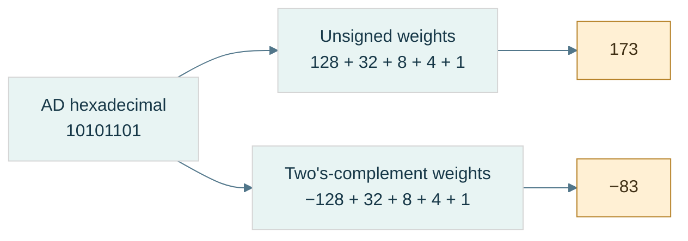

**Read the figure:** the branches change the interpretation, never the stored pattern. The high position contributes either $+128$ or $-128$ at this eight-bit width. Equivalently, the signed branch subtracts 256 from unsigned 173. **Limit:** this is a fixed-width integer example; floating fields and packed application flags follow different decoding rules. Reconstruct both answers before opening [[Visual Recall/01 - Bits, Numbers and Memory - Visual Recall#Figure-linked pocket notes|the pocket notes]].

### Why invert-and-add-one works

A **residue** is the representative left after division by a modulus. At width $N$, retaining only the low bits is arithmetic modulo $2^N$. For positive $x$, its negative residue is $2^N-x$. Since an all-ones word has value $2^N-1$:

$$
2^N-x=(2^N-1-x)+1=\operatorname{NOT}_N(x)+1
$$

Here $\operatorname{NOT}_N$ means complement exactly $N$ bits, not whatever width a programming-language promotion happens to choose.

Trace negative 13 at eight bits:

| Step | Bits | Unsigned pattern value |
|---|---|---|
| Positive 13 | `00001101` | 13 |
| Invert eight positions | `11110010` | 242 |
| Add one | `11110011` | 243 |
| Signed decode | $243-256$ | −13 |

Check: $13+243=256$, whose low eight bits are zero. Negating zero similarly produces all ones plus one and leaves zero. There is no second zero.

The [[Minimum signed value|minimum signed value]] is asymmetric. At eight bits, −128 exists but +128 does not. The pattern `10000000` complements and increments back to itself. That is valid residue arithmetic; it does **not** mean a signed language operation may return −128 as the mathematical negation of −128. For an `int` at its minimum, same-type negation, `abs`, and division by −1 cannot represent the answer. Narrow values can promote to a larger type first; always identify the actual operation type.

## Bits become decisions and compact fields

The same bits can now represent numbers, but not every byte is one number. Some store independent decisions or several small fields. Boolean rules tell us how to inspect and update them without damaging neighboring meanings.

### Boolean reasoning and control flow

A [[Boolean algebra|Boolean]] value is false or true. [[Logical versus bitwise operators|A bit pattern operation]] returns a pattern; a logical condition returns a truth value. With integer x=2 and y=1, `x & y` is zero, but `x && y` is true because each operand is nonzero.

Built-in logical AND/OR [[Short-circuit evaluation|short-circuit]]: the second operand is evaluated only if the first does not already determine the answer. That is why `p != nullptr && *p == 5` can avoid dereferencing a null pointer. Bitwise AND does not supply that control-flow guarantee.

[[De Morgan's laws]] describe what happens when NOT crosses AND or OR:

$$
\neg(A\land B)=\neg A\lor\neg B,\qquad
\neg(A\lor B)=\neg A\land\neg B.
$$

The symbols mean NOT/AND/OR, respectively. Check all four input pairs from the truth table. “Not both” means at least one is absent; “neither” means both are absent. Those are different predicates. Apply the identities lane-by-lane to fixed-width bit vectors only after fixing complement width.

### A mask selects positions

A [[Bit mask|mask]] is a pattern used to select or change specified positions. It is not a special hardware material. The operators [[Bitwise AND|AND]], [[Bitwise OR|OR]], [[Bitwise XOR|XOR]], and [[Bitwise NOT|NOT]] describe one-bit truth rules; **bitwise** operations apply them independently at each corresponding position.

| A | B | AND | OR | XOR |
|---|---|---|---|---|
| 0 | 0 | 0 | 0 | 0 |
| 0 | 1 | 0 | 1 | 1 |
| 1 | 0 | 0 | 1 | 1 |
| 1 | 1 | 1 | 1 | 0 |

NOT exchanges zero and one. AND keeps a bit only if the mask has one there; OR forces masked positions to one; XOR toggles them (one becomes zero, zero becomes one). XOR means **exclusive OR**: true when inputs differ, not when both are true.

Take the octet AD:

- `AD & 07 = 05` retains low positions 0-2.
- `AD | 40 = ED` sets position 6.
- `AD ^ 08 = A5` toggles position 3; repeating the toggle restores AD.
- Eight-bit NOT of `0F` is `F0`. The width matters: complementing a wider representation changes more positions.

C++ uses `&`, `|`, `^`, and `~` for these operations. The teaching model is a fixed-width unsigned pattern. Executable C++ first applies type rules; a narrow operand may become int before NOT. “Invert one byte” therefore requires a deliberate width, not merely the character `~`.

**Any versus all:** if m selects several flags, `(x & m) != 0` means at least one is set; `(x & m) == m` means all selected flags are set. With m=0, the first is false and the second true. Decide whether an empty selection is meaningful in the API.

### Shifts move significance

A **shift** relocates positions. [[Shift operations|A logical right shift]] fills new high positions with zero; an arithmetic right shift replicates the sign bit. A left shift introduces zeros at the low end. Shifting is not rotating: discarded positions do not reappear at the other end.

For an unsigned fixed-width pattern, a left shift by k corresponds to multiplication by $2^k$ followed by the width's truncation; a right shift corresponds to whole-number division by $2^k$ rounded down. **Truncation** here means discarding bits that cannot fit.

At eight-bit width, `00101101 << 1` gives `01011010`, value 90. But `10000000 << 1` leaves low eight bits zero; mathematical 256 needs nine bits. If the goal was an exact product, widening must occur before the shift.

For a negative signed value, arithmetic right shift and integer division can round differently. In C++23, -3 shifted right once is -2, while -3 divided by 2 is -1. **Floor** rounds down toward negative infinity; truncation of signed division rounds toward zero. Also validate the shift count: a negative count or one at least the promoted operand width is invalid. Use an unsigned carrier and check the width when manipulating representations.

### Fields: select, normalize, replace

A [[Bit field|bit field]] in this lesson means a schema-owned range of positions, not automatically a C++ language bit-field member. Its **offset** s is the first position; its **width** w is the number of positions. **Normalize** means move the extracted value down so its lowest field bit has weight one.

Let an unsigned N-bit word x contain a w-bit field beginning at s. Require $1\le w\le N$, $s\ge0$, $s+w\le N$. The low mask L and positioned mask M are:

$$
L=2^w-1,\qquad M=L\,2^s,\qquad f=(x\gg s)\mathbin{\&}L.
$$

Subtracting one from $2^w$ produces w low ones. For w=2, L=3 (`11₂`). For s=4, M=48 (`0x30`). Extract quality from AD: shifting right four gives A; AND with 3 gives 2. Masking AD with 30 alone gives 20 hexadecimal, still weighted at its original position, not normalized value 2.

Replacing requires clearing the old field before inserting the new value. At exactly N bits, $\operatorname{NOT}_N$ means width-limited complement:

$$
x'=(x\mathbin{\&}\operatorname{NOT}_N(M))
\mathbin{|}((v\mathbin{\&}L)\ll s).
$$

A checked API rejects v if it does not fit; a truncating API keeps only low bits. State which behavior is intended.

Trace quality 2→1:

```text
old word                 AD = 10101101
field mask               30 = 00110000
eight-bit NOT(mask)       CF = 11001111
clear: AD & CF            8D = 10001101
new field: 1 << 4         10 = 00010000
write: 8D | 10            9D = 10011101
readback: (9D >> 4) & 3    1
```

Outside-mask bits remain equal: `AD & CF = 9D & CF = 8D`. That is the preservation invariant. OR-only insertion fails whenever the new field needs to clear an old one; it cannot perform replacement generally.

### Figure B2 - Replace a field without damaging its neighbors

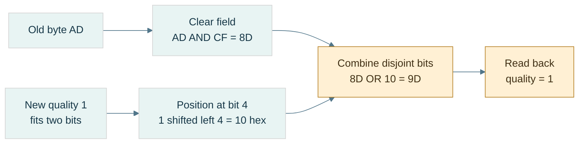

**Read the figure:** the destination field mask is `30` hexadecimal, so its eight-bit complement is `CF`. Clear first, insert second. The invariant is `AD AND CF = 9D AND CF = 8D`: all outside positions survive. **Limit:** the figure assumes a validated two-bit value and an eight-bit unsigned model; actual C++ promotions and legal shift counts still need checking. Extraction and replacement formulas appear immediately above.

### Packing several meanings and unpacking them

[[Bit packing|Packing]] places several small values in one carrier. Give every field an allowed range and disjoint positions before combining them. **Disjoint** means no shared positions; overlapping fields need a separate explicit meaning.

Our running control byte stores mode (0-7) at 0-2, visible at 3, quality (0-3) at 4-5, locked at 6, dirty at 7:

```text
mode=5       -> 00000101
visible=1    -> 00001000
quality=2    -> 00100000
locked=0     -> 00000000
dirty=1      -> 10000000
OR together  -> 10101101 = AD
```

Unpacking reverses the schema. Each recovered value must equal the validated input. A **round trip** is encoding followed by decoding; agreement is necessary but not sufficient, because two matching bugs could agree on the wrong external format. Also check expected bytes independently.

For an LSB-first logical-bit array, bit i goes into byte $\lfloor i/8\rfloor$, position $i\bmod8$. The floor symbol means take the whole-number quotient. Array `[1,0,1,1,0,1,0,1]` packs to AD; its element zero is the low bit even though printed binary puts the high bit on the left.

Packing n bits needs $\lceil n/8\rceil$ octets. A ceiling rounds upward. In finite size arithmetic, use `n/8 + (n%8 != 0)` rather than blindly computing `(n+7)/8` when n+7 could overflow. Check requested unpack count against source capacity before reading. Define whether unused final padding bits must be zero or are ignored.

### Test the packed meaning

**Question:** Can one byte hold the five declared meanings while updating one without changing neighbors?

Use the field/packing implementations in the code companion. Begin with the shown values and predict AD before running. Extract every field; replace quality by one and expect 9D. Then attempt quality=4: a two-bit checked field must reject it. Attempt a field extending beyond the carrier: reject it before shifting. Pack the eight-bit array and check the literal expected octet as well as the round trip.

**Observable checks:** extracted values equal inputs; outside-mask bits remain unchanged; a second identical set has no further effect; a second identical toggle restores the original; the final packed length is the rounded-up capacity. These are checks of mechanism, not a performance benchmark.

**Cost and trade-off:** a fixed field operation takes bounded work. Packing n bits processes n logical inputs and stores about n/8 octets; it saves footprint but adds work and can make concurrent updates to neighboring fields contend on the same storage. We have not yet studied the synchronization required for such shared writes.

**Teach-back:** explain why zero has a representation, why 256 patterns stop at unsigned value 255, why XOR toggles, and why the array's first element can be the printed numeral's last bit. If any answer is only “because binary,” rebuild the actual weights or truth rule.

**Companions, not missing steps:** [[Continuous Notes/Computing Foundations - From Bits to C++ and Systems APIs#M001 - Positional value, masks, fields, and De Morgan|Full proofs]] · [[Supplementary/Code Snippets#M001 - Width-safe fields and LSB-first bit packing|Checked C++ implementations]].

## Arithmetic becomes a policy

Boolean gates can build an adder, but an adder only produces a finite-width result. The next question is whether that result answers the intended signed, unsigned, bounded, or checked problem. Then C++ adds a further layer: the expression's type may not be the stored operand's type.

### From logic gates to an adder

An **ALU**, or arithmetic and logic unit, is hardware that computes arithmetic and bitwise results. A [[Half adder]] adds two one-bit inputs $A,B$. Its sum bit is XOR; its carry bit is AND. A [[Full adder]] also takes incoming carry $c$:

$$
S=A\oplus B\oplus c,\qquad
c_{\mathrm{out}}=(A\land B)\lor(c\land(A\oplus B))
$$

The sum records odd parity: it is 1 when an odd number of inputs are 1. Carry records a **majority**: at least two inputs are 1.

Trace four-bit $13+7$, reading from the least-significant column:

| Position $i$ | $A_i$ from 1101 | $B_i$ from 0111 | Carry in | Sum | Carry out |
|---|---|---|---|---|---|
| 0 | 1 | 1 | 0 | 0 | 1 |
| 1 | 0 | 1 | 1 | 0 | 1 |
| 2 | 1 | 1 | 1 | 1 | 1 |
| 3 | 1 | 0 | 1 | 0 | 1 |

Read sum bits high-to-low: `0100`, or 4. Including final carry gives `10100`, or 20. A [[Ripple-carry addition|ripple-carry adder]] passes each carry to the next stage; a long dependency chain increases circuit delay.

For [[Carry-lookahead and parallel-prefix adders|faster carry networks]], define **generate** $g_i=A_i\land B_i$ and **propagate** $p_i=A_i\oplus B_i$. Then $c_{i+1}=g_i\lor(p_i\land c_i)$. Groups can combine these facts without waiting for every single stage. “Parallel prefix” means combining summaries of preceding groups in a tree-like network. This is a circuit-depth issue, not a claim that fixed-width host addition is a loop over bits.

[[Subtraction through addition]] reuses the adder:

$$
A-B \equiv A+\operatorname{NOT}_N(B)+1\pmod{2^N}
$$

At eight bits, $5-7$: NOT(7)=248; $5+248+1=254$; signed decoding gives −2. A processor's [[Carry and borrow|borrow convention]] must be stated. In binary 6502-style SBC, $A+\operatorname{NOT}_8(B)+C=A-B-(1-C)$, so carry set means **no borrow**. This is an architecture-specific example, not a universal flag convention.

### Flags answer different questions

[[Carry, overflow, negative, and zero flags|C/V/N/Z]] are separate observations of a finite-width result: **C** is unsigned carry-out, **V** is signed overflow, **N** is the high result bit, and **Z** is whether all result bits are zero. With eight-bit binary addition and incoming carry zero:

| Inputs | Exact unsigned sum | Low result | C | V | N | Z | Signed reading |
|---|---|---|---|---|---|---|---|
| `7F + 01` | 128 | `80` | 0 | 1 | 1 | 0 | 127+1 cannot fit |
| `FF + 01` | 256 | `00` | 1 | 0 | 0 | 1 | −1+1=0 fits |
| `80 + 80` | 256 | `00` | 1 | 1 | 0 | 1 | −128−128 cannot fit |

For addition, signed overflow occurs when equal-sign operands produce the opposite-sign result. Carry is not a signed overflow test. The N flag describes the stored high bit; after overflow it does not recover the sign of the exact mathematical answer.

### Multiplication and division as reconstructible algorithms

[[Shift-and-add multiplication]] adds one shifted copy of the multiplicand for each set bit of the multiplier. For $13\times11$, multiplier $11=1011_2$:

| Multiplier position | Bit | Contribution | Accumulator |
|---|---|---|---|
| 0 | 1 | $13\times1=13$ | 13 |
| 1 | 1 | $13\times2=26$ | 39 |
| 2 | 0 | 0 | 39 |
| 3 | 1 | $13\times8=104$ | 143 |

Both partial products and accumulator need sufficient width. Two unsigned $N$-bit values may need $2N$ bits for their exact product.

[[Binary long division]] reads dividend bits from high to low. Append the next bit to the partial remainder by doubling and adding that bit; if it reaches the divisor, subtract the divisor and emit quotient bit 1, otherwise emit 0. For $13/3$, dividend `1101`:

| Incoming bit | Trial remainder | Quotient bit | Remainder after subtraction |
|---|---|---|---|
| 1 | 1 | 0 | 1 |
| 1 | 3 | 1 | 0 |
| 0 | 0 | 0 | 0 |
| 1 | 1 | 0 | 1 |

Quotient `0100` is 4; remainder is 1. The final check is $13=4\times3+1$. Generally, for dividend $D$, positive divisor $d$, quotient $Q$, and remainder $R$:

$$
D=Qd+R,\qquad 0\le R<d
$$

This is the **invariant** that makes the unsigned algorithm testable. Signed division needs an additional sign policy; C++ integer division truncates toward zero. Reject divisor zero and signed minimum divided by −1 when the operation type cannot hold the answer.

### Choose the overflow policy before calculating

**Overflow** means the exact mathematical answer does not fit the intended range. There are several possible [[Arithmetic policies|policies]], and they produce different programs.

| Policy for eight-bit unsigned $250+20$ | Result | Intended use |
|---|---|---|
| Wrap modulo 256 | 14 | residue counters, emulated register arithmetic |
| [[Saturating arithmetic\|Saturate]] at the upper bound | 255 | bounded intensities or controls |
| Check and reject | no value; report failure | sizes, allocation counts, external input |
| Widen the carrier | 270 in a wider type | preserve the exact intermediate result |

A **carrier** is the type or register holding the representation. Widen *before* an operation when the old carrier cannot hold its intermediate result. Casting an already-overflowed signed expression afterward cannot repair it.

C++ unsigned arithmetic uses modulo arithmetic at the width of the operation's unsigned type. [[Signed integer overflow]] is [[Undefined behavior]]: the language does not assign it a result that the program may rely on. CPU wraparound and C++ signed overflow are different contracts. These rules are described in the [C++ draft's fundamental types section](https://eel.is/c++draft/basic.fundamental).

For a buffer of `size` bytes, testing `offset + length <= size` can fail if the addition wraps. With unsigned sizes, use:

```text
offset <= size && length <= size - offset
```

Short-circuit evaluation protects the subtraction from an invalid offset. Example: size 100, offset 90, length 15. The first test passes, but $15\le 100-90$ fails. An offset greater than 100 fails before subtracting.

**Underflow**, when discussing integer range here, means falling below the lower endpoint; it is not the same technical condition as floating-point underflow. Unsigned `0 - 1` wraps. An unsigned reverse loop whose condition is `i >= 0` never terminates by that condition. Start from the count, test that it is nonzero, decrement, then index.

Saturation also changes algebra. With signed eight-bit saturation, $(100+100)+(-100)$ becomes $127-100=27$, but $100+(100-100)=100$. Saturating addition is not associative. Do not clamp an intermediate just because the final output has a bounded range.

### Follow C++'s types through the expression

[[Fixed-width integer types|Exact-width types]], such as `std::uint32_t`, specify an exact bit width when the implementation provides them. **Least-width** types guarantee at least the requested width; **fast-width** types pursue efficient operations while meeting that minimum. `std::size_t` represents sizes; `std::ptrdiff_t` represents pointer differences. Plain `char` can be signed or unsigned.

[[Integral promotion|Promotion]] is an automatic conversion of a small integer type to `int` if `int` represents all its values, otherwise to `unsigned int`. [[Usual arithmetic conversions]] then find the common operation type. **Rank** is the language's ordering of integer types for these decisions; it is not simply the number of bits.

On an ordinary host with eight-bit `uint8_t` and an `int` able to represent 0–255:

| Stage | Expression/value | Type and consequence |
|---|---|---|
| Stored operands | 250 and 10 | `uint8_t` |
| Promotion | 250 and 10 | `int` |
| Addition | 260 | `int`; no eight-bit addition has happened |
| Destination conversion | 4 | assigning to `uint8_t` reduces modulo 256 |

Likewise, `~uint8_t{0}` normally complements an `int` zero and produces `int` −1, not a byte object containing 255. The [draft promotion rules](https://eel.is/c++draft/conv.prom) explain why.

For [[Mixed signedness|mixed-sign comparisons]], do not assume the signed operand stays signed. In `-1 < 1u`, −1 converts to `unsigned int` and the comparison is false. A valid index still needs `index >= 0` *and* a value less than the count. Checked comparison helpers such as `std::cmp_less` avoid surprising conversion comparisons; `std::in_range<T>` checks whether conversion to `T` is representable. These tools do not establish that a pointer is live or that an index belongs to a particular container.

### Integer laboratory and teaching checkpoint

Before implementing a small ALU, write its contract: width, encoding, carry convention, decimal/binary mode, flags, and output policy. A **guest** is the simulated machine; the **host** runs the simulator. Host types must safely carry guest intermediate results.

Lab: enumerate all 256×256 input pairs for an eight-bit addition model, then repeat for both carry inputs. Compare low result with the widened sum modulo 256; compare carry with whether the widened sum reaches 256; derive overflow independently from signed mathematical bounds. That is [[Exhaustive finite-state testing|exhaustive testing]] of this bounded domain, not proof of a complete CPU.

A learner should now be able to explain why `AD` can mean −83, trace an adder, distinguish carry from overflow, reconstruct 13×11 and 13/3, and track the four expression stages above. Proofs and reusable implementation stay in [[Continuous Notes/Computing Foundations - From Bits to C++ and Systems APIs#M002 - Signed representations, adders, and arithmetic policies|the derivation companion]] and [[Supplementary/Code Snippets#M002 - Exhaustive 8-bit addition oracle and saturation|the code companion]]; the meaning needed to teach them is already here.

## A stretching ruler for real-valued quantities

Integer counts and signed directions are exact within their ranges. Fractions require another interpretation. We first study a movable scale because it covers a wide span of magnitudes; later, a fixed scale will offer a different bargain for a bounded domain.

### A movable binary point

[[IEEE-754 floating point|Floating point]] distributes a finite set of bit patterns across a wide range of values. It does not represent every real number. **Dynamic range** describes the span of magnitudes available; **precision** describes how finely values can be distinguished within that span. They are different resources.

A fixed-point encoding might interpret an integer carrier $I$ as $I/2^{16}$. Its spacing is always $2^{-16}$. More fractional positions improve that spacing but reduce the largest magnitude for a fixed carrier width. Floating point instead uses binary scientific notation: a [[Significand and hidden bit|significand]] supplies significant digits and an exponent moves their scale. In $1.010101_2\times2^3$, the significand is $1.010101_2$ and the exponent is 3.

Picture a toy format retaining only three significant binary bits:

| Exponent | Representable values in that exponent interval | Spacing |
|---|---|---|
| 0 | 1, 1.25, 1.5, 1.75 | 0.25 |
| 1 | 2, 2.5, 3, 3.5 | 0.5 |
| 2 | 4, 5, 6, 7 | 1 |

Each scale has the same number of significant positions, but the ruler stretches. Normal floating values have roughly constant *relative* precision, not constant absolute spacing. **Relative** means measured as a proportion of the value; **absolute** means measured in the original units.

IEEE-754 includes formats, special values, arithmetic and rounding rules, and exception conditions—not only a field layout. A conceptual arithmetic pipeline unpacks fields, handles classes, computes with extra information, normalizes, rounds, and repacks. An **FPU**, floating-point unit, is hardware performing these operations. Addition also needs exponent alignment; The arithmetic story below develops that machinery.

### The two formats and their interpretation

[[Binary32]] uses 32 bits; [[Binary64]] uses 64. These are format names. C++ `float` and `double` commonly use them, but names alone do not prove the representation. Our laboratory checks the host's width, radix, precision, exponent range, and IEC-559 support, plus golden bit patterns.

| Property | binary32 | binary64 |
|---|---|---|
| Sign position | 31 | 63 |
| Exponent positions | 30–23: 8 bits | 62–52: 11 bits |
| Fraction positions | 22–0: 23 bits | 51–0: 52 bits |
| Normal significand precision $p$ | 24 bits | 53 bits |
| [[Exponent bias\|Bias]] $B$ | 127 | 1023 |
| Normal exponent $e$ | −126 through 127 | −1022 through 1023 |
| Smallest positive normal | $2^{-126}$ | $2^{-1022}$ |
| Smallest positive subnormal | $2^{-149}$ | $2^{-1074}$ |

Let $S$ be the sign bit, $E$ the unsigned stored exponent, and $F$ the integer formed by the fraction field. For a normal finite number with $t$ stored fraction bits:

$$
x=(-1)^S\left(1+\frac{F}{2^t}\right)2^{E-B}.
$$

Use $t=23,B=127$ for binary32 and $t=52,B=1023$ for binary64. This formula defines the encoded value **exactly**; rounding happens when choosing which encoded value to store, not when interpreting an existing finite pattern.

The sign is a separate factor, unlike two's-complement integer negation. `1.0f` is `0x3F800000`; changing only the high bit gives `0xBF800000`, or −1. Do not invert every bit and add one.

The bias translates the normal exponent into a nonnegative field: $E=e+B$, so $e=E-B$. Binary32 exponent −2 stores 125; exponent 0 stores 127; exponent 3 stores 130. The chosen bias for $k$ exponent bits is $2^{k-1}-1$. Field zero and field all-ones have reserved interpretations: do not blindly subtract the bias for them.

**Normalize** here means move the binary point so a normal positive magnitude has the form $1.f_2\times2^e$. The first nonzero binary digit must be 1, so it need not be stored. That **implicit leading one**, or hidden bit, gives normal binary32 24 significant bits from 23 stored fraction bits. It is not present for subnormals.

| Stored exponent | Fraction | Class | Leading significand bit |
|---|---|---|---|
| 0 | 0 | signed zero | 0 |
| 0 | nonzero | subnormal | 0 |
| 1 through 254 (binary32) | any | normal finite | 1 |
| 255 (binary32) | 0 | signed infinity | not a finite significand |
| 255 (binary32) | nonzero | NaN | not a finite significand |

For binary64 replace 254/255 by 2046/2047. Classify first, decode second. Physical byte order is a separate layer: fields describe significance positions in a representation word, not which byte appears first at increasing addresses. **Little endian** places the least-significant byte first at increasing addresses; **big endian** places the most-significant byte first. The storage story later reconstructs both rules in detail.

### Encode 10.625, then decode −13.25

[[Floating-point encoding and decoding|Encoding]] starts with a value and chooses fields. For 10.625, the integer portion is $10=1010_2$. Convert the fractional portion by repeated doubling; each whole-number part becomes the next bit after the point.

| Remaining fraction | Multiply by 2 | Emit bit | New remaining fraction |
|---|---|---|---|
| 0.625 | 1.25 | 1 | 0.25 |
| 0.25 | 0.5 | 0 | 0.5 |
| 0.5 | 1.0 | 1 | 0 |

Thus $10.625=1010.101_2=1.010101_2\times2^3$. Set $S=0$, $E=3+127=130=10000010_2$. Drop the leading one; pad the fraction to 23 positions:

```text
sign | exponent | fraction
0    | 10000010 | 01010100000000000000000
grouped hex: 0100 0001 0010 1010 0000 0000 0000 0000
representation word: 0x412A0000
little-endian octets: 00 00 2A 41
```

The fraction integer is `0x2A0000`. Check $F/2^{23}=0.328125$; $(1+0.328125)\times8=10.625$. No rounding was needed because the finite binary expansion fits.

For decoding `0xC1540000`:

| Step | Result |
|---|---|
| Extract sign | $S=1$ |
| Extract exponent | $E=130$; class is normal |
| Remove bias | $e=3$ |
| Extract fraction | `0x540000`; fraction bits begin `101010` |
| Restore hidden bit | $1.10101_2=1+1/2+1/8+1/32=1.65625$ |
| Scale and sign | $-1.65625\times8=-13.25$ |

The decoder in the code companion uses `std::ldexp` to multiply a significand by a power of two. Its numerical reconstruction is not a NaN-payload-preserving conversion.


### Zero, infinity, and an unordered result

[[Signed zero]] retains a sign even when $E=F=0$. Positive zero is `0x00000000` and negative zero `0x80000000`. Numerically they compare equal. `std::signbit` distinguishes them; `x<0` does not distinguish negative zero. `std::copysign(0.0,-1.0)` constructs it deliberately.

Under the stated IEEE environment, reciprocal of +0 is +infinity and reciprocal of −0 is −infinity, with divide-by-zero status for finite nonzero numerators. Zero sign can therefore preserve directional information. This is floating arithmetic, not permission to divide an integer by zero.

[[Floating-point infinities|Infinity]] has all-one exponent and zero fraction. `0x7F800000` is positive infinity, `0xFF800000` negative infinity. Infinity is not the largest finite value: that is `0x7F7FFFFF`, $(2-2^{-23})2^{127}$, approximately $3.40\times10^{38}$.

| IEEE operation | Result | Reason to notice |
|---|---|---|
| Positive infinity plus finite | positive infinity | finite addition does not reduce unbounded magnitude |
| Positive infinity minus positive infinity | NaN | indeterminate difference |
| Zero times infinity | NaN | invalid operation |
| Finite value divided by infinity | signed zero | sign still matters |
| Infinity divided by infinity | NaN | invalid operation |

[[NaNs and payloads|NaN]] means “not a number”: all-one exponent with nonzero fraction. **Unordered** means ordinary ordered comparisons with NaN do not identify a less/equal/greater numerical relationship. Under ordinary IEEE semantics, `nan==nan` is false, `nan!=nan` true, and `nan<5`, `nan>=5` false. Detect it with `std::isnan`, not equality against a manufactured NaN.

A **quiet NaN** generally propagates through ordinary arithmetic without signaling invalid solely because it is quiet. A **signaling NaN** is intended to signal invalid when consumed by suitable operations and is commonly quieted. Actual traps, quieting, and payload handling depend on the environment and operation. A **payload** is representation information in the fraction that may carry diagnostics; NaN has no ordinary numerical positive/negative sign.

The laboratory's raw-word classifier uses fraction bit 22 as the quiet indicator in its stated IEEE binary interchange encoding. `0x7FC00001` is a quiet pattern; `0x7F800001` is a signaling pattern. Inspect these as integer words without feeding signaling patterns to arithmetic. A float-by-value inspection or print can already involve implementation behavior; it is not a guaranteed signaling-payload preservation experiment.

[[Floating-point exception flags|Exception flags]] are floating-environment status, not C++ `throw` exceptions. Invalid, divide-by-zero, overflow, underflow, and inexact are different conditions. Inexact says an exact result needed rounding. A tiny exactly representable subnormal does not automatically signal underflow; underflow signaling involves tininess and loss of accuracy under the relevant rules. Overflow handling depends on sign and rounding direction: nearest can produce infinity, while a direction toward finite magnitudes can produce the largest finite value.

### Filling the gap to zero

[[Subnormals and gradual underflow|Subnormals]] use $E=0,F\ne0$, with no implicit one and effective exponent fixed at the smallest normal exponent:

$$
x=(-1)^S\frac{F}{2^{23}}2^{-126}=(-1)^S F2^{-149}
$$

for binary32. For binary64 the corresponding value is $(-1)^S F2^{-1074}$. This changes the significand from $1.f$ to $0.f$ so values extend below the normal minimum.

| Positive binary32 word | Exact value |
|---|---|
| `0x00000001` | $2^{-149}$ |
| `0x007FFFFF` | $(2^{23}-1)2^{-149}=2^{-126}-2^{-149}$ |
| `0x00800000` | $2^{-126}$ |
| `0x00800001` | $2^{-126}+2^{-149}$ |

The subnormal-to-normal boundary has no abrupt jump in spacing: the last two gaps shown are both $2^{-149}$. That is **gradual underflow**. Subnormal spacing is constant in absolute units, so relative precision worsens toward zero; it is not the ordinary constant-relative normal regime.

[[Flush-to-zero and denormals-are-zero|FTZ]] means flushing certain tiny results to zero; **DAZ** means treating subnormal inputs as zero in environments offering that mode. Availability, cost and exact behavior vary. Do not assume every GPU or SIMD operation preserves gradual underflow, nor that subnormals always cost extra. Our strict host test verifies the behavior it observes, not every target mode.

### Epsilon is one spacing, not a tolerance

[[Machine epsilon]] for these binary formats is the difference from 1 to the next representable value above it: binary32 $2^{-23}$, binary64 $2^{-52}$. It is not the smallest positive number and is not a universal error estimate.

| C++ numeric-limits property | Meaning for binary32 |
|---|---|
| `min()` | smallest positive normal, $2^{-126}$ |
| `denorm_min()` | smallest positive subnormal, $2^{-149}$ |
| `lowest()` | most negative finite value |
| `max()` | largest positive finite value |
| `epsilon()` | upward spacing at 1, $2^{-23}$ |

[[ULP and representable spacing|ULP]], unit in the last place, describes a local significant-position scale. A **binade** is an interval $[2^e,2^{e+1})$ with a common normal exponent. For precision $p$, spacing *inside* that binade is exactly:

$$
\Delta(e)=2^{e-(p-1)}.
$$

Binary32 uses $p=24$, so its spacing is $2^{e-23}$. At 1024 it is $2^{-13}=0.0001220703125$; around one billion, $e=29$, so it is 64. Under nearest rounding, adding 1 to the exactly represented `1'000'000'000.0f` stores the same float because there is no representable neighbor one unit away.

At a power of two, state which direction you mean. Immediately above 1 the gap is $2^{-23}$; immediately below it the gap is $2^{-24}$. `std::nextafter(x,direction)` asks for a particular adjacent value. At the maximum finite value its upward neighbor is infinity; that gap is not an ordinary finite-binade spacing.

[[Unit roundoff]] under nearest rounding is conventionally $u=2^{-p}$, half epsilon for these formats. The usual relative-error model is scoped to correctly rounded normal-range results without overflow; do not extend its relative bound unchanged into subnormals.

[[ULP distance policies|ULP distance]] counts representation steps under a stated ordering policy. Reject NaNs and infinities for this lab and identify +0/−0 as one location. The supplied complement-key trick places the zeros at two keys; merely special-casing a comparison of the zeros still overcounts intervals *crossing* them. Our replacement collapses zero in the key itself: negative smallest subnormal to positive smallest subnormal has distance 2, not 3. A small ULP distance is a testing policy, not proof of correctness in physical units.

### Choosing a neighbor

[[Rounding to nearest ties to even|Nearest-even rounding]] chooses the closest representable neighbor. At an exact midpoint, select the candidate whose retained significand integer has an even low bit. “Even” does not mean that a fractional real value is an even decimal integer.

Use the three-significant-bit toy format:

| Exact value | Lower neighbor | Upper neighbor | Tie-even choice |
|---|---|---|---|
| 1.125 | `1.00₂` = 1 | `1.01₂` = 1.25 | 1: retained low bit 0 |
| 1.375 | `1.01₂` = 1.25 | `1.10₂` = 1.5 | 1.5: retained low bit 0 |
| 1.875 | `1.11₂` = 1.75 | `1.00₂ × 2` = 2 | 2; rounding renormalizes |

[[Guard round and sticky bits|Guard, round, and sticky]] summarize discarded information. Guard $G$ is the first discarded bit; round $R$ the next; sticky $T$ is the OR of all remaining discarded bits. Let $L$ be the last retained bit. For this binary rounding step:

$$
\operatorname{increment}=G\land(R\lor T\lor L).
$$

Guard zero is below half; guard one with later nonzero bits is above half; guard one with all later bits zero is a tie, resolved by $L$. Incrementing can carry out of the significand and require renormalization.

[[Directed rounding modes]] move toward positive infinity, negative infinity, or zero. Upward means toward larger signed values, not larger magnitude. For an integer-valued rounding demonstration:

| Input | Nearest-even | Upward | Downward | Toward zero |
|---|---|---|---|---|
| 2.5 | 2 | 3 | 2 | 2 |
| −2.5 | −2 | −2 | −3 | −2 |
| 2.1 | 2 | 3 | 2 | 2 |
| −2.1 | −2 | −2 | −3 | −2 |

For format rounding, substitute adjacent representable floating neighbors for adjacent integers. `std::round(2.5)` instead returns 3: halfway cases go away from zero, independently of the current direction. `std::nearbyint` follows the current rounding direction; unlike `rint` it does not raise inexact for the rounding operation.

[[Floating-point environment and compiler modes|The floating environment]] includes rounding direction and exception status. A demonstration must check whether changing direction succeeds and restore the **previous** mode, not blindly force nearest afterward. Compiler flags and optimizations matter. The lab uses Clang strict floating-point behavior, checks four modes, and avoids fast-math; see [Clang's floating-point controls](https://clang.llvm.org/docs/UsersManual.html#controlling-floating-point-behavior).

[[Interval arithmetic]] uses a lower and upper value to enclose an exact result; downward-rounded lower calculations and upward-rounded upper calculations can preserve bounds when the whole algorithm honors the required assumptions. It is not enough to switch a global mode around an arbitrary formula and declare a proof.

## When arithmetic meets uncertainty

A stored floating value is an exact point on its grid. The difficulty is whether it matches the intended quantity and how later rounded operations change it. Representation, operation error, sensitivity, and application policy are different causes; treating them as one global epsilon hides the real problem.

### The stored value is exact; its intended meaning may not be

Once a representation is chosen, follow a computation: desired real inputs become stored values; each operation can round again; those rounded results feed later operations. Keep **input representation error**, **operation rounding**, and **application policy** separate.

A [[Terminating fractions and dyadic rationals|rational number]] is a ratio $p/q$ of integers, with $q>0$. In **lowest terms**, the numerator and denominator share no factor greater than one. A finite base-$B$ fractional expansion has the form $m/B^k$ for some integers $m,k$. Therefore its reduced denominator must divide a power of $B$. Equivalently, every prime factor of that denominator must divide the base.

Decimal base ten contains factors 2 and 5, so $1/10$ terminates in decimal. Binary base two has only factor 2, so a terminating binary denominator must be a power of two. A **dyadic rational** is an integer divided by a power of two. Every finite binary floating value is dyadic; $1/10$ is not.

To produce binary fraction digits without already rounding them in a float, track the remainder as an integer over denominator ten:

| Remainder numerator before doubling | Doubled numerator | Digit | New numerator |
|---|---|---|---|
| 1 | 2 | 0 | 2 |
| 2 | 4 | 0 | 4 |
| 4 | 8 | 0 | 8 |
| 8 | 16 | 1 | 6 |
| 6 | 12 | 1 | 2 |

Remainder 2 repeats. Thus $0.1_{10}=0.0001100110011\ldots_2$. This is a base property, not a defective processor.

Nearest binary32 one tenth has word `0x3DCCCCCD` and exact value:

$$
\widehat{x}=\frac{13421773}{134217728}
=0.100000001490116119384765625.
$$

Its absolute error relative to exact $1/10$ is $1/671088640$, approximately $1.49\times10^{-9}$. The *stored* value is that exact rational; the approximation is the choice of it as a representation of one tenth.

On our checked host, `0.1f` is binary32, while `0.1` is binary64 with word `0x3FB999999999999A`. Binary64 is closer, not exact. Hexadecimal floating notation makes binary values explicit: `0x1.99999ap-4` means hexadecimal significand times $2^{-4}$; the `p` exponent is a power of two, not sixteen.

For ordinary binary64 nearest arithmetic, runtime `0.1+0.2` has word `0x3FD3333333333334`, whereas `0.3` has `0x3FD3333333333333`. Input rounding and addition rounding explain the different paths. Do not generalize that exact inequality to every type, literal suffix, or evaluation environment.

### Align the binary points before adding

[[Floating-point addition and absorption|Exponent alignment]] rewrites both significands at a common scale. Take $1.5=1.1_2\,2^0$ and $0.15625=1.01_2\,2^{-3}$. Right-shift the second significand by three positions:

```text
common exponent: 0
  1.10000
+ 0.00101
---------
  1.10101 = 1.65625
```

The conceptual pipeline is classify → unpack → compare exponents → align with guard/round/sticky information → add or subtract significands → normalize → round → handle range → pack. Opposite signs require a subtraction of magnitudes; leading zeros can require shifting left and decreasing the exponent. These are teaching stages, not a claim that every FPU has an identical internal design.

**Absorption** means a nonzero addend makes no change after rounding at the larger operand's scale. At $2^{24}=16{,}777{,}216$, binary32 upward spacing is 2:

| Exact sum | Neighbor candidates | Nearest-even stored answer |
|---|---|---|
| $2^{24}+1$ | $2^{24}$ and $2^{24}+2$ | $2^{24}$: even retained low bit |
| $2^{24}+2$ | exact representable value | $2^{24}+2$ |

The addend is mathematically real, but the destination grid has no point at the first exact sum. Shifting it into discarded positions must preserve enough information to round correctly; simply dropping all shifted bits is not a correct general addition algorithm.

This also explains the representation lesson one-billion-plus-one example. It does not imply floating addition is useless: the resolution must match the problem's scale.

### Cancellation can expose errors made earlier

[[Cancellation and loss of significance|Cancellation]] occurs when nearly equal magnitudes subtract, leaving a small difference. **Catastrophic** describes severe loss of relative accuracy when existing operand uncertainty dominates that difference.

Let intended operands be $a,b$, stored approximations $\widehat a=a(1+\delta_a)$ and $\widehat b=b(1+\delta_b)$, and true difference $d=a-b\ne0$. Before any final subtraction rounding:

$$
\widehat a-\widehat b=d+a\delta_a-b\delta_b.
$$

If both relative input errors are bounded by $\eta$, triangle inequality gives:

$$
\frac{|(\widehat a-\widehat b)-d|}{|d|}
\le\eta\frac{|a|+|b|}{|a-b|}.
$$

The sensitivity factor grows when the denominator shrinks. Measurement uncertainty behaves similarly: subtract two roughly million-sized readings each uncertain by 0.05 to estimate a difference of 0.1, and that difference can have order-one relative uncertainty.

**Loss of significance** means common leading digits cancel, leaving the low-order region to determine the result. A rough count is $\log_2(\max(|a|,|b|)/|a-b|)$ canceled leading bits; it is not an automatic theorem about how many digits the result is wrong.

Corrected exact binary trace from the attachment:

```text
a = 1.1011011001₂ = 1753 / 1024
b = 1.1011010111₂ = 1751 / 1024
a-b = 2 / 1024 = 2^-9
    = 0.000000001₂ = 1.0₂ × 2^-9
```

The attachment's longer difference pattern and exponent −7 do not match these operands. Their subtraction is exact; common digits disappearing is not itself evidence of new rounding.

[[Sterbenz lemma|Sterbenz's lemma]] makes the distinction precise: for nonnegative stored floating values $x,y$ in the same radix format, if $x/2\le y\le2x$, their difference is representable exactly under the appropriate gradual-underflow arithmetic assumptions. Same-sign negative cases reduce to magnitudes. FTZ and other changed arithmetic models need separate handling. The lemma concerns the **stored operands**, not the real quantities they approximate.

Example: the desired decimal $a=1.00000006$ rounds above 1 to its next binary32 neighbor under nearest-even. Stored subtraction from 1 yields exactly $2^{-23}$, approximately $1.19209\times10^{-7}$, although the desired difference was $6\times10^{-8}$. Exact subtraction can faithfully expose a large relative input error.

[[Stable reformulation|Reformulation]] changes the computational path while preserving the mathematical function. For $x\ge0$:

$$
\sqrt{x+1}-\sqrt{x}
=\frac{1}{\sqrt{x+1}+\sqrt{x}}.
$$

Multiplying by the conjugate cancels the numerator algebraically *before* floating evaluation. At binary64 $x=10^{16}$, even `x+1` rounds to `x`; the direct square-root difference is zero, while the rationalized form gives a useful result near $5\times10^{-9}$. The reformulation avoids subtracting rounded near-equal roots, but is not an exact-real oracle or a universal fix for every range/domain.

For cross products, each component is a difference of products. The source's vectors $(10^8,10^8,0)$ and $(10^8,10^8+1,0)$ have real cross-component $10^8$. But binary32 near $10^8$ has spacing 8, so the `+1` is already lost when that component is converted to float. Widening the stored float later cannot recover it. Product rounding is a second possible failure mechanism, not the first one in this example.

### Range events are observable, but not interchangeable

[[Floating-point exception flags|Overflow]] concerns results exceeding finite representable range under the applicable rounding rules; intermediates may overflow even when a final mathematical answer fits. Under nearest, maximum finite binary32 times two becomes infinity, with overflow/inexact status in our strict environment.

At the small end, exact $2^{-126}\times1/2=2^{-127}$ is a representable subnormal. It need not raise underflow or inexact. But $2^{-149}\times1/2=2^{-150}$ is an exact midpoint between zero and the smallest positive subnormal; nearest-even gives zero, with tiny/inexact behavior.

The lab executes these at runtime, clears flags between cases, observes them, and restores the incoming floating environment. These host observations are not a portable claim about every compiler mode, trap configuration or GPU. FTZ/DAZ can change the model. Never use a compile-time-folded expression as proof that a runtime status flag was set.

### Error, conditioning, and a budget

[[Absolute and relative error|Absolute error]] is $|\widehat x-x|$, in the same units as $x$. Relative error is $|\widehat x-x|/|x|$ for $x\ne0$, dimensionless. An absolute error of 1 at a million is $10^{-6}$ relative; an absolute error of $10^{-12}$ on a true value $10^{-12}$ can be 100% relative. Near exact zero, relative error alone is undefined.

[[Forward and backward error|Forward error]] asks how far the output is from the exact desired output. **Backward error** asks what perturbation of the input would make the computed output exact. **Stability** concerns the algorithm's introduced errors; [[Conditioning and singularity|conditioning]] concerns the mathematical problem's sensitivity. A backward-stable method can still have large forward error on sensitive inputs.

For correctly rounded normal-range arithmetic in nearest mode, the standard local model is:

$$
\operatorname{fl}(a\circ b)=(a\circ b)(1+\delta),\qquad |\delta|\le u.
$$

Here $\circ$ is a specified operation and $u$ unit roundoff; exclude overflow and special values, and treat subnormal error separately. An exact zero result is handled directly rather than dividing by it.

[[Accumulated rounding error|Repeated rounding]] often uses $\gamma_n=nu/(1-nu)$ for $nu<1$. This bounds relevant products of rounding factors under stated assumptions; it does **not** promise that every arbitrary $n$-operation algorithm has relative error at most $\gamma_n$.

For sequential summation of $n$ inputs without range failures, a common absolute bound is $\gamma_{n-1}\sum_i|x_i|$. If positive and negative terms cancel, dividing by the tiny true sum can produce a large relative bound. A count of operations without magnitudes, dependency paths and conditioning is not an error analysis.

### Representation lessons applied to numerical APIs

[[Numerical tolerance policies|A tolerance]] is an allowed discrepancy chosen for a task. Machine epsilon is dimensionless spacing near one. If vector components measure meters, a minimum usable norm needs a units/scale policy; swapping meters for kilometers changes a raw absolute numeric cutoff. A vector $(10^{-8},0)$ is nonzero and normally representable in binary32; a length cutoff at epsilon rejects it by policy, not because binary32 cannot store it.

[[Robust norm and intermediate range|Intermediate range]] matters independently of the final answer. For $(10^{20},10^{20})$, each component fits binary32 but squaring gives about $10^{40}$, beyond its finite range. A naive square/sum/square-root pipeline can produce infinity, then division by infinity produces zero components. The exact norm $\sqrt2\,10^{20}$ fits.

Scale first: $m=\max(|x|,|y|)$; for finite inputs and $m>0$, compute $m\sqrt{(x/m)^2+(y/m)^2}$. The squared ratios are at most one; this avoids unnecessary overflow from squaring the original components. It does not make an out-of-range final answer fit, and its special-value policy still needs defining. `std::hypot` supplies a standard range-aware alternative. The lab reproduces the naive failure and checks a finite hypot result; it is not a benchmark.

A hybrid equality test often allows absolute difference near zero and a relative difference at large scale. With policy $10\epsilon_{32}$ and magnitude $10^8$, the allowed absolute difference is about 119.2, while local spacing is 8. This is a chosen tolerance, not “the accuracy of float.”

**Check non-finite operands before applying the relative formula.** For the scalar excerpt in the supplied lesson, equal infinities produce `inf-inf → NaN` and compare false. More seriously, finite versus infinity and opposite infinities can compare true because the final condition becomes `inf <= inf`. The teaching lab reproduces all three outcomes for that exact excerpt-shaped formula, then tests an explicit policy that accepts exact equal infinities, rejects all other non-finite pairs and invalid tolerances, and compares finite floats in a widened domain.

[[Conditioning and singularity|Conditioning]] describes how sensitive a mathematical problem is to perturbations; it is not just whether a determinant is small. A **matrix** represents a linear transformation here; the **identity matrix** $I$ leaves its input unchanged. An **inverse** undoes a transformation when one exists. A square matrix's **determinant** is a scalar whose nonzero status characterizes invertibility in exact arithmetic. The **Euclidean norm** is the square root of summed squared components; the associated matrix **2-norm condition number** compares its largest and smallest stretching factors.

For $A=10^{-4}I$ in two dimensions, $\det A=10^{-8}$ and $A^{-1}=10^4I$. Both stretching factors equal $10^{-4}$, so the condition number is 1. An absolute determinant-vs-float-epsilon cutoff rejects this invertible, well-conditioned matrix by a scale-sensitive policy. Uniformly scaling a 2×2 matrix by nonzero $c$ scales its determinant by $c^2$ but leaves its condition number unchanged. General conditioning and reliable inversion methods remain future linear-algebra topics.

**Repository evidence boundary:** the attachment reports these shapes in KairoMath Vector/Matrix and raw-bit serialization in KairoAssets. Their paths, line ranges and claims are recorded in Sources and Code Anchors as **To verify**. The reproductions prove behavior of the supplied formulas on this host, not the current repositories. The matrix excerpt includes an assertion before an identity fallback: an assertion-enabled build may stop rather than reach that fallback.

[[Floating-point canonicalization|Canonicalization]] chooses a common encoding for equivalent cases. Raw serialization keeps +0/−0 and different NaN payloads distinct; a canonical format might collapse both zeros and use one NaN word. Either policy is possible, but changing it changes the byte contract. Our raw-word encoder uses the explicit byte-order lesson explicit little-endian codec without pretending arithmetic preserves every signaling payload.

### A tolerance is a semantic rule, not an equality relation

[[Numerical tolerance policies]] need separate absolute tolerance $\tau_a$ and relative tolerance $\tau_r$:

$$
|a-b|\le\max\!\left(\tau_a,\tau_r\max(|a|,|b|)\right).
$$

Absolute tolerance has the compared quantity's units; relative tolerance is dimensionless. They need not be numerically equal. The float-specific validated comparison already supplies validated tolerances, explicit non-finite handling, and widened finite arithmetic; reuse it rather than copying the attachment's unchecked generic “production” function.

An exact `==` test is appropriate when the intended question is *numeric exact equality*, such as whether a value stayed zero. It is **not raw representation equality**: signed zeros compare equal, and NaNs do not compare equal even to the same encoding. Use raw representation words for a byte-identity contract.

Validate tolerances before an exact-equality shortcut. Reject negative/non-finite tolerances; state a useful allowed relative range. NaNs are not numerically close; same-sign infinities may compare equal only by an explicit policy. A generic expression that overflows both difference and allowed tolerance to infinity can accidentally accept `inf<=inf`; “finite operands” alone does not prevent this.

Approximate closeness is generally **not transitive**. With absolute tolerance 1, 0 is close to 0.75 and 0.75 to 1.5, but 0 is not close to 1.5. It is unsuitable as a drop-in equivalence relation for ordered containers, hashing, or deduplication without additional design.

Why no global epsilon? Positions, angles, times and determinants have different units; world scales differ; algorithms have different error histories; conditioning differs; types differ. A normalization cutoff asks whether a direction is usable, not whether two numbers are equal. A determinant criterion asks about invertibility/sensitivity, not ordinary closeness.

The reported Kairo hybrid formula uses one epsilon parameter for an absolute regime and a relative regime. That is a policy choice, not machine epsilon proving the correct physical cutoff. the representation lesson infinity regressions still apply. At $10^9$, choose distinct stored neighbors separated by 64 for a float comparison example; `10^9+32` is a midpoint that can round back to the same float.

### One rounding rather than two

[[Fused multiply-add|FMA]] computes $\operatorname{fl}(ab+c)$ with one final rounding, rather than $\operatorname{fl}(\operatorname{fl}(ab)+c)$ with an intermediate product rounding.

Let $p=2^{-23}$, $a=b=1+p$, and $c=-(1+2p)$, all exact binary32 inputs:

| Path | Computation | Result |
|---|---|---|
| Exact algebra | $(1+p)^2-(1+2p)$ | $p^2=2^{-46}$ |
| Separate binary32 | product $1+2p+p^2$ rounds to $1+2p$, then subtract | 0 |
| FMA | retain product information through addition, then round | exactly $2^{-46}$ |

The laboratory explicitly stores the product and disables contraction for the separate path. `std::fma` specifies the fused operation deliberately. A source multiply/add may be contracted according to build settings, so it is not enough to count visible `*` and `+` tokens.

FMA can help dot products, interpolation, and Horner polynomial evaluation. It is not a universally correctly rounded multi-term dot product: other products/additions may still round, and poor input data/conditioning remain. FMA policy is also a reproducibility choice because a better answer can differ bitwise from the unfused reference.

### Figure B3 - Rounding points change the answer

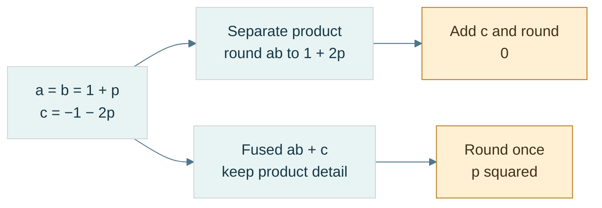

**Read the figure:** here $p=2^{-23}$ and all inputs are exact binary32 values. The exact product is $1+2p+p^2$. Separate binary32 multiplication discards $p^2$; FMA retains it until the addition cancels $1+2p$, leaving exactly $2^{-46}$. **Limit:** the separate path assumes an actual intermediate binary32 rounding with contraction disabled. FMA does not recover inaccurate input data or make a general dot product exact. The preceding example gives the full arithmetic contract.

### Algebra changes when rounding points move

[[Floating-point reassociation|Reassociation]] changes grouping. In binary32, choose $a=10^{20}$, $b=-a$, $c=3.14f$:

| Grouping | Intermediate | Stored result |
|---|---|---|
| $(a+b)+c$ | opposite equal stored magnitudes give zero | `3.14f` |
| $a+(b+c)$ | small c is absorbed in b | zero |

These are different rounded computations even though real addition is associative.

Distributivity also fails. Let exact binary32 $a=10^{10}$, $b=1+2^{-23}$, $c=-1$. Then $a(b+c)$ stores approximately 1192.0928955078125. But rounding $ab$ near $10^{10}$ uses spacing 1024, so separately computed $ab+ac$ gives 1024. The independent stored products matter; contraction can change the second graph.

[[Compensated and pairwise summation|Naive summation]] adds every input to one running result. **Kahan compensation** tracks an estimate of low bits lost in earlier additions:

```text
y = input - compensation
next = sum + y
compensation = (next - sum) - y
sum = next
```

Toy binary32 trace for inputs $[2^{24},1,1]$: naive gives $2^{24}$; after the first 1, Kahan records compensation −1; the next adjusted input becomes 2 and the stored sum becomes $2^{24}+2$. It improves this example, but is not order-independent or universally exact; severe cancellation can still defeat it.

**Pairwise summation** fixes a balanced tree of partial sums. Depth grows roughly logarithmically instead of the long serial chain, improving useful error bounds under their assumptions. It does not always outperform another method on every data set. The implementation fixes the split at `size/2`, independent of scheduling, using $O(n)$ additions and $O(\log n)$ recursive stack depth without copying the input.

Strict compiler settings constrain unsafe reassociation; fast modes can permit numerical changes. The lab uses explicit strict behavior and `-ffp-contract=off` for the unfused paths. These settings are documented by [Clang's floating-point controls](https://clang.llvm.org/docs/UsersManual.html#controlling-floating-point-behavior).

### Repeatable is not accurate, and atomic is not ordered

[[Numerical reproducibility|Repeatability]] means the same defined program/environment/input repeats a result. **Bitwise reproducibility** means representation identity across an explicitly specified set of environments. **Numerical stability** is a different accuracy property.

A [[Deterministic reduction tree|fixed reduction tree]] requires a fixed input order, partitioning and merge order. Scheduling may vary if it cannot change that tree. Atomics make updates indivisible/race-free under their contract; they do not necessarily choose one global order. Since additions do not associate, different permitted atomic update orders can differ.

Record precision, reduction topology, contraction/FMA, rounding direction, FTZ/DAZ, compiler options, hardware and relevant math-library behavior. A fixed tree alone does not promise CPU/GPU or cross-library bit identity. Exact or binned accumulators can offer stronger contracts at additional complexity; they remain a future design topic.

[[Mixed-precision state updates]] use wider intermediates but narrow persistent state. A finite binary32 value promotes exactly to binary64, but widening does not reconstruct lost bits. Repeated storage back to float rounds after each update.

The source-reported Maveb excerpt concerns a **TSDF**, truncated signed distance function: a stored distance-to-surface estimate with sign and a truncated/normalized range. A **voxel** is one cell of a three-dimensional sampled volume. A weighted observation has distance $d$ and influence weight $w$.

Before saturation, ideal weighted state updates are:

$$
D'=\frac{DW+dw}{W+w},\qquad W'=W+w.
$$

With exact arithmetic and uncapped exact totals this is the weighted mean of all observations. The reported implementation instead stores D/W in float after double arithmetic, so update order can change rounding.

[[Capped weighted updates|A weight cap]] changes the mathematics, not just precision. The supplied recurrence chooses $W'=\min(W_{\max},W+w)$, contribution $c=\min(w,W')$, retained history $r=W'-c$, and $D'=(Dr+dc)/W'$, assuming positive valid weights.

With cap 2 and unit weights, observations [0,1,−1] produce distances 0 → 0.5 → −0.25. Reordering to [0,−1,1] gives 0 → −0.5 → +0.25. All intermediate values are exactly binary-representable. This proves genuine history dependence, not floating error. Replacing it with a batch weighted mean would change the algorithm.

[[Numerical decision boundaries]] turn continuous perturbations into discrete choices. Projected image position near $n+0.5$ can select a different pixel under `llround`'s halfway-away-from-zero policy; a TSDF value changing sign near zero can change a surface-extraction case. **Topology** means connectivity/structure of the extracted surface, not just vertex displacement.

The reported interpolation ratio $t=a/(a-b)$ also has a denominator cutoff and clamping policy. Double promotion preserves stored float values exactly; near unit magnitude distinct floats differ by much more than $10^{-12}$, but near zero very fine float spacing is available. Do not equate “small denominator” with “the inputs were equal.”

**Repository boundary:** Kairo Dot/Cross/NearlyEqual and Maveb integration, pixel selection and interpolation are source-reported excerpts. Their current revisions/call paths were not inspected during this notes merge. The laboratory tests simplified excerpt-shaped mechanisms, not those repositories. No production numerical API or accumulation order was changed.

### Laboratory, reconstruction, and next step

Before running the code, predict `0x412A0000`, `0xC1540000`, the three subnormal-boundary words, and the gaps on both sides of 1. Then check:

- Golden words and independently expected little-endian bytes—not just matching encode/decode bugs.
- Raw classification of both zeros, finite boundaries, infinities, and quiet/signaling NaN words without signaling arithmetic.
- Finite reconstruction against host conversion for boundary words and 10,000 seeded raw patterns.
- Zero-collapsed ULP distances, including intervals crossing zero, and rejection of non-finite inputs.
- Nearest-even versus `round`, all directed integer-rounding demonstrations, and restoration of the initial rounding mode.
- Separate tiny-vector cutoff, huge-vector intermediate overflow, and infinity-comparison failures.

These are representation and policy tests. They do not validate a complete floating-point implementation, all four billion patterns, Kairo repositories, shader modes, performance, or cross-platform NaN transport.

Teach-back: derive why 23 stored fraction bits give 24 normal precision bits; explain why $E=0$ does not mean exponent −127; decode both worked numbers; explain why epsilon is neither a minimum nor a universal tolerance; resolve the two toy ties; and trace how a valid finite vector can become zero by two different mechanisms.

[[Continuous Notes/Computing Foundations - From Bits to C++ and Systems APIs#M004 - Floating-point fields, spacing, and rounding|Extended derivations]] · [[Supplementary/Code Snippets#M004 - Binary interchange inspection and strict rounding laboratory|Reusable implementation and tests]] · [[Supplementary/Worked Traces#M004 - From fields to values and failure paths|Further traces]].

With the representation understood, we can follow the arithmetic and its error history.

### Laboratory and teaching checkpoint

Predict each outcome before running:

- The exact rational behind `0.1f` and the binary64 words for the sum and literal 0.3.
- Exact aligned addition and absorbed midpoint addition.
- Corrected binary subtraction; subtraction after an operand was rounded.
- Overflow status, exact subnormal without underflow, and midpoint-to-zero with underflow/inexact in the strict host environment.
- Separate versus fused result, both association trees, and both distributive graphs.
- Naive versus Kahan on the three-input toy case; fixed pairwise behavior on a chosen tree.
- Capped weighted updates in the two orders, and float-state rounding versus a wider-state toy mean.
- Pixel choices just below/above a midpoint and closeness failing transitivity.

These are explicit regression demonstrations, not benchmarks, full FPU validation, mesh reconstruction experiments or proof of cross-platform reproducibility. Error measurements need an independent reference and declared units; a wider implementation is useful but is not automatically an exact oracle.

[[Continuous Notes/Computing Foundations - From Bits to C++ and Systems APIs#M005 - Representation error, cancellation, and rounding graphs|Extended derivations]] · [[Supplementary/Worked Traces#M005 - Rounding paths and update history|Expanded traces]] · [[Supplementary/Code Snippets#M005 - Strict arithmetic and state-update laboratory|Reusable code and tests]].

The representation-choice discussion below brings these rounding and state contracts into fixed point, low precision and serialized data.

## Choosing what information to keep

Floating point solved wide dynamic range, not every storage or application constraint. Now deliberately return to the representation decision: perhaps the domain needs a constant step, perhaps sixteen bits are sufficient, or perhaps data-specific codes are worth an irreversible approximation. The previous arithmetic lessons remain the tests every choice must pass.

### A fixed ruler for fractional values

Unsigned integers answered “how many?”; signed integers added direction. Floating point added a ruler that stretches with magnitude. None of these choices removed finite storage. If a distance always stays inside a known world region, a stretching ruler may be unnecessary: a constant millimeter-like step can be a better contract.

[[Fixed-point representation|Fixed point]] interprets an integer raw value $I$ with an externally agreed scale $S>0$:

$$
x=\frac{I}{S}.
$$

**Scale** is the conversion factor between integer codes and the quantity's units. The integer object does not carry a binary point by itself. Binary fixed point uses $S=2^F$, where $F$ is the number of fractional positions. Decimal fixed point, such as $S=1000$, is possible too. State storage width, signed encoding, units, scale, rounding, and overflow behavior; the label “Q16.16” is ambiguous because conventions differ about counting the sign bit.

For a two's-complement 32-bit carrier and $F=16$, encode $3.25$ as $I=3.25(65536)=212992$, word `0x00034000`. Decode by dividing by 65536. Negatives use the carrier's two's-complement rule—not an independent sign-and-magnitude split. Every step is $2^{-16}$, and the exact range is:

$$
-32768\le x\le32768-2^{-16}.
$$

This representation answers a problem floating point did not: constant absolute resolution over a declared interval. It still cannot represent every real number, and it still overflows. More fractional positions make steps finer by spending range.

### Choose a scale from requirements, not a fashionable name

[[Fixed-point range and resolution|Resolution]] is the distance between adjacent decoded codes. Let $\Delta_{\mathrm{req}}>0$ be the largest acceptable step and $M>0$ the required symmetric magnitude. For a signed $N$-bit carrier, the positive endpoint is the tighter endpoint for a symmetric requirement:

$$
2^{-F}\le\Delta_{\mathrm{req}},
\qquad
M2^F\le2^{N-1}-1.
$$

With an integer, nonnegative $F$, these give a feasible interval:

$$
F_{\min}=\max\!\left(0,\left\lceil-\log_2\Delta_{\mathrm{req}}\right\rceil\right),
\qquad
F_{\max}=\left\lfloor\log_2\frac{2^{N-1}-1}{M}\right\rfloor.
$$

The ceiling rounds upward; the floor downward. These inequalities concern a requested step, not a maximum rounding error: nearest rounding without clipping has error at most half a step. For 32 bits, a step no larger than 0.001 requires $F\ge10$. A range including $\pm10^6$ requires $F\le11$. Both $F=10$ and $F=11$ work; $F=12$ does not fit that world.

If the interval is empty, change width, range, or resolution. A local coordinate origin can reduce the magnitude that one field must represent, but then the origin becomes additional state with its own contract. It is not extra precision obtained for free.

**Book bridge:** Game Engine Architecture, PDF pages 121–122 (printed 99–100), connects integers, fixed point, and floating point. Its fixed-point illustration uses sign/magnitude fields; our implementation instead uses a two's-complement scaled integer. Its figure caption and body also disagree about the fraction-bit count. The teaching rule is to reconstruct a format from explicit fields, not assume one textbook example defines all fixed point.

### Multiplication changes the scale; rescaling is another rounding decision

Adding two raw values works directly only when their scales and units match. For $A=aS$ and $B=bS$, multiplication produces $AB=abS^2$, not an output already at scale $S$. [[Fixed-point rescaling|Rescale]] before storing:

$$
I_{\mathrm{product}}=\operatorname{roundPolicy}\!\left(\frac{AB}{S}\right),
\qquad
I_{\mathrm{quotient}}=\operatorname{roundPolicy}\!\left(\frac{AS}{B}\right),\quad B\ne0.
$$

A **wide intermediate** is a carrier large enough for an operation before the final range reduction. With signed 32-bit raw operands, their product fits signed 64-bit arithmetic, but it may still exceed the *destination* range after rescaling. For our $F=16$ quotient, multiplying a 32-bit raw numerator by 65536 also fits signed 64 bits. Those proofs do not extend automatically to arbitrary widths or scales.

Trace $F=8$, $S=256$:

| Stage | Stored or intermediate quantity | Meaning |
|---|---|---|
| Encode 1.5 | $A=384$ | $384/256$ |
| Encode 2.25 | $B=576$ | $576/256$ |
| Multiply wide | $AB=221184$ | product at scale $256^2$ |
| Rescale | $221184/256=864$ | product at scale 256 |
| Decode | $864/256=3.375$ | expected real product |

For a negative value, right shift and integer division do not necessarily implement the same rounding policy. At scale 2, $-3/2$ truncates toward zero to −1, while arithmetic right shift gives −2. Nearest-even gives −2 on that tie; on other cases a blanket shift still implements floor, not nearest. Define a rounding algorithm using quotient and remainder, including negative ties.

The laboratory uses unsigned magnitude arithmetic to handle signed minimum safely, nearest-even for multiplication/division, and checked narrowing. It does not negate `INT64_MIN`, add a half-scale that might overflow, or multiply in 32 bits and widen afterward. Conversion rejects NaN and infinities before integer casting. Conversion from double explicitly uses halfway-away-from-zero; that differs from the arithmetic rescaling rule and is documented rather than hidden.

### A constant grid changes error, not the existence of error

Nearest encoding with no clipping gives:

$$
\left|x-\frac{\operatorname{round}(xS)}{S}\right|\le\frac{1}{2S}.
$$

For $F=16$, the bound is $2^{-17}$. It has the quantity's units. Relative error can still be large near zero. At a value smaller than half a step, nearest encoding can erase it completely.

With signed 16-bit raw storage and $F=8$, the range is $[-128,128-2^{-8}]$. Value 200 needs raw 51200 and cannot fit. Wrap, saturation, and rejection remain different policies. “Uses integers” does not authorize C++ signed overflow.

Fixed point can remove variability caused by floating contraction, subnormal modes, and floating evaluation precision when its operations are fully specified. It does not make capped updates or saturation associative, remove races, or guarantee deterministic input order. The previous questions about algorithm and scheduling still hold.


### Two sixteen-bit bargains: keep detail or keep range

Sometimes a stretching ruler is still desirable, but 32-bit storage is too costly. **Bandwidth** is the amount of data transferred per unit time; cutting a representation's size may reduce traffic, but speed depends on the actual computation and hardware. A storage choice is not a benchmark result.

[[Binary16|IEEE binary16]], often called FP16, uses one sign bit, five exponent bits and ten stored fraction bits. Its bias is 15; normal precision is 11 bits. For a normal word:

$$
x=(-1)^S\left(1+\frac{F}{2^{10}}\right)2^{E-15},
\qquad 1\le E\le30.
$$

Zero/subnormal and all-one exponent classes follow the same conceptual classification as larger IEEE binary formats. With exponent zero and nonzero fraction, the value is $(-1)^SF2^{-24}$.

Encode 1.5: $1.1_2\,2^0$ gives sign 0, exponent 15, fraction 512. The word is `0x3E00`. The highest finite binary16 value is $(2-2^{-10})2^{15}=65504$. The smallest positive normal is $2^{-14}$; the smallest subnormal is $2^{-24}$. A value $10^5$ is outside finite range. Loss scaling addresses tiny gradient visibility in some training schemes; blindly increasing a scale is not a remedy for already-too-large values and can cause overflow.

[[Bfloat16]] spends the same sixteen bits differently: one sign, eight exponent bits, seven fraction bits. Its bias is 127, normal precision eight bits, and normal-value formula is:

$$
x=(-1)^S\left(1+\frac{F}{2^7}\right)2^{E-127},
\qquad1\le E\le254.
$$

Its ideal interchange subnormal spacing is $2^{-133}$, but actual target operations can flush small values; specify that policy separately. Its largest finite value is $(2-2^{-7})2^{127}$, slightly less than binary32's largest finite value—not identical range in every detail.

| Resource | binary16 | bfloat16 |
|---|---|---|
| Sign/exponent/fraction | 1/5/10 | 1/8/7 |
| Normal precision | 11 bits | 8 bits |
| Normal exponent interval | −14 through 15 | −126 through 127 |
| Spacing immediately above 1 | $2^{-10}$ | $2^{-7}$ |
| Maximum finite | 65504 | approximately $3.39\times10^{38}$ |

FP16 buys more detail near a given magnitude; BF16 buys a much wider exponent range. Neither restores the detail of binary32. Around 2048, FP16 spacing is 2; near 1, BF16 spacing is approximately 0.78% of one.

### Conversion must round, classify, and declare its NaN policy

Dropping the low sixteen binary32 bits gives a truncating BF16 conversion, not nearest-even. Let $L$ be the lowest retained bit. For finite binary32 words, adding `0x7FFF + L` before shifting right sixteen implements the nearest-even decision, including carries into the exponent. A rounded finite value can overflow to infinity.

NaNs need a separate branch: a tiny payload confined to discarded bits must not become infinity. The laboratory deliberately canonicalizes any input NaN to one quiet BF16 NaN word, `0x7FC0`; it preserves signed zeros and infinities. This policy changes payload/sign information by design. It is not a promise about every device converter.

For an exact tie above 1, input word `0x3F808000` lies midway between BF16 words `0x3F80` and `0x3F81`; even chooses `0x3F80`. The next tie `0x3F818000` chooses `0x3F82`. Reconstruct a BF16 finite value by placing its word in the high sixteen binary32 positions on a checked compatible host.

Low-precision storage does not force a low-precision accumulator. Wider accumulation delays additional rounding, but cannot recover bits already lost when operands were converted. This is the same persistent-state distinction encountered in arithmetic: conversion, product, accumulation, and final storage are four separately chosen stages. [NVIDIA's BF16 conversion documentation](https://docs.nvidia.com/cuda/cuda-math-api/cuda_math_api/group__CUDA__MATH____BFLOAT16__MISC.html) explicitly distinguishes conversion rounding modes; it is a target reference, not proof that every device follows our scalar codec's payload or subnormal policy.


### A smaller codebook tailored to the data

Floating formats distribute codes using exponent fields. Fixed point fixes one ruler. [[Affine quantization and zero point|Quantization]] generalizes the choice: map values to a finite **codebook**, the set of reconstructible values. A uniform affine quantizer uses a positive step $s$, integer **zero point** $z$, and an integer code interval:

$$
q=\operatorname{clamp}\!\left(\operatorname{round}(x/s)+z,q_{\min},q_{\max}\right),
\qquad
\widehat x=s(q-z).
$$

**Clamp** means replace an out-of-range result by the nearest endpoint. **Dequantize** means reconstruct a value from its code and metadata; it is not an inverse recovering all original information. Code $z$ reconstructs zero exactly. Inside the unclipped range, ideal nearest rounding gives $|x-\widehat x|\le s/2$. Scale rounding and finite arithmetic are additional errors; outside the range, clipping can greatly exceed this bound.

To initialize a range fit, choose $s=(r_{\max}-r_{\min})/(q_{\max}-q_{\min})$ and round an ideal zero point $q_{\min}-r_{\min}/s$. Require nondegenerate ranges and finite valid metadata. Rounding $z$ can move the decoded endpoints, so an unsigned 8-bit affine fit to $[-1,1]$ cannot promise both endpoints and zero are simultaneously exact. There are 256 codes but 255 equal intervals. Encoding is a declared approximation, not magic.

**Calibration** is choosing quantizer parameters from data or requirements. Per-tensor uses one scale for everything; per-row, per-channel, or per-group uses more local scales. A **channel** is one feature/component axis, such as a color component or model output feature. The shape and axis convention must be specified. Local adaptation costs metadata.

### An INT4 group, from numbers to nibbles and back

[[Groupwise quantization and metadata|Groupwise INT4]] stores four-bit codes plus a scale per group. In the supplied NanoQuant excerpt, an ordinary non-tiny group chooses $s=\max_i|x_i|/7$, making the intended signed values symmetric in $[-7,7]$. The helper permits $[-8,7]$ and stores offset code $c=q+8$ in $[0,15]$.

This is [[Offset-binary coding|offset-binary]] nibble storage, not a two's-complement nibble. A four-bit two's-complement −3 is binary 1101; this offset code for −3 is binary 0101. “INT4” alone does not define the byte contract.

| Input $x$ | Nearest code $q$, scale 1 | Stored nibble $c=q+8$ | Reconstruction | Reconstruction minus input |
|---|---|---|---|---|
| −7 | −7 | 1 | −7 | 0 |
| −3.2 | −3 | 5 | −3 | +0.2 |
| 0 | 0 | 8 | 0 | 0 |
| 2.9 | 3 | 11 | 3 | +0.1 |
| 6.8 | 7 | 15 | 7 | +0.2 |

Place the first code in the low nibble and the next in the high nibble. The five codes pack to `51 B8 0F`. The final high nibble is zero padding and must not be decoded as another element; the element count supplies the boundary. As a second example, codes 5 and 11 pack to `B5`, which reconstructs −3 and +3 at scale one.

Packing is lossless for valid discrete codes; quantization is where information was thrown away. Do not blame a byte packer when the reconstructed weight was already changed by the scale/code choice.

The reported source uses `lrint`, which follows the floating rounding direction; it is not an unconditional halfway-away or nearest-even operator. A standalone safe demonstration defines its rounding explicitly and validates finite input before conversion. The reported tiny-group rule also chooses scale 1 when max magnitude is at most float epsilon, which is a heuristic, not a universal physical zero threshold.

### One outlier can spend the whole group's resolution

An **outlier** is an unusually large or otherwise unrepresentative observation. For group $[-100,1,1,1]$, max-absolute calibration gives $s=100/7\approx14.2857$. Each 1 maps to zero. This is expected under that codebook, not necessarily a packing error.

Smaller groups may isolate an outlier and improve local resolution, but monotonic quality improvement is not guaranteed across changed grouping/calibration policies. They also store more scales. For $N$ values and group size $G>0$, with float32 scales:

$$
B_{\mathrm{payload}}=
\left\lceil\frac N2\right\rceil
+4\left\lceil\frac NG\right\rceil.
$$

For large groups with exact divisibility, this is $4+32/G$ bits per value, not simply four. At $G=32$, five effective payload bits give approximately $32/5=6.4$ times compression relative to FP32, before file headers. For $N=5,G=32$, the actual payload is three code bytes plus four scale bytes: seven bytes, or 11.2 bits per value. Small partial groups make the asymptotic slogan especially misleading.

### A one-bit label can select two learned reconstruction values

[[One-bit centroid quantization|A centroid]] is the mean of a chosen group of samples. The source's one-bit row codec records positive and negative means per row, then one sign label per element. It is not automatically the codebook $\{-1,+1\}$.

For row $[-1,-3,2,4]$, the negative mean is −2 and nonnegative mean 3. Labels `0 0 1 1` reconstruct $[-2,-2,3,3]$. Declare which side receives zero and what reconstruction value an empty side uses. With two binary32 centroids and $C$ columns, the asymptotic metadata cost is $1+64/C$ bits per element before padding/header—not exactly one bit.

[[Quantization error metrics|RMSE]], root mean square error, is $\sqrt{\sum_i(x_i-\widehat x_i)^2/N}$ for $N>0$. **MAE**, mean absolute error, is $\sum_i|x_i-\widehat x_i|/N$. Maximum absolute error is the largest observed discrepancy. The example row has four squared errors of one, hence RMSE=MAE=max error=1. Square terms weight large errors more strongly.

For binary32 reference/candidate arrays, promote operands before subtraction if the metric is meant to avoid float subtraction overflow: `double(reference)-double(candidate)`, not `double(reference-candidate)`. A finite scalar error still does not establish application quality; inference accuracy, surface decisions, or image appearance may need task-specific measures.

### Normalized graphics integers are another codebook

[[UNORM and SNORM|UNORM]] means unsigned normalized integer. An $n$-bit code represents $x=q/(2^n-1)$ in $[0,1]$. UNORM8 code 128 gives $128/255\approx0.5019608$, not exactly 0.5. The nearest ideal encoding step is $1/255$, with half-step error inside the range.

**SNORM**, signed normalized integer, commonly decodes a signed $n$-bit carrier with:

$$
x=\max\!\left(\frac{q}{2^{n-1}-1},-1\right).
$$

At eight bits, both −128 and −127 decode to −1; +127 decodes to +1. API conversion details and supported usages remain format-specific. These mappings are described in [Vulkan's normalized conversions](https://docs.vulkan.org/spec/latest/chapters/fundamentals.html#fundamentals-fixedfpconv); our lab fixes nearest-even for its own encoder rather than assuming every hardware halfway choice matches it.

A **texel** is one element of a texture image; a **shader** is a program executed in the graphics pipeline. RGBA8 UNORM uses four eight-bit channels, totaling 32 bits per texel. Sampling converts codes to values, but **sRGB** color conversion is a distinct nonlinear interpretation—not synonymous with linear UNORM.

A **normal vector** describes surface orientation; a tangent-space normal uses coordinates in a local surface-aligned basis. Quantizing components can change unit length. Renormalization divides by a valid nonzero norm, but cannot restore lost directional information; handle the zero vector explicitly. Compact storage buys bandwidth at a declared distortion cost.


### Choose the contract before choosing the type

The sequence is not a ladder where every new format makes the previous one obsolete. Each solves a different constraint and keeps earlier limitations that it does not address.

| Representation | What it buys | What still needs a policy |
|---|---|---|
| Unsigned integer | exact nonnegative code/count domain | finite width, modular wrap, valid IDs |
| Two's-complement signed integer | negative direction with a shared integer adder | asymmetric minimum, checked signed range |
| IEEE binary32/binary64 | broad dynamic range and useful relative precision | rounding, cancellation, subnormals, special values, reproducibility |
| Fixed point | constant absolute step in a bounded domain | scale/units, rescaling, overflow, near-zero relative error |
| Binary16 | floating scale in sixteen bits, finer precision than BF16 | narrower finite range and accumulation policy |
| Bfloat16 | wide exponent range in sixteen bits | coarse precision, conversion and target tiny-value policy |
| Affine/groupwise integer quantization | small data-adapted codebook | calibration, clipping, metadata and task accuracy |
| UNORM/SNORM | compact normalized domain | endpoint/rounding semantics, color-space or normal reconstruction |

Ask in order: what does the quantity mean; what range must it cover; what error is acceptable in its units; what operations and intermediates are needed; what storage/traffic budget exists; and what reproducibility/identity contract must hold? A representation may satisfy one row of requirements and fail another.

This choice also separates **storage precision** from **compute precision**. A texture may store UNORM8 and sample into a floating shader value; a model may store INT4 but accumulate wider; a simulation may use checked fixed-point state. Decode/compute/re-encode boundaries need explicit rounding and overflow policies. A format alone never establishes the correctness of the complete algorithm.

## Where the bytes live

A good numeric interpretation is not yet usable storage. Representations must be placed at addresses, inside valid objects and mappings. Byte order, alignment, memory translation and ownership answer different questions; solving one does not automatically solve the rest.

### A value is not its address order

An **address** identifies a location in an address space. In our octet-based examples, consecutive addresses name consecutive eight-bit bytes. **Significance** means the positional weight of a byte in a multi-byte number. [[Endianness]] is the contract connecting significance to increasing addresses. It does not reverse the bits inside each byte.

Store the 32-bit unsigned value `0x12345678` at address `0x1000`:

| Address | [[Little endian\|Little-endian]] byte | [[Big endian\|Big-endian]] byte |
|---|---|---|
| `0x1000` | `78` — lowest significance | `12` — highest significance |
| `0x1001` | `56` | `34` |
| `0x1002` | `34` | `56` |
| `0x1003` | `12` — highest significance | `78` — lowest significance |

The value remains 305,419,896. Reading the little-endian bytes with a big-endian decoder instead produces `0x78563412`: an interpretation mismatch, not random corruption.

For unsigned value $x$ stored in $n$ octets, with byte index $i$ starting at zero:

$$
b_i^{\mathrm{LE}}=\left\lfloor x/256^i\right\rfloor\bmod256,\qquad
b_i^{\mathrm{BE}}=\left\lfloor x/256^{n-1-i}\right\rfloor\bmod256
$$

Each byte is a base-256 digit. Big-endian decoding uses the same Horner idea as positional decoding: start at zero, multiply by 256, add the next byte.

| Byte read | Decimal accumulator |
|---|---|
| `12` = 18 | 18 |
| `34` = 52 | $18\times256+52=4660$ |
| `56` = 86 | $4660\times256+86=1193046$ |
| `78` = 120 | $1193046\times256+120=305419896$ |

For little endian, add each byte with its weight: $120+86\times256+52\times256^2+18\times256^3$ gives the same answer.

[[Serialization]] means encoding data into a specified external byte sequence; **deserialization** reads and validates that sequence. A **wire format** is such a contract for transmission, though the same idea applies to files. Specify field widths, byte order, field order, version, valid values, and length limits. Do not rely on the native arrangement of a C++ object.

[[Byte swapping and network order|Byte swapping]] reverses the significance-byte order of a value. A host-to-network conversion swaps only if the host and required format differ. “Network order” conventionally refers to big endian in relevant Internet fields; it does not make every network protocol big endian. Treat each format as authoritative.

Lab: encode `0x12345678` both ways, decode with the matching rule, deliberately decode with the wrong rule, and write down all four resulting byte/value pairs. A correct round trip alone cannot prove the external format is correct: two consistently wrong functions can undo each other's mistake.

### Alignment is a placement requirement

[[Alignment and padding|Alignment]] $A$ means an object's start must lie at an address divisible by $A$. **Padding** is space inserted to satisfy placement or stride requirements; it is not an additional data member. In C++, `alignof(T)` reports the type's alignment and `sizeof(T)` its complete-object size in C++ bytes. `alignas` can request a supported stronger alignment. An [[ABI and object layout|ABI]], or application binary interface, specifies concrete conventions used when compiled components interact, including layout and calling conventions.

For numeric byte offset $p$ and positive alignment $A$, upward rounding is:

$$
\operatorname{alignUp}(p,A)=A\left\lceil p/A\right\rceil
$$

The ceiling $\lceil q\rceil$ is the smallest integer not less than $q$. For $p=13,A=8$, the next multiple is 16, so three bytes are skipped. If $p$ is already 16, it stays 16. A safe implementation can compute the remainder, determine the needed increment, then check that the increment fits before adding. For power-of-two $A$, `(p & (A-1)) == 0` tests alignment; the common `(p+A-1)&~(A-1)` shortcut still needs an overflow check and the power-of-two precondition.

Consider a record containing byte, 32-bit integer, byte, under explicitly assumed size/alignment pairs 1/1, 4/4, 1/1 and record alignment 4:

| Step | Cursor before placement | Required alignment | Member offset / occupied bytes | Cursor afterward |
|---|---|---|---|---|
| First byte | 0 | 1 | offset 0 / byte 0 | 1 |
| Integer | 1 | 4 | offset 4 / bytes 4–7 | 8 |
| Last byte | 8 | 1 | offset 8 / byte 8 | 9 |
| Finish record | 9 | 4 | tail padding bytes 9–11 | 12 |

Bytes 1–3 are [[Internal and tail padding|internal padding]]. Bytes 9–11 are **tail padding**. Why keep the tail? An array places the next record 12 bytes later; its integer then begins at $12+4=16$, still four-aligned. Without tail padding, a stride of 9 would misalign later members.

Six payload bytes therefore occupy twelve record bytes under this layout contract. This is a worked ABI example, not a universal language promise that every such record has these exact offsets. Observe `sizeof`, `alignof`, and `offsetof` on a suitable standard-layout type on the actual target. The language's general placement rules are in the [C++ alignment section](https://eel.is/c++draft/basic.align).

### Smaller records are not always faster records

[[Field reordering and AoS versus SoA|Field reordering]] can reduce holes. Assume fields with size/alignment 1/1, 8/8, 1/1, and 4/4. In that order, offsets are 0,8,16,20, ending at 24. Put the 8-byte field first, then the 4-byte field, then both bytes: offsets 0,8,12,13; end 14 rounds to 16. For one million records, that example reduces record storage from 24 MB to 16 MB in decimal units.

But reordering an exposed record can break an ABI, a file format, or positional initialization assumptions. Do not silently change a public contract for a size win.

**AoS**, array of structures, stores complete records next to each other. **SoA**, structure of arrays, stores one array per field. If a loop reads only positions from a position/color/id record, SoA can avoid loading irrelevant fields. If it reads every field of one object, AoS may suit the access pattern. **Locality** means nearby or repeatedly used data can be served efficiently; it is about the access pattern, not merely the smallest `sizeof`.

[[Packed structures and misaligned access|Packing directives]] are implementation extensions that can reduce or remove padding. They can place a member at an address that fails its ordinary alignment requirement. A **misaligned access** is an access at such an unsuitable boundary. Hardware may handle it slowly, tolerate it cheaply, or fault, depending on the instruction and platform. Crossing a cache-line or page boundary can add work. Hardware tolerance does not grant unrestricted valid C++ typed access.

A **cache line** is a block of nearby memory transferred and tracked by a data cache; its size is a target property. A packed structure is still not a portable wire format: packing does not specify endian order, version, or validation.

For external bytes, reconstruct an integer explicitly or copy a suitable representation into an existing aligned, trivially copyable object under the appropriate rules. **Trivially copyable** identifies types whose object representation can be copied in the ways C++ permits; it does not mean arbitrary bytes are a valid value of every type. Copying does not normalize endian order. Avoid casting an arbitrary byte-buffer address to a typed pointer and assuming that alignment, object lifetime, bounds, and representation are all solved.

### A pointer is more than an integer location

[[Pointer arithmetic and provenance|A pointer]] is a typed means of referring to an object or array position, subject to bounds, lifetime, and alignment rules. **Provenance** concerns its association with the storage/object from which the pointer originates; knowing a numeric address alone does not establish legal access.

Within an array, `p+i` advances $i$ elements, not $i$ bytes. For a four-byte element type, moving from element 0 to element 3 spans twelve bytes. The **one-past** pointer may be formed for valid array operations, but must not be dereferenced. **Dereference** means accessing the object through the pointer.

Separate four questions when checking an access:

1. Is the storage mapped and permitted by the machine/OS?
2. Is the location within the correct C++ object's or array's bounds?
3. Is a suitable object currently alive there?
4. Is the pointer/type/alignment valid for the intended operation?

A successful hardware load does not, by itself, answer the last three.

### Virtual memory translates page identity

[[Addresses and virtual memory|Virtual memory]] gives a process its own address-space view. A **process** is an executing program with an operating-system-managed context and resources. A virtual address is interpreted within that context; a physical address identifies backing memory at the hardware level in our simplified model.

[[Process isolation and page permissions|Isolation]] prevents one process from freely accessing another's private mappings. Process A's virtual address `0x400000` might select frame 27, while process B's same virtual number selects frame 913. Deliberate shared mappings can instead select the same frame. **Permissions** specify allowed access, such as read, write, execute, and user access.

A [[Pages and page offsets|page]] is a fixed-size block of virtual addresses; a **frame** is a corresponding physical-memory block. Page size is a system/configuration property. Use 4 KiB here as an example: **KiB** means 1024 bytes, so 4 KiB is 4096 bytes, not 4000.

For page size $P=2^k$, split virtual address $VA$ into virtual page number $VPN$ and byte offset $o$. If the mapping selects physical frame number $PFN$:

$$
VPN=\left\lfloor VA/P\right\rfloor,\qquad
o=VA\bmod P,\qquad
PA=PFN\,P+o
$$

Translation changes the page identity but preserves the offset. For $P=4096=2^{12}$:

| Stage | Value |
|---|---|
| Virtual address | `0x12345ABC` |
| Low 12 bits: offset | `0xABC` = 2748 |
| Remaining bits: VPN | `0x12345` |
| Example page-table result | PFN `0x987`, access permitted |
| Frame base | `0x987000` |
| Physical address | `0x987000 + 0xABC = 0x987ABC` |

[[Page tables and MMU|Page tables]] record mappings, permissions, and state. The **MMU**, memory management unit, is the hardware translation/protection mechanism. The [[TLB]], translation lookaside buffer, is a cache of translations. It is not a cache of the program's data bytes.

**Page-table walking** means consulting mapping structures to resolve a translation. Real systems commonly use multiple levels rather than one enormous flat table; the exact bit split is architecture-specific. A TLB hit can provide a cached translation. A TLB miss may cause a successful walk without any fault. A data-cache miss is yet another event: the address can already be translated while its contents are not cached.

[[Virtual and physical contiguity|Contiguous]] means adjacent without gaps in the relevant address space. A vector's contiguous virtual buffer can occupy consecutive virtual pages backed by scattered physical frames. Do not infer physical adjacency from `data()[i+1]` being the next element.

A useful scaling quantity is **TLB reach**: the approximate memory span represented by $E$ translation entries of page size $P$, namely $EP$ for a uniform-page simplified model. [[Huge pages and TLB reach|Larger pages]] can increase that span, but trade mapping granularity and allocation flexibility. No universal speedup follows.

### Figure B4 - Translation preserves the offset

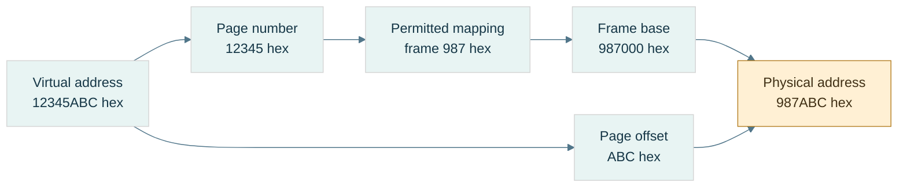

**Read the figure:** assume 4-KiB pages, a present mapping, and permitted access. Replace the page identity with its physical frame identity and retain the low 12 offset bits. The arithmetic is $\mathtt{0x987000}+\mathtt{0xABC}=\mathtt{0x987ABC}$. **Limit:** frame 987 is an example mapping, not a prediction about a real process. A TLB caches translations; the data cache holds contents. Neither this translation nor a mapped address establishes C++ object lifetime or valid typed access.

### A fault is a request for intervention, not necessarily a crash

A [[Page faults and demand paging|page fault]] means the current translation/protection state cannot complete the access normally and requires operating-system handling. **Demand paging** supplies backing when first needed. A valid first access may allocate a zero-filled page or load file-backed data, then retry the instruction. Some faults require no disk I/O.

[[Copy-on-write]] lets mappings initially share data; a write that needs a private copy can fault, allocate/copy a frame, update permissions/mapping, and retry. In contrast, an unmapped address or forbidden write may be rejected and reported as a program failure.

Trace the distinction:

```text
access virtual address
→ cached translation available? if not, resolve translation
→ mapping present and access permitted? complete access
→ otherwise invoke fault handling
→ legitimate demand/COW case? establish mapping and retry
→ invalid/prohibited access? report failure
```

This is a teaching model; exact ordering and mechanisms vary. The important separation is **TLB miss ≠ page fault ≠ disk read ≠ program crash**.

[[Memory-mapped files]] connect file-backed storage to a virtual mapping, often lazily. The mapping is not simply “the file in RAM,” and modifying mapped bytes is not automatically proof of crash-durable publication.

### Storage, lifetime, ownership, and placement are different axes

[[Storage duration and object lifetime|Storage duration]] describes how long storage is available. **Object lifetime** describes when a particular object exists in that storage. **Ownership** identifies who is responsible for releasing a resource. **Placement** is where an implementation puts it. They answer different questions.

| Example | Duration / owner | Typical placement, not a language guarantee | Failure to watch |
|---|---|---|---|
| Local scalar | automatic duration | stack slot or register; possibly optimized away | pointer used after lifetime ends |
| Local vector object | automatic object; owns dynamic buffer | small control object separate from allocated elements | reallocation invalidates views |
| Dynamic allocation | lasts until released by owner | allocator-managed region, often called heap | leak, double release, stale pointer |
| Namespace/static object | static duration | data/zero-fill regions when storage is emitted | initialization-order assumptions |
| Thread-local object | thread duration | implementation-managed thread-local storage | use after owning thread/lifetime ends |

A [[Call stack and stack frames|call stack]] conventionally manages nested calls in LIFO order: **last in, first out**. A **frame** holds return information, saved state, spill slots, and some locals. A **spill** is a value stored to memory when it cannot remain in a register. Downward stack growth is a convention, not a universal law. Returning a pointer to a local does not preserve the local's lifetime just because its old bytes remain.

[[Dynamic allocation and heap|An allocator]] divides larger memory regions into blocks for requests with variable lifetimes. **Metadata** is bookkeeping about those blocks. [[Allocator fragmentation|Internal fragmentation]] is unused capacity inside an allocated block: requesting 37 bytes in a 48-byte size class leaves 11 bytes of slack. **External fragmentation** is separated free space that cannot satisfy a particular contiguous request: two free 16-byte holes are not necessarily a usable 24-byte block. Total free bytes alone do not determine allocation success.

[[Static storage and initialization|Static data]] commonly separates initialized writable data from zero-fill regions such as BSS. **BSS** is a conventional zero-initialized-storage region name; the executable need not contain one literal zero byte for every byte that will be zero-filled. Static duration does not mean initialization has no runtime work.

[[Read-only data and code|Text]] conventionally names instruction storage; read-only regions often hold literals/constants. These region names and exact layouts are platform choices. `const` is a C++ access/type constraint, not a command to put every const local in read-only memory. Modifying a string literal is undefined behavior. **W^X**, writable-or-executable policy, restricts mappings that are simultaneously writable and executable; details vary by platform. [[ASLR]], address-space layout randomization, varies mapping locations, so a textbook memory diagram is not a fixed address map.

[[Ownership and non-owning views|A span]] is a non-owning view of elements; it neither copies the buffer nor extends its lifetime. If the owner dies or the vector reallocates, the view can dangle. **Dangling** means it refers to storage/object state no longer valid for that access.

Finally, [[Atomic publication and durability|atomic publication]] makes a replacement visible as one namespace operation under the relevant platform contract. **Durability** means the required data survives a crash under a defined persistence protocol. Correct byte encoding, atomic replacement, and durable storage are three separate checks.

### Memory laboratory and teaching checkpoint

Use the code companion to run three experiments: byte-order round trips including unaligned *byte-buffer offsets*; checked numeric alignment; and reported object offsets/sizes. Unaligned byte decoding is not permission to make misaligned typed accesses.

Then classify these failures before fixing them:

| Observation | First distinction to investigate |
|---|---|
| `0x12345678` comes back as `0x78563412` | byte-order contract |
| An array member becomes misaligned | record stride, padding, ABI |
| A first access faults but then succeeds | valid demand/COW handling |
| A span fails after vector growth | ownership and invalidation |
| A complete file disappears after a crash | persistence protocol, not just serialization |

For a teaching demonstration, draw byte addresses, record padding, and page translation separately before connecting them. Ask the learner to derive the 12-byte record, explain why the page offset stays `ABC`, and distinguish a TLB miss from a fault. Further proof and tested code remain in [[Continuous Notes/Computing Foundations - From Bits to C++ and Systems APIs#M003 - Byte order, layout, and translation|the derivation companion]] and [[Supplementary/Code Snippets#M003 - Explicit byte codecs and checked alignment|the code companion]].

## Bytes become a durable agreement

An object's native bytes belong to one program environment. A file must carry enough agreement for a reader on another day or machine. We separate copying a representation, specifying the external schema, validating a parser, detecting changed content, and interpreting a dump.

### Representation copying and numeric conversion answer different questions

A value is now chosen, but the file needs bits. [[Bit casting and representation|Bit casting]] copies a suitable object representation into another same-sized trivially copyable type; **numeric conversion** asks for a value in a new numeric domain.

On the checked binary32 host, converting `1.0f` numerically to uint32 gives 1. Copying its representation with `std::bit_cast<uint32_t>` gives `0x3F800000`. Neither operation changes the memory address order by itself. Encoding that integer word little-endian gives `00 00 80 3F`; big-endian gives `3F 80 00 00`.

The C++ constraints include matching size and trivially copyable source/destination, but padding, invalid target representations and uninitialized storage still require care. The [bit-cast draft section](https://eel.is/c++draft/bit.cast) is a current working draft; this lab uses a C++23 baseline and fully initialized scalar representations, not arbitrary-class reinterpretation.

Accessing a float through a uint32 pointer does not become valid because the pointer sizes match. Copy bytes using bit_cast or an appropriate memcpy into an existing suitable object; then apply the external byte-order codec. Neither grants arbitrary typed access to a byte buffer.

**Book bridge:** Game Engine Architecture, PDF pages 129–130 (printed 107–108), explains why members must be endian-converted field by field. It also shows older pointer/union-punning techniques. We retain the field-contract insight, not those techniques as a portable modern C++ implementation.

### A file is a promise to a reader you have not met yet

[[Binary format contracts|A binary format contract]] declares field widths/order, integer signed interpretation, byte order, float format, valid values, lengths, padding, versioning, and any integrity coverage. An **ABI** tells compiled components how native objects interact; an external schema is a different agreement. Saving a whole struct makes its layout/padding/platform assumptions part of the file unless you explicitly constrain and validate them.

**Magic** is a fixed identifying byte sequence, not a secret. **Version** selects a declared schema revision. They do not authenticate a sender, detect every payload change, or validate dimensions. A **payload** is the represented content after or within the container's metadata. A file's offsets are positions in that byte sequence, not automatically live pointers.

The NanoQuant source excerpt describes a regular tensor header with eight magic bytes, uint32 version, uint64 rows and uint64 columns: 28 bytes when written field by field. Its scalar helper writes native bytes, and its payload writes native floats. This is a source-reported portability risk, not a fresh audit of the repository. A clear field order can coexist with unspecified cross-endian behavior.

A portable teaching format can explicitly choose little-endian integers and IEEE binary32 words. It must additionally state whether it preserves all zero/NaN encodings or canonicalizes them. A checksum/hash over bytes sees different NaN payloads as different content; a numeric equality policy can see two zeros as equal. Decide the identity contract first.

For an INT4 container, the source reports 52 header bytes followed by binary32 scales and packed codes. Verify scale count against dimensions/group size, code count against shape, finite positive scales where required, and the final padding convention. A magic match is not permission to trust every following field.

### Validate lengths before performing the arithmetic they request

[[Checked binary parsing|Parsing]] is interpreting an encoded sequence under a schema. An untrusted file can contain dimensions chosen to make a size calculation wrap. “Check the final size” is too late if you computed the wrong wrapped size.

For uint64 factors $a,b$, validate $a=0$ or $b\le\mathrm{MAX}/a$ before multiplying. For a byte span of size $L$, check $o\le L$ and $n\le L-o$ before a read. For payload bytes $P$ after header $H$, first require $H\le L$, then compare $P$ with $L-H$. Check representability in size_t and a practical resource limit before allocating.

A declared maximum tensor size is a **resource limit**: a policy limiting memory/time even if the mathematical shape fits uint64. Reject zero dimensions if the format disallows them. Decide whether trailing bytes are an error, an extension, or another record; the teaching parser requires exact length.

A file mapping avoids a copying decode loop only when its representation, alignment, bounds, permissions and object-access/lifetime rules permit that use. Offset 28 being divisible by four addresses only one condition under a conventional page-aligned mapping and four-aligned float. It does not alone create a C++ float array, normalize endianness, validate its length, or extend the mapping's lifetime.

### Correct decoding is not proof that the bytes survived

[[Checksums CRCs and hashes|Integrity]] asks whether content matches a declared reference. An additive checksum $\sum_i b_i\bmod256$ cannot distinguish `01 02` from `02 01`; equal and opposite byte changes also cancel.

A **CRC**, cyclic redundancy check, treats a bit sequence as coefficients of a polynomial over **GF(2)**, the two-element field where addition/subtraction are XOR. Dividing a shifted message polynomial by a generator leaves a remainder. A specified CRC includes polynomial, initialization, bit reflection/order, final XOR, and covered byte range. “CRC32” alone is incomplete. Error-detection guarantees depend on those parameters and message length; it is not an adversarial authentication mechanism.

The lab implements CRC-32/ISO-HDLC: reflected polynomial `0xEDB88320`, initial all ones, final XOR all ones, reflected byte processing. The independent check string `123456789` must give `0xCBF43926`. [RFC 1952's CRC sample](https://www.rfc-editor.org/rfc/rfc1952#section-8) provides an independent algorithm reference for this reflected convention. This is an error-detection demonstration; no CRC field is retroactively claimed to exist in NanoQuant's source format.

A **hash** maps content to a fixed-size digest. Noncryptographic hashes prioritize fast useful fingerprints; a **cryptographic hash** has security goals such as making preimage/collision search impractical. A **preimage** is an input producing a specified digest. A **collision** is two different inputs with the same digest. A **threat model** declares which mistakes or adversary actions the system intends to resist.

[[Integrity and authenticity|Even a cryptographic digest is not authenticity]] by itself if an attacker can replace both file and digest. A trusted digest, a **MAC** (message authentication code under a secret key), or a **digital signature** verified under a trusted public key supplies an additional trust mechanism. SHA-256 is defined in [NIST's Secure Hash Standard](https://csrc.nist.gov/pubs/fips/180-4/upd1/final); this lab does not implement a cryptographic hash, MAC, or signature.

All finite digests have collisions for unrestricted input lengths: there are more possible messages than digest values. For an ideal $h$-bit hash, a *specific independent* accidental match has probability about $2^{-h}$; among many samples, birthday-style collision risk grows with the number of pairs. Those are models, not guarantees for arbitrary checksum algorithms.

Specify coverage: payload only, header plus payload, or canonical logical content. If dimensions are unprotected, a changed shape can reinterpret an unchanged payload. State how the digest field itself is excluded or zeroed for calculation. Integrity, schema validity, semantic correctness, authenticity, atomic publication and crash durability remain separate questions.

### Read a dump by reversing the contract

[[Memory dump interpretation|A hex dump]] displays byte offsets, hexadecimal octets, and optionally printable characters. It does not label a region as an object or prove that typed access would be legal. Establish a trusted schema hypothesis, validate it, then decode.

Our source-shaped demonstration chooses explicit little endian and a 2×3 binary32 payload $[1,-2,0.5,3.25,0,10]$:

| Offset | Bytes | Interpretation under this schema |
|---|---|---|
| 0000 | 4E 51 54 4E 53 52 30 31 | ASCII magic NQTNSR01 |
| 0008 | 01 00 00 00 | uint32 version 1 |
| 000C | 02 00 00 00 00 00 00 00 | uint64 rows 2 |
| 0014 | 03 00 00 00 00 00 00 00 | uint64 columns 3 |
| 001C | 00 00 80 3F | word 3F800000, value 1 |
| 0020 | 00 00 00 C0 | word C0000000, value −2 |
| 0024 | 00 00 00 3F | word 3F000000, value 0.5 |
| 0028 | 00 00 50 40 | word 40500000, value 3.25 |
| 002C | 00 00 00 00 | positive zero |
| 0030 | 00 00 20 41 | word 41200000, value 10 |

Header length is 28 (hex 1C), payload length $2(3)(4)=24$, and total length 52 (hex 34). ASCII, American Standard Code for Information Interchange, maps these selected byte values to characters; it is not a universal text decoder for every file.

Decode the first payload word: sign 0, exponent 127, fraction zero give $1\cdot2^0=1$. For `40500000`, exponent 128 gives scale two; fraction gives $1.101_2=1.625$, so value is 3.25. For `41200000`, exponent 130 and significand 1.25 give 10. All six payload values can be checked independently against the diagram.

The same `00 00 80 3F` bytes are unsigned octets [0,0,128,63], little-endian uint32 1065353216, or binary32 1. As two little-endian uint16 fields they give [0,16256]. None is “the meaning” without an interpretation contract.

Flip payload byte 80 to 00: binary32 1 becomes 0.5 while file length, version and magic stay plausible. Structural validation does not detect this numeric substitution. An independently stored CRC over the original bytes distinguishes this particular change, but matching CRC is not proof that every possible corruption or attack was excluded.
## The complete journey - Encode, compute, store, and investigate

Return to the lamp at the beginning. Its physical ranges became a logical bit; a group of bits acquired a schema. A count became an unsigned integer, a direction needed signed values, and fractions forced a choice between a fixed and stretching ruler. Arithmetic exposed finite range, rounding and sensitivity. Smaller codebooks traded recoverable detail for storage. Placement then added addresses, alignment, mappings and lifetime. Serialization made an external promise; integrity and debugging let us investigate whether that promise survived.

Take one weight −3.2 at scale one. Quantization chooses signed level −3, offset coding gives nibble 5, pairing with code 11 gives byte B5. A file must also preserve the scale, shape, packing order and count. The parser validates these, unpacks 5 and 11, subtracts eight, and reconstructs −3 and 3. Packing and parsing can be exact while the original −3.2 is not recovered. That loss happened upstream, by design.

For teaching, reconstruct one route completely before comparing it to another. Use the diagrams and hand traces here, the derivation companion for proofs, and the code companion for observable checks. The coverage ledger records where source material came from; it is not the order in which someone must teach.

### A laboratory that tests the contracts, not just matching functions

The cumulative program retains the earlier fields, ALU, byte-layout, floating representation and arithmetic experiments. Its new laboratory adds:

- Fixed conversion of 3.25 to raw 212992; feasible range/step choices; positive/negative ties; multiplication/division, zero-divisor and destination-overflow rejection.
- INT4 nibble pairs against independent expected bytes, odd counts and invalid codes; group reconstruction and outlier-induced zeros.
- UNORM/SNORM endpoints; binary16 decoding; BF16 midpoint conversion, zeros, infinities and canonical NaN handling.
- The complete 52-byte 2×3 image against a manually specified byte array, decode from an odd byte-buffer offset, and raw special-value word preservation.
- Wrong magic/version, truncated files, enormous wrapped-shape attempts, zero dimensions, resource-limit rejection and trailing bytes.
- CRC check string, additive-checksum collision, and the one-payload-bit example that structural checks miss.

Property-style checks supplement these examples: all 256 nibble pairs; every finite binary16 and BF16 word reconstructed/re-encoded under the lab's stated conventions; a seeded set of fixed products checked against an independent reference; and bit/byte corruption checks on the finite teaching image. Their finite scopes are explicit; they are not exhaustive validation of every C++ program, device, parser or cryptographic protocol.

### Diagnose the layer before changing the implementation

| Observation | First hypothesis to test |
|---|---|
| A count becomes negative when its high bit changes | signed versus unsigned interpretation |
| Fixed multiplication fails only at large operands | intermediate width before rescaling |
| Small weights vanish beside one outlier | calibration/codebook resolution, not packing |
| Byte 128 samples near 0.502 | expected UNORM8 reconstruction |
| A half-format value becomes infinity | range versus precision allocation |
| Repeated updates disagree | rounding tree, persistent narrowing, or mathematically history-dependent policy |
| A file swaps 12345678 into 78563412 | byte-order mismatch |
| A plausible same-size file contains a changed value | integrity coverage, not merely structural validation |
| A pointer reaches mapped memory but is invalid | object bounds, lifetime, alignment and permitted access |

A useful future experiment changes one representation policy while holding input/task constant: vary group size, record actual bytes including metadata, error metrics and a task result, then separately measure execution time under a declared machine/build. Those experiments are proposed, not performed in the teaching merge.

The next subject is C++'s object model: how declarations and definitions turn into a program, how names and objects acquire identity, and how lifetimes and value categories constrain use. The bytes learned here are necessary evidence, but they are not the whole language contract.


## Reading provenance and enrichment

The supplied M001–M006 texts define the accepted curriculum content. Explanatory bridges, original traces, and the prologue were added to make that content teachable. Sources below inform the explanation; they are not reproduced as textbook passages. All source-reported repository findings remain source-reported claims; independent wording checks, canonical-code tests and merge corrections are recorded in Sources and Code Anchors.

- **Integrated 180-chunk planning PDF**, page 15: M001–M006 cover Parts 1–100 with exact ranges retained in the coverage ledger. Pages 16–17 divide C++ Parts 101–300 into twelve chunks across two phases. The PDF is a planning reference, not an instruction source.
- **Game Engine Architecture**, iCloud `Game/Game Engine Architecture.pdf`, PDF pages 127–130 (printed 105–108), 136–138 (114–116), and 143–147 (121–125): byte order, memory regions, layout and alignment. Its older machine-specific examples are not universal rules; this volume states layout assumptions and separates language validity from hardware behavior.
- **Bjarne Stroustrup, A Tour of C++ (2014)**, iCloud `CPP/A Tour of C++ - Bjarne Stroustrup (Addison-Wesley, 2014)(193p).pdf`, PDF pages 16–22 (printed 5–11): types, arithmetic, narrowing, scope, pointers and references. Used for teaching structure, not as authority for every current C++23 detail.
- Local course notes **Part 1: CPU — From Electricity to Working CPU**, PDF pages 2–6, and **Part 7: Virtual Memory, Page Tables, TLBs, Page Faults**, pages 1–6, in iCloud `MATHCPUGPU`: secondary background for physical/logical state and translation. These are course notes, not claimed as independently verified textbook authority.
- History: [Computer History Museum's Buchholz entry](https://www.computerhistory.org/tdih/october/24/) and [IBM's System/360 history](https://www.ibm.com/history/system-360). The prologue gives a short contextual history, not an exhaustive claim about the first binary machine or first eight-bit design.
- C++ language checks: the linked draft sections in the story, plus [storage duration](https://eel.is/c++draft/basic.stc) and [endianness facilities](https://eel.is/c++draft/bit.endian). Platform layout values remain observations to measure, not draft guarantees.

Exact source records, code commands and verification limitations are maintained in [[Supplementary/Sources and Code Anchors]]. Existing longer traces remain reusable in [[Supplementary/Worked Traces]]; none is required to supply a missing foundational explanation in this volume.

- **Additional book enrichment:** Game Engine Architecture, PDF pages 121–122 (printed 99–100), and 129–130 (107–108), read during the narrative rewrite. The scaled-integer versus sign/magnitude distinction, field-by-field serialization insight, and outdated punning caveats are explained at their points of use. The page 122 figure/body discrepancy is not silently inherited.


> Volume 02 · accepted sources M007–M010, Parts 101–160 · 4 of 12 planned chunks (M007–M018, planned Parts 101–300). The revised M007 deepens existing coverage; it is not counted twice. This is a growing subject narrative, not a completed C++ course. Coverage beyond Part 160 remains pending.

## Prologue - Bytes need rules before they become a program

The previous volume taught us to encode, calculate, place and preserve information. Now ask why a buffer full of plausible bits can still be illegal to access in C++. Hardware can calculate an address; the language must establish what object exists there, which operation its type permits, and whether its lifetime is still active. A compiler optimizes against those rules, not against our hope that the bits look right.

C++ grew from C's low-level facilities while adding user-defined types and abstraction. It keeps separate compilation: a caller can know an interface without compiling every implementation into the same source file. That choice creates our first problem—how independently processed files agree about names and entities. Once they agree, a second problem begins—how the resulting process creates, uses and destroys objects. Layout is where those two stories finally meet the bytes again.

An **entity** is a language-level thing such as a type, function, object or template. An **object** has storage, type, lifetime and state; a function is an entity but not an object. A **variable** is introduced by a declaration of an object or reference; a reference is not itself an object. A **type** establishes a set of possible values and permitted operations. The **abstract machine** is the language's behavioral model; a real compiler may rearrange or remove physical storage when the required observable behavior is preserved.

This volume keeps independent examples inline. Short `cpp` fragments illustrate a local rule and may rely on the named surrounding declarations; they are not all independent programs to concatenate. Complete runnable examples are explicitly marked as laboratories. Project excerpts remain in the existing companion. We will revise and weave the whole twelve-source volume as the later material arrives; no numbered part is a teaching chapter.

## What we bring from the byte story

this opening chapter assumes M001, M003, and M005. That means I will assume you already understand bits/bytes and integer representations; addresses, alignment, padding, memory regions and virtual address spaces; and floating-point representation/error. The three prerequisite ideas you specifically need active in your head are:

| Dependency | What this opening chapter needs from it |
|---|---|
| M001 | A value ultimately has some machine representation in bits, but the **type** determines what those bits mean. |
| M003 | An address names a location in an address space; objects have alignment requirements; structures may contain padding. |
| M005 | `float`/`double` are machine representations with implementation/platform properties, not mathematical real numbers. |

Now we add the missing layer:

> **C++ is not a language where “variables are bytes in RAM.” C++ defines entities, objects, lifetimes, types, storage, identities and permitted operations. The compiler maps that abstract machine onto bytes and instructions.**

That distinction is the heart of Phase 2.

## The journey from text to a live object

Think of this opening chapter as this pipeline:

```text
SOURCE TEXT
    │
    ├── preprocessing / module dependency processing
    │
    ▼
C++ TRANSLATION UNIT / MODULE UNIT
    │
    ├── declarations establish names and types
    ├── lookup determines what names mean
    ├── definitions provide complete entities
    ├── ODR determines which definitions may coexist
    │
    ▼
COMPILER
    │
    ├── type checking
    ├── template instantiation
    ├── semantic analysis
    ├── optimization
    ├── code/data generation
    │
    ▼
OBJECT FILES
    │
    ├── machine code
    ├── symbols
    ├── relocation records
    ├── static data
    │
    ▼
LINKER
    │
    ├── resolves symbols
    ├── lays out executable sections
    ├── fixes references/relocations
    │
    ▼
EXECUTABLE / SHARED LIBRARY
    │
    ▼
RUNNING PROCESS
    │
    ├── storage becomes available
    ├── objects begin lifetime in that storage
    ├── names/references/pointers may designate objects
    ├── objects have identities and representations
    ├── class layouts determine member locations
    │
    ▼
OBJECT LIFETIME ENDS
    │
    └── storage may disappear OR may remain/reuse
```

The critical distinctions we will maintain throughout the chunk are:

| Concept | Question it answers |
|---|---|
| **Scope** | Where can this *name* be found? |
| **Name lookup** | Given this spelling here, which declaration does it refer to? |
| **Linkage** | Can declarations in different places denote the same entity? |
| **Storage duration** | For how long does the storage exist? |
| **Object lifetime** | During what interval does a typed object actually exist in that storage? |
| **Identity** | Which particular object is this? |
| **Address** | Where is it currently located? |
| **Value** | What state does it currently contain? |
| **Layout** | Where do its members/bytes occur relative to one another? |
| **Module visibility/reachability** | Which declarations can an importer see/use? |

These are **not synonyms**. Most difficult C++ bugs happen because two of them are mentally collapsed into one.

## Giving a program a buildable shape

### Figure CPP-01 - Two build lanes meet at the linker

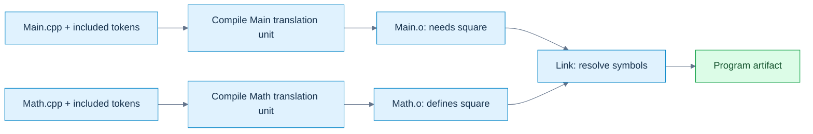

**Read the picture:** the caller compiles against a declaration; the linker connects its unresolved call to the separately supplied definition. A missing declaration/type normally fails during translation; a missing required definition commonly fails at linking. **Limit:** this depicts the traditional example below, not a mandatory compiler implementation. Modules additionally need interface dependency ordering; a successful link does not prove ODR or runtime correctness. [[Visual Recall/02 - C++ - Objects, Ownership and Lifetime - Visual Recall#Four figure briefs|Recall this figure]].

The classic separate-compilation model lets clients compile against an interface while implementations are compiled separately. That sentence sounds elementary. The implications are not.

### The traditional translation model

Suppose you have:

```cpp
// Math.hpp
#pragma once

float square(float x);
```

```cpp
// Math.cpp
#include "Math.hpp"

float square(float x)
{
    return x * x;
}
```

```cpp
// Main.cpp
#include "Math.hpp"
#include <iostream>

int main()
{
    std::cout << square(3.0f) << '\n';
}
```

A simplified build is:

```text
Math.cpp
   │ preprocess
   ▼
Math translation unit
   │ compile
   ▼
Math.o
                         ┐
                         │
Main.cpp                 │
   │ preprocess          │
   ▼                     │
Main translation unit    ├── linker ──> executable
   │ compile             │
   ▼                     │
Main.o                   ┘
```

The classic separate-compilation model lets clients compile against an interface while implementations are compiled separately. Conceptually, commands might look like:

```bash
clang++ -std=c++23 -c Math.cpp -o Math.o
clang++ -std=c++23 -c Main.cpp -o Main.o
clang++ Main.o Math.o -o app
```

The first two commands **compile** independently. The third **links**. That distinction explains two major categories of errors.

### Compile-time error

```cpp
int main()
{
    UnknownType x;
}
```

The compiler cannot establish the semantics of the [[Translation units and linking|translation unit]].

### Link-time error

```cpp
int f(int);   // declaration

int main()
{
    return f(10);
}
```

This can compile perfectly. The compiler knows:

```text
f:
    accepts int
    returns int
```

It can generate a call instruction containing a symbol reference. But if nobody defines `f`, the linker eventually sees:

```text
Main.o needs symbol f(int)
No object/library provides symbol f(int)
```

and reports something like:

```text
undefined reference to f(int)
```

or Apple's equivalent:

```text
Undefined symbols for architecture arm64
```

That is why “my code compiled” and “my program built” are not identical statements.

### What preprocessing actually is

In traditional source code:

```cpp
#include "Math.hpp"
#define COUNT 16
#if DEBUG_MODE
...
#endif
```

these are processed before normal C++ semantic analysis. The [[Preprocessing and macro boundaries|preprocessor]] largely manipulates **tokens**, not C++ types. If you write:

```cpp
#define SQUARE(x) x * x
```

then:

```cpp
SQUARE(a + b)
```

may become:

```cpp
a + b * a + b
```

not:

```cpp
(a + b) * (a + b)
```

The preprocessor does not think:

> “I am invoking a mathematical function.”

It performs token replacement. Even the safer macro:

```cpp
#define SQUARE(x) ((x) * (x))
```

still has:

```cpp
int i = 3;
int result = SQUARE(++i);
```

which expands conceptually into:

```cpp
((++i) * (++i))
```

and now you have duplicated evaluation and undefined behavior here: the two increments are unsequenced relative to each other. Modern C++ tries to move as much work as possible out of the preprocessor and into typed language mechanisms:

```cpp
constexpr int square(int x)
{
    return x * x;
}
```

That gives type checking, scope, debugger visibility, normal evaluation rules, and compiler diagnostics.

### What `#include` really means

A traditional include is approximately textual inclusion.

```cpp
#include "Vector.hpp"
```

does not mean:

> “Dynamically connect to an independently existing Vector interface.”

Conceptually it means:

```text
Take tokens from Vector.hpp
insert them here
continue preprocessing
```

If twenty `.cpp` files include a 20,000-line template header, the frontend may process much of that interface twenty times. This is one major reason C++ build systems became expensive. Header guards:

```cpp
#ifndef VECTOR_HPP
#define VECTOR_HPP

// declarations

#endif
```

or:

```cpp
#pragma once
```

prevent repeated inclusion **within a translation unit**. They do **not** solve program-wide ODR mistakes. That distinction becomes important in the connected explanation.

### What compilation produces

An object file usually contains much more than raw instructions:

```text
.text        machine instructions
.rodata      constants/read-only data
.data        initialized writable static data
.bss         zero-initialized static data, conceptually
symbols      names known to the linker
relocations  places the linker must repair
debug info   when requested
unwind info
metadata
```

Exact sections depend on the object format:

```text
ELF      Linux and many Unix-like systems
Mach-O   macOS/iOS
COFF/PE  Windows
```

The C++ standard does not prescribe those formats. They are platform/toolchain concerns.

### What the linker actually does

Suppose `Main.o` contains a call to `square(float)`. The compiler does not necessarily know the final numerical address of `square`. It can emit something conceptually like:

```text
CALL <square symbol>
```

with a relocation record saying:

```text
When the final binary is laid out,
replace this placeholder with whatever address/offset
square ends up at.
```

The linker builds the final symbol graph:

```text
Main.o:
    requires square(float)

Math.o:
    defines square(float)

resolve
    ↓

Main call → Math definition
```

It also discovers impossible programs:

```text
Main.o needs f()
No definition
```

or:

```text
A.o defines x
B.o defines x
Both claim the same externally-linked entity
```

That second case takes us directly into the ODR.

### Name mangling

C++ supports:

```cpp
void process(int);
void process(float);
void process(const char*);
```

The machine linker does not understand C++ overload resolution. Therefore the compiler commonly encodes type information into symbol names. Conceptually:

```text
process(int)          → some mangled symbol A
process(float)        → some mangled symbol B
process(char const*)  → some mangled symbol C
```

The exact scheme is ABI-specific. This is why two compilers—or two versions configured with incompatible ABIs—can sometimes fail to link even when the C++ source-level declaration “looks identical.” It also explains why `extern "C"` exists:

```cpp
extern "C" void vulkan_callback(...);
```

It selects C language [[Linkage and entity ownership|linkage]], typically suppressing normal C++ name mangling for interoperability. Full C/C++ ABI interoperation comes later, but the root begins here.

## A compiled interface rather than repeated text

A named [[C++ modules and reachability|module]] communicates declarations through a compiler-produced interface. A **module unit** is a translation unit belonging to a module; an **interface unit** supplies its public interface. A **BMI** is a binary module interface: compiler-specific semantic information, not a portable object-file format. It helps the importer compile; an object file supplies code/data for linking. Supplying one does not substitute for the other.

`module;` starts a **global module fragment**, where traditional includes can appear before `export module Math;`. An export declaration exposes declarations to importers. Some implementation details must be reachable for interpreting an exported type or template without becoming freely findable by ordinary [[Scopes and name lookup|name lookup]]. Visibility (finding a declaration) and reachability (using its semantic information) are related, not identical.

A named-module import does not textually paste a header and generally does not import its macros. Header units are different: they can make macros available. Build order must make a suitable compiled interface available before compiling importers. Compiler options and versions must match the toolchain's compatibility requirements. The exact BMI construction and naming are build-system matters; never teach a PCM as a cross-compiler interchange format. The complete standalone Math example appears under **Following one call through the build** below. Project-specific Kairo fragments belong in [[Supplementary/Code Snippets#Source-reported C++ project excerpts|the project excerpt companion]], not in this independent example.

### Modules versus `#include`

This distinction matters enormously:

```cpp
#include "foo.hpp"
```

is essentially preprocessing/textual inclusion.

```cpp
import foo;
```

means the compiler imports a module interface. The importer generally does not receive arbitrary macros from the imported module. That is deliberate. Macros are preprocessing state. Modules try to give you a language-level dependency boundary. This helps with:

```text
build scalability
macro isolation
interface ownership
dependency correctness
ODR hygiene
```

You will study modules much more deeply in the later generic-programming chapters, but this opening chapter gives you the underlying translation reason they exist.

## Promises become definitions

This distinction must become instinctive. Consider:

```cpp
int f(int);
```

This tells the compiler:

```text
There exists an entity named f.
It is a function.
Parameter: int.
Result: int.
```

It does not say how `f` works. That is a **declaration**. Now:

```cpp
int f(int x)
{
    return x * 2;
}
```

This provides the function body. That is a **definition**. And because it also introduces/describes the function, every definition is also a declaration.

### Objects

```cpp
extern int frameCount;
```

declaration only. Somewhere:

```cpp
int frameCount = 0;
```

definition. The definition causes the program to have an object named `frameCount`. An interesting special case:

```cpp
extern int frameCount = 0;
```

Despite `extern`, the initializer makes this a **definition**. Do not memorize `extern = declaration`. Understand the rule.

### Classes

```cpp
struct Renderer;
```

declares an incomplete class type. The compiler knows:

```text
Renderer is a type.
```

It does not yet know:

```text
sizeof(Renderer)
members
alignment
complete layout
```

So this works:

```cpp
Renderer* renderer;
Renderer& getRenderer();
```

because these declarations do not require a complete Renderer. A reference need not be implemented as a separate pointer-sized object. This does not:

```cpp
Renderer renderer;
```

because the compiler must know how much storage the object requires. Later:

```cpp
struct Renderer
{
    int width;
    int height;
};
```

defines it. This is why forward declarations reduce compile dependencies.

### Enumerations

This is legal:

```cpp
enum class TextureState : std::uint8_t;
```

This opaque enum declaration fixes the underlying type and makes the enum a complete type, despite not yet listing its enumerators. Unlike a forward-declared class, its size is already known. Later:

```cpp
enum class TextureState : std::uint8_t
{
    Unloaded,
    Loading,
    Ready,
    Failed
};
```

defines it.

### Templates complicate the old declaration/implementation split

You may think:

```cpp
// Header
template<class T>
T add(T, T);

// cpp
template<class T>
T add(T a, T b)
{
    return a + b;
}
```

works like a normal function. Usually it does not for arbitrary `T`. When another translation unit instantiates:

```cpp
add<float>(1.f, 2.f)
```

the compiler typically needs the template definition available. That is one reason templates traditionally live in headers. Modules give us a better distribution mechanism, but template instantiation semantics still exist. We will go fully into this during the later generic-programming chapters.

## Many files must describe one coherent program

The **[[One Definition Rule|One Definition Rule]]**, ODR, is where declarations, translation units and linking meet. Suppose we allowed:

```cpp
// A.cpp
int gravityScale()
{
    return 2;
}
```

and:

```cpp
// B.cpp
int gravityScale()
{
    return 17;
}
```

and both are meant to be the same externally linked function. Now:

```cpp
gravityScale()
```

has no coherent program meaning. Which definition is *the function*? The ODR prevents this semantic fracture.

### The common program-wide rule

For ordinary non-`inline`, non-template externally linked functions/objects, you want a single program definition. For example:

```cpp
// Renderer.hpp

extern int gFrameIndex;
```

```cpp
// Renderer.cpp

int gFrameIndex = 0;
```

Every user may see the declaration. Exactly one implementation file owns the definition.

### The classic header mistake

Bad:

```cpp
// Config.hpp

int gDebugMode = 1;
```

Then:

```cpp
// Renderer.cpp
#include "Config.hpp"
```

and:

```cpp
// Physics.cpp
#include "Config.hpp"
```

Textual inclusion creates conceptually:

```text
Renderer translation unit:
    int gDebugMode = 1;

Physics translation unit:
    int gDebugMode = 1;
```

Now there are two definitions. Header guards do not save you. They prevent:

```text
Config.hpp
Config.hpp
Config.hpp
```

from being processed repeatedly **inside the same translation unit**. They do not stop a different translation unit from independently receiving the definition.

### Two modern solutions

One traditional solution is:

```cpp
// Config.hpp
extern int gDebugMode;

// Config.cpp
int gDebugMode = 1;
```

A C++17+ solution, when a genuine globally accessible variable is appropriate:

```cpp
inline int gDebugMode = 1;
```

An inline variable may have equivalent definitions in multiple translation units under the ODR rules. Important:

> `inline` in C++ does not fundamentally mean “the CPU call will be replaced by the body.”

That meaning is historical. The optimizer may inline a function without the `inline` keyword and decline to inline one with it. At the language level, `inline` is substantially about **multiple definition semantics and entity identity**.

### Why class definitions may live in headers

The multi-translation-unit exceptions have conditions, not only matching-looking syntax: matching tokens and relevant name lookup must agree, with specified exceptions. Definitions attached to named modules do not simply inherit the traditional header permission. Some ODR violations require no diagnostic; a successful link is not proof of validity.

You have seen:

```cpp
struct Vec3
{
    float x;
    float y;
    float z;

    float lengthSquared() const
    {
        return x*x + y*y + z*z;
    }
};
```

included by many source files. Why does this not immediately violate the ODR? Because the language specifically permits certain entities—such as class definitions, templates, and inline entities—to have matching definitions in multiple translation units under strict conditions. It is not:

> “ODR means literally every C++ definition can occur once in all source text.”

That would make headers impossible. The deep form is closer to:

> The program must maintain **one coherent definition of an entity**, while the language permits certain equivalent definitions to occur in multiple translation units.

### The evil ODR bug: definitions that look like the same header but aren't

Consider:

```cpp
// Behavior.hpp

inline int behavior()
{
#ifdef FAST_MODE
    return 1;
#else
    return 2;
#endif
}
```

Compile:

```text
A.cpp with FAST_MODE
B.cpp without FAST_MODE
```

After preprocessing:

```cpp
// A translation unit
inline int behavior()
{
    return 1;
}
```

versus:

```cpp
// B translation unit
inline int behavior()
{
    return 2;
}
```

The source filename is the same. The effective definitions are not. You have fractured the ODR. Some ODR violations require no diagnostic. That means:

```text
compiler: okay
linker: maybe okay
program: semantically invalid
```

This is one of C++'s nastier classes of bugs.

### Why modules help

A named module interface is compiled as a module interface rather than textually reconstructed independently in every importer. That removes many opportunities for:

```text
same header + different macro environment = different declaration
```

It does not abolish the ODR, but it gives the compiler a stronger semantic module boundary. This is one reason your move toward `.cppm` in Kairo is technically meaningful rather than merely stylistic.

### Linkage is related to ODR, but is not ODR

Traditional example:

```cpp
namespace
{
    int helper()
    {
        return 42;
    }
}
```

`helper` is translation-unit-private. Another old form is:

```cpp
static int helper()
{
    return 42;
}
```

for a namespace-scope function. Modern C++ usually favors unnamed namespaces for TU-private namespace entities. C++20 modules add an additional idea, **module linkage**, for certain names attached to named modules. So do not reduce linkage to:

```text
internal vs external forever
```

because an illustrative codebase is C++23 and module-based.

## A spelling needs a place and a meaning

Lookup comes before overload resolution: first determine which declarations a spelling finds, then choose among viable candidates. A derived `draw(float)` can hide all base overloads named `draw`, including `draw(int)`; `using Base::draw;` restores those base declarations to the derived overload set. A **candidate** is a function considered for the call; a **viable** candidate satisfies the call's argument constraints. Hiding is not the same as overriding.

The name's point of declaration also matters. In a local `int x=x;`, the right-hand name finds the newly declared local, not a hidden outer `x`. In C++23, reading that local's uninitialized integer value is undefined behavior. This is a bad example to diagnose, not execute; different C++26 uninitialized-value wording must not be silently retrofitted into the C++23 lab.

The classic separate-compilation model lets clients compile against an interface while implementations are compiled separately. The easiest mistake here is believing:

> “scope = lifetime.”

No. Consider:

```cpp
int* p = nullptr;

void f()
{
    static int x = 10;
    p = &x;
}
```

`x` has **block scope**. Its name `x` is inaccessible outside the block. But it has **static [[Storage duration and object lifetime|storage duration]]**, so the object persists until program termination. Scope concerns the **name**. [[Object construction and storage reuse]] explains how lifetime differs from backing storage.

### Block scope

```cpp
void render()
{
    int frame = 10;

    {
        int sample = 4;
    }

    // sample unavailable here
}
```

`sample`'s name belongs to the inner block.

### Name hiding

```cpp
int x = 1;

void f()
{
    int x = 2;

    std::cout << x;    // local x = 2
    std::cout << ::x;  // global x = 1
}
```

The local declaration **hides** the outer declaration. It did not delete the global object. It changed what unqualified lookup finds. This distinction is extremely useful when debugging large engine systems.

### Class scope

```cpp
struct Camera
{
    float nearPlane;
    float farPlane;

    float depthRange() const
    {
        return farPlane - nearPlane;
    }
};
```

Unqualified lookup for:

```cpp
nearPlane
```

inside `depthRange()` finds the class member. The compiler effectively understands it relative to the current object, roughly:

```cpp
this->nearPlane
```

although the language semantics are richer than textual rewriting.

### Namespace scope

```cpp
namespace kairo::render
{
    struct Camera {};
}
```

Outside:

```cpp
kairo::render::Camera c;
```

That is **qualified lookup**. Inside a suitable context:

```cpp
using kairo::render::Camera;

Camera c;
```

you've introduced a declaration into consideration for unqualified usage.

### `using namespace` versus using declaration

This:

```cpp
using namespace kairo::render;
```

makes many names candidates during lookup. This:

```cpp
using kairo::render::Camera;
```

specifically introduces `Camera`. The second is usually less polluting. Putting a broad using-directive in a public textual header alters consumer lookup. Module exports and reachability are not textual inclusion: do not claim every directive in a module automatically leaks into every importer. Prefer narrow declarations and explicit qualification at public boundaries.

### Argument-dependent lookup — ADL

Suppose:

```cpp
namespace math
{
    struct Vec3 {};

    float Dot(Vec3, Vec3);
}
```

Then:

```cpp
math::Vec3 a;
math::Vec3 b;

float d = Dot(a, b);
```

may find `math::Dot` even though you did not write:

```cpp
math::Dot
```

Why? Because arguments belong to namespace `math`, and **argument-dependent lookup** considers associated namespaces/classes. This is central to idiomatic generic C++. For example, this pattern:

```cpp
using std::swap;
swap(a, b);
```

allows normal lookup to see `std::swap` while [[Argument-dependent lookup|ADL]] can discover a type-specific `swap` in the type's own namespace. We will revisit this deeply during templates because template name lookup creates another dimension: some names are looked up when the template is defined, while dependent names may participate in lookup at instantiation.

### Modules add visibility/reachability, not a replacement for scopes

Your module contains:

```cpp
export module Kairo.ECS.Entity;

export namespace kairo::ecs
{
    struct Entity { ... };
}
```

Then a consumer can:

```cpp
import Kairo.ECS.Entity;

kairo::ecs::Entity e;
```

There are two separate questions:

```text
Is Entity exported/reachable from this module?
```

and:

```text
Given "kairo::ecs::Entity", which declaration does lookup find?
```

Modules affect availability. Scopes and lookup still determine meaning.

## A name does not decide how long storage lasts

Now we enter the part of C++ that unlocks pointers, RAII and ownership. **Storage duration is about storage.** It answers:

> How long is the region capable of containing this object retained?

The four major categories are:

| Storage duration | Typical source | Lifetime of storage |
|---|---|---|
| automatic | ordinary block local / parameters | associated block/call execution |
| static | namespace objects, local `static`, static data members | entire program |
| thread | `thread_local` — [[Thread-local storage]] | duration of the corresponding thread |
| dynamic | allocation functions / `new` | until explicitly released |

Do not automatically translate those into:

```text
automatic = stack
dynamic = heap
```

Those are common implementation strategies. The language specifies **semantics**, not a mandatory physical memory architecture.

### Automatic storage duration

```cpp
void update()
{
    Entity e;
}
```

`e` normally has automatic storage duration. A typical implementation reserves its storage in the function's stack frame. Conceptually:

```text
enter update
    reserve/identify storage for e
    construct e
    use e
    destroy e
    storage ceases to be reserved for e
leave update
```

The optimizer can eliminate the physical stack slot altogether if observable program behavior remains equivalent. So saying:

> “A local variable is on the stack”

is often practically useful, but **not the C++ semantic definition**.

### Static storage duration

Namespace object:

```cpp
int frameCount = 0;
```

has static storage duration. So does:

```cpp
void f()
{
    static int calls = 0;
    ++calls;
}
```

The *name* `calls` has block scope. The *storage* persists for the whole program. The local static is initialized the first time execution reaches its declaration, unless it can undergo earlier initialization under language rules. Since C++11, initialization of a function-local static is synchronized: concurrent first calls do not independently construct multiple copies. That makes patterns like:

```cpp
Renderer& renderer()
{
    static Renderer instance;
    return instance;
}
```

much safer than they were historically. But it does not solve every architectural problem with global state.

### The static initialization order problem

Suppose:

```cpp
// A.cpp
Renderer renderer{device};
```

and:

```cpp
// B.cpp
Device device;
```

If `renderer` needs `device` during dynamic initialization, their initialization order across translation units can be problematic. This is the classic **static initialization order fiasco**. A function-local static can defer construction until actual use:

```cpp
Device& device()
{
    static Device d;
    return d;
}
```

But in engines, an even cleaner design is often explicit ownership:

```text
Engine
 ├── Device
 ├── Renderer
 ├── AssetSystem
 └── PhysicsWorld
```

with deterministic initialization and shutdown order. This will come back hard during RAII and engine architecture.

### `constinit`

C++20 provides:

```cpp
constinit int value = 42;
```

`constinit` requires static initialization. It is useful when you care about avoiding dynamic initialization ordering. Do not confuse it with `const`. This is valid conceptually:

```cpp
constinit int counter = 0;

void increment()
{
    ++counter;
}
```

`counter` can still be mutable. `constinit` concerns initialization timing.

### Thread storage duration

```cpp
thread_local int commandBufferIndex = 0;
```

Each thread gets its own instance. Conceptually:

```text
Thread A:
    commandBufferIndex_A

Thread B:
    commandBufferIndex_B

Thread C:
    commandBufferIndex_C
```

This can be useful for:

```text
per-thread allocators
scratch arenas
profiling state
temporary command-building state
thread-specific random engines
```

But it is not automatically free. TLS access has ABI/runtime costs, and thread-local destructors/initialization can complicate shutdown.

### Dynamic storage duration

```cpp
Entity* p = new Entity{};
```

There are **two objects to reason about**:

```text
p
└── pointer object
    automatic storage duration

*p
└── Entity object
    dynamic storage duration
```

This is one of the first mental separations I want permanently burned in:

```text
pointer lifetime != pointed object's lifetime
pointer storage != pointee storage
```

Then:

```cpp
delete p;
```

ends the `Entity` lifetime and releases its dynamically allocated storage. But:

```cpp
p
```

may still physically contain the old address. The pointer object itself remains alive until its scope ends. Its **value is now dangling**. This is the bridge into the borrowing and invalidation story below.

## Storage is a place; an object is its occupant

This is one of the deepest ideas in C++. Consider a parking space.

```text
storage = the parking space
object  = the particular car currently occupying it
```

You can have:

```text
parking space exists
no car exists
```

or:

```text
parking space exists
Car A lives there
Car A leaves
same parking space remains
Car B arrives
```

The location did not change. The object identity did. That is almost exactly what low-level C++ storage reuse does.

### Raw storage is not automatically a live object of arbitrary type

Consider:

```cpp
#include <cstddef>

alignas(64) std::byte storage[64];
```

You have storage. You do **not** automatically have:

```cpp
Renderer
Texture
Matrix
Entity
```

living in it. Storage has:

```text
address
size
alignment
```

An object adds:

```text
type
lifetime
identity
value/state
language-permitted operations
```

### Construction starts a lifetime

A canonical advanced example:

```cpp
#include <cstddef>
#include <memory>

struct Particle
{
    float x;
    float y;
};

alignas(Particle) std::byte storage[sizeof(Particle)];

Particle* p =
    std::construct_at(
        reinterpret_cast<Particle*>(storage),
        Particle{1.0f, 2.0f}
    );
```

Conceptually:

```text
before construct_at:

storage:
+-----------------------+
| raw bytes             |
+-----------------------+
^
suitably aligned address

no Particle lifetime


after construct_at:

storage:
+-----------------------+
| Particle{x=1, y=2}    |
+-----------------------+
^
Particle object lifetime active
```

Then:

```cpp
std::destroy_at(p);
```

ends the `Particle` lifetime. The byte array's storage itself remains. This exact separation powers:

```text
object pools
arena allocators
std::vector internals
std::optional
std::variant
ECS component storage
small-buffer optimization
allocator implementations
lock-free structures
```

So object lifetime is not academic lawyering. It is an engine programming primitive.

### `new` actually combines operations

When you write:

```cpp
auto* p = new Particle{1, 2};
```

conceptually you get:

```text
1. obtain suitably sized/aligned storage
2. construct Particle in that storage
3. return pointer to the object
```

Similarly:

```cpp
delete p;
```

conceptually performs:

```text
1. destroy object
2. release storage
```

Custom allocators split those steps apart intentionally.

### A dangerous misconception

After:

```cpp
std::destroy_at(p);
```

the bytes may still look exactly like:

```text
00 00 80 3F 00 00 00 40
```

which could encode 1.0f and 2.0f on a little-endian IEEE binary32 target (not a universal byte representation). But the old `Particle` object is dead. The persistence of bytes does not imply persistence of object lifetime. This is why:

> **Memory containing plausible bits does not prove that a live C++ object exists there.**

That principle will explain many undefined behaviors later.

### Lifetime beginning and ending more precisely

For an ordinary class object, lifetime generally begins after appropriately aligned storage exists and its initialization completes. For class objects, lifetime ends when destruction begins or when its storage is released/reused according to the language rules. C++ has advanced exceptions involving:

```text
unions
implicit-lifetime types
allocators
storage reuse
subobjects
placement construction
```

so “constructor begins lifetime, destructor ends lifetime” is a good first model but not the entire standard. In a later lifetime chapter, when we cover placement construction and lifetime restart, we will explore the hard rules such as transparent replacement and the rare situations where `std::launder` enters the picture.

### Modern implicit-lifetime objects

Modern C++ deliberately permits some low-level operations to implicitly begin lifetime for **implicit-lifetime types**, because otherwise routines using allocation/memory blocks would be unnecessarily impossible to express. That does **not** mean:

```text
bytes always automatically become whatever type you cast them to
```

This remains wrong thinking:

```cpp
SomeHugeComplexType* p =
    reinterpret_cast<SomeHugeComplexType*>(randomBytes);
```

A cast changes how an expression is interpreted. It does not magically satisfy every object-lifetime precondition.

## Values, occupants and addresses tell different stories

Two copies of an entity handle are different C++ handle objects, even when their index/generation values identify the same application entity. The handle's own address is not the entity's identity. Conversely, a stable entity identity does not guarantee a stable address for its current component storage. Keep C++ object identity, application identity, and storage location on separate lines of the diagram.

Now distinguish:

```text
value
identity
address
```

Suppose:

```cpp
struct Particle
{
    int health;
};

Particle a{100};
Particle b{100};
```

Their values are equal. Their identities are not.

```text
a:
value = {100}
identity = object A
address = perhaps 0x1000

b:
value = {100}
identity = object B
address = perhaps 0x2000
```

Changing:

```cpp
a.health = 50;
```

changes `a`'s value. It does not turn `a` into a different object. Identity survives ordinary mutation.

### Address is often useful as identity, but is not identity itself

During a normal object's lifetime, its address is often a useful way of designating it. But the general equation:

```text
identity == numerical address
```

is false. Why? Because storage can be reused.

```text
Time t0:
address 0x1000 → Enemy A

destroy A

Time t1:
address 0x1000 → Enemy B
```

Same numerical address. Different lifetime. Different object identity. This is the exact conceptual reason stale pointers are dangerous.

## A handle remembers which occupant was intended

An [[Object identity and generation handles|index-and-generation handle]] stores a slot number and a reuse counter, rather than relying on an address. Slot 42 at generation 7 is not slot 42 at generation 8. An ECS (entity-component system) is a design where entities identify collections of components; the handle identifies a logical entity while component objects may move.

A valid-looking index is not a live entity check. Resolving a handle must check bounds, occupancy and generation against an owning registry. A generation counter eventually wraps; choose a width/reuse policy and document the collision horizon. Handles also need registry ownership: slot 42 in two worlds does not mean the same entity. These are system-identity constraints, not automatic properties of a C++ struct. The source-reported Kairo record is retained separately; the self-contained laboratory below verifies a small illustrative handle.

### Multiple things can even share an address

Several C++ mechanisms weaken “different thing = different numerical address.” A union stores different members over overlapping storage:

```cpp
union U
{
    int i;
    float f;
};
```

Both members begin at the union's address. Only the appropriate active-member/lifetime rules make accesses valid. Empty base optimization can place an empty base subobject at an address shared with other structural parts of a complete object under ABI rules. C++20 also has:

```cpp
[[no_unique_address]]
```

which permits certain empty member subobjects to overlap storage. So a raw address is better thought of as:

> a coordinate in storage, not a complete description of object identity.

### `std::addressof`

C++ permits overloading `operator&`. Therefore:

```cpp
&object
```

can theoretically invoke user-defined behavior. When generic low-level code truly wants the actual object address, use:

```cpp
std::addressof(object)
```

This bypasses overloaded `operator&`. That is a niche tool, but it reveals an important C++ theme:

> Surface syntax and object-model meaning are not always identical.

## Choose a type for its promise, not its familiar size

Native `bool` is a language value type, not a portable one-byte GPU/file field. Use an explicitly defined wire integer encoding, such as zero/one, validate received codes, and convert to bool by a value operation. Do not deserialize arbitrary bytes directly into a bool and assume every representation valid. Similarly, Unicode character types express code-unit intent, not automatic decoding into characters.

`float`, `double` and `long double` do not portably mean binary32, binary64 and binary128. If a protocol needs binary32, check its stated assumptions: size in bytes, CHAR_BIT, numeric_limits precision/exponent properties and representation requirements. `is_iec559` alone does not specify one exact IEEE format. A wire decoder must still establish byte order and valid field interpretation.

Your first machine-level assumption must be destroyed:

> `int` does **not** mean “32-bit integer” in the C++ language.

The major fundamental categories include:

| Category | Examples |
|---|---|
| void | `void` |
| null pointer type | `std::nullptr_t` |
| Boolean | `bool` |
| ordinary character/integer | `char`, `signed char`, `unsigned char`, `short`, `int`, `long`, `long long`, unsigned forms |
| Unicode character | `char8_t`, `char16_t`, `char32_t` |
| wide character | `wchar_t` |
| floating | `float`, `double`, `long double` |
| implementation-defined extended types | implementation/compiler dependent |

### What the standard does guarantee

This is always true:

```cpp
sizeof(char) == 1
```

But the unit of `sizeof` is a **C++ byte**, and a byte is at least 8 bits. Check:

```cpp
#include <climits>

std::cout << CHAR_BIT;
```

Most systems you will use report:

```text
8
```

But:

```text
C++ byte == exactly 8 bits
```

is not a universal language guarantee.

### Integer relative sizes

The language guarantees a nondecreasing capacity relationship roughly:

```text
signed char
   ≤ short
   ≤ int
   ≤ long
   ≤ long long
```

with minimum widths traditionally corresponding to at least:

```text
signed char : 8 bits
short       : 16
int         : 16
long        : 32
long long   : 64
```

Common modern platforms choose more. For example, typical 64-bit ABIs differ:

```text
LP64
    int       32
    long      64
    pointer   64

LLP64
    int       32
    long      32
    long long 64
    pointer   64
```

macOS/Linux commonly use LP64. 64-bit Windows uses LLP64. Therefore this code is broken as a portability assumption:

```cpp
static_assert(sizeof(long) == sizeof(void*));
```

even though it works on one family of systems.

### Exact-width integer types

For binary formats, handles, GPU structs, hashes and network protocols, you commonly want:

```cpp
#include <cstdint>

std::uint8_t
std::uint16_t
std::uint32_t
std::uint64_t
```

A handle can express its fields using these types:

```cpp
std::uint32_t index;
std::uint32_t generation;
```

That gives a clear representation contract:

```text
index      = 32-bit unsigned if uint32_t exists
generation = 32-bit unsigned if uint32_t exists
```

Important subtlety: The exact-width aliases such as `std::uint32_t` are **optional** in the standard. An implementation provides them only if it has a corresponding integer type with exactly that width and required representation constraints. On all mainstream systems relevant to your work, they exist.

### `least` and `fast`

C++ also provides:

```cpp
std::uint_least32_t
std::uint_fast32_t
```

`least` means:

> smallest available integer type with at least that many bits.

`fast` means:

> implementation-selected type intended to be fast while having at least that many bits.

Do not assume:

```cpp
uint_fast32_t == uint32_t
```

Its width can be larger. For serialized formats, use exact-width types when exact width is part of the format. For pure computation, `fast`/native types can sometimes make sense.

### `std::size_t`

`sizeof` returns std::size_t. A container returns its own size_type, commonly size_t for standard configurations; do not make that equivalence a rule for every container. A checked conversion from a serialized count must separately establish representability and a practical allocation/resource limit.

Expressions such as:

```cpp
sizeof(T)
vector.size()
```

use an unsigned size type usually represented by `std::size_t`. Its purpose is not:

```text
some particular 64-bit integer
```

Its purpose is:

> an unsigned integer type capable of representing the size of any object.

On a common 64-bit system it is usually 64-bit. Do not serialize `size_t` directly as a stable file-format field if the format must be portable across ABIs. Use something explicit:

```cpp
std::uint64_t count;
```

and validate conversion into `std::size_t` at runtime.

### `char` signedness

Plain:

```cpp
char
```

is a distinct type from:

```cpp
signed char
unsigned char
```

Whether plain `char` behaves as signed or unsigned for values outside the common positive range is implementation-defined. Therefore don't do protocol arithmetic relying on:

```cpp
char byte;
if (byte < 0) ...
```

Use:

```cpp
std::uint8_t
```

for an 8-bit integer quantity when appropriate, or:

```cpp
std::byte
```

when you mean **raw byte data rather than number**. This semantic distinction is excellent:

```cpp
std::byte header[16];
```

says:

> these are bytes.

while:

```cpp
std::uint8_t samples[16];
```

says:

> these are 8-bit integer values.

### `numeric_limits`

Instead of assumptions:

```cpp
int max = 2147483647;
```

query the type:

```cpp
#include <limits>

auto maxInt = std::numeric_limits<int>::max();
auto minInt = std::numeric_limits<int>::lowest();

auto eps = std::numeric_limits<float>::epsilon();
auto inf = std::numeric_limits<float>::infinity();
```

A handle's invalid-index sentinel can use:

```cpp
std::numeric_limits<std::uint32_t>::max()
```

for `Entity::InvalidIndex`. Good. Representation properties belong to the type, not to folklore.

## Give a domain its own vocabulary

An integer is often too permissive. Imagine:

```cpp
std::uint8_t state;
```

and:

```text
0 = created
1 = destroyed
2 = component added
3 = component removed
```

Nothing prevents:

```cpp
state = 218;
```

Nothing tells readers what `2` means. So C++ provides enumerations.

### Old unscoped enums

```cpp
enum Color
{
    Red,
    Green,
    Blue
};
```

Historically, names such as:

```cpp
Red
Green
Blue
```

enter the surrounding scope. And enumerators readily convert into integral values. That leads to:

```cpp
enum Color { Red, Green };
enum Error { None, DiskFull };

Color c = Red;

if (c == 1)
{
    ...
}
```

or namespace pollution:

```cpp
enum Status { Unknown };
enum Result { Unknown }; // collision
```

### Scoped enums

Use:

```cpp
enum class Color
{
    Red,
    Green,
    Blue
};
```

Then:

```cpp
Color c = Color::Red;
```

not:

```cpp
Color c = Red; // normally no
```

and:

```cpp
int x = Color::Red; // no implicit conversion
```

This is exactly the kind of restriction we want.

## Representation is an intention, not input validation

A useful independent example is:

```cpp
enum class ChangeKind : std::uint8_t {
    Created, Destroyed, ComponentAdded, ComponentRemoved
};
```

Include `<cstdint>` before this fragment. The scoped enum's default underlying type would be `int`; the explicit underlying type requests an eight-bit representation on targets providing that alias. This helps compact records but says nothing about file version, endian order of other fields, or GPU compatibility. In the fragments below, `StructuralChangeKind` means an equivalent enum with these same four enumerators; each fragment is illustrative, not a separate complete program.

### Getting the underlying integer

In C++23:

```cpp
#include <utility>

auto raw = std::to_underlying(
    StructuralChangeKind::Destroyed
);
```

This is better than repeatedly spelling:

```cpp
static_cast<std::uint8_t>(
    StructuralChangeKind::Destroyed
);
```

because the return type tracks the enum's actual underlying type. Earlier code commonly used `std::underlying_type_t<E>`.

### An enum can represent more than just the named enumerators

Never assume deserializing one byte automatically validates:

```cpp
StructuralChangeKind
```

You might receive:

```text
0xC7
```

Your protocol should validate the domain. Conceptually:

```cpp
std::optional<StructuralChangeKind>
decodeChangeKind(std::uint8_t raw)
{
    switch (raw)
    {
        case 0:
            return StructuralChangeKind::Created;
        case 1:
            return StructuralChangeKind::Destroyed;
        case 2:
            return StructuralChangeKind::ComponentAdded;
        case 3:
            return StructuralChangeKind::ComponentRemoved;
        default:
            return std::nullopt;
    }
}
```

The enum gives you type safety **inside a correct C++ program**. It does not sanitize arbitrary external bytes. That matters in game assets, network messages and binary scene files.

### Enum flags

Sometimes an enum represents mutually exclusive states:

```cpp
enum class State
{
    Idle,
    Running,
    Dead
};
```

Sometimes it represents a bitmask:

```cpp
enum class Access : std::uint32_t
{
    None  = 0,
    Read  = 1u << 0,
    Write = 1u << 1,
    Exec  = 1u << 2
};
```

For `enum class` ([[Scoped enums and validated domains]]), bitwise operations do not automatically exist:

```cpp
Access::Read | Access::Write
```

requires operator definitions or explicit underlying conversion. That is good because the compiler forces the API designer to say:

> These enumerators are intentionally combinable.

## Records acquire their initial state

This becomes crucial in engine code because many types are deliberately simple records. Consider:

```cpp
struct Vertex
{
    float x;
    float y;
    float z;
    std::uint32_t color;
};
```

No custom constructor is required to initialize it. You can write:

```cpp
Vertex v{
    1.0f,
    2.0f,
    3.0f,
    0xFFFFFFFFu
};
```

This is **[[Aggregate initialization|aggregate initialization]]**. The language knows how to initialize the constituent elements directly.

### What counts as an aggregate?

For modern C++20/23 class types, the practical rules include no user-declared or inherited constructors, no private/protected direct non-static data members, no virtual functions, and no prohibited virtual/private/protected base-class structure. Instead of memorizing every standard-revision wording change, test actual intent:

```cpp
#include <type_traits>

static_assert(std::is_aggregate_v<Vertex>);
```

That is the professional approach. The precise aggregate definition evolved across C++ versions.

## Similar braces can invoke different mechanisms

A record with public members, default member initializers and member functions can still be an [[Aggregate initialization|aggregate]]. For example, the laboratory's `ResourceHandle` has no user-declared constructor, and its `{42,7}` initialization initializes its two non-static fields. A static constant does not become a per-object aggregate element. Contrast `struct Vec { float x,y,z; Vec(float a,float b,float c):x(a),y(b),z(c){} };`. Its user-declared constructor makes it non-aggregate in C++20/23. `Vec{1,2,3}` selects that constructor. Even a constructor explicitly defaulted on its first declaration is user-declared; do not substitute the older 'no user-provided constructor' criterion for the modern rule. Ordinary methods do not by themselves disqualify an aggregate. Arrays are aggregates too, and aggregate bases precede direct members in element order.

Use `std::is_aggregate_v<T>` when aggregate initialization is an intentional API property. A later added constructor can break designated initialization without changing any field names. Source-reported Entity/Vector contrasts remain examples to verify in the actual project.

### Initialization order

Aggregate elements are initialized in their declaration/order rules, not in arbitrary conceptual order. For:

```cpp
struct Particle
{
    float x;
    float y;
    int lifetime;
};
```

this maps naturally:

```cpp
Particle p{
    10.0f,
    20.0f,
    60
};
```

But positional initialization can become difficult to read:

```cpp
PipelineDesc desc{
    1,
    0,
    true,
    false,
    4,
    1
};
```

What is `4`? What is `1`? Hence C++20 designated initialization.

### Designated initializers

```cpp
Particle p{
    .x = 10.0f,
    .y = 20.0f,
    .lifetime = 60
};
```

Unlike C, C++ requires the designators to respect declaration order. If declaration is:

```cpp
struct Particle
{
    float x;
    float y;
    int lifetime;
};
```

then this is not portable-valid C++ designated initialization:

```cpp
Particle p{
    .lifetime = 60,
    .x = 10.0f
};
```

The order must follow:

```text
x → y → lifetime
```

Also, C++ designators name direct data members rather than supporting all of C's more permissive designated-initialization forms.

### Missing members

Suppose:

```cpp
struct Material
{
    float roughness = 0.5f;
    float metallic  = 0.0f;
    bool doubleSided{};
};
```

Then:

```cpp
Material m{
    .roughness = 0.8f
};
```

leaves the other members to their default member initialization rules. This can make data descriptors very expressive.

### Aggregate initialization and API evolution

Here is a real engineering trap. Version 1:

```cpp
struct Dispatch
{
    std::uint32_t x;
    std::uint32_t y;
    std::uint32_t z;
};
```

Client:

```cpp
Dispatch d{8, 8, 1};
```

Then someone changes the structure:

```cpp
struct Dispatch
{
    std::uint32_t queue;
    std::uint32_t x;
    std::uint32_t y;
    std::uint32_t z;
};
```

Now positional initialization has a changed meaning or fails. Designators make intent clearer:

```cpp
Dispatch d{
    .x = 8,
    .y = 8,
    .z = 1
};
```

But adding/reordering members can still have ABI/layout consequences. Source-level convenience does not imply binary compatibility.

### Braces do more than aggregates

Effective Modern C++ spends substantial attention on this because:

```cpp
T{...}
```

does **not always mean aggregate initialization**. For example:

```cpp
std::vector<int> a(10, 20);
```

means approximately:

```text
10 elements, each value 20
```

while:

```cpp
std::vector<int> b{10, 20};
```

means:

```text
two elements: 10 and 20
```

because `std::initializer_list` overloads receive special preference during braced constructor overload resolution. So braces offer:

```text
narrowing protection
clear default construction
aggregate initialization
initializer-list construction
ordinary constructor calls
```

depending on the type. Never determine semantics from punctuation alone. Ask:

> What initialization mechanism and overload resolution rules apply to this type?

## Public records and protected invariants

This one is simpler syntactically but culturally important. The classic separate-compilation model lets clients compile against an interface while implementations are compiled separately. These:

```cpp
struct A
{
    int x;
};
```

and:

```cpp
class A
{
public:
    int x;
};
```

have the same access semantics. A `struct` can have:

```text
constructors
destructors
virtual functions
private members
inheritance
templates
operators
static members
friends
```

A `class` can be a simple aggregate. There is no language rule saying:

```text
struct = dumb C data
class = real object-oriented object
```

### The other difference: base-class access

With:

```cpp
struct Derived : Base
{
};
```

inheritance is public by default. With:

```cpp
class Derived : Base
{
};
```

inheritance is private by default. Equivalent explicit forms:

```cpp
struct Derived : public Base {};
```

and:

```cpp
class Derived : private Base {};
```

This is the second language-level default difference.

## A convention about promises

Use a struct for an intentionally transparent record; use a class when a public API maintains an **invariant**, a condition that must remain true after each allowed operation. A record with unrestricted public fields cannot promise an invariant that callers can freely violate. These are design choices, not language restrictions: structs can hide members and classes can expose them. Neither keyword alone determines copying, lifetime, allocation, virtual dispatch, or thread safety.

## Bringing the object model back to bytes

An **ABI** (application binary interface) is the target agreement about data layout, symbols and calls. A **stride** is the byte distance between successive records. An **offset** is a member's displacement from a chosen record origin. Internal padding separates members; tail padding completes the record's stride. In C++23, nonzero-size non-variant data members follow declaration order even across access labels; this does not imply no gaps, and it is stronger than some earlier language versions.

Now we finally connect C++ source declarations to actual bytes. Take:

```cpp
struct Example
{
    char a;
    double b;
    char c;
};
```

A beginner imagines:

```text
a : 1 byte
b : 8 bytes
c : 1 byte
--------------
total 10
```

But processors and ABIs have alignment requirements. Assume:

```text
alignof(char)   = 1
alignof(double) = 8
```

A typical ABI may lay it out as:

```text
offset
0       a
1-7     padding
8-15    b
16      c
17-23   tail padding
```

So:

```cpp
sizeof(Example)
```

could be:

```text
24
```

not 10. Why tail padding? Because if you have:

```cpp
Example array[2];
```

then:

```text
array[1]
```

must begin at an address suitably aligned for `double`. If object size were 17:

```text
first object starts 0
next starts 17
```

which would misalign its `double`. Rounding total size to the class alignment allows:

```text
object 0: [0,23]
object 1: [24,47]
```

with proper repeated alignment.

### Typical alignment calculation

For a conventional ABI, a useful mental algorithm is:

```text
offset = 0

for each member:     offset = round_up(offset, alignof(member))     member.offset = offset     offset += sizeof(member)

class_alignment = ABI-selected alignment, often max(member alignments)
sizeof(class) = round_up(offset, class_alignment)
```

This is not the complete C++ standard's universal class-layout algorithm. Bases, empty subobjects, `[[no_unique_address]]`, virtual mechanisms, packing pragmas, bit-fields and ABI choices complicate it. But it correctly explains ordinary POD-like engine structs on mainstream ABIs.

### Reordering members can reduce padding

Assume:

```cpp
struct Bad
{
    char a;
    double b;
    char c;
};
```

Typical result:

```text
24 bytes
```

Reorder:

```cpp
struct Better
{
    double b;
    char a;
    char c;
};
```

Typical:

```text
offset 0-7 : b
offset 8   : a
offset 9   : c
offset10-15: tail padding

size = 16
```

For one object:

```text
8 bytes saved
```

For one million:

```text
~8 MB saved
```

But don't mindlessly reorder public binary formats. Changing member order can alter:

```text
ABI
serialized layout
shader layout
network packet layout
cache packing
debug tooling assumptions
```

Optimization and compatibility can conflict.

### `alignof` and `alignas`

Query alignment:

```cpp
std::cout << alignof(float);
std::cout << alignof(Vec3f);
```

Request stronger alignment:

```cpp
struct alignas(16) SIMDVec4
{
    float x;
    float y;
    float z;
    float w;
};
```

Now:

```cpp
alignof(SIMDVec4) >= 16
```

subject to implementation support. Why do this? Possible reasons:

```text
SIMD load requirements/preference
cache-line separation
GPU-facing ABI structure
atomic/hardware constraint
false-sharing control
```

But over-alignment can increase memory footprint.

### `standard-layout` does NOT mean “packed C struct”

This distinction matters enormously. Check:

```cpp
std::is_standard_layout_v<T>
```

A [[Standard-layout and trivial copyability|standard-layout]] type satisfies a set of structural restrictions intended to preserve useful low-level layout properties. It does **not** mean:

```text
no padding
cross-platform binary stable
same layout on every compiler
GPU-compatible
safe to memcpy into any foreign API
network-serializable
endianness-independent
```

Those are separate properties. The exact formal standard-layout eligibility rules involving base classes have evolved and are complicated enough that production code should query:

```cpp
std::is_standard_layout_v<T>
```

rather than attempting to duplicate the language definition in an illustrative metaprogram.

### `trivially_copyable` is another distinct concept

You can test:

```cpp
std::is_trivially_copyable_v<T>
```

This has to do with whether byte-wise copying can legitimately reproduce object representations under the language's permitted operations. It is not the same as:

```text
standard-layout
aggregate
trivial
```

Think of four independent questions:

| Property | Main question |
|---|---|
| aggregate | Can it use aggregate initialization semantics? |
| standard-layout | Does it satisfy C-like structural layout constraints? |
| trivially copyable | Can object representations be copied bytewise under defined rules? |
| trivial | Are relevant construction/copy/destruction operations trivial? |

Old C++ literature often bundled properties into “POD.” Modern C++ reasoning should use the actual traits you need.

## Adjacent members are not an array

Consider an independent record `struct NamedVector { float x,y,z; };`. Even if size is twelve bytes, every member is a separate subobject. A **subobject** is an object inside another object, such as a member or array element; it has its own type and lifetime constraints.

`(&v.x)[1]` is not valid access to `v.y`. A non-array object is treated as a one-element array for pointer arithmetic: forming `&v.x + 1` can produce its one-past pointer, but dereferencing it as the next float is not permitted. Adding two already leaves that one-element bound. Physical adjacency and standard-layout do not create a float array. This is the source attachment's central project-shaped finding, but here it is a language analysis of an independent representation, not a freshly verified Kairo defect.

A span is a non-owning view over an existing valid range. `std::span<float,3>{&v.x,3}` does not manufacture the missing array. A cast likewise does not create it. Byte inspection, valid array traversal and named-member access are different operations.

### Correct alternatives

If `.x`, `.y`, `.z` syntax is important, retain separate fields and write indexing explicitly:

```cpp
constexpr T& operator[](std::size_t index) noexcept
{
    assert(index < 3);

    switch (index)
    {
        case 0: return x;
        case 1: return y;
        default: return z;
    }
}

constexpr const T& operator[](std::size_t index) const noexcept
{
    assert(index < 3);

    switch (index)
    {
        case 0: return x;
        case 1: return y;
        default: return z;
    }
}
```

For explicit contiguous export:

```cpp
[[nodiscard]]
constexpr std::array<T, 3> ToArray() const noexcept
{
    return {x, y, z};
}
```

If true array semantics are the fundamental representation, instead store:

```cpp
template<typename T>
struct Vector3
{
    std::array<T, 3> values{};

    constexpr T& x() noexcept { return values[0]; }
    constexpr T& y() noexcept { return values[1]; }
    constexpr T& z() noexcept { return values[2]; }

    constexpr T* Data() noexcept
    {
        return values.data();
    }
};
```

Now:

```cpp
Data()[1]
```

really traverses an array. Do **not** “fix” the existing representation by creating:

```cpp
std::span<T, 3>{&x, 3}
```

because the underlying problem remains: `&x` does not designate element zero of a three-element `T` array. A project audit should first establish the current representation, callers and revision before proposing a production change.

### Why the bug often appears to work forever

The ABI probably lays:

```text
x: offset 0
y: offset 4
z: offset 8
```

for `float`. Machine code for:

```cpp
(&x)[1]
```

will calculate:

```text
address(x) + sizeof(float)
```

which numerically lands on `y`. So:

```text
debug: works
release: works
Clang: works
GCC: works
10 million frames: works
```

does not prove defined C++ behavior. Undefined behavior means:

> The C++ language no longer constrains the implementation to the semantics you intended.

That is why language-level validity matters even when the hardware arithmetic “obviously works.” This becomes much more serious when optimizers use alias/lifetime rules to transform code.

### CPU layout is not GPU layout

Your code asserts:

```cpp
sizeof(Vec3f) == 3 * sizeof(float)
```

On mainstream hardware:

```text
Vec3f = 12 bytes
```

Do not conclude:

```text
therefore GPU float3 is always 12-byte stride/alignment compatible
```

GPU-side layout depends on:

```text
API
shader language
buffer category
selected layout rules
alignment rules
packing rules
vertex input declarations
```

For example, a graphics API may let you explicitly describe a vertex attribute:

```text
position:
    format = three 32-bit floats
    offset = 0
stride = whatever CPU vertex stride is
```

while uniform/storage buffer layout may apply different alignment rules. Metal also distinguishes vector packing situations and provides packed representations for cases where you need a tight external layout. So your correct engineering pipeline is:

```text
C++ logical type
      ↓
CPU representation
      ↓
explicit backend upload representation
      ↓
API-described offsets/stride/alignment
      ↓
shader representation
```

not:

```text
standard-layout C++ type
      ⇒ automatically GPU-compatible
```

This matters directly in Vulkan, Metal, Gaussian splatting, mesh upload, skinning and shader parameter code.

### `offsetof`

For standard-layout types:

```cpp
#include <cstddef>

struct Vertex
{
    float px;
    float py;
    float pz;
    std::uint32_t color;
};

static_assert(std::is_standard_layout_v<Vertex>);

static_assert(offsetof(Vertex, px) == 0);
```

You can use offset checks to enforce a binary/API contract. If a shader/upload ABI expects:

```text
position offset 0
color    offset 12
stride   16
```

make those expectations executable:

```cpp
static_assert(offsetof(Vertex, color) == 12);
static_assert(sizeof(Vertex) == 16);
```

Then a layout-breaking code change fails at compile time rather than rendering corrupted triangles. That is exactly how language knowledge becomes engine reliability.

### `#pragma pack` is not a magic optimization

You will sometimes see:

```cpp
#pragma pack(push, 1)

struct Header
{
    std::uint8_t type;
    std::uint32_t length;
};

#pragma pack(pop)
```

This can remove normal padding on supporting compilers. But it is non-standard and can produce misaligned members. Then:

```cpp
header.length
```

may require slower unaligned access or, on some architectures/instruction choices, require special handling. For external binary formats, a better design is often:

```text
read individual fields from bytes
decode endian explicitly
validate values
construct normal aligned C++ object
```

rather than forcing runtime objects to impersonate disk packets.

### Bit-fields

Similarly:

```cpp
struct Flags
{
    unsigned visible : 1;
    unsigned shadow  : 1;
    unsigned dynamic : 1;
};
```

does not give you a portable three-bit file format. Bit-field allocation order and packing details are implementation-defined. They can be useful internally, but for stable formats use explicit masks:

```cpp
std::uint32_t flags;

constexpr std::uint32_t Visible = 1u << 0;
constexpr std::uint32_t Shadow  = 1u << 1;
constexpr std::uint32_t Dynamic = 1u << 2;
```

Now serialization representation is under your control.

## Following an escaped address through time

For this independent trace, use `struct Entity { std::uint32_t Index; std::uint32_t Generation; };` with `<cstdint>`. It is a teaching record, not an import of the Kairo module. The stale dereference shown later is an invalid example to analyze, not to execute.

Take:

```cpp
Entity* escaped = nullptr;

void update()
{
    Entity local{
        .Index = 42,
        .Generation = 7
    };

    escaped = &local;
}
```

Before calling `update`:

```text
escaped object:
    static storage duration
    value = nullptr
```

Enter `update`. Storage for `local` becomes available:

```text
automatic storage
address hypothetically 0x7FF0
```

Initialization completes:

```text
Entity object lifetime begins
identity = Entity object A
address  = 0x7FF0
value:
    Index      42
    Generation 7
```

Then:

```cpp
escaped = &local;
```

Now:

```text
escaped value = 0x7FF0
```

Exit the function. `local`'s lifetime ends. Its automatic storage is no longer reserved for that object. But `escaped` still contains:

```text
0x7FF0
```

That numerical address has not magically become `nullptr`. So:

```cpp
escaped->Index
```

attempts to use an object after its lifetime ended. This is undefined behavior. Later:

```cpp
void somethingElse()
{
    Entity another{
        .Index = 99,
        .Generation = 5
    };
}
```

The implementation might reuse address:

```text
0x7FF0
```

Now the same address may contain a **different object**. That is why:

```text
same address ≠ same lifetime
same address ≠ same identity
```

And it is conceptually the same reason ECS generation counters exist.

## Following one call through the build

Assume:

```cpp
// Math.cppm
export module Math;

export int twice(int);
```

and:

```cpp
// MathImpl.cpp
module Math;

int twice(int x)
{
    return x * 2;
}
```

and:

```cpp
// App.cpp
import Math;

int main()
{
    return twice(21) == 42 ? 0 : 1;
}
```

Conceptually the module interface establishes an exported declaration:

```text
name: twice
type: int(int)
module ownership/reachability: Math
```

`App.cpp` performs lookup and sees the exported declaration. The compiler therefore knows the call is valid and emits code referencing the appropriate function entity. `MathImpl.cpp` provides the definition. At link time:

```text
App object:
    requires twice(int)

Math implementation object:
    defines twice(int)

linker:
    resolve
```

If the definition disappears:

```text
source syntax valid
name lookup valid
type checking valid
compilation valid

link:
    unresolved function definition
```

If two illegal non-inline definitions appear:

```text
meaning itself violates ODR
```

and the linker may catch a duplicate symbol—although not all ODR violations are guaranteed to be diagnosed. The distinction between:

```text
lookup failure
compile failure
link failure
ODR violation
```

is now precise.

## Giving another name to a live object

We now have objects with lifetimes and identities. How can another piece of code work with one without creating a second object? A [[References and aliases|reference]] supplies an **alias**: another way to designate an existing referent. The **referent** is the thing designated; the name of a reference is not the referent's owner.

```cpp
int a = 2;
int b = 9;
int& alias = a;
alias = b;
b = 20;
// a == 9, b == 20; alias still designates a.
```

Read `int& alias = a` as binding, not as a box containing a replaceable address. Read `alias = b` as assignment to the already-bound `a`, not rebinding. The three visible states are `(a,b)=(2,9)`, then `(9,9)`, then `(9,20)`. That trace is more useful than memorizing that references “cannot be reseated.” A pointer, in contrast, is an object storing a pointer value: `int* p = &a; p = &b;` changes which object `p` designates without assigning either integer.

A reference definition normally needs an initializer. `extern int& shared;` is a declaration, not an exception permitting an unbound reference object. Reference members obtain bindings through their containing object's initialization. No well-defined ordinary reference represents an optional null state; obtaining one by dereferencing a null pointer does not manufacture a legitimate “null reference.” Yet references can dangle after their referents die. Required access is not permanent access.

References are not objects. They do not form arrays of references, and there are no pointers to references. `sizeof(alias)` describes the referred-to integer; `&alias` obtains its address. Functions can also be referents. A reference to a pointer, `int*& selected = p`, aliases the pointer object: assigning `selected = &a` reseats `p`. This is different from `int*` pointing at an integer and different again from a reference to that integer.

`std::reference_wrapper<T>` from `<functional>` is a copyable object wrapping a reference-like association, useful in containers. Copying the wrapper does not copy or own the referent. `std::addressof(object)` from `<memory>` gets an actual object address even when a user-defined `operator&` changes the meaning of ordinary `&object`. None of these mechanisms prevents the referent from dying.

Teaching checkpoint: draw the integer objects first, then arrows for the access paths. Which statement changes a value, which changes an arrow, and which creates a new object? That question will also untangle `const` later.

## An expression has a type and a category

A type answers what operations and values an expression supports. A [[Value categories and materialization|value category]] answers how that expression relates to identity and value production. Category belongs to an expression, not permanently to a variable. **lvalue** means an expression identifying a function or object without the expiring-object designation. **xvalue** identifies an object whose resources may be reused. **prvalue** computes a value to initialize an object or supply an operand. The broader family **glvalue** contains lvalues and xvalues; **rvalue** contains prvalues and xvalues. These are overlapping families, not five disjoint boxes.

| Expression, assuming `int x=4; int&& rr=7;` | Category | What to notice |
|---|---|---|
| `x`, `rr`, `*p` when valid | lvalue | Naming `rr` does not automatically consume its referent. |
| `std::move(x)` | xvalue | Still designates `x`; no new integer is created by the cast. |
| `4`, `x+1`, `x++` | prvalue | Produces a value; postfix increment's old value is not the updated object. |
| `++x` | lvalue | The built-in prefix operation designates the updated `x`. |
| call returning `T&` | lvalue | The returned access path has identity. |
| call returning `T&&` | xvalue | Expiring designation does not itself prove lifetime safety. |
| ordinary call returning `T` | prvalue | Produces the result object/value. |

“lvalue means left side of assignment” fails immediately: a const lvalue is not assignable. “rvalue means temporary” fails for `std::move(x)`, which designates an existing object. String literals are lvalue arrays: `"hello"` has type `const char[6]`, including its terminating zero, not a temporary `std::string`.

**Materialization** is the conversion that supplies a temporary object when a prvalue needs an identity-bearing result, for example to bind a reference. Do not teach that every class prvalue must first live in a separate temporary and then be copied: modern C++ can initialize the final result directly. The result-construction story below develops direct construction and optional NRVO.

[[Auto decltype and reference collapsing|decltype]] can expose category without evaluating its operand. For an unparenthesized name it reports the declared type; for a general expression it yields `T&` for an lvalue, `T&&` for an xvalue, and `T` for a prvalue. Thus `decltype(rr)` is `int&&`, but `decltype((rr))` is `int&`. The parentheses remove the special name rule. That distinction is checked against the [draft's decltype rules](https://eel.is/c++draft/dcl.type.decltype).

```cpp
const int n = 3;
auto value = n;          // int: a new object, top-level const dropped
auto& path = n;          // const int&: preserve the referent's constness
decltype(auto) copy = n; // const int: name rule
decltype(auto) borrow = (n); // const int&: expression rule
```

`decltype(auto)` is therefore not “a more precise auto that is always better.” Adding parentheses in a returning function can change a returned value into a dangling reference. An **unevaluated operand** is inspected for language properties rather than executed: `decltype(++n)` still must be well-formed, but a valid `decltype(++x)` does not increment `x`.

Named rvalue-reference variables are lvalues in ordinary use. There is a specific C++23 exception for move-eligible expressions in return contexts; do not extend that special rule to an arbitrary use of `rr`. Later return/copy-elision material will develop it.

## Binding chooses a referent, not always the one you imagined

[[Reference binding and converted temporaries|Binding]] establishes the initial association. For ordinary same-type integers without volatile complications, this is the useful opening matrix:

| Initializer | `int&` | `const int&` | `int&&` |
|---|---|---|---|
| non-const integer lvalue | binds original | binds original read-only | rejected |
| const integer lvalue | rejected | binds original | rejected |
| integer prvalue or non-const xvalue | rejected | binds temporary/original respectively | binds temporary/original respectively |

An rvalue reference to const, `const int&&`, can bind const rvalues too, but is not a general forwarding reference. These rules describe binding; they do not prove that a bound object will survive later use.

```cpp
int count = 10;
const int& live = count;
const double& snapshot = count;
count = 50;
// live sees 50; snapshot still sees 10.0.
```

The second reference needs a `double`, so conversion produces a temporary `double` initialized from the old integer. The temporary, not `count`, is its referent. Conversely, a `Base&` bound to a compatible `Derived` lvalue can designate the original object's base subobject rather than copy it. A **subobject** is an object nested within another, such as a member, base, or array element.

Bit-fields need another distinction. They are members occupying a specified number of bits, not independently addressable ordinary integers. `int&` cannot bind directly to an integer bit-field; a suitable const reference can bind to a temporary holding its value. Updating the original field does not update that copied value. This is conversion/snapshot behavior, not mysterious aliasing.

References also preserve array extent where pointer conversion would lose it:

```cpp
int samples[3]{10, 20, 30};
int (&whole)[3] = samples;
const char (&word)[6] = "hello";
// whole identifies the entire array; word includes the terminating zero.
```

**Array-to-pointer conversion**, often called decay, produces a pointer to the first element in many expression contexts. A reference to an array binds the array instead. Decay is not the assertion that arrays “are pointers.” Their sizes, types, and valid operations differ.

Ask four questions when reading any binding: what type is required, what category is supplied, was a conversion needed, and which actual object became the referent? Then ask how long that object lives.

## A temporary needs an explicit lifetime story

A **full-expression** is an expression not nested inside another expression for the relevant language rules. In these simple statements, its end is the semicolon. Ordinary temporaries are destroyed at that end, after the statement's work. [[Temporary lifetime extension|Lifetime extension]] has specific syntactic rules; it is not an ownership service that follows every alias.

First define this function at namespace scope:

```cpp
const std::string& pass(const std::string& s) { return s; }
```

Then compare these local declarations inside a caller:

```cpp
const std::string& direct = std::string{"kept"};
// The directly bound temporary lives for direct's local lifetime.
const std::string& escaped = pass(std::string{"gone"});
// The temporary dies at this semicolon. Never read escaped afterwards.
```

The call temporarily binds its parameter for the calling full-expression. Returning that reference does not start a second extension. The calling reference is still a path to the same object, whose deadline was already set. Splitting the timeline makes the danger visible:

| Event | Temporary alive? | Access consequence |
|---|---|---|
| construct `"gone"` temporary | yes | parameter may read it |
| return reference from `pass` | yes | result still designates it |
| initialize `escaped` | yes | no transitive extension |
| finish initializer full-expression | no | `escaped` dangles |

Directly binding through permitted built-in member access can extend the containing temporary, as in `const auto& name = Record{"Ada"}.name;` for a suitable public `name` member. Calling a getter that returns `const std::string&` is different: the call result is not that permitted member-access expression. This is why a getter on a temporary needs its own contract.

Aggregate initialization supplies a deliberately sharp laboratory case:

```cpp
struct Holder { const int& value; };
Holder kept{7};  // braces extend the directly bound temporary to kept's lifetime
Holder lost(7);  // C++20+: temporary dies at this statement's end
// Do not read lost.value after its declaration.
auto* heap = new Holder{7}; // temporary dies at this statement's end too
delete heap;              // do not read heap->value; deletion cannot rescue it
```

The `new` expression can keep the holder object alive while its reference member dangles. Allocating the borrower does not allocate ownership of the borrowed object. The brace/parenthesis exception and parameter/new exceptions are specified in [temporary object lifetime](https://eel.is/c++draft/class.temporary).

Never return a reference to a local automatic object. A C++23 function returning a reference directly bound to a temporary also leaves a dangling result; current draft/C++26 rules reject that direct return binding. Do not confuse a newly mandated diagnostic with a newly introduced safety problem. Nor should a compiler warning be treated as a universal lifetime proof.

Lifetime extension is narrowly useful for local work. For transfer across a function boundary, a returned owning value is usually the clearer starting contract. The cleanup and composition story below develops RAII; owning smart-pointer policies remain later depth, not implied by the word “reference.”

## Move permission is not resource transfer

[[Move casts and forwarding references|std::move]] from `<utility>` casts an expression to an xvalue while preserving constness. It does not transfer a resource by itself. `std::move(text);` alone neither clears a string nor creates a destination. A subsequent constructor or assignment chooses an overload and performs whatever operation that type defines.

```cpp
std::string original = "frame";
std::string&& alias = std::move(original); // binding only; original still "frame"
std::string destination = std::move(original); // construction may use a move
// Don't assume original is empty: consult the moved-from contract.
const std::string fixed = "label";
std::string copied = std::move(fixed); // const preserved; usual string copy selected
```

An ordinary `std::string` move constructor requires a non-const rvalue reference; it cannot generally detach the storage of a const source. “Moved-from” does not mean destroyed, universally empty, or universally reusable for every operation. The value-transfer story below develops consumer operations and their contracts. This distinction and the terminology update from older “universal reference” to **forwarding reference** were cross-checked against selected passages in Meyers; see [[Supplementary/Sources and Code Anchors#M008 - Borrowing, categories and const access|Reading record]].

A deduced, cv-unqualified template parameter in `T&&` is a forwarding reference:

```cpp
void inspect(int&) { /* lvalue access */ }
void inspect(int&&) { /* expiring access */ }
template<class T>
void relay(T&& item) {
    inspect(std::forward<T>(item));
}
```

`relay(x)` with an integer lvalue deduces `T=int&`; `relay(4)` deduces `T=int`. The parameter name `item` is an lvalue in the body in either case. `std::forward<T>` restores the category represented by the deduction. Replacing it with unconditional `std::move` would treat even the caller's lvalue as expiring.

**Reference collapsing** removes reference-to-reference combinations formed through deduction or aliases: `&` combined with either `&` or `&&` yields `&`; only `&&` combined with `&&` yields `&&`. It is not permission to write a direct `int& &` declaration. `const T&&`, `std::vector<T>&&`, or `T&&` where the class template already fixed `T` are not this forwarding pattern. `auto&&` often uses similar deduction, but deduction from a braced initializer list is a notable exception, not a generic forwarding argument.

This is a mechanism lesson, not a rule to forward every expression everywhere. An ordinary function taking `Widget&&` has a fixed parameter type. Whether it may consume that object is an API decision; the declaration alone does not perform the consumption.

## A pointer carries an access contract

References gave us required aliases; [[Null pointers and optional access|pointers]] give us stored, reseatable, potentially absent access paths. A **null pointer value** designates no object or function. `nullptr` has type `std::nullptr_t` and converts to null pointer values without pretending to be an integer argument. Overloads `choose(int)` and `choose(int*)` select the integer overload for `0`, the pointer overload for `nullptr`.

```cpp
int* absent = nullptr;
delete absent; // valid: no pointed-to object is destroyed
// delete nullptr; // ill-formed: nullptr_t is not a pointer-to-object type
```

The supplied source's bare `delete nullptr;` was corrected to the typed-pointer form. The [delete-expression rules](https://eel.is/c++draft/expr.delete) distinguish operand type from a valid null operand value. Null's object representation need not be all zero bits. A successful null check proves only absence was excluded; it says nothing about lifetime, bounds, or current ownership.

Ordinary throwing `new T` reports allocation failure with `std::bad_alloc`. A nothrow allocation form can return null for allocation failure, but an exception thrown by `T`'s constructor is a separate matter and can still propagate. `std::optional<T*>` can represent both no stored pointer and a stored null pointer; use two levels of absence only when both have a defined meaning.

`*p` forms an lvalue designating the pointee when permitted. The expression does not itself mean “read its bytes into a value”; a subsequent value conversion can do that. Valid access requires an appropriate live object, type accessibility, alignment, permissions, and an in-range position. A **one-past pointer** marks the end of an array and can participate in allowed traversal/comparison; it is not a dereferenceable element.

For `int values[3]`, the permitted positions formed relative to `values` are offsets zero through three inclusive. `values+3` may be an end marker. `values+4` is already outside permitted pointer formation; the rule does not wait for dereference. Subtraction requires pointers into the same array (including its end) and a result representable in `std::ptrdiff_t`. A non-array object is treated as a one-element array for this arithmetic, not as a license to walk adjacent members.

```cpp
struct Pair { int x, y; };
Pair pair{1, 2};
int* first = &pair.x;
// first + 1 is one-past x, not an authorized pointer to y.
// first[1] is invalid even if a layout report shows adjacent members.
int real[2]{1, 2};
int* end = real + 2; // valid end marker, never dereference it
```

[[Pointer arithmetic and provenance|Provenance]] names the relationship between a pointer value, storage, and the object/path from which it was obtained. Do not replace that relationship with “an integer address that seems plausible.” An available `std::uintptr_t` supports the specified pointer-to-integer-and-back round trip; it does not authorize arbitrary arithmetic, revive a destroyed occupant, or confer access to unrelated storage. WG21's [P3407R1](https://www.open-std.org/jtc1/sc22/wg21/docs/papers/2025/p3407r1.html) is research discussion, not an adopted C++23 rulebook.

`void*` can carry certain object pointers but cannot be dereferenced as an object of unknown type in ordinary C++. A cast supplies a type expression, not a construction or validity proof. Character/byte inspection through `char`, `unsigned char`, or `std::byte` is different from arbitrary typed access; `signed char` is not listed as the general C++ byte-aliasing exception. Inspecting representation does not make an arbitrary byte buffer a live valid `Widget`. Function pointers and member pointers have their own rules; do not assume they share object-pointer representations. A GPU device address is meaningful only under the relevant backend/address-space contract, not automatically dereferenceable by CPU C++.

At the teaching desk, write “non-null,” “mapped,” “aligned,” “in bounds,” “live,” and “correct entity” separately. None is a substitute for the others.

## When a valid borrow stops naming the intended thing

### Figure CPP-02 - A borrow can fail in two different ways

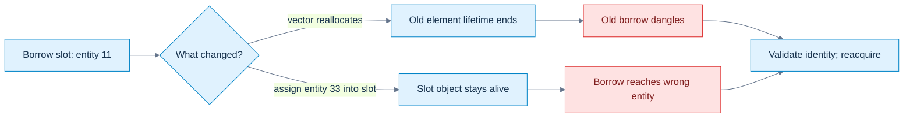

**Read the picture:** a reallocation breaks access to the former element, while swap-and-pop assignment can preserve a slot's C++ lifetime but change its application identity. The examples below show both mechanisms. **Limit:** reacquisition must occur through a currently valid owner/registry under its mutation and synchronization contract; an old pointer cannot validate itself, and a generation check alone does not stabilize a component address. [[Visual Recall/02 - C++ - Objects, Ownership and Lifetime - Visual Recall#Four figure briefs|Recall this figure]].

A **borrow** is a non-owning access path used under an external lifetime and mutation contract. A **dangling** pointer/reference outlives the object it once designated. [[Borrow invalidation and logical identity|Invalidation]] can arise when a container reallocates, removes elements, or changes the association the application intended.

A vector has a control object, a capacity (allocated element slots), and a size (live elements). Exceeding capacity during growth can replace the element buffer. Reallocation invalidates element references, pointers, and iterators; reserving capacity before taking a borrow can avoid reallocation up to that capacity, not forever. The distinction between size and capacity and the reserve guarantee is checked against [vector capacity](https://eel.is/c++draft/vector.capacity).

```cpp
std::vector<int> numbers{10};
int& old = numbers[0];
numbers.reserve(numbers.capacity() + 1); // forces reallocation if successful
// old must not be used. Reacquire through numbers[0].
```

`reserve` protects against a particular growth mechanism, not every erase or structural change. Erasing a vector element invalidates references/iterators at or after the erased position. A swap-and-pop pool can exhibit a different failure: move-assigning the last component into an earlier existing slot can leave that slot object alive while changing which entity its state represents.

```cpp
struct Slot { int entity; int value; };
std::vector<Slot> pool{{11, 100}, {22, 200}, {33, 300}};
Slot* cached = &pool[0];       // intended entity 11
pool[0] = std::move(pool.back());
pool.pop_back();
// cached still reaches the live first Slot, now representing entity 33.
```

| Stage | Slot zero's C++ lifetime | Logical owner | What the old path guarantees |
|---|---|---|---|
| borrow first slot | live | 11 | current access to 11 under present contract |
| assign last slot into first | continues | 33 | access to a live Slot, not the original entity |
| destroy last element | first still live | 33 | no recovery of entity 11's association |

This is **semantic invalidation**, not necessarily a dangling pointer. The last element's old borrow does dangle after its destruction. Reallocation creates yet another failure. Do not label all three “the address changed.” AddressSanitizer can miss the semantic case completely, and allocated vector capacity need not be poisoned when a popped object dies.

[[Object identity and generation handles|Generation handles]] validate logical entity identity through a registry. Two copied handles are two separate C++ objects with equal handle values, potentially identifying the same application entity. A currently valid handle does not prove that an earlier `Component&` survived the pool's subsequent mutations. Entity generation and pool location are separate dimensions.

The source reports KairoECS `Get`, `TryGet`, and `Emplace` borrows into dense vector storage, plus swap-and-pop removal. Those are useful hypotheses for an audit, not independently confirmed repository facts here. The local `Slot` example establishes the mechanism without depending on that project.

For a conservative [[Borrow contracts and pool epochs|pool-epoch contract]], increment a mutation counter on every operation declared to invalidate borrows. A checked borrow records that counter and checks it before accessing the cached element. An **epoch** is a version identifying a permitted observation interval. The pool/epoch object must itself outlive every checked borrow; otherwise even reading the counter is unsafe. Counter wrap, bypassed mutations, concurrent access, and check-then-use races remain policy obligations. An epoch is a debug witness, not an owning pointer or automatic synchronization.

An efficient starting discipline is: acquire the component, perform a narrow operation without structural mutation, discard the borrow, mutate, validate the handle again, and reacquire. Longer-lived component access needs an explicitly stronger storage/ownership contract. “Stable entity IDs” is not that contract.

## Borrowed views and deferred work need an owner story

[[Deferred captures and borrowed views|std::span<T>]] describes a contiguous range with an extent; `std::string_view` describes characters without owning them. A **view** is a descriptor of existing data, not a copy of the data. A span can improve length-aware code, but it does not establish the underlying range's validity or extend lifetime. A view into a local string returned by a function dangles. A reference member in a renderer likewise requires its device to outlive that renderer's use of the device.

```cpp
// Invalid contract: do not call this and use the result.
std::string_view bad_name() {
    std::string local = "Ada";
    return local;
}
// Owning result: the caller receives its own string object.
std::string good_name() { return "Ada"; }
```

A lambda's **closure** is the object storing its captures. `[&]` stores reference-like access to locals; `[this]` captures the pointer to the current object, not ownership of that object. If queued work runs later, returning from the creator or destroying the owner can invalidate those paths. Capturing a `string_view` by value still copies only its descriptor. Capturing an owning string by value supplies a different contract.

```cpp
std::string label = "frame";
auto snapshot_job = [saved = label] { return saved.size(); };
label.clear();
// snapshot_job still owns its independent saved string.
```

Ownership of the closure and scheduling still matter: the callable must itself remain alive when invoked. Capturing a resource handle by value preserves the handle bits, not necessarily resource existence; deferred work may need validation or a lifetime-pinning policy. Smart-pointer ownership and complete scheduling contracts remain future depth.

## Read-only is a path, not an ownership or synchronization promise

[[Const qualification and shallow constness|const]] constrains modification through a type/access path. A const object and a const path to a mutable object are not interchangeable. `const int& view = mutable_int;` prohibits assignment through `view`, but the original mutable access can still update the same integer. Conversely, modifying an actually const object through `const_cast` is undefined behavior. Removing a qualifier is not permission to write.

**Top-level const** qualifies the immediate object described by a type; **low-level const** qualifies an object accessed through a pointer/reference. **Shallow constness** means a const owner containing a pointer does not automatically make the pointee const. `const` does not imply compile-time evaluation: runtime input can initialize a const local. `constexpr` and `constinit` answer different initialization questions.

| Declaration | Reseat pointer? | Modify `T` through pointer? |
|---|---|---|
| `T* p` | yes | yes, if actually mutable and valid |
| `const T* p` / `T const* p` | yes | no |
| `T* const p` | no | yes, if actually mutable and valid |
| `const T* const p` | no | no |

The same principle applies to ranges. `const std::span<int>` makes the descriptor const but still permits modifying its integer elements. `std::span<const int>` gives read-only element access, but mutable aliases elsewhere may still write. Neither owns the integers. A public `const int*` parameter promises a read-only path, not global immutability.

For ordinary by-value parameters, top-level const does not distinguish function signatures: `void f(int)` and `void f(const int)` declare the same function. Pointer-to-const and pointer-to-mutable parameters can distinguish overloads because the pointed-to qualification differs. A reference itself cannot be reseated; a const qualification applied to a reference through an alias does not turn it into a new “const reference object.” Describe constness of its referent instead.

[[Multilevel pointer qualification|Qualification conversions]] are safety rules, not a general permission to sprinkle const into any nesting level:

```cpp
int* p = nullptr;
int** pp = &p;
// const int** unsafe = pp; // rejected
const int* const* safe = pp; // permitted: the intermediate pointer is read-only
```

If the rejected conversion existed, `*unsafe = &actually_const_int` could put a pointer to a const integer into the original mutable `int* p`. Then `*p = 9` would write to a const object through an apparently mutable type. The intermediate const in the permitted conversion blocks precisely that injection. This is why `int*` to `const int*` is safe but `int**` to `const int**` is not. See the [qualification-conversion rule](https://eel.is/c++draft/conv.qual) and [[Continuous Notes/Computing Foundations - From Bits to C++ and Systems APIs#C++ - Qualification safety and borrow intervals|full counterexample]].

`volatile` is not a replacement for a mutex or atomic access. It has specialized observable-access uses; it does not provide a general happens-before relationship or prevent data races. Neither pointer constness nor a const member function proves thread safety.

## An accessor must respect the caller's lifetime

A const non-static member function restricts access to ordinary non-mutable members through its implicit object path. It does not freeze unrelated global state, static members, mutable members, or objects reached by stored pointers. The [non-static member-function rules](https://eel.is/c++draft/class.mfct.non.static) distinguish the object's access qualification from global immutability.

[[Ref-qualified accessors|Ref qualifiers]] constrain the caller's object category: `&` selects persistent lvalue-object access; `&&` selects rvalue-object access. A getter returning a borrow from a temporary is often an avoidable design error. Give a persistent owner a borrowed member path and an expiring owner an owning result:

```cpp
class Named {
    std::string name_;
public:
    explicit Named(std::string name) : name_(std::move(name)) {}
    std::string& Name() & { return name_; }
    const std::string& Name() const & { return name_; }
    std::string Name() && { return std::move(name_); }
    std::string Name() const && { return name_; } // copy from const temporary
};
```

The fourth overload is important. A const temporary cannot use the non-const `&&` overload; without a const-rvalue policy, a `const &` member overload may still give it a dangling borrowed result. Returning a value for both rvalue paths closes that hole. Alternatively delete both rvalue getter overloads and reject such calls. A value-returning getter may still copy a persistent object if that is the desired API; this four-way design is an illustration, not a universal performance rule.

```cpp
Named owner{"persistent"};
const std::string& borrowed = owner.Name(); // owner must survive the use
std::string owned = Named{"temporary"}.Name(); // survives temporary destruction
```

Inside an `&&` member function, the expression `*this` is still an lvalue; `name_` is not automatically moved just because the caller was an rvalue. Explicit `std::move(name_)` makes the consuming intent visible. `std::as_const(owner)` creates a const lvalue path; its rvalue overload is deleted rather than accepting a temporary. An `override` specifier also catches accidental const-signature mismatches in virtual interfaces.

## A cache may change bits without changing meaning

[[Logical constness and mutable caches|Logical constness]] preserves what the object means to its users, not necessarily every private bit. A lazily computed cache may change internally while the represented mesh or polynomial remains the same. `mutable` permits a non-static member to be modified through a const object path; it does not erase its synchronization or invalidation obligations.

**Lazy computation** delays work until a result is requested. **Cache invalidation** removes or versions a cached result when its source changes. An **invariant** is a condition required at the boundaries of the public operations. Here the invariant is that a populated cache agrees with the current source. Protecting only the cache while reading a concurrently changing source does not preserve it.

```cpp
class CachedSquare {
    mutable std::mutex mutex_;
    int source_ = 3;
    mutable std::optional<int> square_;
public:
    void Set(int value) {
        std::scoped_lock lock(mutex_);
        source_ = value;       // caller must keep squaring within int range
        square_.reset();
    }
    int Get() const {
        std::scoped_lock lock(mutex_);
        if (!square_) square_ = source_ * source_;
        return *square_;      // copy result while still protected
    }
};
```

For this small illustration all reads/writes of source and cache share one mutex. A **mutex** excludes overlapping critical sections; **scoped locking** releases it on scope exit, including exceptions. The returned integer is a snapshot, not a reference into a cache that might be reset after unlocking. Expensive computation may require a versioned compute-outside-lock protocol, but that needs validation of the source version before publishing the result. Simply returning `const Result&` under a lock would not make later unlocked reads safe.

`mutable` applies to eligible non-static data members, not reference members or a top-level const member. `mutable const T* pointer` can be valid because the pointer itself is mutable while its pointee path is const. A mutex is not copyable; adding it changes the containing type's default copy/move possibilities. Decide those operations deliberately rather than assuming a cached type remains an ordinary copyable record.

A mutable lambda addresses a different problem: it permits modification of the closure's by-value captures through its call operator. `auto counter = [n=0]() mutable { return ++n; };` increments that closure's private counter, not an external original integer. It gives no automatic thread safety when several threads invoke the same closure.

## Choose the access contract before the parameter syntax

We have enough vocabulary to ask the right next questions. Is this argument a small value to copy, required borrowed access, optional access, a bounded range, or a resource to consume? Does the function return an owning result or a path into someone else's lifetime? These questions precede whether a signature uses `T`, `T&`, `const T&`, `T*`, or `T&&`.

Passing an integer by const reference is not automatically faster than passing its value. Indirection, aliasing restrictions, ABI behavior, and inlining affect generated work. **Aliasing** means several access paths can designate the same object: `update(x,x)` can make two reference parameters interact in a way independent value parameters do not. The [Core Guidelines' input-parameter guidance](https://isocpp.github.io/CppCoreGuidelines/CppCoreGuidelines#f16-for-in-parameters-pass-cheaply-copied-types-by-value-and-others-by-reference-to-const) is design guidance, not a benchmark result. Now we can develop these interface choices into construction, transfer and cleanup policies.

At the board, connect the story: declarations identify entities; storage hosts live objects; expression categories describe uses; binding chooses a referent; lifetime limits the path; mutation may invalidate its physical or logical target; const restricts access; ownership and synchronization remain separate obligations. That is the foundation for reliable interfaces.

### Worked API choice: borrow, consume, retain, or copy a value

A function signature should say whether it borrows access, consumes one owner, or retains shared lifetime. Copying a value is a separate decision from extending an object's lifetime. This self-contained C++20 example demonstrates those choices and a matching deleter for a C file handle.

```cpp
#include <cstdio>
#include <iostream>
#include <memory>
#include <string>
#include <utility>

struct FileCloser {
    void operator()(std::FILE* file) const noexcept {
        if (file) std::fclose(file);
    }
};
using TempFile = std::unique_ptr<std::FILE, FileCloser>;

void inspect_file(std::FILE& file) {
    (void)file; // Borrowed access; this function does not close it.
    std::cout << "inspect: caller still owns file\n";
}

void consume_file(TempFile file) {
    (void)file; // Sink: ownership arrived by value and ends at function exit.
    std::cout << "consume: callee owns file until return\n";
}

void inspect_shared(const std::shared_ptr<const std::string>& text) {
    std::cout << "observe: " << *text << '\n';
    // Borrow the existing handle for this call; do not store a copy.
}

struct Cache {
    std::shared_ptr<const std::string> retained;

    void retain_shared(std::shared_ptr<const std::string> text) {
        retained = std::move(text); // Sink: keep a shared owner after return.
    }
};

int main() {
    // Same value at the start, independent owned strings after copying.
    std::string title = "North";
    std::string copy = title;
    copy[0] = 'M';
    std::cout << "values: " << title << " / " << copy << '\n';

    auto file = TempFile{std::tmpfile()}; // Custom deleter calls fclose.
    if (!file) return 1;
    inspect_file(*file);                   // Borrow FILE&, no ownership transfer.
    consume_file(std::move(file));          // Transfer unique ownership by value.
    std::cout << "caller handle after sink: " << (file ? "full" : "empty") << '\n';

    Cache cache;
    auto shared = std::make_shared<const std::string>("shared lifetime");
    inspect_shared(shared);                 // Borrow the shared_ptr handle by const ref.
    cache.retain_shared(shared);             // Copy into sink, then retain in Cache.
    shared.reset();                          // Cache keeps the object alive.
    std::cout << "cache after caller reset: " << *cache.retained << '\n';
}
```

## The call-site decision

| Need at the boundary | Parameter shape | What the signature communicates |
|---|---|---|
| Read or mutate a live object only during this call | `T&` / `const T&` | Borrow. The caller maintains lifetime and obeys invalidation rules. |
| Consume one exclusive owner | `std::unique_ptr<T>` by value | Sink. The caller passes `std::move(owner)`; the callee owns the cleanup duty. |
| Keep shared lifetime | `std::shared_ptr<T>` by value | Join/retain the ownership group. A copy extends lifetime beyond the call if stored. |
| Temporarily inspect an already shared handle | `const std::shared_ptr<T>&` | Borrow the handle without incrementing the owner count just for parameter passing. Do not store the reference. |
| Release a non-memory resource | Owner plus matching deleter/RAII wrapper | Cleanup follows that resource's protocol; `std::FILE` uses `fclose`, not `delete`. |

An API that only observes data generally should take `T&` or `const T&`, even if some caller happens to own it through a `shared_ptr`. Use a shared-pointer parameter when the function's contract actually depends on shared ownership or transfers/retains that handle. By-value strings illustrate value semantics: the copy owns a separate string value. Two shared pointers, by contrast, can refer into one shared object; copying the handle is not a deep copy of the pointee.

Standard wording matters for edge cases. Standard-library objects are generally valid but unspecified after a move unless the type specification guarantees more; use only operations whose preconditions hold. A user-defined type must preserve its own documented invariant. [C++ draft: moved-from library types](https://eel.is/c++draft/lib.types.movedfrom). Operations on distinct shared-pointer objects may share a control block under specified library guarantees, but this does not synchronize the pointed-to object; mutable access still needs synchronization or immutability. [C++ draft: shared_ptr general requirements](https://eel.is/c++draft/util.smartptr.shared). These corrections address overbroad statements in selected CppCon talks and Q&A; the example is original. The selected full-caption sources were Inbal Levi on smart pointers and RAII, Dave Abrahams on value semantics, Ben Saks on move semantics, and Phil Nash on lifetime management: [Levi](https://www.youtube.com/watch?v=07rJOzFRs6M), [Abrahams](https://www.youtube.com/watch?v=QthAU-t3PQ4), [Saks](https://www.youtube.com/watch?v=szU5b972F7E), and [Nash](https://www.youtube.com/watch?v=aMvIv6blzBs).

## A value crosses the function boundary

Borrowing solves access without duplication. It does not solve ownership of a result that must survive the caller, or independence when one function transforms data. [[Parameter passing and sink contracts|By-value parameters]] supply a separate object initialized from the argument expression. The **argument** is what the caller supplies; the **parameter** is the callee's declared input. Do not replace that distinction with “all calls mechanically copy bytes.” The source's category and the destination type choose how initialization works.

Use an engine-shaped teaching model with no engine dependencies:

```cpp
struct Extent2D { std::uint32_t width=0, height=0; };
struct TexturePayload {
    std::string debugName;
    Extent2D extent{};
    std::uint32_t mipCount=1;
    std::vector<std::byte> pixels;
};
```

An extent is a pair of dimensions; a mip level is a progressively lower-resolution texture level. This record describes CPU data, not a live GPU allocation. `std::string` and `std::vector` own their own storage according to their library contracts. The record itself need not implement manual release. Image format validation is deliberately not implemented by these four fields alone.

For `void receive(TexturePayload payload)`, `receive(existing)` ordinarily copy-constructs the parameter from an lvalue. `receive(std::move(existing))` can move-construct it from an xvalue. `receive(TexturePayload{})` directly constructs the parameter from a same-type prvalue. Changing `payload.debugName` does not change the caller's original string after an ordinary copy. However, a by-value record containing a raw pointer can still designate shared external data: separate outer objects do not prove separate reachable resources.

| Signature shape | Callee gets | Contract to state |
|---|---|---|
| `T value` | separate T object | value semantics; may store/transform its own value |
| `const T& value` | required borrowed path | read-only through this path; no retention beyond validity |
| `T& value` | required mutable borrowed path | in-out operation; aliasing may occur |
| `const T* value` | a copied pointer object | document whether null means absence; otherwise validity required |
| `T&& value` | rvalue-bound borrowed path | permission to consume when the API promises that; not an automatic transfer |
| `std::span<const T>` | copied range descriptor | valid live sequence; no owning lifetime extension |

A **sink** is an operation intended to retain or consume a supplied value. A by-value sink allows the caller to preserve an lvalue by copying or surrender an expiring value by moving:

```cpp
class TextureCache {
    std::vector<TexturePayload> records_;
public:
    void Insert(TexturePayload payload) {
        records_.push_back(std::move(payload));
    }
};
```

If capacity is already sufficient, insertion from an lvalue ordinarily means one copy into the parameter and one move into the element. A directly produced value can initialize the parameter without an intermediate transfer, then move into the element. Growth adds transfer work for old elements; do not omit it from a performance claim. Two overloads, `Insert(const T&)` and `Insert(T&&)`, can avoid the extra parameter-to-destination step but add interface/implementation work. Reusing destination capacity during assignment can favor yet another design. Choose based on semantics and measured workload, not a slogan.

Pointer parameters are themselves passed by value unless the signature says otherwise. `void reset(T* p){p=nullptr;}` resets only that local pointer. `void reset(T*& p){p=nullptr;}` can reseat the caller's pointer. Optional access must say what null does. A declaration `void process(float values[16])` adjusts to a pointer parameter; it does not enforce sixteen elements. A span packages pointer and count but still relies on a valid range. At C/driver boundaries, wrap the documented pointer protocol rather than inventing an ownership guarantee. Portable C++23 has no standard `restrict` keyword; compiler extensions require a real non-aliasing promise.

An alias trace makes the difference concrete. Given `destination += source; source *= 0.5f;`, passing distinct values source4/destination4 yields source2/destination8. Passing the same object to both reference parameters gives 4→8→4. The signature admits this association unless its contract explicitly excludes it; an optimizer cannot assume distinct referents merely because the parameter names differ.

## Return a result without handing out a lifetime problem

[[Return values and copy elision|Return by value]] establishes a result object rather than borrowing a local's expired storage. A **result object** is the object initialized by the value-producing call in the relevant context. Many ABIs let a caller provide destination storage through a hidden address for a large result; that implementation technique is not a mandated layout or calling convention.

```cpp
TexturePayload fallback() {
    return TexturePayload{.debugName="fallback", .extent={1,1},
                          .mipCount=1, .pixels={}};
}
TexturePayload built() {
    TexturePayload result;
    result.debugName="built";
    return result;
}
```

The two returns have different guarantees. Since C++17, an appropriate same-type prvalue directly initializes its destination; there need not be an intermediate object that requires copying or moving. **NRVO**, named return value optimization, is permitted for an eligible non-volatile local object, excluding a function parameter or handler parameter. It can make the named local and result the same object, but is optional in C++23. The optional case still requires a valid fallback. See [copy-elision conditions](https://eel.is/c++draft/class.copy.elision).

```cpp
struct Token {
    Token()=default;
    Token(const Token&)=delete;
    Token(Token&&)=delete;
};
Token direct() { return Token{}; } // valid C++17+: no transfer constructor needed
// Token named() { Token token; return token; } // rejected: unavailable fallback
```

The destructor must still be accessible and usable where required; the result ultimately dies. “No copy required” does not mean “no destruction requirements.” Direct construction also has context limits, such as potentially overlapping subobjects; do not generalize a complete-object example to every base-subobject initialization.

For an eligible local or by-value parameter returned in C++23, implicit-move rules treat the return expression as an xvalue. In ordinary uses a named rvalue-reference variable is still an lvalue; this return context is the special rule already previewed. [P2266R3](https://www.open-std.org/jtc1/sc22/wg21/docs/papers/2022/p2266r3.html) documents that change. Returning a parameter is not NRVO, although it can move. `return std::move(local);` removes the simple named-local NRVO form; prefer `return local;` when applicable. Const on a returned local can prevent destructive moving in the fallback, even if NRVO hides the cost on one compiler.

A reference return answers a different question: where is an existing object? Returning a local automatic object by reference or pointer does not keep it alive. Returning a static object can supply persistent shared access, not a caller-owned independent value; returning a container element inherits container invalidation. Views carry the same underlying-storage obligation. The existing four-way ref-qualified getter handles both mutable and const temporary callers, closing the const-rvalue hole in the attachment's shorter getter example. Likewise, `decltype(auto)` returning `(member)` can preserve a borrowed reference, not an owning result.

Instrumenting transfer constructors can help explain selection, but optional elision can omit observable copy/move side effects. Under direct prvalue semantics there is no hidden transfer to count. Therefore never make required business logic depend on a copy constructor running. Tests below distinguish mandatory assertions from compiler-dependent NRVO observations.

## Construction establishes a usable state

A [[Constructors and invariant establishment|constructor]] initializes the object and establishes its invariant; it is not merely an ordinary method run after a complete object already exists. Before its body, base and member initialization has taken place. A **member-initializer list** is the syntax after the constructor's colon, such as `: name_(std::move(name))`. It is not a `std::initializer_list` container of values.

```cpp
class TextureRecord {
    std::string name_;
    Extent2D extent_;
    std::vector<std::byte> pixels_;
public:
    TextureRecord(std::string name, Extent2D extent,
                  std::vector<std::byte> pixels)
        : name_(std::move(name)), extent_(extent), pixels_(std::move(pixels)) {
        if (!extent_.width || !extent_.height)
            throw std::invalid_argument("zero extent");
    }
};
```

The check establishes only nonzero dimensions, not a complete image schema. A production invariant might additionally relate byte count, format, extent, mip layout, and resource limits using checked arithmetic. This is where values become usable domain objects rather than arbitrary collections of bits.

Assigning `name_` in the body would first initialize the member by some other rule and then assign it. For a class member that can mean default construction followed by replacement; for a reference or const member, body assignment cannot provide the initial binding/value. Prefer direct member initialization for initial state. Allocation supplies storage; construction establishes an occupant, whether in automatic storage, dynamically allocated storage, or an explicitly managed buffer.

A constructor cannot return an error value. It can throw, or creation can be mediated by a factory returning an error-bearing result such as C++23 `std::expected<T,E>` where appropriate. That is an interface choice; `expected` does not make underlying allocations incapable of throwing. Do not register `this` with callbacks or jobs before the intended invariant exists. Other code could observe unfinished state, and construction failure might leave the registration dangling.

Use `explicit` for a single-argument constructor when automatic conversion is undesirable: `explicit Index(std::uint32_t)` supports `Index{3}` but not an accidental integer argument where an Index is required. The complete conversion-overload story remains later depth.

## Empty syntax does not promise initialized members

[[Default and value initialization|Default initialization]] and **value initialization** name language mechanisms, not interchangeable spellings. A default constructor is callable with no arguments; it may have parameters with defaults. An implicitly declared constructor, a first-declaration `=default`, and an empty user-written body need not have identical properties.

| Type and declaration | Mechanism/current state |
|---|---|
| automatic `int n;` | default initialization performs no scalar initialization; do not read before setting |
| `int n{};` | initializes integer to zero |
| aggregate `struct Stats{int uploads;}; Stats s{};` | aggregate initialization gives uploads zero |
| `struct A{int n; A()=default;}; A a{};` | selected constructor is not user-provided; value initialization supplies zero initialization first |
| `struct B{int n; B(){}}; B b{};` | user-provided empty constructor does not initialize n; do not read it |
| `struct C{int n=0; C(){}}; C c{};` | default member initializer supplies zero even with that body |

**Zero initialization** supplies zero/null values according to type; it is not a generic claim that every object's full byte representation is memset-zero. **User-declared** means a declaration was written by the programmer. **User-provided** excludes a function explicitly defaulted or deleted on its first declaration. Thus `A()=default` inside the class is user-declared but not user-provided; declaring `A();` then defining `A::A()=default;` outside counts as user-provided. These terms affect initialization and triviality; they are not decorative vocabulary. The [initialization rules](https://eel.is/c++draft/dcl.init) supply the mechanisms behind the table.

In C++23 an ordinary read of an uninitialized automatic int has undefined behavior. Later language-version distinctions must not be used to justify such a read in this laboratory. Write defaults beside members where they describe an intended state. This does not force every type to have a valid empty domain state: a device-backed object may intentionally require arguments.

`Stats stats();` declares a function returning Stats, not an object. The **most vexing parse** is the family of declaration ambiguities where an intended object declaration is parsed as a function declaration. `Stats stats{};` avoids this case. Likewise `new int` leaves the scalar uninitialized, while `new int()` value-initializes it to zero; neither is a recommendation for manual allocation in ordinary application code.

Braces may choose aggregate initialization or a constructor/initializer-list route; parentheses and braces are not universal substitutes. The earlier reference-member temporary example already demonstrated a lifetime difference. Ask which mechanism the exact declaration selects rather than memorizing that braces make everything zero.

## Construction order records lifetime dependencies

[[Member order and delegating constructors|Initialization order]] is structural: virtual bases when applicable, direct bases in their specified order, non-static data members in declaration order, then the constructor body. Reordering entries after the colon does not reorder construction. The fixed order lets all constructor overloads share a coherent reverse cleanup order.

```cpp
class MeasuredPixels {
    std::vector<std::byte> pixels_; // provider must be declared first
    std::size_t byteCount_;
public:
    explicit MeasuredPixels(std::vector<std::byte> pixels)
        : pixels_(std::move(pixels)), byteCount_(pixels_.size()) {}
};
```

Declaring `byteCount_` first and computing it from `pixels_.size()` would inspect a member before its construction, regardless of the visually reassuring initializer list. Write both declarations and initializers in dependency order; use compiler reorder warnings. A constructor's explicit member initializer overrides that member's default initializer rather than assigning after it.

The same idea handles a staging buffer needing its device during cleanup: declare `Device device_; Buffer buffer_;` so the buffer is constructed after and destroyed before the device. This is a lifetime dependency, not merely an ABI/layout preference. An externally borrowed device still needs its own outliving guarantee.

A **delegating constructor** names another constructor of the same class as its sole member initializer. The target performs base/member initialization and its body, then the delegating body executes. This centralizes validation and prevents defaults drifting between overloads:

```cpp
struct NamedCount {
    std::string name;
    int count;
    NamedCount(std::string n, int c):name(std::move(n)),count(c) {
        if (count<0) throw std::invalid_argument("negative count");
    }
    explicit NamedCount(int c):NamedCount("unnamed",c) {}
};
```

A delegating initializer cannot also initialize selected members. Delegation cycles are ill-formed; the chain must terminate at a constructor that actually initializes the subobjects. These are specified construction rules, not an optimization tactic. See [base and member initialization](https://eel.is/c++draft/class.base.init).

## Destruction closes the ownership interval

A [[Destruction and partial construction|destructor]] performs an object's cleanup. For a fully constructed ordinary automatic class object, leaving its scope triggers destruction, including when an exception unwinds the scope. **Stack unwinding** is that cleanup of active scopes while an exception propagates. Deterministic means tied to a defined lifetime boundary, not a promise that the OS will execute cleanup after abrupt termination or process kill.

The destructor body runs before the member/base destructors. Members are then destroyed in reverse construction order, followed by bases under their rules. If a non-delegating constructor throws, already-completed bases/members are destroyed in reverse order; the complete object's destructor is not invoked. A member whose constructor did not complete is not treated as a fully constructed member either. By contrast, if a delegating target has completed and the later delegating body throws, cleanup can invoke the object's destructor. State which case is being traced rather than asserting “a throwing constructor never invokes its destructor” without qualification. See [constructor exception cleanup](https://eel.is/c++draft/except.ctor).

RAII—resource acquisition is initialization—uses an owning object's lifetime to control a resource's release. Owning vector/string members already demonstrate the principle. A raw pointer data member alone does not run delete automatically: destruction of the pointer object only ends that pointer's lifetime. Explicitly destroying an ordinary automatic object and then allowing its normal destruction without valid lifetime restoration is not a routine cleanup technique.

Cleanup should normally not throw. If an exception escapes a non-throwing destructor, termination follows; a second escaping destructor exception during active exception unwinding also leads to termination. Error-reporting close/flush operations may therefore be separate explicit functions, with the destructor retaining a safe non-throwing fallback. A trivial destructor may require no runtime cleanup, but the object still has a lifetime end.

The inline construction-failure trace below records member1 construction, member2 construction, entry to body, then destruction of member2 and member1. The absent complete-object destructor is the observable distinction. It also records the successful path where the destructor body runs first.

## Copy a meaning rather than just its bytes

[[Copy semantics and resource identity|Copy construction]] creates a new object from an existing same-type object under the selected copy operation. `T b=a;` is initialization despite its equals sign. Generated copying of an ordinary non-union class is memberwise: strings copy strings, vectors copy their elements into destination-owned storage, scalars copy values, pointers copy pointer values, and reference members bind the same referent. It is not a universal memcpy or recursively deep clone.

**Shallow copy** preserves associations to existing resources; **deep copy** duplicates the resources defined by the type's copy contract. Neither is universally correct. Copying an integer texture ID should not clone a GPU texture. Copying an owning CPU pixel value may intentionally produce independent pixel storage. Copying a reference-bearing binding should preserve its alias association. A scene clone may need an old-ID→new-ID mapping so internal relationships and intended sharing survive; blindly recursing through pointers can duplicate shared resources or loop through cycles.

```cpp
TexturePayload original;
original.pixels.resize(4);
TexturePayload independent=original;
independent.pixels[0]=std::byte{7};
// original.pixels[0] is unchanged by this write.
struct Borrowed { TexturePayload* payload; };
Borrowed first{&original};
Borrowed second=first; // two descriptors, one external payload
```

For a raw-memory owner with a destructor calling `delete[] data_`, an implicit pointer copy can create two alleged owners of one allocation and double deletion at destruction. The repair is not simply “write a copy constructor”: decide whether the semantic operation is deep copying, shared ownership with an appropriate owner type, or deleted copying. A type representing unique GPU/OS state may reject copying. Copy-on-write, where sharing persists until a mutation duplicates data, adds hidden allocation, alias invalidation and synchronization costs; it is a deliberate design, not a free deep-copy optimization.

Cross-member invariants need particular care. A generated move of `{extent,pixels}` moves each member appropriately but can leave nonzero source dimensions with a moved-from pixel container. If the class promises a relationship between dimensions and populated bytes for every live state, “the members are individually valid” is insufficient. Either allow/document an empty moved-from domain state, implement coordinated semantics in the responsible owner abstraction, or redesign the invariant. Rule Zero removes boilerplate; it does not prove arbitrary domain relationships.

## Replacing a value is not creating an object

[[Assignment and exception guarantees|Assignment]] changes an already-live target through an assignment operator. Copy assignment normally preserves the source's semantic value while replacing the destination's. Generated assignment uses member assignments rather than constructing a second complete target. Existing vector/string capacity can sometimes be reused, so its cost need not equal new-object copy construction.

```cpp
TexturePayload made=original; // construction
made=independent;             // assignment to an existing object
```

The conventional signature `T& operator=(const T&)` returns `*this`, allowing `a=b=c`. Language copy-assignment forms are broader, but that common shape expresses a reference to the assigned target. Reference members and const scalar members can make generated assignment deleted, even when copying into a new object is valid. A custom assignment through a reference referent is possible only as an explicitly chosen different contract; it does not reseat that reference.

Self-assignment is a real alias case: `x=x`. In a naive raw owner, deleting the destination's old resource before making a replacement loses the original data and rollback state. If the source aliases the destination, later updates to destination metadata also change what `other` sees; an exact implementation might copy from a saved freed address or from its new uninitialized allocation. Neither should be taught as a safe algorithm, but don't claim every ordering gives the same use-after-free trace.

The safer transaction is **prepare → commit → cleanup**. Allocate and copy a replacement while the old value remains intact; only after success replace the owning metadata and release the old allocation. **Copy-and-swap** implements that with a complete temporary copy, a non-throwing swap, and the temporary's destructor releasing the former destination. It handles self-copy and can provide the strong guarantee, but often sacrifices destination-capacity reuse. The byte-owner lab implements this policy and deliberately injects allocation failure before commit.

A **strong exception guarantee** means failure leaves the operation's promised observable state unchanged. A **basic guarantee** preserves valid invariants/no resource leaks while allowing values to change. A **non-throwing guarantee** means the operation cannot report failure by escaping an exception. These are contracts to establish, not decorations added by syntax. Memberwise assignment of several individually safe members does not automatically give an all-or-nothing guarantee for the entire enclosing object.

## A move transfers responsibility while the source survives

### Figure CPP-03 - Move the duty, keep both object lifetimes

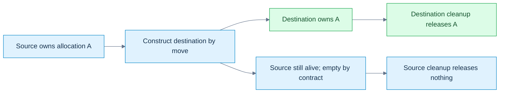

**Read the picture:** this is the manual byte-block contract below: construction creates the destination; ownership moves; the source remains a live, safely destructible empty object. **Limit:** `std::move` alone is a cast, not this transfer. Other types may copy, move inline data, or leave a valid but unspecified source state; move assignment also has an existing destination resource to handle. [[Visual Recall/02 - C++ - Objects, Ownership and Lifetime - Visual Recall#Four figure briefs|Recall this figure]].

[[Move operations and moved-from states|Move construction]] creates a new destination from an expiring source; **move assignment** replaces an existing destination, which may already own a resource needing release. For a pointer-owning byte block, a move can transfer the allocation pointer and size, then set the source to a documented empty state. `std::exchange(source.pointer,nullptr)` returns the old pointer while installing the new source state. That differs from merely copying the pointer and leaving two owners.

| Before/operation | Destination | Source | Lifetime consequence |
|---|---|---|---|
| move construction | new owner takes allocation A | becomes empty under this block's contract | source object remains alive |
| move assignment into owner B | releases B, takes A | becomes empty | both outer object lifetimes continue |
| destruction after move | releases only its current owned resource | empty source safely releases nothing | lifetime ends at normal destruction |

Inside `T(T&& other)`, the named expression `other` is an lvalue in ordinary member-initializer/body use. Move class-type members with explicit intent where needed; copying a scalar size is already cheap. `std::move` preserves const: an ordinary `T(T&&)` cannot bind a const source, so an available `T(const T&)` may be selected instead. A cast without a consumer performs no ownership transfer.

Self-move, `x=std::move(x)`, also needs a documented policy. Our manual block uses an identity guard and preserves its value. Do not demand that every standard-library type preserve its exact old value under self-move; consult its valid-state contract and operation preconditions. A moved-from object is still alive. Standard-library types generally specify valid-but-unspecified states unless they give a stronger guarantee; a user-defined type must implement its own promised invariant. **Unspecified** is not uninitialized or undefined: the value is not promised, but permitted operations still have defined requirements. `empty()` may be a valid query even though you cannot assume its answer; `front()` still requires a nonempty sequence.

For our block, the stronger contract is size0/null after a distinct-object move, plus safe destruction, copying of that empty state and assignment of a fresh value. It avoids traversing a nonexistent range when size is zero. For the earlier texture payload, consult member contracts without asserting the entire source vector/string must have a particular printed value.

Moving is not necessarily constant-time. An inline `std::array<float,N>` still transfers N inline values. Small-string storage may live inside the string object and be copied rather than pointer-stolen. Allocator-aware move assignment may require elementwise work when storage cannot be adopted by the destination allocator. A user-written move can do arbitrary work. Measure bytes, allocations, time and workload—not merely the occurrence of an ampersand.

## Failure guarantees shape the transfer algorithm

[[Noexcept and transfer selection|noexcept]] declares a non-throwing exception contract, not that the function contains no throw-capable instructions. If an exception escapes such a function, termination follows. Mark a move non-throwing only when its actual members/resource policy support that promise.

Container growth must balance transfer cost with rollback. A throwing move might mutate the first source element, then fail on a later one; restoring the original sequence may be impossible. If non-mutating copying is available, an implementation can use it to preserve the required guarantee. `std::move_if_noexcept(x)` selects an access category: it yields a const-reference path when move construction may throw and copying is possible, otherwise an rvalue-reference path. It does not itself transfer anything. See [forward/move helpers](https://eel.is/c++draft/forward).

The spelling is therefore a policy bridge from type properties to an operation's failure guarantee. If copying is impossible, a throwing move remains the available choice and a particular container operation can have weaker exceptional-effect guarantees. Do not teach “vector always gives strong rollback” regardless of type and operation. Neither should a trait-controlled algorithm assume every library implementation must use exactly one named helper internally.

Defaulted moves can derive exception properties from their selected member/base operations when left to the language. Forcing `noexcept` on a defaulted move without checking its subobjects is not automatically an improvement: a throw can terminate. Member composition often lets the compiler propagate the correct behavior. The inline probe checks the helper's return type directly rather than inferring a portable vector strategy from a constructor log.

## Let the compiler compose the operations

[[Special member generation and traits|Special members]] are the default constructor, copy/move constructors, copy/move assignment operators, and destructor. Whether the compiler declares one, whether it is deleted, and whether an expression can use it are three different questions.

| Programmer declaration in an ordinary class | Consequence to check in C++23 |
|---|---|
| no constructor declarations | default constructor can be implicitly declared |
| ordinary/default constructor | does not alone suppress implicit copy/move operations |
| copy constructor or copy assignment | suppresses implicit move generation |
| destructor, including first-declaration `=default` | suppresses implicit move generation |
| move constructor or move assignment | implicitly declared copy operations are defined as deleted unless usable copy operations are supplied explicitly |
| defaulted operation | may itself be deleted because a selected member/base operation is unusable |

This is a practical map, not the complete union/inheritance/constraint rulebook. A reference member can copy-bind, yet generated assignment is deleted. A non-copyable owner member can make the containing object non-copyable. A named constructor being available does not imply all required operations are available. The [copy/move constructor](https://eel.is/c++draft/class.copy.ctor) and [assignment](https://eel.is/c++draft/class.copy.assign) rules govern those details.

`std::is_move_constructible_v<T>` asks whether construction from a `T&&` expression is valid. It does not ask whether the selected constructor's parameter is exactly `T&&`. A class with a user-declared destructor can have no generated dedicated move constructor but still accept an rvalue through `const T&` copying. The trait may be true—and copying may be expensive. Likewise a nothrow trait classifies the valid expression, which could be a non-throwing copy.

An explicitly deleted move constructor can remain the best overload and reject an rvalue even when a copy constructor exists. A defaulted move that becomes deleted has specified ignore rules permitting fallback in relevant cases. “Unavailable move always falls back to copying” is therefore too broad. The diagnostic exercise demonstrates the explicitly deleted case.

First-declaration defaulting can retain triviality and inferred properties that a hand-written equivalent body loses. A **trivial** operation has the specified simple language properties; it is not synonymous with “fast enough in my benchmark.” Trivially copyable, standard-layout, aggregate, and nothrow-movable remain distinct traits. Rule-Zero composition containing vectors does not magically become trivially copyable or serialization-ready.

## From three repairs to five decisions to zero boilerplate

[[Rules of Three Five and Zero|The Rule of Three]] is a design heuristic: if raw-resource semantics require a custom destructor, copy constructor, or copy assignment, consider all three together. It is not a compiler requirement to support copying; explicitly deleting copying can be correct. The Rule of Five adds move construction and move assignment as coordinated decisions after C++11.

The **Rule of Zero** moves ownership responsibility into members whose own operations already match the intended semantics, so the containing class usually needs no custom copy/move/destruction operations. It does not mean “never write a constructor”: ordinary validation or default construction can coexist with composed transfer/cleanup. The texture payload's owning string/vector members and a scalar math record illustrate the approach without requiring a hand-maintained five-function protocol.

The raw owner below is educational infrastructure: its five operations expose the ownership invariant, failure transaction and source-reset contract. Prefer a vector-backed byte value for ordinary application code. A low-level unique resource wrapper may still need custom/deleted operations; then application-level records compose that tested owner instead of repeating resource logic.

[[Relocation versus move|Relocation]] distinguishes transfer plus an ended source lifetime from a move that leaves its source alive until normal later destruction. Container growth often uses move-construction followed by destruction; that pair must not be conflated with a universally legal memcpy of arbitrary nontrivial objects. The attachment discusses proposal-era trivial relocation. Here it is a future/toolchain-dependent research bridge, not a portable C++23 facility or an adopted-language-status claim. Self-references, external registrations and lifetime rules can make a bitwise relocation invalid even when a type's source code looks small.

The design progression is responsibility, not fashion: define the meaning of a copy, define who releases a resource, make failure and self-alias cases safe, supply moves where meaningful, then remove redundant custom code when composition already satisfies those contracts.

## Trace one payload from decode to cache

Assume the cache has reserved enough capacity for the next insertion; otherwise growth adds old-element transfer and invalidation. Assume TexturePayload retains ordinary composed string/vector semantics.

| Stage | Mechanism | Which object/resource is owned where? |
|---|---|---|
| `wall=built()` | optional NRVO or implicit-move fallback | caller receives an owning payload value |
| `cache.Insert(wall)` begins | copy construction of value parameter | wall preserved; parameter gets independent vector storage |
| parameter enters `push_back(std::move(payload))` | move construction of new cache element | cache element takes member state; parameter remains alive moved-from |
| Insert returns | parameter destruction | releases whatever members still own, without invalidating the cache's independent owner |
| `cache.Insert(fallback())` | direct result/parameter initialization, then element move | no mandatory intermediate parameter-transfer copy/move |
| cache grows later | member/type-dependent transfer to new backing | old borrows may be invalidated even if handles persist |
| cache dies | reverse destruction of contained ownership | CPU allocations released; no implied GPU destruction from a numeric handle |

This does not implement a decoder or uploader. It establishes the value-transfer backbone those systems would use. A 4096×4096 RGBA8 pixel image alone contains 67,108,864 bytes, or64 MiB, before mip levels/metadata. Copying that vector and copying a64-bit handle are radically different operations despite both using `=` syntax.

For teaching, ask the listener at every arrow: is a new object created, is an existing value assigned, is an access path merely bound, does source lifetime continue, what allocation is owned, and what happens if the operation fails? Those questions connect the entire build/object/borrow/value story.

## The laboratory and the teaching desk

### Complete runnable value-transfer laboratory

This standard-library-only C++23 program owns initialized bytes, deep-copies, copy-and-swaps, steals storage on move, releases prior move-assignment resources, and documents a preserving self-move policy. A single-threaded failure hook injects bad_alloc before the copy-assignment commit. It verifies independent storage, rollback, empty/moved-from copying and zero outstanding allocations. This is an educational raw owner, not a production allocator or a recommendation to replace vectors.

The independent Probe then measures three sink call forms with spare capacity. It checks const-source copying, destructor-suppressed dedicated movement, move_if_noexcept result types, and direct construction of an immovable result. Only the named-return move count is observational; it is not fixed by a portable assertion.

```cpp
#include <algorithm>
#include <cassert>
#include <cstddef>
#include <iostream>
#include <new>
#include <type_traits>
#include <utility>
#include <vector>

class OwnedByteBlock {
    std::size_t size_=0;
    std::byte* data_=nullptr;
    static std::byte* allocate(std::size_t n) {
        if (!n) return nullptr;
        if (std::exchange(fail_next,false)) throw std::bad_alloc{};
        auto* result=new std::byte[n]{}; // initialize every copied byte
        ++live_allocations;
        return result;
    }
    void release() noexcept {
        if (data_) { delete[] data_; --live_allocations; }
        data_=nullptr;
        size_=0;
    }
public:
    // Single-threaded laboratory instrumentation, not a production allocator.
    inline static bool fail_next=false;
    inline static int live_allocations=0;
    explicit OwnedByteBlock(std::size_t n=0):size_(n),data_(allocate(n)) {}
    ~OwnedByteBlock() { release(); }
    OwnedByteBlock(const OwnedByteBlock& other):OwnedByteBlock(other.size_) {
        if (size_) std::copy_n(other.data_,size_,data_);
    }
    OwnedByteBlock& operator=(const OwnedByteBlock& other) {
        if (this!=&other) {
            OwnedByteBlock replacement(other); // prepare; failure leaves *this intact
            swap(replacement);                // non-throwing commit
        } // replacement releases former target
        return *this;
    }
    OwnedByteBlock(OwnedByteBlock&& other) noexcept
        :size_(std::exchange(other.size_,0)),
         data_(std::exchange(other.data_,nullptr)) {}
    OwnedByteBlock& operator=(OwnedByteBlock&& other) noexcept {
        if (this!=&other) {
            release();
            size_=std::exchange(other.size_,0);
            data_=std::exchange(other.data_,nullptr);
        }
        return *this;
    }
    void swap(OwnedByteBlock& other) noexcept {
        std::swap(size_,other.size_);
        std::swap(data_,other.data_);
    }
    std::size_t size() const noexcept { return size_; }
    const std::byte* data() const noexcept { return data_; }
    std::byte& operator[](std::size_t i) { assert(i<size_); return data_[i]; }
    const std::byte& operator[](std::size_t i) const {
        assert(i<size_); return data_[i];
    }
};

struct Probe {
    inline static int copies=0, moves=0;
    int value;
    explicit Probe(int v=0):value(v) {}
    Probe(const Probe& p):value(p.value) { ++copies; }
    Probe(Probe&& p) noexcept:value(std::exchange(p.value,-1)) { ++moves; }
    static void reset() { copies=moves=0; }
};
struct Suppressed { Probe part; ~Suppressed()=default; };
struct ThrowingMove {
    ThrowingMove()=default;
    ThrowingMove(const ThrowingMove&) {}
    ThrowingMove(ThrowingMove&&) noexcept(false) {}
};
struct MoveOnly {
    MoveOnly()=default;
    MoveOnly(const MoveOnly&)=delete;
    MoveOnly(MoveOnly&&) noexcept(false) {}
};
struct Immovable {
    Immovable()=default;
    Immovable(const Immovable&)=delete;
    Immovable(Immovable&&)=delete;
};
Immovable direct() { return Immovable{}; }
Probe named_result() { Probe local(8); return local; }

int main() {
    static_assert(std::is_nothrow_move_constructible_v<OwnedByteBlock>);
    static_assert(std::is_nothrow_move_assignable_v<OwnedByteBlock>);
    static_assert(std::is_move_constructible_v<Suppressed>);
    static_assert(std::is_same_v<decltype(std::move_if_noexcept(
        std::declval<ThrowingMove&>())),const ThrowingMove&>);
    static_assert(std::is_same_v<decltype(std::move_if_noexcept(
        std::declval<MoveOnly&>())),MoveOnly&&>);
    {
        OwnedByteBlock a(4);
        a[0]=std::byte{7};
        OwnedByteBlock b=a;
        assert(a.data()!=b.data());
        b[0]=std::byte{9};
        assert(a[0]==std::byte{7});
        OwnedByteBlock& same=a;
        a=same;
        assert(a[0]==std::byte{7});

        const auto* old=b.data();
        const int live_before=OwnedByteBlock::live_allocations;
        OwnedByteBlock::fail_next=true;
        bool failed=false;
        try { b=a; } catch (const std::bad_alloc&) { failed=true; }
        assert(failed && !OwnedByteBlock::fail_next);
        assert(b.data()==old && b.size()==4 && b[0]==std::byte{9});
        assert(OwnedByteBlock::live_allocations==live_before);

        OwnedByteBlock c(std::move(a));
        assert(a.size()==0 && a.data()==nullptr && c[0]==std::byte{7});
        OwnedByteBlock empty_copy(a); // empty/moved-from source: no range traversal
        assert(empty_copy.size()==0 && empty_copy.data()==nullptr);
        b=std::move(c); // must release b's old allocation
        assert(c.size()==0 && c.data()==nullptr && b[0]==std::byte{7});
        OwnedByteBlock& self=b;
        b=std::move(self); // this type's documented preserving self-move
        assert(b.size()==4 && b[0]==std::byte{7});
        b=OwnedByteBlock{};
        assert(b.size()==0 && b.data()==nullptr);
    }
    assert(OwnedByteBlock::live_allocations==0);

    std::vector<Probe> stored;
    stored.reserve(4); // exclude growth work from these counts
    auto sink=[&](Probe p) { stored.push_back(std::move(p)); };
    Probe source(1);
    Probe::reset();
    sink(source);
    assert(Probe::copies==1 && Probe::moves==1 && source.value==1);
    Probe::reset();
    sink(Probe{2});
    assert(Probe::copies==0 && Probe::moves==1);
    Probe::reset();
    sink(std::move(source));
    assert(Probe::copies==0 && Probe::moves==2 && source.value==-1);

    const Probe fixed(5);
    Probe::reset();
    Probe copied(std::move(fixed));
    assert(copied.value==5 && Probe::copies==1 && Probe::moves==0);
    Suppressed original;
    Probe::reset();
    Suppressed fallback(std::move(original));
    assert(Probe::copies==1 && Probe::moves==0);
    (void)fallback;

    Immovable token=direct(); // must work even with optional elision disabled
    (void)token;
    Probe::reset();
    Probe returned=named_result();
    assert(returned.value==8 && Probe::copies==0);
    std::cout << "named return observed moves=" << Probe::moves << '\n';
    std::cout << "value-transfer laboratory: all assertions passed\n";
}
```

Compile with assertions enabled at debug and optimized settings. Also run with `-fno-elide-constructors`: that compiler option can disable optional NRVO, but cannot undo the language's guaranteed direct prvalue construction. The immovable result remains valid, while the named Probe return can reveal its move fallback. Constructor counts here explain semantics under controlled conditions; they are not allocation/timing benchmarks for a texture engine.

### Observe construction, failure and reverse cleanup

This separate complete program uses a fixed event buffer, so recording destructor events does not allocate. Positive IDs mark construction/body entry; negative IDs mark cleanup. It checks ordinary constructor-body failure, successful whole-object destruction, and the distinct delegating-body failure case. It also checks initialized defaults and copy-constructible-but-not-copy-assignable reference/const-member records. It never reads an uninitialized scalar.

```cpp
#include <array>
#include <cassert>
#include <iostream>
#include <stdexcept>
#include <type_traits>

struct Events {
    inline static std::array<int,16> values{};
    inline static std::size_t count=0;
    static void add(int v) noexcept { assert(count<values.size()); values[count++]=v; }
    static void reset() noexcept { count=0; }
};
struct Member {
    int id;
    explicit Member(int n):id(n) { Events::add(id); }
    ~Member() { Events::add(-id); }
};
struct Whole {
    Member first{1};
    Member second{2};
    explicit Whole(bool fail) {
        Events::add(3);
        if (fail) throw std::runtime_error("body failed");
    }
    ~Whole() { Events::add(-3); }
};
struct Delegated {
    Member member{4};
    Delegated() { Events::add(5); }
    explicit Delegated(int):Delegated() {
        Events::add(6);
        throw std::runtime_error("delegating body failed");
    }
    ~Delegated() { Events::add(-5); }
};
struct NonUserProvided { int n; NonUserProvided()=default; };
struct MemberDefault { int n=0; MemberDefault() {} };
struct Binding { int& value; };
struct ConstRecord { const int id; };

int main() {
    Events::reset();
    bool caught=false;
    try { Whole object(true); } catch (const std::runtime_error&) { caught=true; }
    assert(caught && Events::count==5);
    const std::array failed{1,2,3,-2,-1};
    for (std::size_t i=0;i<failed.size();++i) assert(Events::values[i]==failed[i]);
    Events::reset();
    { Whole object(false); }
    const std::array success{1,2,3,-3,-2,-1};
    assert(Events::count==success.size());
    for (std::size_t i=0;i<success.size();++i) assert(Events::values[i]==success[i]);
    Events::reset();
    caught=false;
    try { Delegated object(1); } catch (const std::runtime_error&) { caught=true; }
    const std::array delegated{4,5,6,-5,-4};
    assert(caught && Events::count==delegated.size());
    for (std::size_t i=0;i<delegated.size();++i) assert(Events::values[i]==delegated[i]);

    NonUserProvided a{};
    MemberDefault b{};
    assert(a.n==0 && b.n==0); // no uninitialized member is read
    static_assert(std::is_copy_constructible_v<Binding>);
    static_assert(!std::is_copy_assignable_v<Binding>);
    static_assert(std::is_copy_constructible_v<ConstRecord>);
    static_assert(!std::is_copy_assignable_v<ConstRecord>);
    int number=7;
    Binding first{number};
    Binding second=first;
    second.value=9;
    assert(number==9 && &first.value==&second.value);
    std::cout << "construction laboratory: all assertions passed\n";
}
```

Explain the event arrays before running the program. In the ordinary failing constructor, no -3 event appears because Whole never completed. On normal destruction, -3 comes before -2/-1. In the delegating case the target completed, so -5 appears before -4 after the delegating body fails. Copying Binding preserves the association to number; it does not create another referent.

### Value-transfer diagnostic and reconstruction desk

Compile these independent rejected-program exercises separately. They are not additions to either passing laboratory:

```cpp
struct Token { Token()=default; Token(const Token&)=delete; Token(Token&&)=delete; };
Token named() { Token token; return token; }
int main() {}
```

```cpp
struct Binding { int& value; };
int main() { int x=1,y=2; Binding a{x},b{y}; a=b; }
```

```cpp
#include <utility>
struct CopyOnly { CopyOnly()=default; CopyOnly(const CopyOnly&)=default; CopyOnly(CopyOnly&&)=delete; };
int main() { CopyOnly a; CopyOnly b(std::move(a)); }
```

```cpp
struct Token { Token()=default; ~Token()=delete; };
Token direct() { return Token{}; }
int main() {}
```

For each rejection, name the missing guarantee: non-guaranteed named-return fallback, reference-member assignment, best overload explicitly deleted, or required usable destruction. Removing optional elision is not necessary to make the named immovable return invalid.

Reconstruct the value story without the page:

1. Draw the separate objects/resources for lvalue, xvalue and prvalue calls to a value sink; add growth costs separately.
2. Reset a pointer parameter, then a reference-to-pointer parameter; distinguish which caller state changes.
3. Compute the exposure-reference alias trace for distinct arguments and one aliased argument.
4. Explain direct construction with both copy and move deleted, then explain why returning a named local differs.
5. State an object's invariant before writing its constructor. Which parts of input validation do the toy examples leave unimplemented?
6. Distinguish no initializer, aggregate braces, a first-declaration defaulted constructor and an empty user-provided constructor. Never prove the bad case by reading uninitialized memory.
7. Put a provider member before its dependent member. Draw both construction and destruction order.
8. Reconstruct ordinary constructor failure versus throwing after a delegating target completed.
9. Decide whether copying a handle, byte owner, view and scene graph should duplicate, share, remap or reject resources.
10. Rebuild the copy-assignment prepare/commit/cleanup transaction; inject failure before commit and predict both owners.
11. Move into a new owner, then an existing owner. Identify the old destination resource and the surviving source state.
12. State the exact self-copy/self-move policy; distinguish a documented empty source from an unspecified library value.
13. Derive move_if_noexcept's selected path and identify where strong rollback may become unavailable.
14. Explain why move-constructible can mean copied from an rvalue, and why a defaulted destructor changes generation.
15. Rebuild the three/five operations, then replace the raw owner with composed members where semantics allow. Which domain invariants still need a design decision?
16. Distinguish move from relocation without claiming a byte copy of arbitrary objects legal.

### Complete runnable borrow laboratory

Save this independent block as `borrows.cpp`. It uses only the standard library and C++23; no engine headers are needed. It checks aliasing, converted-reference snapshots, category deduction, array boundaries, typed null deletion, const span behavior, a live slot's changed logical owner, safe temporary getters, owning captures, and a synchronized mutable cache. Assertions are the expected results. No dangling reference is dereferenced and no invalid pointer arithmetic is executed.

```cpp
#include <cassert>
#include <cstddef>
#include <functional>
#include <iostream>
#include <mutex>
#include <optional>
#include <span>
#include <string>
#include <thread>
#include <type_traits>
#include <utility>
#include <vector>

struct Slot { int entity; int value; };

class Named {
    std::string name_;
public:
    explicit Named(std::string name) : name_(std::move(name)) {}
    std::string& Name() & { return name_; }
    const std::string& Name() const & { return name_; }
    std::string Name() && { return std::move(name_); }
    std::string Name() const && { return name_; }
};

int category(int&) { return 1; }
int category(int&&) { return 2; }
template<class T>
int relay(T&& item) { return category(std::forward<T>(item)); }

class Cache {
    mutable std::mutex mutex_;
    int source_ = 3; // restricted laboratory inputs: 3 or 4
    mutable std::optional<int> square_;
public:
    void Set(int value) {
        assert(value == 3 || value == 4);
        std::scoped_lock lock(mutex_);
        source_ = value;
        square_.reset();
    }
    int Get() const {
        std::scoped_lock lock(mutex_);
        if (!square_) square_ = source_ * source_;
        return *square_;
    }
};

int choose(int) { return 1; }
int choose(int*) { return 2; }

int main() {
    int a = 2, b = 9;
    int& alias = a;
    alias = b;
    b = 20;
    assert(a == 9 && b == 20 && std::addressof(alias) == &a);
    int* selected = &a;
    int*& pointer_alias = selected;
    pointer_alias = &b;
    assert(selected == &b);

    int count = 10;
    const int& live = count;
    const double& snapshot = count;
    count = 50;
    assert(live == 50 && snapshot == 10.0);

    int&& rr = 7;
    static_assert(std::is_same_v<decltype(rr), int&&>);
    static_assert(std::is_same_v<decltype((rr)), int&>);
    static_assert(std::is_same_v<decltype(std::move(rr)), int&&>);
    assert(relay(count) == 1 && relay(4) == 2);

    int array[3]{10, 20, 30};
    int (&whole)[3] = array;
    static_assert(sizeof(whole) == sizeof(array));
    int* end = array + 3;
    assert(end - array == 3); // no dereference of end

    int* absent = nullptr;
    delete absent;
    assert(choose(0) == 1 && choose(nullptr) == 2);

    std::span<int> elements(array);
    const std::span<int> descriptor = elements;
    descriptor[0] = 12;
    std::span<const int> readonly = elements;
    static_assert(std::is_same_v<decltype(readonly[0]), const int&>);
    assert(readonly[0] == 12);

    std::vector<Slot> pool{{11, 100}, {22, 200}, {33, 300}};
    std::size_t epoch = 0;
    Slot* cached = &pool[0];
    const auto borrowed_epoch = epoch;
    pool[0] = std::move(pool.back());
    pool.pop_back();
    ++epoch;
    assert(epoch != borrowed_epoch); // reject old logical borrow before use
    // Separate demonstration: cached designates a live first Slot, now owner 33.
    assert(cached == &pool[0] && cached->entity == 33);
    pool.reserve(pool.capacity() + 1); // invalidates cached; never use it again
    assert(pool[0].entity == 33); // reacquire via the container

    Named owner{"persistent"};
    const std::string& borrowed = owner.Name();
    assert(borrowed == "persistent");
    std::string owned = Named{"temporary"}.Name();
    assert(owned == "temporary");
    static_assert(std::is_same_v<decltype(std::declval<const Named&&>().Name()),
                                 std::string>);
    const Named const_owner{"const value"};
    std::string const_result = std::move(const_owner).Name();
    assert(const_result == "const value");

    std::string label = "frame";
    auto snapshot_job = [saved = label] { return saved.size(); };
    label.clear();
    assert(snapshot_job() == 5);
    auto counter = [n = 0]() mutable { return ++n; };
    assert(counter() == 1 && counter() == 2);

    Cache cache;
    const Cache& access = cache;
    assert(access.Get() == 9);
    cache.Set(4);
    assert(access.Get() == 16);
    {
        std::jthread reader([&] {
            for (int i = 0; i < 1000; ++i) {
                const int result = access.Get();
                assert(result == 9 || result == 16);
            }
        });
        std::jthread writer([&] {
            for (int i = 0; i < 1000; ++i) cache.Set(i % 2 ? 3 : 4);
        });
    } // both threads joined before cache is destroyed
    std::cout << "borrow laboratory: all assertions passed\n";
}
```

The epoch in this program is a local single-threaded witness, not a complete reusable borrow wrapper. The cache is separately synchronized and tested with concurrent calls; that short test does not prove arbitrary concurrent programs safe. Run with assertions enabled. Successful checks establish these examples on the recorded compiler, not every ABI or container implementation.

### Observe destruction without reading a dangling referent

This second complete program counts live Watch objects. A lifetime-ended reference can exist; using it to access its former object is the forbidden step. The intentionally dangling holder/new/call-return paths below are never dereferenced. The compiler may warn about the new-initializer reference member; that is useful evidence, not an invitation to suppress the warning. The unused escaped declaration can also produce a warning.

```cpp
#include <cassert>
#include <iostream>

struct Watch {
    inline static int live = 0;
    Watch() { ++live; }
    ~Watch() { --live; }
};
struct Holder { const Watch& value; };
const Watch& pass(const Watch& item) { return item; }

int main() {
    assert(Watch::live == 0);
    {
        const Watch& direct = Watch{};
        (void)direct; // alive throughout this block
        assert(Watch::live == 1);
    }
    assert(Watch::live == 0);
    {
        Holder kept{Watch{}};
        assert(Watch::live == 1);
        Holder lost(Watch{}); // deliberately dangling after this statement
        assert(Watch::live == 1); // only kept's Watch remains
        // Never read lost.value.
        (void)kept;
        (void)lost;
    }
    assert(Watch::live == 0);
    Holder* heap = new Holder{Watch{}}; // member temporary dies at semicolon
    assert(Watch::live == 0);
    delete heap; // default Holder destruction does not read the member
    const Watch& escaped = pass(Watch{});
    assert(Watch::live == 0);
    // escaped is dangling; do not evaluate it.
    std::cout << "temporary laboratory: live count = " << Watch::live << '\n';
}
```

At the parenthesized declaration, the count temporarily rises from one to two, then returns to one at the semicolon. Braced kept survives until its enclosing block ends. The heap holder outlives its temporary referent; allocation changes the holder's duration, not the reference-member exception. Passing through pass likewise gives no new extension. These observed counts support the language explanation on the tested compiler without reading freed or lifetime-ended objects.

### Rejected-program exercises

These are independent rejected-program exercises, not additions to the passing laboratory:

```cpp
// Expected rejection: reference binding would discard const.
int main() { const int value=3; int& wrong=value; }
```

```cpp
// Expected rejection: unsafe qualification injection.
int main() { int* p=nullptr; int** pp=&p; const int** wrong=pp; }
```

```cpp
// Expected rejection: operand type is nullptr_t, not an object-pointer type.
int main() { delete nullptr; }
```

Predict the diagnostics, then explain the mechanism without quoting the diagnostic. Other bad examples in the narrative are deliberately not executed: a program exhibiting undefined behavior is not a reliable demonstration of its supposed outcome.

### Reconstruct the access story at the board

1. Bind an integer reference, assign another integer through it, then change the other integer. Draw the final referent and values.
2. Explain why `decltype(rr)` and `decltype((rr))` differ, and why neither evaluates `rr`.
3. Compare a same-type const reference with a converting const reference; show the live value and snapshot after mutation.
4. Draw a temporary through a parameter-returning identity function. Mark the exact destruction point and explain why the receiving reference does not extend it.
5. Distinguish `Holder{7}`, `Holder(7)` and `new Holder{7}` without dereferencing a dangling member.
6. Show why `std::move` alone changes no resources and why const can change which constructor is viable.
7. Deduce `T` for an lvalue/rvalue passed to `T&&`; reconstruct collapsing and forwarding.
8. Give three independent ways a non-null pointer can be unsuitable for access.
9. Compare vector reallocation, last-element destruction, and first-slot repurposing. Which one can fool a sanitizer while remaining a logical bug?
10. Explain why a validated entity handle and a previously cached component reference answer different questions.
11. Reconstruct the rejected `int**` conversion as a const-pointer injection attack; explain the intermediate const fix.
12. Compare `const span<int>` with `span<const int>`, and explain why neither owns storage.
13. Design both const and non-const temporary getter policies; find the missing `const &&` hole.
14. State the mutable-cache invariant, protect source and cache together, and justify returning a snapshot rather than a borrowed result.

These questions test reconstruction, not the presence of a completed checkbox. The earlier object/build laboratory follows; both are part of this same story.

### Reproduce the compile and link distinction

Save the three preceding module blocks as Math.cppm, MathImpl.cpp and App.cpp. With a compatible Clang installation, from that directory:

```bash
clang++ -std=c++23 --precompile Math.cppm -o Math.pcm
clang++ -std=c++23 -c Math.pcm -o Math.o
clang++ -std=c++23 -fprebuilt-module-path=. -c MathImpl.cpp -o MathImpl.o
clang++ -std=c++23 -fprebuilt-module-path=. -c App.cpp -o App.o
clang++ App.o Math.o MathImpl.o -o modules
./modules
```

App exits0 when twice(21) equals42. Now omit MathImpl.o from only the final link: the importer still compiled, but the link needs the implementation of twice. This intentionally produces an undefined symbol. Restoring MathImpl.o repairs this demonstration. A production build system manages dependency scanning and compatible module options; these explicit commands are a small experiment, not a replacement for its build graph.

### Complete runnable object laboratory

This program is independent of Kairo. Every header and declaration it needs is included here; save only this block as `objects.cpp`. Assertions test lookup, enum validation, handle reuse, aggregate traits, initialization forms, correct array views, construction/destruction counts and two successive occupants at one storage location. The byte buffer survives both Tracked objects. Use the new construction result rather than assuming every old pointer remains usable after replacement.

```cpp
#include <array>
#include <cassert>
#include <climits>
#include <cstddef>
#include <cstdint>
#include <iostream>
#include <limits>
#include <memory>
#include <optional>
#include <span>
#include <type_traits>
#include <utility>
#include <vector>

enum class ResourceKind : std::uint8_t { Buffer, Texture, Pipeline };
std::optional<ResourceKind> decode_kind(std::uint8_t raw) {
    switch (raw) {
    case 0: return ResourceKind::Buffer;
    case 1: return ResourceKind::Texture;
    case 2: return ResourceKind::Pipeline;
    default: return std::nullopt;
    }
}
enum class Access : unsigned { None=0, Read=1, Write=2 };
constexpr Access operator|(Access a, Access b) {
    return static_cast<Access>(std::to_underlying(a) | std::to_underlying(b));
}
constexpr bool contains(Access set, Access flag) {
    return (std::to_underlying(set) & std::to_underlying(flag))
        == std::to_underlying(flag);
}
struct ResourceHandle {
    static constexpr std::uint32_t invalid =
        std::numeric_limits<std::uint32_t>::max();
    std::uint32_t index = invalid;
    std::uint32_t generation = 0;
    constexpr bool valid_shape() const { return index != invalid; }
    friend constexpr bool operator==(ResourceHandle, ResourceHandle) = default;
};
struct Slot { bool occupied{}; std::uint32_t generation{}; };
bool alive(ResourceHandle h, const std::array<Slot,1>& slots) {
    return h.index < slots.size() && slots[h.index].occupied
        && slots[h.index].generation == h.generation;
}
namespace geometry {
struct Pair { int x, y; };
constexpr int dot(Pair a, Pair b) { return a.x*b.x + a.y*b.y; }
}
struct NamedVector {
    float x{}, y{}, z{};
    float& at(std::size_t i) {
        assert(i < 3); // precondition remains required in release
        switch (i) { case 0: return x; case 1: return y; default: return z; }
    }
    const float& at(std::size_t i) const {
        assert(i < 3);
        switch (i) { case 0: return x; case 1: return y; default: return z; }
    }
    constexpr std::array<float,3> to_array() const { return {x,y,z}; }
};
struct ArrayVector {
    std::array<float,3> elements{};
    std::span<float,3> view() { return elements; }
};
struct ConstructedVector {
    float x,y,z;
    constexpr ConstructedVector(float a,float b,float c):x(a),y(b),z(c){}
};
struct Material { float roughness=0.5f; float metallic=0; bool double_sided{}; };
struct Padded { char a; double b; char c; };
struct Reordered { double b; char a; char c; };
struct Vertex { float x,y,z; std::uint32_t color; };
// This laboratory intentionally targets octet + IEEE binary32 platforms.
static_assert(CHAR_BIT == 8);
static_assert(sizeof(float)==4 && std::numeric_limits<float>::is_iec559);
static_assert(std::is_aggregate_v<ResourceHandle>);
static_assert(!std::is_aggregate_v<ConstructedVector>);
static_assert(std::is_standard_layout_v<Vertex>);
static_assert(std::is_trivially_copyable_v<Vertex>);
static_assert(offsetof(Vertex,x)==0 && offsetof(Vertex,color)==12);
static_assert(sizeof(Vertex)==16);
struct Tracked {
    inline static int constructions=0, destructions=0;
    int value;
    explicit Tracked(int n):value(n) { ++constructions; }
    ~Tracked() { ++destructions; }
};
constinit int mutable_counter=0;
thread_local int thread_counter=0;
int& persistent_count() { static int calls=0; return calls; }

int main() {
    geometry::Pair a{1,2}, b{3,4};
    assert(dot(a,b)==11); // ADL finds geometry::dot
    assert(decode_kind(1)==ResourceKind::Texture);
    assert(!decode_kind(199));
    const auto access=Access::Read | Access::Write;
    assert(contains(access,Access::Read) && contains(access,Access::Write));
    std::array<Slot,1> slots{{Slot{true,7}}};
    const ResourceHandle old{.index=0,.generation=7};
    assert(alive(old,slots));
    slots[0].occupied=false; assert(!alive(old,slots));
    slots[0]={true,8};
    assert(old.valid_shape() && !alive(old,slots));
    const ResourceHandle fresh{.index=0,.generation=8};
    assert(alive(fresh,slots) && old!=fresh);
    assert(!alive(ResourceHandle{},slots));
    NamedVector named{1,2,3};
    named.at(1)=9;
    const NamedVector& read_only=named;
    assert(read_only.at(1)==9);
    auto copy=named.to_array();
    copy[1]=8; assert(named.y==9); // copy, not a live view
    ArrayVector array{{1,2,3}};
    auto view=array.view(); view[1]=8;
    assert(array.elements[1]==8); // view aliases a real array
    const Material material{.roughness=0.8f};
    assert(material.metallic==0 && !material.double_sided);
    const std::vector<int> count_values(10,20), listed_values{10,20};
    assert(count_values.size()==10 && listed_values.size()==2);
    alignas(Tracked) std::byte storage[sizeof(Tracked)];
    const void* location=static_cast<void*>(storage);
    Tracked* first=std::construct_at(reinterpret_cast<Tracked*>(storage),7);
    assert(first->value==7 && static_cast<void*>(first)==location);
    std::destroy_at(first);
    // No Tracked member access here: lifetime ended, storage remains.
    Tracked* second=std::construct_at(reinterpret_cast<Tracked*>(storage),8);
    assert(second->value==8 && static_cast<void*>(second)==location);
    std::destroy_at(second);
    assert(Tracked::constructions==2 && Tracked::destructions==2);
    auto* dynamic=new Tracked{9};
    assert(dynamic->value==9);
    delete dynamic;
    dynamic=nullptr; // clears this pointer only, not other copies
    assert(dynamic==nullptr && Tracked::destructions==3);
    ++mutable_counter; ++thread_counter; ++persistent_count();
    ++persistent_count();
    assert(mutable_counter==1 && thread_counter==1 && persistent_count()==2);
    std::cout << "C++ object laboratory passed\n"
              << "Padded: size=" << sizeof(Padded) << " align=" << alignof(Padded)
              << " offsets=" << offsetof(Padded,a) << ','
              << offsetof(Padded,b) << ',' << offsetof(Padded,c) << '\n'
              << "Reordered: size=" << sizeof(Reordered) << '\n';
}

```

Compile with `clang++ -std=c++23 -Wall -Wextra -Wpedantic -Werror -fsanitize=address,undefined objects.cpp -o objects`, then run `./objects`. Repeat with `-O2`. The layout numbers printed are target measurements, not universal constants. The Vertex assertions are explicit requirements of this demonstration's upload format; they are not deductions from standard-layout alone. Sanitizers detect some bad executions, not all object-model violations. This program never executes the invalid named-member indexing example.

The thread-local counter is used on the main thread only; this laboratory does not test concurrency or thread shutdown. Local-static initialization synchronization protects initialization, not unsynchronized later mutation. Every generation comparison assumes one registry and no counter wrap during the test. These limits belong beside the code because an example should not silently promise more than it demonstrates.

## Where these foundations matter

Here is the full mapping.

| Source ledger entry | Engine consequence |
|---|---|
| 101 translation model | Why changing an exported module can rebuild dependents; why link failures differ from compile failures; why shader/native libraries need ABI boundaries. |
| 102 declaration vs definition | Public engine API versus implementation; forward declarations; reducing dependency exposure. |
| 103 ODR | Prevent duplicate renderer globals, mismatched inline/template definitions and macro-dependent UB. |
| 104 lookup | Namespaces, extension functions, generic algorithms, ADL and modular API hygiene. |
| 105 storage duration | Frame locals, singleton/static systems, per-thread scratch allocators, dynamically allocated resources. |
| 106 lifetime vs storage | ECS pools, arenas, `vector`, `optional`, `variant`, render-resource pools, placement construction. |
| 107 identity/address | Entity handles, GPU resource handles, generation counters, stale pointer prevention. |
| 108 fundamental widths | File formats, Vulkan structs, network protocols, IDs, GPU buffers, cross-platform engine builds. |
| 109 enums | Render states, resource states, component change kinds, shader modes, error states. |
| 110 aggregates | Descriptor records, vertices, configuration types, messages, ECS events. |
| 111 struct/class | Transparent math/data records versus invariant-owning systems/resources. |
| 112 layout | Vertex buffers, uniform/storage buffers, serialization, SIMD, cache usage, C ABI and GPU ABI matching. |

This entire chunk is therefore directly relevant to your graphics/engine path.

## Classifying a failure before debugging

When you see:

| Symptom | First mechanism to suspect |
|---|---|
| “undefined symbol” | declaration exists, definition absent/not linked, linkage mismatch |
| “duplicate symbol” | ODR violation or duplicate externally linked definition |
| same header behaves differently in two files | macro/preprocessor-dependent ODR issue |
| variable exists but name inaccessible | scope/lookup issue |
| object appears to retain bytes after destruction | confusing storage persistence with object lifetime |
| random crash from cached pointer | object lifetime ended / storage reused |
| old ECS handle affects new object | identity reused without generation validation |
| binary works macOS but fails Windows | implementation-defined widths/ABI assumption |
| state enum receives nonsense | external value not validated |
| aggregate initialization suddenly stops compiling | type ceased being aggregate, often due constructor/access change |
| GPU buffer looks scrambled | CPU structure layout != GPU ABI layout |
| `Vec3::operator[]` “works but sanitizer/compiler gets weird” | pointer arithmetic across separate member objects |
| size unexpectedly larger | alignment/padding/tail padding |

A strong C++ engineer does not begin with:

> “The compiler is weird.”

They classify the failure into the correct language mechanism first.

## Reconstructing a compact resource record

Write this without copying once this chapter settles:

```cpp
#include <cstddef>
#include <cstdint>
#include <type_traits>
#include <utility>

enum class ResourceKind : std::uint8_t
{
    Buffer,
    Texture,
    Pipeline
};

struct ResourceHandle
{
    static constexpr std::uint32_t InvalidIndex = 0xFFFFFFFFu;

    std::uint32_t index = InvalidIndex;
    std::uint32_t generation = 0;

    [[nodiscard]]
    constexpr bool valid() const noexcept
    {
        return index != InvalidIndex;
    }
};

struct GPUVertex
{
    float x;
    float y;
    float z;
    std::uint32_t packedColor;
};

static_assert(std::is_aggregate_v<ResourceHandle>);
static_assert(std::is_standard_layout_v<ResourceHandle>);
static_assert(std::is_trivially_copyable_v<ResourceHandle>);

static_assert(std::is_standard_layout_v<GPUVertex>);
static_assert(std::is_trivially_copyable_v<GPUVertex>);

static_assert(offsetof(GPUVertex, x) == 0);
```

Now you should be able to explain every statement not syntactically, but semantically:

```text
why uint32_t?
why enum class?
why uint8_t?
why aggregate?
what lifetime does a local handle have?
does handle address define resource identity?
what does standard-layout guarantee?
what does it NOT guarantee?
why might GPUVertex still need a backend-specific upload structure?
what happens if a constructor is added?
what entity does InvalidIndex define?
what is its storage duration?
what linkage does it have?
why doesn't offsetof prove shader compatibility?
```

If any of those feel like vocabulary questions instead of mechanical questions, that area needs reconstruction.

## Questions for teaching without looking at the page

This is the one list I want you to use as the actual chapter test:

1. Draw the complete path from `Vector.cppm` source text to a function executing in the final program, including preprocessing/global-module-fragment work, BMI/interface information, object generation and linking. Then explain what compilation error versus link error means.

2. Given `extern int x;`, `int x;`, `int f(int);`, `int f(int x){ return x; }`, `struct A;`, and `struct A{int n;};`, classify every declaration and definition and explain why every definition is also a declaration.

3. Explain why `#pragma once` does **not** solve `int global = 3;` being defined in a header included by two different translation units. Then give the `extern` solution and the `inline` variable solution.

4. For `void f(){ static int x; int y; thread_local int z; auto* p = new int; }`, separately identify name scope, storage duration and approximate object lifetime for `x`, `y`, `z`, `p`, and `*p`.

5. Explain why an object's bytes can remain physically unchanged after its lifetime ends, and why that does not permit continued use of the object.

6. Suppose an object at address `0x1000` is destroyed and another same-type object is constructed at `0x1000`. Explain why numerical address alone does not encode identity. Then connect this to `Entity{Index, Generation}`.

7. Explain why `int` is not necessarily 32-bit, why `std::uint32_t` is a better representation field for an ECS index, and why even `uint32_t` does not by itself give you a portable serialized format.

8. Explain why `enum class StructuralChangeKind : std::uint8_t` is safer than both `int Kind` and an old unscoped enum. Then explain why a byte read from disk must still be validated.

9. Determine whether `the illustrative ResourceHandle` and `the constructor-bearing Vec` are aggregates and explain precisely why their brace initialization can invoke different language mechanisms.

10. Explain all actual language differences between `struct` and `class`, including default base-class access.

11. Assuming `char=1` alignment and `double=8` alignment, manually lay out `struct X { char a; double b; char c; };`, calculate typical offsets/size, then reorder the members to reduce padding.

12. Explain why all four of these can be independently meaningful: `std::is_aggregate_v<T>`, `std::is_standard_layout_v<T>`, `std::is_trivially_copyable_v<T>`, and `sizeof(T)`. Reconstruct [[Standard-layout and trivial copyability]] without equating the traits.

13. Prove why `NamedVector` being standard-layout, trivially copyable, and exactly 12 bytes still does **not** make `(&x)[1]` valid array indexing.

14. Explain why `sizeof(NamedVector)==12` does not prove compatibility with an arbitrary Vulkan/Metal shader-side three-component vector structure.

15. From memory, rewrite a standards-safe `Vector3::operator[]` for the existing `x/y/z` representation and explain what would have to change if `Data()` truly needs to expose an N-element contiguous array.

If you can answer those under repeated “**why?**” questioning, then chapter is actually owned rather than merely read.

## What remains open

Ownership means deciding who is responsible for destruction and resource release. Parameter contracts, copy/move operations, constructor invariants, cleanup, direct result construction and Rule-Zero composition now extend the story through Parts147. The raw-owner laboratory develops a narrow strong-guarantee transaction, not complete subsystem exception safety. Smart-pointer ownership patterns, explicit lifetime restart, allocator design, polymorphic cleanup and broader container/concurrency guarantees remain future depth.

A useful future experiment compares raw address APIs with checked generation handles under repeated create/destroy/reuse workloads. Count stale-access attempts, validation failures, bytes per handle and lookup/frame cost. State the workload and lifetime contract before claiming a reliability or performance advantage. A handle is not automatically safer if callers bypass its registry checks.

**Coverage update after M010:** the ownership questions that were still open at the M009 boundary are now developed in [[#From a live object to responsible resource ownership|the next story chapter]]. The future experiment above remains open; the existence of a written treatment does not demonstrate learner mastery.

No written 'depth gate passed' proves learner mastery. Try the recall questions under repeated why-questioning, then reconstruct the laboratories without copying.

## Retrieval sheet - The whole opening story

Source text becomes tokens and translation units; declarations let callers compile; definitions let a program execute. Lookup finds a declaration, linkage relates declarations, and ODR requires coherent definitions. Modules change how interfaces are communicated, not the need for implementation code.

Names have scopes. Storage has automatic, static, thread or dynamic duration. Objects have lifetimes inside storage. A pointer's own lifetime does not keep its pointee alive. Equal values do not mean one object; reusing an address does not preserve the old occupant. Generation handles identify a logical occupant only when the registry validates them.

Ordinary integer widths are not portable constants. Scoped enums constrain accidental conversions, not hostile input. Braces may initialize aggregate elements or select a constructor; initializer-list constructors can change their meaning. Struct and class differ only in default member and base access.

Alignment creates holes and tail padding. Standard-layout, trivially-copyable and aggregate are different promises. Adjacent named fields are not an array. CPU layout, file format and shader layout need separate verified contracts.

Reference binding need not select the object we first imagined: conversion can create a snapshot temporary. Local lifetime extension is not transitive through function calls. An rvalue cast changes category, not ownership or lifetime. A vector borrow may dangle after reallocation or keep reaching a live slot whose logical owner has changed. Const describes an access path; shallow constness and mutable caches do not supply synchronization. A temporary-aware accessor returns an owning result or rejects rvalue callers.

Value parameters create objects; reference parameters borrow; pointer parameters copy pointer values. Construction establishes initial invariants, assignment replaces existing state, and destruction closes an ownership interval. Copy follows semantic member contracts; move may transfer resources while its source survives. NRVO is optional, same-type prvalue direct construction is not a required hidden move. Non-throwing properties constrain transfer policy. The Rule of Zero composes responsibility rather than proving arbitrary domain invariants.

[[Supplementary/Foundations#M007 - Parts 101-112|Opening coverage]] · [[Supplementary/Foundations#M008 - Parts 113-126|Borrowing coverage]] · [[Supplementary/Foundations#M009 - Parts 127-147|Value-transfer coverage]] · [[Supplementary/Foundations#M010 - Parts 148-160|Resource ownership coverage]] · [[Keyword Index]] · [[Dependency Map]] · [[Supplementary/Sources and Code Anchors#M010 - Resource ownership|Current sources, corrections and verification]]

## From a live object to responsible resource ownership

The Rule of Zero was the right destination for ordinary application types: compose members that already know how to copy, move, and clean up. But composition does not make responsibility disappear. Somewhere, a layer must acquire a file, allocation, lock, operating-system handle, graphics object, or other finite resource; keep it valid while needed; then release it exactly once and at a safe time. This chapter follows that responsibility downward—from a C++ object's lifetime to the external thing it controls—and then back upward to the smart pointers and containers most programs should use.

### Four lifetimes that can overlap without becoming one

Keep four questions separate:

1. **Storage:** Which bytes have been reserved, and for how long are they available?
2. **Object lifetime:** Which typed object has been initialized in those bytes, and when does its lifetime begin and end?
3. **Ownership:** Which object or protocol is responsible for arranging cleanup?
4. **External use:** Is another system—such as a GPU queue—still using the resource?

They often overlap, but they are not synonyms. A stack-allocated `BufferOwner` may own a Vulkan allocation. Destroying that wrapper can release the allocation, but only if the graphics API says the GPU is finished with it. A byte arena may remain allocated after a `Particle` lifetime ends. A `shared_ptr` control block may remain after the managed object has already been destroyed, because weak observers still refer to the ownership group.

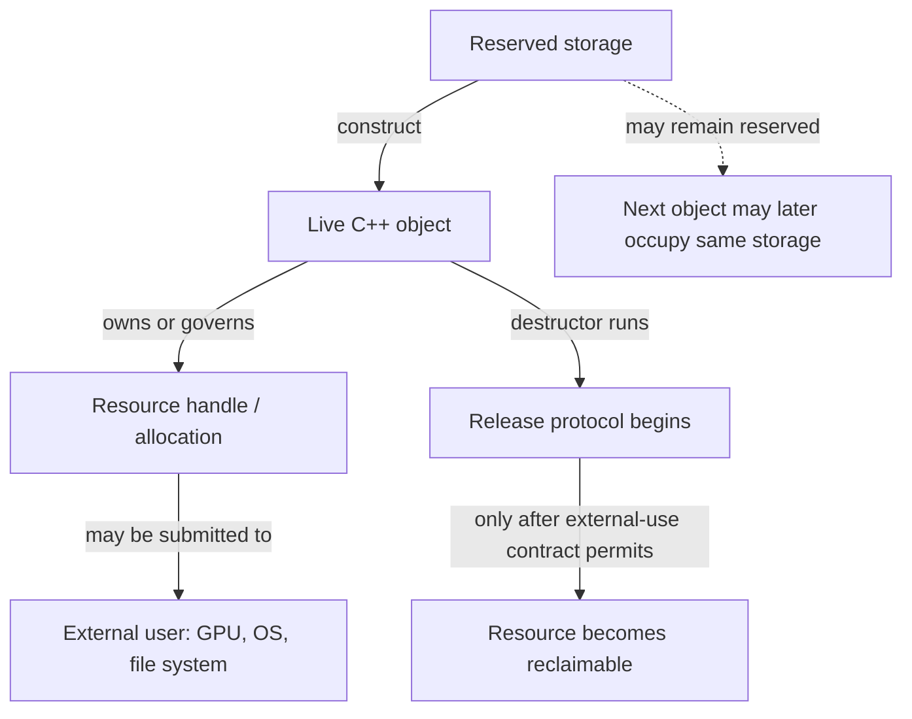

**Caption — The resource stack:** object destruction is a useful cleanup trigger, not proof that every external consumer has stopped. In a renderer, a fence, timeline value, deferred-deletion queue, or other API-specific completion rule may be part of the resource protocol.

### Why lifetime-bound cleanup is more reliable than remembering every exit

[[RAII and resource handles|RAII]] expands to **Resource Acquisition Is Initialization**. Read the name as a design cue: put a resource's responsibility into an object with a well-defined lifetime. Acquisition is associated with establishing the owner's usable state; destruction performs the matching release. The owner can be a small local guard, a standard-library type such as `std::unique_ptr` or `std::lock_guard`, or a domain wrapper around a non-memory handle.

Suppose a function opens a file, acquires a lock, validates data, and then writes. If each return path must remember `close` and `unlock`, adding one early return or throwing operation can leak the file or leave the mutex locked. A scope guard changes the proof: when stack unwinding leaves the scope, fully constructed automatic objects are destroyed in reverse construction order. Therefore the cleanup pairing is attached to scope exit rather than duplicated at each branch. This works for ordinary returns as well as exception unwinding.

RAII does **not** mean “everything is allocated on the stack,” “every constructor must acquire a resource,” or “the destructor can always succeed.” It means responsibility is represented by an object whose lifetime and cleanup protocol are explicit. A wrapper may acquire through a factory, adopt an already-created handle, or defer acquisition until an operation. A destructor should normally be non-throwing; if release can report failure, the design needs a separate explicit `close`/`flush` operation or error-reporting path, because throwing during stack unwinding can terminate the program.

The practical invariant is: **after successful construction, the owner knows exactly what it owns and how to release it.** If construction fails halfway, already-constructed members clean themselves up. This is why a raw handle stored in a class is not enough. The class must either make itself the complete owner, or immediately place that handle in a member that already provides ownership.

```cpp
#include <utility>

class LockGuard {
public:
    explicit LockGuard(Mutex& mutex) : mutex_(&mutex) {
        mutex_->lock();
    }

    ~LockGuard() noexcept {
        if (mutex_)
            mutex_->unlock();
    }

    LockGuard(const LockGuard&) = delete;
    LockGuard& operator=(const LockGuard&) = delete;

    LockGuard(LockGuard&& other) noexcept
        : mutex_(std::exchange(other.mutex_, nullptr)) {}

private:
    Mutex* mutex_; // non-owning pointer to the mutex; guard owns the unlock duty
};
```

Here `Mutex` is an illustrative interface with `lock()` and `unlock()`; the standard-library equivalent for an ordinary mutex is `std::lock_guard` or `std::unique_lock`.

The example's pointer does not own the `Mutex`; the guard owns the *responsibility to unlock it*. This is a useful correction to the overly narrow idea that RAII means “a smart pointer owns heap memory.” Ownership can be a duty to release a lock, close a file, unmap a region, or destroy a native handle. The guard also must not outlive its mutex: the pointer is a borrow, and the mutex's lifetime remains a precondition.

### Ownership is a responsibility contract, not pointer syntax

An **owner** is the entity responsible for ending a resource's use or lifetime according to its protocol. A **borrow** is temporary access that carries no such responsibility. [[Ownership and non-owning views|A raw pointer and reference are commonly used for non-owning access]] in modern C++; their spelling alone does not keep an object alive. A raw pointer can still be an owner in legacy or explicitly documented code, but then the contract is invisible to the type system and fragile at API boundaries.

Before choosing a pointer type, ask who owns the object and how many independent owners are required:

| Relationship | Usual representation | Meaning and limit |
|---|---|---|
| One owner; no ownership transfer at this call | `T&`, `T*`, or a view type | Borrow only; caller keeps the owner alive and respects invalidation rules. |
| One exclusive owner | `std::unique_ptr<T>` or a domain-specific move-only handle | One owner controls disposal; moving transfers that duty. |
| Several owners genuinely share one lifetime | `std::shared_ptr<T>` | A shared ownership group retains the object until its last strong owner releases it. |
| Need to observe shared ownership without extending it | `std::weak_ptr<T>` | Does not keep the object alive; `lock()` attempts to obtain a temporary strong owner. |
| A resource is not an ordinary `delete`-managed object | A purpose-built owner / custom deleter | Release must call the API and allocator that created the resource. |

Do not promote a borrow to `shared_ptr` merely because the lifetime feels uncertain. First find the actual owner and define the boundary where it remains alive. Shared ownership has real semantics and cost; it can also obscure architecture and create cycles. If an API needs only to inspect an object during the call, use a borrow. If it consumes ownership, say so with a move-only owner or clearly documented sink. If it retains shared lifetime, the shared pointer in the interface should express that intentional relationship.

### Exclusive ownership: `unique_ptr` makes transfer visible

[[Exclusive and shared smart-pointer ownership|`std::unique_ptr<T, D>`]] is a move-only owner: at most one such pointer in a given ownership chain is responsible for invoking its deleter. Its destructor, `reset`, or move assignment can trigger disposal. Copying is disabled because copying would create a second owner without a defined sharing policy. Moving transfers the ownership duty; it does not make the object itself move to a different address.

```cpp
#include <memory>

auto texture = std::make_unique<Texture>(device, description);
Render(*texture);                    // borrow for this call
QueueForUpload(std::move(texture));  // explicit transfer; texture is now empty
```

`std::make_unique<T>(args...)` constructs the object and returns its owner as one expression. It is the normal choice for dynamic exclusive ownership. A `unique_ptr` can also own a non-memory resource when supplied a deleter that performs the correct release, but a dedicated `Buffer` or `File` wrapper often gives a clearer interface and can store related context such as the owning device.

A raw pointer returned by `get()` is a **borrowed view**. It does not transfer ownership and must not be passed to `delete`. `release()` is different: it empties the smart pointer and returns the raw pointer, transferring responsibility to the caller, who must immediately establish another owner or perform the required release. Those verbs are not interchangeable.

Custom deleters encode the matching release operation. Their type is part of the `unique_ptr` type, so a capturing/stateful deleter may affect the owner's representation and move behavior. For an opaque C handle, the deleter may need both the handle and its device/context. For polymorphic deletion, deleting `Derived` through `Base*` requires a suitable virtual destructor, unless the deleter retains the concrete type and destroys it correctly. `unique_ptr<Derived>` can convert to `unique_ptr<Base>`, but the default deleter then sees `Base`; a non-virtual base destructor makes that conversion unsafe for destruction.

Arrays have an explicit `std::unique_ptr<T[]>` specialization and pair with array deletion. For ordinary growable sequences, `std::vector<T>` is usually the safer, more expressive owner: it records size and manages element construction/destruction. Do not mix `new[]` with scalar `delete`, or scalar `new` with `delete[]`.

### Shared ownership: one object, a group of owners, and a separate control block

Use [[Exclusive and shared smart-pointer ownership|`std::shared_ptr<T>`]] only when several independent parts of the program must each keep the same object's lifetime going. Copies join the same **ownership group**; destroying or resetting one copy removes only that owner's share. When the last strong owner goes away, the managed object is destroyed. The bookkeeping that coordinates owners lives in a **control block**, which commonly stores a strong-owner count, weak-observer count, deleter and allocator state. The standard specifies behavior, not a particular byte layout or exact performance cost.

```text
renderer ─┐
cache    ─┼──> shared ownership group ──> Texture lifetime
scene    ─┘             ↑
                 weak observers do not
                 keep Texture alive
```

`std::make_shared<T>(args...)` usually combines object and control-block storage into one allocation, though the standard does not promise a particular allocation strategy. This can reduce allocation overhead. It can also mean a long-lived `weak_ptr` keeps the combined allocation reserved after the managed object's destructor has run; the object and the control block have different lifetimes. Do not rely on a particular size or allocation count unless measured for the implementation in use.

An important subtlety: a `shared_ptr` stores a pointer value for access and participates in an ownership group. These need not denote the same address. The aliasing constructor can share ownership of one object while storing a pointer to a subobject. Likewise, a custom deleter may manage a native resource different from `get()`'s pointee. Never infer the complete disposal rule from the stored raw pointer alone.

Copying a `shared_ptr` generally updates shared bookkeeping. That operation is not free, and heavy cross-thread copying can contend on shared cache lines. Moving an existing `shared_ptr` transfers its local handle without creating a new owner. More importantly, shared-pointer thread safety is limited: separate `shared_ptr` objects sharing one control block may be manipulated concurrently under the library's guarantees, but this does **not** make concurrent mutation of the pointed-to `T` safe. The pointee still needs its own synchronization or immutability policy. `use_count()` is an observation, not a lock or a safe exclusivity test in concurrent code.

### Weak observation breaks cycles without pretending an object is alive

If two objects own each other with `shared_ptr`, neither strong count can reach zero. The result is a **reference cycle**: memory remains retained even when the rest of the application no longer needs the objects. Change one direction to [[Weak observation and ownership cycles|`weak_ptr`]] when that relationship is observational rather than lifetime-owning—often parent-to-child ownership with child-to-parent observation, or a cache entry that should not keep its value alive.

```cpp
if (auto parent = child.parent.lock()) {
    parent->Notify(child);
} else {
    // No strong owner remained when lock() was attempted.
}
```

`weak_ptr::lock()` is the safe operation that either obtains a temporary `shared_ptr` or returns empty. Avoid `if (!weak.expired()) { use(weak.lock()); }`: another thread or scope can release the last strong owner between the check and the attempted acquisition. Check the result of `lock()` itself. A weak pointer neither owns the object nor guarantees it will still exist at the next line unless a successful strong result is kept alive.

`std::enable_shared_from_this<T>` lets an already-shared-owned object produce another `shared_ptr` in the same ownership group. Its precondition is that a `shared_ptr` has already established that group. Constructing `std::shared_ptr<T>(this)` instead creates an independent control block and can cause double deletion. Calling `shared_from_this()` in the constructor is too early: the factory has not yet completed the shared-owner connection. Prefer a factory that first creates the `shared_ptr`, then performs any post-construction registration that needs shared self-ownership. `weak_from_this()` is useful when a non-owning self-observer is appropriate, but it does not manufacture ownership.

### Exceptions, partial construction, and the strong proof

RAII and exception safety meet at partial construction. When a constructor throws, the complete object's destructor is not called because that object never finished construction. However, each fully constructed base and member is destroyed automatically in reverse order. Therefore, put each acquired responsibility into a member owner as soon as it exists. A constructor that first acquires three raw handles and only later wraps them has a leak window if the second or third acquisition fails.

The useful guarantee here is not that “exceptions are safe” in the abstract. It is that every acquisition has a matching owner immediately, so every exit—including failed construction—has a defined cleanup path. For transactional operations, build a replacement under RAII, validate it, and only then publish or swap it into the long-lived state. This protects the existing state if preparation fails. It does not by itself roll back external side effects already committed to a file, GPU queue, or network peer; those require their own transaction or compensation protocol.

For asynchronous GPU work, destructor timing must respect **completion**, not merely CPU scope. If a command buffer refers to a buffer, destroying the C++ wrapper at the end of a function may be too early even though the wrapper's RAII is correct in isolation. The owner can enqueue the native object for deferred destruction tagged with a fence/timeline completion value. The release protocol then has two stages: logical ownership ends, and physical reclamation waits until submitted work can no longer access the resource. RAII makes the chosen protocol automatic; it does not choose the correct graphics synchronization rule for you.

### Figure CPP-04 - CPU cleanup can precede GPU reclamation

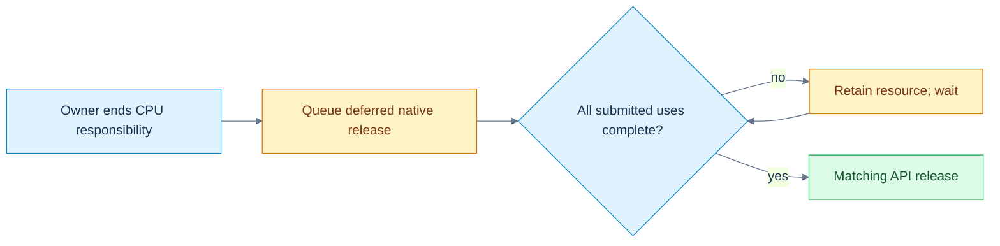

**Read the picture:** the destructor can transfer the release duty to a deferred-deletion queue. A fence or timeline condition covering every submitted use then permits native reclamation. **Limit:** this is a renderer policy, not behavior supplied by C++ or smart pointers. The queue, allocator and device must remain valid, and the backend must establish the correct completion condition. [[Visual Recall/02 - C++ - Objects, Ownership and Lifetime - Visual Recall#Four figure briefs|Recall this figure]].

### Custom allocation separates obtaining bytes from constructing objects

Ordinary `new T(args...)` is a **new-expression**: conceptually it obtains appropriately sized/aligned storage and initializes a `T` there. `delete p` calls the object's destructor and the matching deallocation function when `p` denotes a suitable object created by a matching allocation protocol. The expression manages a pair of operations; it is not merely a call to `operator new`.

An **allocation function** such as `::operator new(size)` obtains raw storage. It does not, by itself, create an arbitrary `T` object in that storage. An **object lifetime** begins only when the language's construction or implicit-lifetime rules say it does. This distinction matters in arenas and pools, where an allocator reserves a block and a container or caller constructs objects inside it. The allocator owns storage management; the object-aware layer must still construct and destroy the occupants correctly.

Modern code should normally keep explicit allocation centralized in a standard container, allocator-aware container, or carefully designed owner. `malloc`/`free` do not call C++ constructors/destructors. `new (std::nothrow) T` changes allocation-failure reporting for the corresponding new-expression, but it does not remove constructor exceptions or make every memory failure impossible. Alignment is a real precondition: storage must satisfy `alignof(T)`, as well as have enough size. Over-aligned types and custom pools need explicit support.

### Arrays carry a count and a destruction protocol

`new T[n]` creates an array of `n` elements (subject to allocation and construction succeeding); `delete[]` must destroy the constructed elements and release storage with the matching array deallocation protocol. The count is semantically important even when an implementation stores it in hidden overhead. If constructing a later array element throws, already-constructed earlier elements are destroyed and storage is released as required by the new-expression rules.

This is why inventing an array by allocating `n * sizeof(T)` bytes and pretending it is automatically a `T[n]` is not a generic safe shortcut. You need correct overflow checks, alignment, object construction for each element, tracking of how many constructions succeeded, reverse destruction, and matching deallocation. Let `std::vector<T>`, `std::unique_ptr<T[]>`, or a proven allocator/container abstraction carry that protocol unless you are implementing such a layer deliberately.

### Placement construction reuses storage; it does not allocate it

Sometimes an engine has reserved a pool slot or arena block and needs to begin a new object's lifetime there. [[Placement construction and explicit lifetime management|Placement new]] is the traditional spelling for constructing into an address supplied by the caller. In current C++, `std::construct_at(p, args...)` is usually a clearer library interface for this operation when its preconditions are met. Neither form obtains the underlying storage. The caller must already have enough correctly aligned storage, and must track the lifetime and eventual destruction of the object.

```cpp
#include <cstddef>
#include <memory>
#include <new>

alignas(Widget) std::byte slot[sizeof(Widget)];
Widget* item = std::construct_at(
    reinterpret_cast<Widget*>(slot), constructor_argument);

Use(*item);
std::destroy_at(item); // ends Widget lifetime; slot bytes still exist
```

This sketch demonstrates the distinction, not a complete general-purpose arena. A production slot abstraction should encapsulate size, alignment, occupancy, exception cleanup, and whether it is currently legal to reuse the storage. Calling `std::destroy_at` does not free `slot`; returning the slot to the arena is a separate allocator action. Conversely, reusing storage can end an existing object's lifetime, so existing references and pointers need the language's object-replacement rules, not just the same numeric address.

`std::launder` is not a generic “make this pointer valid” spell. It can obtain a pointer to an object already within its lifetime at an address when specific reachability and type conditions are met. It does not allocate storage, construct an object, fix alignment, revive a destroyed lifetime, or make an out-of-bounds pointer legal. Modern lifetime facilities—including `construct_at`, `start_lifetime_as` where applicable, and implicit-lifetime rules—have precise scopes; choose the operation that matches the intended object-creation semantics instead of treating raw bytes as universally interchangeable with objects.

### A union or arena slot has one occupant at a time

A union lets multiple members reuse storage, but only the active member's lifetime and value can be used under the applicable rules. When switching between non-trivial members, destroy the current member as needed, then construct the next one. A `std::variant` is often preferable for ordinary tagged alternatives because it tracks which alternative is active and handles construction/destruction; a manually managed union is a lower-level tool with a larger correctness burden.

The same reasoning applies to an arena slot: at one moment it may hold a `Particle`; later, after that lifetime ends, it may hold a `Command`. Bytes can remain at the same address while the object identity and valid operations change. **Transparent replacement** permits old names, pointers, or references to refer to a replacement object only when the standard's conditions are met; do not assume same address and same type always settle every case. If a pointer cannot automatically designate the replacement, a narrowly justified `std::launder` may be relevant after construction—but it still does not replace correct destruction, construction, alignment, and type checks.

Ordinary automatic objects should not be manually destroyed and then allowed to undergo their usual automatic destruction again. That risks using an object outside its lifetime and double destruction. Explicit destruction is appropriate in a controlled storage-management abstraction that also takes responsibility for exactly one construction and exactly one destruction per occupant. A tagged union or arena should track its state so the code knows which destructor is valid.

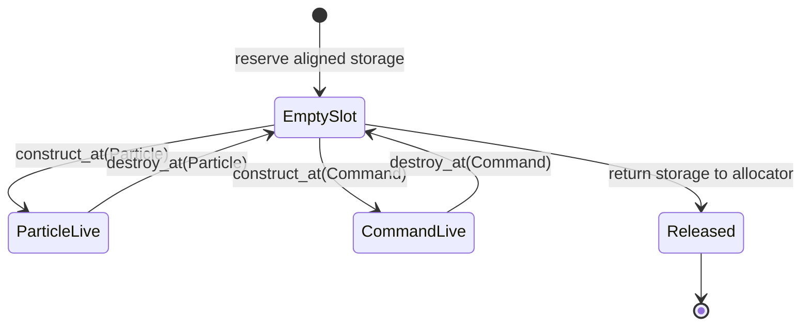

**Caption — Storage is not the occupant:** every transition has a precondition. Never construct the next occupant while a non-trivial current occupant still needs destruction; never read a member merely because the bytes at its former address still look familiar.

### A compact laboratory: choose the owner before the pointer

When reviewing a resource path, write a tiny ledger before looking at syntax:

| Question | Example answer for a GPU buffer |
|---|---|
| What is acquired? | Native buffer handle plus bound device memory. |
| Who creates it? | Device/resource factory with a specific allocator. |
| Who owns release responsibility? | A move-only `GpuBuffer` value. |
| Who merely borrows it? | A command-recording function during a documented valid interval. |
| What ends CPU-side ownership? | Destruction/reset of the `GpuBuffer`. |
| What delays actual release? | Completion fence/timeline for every submitted use. |
| What if creation of the second native object fails? | The first acquisition is already held by a cleanup owner and is released. |
| Can copying duplicate responsibility? | No; the owner is non-copyable and movable. |

Then test four failure paths: failure before acquisition, failure after the first of two acquisitions, early return after validation, and normal completion with work still in flight. A passing test should observe the matching release exactly once and only after the external-use condition is satisfied. Unit tests can verify wrapper behavior with a fake API; only the real backend can verify its actual synchronization and native-handle protocol.

### The teaching summary: ask “who, until when, by which release?”

The story now extends the object model. Storage answers where bytes are available. Lifetime answers which object occupies them. Ownership answers who must end the resource's use. External synchronization answers when release is actually safe. RAII connects the owner's object lifetime to its cleanup protocol; smart pointers are standardized ownership policies, not general-purpose pointer decorations. `unique_ptr` answers “one owner”; `shared_ptr` answers “a genuine shared lifetime”; `weak_ptr` answers “observe without keeping alive.” A raw pointer or reference usually answers only “borrow access.”

When bytes must be managed below the level of containers, allocation, object construction, destruction, and storage release are separate operations. Placement construction begins an object in already-provided storage. Explicit destruction ends that object's lifetime, not necessarily the storage's. Reuse creates a new occupant and requires the language's lifetime and replacement rules. None of these low-level tools removes the need for an owner ledger.

**Board test:** draw the four-level lifetime diagram, then pick one file, lock, unique resource, shared resource, and arena slot. For each one, say who owns it, who borrows it, what event ends use, what operation releases it, and what can make release too early or too late. If those answers are concrete, the vocabulary has become an operational model.

[[Visual Recall/02 - C++ - Objects, Ownership and Lifetime - Visual Recall|Open the C++ visual-recall board]] · [[Supplementary/Foundations#M010 - Parts 148-160|M010 coverage ledger]] · [[Keyword Index]] · [[Dependency Map]]


## From one owned resource to many requests and a replaceable backend

The previous chapter established that a resource has an owner, an object lifetime, and sometimes an external user that can outlive the local C++ scope. That solves one class of problems. It does not yet tell us how a renderer should represent different *kinds of work*, or how the same calling code can send that work to a Vulkan implementation, a Metal implementation, or a test implementation without rebuilding every scene system.

Imagine that the editor has three actions waiting for the renderer. First it clears the background to a color, then draws mesh 17 with material 4, and finally uploads 4,096 bytes of texture data. The renderer must remember **which kind of request each record represents**; otherwise the number 17 might be mistaken for a byte count or a color component. And the editor should not need to know which graphics API is responsible for carrying out the requests. These two requirements are related but different: a request is *one value chosen from a known set of shapes*; a backend is *one implementation chosen from a set that may be selected at runtime*. We will solve the first problem with a tagged alternative, and the second with a carefully owned interface. Along the way, we will encounter the C++ rules that make this safe or dangerous.

### Why reusing memory does not identify the object stored there

Suppose the first version of a command buffer saves space by allocating one record large enough for either a color or a mesh identifier. In C++, a `union` can give distinct members overlapping storage:

```cpp
union Cell {
    std::uint32_t meshIndex;
    float opacity;
};

Cell cell{.meshIndex = 17};  // meshIndex begins as the active member
cell.opacity = 0.5f;         // for this trivial member, assignment begins its lifetime
// Reading cell.meshIndex here is not a valid way to recover the old mesh index.
```

A union is not a magic box in which every member simultaneously exists. Its members share storage; the *active member* determines which object can be accessed under the applicable lifetime rules. For nontrivial members, changing the occupant may require explicitly destroying the old object and constructing the new one. In contrast to a formatted file, the raw union does not carry a trustworthy external tag saying which interpretation the next reader should use. A handwritten tagged union therefore needs a separate discriminant, a complete set of valid states, correct constructors, destruction, copying and moving, and recovery if a constructor throws. The challenge is not allocating enough bytes; it is preserving the link between bytes, object lifetime, and the *meaning* of the active value.

If the request alternatives are known at compile time, `std::variant` gives us that link without requiring an engine author to implement the union's state machine by hand:

```cpp
#include <cstdint>
#include <variant>

struct Clear { float red, green, blue; };
struct DrawMesh { std::uint32_t meshId, materialId; };
struct Upload { std::uint64_t byteCount; };

using Request = std::variant<Clear, DrawMesh, Upload>;
Request request = DrawMesh{17, 4};

if (auto* draw = std::get_if<DrawMesh>(&request)) {
    // A non-null pointer proves this is presently the DrawMesh alternative.
    DrawMesh selected = *draw;
    (void)selected; // the example only demonstrates the checked read
}
```

The alternative type and the currently active index are separate ideas. `std::holds_alternative<T>` asks which alternative is active; `std::get_if<T>` returns a pointer only when that type is active; `std::get<T>` throws `std::bad_variant_access` if the selection is wrong. `std::visit` selects the operation corresponding to the actual alternative, allowing a renderer to handle each command without inventing a dangerous integer-to-struct cast. The visitor's result type and alternative handling must still be coherent: for a non-generic visitor, adding a new alternative requires updating the visitor. A `variant` can also become `valueless_by_exception()` in certain throwing replacement operations; code that relies on `visit` must decide how to treat that exceptional state rather than assuming it is impossible. It is a *type-safe representation*, not a promise that user inputs, bounds or resource readiness are valid.

Follow the three requests as values. The first object is a `Clear` containing three floating-point color components; the second is a `DrawMesh` containing two unsigned identifiers; the third is an `Upload` containing a 64-bit byte count. A visitor reads the first as color, the second as mesh/material identity, and the third as a byte quantity. It never attempts to read a mesh index from an active `Upload`. Changing from `DrawMesh` to `Upload` changes the active alternative and ends the prior alternative's lifetime according to the variant operations. The type itself expresses that exactly one of the listed command forms is present at a time.

This is a good use of a *sum type*—a value with one of several explicitly listed forms. It is not automatically an efficient GPU command format: the object's layout is a C++ library representation, not a stable wire format or shader ABI, and `std::variant` can carry size, alignment and dispatch costs. If requests must be serialized or uploaded to a device, define a separate, versioned binary record and validate conversion into the in-memory alternative. That follows directly from the earlier lesson that an object's C++ layout is not a file or GPU contract.

### The request has a known shape; the backend has a runtime identity

The editor can now represent work, but it still should not contain an `if` statement for every graphics backend at every call site. A base class can specify a common operation, and a derived class can provide its implementation. This is an *is-a* relationship only when every derived object truly satisfies the base's observable contract; inheritance is not an appropriate shortcut just to reuse a few lines of implementation. For ordinary implementation sharing, composition—a member object containing another object—is often simpler and safer.

Consider the smallest meaningful backend interface:

```cpp
class Backend {
public:
    virtual ~Backend() = default;
    virtual void submit(const Request& request) = 0;
};

class CountingBackend final : public Backend {
public:
    void submit(const Request& request) override {
        // Count commands through std::visit without pretending to execute GPU work.
    }
};
```

The word `virtual` means that when `submit` is called through a `Backend` reference or pointer, C++ can select the final override appropriate to the object's dynamic type. The static type is what the expression is declared to be—`Backend&`, for example. The *dynamic type* identifies the actual polymorphic object, which could be `CountingBackend`. A pure virtual declaration, marked `= 0`, makes the base abstract: it cannot be instantiated as a complete object while it retains an unimplemented pure virtual operation. An abstract interface specifies a minimum useful contract, not a guarantee that every implementation behaves correctly. The derived `override` keyword asks the compiler to diagnose a signature that fails to override, and `final` disallows further derivation or override as applicable.

Many compilers implement virtual calls using a hidden table of function pointers and a per-object pointer or equivalent metadata, usually called a *vtable* and *vptr*. That is a useful performance and layout model, **not a layout mandated by the C++ language**. A virtual call may involve an indirect branch, and an optimizer may remove that indirection when it can prove the target. You must not serialize a polymorphic object by copying its bytes, assume its first machine word is a vptr, or calculate its size by casually adding a pointer to its named fields. Actual layouts, thunks and adjustment rules depend on the compiler and its application binary interface.

Why is the virtual destructor necessary? The renderer factory might return `std::unique_ptr<Backend>` while constructing a concrete `CountingBackend`. When the owner is destroyed, its default deleter calls deletion through the `Backend*`. A suitable virtual base destructor ensures that the derived object is destroyed through the polymorphic deletion path, then its base subobjects. Deleting a derived object through a base pointer that lacks an appropriate virtual destructor is unsafe in the ordinary default-delete pattern. A base intended for polymorphic ownership should make its destructor policy explicit, normally public and virtual. A custom deleter that retains the concrete destruction protocol can be an exception, but it needs its own proof rather than an assumed shortcut.

The lab uses borrowed references to a `Counts` record and a destruction counter. The test creates the backend inside a scope and confirms the derived destructor runs once as the `unique_ptr<Backend>` leaves that scope. The references must remain alive for the backend's entire use; virtual dispatch does not turn them into owners. Likewise, a real backend's destructor must respect GPU completion and deferred retirement rules established in the previous chapter. The virtual destructor selects the correct C++ cleanup behavior—it does not implicitly wait for device queues.

### A derived object contains a base subobject, not an interchangeable base value

When a `CountingBackend` is constructed, there is a `Backend` base subobject within the complete object. A base pointer or reference can refer to that subobject while virtual dispatch preserves access to the derived behavior. But copying a derived object into a *base value* constructs only a base object, discarding the derived portion. This is **object slicing**.

The runnable lab demonstrates slicing with a non-abstract `NamedObject` base and a `MeshObject` derived class. Calling `kind()` through a `NamedObject&` bound to the original mesh returns `"mesh"`. Copying the same mesh into a new `NamedObject` value gives that new object the base's dynamic type, so its virtual `kind()` returns `"base"`. The source object has not changed. What changed is which complete object the caller is asking about. An interface with pure virtual functions cannot itself be sliced into a standalone instance because abstract classes cannot be instantiated, but non-abstract polymorphic bases can still suffer this problem. Prefer references, pointers or owning polymorphic wrappers when dynamic identity matters.

Multiple inheritance extends this picture. A derived class can implement two independent interfaces, perhaps `IRenderBackend` and `IDiagnostics`. It then contains the corresponding base subobjects; conversion to each base view may involve a pointer adjustment, and unrelated base names can become ambiguous. Two separate paths may also reach the same ancestor, producing the *diamond* shape. Ordinary repeated inheritance may give two ancestor subobjects. Declaring the shared ancestor as a **virtual base** makes its subobject shared within the most-derived object; the most-derived class is responsible for initializing that virtual base. The lab constructs `Diamond : Left, Right` with both paths virtually inheriting `Root` and verifies that conversion through either path yields the same `Root` subobject. This illustrates identity, not a promised pointer offset or byte layout.

Multiple inheritance is therefore not automatically wrong, but it increases the reasoning burden. Independent pure interfaces are a common defensible use; complex concrete inheritance diamonds often signal that composition would communicate ownership and responsibilities more clearly.

### A cast cannot manufacture a valid object

When the caller holds a base pointer, there may be a genuine need to discover the concrete implementation for diagnostics. `dynamic_cast<CountingBackend*>(backend.get())` checks a runtime relationship for polymorphic types and returns null for an incompatible pointer cast. A failed reference cast throws `std::bad_cast`. This can be useful at debugging or integration boundaries, but repeated downcasts often suggest that the base interface is missing a required operation or that the design has become dependent on a particular implementation. Availability also depends on build settings that support the required runtime type information.

A `static_cast` converts between related types when the language permits it, but it does not perform that same dynamic check. A base-to-derived `static_cast` needs a proof that the actual object is compatible; a syntax-valid cast is not such a proof. Converting a derived pointer to a base pointer is a normal, safe upcast within its lifetime and access rules. A `const_cast` can remove `const` or `volatile` qualification from an access path, but writing through it is undefined when the underlying object was genuinely declared const. It does not grant ownership or synchronize threads.

A `reinterpret_cast` can reinterpret particular pointer or integer representations under language rules, but it neither constructs the new object nor makes an unrelated type legally alias the same bytes. This is a frequent source of misleading engine code. To inspect bytes, use the appropriate byte-view or copy operation; for supported equal-sized trivially copyable representations, `std::bit_cast` expresses a representation conversion much more clearly than treating a typed object as a live unrelated type. Endianness, padding and format versioning remain separate concerns. No cast eliminates alignment, bounds, provenance or lifetime obligations.

### Equality is an engine promise, not merely a convenient operator

A command system needs identities. A resource handle composed of `slot=7` and `generation=3` is different from `slot=7` and `generation=4`, even if both refer to storage at the same index at different times. We can make this meaning explicit through a value type:

```cpp
struct AssetId {
    std::uint32_t slot;
    std::uint32_t generation;
    auto operator<=>(const AssetId&) const = default;
};

static_assert(AssetId{7, 3} == AssetId{7, 3});
static_assert(AssetId{7, 3} != AssetId{7, 4});
```

The defaulted three-way comparison uses the declared members in order and can also enable a synthesized equality operator under the relevant rules. For these unsigned integer fields, this gives a *strong ordering*: two IDs compare consistently by their stored values. That is a useful deterministic order for keys, but it is **not** a statement about resource age, importance or current validity. A handle remains invalid if its registry does not contain the matching live generation, even when its fields compare equal to an old recorded handle. An equality operator must represent the intended semantic equivalence; it should not casually compare memory bytes that may contain padding or unrelated bookkeeping.

C++20's `<=>` reports an ordering category rather than always returning a Boolean. Strong ordering is appropriate for identities with a meaningful total order; weak ordering can represent equivalent values that need not be identical under the application relation; partial ordering includes values that cannot be compared in the usual way. Floating-point NaN illustrates partial ordering: comparing NaN with a finite value is unordered, not less, equal or greater. A defaulted comparison for a record containing floating-point fields can therefore have different semantic consequences than the integer-only `AssetId`. Using such records as ordered-map keys requires an ordering relation that satisfies the container's strict weak ordering requirements, including an explicit policy for NaNs if relevant.

Operator overloading is useful when it keeps the domain meaning visible—for example, adding a duration to a timestamp, not adding two arbitrary resource handles. Operators should preserve the invariants of their value types, avoid hidden resource creation or unexpectedly expensive work, and agree with the ordinary interpretation of the operation. A custom `operator==` should be reflexive, symmetric and transitive over the domain in which it is used; exact floating-point equality is not a general approximate comparison policy. Contextual tolerances belong in explicitly named comparisons, not silently inside a container key's equality relation.

### The compiler chooses an overload before a virtual function chooses its implementation

Another decision occurs at the call site: a function name may refer to several overloads. C++ first performs name lookup to find candidate declarations, then decides which are viable for the provided arguments, and ranks allowed conversions. An exact match normally wins over a conversion; templates, user-defined conversions, constraints and visibility can complicate that choice. The return type alone does not ordinarily distinguish overloads of the same parameter list. If two viable candidates are equally good under the ranking rules, the call is ambiguous and the program is rejected rather than deciding unpredictably at runtime.

The lab's `classify(int)` and `classify(double)` are an intentionally small observable case. Passing `3` chooses the integer overload and produces `1`; passing `3.0` chooses the double overload and produces `2`. A cast can influence the static type passed to overload selection, but it should not be used to conceal a poorly specified API. Especially in generic engine code, signed/unsigned conversions, initializer-list constructors, implicit conversions, and similarly named overloads deserve compile-time tests because an innocent-looking literal can select a different operation.

Default function arguments create a subtler interaction with virtual calls. Consider:

```cpp
struct Base {
    virtual ~Base() = default;
    virtual int reserve(int n = 2) const { return n; }
};
struct Derived : Base {
    int reserve(int n = 7) const override { return n * 10; }
};

Derived concrete;
Base& baseView = concrete;
assert(baseView.reserve() == 20); // default argument 2 from Base, body from Derived
assert(concrete.reserve() == 70); // default argument 7 from Derived, same Derived body
```

The default argument is chosen from the declaration visible through the **static type at the call site**; the virtual function body is selected according to the **dynamic type at runtime**. These are two different decisions. Defaults are not inherited as a dynamic policy, do not form part of the function type, and can create surprising differences when an override supplies a different default. A safer public interface often provides one non-virtual wrapper that determines defaults and calls a protected virtual operation with all arguments explicit. This is a concrete reason to understand lookup and dispatch together instead of learning them as unrelated vocabulary.

### One trace through the complete model

Start with three `Request` values: a clear, a mesh draw, and an upload of 4,096 bytes. Each value's variant tag identifies its active alternative. A `std::unique_ptr<Backend>` owns a `CountingBackend`, while the three requests are borrowed by reference during `submit`. Virtual dispatch calls the concrete override; within that override, `std::visit` chooses behavior from the active request tag. The resulting counters are one clear, one draw, one upload and 4,096 accumulated bytes. Leaving the scope destroys the derived backend exactly once via a virtual destructor. No real GPU work was submitted; the test's purpose is the C++ choice-and-lifetime model.

Now alter the system deliberately. Change the second request from `DrawMesh` to `Upload` and verify the active tag changes, the counter changes and no draw-specific field is read. Try a checked downcast to a different backend type and verify it returns null. Copy a derived object into a non-abstract base value and observe slicing. Reach the same virtual base through both diamond paths. Call an overridden virtual function through different static types with different defaults. Compare two handles differing only in generation; then compare a NaN to a finite floating-point value and check the result is unordered. Each experiment isolates a rule that matters when the engine grows beyond one backend and one command.

**Runnable reference:** [[tools/labs/backend_choice_lab.cpp|`tools/labs/backend_choice_lab.cpp`]]. From the repository root, compile with:

```sh
c++ -std=c++20 -Wall -Wextra -Wpedantic -Werror \
  -fsanitize=address,undefined -fno-omit-frame-pointer \
  tools/labs/backend_choice_lab.cpp -o /tmp/backend_choice_lab
/tmp/backend_choice_lab
```

The reference run used GCC 14.2.0 on Linux with address and undefined-behavior sanitizers enabled and completed all the assertions. This is evidence for this standalone C++ model, not for an actual Vulkan/Metal implementation or current Kairo modules. Before attributing anything to `KairoRenderer/GraphicsBackend.cppm` or `KairoAI/AIProvider.cppm`, inspect the corresponding current repositories and cite exact declarations and call sites. No such external repository inspection is claimed by this chapter.

### Choose the mechanism by the question it solves

A `variant` is a natural fit when the supported alternatives are known and a value should always identify its active form. Virtual dispatch is a natural fit when a stable contract must be implemented by objects selected or extended independently at runtime. An overloaded function is a *compile-time selection* from declarations based on argument types and conversions, not a runtime substitute for a backend interface. A cast changes or checks how an expression views an existing object; it does not create the representation, ownership or dynamic behavior the system lacks. Equality and ordering define domain promises about values, not about the existence of live resources.

The cost comparison also needs evidence. Virtual calls can inhibit inlining when the target is unknown, but indirect calls are not automatically slower overall than a large `variant` visitor with poor locality. `variant` stores the largest appropriately aligned alternative and carries a discriminator; polymorphic objects have separate allocation and locality possibilities, depending on how they are owned. A useful controlled experiment compares the same sequence of commands under both representations: report object size, allocation count, branch predictability where measurable, instruction cost, cache behavior, and whether the compiler could devirtualize. Do not declare one abstraction universally faster without stating workload, compiler, architecture and optimization settings.

**Reconstruct without reading:** explain why a byte array is not automatically a live command; derive why three known request forms favor a checked tag; draw an owning interface and its derived object; identify where a base subobject exists; predict slicing and the default-argument example; state exactly what each cast does and does not prove; and describe why a generation-aware identifier needs both slot and generation in equality. Then rebuild the counting backend and test it from a blank file. When those actions work, the material has become implementable knowledge rather than a list of C++ terms.

**Coverage boundary:** this first additive narrative targets the original M011 Parts 161–180. It provides a coherent teaching route and a checked standalone laboratory, but it is not an independent audit of the user's external engine repositories, every possible C++ ABI, or learner recall. The separate evidence ledger records that boundary; no missing source segment is silently reclassified as received.

## From an accepted render request to a resource that survives failures and callbacks

Our last chapter established two independent decisions: a `std::variant` identifies what work was requested, and a virtual `Backend` interface identifies which implementation performs the work. That is not yet a complete resource pipeline. The editor can ask to upload a mesh; a worker may read its data later; a renderer may allocate a native handle; and a completion callback may run after the scene that requested it has closed. An invalid file, a failed allocation or an exception must not expose a half-created resource. The same problem forces us to understand conversions, callable objects, lambda captures, exception guarantees, object representation and safe native-resource ownership. We will not learn these as twenty unrelated pieces of vocabulary: we will follow one upload from the request boundary through validation, preparation, publication and notification.

The central contract is simple to state and difficult to maintain: **a published asset is complete, its owner is unambiguous, its data have a checked meaning, and failed preparation must not change previously published assets.** We must also distinguish the lifetime of a C++ object from its backing device resource and from a callback that might retain a reference to it. The actual C++20 reference is [[tools/labs/safe_asset_pipeline_lab.cpp|the safe asset pipeline laboratory]]. It is intentionally a deterministic fake native-device model, not an uninspected claim about any current Kairo, Vulkan or Metal implementation.

### The first bug is possible before we load a file: 4096 of what?

A function such as `upload(std::size_t amount)` accepts a numeric quantity but says nothing about its meaning. Mesh indices, texture IDs, byte counts and frame numbers might all use `std::size_t`. Their machine representation can be similar without making the quantities interchangeable. C++ overload resolution reasons about types and allowed conversions, not the intent behind an integer. An ordinary one-argument constructor can participate in *implicit conversion*, and a user-defined conversion operator can turn one class value into another type in certain contexts. Convenience is valuable for a genuinely interchangeable representation; it is dangerous when it silently changes units.

Give our operation its own small value type:

```cpp
struct ByteCount {
    std::size_t value;

    explicit constexpr ByteCount(std::size_t n) noexcept : value(n) {}
    explicit constexpr operator std::size_t() const noexcept { return value; }
};

ByteCount requested{4096}; // the unit conversion is visible
// ByteCount accidental = 4096; // intentionally rejected by explicit
auto rawNumber = static_cast<std::size_t>(requested);
```

`explicit` on a converting constructor prevents its use in ordinary implicit copy-initialization; it does not prohibit explicit direct construction. `explicit` on a conversion operator likewise controls which conversion contexts can use it. Contextual Boolean conversion is a special case—for example, a class may provide `explicit operator bool()` yet work in an `if` condition. An unqualified implicit conversion operator may also affect overloaded-function selection unexpectedly, so conversion policy must be considered together with the overload rules from the preceding chapter.

The laboratory checks the compiler's answer with `std::is_convertible_v` in both directions. The static assertions establish that a `std::size_t` does not implicitly become our `ByteCount` and vice versa. They do **not** establish that a count fits device capacity or is nonzero. Those are distinct runtime conditions, validated before native acquisition. The important lesson is not to wrap every scalar mechanically; it is to choose explicit types at boundaries where mixing meanings would violate an important contract.

### A worker needs a callable completion operation—and a way to know what state it may use

A *callback* is an operation passed to another component for invocation on its terms. If the callback runs immediately, it may borrow a local variable whose lifetime is known to cover that call. If it is stored for later execution, the same borrowed variable can disappear before invocation. The safety question is therefore not merely “does this type have parentheses?” but **what does its invocation need, and who keeps that state alive?**

A plain function pointer identifies a function with a compatible signature. It carries no automatically associated editor object. A C-style API frequently passes a second, opaque pointer back to the function:

```cpp
using RawReport = void (*)(void*, ByteCount);

void report_to_counter(void* context, ByteCount bytes) {
    // Contract: context points to a currently live, aligned std::size_t.
    auto& sum = *static_cast<std::size_t*>(context);
    sum += bytes.value;
}

std::size_t completedBytes = 0;
RawReport report = &report_to_counter;
report(&completedBytes, ByteCount{4096});
```

The `void*` context is a *borrow*: converting it back using `static_cast` does not check that it is the correct object type, still alive, or safe to access concurrently. The function pointer has no ownership power over `completedBytes`. If a worker stores the pointer beyond the local variable's lifetime, the callback eventually accesses a dangling object. If the callback is invoked from another thread while the editor changes the same counter without synchronization, the data race is a different correctness failure. The use of a C API does not exempt us from C++ lifetime and concurrency rules.

A pointer to a **non-static member function** is a different type of callable because a member operation requires a particular object. For example:

```cpp
struct Reporter {
    std::size_t bytes = 0;
    void report(ByteCount value) { bytes += value.value; }
};

Reporter reporter;
void (Reporter::*operation)(ByteCount) = &Reporter::report;
(reporter.*operation)(ByteCount{32});
```

The operation is associated with the `Reporter` class; calling it also requires `reporter`. The equivalent syntax for a pointer to a `Reporter` is `(pointer->*operation)(ByteCount{32})`. A pointer-to-member function is not generically interchangeable with an ordinary function pointer and is not guaranteed to be represented by one address-sized machine word. Virtual dispatch and multiple inheritance can change the implementation's member-pointer representation. A callback trampoline can bridge such an operation into a function-pointer-and-context API, but the context's lifetime remains an obligation.

A **function object** solves a related problem by keeping operation and state in one C++ object. It defines `operator()`:

```cpp
struct AddBytes {
    std::size_t* destination; // still a borrow, not ownership

    void operator()(ByteCount amount) const {
        *destination += amount.value;
    }
};

std::size_t total = 0;
AddBytes add{&total};
add(ByteCount{16});
```

Now a callback has a concrete object representation that can carry arguments, handles or other state. But the raw pointer inside it remains borrowed. Copying a callable copies its member fields according to their semantics; it does not automatically deep-copy their referents.

### A lambda is a created object, and its capture is a lifetime contract

A lambda expression creates an object of a unique, compiler-generated *closure type*. Its body becomes a callable operation. Its captures determine which state is stored in, or referred to by, that object. We can understand the behavior without guessing the compiler's closure layout.

```cpp
std::size_t changing = 10;
auto snapshot = [saved = changing] { return saved; };
auto liveView = [&changing] { return changing; };
changing = 20;

// snapshot() returns 10; it owns the captured numeric value.
// liveView() returns 20; it accesses the same still-live variable.
```

The distinction is not merely syntactic. A value capture of a `std::string_view` copies the *view*, not the characters it points at. A value capture of a raw pointer copies the pointer, not the object. A `[&scene]` capture makes the eventual invocation depend on a live `scene`. Capturing `this` allows member access but does not keep the pointed-to object alive. The `[=]` default capture in a member function must not be mistaken for automatically owning a copy of the entire object. When appropriate and copyable, `[*this]` creates a captured copy of the current object; that can be expensive or wrong when the original object represents unique engine identity.

Suppose a user closes a scene after starting a texture load. The worker completes, invokes a lambda holding `[&scene]`, and tries to publish the texture into a destroyed scene. That is a lifetime violation, typically **undefined behavior**, not an exception we can recover from. Three common valid designs make different promises: copy the small data that the callback truly needs; capture a `std::shared_ptr` to state whose lifetime is intentionally shared; or capture a `std::weak_ptr`, call `lock()` when invoked, and gracefully discard the result if the state no longer exists. A generational scene/request identity can also prevent obsolete results from being published, if the registry's lifetime and synchronization contracts are correct.

An owning capture is demonstrated in the lab. A callback captures a `std::shared_ptr<int>` and can safely run after the local shared pointer's scope ends. A `weak_ptr` observer verifies that the target stays alive while the callback owns it and expires when the callback target is released. This does **not** prove every use of `shared_ptr` is thread-safe; it controls object lifetime, not unsynchronized access to its mutable contents. Storing an owning callback inside an object it strongly owns can form a cycle. The correct ownership graph matters more than the apparent convenience of the capture syntax.

### Why a uniform callback interface still has a price

The editor may want a queue of callbacks all callable as `void(ByteCount)` while their real types differ. `std::function<void(ByteCount)>` is a *type-erased* callable wrapper: the consumer can invoke one public signature without knowing the stored function, lambda or functor's concrete type. The wrapper manages the target's lifetime, invocation and copying. It has its own failure state: invoking an empty `std::function` throws `std::bad_function_call`.

Type erasure hides the concrete type at a particular interface, **not** its runtime cost. A library may store small targets inline and allocate storage for others; no particular inline size is guaranteed for arbitrary user targets. Copying the wrapper copies the target and can therefore copy captures or increase shared ownership counts. `std::function` requires a copy-constructible callable target; a lambda that directly captures a move-only `std::unique_ptr` is not generally a valid target. C++23 adds `std::move_only_function` for move-only callable wrappers, while templates can preserve the callable type when runtime erasure is unnecessary.

For a synchronous low-level API, a function pointer plus context can be simpler. For a worker queue, a move-only task may better express ownership. For an event subscription that is copied, `std::function` may be appropriate. A custom small-buffer wrapper requires actual measurement and a careful lifetime implementation. None of these choices is automatically the fastest. Benchmark the same workload, measuring call overhead, allocation count, target size, cache behavior and contention on the target compiler and standard library before claiming an advantage.

### A decoded asset is not ready merely because its bytes exist

Our callback mechanisms can now notify the editor. But the actual upload needs a sound state transition. Imagine the scene already contains one valid mesh. It asks for a texture; the loader has data bytes, acquires a native resource handle, and then discovers an invalid asset field. If it has already inserted the partial record into the scene, the scene's published state is corrupted. If it forgets to release the native handle on failure, the resource leaks.

A correct *prepare-then-publish* transaction keeps the proposed result private while its parts are being constructed. It is made visible only after all required preparation succeeds. C++ exceptions make this easier when resources are held by properly constructed local owner objects. If an operation throws, automatic local objects constructed earlier are destroyed during **stack unwinding**. Their destructors execute the cleanup responsibility that they own. An exception does not, however, undo arbitrary external effects such as bytes already written to a file, a network message already sent or GPU commands already submitted.

We can specify three useful failure guarantees. The **basic guarantee** means that objects remain valid and resources do not leak, although published values may change. The **strong guarantee** means that a failed operation leaves the specified observable state as it was before the operation. The **no-throw guarantee** means no exception escapes that operation; it does not promise that it cannot report failure another way.

Let $S$ denote the store's published asset sequence, and let $P$ denote a private, fully prepared record. A successful publication changes the sequence according to:

$$
S_{\mathrm{new}} = S_{\mathrm{old}} \mathbin{\|} P,
$$

where $\mathbin{\|}$ is the append operation. The strong guarantee for a covered failure means:

$$
S_{\mathrm{after\ failure}} = S_{\mathrm{before}}.
$$

This equation does **not** mean no temporary memory was allocated or no resource was ever created during the attempt. It means that the declared visible state is unchanged. The resource acquired on a failed path must still be released, and a commit boundary must be specified separately from later notifications.

### Build an owner from an empty state, not from a hope that callers remember delete

The first phase's ownership chapter established why a destructor should control a matching release protocol. We now design a resource-owning type from an empty state. The fake device creates a native handle; a wrapper records the associated borrowed device and the unique handle. An empty wrapper has no release responsibility. A successfully constructed wrapper owns exactly one such responsibility.

```cpp
class Resource {
    FakeDevice* device_ = nullptr; // device lifetime must cover Resource
    std::size_t handle_ = 0;       // zero means no native handle
public:
    Resource(FakeDevice& device, ByteCount bytes)
        : device_(&device), handle_(device.acquire(bytes)) {}

    ~Resource() noexcept { reset(); }
    Resource(const Resource&) = delete;
    Resource& operator=(const Resource&) = delete;

    Resource(Resource&& old) noexcept
        : device_(std::exchange(old.device_, nullptr)),
          handle_(std::exchange(old.handle_, 0)) {}

    void reset() noexcept {
        if (device_ != nullptr) {
            device_->release(handle_);
            device_ = nullptr;
            handle_ = 0;
        }
    }
    // The complete lab also implements correct move assignment.
};
```

A constructor that successfully acquires the handle establishes the owner's invariant. Copying is forbidden because two owners with the same release duty would cause double release. Moving transfers the device association and handle, leaving the source empty. Move assignment must first release the destination's old resource, handle self-assignment correctly, then adopt the source. The device must outlive all of its resource wrappers; storing a pointer to it does not own or extend the device lifetime. If the constructor's `device.acquire` throws, the `Resource` object is not completely constructed, so its destructor is not run. The factory must itself guarantee no leaked partially acquired native pieces; a constructor's not-yet-existing complete owner cannot be expected to repair a factory that leaks before returning.

This example begins from a blank *owner object*, but a complete native GPU buffer has additional requirements: allocator association, memory residency, queue submission, fences or timeline values, and deferred release while external consumers still use it. The fake model tests C++ ownership and exception flow; it is deliberately not a GPU lifetime proof. An owner for raw allocated *storage* would separately need checked size/alignment, construction and destruction of its occupants, and the matching allocator/deallocator. These are the same object-lifetime distinctions from M010, now applied to a publication protocol.

### The important failure: after acquiring a resource but before publication

The lab's `AssetStore::upload` accepts owned metadata and bytes, validates the payload, and prepares a native resource in local storage. A complete `AssetRecord` then contains the byte count, resource owner, source bytes and label. Only one operation publishes it: `records_.push_back(std::move(ready))`. Before that line, consumers cannot observe the proposed record through the store.

Why is this strong guarantee credible? First, any failure while `Resource pending` is live destroys it and releases the newly acquired handle. Second, existing records are untouched during preparation. Third, `std::vector` may reallocate during `push_back`; the example checks that its `AssetRecord` is nothrow move-constructible, so moving old records during such reallocation cannot throw on the tested element type. Failure to allocate replacement vector storage leaves the existing vector intact. These are conditions of the argument, not a blanket claim that vectors or moves are always exception-safe. With an element that is not copyable and whose move can throw, some vector reallocation paths cannot provide the same unchanged-state guarantee.

The actual test does this sequence:

| Point in the transaction | Published records | Handles acquired | Handles released | Live handles |
|---|---:|---:|---:|---:|
| Initial store | 0 | 0 | 0 | 0 |
| First successful mesh upload | 1 | 1 | 0 | 1 |
| Second upload throws after acquiring handle | 1 | 2 | 1 | 1 |
| Third successful texture upload | 2 | 3 | 1 | 2 |
| Store leaves scope | — | 3 | 3 | 0 |

During the deliberate failure, the original record retains its label and native handle. The just-acquired handle is released once. Afterward a new upload still succeeds. When the store is destroyed, every remaining owner releases its native handle. The operation is not a full filesystem or GPU transaction: the test does not inject failure at every possible allocation, perform concurrent cancellation or establish atomicity for a callback that executes after publication.

The latter distinction is important. If we publish a resource and *then* call a user callback which throws, the resource is already visible. Unless our API has a separate rollback/compensation protocol, it cannot claim the strong guarantee across that notification. **Transaction commitment and notification are separate stages.** Define when commitment occurs, who may observe it, and how callback failure is handled.

### noexcept is a promise about escaping exceptions, not a magical error handler

A destructor normally needs a non-throwing cleanup policy. Declaring `reset() noexcept` specifies that an exception must not escape it; if one attempts to escape, `std::terminate` is invoked. It does not catch or ignore the error. Cleanup for resources that can fail meaningfully—for example a file's final flush—often needs a separate explicit operation returning an error, while the destructor performs the safe best-effort release protocol.

`noexcept(expression)` can inspect whether an expression is statically non-throwing; `noexcept(condition)` can conditionally mark a function as non-throwing. Container algorithms care about these properties because relocating stored objects by throwing moves can leave partially changed state. `std::move_if_noexcept` can prefer copying rather than a potentially throwing move when the type's traits allow that choice. It does not guarantee every move succeeds or that every container offers an unconditional strong guarantee.

The lab therefore checks concrete properties at compile time:

```cpp
static_assert(std::is_nothrow_move_constructible_v<Resource>);
static_assert(std::is_nothrow_move_assignable_v<Resource>);
static_assert(!std::is_copy_constructible_v<Resource>);
static_assert(std::is_nothrow_move_constructible_v<AssetRecord>);
```

Those assertions describe these C++ types on the test build. They cannot establish completion of work already submitted to a hardware queue, and they do not replace resource-retirement rules from the rendering chapters.

### Which failures are expected input, which are operational, and which break our program?

An empty payload is invalid input that we can detect before allocation. The lab returns `UploadError::EmptyPayload`. Exhaustion of the device's finite handle table is an operational failure. A deliberately injected exception after acquisition tests rollback and is translated into a typed result. At the public boundary, success or error is represented as `std::variant<AssetId, UploadError>`, carrying exactly one alternative. C++20 does not yet provide standardized `std::expected`; that vocabulary type is standardized in C++23, so the chosen result type makes this lab buildable in C++20 without a third-party dependency.

The example catches `std::bad_alloc` separately from `std::runtime_error`. Its deliberately small set of runtime-error sources allows the injection flag to distinguish the simulated failure from resource exhaustion. This is not a production-quality error classification architecture: a real engine should use typed internal errors, preserve diagnostics, and avoid inferring the cause from message text or an incidental Boolean. Catch only failures the boundary is prepared to handle. Exceptions such as `std::bad_alloc` that arise *before entering the function body* when by-value parameters are constructed are not caught by an internal `try` block; the call site's contract must also be clear.

An `assert` belongs to a different category: it states an internal programmer assumption. Assertions are commonly disabled with `NDEBUG`, so placing input validation or essential side effects only inside `assert` is unsafe. Invalid file sizes, user-provided identifiers and network bytes always need actual checks. In the test lab, a separate `verify` function throws on failed checks so its tests still operate in a release-style `-DNDEBUG` build. The fake device's release operation treats an impossible double release as an internal invariant failure, deliberately terminating rather than pretending the input was an ordinary user error. A production system might choose other diagnostics, but it still must define the boundary.

### A file is a sequence of bytes, not an object of the type we wish were there

The asset loader reads raw file bytes. It is tempting to write `reinterpret_cast<const Header*>(file.data())` and access fields immediately. That cast does not verify length, alignment, object lifetime, valid field values or byte order. C++ object access must obey the language's *type-access* and lifetime rules—often discussed as **strict aliasing**. These rules allow the optimizer to reason about which typed accesses can refer to the same underlying object. An aliasing violation may produce undefined behavior rather than an exception or a reliable diagnostic.

A C++ object's **object representation** consists of its storage bytes. Those bytes can include padding, and different systems can use different layouts or endian orders. A **trivially copyable** type supports certain representation-copy operations; a **standard-layout** type satisfies distinct layout restrictions, relevant to facilities such as `offsetof`. A **trivial** type or special member involves another set of rules, and an aggregate is a separate initialization category. None of these classifications alone defines a portable file format. For example:

```cpp
struct WireHeader {
    std::uint32_t marker;
    std::uint16_t version;
};

static_assert(std::is_standard_layout_v<WireHeader>);
static_assert(std::is_trivially_copyable_v<WireHeader>);

// These do NOT prove sizeof(WireHeader)==6 or that a disk file
// may be accessed by casting its first bytes to WireHeader*.
```

`std::bit_cast<To>(value)` provides a specific representation-based value conversion when the source and destination have equal size and are trivially copyable, with the applicable validity conditions for their bit patterns. Unlike reference reinterpretation, it constructs a result *value*; it does not create a live alias into the source object. The lab checks that `float` is the expected IEEE form, then bit-casts 1.0f to its 32-bit representation `0x3f800000` and back. Without that platform assumption, the numeric bit pattern must not be asserted. `std::memcpy` into an appropriate trivially copyable destination is another safe representation-copy technique, but neither bit casting nor byte copying automatically validates a structured external file.

Instead, define a six-byte wire-format header as **four little-endian marker bytes and two little-endian version bytes**. The serializer deliberately extracts each byte:

```cpp
void append_u32_le(std::vector<std::uint8_t>& wire, std::uint32_t value) {
    for (unsigned shift : {0u, 8u, 16u, 24u})
        wire.push_back(static_cast<std::uint8_t>((value >> shift) & 0xffu));
}

void append_u16_le(std::vector<std::uint8_t>& wire, std::uint16_t value) {
    for (unsigned shift : {0u, 8u})
        wire.push_back(static_cast<std::uint8_t>((value >> shift) & 0xffu));
}
```

The marker `0x12345678` followed by version `0x0302` yields the exact bytes `78 56 34 12 02 03` on every conforming implementation with the asserted integer widths. A decoder must check that the input contains at least six bytes before indexing, reject unknown markers or versions, and handle length arithmetic without overflow. Only after such checks does the external input become a trusted *domain value*. Type traits and `bit_cast` solve narrower language-level representation problems, not those validation obligations.

### The optimizer is allowed to trust language rules; don't diagnose UB from one lucky output

**Undefined behavior** means the language offers no usable guarantee for the execution that triggers it. It is not a requirement to throw, return garbage, or crash immediately. Dangling references, out-of-bounds accesses, certain invalid type accesses, signed overflow and unsynchronized data races can invalidate assumptions that appear reasonable if one reads source line by line. An optimizer can transform a valid program assuming those impossible cases do not occur. Therefore, a test that “works under -O0” does not establish language correctness, and a test that passes under `-O2` does not establish it either.

AddressSanitizer and UndefinedBehaviorSanitizer catch many important errors but do not prove the absence of every UB, aliasing, threading or lifetime defect. Correctness combines precise language reasoning, compiled examples, adversarial cases, multiple compiler modes and specific runtime tools. This lab deliberately executes **legal** alternatives rather than running UB to see what happens. Its unsafe examples are explanatory warnings, never claims based on an observed invalid-program result.

### The complete trace becomes one implementable mental model

The editor produces an upload request. The API turns the raw count into an explicit `ByteCount`, validates the payload, and treats source bytes as an external format rather than an already-live C++ record. A private `Resource` acquires exactly one native handle and owns the release duty while borrowing the device. A fully constructed `AssetRecord` is assembled using owned bytes and metadata. Publication is the one vector insertion that makes the record visible. Failure before publication destroys private owners and preserves old records under the proven conditions. A typed result communicates success or documented failure. A callback reports the outcome only under a defined ownership and scheduling contract; it does not acquire magical lifetime from the fact that it is a lambda.

The laboratory tests the difference between value and reference captures, an owning deferred capture, ordinary function pointers, member-function pointers, functors, an empty `std::function`, raw union-free representation conversion, explicit little-endian encoding, nothrow move properties, successful publication and rollback after a deliberately injected failure. Its captured ownership and device accounting are observable rather than merely asserted in prose.

**Actual reference command:**

```sh
g++ -std=c++20 -O1 -g -Wall -Wextra -Wpedantic -Werror \
  -fsanitize=address,undefined -fno-omit-frame-pointer \
  tools/labs/safe_asset_pipeline_lab.cpp -o /tmp/safe_asset_pipeline_lab
/tmp/safe_asset_pipeline_lab
```

This exact committed source has been checked against the locally executed Git blob, and it passed GCC 14.2 with AddressSanitizer/UndefinedBehaviorSanitizer, Clang 17 with warnings treated as errors, and a GCC release-style build with `-DNDEBUG -O2`. The checks establish representative behavior on those tested toolchains, not complete standards, hardware, concurrency or fault-injection coverage. They do not claim to inspect `KairoAssets/AtomicFile.cppm`, `KairoRenderer/VulkanDevice.cppm`, or current GPU code. Those are separate original curriculum project-repository targets and must be verified against their actual revisions.

**Rebuild from a blank screen:** Explain why bytes, asset IDs and byte counts are different domains even if their raw integers happen to match; define explicit conversion boundaries. Draw a function pointer plus borrowed context, a member-function pointer plus required object, and a closure that owns versus borrows state. Predict the behavior of a deferred callback after a scene closes, then choose an appropriate ownership or cancellation policy. Implement a move-only native resource from empty state through acquisition, transfer, failure and destruction. Trace the store's exact acquisition/release counts during a failed second upload. Explain when `vector` reallocation preserves the strong guarantee and why `noexcept` matters. Decode an external six-byte header without illegal aliasing or host-endian assumptions. Finally explain what a sanitizer pass proves and does not prove.

**Coverage status:** M012 original Parts 181–200 have an authored narrative and a runnable representative laboratory; this is **not** a received M012 source transcript, proof of personal mastery, a complete native backend test, or a verified current Kairo audit. The prior corpus and its outstanding source-review work remain unchanged.

## One asset pipeline, many asset types — generic code without accidental promises

The previous story followed a single upload from external bytes through validation, resource acquisition, private preparation and publication. It established what the loader must preserve when construction fails, who owns the native handle, and what a delayed callback may safely retain. But we now have a new practical problem: a game editor loads meshes, textures, shader descriptions and many other kinds of assets. They do not all contain the same fields or need the same validation. Yet every loader repeats the same bookkeeping: check capacity, construct a complete record, publish it only after construction succeeds, return an identifier and avoid leaking a partially prepared result.

Copying this bookkeeping into separate `MeshStore`, `TextureStore` and `ShaderStore` classes would make every later correction difficult. If we discover a failure in publication or a missing capacity check, we would have to repair several implementations and prove that they remain consistent. At the opposite extreme, using `void*` and manually interpreting bytes would throw away the type and lifetime safety we worked to establish. We need a middle path: **write the operation once, preserve the actual asset's type, and reject operations that make no sense for that type.**

This is where C++ templates become necessary. A template is not a runtime container for arbitrary objects. It is a declaration parameterized by types, values, or other template arguments; the compiler forms usable specializations when code needs them. A well-designed template lets us express a shared rule while still allowing the compiler to know whether it is operating on a `Mesh` or a `Texture<4>`. The price is that requirements, generated code, compilation cost, overload behavior and ownership guarantees must all remain explicit. We will derive them from our asset pipeline rather than presenting templates as a detached language reference.

**Working reference:** [[tools/labs/generic_asset_pipeline_lab.cpp|C++20 generic asset laboratory]]. The laboratory is a CPU-side asset preparation model with fixed optional slots, checked byte counts and deliberate failure injection. It is not a direct replacement for the Phase 2 native-resource owner, and it does not claim to execute GPU work. Our eventual engine joins the two layers: validated type-specific preparation first, a resource-owning backend transaction second.

### The repeated operation is a function whose input type can vary

Start with the question "How many source bytes does this asset represent?" A mesh stores a vector of 32-bit indices. A texture has a channel count and a texel count. For a mesh with three indices, the simplest byte-size calculation is $3\times\operatorname{sizeof}(\texttt{uint32\_t})$. On an implementation with a 32-bit exact-width unsigned integer type, this is $3\times4=12$ bytes. A four-channel texture with twelve texels needs $4\times12=48$ bytes if each stored channel is one byte; a three-channel texture with five texels needs $3\times5=15$ bytes. These calculations represent the source payload model, not GPU row padding, compression, mip chains or device allocation requirements.

We could define three differently named functions, but it would be better if an asset-aware operation could accept any supported type and use the correct byte-size rule. A **function template** expresses that shape:

```cpp
template <class T>
std::size_t asset_bytes(const T& asset) {
    return AssetTraits<T>::byte_size(asset);
}
```

The `template <class T>` declaration introduces a type parameter, meaning that `T` stands for a type selected when the function is used. Calling `asset_bytes(mesh)` does not require us to type `asset_bytes<Mesh>(mesh)` every time. During **template argument deduction**, the compiler compares the parameter pattern `const T&` with the argument expression and determines the appropriate `T`. It then checks whether the resulting specialization is a valid function. The expression `AssetTraits<T>::byte_size(asset)` is type-dependent, so its meaning is determined for the selected type rather than being a single runtime switch on an integer type code.

This is different from the preceding chapter's polymorphic `Backend`. A virtual backend can be chosen through a base pointer at runtime. Here the compiler already knows the asset type at a particular call site and can form type-specific operations. The actual machine code may be inlined or outlined, duplicated or merged, depending on compiler optimization and link behavior. A template is therefore not automatically a promise of zero instructions or one code copy for all types; its important initial benefit is that the *source rule* is written once while the selected types remain statically known.

One subtle point: deduction does not work by guessing whatever type would make the function body compile. It first follows parameter/argument deduction rules, then substitution and validity checks. An argument that is an lvalue, a const lvalue or a temporary can produce different deductions for a forwarding-reference parameter, while `const T&` usually deduces the unqualified object type for the common examples here. Some contexts, such as certain dependent nested type names, do not deduce template arguments at all. Braced initializer lists also have specific deduction rules and may fail where a named `std::vector` would succeed. We should never describe deduction as "C++ automatically figures out everything from the code"; it solves a constrained pattern-matching problem under precise rules.

### Different asset types share a store, but their meanings remain different

We now want one store class that retains a particular asset type without converting it into untyped memory. A **class template** is a family of types described by a common declaration. Consider:

```cpp
template <class T, std::size_t Capacity>
class AssetDepot {
    std::array<std::optional<T>, Capacity> slots_{};
    std::size_t count_ = 0;
    // ...
};
```

The type parameter `T` specifies the actual stored object type. The value parameter `Capacity` specifies a compile-time capacity. Unlike `T`, which is a type, `Capacity` is a **non-type template parameter**: a value that participates in defining a specialization. `AssetDepot<Mesh, 2>` and `AssetDepot<Texture<4>, 2>` are different class types. Changing the capacity also selects a different specialization; `AssetDepot<Mesh, 2>` and `AssetDepot<Mesh, 8>` are not interchangeable by ordinary class identity.

Why use a compile-time capacity in this reference laboratory? A fixed `std::array` of `std::optional` slots makes the publication invariant exceptionally clear. Before an insertion, the next slot is empty. We construct the proposed object there. Only when that construction succeeds do we increment the count of published records. If construction throws, the old published slots remain untouched. This isolates the language behavior we want to learn.

There are tradeoffs. A fixed array reserves storage for every optional slot inside the depot object, even when the store is empty. Large assets or large capacities can make that object expensive or inappropriate for stack placement; a heap-backed or paged container may be better in a real engine. Constructing `AssetDepot<Mesh, 2>` and `AssetDepot<Mesh, 8>` can also instantiate separate code, and callers cannot freely substitute one for the other. Static capacity is ideal for this *bounded demonstration*, not proof that production asset registries should never grow.

The `std::optional<T>` slot has a straightforward meaning: it either contains a live `T` object or does not. It therefore saves us from having to manually implement the earlier union's active-member tracking. We still owe the caller a clear identity and lifetime contract. The lab's `AssetId{slot}` identifies a slot only while the depot's append-only sequence remains alive. It has no generation counter, removal or reuse policy. **It is not the generational asset handle design required by a real ECS or hot-reloading engine.** If a real store deletes and reuses slots, it must add generation validation and an invalidation model rather than pretending this small example already supplies them.

### The size rule must vary with the asset's semantic type

The shared store needs a common question—"How many bytes does this asset represent?"—but not a common answer. A mesh counts indices. A texture multiplies channel count by texel count. We can separate the *policy for a type* from the shared storage operation through a class-template trait:

```cpp
template <class T>
struct AssetTraits;  // deliberately no general implementation

template <>
struct AssetTraits<Mesh> {
    static constexpr std::string_view label = "mesh";

    static std::size_t byte_size(const Mesh& mesh) {
        constexpr auto width = sizeof(std::uint32_t);
        if (mesh.indices.size() >
            std::numeric_limits<std::size_t>::max() / width)
            throw std::overflow_error("mesh size overflow");
        return mesh.indices.size() * width;
    }
};
```

The initial declaration says that `AssetTraits<T>` is a possible template family; it does **not** promise that every conceivable C++ type is supported. The `template <>` definition is an **explicit specialization** for precisely `Mesh`. It says that the shared asset protocol is meaningful for this type and supplies that type's operations. Unlike an instance-level virtual method, this policy is selected using the known type, not an object's dynamic identity.

For textures we have an entire family of related types. `Texture<3>` and `Texture<4>` carry different compile-time channel counts, but they share the same formula for byte count. Instead of writing a separate complete specialization for each channel count, use a **partial specialization**:

```cpp
template <std::size_t Channels>
struct AssetTraits<Texture<Channels>> {
    static constexpr std::string_view label = "texture";

    static std::size_t byte_size(const Texture<Channels>& texture) {
        if (texture.texel_count >
            std::numeric_limits<std::size_t>::max() / Channels)
            throw std::overflow_error("texture size overflow");
        return texture.texel_count * Channels;
    }
};
```

This matches any member of the `Texture<Channels>` type family, subject to the texture type's own permitted channel counts. The compiler determines `Channels` from the selected `Texture` type. The multiplication must still be checked at runtime, because `texel_count` comes from data and may be too large. A compile-time channel count does not remove the need for input validation.

**Explicit versus partial specialization** is a difference in how much of the template argument pattern we fix. `AssetTraits<Mesh>` fixes the complete concrete type. `AssetTraits<Texture<Channels>>` fixes the outer type family while leaving the channel count parameterized. Function templates cannot be partially specialized in the same way as class templates; for function behavior differences we commonly use overloading, constrained templates, delegation to specialized traits, or other supported design techniques. Several partial specializations can also overlap, which creates an additional ordering problem; a design must guarantee a unique most-specialized match for the types it intends to accept.

This division avoids an implementation trap. A generic store should know how to **hold, construct and publish** an asset; a trait should explain which semantic operations a supported type provides. Neither should pretend the source-byte count automatically equals device allocation size, GPU row pitch or a serialized format's total length. Those are separate policies with their own units and constraints.

### A resource store must preserve the caller's intention to copy or transfer

Our Phase 2 owner had explicit move operations. If a generic store takes an asset's constructor arguments by value, it can create unnecessary intermediate copies. If it indiscriminately applies `std::move` to everything, it can steal storage from an argument that the caller intended to retain. We need to preserve whether the original argument is an lvalue or an rvalue.

First recall the value categories through the mesh's two constructors:

```cpp
struct Mesh {
    std::vector<std::uint32_t> indices;
    bool copied_input;

    explicit Mesh(const std::vector<std::uint32_t>& input)
        : indices(input), copied_input(true) {}

    explicit Mesh(std::vector<std::uint32_t>&& input)
        : indices(std::move(input)), copied_input(false) {}
};
```

A named `std::vector` passed as an lvalue selects the borrowing `const&` constructor and makes an independent copy of the indices. A temporary or an explicitly moved vector can select the `&&` overload, allowing the vector's resources to be transferred into the mesh. The `std::move` expression itself is a cast that makes an rvalue access path available; the actual resource transfer happens in the selected constructor or assignment operation. After a move, the original vector remains valid but its exact contents are not generally a promise our algorithm should depend on.

Now consider a template written with `T&&`. **It is not always an rvalue-reference parameter** in the simple sense. When `T` is deduced for a suitable function-template parameter, `T&&` is a *forwarding reference*. Passing an lvalue of type `U` deduces `T=U&`; passing an rvalue usually deduces `T=U`. That leads us to **reference collapsing**, the rules that simplify references formed through type aliases and template substitution:

| Inner reference | Outer reference | Collapsed result |
|---|---|---|
| `U&` | `&` | `U&` |
| `U&` | `&&` | `U&` |
| `U&&` | `&` | `U&` |
| `U&&` | `&&` | `U&&` |

In ordinary language, if either side is an lvalue reference, the collapsed result is an lvalue reference; only two rvalue-reference layers collapse to an rvalue reference. This preserves a fundamental promise: an expression supplied as a named, retained object does not suddenly become permission to move from it merely because it crosses a generic function boundary. By contrast, a parameter of the form `const T&&` is **not** the same forwarding-reference pattern, and a type parameter already fixed by a class template may not be deduced in the way this function-template pattern requires.

Our insertion method uses both a **variadic template parameter pack** and forwarding references:

```cpp
template <class... Args>
    requires std::constructible_from<T, Args&&...>
AssetId emplace(Args&&... args) {
    if (count_ == Capacity)
        throw std::length_error("asset depot full");

    slots_[count_].emplace(std::forward<Args>(args)...);
    return AssetId{count_++};
}
```

The symbols `Args...` mean a sequence of zero or more template type arguments, not one special runtime type. The function receives one forwarding-reference parameter corresponding to each deduced type. `std::forward<Args>(args)` uses that deduction to produce an access expression with the same effective value category as the original caller-supplied argument. The `...` after the forwarding expression expands the pack into the arguments for `optional<T>::emplace`. This means the store can call whatever `T` constructor is valid for those argument types, without manually duplicating constructor overloads in `AssetDepot`.

**Perfect forwarding** is the common name for this preservation mechanism. The word "perfect" should not be mistaken for guaranteed zero cost, zero allocations or universally correct semantics. It preserves argument categories *subject to C++ deduction rules*; the target constructor may still allocate or copy, and some arguments have special deduction behavior. It also preserves dangerous borrows if the target object stores references to short-lived data. The target type's constructor is still responsible for adopting or copying any state it retains.

A fully worked trace makes this concrete. The lab constructs `std::vector<std::uint32_t> input{3,7,9}`. Calling `meshes.emplace(input)` deduces an lvalue reference type for its one argument, forwards it as an lvalue, and selects `Mesh(const vector&)`. The mesh records `copied_input=true`, while the source vector remains usable with three elements. Calling `meshes.emplace(std::move(input))` treats the argument as an rvalue, forwards it accordingly and selects `Mesh(vector&&)`. The second mesh records `copied_input=false` and contains three indices. We deliberately do not assert that the moved-from input vector must be empty: **its exact moved-from state is not the same portable guarantee as the destination's correct contents.**

This trace is evidence about constructor selection and ownership on the tested type. It is not an assertion that moving every asset is cheaper than copying, or that a forwarded temporary can safely be retained by a target that stores an unchecked reference.


### Modern C++ rules matter when they change ownership, lifetime or concurrency contracts

The broad C++ story in this volume is already deeper than any single “tips” book, so the useful contribution from A Tour of C++, Effective Modern C++, Professional C++, The Cherno and CppCon is not another feature catalogue. Their strongest material is the set of places where a convenient-looking language feature changes an engine's correctness or performance contract.

#### move is a cast of expression category, not a transport operation

A call such as

~~~
std::move(resource)
~~~

does not itself move bytes or transfer ownership. It produces an xvalue expression that allows overload resolution to select move-aware operations.

The actual move happens only if the receiving operation implements one.

This explains why

~~~
const Texture texture = ...;
consume(std::move(texture));
~~~

may still copy: most move constructors take a non-const rvalue reference because moving usually modifies the source. A const rvalue cannot bind to that parameter, so a copy overload may win.

The engine rule is:

\[
\boxed{
\text{use move to express permission to transfer from a source whose state may change}
}
\]

not “sprinkle move on expensive objects.”

#### forwarding references preserve caller category only with forwarding

For a template

~~~
template<class T>
void add(T&& value);
~~~

the parameter can be a forwarding reference when T is deduced. If the caller passes an lvalue, T deduces as an lvalue reference; if the caller passes an rvalue, T is a non-reference type.

Inside the function, however, the named variable value is itself an lvalue expression. Passing value onward therefore loses the caller's category unless the function uses forwarding:

~~~
target(std::forward<T>(value));
~~~

This is why an asset factory or ECS construction helper can accidentally turn every rvalue into a copy even when its public API looks perfectly generic.

Reference collapsing provides the mechanism:

\[
T\&\& \text{ with } T=U\&
\quad\Rightarrow\quad
U\&.
\]

The engineering point is not memorizing the collapse table. It is understanding that generic wrappers must preserve the semantic difference between “borrow/copy this existing object” and “you may consume this temporary.”

#### noexcept can change which operation a container is willing to use

A move constructor that may throw can force a standard container to prefer copying during reallocation when copying offers a stronger exception guarantee.

So

~~~
Type(Type&&) noexcept;
~~~

is not merely documentation if the operation truly cannot throw. It can affect whether vector growth moves or copies elements.

But declaring noexcept dishonestly is worse: an escaping exception causes termination.

The rule is therefore:

\[
\boxed{
\text{declare noexcept when the implementation's contract genuinely supports it}
}
\]

and understand that exception specifications participate in optimization and generic-library behavior.

#### special-member generation is an ownership audit

Once a type manually declares some combination of destructor, copy constructor, copy assignment, move constructor or move assignment, implicit generation rules change.

For an engine resource wrapper this is not trivia. A handle type that owns a GPU buffer should answer explicitly:

~~~
copyable?
movable?
destructor owns release?
moved-from state valid?
copy duplicates ownership or shares it?
~~~

If copying would create two owners of one raw handle, delete copying deliberately.

If moving transfers the handle, leave the source in a destructible empty state.

A type's special members are therefore a compact statement of its ownership algebra.

#### const member functions are not automatically thread-safe

A const member function promises not to modify the object's logical state through the ordinary non-mutable interface. It does not create synchronization.

A cache may be mutable. A lazily initialized field may be mutable. Another object reachable through a pointer may change. Two threads may call the same const method and still race.

For a shared engine object, the concurrency contract must be separate:

\[
\boxed{
\text{const-correctness}
\neq
\text{data-race freedom}
}
\]

If a const method mutates a cache, that cache needs synchronization or a design that avoids shared mutation.

#### volatile is not a threading primitive

In C++, volatile primarily constrains optimization around accesses intended for special memory or externally observable interactions. It does not make an operation atomic and does not establish inter-thread happens-before relationships.

For inter-thread synchronization use the concurrency model:

- atomics,
- mutexes,
- condition variables,
- futures/tasks,
- or higher-level queues/job systems.

For hardware/MMIO or other special memory, volatile may be relevant according to platform rules.

The dangerous sentence is:

> this flag is volatile, so the worker thread will see it.

That is not a valid C++ synchronization argument.

#### atomics solve one memory location; they do not design the protocol

Making a state variable atomic prevents a data race on that atomic object. It does not automatically make surrounding non-atomic data safe.

A publication pattern needs an ordering relationship:

~~~
producer writes payload
producer publishes readiness with release

consumer observes readiness with acquire
consumer reads payload
~~~

If the protocol uses relaxed atomics, it must prove that only atomicity/modification order is required.

The memory order is part of the algorithm. Choosing memory_order_relaxed because it “sounds fast” is not performance engineering.

#### default lambda capture hides lifetime dependencies

A lambda that captures by reference can outlive the referenced stack object. A lambda that captures this implicitly can outlive the object. A broad capture mode can also silently begin capturing a newly referenced variable after later edits.

For callbacks, jobs and deferred GPU/IO completions, prefer explicit capture because lifetime is part of correctness.

Badly hidden dependency:

~~~
enqueue([&] { upload(asset); });
~~~

Better design asks:

- does the job own asset?
- borrow it under a larger lifetime?
- copy an ID and resolve later?
- move a self-contained payload?

The capture list should reveal that answer.

#### task-based APIs describe intent better than manually owning a thread

A task says “run this work and produce/completion-signal this result.” A thread says “own this operating-system execution resource.”

Engine code usually cares about the first.

That is why futures, task systems and job graphs can scale better architecturally than one subsystem creating a permanent thread for every asynchronous need.

The caveat is that standard async facilities have policy/lifetime details of their own. A production engine still needs to know whether work is guaranteed asynchronous, how exceptions propagate, how cancellation works, and how tasks interact with the engine scheduler.

#### emplacement is not automatically faster or safer

Emplace-style APIs construct an element from arguments at the destination. That can avoid an intermediate temporary, but the benefit depends on the call.

If the caller already has an object, insertion plus move may be equally appropriate. Emplacement can also enable conversions that an explicit temporary would have made visible.

Use emplacement when constructing the element from constructor arguments is the intended operation, not because “emplace is the modern faster spelling of insert.”

#### explicit modern C++ is often simpler than clever modern C++

The consistent message across the modern C++ sources is not “use the newest feature everywhere.” It is:

\[
\boxed{
\text{make ownership, lifetime, type intent and synchronization easier to verify}
}
\]

A Tour of C++ gives the integrated language map. Effective Modern C++ concentrates on C++11/14 feature interactions such as type deduction, smart pointers, move/forwarding, lambdas and atomics. Professional C++ broadens the discussion into design, testing, debugging, efficiency, multithreading and maintainability. CppCon talks are most useful when a particular engine problem needs a deeper specialist treatment. The Cherno's C++ material gives practical demonstrations that can be connected back to these rules.

The source hierarchy for this volume is therefore:

\[
\text{language semantics}
\rightarrow
\text{small example}
\rightarrow
\text{engine ownership/lifetime consequence}
\rightarrow
\text{measured production behavior}
\]

rather than a list of style commandments.


### CppCon deepening: engine C++ is mostly about proving lifetime, layout, and execution contracts

The previous modern-C++ section establishes the language mechanics. The next step is to connect those mechanics to failures that appear only when a codebase becomes large, asynchronous, data-heavy, and performance-sensitive. Recent CppCon material repeatedly returns to the same production lesson: the hardest C++ problems are rarely solved by memorizing more syntax. They are solved by making hidden contracts visible enough that the compiler, profiler, sanitizer, reviewer, and runtime can all check them.

#### Rule of zero is a reduction in the number of states you must prove correct

Suppose an engine resource wrapper manually owns a heap allocation:

~~~cpp
class CpuBlob {
public:
    explicit CpuBlob(std::size_t bytes)
        : size_(bytes),
          data_(new std::byte[bytes]) {}

    ~CpuBlob() {
        delete[] data_;
    }

private:
    std::size_t size_{};
    std::byte* data_{};
};
~~~

This type already has a problem: the compiler-generated copy constructor copies the pointer value, so two objects can later delete the same allocation.

The naive response is to implement every special member manually. That can be correct, but it expands the proof surface. Copy construction, copy assignment, move construction, move assignment, destruction, self-assignment, exception paths, and moved-from state all require review.

A better representation is:

~~~cpp
class CpuBlob {
public:
    explicit CpuBlob(std::size_t bytes)
        : data_(std::make_unique<std::byte[]>(bytes)),
          size_(bytes) {}

    std::span<std::byte> bytes() noexcept {
        return {data_.get(), size_};
    }

    std::span<const std::byte> bytes() const noexcept {
        return {data_.get(), size_};
    }

private:
    std::unique_ptr<std::byte[]> data_;
    std::size_t size_{};
};
~~~

Now ownership semantics are inherited from a tested vocabulary type. The compiler generates destruction and moving correctly, while copying is disabled because the owner is non-copyable.

The important reduction is

\[
\boxed{
\text{fewer custom lifetime transitions}
\Rightarrow
\text{fewer states requiring manual proof}
}
\]

Rule of zero therefore matters to engine design because it moves correctness responsibility from ad-hoc transitions into well-defined types.

#### Value, owner, observer, and handle are different categories even when their representations are similar

A pointer, integer handle, unique owner, span, and index can all be small machine values, but their semantic contracts are completely different.

A useful engine vocabulary is:

~~~text
value:
    conceptually owns its value state
    copying creates another value

owner:
    controls a resource lifetime
    destruction has release semantics

observer:
    refers to state owned elsewhere
    must not outlive that owner

stable handle:
    indirect identity that can be re-resolved
    can survive relocation of the underlying object

ephemeral index:
    valid only relative to a particular container epoch
~~~

This distinction prevents bugs that cannot be diagnosed from the raw bit pattern alone.

This is dangerous:

~~~cpp
struct TextureJob {
    Texture* texture;
    UploadQueue* queue;
};
~~~

The two pointers hide whether either object is owned, borrowed, nullable, stable, or allowed to outlive the scheduling scope.

A stronger interface can carry stable identity and explicitly owned payload:

~~~cpp
struct TextureId {
    std::uint32_t slot{};
    std::uint32_t generation{};
};

struct TextureUploadJob {
    TextureId texture;
    std::shared_ptr<const UploadPayload> payload;
};
~~~

The job owns the immutable upload payload but only carries identity for the texture. When the job executes, it resolves the handle through the resource manager. If the generation no longer matches, the object was destroyed or recycled and the job can fail safely instead of dereferencing a stale pointer.

The rule is:

\[
\boxed{
\text{representation should reveal lifetime category whenever practical}
}
\]

A raw pointer can be correct, but pointer alone does not communicate enough of the lifetime contract for long-lived asynchronous engine work.

#### Moved-from is a valid-state requirement, not a promise that the old value stays meaningful

Move semantics are often described as making the source empty. The language contract is generally weaker: a moved-from object must remain valid enough for the operations its type promises, especially destruction and assignment, unless a stronger postcondition is documented.

For a GPU resource wrapper, defining a stronger moved-from state is valuable:

~~~cpp
class BufferHandle {
public:
    BufferHandle() = default;

    BufferHandle(VkBuffer buffer, VkDevice device) noexcept
        : buffer_(buffer), device_(device) {}

    BufferHandle(BufferHandle&& other) noexcept
        : buffer_(std::exchange(other.buffer_, VK_NULL_HANDLE)),
          device_(std::exchange(other.device_, VK_NULL_HANDLE)) {}

    BufferHandle& operator=(BufferHandle&& other) noexcept {
        if (this == &other) return *this;

        release();

        buffer_ = std::exchange(other.buffer_, VK_NULL_HANDLE);
        device_ = std::exchange(other.device_, VK_NULL_HANDLE);
        return *this;
    }

    ~BufferHandle() {
        release();
    }

    BufferHandle(const BufferHandle&) = delete;
    BufferHandle& operator=(const BufferHandle&) = delete;

private:
    void release() noexcept {
        if (buffer_ != VK_NULL_HANDLE && device_ != VK_NULL_HANDLE) {
            vkDestroyBuffer(device_, buffer_, nullptr);
        }

        buffer_ = VK_NULL_HANDLE;
        device_ = VK_NULL_HANDLE;
    }

    VkBuffer buffer_{VK_NULL_HANDLE};
    VkDevice device_{VK_NULL_HANDLE};
};
~~~

Here exchange extracts the old value and writes a known neutral value into the source. The lifetime-sensitive type now has a small state machine:

~~~text
empty:
    buffer = null
    device = null

owning:
    buffer != null
    device != null

move:
    destination becomes owning
    source becomes empty

destroy:
    owning -> release -> empty
    empty -> no-op
~~~

If the state machine cannot be explained this simply, the type may be carrying too many responsibilities.

#### Undefined behavior removes assumptions under which optimization is reasoned about

Undefined behavior is not merely an unusual runtime result. C++ compilers optimize under the assumption that the program obeys language preconditions. Once code violates one of those preconditions, the optimizer is no longer required to preserve the intuitive behavior of the invalid execution.

This matters for:

- out-of-bounds access,
- use-after-free,
- invalid pointer provenance,
- signed overflow,
- data races,
- misaligned typed access,
- aliasing violations,
- invalid object lifetime after storage reuse,
- calling through an incompatible function type.

The engine rule is not to fear low-level code. It is to write low-level code inside a model whose assumptions can be established.

\[
\boxed{
\text{only optimize inside a contract whose preconditions you can prove}
}
\]

When code intentionally depends on representation, use mechanisms that make the operation legal and visible: bit-casting, byte copies, alignment-aware allocation, explicit lifetime APIs where needed, and small wrappers around platform-specific behavior.

Sanitizers matter because many lifetime and UB bugs stay visually silent until optimization level, workload, compiler, driver, allocator, or scheduling changes.

#### Data-oriented design begins with the loop, not with a fashionable container

Recent CppCon data-oriented material is valuable because it reframes DOD as a question about access patterns.

Suppose an engine updates one million particles:

~~~cpp
struct Particle {
    Vec3 position;
    Vec3 velocity;
    Vec4 color;
    float lifetime;
    std::uint32_t textureIndex;
    std::uint32_t flags;
};
~~~

If simulation touches only position, velocity, and lifetime, every cache line also carries render-only color, texture index, and flags.

An SoA representation could be:

~~~cpp
struct ParticleSet {
    std::vector<Vec3> positions;
    std::vector<Vec3> velocities;
    std::vector<float> lifetimes;

    std::vector<Vec4> colors;
    std::vector<std::uint32_t> textureIndices;
    std::vector<std::uint32_t> flags;
};
~~~

The simulation loop becomes:

~~~cpp
void simulate(ParticleSet& p, float dt) {
    const std::size_t n = p.positions.size();

    for (std::size_t i = 0; i < n; ++i) {
        p.velocities[i].y += -9.81f * dt;
        p.positions[i] += p.velocities[i] * dt;
        p.lifetimes[i] -= dt;
    }
}
~~~

This is not automatically faster. It helps only if memory traffic, vectorization, branch behavior, or working-set size improve on the target hardware.

A simple decomposition is:

\[
T
\approx
T_{\text{memory}}
+
T_{\text{compute}}
+
T_{\text{branches}}
+
T_{\text{synchronization}}
+
T_{\text{overhead}}.
\]

Changing AoS to SoA primarily attacks memory traffic and vectorization constraints. If another term dominates, the speedup may be small.

The real workflow is therefore:

~~~text
identify hot loop
    ↓
list fields actually touched
    ↓
measure working set/cache behavior
    ↓
change layout
    ↓
benchmark the same workload
    ↓
inspect counters/generated code if needed
~~~

This is much stronger than the slogan that SoA is always faster than OOP.

#### Physical layout and abstraction boundary do not have to be the same thing

A common false choice is clean abstraction versus fast data.

A value-like view can sit on top of SoA storage:

~~~cpp
class ParticleView {
public:
    ParticleView(ParticleSet& set, std::size_t i)
        : set_(&set), i_(i) {}

    Vec3& position() noexcept { return set_->positions[i_]; }
    Vec3& velocity() noexcept { return set_->velocities[i_]; }
    float& lifetime() noexcept { return set_->lifetimes[i_]; }

private:
    ParticleSet* set_;
    std::size_t i_;
};
~~~

Hot loops can still traverse direct arrays, while editor, debugging, scripting, and gameplay code can receive structured views.

\[
\boxed{
\text{abstraction boundary need not equal physical memory layout}
}
\]

This is central to ECS, animation, particles, transforms, visibility, and renderer scene databases.

#### span and mdspan separate ownership from access geometry

A span expresses a borrowed contiguous sequence without taking ownership:

~~~cpp
void upload_vertices(std::span<const Vertex> vertices);
~~~

The caller may own those vertices in a vector, fixed array, memory-mapped file, or custom arena. The upload function receives only the range contract.

For multidimensional data, mdspan extends the same idea to shape, strides, and index mapping. This is valuable for matrices, tiled images, tensors, simulation grids, and staging views because it separates four concerns:

\[
\text{owner}
\quad
\text{shape}
\quad
\text{layout mapping}
\quad
\text{element access}.
\]

Conceptually:

\[
\text{logical index}
\overset{\text{mapping}}{\longrightarrow}
\text{linear offset}
\overset{\text{accessor}}{\longrightarrow}
\text{element}.
\]

That separation mirrors GPU resource-view design and is useful far beyond the standard library type itself.

#### PMR matters when allocation policy is part of the subsystem contract

Polymorphic memory resources let ordinary standard containers allocate from a subsystem-specific resource.

A per-frame scratch allocator is a natural example:

~~~cpp
struct FrameScratch {
    std::array<std::byte, 2 * 1024 * 1024> backing;

    std::pmr::monotonic_buffer_resource arena{
        backing.data(),
        backing.size()
    };
};

void build_visibility_list(
    FrameScratch& scratch,
    std::span<const RenderItem> items)
{
    std::pmr::vector<std::uint32_t> visible{&scratch.arena};
    visible.reserve(items.size());

    for (std::uint32_t i = 0; i < items.size(); ++i) {
        if (is_visible(items[i])) {
            visible.push_back(i);
        }
    }

    submit_visible(visible);
}
~~~

A monotonic resource is efficient when individual deallocation is unnecessary and the whole region can be reset together.

But the critical rule is:

\[
\boxed{
\text{an object allocated from a short-lived resource must not escape that resource lifetime}
}
\]

PMR does not eliminate lifetime reasoning. It makes the allocation domain explicit enough that the lifetime can be audited.

#### Coroutines are suspension syntax; they do not automatically provide structured lifetime

A coroutine can suspend while retaining references to objects that later disappear.

~~~cpp
Task<void> stream_texture(Texture& texture) {
    auto bytes = co_await read_file_async(texture.source_path());
    co_await upload_async(texture, bytes);
}
~~~

The linear syntax hides several contracts:

- who owns texture while the coroutine is suspended,
- who owns the coroutine frame,
- what cancels the task if the texture unloads,
- where execution resumes,
- how exceptions propagate,
- whether shutdown waits for children,
- whether one child can outlive its scheduling subsystem.

Structured concurrency treats asynchronous work as a lifetime tree:

~~~text
AssetSystem lifetime
|
+-- texture streaming scope
    |
    +-- file read task
    +-- transcode task
    +-- GPU upload task
~~~

When the parent scope ends, children are completed, cancelled, or joined according to an explicit policy.

That gives a powerful invariant:

\[
\boxed{
\text{async lifetime should be nested whenever possible}
}
\]

Detached work is sometimes necessary, but it should be exceptional because detached lifetime is harder to prove.

#### Cancellation is a protocol, not a boolean checked once

A robust asynchronous pipeline needs cancellation points where it can stop without violating resource invariants.

A texture pipeline might be:

~~~text
queued
→ reading
→ decoded
→ staging allocation
→ GPU copy submitted
→ ready
~~~

Cancellation before GPU submission can usually release CPU resources immediately.

Cancellation after submission is different. GPU work may already reference staging memory, command storage, descriptor state, or the destination image. At that point cancellation often means stop publishing the logical result while allowing already-submitted work to retire safely.

Therefore:

\[
\boxed{
\text{cancel logical operation}
\neq
\text{instantly destroy all physical resources involved}
}
\]

This is the same lifetime separation used by deferred GPU destruction.

#### Build-time cost is part of architecture

Large C++ engines can lose enormous developer time to translation-unit fan-out, template instantiation, and public-header inclusion.

The runtime dependency graph and compile dependency graph are different.

A class can need a type at runtime without requiring that type's full definition in a public header. Forward declarations, pImpl, modules, implementation-only includes, stable interfaces, and disciplined template placement can reduce rebuild radius.

The relevant productivity model is:

\[
T_{\text{developer loop}}
=
T_{\text{edit}}
+
T_{\text{incremental compile}}
+
T_{\text{link}}
+
T_{\text{launch/test}}.
\]

If a frequently edited header forces hundreds of translation units to rebuild, it is a productivity hotspot even when runtime performance is perfect.

Build profiling is therefore performance engineering for the developer loop.

#### Preserve the causal chain when optimizing

A production optimization should be explainable as:

~~~text
measured symptom
    ↓
identified limiting resource
    ↓
specific hypothesis
    ↓
targeted code/data change
    ↓
same-workload remeasurement
    ↓
regression guard
~~~

For example:

~~~text
symptom:
    transform update = 3.8 ms

evidence:
    LLC misses high
    SIMD utilization low

hypothesis:
    mixed component layout streams unused data

change:
    split hot transform arrays from cold metadata

result:
    transform update = 1.9 ms
    memory traffic reduced

guard:
    benchmark scene plus performance threshold in CI
~~~

This keeps optimization from becoming folklore.

The combined rule for this C++ layer is:

\[
\boxed{
\text{make ownership explicit}
+
\text{make access patterns measurable}
+
\text{make async lifetime nested}
+
\text{make performance claims reproducible}
}
\]

Source integration basis for this deepening includes CppCon material on lifetime management, undefined behavior, data-oriented design, mdspan, performance engineering, build profiling, and coroutine/structured-concurrency practice. The conference boundaries are intentionally not preserved: each concept is placed where it constrains engine code.


### A collection of assets makes parameter packs and fold expressions necessary

The editor may submit several kinds of resources in one batch. We want the total source-byte count before deciding whether a batch fits an upload budget. A fixed function accepting one mesh and two texture arguments would not scale to other combinations. We already have `AssetTraits<T>::byte_size` for each supported type; we need a way to repeat that operation for every asset in an arbitrary argument list.

A **parameter pack** represents the type and value arguments of this variable-length compile-time input. A **fold expression** combines them using a chosen operator. For a pure addition, one might write `(std::size_t{0} + ... + asset_bytes(assets))`. But this omits a real correctness condition: accumulating large `std::size_t` values can wrap because it is unsigned, quietly producing a smaller total. Source-byte accounting that determines whether an allocation fits must not ignore overflow.

The tested lab therefore folds over a checked addition operation:

```cpp
template <Uploadable... T>
std::size_t total_bytes(const T&... assets) {
    std::size_t result = 0;
    [[maybe_unused]] const auto add_checked = [&result](std::size_t next) {
        if (next > std::numeric_limits<std::size_t>::max() - result)
            throw std::overflow_error("batch size overflow");
        result += next;
    };

    (add_checked(asset_bytes(assets)), ...);
    return result;
}
```

The `(expression, ...)` form is a **unary right fold over the comma operator**. For the built-in comma behavior selected here, evaluations proceed in the specified left-to-right order: determine the current asset size, validate its addition against the remaining numeric range, then add it. With three assets of 12, 48 and 15 bytes, the intermediate totals are 12, 60 and 75 bytes. That trace should be reproducible without running the program. The result is not 75 kilobytes and not an allocated GPU buffer size. It is exactly 75 source payload bytes under the demonstrated type-specific formulas.

The empty pack matters. A unary comma fold is permitted with no operands and has `void()` as its identity, so the function can return the initialized zero. In our initial strict GCC test, however, the local checked-addition lambda was then defined but unused, triggering a warning elevated to a compilation error by `-Werror`. The final lab explicitly marks it `[[maybe_unused]]`, recognizing that the empty-pack specialization does not need a callable. This is a useful example of real template instantiation behavior: source that works when instantiated with three arguments can fail under a different pack size or compiler diagnostics. The zero-argument path is part of the contract and therefore must be compiled and tested.

Fold expressions are not universally evaluated left-to-right. Their grouping and operand evaluation follow the particular operator's rules; for many operators, grouping does not imply the execution order of arbitrary side effects. We intentionally use a built-in comma fold because sequencing is an important requirement here. A production batch planner might instead return a checked result type, distinguish overflow from unsupported asset type, and enforce hardware-specific alignment separately. A fold does not remove any of those requirements.

### A generic function still needs a boundary describing which types qualify

The traits model is useful only if unsupported types fail early and understandably. Without a public constraint, a caller can instantiate `asset_bytes(UnknownAsset{})` and receive an error somewhere inside a dependent function body. We would prefer the interface to state what a supported asset must provide.

Historically, C++ libraries often used **SFINAE**—*Substitution Failure Is Not An Error*—for this purpose. The phrase has a precise scope. During template argument substitution in certain immediate contexts, an invalid substitution can remove a candidate from consideration rather than producing an immediate hard error. It does not mean arbitrary invalid code in a template body is harmless. It also does not make a runtime bad input acceptable.

Here is the lab's representative detection trait:

```cpp
template <class T, class = void>
struct HasByteSize : std::false_type {};

template <class T>
struct HasByteSize<T, std::void_t<decltype(
    AssetTraits<T>::byte_size(std::declval<const T&>())
)>> : std::true_type {};
```

The primary definition reports false. The partial specialization is considered when the expression inside `decltype` is valid during substitution. `std::declval<const T&>()` supplies a type-level expression in an unevaluated context; it does not construct a real `T`. `decltype` asks about an expression's type, not its runtime result. If the expression is invalid for `UnknownAsset`, the specialization is discarded and the primary false trait remains. If it is well-formed for `Mesh` or `Texture<4>`, the specialization reports true.

The important limitation is that this trait checks whether a particular **expression is well-formed**. It does not check whether a size calculation is numerically correct or whether a device can accept the resulting buffer. The trait does not execute the function body, so a function that always throws could still satisfy the detection rule. Nor does this form necessarily produce the clearest diagnostics for a new contributor. C++20 **concepts** and **requires-expressions** make the public requirement far easier to read.

### Write the contract in the type system at the point where it is needed

Our asset protocol requires two things: a readable type-specific label and a byte-size expression producing `std::size_t`. We can state exactly that as a **concept**, a named compile-time predicate:

```cpp
template <class T>
concept Uploadable = requires(const T& asset) {
    { AssetTraits<T>::label } -> std::convertible_to<std::string_view>;
    { AssetTraits<T>::byte_size(asset) } -> std::same_as<std::size_t>;
};
```

A **requires-expression** checks expressions and type relationships for well-formedness under its parameter declarations. The braces around a compound requirement permit a return-type requirement introduced by `->`. The labels `std::convertible_to<std::string_view>` and `std::same_as<std::size_t>` are themselves standard-library concepts. The latter expresses an exact type requirement for the declared byte-size expression; a size function returning `int` is not accepted as an exact match merely because an integer can be converted to `std::size_t`. The name `Uploadable` means "has the static interface required by this laboratory", not "this object is guaranteed safe to upload".

Critically, the `requires` expression examines the expression's validity **without executing a real upload or checking data-dependent values**. A `Texture<4>` with an impossibly large texel count can still satisfy the concept. The call to `byte_size` must later reject arithmetic overflow at runtime, which our lab explicitly tests. Concept satisfaction is a **compile-time structural contract**; semantic truth and runtime preconditions require further evidence.

The laboratory includes:

```cpp
static_assert(Uploadable<Mesh>);
static_assert(Uploadable<Texture<3>>);
static_assert(Uploadable<Texture<4>>);
static_assert(!Uploadable<UnknownAsset>);
```

These check that the declarations and trait specializations match our intended boundary. The template definition also constrains the store itself:

```cpp
template <Uploadable T, std::size_t Capacity>
class AssetDepot {
    // Only types meeting Uploadable can form usable specializations here.
};
```

The concise `template <Uploadable T>` form abbreviates a constraint on `T`; it does not transform the chosen asset into a new base class or inject a virtual interface. Types remain concrete. The API can then add a more specific **requires-clause** for an operation that constructs them:

```cpp
template <class... Args>
    requires std::constructible_from<T, Args&&...>
AssetId emplace(Args&&... args);
```

This says: not every supported asset is constructible from every possible argument list. A mesh might accept a vector of indices; it should not silently accept an unrelated integer and guess what it means. Constraint checking can reject the invalid call during overload resolution. The lab goes further: it defines a `CanEmplace` concept that tests the actual expression against a store type, proving both vector-lvalue and vector-rvalue calls are available and an arbitrary integer call is not.

There are subtle boundaries here. A requires-clause can be written after the template parameter list or after a function declarator; concepts can also constrain abbreviated function templates. The compiler normalizes constraints to compare them for overload selection, and semantically similar Boolean expressions are not automatically interchangeable for that comparison. Reusing a **named concept** creates a stable requirement vocabulary and often makes constrained overload ordering more predictable than independently restating complicated conditions.

### Why two overloads can share a name without creating a runtime type switch

The editor wants a diagnostic route function that produces a useful label for recognized assets and a fallback for anything else. One unconstrained function template can say "unsupported"; a second, otherwise similarly shaped function template can require `Uploadable` and use the trait:

```cpp
template <class T>
constexpr std::string_view route(const T&) {
    return "unsupported";
}

template <Uploadable T>
constexpr std::string_view route(const T&) {
    return AssetTraits<T>::label;
}
```

Both overloads are candidates for a `Texture<4>` value, but the constrained overload is more specialized under the relevant rules, so it produces `"texture"`. For `UnknownAsset`, the constrained overload's requirement is not satisfied, leaving the fallback `"unsupported"`. This is resolved at compile time for the statically known argument type; it is not selecting a derived object's virtual method at runtime.

**Constrained overload resolution** uses ordinary viability and conversion rules together with template partial ordering and constraint subsumption. Constraint subsumption is not a general theorem prover. In particular, two independently written expressions that happen to mean the same thing to a mathematician may not count as the same atomic constraint under the language's identity rules. Writing `requires(N > 0)` and `requires(N >= 1)` does not establish a universal compiler-recognized ordering relationship simply because integers make the statements logically related. The precise normalization and identity rules matter. Named concepts help organize reusable constraints, but one must still test potentially overlapping overload sets for ambiguity.

The important design insight is that **specialization chooses the type-specific asset rule**, while **a constrained overload chooses which static interface may be called**. The public store API therefore has a predictable and explainable set of permitted operations. It does not accept an arbitrary pointer and hope a cast will work at runtime.

### Publication still needs a correctness proof after introducing templates

A generic container can be perfectly well-typed and still violate the exception guarantee established in Phase 2. We must therefore prove the new store's publication logic with the same care as its compile-time API. The reference store retains `std::array<std::optional<T>, Capacity>` and an integer count of published entries. Its insertion is:

```cpp
if (count_ == Capacity)
    throw std::length_error("asset depot full");

slots_[count_].emplace(std::forward<Args>(args)...);
return AssetId{count_++};
```

This sequence has a deliberate order. The capacity check happens before construction. The next slot is unoccupied by the store invariant. `optional<T>::emplace` constructs the candidate object in the currently unpublished slot; if the constructor throws, no new completed asset is published and `count_` remains unchanged. Only after construction returns successfully does `count_++` add the slot to the published prefix. With this append-only design, the earlier slots remain unaffected. There is no vector reallocation in this particular storage layout, so the strong-state argument differs from Phase 2's `std::vector` proof.

Let `c` be the number of published entries before the call and `C` the static capacity. We maintain the invariant:

\[
0\le c\le C,\qquad
\text{slots }[0,c)\text{ are engaged},\qquad
\text{slots }[c,C)\text{ are disengaged}.
\]

If `c=C`, the function rejects the insertion and changes nothing. If `c<C` and the proposed construction throws, the next optional remains disengaged and the published count stays `c`. If construction succeeds, the new slot is engaged, and incrementing the count makes the published interval `[0,c+1)`. This is a short, inspectable correctness proof that depends on the container's real semantics, not merely the word "generic".

The lab checks a `CheckedShader` whose constructor throws for a nonpositive version number. The first shader (version 3) is published in slot zero. The attempt to emplace version −1 throws; the store still reports one published asset, and the first shader remains valid. Emplacing version 4 then successfully reuses the *still-unpublished* slot one. The mesh store also tests capacity overflow: once its two slots are full, an extra insertion throws before touching existing assets.

This code does **not** implement removal or recycled slots. An asset ID can be used only while its depot is alive and while the append-only invariant holds. There is no thread synchronization: concurrent publication or access is not part of the proven contract. And `optional<T>` does not give external GPU resources a completion fence. It constructs and destroys C++ values under ordinary language rules; a resource-owning value stored inside it still needs a correct backend release protocol.

### The real performance question is what gets instantiated, stored and moved

Generic code is often described as a "zero-cost abstraction". That phrase is meaningful only when we specify *relative to which baseline, under which workload, and which cost*. A function template instantiated for `Mesh` and `Texture<4>` can produce distinct specialized functions. The compiler may inline them, use the known channel count to simplify multiplication or combine equivalent machine code. It may also produce more binary code, longer compilation times and different instruction-cache behavior. The C++ language does not promise that a particular template call becomes one machine instruction or that a distinct instantiation always occupies distinct final machine-code bytes.

The fixed `AssetDepot<T,Capacity>` stores `Capacity` optional slots inline. That means its memory cost grows with both the number of slots and the size/alignment of `T` plus any representation overhead needed by the optional state. The exact size is implementation-dependent; writing `Capacity*sizeof(T)` as an equality would be misleading. Heap allocations inside `T`, such as a mesh's vector storage, remain separate from the fixed depot slots. A reference obtained from a slot can remain at a stable address during subsequent successful appends, but it still dangles if the depot itself dies or moves in a way that invalidates those references. Static capacity does not make lifetime management disappear.

A production comparison would create equally capable versions using fixed optional slots, a growing vector, and a paged/generational registry, then measure construction success/failure, byte footprint, allocations, iteration locality, compile time and hot-loop behavior. A runtime polymorphic asset wrapper may be necessary when a collection must contain *unrelated asset types together under one dynamic interface*. A `variant` may be appropriate for a closed set of heterogeneous values. A class template is appropriate when callers statically know the stored `T`. These mechanisms solve different problems; selecting them by slogan would undo the work of understanding their contracts.

The first meaningful research-style experiment from this chapter would be to prepare thousands of mesh-like and texture-like records under different size distributions, inject constructors that fail at controlled points, measure publication invariants and allocations, and compare the generic implementation with a hand-written concrete baseline. Another would measure whether compile-time channel counts result in improved throughput after compiler optimization and whether the additional specializations enlarge the binary enough to affect instruction-cache behavior. Such outcomes must be measured, not invented from template syntax.

### One complete trace and a reconstruction challenge

The tested program constructs a two-slot mesh depot. It starts with indices `{3,7,9}` and inserts them first as an lvalue and then as a moved rvalue. The first mesh records that it copied; the second records that it received the move path. Both contain the expected index count. A third insertion is rejected because capacity is exhausted, and the published mesh count remains two. A shader depot accepts version 3, rejects version −1 without publishing, then accepts version 4 into its next slot. Next the program constructs a four-channel texture of 12 texels and a three-channel texture of 5 texels. Their byte sizes are 48 and 15 respectively; the three-index mesh contributes 12. The checked heterogeneous batch function produces **75 bytes**, and its empty-pack case produces zero. `route` chooses `"mesh"` and `"texture"` for supported types and `"unsupported"` for an unknown type. Finally, a deliberately enormous texture count triggers the overflow check before the multiplication could wrap.

The entire trace is covered by assertions that stay active in a release-style test build, with compile-time assertions guarding unsupported types and constructor argument patterns. The reference program has been compiled with GCC 14.2 and address/undefined-behavior sanitizers, Clang 17 with warnings-as-errors, and GCC with `-O2 -DNDEBUG`. Each run reported `generic_asset_pipeline_lab: all checks passed`. The source committed to this repository was compared byte-for-byte against the compiled source using Git blob SHA `e673da4c89e50114b3e49c5b1b32dda7bf019ec8`. This is concrete evidence for the standalone C++20 model, **not** a source audit of Kairo, a real GPU pipeline, a multithreaded asset registry, or exhaustive fault injection.

Build it yourself from the repository root:

```sh
g++ -std=c++20 -O1 -g -Wall -Wextra -Wpedantic -Werror \
  -fsanitize=address,undefined -fno-omit-frame-pointer \
  tools/labs/generic_asset_pipeline_lab.cpp -o /tmp/generic_asset_pipeline_lab
/tmp/generic_asset_pipeline_lab
```

To reconstruct it from memory, first explain why copying three independent stores is a maintenance problem but replacing them with raw `void*` is a type and lifetime problem. Build a function template that deduces an asset type, then a class template whose non-type capacity parameter determines the slot array. Write a full trait specialization for `Mesh` and a partial specialization for `Texture<Channels>`. From first principles, derive the four reference-collapsing cases; show why a named vector chooses the copy constructor and a forwarded rvalue chooses the transfer path. Implement a variadic batch-size function with overflow checks and an empty-pack result, then explain the fold's sequencing. Replace a SFINAE detection trait with a named concept and a requires-expression, constrain store construction and prove the fallback/constrained overload selection. Finally, trace a throwing constructor through the unoccupied slot to show exactly why previously published values remain untouched.

The original source contract calls this **M013, Parts 201–216**. The chapter is *authored reconstruction*, not a received original M013 transcript; the source ledger maps each part to its place in the story and its specific evidence. [[Supplementary/Foundations#M013 — Parts 201–216: generic asset preparation with constrained APIs|M013 coverage map]] · [[Visual Recall/02 - C++ - Objects, Ownership and Lifetime - Visual Recall#One asset pipeline, many types — M013 retrieval|reconstruction board]]. We have not inspected current `KairoMath/Matrix.cppm` or `KairoECS/SparseSet.cppm` revisions, which are original curriculum audit targets rather than proven facts about external repositories.

## A texture tile that chooses its work before the frame begins

The generic asset pipeline is now able to prepare meshes, textures, and shader records without copying the entire storage implementation for each type. An `AssetTraits` specialization describes the type-specific facts; a constrained `AssetDepot` constructs its selected `T` only after the argument types are validated; and a published prefix remains unchanged when the next constructor fails. That gives us a good type system and a readable ownership contract, but a renderer faces an additional question that occurs thousands or millions of times: **which decisions can be settled while we build the program, and which decisions must still happen for every resource or frame?**

Consider one practical operation. A texture arrives in a known pixel format. We need to determine its channel count, check the supplied dimensions, estimate the number of bytes, decide whether the tile fits a budget, perhaps compute a small spatial-addressing key, and record a work plan. If the format and the validation policy are compile-time choices, repeatedly asking what the format is during every pixel operation seems unnecessary. But if the width, height, source bytes, and runtime memory budget come from the asset or user, treating those as predetermined compile-time constants would be a mistake.

The solution is not “move everything into templates.” We must split the **stable configuration known to the compiler** from **the values that arrive while the program runs**, while preserving correct checks at their respective boundaries. That will naturally bring us to type traits, compile-time functions, policy types, static dispatch, lookup tables, and memory layout. The laboratory for this chapter is [[tools/labs/compile_time_asset_policy_lab.cpp|a standalone C++20 tile-planning program]]. It plans CPU-side work and validates an optional source payload; it does not pretend that producing a work plan has allocated GPU memory or submitted a Metal/Vulkan command.

### The pixel format is not an integer whose meaning we must rediscover

Suppose the tile is an 8-by-2 image with four 8-bit channels per pixel. It has \(8\times 2=16\) pixels. Each pixel contributes four source bytes, so its uncompressed, tightly packed payload has \(16\times4=64\) bytes. For an RGB image with four rows and four columns, the source payload has \(4\times4\times3=48\) bytes. These equations arise from the representation we have chosen: width and height count pixels, while `channels` counts 8-bit source components per pixel. They do **not** automatically give the amount of device memory after alignment, row-pitch requirements, mipmaps, block compression, or backend-specific allocation overhead.

Our asset type already knows its format. We therefore define a finite domain:

```cpp
enum class PixelFormat { R8, RGB8, RGBA8 };

template <PixelFormat Format>
struct PixelTraits; // intentionally no definition for arbitrary values

template <>
struct PixelTraits<PixelFormat::R8>
    : std::integral_constant<std::size_t, 1> {};

template <>
struct PixelTraits<PixelFormat::RGB8>
    : std::integral_constant<std::size_t, 3> {};

template <>
struct PixelTraits<PixelFormat::RGBA8>
    : std::integral_constant<std::size_t, 4> {};
```

We already met full and partial specializations when the mesh and texture types required different size rules. The new idea is that the pixel-format trait **inherits from a type that represents a compile-time constant**. `std::integral_constant<T,V>` is a class template whose `value` is the constant `V` of type `T`. It is often used to convert a compile-time fact into an object-like type that generic machinery can inspect. `std::true_type` and `std::false_type` are familiar instances of this pattern with Boolean values. For example, `PixelTraits<PixelFormat::RGBA8>::value` is the compile-time integer four.

Why make a value available as a type rather than simply store four in a field? Because the compiler can choose definitions and overloads using the type. It can evaluate bounds and compile-time assertions before execution, and it can form an operation specialized to the exact selected format. **Type traits** are the general category of compile-time questions about types or their associated properties: is a policy class empty? Is this resource wrapper nothrow movable? Is this asset type trivially copyable? Do two types denote the same type? The standard library answers many such questions through traits such as `std::is_empty_v<T>`, `std::is_trivially_copyable_v<T>`, and `std::is_same_v<T,U>`. The suffix `_v` is the convenient value form, generally based on the corresponding class template's `::value`.

These traits are facts about the **specified C++ type property**, not magical correctness checks. `std::is_empty_v<Policy>` cannot prove the policy is thread-safe or that it leaves validation unchanged. `std::is_trivially_copyable_v<T>` cannot prove that `T` has a stable wire format, as the preceding chapter demonstrated. Our format traits also do not validate a corrupt external image: they describe the chosen *internal model*. We must still verify file metadata, decode external formats, and reject unsupported values before forming an internal typed description.

The lab uses compile-time assertions to confirm that the RGB trait supplies three and that the RGBA trait derives from `std::integral_constant<std::size_t,4>`. This is a small but important transition: an external pixel count is data, while the chosen internal format's channel count is part of the program's type-level contract.

### The renderer asks whether one branch can disappear completely

Now consider a tile-planning function which wants to mark whether a format includes an alpha component. It could compare a runtime enum on every call. But the function already has `Format` as a template parameter. We can use:

```cpp
bool alpha = false;

if constexpr (Format == PixelFormat::RGBA8) {
    alpha = true;
}
```

The expression in `if constexpr` is a compile-time condition. For an instantiation with `Format == PixelFormat::RGBA8`, the selected branch is kept; for a different format the discarded statement is not instantiated in the same way as ordinary runtime control flow. This is especially useful when branches contain type-dependent operations that are well-formed only for certain types. A regular `if` requires both branches to be valid C++ for the instantiated function, even if a runtime condition always happens to be false. `if constexpr` can remove the need to compile a type-dependent discarded branch once the condition is fixed.

There are boundaries. `if constexpr` is not a preprocessor switch that arbitrarily hides invalid non-dependent code. Outside templates, the compiler still checks many forms of invalid code even in a branch that would be discarded; inside a template, names and expressions have dependent versus non-dependent validity rules. The selected branch can still perform runtime work. And an ordinary compiler may optimize a constant regular `if` to the same machine code anyway. We choose `if constexpr` primarily to **express an intended compile-time semantic distinction**, not to claim a guaranteed speedup without examining generated code.

In the tested program, the RGBA specialization reports `alpha=true` and the RGB specialization reports `alpha=false`. The tile's width and height are still runtime arguments. They retain their own checks, even though the channel count is fixed. A compile-time choice about **how** an operation works does not make the operation's **input values** valid.

### Some calculations can be used at compile time without being forced there

Before allocating or planning, the renderer multiplies dimensions. A naive `width * height * channels` may overflow `std::size_t` and wrap modulo its unsigned range. That is dangerous for allocation and bounds decisions. We need a function which is useful both when values are known at compile time and when they arrive from a file at runtime:

```cpp
constexpr std::size_t checked_product(std::size_t x, std::size_t y) {
    if (y != 0 && x > std::numeric_limits<std::size_t>::max() / y)
        throw std::overflow_error("byte-count multiplication overflow");
    return x * y;
}

static_assert(checked_product(8, 4) == 32);
```

The word `constexpr` means this function is **eligible** for evaluation in a constant-expression context when the necessary conditions hold. It does not say every invocation executes during compilation. In the static assertion, `checked_product(8,4)` is evaluated as a constant expression. When we later call `checked_product(runtime_width,runtime_height)`, the same source function may execute at runtime. A compiler may also optimize a runtime call using ordinary constant propagation where it has sufficient information; that optimization is distinct from the language-level requirement to produce a constant expression.

Why is the overflow check written as a division? Multiplying first would already lose the information we needed to detect overflow. For nonnegative unsigned numbers \(x,y\), a product fits in a maximum representable value \(M\) exactly when \(x\le M/y\) for \(y\ne0\). We therefore test the inequality before multiplication. The `y == 0` case needs separate handling to avoid division by zero; multiplying by zero is safe and yields zero. In the tile pipeline, we apply this function once to `width * height` and again to `pixels * channels`. This establishes a correct *count arithmetic* invariant, although it does not establish enough available memory or any GPU-specific alignment guarantee.

At runtime, the laboratory asks for a tile with width `SIZE_MAX` and height two. The first multiplication check throws before computing an overflowing product. The policy and recorder are not invoked after that failure, so the rejected request does not appear as a planned tile. In a compile-time constant-evaluation context, a call that attempts to evaluate the throwing path cannot produce the required constant expression; the program must reject its use as a compile-time constant. This is not an excuse to rely on exceptions in a real-time hot loop: the public engine may instead return a typed error, as Phase 2 developed. The function illustrates the distinction between the *arithmetic rule* and the *chosen error-delivery policy*.

### Configuration that must be known before the program executes

The renderer may choose a supported tile shape at build time, such as an 8-by-8 block. That choice could determine constant buffers, threadgroup dimensions or a compile-time lookup table in a backend-specific implementation. A normal `constexpr` function may be called at runtime, which is useful for arithmetic but not quite the contract we want for an immutable build configuration. C++20 provides `consteval`:

```cpp
struct TileDefinition {
    std::size_t width, height;
};

consteval TileDefinition make_tile_definition(std::size_t width,
                                               std::size_t height) {
    if (width == 0 || height == 0 || width > 64 || height > 64)
        throw "tile dimensions must be in [1, 64]";
    return {width, height};
}

inline constexpr TileDefinition kDefaultTile =
    make_tile_definition(8, 8);
```

A `consteval` function is an **immediate function**. Its potentially evaluated calls must satisfy the language's immediate-invocation rules and produce a constant expression where required. The invalid-dimension path has no acceptable constant result. A call such as `make_tile_definition(runtime_width,runtime_height)` in an ordinary runtime context is not simply another runtime validation operation; it is ill-formed if the argument values cannot satisfy the constant-evaluation requirement. That difference is the point of writing `consteval`.

The returned `TileDefinition` is stored in an `inline constexpr` variable, whose value is available as a constant expression. The `inline` specifier here supports coherent definitions in headers across translation units according to the language's rules; it does **not** mean the variable must be physically duplicated in every executable object or that the compiler has to perform a particular inlining optimization. The lab checks that the chosen tile holds 64 pixels. A caller-provided tile dimension still needs **runtime** validation, as shown in `TilePlanner::prepare`; it would be wrong to pretend that validating an 8-by-8 default validates every image loaded by the user.

Three terms are now distinguishable. `constexpr` enables constant evaluation of functions and designates qualifying variables as constant-expression values. `consteval` requires immediate compile-time evaluation for the function's relevant calls. `constinit`, which we will need for a global diagnostic counter, guarantees **static or thread storage duration initialization is constant-initialization**; it does not make the resulting variable immutable. Those are different contracts, even though their names look similar.

### Why precompute a spatial-address lookup instead of rebuilding it?

The same engine that loads textures may divide images into small tiles and assign compact keys to neighboring positions. One common ordering scheme is **Morton order**, also called Z-order, which interleaves the binary digits of two coordinates. It is useful because coordinates that are near one another often receive nearby keys, but it does not guarantee perfect spatial locality or replace a complete spatial index.

Take a four-bit coordinate \(x\). Write its bits as \(x_3x_2x_1x_0\). To make room for a second coordinate, place each bit at an even position:

\[
\operatorname{spread}(x)
=\sum_{i=0}^{3} \left(\left\lfloor\frac{x}{2^i}\right\rfloor\bmod 2\right)2^{2i}.
\]

The division and remainder here simply ask for bit \(i\); in C++ we use a right shift and bitwise AND. For \(x=3\), binary `0011`, the low two bits are set, so spreading produces `00000101`, decimal five. For \(y=5\), binary `0101`, spreading produces `00010001`, decimal seventeen. Shift the spread \(y\) bits left by one and combine:

\[
\operatorname{morton}(3,5)
=\operatorname{spread}(3)\;|\;
\big(\operatorname{spread}(5)\ll 1\big)
=5\;|\;(17\ll1)
=5\;|\;34
=39.
\]

The bitwise OR is correct here because one spread result occupies even bit positions and the other, after shifting, occupies odd bit positions; there is no overlapping set bit to carry. If the coordinates are outside the range zero through fifteen, the four-bit function cannot represent them and must reject them or use a wider scheme. This small example is **one four-bit-per-axis tile key**, not a complete texture layout for arbitrary image dimensions.

We can write the bit-spreading calculation once as a `constexpr` function and generate all sixteen possible values at compile time:

```cpp
constexpr std::uint8_t spread4(std::uint8_t n) noexcept {
    std::uint8_t result = 0;
    for (unsigned bit = 0; bit != 4; ++bit) {
        result |= static_cast<std::uint8_t>(
            ((n >> bit) & 1u) << (2u * bit)
        );
    }
    return result;
}

consteval std::array<std::uint8_t, 16> make_morton_table() {
    std::array<std::uint8_t, 16> table{};
    for (std::size_t n = 0; n < table.size(); ++n)
        table[n] = spread4(static_cast<std::uint8_t>(n));
    return table;
}

inline constexpr auto kSpread4 = make_morton_table();
static_assert(kSpread4[3] == 5 && kSpread4[5] == 17);
```

This is a **compile-time lookup table**. The expensive-to-explain transformation is fully specified, and each possible four-bit input has an entry known before runtime. The actual function `morton4(x,y)` validates the two coordinates, reads their table entries and interleaves them. The lab checks the derived result `morton4(3,5)==39` both at compile time and during execution.

A table is not automatically faster than direct bit operations. On some processors, a handful of shifts and masks can be cheaper than additional memory loads; for other workloads a table may be beneficial, especially if it remains in cache. A wider table increases data footprint, which can harm locality. On the GPU, wavefront execution, cache layout and address calculation can change the answer again. The purpose here is to show *when compile-time precomputation becomes available* and how to validate its meaning. A fair performance experiment must compare these algorithms on the same machine and workload, not assume the presence of `constexpr` guarantees a speedup.

### A global counter illustrates a different constant-initialization promise

During testing, we want to count plans that reached the recorder. A global variable can have **static storage duration**, and it may be accessed long after the particular planner object was constructed. But we do not want its initialization to depend on dynamic initialization performed by another translation unit. We declare:

```cpp
constinit std::uint32_t g_plans_recorded = 0;
```

This variable is initialized in the static-initialization phase under the `constinit` rules. The compiler rejects an initializer that cannot meet the required constant-initialization contract. Unlike `constexpr`, `constinit` does not require the variable to be const. In the single-threaded lab we increment it after successful recorder calls and verify the final value two.

This does **not** make a global mutable counter good architecture. It is neither automatically atomic nor a synchronization primitive. If multiple worker threads incremented it without synchronization, they could create a data race. A production diagnostic counter would likely use an appropriate atomic or aggregate per-thread counts and combine them under a defined memory ordering and reporting policy. `constinit` solves an **initialization-order concern**, not runtime concurrency, visibility or ownership. A separate global with non-trivial dynamic initialization can still impose dependencies, and initializing one object early does not establish a lifetime relationship with device work.

### One validation rule must vary without making every call virtual

Our tile planner always needs to check arithmetic overflow, positive dimensions and, when verifying a source buffer, its byte length. But different contexts may apply different **budget policies**. An editor's import queue might cap one tile at a specified number of bytes. A metadata-only discovery pass may have no additional application-specific byte budget, while still rejecting impossible dimensions and overflowing arithmetic.

We represent those policies as ordinary types:

```cpp
struct NoBudgetPolicy {
    void validate(std::size_t) const noexcept {}
};

struct ByteBudgetPolicy {
    std::size_t maximum;

    void validate(std::size_t count) const {
        if (count > maximum)
            throw std::length_error("tile exceeds byte budget");
    }
};
```

A policy is a **choice about how an operation is performed**, separated from the larger operation that uses it. The type `NoBudgetPolicy` carries no stored state, whereas `ByteBudgetPolicy` stores a numeric limit. The phrase "no budget" means no *additional application cap*; neither policy bypasses width/height overflow or, in verified-payload mode, the actual buffer-length check. Choosing one policy through a template parameter means that the compiler knows which `validate` function the planner calls. If we instead needed to change policy at runtime using a common interface, a virtual policy or type-erased function might be more appropriate. This is precisely the distinction between policy-based static choice and dynamic extensibility.

The planner is parameterized by both format and policy:

```cpp
template <PixelFormat Format, class BudgetPolicy, class Recorder>
class TilePlanner {
    [[no_unique_address]] BudgetPolicy budget_;
    Recorder recorder_;

public:
    TilePlanner(BudgetPolicy budget, Recorder recorder)
        : budget_(std::move(budget)), recorder_(std::move(recorder)) {}

    // prepare(width, height, payload, mode) is implemented in the lab.
};
```

The policy instance's *type* is fixed by the specialization, but its stored state, such as a 64-byte budget, can still be supplied at runtime. That distinction is important: choosing `ByteBudgetPolicy` at compile time does not mean the number 64 must be a template argument. We can change budgets between planner objects without compiling a different type for every numeric value.

For the RGBA example, width eight and height two require \(8\times2\times4=64\) bytes. With a 64-byte budget, the plan is accepted and recorded. An 8-by-3 tile would require 96 bytes, so the same planner throws before recording it. A different 4-by-4 tile also requires 64 bytes, but when the verified-payload mode is used with an empty buffer, it fails the length check. Both failure paths leave the recorder's count at one. The error source and the publish boundary remain observable; policy selection does not hide them.

### The recorder is known statically; explain the CRTP rather than mystifying it

The planner must report successful work plans. In Phase 1 we used a virtual `Backend` because a runtime-selected implementation had to satisfy one interface. The tile planner can make a different choice: it can know its recorder implementation as a template argument. The **Curiously Recurring Template Pattern**, or **CRTP**, is one way to express this static relationship:

```cpp
template <class Derived>
struct RecorderBase {
    void record(const TilePlan& plan) {
        static_cast<Derived&>(*this).record_impl(plan);
    }
};

struct CountingRecorder : RecorderBase<CountingRecorder> {
    std::size_t calls = 0;
    std::size_t total_bytes = 0;

    void record_impl(const TilePlan& plan) {
        ++calls;
        total_bytes += plan.bytes;
    }
};
```

The derived class declares itself as the base template's parameter. The base function can therefore convert its `*this` to the named derived type and call `record_impl`. The compiler resolves the concrete call through known types rather than through a virtual function table. This is *static polymorphism*—different compile-time types expose a common operation without requiring an ordinary runtime virtual interface.

The cast is not an arbitrary trick that makes any base object a derived object. The pattern relies on the real object being a correctly formed `Derived` whose `RecorderBase<Derived>` base subobject is being used. Constructing an unrelated base object and invoking the derived cast would not establish a valid derived object. The derived operation must also exist and be accessible under the chosen design. Concepts or direct constrained calls can communicate many of those requirements more explicitly, especially in modern C++; CRTP is a tool, not compulsory boilerplate.

The lab creates a `CountingRecorder`, submits one accepted 64-byte plan, and verifies both `calls==1` and `total_bytes==64`. Failed plans never reach `record`. The plan itself is a small value containing dimensions, byte count, one illustrative Morton key and whether the format includes alpha. These fields describe **planned work**; they are not proof of completed GPU transfer.

Why not always use CRTP? A `TilePlanner<Format,Policy,CountingRecorder>` is a different type from a planner instantiated with another recorder. If the editor must store arbitrary recorder implementations in one container and select them at runtime, it needs another abstraction, such as an erased callback or virtual interface. CRTP can enable inlining, but whether it does so is an optimization question; source-level absence of `virtual` is not a measured throughput comparison. It may also increase code size through multiple instantiations. We must select the dispatch mechanism according to whether the variation occurs at compilation or execution.

### The same operation can be verified or merely described—without a Boolean flag

There is another source of variation: should `prepare` check the actual byte buffer, or should it produce **only a metadata plan** when no buffer is available? A Boolean `verify_payload` would work, but it is easy for a caller to confuse a plan with a verified upload or to leave a condition buried in a long method. Since the caller knows which operation it wants at the call site, we can represent the decision using distinct empty **tag types**:

```cpp
struct VerifyPayloadTag {};
struct MetadataOnlyTag {};

void check_payload(std::span<const std::byte> bytes,
                   std::size_t expected, VerifyPayloadTag) {
    if (bytes.size() != expected)
        throw std::invalid_argument("payload size mismatch");
}

void check_payload(std::span<const std::byte>,
                   std::size_t, MetadataOnlyTag) noexcept {
    // Deliberately produce a plan only: no verified-buffer claim.
}
```

This is **tag dispatch**. The tag argument is an object of a type selected by the caller. Ordinary function overload resolution chooses the matching function at compile time, because `VerifyPayloadTag` and `MetadataOnlyTag` are distinct argument types. The compiler does not need a runtime string or integer to choose between the operations. An empty tag normally contains no application data; its *type* is what carries the decision.

The semantics matter more than the dispatch technique. A request with an empty payload must be rejected in verified mode if the expected size is nonzero. In metadata-only mode, the same expected size may be calculated and recorded, but the planner **must not claim the payload exists, is decoded, or is ready for a GPU consumer**. The lab tests this exact difference. A 4-by-4 RGB tile produces a 48-byte manifest without source data; the result is explicitly a plan, not an upload. Tags create a readable distinction, but a production API might go further and return different types for `VerifiedTile` and `TileManifest` so that downstream code cannot confuse them. The current lab does not implement that stronger distinction.

Tag dispatch and `if constexpr` are related but not identical. Tags select among overloads using distinct parameter types; `if constexpr` selects an instantiation branch within one function template. Policies carry a larger strategy and may store runtime state. CRTP supplies a compile-time-known base/derived call shape. These mechanisms can cooperate, but using all of them in every class would make ordinary code needlessly elaborate. Here each appears only because a specific decision—payload readiness, format, budget, or recorder implementation—has a distinct useful contract.

### If a policy has no data, why can its ordinary member increase object size?

We now have a no-budget policy object that has no non-static data members. It exists as a real C++ type, but adding it as an ordinary member to every planner may seem wasteful. The reason requires the earlier memory-layout model: C++ objects and subobjects have identity and alignment rules, and a normal empty class type still occupies at least one byte when instantiated as a complete object. Its size and the padding introduced around it can affect the containing class.

Consider three structurally similar holders:

```cpp
struct PlainPolicyHolder {
    NoBudgetPolicy policy;
    std::size_t counter;
};

struct EboPolicyHolder : private NoBudgetPolicy {
    std::size_t counter;
};

struct CompactPolicyHolder {
    [[no_unique_address]] NoBudgetPolicy policy;
    std::size_t counter;
};
```

The first has an ordinary empty member, so the implementation must represent its identity subject to the language rules; alignment of the following `std::size_t` can introduce padding. The second uses inheritance from an empty base. **Empty-base optimization (EBO)** allows the implementation to avoid additional storage for certain empty base subobjects, while satisfying the relevant address/identity constraints. The third uses C++20's `[[no_unique_address]]` attribute. It makes the data member a *potentially overlapping subobject*, allowing an implementation to overlap its storage with other eligible members or padding where the language permits.

On the tested Linux GCC/Clang setup, the sizes printed are:

| Holder | Observed `sizeof` |
|---|---:|
| `PlainPolicyHolder` | 16 bytes |
| `EboPolicyHolder` | 8 bytes |
| `CompactPolicyHolder` | 8 bytes |

These are **local observations**, not universal results. Different pointer widths, data models, alignment rules, compilers and ABI policies can produce different layouts. The language's constraints about which subobjects may share addresses are subtler than "all empty objects take zero bytes." For example, potentially overlapping subobjects of the same type may still have address-distinctness obligations, and the location of the first member and base classes can limit EBO arrangements. For nonempty members marked `[[no_unique_address]]`, eligible tail padding may also be reused in some layouts; that does not allow us to invent overlapping live object representations or an invalid serialization scheme.

There is a particularly important portability detail: the standard spelling `[[no_unique_address]]` is supported in modern GCC and Clang as tested here, but Microsoft Visual C++ has historically not honored that exact attribute for layout in C++20 mode, providing `[[msvc::no_unique_address]]` as an alternative extension. A cross-platform library cannot assume one attribute has the same size effect on every target. Confirm the actual toolchain behavior and relevant ABI compatibility before using object-size changes as an interface promise. See the cited portability reference in the verification ledger.

Why prefer a `[[no_unique_address]]` member in this planner rather than deriving privately from the policy? Because composition more directly communicates "this planner *has a validation policy*" and avoids some inheritance constraints, while still giving a conforming compiler freedom to avoid unnecessary policy storage. That is a design preference for this example, not a claim that all inheritance is harmful. An empty policy is still meaningful through its **type and behavior** even if a particular object representation adds no size.

The key distinction is **source-level capability versus observable layout**. We can prove that `NoBudgetPolicy` is empty with a type trait. We can make its member eligible for overlap with `[[no_unique_address]]`. We cannot prove that the compiled planner occupies a specific number of bytes until the relevant compiler, ABI and member types are fixed and measured. Nor should a raw class-layout measurement be confused with GPU buffer packing or an on-disk format.

### Static choice and runtime choice have different ownership and performance consequences

Return to the recorder. With CRTP, the concrete `CountingRecorder` is part of the planner's type, so the call target is known while compiling that specialization. We might instead pass a runtime-selected callable using `std::function<void(const TilePlan&)>`. This **type erasure** hides the concrete callable behind one uniform runtime interface and can hold different copyable callable target types. The wrapper also carries lifetime and potential allocation/copy behavior of its stored target. The Phase 2 callback chapter already derived those details; here they become part of a choice about the planner's extensibility.

The lab constructs a runtime-erased lambda that accumulates the byte count from a 48-byte metadata plan and verifies the result. It does not benchmark `std::function` versus CRTP or claim one implementation allocated and the other did not. A callable stored inline by one standard library might allocate with another implementation or capture. A direct CRTP call could be inlined, but the binary may have more specializations and a larger instruction footprint. A virtual interface could be a better contract if plugins select recorder backends dynamically. `std::variant` could suit a closed list of recorder forms. The right choice depends on **when** the implementation can be selected and how long it must remain valid.

A practical comparative experiment would implement the same trace recorder using (a) a concrete direct call, (b) CRTP, (c) a virtual base interface and (d) `std::function`, with identical records and equivalent data dependencies. Measure the cost of generating and recording many plans, count allocations separately, inspect generated code, and check whether the compiler devirtualizes targets in whole-program builds. Then vary record size and callback capture size. Static dispatch has an optimization opportunity, not an unconditional performance certificate.

Policy-based design can itself introduce code bloat: every combination of format, policy and recorder may produce a distinct specialization. If dozens of variants change only a small setup decision, a runtime enum or erased callback at a coarse boundary may reduce binary size without harming the hot loop. This is why the final architecture should keep compile-time variation where it actually resolves work inside tight, frequently executed paths and avoid gratuitous template parameters elsewhere.

### The full walk through our example, including its failure boundaries

A request arrives to plan an 8-by-2 RGBA tile with a 64-byte application budget. The selected template format fixes the channel count at four. Runtime width and height produce sixteen pixels, and checked multiplication produces 64 bytes without overflow. The budget policy permits the request. The verified-payload tag requires the input span to contain exactly 64 bytes; the lab provides that payload. The `if constexpr` format branch marks the plan as alpha-bearing. The precomputed Morton table supplies the demonstration key 39 for coordinates (3,5). The CRTP recorder receives the completed `TilePlan`, increments its call count, and accumulates 64 bytes. Only after the recording call returns does the diagnostic global count increase. Under the tested single-threaded conditions, the plan has reached the recording boundary exactly once.

Now change one input at a time. An 8-by-3 RGBA plan would require 96 bytes, so the budget policy rejects it. The recorder count stays one. A 4-by-4 RGBA plan has a permitted 64-byte size but receives an empty input span under `VerifyPayloadTag`, so the buffer-length check rejects it. The recorder still reports one accepted plan. Next, a different planner specializes to three-channel RGB, uses the empty no-budget policy, and receives a 4-by-4 request under `MetadataOnlyTag`. Its 48-byte metadata plan is recorded without claiming the pixels were present. Finally, a deliberately enormous width triggers the multiplication overflow guard before any policy or recorder can accept a nonsensical byte count.

These observations exercise three separate validation layers: arithmetic safety, application budget, and readiness of the supplied byte span. They should not be collapsed into one vague "validated" flag. The manifest case is legal only because its semantics explicitly say it is **not** verified payload data. In a real renderer the next stages would also check format support, image extent limits, row pitch, actual device memory and queue readiness before presenting a GPU-usable texture. None of those native checks is implemented by this CPU laboratory.

There is also a transaction boundary worth examining. The `TilePlanner::prepare` function invokes `recorder_.record(plan)` and **then** increments a global counter. If a general recorder throws during `record`, the code has no guarantee that the recorder itself was unchanged before throwing. This is not Phase 2's full strong-guarantee asset publication transaction, and we must not reuse that label casually. For the included `CountingRecorder`, the operations used in the test are simple integer increments without ordinary throwing operations under the tested state, so the demonstrated failure paths all occur **before** the recorder call. A production recorder with disk, network or GPU side effects needs an explicit commit/rollback or compensation contract. Static dispatch does not supply atomicity.

### A mastery test that connects every mechanism without breaking the narrative

You should now be able to reconstruct the following reasoning without opening the source. Start with a mesh/texture asset pipeline and explain which values are known by the compiler and which appear only at runtime. Derive the source-byte size \(W\times H\times C\) and explain why multiplication must be checked before forming the result. Design a trait whose compile-time channel count is an `integral_constant` value, then show when `if constexpr` eliminates a format-specific branch and when `constexpr` merely permits a calculation to execute during compilation.

Build a legal compile-time tile configuration with `consteval`; explain why a runtime argument cannot replace a required constant expression. Derive a four-bit Morton table from interleaving coordinate bits and verify why (3,5) yields 39. Explain why the resulting `inline constexpr` table and the `constinit` mutable counter make different guarantees. Choose two budget policies and show why the checked arithmetic contract remains valid under both. Build a `RecorderBase<Derived>` and explain precisely why the derived cast is sound only for a genuinely appropriate object; contrast that static call with runtime type erasure. Use empty tag types to distinguish a verified payload from a metadata-only plan and explain why the latter cannot be used as proof of upload readiness. Finally draw the three policy holder layouts and state what EBO and `[[no_unique_address]]` *permit*—and what they do not promise across compilers.

The runnable witness for these exercises is [[tools/labs/compile_time_asset_policy_lab.cpp|the M014 tile-planning laboratory]]. It was compiled and executed with GCC 14.2 using C++20, `-Wall -Wextra -Wpedantic -Werror -fsanitize=address,undefined`; with Clang 17 under strict C++20 warnings; and with GCC using `-O2 -DNDEBUG`. All three executions reported `compile_time_asset_policy_lab: all checks passed`, and the executable also printed the three local policy-holder sizes. The committed lab's Git blob matches the locally tested file exactly (SHA `f4379dbce70c261f2832f8311a628e346f7471f7`). This is a tested teaching model, **not** a benchmark, Kairo/Maveb source audit, portable ABI certification, thread-safety proof, or graphics driver test.

Rebuild using the full source and command:

```sh
g++ -std=c++20 -O1 -g -Wall -Wextra -Wpedantic -Werror \
  -fsanitize=address,undefined -fno-omit-frame-pointer \
  tools/labs/compile_time_asset_policy_lab.cpp -o /tmp/compile_time_asset_policy_lab
/tmp/compile_time_asset_policy_lab
```

This chapter provides an authored reconstruction of the exact original **M014, Parts 217–230**. It is inserted where our generic asset system requires a compile-time policy decision, rather than treating the fourteen numbered items as fourteen standalone lessons. [[Supplementary/Foundations#M014 — Parts 217–230: one tile planner and its compile-time policy decisions|The coverage map]] preserves every title; [[Supplementary/Sources and Code Anchors#Phase 4 additive reconstruction — M014 / Parts 217–230|the evidence ledger]] identifies executed and unverified claims; [[Visual Recall/02 - C++ - Objects, Ownership and Lifetime - Visual Recall#The tile planner makes a choice — M014 reconstruction|the recall path]] reconnects the ideas to the same asset pipeline. No new original lesson transcript has been received, and the suggested `KairoMath/Matrix.cppm` / `KairoECS/SparseSet.cppm` project anchors have not been re-inspected in this phase.

## An asset registry grows while its handles must not change

The last asset-pipeline chapter could plan a texture tile, choose a compile-time pixel format and policy, reject an invalid byte count, and record accepted work. But we deliberately left the asset depot with a fixed `Capacity`. That is a useful testing model; it is not how a long-running editor behaves. An editor loads ten meshes, then ten thousand. It closes a scene, removes some of them, hot-reloads others, searches for a texture by name, schedules hundreds of uploads, and allows rendering code to keep a reference to the *logical* asset while the underlying collection changes.

The first temptation is to replace `std::array<std::optional<T>,Capacity>` with `std::vector<T>` and declare the problem solved. That gives growth, but opens a second question: **does the address or iterator used to identify an asset remain valid after the vector moves its storage?** The answer is not always. The next temptation is to use a linked list for address stability, but then we give up contiguous iteration and often pay for extra allocations. Another tempting choice is a hash table for all names, but a hash table can rehash and invalidate its iterators, and a maliciously poor hash can turn an apparently constant-time lookup into a long scan.

These are not twenty unrelated library facts. They are decisions about three independent promises the editor must make: **where objects physically live**, **how logical identities survive movement and deletion**, and **which operations need sequential traversal, lookup, or scheduling**. Our running design will use contiguous storage where useful, a generation-aware logical handle to reject an old occupant, an owned string for persistent names, a hash index for name lookup, and standard adapters for the task queue. We will compare the alternatives at the exact points where their tradeoffs matter. The companion executable is [[tools/labs/asset_container_lab.cpp|the C++20 growing asset registry laboratory]].

### A vector has three quantities, but only one of them counts living elements

Start with a dense collection of integers representing indices or compact asset records. A `std::vector<int>` is a dynamically growing sequence whose elements are contiguous. On typical implementations the vector object contains metadata describing a pointer, a size and an end-of-capacity boundary; **that three-pointer arrangement is an implementation model, not a mandated class layout**. What the C++ interface guarantees is enough for our reasoning:

- `size()` counts the constructed, live elements in the current sequence.
- `capacity()` is the number of elements that can be held without another allocation of the element storage.
- `data()` points to the beginning of the contiguous element range when applicable; element `i` is reachable through `data()+i` for indices within `[0,size())`.

In other words, reserving physical capacity is not the same as constructing objects in that capacity. Suppose we begin with an empty vector and call `reserve(2)`. The vector is still empty: its size is zero, and accessing `v[0]` is invalid even though the vector has enough reserved memory for two future `int` elements. After pushing 10 and 20, its live range has size two. Pushing another element when `size()==capacity()` requires new element storage and relocation of the existing values; after that operation, the new live range contains 10, 20, 30.

The tested code records the capacity before and immediately after that third insertion. On the local Linux standard-library implementation it printed `vector capacity growth: 2 -> 4`. That number is a **measurement**, not an invariant of the C++ standard. Other implementations can select different capacities. The portable fact is that `capacity()` must be large enough for the new element and that the old storage may be replaced when the vector has reached its existing capacity.

```cpp
std::vector<int> values;
values.reserve(2);                    // capacity >= 2, size == 0
values.push_back(10);                  // size == 1
values.push_back(20);                  // size == 2

const auto before = values.capacity();
values.push_back(30);                  // requires reallocation if size was capacity
const auto after = values.capacity();  // after > before in this case

values.resize(5);                      // now creates two more live int objects
// values[3] == 0 and values[4] == 0 for this allocator/value type.
```

This is where `reserve` and `resize` separate. `reserve(n)` requests *space* for at least `n` elements, leaving `size` untouched. `resize(n)` changes the number of *live* elements: growing constructs new ones, and shrinking destroys those removed. For ordinary `int` with the default allocator, appended value-initialized entries are zero. For a nontrivial asset type, `resize` needs a valid construction path and can have very different costs. Calling `reserve` before a known batch can avoid repeated allocations; calling `resize` to prepare capacity when no objects are intended is a semantic error. Shrinking size does not necessarily shrink capacity. `shrink_to_fit` requests a reduction but does not promise an exact amount or timing. A bad practice is to call `reserve(size()+1)` before every insertion, which can defeat geometric growth and cause repeated relocations.

One important nonstandard-looking exception to "vector is a normal contiguous array of its value type" is `std::vector<bool>`. It is a specialized representation that may pack Boolean values into bits and uses proxy references rather than ordinary independent `bool&` elements. A graphics engine's tightly packed mask should choose an explicit bit-packing abstraction when representation is part of the contract; do not infer that `std::vector<bool>` gives the same address/view semantics as `std::vector<std::uint8_t>`.

### Why vectors usually grow geometrically: derive the cost instead of repeating “amortized O(1)”

Allocating a new block for *every* append would be expensive. If a sequence grows from zero to `n` elements, and on each append we move every existing element into a precisely sized replacement block, the total number of moved elements is:

\[
0+1+2+\cdots+(n-1)=\frac{n(n-1)}{2}.
\]

This is quadratic in `n`. It is not a reasonable growth strategy for a large asset array.

A common implementation instead chooses a new capacity that is a factor `g>1` larger when the vector fills. If the capacities are approximately `1,g,g^2,\ldots,g^k`, the total number of previously stored elements copied or moved across those reallocation events is a geometric series:

\[
1+g+g^2+\cdots+g^{k-1}
=\frac{g^k-1}{g-1}.
\]

Since the last capacity is on the order of the final element count, the total relocation work over all appends is proportional to `n` for fixed `g>1`. Divide total work by `n` appends and the *amortized* relocation cost per append is constant, even though one particular append may relocate a large existing sequence. For a factor around two, the geometric series of prior capacities is bounded by a small multiple of the final size; for a smaller growth factor the storage overhead may be lower but the number of reallocations higher. These are tradeoffs, not standardized growth factors.

**Amortized complexity** is not the same as every operation being worst-case constant time. A single append that grows storage can be linear in the old size. That distinction matters if the operation occurs on a frame-critical thread with a strict latency budget. You might preallocate the expected high-water mark, use a ring buffer, use a paged registry, or move allocations into a noncritical phase. Choosing a geometric factor yourself also entails working-set and memory-retention tradeoffs. The C++ standard guarantees the relevant vector operation complexity, but does **not** mandate the specific ratio, or promise that copying and moving an arbitrarily expensive asset type costs a fixed number of cycles.

An engine's data-oriented design is shaped by locality as well as asymptotic complexity. A vector of small records that are read sequentially may use caches efficiently. A vector of pointers into separately allocated objects might preserve the vector's contiguous **pointers** while still requiring many cache misses to reach the objects. Physical contiguity belongs to the actual `T` elements in the vector; it does not recursively make every allocation reachable through `T` contiguous.

### A growing vector invalidates addresses, not logical identity—if we design identity correctly

Our old fixed-capacity depot returned a slot number. A naive replacement might return `Asset*` or retain a `std::span` of the vector's elements. That can work within a carefully bounded interval, but it breaks when a later reallocation moves elements.

When `std::vector` reallocates, all iterators, references, and pointers into its previous element storage are invalidated. Calling an old iterator or dereferencing an old pointer after reallocation is not a way to ask the vector for the new location. **We do not run intentionally invalid accesses in the laboratory.** Instead, the test checks that the capacity-changing operation occurred and states the standard's resulting invalidation rule. The distinction between observing the event and deliberately executing undefined behavior is part of the required engineering proof.

When a vector appends *without* reallocation, existing element references/iterators remain valid, but the past-the-end iterator is invalidated. Inserting or erasing at an interior position can invalidate iterators and references at or after the point because the following elements shift. `pop_back` invalidates the removed element and the old end. `clear` ends the lifetimes of all elements. `reserve` invalidates all element references only when it actually changes capacity. Keep those rules attached to the operation; do not write "vector pointers never survive mutations" as a substitute for reasoning about the concrete mutation.

A **logical handle** addresses a different problem. It should identify the asset through a registry, not by carrying the current memory address. In our CPU teaching model, the handle is:

```cpp
struct AssetHandle {
    std::size_t slot;
    std::uint64_t generation;

    friend bool operator==(const AssetHandle&,
                           const AssetHandle&) = default;
};
```

The `slot` is an index into `std::vector<Slot>`. The generation identifies which occupant is expected at that slot. Suppose `rocks.mesh` is inserted into slot zero with generation one. If the vector later reallocates to hold many other slots, the numeric slot index zero still denotes the first *position of the new vector*. The registry checks the slot and generation afresh each time a handle is resolved. That is why a stable logical handle can survive physical relocation even though a previously borrowed `Asset*` cannot.

Now remove the asset. The registry destroys the occupant and increments that slot's generation before making it reusable. A new asset may occupy slot zero at generation two. The stale handle `{0,1}` fails, even though slot zero now contains a perfectly live *different* asset. This is the same ABA-like identity hazard we studied in ownership and ECS: equal numeric storage locations do not guarantee equal object identity across lifetimes. Our test verifies that the old handle cannot resolve and the new handle can.

The implementation handles one additional edge condition deliberately: a 64-bit generation must not silently wrap and accidentally recreate an ancient ID. The example rejects recycling a slot whose generation has reached `UINT64_MAX`, rather than wrapping. In a production system, the type width, exhaustion policy, registry lifetime and cross-session identity all need explicit design. The test registry does not implement concurrent access, persistence, device completion or globally unique IDs. Those are different contracts.

### A stable handle is not a transactional insertion algorithm by itself

The registry stores a `std::vector` of slots, an additional vector of reusable free-slot indices, and a name-to-handle index. Inserting a new asset first validates nonempty name/data and uniqueness. If a reusable slot exists, it is selected; otherwise the slot vector grows. The code constructs a complete `Asset` containing an owning `std::string` name and `std::vector<std::uint8_t>` source payload. Only then does it insert a name-to-handle entry in the hash table. That entry is the registry's publication path for name lookups.

Why do we need more than "construct, then insert"? Hash-table insertion can allocate or throw. If an exception occurs *after* the slot has become occupied but *before* the name index is updated, a naive implementation leaks an unreachable live slot into its own registry state. The lab therefore surrounds the publication operation with a rollback path. If the hash insertion or deliberate commit-stage injection throws, it resets the unpublished slot. If the slot was newly appended, it also pops the unused last slot; if it was selected from the free list, it leaves that index free for another attempt. The test injects two separate failures: before slot mutation and after construction but before name publication. Both preserve the previously published asset and do not increase the persistent slot count.

```cpp
// Simplified structure of the actual tested publication protocol:
if (!reusing_free_slot)
    slots_.emplace_back();      // may allocate; no published entry added

Slot& pending = slots_[index];
pending.value.emplace(Asset{std::move(name), std::move(bytes)});

try {
    names_.emplace(pending.value->name, AssetHandle{index, pending.generation});
} catch (...) {
    pending.value.reset();      // destroy the unpublished candidate
    if (!reusing_free_slot)
        slots_.pop_back();      // restore the prior slot count
    throw;
}
if (reusing_free_slot)
    free_.pop_back();           // commit retirement of the free slot
```

The complete code has additional validation, duplicate handling and a test injection flag. The rollback depends on specific operations being nonthrowing on this chosen element type, which the lab checks with `std::is_nothrow_move_constructible_v<Asset>`. The program also arranges free-list capacity before removal. That supports a meaningful *single-threaded observable-state* guarantee for the demonstrated paths, but it does not prove every allocator, custom hash, throwing equality operator, or reentrant observer is handled correctly. If a user-installed comparator or callback can throw after publishing an external side effect, a more extensive transaction or compensation protocol is necessary. Do not extrapolate the test's result beyond the operations it actually exercises.

Deletion is also a protocol, not simply `erase(name)`. The example first reserves a place in the free list and removes the name index, then ends the occupant's C++ lifetime, increments the generation, and records the slot for reuse. Every outstanding raw view into that deleted `Asset` becomes invalid. A logical handle to that exact generation becomes stale. In a renderer, the GPU may still be using the native resource after the CPU asset's logical deletion, so the native object may require deferred retirement. The CPU handle registry by itself cannot prove it is safe to free GPU memory at this point.

### Why a fixed array is still the right answer in some parts of this engine

Not every collection needs dynamic growth. The tile planner's four-element channel metadata, one small camera basis, or a fixed group of diagnostic counters may have a known number of elements. `std::array<T,N>` owns exactly `N` elements, stores them contiguously within the array object, supports indexed access and does not add a dynamic growth protocol. Its size is part of its type; `std::array<int,3>` and `std::array<int,4>` are different types.

In the laboratory, `std::array<int,3>{2,4,6}` is a fixed contiguous sequence, and `data()[2]` denotes the third element. The array does not choose a heap allocation by itself, but where the containing object lives still depends on its own storage duration and ownership. An `std::array` that is a member of a heap-allocated object is stored inside that heap object; an automatic local one commonly resides in automatic storage. Saying "std::array is always on the stack" is inaccurate.

A zero-length array specialization has its own documented iterator/data subtleties; the C++ standard does not make an arbitrary zero-sized array a useful source of a dereferenceable first element. For graphics buffers, array bounds and alignment remain explicit. A fixed `std::array` is excellent for the program-known four-channel metadata; it is not appropriate for an editor's unbounded list of user-imported textures. Choosing between vector and array follows from the collection's **growth contract**, not from a simplistic claim that one is always faster.

### A queue of both recent and old work needs inexpensive front and back operations

The editor also accumulates a stream of user events or network packets. It may append events at the back and consume them from the front. Removing the first element of a vector shifts all later elements toward the beginning, a linear operation. If this is a dominant operation, a `std::deque<T>` is often a better fit.

`deque` means **double-ended queue**. It provides indexed random access and efficient insertion/removal at both ends, but it is **not one contiguous `T[]` range** in the same way as `vector`. Typical implementations use segmented blocks and a structure to locate those blocks; the exact block size and representation are not standardized. The lab pushes 2 at the back, 1 at the front, and 3 at the back, then checks indexed order 1,2,3. This demonstrates its sequence semantics and both-end operations, not a particular physical block layout.

The invalidation rules differ importantly from vector. End insertion into a deque can invalidate **iterators**, even though references to existing non-erased elements remain valid under the specified operations. Middle insertion and erasure have more disruptive rules. `deque` is therefore not a universal answer to pointer/iterator stability, and a `span` cannot be made over an arbitrary whole deque as though it were one contiguous vector. Its segmented layout can increase pointer chasing and affect traversal locality, whereas vector's contiguous storage often wins for scan-heavy data. Use `deque` because the queue operation needs both ends, not because its name sounds more stable.

### Node-based linked structures trade locality for specific mutation guarantees

Some editor data change their order frequently while callers retain iterators to individual nodes. A `std::list<T>` is a doubly linked sequence abstraction with efficient insertion/removal at a known position and a splice operation that can transfer existing nodes under the operation's allocator requirements. Many implementations use one allocation per node with two link pointers, but the precise representation is not mandated.

The lab creates a list of operations `import` and `compile`, holds an iterator to `compile`, then **splices** an `upload` node from another list. The iterator to `compile` remains usable; it is not affected by transferring a different node. This is a valuable guarantee for algorithms that need to reorganize work without relocating each payload. It does not automatically justify list usage in a renderer. A linked traversal visits nodes with less spatial locality and more pointer indirection than a vector scan. Finding the position in the first place can cost linear time; constant-time insertion at a known iterator is not constant-time search.

`std::forward_list<T>` is a singly linked sequence abstraction. It commonly stores fewer links per node and offers only forward iteration. That changes the interface: to remove an element efficiently, we often need an iterator to the element **before** the one being removed, so operations are named `insert_after` and `erase_after`. The lab constructs 1,2,3 and calls `erase_after(begin())`, obtaining 1,3. The operation removes two because the supplied iterator names its predecessor.

Why not use forward_list everywhere if it has fewer links? Because its API sacrifices backward traversal, direct indexing, and common operations such as constant-time `size()`. For scanning dense renderable components, node allocation and pointer chasing usually deserve scrutiny. Linked structures are valuable when the real workload needs their mutation and iterator guarantees; "O(1) insertion" without including the search cost or allocator cost is a misleading argument.

### Asset name lookup is a separate job from storing the asset bytes

The registry has two fundamentally different access patterns. During rendering it may iterate all live asset records or construct dense component arrays. During an editor search it may ask "Where is `rocks.mesh`?" A sequential vector of all strings could answer the question by comparing every name, but that scales linearly with the number of assets in the worst case. We want a dedicated name index.

A `std::map<Key,Value>` maintains keys in comparison order. A `std::set<Key>` maintains unique keys, without a separate mapped value. Both are typically implemented using balanced search trees, but C++ specifies the relevant ordering and complexity contracts rather than mandating a particular red-black-tree node layout. For a balanced tree, the height grows on the order of `log₂ n`, giving logarithmic lookup/insertion/erasure. The map can provide ordered iteration, lower/upper-bound queries and predictable key comparison semantics. The set answers membership questions with ordered unique keys.

The laboratory's map stores names `mesh`, `shader` and `texture` and iterates them in their standard lexical comparison order; the set inserts IDs 8,3,8,5 and retains three unique values, beginning with 3. Those tests demonstrate the semantics, not the actual shape or rotations of a tree. Storing a key in a `map` also has a real ownership implication: an inserted `std::string` key owns its characters, while a `std::string_view` key may become invalid if the original bytes are destroyed. Ordered keys must obey a **strict weak ordering** relation; an inconsistent comparator can break the container's assumptions. Mutating a key in place would also break ordering, which is why associative-container key access is constrained.

Ordered containers have node-based storage, comparison costs and memory overhead. They are not categorically slower or faster than hash tables. They may win when the editor needs sorted traversal, range queries or deterministic order independent of hash bucket arrangement. If the actual requirement is only fast exact-name lookup, the next option is worth examining.

### A hash index finds names quickly on average—but its correctness is not its speed

`std::unordered_map<Key,Value>` and `std::unordered_set<Key>` provide associative lookup organized by a hash function and a key-equivalence relation. The map stores a value alongside each unique key; the set stores membership. A hash converts the key into a `std::size_t`-like hash value; the container uses that result to choose a bucket or another implementation-specific lookup location.

Two *equivalent* keys must produce the same hash value. But **different** keys may produce the same value: that is a **collision**. A correct hash table must still distinguish colliding keys by equality checks, not assume the hash alone proves identity. The laboratory uses an intentionally terrible hasher:

```cpp
struct ConstantHash {
    std::size_t operator()(const std::string&) const noexcept {
        return 0; // all names collide, deliberately
    }
};

std::unordered_map<std::string, int, ConstantHash> bad;
for (int i = 0; i < 24; ++i)
    bad.emplace("asset" + std::to_string(i), i);
```

Every name hashes to the same bucket. Lookups remain **correct**—the test retrieves `asset19` and gets 19—but the bucket containing `asset0` has all 24 elements. The number of collisions is an observable property of this chosen function and workload, not a claim about the standard library's default hasher. The example is a counterexample to the naive belief that unordered means guaranteed constant-time lookup.

Under typical hash distribution assumptions, insertion, lookup and deletion have **average constant-time** complexity. In the worst case, many keys collide and operations can become linear in `n`. The relevant hash *quality* depends on the key distribution and attacker model. A fast hash that clusters similar file paths may degrade in a real asset catalog; a cryptographic or keyed hash may be appropriate when untrusted users can choose adversarial keys, though it has different cost and threat-model considerations. Security, distribution, and performance should not be collapsed into one adjective such as "good". Always verify that the equality and hash functions are mutually consistent, including case-folding or path-normalization policies: if an equality relation declares two strings equivalent, they must have equal hashes.

### Load factor controls rehash pressure, not the absence of collisions

A hash table's **load factor** is:

\[
\alpha = \frac{n}{b},
\]

where `n` is the number of elements and `b` is the number of buckets. The `max_load_factor` setting establishes the desired upper bound after applicable operations and controls when growth is needed. If we want to support at least `N` elements while targeting maximum load `m`, the bucket count needs to be at least approximately:

\[
b \ge \left\lceil \frac{N}{m} \right\rceil.
\]

In the lab we set `max_load_factor(0.5f)` and later call `reserve(96)`, requesting enough bucket capacity for that many elements under the configured maximum. This request is not the same as reserving space for 96 contiguous objects. `unordered_map::reserve` is connected to bucket reorganization, not vector's element storage. Some implementations may grow or choose a bucket count using their own policies; the exact bucket number is not a portable constant.

When an unordered container **rehashes**, its iterators are invalidated. Pointers and references to elements generally remain valid across rehash under the container's specified guarantees; erasing the actual element destroys that element and invalidates views of it. This is a subtle difference from vector, where reallocation invalidates references to the former element storage. Our laboratory deliberately does not dereference any pre-rehash iterator after calling `reserve`. Checking the resulting `bucket_count` and `load_factor` is safe; accessing an invalidated iterator would not be.

Lower load factor can reduce average bucket occupancy but increase bucket metadata and memory use; it cannot repair a constant hash function. The terrible hasher still puts all 24 names in one bucket even if the table allocates hundreds of buckets. This is a useful research bridge: vary key distributions, number of assets, maximum load factors and hash algorithms; measure lookup latency distributions, total allocations and memory use. Do not claim hash lookup is always constant time, or that a lower load factor always improves overall throughput.

The actual registry uses `std::unordered_map<std::string, AssetHandle> names_` as a **name index**, while the vector holds the actual asset objects. It owns the string key because the index must remain valid after the temporary input buffer or file parser is gone. Its `find(std::string_view)` creates a temporary owned string for the lookup; that may allocate. A production table could use compatible transparent hashing and equality to support heterogeneous lookup without making that temporary, but the exact C++20 requirements and implementation support must be checked rather than assumed. Keeping this allocation explicit in the teaching code makes the source of cost visible.

### The order in which work executes is yet another independent decision

The editor now has assets, but it also has events: decode mesh A, upload texture B, compile shader C, process an error, or undo a command. Not every worklist needs random indexing or name-based lookup. Sometimes the public **access policy** is the whole reason to choose a container.

A `std::queue<T>` is a *first-in, first-out* adapter. Insert at the back, process from the front. In the lab we push 7 and then 8, confirm the first readable item is 7, pop it, and then see 8. A `std::stack<T>` is a *last-in, first-out* adapter, useful for undo histories, nested operations, or temporary traversal states: push 7, push 8, pop 8 before 7. Both are **container adapters**: they expose selected operations on top of an underlying container rather than providing full general iteration. Their named semantics are the API contract; whether they use a particular default underlying `deque` or another suitable container is an implementation/configuration detail.

A `std::priority_queue<T>` retrieves the highest-priority item according to a comparator; it is commonly implemented as a heap over a sequence such as `std::vector`. A binary heap supports access to the top in constant time and insertion/removal of the top with logarithmic complexity. Its underlying storage is not automatically a fully sorted array. If we have tasks at priorities 3, 1 and 3, which of the two priority-3 tasks comes first? **Priority queues do not promise stable ordering of equivalent-priority elements.**

The lab encodes a deliberate tie-breaking policy:

```cpp
struct UploadJob {
    int priority;
    std::uint64_t sequence;
    std::string name;
};

struct JobLess {
    bool operator()(const UploadJob& a, const UploadJob& b) const {
        if (a.priority != b.priority)
            return a.priority < b.priority; // larger numeric priority wins
        return a.sequence > b.sequence;     // earlier sequence wins a tie
    }
};
```

With two priority-3 jobs having sequence two and one, the job with sequence one is selected first, followed by sequence two; the priority-1 job follows. The comparator supplies the ordering that the adapter itself does not promise. Real job schedulers must also consider fairness, starvation, cancellation, dependencies and concurrent ownership. A `std::priority_queue` is not automatically a thread-safe work-stealing scheduler, and choosing a heap is not sufficient to implement a render graph.

### A span can inspect bytes without owning them—and that is precisely its danger

Decoding and validation often need to examine a contiguous subset of asset bytes. Copying the entire byte vector into every helper would increase allocation and bandwidth. Taking an unbounded raw pointer loses the length needed for safe range checks. C++20's `std::span<T>` gives a non-owning view of a contiguous sequence, conceptually a pointer plus an extent, with the exact representation left to the implementation. A dynamic-extent span records a runtime length; a fixed-extent span can put a known extent into its type.

In our laboratory the checksum helper is:

```cpp
std::size_t checksum(std::span<const std::uint8_t> bytes) noexcept {
    std::size_t sum = 0;
    for (std::uint8_t byte : bytes)
        sum += byte;
    return sum;
}
```

This accepts a vector-backed contiguous payload without taking ownership of it. A caller can pass the current live byte range, and the function iterates only the span's extent. The test checks that `{10,20,30}` sums to 60. The helper remains valid because the owning asset and its byte vector are alive and unchanged **during that synchronous call**. The span does not keep the asset alive, does not prevent the vector from reallocating, and does not synchronize another thread that might mutate the bytes.

A span's size makes some bugs easier to prevent, but it is not a general proof that its pointer is valid. If you return a span to a local vector, the vector's storage is destroyed at scope exit and the returned span dangles. If you store a span of a vector and then resize or append in a way that reallocates that vector, the span may dangle. If you erase an asset and then use a previously obtained byte span, the asset's payload may have been destroyed. C++20's range and borrowing concepts do not magically extend ownership here; lifetime is a separate contract. For GPU API calls, a span can be a convenient CPU input view, but an asynchronous upload must copy or otherwise retain its storage through the required completion interval.

### Paths and asset names need two different string types at two different boundaries

The registry's name lookup also exposes the important distinction between `std::string` and `std::string_view`. A `std::string` owns its character sequence and maintains its size, and can grow or shrink. On many standard-library implementations, **small-string optimization (SSO)** stores short strings within the string object's own representation instead of allocating a separate heap buffer. That can be extremely useful for short entity names or small path fragments, but the C++ standard does not mandate a particular SSO capacity or even that every implementation employ the same optimization. The lab prints the capacities of `"mesh"` and a 1,000-character string; on the local Linux environment they were `15/1000`. Those are observed capacities, not universal SSO thresholds or allocation counts.

A `std::string_view` does **not** own characters. It refers to a contiguous sequence of characters with a length. That is perfect for parsing or comparing a borrowed path while the owner remains alive:

```cpp
std::string owner = "texture/stone/normal.png";
std::string_view full{owner};
std::string_view part = full.substr(8, 5); // "stone", length 5

std::string retained{part}; // copy the five characters into owning storage
owner.clear();              // don't use part after this invalidates its content
// retained remains "stone".
```

The substring is not necessarily NUL-terminated at its end. Passing `part.data()` to a C API expecting a NUL-terminated string would be incorrect: the next bytes in the original string could continue into `/normal.png`. A `string_view` is not just a cheap `const char*`; it is a *pointer-and-length view*. The view's constructor or substring operation does not extend the underlying string's lifetime. Taking a view of a temporary `std::string` and retaining it for later is a common dangling-reference bug.

This directly explains our registry API choices. A synchronous `find(std::string_view)` can borrow an input path just for the lookup. A stored key in `names_` must own its characters, so the implementation copies or moves the string into `std::string` storage. A callback that retains a path for asynchronous work must also own the characters or have an explicitly longer-lived owner. Choosing the right type depends on **who uses the text and for how long**, not simply on the cost of one character copy.

Strings have their own iterator/reference invalidation rules when they mutate. An SSO implementation might change between internal and allocated storage as it grows, so do not retain a `string_view` into a mutable string across operations that can invalidate it. An empty string or zero-length view may have a valid size while its `data()` is not a dereferenceable character location; check length rather than assume every pointer designates a readable element.

### The container selection can be stated as an engineering contract, not a popularity ranking

The final registry design uses a vector because indexed slots give good dense storage and allow stable **index-based** identity across capacity growth; its elements are not stable raw-address identities. A free-list vector reuses vacant indices. A hash map provides average efficient name lookup with owned keys; it does not give deterministic iteration order or immunity to bad hashes. The byte payload within each asset is another vector because decoding and checksum operations need contiguous bytes. A `span` borrows that payload during an explicitly bounded call. A string view borrows a name only during lookup, while a string owns the name in the stored index. Queue/stack/priority queue adapters organize event handling according to scheduling semantics. Arrays, deques and linked lists remain alternatives where their particular fixed-size, double-ended or node-stability properties solve a real workload.

Do not read this as a fixed universal design. If the renderer iterates tens of millions of tiny components, a sparse-set or archetype ECS with compact structure-of-arrays storage may outperform this generic registry. If assets are asynchronously loaded and evicted, the registry will need thread-safe state transitions and deferred GPU retirement. If hash collisions are adversarial, hash function and key normalization become security concerns. If memory is fragmented, custom allocators or pools may matter. If stable addresses are required during concurrent access, a paged registry or carefully owned indirection may be appropriate. Those are **new requirements** for future system layers, not gaps to paper over with claims that a container solves everything.

The next concept should become necessary only after we understand what happens to *iterators* and *algorithms* when these containers change. For now, the standard contracts above are enough to choose the right representation for the demonstrated growing registry and recognize the failures that would invalidate borrowed state.

### Trace the full lifecycle and verify precisely what the code proves

Begin with an empty `AssetRegistry`. Insert `rocks.mesh` with bytes 10,20,30. It receives a logical handle containing slot zero and generation one. Look up its name and resolve the handle, then checksum its bytes to obtain 60. Next inject a preparation failure for `broken.mesh` before changing any registry structure. The published asset and total slot count remain unchanged. Inject a second failure **after** a candidate slot has been constructed but before the name index is committed. The rollback destroys that candidate and restores the prior persistent slot count. The old mesh is still discoverable.

Now erase the first asset. Its owned string and byte vector are destroyed, its name index entry disappears, and its generation advances. The old handle must no longer resolve. Insert `fresh.mesh` and deliberately reuse the same slot; the new handle has the same numeric index but a different generation. The test proves that the new asset resolves and the old one does not. This is the distinction between a physical slot and a logical occupant in executable form.

In the same run, vector growth prints 2→4 before the later resize creates five live integers; list splicing retains an unrelated iterator; forward-list removal uses a predecessor; ordered collections preserve key order and uniqueness; a deliberately pathological hasher sends 24 keys to one bucket without breaking equality; reserve/rehash exercises load-factor policy; priority scheduling honors an explicit tie break; queue and stack expose FIFO and LIFO behavior; a span reads live bytes synchronously; and a string-view substring is copied into ownership before the source is mutated. None of the tests dereferences an invalidated iterator or dangling view.

The complete source is [[tools/labs/asset_container_lab.cpp|the M015 C++20 asset-container laboratory]]. Its actual local commands were:

```sh
g++ -std=c++20 -O1 -g -Wall -Wextra -Wpedantic -Werror \
  -fsanitize=address,undefined -fno-omit-frame-pointer \
  tools/labs/asset_container_lab.cpp -o /tmp/allmight_m015_san
/tmp/allmight_m015_san

clang++ -std=c++20 -O1 -Wall -Wextra -Wpedantic -Werror \
  tools/labs/asset_container_lab.cpp -o /tmp/allmight_m015_clang
/tmp/allmight_m015_clang

g++ -std=c++20 -O2 -DNDEBUG -Wall -Wextra -Wpedantic -Werror \
  tools/labs/asset_container_lab.cpp -o /tmp/allmight_m015_release
/tmp/allmight_m015_release
```

Each executable reported `asset_container_lab: all checks passed`. The GCC sanitizer run reported no address or undefined-behavior diagnostics. The locally executed file is 292 lines, 13,525 bytes, with Git blob `c9a323bcf4a3f2e41df13db9d10d381bdd71468f`; the committed source was checked against that exact blob. These results support the **specific representative CPU-side tests**. They do not establish stress-tested concurrency, a portable allocator performance ranking, exhaustive exception injection for arbitrary user hashers, a stable ABI layout, true GPU lifetime safety, or the current implementation of the separately named Kairo codebases.

**Blank-screen reconstruction:** derive the difference between vector size and capacity, the amortized geometric-series cost and the invalidation rules of appending with versus without reallocation. Explain why a raw pointer cannot safely serve as a long-lived asset identity, then implement a slot-and-generation handle with a retire/reuse check. Choose a contiguous store, an ordered name index and a hash index for different requirements, showing what you gain and lose in lookup order, locality and worst-case behavior. Construct a constant-hash collision demonstration and derive the load-factor equation. Use a deque for both-end work, list splice for node transfer and forward_list's predecessor-based removal; then build FIFO, LIFO and priority scheduling with explicit tie semantics. Finally explain why a span of bytes and a string view are *borrowed*, why their lifetime cannot outlast their owner or a reallocation, and why short-string optimization cannot be inferred as a portable fixed-size promise. Recreate the two injected transaction failures and verify that an old handle never resolves after its slot is reused.

This is an **authored reconstruction** of M015, original Parts 231–250. Every original title is mapped to its first-needed explanation in [[Supplementary/Foundations#M015 — Parts 231–250: growing the asset registry without losing identities|the coverage ledger]], and the evidence boundaries are recorded in [[Supplementary/Sources and Code Anchors#Phase 5 additive reconstruction — M015 / Parts 231–250|the verification ledger]]. The associated [[Visual Recall/02 - C++ - Objects, Ownership and Lifetime - Visual Recall#A growing asset store must preserve its promises — M015 retrieval|recall exercise]] asks the reader to rebuild the mechanism, not repeat a glossary. The original curriculum's `KairoECS/SparseSet.cppm` and `KairoRenderer/RenderGraph.cppm` remain **project-specific audit targets**, not claims about their currently inspected source.

## From a living asset registry to reliable queries and transformations

Our growing asset registry can now accept a new mesh, reuse a deleted slot without accepting a stale handle, look up an owned filename, and borrow a byte range for a synchronous operation. The last chapter left us with a question that an editor and renderer encounter immediately: **what happens when we must inspect, rank, filter, search, summarize and remove hundreds of assets without accidentally mutating the live registry or returning an ambiguous result?**

Imagine that the editor needs a report for the next frame. The live registry contains `brick.mesh`, `sky.tex`, `ui.tex`, `terrain.mesh` and `rock.mesh`. It should find a named asset, explain why a lookup failed, group mesh resources, sort work by upload priority, find assets occupying exactly 48 bytes, sum the total payload size, and discard texture records from a *report* without deleting any asset from the actual engine. That is a single coherent task with several distinct correctness obligations. The report must not retain references into a registry that may be edited or reallocated. Binary search must not run on data in the wrong order. A summation must not change meaning merely because an algorithm decides to combine its operands differently. And an algorithm that moves values out of a range must not be mistaken for one that destroys the corresponding objects.

We will solve this task with an **owned snapshot of asset metadata**. A snapshot is a vector of values containing a handle, name, byte count, priority and kind for each observed asset. Copying the metadata makes sorting and erasing the report independent of the live registry's physical storage. That copy is not a transactionally coherent concurrent read of the live registry by itself. If the real registry can mutate on another thread, the snapshot must first be created under a suitable synchronization/versioning protocol. The snapshot may also contain a handle that becomes stale *after* capture; resolving a handle back into live state must still check its generation. Those limitations are part of the design, not minor footnotes.

This problem introduces the original M016 / Parts 251–270, but it will not become twenty isolated algorithm definitions. Each mechanism appears because the report requires it. The complete, runnable C++20 witness is [[tools/labs/asset_query_algorithm_lab.cpp|the asset-query and algorithm laboratory]].

### A missing asset is different from an invalid request

The editor asks for `rock.mesh`. The snapshot may contain it or not. In some operations those are the only two meaningful outcomes: a value is present, or it is absent. Returning a default-looking handle such as slot zero with generation zero is a poor choice because it forces every caller to remember whether that combination means something special. Even if we reserve the value today, future changes to slot and generation policy can silently break the sentinel convention.

`std::optional<T>` expresses the intended result directly: **either a live `T` value is contained, or no `T` value is contained**. It is itself an object whose active state is tracked; `std::nullopt` expresses the empty state.

```cpp
std::optional<AssetHandle> find_optional(
    const std::vector<AssetRecord>& assets,
    std::string_view requested_name)
{
    const auto it = std::find_if(
        assets.begin(), assets.end(),
        [requested_name](const AssetRecord& asset) {
            return asset.name == requested_name;
        });

    if (it == assets.end())
        return std::nullopt;

    return it->id; // copy a logical handle, not a pointer into the snapshot
}
```

We already know `std::string_view` borrows the query's characters. Here the view is used during a synchronous call and is not retained by the returned result. The returned `AssetHandle` contains a slot and generation **by value**. It does not borrow the asset name or a vector element. The snapshot has its own owning strings, so even if the query string came from a temporary caller-owned buffer, this function does not store that borrowed reference.

An optional is good when absence is an ordinary answer. But suppose the caller passes an empty name. Is that equivalent to a real, nonempty name that simply is not present? Not necessarily. The editor may want to show **invalid input** for the first case and **not found** for the second. Encoding both as `std::nullopt` loses information. That is where a typed success-or-error result becomes necessary.

### One value or one explanation, without pretending C++20 already has std::expected

We define a small error enumeration:

```cpp
enum class LookupError {
    EmptyName,
    NotFound
};
```

The successful value is `AssetHandle`. The failure is a `LookupError`. A C++20 program can model that with `std::variant`, which we introduced when rendering commands were one of several known request shapes. The lab builds a deliberately minimal `ExpectedLike<T,E>` wrapper around `std::variant<T,Unexpected<E>>`. The extra `Unexpected<E>` wrapper distinguishes error construction from success construction even if the template arguments could be otherwise confusing.

```cpp
template<class E>
struct Unexpected {
    E error;
};

template<class T, class E>
class ExpectedLike {
    std::variant<T, Unexpected<E>> state_;

    explicit ExpectedLike(T value)
        : state_(std::move(value)) {}

    explicit ExpectedLike(Unexpected<E> failure)
        : state_(failure) {}

public:
    static ExpectedLike success(T value) {
        return ExpectedLike(std::move(value));
    }

    static ExpectedLike failure(E error) {
        return ExpectedLike(Unexpected<E>{error});
    }

    bool has_value() const noexcept {
        return std::holds_alternative<T>(state_);
    }

    const T& value() const {
        return std::get<T>(state_);
    }

    const E& error() const {
        return std::get<Unexpected<E>>(state_).error;
    }
};
```

This interface uses a common **expected-style** pattern: if success is present, inspect the value; otherwise inspect a typed error. It is not a full implementation of `std::expected`. It omits several operations and contracts of the standard type: constructors, monadic operations, `void` success handling, reference/value category overloads, exception behavior of various accessors, comparisons and more. Standard `std::expected<T,E>` is a C++23 library facility, so we do **not** claim the C++20 standard supplies it. In a real C++23 build, prefer the standard implementation once toolchain support is confirmed; in a C++20 engine, a reviewed library implementation or a clearly bounded wrapper may be appropriate.

The lookup now has three distinguishable observations. Requesting `rock.mesh` yields success and handle `{4,1}`. Requesting an empty name yields `LookupError::EmptyName`. Requesting `other.mesh` yields `LookupError::NotFound`. A caller must check `has_value()` before calling `value()`. In this teaching wrapper, calling the wrong accessor leads to `std::bad_variant_access` from `std::get`. That is an API precondition we explain explicitly, not a silently assumed success.

Why not use exceptions for every missing name? In a frequently used query, absence might be a normal control-flow outcome rather than an exceptional failure. Typed results make expected branches visible in the function's return type. Exceptions are still useful when a boundary needs stack unwinding and cannot locally recover, as the Phase 2 resource-ownership chapter derived. A correct engine should choose the error model by the operation's semantics and document whether allocation errors or user callback failures can still escape. Returning an expected-like object is not a proof that the operation cannot throw.

### Some requests are one of several command shapes; that is not the same as a missing value

After looking up an asset, the editor may ask the engine to inspect it, upload it or evict it. Unlike `optional`, these are not variations of "present or absent." They are three distinct commands with different payload meanings. The previous renderer request story therefore reappears naturally:

```cpp
struct Inspect { AssetHandle id; };
struct Upload  { AssetHandle id; };
struct Evict   { AssetHandle id; };

using AssetCommand = std::variant<Inspect, Upload, Evict>;
```

A visitor selects the handler for the **active alternative**. The lab uses an overload-set helper to combine three lambdas:

```cpp
template<class... F>
struct Overloaded : F... {
    using F::operator()...;
};
template<class... F>
Overloaded(F...) -> Overloaded<F...>;

// In the lab, each lambda increments its own command counter:
std::visit(Overloaded{
    [&](const Inspect& command) { /* inspect the handle */ },
    [&](const Upload& command)  { /* plan an upload */ },
    [&](const Evict& command)   { /* request eviction */ }
}, an_asset_command);
```

The `using F::operator()...` declaration makes each inherited callable overload visible to overload resolution. The deduction guide lets the compiler infer the helper's template arguments from the supplied lambda closure types. For a non-generic visitor with explicit alternatives, adding a new command type requires an appropriate matching operation. The compile-time error is useful: it forces a change in our processing contract when the command vocabulary expands. A `variant` can become `valueless_by_exception` under certain replacement operations, so a production visitor handling potentially throwing alternative changes must acknowledge that exceptional state. The lab uses a fixed set of trivially movable command alternatives and checks one invocation of each handler.

This is exactly why our learning flow distinguishes `optional`, `variant` and the expected-style wrapper. **Optional:** an answer may be missing. **Variant:** a value is one of several known alternatives. **Expected-style result:** an operation has succeeded or has a typed error reason. These can all use tagged storage, but the public meanings are different.

### The diagnostics system needs a different escape hatch: std::any

The engine's normal command vocabulary should not casually accept any arbitrary type, because rendering and resource operations need a closed, testable set of alternatives. But consider a diagnostic attachment that an editor plugin may supply: a source filename, a numerical counter, or a backend-specific detail. We may not know all attachment types when compiling the host. `std::any` is a runtime type-erased holder for an owned value of a copy-constructible type.

```cpp
std::any diagnostic = std::string{"texture-rgba"};

const auto& text =
    std::any_cast<const std::string&>(diagnostic);

// This does not convert a string to an int:
try {
    (void)std::any_cast<int>(diagnostic);
} catch (const std::bad_any_cast&) {
    // The stored dynamic type was not int.
}

diagnostic.reset(); // destroy the stored value
```

Unlike `variant`, which enumerates permitted alternatives in its static type, `any` hides the concrete stored type behind runtime type information. A wrong `any_cast` throws `std::bad_any_cast` for the throwing overload; pointer forms can provide a nullable checked query. The wrapper may allocate for its target, depending on target size and library implementation; its copyability contract can reject a directly move-only target. It is not automatically an efficient serialization format, dynamic plugin ABI, or cross-process schema. In particular, a receiver must know which type it expects and trust that both sides agree on the meaning of the value.

The lab checks that a stored `std::string` is retrieved as a string, that retrieving it as `int` fails, and that resetting the holder removes the value. We keep `std::any` in the diagnostics boundary rather than in every hot renderer request. That design preserves explicit type coverage for core engine behavior.

### A report contains several related values; what is the correct shape?

The next request asks how many assets were examined and how many errors occurred. Returning an anonymous vector of two integers would force callers to remember that element zero means count and element one means errors. A `std::pair<A,B>` has exactly two typed fields named `first` and `second`. A `std::tuple<A,B,C,...>` generalizes the idea to a fixed number of heterogeneous fields, useful for passing or temporarily grouping values when a dedicated named record would be unnecessary.

```cpp
std::pair<std::size_t, std::size_t> counts{5, 0};

auto [copied_count, copied_errors] = counts;
auto& [live_count, live_errors] = counts;

++live_errors;
// copied_errors is still 0; counts.second is now 1.
```

The `auto [a,b]` form creates a hidden decomposition object initialized from `counts`; here it **copies** the pair. The `auto& [a,b]` form binds the decomposition to the original pair, so changes through `live_errors` affect the original. A `const auto& [a,b]` gives an immutable borrowed view of the pair's members, provided the pair outlives that binding. Other binding contexts and move-only member types have their own initialization constraints; the important principle is that the declaration's reference qualifiers determine whether the decomposition owns a new value or refers to an existing one.

A tuple such as `std::tuple{std::string("frame-assets"), std::size_t{5}, 1u}` can carry a report name, count and version. `std::get<0>(tuple)` or a structured binding accesses its fields without runtime indexing of heterogeneous values. That is valuable for local composition, but a named `struct ReportHeader { std::string name; size_t count; unsigned version; };` often communicates domain meaning better across a stable public API. Tuples are product types: all listed fields coexist at once. Variants are sum types: only one alternative is active. Understanding the distinction prevents misusing `variant` for a record whose fields all need to exist simultaneously.

### Before searching anything, decide what kind of iterator the algorithm actually needs

Our snapshot is a `std::vector<AssetRecord>`, and `std::vector` offers random-access, contiguous iterators. But the earlier container chapter included `std::deque`, `std::list`, `std::forward_list` and input streams, each with different traversal guarantees. An **iterator** is a position-like object associated with a traversal operation, and an **iterator category or concept** describes which movements and accesses are legal. This is where the generic standard algorithms meet the physical storage decisions of Phase 5.

An input iterator can read values in one forward progression; it need not support multiple independent passes. A forward iterator can traverse repeatedly over the same sequence under its iterator requirements. A bidirectional iterator can also move backward. A random-access iterator supports arithmetic such as jumping to a position by an offset and comparing distance efficiently. A contiguous iterator adds the guarantee that its elements occupy consecutive memory positions compatible with pointer-like address behavior. An output iterator is an access pattern for writing values; it is not simply the next stronger kind of input iterator. These capabilities are expressed through C++20 concepts; older algorithm APIs also refer to named legacy iterator requirements.

Our lab checks concrete differences at compile time:

```cpp
static_assert(std::contiguous_iterator<std::vector<int>::iterator>);
static_assert(std::random_access_iterator<std::deque<int>::iterator>);
static_assert(!std::contiguous_iterator<std::deque<int>::iterator>);

static_assert(std::bidirectional_iterator<std::list<int>::iterator>);
static_assert(!std::random_access_iterator<std::list<int>::iterator>);

static_assert(std::forward_iterator<std::forward_list<int>::iterator>);
static_assert(!std::bidirectional_iterator<std::forward_list<int>::iterator>);

static_assert(std::input_iterator<std::istream_iterator<int>>);
static_assert(!std::forward_iterator<std::istream_iterator<int>>);
```

That explains why we can sort a vector with `std::sort` but cannot invoke the same overload directly on `std::list` iterators, which do not meet its random-access requirement. A list instead provides its own `list::sort` operation suited to its node structure. It also explains a subtle binary-search cost: `std::lower_bound` can work with forward iterators and achieve logarithmic *comparisons*, but on non-random-access iterators, advancing across the sequence may still take linear total iterator steps. "Binary search is O(log n)" is incomplete unless we say what operation's cost we mean and what iterator capabilities we have.

The lab constructs a vector from `std::istream_iterator<int>` reading the stream `"7 8 9"`. Reading the stream consumes the input; repeatedly trying to traverse an already consumed input source as if it were a random-access array would be a different operation. We do not introduce iterator adapters as decorative syntax: `std::back_inserter(vector)` later gives algorithms an output iterator that appends to a vector, so the algorithm does not need to calculate or preconstruct output elements.

Iterator **invalidation** remains part of this discussion. If we sort a snapshot, iterators still refer into its live storage while the algorithm runs under its preconditions, but the *values at positions* can change through swaps and moves. A caller that assumes an iterator still denotes the same logical asset after sorting may make a semantic mistake even if its iterator object remains technically valid. After erasing vector elements, references and iterators at or after the erase point can be invalidated. An owning value snapshot is therefore useful partly because its transformation can be isolated from live registry handles and side-effectful render consumers.

### The upload report needs sorted work, but what does “sorted” mean?

Suppose the report shows the assets by byte count, from smallest to largest. We make a **separate copy** of the owned snapshot, then sort it:

```cpp
auto sorted = assets; // copy the metadata snapshot

std::sort(sorted.begin(), sorted.end(),
    [](const AssetRecord& a, const AssetRecord& b) {
        if (a.bytes != b.bytes)
            return a.bytes < b.bytes;
        return a.name < b.name;
    });
```

Why compare names after equal byte counts? Because the editor may want a deterministic secondary order. The source snapshot contains two assets with 48 bytes: `brick.mesh` and `rock.mesh`. A sort comparator that looks **only** at `bytes` considers them equivalent and is permitted to reorder them. Here a lexical name comparison explicitly breaks the tie, giving a total ordering for these records when the names themselves are unique. A deterministic tie-breaker is a semantic requirement, not something we should hope an implementation's internal quicksort happens to preserve.

A comparator used with `std::sort` must satisfy a **strict weak ordering** relation. In practical terms, `comp(x,x)` must be false; if `x<y` and `y<z` under the comparator then `x<z` must hold; and the induced equivalence groups must behave consistently. Accidentally writing `return a.priority >= b.priority` would violate the irreflexivity requirement when the values are equal. A floating-point key containing NaNs also requires a deliberate policy if the comparator's effective relation does not meet the algorithm's ordering preconditions. The compiler cannot generally discover a bad semantic comparator, and a test passing once does not establish the relation for every possible asset.

What does `std::sort` actually promise? For `n` elements it provides the specified comparison complexity bound and produces the requested ordering under the comparator. Many implementations use an **introsort-like** hybrid: start with quicksort-style partitioning, switch when recursion depth threatens poor worst-case behavior, and use insertion sort for small partitions. This is useful implementation intuition, not a normative requirement that the standard library must use an algorithm with that exact name or internal threshold. Sorting normally mutates the values within the supplied range. In our case it is an owned snapshot; this mutation does not change the live asset registry's index.

A priority report introduces a different requirement. Consider the original sequence of priority values:

| Original position | Asset | Priority |
|---|---|---:|
| 0 | brick.mesh | 2 |
| 1 | sky.tex | 3 |
| 2 | ui.tex | 3 |
| 3 | terrain.mesh | 1 |
| 4 | rock.mesh | 2 |

If we group by descending priority but want **equal-priority assets to keep their original relative order**, the precise contract is *stable sorting*. `std::stable_sort` preserves the original order of elements that compare equivalent under the supplied comparator. The sorted prefix therefore has `sky.tex` then `ui.tex` for priority 3, followed by `brick.mesh` then `rock.mesh` for priority 2. Our lab tests that exact outcome. `std::sort` does not promise it for equal keys.

Stable sort may use additional temporary memory and may have different algorithmic and allocation behavior than ordinary sort, depending on the implementation and available buffer. Its documented complexity conditions must be checked rather than replaced with "stable sort always uses mergesort." In an asset tool, retaining deterministic user-visible order can be more important than the last fraction of sorting throughput. In a render hot path with a stable, consistent tie-breaker encoded in the comparator, ordinary sort might be sufficient. The right operation follows from the report's **ordering contract**, not a popularity ranking.

### Sometimes we only need to separate meshes from textures, not sort everything

The editor asks for a temporary list with meshes first and all non-mesh assets afterward, so it can perform a mesh-specific pass. Sorting every asset by a total order would solve more than we need and could waste work. `std::partition` instead rearranges the sequence so that elements satisfying a predicate come before the elements that do not. It returns the boundary iterator between the two groups.

```cpp
auto partitioned = assets;
auto boundary = std::partition(
    partitioned.begin(), partitioned.end(),
    [](const AssetRecord& asset) {
        return asset.kind == AssetKind::Mesh;
    });
```

All elements before `boundary` must be meshes; all elements after it must fail the mesh predicate. The operation does **not** promise that the original relative order inside each group is preserved. That would be `std::stable_partition`'s additional contract. The lab verifies the two halves with `std::all_of` and `std::none_of`, then calls `std::partition_point` on the already partitioned range to check the boundary. The latter's precondition matters: applying partition-point logic to an arbitrary unpartitioned sequence cannot be justified simply because all its elements happen to be valid objects.

Partitioning is an important building block in many algorithms, from in-place filtering to quicksort-like pivots and some broad-phase collision organization. But a **partitioned** sequence is not necessarily **sorted**. We cannot assume that finding the mesh boundary has made every mesh's byte count increasing, nor can we run byte-count binary search on that arbitrary partition without first establishing its required byte-count ordering.

### Once byte counts are ordered, we can find an entire equal-size range

Our owned snapshot's byte sizes are 48, 64, 16, 128 and 48. After sorting by byte count they are:

\[
[16,\ 48,\ 48,\ 64,\ 128].
\]

The editor asks for all assets whose source payload is exactly 48 bytes. A linear scan would work, but because we have *already sorted by this key*, we can search the boundaries of the equal-key range.

`std::lower_bound` locates the first position where the element is **not less than** the query under the specified relation. In our sequence, the lower bound for 48 is index 1. `std::upper_bound` locates the first element **greater than** the query; for 48 that is index 3. The half-open range `[1,3)` therefore contains the two matching 48-byte assets and excludes the 16-byte and 64-byte neighbors. `std::equal_range` provides the matching pair of boundaries in one interface.

In C++ the comparator signatures for lower and upper bounds are easy to confuse, because one operation may call `comp(element,value)` while the other may require `comp(value,element)`. The lab supplies both directions:

```cpp
struct CompareBytes {
    bool operator()(const AssetRecord& a,
                    std::size_t requested) const noexcept {
        return a.bytes < requested;
    }

    bool operator()(std::size_t requested,
                    const AssetRecord& a) const noexcept {
        return requested < a.bytes;
    }
};

auto first = std::lower_bound(sorted.begin(), sorted.end(),
                              std::size_t{48}, CompareBytes{});
auto last = std::upper_bound(sorted.begin(), sorted.end(),
                            std::size_t{48}, CompareBytes{});
auto range = std::equal_range(sorted.begin(), sorted.end(),
                              std::size_t{48}, CompareBytes{});
```

The tests confirm that `std::distance(begin,first)==1`, `std::distance(begin,last)==3`, and `equal_range` returns the same two iterators. A query for 50 has no exact match but its lower bound is index 3, the insertion position before 64. This is why lower/upper bound are more general than a function that only reports "found" or "not found." They are also useful for inserting into a maintained sorted sequence, counting duplicate keys, and selecting ranges of records with a shared key.

The proof depends on a nonnegotiable precondition: the input range must be partitioned appropriately according to the comparison made by the algorithm; a fully sorted vector under that same comparison is the common sufficient condition. Using a comparator inconsistent with the sort order, or sorting by priority and then searching by bytes, invalidates the reasoning. The tests intentionally sort by bytes immediately before these searches rather than relying on the earlier copy that was sorted using a different comparison.

For a random-access iterator such as vector's, repeatedly halving a search interval requires logarithmically many comparisons and efficient midpoint movement. With only forward iterators, comparisons may remain logarithmic but iterator increments may be linear across the range. The question "Is binary search faster than find?" must therefore be answered with the cost of creating/maintaining the sorted input, the number of queries, and the iterator category, not with two detached big-O symbols.

### A one-off unsorted name query may still be better as a simple linear search

Suppose the report needs to check whether it contains the name `sky.tex`, but the snapshot is sorted by byte count or priority, not by name. `std::find` performs equality comparison over a range and does not require sorting. The lab first transforms the asset records into a vector of owned names and then applies `std::find`, finding `sky.tex` while correctly rejecting `absent`.

A linear scan costs at most proportional to the number of examined elements. That can be competitive for a small snapshot, particularly when its data are contiguous and cache-resident. Building a new hash map for one query may require allocations and hashing work that exceed the cost of a short scan. If the editor performs thousands of exact-name queries, our **live registry's existing name-to-handle hash index from M015** is the more natural starting point, provided the registry's synchronization and identity contracts are satisfied.

This is the actual engineering choice: **do not rebuild a heavyweight index for every one-off report**, but do not scan millions of asset names repeatedly when the live registry already maintains a suitable index. Use source-independent query snapshots when mutation or stable reporting order makes that isolation valuable.

### The report wants just byte counts; transform rather than write a second complicated loop

The next step is to compute a total payload size. We could write a loop that walks each `AssetRecord` and adds its `bytes` field immediately. But the editor may also need a histogram, a size-sorted report, or to hand the numeric values to a separate statistics function. We can separate **projection** from **aggregation** by transforming records into byte counts:

```cpp
std::vector<std::size_t> sizes;
sizes.reserve(assets.size());

std::transform(
    assets.begin(), assets.end(),
    std::back_inserter(sizes),
    [](const AssetRecord& asset) {
        return asset.bytes;
    });
```

`std::transform` applies an operation to each input element and writes the result into an output range. The `std::back_inserter` adapter makes assignment append to the vector through `push_back`, so the output vector does not need five default-constructed destination elements before we begin. We reserve space because the input count is known; reserve changes capacity but not size, which the earlier chapter proved. The resulting values are `[48,64,16,128,48]`, exactly the source-byte counts of the snapshot in original order.

The term **projection** here means extracting or computing a selected value from a larger record, not a geometric camera projection. The operation in our example is pure and has no external side effects. That makes its semantics easy to test and facilitates reuse. The ordinary `std::transform` overload used in this lab is not a promise of parallel execution or SIMD vectorization; the compiler may optimize it, but that requires evidence. Some overloads accept execution policies, introducing additional constraints about data races, exceptions and ordering, but those are not needed for the present synchronous query.

An overlapping input/output arrangement must satisfy the algorithm's specified iterator and mutation requirements. Using a back inserter into the **same vector that is currently being iterated over** can reallocate and invalidate the input iterators. Our lab intentionally writes into a separate vector. That choice is not merely aesthetic; it preserves the data and iterator lifetime contract while the report is being built.

### Adding a sequence is not always the same operation as reducing it in any order

Our byte counts are:

\[
48+64+16+128+48 = 304.
\]

With integers in a sufficiently wide type, this is straightforward. The lab uses `std::accumulate` with a `std::size_t{0}` initial value:

```cpp
auto total = std::accumulate(
    sizes.begin(), sizes.end(), std::size_t{0});
```

The initial value matters twice. First, it sets the result's initial value and type. Supplying a plain `0` would commonly select an `int` accumulator, which can truncate conversions or overflow when counting a large number of bytes. Second, `accumulate` is an **ordered left fold**. For elements \(a_1,\ldots,a_n\) and initial \(z\), its grouping follows:

\[
(((z+a_1)+a_2)+\cdots)+a_n.
\]

The algorithm traverses the range from beginning to end and combines each next element with the current accumulator in that sequence. If the operation itself has side effects, they must still respect its specified use and not illegally invalidate the input range.

`std::reduce` has a different semantic allowance. It may combine elements in an unspecified grouping and order rather than necessarily following that left fold. This can enable more freedom for a reduction implementation, including implementations taking advantage of parallel-friendly combinations. But there is **no guarantee that a particular call without an execution policy actually launches parallel threads**. The important difference is what order and grouping the language permits.

Why does the distinction matter? Addition of *mathematical real numbers* is associative. Floating-point addition on a finite machine is not, because intermediate results are rounded. Take \(L=10^{20}\) and the sequence \(L,1,-L,3\). In the tested ordinary binary64 representation:

\[
((L+1)-L)+3 = 3
\]

because adding one to a quantity of magnitude \(10^{20}\) loses the one at the available precision. But another grouping gives:

\[
(L-L)+(1+3)=4.
\]

The difference is not merely performance; it changes the numerical result. A floating-point `reduce` is allowed to group operations in ways that yield a different rounding pattern from a specified sequential `accumulate`. The lab checks two explicit groupings to demonstrate the numerical issue, rather than asserting that `std::reduce` on this compiler *must* choose one particular grouping. For the five small `std::size_t` byte counts, both accumulate and reduce yield 304 under the tested implementation, and their integer addition is exact within the chosen range.

For a production engine, we must separately think about overflow and reproducibility. Unsigned integer addition can wrap if the total exceeds its range, producing an incorrect allocation budget even though it is defined modulo \(2^N\); signed overflow is an undefined-behavior risk in the wrong context. A checked sum can reject values before addition, or use a wider bounded accumulator. For floating-point statistics, we can choose a deterministic accumulation order, wider precision, pairwise summation, compensated summation such as Kahan's method when appropriate, or reproducible reduction schemes. These methods have their own numerical assumptions and performance costs; simply selecting `reduce` does not certify an accurate, deterministic total.

### Erasing “by algorithm” is not automatically erasing “from the container”

The report wants to hide completed work IDs or remove all texture rows. A classic trap is to call `std::remove_if` on a vector and assume the vector got shorter. It did not. This algorithm reorganizes the elements, moving those that do not satisfy the removal predicate into a retained prefix, and returns an iterator to the new **logical end** of that retained range. The vector's `size()` is unchanged until the container's erase operation actually destroys its obsolete suffix.

Consider:

```cpp
std::vector<int> jobs{1, 2, 3, 4, 5, 6};

auto logical_end = std::remove_if(
    jobs.begin(), jobs.end(),
    [](int id) { return id % 2 == 0; });

// [jobs.begin(), logical_end) now contains 1,3,5 in that order.
// jobs.size() is still 6.

jobs.erase(logical_end, jobs.end());
// jobs now owns exactly three live ints: 1,3,5.
```

The contents of the range past `logical_end` after `remove_if` are not values we should treat as valid retained work records, even though the vector still contains live objects there before `erase`. The retained elements preserve their relative order under `remove_if`'s semantic guarantee. The actual `erase` operation destroys the removed suffix and updates the vector's size, with invalidation effects on references and iterators at or after the point of erasure. This is the **erase–remove idiom**, not a mysterious two-step tradition without a reason. It separates a generic algorithm over iterators from a container-specific operation that ends element lifetimes.

The C++20 standard library also provides nonmember `std::erase_if(container,predicate)` for supported containers. The lab uses it with a vector of asset report records:

```cpp
auto report = assets;

const auto removed = std::erase_if(
    report,
    [](const AssetRecord& asset) {
        return asset.kind == AssetKind::Texture;
    });

// removed == 2, report.size() == 3.
// The live registry is unchanged: only the owned report copy was edited.
```

This operation combines the predicate-based removal with actual container erasure and reports the number removed. It is not necessarily implemented the same way for every container category. For an `unordered_map`, it erases matching key/value entries using the associative container's deletion operations, not by trying to assign a new key into a const key field. The lab also tests removal of a diagnostic map entry whose priority equals three. Attempting to use the generic `std::remove_if` algorithm directly on associative keys would violate the iterator's modification requirements.

There is an engine-specific danger here: **erasing a record from an owned query snapshot must not be mistaken for evicting the corresponding live asset**. The snapshot holds copied metadata and handles. Removing its texture rows changes only the report. Actual eviction must go back through the live registry, validate each handle's generation, remove indexes, coordinate pending consumers and—if there is GPU use—defer native resource destruction until it is safe. That is the reason for keeping the query/report operation and the eviction command as separate semantic steps. A convenient algorithm call cannot silently assume ownership of live resources it does not possess.

### Putting the entire pipeline together without losing the guarantees we already earned

We can now trace a complete report over our five assets. The editor captures an owned snapshot of `brick.mesh` (48 bytes, priority 2), `sky.tex` (64 bytes, priority 3), `ui.tex` (16 bytes, priority 3), `terrain.mesh` (128 bytes, priority 1) and `rock.mesh` (48 bytes, priority 2). A normal lookup for `rock.mesh` returns an optional handle `{4,1}`; an expected-style lookup distinguishes empty-name input from a missing name. A visitor handles one Inspect, one Upload and one Evict command using the active `variant` alternative, not guessed bytes or a downcast. The diagnostics channel holds a string in `std::any` and demonstrates that attempting to extract an `int` is an error, not a conversion.

A pair stores counts and errors; a structured binding made with `auto` copies those values, while an `auto&` decomposition refers to the original pair. A tuple carries three heterogeneous report fields. Compile-time iterator assertions establish that our vector is contiguous, deque is random-access but not contiguous, list is bidirectional, forward_list is forward-only, and a stream iterator is an input iterator. That is why we choose vector snapshots for the algorithms that need random access.

A normal sort by byte count plus name gives a deterministic sequence. A stable sort by priority retains the original order of equal-priority tasks. A partition separates meshes from other types without pretending either group is sorted. After sorting by byte count, lower bound 48 returns index one, upper bound returns index three, and equal range gives exactly the two 48-byte records. A linear find still works for a one-off unsorted name query without constructing a new index. Transform extracts the five byte counts, and accumulate/reduce give 304 for this exact small integer dataset. The separate floating-point example demonstrates why regrouping is not numerically irrelevant. Remove–erase reduces a six-element job vector to the three odd IDs, and `std::erase_if` removes two texture records from a report without modifying live registry state.

Every step has a *precondition*, an *observable effect* and an *invalidation or ownership boundary*. That is the habit a reliable engine developer needs. The result type communicates what failure means; the container supplies an iterator with particular capabilities; the algorithm requires a certain ordering; the numerical operation assumes certain algebraic properties; and the caller must know whether it is mutating an owned snapshot or a live resource.

### The executable witness, independent reconstruction and remaining evidence

The new reference is [[tools/labs/asset_query_algorithm_lab.cpp|asset_query_algorithm_lab.cpp]], 316 lines of commented C++20. It is a standalone CPU program. It does not depend on installed graphics drivers, the current Kairo modules, or a prior laboratory's compiled binary. Build from the repository root:

```sh
g++ -std=c++20 -O1 -g -Wall -Wextra -Wpedantic -Werror \
  -fsanitize=address,undefined -fno-omit-frame-pointer \
  tools/labs/asset_query_algorithm_lab.cpp -o /tmp/allmight_m016_gcc_san
/tmp/allmight_m016_gcc_san
```

The exact committed source was compiled and executed with GCC 14.2.0 and AddressSanitizer/UndefinedBehaviorSanitizer, Clang 17.0.0 with warnings as errors, and GCC 14.2.0 with `-O2 -DNDEBUG -Wall -Wextra -Wpedantic -Werror`. Each run printed `asset_query_algorithm_lab: all checks passed` and the sanitizer run reported no diagnostics. The local executed and GitHub committed source matched the same Git blob `0fa0a888b2aa0c348a52307a049bbf38527fcde1` and SHA-256 `c479bd493444d093f6c34898d4ecdf43938cdbd82de8986a7b1906a5bc374f9c`. These are witnesses for the modeled C++ semantics, not proofs of thread safety, a production asset query service or native GPU execution.

To **reconstruct from a blank file**, begin by explaining why `optional<AssetHandle>` is a useful presence test but cannot say whether the input name was invalid. Build a success-or-error type, then contrast it with a three-alternative command variant and an open-ended diagnostic `any`. Give an example where a structured binding copies its pair versus borrowing it. Prove the iterator-category requirements for vector, deque, list, forward_list and input streams. Sort five asset records by bytes with an explicit tie-breaker, then use stable sort when the original order of equal-priority items matters. Partition by asset kind, locate the partition boundary, and explain why this does not satisfy the byte-count sorting precondition for binary search. From the sorted byte sequence `[16,48,48,64,128]`, derive the exact lower and upper bound indices for 48. Transform the records into sizes and derive 304 with a correctly typed initial accumulator. Show, with \(10^{20},1,-10^{20},3\), why floating-point grouping can produce 3 or 4. Finally implement both erase–remove and `std::erase_if`, and explain why deleting *report rows* is not the same as destroying *live assets*.

The complete coverage reference is [[Supplementary/Foundations#M016 — Parts 251–270: the asset registry becomes a query and transformation pipeline|M016's original twenty-part audit map]], supported by [[Supplementary/Sources and Code Anchors#Phase 6 additive reconstruction — M016 / Parts 251–270|the verification and provenance ledger]] and [[Visual Recall/02 - C++ - Objects, Ownership and Lifetime - Visual Recall#Query the registry without confusing identity and a snapshot — M016 reconstruction|the reconstruction board]]. This chapter is **authored reconstruction based on the canonical curriculum**, not a newly received M016 transcript. The current separate `KairoSpatial/BVH.cppm` and `KairoRayTracer/Scene.cppm` repositories and their specific revisions have not been inspected in this phase. No independent learner mastery test, real asset-registry concurrency proof, numerical-reproducibility benchmark, or GPU/graphics test is claimed. The next contract range, M017 / Parts 271–290, should become necessary when this query pipeline needs lazy ranges, allocators, PMR and stable modules/ABI boundaries.

## From copying every asset report to a lazy, allocatable, separately compiled query service

Our last editor query took a *snapshot* of the growing asset registry, then searched, sorted, partitioned, transformed, reduced and erased its metadata without pretending those operations changed the live registry. It was deliberately safe and direct. But every new report now repeats a familiar pattern: walk the owned snapshot, skip retired records, select the assets above a byte threshold, read their names or sizes, and hand those results to an editor panel. If we first build a vector of surviving records, then a vector of names, then another vector of byte counts, we may allocate and copy intermediate storage that we never actually needed. We also must answer a harder architectural question: where do all those small allocations come from, how long do they remain valid, and how can the query logic be compiled into a reusable engine library without forcing every plugin and consumer to rebuild every implementation detail?

We are going to follow one operation across three engineering boundaries. First, an editor wants a **lazy query over an owned asset snapshot**, where a view describes a computation rather than eagerly copying all intermediate results. Second, the editor wants to construct and discard per-frame report data using an **explicit allocation lifetime**, rather than hiding an unbounded number of individual heap allocations. Third, other engine components need to **import the query API across separately compiled translation units**, while the engine authors retain control over the implementation and understand the consequences of exported C++ types for binary compatibility.

Those boundaries are why M017, original Parts 271–290, exists. The source contract assigns it range-based iteration, lazy ranges and their ownership, projections, custom iterators, allocators, PMR and monotonic arenas, allocator-aware hash tables, callable representations, C++20 modules and partitions, header units, linkage, ODR, namespaces and ABI design. This is one connected systems problem, not twenty glossary entries. The CPU-side executable is [[tools/labs/asset_ranges_pmr_lab.cpp|the M017 ranges/PMR laboratory]]. The separate *actually compiled* module graph and build script are in [[tools/modules/build_module_lab.sh|the M017 module boundary laboratory]]. These have different test scopes, and the boundary between them is intentional.

### What the range-based for statement really does at the query boundary

Begin with six snapshot rows. Five represent live assets and one represents a retired texture. The live byte sizes remain 48, 64, 16, 128 and 48, totaling 304 bytes. We do not want the caller to remember to check `row.live` on every loop. Instead, the query layer offers a range whose iterator skips retired rows. Its public interface can be as simple as:

```cpp
struct LiveRows {
    const std::vector<Row>* owner; // borrowed owner: NEVER extends lifetime

    LiveRowIterator begin() const {
        return LiveRowIterator{*owner, 0};
    }

    LiveRowIterator end() const {
        return LiveRowIterator{*owner, owner->size()};
    }
};

LiveRows live{&rows};
std::size_t sum = 0;
for (const Row& row : live) {
    sum += row.bytes;
}
```

The **range-based for** statement is not a mysterious instruction that only works with a concrete container. Its conceptual translation introduces a hidden variable for the range expression, obtains a begin iterator and an end sentinel, compares them, dereferences the current iterator, executes the body, then increments. At this level, the loop is equivalent in intent to:

```cpp
auto&& hidden_range = live;
auto hidden_begin = hidden_range.begin();
auto hidden_end = hidden_range.end();

for (; hidden_begin != hidden_end; ++hidden_begin) {
    const Row& row = *hidden_begin;
    sum += row.bytes;
}
```

This is an explanatory model, not a claim that the compiler literally allocates these variable names or emits a fixed machine-code sequence. The language's exact range-for lookup and lifetime rules distinguish member `begin/end` discovery, argument-dependent lookup of suitable free functions, range expressions and different language versions. In particular, a temporary range object directly used in the range initializer can have its lifetime extended for the loop. That does **not** establish a general lifetime extension for every temporary object that a subexpression might have borrowed. C++23 strengthened some range-initializer temporary-lifetime rules, and even then a function returning a view to already destroyed storage remains a bug. Never infer that `for (auto x : get_bad_view())` can repair a dangling view returned by a callee.

Our `LiveRows` range itself only contains a pointer to the existing vector. It owns no row storage. The range-for statement safely runs while `rows` is alive and while no invalidating mutation occurs. If the vector reallocates, disappears, or is edited concurrently without appropriate synchronization, the iterator's accesses can become invalid. This is the exact same ownership boundary derived in the previous container chapter, now resurfacing in a more convenient syntax.

### The custom iterator has an observable promise, not merely two operators

The reader wants to walk only live assets. A hand-written iterator is appropriate when the traversal policy has useful semantics of its own, such as skipping vacant ECS slots or a sparse registry's tombstones. The concrete `LiveRowIterator` holds a borrowed pointer to the snapshot vector and a numeric position. Construction and increment advance the position past rows where `live == false`. Dereference yields a `const Row&`, so the loop does not copy asset names or byte counts merely to inspect them.

```cpp
class LiveRowIterator {
    const std::vector<Row>* rows_ = nullptr;
    std::size_t pos_ = 0;

    void skip_dead() noexcept {
        if (!rows_) return;
        while (pos_ < rows_->size() && !(*rows_)[pos_].live)
            ++pos_;
    }

public:
    using iterator_concept = std::forward_iterator_tag;
    using iterator_category = std::forward_iterator_tag;
    using value_type = Row;
    using difference_type = std::ptrdiff_t;
    using reference = const Row&;

    LiveRowIterator() = default;
    LiveRowIterator(const std::vector<Row>& source, std::size_t first)
        : rows_(&source), pos_(first) { skip_dead(); }

    reference operator*() const noexcept { return (*rows_)[pos_]; }
    const Row* operator->() const noexcept {
        return std::addressof(**this);
    }
    LiveRowIterator& operator++() noexcept {
        ++pos_;
        skip_dead();
        return *this;
    }
    LiveRowIterator operator++(int) noexcept {
        auto old = *this;
        ++*this;
        return old;
    }
    friend bool operator==(const LiveRowIterator&,
                           const LiveRowIterator&) = default;
};
```

The member types describe the iterator's value and traversal capabilities; `operator*` returns a reference to the referenced value, `operator++` advances to the next live row, and equality compares the position and owner. The default-initialized iterator is not an invitation to dereference a null owner; it is provided to satisfy the relevant iterator concept's construction requirements and can participate in defined iterator operations under their preconditions. A normal end iterator is formed with the vector's size and must never be dereferenced.

**What makes this a forward iterator?** Its increment can be repeated independently on copies, and it supports the required multi-pass semantics while the underlying range remains unchanged. Unlike a one-pass stream iterator, a copied cursor at the same position remains a valid way to revisit that position during an unchanged traversal. It cannot move backward, perform random-access pointer arithmetic, or claim contiguity. The actual lab enforces that distinction at compilation:

```cpp
static_assert(std::forward_iterator<LiveRowIterator>);
static_assert(!std::bidirectional_iterator<LiveRowIterator>);
static_assert(!std::contiguous_iterator<LiveRowIterator>);
static_assert(std::ranges::forward_range<LiveRows>);
```

These checks establish that the declared expressions meet the compiler's structural concept requirements; the *semantic* multi-pass property and the validity of the borrowed owner remain an engineering proof obligation. The test checks that five rows are visited and their byte sum is 304, skipping the one retired record. A programmer could write operators that satisfy a concept syntactically while violating its semantic laws; a `static_assert` cannot prove every possible behavior. Likewise, the iterator does not make concurrent deletion safe. It simply packages a consistent traversal rule for the **owned, stable snapshot**.

There is a performance tradeoff: every increment may inspect one or several rows to find the next live entry. Over a full traversal of `N` slots, the total number of skipped slots is bounded by `N`, so the scan is linear in the snapshot's physical row count, not merely the number of live entries. A sparse snapshot with very few live rows might be better compacted once when many queries reuse it. A single query that needs only a few rows may benefit from not allocating a compacted copy. That is the kind of workload-dependent decision ranges make easier to express but do not resolve automatically.

### A view describes a computation; it does not necessarily compute the answer now

The editor wants the names of live assets with at least 48 source bytes. A conventional implementation might allocate a filtered vector, then allocate another vector of names. C++20 **views** let us compose a computation that applies each step as elements are requested:

```cpp
auto pipeline = std::views::all(rows)
    | std::views::filter([](const Row& row) {
          return row.live && row.bytes >= 48;
      })
    | std::views::transform([](const Row& row) {
          return row.name;
      });
```

The pipe character in this expression is an overloaded operator forming a view-adaptor composition. It is not a shell pipe, and it does not create a background task. `views::all` adapts a range into an appropriate view; `filter` exposes only elements satisfying a predicate; `transform` maps each exposed element through a callable. Unlike `std::transform` writing to a back inserter, this pipeline **does not immediately fill a destination vector**. Its normal evaluation is lazy: iterating the view asks the underlying range for the next acceptable element and computes its projected value at that step.

Our lab increments one counter inside the filter predicate and another inside the transformation callable. Immediately after constructing the pipeline, both counters are zero. After traversing it once into an owned destination vector, the selected names are `brick.mesh`, `sky.tex`, `terrain.mesh` and `rock.mesh`, the transform ran four times, and the predicate ran as needed to inspect the input. That is a concrete witness of deferred work, not a claim that every view iteration uses the same number of predicate calls across all implementations and all adaptor compositions.

A view has **laziness**, not automatically **memoization**. A repeated traversal may re-evaluate a transformation; some view adaptors may cache certain iterator positions according to their semantics and implementation. The `filter_view` beginning may be cached after its first search, and the precise number of predicate invocations is not a stable performance contract for arbitrary compositions. Predicates with externally visible side effects can make such cached or repeated evaluation surprising. Prefer predicates and projections that behave like ordinary, stable mathematical functions for the duration of the traversal. Our counters are deliberately diagnostic and used in one controlled pass, not production state on which a query's correctness relies.

What has been saved? We avoid constructing intermediate *collections* solely to represent each filtering/projection stage. That does not mean no allocations occur anywhere: the underlying snapshot owns strings, and our final `std::vector<std::string> names` must allocate to retain copies of the selected names. A filtered iterator may hold several pointers and callable objects, and it still performs condition checks while traversing. A captured predicate might itself be costly or allocate. The actual evaluation strategy must be measured before asserting a throughput improvement.

### Owning ranges, borrowed views, and dangling are three separate questions

The original asset snapshot is owned by `std::vector<Row>`. But if we call `std::views::all(rows)` with a **named lvalue** vector, the normal view uses a lightweight borrowed reference to that vector. The view does not make a deep copy of the snapshot. If `rows` dies, the borrowed view cannot keep accessing it safely. If `rows` reallocates, cached iterators into its old storage may be invalidated even though the view's *type* still exists. This is precisely why a lazy query pipeline cannot outlive the snapshot it refers to unless it takes ownership explicitly.

The contrasting call supplies a temporary vector:

```cpp
auto owned = std::views::all(make_snapshot());
```

On the tested C++20 GCC14/Clang17 standard libraries, this produces an owning adaptation that keeps the temporary vector within the view object. The lab confirms that its range still contains the six source rows. If `owned` dies, its stored vector dies. Copying or moving the view has the view type's own copy/move constraints; owning a vector is a different contract from borrowing one. `std::ranges::owning_view` is move-only in the relevant C++20 implementation. The editor should choose ownership deliberately; "view" does **not** mean "always non-owning."

There is also a subtle library concept called **borrowed_range**. It asks whether iterators obtained from a *range object* may remain valid after that range object itself is destroyed, according to the type's declared contract. A reference view can satisfy it because destroying the lightweight view does not destroy the underlying referenced container. But that says absolutely nothing about whether the referenced container remains alive. The tested assertions are:

```cpp
static_assert(std::ranges::borrowed_range<
    std::ranges::ref_view<std::vector<Row>>>);

static_assert(!std::ranges::borrowed_range<std::vector<Row>>);

static_assert(!std::ranges::borrowed_range<
    std::ranges::owning_view<std::vector<Row>>>);
```

The last result may initially look counterintuitive: if the owning view *owns* the vector, why is it not a borrowed range? Because destroying the view destroys the owned vector, so iterators into it would not survive destruction of the view object. These names answer different questions: **owning** says who destroys the data, while **borrowed_range** addresses whether iterators can survive destruction of the *range object* itself under the concept's contract. Neither concept grants a right to ignore mutation or thread safety. Ranges algorithms can use `std::ranges::dangling` in return types when an iterator would otherwise refer to a destroyed non-borrowed temporary; that is a compile-time defense against certain mistakes, not a substitute for careful lifetime design.

The problem also appears when we return a view from a function. If the function creates a local vector, then returns `std::views::all(local) | filter(...)`, the returned view typically refers to a dead vector. A safer design is to return the materialized owned result, return an explicitly owning range, or require the caller to pass an owner whose lifetime is documented. An engine API that returns an ephemeral borrowed range should say so prominently; it should not rely on users guessing the lifetime from template types in a long error message.

### Projections are not the same thing as constructing another list of names

Our last report built a vector of names and searched that vector. When we only want to locate `sky.tex` once, copying names into another container is unnecessary. C++20 ranges algorithms accept **projections**: a callable applied to each candidate element to obtain the value used by the algorithm's comparison. The operation becomes:

```cpp
auto found = std::ranges::find(
    rows,
    std::string_view{"sky.tex"},
    &Row::name
);
```

The member pointer `&Row::name` is used by the algorithm's invocation machinery as a projection. The search compares the projected name against the requested string view, rather than comparing entire `Row` objects. Our test confirms that the returned row has 64 bytes. That does not allocate a separate names vector simply to find one match. It also does not need a custom equality operator for `Row` whose meaning might be inappropriate for other tasks.

The same approach applies to sorting a *separate owned copy* of the snapshot by byte count:

```cpp
auto sorted = rows;
std::ranges::sort(sorted, std::less<>{}, &Row::bytes);
```

The comparator operates on the projection results. This sorting operation is eager and **mutates** the owned copy; it is not a lazy view. The resulting first record is the 16-byte row and the last is the 512-byte retired row. That last point is deliberate: sorting by bytes did not automatically filter out inactive entries. If our semantic requirement were "sort live rows by bytes," we would need to filter first and materialize a suitable mutable sequence or use another algorithm carefully matched to the view's iterator/value category and mutation capabilities. A filter view is not an arbitrary writable, random-access container just because its source is a vector.

A projection supplied to an algorithm also carries lifetime and exception implications. A member-pointer projection is cheap to describe, but a stateful lambda projection may capture borrowed objects and throw. In a performance-sensitive pipeline, the cost of projection calls, comparator invocations and cache behavior matters. Again, the correct starting point is semantic equivalence: does the algorithm compare exactly the key we intended, under a consistent strict weak ordering? Only then is it worth benchmarking alternate representations.

### We have stopped copying intermediate vectors; now who pays for the final allocations?

The final report still needs owned storage. The snapshot vector, the selected names, any hash index, and internal job queues all allocate memory. In a per-frame editor workflow, repeated allocation can create allocator contention, memory fragmentation, unpredictable tail latency and unnecessary work. But replacing ordinary allocation with a custom allocator introduces a new correctness obligation: a container must obtain and return storage under a compatible protocol, respecting type size, alignment, exceptions and ownership.

A **C++ allocator** is an object satisfying an allocator-aware container's requirements. In the common typed model, it provides a `value_type` and suitable `allocate(n)` and `deallocate(pointer,n)` operations. The standard library's `std::allocator_traits<A>` mediates much of the interface, including rebinding to internal node types where needed. Allocating raw storage and constructing the objects in it are different operations. The allocator controls *where storage comes from*; a vector's element lifetime and exception behavior still arise from the container and the element type.

The laboratory introduces `TrackingAllocator<T>`, storing a shared pointer to allocation statistics. Its relevant operations are:

```cpp
template<class T>
struct TrackingAllocator {
    using value_type = T;
    std::shared_ptr<AllocationStats> stats;

    template<class U>
    TrackingAllocator(const TrackingAllocator<U>& other) noexcept
        : stats(other.stats) {}

    T* allocate(std::size_t count) {
        // Check the allocation is representable before asking for memory.
        auto* p = std::allocator<T>{}.allocate(count);
        ++stats->allocations;
        stats->allocated_bytes += count * sizeof(T);
        return p;
    }

    void deallocate(T* p, std::size_t count) noexcept {
        ++stats->deallocations;
        std::allocator<T>{}.deallocate(p, count);
    }

    // The complete lab contains size checks, constructors, equality and
    // access to shared statistics across its allocator rebindings.
};
```

We use the tracking allocator in `std::vector<std::size_t, TrackingAllocator<std::size_t>>` and insert the same five live byte counts. The resulting sum is still 304. After the vector leaves scope, the number of recorded successful storage acquisitions equals the number of releases. That is a **bookkeeping witness**, not a proof that the allocator never fragments memory or that every C++ type can be used safely with this illustrative implementation.

Allocator **equality** and **propagation** matter. If two allocator objects compare equal, the relevant allocator model says their allocations/deallocations are compatible in the required sense. Moving or swapping containers with unequal, non-propagating allocators can impose different behavior or preconditions than simply moving a pointer. The standard defines allocator traits such as `propagate_on_container_move_assignment`, `propagate_on_container_swap` and `is_always_equal`, which affect these operations. Our shared-statistics equality is appropriate for the isolated test because the actual upstream storage mechanism is the same `std::allocator<T>`; it is not a general recipe for every stateful pool allocator. An engine allocator that holds a pointer into a short-lived frame arena must not compare compatible with an unrelated arena and then allow deallocation through the wrong lifetime.

Another subtlety: `allocate(n)` returns **raw, appropriately aligned storage** for `n` objects of `T`, not `n` already constructed objects. The allocator-aware container performs construction/destruction under its contracts. An owning allocator cannot use a scope-exiting stack buffer to satisfy storage whose elements survive that stack frame. The memory resource and its users must have a properly nested lifetime.

### The problem with a compile-time allocator type is that allocation strategy may change per frame

A typed allocator parameter is part of a container's **type**:

```cpp
std::vector<std::size_t, TrackingAllocator<std::size_t>> tracked;
```

A vector using `TrackingAllocator<T>` and one using another allocator type are different C++ types. That may be fine inside a subsystem, but if the editor wishes to choose a resource provider at runtime without proliferating template specializations in every API, C++'s **polymorphic memory resources** provide a useful boundary.

A `std::pmr::memory_resource` is a runtime allocation interface exposing allocation, deallocation and resource-equivalence behavior through virtual customization points. `std::pmr::polymorphic_allocator<T>` refers to a memory resource; its type does not change for every concrete resource implementation. Standard PMR aliases such as `std::pmr::vector<T>` use the polymorphic allocator so the same container type can refer to a new/delete resource, a pool resource, a monotonic arena or another implementation chosen at runtime.

The lab builds a concrete `CountingMemoryResource` which delegates to `std::pmr::new_delete_resource()` and records successful block allocations and deallocations:

```cpp
class CountingMemoryResource final : public std::pmr::memory_resource {
    std::pmr::memory_resource* upstream_;
public:
    std::size_t allocated_blocks = 0;
    std::size_t freed_blocks = 0;

    explicit CountingMemoryResource(std::pmr::memory_resource* upstream)
        : upstream_(upstream) {}

private:
    void* do_allocate(std::size_t bytes,
                      std::size_t alignment) override {
        void* result = upstream_->allocate(bytes, alignment);
        ++allocated_blocks;
        return result;
    }

    void do_deallocate(void* p, std::size_t bytes,
                       std::size_t alignment) override {
        ++freed_blocks;
        upstream_->deallocate(p, bytes, alignment);
    }

    bool do_is_equal(const std::pmr::memory_resource& other)
                    const noexcept override {
        return this == &other;
    }
};
```

The resource's `allocate` receives both a byte count and an alignment request, unlike a naive byte-array allocator that might silently return misaligned storage. Our concrete implementation delegates alignment to the upstream resource. The custom equality rule uses resource identity rather than making two unrelated resource objects appear safely interchangeable.

The complete code then creates `std::pmr::vector<std::size_t>` and `std::pmr::unordered_map<std::pmr::string,std::size_t>` using the same resource. It inserts five live names and sizes, confirms the index contains five entries, looks up `sky.tex` and reads 64 bytes, and observes that the PMR resource intercepted allocations. After both containers leave scope, their ordinary deallocation calls have balanced the resource's successful allocation count.

This hash-table example is important because an unordered container normally allocates more than its user-visible value objects: it needs bucket storage and node or equivalent internal storage under the implementation's policy. An **allocator-aware unordered container** must use its allocator for the relevant internal storage via allocator rebinding and traits. A PMR hash table can therefore route those allocations through a selected memory resource, but the exact number, block sizes and node representation are *implementation-dependent*. The allocator does not change the semantic obligations of a hash table: equivalent keys must hash equally; rehash can invalidate iterators; and collisions still affect lookup performance. A memory resource is not a substitute for a good key representation or a correctness-preserving hash/equality relation.

The `std::pmr::string` keys also expose a nested-allocator issue. Allocating the hash nodes through a PMR resource does not prove that an arbitrary user-defined object stored in those nodes sends all *its own nested allocations* to that same resource. Our code deliberately constructs keys associated with the intended resource. The standard's `uses_allocator` construction machinery can propagate allocators to appropriately designed allocator-aware types, but not every third-party class participates. A common engine mistake is to assume that making the *outer* container PMR automatically gives every owned pointee, texture byte array and callback capture the same arena lifetime. Those objects require their own allocator-aware design.

### An arena is excellent for one frame—but only if its destruction boundary is real

The editor's per-frame query results can have a natural group lifetime: create records during one update, consume them, then discard everything together. A `std::pmr::monotonic_buffer_resource` is intended for that pattern. It can start with an already-provided buffer and allocate successive regions from it. When that buffer runs out, it can request larger blocks from an upstream memory resource. Individual `deallocate` calls do **not** return each block for reuse in the ordinary way; memory is reclaimed when the resource is released or destroyed.

The lab provides a small aligned stack scratch buffer and a counting upstream resource:

```cpp
CountingMemoryResource upstream{std::pmr::new_delete_resource()};
alignas(std::max_align_t) std::array<std::byte, 128> scratch{};

{
    std::pmr::monotonic_buffer_resource arena{
        scratch.data(), scratch.size(), &upstream
    };

    {
        std::pmr::vector<std::uint64_t> values{&arena};
        values.resize(2048, 7); // bigger than the initial 128-byte buffer
    }

    // The vector has been destroyed, but the monotonic resource has
    // not returned its individual upstream blocks yet.
}

// Now arena's destruction releases the acquired upstream blocks.
```

Because 2,048 64-bit elements cannot fit in the 128-byte scratch buffer, the arena obtains additional storage upstream. The test witnesses at least one upstream allocation while the vector is alive. After the vector is destroyed but before the arena is destroyed, the upstream resource has not received individual release calls for those acquired blocks. After the arena itself leaves scope, upstream allocation and deallocation counts balance. This is a *directly measured lifetime distinction*.

Monotonic allocation is often quick because the common path advances a current position in an existing block, subject to alignment and capacity. That does not mean the whole workflow is allocation-free, or that a known fixed number of bytes is sufficient for every input. Monotonic resources can request more upstream blocks, sometimes with geometric growth, and memory usage can remain high until the arena's entire lifetime ends. If one request allocates a very large temporary and the arena persists for many frames, retaining all its blocks can be undesirable. If you release the arena **before destroying objects that still own PMR pointers into it**, their later destruction or use becomes invalid. The safe order is: destroy or complete all users first, then release the arena, or choose a different lifetime policy.

A second test uses a 64-byte scratch buffer and `std::pmr::null_memory_resource()` as upstream. When a request is too large to fit, the resource cannot allocate another block, so the operation throws `std::bad_alloc`. That demonstrates a **bounded arena with explicit failure** rather than secretly falling back to unrestricted heap allocation. A production frame allocator can choose to reject work, divide it into batches, spill to a secondary resource or increase the budget. The chosen behavior belongs in the engine's API contract.

Crucially, `monotonic_buffer_resource` is **not thread-safe**. If several threads share one mutable arena concurrently, they need an explicitly synchronized resource or a design with separate thread-local arenas and well-defined ownership transfer. Even a synchronized pool resource does not automatically make the container operations on the allocated objects thread-safe. Allocator safety and logical data-race safety are independent.

If data must outlive a single frame or be returned to a renderer that might consume it asynchronously, a frame arena is appropriate only if its lifetime covers that asynchronous completion interval. Once the renderer has submitted GPU work, CPU query metadata may be releasable immediately if the necessary data have been copied, but staging bytes still referenced by pending transfers are not. The correct retirement boundary depends on actual API ownership and synchronization contracts, which this CPU-only laboratory deliberately does not simulate.

### A function object or lambda is not necessarily slow; its *representation* must be measured

The lazy filter requires a callable predicate. We already know from the callback chapter that a lambda creates a unique closure type and that a function object defines `operator()`. Which should the hot query use?

```cpp
struct AtLeastBytes {
    std::size_t threshold;

    bool operator()(const Row& row) const noexcept {
        return row.bytes >= threshold;
    }
};

AtLeastBytes functor{48};

auto lambda = [threshold = std::size_t{48}]
              (const Row& row) noexcept {
    return row.bytes >= threshold;
};

auto a = std::ranges::count_if(rows, functor);
auto b = std::ranges::count_if(rows, lambda);
// The lab checks a == b for its snapshot.
```

The concrete functor and the lambda closure both carry a numeric threshold by value. Both have statically known concrete types at the `count_if` call site, giving the compiler similar opportunities for inlining and constant propagation. We should not claim that lambdas are slower because they are anonymous, or that a named function object is automatically faster because it looks more explicit. A capturing lambda can be larger or smaller than another functor depending on captured state and layout; a `std::function` wrapper adds a different runtime-erasure contract and may allocate or dispatch indirectly depending on its target.

The correct experiment controls the predicate's observable behavior, the dataset, compiler, optimization level, capture size and invocation context. Measure both the time and resulting machine code, including potential instruction-cache growth if templates specialize for many closure types. Use a benchmark that prevents the compiler from removing all work as dead code, and report distributions rather than a single convenient number. The current lab verifies *behavioral equivalence* only; it does **not** benchmark execution time or compiler output. That distinction respects the original research bridge: **abstraction cost must be proved with evidence, not asserted by folklore**.

### The first compilation boundary: headers duplicate text, modules provide an import graph

Our query interface is now useful enough that the editor, renderer and an external tool all need it. A familiar header can contain declarations, inline functions, type definitions, macros and templates. Each translation unit that textually includes a header receives preprocessor-expanded source. Include guards or `#pragma once` prevent multiple inclusion in a single translation unit; they do not prevent the same declarations and template definitions from being processed by many separate translation units. A header can also bring macros and unexpected dependencies into callers. Well-designed headers remain valuable, but large, tightly coupled header graphs can make build dependencies and recompilation costs difficult to manage.

C++20 **named modules** offer another approach. An importing translation unit consumes an interface produced by a module build step, rather than textually inserting that interface as ordinary source. A module may contain non-exported implementation details that do not become public simply because they share a source file. Build tools must understand the graph of imports, and compilers need a compatible way to produce and locate compiled module interface artifacts. A module is not a dynamic-link library, a namespace, a C ABI, or automatic run-time plugin loading. It is fundamentally a C++ language and compilation organization mechanism.

The tested module's **primary interface unit** is [[tools/modules/allmight_asset_query.cppm|allmight_asset_query.cppm]]. Its essential shape is:

```cpp
module;
#include <cstddef>
#include <cstdint>

export module allmight.asset_query;
export import :rules;

export namespace allmight::asset_query {
    struct AssetHandle {
        std::uint32_t slot;
        std::uint32_t generation;
    };

    struct PreviewPlan {
        std::uint64_t byte_count;
        bool accepted;
    };

    PreviewPlan make_preview(std::uint64_t byte_count);

    inline constexpr std::uint32_t kApiEpoch = 1;

    inline constexpr bool has_generation(AssetHandle h) noexcept {
        return h.generation != 0;
    }
}
```

The leading `module;` begins a **global module fragment**, in which we include ordinary library headers before the named module declaration. This is a practical interoperability technique for current standard libraries and toolchains that do not provide universal `import std;` support. The `export module allmight.asset_query;` declaration introduces a primary module interface. `export namespace` makes the declarations within that region available to an importer according to the applicable module visibility and export rules. It does not convert their types to a C ABI. The `make_preview` declaration is exported, while its function body is intentionally elsewhere.

Why is the interface small? A plugin should need the *meaning* of a preview plan, not the source for every parser, allocator or platform-specific loader. But a small exported C++ structure is not automatically binary-stable across compiler versions or build options. We will return to that after verifying how implementation units and partitions actually compile.

### Module partitions separate interface decisions without splitting their identity

The primary module needs one rule: a preview with zero bytes is invalid, and the teaching boundary permits at most 1,024 bytes. That rule belongs to the same conceptual module but may be kept in a separate **module partition**. Its source is [[tools/modules/allmight_asset_query_rules.cppm|allmight_asset_query_rules.cppm]]:

```cpp
module;
#include <cstddef>

export module allmight.asset_query:rules;

export namespace allmight::asset_query {
    inline constexpr std::size_t kMaxPreviewBytes = 1024;

    inline constexpr bool within_budget(std::size_t bytes) noexcept {
        return bytes > 0 && bytes <= kMaxPreviewBytes;
    }
}
```

The colon names a partition of the **same named module**. The primary interface uses `export import :rules;` to re-export the partition's exported declarations. Consumers importing `allmight.asset_query` therefore have access to `within_budget` without importing the partition name directly. This is not a promise that every internal partition should be publicly exposed; we re-export it here deliberately to test the mechanism. An internal module partition could be imported only within the module without exporting its declarations to external consumers.

An import graph is **directed and acyclic** for the relevant module interface dependencies. In the tested GCC build, the rules partition is compiled first, producing its compiled module information. The primary interface, which imports that partition, comes second. Importers cannot correctly compile the interface before the required partition information is available in this deliberately ordered build. A modern build system should calculate this dependency graph rather than relying on a random order of source files or the order returned by a shell glob.

A source suffix such as `.cppm` is a useful naming convention but not a universal compiler promise. Our GCC14 commands explicitly pass `-x c++` when compiling those files. The build script also supplies `-fmodules-ts`, because GCC's C++20 module support is not enabled solely by `-std=c++20`. Another compiler or build system may require different flags, module scanner behavior, cache layout and compiler artifacts. The *language-level module model* is more portable than a handwritten one-size-fits-all module build command.

### The implementation unit defines the operation but does not export its body

The primary interface declares `PreviewPlan make_preview(std::uint64_t)`. The implementation unit is [[tools/modules/allmight_asset_query_impl.cpp|allmight_asset_query_impl.cpp]]:

```cpp
module;
#include <cstdint>

module allmight.asset_query;

namespace allmight::asset_query {
    PreviewPlan make_preview(std::uint64_t bytes) {
        return PreviewPlan{bytes, within_budget(bytes)};
    }
}
```

This is a **module implementation unit** because its module declaration lacks `export`. It belongs to the same named module as the interface, so it can define the exported function in the right module context. Its function body is not exposed to a consumer merely because the consumer imports the interface. The code calls the partition rule and constructs a small value. Its behavior is intentionally deterministic: `make_preview(64)` is accepted, while `make_preview(2048)` is rejected.

Now trace the compilation chain: first the rules partition; then the primary interface; then the implementation; then two independent importer translation units. The importer does not require a textual inclusion of the implementation source. It sees the declarations made reachable by the module interface and links against the compiled function definition. That is the actual separation modules provide. They are not a guarantee that implementations can change without recompiling consumers in all circumstances, especially when exported type layouts or inline definitions change.

The first consumer imports the module and calls `make_preview` and `has_generation`. A **second translation unit** independently imports the same module and invokes the exported inline function. The linked executable calls into both. This matters because a single test source can accidentally hide One Definition Rule or exported-visibility problems that only emerge when several translation units use the same module. We actually link the implementation and both importers in the tested build.

### Inline, linkage, and the One Definition Rule survive the transition to modules

We previously used `inline constexpr` helper functions and variables in headers and template-based classes. The **One Definition Rule (ODR)** constrains which entities may have multiple definitions and under what conditions. For ordinary inline functions in headers, definitions can appear in multiple translation units if the required conditions are met and the definitions are appropriately identical. Templates also impose ODR-related conditions, and many violations are not required to produce a diagnostic. Those facts are not magically erased by modules.

Modules introduce **module linkage** for certain namespace-scope names attached to a named module, and distinguish declarations attached to the named module from declarations in the global module fragment. The exact visibility and linkage relationships depend on whether an entity is exported, whether it has internal linkage or external linkage, and where its declaration appears. A non-exported name is not simply "global" because it is in a C++ namespace, and an exported name is not automatically a C link symbol. Keep the questions separate: who can *name* this entity from source; which translation units are allowed to *refer to the same entity*; and which compiled symbols or layouts form the actual binary interface?

In the tested module interface, `inline constexpr std::uint32_t kApiEpoch = 1` and `inline constexpr bool has_generation(AssetHandle)` appear in the exported region. Two importer translation units compile and link successfully while using these declarations. This is a direct check of the particular module export/inline arrangement, not a proof that every combination of macros, partitions, compiler flags and imported header units is ODR-safe. Defining a member function inside a class body *inside a named module* does not always carry the same implicit-inline semantics people expect from traditional header definitions; explicitly stating the intended `inline` contract can be necessary. GCC exposes compatibility options that change some of this behavior and can affect ABI, which must be used consistently if chosen. We avoid such flags in the test.

The lesson for a growing engine is that **public inline code and templates expose more implementation to clients**. Changing an exported inline algorithm can require client recompilation, and an incompatible mixture of old and new compiled module interfaces is not a supported binary-upgrade strategy. Modules help organize and potentially reduce textual compilation, but exported definitions remain a source-level contract. The CMI is typically tied to the compiler, flags and build environment; it is not a portable standardized binary package that arbitrary compilers can exchange.

### Header units are a bridge, not an unlimited replacement for every include

The engine already has legacy headers and C interfaces. C++20 **header units** let some headers be compiled as importable translation units, allowing source to write an import declaration for the header rather than always expanding its text into each importing source. But support and build procedures vary, and not every header has the right macro/interface behavior to migrate unchanged.

The demonstrated legacy header is deliberately small:

```cpp
#pragma once
inline constexpr unsigned kLegacyAssetFormatVersion = 7;
```

A separately compiled header-unit consumer can write:

```cpp
import "asset_query_interop.hpp";
import allmight.asset_query;

int main() {
    if (kLegacyAssetFormatVersion != 7)
        return 1;
    if (!allmight::asset_query::make_preview(64).accepted)
        return 1;
}
```

Our GCC14 build explicitly produces the header-unit CMI using `-x c++-user-header` *before* building this importer. It does not presume that `import "file.hpp";` will cause the compiler to transparently build the header unit on demand. C++ standard-library header units also have implementation-specific support and can need explicit compilation. Treat macro-heavy third-party headers carefully: macro visibility and include/import interactions can differ from the expected textual preprocessor behavior. A header unit is a **transitional compilation mechanism**, not a promise that macros become regular exported C++ module declarations.

We also demonstrate ordinary textual inclusion of a **C-compatible header** for a stable boundary. Both techniques can coexist. The decision should follow the consumer's compiler, build system, dependency graph and compatibility requirements rather than any blanket rule that modules eliminate all headers.

### The engine namespace organizes source names; it does not by itself version binaries

All the query interface's exported C++ declarations live in `namespace allmight::asset_query`. This organizes names and avoids collisions with similarly named functions in math, rendering or physics. It lets a caller distinguish `allmight::asset_query::make_preview` from some other library's `make_preview`. A nested namespace can also help an API document subsystem ownership, and inline namespaces can participate in versioned source-name lookup when designed carefully.

But **a namespace is not an ownership mechanism, a dynamic-loader boundary, or a frozen ABI**. It does not control where a resource was allocated, how long it stays alive, how the compiler lays out an exported struct, or whether two C++ compilers agree on mangled symbol names. Changing the content or layout of an exported C++ class can force clients to rebuild even if the namespace stays unchanged. Modules and namespaces solve different problems: modules control compilation reachability and attachment, while namespaces control source-level name organization.

Our exported API is intentionally small and uses familiar fixed-width integer fields, yet the C++ `PreviewPlan` structure is still not declared to be a portable wire format or stable binary interface. Its padding, calling convention and return-value ABI can depend on the target ABI and compiler settings. The test compiles and links its consumers with one GCC toolchain; that validates that configuration, not arbitrary cross-toolchain linking.

### A C-linkage wrapper makes a narrower promise than a C++ template API

The editor's C++ tools can import `allmight.asset_query`. Suppose a small C11 utility needs only to ask whether a payload size fits the preview rule. C cannot import a C++ named module or use a C++ template interface directly. We can expose a simple, versioned C-compatible function:

```c
/* asset_query_c_api.h: included by both C11 and C++20 sources */
#include <stdint.h>

#ifdef __cplusplus
extern "C" {
#endif

int allmight_asset_approved_v1(uint64_t byte_count);

#ifdef __cplusplus
}
#endif
```

The C++ wrapper is compiled separately, imports the C++ module and implements that symbol:

```cpp
#include "asset_query_c_api.h"
import allmight.asset_query;

extern "C" int allmight_asset_approved_v1(std::uint64_t bytes) {
    return allmight::asset_query::make_preview(bytes).accepted ? 1 : 0;
}
```

The separate C11 program includes only the header and calls `allmight_asset_approved_v1(64)` and `allmight_asset_approved_v1(2048)`. The first returns one; the second returns zero. We compile that C program with `gcc -std=c11`, compile the wrapper and module with `g++ -std=c++20 -fmodules-ts`, then link them through the C++ linker so the C++ runtime dependencies are satisfied. This linked executable was run successfully. There is no C++ module syntax inside the C translation unit.

Why bother with a C wrapper? `extern "C"` requests the specified C language linkage for the function so the symbol can be used through a conventional C toolchain on the selected platform, avoiding ordinary C++ overload-based name mangling for that function. The version suffix `_v1` gives us a place to introduce a separately named incompatible future interface instead of silently changing a caller's expectation.

**That is not a universal ABI guarantee.** C language linkage does not standardize the binary layout of every C struct across unrelated platforms, define cross-language exception unwinding, make a callback's ownership policy safe, or protect us from compiler/architecture calling-convention differences. A real plugin API should define symbol visibility, library loading, platform target, field widths, padding/versioning of externally visible structures, allocator ownership across the boundary, thread safety, error reporting and how handles are validated. It must **not let C++ exceptions escape into a C caller** unless a specific interoperable exception contract really exists; a production wrapper normally catches and translates failures at the boundary.

In this minimal experiment the C function returns a small integer based on an internal deterministic rule, so it creates no resource handle and needs no allocation ownership transfer. That is why it can be demonstrated cleanly. If we exposed a pointer to an engine-owned asset, we would need corresponding retain/release or opaque-handle operations and a clear versioned lifetime protocol. Those contracts belong at the same boundary, not in a future vague promise that "the plugin must be careful."

### Why the exported C++ template API and the external ABI deserve different treatment

The earlier template chapters showed how a concrete `AssetDepot<T,Capacity>` produces statically checked, type-specific operations. That is appropriate for internal, source-level reuse, where users build against matching compiler settings and a known library revision. It can also create multiple instantiations, long diagnostic messages, additional compile dependencies and visible implementation details. The exact machine code may be optimized or merged, but templates are not inherently ABI-neutral.

A stable external plugin boundary wants a **small, opaque, versioned surface**, so that an internal vector growth strategy, custom allocator, or template specialization does not become a structural promise to an independently distributed client. The C wrapper is one such boundary for this small question. Other production designs can use a carefully versioned C++ interface, a PIMPL implementation object, a table of function pointers, an opaque handle registry, or message-based interfaces. Each choice involves explicit binary/toolchain compatibility and ownership rules; none is automatically stable merely because the API uses C++20 modules.

The practical split is not "templates are bad" versus "C APIs are fast." It is **where variation is supposed to live**. Within a compilation unit or a mutually rebuilt engine, concrete templates and ranges can express efficient, type-safe work. Across separately versioned binaries, a versioned C-compatible adapter or deliberately managed C++ ABI surface can limit what callers need to know. The C boundary itself has call overhead and validation costs, and every crossed call may create a new opportunity for errors or mismatched ownership. A useful system chooses coarse, purposeful boundaries so that hot per-element work stays inside the engine while a plugin makes occasional high-level requests.

That architectural separation completes the original M017 ABI-stability question without pretending all later advanced topics are prerequisites we can defer. We have already made a tested concrete boundary. Further refinements such as opaque-state implementation patterns or a reusable math/container API can strengthen it, but the reader can now implement and explain the essential design end to end.

### Reproduce the module graph, not merely a code snippet that looks like a module

The module test is compiled by [[tools/modules/build_module_lab.sh|build_module_lab.sh]], an executable Bash script using GCC14 C++20 module support. It creates a clean temporary working directory, so stale CMIs from previous builds cannot make a broken import order appear to work. Its build order is:

```text
allmight_asset_query_rules.cppm   exported :rules partition
                 |
                 v
allmight_asset_query.cppm         primary exported module interface
                 |
     +-----------+-----------+------------------+
     v                       v                  v
allmight_asset_query_impl.cpp  asset_query_module_lab.cpp  asset_query_secondary.cpp
     |                       |                  |
     +-----------------------+------------------+
                         |
               linked C++ executable

asset_query_c_api.cpp + asset_query_c_consumer.c
   |                       |
   +---- linked C/C++ boundary executable

asset_query_interop.hpp (compiled separately as a header unit)
   |
asset_query_header_unit_lab.cpp
   |
linked header-unit importer executable
```

The actual script builds the partition, primary interface, implementation, wrapper and consumers with `g++ -std=c++20 -fmodules-ts` and warnings treated as errors. It builds the C11 consumer with `gcc -std=c11`. The header-unit build uses `-x c++-user-header` and the configured source include path, then builds its importer. All three produced programs execute checks and print explicit success messages; the script prints its own final success line.

On the local GCC 14.2.0 environment, all three module-path executables passed. The source-level ranges/PMR lab separately passed GCC 14.2 with AddressSanitizer/UndefinedBehaviorSanitizer, Clang 17 with warnings as errors, and a GCC release-style `-O2 -DNDEBUG` build. The module script is GCC-specific; we do not claim a Clang or MSVC module build passed simply because the C++ syntax is standard. GCC's documented C++20 modules support still has implementation limitations, and this test deliberately sticks to features its local toolchain can compile. The repository's CI workflow includes a separate GCC module build job, not an attempt to compile all module-partition files independently as if they were standalone `*_lab.cpp` programs.

The two tests are independent witnesses for different contracts. The runtime lab proves that the chosen lazy query returns the expected live records, that an owning view stores its snapshot, that a custom forward iterator satisfies the compiler's concepts, that PMR hash/vector operations intercept allocations, and that monotonic release timing differs from ordinary deallocation. The module test proves the chosen GCC toolchain can build and link exported partitions, interface and implementation units, two importers, a header unit and a C-facing wrapper. Neither proves thread safety, a real GPU frame allocator, cross-platform binary compatibility or zero abstraction overhead. Those would require new measurements and platform-specific tests, not stronger adjectives in our notes.

### One end-to-end reconstruction from a blank directory

Start with a five-live/one-retired owned snapshot and write `LiveRows` so that a normal range-for skips the retired element. Before testing, explain the hidden begin/end iteration model, the cursor's equality and increment invariants, and why it is a forward iterator but not a contiguous iterator. Use C++20 filter/transform views to select four names, then verify that adaptor construction performs no filtering. Explain why repeating the query may repeat work. Predict the difference between `views::all(lvalue_vector)` and `views::all(rvalue_vector)`, and state why `borrowed_range` does not guarantee ownership. Replace a separate name-vector allocation with a ranges algorithm using `&Row::name` as its projection.

Now count the allocations of one vector with a typed tracking allocator and of a PMR vector plus a PMR unordered map using a runtime memory resource. Explain how allocator traits, rebinding, nested allocator-aware objects and the resource's lifetime determine correctness. Allocate an oversized vector through a monotonic arena and prove that its upstream blocks are reclaimed only at the arena boundary, not individually when a vector leaves scope. Then use a fixed scratch buffer and a null upstream resource to force a clear `std::bad_alloc`. Compare a named predicate functor with a captured lambda and state what you would measure before claiming one runs faster.

Finally, in a fresh build directory, compile a named module partition, the primary interface which re-exports it, the non-exported implementation, and two independent importers. Explain the difference between **export visibility**, namespace organization and linkage. Compile a header as a header unit before importing it. Link a C11 consumer through a versioned C-linkage wrapper and explain why the wrapper is narrower than exporting a C++ class's layout. Describe when a client must recompile after changes to exported inline code, template definitions or public struct layout. If you can reproduce the three linked module executables and the allocation/lifetime assertions from the source alone, the twenty parts have become one functioning engineering model rather than twenty labels.

The original source map [[Supplementary/Foundations#M017 — Parts 271–290: lazy asset queries, allocation lifetimes and compiled API boundaries|M017 Parts 271–290]] records every title. [[Supplementary/Sources and Code Anchors#Phase 7 additive reconstruction — M017 Parts 271–290|The evidence ledger]] distinguishes native compiled results from language references and open audits. [[Visual Recall/02 - C++ - Objects, Ownership and Lifetime - Visual Recall#From borrowed reports to module boundaries — M017 reconstruction|The recall companion]] requires independent derivation and reimplementation. **This is an authored reconstruction of the canonical curriculum**, not a newly received M017 transcript, a claim of tested native graphics modules in external Kairo sources, or certification of learner mastery. External targets `KairoGameEngine/CMakeLists.txt` and `KairoMath/KairoMath.cppm` are still project-specific audit targets; our tested module graph is a self-contained reference, not an invented report about those files.

## A registry crosses its last C++ boundary: hidden implementation, typed identity and measured abstraction cost

The previous asset-query service was deliberately constructed across several translation units. A query could be imported through a C++20 module, allocated through a declared memory resource, expressed as a lazy range and made available to a separately compiled consumer. That was useful, but it leaves one particularly dangerous design pressure unresolved. The editor must keep a mesh selected while other assets are loaded and destroyed; graphics code must not mistake a texture ID for a mesh ID or a world-space displacement for a camera-space displacement; plugin clients should not be rebuilt whenever an internal pool representation changes. At the same time, every abstraction placed on the rendering hot path has a cost that we must **observe**, not merely describe as zero.

Follow the concrete operation. A user selects a teapot mesh. The editor holds a handle. The asset catalog replaces its internal vector storage, deletes the original mesh and reuses its slot for terrain. Meanwhile, a separately built rendering component calls a public catalog function, and the transform library calculates a world-space vector. Which values preserve identity? Which operations compile? Which references become invalid? What does a client binary know about internal layout? What will the compiler actually execute?

This is M018, the final Phase 3 mastery chunk and the exact original **Parts 291–300**. It develops a single connected architecture: PIMPL (291); strong typedefs and handles (292); phantom types for units/spaces (293); scalar-constrained generic mathematics (294); compile-time and dynamic dimensions (295); expression-template evaluation and its temporary-lifetime hazards (296); intrusive versus non-intrusive storage (297); measurable, rather than asserted, zero-overhead behavior (298); generated assembly (299); and a reusable container contract that states ownership and invalidation precisely (300). The runnable witness is [[tools/m018/m018_lab.cpp|the standalone lab]], linked through a genuinely separate implementation file in [[tools/m018/asset_catalog.cpp|the asset catalog]] and its stable public [[tools/m018/asset_catalog.hpp|interface]]. The reproducible build and assembly commands are in [[tools/m018/build_m018_lab.sh|the build script]]. These files demonstrate selected semantics; they are not the current Kairo engine.

### Hide representation only after deciding what clients are entitled to know

A client that includes an ordinary class declaration sees the layout of every member, even the private ones. Private access control prevents source-level member access; it does **not** hide the existence, size or alignment contribution of a private vector or hash table. Suppose the editor's public catalog contains a vector of mesh slots. A change to the slot representation can alter the catalog's size or force client translation units to recompile. A public member function may depend on private helper types as well. This is a compilation-dependency problem first, and sometimes a binary-layout problem.

A pointer-to-implementation, or PIMPL, separates the public class layout from its private representation. Our public header contains only the incomplete declaration **struct Impl;** and **std::unique_ptr<Impl> impl_;**. A pointer has a known representation even while the pointed-to class is incomplete. The actual Impl, containing the vector of slots, free list, catalog identity and live count, appears in the separately compiled source file. Changing Impl's vector into a sparse-set-like layout does not, by itself, require changing the public class's data-member layout.

The public declarations deliberately say:

~~~cpp
class AssetCatalog {
public:
    AssetCatalog();
    ~AssetCatalog();
    AssetCatalog(const AssetCatalog&) = delete;
    AssetCatalog& operator=(const AssetCatalog&) = delete;
    AssetCatalog(AssetCatalog&&) noexcept;
    AssetCatalog& operator=(AssetCatalog&&) noexcept;

    MeshHandle insert(MeshInfo mesh);
    bool erase(MeshHandle handle);
    std::optional<MeshInfo> lookup(MeshHandle handle) const;

private:
    struct Impl;                 // Incomplete here.
    std::unique_ptr<Impl> impl_; // Pointer ownership known here.
};
~~~

The destructor is *declared* in the header but *defined* after Impl in the source file. Why? The default deleter used by std::unique_ptr must see a complete implementation type at the point where it deletes that type. The same concern applies to move assignment when an old owned implementation is replaced. The default constructor allocates an Impl. The defaulted move operations transfer pointer ownership. Copying is deleted because duplicating a catalog would otherwise create an ambiguous logical-identity policy: is the new catalog a new owner, or does it share the same handles? A deliberate clone operation would have to specify and implement that policy explicitly.

A subtle point: the catalog's C++ **const** member function does not automatically make everything behind the unique_ptr transitively const. If an implementation receives an ordinary non-const pointer through a const owning wrapper, it may still mutate the pointee. The public contract, not the syntax of the pointer alone, must prohibit mutation where required. A propagated-const wrapper or an explicitly const-correct internal access path is needed when deep constness matters. In this lab the exposed lookup returns an owned copy and the implementation's **find** is const.

PIMPL has a nonzero cost in this design: construction allocates the implementation, method calls follow an additional indirection, and methods implemented out-of-line may not be inlined across a normal independently compiled boundary. Some compilers and link-time optimizers may remove selected costs in closed programs; that does not make the public ABI universally free. ABI stability is also conditional: compiler and standard-library ABI agreements, exported symbol signatures, exception boundaries, object layout, platform data models and the definition of public value types still matter. **PIMPL isolates one particular representation dependency; it does not turn an arbitrary C++ API into a universally stable plugin ABI.** The C ABI bridge introduced in M017 has different, more explicit compatibility requirements and also needs versioning, pointer lifetime and allocation ownership rules.

The natural decision is therefore selective. Put PIMPL at an expensive-to-recompile, relatively infrequently called service boundary. Do not put an individually heap-allocated PIMPL inside each of millions of particles or vertices merely because hiding implementation sounds architecturally clean. The latter would introduce allocation and pointer chasing into a workload whose performance depends on contiguous data and predictable locality.

### A handle is not an address: distinguish kind, slot, generation and owner

The editor now stores **MeshHandle**, not a pointer to a std::vector element. This is a distinct logical-identity promise. A vector reallocation may move every Slot object to a different address, and a deletion may destroy the slot's MeshInfo, but the handle remains a small value whose validity is checked against the current catalog.

The public definition is intentionally simple:

~~~cpp
struct MeshTag {};
struct TextureTag {};

template<class Kind>
struct Handle {
    std::uint64_t catalog_id{};
    std::uint32_t slot{};
    std::uint64_t generation{};

    friend constexpr bool operator==(Handle, Handle) = default;
};

using MeshHandle = Handle<MeshTag>;
using TextureHandle = Handle<TextureTag>;
static_assert(!std::is_same_v<MeshHandle, TextureHandle>);
~~~

A **strong type** prevents accidental mixing of semantically different values that happen to share a machine representation. The tag parameter Kind has no data member in Handle. MeshTag and TextureTag are *phantom types*: they influence type checking without adding a tag object to every handle. The runtime fields that do exist are catalog ID, slot number and generation. Their actual size can include padding; we do not claim a particular packed ABI from the declaration alone.

Why three fields? The type separates resource kinds. The **slot** identifies an index in a particular pool. The **generation** distinguishes different occupants of the same slot through time. The **catalog_id** distinguishes two otherwise separate catalogs that may both contain slot zero at generation one. A typed handle from a different catalog must fail lookup even if its slot and generation accidentally match.

Trace the concrete state transition:

~~~text
Catalog A, slot 0, generation 1: MeshInfo("teapot", 128)
    old = MeshHandle{A, 0, 1}  -> VALID

Erase old:
    MeshInfo destroyed; free-list entry prepared;
    generation becomes 2; live count decreases

Catalog A, slot 0, generation 2: MeshInfo("terrain", 4096)
    replacement = MeshHandle{A, 0, 2} -> VALID
    old         = MeshHandle{A, 0, 1} -> INVALID

Catalog B, slot 0, generation 1: MeshInfo("other", 7)
    MeshHandle{B, 0, 1} supplied to A -> INVALID
~~~

This requires a precise invariant: a live handle resolves if and only if the catalog identity, slot bounds, slot's generation and slot's engaged value all agree. The lab checks every part of that conjunction. Free-list reuse does not resuscitate old handles. When the generation reaches its maximum represented value, the slot is retired rather than wrapping into an old generation. Because generation retirement is a correctness policy, it is not appropriate to silently use unsigned wraparound simply because integer arithmetic makes that convenient.

Now connect this to exception safety. Inserting into a previously freed slot first constructs the new MeshInfo and only afterward removes the slot index from the free list. A failed construction must not leave a slot simultaneously free and live. During erasure, the implementation calls **free_slots.reserve** before destroying the live value, so an allocation failure cannot strand a destroyed slot that was meant to be reusable. Only after preparation succeeds does it reset the value, advance the generation and append the free index. For this particular MeshInfo, the move operations have the non-throwing behavior needed by the demonstrated path. A generic container accepting arbitrarily throwing destructors and moves would need a stronger, separately stated contract.

An owned lookup returns **std::optional<MeshInfo>**, not a reference into the vector. When the editor calls lookup and stores that result, it receives a copy of the mesh name and vertex count. It can retain the copy after the original asset is erased. That safety has a price: copying a long std::string may allocate, and an owned snapshot can become *out of date* without becoming *dangling*. These are different failure modes. The renderer that needs the current live resource must validate a handle at the time of use, rather than treating a cached description as proof that the live resource still exists.

A complete engine may also need an asset epoch across application restarts, device identity, serialization policies and atomic reader/writer publication. The catalog's monotonically allocated process-local ID prevents identity reuse among catalogs served by that counter until exhaustion, at which point construction fails, but it is not a durable cross-process or network identity. Moving a catalog transfers its implementation and preserves its handles; methods on the resulting moved-from catalog deliberately reject use until it is reassigned. A copy operation is not offered. These are explicit API decisions, not implicit guarantees of every PIMPL design.

### Strong mathematical types do not perform mathematical conversions for us

The same distinction between accidental representation equality and semantic identity appears in engine mathematics. A world-space displacement and a view-space displacement may both consist of three floats, but they inhabit different coordinate systems. Adding them directly is not meaningful without a conversion. In the laboratory:

~~~cpp
struct WorldSpace {};
struct ViewSpace {};

template<class T>
concept RealScalar = std::floating_point<T>;

template<RealScalar T, std::size_t N, class Space>
struct Vector {
    using scalar_type = T;
    using space_type = Space;
    static constexpr std::size_t extent = N;
    std::array<T, N> coordinates{};
    constexpr T& operator[](std::size_t i) { return coordinates[i]; }
    constexpr T operator[](std::size_t i) const { return coordinates[i]; }
};

using W3 = Vector<float, 3, WorldSpace>;
using V3 = Vector<float, 3, ViewSpace>;
static_assert(!std::same_as<W3, V3>);
~~~

The scalar type T, dimension N and space marker are independent template parameters. T controls element representation and permitted operations. N is a **non-type template parameter** selecting the compile-time extent. Space makes the coordinate frame part of the type. A Vector<float,3,WorldSpace> stores the three floats directly in an array rather than allocating them through an abstract base class. The observed representation assertion in the lab checks that this simple specific type uses exactly 3 * sizeof(float) bytes for its three components under the tested standard-library/ABI configuration; it does not establish the size of all possible generic vector classes.

A phantom **unit** tag can similarly distinguish meters from seconds. Yet it is essential not to confuse tagging with dimensional analysis. A meaningful unit system should define how multiplication, division, powers and conversions transform dimensions: distance divided by time is velocity; a position minus a position yields a displacement, not another position; degrees and radians may both describe angle but require a declared conversion; a point under an affine transform receives translation, while a direction does not.

Coordinate transformation is also not a tag reinterpretation. Under a linear coordinate change with matrix A, a vector transforms according to the declared map, for example $\mathbf{v}_{\mathrm{view}}=A\mathbf{v}_{\mathrm{world}}$. A point typically needs homogeneous or affine translation as well. Covectors and surface normals do not generally transform by the same matrix as displacement vectors. If coordinates transform by A, dual quantities require the inverse-transpose relationship under the corresponding conventions. These facts were developed in the mathematics volume; putting them into C++ types makes illegal combinations harder to express, but does not replace the derivation or the transformation implementation.

The scalar constraint deserves equal scrutiny. The lab's **std::floating_point** concept intentionally admits built-in float, double and long double, and rejects int. A constraint is more useful than a vague generic promise because it states what operations the code is written for. But it also excludes many useful user-defined scalar systems. Automatic-differentiation dual numbers, fixed-point numbers, intervals and arbitrary-precision types may not satisfy std::floating_point. A more powerful engine mathematics library may define a separate field-like concept containing precisely the operations, identities and numerical policies it requires. Merely permitting an **operator+** in a concept is not proof of a mathematical field, floating-point stability, total ordering or differentiability.

The distinction between static and dynamic dimensions appears when the same math library must operate on a 3D transform and on a runtime-sized optimization problem. For N = 3, the compiler knows the element count and can instantiate fixed-size loops or unroll them when profitable. A dynamic dot product accepts spans whose lengths are only known at runtime; it must compare those lengths before indexing. If the two spans differ, the laboratory throws **std::invalid_argument** rather than silently truncating to the shorter extent. A span is a *borrowed view* and does not extend its storage's lifetime; choosing a dynamic extent does not automatically choose ownership.

For a dot product of size n, the straightforward algorithm is

\[
s=\sum_{i=0}^{n-1}a_i b_i.
\]

It performs n multiplications and n additions in a single pass (counting the first accumulation into zero), with O(n) time and O(1) auxiliary scalar storage. Floating-point addition, however, is not associative, so a compiler's SIMD reduction or reassociation may change rounding. The mathematical formula and the machine's numerical contract must not be casually equated. For large n, error analysis, compensated summation and reduction order may matter more than whether the vector's dimension was a template parameter.

### Expression templates: delaying evaluation can remove an intermediate and create a lifetime bug

Our editor also wants to evaluate a mathematical expression with several operands. An eager implementation of **a + b + c** commonly describes two vector additions: compute a+b, then add c. At the abstract source level, an intermediate vector exists. A capable optimizing compiler may elide it, inline both operations or fuse the loops; the language source alone does not tell us the final memory traffic.

An expression template postpones element evaluation by constructing a small type describing the addition:

The code below includes the restrictions as well as the delayed arithmetic. **VectorExpression** describes an indexable expression with a scalar type, coordinate space and extent. **CompatibleExpressions** asks whether two expressions agree on all three. The requires clauses make those checks a condition for selecting lazy_add and materialize. The next section explains why each check is needed and how the negative tests exercise it.

~~~cpp
template<class E>
concept VectorExpression = requires(const E& expr, std::size_t i) {
    typename E::scalar_type;
    typename E::space_type;
    requires RealScalar<typename E::scalar_type>;
    { E::extent } -> std::convertible_to<std::size_t>;
    { expr[i] } -> std::same_as<typename E::scalar_type>;
};
template<class L, class R>
concept CompatibleExpressions = VectorExpression<L> && VectorExpression<R>
    && std::same_as<typename L::scalar_type, typename R::scalar_type>
    && std::same_as<typename L::space_type, typename R::space_type>
    && (L::extent == R::extent);

template<class L, class R> requires CompatibleExpressions<L, R>
struct SumExpr {
    using scalar_type = typename L::scalar_type;
    using space_type = typename L::space_type;
    static constexpr std::size_t extent = L::extent;
    const L& left;
    const R& right;
    constexpr auto operator[](std::size_t i) const {
        return left[i] + right[i];
    }
};
template<class L, class R> requires CompatibleExpressions<L, R>
constexpr SumExpr<L, R> lazy_add(const L& a, const R& b) {
    return {a, b};
}
template<RealScalar T, std::size_t N, class Space, VectorExpression Expr>
    requires std::same_as<T, typename Expr::scalar_type>
        && std::same_as<Space, typename Expr::space_type>
        && (N == Expr::extent)
constexpr Vector<T, N, Space> materialize(const Expr& expr) {
    Vector<T, N, Space> out{};
    for (std::size_t i = 0; i < N; ++i) out[i] = expr[i];
    return out;
}
~~~

**lazy_add(a,b)** does not traverse a or b. Its result stores two references. Calling **operator[](i)** computes the corresponding sum on demand. Materialization traverses i = 0,...,N−1 once and writes the final array. This demonstrates an opportunity to avoid explicit intermediate storage, not a guaranteed speedup.

We need to prove two different things: **the expression produces the same intended values** and **all referenced operands are still alive**. A seemingly elegant expression

~~~cpp
auto doomed = lazy_add(lazy_add(a, b), c);
~~~

contains a temporary *inner* SumExpr bound to the outer function's reference parameter. The temporary does not live for the lifetime of **doomed**. If we later evaluate doomed, its saved reference to the inner expression is dangling; the code has undefined behavior. No amount of benchmarking makes undefined behavior into an optimization.

The tested example deliberately gives the inner node a name:

~~~cpp
const auto inner = lazy_add(a, b);
const auto lazy = materialize<float, 3, WorldSpace>(
    lazy_add(inner, c));
~~~

The word **const** here means that we do not modify the named object after initialization. **constexpr** imposes an additional requirement: this particular initializer must be a constant expression. A function declared constexpr can still be called at runtime. Inside the lab function, a, b and c are automatic local objects. The expression node saves references to those particular objects; declaring the saved node constexpr would require an initializer that cannot retain those automatic-local addresses in this way. Giving the node a name fixes its lifetime during this evaluation, but does not make its initializer a constant expression. The complete compiled example therefore uses const for inner and lazy. This is separate from the eager result, which stores its numeric components rather than references and is checked with static_assert.

Here a, b, c and inner remain alive throughout materialization. The resulting three components are 12, 15 and 18, matching eager addition. A mature expression-template library needs an operand-storage policy that distinguishes borrowed lvalues from owned rvalue expression nodes. It also needs rules for aliasing: for a pure componentwise addition, writing output[i] may be safe with exact operand/output aliasing, but shifted spans, matrix products and stencil operations can read locations already overwritten by earlier iterations. A general promise that 'lazy expressions remove all temporaries' is wrong without those constraints.

This design decision connects to numeric reproducibility and SIMD. Fusing loops changes when intermediate values are rounded; using fused multiply-add, vector reductions or fast-math transformations can also change results. Measure both correctness and cost. The compiler may outperform a manually built expression tree on a tiny three-float vector; for a large dynamic vector, a single materialization pass may reduce memory bandwidth. Neither outcome is automatic.

### The delayed path must preserve the same mathematical contract

Suppose the compiler rejects world + view, but accepts lazy_add(world, view) followed by materialize<float,3,WorldSpace>. The numeric components can still add up, yet the output has acquired a coordinate label without any coordinate conversion. We have protected one spelling of addition and left another spelling unchecked. A type distinction is useful only when every entry point respects it.

The complete lab now attaches three pieces of compile-time information to each vector and sum node: scalar_type, space_type and extent. A **type alias** gives an existing type a name inside the class. A **static constexpr extent** records the number of components without storing another field in each vector. A sum node carries the same information as its operands. CompatibleExpressions requires matching scalar types, spaces and extents before lazy_add can construct a node. Materialization checks those three properties again against the requested output. Choosing ViewSpace in the output template argument is therefore a request that must be validated, rather than a conversion operation.

A **requires expression** asks whether an operation is well formed for template parameters, without executing it. The regression checks use that question to test actual operations. They accept WorldSpace-three plus WorldSpace-three; reject WorldSpace plus ViewSpace; reject two components plus three; and reject mixing float and double under this deliberately strict policy. They also reject relabelling or resizing a valid sum during materialization. A nested sum keeps its traits, so adding another node cannot quietly discard the restriction. See the complete [[tools/m018/m018_lab.cpp|constrained vector-expression lab]] for the exact declarations and checks.

These checks do not prove that a reference remains alive. A correctly labelled expression can still borrow a destroyed operand. The small lab continues to borrow its children and evaluate them while all named operands remain alive. A reusable deferred-expression library needs a separate policy for owning temporary child nodes, borrowing stable operands, aliasing and mutation. Compile-time shape compatibility and runtime lifetime validity are different questions; solving one does not solve the other.

### Intrusive storage exposes a different ownership contract

The catalog's vector is non-intrusive in the sense that its free-list links are stored in the catalog's bookkeeping rather than embedded in an independent mesh object. Contrast that with a per-frame task stack in which each Task contains its own **next** pointer and linked flag. The intrusive stack points directly to caller-owned Task objects. Pushing a Task changes its link, and popping it resets the link. No separate list node is allocated by this simple stack.

The advantage is a clear and often low-allocation representation. But the stack does **not** own the Task objects. Destroying or moving a Task while its address remains linked causes the container to retain an invalid pointer. Linking the same node twice can create cycles or corrupt ordering. The laboratory rejects a duplicate link and clears membership on pop, but it cannot automatically prevent an external owner from prematurely destroying a linked Task. An intrusive production container should define unlinking, hook membership, multiple-list participation, move restrictions and object-destruction policy. Thread-safe linkage would add synchronization requirements not represented in the sample.

There is another owner question inside the container itself. If we copy only its head pointer, both stacks point at the same hooks. Start with upload linked in stack A. Copy A to B. Pop through B: upload is now marked unlinked, but A still points at it. Pushing upload into A again can make it point to itself, so two later pops return the same task. Keeping the task alive does not prevent this logical corruption.

The lab therefore deletes stack copy construction, copy assignment, move construction and move assignment. This small container has one stable identity; it does not promise to transfer a chain. Its destructor pops remaining nodes, clearing their next pointers and membership flags without deleting the tasks. That cleanup has a strict precondition: every linked task must still exist at the same address when the stack is destroyed. Declare caller-owned tasks before a stack that borrows them, or explicitly unlink them before their owner destroys or relocates them. A cleanup loop cannot repair a node that is already gone.

The regression declares two tasks outside a nested stack scope, links them, exits that scope, and checks that both hooks are clear. It then links a surviving task into another stack and pops it successfully. Compile-time checks also verify that copying or moving the stack is unavailable. Thus the example tests both the permitted operation and the forbidden operation that previously defeated its membership flag.

A non-intrusive **std::forward_list<std::string>** instead owns its string elements inside separately managed nodes. This makes the container's ownership obligations explicit, although it can allocate nodes and add pointer indirection. The comparison is not simply 'intrusive fast, non-intrusive slow': data density, iteration order, size, allocator strategy, mutation frequency, object lifetime and locality determine the actual outcome. An array-based queue may outperform both for sequential workloads.

### The zero-overhead principle becomes a falsifiable experiment

We now have three different cost categories in one API. Typed handles and phantom types aim to enforce semantic distinctions at compile time while storing ordinary scalar fields at runtime. An inline generic addition can often compile to ordinary arithmetic without virtual dispatch. PIMPL intentionally allocates and dereferences an implementation pointer. An intrusive collection may avoid node allocations but requires strict external lifetime discipline.

Calling all of these 'zero-cost abstractions' would obscure the difference. A useful performance claim has a baseline, workload, compiler, target architecture, compiled object and measured outcome.

For the smallest case, the separately compiled [[tools/m018/assembly_probe.cpp|assembly probe]] defines a templated generic sum of three floating-point numbers and an externally visible C-named wrapper. Build its assembly through the script or with:

~~~bash
g++ -std=c++20 -O2 -S tools/m018/assembly_probe.cpp -o /tmp/m018-gcc.s
clang++ -std=c++20 -O2 -S tools/m018/assembly_probe.cpp -o /tmp/m018-clang.s
~~~

Locate **allmight_m018_sum3** in each output. Ask whether the instantiated template was inlined, whether any call remains, whether the expected arithmetic appears in registers, and whether additional stack traffic or allocations are present. An x86-64 compiler may use scalar floating-point instructions, while an AArch64 compiler will have different mnemonics. It would be incorrect to demand one exact instruction sequence on every machine or infer a cycle count from the number of assembly lines alone. Floating-point associativity rules, inlining visibility and optimization flags also matter. The code must be compared to an equivalently compiled handwritten baseline to support a meaningful zero-cost claim.

For a real asset-catalog workload, count PIMPL allocations, name-copy allocations, lookups, cache misses and time per operation for several asset counts and lookup distributions. Compare an appropriately optimized flat vector, a sparse-set-like design and a hash lookup under equivalent semantics. Record cold versus warm cache, compiler version, flags, CPU type, allocator, thread count and variance. Profilers and disassemblers are instruments, not substitutes for a workload hypothesis. These requirements are explained **here**, rather than postponed to a future performance chapter; the next CPU phase can apply the same method to increasingly realistic machine behavior.

The provided lab's size assertions, generated assembly and standalone build checks are evidence for limited claims. It is not a broad benchmark, a stable cross-toolchain ABI demonstration or a proof that every language abstraction vanishes in machine code.

### The finished container contract is a set of explicit promises

The outward service is a reusable API only when its caller can answer the following questions without reading Impl: What object owns a resource? Can it be copied or moved? Which handles become invalid on erase, reuse, relocation or catalog destruction? Do query results borrow or own their data? Is failure atomic? Are lookups thread-safe? Does the catalog identify CPU metadata or actual GPU residency? What is allowed after the catalog moves?

For this teaching implementation, ownership is concentrated in AssetCatalog::Impl; catalog copying is forbidden and moving transfers its implementation identity. A handle is a value containing type, catalog identity, slot and generation. Erasing a valid resource destroys that slot's MeshInfo and advances its generation before reuse. A foreign, stale or out-of-range handle returns no result. Lookup returns an owned optional MeshInfo. Failed allocation during free-list preparation leaves the original record intact. The public class's private representation stays outside the header. Every callable on a moved-from catalog throws a documented logic error instead of dereferencing a null impl.

The lab checks these invariants using **check** functions that throw on failure, not the standard **assert** macro, because **-DNDEBUG** removes ordinary assert evaluations. That detail matters for the release-mode CI job. Additional compile-time assertions establish that mesh and texture handles are distinct, world and view vectors are distinct, meters and seconds are distinct, and built-in integers are excluded by this particular floating-scalar concept. The dynamic dot-product test verifies both a known result and mismatched-length rejection. The intrusive example checks duplicate insertion, LIFO order and unlinking. Sanitizers detect many memory errors on executed paths but are not exhaustive lifetime proofs.

There are still explicit limits. No concurrent catalog reader/writer execution is demonstrated. No GPU in-flight resource retirement is implemented. A GPU submission referencing a mesh buffer does **not** become safe merely because the catalog's CPU MeshInfo is generation-checked; the buffer must remain valid until the relevant GPU work has completed, and device destruction or reset introduces additional epochs. No allocator fault-injection matrix proves every possible exception transition. No serialized handle is guaranteed meaningful after restart. The sample does not implement a full dimensional algebra or an alias-safe expression-template library. Those are separate engineering requirements, not omissions to disguise as established features.

The practical result is one reconstructed design rather than ten detached terms. A selected mesh begins as a value with a stable logical identity; its live data is privately owned, its public service remains compilable independently, its mathematical operations carry stronger types, its temporary computations have stated lifetimes, and its performance claims require evidence. This closes the C++ design bridge to the CPU, data-structure and engine-implementation work without claiming that one small teaching lab is a production engine.

**Source and scope.** This is original authored reconstruction aligned with the exact M018/291–300 contract in the integrated curriculum, not a newly received original source transcript. Primary contracts checked for this chapter include [cppreference's incomplete-type/unique_ptr rules](https://en.cppreference.com/w/cpp/memory/unique_ptr), [the PIMPL explanation](https://en.cppreference.com/w/cpp/language/pimpl), and the [C++ Core Guidelines](https://isocpp.github.io/CppCoreGuidelines/CppCoreGuidelines). The supplied *Professional C++* and *Effective Modern C++* books supply broader object/lifetime and modern API design context; their older examples should not be misrepresented as post-C++20 ABI guarantees. Current KairoMath/Transform and KairoRenderer/RendererTypes were **not** audited by this reconstruction. The executed lab/CI and the source-to-part evidence are tracked separately below.

## From a correct C++ asset service to the instructions a CPU can execute — Phase 4, M019–M021, Parts 301–346

Our M018 catalog solved a language-level problem: an editor can carry a typed mesh handle across vector reallocations, deletions and slot reuse without accidentally treating a texture as a mesh. The catalog's ownership and invalidation rules are explicit. Nothing in that proof tells us how fast a render-world update will run. The CPU does not execute the words "handle," "range," or "PIMPL"; it fetches machine instructions, obtains data from a hierarchy of memories, tracks dependencies and eventually retires instructions. We now need to reconstruct the behavior of the same asset and scene-workflow at that level.

Imagine that the editor has loaded 4,096 particle-like scene records. Every frame, a simulation step needs only position and mass, but an editor-facing representation also stores debug flags, names, authoring data and auxiliary attributes. The update is mathematically trivial: sum each record's x-coordinate multiplied by its mass, then move active particles. Yet the result can be limited by instruction dependencies, data layout, cache traffic, virtual-memory translation, branch behavior or parallel coordination. The apparent simplicity of the mathematical function is why it is a useful experiment: if the cost is high, we must discover *which machine resource is actually constraining the work* rather than decorating the code with optimization vocabulary.

The original Phase 4 curriculum assigns **M019 = Parts 301–310**, **M020 = Parts 311–324** and **M021 = Parts 325–346** to this first CPU journey. The original titles remain preserved in the [[Supplementary/Foundations#Phase 4 CPU architecture and measured execution — Parts 301–400|phase coverage contract]]. The connected [[tools/labs/phase4_cpu_systems_lab.cpp|CPU systems laboratory]] provides representative, executable invariants; not every machine feature is testable by a portable C++ value assertion. Primary outside bridges are [MIT 6.172](https://ocw.mit.edu/courses/6-172-performance-engineering-of-software-systems-fall-2018/video_galleries/lecture-videos/), especially assembly, compiler limitations, caching and multicore lectures; [Agner Fog's optimization manuals](https://www.agner.org/optimize/), whose per-instruction tables are architecture-specific rather than ISO C++ rules; and the supplied *Game Engine Architecture* chapters on memory management and profiling. These are comparison sources, not claims that every video was watched or every book page was audited during this pass.

### Why a five-stage pipeline is an explanation, not a prediction of modern silicon

Start with the familiar teaching model: an instruction is fetched from instruction memory, decoded into an operation, executed by some functional unit, accesses data memory where necessary, and eventually commits or retires its architectural result. An elementary five-stage processor makes this sequence visible because each stage can be occupied by a different instruction. Suppose five independent instructions each require one stage per cycle. Without overlapping execution, they need roughly twenty-five stage-cycles; with an ideally filled pipeline, the first result still incurs pipeline startup latency, but later results may retire every cycle. This distinction between **latency** (delay from a particular input to its result) and **throughput** (amount of work completed per unit time) will recur throughout graphics computing. Pipeline depth is not automatically a speedup: longer pipelines increase latency and can amplify recovery after a wrong branch prediction.

Real out-of-order superscalar CPUs do not generally pass every instruction through exactly these five physical boxes. They may decode instructions into micro-operations, rename registers, issue several instructions per cycle to multiple execution units, execute out of order when their data operands are ready, and retire architectural effects in a constrained order. The five-stage drawing is a conceptual scaffold, not a substitute for a processor-specific execution model. If a professor asks why a CPU could complete a later arithmetic instruction before an earlier cache-missing load, the answer is not that source order has stopped mattering: the CPU can make speculative progress on independent operations while preserving the ISA's required architectural behavior and exception/retirement rules.

Trace a hot asset loop. One instruction loads the record's mass, another loads x, a third multiplies them and a fourth adds the product to an accumulator. The multiplication cannot begin before its required load values are available: this is a **read-after-write (RAW)** true dependency. But loading the next record's x or mass may be independent, enabling overlap. **Write-after-read (WAR)** and **write-after-write (WAW)** name other kinds of apparent register or storage ordering pressure; register renaming can remove *false name dependencies* when the ISA and microarchitecture permit it. Genuine memory aliasing is harder: the compiler and CPU cannot assume arbitrary stores and loads are unrelated without a justified alias and ordering analysis.

A simple recurrence makes this precise. For a scalar reduction

\[
s_{i+1}=s_i+x_i m_i,
\]

every new value of s depends on the previous sum. Even if loads and multiplications overlap, the accumulation itself forms a dependency chain. Multiple independent partial accumulators can shorten that chain, but changing the grouping changes floating-point rounding. A compiler using permitted vector or fast-math transformations can choose a different evaluation tree; strict language and compiler options limit which transformations are legal. Therefore a proposed faster reduction must state **both its numerical tolerance and its reassociation policy**.

Instruction-level parallelism (ILP) is the independence available among operations within one instruction stream. Superscalar issue width is a hardware upper bound on how many appropriate operations can be issued in a cycle, not a guarantee that every instruction sequence reaches that width. Execution-port conflicts, dependent chains, branch recovery, cache misses, front-end bandwidth and register pressure reduce the realized rate. A useful first model is

\[
T_{\text{CPU}}\approx \frac{I\,\mathrm{CPI}}{f},
\]

where I is the number of executed instructions, CPI the *measured average* cycles per instruction and f the frequency. CPI is an aggregate result of a workload and machine, not an intrinsic constant for one C++ expression. Instructions that retire several per cycle can produce CPI below one; stalls can make it much larger. Frequency scaling and heterogeneous core placement further invalidate naive cycle-to-wall-time assumptions.

Registers hold immediate operands and intermediates close to execution units. They are finite. If an optimization creates too many simultaneously live values, some may be **spilled** into stack memory, adding loads and stores. This is *register pressure*. Inlining an enormous templated function or unrolling a loop aggressively may increase pressure enough to hurt performance even when instruction count is reduced. We should inspect compiler assembly and profiling counters before pronouncing more unrolling better.

Now consider branches. The loop can skip retired assets by checking an active flag. A modern predictor uses history and patterns to guess the next instruction address before the condition is resolved. A correct prediction keeps the pipeline supplied with useful instructions; a misprediction discards work along the wrong control path and restarts at the correct path. A rough branch-cost contribution is **mispredictions × average recovery cost**, but the actual penalty depends on the processor and the surrounding code's ability to overlap other work. A branch that is almost always taken may cost far less than an unpredictable branch on scattered flags, yet replacing every branch with conditional masking is not always faster. Masking may evaluate operations for inactive elements and increase memory traffic or instructions.

Speculative execution is the hardware's attempt to execute predicted future work before all earlier control conditions have retired. Its transient effects are not equivalent to C++-observable committed results; security considerations show why speculation cannot be thought of as completely invisible at the microarchitectural level. Do not build a correctness argument on an assumed predictor state or on speculative instructions "never touching memory." Use the language memory model for program correctness and architecture-specific documentation for speculative-performance or side-channel reasoning.

Our first reconstruction task therefore has a concrete output: disassemble an optimized scalar traversal, identify which loads depend on which addresses, which arithmetic operations depend on previous results, which conditions can mispredict, and whether additional unrolling increased or reduced live-register pressure. It is legitimate for two optimized builds to use different instruction sequences; their differences must be explained with compilation flags, target ISA and program semantics. This is the exact role of Parts 301–310, not ten disconnected definitions.

### When memory traffic becomes more expensive than arithmetic

The asset loop reaches into main memory through multiple levels of storage. A core typically has small, comparatively fast L1 caches, larger/slower L2 caches and some form of shared or distributed last-level cache, backed by DRAM. Exact sizes, associativity, inclusivity and latency vary by CPU, platform and topology. A **cache hit** finds the requested data in the addressed level; a miss causes a request to another level. One source-level load may interact with line-fill buffers, prefetchers, store queues and other mechanisms, so counting source loads does not directly count DRAM transactions.

A cache does not normally fetch a single isolated four-byte float. It obtains a **cache line**, commonly 64 bytes on many current general-purpose CPUs but not universally. If we need one float from a large 64-byte record and never touch the rest, the line brings mostly irrelevant data. If we instead traverse a contiguous array of four-byte x values, each 64-byte line can contain sixteen useful floats, subject to alignment, line size and actual cache implementation. The useful fraction of transferred bytes therefore depends on how the algorithm walks storage, not on how many arithmetic operations appear in its source.

**Spatial locality** means nearby addresses are likely to be used close together; **temporal locality** means a recently used address will be accessed again soon enough that retaining its line is useful. A sequential scan of densely packed elements often benefits from spatial locality and hardware prefetching. Pointer chasing through an unpredictable linked structure can create a dependency chain in which the next address is unknown until the current node is loaded. Even if a linked list has the same O(n) traversal complexity as a vector, it can have radically different stalls due to line utilization, prefetchability and allocation locality. Big-O does not model those constant factors or data distribution.

Caches are not fully associative infinite dictionaries. A conventional set-associative cache maps addresses to sets, and each set has a limited number of ways. After the line offset bits, some address bits participate in set selection; remaining address information forms the tag (with actual indexing and physical-address constraints depending on the cache). If many simultaneously needed lines map to the same set, they may repeatedly evict each other despite free capacity in other sets. This is a **conflict miss**; an initially unseen line can produce a compulsory miss; a working set too large for effective cache capacity can produce capacity misses. We should test layouts that produce set conflicts rather than assume every performance drop is an L3 miss.

An elementary cache address exercise makes the logic reconstructible. Suppose a hypothetical 32 KiB, eight-way, 64-byte-line cache. It holds 32,768/64 = 512 lines, distributed across 512/8 = 64 sets. A byte-addressed line has six offset bits, and this simple model needs six bits to choose one of 64 sets. Sequential addresses separated by 64 bytes step through lines, while addresses separated by 64 × 64 = 4,096 bytes can map to the same set in this simplified indexing model. Nine distinct such lines competing for eight ways can cause repeated eviction if all are needed and mapping/physical-tag assumptions hold. Real processors can use more complicated hashing, virtual indexes and policies, so the arithmetic is an architectural reasoning exercise, not a claim about an Apple or Intel cache's exact mapping.

Prefetchers may recognize predictable sequential or strided streams and begin loading future cache lines before an explicit load demands them. A pointer graph with random next links is less predictable. Prefetching can help hide latency but also consumes bandwidth and cache capacity; an ineffective prefetch may evict useful data. It is helpful to separate **latency**—the time for an access dependency to complete—from **bandwidth**—the sustained volume transferred per second. Many independent outstanding loads can saturate bandwidth despite high individual latency. A serialized pointer chase may be latency-bound despite using little total bandwidth.

We can estimate a bandwidth lower bound when the memory-bound conditions really apply:

\[
T \;\geq\; \frac{\text{bytes that must cross the limiting interface}}
                    {\text{sustainable bytes per second}}.
\]

For a purely illustrative machine capable of sustaining 20 GB/s on the relevant transfer path, moving 2 GB of indispensable data takes at least 0.1 s on that path. The estimate is only useful if the bytes and the interface are correctly identified. Cache reuse can reduce DRAM traffic; write allocation, coherence, other threads and prefetching can increase it. We should never take the structure's size and automatically equate it to memory-bus traffic.

Virtual addresses introduce another layer. The program operates with virtual addresses that hardware and the OS translate to physical memory using page-table structures, with a **Translation Lookaside Buffer (TLB)** caching recent translations. A TLB miss may require walking page tables, sometimes generating extra memory accesses. Traversing many widely separated pages can exert TLB pressure even if each access touches only a few bytes. Larger pages can reduce the number of translations needed for the same contiguous region, but huge-page availability, fragmentation, OS policy, permissions and portability are real constraints. Huge pages are not a universal "speed" flag. The lab does not allocate huge pages, and no improvement is claimed from merely mentioning them.

On multiprocessor systems with non-uniform memory access (NUMA), the cost of DRAM may depend on the physical node holding a page and the node where the executing core is scheduled. First-touch placement, thread pinning, affinity, allocator behavior and cross-node interconnect traffic become relevant. Machines with a unified memory architecture or heterogeneous CPU clusters still have topology-dependent performance characteristics, but the appropriate model must be learned from their own memory system rather than imposing a conventional multisocket NUMA diagram. The current Phase 4 laboratory does not enumerate or pin NUMA nodes.

The difference between a cache-line miss and a TLB miss is especially important when debugging: one concerns the location of data within the memory hierarchy; the other concerns translating the address. A source-level "slow load" can have both costs, neither, or be stalled on another dependency. Use performance counters and controlled experiments to tell them apart.

### Rewrite the representation around access patterns, not names

Return to the 4,096 records. A conventional **array of structures (AoS)** stores one complete Particle object after another. It is convenient for editing one object at a time. Our demonstrative AoS contains four hot floats (x, y, z, mass) and twelve cold floats used by editor/debug features: sixty-four bytes of float fields in total before any additional layout effects. A hot pass reading only x and mass may transfer more unused data than necessary if it scans large cold-rich objects. A **structure of arrays (SoA)** instead keeps all x values contiguous, all mass values contiguous, and so on. Two hot streams can be loaded efficiently, and the compiler may more easily vectorize them.

An **array of structures of arrays (AoSoA)** divides records into small blocks, with arrays of each field inside each block. This can combine block-local entity operations with SIMD-friendly lanes. The right block width depends on target vector widths, cache behavior, alignment and the algorithm's actual accesses; it is not universally 4, 8 or 16. Hot/cold splitting is another independent choice: store rarely used metadata elsewhere so a per-frame update does not repeatedly pull it through the cache.

Compare the *logical* bytes touched by an illustrative x-and-mass operation. Each ParticleAoS in our lab has 64 bytes of float data; an SoA pass may traverse only two four-byte arrays, or 8 useful bytes per entity. That suggests an eightfold difference in sequential stream volume **in this declared representation**, before cache reuse, line fills, compiler loads, write traffic and alignment. The actual speedup need not be eightfold. If the working set already fits in L1, or the math dominates, or the compiler's vectorization differs, or the AoS is reused for many other attributes in the same pass, the results change. This is a hypothesis to benchmark, not a numeric benchmark result.

The [[tools/labs/phase4_cpu_systems_lab.cpp|Phase 4 CPU lab]] constructs the same exactly representable values in both layouts, sums their x × mass values, and verifies equality against 30,720. It also compacts active indices into a dense vector. **Compaction** converts a sparse set of survivors into a contiguous traversal-friendly representation, often using filter/scan/scatter on a GPU or a serial conditional append on a CPU. It has an upfront cost, so it is justified when the saved downstream work outweighs that cost. Existing stable logical handles must not be confused with new dense physical positions: a separate index map or generation checked reference maintains identity.

~~~cpp
float sum_aos = 0.0f;
for (const ParticleAoS& p : aos)
    sum_aos += p.x * p.mass;

float sum_soa = 0.0f;
for (std::size_t i = 0; i < count; ++i)
    sum_soa += soa.x[i] * soa.mass[i];

// In the lab, both arrays hold deliberately exactly representable values.
// This tests equivalence on the chosen data, not universal bitwise equality
// for arbitrary floating-point inputs or differing reduction trees.
~~~

An ECS can use archetype chunks or sparse sets for related reasons. But the same "put data in contiguous arrays" slogan cannot settle an engine's overall design. Component addition and removal, stable entity identity, hierarchy, event delivery, editor metadata, script references and render snapshots all contribute. We must optimize the operations actually repeated in the hot path while stating which operations become more expensive. The performance result is workload-relative.

### Sharing a cache is not the same as safely sharing a value

Now parallelize scene updates. Suppose two threads increment independent counters in adjacent locations. If both counters occupy a single cache line, each core's writes can force coherence activity even though the values are distinct and the C++ program has no data race. This is **false sharing**. A data race is a language-level failure when conflicting non-atomic accesses lack required happens-before ordering; false sharing is a *performance* cost from coherence operating at a granularity larger than the variables.

A cache-coherence protocol such as a MESI-style model tracks line states that can be summarized as Modified, Exclusive, Shared and Invalid. Actual protocols include many additional states and variations. A core cannot simply write any shared copy while other cores simultaneously assume it is unchanged; the protocol arranges ownership, invalidation or other legal transitions. A pair of adjacent counters repeatedly written by different cores may cause the line to migrate. Conversely, two counters in separately aligned regions can reduce that particular interference, but padding increases memory footprint and may harm other access patterns.

The lab models a common mitigation:

~~~cpp
struct alignas(64) PaddedCounter {
    std::atomic<std::uint64_t> value{0};
};

// Two threads increment different counters using relaxed atomic operations.
// 64-byte alignment is a declared hypothesis, not a guarantee that every
// target machine has 64-byte destructive interference granularity.
~~~

The test verifies the final counts. It does **not** prove improved throughput, because it does not compare padded and unpadded variants under a controlled noisy multicore workload. It also does not prove that alignas(64) always separates every target's actual cache-coherence units. The important reconstruction is *why* a line-based ownership protocol can impose an extra cost even when distinct variables are individually race-free.

Hardware memory fences and the C++ memory model must not be conflated. A CPU may reorder or buffer accesses internally subject to its ISA rules; a compiler may also reorder operations subject to C++ observable-behavior rules. A source-level std::atomic operation with release or acquire semantics constrains which operations can be published and observed between threads when the synchronization conditions actually hold. The final CPU instructions implementing those semantics vary by architecture. A fence instruction is neither a magic cache flush nor a universal cure for incorrect ownership and lifetime.

### SIMD: one instruction, several elements, but only under a valid contract

A Single Instruction Multiple Data (SIMD) operation performs the same kind of calculation on multiple lanes of a vector register. A simple vector-addition instruction might add four floats or eight floats at once on one ISA, while another ISA uses different vector lengths or instructions. SIMD improves *potential* arithmetic throughput and can reduce instruction overhead, but it still needs data, registers, issue bandwidth and stores. It does not guarantee faster wall-clock time when memory traffic dominates.

For a loop processing N elements in packets of W lanes, the main body executes roughly floor(N/W) packets, with a **tail** of N mod W elements. A portable implementation can process the tail with a scalar loop; an architecture-specific implementation may use masked loads/stores. Reading or writing beyond the valid buffer merely because the register contains unused lanes is not allowed. Masked instructions also require checking what the ISA promises about inactive-lane address validity and exceptions. A safe tail strategy is part of correctness, not a tuning detail.

Alignment means that an address is a multiple of a required boundary. Some SIMD loads benefit from or require alignment; others accept unaligned addresses with possible architectural or workload-dependent costs. ISO C++ object alignment, allocator guarantees and an ISA's memory-operation requirements are related but distinct. A programmer cannot assume a vector's data pointer is aligned to a particular extended SIMD width merely because the element is a float. If using aligned instructions, establish or check alignment through the correct allocator and type contracts.

Horizontal reduction combines multiple lanes into one result. It can create a tree of additions rather than a left-to-right scalar chain. For floating-point input, that tree may round differently. Likewise, a branchless SIMD mask can avoid branch divergence while still doing unused operations; gather and scatter can access noncontiguous addresses but often lose the advantage of contiguous streams. Gather/scatter should be chosen from actual address patterns, not because the instructions sound more advanced.

Auto-vectorization depends on the compiler proving enough about loop independence, aliasing, trip counts, alignment and target instruction support. Conditional code, indirect indexing, potential exceptions and unclear alias relationships may block profitable transformations. The practical evidence chain is: compile with explicit optimization and target options, request the compiler's vectorization report, inspect the relevant machine code, check numerical correctness, then benchmark a realistic workload. The absence of a vectorization message does not alone prove poor performance; the presence of one does not prove speedup.

The portable source in the Phase 4 lab leaves SIMD selection to the compiler and does not use architecture-specific intrinsics. This is intentional: it exercises *what can be checked portably*. A later x86 AVX or ARM NEON specialization must declare feature detection, instruction availability, alignment, tails, numerical rounding, fallback behavior, benchmark methodology and CI hardware constraints. Before doing that, compare it to the compiler's optimized scalar/SoA implementation. The result may show that the compiler already produces a better instruction sequence.

The compiler's fast-math options can allow transformations that violate strict IEEE-style assumptions including signed zero, NaN/infinity behavior or reassociation, depending on the precise options. Such flags are a semantic change, not a universally safe rendering optimization. For physics constraints, geometric predicates, randomized reproducibility and research experiments, numerical assumptions may outweigh a small throughput advantage. Do not apply permissive floating-point flags globally without testing the algorithms that depend on stable numerical behavior.

### One measurement chain for the first half of Phase 4

We now have an inspectable causal chain: C++ source defines a sequence of hot accesses; the compiler emits instructions constrained by aliasing and floating-point semantics; the CPU fetches and schedules those instructions; cache and TLB behavior determine data availability; layout determines how many bytes are useful; and parallel writing can trigger line-level coherence costs. Each layer supports a different kind of evidence. A passing source test can establish that the AoS and SoA loops compute equal selected results. Compiler reports and disassembly can establish an observed vectorization strategy for one target. Hardware counters and careful timing can support claims about stalls or bandwidth. None automatically proves the others.

To make the experiment repeatable, record exact input count, data generation, compiler/version, optimization and target flags, CPU model, thread count, warm-up, repetitions and summary statistic. The optional benchmark in the lab reports median timings for seven executions of each layout but intentionally has **no pass/fail speed threshold**. The result must be replicated on target hardware and interpreted as a comparison for one access pattern. If the speedup changes after accessing more fields, that is useful evidence about workload dependence rather than an embarrassment to hide.

The lab and this narrative complete the *authored explanation* for M019–M021, Parts 301–346. They do not claim to have independently profiled KairoECS/SparseSet, KairoSIMD or Maveb's actual JobSystem. Those repository anchors remain to be inspected with exact source/function revisions before any statements about their current layout or optimizations.

## From temporary memory to finished parallel frames — Phase 4, M022–M024, Parts 347–400

Our CPU-side scene pass is now intelligible at the instruction, cache and data-layout levels. But an engine does not only update values that already exist. It allocates temporary arrays, loads and retires mesh data, creates or schedules worker tasks, publishes results to readers, waits for dependencies and eventually submits work to a GPU that can still be reading resources after the CPU returns. The performance and correctness problems now form one connected question: **who owns each byte, which execution may access it, how is that access ordered, and what is actually limiting the frame?**

This is the natural home for M022 (Parts 347–360: allocator strategies and deferred destruction), M023 (361–384: threads, atomics, memory ordering and synchronization) and M024 (385–400: job systems, measured parallelism and profiler-based decisions). The code witness is the same [[tools/labs/phase4_cpu_systems_lab.cpp|CPU systems laboratory]], where frame arenas, a counted allocator, an owned retirement queue, acquire/release message publication and an actual persistent worker pool are checked. Work stealing and GPU-completion integration are explained as distinct, still-unimplemented algorithms rather than implied by a generic thread-pool test.

### Each allocation makes two promises: suitable storage and controlled lifetime

The general-purpose heap allocator answers requests for dynamically sized storage with a suitable alignment and a lifetime that can extend past the current function. Its goals can include efficient small allocations, acceptable fragmentation, low tail latency, safe multithreaded use and bounded metadata overhead. These goals conflict: a general allocator that handles arbitrary sizes and lifetimes cannot assume every object disappears at the end of a frame.

An allocation does **not** construct every desired C++ object by itself. Storage acquisition reserves appropriately sized and aligned bytes; object construction starts a typed lifetime in valid storage. Using **std::construct_at** or placement new on suitably aligned raw storage is a distinct operation from obtaining the bytes. Destruction ends the object's lifetime and may need to run its destructor before storage is returned or reused. This matters for resources holding strings, file descriptors, mutexes or GPU handles: simply resetting a bump pointer does not automatically call all their destructors.

Different ownership patterns suggest different allocation strategies. A free-list allocator maintains reusable blocks and can coalesce adjacent free blocks when its representation and policy support it. A stack allocator can roll back only in last-in-first-out order, often with markers rather than individual frees. A linear or arena allocator advances a cursor and releases storage in bulk, making allocation cheap when all objects share a lifetime boundary. A pool allocator serves fixed-size objects from slots; a slab allocator commonly groups objects of one size class into larger backing slabs. A buddy allocator partitions power-of-two blocks and can merge matched buddies when both become free. A size-class allocator chooses bins for ranges of request sizes and trades memory waste for speed and predictable reuse. None is best independent of the size/lifetime distribution.

**Internal fragmentation** is allocated space not used by the requested object, such as padding or rounding a 100-byte request up to a 128-byte size class. **External fragmentation** describes free storage split into blocks that cannot satisfy a needed larger contiguous allocation despite sufficient total free bytes. A simple aggregate percentage of wasted bytes cannot identify all causes of allocation latency. Metadata cost, thread-local caches, lock contention, page retention, NUMA placement and over-alignment should also be measured. A pool can reduce allocation cost for repeated small objects but may waste memory when its capacity remains unused or when object lifetimes vary widely.

Alignment constrains the addresses at which objects may reside. If a type needs alignment a, its address must be divisible by a under the relevant C++/ABI definition. Over-aligned allocations may require an allocation mechanism that honors the greater alignment. For a linear arena with current cursor p and power-of-two a, a familiar alignment expression is

\[
p_{\mathrm{aligned}}=(p+a-1)\mathbin{\&}\sim(a-1),
\]

but a correct implementation must ensure that p+a−1 does not overflow, that a is valid, that the aligned extent fits the backing allocation, and that the returned pointer meets the type's actual alignment. A robust arena should reason about byte spans and capacity *before* pointer arithmetic. The formulas are not license to write past a buffer.

A **frame arena** is appropriate for scratch arrays that unquestionably die together after a well-defined frame or job epoch. Our lab gives a std::pmr::monotonic_buffer_resource a small aligned local byte array and null upstream. A std::pmr::vector stores one hundred integers in that region; an intentionally unreasonable reserve request exhausts it and throws std::bad_alloc rather than invisibly allocating a second backing region. This makes the capacity boundary observable. Destruction of the vector runs its element destructors, but a monotonic resource normally retains its backing blocks until it is itself released or destroyed. Treating a monotonic buffer like an ordinary per-object free list is conceptually wrong.

The same test uses a counting std::pmr::memory_resource upstream of an ordinary PMR vector. It counts successful acquisitions and matching deallocations in a controlled scope; that proves those calls occurred for this tested vector. It does not prove zero heap fragmentation or allocator scalability under concurrency. The arena and its users have a lifetime dependency: a container or string allocated from that resource must not outlive the resource, even if the container itself is a valid C++ object.

These ideas also explain why a per-frame allocator can make an engine *incorrect* if used carelessly. The CPU's notion of "frame complete" is not the GPU's. A command buffer might reference a buffer and return control to the CPU before the GPU has executed it. If a frame arena backs data that a GPU copy has not yet consumed, resetting the arena can overwrite in-flight bytes. Double- or triple-buffering of transient resources may help but does not alone prove safety: completion tokens, queue dependencies, device-loss handling and reuse of each specific allocation must be correct.

### Deferred destruction is ownership plus a completion relation

M018 defined logical asset lifetime using a generation-checked handle. A mesh can become invalid to new CPU lookups immediately after deletion. Yet a previously submitted GPU draw may still legally reference the underlying GPU buffer. It is therefore necessary to distinguish **logical retirement** from **physical destruction**.

The owner marks a resource logically unavailable, records the last GPU submission that can use it, and defers actual destruction until a trustworthy completion signal proves that submission—and any relevant dependent uses—has finished. A monotonic completion timeline is a useful model, provided all relevant uses belong to or are correctly joined into that timeline. The stored resource owner remains alive in the retirement queue.

Our CPU simulation uses integer tickets. We enqueue resources at tickets 2, 5 and 5. After reporting completion of ticket 2, exactly one owned object may be released. After ticket 5, the other two can be destroyed. A completion value going backwards is rejected. This proves the queue's *integer-order and ownership mechanics* on those test cases, not that an actual Vulkan semaphore or Metal command buffer was observed.

A real graphics implementation needs actual API synchronization. For multiple GPU queues, a single scalar ticket may be insufficient unless submission dependencies explicitly establish a common ordering. Queue-family ownership transfers, device-loss paths, wait failures, timeline wrap, external resources and non-GPU users need their own contracts. Vulkan's host-visible signaling and resource lifetime must be interpreted under the current specification; Metal completion callbacks and command buffer status similarly need accurate ownership and callback-lifetime rules. Releasing GPU handles just because the CPU emitted commands is a use-after-free hazard even when every C++ pointer in the catalog is valid.

One subtle failure mode is the opposite: a retirement queue can retain too many resources and exhaust memory if the oldest GPU work never completes or the application stops processing completion events. It needs diagnostics for queue depth, oldest pending ticket, bytes retained, device progress and shutdown policy. A correct engine cannot silently free live resources during a timeout; it must choose a defined error and teardown path.

### Threads share a process address space, not a common execution order

The editor wants to prepare visibility and mesh reports while the main thread continues handling input. A std::thread starts independent execution within the process address space; objects can therefore be accessed by multiple threads. Creating and destroying threads is not free: it can involve kernel scheduling resources, stack setup, runtime initialization and later joining. A context switch can change the running thread and incur scheduling and cache effects. The actual cost depends on the OS and workload, but repeatedly creating one thread for every tiny mesh task is normally an unexamined overhead risk. Persistent worker pools amortize it.

Sharing memory is not the same as safely sharing memory. In the C++ memory model, conflicting accesses to the same non-atomic location by different threads without the required happens-before relation can cause a **data race**, whose behavior is undefined. A counter that sometimes "looks correct" in a release test is not proof of a race-free program. A volatile qualifier is not a C++ thread-synchronization primitive.

Atomic operations provide indivisible operations on their own objects, but their **memory-order semantics** determine how they relate to other memory accesses. A relaxed fetch_add on an atomic statistic can count events without establishing ordering for unrelated payload data. It does not safely publish the contents of a separate ordinary object to another thread by itself. Release and acquire are used when one thread must make preceding writes visible to another that observes the publication.

In the Phase 4 lab, the producer writes an ordinary integer payload and then stores ready=true with **memory_order_release**. The consumer repeatedly loads ready with **memory_order_acquire**. When the acquire load observes the value written by the release store, the release synchronizes with that acquire, establishing the required happens-before relation for the earlier payload write. The consumer may then safely read the payload, provided no other unsynchronized thread concurrently mutates it. Merely having acquire on one atomic and release on an unrelated atomic is not enough.

~~~cpp
// Producer: ordinary payload write is sequenced before release publication.
message.payload = 42;
message.ready.store(true, std::memory_order_release);

// Consumer: only after it observes the published value may it read payload.
while (!message.ready.load(std::memory_order_acquire))
    std::this_thread::yield();
const int published_value = message.payload;
~~~

**Acquire-release** on a read-modify-write operation combines acquiring information from preceding releases with publishing this operation's earlier writes under the relevant conditions. **Sequential consistency** adds a strong single-total-order model for sequentially consistent atomic operations, but it does not automatically protect arbitrarily accessed non-atomic objects or eliminate all ordering questions. The weakest correct ordering must be derived from a specific protocol and verified on the target architectures; starting with simple locks or stronger atomics is often preferable to premature relaxed-atomic cleverness.

**Compare-and-exchange (CAS)** attempts to replace an atomic value only if it equals an expected value. It is indispensable in many lock-free algorithms but not sufficient for safe memory reclamation. An **ABA** problem occurs when a location changes from value A to B and back to A between observations; a CAS testing only the current bits may incorrectly conclude that nothing relevant changed. Generational identities, tagged pointers or other versioning can distinguish some ABA cases, but the lifetime of objects behind atomic pointers still needs safe reclamation such as hazard pointers, epochs, reference counting or a carefully designed ownership protocol. A generation-checked MeshHandle does not make a lock-free queue safe by itself.

Locks remain useful. A mutex protects an invariant by making critical sections mutually exclusive. Its unlock/lock synchronization also orders accesses to protected state. A reader-writer lock may allow concurrent readers when contention patterns justify it, but writers can starve under some policies; reader-heavy is not synonymous with faster. A spinlock repeatedly tries ownership and can waste CPU under preemption or long critical sections; it is generally unsuitable when sleeping, blocking I/O or expensive work happens inside the protected region. Lock choice must follow measured wait times, critical-section duration, fairness and scheduler behavior.

A condition variable solves a different problem: a worker needs to sleep until work appears. The queue state remains protected by a mutex, and the wait must use a **predicate**. Spurious wakeups can occur, and a notification does not store an event forever like a queue message. A worker that wakes must recheck the shared condition while holding the lock. The laboratory's worker checks whether stopping is requested or tasks are nonempty before taking a job. It executes the job *outside* the queue lock so other producers and workers can make progress.

~~~cpp
std::unique_lock lock(mutex_);
changed_.wait(lock, [&] {
    return stopping_ || !tasks_.empty();
});
if (stopping_ && tasks_.empty())
    return; // Shutdown only after queued work has drained.
auto job = std::move(tasks_.front());
tasks_.pop_front();
lock.unlock();
job(); // User work never runs while the queue mutex is held.
~~~

Counting semaphores represent available permits and can coordinate bounded queues or resources without the exact same predicate structure as a condition variable. Latches wait for a count of arrivals; barriers coordinate repeated phases and may have completion actions. They are not interchangeable: a worker waiting for queue work has different semantics from a set of threads that must all finish one simulation phase before any begin the next.

**Deadlock** occurs when a set of waits cannot progress, often through circular acquisition of resources. A lock ordering discipline eliminates a class of cycles: if code always acquires mutex A before mutex B, it cannot also acquire B and then wait for A through a reversed order. std::scoped_lock can acquire multiple mutexes using a deadlock-avoiding mechanism. But blocking on a future while holding a lock needed by the future's producer can still deadlock; so can tasks waiting on tasks from a fixed-size pool with no free worker. **Livelock** is continued activity without useful progress; **starvation** is failure of a participant to receive needed service despite system progress. A lock can be race-free and still cause unacceptable tail latency or starvation under contention.

### A job system is a scheduling graph, not merely a vector of threads

A persistent **thread pool** keeps a bounded set of workers alive and reuses them across tasks. A **job system** must also answer how tasks are represented, how work becomes ready, how dependencies are enforced, how failures propagate, how shutdown happens and how work is distributed across workers. Different engines choose different solutions depending on task granularity, frame determinism and runtime targets.

The Phase 4 lab constructs a real small worker pool with a shared mutex-protected deque, a condition variable and packaged_task-backed futures. Callers submit jobs; each worker removes a job under the lock and executes it outside the lock. Exceptions thrown by a user job are stored in the packaged task and can be rethrown by future.get() in the caller. Shutdown changes a protected stop flag, wakes the workers, permits queued work to drain and joins all worker threads. These choices are correct for the exercised protocol; they are **not** work stealing or a complete dependency-aware production scheduler.

The test first partitions a 10,000-element array into fixed chunks, submits independent reductions and combines the returned subtotals in a fixed order. It uses values exactly representable as double, so the oracle is an exact integer-valued total of 15,000. It tests grain sizes 1, 127 and 4,096. That demonstrates correctness over different task partitions. It does not demonstrate that creating 10,000 tiny tasks is efficient. The cost of packaging, queueing, waking and collecting those tasks may dominate the few arithmetic operations each job performs.

A practical scheduler chooses **grain size** so each task contains enough useful work to amortize scheduling overhead but not so much that one worker remains busy after others finish. If a task costs c units of useful work and incurs overhead h, then for n tasks

\[
T_{\mathrm{overhead}}\approx n h,
\]

before accounting for contention, cache effects and critical path dependencies. Smaller tasks improve load balancing in irregular workloads but increase overhead. Coarser tasks reduce overhead but may create idle workers and poor balance. There is no universal ideal grain size expressed solely in bytes or number of particles.

**Work stealing** addresses load imbalance by letting idle workers take work from other workers' queues, commonly using per-worker deques with local and stolen ends. The owner and thief must obey carefully designed synchronization and reclamation rules. A work-stealing deque is significantly more difficult than one mutex-protected queue: empty/single-element races, index wraparound, false sharing, memory ordering and capacity growth all become correctness concerns. The current lab deliberately does not claim to implement it. MIT 6.172's parallelism and Cilk runtime material provides a path to deeper implementations and work/span analysis.

A **task dependency graph** makes execution constraints explicit. If animation must complete before skinning, and skinning before a visibility-dependent render preparation, scheduling unrelated work earlier is legal but crossing those edges is not. A directed acyclic graph permits topological readiness processing; a cycle in required dependencies represents a scheduling impossibility absent a separately designed feedback or iterative protocol. Dependencies should be represented as data and tested, not hidden in accidental submission order.

For a workload with total work W and critical-path length S, the work/span model gives a conceptual lower bound

\[
T_P\;\geq\;\max\!\left(\frac{W}{P},\, S\right)
\]

for P equal-speed processors under the model. W/P expresses total work capacity; S expresses serial dependency limitations. Real systems add scheduler cost, synchronization, memory effects and heterogeneous execution. A job system with a hundred workers cannot beat a single long dependency chain.

### Determinism is a property of the complete update contract

Parallel reductions expose an immediate determinism problem. Floating-point addition is generally not associative:

\[
(a+b)+c\neq a+(b+c)
\]

for some representable a, b, c under finite-precision rounding. If task completion order determines reduction order, two valid executions may obtain slightly different results even without a data race. For deterministic physics, reproducible experiments and binary comparison tests, the update must define its accumulation and iteration ordering (or tolerate and quantify numerical differences).

One strategy partitions work into fixed chunks independent of worker scheduling and combines each chunk's result in a fixed order. The Phase 4 lab demonstrates that approach on exact integer-valued doubles. However, changing the chunk size still changes the addition tree. Fixed partitioning by itself cannot promise bit-identical floating-point results across different CPU ISAs, compilers, FMA decisions or math flags. A stronger guarantee requires fixed arithmetic semantics, stable ordering and carefully bounded execution-environment differences; even then transcendental library implementations may differ.

Determinism also concerns *state changes*. If two tasks write overlapping transforms or update the same collision manifold, a fixed final reduction does not repair a data race. Use exclusive component ownership, explicit barriers, deferred command buffers with deterministic merge order, or partitioning rules that make write sets disjoint. The solver phase later applies these same principles to contact islands and constraint batching.

### Profile first: one plausible optimization can hide the real bottleneck

A performance discussion should end by making a falsifiable decision, not by naming CPU features. Suppose an engine frame takes 16 ms, and a profile suggests 6 ms of scene update, 4 ms of physics, 3 ms of rendering submission and 3 ms of other work. Even this breakdown is only a starting measurement: did we include GPU wait time? Does the profiler report inclusive or exclusive costs? Are the categories concurrent or truly additive? Did instrumentation change scheduling? Are these median frames or tail outliers? An apparently slow CPU function can be blocked on another resource, and optimizing its arithmetic may not shorten the frame's critical path.

A **sampling profiler** periodically observes execution stacks with relatively low overhead, yielding statistical evidence of where CPU time is spent. An **instrumentation profiler** records explicitly marked events or functions and can produce precise phase durations and counts but alters the workload through instrumentation cost. **Flame graphs** aggregate stack samples: their horizontal extent represents sampled frequency/weight under the collection method, not source execution chronology or necessarily actual wall-clock span. The tool should be chosen according to the question: instruction stalls need hardware-aware profiling; lock contention needs wait analysis; transient GPU latency needs CPU/GPU timeline correlation; memory ownership needs allocation traces.

A proper microbenchmark includes warm-up and repeated runs, measures enough work to exceed timer quantization, checks that computations were not optimized away, and reports distributions rather than one favorable number. Cache warmth, CPU frequency, thermal state, background processes, address-space layout and data alignment can all influence results. Statistical noise should be quantified through repeated independent runs, medians and appropriate uncertainty estimates. Comparing two implementations only after a code cleanup, different compiler option or different input is confounded.

A useful speedup model is **Amdahl's law**. If fraction s of the baseline execution is inherently serial and the remainder is accelerated by a factor P, then the idealized overall speedup is

\[
S(P)=\frac{1}{s+(1-s)/P}.
\]

With s=0.2 and P=4, the ideal speedup is 1/(0.2+0.8/4)=2.5, *not* four. As P grows without limit, the maximum under this fixed-fraction model approaches 1/s=5. The model assumes the work fractions and costs are meaningful and ignores many real overheads; it does not predict actual hardware utilization. It teaches us why profiling the serial fraction and the critical path matters before growing the pool.

A well-grounded optimization report should state: the original frame/workload and measurement setup; a hypothesis tied to one observed bottleneck; a code change that preserves required semantics; the new profile and end-to-end measurement under the same conditions; variance and failure cases; and whether the change improved the actual user-visible workload. If the profiler indicated expensive cache misses in an AoS pass, a SoA conversion should be evaluated in the complete engine with its cost for insertion, deletion, serialization and editor interaction. If the profiler showed job-queue contention, simply increasing worker count may make it worse. If GPU completion is the limiter, CPU arithmetic changes may not affect frame time at all.

**This closes the Phase 4 authored narrative for Parts 301–400** through actual causal dependencies: C++ objects become machine instructions; hot data induces cache and TLB behavior; allocator choice controls memory lifetime; ownership crosses CPU/GPU completion; threads require a memory-model proof; jobs require dependency and scheduling contracts; and any optimization must be justified by measurement. The accompanying laboratory tests only those portable properties it actually executes. It does not turn a toy thread pool into Kairo's real scheduler, claim GPU retirement tests, or prove speedups on hardware it did not profile.

**Repository/research bridge:** the canonical code anchors include KairoECS/SparseSet, KairoSIMD, KairoScheduler and Maveb's JobSystem/Profiler, but this vault-only development did not inspect their current source revisions or run their actual workloads. *Game Engine Architecture*, Part II, Chapter 5 motivates allocation policies, while its profiling chapter distinguishes statistical and instrumentation techniques; exact implementation examples in the 2009 edition remain historical. [MIT 6.172](https://ocw.mit.edu/courses/6-172-performance-engineering-of-software-systems-fall-2018/video_galleries/lecture-videos/) supplies primary teaching links for C to assembly, multicore, caching, storage allocation, profiling and graph optimizations. [cppreference's memory ordering](https://en.cppreference.com/w/cpp/atomic/memory_order) supports the release/acquire distinction. [Amdahl's 1967 paper](https://doi.org/10.1145/1465482.1465560) is the historical research source for the fixed-serial-fraction argument. None of these sources establishes that the user's existing engine has a particular bottleneck without direct evidence.

## The scene is now too large for the wrong container — Phase 5, M025–M027, Parts 401–445

The Phase 4 scene update taught us what it means for a data structure to be fast *on a particular machine*: a cache line may carry unused fields, a pointer chain can serialize loads, a branch can be unpredictable, and a parallel task may spend more time waiting than doing useful work. We can now make a more demanding engine-design decision. The editor is adding and deleting assets while a navigation system searches paths, a renderer groups spatial objects, a scheduler orders dependencies and a streaming system tracks the most recently used resources. None of them merely needs "a data structure." Each needs a precise *abstract operation* with a correctness contract, and each operation has a workload-dependent cost.

The natural unit of teaching is the engine workload, not the catalog of names. We will follow several representations of the same set of logical assets and paths, derive why their operations cost what they cost, implement selected representatives and establish which alternatives are still conceptual. The original M025 (Parts 401–410) owns complexity and amortization; M026 (411–430) owns contiguous, linked, queued and hashed storage; M027 (431–445) owns ordered trees, heaps, tries and disjoint-set union. Exact titles are preserved in [[Supplementary/Foundations#Phase 5 algorithms and data-structure workload contracts — Parts 401–500|the 100-part contract]]. The [[tools/labs/phase5_algorithm_workload_lab.cpp|algorithm laboratory]] implements a queue, a real open-addressing table with tombstones and rehashing, a Bloom filter and disjoint-set union, alongside downstream graph and scan oracles. It does **not** claim full AVL, red-black, B+ or Robin Hood implementations merely because those ideas are explained.

### What an abstract data type promises, and what a representation actually pays

A *set* promises operations such as insert, contains and erase. It does not promise that those operations use a sorted array, hash table, tree or bitmap. A *map* associates keys with values; a *queue* preserves first-in-first-out order; a *priority queue* extracts an element of highest defined priority rather than oldest arrival. These are **abstract data types (ADTs)**, specified by what results and state transitions are observable. A **data structure** is a representation that implements those operations, with a choice of memory layout and algorithms.

This distinction is practical for the M018 asset service. Its external handle validation could use a flat vector indexed by a slot, achieving expected constant-time indexed lookup with a few direct accesses, whereas mapping arbitrary asset names to handles may need hashing or an ordered tree. Replacing the name index with a B-tree should not change the public meaning of "find name"; it changes cost, iteration order and sometimes memory stability. An API that accidentally exposes iterators or raw pointers into one representation can make that replacement a breaking change. We therefore define the semantic contract before selecting a representation.

Let n denote the number of stored assets. An operation's running time can be analyzed by counting primitive steps under a declared computational model. The asymptotic upper bound T(n)=O(f(n)) means there exist positive constants C and n₀ such that T(n) ≤ C f(n) for every n≥n₀. Omega similarly states a lower bound, T(n)=Ω(f(n)), and Theta means both hold, T(n)=Θ(f(n)). These are relationships between functions as input size grows, not timing measurements in milliseconds. They also do not capture allocation patterns, cache misses, branch behavior or GPU synchronization.

A single operation often has multiple relevant input sizes. Building an index of n assets may depend on the total bytes B of their names; exploring a graph depends on vertices V and edges E; an open-addressed hash table's expected probe length depends on load factor α=n/m as well as on n; a matrix graph representation costs Θ(V²) storage even when the edge count is small. When a paper or tutorial says simply "linear time," ask *linear in what?* The same operation might be O(n) in object count but O(B) in total input bytes.

**Best-, average- and worst-case** statements require different assumptions. A linear search for a key at the front may take one comparison; its worst case scans n elements; an average-case result needs a distribution over positions or inputs. Hash lookup is expected O(1) only under a stated hashing, table and load regime; malicious collisions or pathological clustering can create much worse behavior. A balanced search tree offers O(log n) worst-case search but may have less favorable constants and locality. These distinctions do not license omitting a worst-case failure or calling an empirical benchmark "a proof of average complexity."

Space complexity should identify auxiliary storage separately from input and output storage. Merge sort may allocate Θ(n) temporary storage; in-place heapsort can use O(1) extra array space with an unstable order; recursive depth-first search may use O(V) call-stack frames in a long chain, while an explicit stack makes that usage visible and avoids stack overflow from unbounded recursion. In an engine, the difference between transient scratch and persistent storage also affects frame arenas, thread-local resources and GPU memory budgets.

### Why a vector can grow cheaply even though reallocation is expensive

A dynamic array stores elements contiguously and supports amortized O(1) append under geometric growth. Suppose capacity doubles whenever it fills. At growth sizes 1,2,4,8,..., the number of elements moved over n insertions is bounded by a geometric series:

\[
1+2+4+\cdots+2^k < 2^{k+1}\leq 2n
\]

for the relevant k near the final capacity. Although one particular insertion can move Θ(n) elements, the total relocation work across n insertions is O(n), making average amortized relocation cost O(1) per insertion. This is an **aggregate analysis**, not a guarantee that every append has constant latency. A real engine may need to reserve capacity before a frame deadline to avoid an occasional large allocation/copy in a hot path.

The same result can be derived with a potential function: associate stored potential with unused capacity or earlier cheap operations so that an expensive reallocation is paid for by the accumulated potential. The precise potential must be defined so that amortized cost equals actual cost plus the change in potential and total potential does not produce an unearned negative lower bound. This accounting is a proof technique, not a runtime counter.

When vector storage moves, pointers, references and iterators to its old elements can be invalidated. This is exactly why the M018 catalog uses logical handles instead of raw addresses. A sparse set or indirection table can preserve **logical identity** while changing dense physical storage, but it must update its index map and generations correctly. Reserving enough capacity can reduce reallocations, not fix references that were already invalidated before reserve or create identity guarantees absent from the design.

A linked list avoids relocating existing nodes during insertion at a known position, but the nodes commonly require separately allocated memory and pointer chasing. A singly linked list needs a previous node to delete an arbitrary element efficiently; a doubly linked list stores both previous and next pointers to support local bidirectional edits. An **intrusive list** embeds links inside the caller-owned objects, saving a separate wrapper allocation but imposing a strict lifetime and membership contract, as M018 demonstrated. A queue of render commands may benefit from contiguous or ring-buffer storage even when a list offers the same O(1) logical enqueue/dequeue cost.

### A ring queue is the first container where a boundary bug becomes a temporal bug

An asset-streaming queue receives new work and processes it in FIFO order. We can represent it with a fixed array, a head index and a count. Its invariant is 0 ≤ count ≤ capacity; the next insertion position is

\[
\mathrm{tail}=(\mathrm{head}+\mathrm{count})\bmod C.
\]

When count=C, the queue is full; when count=0, it is empty. This avoids the ambiguity of a representation using only head and tail, for which head==tail can mean full *or* empty unless one slot is deliberately left unused or another state bit/count is stored. A design that leaves one slot unused has effective capacity C−1. Neither representation is universally better; the full/empty policy must be explicit to callers.

The lab implements a **Ring<int,3>** with optional elements, pushes 10,20,30, rejects a fourth push, pops two entries, inserts 40,50 after wraparound and confirms the remaining FIFO sequence 30,40,50. That trace proves the tested count and modulo behavior, not thread-safety. A single-producer/single-consumer lock-free ring additionally needs atomic index publication, release/acquire ordering, careful handling of capacity and wrap and a clear ownership contract for each slot. A multi-producer/multi-consumer ring is more complicated still. Dropping a mutex because array indexing is simple would be a category error.

Other queue and stack representations differ. A stack returns last-in-first-out (LIFO), making it useful for explicit DFS or nested temporary lifetimes. A deque supports efficient operations at both ends and often uses segmented storage rather than one contiguous vector; iterator and reference stability contracts differ from vector and must be checked. Scheduling queues may use one priority heap, per-worker double-ended work-stealing deques or separate lanes for latency-sensitive tasks. The queue's ADT contract should reflect its intended ordering, not assume every FIFO is suitable for parallel scheduling.

### Hash tables trade a comparison tree for a probe invariant

The editor's name-to-handle index must answer "is this asset name present?" and "what handle does it map to?" A hash function maps a key to a table bucket. Collisions happen when different keys share that bucket. How we resolve them determines both correctness and locality.

**Separate chaining** stores a collection of keys at each bucket, often with nodes or small arrays. Inserting a collision adds to the bucket's collection; lookup scans the chain. The expected cost depends on bucket distribution and load, but linked chains can be cache-unfriendly. **Open addressing** stores entries directly in an array and probes a sequence of alternative positions. Linear probing tries consecutive slots; quadratic probing uses a growing offset sequence; double hashing uses a second hash to set a step. Each has conditions needed to guarantee that a free slot can be found and that the search sequence matches insertion's sequence.

The Phase 5 lab implements an actual **linear-probing** table. At each candidate position there are three logical states: never occupied, currently occupied, or formerly occupied and now deleted. The third state is a *tombstone*. Lookup may stop at a never-used slot because a key inserted under the same probe sequence could not have passed that state. It must **not** stop at a tombstone: the key may lie farther along the collision chain. This is a subtle but essential invariant.

Insertion searches for an existing key before deciding to reuse an earlier tombstone. If it inserted immediately into the first tombstone, it could create a duplicate entry even though the same key existed farther down the probe chain. The implementation remembers the first tombstone while probing; if it discovers an existing key it updates the value, and otherwise inserts into an available slot. Deletion changes an occupied slot into a tombstone without breaking later searches. Rehashing allocates a new table and reinserts live records into their new probe positions; all direct pointers into the old table would be invalidated. The tested implementation is an illustrative integer-key table, not a hardened security-sensitive hash map or a production-quality exception-safe generic container.

The **load factor** α=n/m measures live entries relative to bucket count. Probe lengths generally rise as the table becomes crowded; tombstones create an additional effective occupancy pressure. Resizing lowers occupancy and rebuilds probe chains but costs Θ(n) at the moment of rehash, even though geometric resize policies can make insertion amortized efficient. Robin Hood hashing stores or derives probe distances and may swap an incoming key with a key having a shorter probe history, seeking to reduce the variance of lookup lengths; that is a separate algorithm, not the same thing as ordinary linear probing. A robust explanation needs to derive insertion, successful search, unsuccessful search, deletion and resize invariants individually.

A **perfect hash** scheme seeks collision-free placement for a known, fixed key set, often after preprocessing and with constraints on changing the set. It is not a default dynamic-map replacement. It can be attractive for immutable renderer lookup tables or generated keyword sets, while ordinary dynamic asset names require insertion/removal semantics. The correct choice depends on whether the key set changes and whether memory/build cost is acceptable.

### A Bloom filter is a one-sided answer to a different question

Sometimes the streaming system wants to ask whether a requested asset is *definitely not present* before performing an expensive lookup. A Bloom filter uses a bit array of length m and k hash functions. Adding a key sets k selected bits. Querying a key checks those bits; if any is zero, the key was never added **under the filter's insertion and no-deletion contract**. If every bit is one, the key is only *possibly* present because other inserted keys may have set the same bits. Hence ordinary Bloom filters permit false positives but not false negatives for inserted keys, assuming the bits were not cleared and the hashing representation is consistent.

With n inserted keys and ideal independent uniform hashing assumptions, a familiar approximate false-positive probability is

\[
p_{\mathrm{fp}}\approx\left(1-e^{-kn/m}\right)^k.
\]

The approximation comes from estimating the probability that a bit remains zero after kn bit assignments as (1−1/m)^{kn}≈e^{-kn/m}, then requiring all k queried positions to be one. This is an approximate probabilistic model, not an exact guarantee for arbitrary poor or correlated hash functions. The choice of m and k trades memory, compute and false-positive rate.

The lab sets two bit positions for each inserted integer and verifies that every inserted value still reports *possibly present*. It intentionally does not assert that absent keys always report false, because that would contradict the data structure's contract. To support deletion, a counting Bloom filter or another carefully designed variant is needed; clearing bits in a basic filter can create false negatives for other keys that share them.

A **bitset** itself is a dense representation of boolean membership over a bounded integer domain. If our engine tracks a known finite set of component flags, contiguous bits can enable efficient set union/intersection via word-wise operations. However, a huge sparse identifier space wastes memory if directly indexed. A Bloom filter trades exact answers for compact approximate membership; a bitset represents exact membership in its declared universe; a hash set represents exact keys in a dynamic universe. These are distinct ADT contracts.

### Trees emerge when the question changes from existence to ordered structure

A hash table is poorly suited to "find all assets whose names are between A and M" or "give me the next key after this one" without additional ordering. A **binary search tree (BST)** maintains the invariant that keys in the left subtree are ordered before the current key and those in the right subtree after it. Search follows comparisons from root to a child until the key is found or an empty child is reached. Its time is O(h), where h is the tree height. A balanced tree keeps h=O(log n), while an ordinary unbalanced BST can degenerate into a chain with h=Θ(n) under sorted insertion.

**AVL trees** maintain a bound on each node's left/right subtree height difference and rebalance using single or double rotations. A rotation changes local parent-child links while preserving in-order key order. The algorithm must update stored heights and parent pointers correctly after a structural change; forgetting one can turn an apparently valid tree into an incorrect future insertion or deletion. **Red-black trees** enforce coloring constraints, a black root and NIL leaves, no red-red parent/child relation and equal black-height along root-to-leaf paths. These invariants constrain the longest path relative to the shortest and yield logarithmic height, although their exact balancing and update costs differ from AVL trees. Choosing AVL vs red-black is a tradeoff across lookup frequency, mutation frequency, memory and implementation invariants, not a matter of one being universally "faster."

A **B-tree** generalizes a node to hold multiple sorted keys and child pointers, reducing tree height by increasing branching factor. **B+ trees** commonly store all actual records or payload references in leaves, with internal nodes guiding searches and linked leaves supporting range iteration. Their strength appears when a node maps naturally to a page or cache block; asymptotic logarithms in the number of keys are less informative than the number of blocks touched. Disk-oriented indexes, memory-mapped scene metadata and on-disk package catalogs motivate this model. A single binary node per allocation can be a poor fit when an expensive storage access retrieves an entire page anyway.

A **trie** indexes keys by successive symbols or bits, with branching along the key prefix. A radix tree compresses chains of single-child nodes into labeled edges or larger steps, reducing pointer overhead when paths share long prefixes. The cost depends on key length and representation, not just the number of keys. Tries can support prefix queries and routing; their pointer-heavy variants may waste memory for sparse alphabets. Packed radix nodes or compressed tries can improve locality with different mutation complexity.

These balanced and prefix trees are developed here through their invariants and usage contracts. The current Phase 5 laboratory **does not implement AVL rotations, red-black deletion, B-tree splitting/merging or radix-tree insertions**. Completing those as independently tested production-quality containers would require separate implementations with adversarial insertion, deletion, iteration, node lifetime and randomized oracles. The curriculum map explicitly marks this distinction rather than promoting topic mention into executable proof.

### A heap is an ordering promise weaker than a sorted array

When the navigation or task system needs the next smallest tentative distance, a **priority queue** is the relevant ADT. A binary heap implements it with an array representing a nearly complete binary tree. With zero-based indexing, a node at index i has children at 2i+1 and 2i+2 when those indices are in bounds; a non-root node's parent is floor((i−1)/2). The min-heap invariant requires each parent key to be no greater than its children. It says nothing about the relative order of siblings or unrelated branches, so simply iterating the array does not produce sorted output.

Insertion appends a new element and **sifts up** while it violates the parent ordering. Removal of the minimum replaces the root with the last element, removes that element and **sifts down** until the heap property is restored. Both take O(log n) swaps/comparisons in the worst case because a complete tree has logarithmic height. Accessing the minimum is O(1), building a heap bottom-up is O(n), and a binary heap can be used for heapsort or as the backend of a priority_queue. Heapsort runs O(n log n) with O(1) array auxiliary storage in a typical in-place implementation but is generally not stable.

The lab's Dijkstra implementation uses a standard-library binary priority queue rather than reimplementing heap operations. It pushes improved distances and skips stale entries when an old queue entry no longer matches the current best distance. This avoids requiring a decrease-key operation; it can increase heap size and must be included in complexity and memory analysis. It also makes an observable distinction between **the priority queue's operational order** and the **graph algorithm's correctness invariant**: an implementation may extract entries in priority order but still return incorrect paths if its edge-weight assumptions are violated.

### Disjoint sets explain connectivity that repeatedly changes

The broadphase may group colliders into contact islands, a graph algorithm may build a minimum spanning tree, and a simulation may merge connected components. We often need to maintain a partition of elements into disjoint sets under **find** ("which group contains this element?") and **union** ("merge these two groups"). A disjoint-set union (DSU) structure stores a parent forest. Each root represents one set. **Union by size or rank** attaches the smaller/shallower tree under the larger/greater-ranked root. **Path compression** shortens a find path by redirecting visited nodes toward the root.

The lab performs two unions connecting nodes 0,1,2; verifies that trying to connect 0 and 2 again does not merge a new component; and confirms node 4 remains separate. It validates the partition semantics and index bounds. With both union by rank/size and path compression, a sequence of m operations on n elements has a near-linear amortized bound O(m α(n)) under the standard analysis, where α is the inverse Ackermann function and grows extraordinarily slowly. That bound is not "each call constant time in the strict worst case"; an individual find can still traverse a path before compression. Path compression modifies parents even during find, which complicates naive concurrent use: this sample is single-threaded.

DSU works naturally for *adding* connectivity and asking whether two vertices are connected. It does not support arbitrary edge deletion with the same basic operations, because removing one edge may split a component and cannot be represented by undoing a parent pointer without tracking more structure. Dynamic connectivity, rollback DSU and offline processing are distinct problems. For physics solver islands, a union-find pass can group interacting bodies in a frame, but stable island wake/sleep policies and incremental contact events need additional state.

The group-selection lesson is now visible: arrays, rings, hash tables, trees, heaps and DSU each solve different semantic queries. Their asymptotic bounds explain growth; Phase 4 memory reasoning explains why implementations with identical bounds can behave differently; and source/lifetime constraints explain whether the chosen representation is even safe for an editor or renderer. This is the M025–M027 authored foundation, not a claim that every specialized tree has already been engineered and benchmarked.

**Independent-source comparison:** MIT's [6.006 Introduction to Algorithms, Spring 2020 lecture recordings](https://ocw.mit.edu/courses/6-006-introduction-to-algorithms-spring-2020/video_galleries/lecture-videos/) include dynamic arrays, hashing, trees, heaps and graph foundations, while the 2011 lectures explicitly include open addressing and table doubling. We checked the official course inventories and use them as targeted source routes; no unwatched lecture is described as fully reviewed. The supplied *Game Engine Architecture* provides an engineering context for choosing containers and memory layouts. Its older implementation choices are not automatically current C++ guarantees. Current KairoSpatial/KairoECS source files remain uninspected in this vault-only teaching addition.

## From an asset map to a correct navigable world — Phase 5, M028–M030, Parts 446–500

The editor's asset system now has logical identity, a measured memory budget and containers chosen for concrete operations. A connected simulation or game world needs more. Scene nodes form hierarchies; render passes form dependencies; paths connect navigation regions; physics bodies form contact graphs; a renderer sorts spatial keys, computes allocation offsets and caches repeated results. Each system can be understood as a graph or a sequence of transformations, but the correct algorithm depends on edge meaning, input assumptions and what must remain true after every update. Our next operation is therefore not "learn graph algorithms" as a dictionary entry. It is **take one world query, derive the data model, choose the algorithm and prove when its result is valid**.

The original Phase 5 assigns M028 to Parts 446–467 (graph structure and traversal, paths and spanning trees), M029 to 468–486 (searching, sorting, Morton ordering and prefix scans) and M030 to 487–500 (sliding windows, dynamic programming, randomized algorithms, caches and sparse-set/generation contracts). All 55 original titles in this interval have exact entries in the [[Supplementary/Foundations#Phase 5 algorithms and data-structure workload contracts — Parts 401–500|contract ledger]]. The [[tools/labs/phase5_algorithm_workload_lab.cpp|algorithm lab]] independently tests graph, scan, index and cache invariants and compares some shortest-path results to a distinct all-pairs oracle on deterministic randomly generated graphs. The lab does not implement every named algorithm; the narrative explains the mechanisms, their requirements and a path to additional proofs.

### A graph is a data model before it is an algorithm

A graph consists of vertices and edges, but the semantics of an edge must be declared. In a scene hierarchy, a parent → child edge expresses a dependency or ownership relation. In a navigation graph, an edge may represent traversable movement and carry a nonnegative distance or cost. In a physics contact graph, an undirected edge may connect bodies currently constrained by one another. In a renderer's pass graph, edges specify ordering and resource hazards. The same graph data structure cannot make all those meanings interchangeable.

An **adjacency matrix** for V vertices stores a V×V relation; its Θ(V²) memory cost makes edge existence lookup O(1) by index, while enumerating neighbors generally scans V positions. A dense weighted matrix can store a weight or sentinel for every ordered pair. An **adjacency list** stores the neighbors of each vertex and uses Θ(V+E) storage under a typical representation, allowing neighbor traversal proportional to degree. For sparse navigation or dependency graphs, the list usually avoids storing millions of absent edges. For dense small graphs, a bit matrix may have excellent locality and support word-level operations. These comparisons assume particular representations and exclude allocator overhead, indexing features and mutability.

A **directed** edge (u,v) does not automatically imply (v,u); an undirected edge does, or is represented by a pair of directed adjacency entries. A **weighted** graph associates a cost with an edge; "weight" is not automatically a physical length. It might represent travel time, CPU scheduling cost, probability-derived penalty or energy. Combining different units in one shortest-path objective without conversion is a modeling error. Negative weights can make sense in some abstract optimization graphs but are not automatically meaningful for physical movement distances.

### A queue discovers reachability one edge at a time

Suppose a unit moves through a grid in which every allowed step costs one. **Breadth-first search (BFS)** is appropriate. It begins at the source, marks its distance zero and places it in a FIFO queue. When a vertex at distance d is removed, all previously unseen neighbors are assigned distance d+1 and enqueued. Because all edges have equal unit cost and vertices are discovered in nondecreasing depth, the first discovery of each vertex yields its minimum hop count. The proof depends on queue order and equal edge costs; replacing the queue with an arbitrary stack breaks that property.

The Phase 5 laboratory stores a small directed graph with edges 0→1, 0→2, 1→2, 1→3 and 2→3. BFS from 0 gives hop distances [0,1,1,2] even though some weighted path lengths differ. This is the point: BFS minimizes edge count, not an arbitrary sum of edge weights.

**Depth-first search (DFS)** instead explores one branch as far as possible before returning. It can be written recursively, using call frames as the implicit stack, or iteratively with an explicit stack. A recursive implementation can overflow the program stack for a very long graph chain; an explicit stack lets the algorithm account for memory, order and limits. Both commonly run O(V+E) time for adjacency-list graphs when vertices/edges are processed in bounded ways.

Traversal colors or states help detect cycles. In a directed graph, an edge to a vertex currently on the active recursion stack is a back edge and indicates a directed cycle. An edge to an already completely processed vertex does not necessarily indicate a cycle. In an undirected graph, revisiting the immediate parent through the reverse edge is ordinary and must not be mistaken for a cycle; other visited-neighbor relationships may reveal one. Multigraphs and self-loops require stating how duplicate edges are represented.

### A render graph is an ordering proof, not simply a list of passes

A render graph often needs a **topological order**: every declared dependency A→B must place A before B. A directed graph has a topological ordering if and only if it is acyclic. One way to find that order is **Kahn's algorithm**. Count incoming edges for every vertex, enqueue vertices with indegree zero, remove a ready vertex, append it to the order, decrement its outgoing neighbors' indegrees, and enqueue any that become zero. If fewer than V vertices are emitted, a directed cycle remains.

The Phase 5 lab implements this algorithm and tests both a valid DAG and an added edge that creates a cycle. The source confirms the actual property: cycle detection is not based on whether the input "looks like" a sensible list of passes. Every new edge changes the dependence relation. A missing edge can be worse than a detected cycle because the graph may schedule unsafe resource access in an order the developer never intended.

A **strongly connected component (SCC)** is a maximal vertex set in which every vertex can reach every other through directed paths. Condensing each SCC into one supervertex produces an acyclic component graph. Algorithms such as Kosaraju or Tarjan find SCCs in O(V+E) time for adjacency-list graphs under standard assumptions. SCCs are useful for diagnosing cyclic modules, scene dependencies or feedback groups. They do not automatically make cyclic tasks executable: cycles may require a fixed-point solver, explicit delays, previous-frame state or a contract that rejects them. A topological sorter is allowed to reject cycles even when an application could intentionally solve a feedback system through a different algorithm.

### Shortest paths: the edge assumptions determine the proof

Now assign nonnegative weights to the same navigation graph: 0→1 costs 2, 0→2 costs 5, 1→2 costs 1, 1→3 costs 10, and 2→3 costs 1. The best path from 0 to 3 has weight 4 along 0→1→2→3, not the fewest-edge route 0→2→3, whose weight is 6.

**Dijkstra's algorithm** keeps the smallest discovered tentative distance to each vertex, repeatedly extracts the currently smallest tentative distance, and relaxes outgoing edges. If edge weight w(u,v) is nonnegative, then once a reachable vertex is extracted with the smallest unsettled distance, no detour through a not-yet-extracted vertex can later produce a shorter path to it. This is the critical invariant behind Dijkstra's correctness. Negative weights invalidate that argument.

A relaxation computes

\[
d(v)\leftarrow\min(d(v),\,d(u)+w(u,v)).
\]

The sum must be representable. An integer implementation should guard overflow; a floating implementation should specify how NaNs, infinities and negative values are handled. The lab uses a bounded integer infinity sentinel, checks positive-distance addition before performing it, rejects negative edge weights and ignores stale heap entries. With a binary heap and adjacency lists, an implementation that inserts an improved entry rather than decreasing an existing heap key typically has a bound on the order of O((V+E)log(V+E)) in a straightforward analysis, with variations from data structure and representation. Stating simply O(E log V) without identifying the queue and update strategy can hide assumptions.

**Bellman–Ford** relaxes all edges repeatedly. After at most V−1 rounds, every shortest *simple* path in a graph without reachable negative cycles has been considered, because such a path contains no more than V−1 edges. One more improving relaxation indicates a reachable negative cycle under the usual finite-distance interpretation. This algorithm allows negative edge weights, unlike Dijkstra, but costs O(VE) in a straightforward implementation. The lab checks one negative-edge graph and detects an intentionally created reachable negative cycle.

**Floyd–Warshall** computes all-pairs shortest paths by gradually allowing more intermediate vertices. Let D_k(i,j) be the shortest route from i to j whose intermediate vertices are drawn from the first k candidate vertices. The recurrence is

\[
D_k(i,j)=\min\!\left(D_{k-1}(i,j),
D_{k-1}(i,k)+D_{k-1}(k,j)\right).
\]

The algorithm follows from whether an optimal path uses intermediate k or not. A direct implementation costs O(V³) time and O(V²) storage, making it attractive as a small-graph *reference oracle* even when it is too expensive for a massive world graph. Negative cycles require explicit detection and interpretation. The Phase 5 lab uses bounded nonnegative generated weights and compares each Dijkstra row against Floyd–Warshall on 48 deterministic random six-vertex graphs. This is valuable differential testing, not proof for arbitrary graph size, negative weights or overflow.

### A* is Dijkstra informed by an admissible lower bound

In a large navigation world, we often want the shortest path to one target rather than the distances to all vertices. **A*** maintains the actual best-known cost g(n) from the start and a heuristic estimate h(n) of the remaining cost to the goal, ordering exploration by

\[
f(n)=g(n)+h(n).
\]

An **admissible heuristic** never overestimates the true remaining optimal cost h*(n), so h(n) ≤ h*(n). A **consistent heuristic** satisfies h(u) ≤ w(u,v)+h(v) for each edge and h(goal)=0, under the conventional nonnegative route-cost model. Consistency is a triangle inequality on heuristic potential and implies that f values behave nondecreasingly along improvements in a way that permits particularly simple closed-set handling. Admissibility and consistency are related but not synonymous.

A zero heuristic reduces A* to Dijkstra-like best-first expansion. A geometric Euclidean-distance heuristic is admissible only if actual path cost is guaranteed at least the corresponding straight-line travel cost in compatible units. If edge weights represent fuel cost, danger or arbitrary game-design penalties, Euclidean distance might not be a valid lower bound. A heuristic that "looks reasonable" can overestimate and sacrifice optimality.

The laboratory's A* allows improved entries to be re-enqueued and skips stale entries; it tests an explicitly supplied admissible set of estimates on the known four-vertex graph, producing 4. The code does not *verify admissibility* for a caller's arbitrary heuristic. It is a precondition whose source must be justified by the application and tested, not an automatically true property of a vector of numbers. A **greedy best-first search** might order solely by h(n), ignoring g(n); that can reach the goal quickly but is not guaranteed to minimize total path cost. A* is not simply greedy best-first with a fashionable name: the accumulated cost and heuristic bound are central.

For dynamic worlds, changed costs, temporary obstacles and agent-specific constraints require further thought. A previously optimal path can become invalid after an edge changes. Incremental planners and replanning strategies are separate systems; ordinary A* invocation does not update itself. The navigation component must also map continuous collision geometry to a graph whose edges represent traversable space.

### Minimum spanning trees solve a different global problem

A **minimum spanning tree (MST)** connects all vertices in a weighted undirected graph with no cycles and minimum total selected edge weight. It does not minimize the distance between every pair of vertices. The MST's objective is the *sum of selected edge weights*, not shortest paths from a source.

Kruskal's algorithm sorts edges by increasing weight and adds each edge only when it connects two distinct current components. A disjoint-set union detects whether adding an edge would close a cycle. The **cut property** justifies the greedy choice: under the standard MST conditions, a minimum-weight edge crossing a cut respecting the current partial forest is safe to add (with tie caveats concerning uniqueness). The Phase 5 lab computes a known four-vertex MST cost 1+2+3=6 and rejects a disconnected input rather than silently claiming a tree of all vertices.

Prim's algorithm grows a tree outward from the current connected set, repeatedly choosing the smallest edge crossing from the current tree into an unvisited vertex. It can use a priority queue and runs under different complexity bounds depending on adjacency representation and heap choice. Both find an MST for suitable connected undirected weighted graphs; neither is equivalent to Dijkstra or Bellman–Ford. A physics-island graph can use DSU connectivity without ever needing an MST, while an offline network-connection problem may require the MST objective. The abstract question determines the algorithm.

### Searching and sorting: the order of keys is itself a contract

Return to the editor's asset records. Finding one key in an unsorted vector requires **linear search**, O(n) comparisons in the worst case. Once a sequence is sorted according to a consistent comparator, **binary search** can discard half the remaining search interval per comparison, taking O(log n) comparisons for random-access iterators. But sorting the input costs work, and insertion or deletion may require moving data to maintain sorted order. A binary search on an unsorted sequence can silently return nonsense; the sorted-range precondition is not an optional hint.

**Lower bound** finds the first position at which the key could be inserted without violating order. For duplicates, it identifies the start of the equivalent range under the comparator, and upper bound identifies its end. These operations support asset lookups and compact grouping. **Exponential search** probes increasing distances (1,2,4,8,...) until the candidate range is bounded and then uses binary search; it can be useful when a target is close to the beginning of an ordered sequence with suitable random access. It is not a universal replacement for lower_bound.

Sorting algorithms have different contracts. **Selection sort** repeatedly selects the minimum of the remaining suffix, doing Θ(n²) comparisons even on favorable input in its straightforward form; it can minimize swaps in some contexts but is not a general high-performance choice. **Insertion sort** shifts elements into a sorted prefix, running O(n²) worst case but efficiently handling very small or nearly sorted arrays. **Bubble sort** repeatedly swaps adjacent out-of-order pairs; it also has quadratic worst-case behavior and offers little benefit in a production engine beyond illustrating local inversions and stability conditions.

**Merge sort** divides the input, sorts each half and merges them, giving Θ(n log n) comparisons under the standard implementation with O(n) auxiliary array storage; it can be stable by choosing the earlier equivalent element first. **Quicksort** partitions around a pivot and recursively sorts the partitions. Its average performance is typically good under appropriate pivot and input assumptions, but poor pivots can produce Θ(n²) time; its partition scheme and duplicate-key handling are part of correctness. **Heapsort** offers O(n log n) worst-case time with a typical in-place array implementation but does not preserve equal-key order.

**Introsort** begins with a fast quicksort-like strategy and switches to a worst-case-protected method such as heapsort when recursion depth suggests pathological behavior, often using insertion sort for small partitions. C++ standard-library std::sort has a complexity guarantee, but no standard mandate that every implementation use one exact textbook introsort variant. We can compare outputs and contracts without claiming the library's internal code path until the specific implementation is inspected.

**Counting sort** uses the bounded integer key range K to count occurrences and can run O(n+K) when its representation and output strategy suit the input. **Radix sort** processes keys digit by digit using a stable digit sort (for least-significant-digit variants) and has cost dependent on number of passes and digit range, not only n. They can outperform comparison sorting when keys are representable compact integers, but large key ranges, memory allocation, record movement and handling signed/floating keys introduce real tradeoffs.

A **stable sort** preserves the relative order of elements considered equal by its comparator. This matters when a renderer sorts by depth but wants earlier submission order among equal keys, or when multiple stable sorts establish a compound ordering. Stable does not mean deterministic across arbitrary parallel implementations with ambiguous floating-point keys: the comparator must satisfy a strict weak ordering and the execution must define any remaining tie policy. NaNs can violate the expected ordering model if floating comparisons are used without a consistent total-order policy.

### Morton keys turn 2D proximity into a sortable integer—within limits

Spatial grids often classify objects into cells with integer coordinates. **Morton ordering**, also called Z-order, interleaves coordinate bits so that points sharing high-order spatial bits tend to share prefixes of the key. For 16-bit x and y, put x bit i at key bit 2i and y bit i at bit 2i+1. The Phase 5 lab explicitly expands those bits and verifies Morton(1,2)=9. Sorting by these keys can improve locality of cells and serve spatial partitioning or LBVH construction.

However, Morton order is not a monotonic Euclidean distance ordering. Nearby points can cross a large key discontinuity, and distant points can share some prefixes. Coordinates must be quantized and clamped or rejected according to a declared domain, and out-of-range input can alias if high bits are discarded without checking. Sorting keys also costs time and memory movement. The correct question is whether spatially coherent traversal or BVH build cost improves for the target distribution.

### Prefix scans turn counts into a proof of nonoverlapping output

One of the most important bridges from CPU algorithms to GPU execution is the **prefix sum**, or scan. Suppose a GPU or CPU culling pass identifies per-cell counts c=[3,0,4,2]. An **exclusive scan** produces output offsets o=[0,3,3,7] with total 9. Cell i owns the half-open interval [o_i,o_i+c_i), yielding [0,3), [3,3), [3,7), [7,9). Every range is disjoint, and together they fill [0,9). This is more than a speed trick: it is an allocation and indexing correctness proof.

Formally,

\[
o_i=\sum_{j<i}c_j,\qquad
\mathrm{total}=\sum_{j=0}^{n-1}c_j.
\]

An **inclusive scan** instead outputs the sum through the current element, e.g. [3,3,7,9]. The two definitions differ by an index shift and identity element. Confusing them can make GPU scatter writes overlap or start one element too far into a buffer. The lab tests both the expected exclusive offsets and total and rejects unsigned-sum overflow before it can wrap. An empty input has total zero and no offsets.

A serial scan takes O(n) work and O(n) output space. A parallel scan can use an up-sweep/down-sweep tree, work-efficient block-local methods or hierarchical block aggregation, balancing total **work** against **span** and synchronization. A naive parallel algorithm may perform extra work or require a global barrier not available within one GPU workgroup. On GPUs, multi-dispatch scans and decoupled-lookback approaches involve device-specific synchronization and forward-progress assumptions; a portable CPU vector loop does not prove their correctness. This is exactly where Phase 4's task-dependency and memory-order reasoning becomes necessary.

### Windows, recursion, dynamic programming and greedy proofs are algorithmic choices

Many common engine operations are not named data structures at all; they are patterns for arranging computation. A **two-pointer algorithm** maintains two indexes with an invariant, such as advancing from both ends of a sorted collision-pair list until a target relationship is found. A **sliding window** maintains a contiguous active interval while extending its right boundary and removing expired left elements. If each pointer only moves forward O(n) times, the total work can be linear, despite a loop nested inside another loop. The proof depends on monotonic motion and the exact window predicate; arbitrary negative weights or nonlinear update rules can invalidate an easy window argument.

**Divide and conquer** solves a problem by splitting it into subproblems, solving them and combining results. For the recurrence T(n)=2T(n/2)+Θ(n), the recursion tree has log₂ n levels and O(n) work at each level, giving Θ(n log n), assuming balanced splits and the stated combination cost. That reasoning is the concrete mechanism behind common merge-sort complexity. A broad Master-Theorem phrase is less useful than constructing the recursion tree and checking assumptions.

**Dynamic programming (DP)** applies when subproblems overlap and the result can be composed from smaller optimal subproblem results. A DP state must contain enough information to make the recurrence valid. **Memoization** evaluates states on demand and caches their answers, often via recursion; **tabulation** fills a table in an order satisfying dependencies. They can compute the same recurrence but differ in reachability, recursion overhead, storage and traversal order. The Phase 5 lab finds the minimum number of coins to make total six from denominations {1,3,4}: two coins of value three. A naive greedy choice 4+1+1 uses three coins, showing that a locally largest denomination is not always globally optimal.

A **greedy algorithm** makes a locally preferred choice and commits without reconsidering it. It requires a correctness argument such as the MST cut property, an exchange argument or a matroid-like structure. "It worked on these examples" is not a proof of greediness. The counterexample above deliberately breaks a tempting greedy rule while dynamic programming remains correct.

### Randomization needs a probability proof as well as a seeded test

Randomized algorithms use random choices to affect expected cost or selection behavior. A reproducible pseudo-random generator with a fixed seed is useful for debugging and deterministic research reproduction, but it is not cryptographic entropy and does not make every sampling transformation unbiased.

**Reservoir sampling** can select one uniformly from a stream of unknown length without retaining all elements. Initially keep the first. At the i-th observed item (one-based), replace the reservoir with probability 1/i. By induction, an earlier element remains chosen after step i with probability (1/(i−1))×((i−1)/i)=1/i, while the newest element is selected with probability 1/i. Every item thus has equal probability when the stream ends. The proof assumes the random choice really implements the intended distribution.

**Fisher–Yates shuffle** visits positions and swaps with a uniformly selected eligible position, producing a uniformly random permutation under ideal uniform independent random choices. If the random-index procedure is biased, the permutation can be biased. The Phase 5 lab invokes std::shuffle with a seeded generator and checks that it preserves the input multiset; that does not empirically certify an exact uniform distribution. A rigorous implementation audit must also check index distribution, generator assumptions and seed handling.

### An LRU cache and a sparse set reconnect algorithms to engine ownership

The streaming system may keep only K active mesh descriptions in a memory cache. A **Least Recently Used (LRU)** cache evicts the entry that has not been accessed for the longest time under the cache's declared observation model. An ordered linked list can record recency, and a hash table can map keys to list iterators. On a hit, splice the existing node to the front; on insertion when full, remove the tail and erase its index entry. With appropriate hashing and container guarantees, lookup and recency adjustment are expected O(1). The laboratory exercises capacity two: access key one before inserting key three, then verify key two is evicted.

LRU is a cache policy, not a proof of optimal eviction. A sequential scan of many one-use resources can evict genuinely useful entries; LFU, segmented LRU, clock or application-defined priority may suit different workloads. Caches also need concurrency, invalidation, stale value policy and versioning. Returning an owned snapshot avoids dangling references but can still return stale data unless updates invalidate or version the cache.

A **sparse set** is valuable for entity IDs drawn from a sparse universe when most active components should be iterated densely. A sparse array maps an entity index to a dense position, while a dense array stores the active entity IDs and component values. Lookup checks bounds and verifies that the dense entry at the candidate position really belongs to the queried ID; otherwise an old sparse position can falsely report membership after swap-remove. Removing one entity often swaps the final dense element into the hole and updates its sparse index. This keeps iteration dense but invalidates positional references, explaining the need for logical handles.

**Generational-handle tables** add a generation check to physical slots so that a stale ID cannot silently refer to a newly created entity occupying the old slot. This continues M015/M018 rather than duplicating it into an unrelated "data structures" lesson. The API must still define generation wrap, instance/pool identity, concurrent readers, serialization and resource retirement. The current Phase 5 lab does not replace the existing tested M015/M018 generational registry; instead it relies on that earlier evidence and concentrates new tests on lookup, graph, scan and cache contracts.

### The final choice is an experiment grounded in an operation distribution

We can finally choose a structure without name recognition. The decision begins with the workload: how many assets exist, what fraction are inserted/deleted each frame, how frequently are exact lookups versus ordered range queries performed, how dense are graph edges, and what are the lifetime and synchronization requirements? We then identify correctness invariants and complexity bounds, build a representative input generator, measure relevant costs and validate against an independent oracle.

For exact name lookup with frequent mutation and no ordered iteration, a hash table might be appropriate; for ordered traversal and predictable worst-case comparisons, a balanced tree; for fixed small integer IDs, a bitset or direct-index table; for sparse components with dense iteration, a sparse set; for immutable spatial ordering, a sorted Morton-key array; for small, dense all-pairs routes, Floyd–Warshall; for large nonnegative weighted paths, Dijkstra or justified A*; for unweighted hop counts, BFS. Each choice includes memory footprint, cache behavior, invalidation and update cost, not just one asymptotic number.

A proper benchmark should vary n, load factor, hit/miss ratio, insertion/deletion rate, key distribution, graph density and spatial locality. Hash tables must be tested with collisions and tombstones; trees with adversarial insertion/removal order; graph algorithms with disconnected vertices, cycles and invalid weights; scans with zero counts, empty input and overflow; randomized methods with deterministic reference seeds and statistical checks; all algorithms with appropriate sanitizer and property tests. One medium-sized random workload is not enough to establish a production engine's requirements.

**Phase 5 authored content is now connected end to end, Parts 401–500.** The first half derived the cost and invariants of arrays, queues, hashing, trees, heaps and disjoint sets from the asset catalog. The second half used the same world to explain traversal, pathfinding, sorting, spatial keys, scans, DP and caching. The runnable lab checks selected algorithms, including deterministic randomized differential comparison between independently implemented shortest-path approaches. It is not a claim to have implemented every tree variant, every GPU scan or the current KairoSpatial classes. Those remaining validation requirements are recorded as such.

**Research/source comparison:** MIT OCW [6.006 algorithms lectures, 2020](https://ocw.mit.edu/courses/6-006-introduction-to-algorithms-spring-2020/video_galleries/lecture-videos/) explicitly includes BFS, DFS, Dijkstra, Bellman–Ford, heaps, hashing, dynamic arrays and DP. The older [2011 6.006 lectures](https://ocw.mit.edu/courses/6-006-introduction-to-algorithms-fall-2011/video_galleries/lecture-videos/) cover open addressing, table doubling and additional classical algorithm variants. We verified the course inventories, not complete captions. The supplied *Game Engine Architecture* and existing engine narrative motivate sparse sets, resource managers, scene graphs and navigable worlds. No claim about currently shipping KairoSpatial/AStar, BVHBuilder or NavigationGraph code is derived merely from those sources.

## An API is a promise about an operation

A programmer encounters an unfamiliar function:

```cpp
TextureHandle load_texture(std::string_view path);
```

The declaration gives useful information, but it leaves essential questions unanswered. Does the function finish the upload before returning? Is the path retained? Does a failed load return a distinguished handle, throw, or terminate? Which thread may call it? Who eventually releases the texture? Can a returned handle become invalid after hot reload?

An **application programming interface**, or **API**, is the exposed set of operations and the contracts that make those operations usable. Its spelling is only one part of the interface. A **contract** states what a caller must provide, what the operation promises, and what happens when the operation cannot deliver its normal result.

Start documentation with a caller's situation. For a texture loader, the caller wants a texture that can safely participate in a future draw. Explain whether the operation is synchronous or asynchronous, and define what “ready” means before introducing implementation classes. A CPU image decoded into memory, an upload submitted to a GPU queue, and a texture safe for a particular shader read are three distinguishable states.

### State the contract at the boundary

Use this order when teaching or documenting an operation:

1. Describe the intended result in one ordinary sentence.
2. Define the meaning, units, and validity of each input.
3. Identify ownership and the lifetime of any borrowed data.
4. Explain the successful result and the point at which it becomes usable.
5. Explain failure, cancellation, and partial side effects.
6. State thread, reentrancy, and synchronization requirements. Reentrant means another call is permitted before the earlier call finishes, for example through a callback; thread-safe means the stated concurrent uses are supported. Neither word supplies an unspecified ownership rule.
7. Give a small valid example and a changed-input failure trace.

These are parallel parts of the same contract, not a demand for seven boilerplate headings on every trivial accessor. A short function can have a short contract. A deferred operation involving files, memory, workers, GPU submission, and callbacks usually needs more explanation.

Consider the path argument. A `std::string_view` is a borrowed view of characters. If the loader stores the view for a worker that runs later, the caller's characters must still exist when that worker reads them. An API can instead copy the path into owned storage before returning. Its parameter type alone does not tell us which behavior it implements. A useful description says exactly which object retains the characters and for how long.

Failure guarantees are equally concrete. If decoding fails, does the cache remain unchanged? If decoding succeeds but GPU allocation fails, are temporary CPU bytes released? If uploading succeeds but [[Concepts/Interface contracts and publication|publication]] fails, who retires the GPU resource? “Returns an error” is incomplete when the operation can leave a half-published entry behind.

### Publication is the moment other code may rely on a result

**Publication** means making a result visible to its intended consumers under the required synchronization and validity rules. In a simple single-threaded loader, publication might be inserting a fully constructed texture into a resource table. In an asynchronous loader, it may require a completion message, a state transition, and a rule for when GPU consumers are allowed to read the uploaded data.

For a teaching implementation, imagine the states `Absent`, `Loading`, `Ready`, and `Failed`. A request changes `Absent` to `Loading`. A worker decodes the source image. The renderer's upload path creates the GPU resource. Only after the chosen readiness protocol has been established does the resource manager publish `Ready`. The exact readiness protocol depends on the backend; a Vulkan implementation must specify its execution and memory dependencies rather than relying on the word “upload.”

Cancellation introduces a race worth tracing. Request A starts for scene generation 12. The user closes the scene, destroying generation 12, and opens generation 13. A's worker finishes. If its completion callback blindly publishes into the new scene, cancellation has failed even though every allocation was released correctly. The completion path must validate the request's destination identity or carry an ownership mechanism that makes the obsolete destination unavailable. Cancellation is a state transition whose winner must be defined; it is not merely a Boolean checked at the beginning of a long job.


This same pattern appears in scene loading, shader compilation, pathfinding, image readback, and editor thumbnail generation. The payload changes, but the questions remain: who owns the unfinished result, who may publish it, and what makes its destination still valid?

### A buffer name, an API object, and its storage are separate

A returned integer can name several different stages of a resource's life. In OpenGL, glGenBuffers reserves names; the first glBindBuffer creates the corresponding object state. glCreateBuffers instead creates initialized objects directly. An initialized buffer begins with a zero-sized store. A separate storage operation establishes its byte capacity. Direct state access means naming the object in the command rather than first selecting it through a binding target. These are distinct API promises, not observations of a particular driver's physical allocation strategy.

For an OpenGL 4.5 context with loaded entry points, this fragment expresses two transitions:

```cpp
GLuint buffer = 0;
glCreateBuffers(1, &buffer);  // Initialized object; byte capacity is still zero.
glNamedBufferStorage(buffer, 256, nullptr, 0); // Define a 256-byte store.
```

The null data pointer does not initialize those bytes to zero; their contents are undefined. Immutable storage prevents replacing the store through the ordinary reallocation commands, not every permitted change to its contents. Allowed writes depend on flags and operations. These contracts are specified in [OpenGL 4.5 Core, sections 6.1–6.2](https://registry.khronos.org/OpenGL/specs/gl/glspec45.core.pdf).

For a wrapper design, track identity, storage extent, initialized ranges, and pending users separately. A nonzero handle is not proof that a vertex fetch has a valid range or initialized data. This also explains why the source lecture's phrase about creating everything on the GPU should not become a general allocation guarantee. The source is an explanatory recording; this context-dependent fragment was checked against the specification, not executed in a native OpenGL context. Its API-dependent calls stay beside the explanation, while the ownership and range rules connect to [[Concepts/Object identity and generation handles]] and [[Concepts/Matrix storage indexing and strides]].

### Destroying a C++ wrapper may not finish external work

[[Concepts/RAII and resource handles|RAII]] ties resource-management actions to object lifetime. A wrapper's destructor can reliably perform the action its design promises. It cannot make already-submitted asynchronous consumers disappear by magic.

Suppose the CPU submits a draw that refers to texture T. The owning wrapper then reaches the end of its C++ scope. Immediate destruction of T's backend allocation would be wrong if the GPU may still read it. A wrapper can instead hand T to a retirement mechanism that releases it after the chosen completion condition. That mechanism needs its own owner, and the engine's shutdown order must let the retirement system finish before destroying the device.

The language lifetime rule and the external completion rule meet here. C++ specifies when objects begin and end their lifetimes; the graphics API specifies the conditions for valid resource use. Treating either layer as a replacement for the other leaves a hole in the design. The [C++ lifetime clauses](https://eel.is/c++draft/basic.life) describe the language side. The [Khronos synchronization examples](https://docs.vulkan.org/guide/latest/synchronization_examples.html) give concrete dependency patterns for the API side.

### Error types should preserve the caller's decision

A useful error result distinguishes failures that lead to different actions. A missing source file might prompt the editor to offer a replacement path. An unsupported pixel format might lead to a conversion or a clear rejection. A device-lost error requires a different recovery path from a bad asset name.

Avoid inventing a large error taxonomy before the program has meaningful recovery behavior. Start with the distinctions the caller can act on, and keep diagnostic detail separate from the stable category. Logging an error does not communicate it to a caller that must decide whether to retry, substitute a fallback, or abort a transaction.

For partial operations, state what remains valid. A scene loader can build a candidate scene privately and publish it only after validation succeeds. If a referenced material is missing, it may reject the candidate while leaving the active scene intact. Alternatively, it may explicitly permit a partially loaded scene with fallback materials. Both policies can be coherent. The API must say which world the caller has after failure.

## A complete handle contract in a small program

The following constructed laboratory makes identity observable without returning a borrowed component address. `Handle` is meaningful only inside the particular `Values` instance that issued it; it is not a persistent asset ID or a globally unique name. Calls are single-threaded, or externally synchronized. Returning an `optional<int>` copies a small value, so a later vector relocation cannot invalidate the returned result.

A slot is either live, on an intrusive free list, or retired. Destroying a live value advances its generation before reuse. The generation never wraps: a slot at the maximum generation is retired when destroyed. The sample's normal tests exercise stale-handle rejection, invalid indices, reuse and independent replacement identity. Reaching the 64-bit retirement limit is not dynamically tested by this small program.

```cpp
#include <cassert>
#include <cstdint>
#include <limits>
#include <optional>
#include <stdexcept>
#include <vector>

struct Handle {
    std::uint32_t index;
    std::uint64_t generation;
};

class Values {
    static constexpr auto none = std::numeric_limits<std::uint32_t>::max();
    struct Slot {
        std::uint64_t generation = 1;
        std::optional<int> value;
        std::uint32_t next = none;
    };
    std::vector<Slot> slots;
    std::uint32_t free_head = none;
public:
    bool alive(Handle h) const noexcept {
        return h.index < slots.size() && slots[h.index].value.has_value()
            && slots[h.index].generation == h.generation;
    }
    Handle create(int value) {
        if (free_head != none) {
            const auto index = free_head;
            Slot& slot = slots[index];
            const auto next = slot.next;
            slot.value = value;
            slot.next = none;
            free_head = next;
            return {index, slot.generation};
        }
        if (slots.size() >= none)
            throw std::length_error("Handle index space exhausted");
        const auto index = static_cast<std::uint32_t>(slots.size());
        slots.push_back(Slot{1, value, none});
        return {index, 1};
    }
    bool destroy(Handle h) noexcept {
        if (!alive(h)) return false;
        Slot& slot = slots[h.index];
        slot.value.reset();
        if (slot.generation == std::numeric_limits<std::uint64_t>::max()) {
            slot.next = none; // Retire this slot; never wrap its generation.
        } else {
            ++slot.generation;
            slot.next = free_head;
            free_head = h.index;
        }
        return true;
    }
    std::optional<int> get(Handle h) const noexcept {
        return alive(h) ? slots[h.index].value : std::nullopt;
    }
};

int main() {
    Values values;
    const Handle first = values.create(42);
    assert(values.get(first) == 42);
    assert(values.destroy(first));
    assert(!values.get(first));
    const Handle replacement = values.create(7);
    assert(first.index == replacement.index);
    assert(first.generation != replacement.generation);
    assert(!values.alive(first));
    assert(!values.destroy(first));
    assert(values.get(replacement) == 7);
    const Handle invalid{std::numeric_limits<std::uint32_t>::max(), 1};
    assert(!values.get(invalid));
    assert(values.destroy(replacement));
    assert(!values.alive(replacement));
}
```

The short-circuit order in `alive` matters: it checks the index before reading the slot. Destroying a stale handle leaves its replacement intact. The free list is stored inside vacant slots, so destruction does not need to allocate a separate free-list entry. Creation can allocate when growing the vector and can throw; no new handle is published until that insertion succeeds. This example deliberately does not address cross-instance handles, concurrent access, serialization or GPU completion.

**Executed check:** this exact body compiled as C++20 with `-Wall -Wextra -Werror -fsanitize=address,undefined` and completed its assertions with no sanitizer diagnostics. That validates the exercised laboratory, not an unrelated ECS or renderer implementation.

## The build graph becomes another interface

### A capability exists only where the complete resource contract permits it

Kohi's uniform-buffer fix is a useful portability example: a desired combination of host-visible and device-local memory was not available on every viewer's device. The episode relaxes one path's requirements and conditionally prefers that combination on another. This is an implementation-specific fix, not a rule that frequently changed buffers must never use device-local memory. [Kohi uniform-buffer correction](https://www.youtube.com/watch?v=aD6fZ7tQSAY)

Host-visible memory permits CPU mapping. Device-local identifies memory local to the device; a type may have both properties. Host-coherent concerns cache visibility, not whether GPU work has finished. A descriptor layout declares binding types and counts; a descriptor pool provides storage for allocated sets.

A memory type's property flags must meet the allocation's requirements, and that type must also be included in the particular resource's `memoryTypeBits`. A device-wide Boolean saying “some type has these properties” is not sufficient to establish compatibility for every resource. Separate required properties from preferences, and define what happens when no acceptable type exists. CPU mapping, noncoherent flush/invalidate operations and GPU completion are separate contracts. [Vulkan memory-type selection](https://docs.vulkan.org/spec/latest/chapters/memory.html)

Descriptors add a different lifetime and update contract. The historical crash-fix episode moves ordinary descriptor updates before binding and allocates separate uniform regions for overlapping frames. A feature being supported by hardware does not itself enable its use: the relevant feature, descriptor-layout/pool configuration and binding rules must agree. Update-after-bind does not mean arbitrary concurrent updates to every in-use descriptor are safe. Keep the ordinary update-before-use path correct before adding optional relaxed behavior. [Kohi descriptor correction](https://www.youtube.com/watch?v=U4QvUeUL37Y), [Khronos descriptor binding rules](https://docs.vulkan.org/spec/latest/chapters/descriptorsets.html)

The frame's descriptor, uniform byte range, command buffer and completion record must refer to the same reuse policy. An acquired swapchain image index and a CPU frame-slot index are different identifiers; matching them by accident on one configuration is not a general design. A per-image or per-frame region is reusable when the work using that region has completed, not merely when a modulo counter repeats. The engine chapter develops ownership across frames; this is the API-level condition it must preserve.

A region offset must also obey the API's applicable alignment limits. For record size $b$ and required alignment $a>0$, a padded stride is $s=a\lceil b/a\rceil$. A 160-byte record with a queried 256-byte offset alignment uses offsets $0,256,512$ for three regions, not $0,160,320$. This is an illustrative limit value, not a universal Vulkan constant. The actual offset/range rules depend on the binding operation and resource type.

### Packaging removes an editor dependency, not every runtime dependency

The Java export episode demonstrates packaging a project as a runnable JAR and launching it outside its IDE. A JAR is an archive used for Java classes and resources. The configured entry point tells the runtime which application to start. Exporting does not make the program independent of a compatible Java runtime, native libraries, expected resources, permissions or platform behavior. The captions explicitly say the presenter did not test Linux there; an extracted claim saying Windows was untested was wrong. [Source export episode](https://www.youtube.com/watch?v=velhSXA2CnQ)

The transferable test is to launch the packaged application from a clean directory or machine with only its declared runtime requirements. Record which assets are bundled, which paths are resolved relative to a working directory, and how startup failures become visible without an IDE console. A successful export and a successful launch are distinct observations. A historical announcement of a future Android port likewise establishes intent, not a completed port or a recommendation to use that period's toolchain today.


## Make a shader record an explicit binary contract

The CPU writes bytes; the shader interprets them using offsets, strides, scalar widths and layout rules. A [[Concepts/Shader buffer ABI|shader ABI]], or application binary interface, is that agreement at the byte boundary. A C++ field name does not communicate its intended offset to a GPU. The same is true of a C++ `bool`: its representation is not an automatic portable shader representation. Prefer an explicit integer flag and verify the complete packed record.

Alignment is the set of byte addresses at which a value may begin. Size is how much storage represents the value. Array stride is the distance from the start of one element to the next. These quantities can differ. Under ordinary extended-alignment `std140` rules, a `vec3` begins at a 16-byte-aligned offset but its three float components occupy 12 bytes. A following scalar can occupy the fourth slot when the layout rules permit it. Treating every `vec3` as an unconditional 16-byte payload gives wrong predictions for some legal structures. Inspect compiler-generated member offsets and array strides, and assert the corresponding CPU offsets.

For the GLSL block `float exposure; vec3 color; float roughness; vec2 uvScale;`, the ordinary member offsets are $0,16,28,32$ and the block's rounded structure extent is 48 bytes. This is a layout calculation, not proof that an arbitrary C++ type has that representation. Arrays of floats have stride 16 under `std140` and stride 4 under ordinary base-alignment `std430`. Vulkan's permitted uniform-block layouts depend on enabled features; feature promotion to a core API version does not make every optional feature automatically enabled. [Khronos shader memory layout guide](https://docs.vulkan.org/guide/latest/shader_memory_layout.html)

Texture descriptor indexing changes how a shader finds an image; it does not remove resource lifetime or synchronization obligations. A descriptor is a binding record. An index into a table is an identifier. Neither means the allocation remains alive until a pending draw finishes. Track generation, ownership and completion independently. The material-facing interpretation remains in [[Continuous Notes/University - Worlds, Images and Inference - Graphics, Vision and Photography#Ask a surface where incoming energy can go]].

## Let many invocations cooperate without inventing a global clock

A GPU dispatch launches many invocations: individual executions of a kernel. A workgroup is a set of invocations that can use a common shared-memory region and workgroup synchronization. A subgroup is a smaller execution collective exposed by an API. NVIDIA often calls its hardware collective a warp, while other vendors use wave terminology. Width and supported operations must be queried or constrained; 32 lanes is an example, not a portable constant.

SIMT means single instruction, multiple threads. Many logical invocations execute instructions through grouped hardware. If lanes disagree on a branch, hardware may execute different paths with different active-lane masks. This is divergence. Its cost depends on the actual paths, reconvergence, compiler lowering and hardware. Removing a useful branch can increase work, so measure the kernel rather than memorizing that every branch is expensive.

Latency is how long an individual operation takes. Throughput is how much work completes per unit time. A GPU can hide a memory wait by issuing ready work from another resident group. Occupancy measures the fraction of a relevant hardware residency limit occupied by active work; it is not a direct measure of useful work completed. Registers, shared memory, group size and implementation-specific allocation granularity constrain residency. More occupancy can help a latency-bound kernel and still lose to a lower-occupancy kernel that performs less work.

Coalescing combines suitable nearby lane accesses into fewer memory transactions. Shared-memory bank conflicts arise when concurrent accesses need conflicting service from the same hardware bank. These are different mechanisms. A padded transpose tile can remove a bank conflict while leaving global access unchanged. Texture caches and unified physical memory likewise do not remove the need to reason about access patterns.

### Scan turns local counts into nonoverlapping output regions

Suppose four visible objects emit $c=(2,0,3,1)$ records. The [[Concepts/Prefix scan and stream compaction|exclusive prefix sum]] is $o=(0,2,2,5)$. Object $i$ owns the interval $[o_i,o_i+c_i)$. These intervals do not overlap; their total output size is six. This explains why scan appears in visibility compaction, mesh generation, radix sorting and variable-length expansion. The mathematics is an allocation proof, not just a trick for adding numbers.

For large arrays, first scan blocks locally, scan their totals, then add each block's offset. If all workgroups cannot synchronize within the dispatch, use separate dispatch phases with explicit dependencies. A dispatch boundary by itself is not a universal memory-visibility guarantee. The consumer must wait for the relevant producer writes in the API's execution and memory model. In Vulkan, stage and access scopes identify those producer and consumer operations. [Khronos synchronization specification](https://docs.vulkan.org/spec/latest/chapters/synchronization.html)


Atomicity, ordering and rendezvous answer different questions. An atomic addition prevents that counter update from being torn or lost. Memory ordering governs visibility and order of related operations. A workgroup barrier makes the participating invocations meet at a synchronization point and establishes the specified memory effects. An atomic counter does not by itself establish that unrelated payload writes are ready for a reader. A workgroup barrier does not make another workgroup finish.

Consider a final partially filled group in a tiled matrix multiply. Some lanes represent out-of-range matrix elements. They should write neutral zero values into their assigned shared slots and still participate in every required group barrier. Returning before a barrier that the other lanes reach can violate the synchronization contract. After consuming a shared tile, another barrier may be needed before any lane overwrites it for the next iteration. The first barrier protects consumers from incomplete loads; the second protects slower consumers from premature reuse.

### Load a partial matrix tile with two different bounds

The supplied tiled multiplication excerpt uses a placeholder `valid` for both input loads. That placeholder is not a sufficient complete bounds rule. Let the left matrix have shape $M\times K$ and the right matrix shape $K\times N$. For tile width $T$, row $r$, column $c$, inner-dimension base $b$, and local coordinates $(l_x,l_y)$, the two legal-load predicates are

$$
\text{left valid}:\quad r<M\ \land\ b+l_x<K,
\qquad
\text{right valid}:\quad b+l_y<K\ \land\ c<N.
$$

A thread whose output column is out of range can still need to load a left-hand element for another thread's valid output. Similarly, an out-of-range output row does not by itself make its right-hand load unnecessary. Mask the two loads separately, write zero for each missing element, and let every participating thread reach both barriers. Finally store only when $r<M$ and $c<N$. A zero-padded last tile makes the full inner tile loop valid without reading past either input.

```metal
// Illustrative tile body, with T x T participating threads.
// lhsTile and rhsTile are threadgroup arrays declared by the kernel.
for (uint base = 0; base < K; base += T) {
    lhsTile[local.y][local.x] =
        (row < M && base + local.x < K)
        ? lhs[row * K + base + local.x] : 0.0f;
    rhsTile[local.y][local.x] =
        (base + local.y < K && column < N)
        ? rhs[(base + local.y) * N + column] : 0.0f;
    threadgroup_barrier(mem_flags::mem_threadgroup);
    for (uint j = 0; j < T; ++j)
        sum += lhsTile[local.y][j] * rhsTile[j][local.x];
    threadgroup_barrier(mem_flags::mem_threadgroup);
}
if (row < M && column < N)
    output[row * N + column] = sum;
```

This is a kernel fragment with explicit assumptions, not a standalone compiled Metal program. CPU emulation of its load masks and arithmetic is recorded separately; that check does not establish Metal compilation, GPU synchronization or device behavior.

The following supplied GPU lessons retain implementation-specific examples as source observations. Their Kairo and Maveb claims describe the supplied snapshot; this integration has not established that they match today's repositories or tested their kernels on a GPU.


Implementation-specific passages retain observations from the supplied Kairo/Maveb snapshot. They are not a fresh audit of those repositories. Source exercises and illustrative code are teaching material; only explicitly recorded checks have been executed here.

**Material representation has several layers**

A healthy engine should distinguish at least these domains:

```text
authoring/interchange material
        ↓
persistent engine artifact
        ↓
runtime renderer-neutral material
        ↓
GPU material record
        ↓
shader representation
```

These do **not** need to have identical C++ structs.

For Kairo today:

```text
glTF material
    ↓
GltfMaterialData
    ↓
MakeGltfPBRMaterial()
    ↓
PBRMaterial
    ↓
MaterialUniform + descriptors
    ↓
GLSL MaterialData
```

That is already the correct broad layering.

The danger begins when one layer's ABI accidentally leaks into another.

---

**GPU data layout is an ABI**

Suppose C++ contains:

```cpp
struct Material
{
    Vec3 baseColor;
    float roughness;
    float metallic;
};
```

and GLSL says:

```glsl
layout(std140) uniform Material
{
    vec3 baseColor;
    float roughness;
    float metallic;
};
```

You cannot assume:

```text
same field names
→ same bytes.
```

CPU and GPU must agree on:

$$
\text{offset},
$$

$$
\text{alignment},
$$

$$
\text{stride},
$$

$$
\text{matrix order},
$$

$$
\text{scalar size}.
$$

This is a binary ABI contract.

---

**Alignment versus size**

These are different concepts.

A scalar `float` has size:

$$
4
$$

bytes.

Its alignment is typically:

$$
4.
$$

A `vec4` has:

$$
16\text{-byte size}
$$

and:

$$
16\text{-byte alignment}.
$$

A `vec3` contains 12 bytes of useful numeric data but frequently carries 16-byte alignment requirements in GPU interface layouts.

That mismatch is where many CPU/GPU struct bugs begin.

---

**std140**

`std140` is the traditional extended-alignment layout used especially for uniform blocks.

The broad rules to internalize are:

| Type | Typical std140 base alignment |
|---|---:|
| `float` / `int` | 4 |
| `vec2` | 8 |
| `vec3` | 16 |
| `vec4` | 16 |
| arrays | element alignment/stride rounded to vec4-like 16-byte boundaries |
| structs | maximum member alignment, rounded to a 16-byte boundary |
| matrices | treated essentially as aligned vector arrays |

Vulkan documentation refers to std140 as **extended alignment**. [docs.vulkan.org](https://docs.vulkan.org/guide/latest/shader_memory_layout.html?utm_source=chatgpt.com)

The primary characteristic is conservative 16-byte padding for aggregates such as arrays and structures.

---

**Example std140 struct**

Consider:

```glsl
layout(std140) uniform Example
{
    float exposure;
    vec3  color;
    float roughness;
    vec2  uvScale;
};
```

Start offset:

$$
0.
$$

`exposure`:

$$
\text{offset}=0,\quad\text{size}=4.
$$

Next `vec3` requires:

$$
16\text{-byte alignment}.
$$

So we jump:

$$
4\rightarrow16.
$$

`color` begins at:

$$
16.
$$

This immediately introduces 12 bytes between the first float and the vector.

Depending on exact member-layout rules and representation, relying on packing around `vec3` is notoriously error-prone.

A much safer CPU-side shape is:

```cpp
struct alignas(16) MaterialGPU
{
    std::array<float, 4> colorAndExposure;
    std::array<float, 4> params;
};
```

which exactly mirrors:

```glsl
vec4 colorAndExposure;
vec4 params;
```

---

**Why Kairo's current material block is smart**

Kairo shader:

```glsl
layout(set = 0, binding = 7) uniform MaterialData
{
    vec4 baseColorFactor;
    vec4 emissiveAndNormalScale;
    vec4 factors;
    vec4 flags;
} material;
```

That is:

$$
4\times16=64\text{ bytes}.
$$

CPU:

```cpp
struct MaterialUniform
{
    std::array<float, 16> Values{};
};
```

also:

$$
16\times4=64\text{ bytes}.
$$

There are no:

- `vec3` packing questions,
- bool representation questions,
- irregular offsets,
- nested arrays.

This is deliberately boring, which is excellent for an ABI.

---

**Kairo's actual 64-byte mapping**

Current packing is essentially:

$$
\texttt{Values[0..3]}
=
(\text{baseRGB},\alpha).
$$

$$
\texttt{Values[4..7]}
=
(\text{emissiveRGB},\text{normalScale}).
$$

$$
\texttt{Values[8..11]}
=
(\text{metallic},
\text{roughness},
\text{AO},
\text{alphaCutoff}).
$$

$$
\texttt{Values[12..15]}
=
(\text{alphaMode},
\text{doubleSided},
\text{unused},\text{unused}).
$$

That maps exactly onto four shader `vec4`s.

This is a very robust GPU-data layout.

---

**Why GPU-side booleans are awkward**

A CPU `bool` may occupy:

$$
1\text{ byte}.
$$

A shader boolean in an interface block may obey entirely different representation/alignment requirements.

Therefore sending:

```cpp
bool doubleSided;
```

directly into a raw GPU buffer is risky.

Kairo instead converts:

```cpp
DoubleSided
```

into:

$$
0.0\text{ or }1.0
$$

inside a float slot.

This is simple and portable.

For packed material tables, integers/bitfields are also common.

---

**std430**

`std430` is Vulkan/GLSL's **base alignment** layout.

It relaxes some std140 aggregate padding.

The biggest practical difference is arrays and structures of scalar/small-vector values.

For example, under std140:

```glsl
float values[4];
```

commonly has:

$$
16\text{-byte stride}.
$$

Thus four floats may consume:

$$
64\text{ bytes}.
$$

Under std430:

$$
\text{stride}=4
$$

is possible, so the same array uses:

$$
16\text{ bytes}.
$$

Vulkan documents std430 as base alignment, and Vulkan 1.2's `uniformBufferStandardLayout` feature allows std430-style layout for uniform buffers as well; storage buffers commonly use it already. [docs.vulkan.org](https://docs.vulkan.org/guide/latest/shader_memory_layout.html?utm_source=chatgpt.com)

---

**Why std430 matters for large material arrays**

Suppose you want:

$$
100,000
$$

materials.

Each material contains many scalars.

If every scalar/array element is unnecessarily promoted to 16-byte stride, memory waste becomes substantial.

For huge structured material tables, std430 is much more appropriate.

A modern material SSBO could look like:

```glsl
layout(std430, set = 1, binding = 0)
readonly buffer MaterialTable
{
    MaterialGPU materials[];
};
```

Then each draw carries:

$$
\texttt{materialIndex}
$$

instead of rebinding one UBO/descriptor set per material.

That is a major architectural improvement toward GPU-driven rendering.

---

**Example production material GPU record**

A scalable representation might be:

```cpp
struct alignas(16) MaterialGPU
{
    // 16 bytes
    float BaseColorR;
    float BaseColorG;
    float BaseColorB;
    float BaseColorA;

    // 16 bytes
    float EmissiveR;
    float EmissiveG;
    float EmissiveB;
    float NormalScale;

    // 16 bytes
    float Metallic;
    float Roughness;
    float AO;
    float AlphaCutoff;

    // 16 bytes
    uint32_t BaseColorTexture;
    uint32_t NormalTexture;
    uint32_t MetallicRoughnessTexture;
    uint32_t EmissiveTexture;

    // 16 bytes
    uint32_t OcclusionTexture;
    uint32_t Flags;
    uint32_t TexCoordMask;
    uint32_t Reserved;
};
```

Total:

$$
80\text{ bytes}.
$$

The key change is that textures are no longer Vulkan handles inside the struct.

They are **indices into a resource table**.

That is the bridge to bindless rendering.

---

**Padding is part of the format**

Suppose CPU believes:

```text
roughness offset = 12
```

but shader believes:

```text
roughness offset = 16.
```

Then the shader does not get a subtly inaccurate roughness.

It reads **different bytes**.

A float bit pattern from some unrelated field may become:

$$
-3.4\times10^{20}
$$

or:

$$
NaN.
$$

This can then propagate into:

$$
D_{\text{GGX}}
$$

and the entire framebuffer.

So GPU layout mismatches are not “serialization bugs.”

They are shader execution corruption.

---

**Compile-time layout defense**

For explicit CPU GPU structures, use assertions:

```cpp
struct alignas(16) MaterialGPU
{
    float BaseColor[4];
    float EmissiveNormal[4];
    float Factors[4];
    float Flags[4];
};

static_assert(
    sizeof(MaterialGPU) == 64);

static_assert(
    alignof(MaterialGPU) == 16);

static_assert(
    offsetof(MaterialGPU, BaseColor) == 0);

static_assert(
    offsetof(MaterialGPU, EmissiveNormal) == 16);

static_assert(
    offsetof(MaterialGPU, Factors) == 32);

static_assert(
    offsetof(MaterialGPU, Flags) == 48);
```

That turns a silent rendering bug into a compile-time failure.

Even better, generate CPU/shader layouts from one schema where possible.

---

**Why `std::array<float,16>` is robust but not expressive**

Kairo currently avoids ABI mistakes with:

```cpp
std::array<float,16>
```

which is good.

But:

```cpp
uniform.Values[10]
```

does not explain itself.

The long-term better pattern is to retain both:

$$
\text{explicit semantic field names}
$$

and:

$$
\text{layout guarantees}.
$$

For example:

```cpp
struct alignas(16) MaterialGPU
{
    Vec4f BaseColorFactor;
    Vec4f EmissiveNormalScale;
    Vec4f Factors;
    Vec4f Flags;
};
```

provided `Vec4f` is explicitly guaranteed to be 16 bytes/aligned as needed.

Then shader and CPU become mechanically readable.

---

**Bindless: what problem are we solving?**

Current Kairo has approximately:

```text
draw 0
→ bind descriptor set for material 0
→ draw

draw 1
→ bind descriptor set for material 1
→ draw

draw 2
→ bind descriptor set for material 2
→ draw
```

Every set contains several texture descriptors plus material UBO state.

This is perfectly reasonable for a compact renderer.

But at very large scene scales, explicit per-material rebinding becomes expensive and complicates GPU-driven submission.

Bindless-style rendering changes the model to:

```text
one large texture/resource table
+
material contains integer indices
+
shader dynamically chooses resources
```

---

**Bindless conceptual model**

Suppose:

```glsl
layout(set = 0, binding = 0)
uniform sampler2D textures[];
```

Material record:

```glsl
struct MaterialGPU
{
    uint baseColorTexture;
    uint normalTexture;
    uint mrTexture;
};
```

Then:

```glsl
MaterialGPU m =
    materials[materialIndex];

vec4 base =
    texture(
        textures[
            nonuniformEXT(
                m.baseColorTexture)],
        uv);
```

Now thousands of materials can coexist without rebinding a different descriptor set for every draw.

---

**Why `nonuniformEXT` exists**

Imagine one GPU wave processes fragments from different materials.

Lane 0 chooses texture:

$$
17
$$

while lane 1 chooses:

$$
42.
$$

The descriptor index is not uniform across the wave.

Vulkan descriptor indexing explicitly provides support for non-uniform dynamic indexing of descriptor arrays, along with runtime arrays, partially bound arrays and update-after-bind behavior. [docs.vulkan.org](https://docs.vulkan.org/refpages/latest/refpages/source/VK_EXT_descriptor_indexing.html?utm_source=chatgpt.com)

The shader/feature declarations must tell the implementation that indexing can differ across invocations.

This is not merely syntax.

It changes assumptions the compiler may make about descriptor selection.

---

**Descriptor indexing capabilities**

A Vulkan bindless-like design may rely on capabilities such as:

$$
\texttt{runtimeDescriptorArray},
$$

$$
\texttt{descriptorBindingPartiallyBound},
$$

$$
\texttt{descriptorBindingVariableDescriptorCount},
$$

$$
\texttt{shaderSampledImageArrayNonUniformIndexing},
$$

and possibly:

$$
\texttt{updateAfterBind}.
$$

These features must be queried and enabled; they are not magical properties of declaring `sampler2D[]`. [docs.vulkan.org](https://docs.vulkan.org/guide/latest/extensions/VK_EXT_descriptor_indexing.html?utm_source=chatgpt.com)

---

**Partially bound arrays**

Suppose your shader declares capacity for:

$$
100,000
$$

textures.

But currently only:

$$
11,000
$$

exist.

Without suitable descriptor-indexing behavior, descriptor validity requirements can force every declared slot to be populated.

With partially bound descriptors, unused dynamically unreferenced entries can remain invalid/unpopulated under the extension's rules. [docs.vulkan.org](https://docs.vulkan.org/spec/latest/chapters/descriptorsets.html?utm_source=chatgpt.com)

That makes large resource tables practical.

---

**Update-after-bind**

Ordinarily, descriptor contents are treated as stable while pending GPU work may use them.

Update-after-bind relaxes some of those rules.

This is useful for streaming:

```text
frame running
    ↓
new texture finishes loading
    ↓
descriptor table slot updated
```

without rebuilding every material.

But this flexibility introduces strict lifetime/synchronization responsibilities. Vulkan's descriptor-indexing documentation emphasizes that descriptor updates and resource lifetime still need precise correctness rules. [docs.vulkan.org](https://docs.vulkan.org/tutorial/latest/Building_a_Simple_Engine/Advanced_Topics/Descriptor_Indexing_UpdateAfterBind.html?utm_source=chatgpt.com)

“Bindless” does not mean “lifetime-less.”

---

**A bindless handle is not ownership**

Suppose material stores:

$$
\text{textureIndex}=317.
$$

If texture 317 is destroyed while a command buffer still references that index, the integer remains 317.

It has not become safe.

A scalable renderer therefore needs some policy around:

- descriptor-slot lifetime,
- deferred destruction,
- frame fences,
- generation counters,
- residency,
- streaming.

The hard part of bindless architecture is often resource lifetime, not shader syntax.

---

**Descriptor indexing and GPU-driven rendering fit together**

From Pass 2:

GPU-driven rendering wants the GPU to generate draw commands.

If each generated draw requires the CPU to bind a unique material descriptor set, we lose much of the point.

Instead:

```text
draw command
contains materialID
        ↓
shader
loads MaterialGPU[materialID]
        ↓
MaterialGPU
contains texture indices
        ↓
descriptor table
```

Now the entire rendering decision can stay on GPU-visible data.

This is why:

$$
\boxed{
\text{bindless resources}
+
\text{material tables}
+
\text{indirect draws}
}
$$

form such a common modern architecture.

---


### + M129

Phase 22 begins by changing the question again.

In Phase 21 we asked:

$$
\boxed{\text{How do I construct a correct Monte Carlo estimator?}}
$$

Now the question is:

$$
\boxed{\text{How do I make millions of copies of useful work execute efficiently on throughput hardware?}}
$$


The curriculum's own repository anchors are unusually useful here because Maveb already contains a real Metal Gaussian pipeline with **Blelloch scan, subgroup operations, threadgroup barriers, radix histograms, prefix sums and stable key/value scatter**. So this pass is not merely explaining textbook GPU algorithms—we can reverse-engineer code you already have.

---

### GPU EXECUTION ARCHITECTURE

**CPU and GPU optimization start from different goals**

A modern high-performance CPU is strongly optimized for **low latency on relatively few instruction streams**.

It invests substantial silicon in things such as sophisticated branch prediction, speculative/out-of-order execution, large caches, powerful individual cores and mechanisms for extracting instruction-level parallelism from comparatively narrow serial programs.

A GPU spends vastly more of its resources on arithmetic throughput.

Instead of saying:

> Make one thread finish this operation as soon as physically possible.

the GPU philosophy is closer to:

> Keep an enormous number of arithmetic lanes busy, and when some work stalls, immediately run other work.

The distinction is:

$$
\boxed{
\text{CPU}\approx\text{latency-oriented}
}
$$

versus:

$$
\boxed{
\text{GPU}\approx\text{throughput-oriented}.
}
$$

Neither statement is absolute. CPUs have SIMD and many cores; GPUs have caches and sophisticated schedulers. It is the architectural emphasis that differs.

---

**A simple latency versus throughput example**

Imagine a memory operation takes notionally:

$$
400
$$

cycles before the requested data is ready.

A CPU might try to avoid waiting by using caches, prefetchers, out-of-order execution and other independent instructions from the same few threads.

A GPU instead may have many groups of threads ready.

Warp A issues a memory load and stalls.

Rather than waiting 400 cycles, the scheduler can issue:

$$
B,\ C,\ D,\ E,\dots
$$

provided those groups are ready.

Hence:

$$
\boxed{
\text{GPU latency hiding is primarily achieved by having other independent execution groups resident}.
}
$$

This is the origin of the occupancy discussion later.

---

**Compute unit / streaming multiprocessor concept**

Different vendors use different terminology.

NVIDIA commonly talks about an SM, or streaming multiprocessor.

AMD commonly uses compute-unit/wave terminology.

Apple exposes Metal execution abstractions rather than requiring you to reason in exact vendor-internal units.

Generically, call it a **compute unit**.

A compute unit contains some combination of execution lanes, warp/wave scheduling hardware, a large register file, fast shared/threadgroup memory, load/store hardware, special-function units and caches/interfaces to the wider GPU memory system.

Many workgroups can potentially reside on one compute unit simultaneously.

The central hierarchy is:

```text id="5kw7e9"
GPU
    compute units
        resident workgroups
            subgroups / warps / waves
                lanes / invocations
```

These levels are not interchangeable.

---

**SIMT**

GPU shader programming exposes what appears to be many scalar threads:

```cpp id="e937zu"
kernel void Compute(uint id)
{
    output[id] =
        input[id] * 2.0f;
}
```

Each invocation appears independent.

But hardware typically groups several invocations and issues the same instruction across their lanes.

This is **Single Instruction, Multiple Threads**:

$$
\boxed{\text{SIMT}.}
$$

Each lane has its own logical registers and IDs, but the subgroup often shares instruction issue.

---

**SIMT versus CPU SIMD**

This distinction matters.

Your `KairoSIMD` implementation explicitly executes:

$$
8
$$

floats with AVX2:

```cpp id="qpohrx"
_mm256_add_ps(...)
```

and:

$$
16
$$

with AVX-512:

```cpp id="6vk2sf"
_mm512_add_ps(...)
```

There the programmer explicitly says:

$$
\boxed{\text{perform one vector operation across N lanes}.}
$$

On the GPU, you write something that appears scalar:

```metal id="2o38s4"
kernel void add(
    device const float* a,
    device const float* b,
    device float* out,
    uint id [[thread_position_in_grid]])
{
    out[id] =
        a[id] + b[id];
}
```

Hardware groups many such invocations.

So:

$$
\boxed{
\text{SIMD: vector lanes explicit in the programming model}
}
$$

while:

$$
\boxed{
\text{SIMT: scalar-looking invocations grouped by execution hardware}.
}
$$

This distinction explains divergence.

---

**Warp, wavefront and subgroup**

The hardware execution group has different names.

Conceptually:

$$
\boxed{
W=\{\text{lane}_0,\dots,\text{lane}_{S-1}\}.
}
$$

The width:

$$
S
$$

is hardware/platform dependent.

Do not write an engine assuming:

$$
S=32
$$

unless your target guarantees it.

In cross-platform shader terminology, **subgroup** is the safest conceptual name.

Metal calls corresponding operations `simdgroup` operations.

Vulkan has subgroup operations.

CUDA historically talks about warps.

AMD literature commonly talks about wavefronts.

---

**Maveb already exposes this hierarchy explicitly**

Your Gaussian shader takes:

```metal id="z8wxwy"
uint lane
    [[thread_index_in_simdgroup]],

uint simdGroup
    [[simdgroup_index_in_threadgroup]],

uint simdWidth
    [[threads_per_simdgroup]],

uint threadsPerGroup
    [[threads_per_threadgroup]]
```

That means the shader can distinguish:

$$
\text{global invocation},
$$

$$
\text{threadgroup-local invocation},
$$

$$
\text{subgroup},
$$

$$
\text{lane within subgroup}.
$$

That is the complete execution hierarchy M127 is trying to teach.

---

**Invocation IDs**

For a one-dimensional dispatch, global index is conceptually:

$$
\boxed{
i=
gG+l
}
$$

where:

$$
g=\text{workgroup index},
$$

$$
G=\text{threads per workgroup},
$$

$$
l=\text{local thread index}.
$$

GPU APIs usually provide this already as a global invocation ID.

In Metal:

```metal id="0x8pi8"
uint index
    [[thread_position_in_grid]]
```

is exactly that.

---

**KairoGPU's vector kernel is the canonical 1D mapping**

Current KairoGPU:

```metal id="v6nvzv"
kernel void kairo_vector_multiply(
    device const float* lhs,
    device const float* rhs,
    device float* output,
    constant uint& count,
    uint index [[thread_position_in_grid]])
{
    if (index < count)
        output[index] =
            lhs[index] * rhs[index];
}
```

The mapping is perfect:

$$
\boxed{
\text{one invocation}
\leftrightarrow
\text{one array element}.
}
$$

No invocation communicates with another.

This is the easiest class of GPU workload.

---

**Workgroups / threadgroups**

Invocations are organized into workgroups.

For one workgroup:

$$
T=
T_xT_yT_z.
$$

All invocations in the group can generally:

$$
\text{share threadgroup/shared memory}
$$

and:

$$
\text{synchronize at workgroup barriers}.
$$

Different workgroups must be considered independent during one dispatch.

There is no ordinary barrier inside a kernel that says:

> Wait until every workgroup on the entire GPU reaches this point.

That restriction drives many multi-dispatch algorithms.

---

**Why workgroups exist**

Suppose 256 threads need to collaboratively reduce 256 values.

If those threads belong to one workgroup, they can place values into fast threadgroup storage:

```metal id="et2xom"
threadgroup float scratch[256];
```

then synchronize:

```metal id="yx8mk8"
threadgroup_barrier(
    mem_flags::mem_threadgroup);
```

and collaboratively operate on the array.

Without workgroup locality, every intermediate exchange would need slower device memory plus more complicated synchronization.

---

**Dispatch grids**

A dispatch consists of many workgroups or a requested grid of threads.

For a 1D array of $N$ elements with workgroup width $G$, conventional APIs dispatch:

$$
\boxed{
N_g=
\left\lceil
\frac NG
\right\rceil
}
$$

groups.

For example:

$$
N=1000,
\qquad
G=256.
$$

Then:

$$
N_g=
\lceil3.90625\rceil
=
4.
$$

Total threads:

$$
4\times256=1024.
$$

Therefore 24 invocations are outside valid input range and must perform:

```cpp id="9wj2yb"
if (id >= count)
    return;
```

This is called **over-dispatch**.

---

**Metal's `dispatchThreads`**

Metal also provides a dispatch interface where the requested logical thread-grid size is explicit:

```objc id="d2ts06"
dispatchThreads(
    MTLSizeMake(count, 1, 1),
    threadsPerThreadgroup);
```

KairoGPU uses exactly this for vector addition and multiplication.

It still has:

```metal id="ccmw1t"
if (index < count)
```

which is harmless defensive correctness.

---

**Workgroup scheduling**

A workgroup is assigned to some compute unit.

Multiple workgroups may be resident on that unit.

Within them, the hardware schedules subgroups.

The essential scheduling object is usually the subgroup/warp/wave rather than an individual invocation.

Conceptually:

```text id="r4h73i"
cycle:
    choose ready warp
    issue instruction

later:
    warp stalls on memory
    choose another ready warp
```

This explains why GPU performance can remain excellent despite high individual memory latency.

---

**Latency hiding**

Imagine each subgroup performs:

```text id="6d38i1"
load
wait
multiply
store
```

If only one subgroup is resident, memory latency directly stalls the execution unit.

If 16 are resident:

```text id="bnfz56"
warp 0 → load, stalls
warp 1 → execute
warp 2 → execute
...
```

By the time the scheduler returns to warp 0, its load may be ready.

Thus:

$$
\boxed{
\text{latency hiding requires enough independent ready work}.
}
$$

This is one major role of occupancy.

---

**GPU occupancy**

Occupancy is roughly:

$$
\boxed{
O=
\frac{
\text{resident active subgroups}
}{
\text{hardware maximum resident subgroups}
}.
}
$$

A workgroup consumes finite per-compute-unit resources.

The number of simultaneously resident groups is constrained by the minimum of several limits:

$$
N_{\text{resident groups}}
\le
\min
\left(
N_{\text{thread limit}},
N_{\text{register limit}},
N_{\text{shared-memory limit}},
N_{\text{group limit}}
\right).
$$

Conceptually:

$$
N_{\text{reg}}
=
\left\lfloor
\frac{
R_{\text{CU}}
}{
R_{\text{thread}}
T_{\text{group}}
}
\right\rfloor.
$$

And:

$$
N_{\text{shared}}
=
\left\lfloor
\frac{
S_{\text{CU}}
}{
S_{\text{group}}
}
\right\rfloor.
$$

Whichever is smallest can become the occupancy bottleneck.

---

**Occupancy example**

Imagine a hypothetical compute unit with:

$$
65536
$$

register units available.

A kernel uses:

$$
R_t=64
$$

registers/thread.

Workgroup:

$$
T=256.
$$

Registers/group:

$$
64\times256=16384.
$$

Register limit allows:

$$
65536/16384=4
$$

resident groups.

If the compiler increases register usage to:

$$
128
$$

per thread:

$$
128\times256=32768,
$$

so only:

$$
2
$$

groups fit.

Without changing one line of dispatch code, occupancy has potentially halved.

---

**Occupancy is not synonymous with performance**

A kernel at:

$$
100\%
$$

occupancy is not automatically faster than one at:

$$
50\%.
$$

Suppose lowering register usage to increase occupancy forces values to spill into memory.

You gained resident warps but added expensive memory traffic.

Or a compute-heavy kernel may already have enough instruction-level parallelism to hide latency with fewer warps.

Thus:

$$
\boxed{
\text{occupancy is a constraint/diagnostic, not a score to maximize blindly}.
}
$$

M132 will return to this tradeoff in even more detail.

---

**Registers**

Every invocation has logical private variables:

```metal id="t9jsa8"
float sum;
float3 position;
float4 color;
```

The compiler tries to place these in registers.

Registers are extremely fast.

But the physical register file is finite.

That means a deceptively innocent shader variable has a system-level cost:

$$
\boxed{
\text{registers/thread}
\times
\text{resident threads}
\le
\text{register-file capacity}.
}
$$

---

**Register pressure**

Register pressure increases from long-lived values, large unrolled loops, large temporary expressions, complex material/path states and local arrays whose indexing cannot be optimized well.

Consider:

```cpp id="g2gruk"
float a0, a1, a2, a3;
float b0, b1, b2, b3;
float c0, c1, c2, c3;
```

If all remain live simultaneously, compiler must retain them.

If some can be recomputed or have shorter live ranges, registers can be released/reused.

Shader optimization is therefore partly **lifetime engineering**.

---

**Register spilling**

When register demand exceeds what the compiler/hardware can comfortably allocate, some values may spill into a thread-private address space that is physically backed by lower-level memory/cache.

Instead of:

```text id="i9imdl"
register → ALU
```

you can get:

```text id="x9gdnc"
load spill
ALU
store spill
```

This is enormously slower.

Hence a kernel can become slower when you “optimize” it by aggressively unrolling everything.

---

**Shared / threadgroup memory**

Threadgroup memory is fast on-chip storage shared by all invocations of one workgroup.

KairoGPU's tiled matrix multiplication uses:

```metal id="mmlugb"
threadgroup float lhs_tile[16][16];
threadgroup float rhs_tile[16][16];
```

That is the canonical shared-memory use case.

Why?

Without tiling, computing:

$$
C_{ij}
=
\sum_{k=0}^{K-1}
A_{ik}B_{kj}
$$

requires every output thread to repeatedly fetch rows and columns from device memory.

With a:

$$
16\times16
$$

tile, each workgroup cooperatively loads chunks of $A$ and $B$ once, then reuses those values many times.

---

**KairoGPU matrix multiplication**

Current kernel:

```metal id="tun1bn"
const uint row =
    group.y * 16 + local.y;

const uint column =
    group.x * 16 + local.x;

float sum = 0.0f;

for (uint base = 0;
     base < K;
     base += 16)
{
    lhs_tile[local.y][local.x] =
        valid
        ? lhs[row * K +
              base + local.x]
        : 0.0f;

    rhs_tile[local.y][local.x] =
        valid
        ? rhs[
            (base + local.y) *
            columns +
            column]
        : 0.0f;

    threadgroup_barrier(
        mem_flags::mem_threadgroup);

    for (uint offset = 0;
         offset < 16;
         ++offset)
    {
        sum +=
            lhs_tile[local.y][offset] *
            rhs_tile[offset][local.x];
    }

    threadgroup_barrier(
        mem_flags::mem_threadgroup);
}
```

Each loaded tile element is reused by many threads.

That increases arithmetic intensity dramatically.

---

**Why there are two barriers**

The first:

```metal id="lzwp5h"
threadgroup_barrier(...)
```

guarantees every thread has finished loading its tile entries before any thread reads the shared tile.

The second guarantees no thread begins overwriting the shared arrays for the next $K$-tile while another is still using the current one.

Without either barrier, you have a race.

---

**Shared-memory bank conflicts**

Shared/threadgroup memory is physically partitioned into banks so multiple lanes can access it simultaneously.

Conceptually:

$$
\text{bank}(address)
=
(address/\text{wordSize})\bmod B
$$

for some hardware-dependent bank count $B$.

If many lanes access different addresses mapping to the same bank, accesses can serialize.

That is a **bank conflict**.

If lanes access different banks, accesses can proceed in parallel.

---

**Why transpose-like accesses can create bank conflicts**

Imagine a 2D shared array:

```cpp id="32aupj"
float tile[32][32];
```

and each lane reads:

```cpp id="dov08i"
tile[lane][constantColumn]
```

depending on bank mapping, stride:

$$
32\times4\text{ bytes}
$$

may align repeatedly to the same bank.

A classic mitigation is padding:

```cpp id="ucsz3u"
float tile[32][33];
```

The extra column changes row stride and therefore bank mapping.

Do not blindly apply CPU cache-line intuition here; shared-memory banks are a distinct hardware organization.

---

### MEMORY, DIVERGENCE, SUBGROUPS, ATOMICS & ORDERING

**Device/global memory**

Device memory is the large memory space holding things such as:

$$
\text{vertex buffers},
\text{textures},
\text{material arrays},
\text{Gaussian records},
\text{BVHs},
\text{scan buffers}.
$$

It is huge compared with registers/threadgroup storage.

It is also much higher latency.

GPU programming therefore revolves around:

$$
\boxed{
\text{use device memory efficiently and reuse data closer to computation whenever possible}.
}
$$

---

**Unified memory does not remove GPU memory behavior**

On Apple silicon, CPU and GPU can share physical system memory.

That eliminates some discrete-GPU PCIe transfer problems.

It does **not** mean:

> GPU memory access patterns no longer matter.

The GPU still has:

- caches,
- transaction widths,
- load/store units,
- coalescing behavior,
- cache-line effects.

A random gather remains far more expensive than a contiguous stream merely because CPU and GPU share DRAM.

---

**GPU caches**

A simplified hierarchy might be conceptualized as:

```text id="q2nq6h"
registers
    ↓
threadgroup/shared memory
    ↓
local/on-chip cache
    ↓
larger shared cache
    ↓
device DRAM
```

Exact organizations vary heavily between GPUs.

Therefore engine code should optimize for universal principles:

$$
\text{locality},
$$

$$
\text{reuse},
$$

$$
\text{coalesced transactions},
$$

rather than assuming one vendor's exact cache dimensions.

---

**Constant / uniform memory**

Some shader data is identical across many lanes:

```text id="xfh30n"
camera matrix
frame constants
light count
viewport size
```

GPU architectures and APIs provide read-only/uniform access mechanisms optimized for this use case.

If every lane requests the same address, the hardware may broadcast/cached-deliver efficiently.

Contrast that with:

```cpp id="7e3tbt"
constants[laneID]
```

where each lane accesses a different location.

The first is genuinely uniform.

The second merely happens to reside in a buffer named `constant`.

---

**Texture cache**

Textures are usually sampled with strong 2D spatial locality.

Neighboring fragment invocations tend to access neighboring texels.

Texture hardware is therefore optimized around:

- spatial locality,
- dedicated caching,
- address modes,
- filtering.

Texture cache behavior differs from a plain linear-buffer cache.

This is why an image should often be represented as an actual texture when you need image-sampling semantics rather than manually implementing filtered random buffer reads.

---

**Memory coalescing**

Suppose subgroup lanes read:

$$
A[i+\text{lane}].
$$

Addresses are contiguous:

```text id="4d98r5"
lane 0 → A[100]
lane 1 → A[101]
lane 2 → A[102]
...
```

The memory system may service many lane requests with a small number of transactions.

This is coalescing.

Conceptually:

$$
\boxed{
\text{many lane accesses}
\rightarrow
\text{few wide memory transactions}.
}
$$

This is ideal.

---

**KairoGPU vector multiply has excellent access locality**

Thread:

$$
i
$$

loads:

$$
lhs[i],
\quad
rhs[i]
$$

and writes:

$$
out[i].
$$

Adjacent threads use adjacent values.

So memory traffic is approximately:

```text id="r4zgcd"
lane 0 → lhs[0]
lane 1 → lhs[1]
...
```

This is almost the ideal streaming GPU workload.

It is a useful baseline against which irregular workloads can be compared.

---

**Alignment**

Suppose a memory transaction naturally covers some aligned region.

A contiguous access beginning exactly at the region boundary can require fewer transactions than one straddling boundaries.

For example, conceptually:

```text id="yfpnbu"
aligned:
|----------transaction----------|
[ lane data .................... ]

misaligned:
|----------T0----------|
               [ lane data ............ ]
                    |----------T1----------|
```

The exact transaction width depends on hardware.

The universal principle is:

$$
\boxed{
\text{naturally aligned contiguous data makes coalescing easier}.
}
$$

---

**Strided access**

Consider:

$$
A[\text{lane}\times32].
$$

Adjacent lanes now read values separated by:

$$
32
$$

elements.

Instead of touching one compact cache region, a subgroup may touch dozens of cache lines.

Bandwidth efficiency collapses.

This is why a matrix should be tiled or transposed appropriately rather than having every thread walk a poorly oriented column directly from global memory.

---

**AoS versus SoA**

Suppose:

```cpp id="4azajn"
struct Particle
{
    Vec3 Position;
    Vec3 Velocity;
    float Mass;
    float Lifetime;
};
```

Array of structures:

```text id="9euomv"
P0 V0 M0 L0
P1 V1 M1 L1
...
```

If a kernel only needs positions, it loads irrelevant fields or jumps with a large structure stride.

Structure of arrays:

```text id="atbpdt"
Positions[]
Velocities[]
Masses[]
Lifetimes[]
```

lets adjacent lanes stream only the required field.

SoA often improves GPU bandwidth.

But if every invocation uses the full record, AoS may be perfectly reasonable.

Data layout must match access pattern.

---

**Gather-like access**

Suppose:

```cpp id="yx7r08"
value =
    objects[
        indices[id]
    ];
```

`indices[id]` may be arbitrary.

Adjacent lanes might fetch completely unrelated addresses.

That is a gather.

Examples include:

- BVH traversal,
- indirect particle lists,
- mesh adjacency,
- sorted Gaussian references.

These patterns are often cache-latency dominated.

GPU algorithms therefore frequently **sort or bin data first** to make later gathers more coherent.

This is exactly what your Gaussian pipeline is doing.

---

**Maveb Gaussian sorting is a locality transformation**

The Gaussian pipeline generates entries keyed by:

$$
(\text{depth},\text{tile ID})
$$

and sorts them so entries for one tile become contiguous.

Then the composite kernel can process one pixel/tile range without globally searching all Gaussians.

So sorting is not merely:

> I need things alphabetically ordered.

It transforms an irregular gather problem into a locally traversable range problem.

That is an important GPU-design pattern.

---

**Branch divergence**

Suppose lanes encounter:

```cpp id="86rlbx"
if (material == Glass)
    TraceGlass();
else
    TraceDiffuse();
```

If every lane selects Glass, subgroup runs one path efficiently.

If half choose Glass and half Diffuse, hardware must execute both instruction paths with different active masks.

Conceptually:

```text id="c7d0fn"
execute Glass:
    lanes 0,2,5 active
    others disabled

execute Diffuse:
    remaining lanes active
```

That is divergence.

---

**Divergence cost**

A simple mental model is:

$$
T_{\text{divergent}}
\approx
T_A+T_B
$$

rather than:

$$
\max(T_A,T_B).
$$

Real hardware control flow is more sophisticated, but this captures the danger.

If each lane enters a different deep path, SIMD/SIMT utilization can collapse.

This is exactly why wavefront path tracing regrouped rays by material/event in Pass 8.

---

**Uniform branching is cheap**

This:

```cpp id="3mrjt7"
if (frameDebugMode == 3)
```

is often uniform across an entire dispatch.

Every lane chooses the same branch.

Therefore:

$$
\boxed{
\text{branch instruction}
\neq
\text{divergence}.
}
$$

The expensive thing is differing control flow across lanes of one subgroup.

---

**Last-workgroup bounds divergence**

A check like:

```metal id="jynsrg"
if (index >= count)
    return;
```

typically diverges only in the final partially occupied subgroup/workgroup.

For large arrays, this cost is tiny.

Do not contort algorithms to eliminate a single tail bounds check.

---

**Reconvergence**

After divergent branches:

```cpp id="x2i0x6"
if (condition)
    A();
else
    B();

C();
```

lanes eventually reconverge at `C()`.

GPU control-flow hardware/compiler tracks active masks and reconvergence structure.

The programmer mainly needs to understand that divergent branches consume execution time until reconvergence.

---

**Predication**

For a tiny branch such as:

```cpp id="whgcgz"
if (x > 0)
    y = a;
else
    y = b;
```

compiler may execute both simple possibilities and select with a predicate rather than actually branching.

Conceptually:

$$
y=
condition?a:b.
$$

Predication avoids branch-control overhead but executes some unnecessary instructions.

It is excellent for short branches.

Terrible for giant expensive branches.

---

**Subgroup vote operations**

Subgroup operations let lanes cooperate without going through threadgroup memory.

Examples conceptually:

$$
\operatorname{any}(predicate),
$$

$$
\operatorname{all}(predicate),
$$

$$
\operatorname{ballot}(predicate).
$$

Suppose a ray subgroup wants to know:

> Does any ray remain active?

A subgroup-wide `any` can answer quickly.

Ballot returns an active-bit mask useful for compaction/ranking.

---

**Subgroup shuffle**

Shuffle allows one lane to read a value held in another lane's register.

Conceptually:

```cpp id="kjzl1q"
x =
    shuffle(value, sourceLane);
```

No shared memory array.

No ordinary load/store.

This makes reductions and scans inside a subgroup extremely efficient.

For example:

$$
x_i
\leftarrow
x_i+x_{i+16}
$$

then offsets 8,4,2,1 can reduce a subgroup.

---

**Cross-API subgroup terminology**

Your codebase spans several worlds.

`KairoSIMD` exposes explicit CPU vectors.

Metal exposes `simdgroup` intrinsics.

Vulkax's backend capability model already contains:

```cpp id="1hu377"
Feature::Subgroups
```

alongside:

```cpp id="4aem6v"
Compute
StorageBuffers
StorageImages
Atomics
Float16
```

That is the correct engine-level approach:

$$
\boxed{
\text{treat subgroup capability as a backend capability, not as an assumption}.
}
$$

---

**Maveb uses real subgroup reductions**

Its radix histogram performs:

```metal id="z1r98r"
const uint matches =
    digit == bucket ? 1 : 0;

const uint total =
    simd_sum(matches);

if (lane == 0)
    simdCounts[
        simdGroup][bucket] =
        total;
```

This is beautiful.

Instead of every thread performing a global atomic increment:

```text id="nh6bpq"
atomic histogram[bucket]++
```

each subgroup first aggregates:

$$
\boxed{
\text{one count per bucket per subgroup}.
}
$$

That drastically reduces contention.

This single kernel demonstrates M128 parts 2128, 2130 and 2133 in real production-like code.

---

**Atomic operations**

An atomic read-modify-write guarantees that competing threads do not lose updates.

For example:

```cpp id="xpapkm"
atomic_fetch_add(counter, 1);
```

Two threads cannot both read 5 and both write 6.

Atomic result becomes:

$$
7.
$$

Without atomicity:

$$
5\rightarrow6
$$

could occur twice with one increment lost.

---

**Atomics are not free serialization breakers**

Suppose:

$$
1,000,000
$$

threads all increment one counter.

The operation is correct.

But all accesses contend on the same memory location.

At some level they must serialize.

Thus:

$$
\boxed{
\text{atomics solve correctness, not scalability}.
}
$$

The algorithm should reduce contention.

---

**Atomic contention**

Compare:

```cpp id="3nct9g"
atomicAdd(globalCounter, 1);
```

executed by every thread,

against:

```text id="oah6qe"
each subgroup counts locally
one lane adds subgroup count
```

For subgroup size $S$:

atomic count falls roughly from:

$$
N
$$

to:

$$
N/S.
$$

Aggregate at workgroup level and it may drop further to:

$$
N/T_{\text{group}}.
$$

This is a fundamental pattern:

$$
\boxed{
\text{aggregate locally, atomically merge globally}.
}
$$

---

**Maveb does this explicitly**

Its parallel radix histogram first computes:

```metal id="l7udrw"
simd_sum(matches)
```

then stores subgroup-level counts into:

```metal id="af4u60"
threadgroup uint
simdCounts[32][16];
```

After a barrier, only a small set of threads combines subgroup counts into one group histogram.

That avoids a global atomic for every key.

Exactly what M128 asks you to understand.

---

**Atomic memory ordering**

Atomicity and memory ordering are separate.

Maveb often uses:

```metal id="7dyn47"
memory_order_relaxed
```

because it needs the counter update itself to be atomic but does not necessarily require that operation to impose ordering on unrelated memory writes.

General rule:

$$
\boxed{
\text{atomic operation}
\neq
\text{global synchronization barrier}.
}
$$

If another memory dependency exists, it must be expressed separately.

---

**Workgroup barrier**

Maveb's scan uses:

```metal id="jow2md"
threadgroup_barrier(
    mem_flags::mem_threadgroup);
```

This provides a synchronization point for invocations of one threadgroup and visibility of relevant threadgroup-memory writes.

It does **not** synchronize another workgroup somewhere else on the GPU.

That is perhaps the most important synchronization boundary in compute programming.

---

**Barrier convergence requirement**

Suppose:

```cpp id="sp9bsz"
if (localIndex < 10)
{
    threadgroup_barrier(...);
}
```

but the workgroup contains 256 invocations.

Only 10 reach the barrier.

The others do not.

That is fundamentally invalid synchronization logic.

Workgroup barriers generally need to be reached coherently by all participating workgroup threads.

This is why scan code places barriers outside conditional bodies even when only some lanes update data.

Maveb does exactly this correctly.

---

**No device-wide barrier inside a normal workgroup kernel**

Suppose group 0 computes a partial result and group 1 needs it.

You cannot generally do:

```cpp id="o1fakh"
device_barrier_for_every_workgroup();
```

mid-dispatch.

Workgroups can execute in any order and may not all be resident simultaneously.

Trying to implement a global spin barrier can deadlock:

resident groups wait for unscheduled groups that cannot start because the resident groups are occupying all resources.

The correct structure is often:

$$
\boxed{
\text{dispatch A}
\rightarrow
\text{global dependency}
\rightarrow
\text{dispatch B}.
}
$$

---

**Maveb's scan is a real multi-dispatch global synchronization algorithm**

Its pipeline performs conceptually:

```text id="0mnqgj"
dispatch:
    scan each 256-element block

dispatch:
    scan block sums

dispatch:
    add block offsets
```

No workgroup barrier could perform this entire global scan by itself because block 7 cannot safely synchronize with block 2.

The dispatch boundary becomes the algorithmic phase boundary.

On different graphics APIs, the precise execution/memory dependency mechanism differs, but the architecture remains:

$$
\boxed{
\text{global synchronization}
\Rightarrow
\text{kernel/dispatch phase decomposition}.
}
$$

---

### GENERAL COMPUTE & PARALLEL ALGORITHMS

**Compute shaders are general GPU kernels**

A compute shader does not need:

- vertices,
- triangles,
- rasterization,
- framebuffer coverage.

It says:

$$
\boxed{
\text{run this kernel over a logical N-dimensional grid}.
}
$$

That makes GPUs useful for:

- image processing,
- physics,
- simulation,
- sorting,
- scans,
- culling,
- ML,
- Gaussian splatting preprocessing.

KairoGPU's vector operations and matrix multiply are already pure compute workloads.

Maveb's Gaussian preparation is an entire compute pipeline.

---

**Workgroup size is an algorithmic choice**

You cannot choose:

$$
T=256
$$

just because “256 is standard.”

Workgroup size affects:

$$
\text{subgroup packing},
$$

$$
\text{register consumption},
$$

$$
\text{shared-memory consumption},
$$

$$
\text{occupancy},
$$

$$
\text{synchronization cost},
$$

$$
\text{data locality}.
$$

The ideal size depends on the kernel.

---

**Current Kairo/Maveb dispatch policy**

KairoGPU vector kernels choose:

```objc id="ozt45h"
width =
    MIN(
        pipeline.maxTotalThreadsPerThreadgroup,
        256);
```

Maveb's generic `dispatch1D()` similarly caps at:

$$
256.
$$

This guarantees the group size does not exceed a pipeline limit.

However, neither current code path queries:

```text id="p4wrmn"
threadExecutionWidth
```

when choosing the generic group width.

So:

$$
\boxed{
256\text{ is a valid cap, not yet an architecture-tuned choice}.
}
$$

A more tuned Metal implementation would consider both maximum group size and execution-width/subgroup characteristics.

---

**1D decomposition**

For:

```text id="zugmms"
vector length = N
```

map:

$$
\boxed{
\text{thread }i
\rightarrow
\text{element }i.
}
$$

Kairo's vector add/multiply are textbook examples.

Global ID:

$$
i.
$$

Bounds:

$$
i<N.
$$

Memory:

$$
A[i],B[i],C[i].
$$

This has excellent coalescing and essentially no inter-thread communication.

---

**2D decomposition**

For an image:

$$
W\times H
$$

thread:

$$
(x,y)
$$

handles pixel:

$$
(x,y).
$$

Linear index:

$$
\boxed{
i=yW+x.
}
$$

Typical group:

$$
16\times16,
$$

or:

$$
8\times8,
$$

depending on workload and hardware.

KairoGPU's matrix multiplication uses:

$$
16\times16=256
$$

threads per group.

---

**Kairo matrix dispatch geometry**

Host:

```cpp id="dgqe6p"
dispatchThreadgroups(
    {
        ceil(columns / 16),
        ceil(rows / 16),
        1
    },

    {
        16,
        16,
        1
    });
```

Shader:

$$
row=
group_y16+local_y,
$$

$$
column=
group_x16+local_x.
$$

This is exact 2D decomposition.

---

**3D decomposition**

A volume:

$$
W\times H\times D
$$

maps naturally to invocation coordinate:

$$
(x,y,z).
$$

Linear index:

$$
\boxed{
i=
x+
yW+
zWH.
}
$$

This appears in:

- voxel grids,
- TSDF volumes,
- fluid simulation,
- 3D cellular grids,
- volumetric lighting.

A group might be:

$$
8\times8\times4
=
256
$$

threads, for example.

But local neighborhood access pattern should determine the shape.

---

**Over-dispatch bounds**

For arbitrary dimensions:

$$
G_x=
\left\lceil\frac{W}{T_x}\right\rceil,
$$

$$
G_y=
\left\lceil\frac{H}{T_y}\right\rceil.
$$

Then shader:

```cpp id="ivlz2y"
if (x >= width ||
    y >= height)
{
    return;
}
```

Current Maveb Gaussian composite has exactly:

```metal id="zvkv4c"
if (pixel.x >= width ||
    pixel.y >= height)
{
    return;
}
```

This is standard and correct.

---

**Reduction**

A reduction converts:

$$
x_0,x_1,\dots,x_{N-1}
$$

into one value:

$$
\boxed{
R=
x_0\oplus x_1\oplus\dots
}
$$

where $\oplus$ is associative enough for the required application:

$$
+,\min,\max,\dots
$$

Serial:

$$
O(N)
$$

latency.

Parallel tree:

$$
O(\log N)
$$

dependency depth with:

$$
O(N)
$$

total work.

---

**Tree reduction**

For eight values:

```text id="uxlrwn"
a b c d e f g h
\ /   \ /   \ /
 A     B     C     D
   \ /         \ /
    E           F
         \ /
          R
```

At each step active thread count halves.

Mathematically:

$$
s^{(0)}_i=x_i
$$

then:

$$
s^{(k+1)}_i
=
s^{(k)}_{2i}
+
s^{(k)}_{2i+1}.
$$

After:

$$
\log_2N
$$

steps:

$$
s^{(\log N)}_0
=
\sum_i x_i.
$$

---

**Threadgroup reduction**

```metal id="zq2h7f"
threadgroup float scratch[256];

scratch[local] =
    value;

threadgroup_barrier(...);

for (uint stride = 128;
     stride > 0;
     stride >>= 1)
{
    if (local < stride)
        scratch[local] +=
            scratch[local + stride];

    threadgroup_barrier(...);
}

if (local == 0)
    blockSums[group] =
        scratch[0];
```

This reduces 256 values into one block sum.

Then another dispatch reduces block sums.

---

**Warp/subgroup-level reduction**

Inside one subgroup, shared memory and barriers can often be avoided.

Conceptually:

```cpp id="ywrrrk"
value +=
    shuffle_down(value, 16);

value +=
    shuffle_down(value, 8);

value +=
    shuffle_down(value, 4);

value +=
    shuffle_down(value, 2);

value +=
    shuffle_down(value, 1);
```

or use a native collective:

```metal id="jheza8"
simd_sum(value)
```

Maveb uses `simd_sum()` in its histogram.

This is exactly Part 2144 realized in code.

---

**Prefix sum / scan**

Given:

$$
x=
[3,1,4,0,2].
$$

Inclusive scan:

$$
[3,4,8,8,10].
$$

Exclusive scan:

$$
\boxed{
[0,3,4,8,8].
}
$$

Exclusive relation:

$$
y_i=
\sum_{j<i}x_j.
$$

Why is this so powerful?

Because $y_i$ tells element $i$ exactly how many preceding contributions exist.

That converts local counts/predicates into globally unique output offsets.

---

**Scan is the allocator of parallel algorithms**

Suppose every object emits:

$$
c_i
$$

output records.

If:

$$
c=[2,0,3,1],
$$

exclusive scan:

$$
o=[0,2,2,5].
$$

Then:

```text id="9j7ww5"
object 0 writes [0,1]
object 1 writes nothing
object 2 writes [2,3,4]
object 3 writes [5]
```

No atomics are required for each output record.

This pattern appears everywhere:

- compaction,
- binning,
- variable output generation,
- mesh processing,
- Gaussian tile expansion.

---

**Maveb Gaussian counts use exactly this pattern**

A projected Gaussian overlaps some number of screen tiles.

Gaussian $i$ computes:

$$
c_i=
\text{number of tile entries it needs}.
$$

The scan produces:

$$
offset_i=
\sum_{j<i}c_j.
$$

Then Gaussian $i$ writes its tile records starting at:

$$
offset_i.
$$

This gives each Gaussian a unique contiguous output region with no global append atomic for every tile.

That is an extremely good real-world scan example.

---

**Blelloch exclusive scan**

The Blelloch algorithm has two phases:

$$
\boxed{
\text{upsweep}
}
$$

and:

$$
\boxed{
\text{downsweep}.
}
$$

For power-of-two $N$.

Upsweep constructs partial sums.

For stride:

$$
1,2,4,\dots,N/2
$$

combine tree children.

At the end root contains total sum.

Then set root:

$$
0.
$$

Downsweep propagates exclusive prefixes toward leaves.

Total work:

$$
O(N).
$$

Parallel depth:

$$
O(\log N).
$$

That makes it **work-efficient** compared with some simpler $O(N\log N)$ scan methods.

---

**Maveb implements Blelloch almost literally**

Current `aetherGaussianScanBlocks`:

```metal id="4ie3j5"
threadgroup uint scratch[256];

scratch[localIndex] =
    valid
    ? counts[index]
    : 0;

threadgroup_barrier(...);
```

Upsweep:

```metal id="5188rr"
for (uint stride = 1;
     stride < 256;
     stride <<= 1)
{
    const uint element =
        (localIndex + 1) *
        stride * 2 - 1;

    if (element < 256)
        scratch[element] +=
            scratch[
                element - stride];

    threadgroup_barrier(...);
}
```

Then:

```metal id="sz0hjf"
if (localIndex == 0)
{
    blockSums[groupIndex] =
        scratch[255];

    scratch[255] = 0;
}
```

Then downsweep:

```metal id="67v40p"
for (uint stride = 128;
     stride > 0;
     stride >>= 1)
{
    ...
}
```

This is not “scan-like.”

It is recognizably a textbook work-efficient Blelloch exclusive scan.

---

**Why zeroing the root makes the scan exclusive**

Before zeroing, root contains:

$$
\sum_i x_i.
$$

For exclusive scan, first output must be:

$$
0.
$$

By setting root to zero and distributing left-prefix values during downsweep, each leaf receives the sum of all values strictly before it.

That is the mathematical purpose of:

```metal id="t9o8ez"
scratch[255] = 0;
```

---

**Hierarchical scan**

One workgroup can only scan a bounded number of elements.

For arbitrary $N$:

First scan each block independently.

Store each block's total.

Scan those block totals.

Then add each block's prefix to every element in that block.

Symbolically:

$$
\boxed{
\text{local scan}
\rightarrow
\text{scan block sums}
\rightarrow
\text{add block offsets}.
}
$$

This is Part 2147.

---

**Maveb's three stages**

Maveb has kernels:

```text id="r92vsu"
aetherGaussianScanBlocks
aetherGaussianScanBlockSums
aetherGaussianAddBlockOffsets
```

This is exactly the hierarchical decomposition.

But there is one scaling caveat.

---

**Current Maveb block-sum scan is serial**

`aetherGaussianScanBlockSums` contains:

```metal id="qa2bts"
if (index != 0)
    return;

for (uint block = 0;
     block < blockCount;
     ++block)
{
    ...
}
```

So one GPU invocation serially scans all block sums.

For moderate Gaussian counts this may be perfectly adequate.

For huge numbers of blocks, it becomes a bottleneck.

A fully scalable scan recursively applies another parallel scan to the block-sums array.

Thus Maveb currently has:

$$
\boxed{
\text{parallel local scan}
+
\text{serial second level}
+
\text{parallel offset add}.
}
$$

A useful optimization target if profiling shows the second stage mattering.

---

**Stream compaction**

Given:

$$
x=[a,b,c,d,e]
$$

and keep predicate:

$$
p=[1,0,1,1,0].
$$

Wanted output:

$$
[a,c,d].
$$

We cannot have every surviving thread perform:

```cpp id="ddkrn5"
output[atomicAdd(counter,1)] =
    value;
```

without contention.

Instead scan predicate.

Exclusive scan:

$$
s=
[0,1,1,2,3].
$$

Then if:

$$
p_i=1,
$$

write:

$$
\boxed{
output[s_i]=x_i.
}
$$

Result:

$$
a\rightarrow0,
$$

$$
c\rightarrow1,
$$

$$
d\rightarrow2.
$$

No collisions.

---

**Predicate–scan–scatter**

This is such an important general GPU pattern that it should be memorized structurally:

$$
\boxed{
\text{predicate}
\rightarrow
\text{exclusive scan}
\rightarrow
\text{scatter}.
}
$$

Predicate determines whether/how many outputs.

Scan allocates unique positions.

Scatter writes.

For variable expansion, replace binary predicate:

$$
0/1
$$

with count:

$$
0,1,2,\dots
$$

which is exactly what Gaussian tile expansion does.

---

**Parallel histogram**

Suppose every item has category:

$$
d_i\in[0,R).
$$

Histogram:

$$
H_b=
|\{i:d_i=b\}|.
$$

Naive GPU implementation:

```cpp id="mdso8e"
atomicAdd(
    histogram[digit],
    1);
```

Correct.

Potentially terrible.

If many items fall in bucket 0:

$$
\text{everyone contends on }H_0.
$$

---

**Histogram contention mitigation**

Better hierarchy:

$$
\text{lane}
\rightarrow
\text{subgroup histogram}
\rightarrow
\text{workgroup histogram}
\rightarrow
\text{global histogram}.
$$

Each level reduces how frequently global memory must be updated.

This is exactly what Maveb's radix histogram does.

It has:

```metal id="ctu20l"
threadgroup uint
simdCounts[32][16];
```

For each radix bucket, each subgroup computes:

```metal id="6uv2yi"
simd_sum(matches)
```

and lane 0 stores one result.

Then a handful of local threads combine subgroup counts.

Very little contention.

---

**Radix sort**

Radix sort sorts integer-like keys by processing fixed-width digit groups.

Suppose key has:

$$
K
$$

bits.

Choose:

$$
b
$$

bits per pass.

Radix:

$$
R=2^b.
$$

Number of passes:

$$
\boxed{
P=
\left\lceil
\frac Kb
\right\rceil.
}
$$

For:

$$
b=4,
$$

radix:

$$
R=16.
$$

A 64-bit key requires:

$$
16
$$

passes.

Exactly what Maveb's parallel radix path does.

---

**Radix digit extraction**

For pass $p$:

$$
shift=bp.
$$

Digit:

$$
\boxed{
d_p(key)
=
(key\gg shift)
\&
(R-1).
}
$$

For four-bit digits:

$$
R-1=15=0xF.
$$

Maveb:

```metal id="ugtp35"
const uint component =
    pass < 8
    ? key.x
    : key.y;

return
    (
        component >>
        ((pass & 7) * 4)
    )
    & 15;
```

That is literally Part 2153.

---

**One radix pass**

A stable radix pass has three conceptual stages:

$$
\boxed{
\text{histogram}
\rightarrow
\text{prefix offsets}
\rightarrow
\text{stable scatter}.
}
$$

Histogram says how many values belong to each digit.

Prefix tells where each bucket begins.

Scatter places each item at:

$$
\text{bucketBase}
+
\text{rankWithinBucket}.
$$

Stability is essential for least-significant-digit radix sorting.

---

**Why stability matters**

Suppose first pass sorts lower digit.

Second pass sorts next digit.

If second pass arbitrarily scrambles values having equal second digit, it destroys ordering established by the lower digit.

Stable sorting preserves earlier passes within equal current digit.

Therefore after all passes:

$$
\boxed{\text{all digits collectively determine correct ordering}.}
$$

---

**Maveb parallel radix histogram**

Each item computes digit:

$$
d.
$$

For every bucket:

```metal id="45mfzb"
matches =
    digit == bucket
    ? 1
    : 0;

total =
    simd_sum(matches);
```

So subgroup produces count of how many lanes belong to each of 16 buckets.

After workgroup consolidation:

$$
H_{g,b}
$$

contains count for:

$$
\text{group }g,
\text{ bucket }b.
$$

---

**Radix offset stage**

Maveb's current `aetherGaussianRadixOffsets` runs one invocation:

```metal id="akbc8n"
if (index != 0)
    return;
```

then computes bucket/group prefix positions.

Conceptually:

$$
offset[g,b]
=
\sum_{b'<b}
\sum_{g'}H[g',b']
+
\sum_{g'<g}H[g',b].
$$

This gives the global starting destination of group $g$'s entries in bucket $b$.

Again, this stage is serial today.

It is correct but eventually becomes a scalability candidate.

---

**Stable parallel scatter**

Within a subgroup Maveb computes:

```metal id="bypw71"
prefix =
    simd_prefix_exclusive_sum(
        matches);
```

If current lane belongs to bucket $b$, `prefix` says:

$$
\text{number of earlier lanes in same subgroup with digit }b.
$$

Then it adds counts from earlier subgroups in the same workgroup:

$$
rank_{\text{local}}
=
rank_{\text{subgroup}}
+
\sum_{s'<s}
count[s',b].
$$

Final destination:

$$
\boxed{
dst=
groupOffset[g,b]
+
rank_{\text{local}}.
}
$$

This is a very elegant practical use of subgroup scan.

---

**Maveb's radix sort is a direct fusion of M128 and M129**

One kernel uses:

$$
\text{SIMT lanes},
$$

$$
\text{subgroup IDs},
$$

$$
\text{subgroup reduction},
$$

$$
\text{subgroup exclusive scan},
$$

$$
\text{threadgroup memory},
$$

$$
\text{threadgroup barrier},
$$

$$
\text{coalesced buffers},
$$

$$
\text{histogram},
$$

$$
\text{stable scatter}.
$$

This is exactly why these curriculum topics belong in one phase.

They are not isolated tricks.

They compose into real algorithms.

---

**Maveb's 64-bit logical sorting key**

`GenerateKeys` creates:

```metal id="e9dtbb"
keys[destination] =
    uint2(
        as_type<uint>(
            gaussianDepth),
        tileID);
```

So:

$$
key.x=\text{depth bits},
$$

$$
key.y=\text{tile ID}.
$$

The parallel radix algorithm processes:

$$
key.x
$$

for passes:

$$
0\dots7
$$

and then:

$$
key.y
$$

for passes:

$$
8\dots15.
$$

Because it is stable least-significant-digit sorting, the final major key is:

$$
\boxed{\text{tile ID}}
$$

while previously established depth order remains inside equal tile IDs.

Therefore final ordering is effectively:

$$
\boxed{
\text{tile-major, depth-ordered within tile}.
}
$$

That is precisely what Gaussian compositing needs.

This is a beautiful architecture.

---

**Why reinterpreting positive float depth as uint works here**

IEEE-754 positive finite floats have bit patterns whose unsigned integer ordering preserves numerical ordering.

So for positive depth:

$$
d_1<d_2
$$

corresponds to:

$$
bits(d_1)<bits(d_2).
$$

That makes:

```metal id="brslup"
as_type<uint>(depth)
```

usable as a sortable depth key.

This trick would not directly work for arbitrary signed floating-point values without a sign-aware key transform.

The assumption that valid projected depth is positive matters.

---

**Key–value sorting**

Sorting geometry usually needs to retain identity.

If:

$$
key_i=\text{sorting key},
$$

and:

$$
value_i=\text{Gaussian index},
$$

then sorting keys alone destroys the mapping.

Therefore every scatter writes both:

```metal id="oxmxax"
outputKeys[destination] =
    inputKeys[index];

outputValues[destination] =
    inputValues[index];
```

This is key-value sorting.

After sort:

$$
\boxed{
(\text{sorted key},\text{original payload identity})
}
$$

remain paired.

Maveb's `keysA/keysB` and `valuesA/valuesB` buffers implement exactly this double-buffered key-value radix architecture.

---

**Ping-pong sorting buffers**

A radix pass cannot generally overwrite its input while arbitrary entries are being scattered.

So use:

$$
A\rightarrow B
$$

on pass 0,

$$
B\rightarrow A
$$

on pass 1,

and alternate.

Maveb:

```cpp id="w6g26n"
even
    ? input = keysA
    : input = keysB;

even
    ? output = keysB
    : output = keysA;
```

This is another standard GPU pattern.

#### First-use completion — a stable radix pass is a permutation, not an in-place edit

Ping-pong storage is not only a pattern for alternating GPU kernels. Here it is a **correctness requirement** of a scatter algorithm. A radix pass examines one digit of each key, counts how many entries belong to each digit value, computes each digit's starting output offset, and distributes records into distinct destinations. If the output aliases the input, an early thread may overwrite a record another thread has not yet read. A barrier at the end of the scatter cannot undo that overwrite. The input snapshot must remain readable until *every* output index has been assigned and its value written.

For a least-significant-digit (LSD) radix sort, stability makes successive passes compose correctly. A pass on bit 0 preserves input order among all zeros and separately among all ones. The following pass on bit 1 must preserve the preceding bit-0 ordering within its own zero/one groups. That is why simply partitioning without a stable scatter does not produce a correctly sorted multi-bit key. For four labeled records in arrival order
$$
[3_A,\ 1_B,\ 2_C,\ 0_D],
$$
the bit-0 pass writes $[2_C,0_D,3_A,1_B]$. The bit-1 pass writes $[0_D,1_B,2_C,3_A]$. If the original array also contained $2_E$ after $2_C$, the final sorted order must still put $2_C$ before $2_E$. The stable property is observable independently of whether the integer keys look sorted.

For an exclusive scan on the binary pass, let $z_i=1$ if key $i$ has a zero in the selected bit, and $0$ otherwise; let $Z=\sum_i z_i$. For a zero-bit item, its destination is $\sum_{j<i}z_j$. For a one-bit item, its destination is $Z+\sum_{j<i}(1-z_j)$. Both formulas are exclusive prefixes, so no two records receive the same destination and the within-group order is preserved. A GPU implementation normally computes block-local histograms and prefixes, scans the block totals, then scatters with the block prefix added to the local rank. The scan of block totals needs its own inter-dispatch or globally coordinated synchronization; a threadgroup barrier only orders threads within one group.

```cpp
#include <array>
#include <cstddef>
#include <cstdint>
#include <utility>

// Each record carries an identity, so we can verify stability for equal keys.
struct SortRecord {
    std::uint32_t key;
    std::uint32_t identity;
};

// Two stable one-bit passes sort a two-bit key into ascending order.
template <std::size_t N>
std::array<SortRecord, N> sort_two_bits(std::array<SortRecord, N> input)
{
    std::array<SortRecord, N> scratch{};
    auto* read = &input;
    auto* write = &scratch;

    for (unsigned bit = 0; bit != 2; ++bit) {
        std::size_t zeroCount = 0;
        for (const SortRecord& record : *read)
            zeroCount += ((record.key >> bit) & 1u) == 0u;

        std::size_t zeroOut = 0;
        std::size_t oneOut = zeroCount;
        for (const SortRecord& record : *read) {
            // Exclusive ranks: disjoint destinations, stable in each group.
            const bool one = ((record.key >> bit) & 1u) != 0u;
            (*write)[one ? oneOut++ : zeroOut++] = record;
        }

        // Swap the roles, not the contents of the two allocations.
        std::swap(read, write);
    }
    return *read; // May be either allocation when pass count changes.
}
```

The code intentionally exposes the scan's simple serial reference implementation: counting zeros plus per-group running offsets is equivalent to exclusive prefix ranks in input order. It is **not** pretending to be an efficient GPU parallel scan. The GPU version must provide disjoint outputs at every level, global offsets that are ready before scatter, correct device memory visibility between dispatches, and allocation lifetimes extending through the final consumer. Histogram, scan, scatter and indirect consumption are distinct phases even if a backend fuses some operations.

**Buffer parity is part of the API contract.** After an even number of complete passes, the final records are back in the original allocation; after an odd number, they reside in scratch. Returning the original pointer unconditionally can silently return stale data. If a later renderer pass expects one fixed buffer, either expose the actual final-buffer handle or perform an explicit copy after an odd pass and account for its cost. A frame allocator must not recycle the scratch range merely because its CPU-side pointer was swapped: the GPU may still be reading it. The same two-buffer idea is used for Jacobi-style iterative updates, where each iteration must read the previous state rather than partially updated neighbors, but the *reason* for alternation is the dependency of the particular algorithm, not the mere existence of two resources.

A reproducible regression sorts repeated keys with distinct identities and checks both ascending keys and stable identity order; the [first-use C++ witness](../tools/labs/first_use_contract_lab.cpp) contains that check. GPU performance must be assessed separately: record histogram throughput, scan cost, scatter bandwidth, allocation pressure, command dependencies, and the amount of synchronization. A serial fallback can be correct without being fast; a parallel path can be fast and still be wrong if one prefix or visibility edge is missing. We do not need another teaching pass to establish these properties.

---

**Parallel versus serial radix fallback in Maveb**

Current Maveb has two paths.

When relevant compute pipelines support at least:

$$
256
$$

threads/group, it runs:

$$
16
$$

parallel 4-bit passes.

Otherwise it uses a one-thread serial fallback with:

$$
8
$$

8-bit passes.

Parallel path:

$$
R=16,
\quad
P=16.
$$

Serial fallback:

$$
R=256,
\quad
P=8.
$$

This makes sense because a huge 256-bin local histogram is acceptable in one serial invocation but much more expensive to parallelize per workgroup.

---

**Bitonic sort**

Bitonic sort is a comparison network rather than digit-based sort.

It creates bitonic sequences—sequences that monotonically increase then decrease—and repeatedly merges them.

A common compare-exchange condition uses:

$$
partner=i\oplus j.
$$

Each stage compares:

$$
a_i
$$

against:

$$
a_{i\oplus j}.
$$

The network topology is deterministic.

Complexity:

$$
\boxed{
O(N\log^2N)
}
$$

comparisons.

---

**Why bitonic sort is still useful on GPUs**

Radix sort is usually preferable for large integer keys.

Bitonic sort remains useful when:

- arrays are small,
- size is bounded,
- data fits in threadgroup memory,
- deterministic comparison structure is desirable,
- arbitrary comparable keys are required.

Its fixed communication pattern maps well to SIMD/SIMT.

For sorting millions of simple integer keys, radix generally wins.

For 32 or 64 values inside one workgroup, bitonic can be beautifully simple.

---

**Parallel algorithm design principle**

There is a recurring transformation:

Serial:

```cpp id="x1rcxl"
for each item:
    if useful:
        output.push_back(item);
```

GPU-naive:

```cpp id="di1gjk"
if useful:
    output[
        atomicAdd(counter,1)
    ] = item;
```

GPU-scalable:

```text id="0aznm5"
predicate/count
    ↓
parallel scan
    ↓
unique offsets
    ↓
scatter
```

This transition appears in:

- compaction,
- particle spawning,
- Gaussian tile entry generation,
- visible-object lists,
- clustered lighting,
- meshlet generation.

Once scan becomes intuitive, a huge amount of GPU algorithm design becomes intuitive.

---

**KairoGPU matrix multiplication also illustrates arithmetic intensity**

Naive matrix multiplication repeatedly reads global memory.

For each output element:

$$
C_{ij}
=
\sum_k A_{ik}B_{kj}.
$$

Naively approximately:

$$
2K
$$

global loads for:

$$
2K
$$

floating operations.

With a $16\times16$ tile, each workgroup loads:

$$
256
$$

A values and:

$$
256
$$

B values for a tile step.

Those values feed:

$$
256\times16
$$

multiply-add pairs.

Global memory bytes are reused across many arithmetic operations.

Thus shared-memory tiling increases:

$$
\boxed{
\text{arithmetic intensity}
=
\frac{
\text{operations}
}{
\text{bytes transferred}
}.
}
$$

That will become a central roofline-model concept in Pass 10/M132.

---

**One major KairoGPU improvement: execution-width-aware group selection**

Current vector kernels use:

$$
\min(
\texttt{maxTotalThreadsPerThreadgroup},
256
).
$$

A more informed Metal setup can consider:

$$
W=
\texttt{threadExecutionWidth}.
$$

Then choose group size:

$$
T=kW
$$

for integer $k$, while satisfying register/threadgroup-memory constraints.

You still benchmark.

But this reduces the chance of dispatching groups that leave an awkward partial SIMD group.

---

**One major Maveb scan improvement: fully parallel second level**

Current pipeline:

$$
N
\rightarrow
N/256
$$

block sums.

Then a single thread scans those block sums.

For:

$$
N=1,000,000,
$$

block count is around:

$$
3907.
$$

A single thread looping over 3907 entries may not dominate the whole frame.

For:

$$
N=100,000,000,
$$

block count:

$$
390625.
$$

Now the serial second level becomes serious.

A recursive hierarchical scan would process block sums in parallel:

$$
390625
\rightarrow
1526
\rightarrow
6
\rightarrow
1.
$$

Then propagate offsets downward.

That is the general scalable version.

---

**One major Maveb radix improvement: parallel global bucket-prefix stage**

Similarly, current `aetherGaussianRadixOffsets` performs the entire group/bucket prefix with one thread.

The parallel histogram and scatter scale well; the prefix stage eventually becomes the serial fraction.

A fully scalable implementation can scan per-bucket group counts in parallel and then compute bucket bases.

This is a classic manifestation of Amdahl's law:

$$
\boxed{
\text{parallelizing 99% does not make the remaining serial 1% disappear}.
}
$$

We will revisit that logic when discussing GPU performance modeling.

---

**Why Maveb's local subgroup logic is already strong**

The interesting point is that you do **not** need to rewrite the entire pipeline.

The local mechanics are already sophisticated:

$$
\texttt{simd_sum},
$$

$$
\texttt{simd_prefix_exclusive_sum},
$$

$$
\text{threadgroup-local aggregation},
$$

$$
\text{stable scatter}.
$$

The scalability bottleneck is now in global phase construction.

That is exactly the sort of distinction GPU performance work requires:

$$
\boxed{
\text{find the actual serial/global bottleneck instead of optimizing already-fast local math}.
}
$$

---

**GPU algorithm correctness invariant**

Parallel algorithms are easiest to trust when you can write down ownership.

For scan-based allocation:

$$
output_i
=
[offset_i,\ offset_i+count_i).
$$

For any:

$$
i<j,
$$

exclusive scan guarantees:

$$
offset_i+count_i
\le
offset_j.
$$

Therefore output intervals do not overlap.

That is the proof of race freedom.

Do not merely say:

> Threads probably write different locations.

Derive why.

---

**Histogram race-freedom**

If many threads update shared histogram bins nonatomically:

$$
H[d_i]++,
$$

there is a race.

Maveb avoids that within each subgroup by using:

$$
\operatorname{simd\_sum}(digit==bucket).
$$

Only one lane writes the subgroup count:

```metal id="yjtusl"
if (lane == 0)
    simdCounts[...] = total;
```

Distinct subgroups write distinct rows.

No collision.

After barrier, a small set of threads reads those rows.

That is explicit ownership again.

---

**Radix scatter race-freedom**

Every element receives:

$$
destination=
groupOffset[g,b]
+
rankWithinGroup.
$$

`groupOffset` assigns disjoint bucket/group ranges.

`rankWithinGroup` is unique among items in that group/bucket because it comes from prefix counts.

Therefore:

$$
destination_i
\neq
destination_j
$$

for distinct elements.

No atomic is needed.

That is what good GPU algorithms do:

$$
\boxed{
\text{replace synchronization with mathematically unique ownership whenever possible}.
}
$$

---

**Why atomics are sometimes still best**

Scan requires multiple phases and temporary buffers.

If only 20 threads occasionally append something, one atomic append may be much cheaper.

If 50 million threads append, scan becomes attractive.

Thus:

$$
\boxed{
\text{atomics versus scan is a workload-scale/contention tradeoff}.
}
$$

Pass 10's M130 starts precisely with this decision for append buffers and spatial bins.

---

**GPU architecture audit of your current code**

| Topic | Current repository evidence |
|---|---|
| Simple 1D compute | KairoGPU vector add/multiply |
| Global invocation ID | `thread_position_in_grid` |
| 2D workgroup decomposition | KairoGPU 16×16 matrix multiply |
| Threadgroup memory | matrix tiles + Gaussian scan scratch |
| Workgroup barriers | matrix multiply + Blelloch scan |
| Max group-size query | `maxTotalThreadsPerThreadgroup` |
| Execution-width-aware sizing | not currently used |
| Subgroup IDs/lane IDs | Maveb Gaussian radix kernels |
| Subgroup reduction | `simd_sum` |
| Subgroup scan | `simd_prefix_exclusive_sum` |
| Device-memory buffers | extensive Kairo/Maveb use |
| Storage capability abstraction | Vulkax backend features |
| Atomics | Gaussian counters |
| Local-before-global aggregation | radix histogram |
| Blelloch scan | `aetherGaussianScanBlocks` |
| Hierarchical scan | block scan + block sums + add offsets |
| Fully parallel higher scan level | not yet; second stage serial |
| Variable-output allocation | Gaussian tile counts → scan → offsets |
| Histogram | radix group histogram |
| Radix sort | 16 parallel 4-bit passes |
| Stable scatter | yes |
| Key-value sorting | `uint2` keys + Gaussian index values |
| Ping-pong buffers | keysA/B + valuesA/B |
| Large global prefix | currently serial offset kernel |
| Bitonic sort | conceptual curriculum topic, not needed in current Gaussian path |

That is a very meaningful implementation baseline.

---

**Reconstruct the Maveb Gaussian GPU pipeline as a parallel algorithm**

The pipeline can now be understood without looking at code names.

Each Gaussian is projected.

For Gaussian $i$, determine how many screen tiles it overlaps:

$$
c_i.
$$

Exclusive scan:

$$
o_i=
\sum_{j<i}c_j.
$$

Now Gaussian $i$ owns:

$$
[o_i,o_i+c_i).
$$

It generates one key/value entry per overlapped tile.

Key:

$$
(\text{depth bits},\text{tile ID}).
$$

Value:

$$
\text{Gaussian index}.
$$

Stable LSD radix sort first resolves all depth digits and then all tile digits.

Result:

```text id="387b66"
tile 0:
    nearest/farthest ordered Gaussians

tile 1:
    ordered Gaussians

...
```

Range construction records:

$$
[start_t,end_t)
$$

for each tile.

Composite kernel for each pixel reads only the Gaussian range relevant to its tile and blends in sorted order.

That is a complete GPU pipeline built from:

$$
\boxed{
\text{map}
\rightarrow
\text{count}
\rightarrow
\text{scan}
\rightarrow
\text{expand}
\rightarrow
\text{radix sort}
\rightarrow
\text{range construction}
\rightarrow
\text{parallel composite}.
}
$$

This is exactly what the abstract parallel-algorithm curriculum is preparing you to build.

---

**The fundamental GPU thinking shift**

CPU programmer often asks:

> What is the next operation?

GPU programmer must increasingly ask:

> What is the data-parallel ownership structure?

Instead of:

```cpp id="yllozt"
for each Gaussian:
    for each tile:
        append()
```

you derive:

$$
count_i,
$$

$$
offset_i,
$$

$$
\text{scatter region}_i.
$$

Instead of:

```cpp id="qfd2y3"
for each key:
    insert into sorted vector
```

you derive:

$$
digit,
$$

$$
histogram,
$$

$$
prefix,
$$

$$
rank,
$$

$$
scatter.
$$

The important GPU skill is not syntax.

It is:

$$
\boxed{
\text{turning dependency-heavy serial ownership into explicit parallel ownership}.
}
$$

---

**PASS 9 RECONSTRUCTION SHEET**

| Concept | Reconstruction |
|---|---|
| CPU emphasis | low-latency powerful threads |
| GPU emphasis | throughput across massive parallel work |
| Compute unit | scheduling + ALUs + register file + shared memory |
| SIMT | scalar-looking invocations execute in groups |
| Subgroup | hardware execution group |
| Lane | invocation inside subgroup |
| Workgroup | collaboration/synchronization domain |
| Global ID | group × group-size + local ID |
| Latency hiding | issue another ready subgroup while one stalls |
| Occupancy | resident subgroups / hardware maximum |
| Register pressure | live per-thread state consumes register file |
| Spill | logical register moved to slower private memory |
| Threadgroup memory | fast group-local explicitly managed storage |
| Bank conflict | simultaneous accesses collide on same shared-memory bank |
| Device memory | large high-latency storage |
| Coalescing | adjacent lane accesses collapse into few memory transactions |
| Stride | spreads lanes across transactions/cache lines |
| Gather | indirect/random addresses |
| Divergence | subgroup lanes take different control paths |
| Reconvergence | lanes regroup after branch |
| Predication | execute/select small branches without full control divergence |
| Vote | subgroup-wide any/all/ballot |
| Shuffle | register exchange between subgroup lanes |
| Atomic | indivisible RMW operation |
| Contention | many lanes serialize on same atomic location |
| Local aggregation | reduce locally before one global update |
| Workgroup barrier | synchronize one group, not entire GPU |
| Device-wide phase | separate dispatch + appropriate API dependency |
| 1D decomposition | one thread per linear element |
| 2D decomposition | one thread per pixel/matrix coordinate |
| 3D decomposition | one thread per voxel |
| Reduction | many values → one |
| Scan | every element gets prefix aggregate |
| Blelloch | upsweep + root zero + downsweep |
| Hierarchical scan | block scan → block-sum scan → offset add |
| Compaction | predicate → scan → scatter |
| Histogram | count items per bucket |
| Radix digit | $(key>>shift)\&(R-1)$ |
| Radix pass | histogram → prefix → stable scatter |
| LSD stability | preserves previous less-significant ordering |
| Bitonic | deterministic $O(N\log^2N)$ comparison network |
| Key-value sort | reorder key and payload together |
| Maveb key | depth bits + tile ID |
| Maveb final order | tile-major, depth-ordered within tile |

---

**Blank-page mastery gate**

Start with this innocent kernel:

```cpp id="d6k0c3"
output[id] =
    input[id] * 2;
```

and explain all of the invisible hardware underneath it: invocation, local ID, workgroup, subgroup, lane, scheduler, resident warps, register allocation, device-memory transaction and eventual store.

Then explain why a 400-cycle memory load does not necessarily stall the entire GPU for 400 cycles.

Derive conceptual occupancy from register and shared-memory limits, and explain why maximum occupancy is not equivalent to maximum performance.

Then compare:

$$
A[i]
$$

against:

$$
A[32i]
$$

for a subgroup of lanes and explain why the second can produce far more memory transactions.

Then distinguish:

$$
\text{CPU SIMD}
$$

from:

$$
\text{GPU SIMT}.
$$

Then explain why this is cheap:

```cpp id="lgnm0f"
if (id < count)
```

at only the dispatch tail, while this can be catastrophic:

```cpp id="nhzbj0"
if (material[id] == Glass)
    LongGlassPath();
else
    LongDiffusePath();
```

when mixed inside one subgroup.

Then explain why:

```cpp id="hbs55l"
threadgroup_barrier()
```

cannot implement a device-wide barrier.

Then take:

$$
[2,0,3,1]
$$

and derive exclusive scan:

$$
[0,2,2,5].
$$

Use those offsets to allocate unique variable-size output regions without atomics.

Then reconstruct Blelloch scan from the upsweep and downsweep trees.

Then derive stream compaction:

$$
predicate
\rightarrow
scan
\rightarrow
scatter.
$$

Then derive one radix pass:

$$
digit
\rightarrow
histogram
\rightarrow
bucket prefix
\rightarrow
local rank
\rightarrow
stable scatter.
$$

Finally reconstruct your own Maveb Gaussian pipeline:

$$
\text{project Gaussian}
\rightarrow
\text{tile-overlap count}
\rightarrow
\text{exclusive scan}
\rightarrow
\text{generate depth/tile key-value entries}
\rightarrow
\text{stable radix sort}
\rightarrow
\text{tile ranges}
\rightarrow
\text{sorted compositing}.
$$

If you can explain why the current radix histogram uses `simd_sum`, why the scatter uses `simd_prefix_exclusive_sum`, why a threadgroup barrier is required between subgroup-count publication and group aggregation, why the final destination addresses are race-free, and why processing depth digits before tile digits produces **tile-major/depth-minor final ordering**, then you are no longer just writing compute shaders.

You are reasoning in **parallel algorithm structure**.


### Next — Pass 10: M130 + M131 + M132, Parts 2157–2200

That finishes Phase 22: **GPU hash tables and spatial binning, atomic append versus scan construction, indirect buffers and GPU-driven frustum/Hi-Z/LOD pipelines, particle free lists/compaction/sorting, ping-pong and multi-buffering, CPU–GPU pipelining, command processors and asynchronous compute, transfer/upload/readback behavior, persistent/ring buffers and suballocation, transient aliasing, timestamps/profiling zones, then occupancy-versus-throughput, arithmetic intensity and roofline analysis, bandwidth/compute bottlenecks, fast math, FP16, subgroup matrix concepts, race debugging and principled GPU algorithm redesign.**


Once the program has several modules, each module must provide enough information for its consumers to compile and link. A **[[Concepts/Build graph usage requirements|usage requirement]]** is build information a consumer needs because it uses a target: an include directory, a required language feature, a compile definition, or another dependency exposed through the interface.

This is why a build system should express relationships between targets. If `Renderer` exposes a public header that includes a public `Math` header, the consumer must be able to find that header through the build interface. Hiding every relationship in global include paths makes the project appear healthy until a clean build or an independent consumer exposes the missing dependency.

In CMake, `PUBLIC`, `PRIVATE`, and `INTERFACE` describe how requirements apply to the target and its consumers. They are not C++ access specifiers and do not hide header declarations from a determined reader. Exact propagation also depends on the command, target kind, and linking situation; static-library implementation dependencies deserve particular attention when following the final link. Use the [current command documentation](https://cmake.org/cmake/help/latest/command/target_link_libraries.html) when checking a specific build.

A clean experiment is to create a tiny consumer that includes one public engine header and links the advertised target, without adding the engine's internal directories by hand. If that consumer fails, the public build contract is incomplete even when the engine's own tests happen to compile. The later build-tool chapter develops the target graph, presets, toolchain inputs, reproducibility, profiling, and the complete path from source content to a runtime package.

The recurring lesson is that a working program is an agreement across time and boundaries. Bytes need an interpretation. Objects need valid lifetimes. Handles need identities and validity intervals. Asynchronous results need publication rules. Modules need build requirements. Once those agreements are explicit, the graphics and engine stories can depend on them without repeatedly rediscovering the same hidden assumptions.


## Build, document, measure, and reproduce the program

Repository-specific passages below describe the supplied Kairo snapshot. They have not been revalidated against a current checkout; code fragments retain their stated surrounding context and are not all standalone tested programs. Numerical and contract explanations are taught independently of those implementation observations.

### CMake Target Semantics, Usage Requirements, Presets, Ninja DAGs, Toolchains, Clang/MSVC Portability, C++ Modules, Repository Pinning, Reproducible Superbuilds, CI Matrices, Test Architecture, Crash/Logging/Profiling Hooks, Portable Engine Boundaries, and the Complete Source→Editor→Package→Runtime Ownership Graph

This pass **closes Phase 16**.


Pass 14 ended with something like:

$$
\text{correct source code}
+
\text{correct persistent data}.
$$

Pass 15 asks a much nastier question:

$$
\boxed{
\text{Can another machine, OS, compiler and CI worker actually reconstruct the same engine correctly?}
}
$$

Because an architecture that only builds on one developer's machine is not yet an architecture.

The other core question is:

$$
\boxed{
\text{How do we prove that the thing we built is actually the thing we intended to build?}
}
$$

That is why CMake, repository pinning, tests, CI, diagnostics and ownership diagrams belong in the same phase. They are all parts of **reproducibility**.

---

### THE BUILD GRAPH ITSELF

**The CMake target model**

The most important conceptual correction is this:

> Modern CMake should be thought of primarily as a **target graph generator**, not as a collection of global compiler flags.

Suppose the project has:

```text
KairoMath
KairoGeometry
KairoSpatial
KairoPhysicsEngine
KairoAssets
KairoRenderer
KairoEngineCore
KairoPlayer
```

The real build model is a graph:

$$
G=(V,E)
$$

where a vertex is a CMake target and an edge means one target has a usage/build/link relationship with another.

For example:

$$
KairoGeometry\rightarrow KairoMath
$$

$$
KairoSpatial\rightarrow KairoGeometry
$$

$$
KairoPhysicsEngine\rightarrow KairoSpatial
$$

$$
KairoPlayer\rightarrow KairoRenderer.
$$

That graph is what CMake eventually lowers into Ninja, Make, Visual Studio or another generator's rules.

The crucial mental shift is that a target is not merely:

```text
"a library file."
```

A target is a structured bundle of:

```text
sources
compile features
compile definitions
include requirements
link requirements
generated sources
module interfaces
platform-specific properties
transitive usage requirements.
```

---

**Target-local state beats global state**

Old-school CMake often looks like:

```cmake
include_directories(...)
add_definitions(...)
link_libraries(...)
set(CMAKE_CXX_FLAGS ...)
```

These mutate directory/global state.

Now imagine you add:

```text
KairoEditor
KairoPlayer
KairoTools
```

and only one target needs some definition.

Global state leaks it into all of them.

Modern target style instead:

```cmake
add_library(KairoRenderer)

target_compile_features(
    KairoRenderer
    PUBLIC cxx_std_23
)

target_compile_definitions(
    KairoRenderer
    PRIVATE
        KAIRO_RENDERER_INTERNAL_DIAGNOSTICS=1
)

target_link_libraries(
    KairoRenderer
    PUBLIC
        KairoMath
        KairoAssets
)
```

Everything is attached to the owning target.

This gives you locality:

$$
\boxed{
\text{the build specification follows architectural ownership}.
}
$$

---

**Build graph versus source architecture**

A CMake graph can expose architectural mistakes.

Suppose low-level:

```text
KairoMath
```

links:

```text
KairoRenderer.
```

You should immediately ask why.

Likewise if:

```text
KairoAssets
```

requires:

```text
KairoEditor.
```

your dependency direction is probably broken.

The build graph therefore acts as an **executable architecture document**.

If a dependency is absent from CMake, the code ideally cannot quietly use it.

---

**Current Kairo superbuild**

Your top-level `KairoGameEngine` CMake explicitly treats the project as a **sibling-repository workspace**.

It expects something like:

```text
Kairo/
├── KairoGameEngine/
├── KairoMath/
├── KairoGeometry/
├── KairoSpatial/
├── KairoPhysicsEngine/
├── KairoAssets/
├── KairoECS/
├── KairoReflection/
├── KairoEngineCore/
├── KairoRenderer/
└── ...
```

Then the integration repository calls:

```cmake
add_subdirectory(...)
```

for those sibling source trees.

This is important because there is only one physical checkout of each component in the integration workspace.

You explicitly migrated away from nested duplicated submodules.

That substantially simplifies local development.

---

**`add_library()` does not necessarily mean an archive**

CMake targets may represent:

```text
STATIC
SHARED
MODULE
OBJECT
INTERFACE
IMPORTED
ALIAS.
```

An `INTERFACE` target does not produce a library binary; it exists to carry usage requirements. Official CMake documentation describes interface libraries precisely as linkable usage-requirement targets rather than ordinary compiled artifacts. [cmake.org](https://cmake.org/cmake/help/latest/command/add_library.html?utm_source=chatgpt.com)

Your current:

```cmake
add_library(
    KairoGameEngine
    INTERFACE
)
```

is therefore not supposed to create:

```text
libKairoGameEngine.a.
```

It creates a convenience architectural umbrella.

---

**Current Kairo umbrella target**

You have conceptually:

```cmake
target_link_libraries(
    KairoGameEngine
    INTERFACE
        KairoAssets
        KairoECS
        KairoReflection
        KairoEngineCore
        KairoSceneECSBridge
        KairoRenderer
        KairoPhysicsEngine
)
```

This says:

> A consumer linking the KairoGameEngine umbrella inherits this engine integration surface.

That is reasonable **at the top boundary**.

But low-level targets should not link `KairoGameEngine` just because it is convenient.

Otherwise:

```text
KairoSpatial
```

would transitively gain visibility into:

```text
Renderer
Assets
ECS
EngineCore
Physics.
```

That destroys architectural discipline.

The umbrella belongs at the composition edge.

---

**Target properties are the build-system equivalent of component metadata**

Think of:

```cmake
target_compile_features
target_compile_definitions
target_link_libraries
target_sources
```

as assigning structured properties to a target.

CMake then computes the transitive closure of those properties.

This is similar to our ECS/system dependency thinking:

$$
Target_A
\rightarrow
Target_B
$$

can imply:

$$
Requirements(B)
\rightarrow
A.
$$

The difference is build-time rather than runtime.

---

**PUBLIC, PRIVATE and INTERFACE**

This is probably the most important modern-CMake concept to know perfectly.

For a target A depending on B:

```cmake
target_link_libraries(
    A
    PRIVATE B
)
```

means:

$$
A\ uses\ B
$$

but:

$$
Consumers(A)
$$

do **not** automatically inherit B as part of A's usage requirements.

---

**PRIVATE dependency**

Imagine:

```cpp
// A.cpp

#include <zstd.h>

void InternalCompression()
{
    ...
}
```

but A's public API exposes no zstd concepts.

Then:

```cmake
target_link_libraries(
    A
    PRIVATE zstd
)
```

makes sense.

B is implementation detail.

---

**PUBLIC dependency**

Suppose A's public interface exposes B:

```cpp
// exported API

MeshBounds ComputeBounds(
    const kairo::math::Vec3f* vertices);
```

If consumers of A must also satisfy B's usage requirements to compile/use A correctly, B is effectively part of A's public contract.

Then:

```cmake
target_link_libraries(
    A
    PUBLIC KairoMath
)
```

is appropriate.

CMake propagates PUBLIC and INTERFACE usage requirements transitively to consumers. That is how `INTERFACE_LINK_LIBRARIES`, include requirements, definitions, and compile features flow through the target graph. [cmake.org](https://cmake.org/cmake/help/latest/prop_tgt/INTERFACE_LINK_LIBRARIES.html?utm_source=chatgpt.com)

---

**INTERFACE dependency**

Suppose target A itself does not need B to build, but users of A do.

An `INTERFACE` library is the clearest example:

```cmake
add_library(
    KairoGameEngine
    INTERFACE
)

target_link_libraries(
    KairoGameEngine
    INTERFACE
        KairoRenderer
        KairoPhysicsEngine
)
```

There is no KairoGameEngine object code needing those libraries.

The **consumers** do.

So:

$$
INTERFACE
=
\text{consumer requirement only}.
$$

---

**Truth table**

The easiest way to remember scope is:

| Scope | Used to build target itself? | Propagated to consumers? |
|---|---:|---:|
| PRIVATE | yes | no |
| PUBLIC | yes | yes |
| INTERFACE | no | yes |

This applies conceptually to:

```text
link libraries
include directories
compile definitions
compile features
source/interface sets.
```

The exact property plumbing differs, but this mental model is excellent.

---

**Why incorrect PUBLIC creates dependency contagion**

Suppose:

```text
Renderer PUBLIC Physics
```

even though Physics is needed only inside one `.cpp`.

Then:

```text
Editor
→ Renderer
→ Physics
```

inherits Physics.

Later some editor code casually uses Physics because it "just works."

Now a build-system mistake created architectural coupling.

Therefore:

$$
\boxed{
PUBLIC\ is\ architectural\ API.
}
$$

Do not use PUBLIC because linking failed and you want the error to disappear.

---

**Why incorrect PRIVATE also fails**

Opposite problem:

```text
A's public interface genuinely exposes B
```

but B is marked PRIVATE.

A's own build succeeds.

A downstream consumer may fail because it lacks B's includes, module BMIs, compile definitions or link requirements.

Therefore scope describes **semantic ownership**.

Not "whatever gets today's build green."

---

**Current Kairo example: native framework transitivity**

`KairoRenderer` contains Objective-C++ Metal implementation code on macOS.

The final executable may be pure C++.

If the renderer's static archive requires:

```text
Foundation.framework
Metal.framework
AppKit.framework
QuartzCore.framework
libobjc
```

those final-link requirements have to reach consumers.

Your renderer marks the native link contract PUBLIC.

That is appropriate because:

$$
\text{consumer linking KairoRenderer}
$$

must satisfy that final link environment.

Even though the consumer does not call Objective-C directly.

---

**Public compile definitions**

Current renderer exports backend capability definitions such as:

```text
KAIRO_RENDERER_HAS_VULKAN_BACKEND
KAIRO_RENDERER_HAS_OPENGL_BACKEND
```

and platform-specific capabilities.

If public headers/module interfaces use these definitions to alter exposed contract, PUBLIC may make sense.

If a definition only changes `.cpp` internals, it should be PRIVATE.

Again:

$$
\text{Does the consumer need this to interpret the target's interface?}
$$

That is the test.

---

**Imported and alias targets**

An imported target represents something CMake does **not build here**.

Example:

```cmake
find_package(Vulkan REQUIRED)
```

might provide:

```text
Vulkan::Vulkan.
```

That is effectively an imported target.

It carries:

```text
library location
include requirements
link requirements
possibly per-config locations.
```

CMake documentation explicitly treats IMPORTED targets as externally provided targets with `IMPORTED_*` and `INTERFACE_*` properties. [cmake.org](https://cmake.org/cmake/help/latest/command/add_library.html?utm_source=chatgpt.com)

---

**Why imported targets beat raw library paths**

Bad:

```cmake
target_link_libraries(
    Renderer
    PRIVATE
    "/usr/local/lib/libvulkan.so"
)
```

This bakes in:

```text
one machine
one filesystem
one platform.
```

Better:

```cmake
target_link_libraries(
    Renderer
    PRIVATE
    Vulkan::Vulkan
)
```

Now the package finder/toolchain determines actual location.

The consuming target expresses a semantic dependency.

---

**Alias targets**

Alias:

```cmake
add_library(
    Kairo::SceneECSBridge
    ALIAS
    KairoSceneECSBridge
)
```

does not create another library.

It gives another stable target name.

Common convention:

```text
Namespace::Target.
```

Benefits include:

```text
clear ownership
package-like naming
easy typo detection
consistent consumer syntax.
```

Official CMake treats alias targets as alternate target names rather than separate build artifacts. [cmake.org](https://cmake.org/cmake/help/latest/command/add_library.html?utm_source=chatgpt.com)

---

**Alias naming is useful even internally**

Instead of:

```cmake
target_link_libraries(
    Game
    PRIVATE KairoRenderer
)
```

a future installed/exported API might prefer:

```cmake
target_link_libraries(
    Game
    PRIVATE Kairo::Renderer
)
```

This visually communicates:

> this is a CMake target contract, not a raw linker filename.

---

**CMake presets**

A preset is a versioned named build configuration.

Instead of telling every developer:

```bash
cmake -S . -B build/foo \
  -G Ninja \
  -DCMAKE_BUILD_TYPE=Debug \
  -DBUILD_TESTING=ON \
  -DKAIRO_GAME_ENGINE_BUILD_EDITOR=ON \
  -DKAIRO_GAME_ENGINE_BUILD_RAYTRACER=ON \
  ...
```

you write:

```bash
cmake --preset dev-clang
```

Official CMake distinguishes checked-in `CMakePresets.json` for project-wide shared configuration from `CMakeUserPresets.json` for developer-local settings that generally should not be committed. [cmake.org](https://cmake.org/cmake/help/latest/manual/cmake-presets.7.html?utm_source=chatgpt.com)

---

**Current Kairo presets**

Your current file defines profiles including roughly:

```text
dev
dev-clang
release
ci-clang
ci-sanitized
ci-msvc
compute-stack-clang.
```

This is good because each name describes an **intent**.

`ci-sanitized` means:

```text
Debug
ASan + UBSan
no heavyweight editor/raytracer paths
```

while:

```text
release
```

turns testing/validation features down appropriately.

---

**Preset inheritance**

Current:

```text
dev-clang
```

inherits:

```text
dev
```

then adds:

```text
Clang toolchain
separate binary directory.
```

This avoids duplicating 20 settings.

Conceptually:

$$
P_{child}
=
P_{parent}
+
Overrides.
$$

---

**Why binary directories should differ**

Do not use one build directory for:

```text
GCC Debug
Clang Release
MSVC
ASan.
```

Compiler and configuration-specific artifacts are not interchangeable.

Current Kairo uses:

```text
build/dev
build/dev-clang
build/release
build/ci-clang
...
```

which is correct.

---

**Developer-local compiler path**

You do **not** want this in checked-in presets:

```text
/opt/homebrew/Cellar/llvm/23.1.4/bin/clang++.
```

That path belongs to one machine.

Instead Kairo's toolchain accepts:

```text
KAIRO_CXX_COMPILER
```

from environment or locates Homebrew LLVM dynamically.

This cleanly separates:

$$
\text{shared build intent}
$$

from:

$$
\text{machine-local toolchain location}.
$$

---

**Command-line override**

Presets are defaults, not absolute prison.

You can do:

```bash
cmake --preset ci-clang \
  -DKAIRO_GAME_ENGINE_BUILD_RAYTRACER=OFF
```

CMake permits command-line settings to override preset variables. [cmake.org](https://cmake.org/cmake/help/git-stage/guide/tutorial/Configuration%20and%20Cache%20Variables.html?utm_source=chatgpt.com)

Your CI does this on macOS for a known current Clang/frontend limitation.

That is a legitimate targeted override.

---

**Ninja build scheduling**

CMake does not generally compile source files itself.

With Ninja generator:

```text
CMake
  |
  | generates
  v
build.ninja
  |
  v
Ninja
  |
  v
compiler/linker/custom commands.
```

Ninja is intentionally a low-level dependency-graph executor. It tries to do the minimum work needed and executes independent edges in parallel. [ninja-build.org](https://ninja-build.org/manual.html?utm_source=chatgpt.com)

---

**Build edge model**

A simple compile relationship:

```text
foo.cpp
  |
  v
foo.o
```

and:

```text
bar.cpp
  |
  v
bar.o
```

then:

```text
foo.o + bar.o
      |
      v
   executable.
```

Ninja can compile `foo.cpp` and `bar.cpp` concurrently because neither depends on the other.

Graph:

$$
foo.cpp\rightarrow foo.o
$$

$$
bar.cpp\rightarrow bar.o
$$

$$
(foo.o,bar.o)\rightarrow Game.
$$

---

**Parallelism is graph-limited**

Suppose 100 translation units are independent.

Ninja can run many simultaneously.

But if:

```text
GeneratedHeader
      ↓
A.cpp
      ↓
B.cpp
      ↓
C.cpp
```

the dependency chain constrains parallelism.

Critical-path build time approximately depends on:

$$
\boxed{
\max_{\text{path}}
\sum_i Cost(edge_i)
}
$$

rather than only total work.

This is why build architecture matters.

---

**Incorrect dependency declaration causes flaky clean builds**

Suppose shader code generation creates:

```text
generated_shader.hpp
```

but consumer target does not depend on generator.

Incremental build may succeed because stale generated file exists.

Fresh CI build fails.

This is a classic underspecified build DAG.

Ninja is deliberately strict: missing dependency edges can lead to incorrect concurrent scheduling. Its manual even provides `missingdeps` diagnostics for generated-file dependency problems. [ninja-build.org](https://ninja-build.org/manual.html?utm_source=chatgpt.com)

---

**Current Kairo shader build edges**

Renderer uses explicit:

```cmake
add_custom_command(
    OUTPUT ...
    COMMAND glslangValidator ...
    DEPENDS shader-source
)
```

then:

```cmake
add_custom_target(
    KairoRendererShaders
    DEPENDS generated SPIR-V files
)
```

and:

```cmake
add_dependencies(
    KairoRenderer
    KairoRendererShaders
)
```

That explicitly represents:

$$
ShaderSource
\rightarrow
SPIRV
\rightarrow
RendererTarget.
$$

Correct build graph thinking.

---

**Over-serialization of build graph**

The opposite mistake is:

```cmake
add_dependencies(A B)
```

when no true ordering exists.

That prevents parallelism.

If:

```text
A and B are independent
```

but build graph says:

$$
B\rightarrow A,
$$

Ninja must wait.

Use dependency edges only when correctness requires them.

---

**C++ modules change build scheduling**

Headers permit:

```text
A.cpp
B.cpp
C.cpp
```

to compile independently after preprocessing dependencies are known.

C++ modules introduce BMIs.

If:

```cpp
// B.cppm
export module B;
```

and:

```cpp
// A.cppm
export module A;
import B;
```

then:

$$
BMI_B
$$

must exist before A can compile.

CMake scans module imports and communicates dynamic ordering to the underlying build tool. CMake's C++ module support was introduced in 3.28 specifically because module compilation requires build-order discovery that ordinary header workflows do not. [cmake.org](https://cmake.org/cmake/help/git-stage/manual/cmake-cxxmodules.7.html?utm_source=chatgpt.com)

---

**Compiler toolchains**

A toolchain is more than:

```text
clang++.
```

It includes some combination of:

```text
C compiler
C++ compiler
linker
archiver
standard library
target triple
sysroot
SDK
platform frameworks
runtime libraries.
```

CMake's toolchain abstraction exists so these choices can be established early, especially for non-default or cross-compilation builds. [cmake.org](https://cmake.org/cmake/help/latest/manual/cmake-toolchains.7.html?highlight=toolchains\&utm_source=chatgpt.com)

---

**Why compiler selection must happen early**

CMake interrogates the compiler during configuration.

It learns:

```text
compiler ID
compiler version
ABI
supported features
platform defaults.
```

Changing compiler after a build directory is configured is unsafe.

That is why:

```text
one build dir per toolchain
```

is a strong rule.

---

**Current Kairo Clang toolchain**

Your toolchain does several good things.

It first checks:

```text
KAIRO_CXX_COMPILER
```

environment override.

On macOS it can discover Homebrew LLVM without hard-coding:

```text
/opt/homebrew
```

or:

```text
/usr/local.
```

Then it derives matching:

```text
clang
clang++
Objective-C++ driver
```

from one LLVM installation.

That avoids an ugly mixed toolchain such as:

```text
Homebrew clang++ compile
Apple clang Objective-C++
different linker assumptions.
```

---

**SDK/toolchain consistency**

A C++ object is not compiled in isolation.

Especially on macOS:

```text
compiler frontend
SDK headers
libc++
linker
Objective-C runtime
frameworks
debug info format
```

must cooperate.

Your current toolchain even pins Debug DWARF behavior because newer upstream Clang output can trigger diagnostic incompatibilities with Apple's linker.

This is exactly what "toolchain portability" means in practice.

Not just:

> install clang.

---

**Cross compilation**

Suppose host:

$$
x86_64\ Linux
$$

target:

$$
ARM64\ Linux.
$$

Compiler must use:

```text
target triple
target sysroot
target libraries.
```

CMake toolchain can define:

```cmake
set(
    CMAKE_SYSTEM_NAME
    Linux
)

set(
    CMAKE_SYSTEM_PROCESSOR
    arm64
)

set(
    CMAKE_CXX_COMPILER
    clang++
)

set(
    CMAKE_CXX_COMPILER_TARGET
    aarch64-linux-gnu
)
```

The target architecture is part of the build identity.

---

**Toolchain fingerprints matter for reproducibility**

Two developers can build the same source SHA using:

```text
Clang 18
Clang 23
```

and get different:

```text
warnings
code generation
module behavior
debug info
optimizer behavior.
```

Therefore a truly reproducible build record should capture:

```text
compiler
version
standard library
CMake
Ninja
dependency SHAs
configuration.
```

Source commit alone is not complete provenance.

---

**Clang versus MSVC compatibility**

"Valid C++23" is not enough to guarantee both toolchains compile the same code today.

Differences arise from:

```text
feature implementation maturity
diagnostics
extensions
preprocessor
module implementation
warning policy
linker behavior
runtime library
Windows ABI.
```

This is why CI must actually build with multiple compilers.

---

**Warning syntax differs**

Clang/GCC:

```cmake
-Wall
-Wextra
-Wpedantic
```

MSVC:

```cmake
/W4
```

Kairo's CMake selects appropriate warning options by compiler ID.

That is correct.

Do not feed:

```text
-Wall
```

to MSVC and assume CMake will translate it.

---

**Diagnostic suppression should be narrow**

Current renderer has an excellent example.

D3D12 implementation intentionally uses explicit alignment that produces MSVC warning:

```text
C4324
```

for padding.

Rather than disabling C4324 globally:

```cmake
add_compile_options(/wd4324)
```

you apply it only to:

```text
detail/Direct3D12Backend.cpp.
```

That preserves the warning everywhere else.

Principle:

$$
\boxed{
\text{suppress the warning at the narrowest justified scope}.
}
$$

---

**Vendor/compiler quirks need explicit gates**

Current Kairo also contains a very specific macOS LLVM 23 workaround for source-location exhaustion in a massive module graph.

It disables one host integration route only for:

```text
Apple platform
Clang
version >=23 and <24.
```

Other compilers/platforms retain the path.

That is vastly better than:

```text
disable feature everywhere.
```

This is how portability should work:

$$
\text{smallest capability-conditioned deviation}.
$$

---

**Never use compiler name as a substitute for capability forever**

Initially:

```cmake
if(MSVC)
...
endif()
```

is often necessary.

But when possible, test actual capability.

For example:

```text
supports feature?
library available?
header available?
backend available?
```

because compilers evolve.

The long-term abstraction should be:

$$
Capability
$$

rather than:

$$
VendorName.
$$

---

**C++ modules in multi-target builds**

Now we combine:

```text
targets
PUBLIC/PRIVATE
Ninja
compiler differences
dependency ordering.
```

A C++ module interface:

```cpp
export module Kairo.Math;

export struct Vec3
{
    ...
};
```

produces a compiled module interface/BMI.

If another target imports:

```cpp
import Kairo.Math;
```

the build system must know:

1. which target provides it,
2. how that target is compiled,
3. which BMI belongs to the current compiler/configuration,
4. that provider must be available before consumer module compiles.

---

**CMake `FILE_SET CXX_MODULES`**

Current Kairo uses patterns like:

```cmake
target_sources(
    KairoSceneECSBridge
    PUBLIC
    FILE_SET CXX_MODULES
    BASE_DIRS
        ${CMAKE_CURRENT_SOURCE_DIR}/Runtime
    FILES
        Runtime/KairoSceneECSBridge.cppm
)
```

CMake 3.28 added module dependency scanning support; files in `CXX_MODULES` file sets participate in module scanning and ordering. [cmake.org](https://cmake.org/cmake/help/git-stage/manual/cmake-cxxmodules.7.html?utm_source=chatgpt.com)

This is exactly why your root requires:

```cmake
cmake_minimum_required(
    VERSION 3.28
)
```

rather than an older version.

---

**Module BMI is compiler-specific**

Do not treat a Clang BMI as a portable artifact consumable by MSVC.

In general:

$$
BMI=
F(
Compiler,
CompilerVersion,
Flags,
Source,
Dependencies,
Configuration
).
$$

This means BMI should live in build tree/cache, not be checked into source control as universal binaries.

---

**Modules reduce textual inclusion but introduce stronger build dependencies**

Header model:

```text
A.cpp preprocesses header B
```

Module model:

```text
B must compile to BMI
then A consumes BMI.
```

This can improve compile isolation but creates more explicit graph ordering.

Large chains:

```text
M1 → M2 → M3 → M4 → M5
```

reduce available parallelism.

So module architecture still benefits from shallow dependency layering.

---

**Module cycles remain architectural cycles**

If:

```cpp
module A;
import B;
```

and:

```cpp
module B;
import A;
```

you have not found a "modules problem."

You have an architectural cycle.

Fix by:

```text
extracting shared contracts
moving bridge upward
splitting responsibility.
```

Exactly the same principles from M091.

---

**Public modules and target dependencies**

If an exported module interface exposes types or requirements from another target, that dependency is generally part of the consumer-facing contract.

For example:

```cpp
export module Renderer.Scene;

export import Kairo.Math;
```

is obviously public.

Even without `export import`, if exported signatures use types whose definitions/usage requirements are required downstream, the target dependency must be modeled accordingly.

PUBLIC/PRIVATE remains architectural even with modules.

Modules do not remove transitive dependency design.

---

### REPRODUCIBILITY, CI, TESTING, DIAGNOSTICS, PROFILING AND THE COMPLETE ENGINE FLOW

**Git submodule commit pinning**

A Git submodule fundamentally records:

```text
path
repository URL/config
exact commit object.
```

The important part for reproducibility is the commit.

Not:

```text
"main branch."
```

Because:

$$
main(t_1)
\neq
main(t_2).
$$

If your integration project says:

```text
KairoRenderer main
```

two clones at different dates may build different engines.

Pin:

$$
KairoRenderer@SHA.
$$

---

**Why commit pinning matters**

Suppose EngineCore expects renderer API:

```cpp
SubmitScene(
    RenderScene&);
```

Renderer main changes tomorrow to:

```cpp
SubmitFrame(
    FrameDescription&);
```

A fresh CI clone now fails despite GameEngine source being unchanged.

The integration state was never fully specified.

A reproducible workspace must define:

$$
\boxed{
EngineState=
\{Repo_i,SHA_i\}_{i=1}^{N}.
}
$$

---

**Current Kairo has moved beyond ordinary submodules**

Your repository includes a migration script explicitly removing old nested component submodules.

Current architecture instead uses sibling repositories plus:

```text
workspace.lock.
```

This is important.

The curriculum atom says "Git submodule commit pinning," but the underlying principle is **commit-pinned multi-repository composition**.

Kairo currently implements the principle without using active nested submodules.

---

**Current `workspace.lock`**

It records exact full 40-hex SHAs:

```text
KairoMath          <SHA>
KairoGeometry      <SHA>
KairoSpatial       <SHA>
KairoPhysicsEngine <SHA>
...
```

This is functionally the same integration guarantee as submodule gitlinks:

$$
RepoName
\rightarrow
ExactCommit.
$$

In some ways it is easier to reason about in your sibling-workspace model.

---

**Why full SHA, not short SHA**

Short SHAs are contextual prefixes.

They may become ambiguous as repository history grows.

A reproducibility lock should use full commit ID.

Current Kairo validates:

```text
40 lowercase hex characters.
```

That is good.

---

**Lock verification must also detect dirty trees**

Suppose repository HEAD exactly matches locked SHA but developer modified one file.

Then:

$$
HEAD=LockedSHA
$$

yet actual source is different.

So reproducible state requires:

$$
HEAD_i=LockedSHA_i
$$

and:

$$
WorkingTree_i=Clean.
$$

Your `verify_workspace_lock.sh` checks both.

This is an important detail many "reproducible" scripts miss.

---

**Materialization algorithm**

Your materializer roughly performs:

```text
read lock entry
      ↓
repo exists?
  no → clone
  yes → reject meaningful dirty changes
      ↓
fetch commit
      ↓
verify commit object exists
      ↓
checkout --detach exact SHA
      ↓
verify HEAD == expected SHA.
```

This is much stronger than:

```bash
git clone repo
git checkout main
```

---

**Detached HEAD is desirable in CI**

CI does not need to accidentally track a branch tip.

It wants exactly:

```text
commit X.
```

Detached HEAD communicates:

> this checkout represents immutable integration input.

That is appropriate for build workers.

---

**Reproducible superbuilds**

A **superbuild** composes many projects into one coordinated build.

Your KairoGameEngine root is effectively a superbuild.

It:

```text
materializes component repos
sets component options
adds component subdirectories
builds integration bridges
builds player/editor/samples
runs cross-component tests.
```

The key property is:

$$
\boxed{
\text{one configuration creates one coherent component graph}.
}
$$

---

**Why standalone CI is not enough**

Suppose:

```text
KairoRenderer tests pass.
KairoEngineCore tests pass.
```

But Renderer changed a public module contract that EngineCore integration bridge expects.

Each repo independently green.

Combined engine broken.

Therefore you need:

```text
component CI
+
superbuild CI.
```

They test different boundaries.

---

**Current dual strategy**

Your repositories do both.

Examples:

```text
KairoECS CI
KairoRenderer CI
KairoEngineCore CI
```

test standalone component correctness.

Then:

```text
KairoGameEngine Build, Test, and Package
```

materializes locked component versions and tests the integrated stack.

Excellent architecture.

---

**Immutable dependency fallback**

KairoRenderer also defines pinned commit SHAs for standalone dependencies.

If it is built inside superbuild:

```text
TARGET KairoMath already exists
```

so reuse.

If standalone:

```text
local source path?
sibling?
otherwise FetchContent exact pinned SHA.
```

This allows:

$$
StandaloneRenderer
$$

and:

$$
IntegratedRenderer
$$

without tracking dependency branch heads.

That is good reproducibility.

---

**Reproducibility has levels**

A useful hierarchy is:

**Source reproducibility**

Exact source SHAs known.

**Dependency reproducibility**

Third-party versions pinned.

**Toolchain reproducibility**

Compiler/CMake/Ninja/SDK known.

**Configuration reproducibility**

Preset/options known.

**Artifact reproducibility**

Same bytes produced.

Kairo is strong on the first four.

Bit-for-bit artifact reproducibility is a further bar and may require eliminating timestamps, absolute paths, nondeterministic archive ordering, linker build IDs, etc.

Do not claim more than you prove.

---

**Build provenance record**

A strong release could emit:

```text
KairoGameEngine SHA
workspace.lock hash
CMake version
Ninja version
compiler ID/version
platform/SDK
preset
configuration flags
dependency package versions.
```

Then any artifact can be traced to its exact build recipe.

This is extremely valuable for research reproducibility too.

---

**Continuous-integration matrices**

A CI matrix answers:

> Which combinations of environment do we prove?

Current top-level superbuild matrix includes approximately:

```text
Ubuntu + Clang
Ubuntu + Clang + ASan/UBSan
macOS + upstream/Homebrew Clang
Windows + MSVC.
```

This is meaningful coverage.

It is not simply four duplicate jobs.

Each axis catches different defects.

---

**Why Linux Clang matters**

It catches:

```text
POSIX assumptions
Clang diagnostics
Linux linker behavior
case-sensitive filesystem behavior
OpenGL/Vulkan Linux runtime issues.
```

---

**Why macOS LLVM matters**

It catches:

```text
Apple frameworks
Objective-C++
Metal
MoltenVK
Darwin linker semantics
macOS module/toolchain behavior.
```

---

**Why Windows MSVC matters**

It catches:

```text
MSVC language conformance differences
Windows filesystem/path behavior
D3D12
Windows linker/import-library semantics
different standard library implementation.
```

A project that compiles only with Clang has not proven portable C++.

---

**Sanitizer lane**

ASan:

```text
heap buffer overflow
use-after-free
stack errors
```

UBSan:

```text
undefined shifts
bad casts
signed overflow classes
alignment violations
```

depending on instrumentation.

These are orthogonal to normal Release build tests.

Current `ci-sanitized` removes some heavyweight targets to keep the sanitizer lane focused and tractable.

That is reasonable.

---

**CI matrix explosion**

Suppose you test:

$$
3\ OS
\times
3\ compilers
\times
3\ build\ modes
\times
4\ backends
=
108
$$

jobs.

That becomes expensive.

Choose representative combinations.

You do not need full Cartesian product every commit.

You can have:

```text
PR matrix
nightly extended matrix
release matrix.
```

Optimization problem:

$$
\max Coverage
$$

subject to:

$$
CI\ Cost\le Budget.
$$

---

**Fail-fast false**

Your main matrix uses:

```yaml
fail-fast: false
```

That is useful.

If Linux fails, still learn whether Windows/macOS pass.

One CI run produces a cross-platform failure map.

For portability work, that diagnostic value is often worth extra runner time.

---

**CI dependency installation is part of the test**

Current CI explicitly installs:

```text
Ninja
Clang
GLFW
Vulkan SDK/libraries
glslang
Xvfb
etc.
```

A clean runner therefore exercises bootstrap assumptions.

A developer machine may accidentally have hidden dependencies installed.

CI reveals them.

---

**Unit tests versus integration tests**

A unit test tries to isolate a small behavior.

Example ECS:

```cpp
TEST_CASE(
    "destroyed entity handle is stale")
{
    Registry registry;

    Entity a =
        registry.Create();

    registry.Destroy(a);

    REQUIRE_FALSE(
        registry.IsAlive(a));
}
```

No renderer.

No window.

No project loading.

No GPU.

This is a unit-level invariant test.

---

**Unit tests should localize failures**

If sparse-set invariant breaks, you want:

```text
KairoECS tests fail.
```

Not:

```text
KairoPlayer cannot render sample project.
```

The latter is too far from cause.

Unit tests provide fault localization.

---

**Integration tests**

An integration test deliberately crosses boundaries.

Example:

```text
Scene
    ↓
SceneECSBridge
    ↓
ECS
```

Current:

```text
KairoSceneECSBridgeTests
```

does exactly this class of test.

Another:

```text
Physics debug data
    ↓
Renderer bridge
```

is integration.

---

**Integration tests validate contracts, not implementation details**

Suppose:

```text
AssetRegistry
+
SceneLoader
+
RendererAdapter.
```

An integration test should verify:

```text
the same stable asset reaches renderer correctly.
```

It should not assert internal vector capacities unless those are contract.

This keeps tests robust during refactoring.

---

**Test pyramid for engine code**

A practical distribution:

```text
many fast unit tests

fewer subsystem integration tests

fewer full player/editor smoke tests

very few expensive hardware/content acceptance tests.
```

Why?

Fast unit tests run continuously.

Full GPU tests are slower and more environment-sensitive.

Every test layer has a role.

---

**Smoke tests**

A smoke test asks:

$$
\boxed{
\text{Does the major path basically start and function?}
}
$$

It does not prove every detail.

Example:

```text
launch KairoPlayer
load project
initialize renderer
execute one/few frames
exit successfully.
```

That is much broader than a unit test.

---

**Current shared-content smoke**

Your superbuild uses:

```text
KairoSharedContentPlayerSmoke.
```

It chooses a deterministic backend by platform rather than letting `auto` choose unpredictably.

Linux/macOS CI window constraints are handled explicitly.

This is good smoke-test design.

---

**Why smoke tests may legitimately skip**

Renderer smoke tests use:

```text
SKIP_RETURN_CODE 77.
```

Suppose a CI machine lacks required GPU/display capability.

That is not necessarily:

```text
test passed.
```

Nor necessarily:

```text
engine code failed.
```

It may be:

```text
environment cannot execute this test.
```

A distinct skip state is honest.

Never report unavailable-hardware tests as passes.

---

**Validation test versus smoke test**

Current Kairo distinguishes:

```text
KairoSharedContentProjectValidation
```

from:

```text
KairoSharedContentPlayerSmoke.
```

Validation asks:

> Is project structurally valid?

Smoke asks:

> Can runtime execute it?

This separation is excellent.

One can run headlessly even when GPU/window tests cannot.

---

**Deterministic test fixtures**

A deterministic fixture should behave identically across runs.

Avoid:

```text
download current latest model
use current time
random unseeded values
depend on user's home directory
depend on current network response.
```

Prefer:

```text
committed fixture
exact checksum
seeded PRNG
fixed paths
known expected outputs.
```

---

**Current Kairo content fixtures**

Your repository has:

```text
TestContent/Compatibility/committed/
```

containing known assets such as glTF/HDR fixtures and malformed input.

It also has checksum verification scripts.

This is exactly the correct strategy for deterministic compatibility tests.

---

**Why checksums matter for test content**

Imagine fixture file silently changes.

Tests may begin producing different results.

Without provenance you may think:

> engine regression.

But actual change was fixture.

Checksum gate verifies:

$$
FixtureBytes=
ExpectedFixtureBytes.
$$

Thus the input itself is controlled.

---

**Malformed fixtures are first-class test assets**

A good test corpus includes not only happy data.

Examples:

```text
invalid JSON
truncated binary
missing dependency
unsupported schema version
out-of-range count
path traversal
cycle.
```

A robust engine must prove:

$$
\text{invalid input}
\rightarrow
\text{controlled failure}.
$$

Not:

$$
\text{crash/UB}.
$$

Your compatibility tree includes malformed content, which is good.

---

**Randomness in deterministic tests**

If algorithm needs randomness:

```cpp
std::mt19937 rng(
    0x12345678);
```

Record seed.

On failure:

```text
seed=0x12345678
```

allows exact replay.

Property-based tests can use many seeds, but failing seed must be reported.

---

**Time**

Avoid:

```cpp
auto now =
    system_clock::now();
```

inside deterministic test semantics.

Inject:

```cpp
FakeClock.
```

Your logger's monotonic sequence numbers rather than wall-clock timestamps are a nice example of making diagnostics testable and deterministic.

---

**Crash reporting and structured logging**

These are related but distinct.

Structured logging answers:

> What happened before the failure?

Crash reporting answers:

> What failed at process level, where, and in what environment?

A serious engine eventually wants both.

---

**Structured logging**

Bad log:

```text
failed
```

Better:

```text
severity=error
category=assets.import
asset=f03b...
importer=kairo.texture.stb
message="invalid mip payload"
```

Structure lets tooling filter/search.

A log record can conceptually be:

```cpp
struct LogRecord
{
    Severity Severity;
    StringID Category;
    uint64_t Sequence;
    std::string Message;

    // optional fields
    std::vector<Field>
        Fields;
};
```

---

**Current Kairo Logger**

Current `EngineCore::Logger` has:

```text
Trace
Debug
Info
Warning
Error
Critical
```

and stores:

```text
Sequence
Severity
Category
Message.
```

It is:

```text
thread-safe
bounded
backend-neutral.
```

Very sensible foundation.

It deliberately does not force:

```text
stdout
file
network telemetry.
```

The host can snapshot and forward records.

---

**Deterministic sequence numbers**

Instead of attaching wall-clock timestamp as primary identity, Kairo increments:

$$
Sequence=1,2,3,\dots
$$

This gives deterministic event ordering per logger instance.

For runtime production you may additionally attach:

```text
monotonic timestamp
wall-clock timestamp
thread ID
frame number
run ID.
```

But sequence is a strong ordering key.

---

**Bounded logging**

Unbounded logger:

```text
runs 8 hours
writes millions of messages
memory grows indefinitely.
```

Kairo evicts oldest record when capacity is reached.

That is appropriate for in-memory diagnostic history.

Persistent sinks may use rolling files.

---

**Crash reporting**

No dedicated `CrashReporter`/`CoreDiagnostics.cppm` equivalent was found in the inspected current repositories even though the curriculum lab card names a `CoreDiagnostics.cppm` target concept.

So for Part 1597, this is partly **target architecture**, not a claim about current implementation.

A crash system generally needs platform-specific hooks:

```text
Windows:
unhandled exception / minidump

Linux:
signals + external dump tooling

macOS:
Mach/CrashReporter integration or external service.
```

Be extremely careful doing complex work inside POSIX signal handlers.

---

**Crash-report payload**

Useful crash metadata:

```text
build ID
workspace.lock hash
Git SHA
platform
compiler
exception/signal
thread
stack
recent structured log ring
active scene
last frame number
renderer backend
GPU/driver info
possibly recent profiler breadcrumbs.
```

The crash artifact becomes reproducibility evidence.

---

**Do not allocate wildly in a crash handler**

At crash time:

```text
heap may be corrupted
locks may be held
threads may be suspended.
```

Calling arbitrary engine code can deadlock or crash again.

A robust crash architecture pre-allocates/minimizes in-process work and delegates symbolization/upload to a safer postmortem helper where possible.

---

**Breadcrumbs**

Before risky transitions:

```text
"loading scene X"
"submitting frame 731"
"reloading shader Y"
```

record lightweight breadcrumbs.

Crash report can reveal the last known logical path even when stack is low-level.

This is particularly useful for asynchronous engines.

---

**Runtime profiling hooks**

Logging tells:

```text
what happened.
```

Profiling tells:

```text
where time/resources went.
```

A profiling hook should have extremely low overhead when disabled.

Typical API:

```cpp
ProfileScope scope{
    "Physics.Broadphase"
};
```

or macro:

```cpp
KAIRO_PROFILE_SCOPE(
    "Physics.Broadphase");
```

---

**RAII profile scope**

```cpp
class ProfileScope
{
public:
    ProfileScope(
        Profiler& profiler,
        StringID name)
        : m_Profiler(&profiler),
          m_Name(name),
          m_Start(
              Clock::now())
    {}

    ~ProfileScope() noexcept
    {
        m_Profiler->Record(
            m_Name,
            Clock::now() -
                m_Start);
    }

private:
    Profiler* m_Profiler;
    StringID m_Name;
    TimePoint m_Start;
};
```

Then:

```cpp
void PhysicsWorld::Step(...)
{
    ProfileScope profile{
        profiler,
        "Physics.Step"
    };

    ...
}
```

No forgotten end marker.

---

**Current Kairo has subsystem profiling but no unified profiler abstraction**

Current PhysicsWorld exposes:

```text
PhysicsStepProfile
```

with timing for:

```text
whole step
broadphase
narrowphase
solver.
```

RenderGraph exposes:

```text
RenderPassProfile
RenderGraphExecutionProfile
```

with per-pass and total milliseconds.

BVH exposes:

```text
BuildMilliseconds.
```

So profiling instrumentation exists in important subsystems.

But no single cross-engine tracing/profiler API was found in the inspected Core/integration repos.

That is the next architectural step.

---

**CPU profiling clocks**

Use:

```cpp
std::chrono::steady_clock
```

for durations.

Not:

```cpp
system_clock
```

because wall clock can jump due to:

```text
NTP
manual adjustment
timezone
daylight saving.
```

Duration measurement requires monotonic time.

Your PhysicsWorld and RenderGraph already use `steady_clock`.

Good.

---

**GPU profiling is different**

CPU timing:

```text
submit command buffer
```

does not measure actual GPU execution.

For GPU passes you need backend timestamp queries.

Conceptually:

```text
write GPU timestamp before pass
execute pass
write GPU timestamp after pass
resolve after GPU completion.
```

Then:

$$
T_{GPU}
=
(T_{end}-T_{begin})
\times TimestampPeriod.
$$

CPU and GPU timelines are separate.

---

**Profiling spans need hierarchy**

Frame:

```text
Frame
├── Input
├── Physics
│   ├── Broadphase
│   ├── Narrowphase
│   └── Solver
├── Animation
├── RenderExtract
└── Render
    ├── Shadow
    ├── GBuffer
    └── Lighting
```

A span model lets tools reconstruct nesting and thread activity.

Record:

```text
span ID
parent span ID
thread
start
end
category.
```

---

**Multithreaded profiling**

With jobs:

```text
thread A runs physics chunk
thread B runs animation chunk
thread C builds render commands.
```

Per-thread scopes need a shared monotonic clock domain.

Then visualization can show:

```text
worker0 █████
worker1   ███████
worker2 ███   ███
```

and expose:

```text
idle gaps
contention
critical path.
```

---

**Profiling should not become global hidden dependency**

Avoid every module directly calling:

```cpp
GlobalProfiler::Get().
```

A lightweight hook interface or compile-time macro layer can keep foundational modules independent.

Example:

```cpp
struct ProfileSink
{
    virtual void Record(
        const ProfileEvent&) = 0;
};
```

or a no-op backend.

Again:

$$
\text{instrumentation mechanism}
\neq
\text{telemetry product}.
$$

---

**Portable boundaries without lowest-common-denominator design**

This atom is extremely important.

A common portability mistake is:

> Vulkan, Metal and D3D12 differ. Therefore expose only the tiny intersection of all three.

You end up with:

```text
Renderer API from 2005
```

unable to use modern capabilities.

That is **lowest-common-denominator abstraction**.

Do not do this.

---

**Another portability mistake**

The opposite failure:

```cpp
if (backend == Vulkan)
{
    use VkImage...
}
else if (backend == Metal)
{
    use id<MTLTexture>...
}
```

through every higher-level subsystem.

Now no abstraction exists.

You need a middle path.

---

**Separate semantic intent from backend capability**

High-level rendering API can express intent:

```cpp
struct TextureDesc
{
    TextureDimension Dimension;
    PixelFormat Format;
    TextureUsage Usage;
    uint32_t Width;
    uint32_t Height;
};
```

Then backend maps to:

```text
VkImage
MTLTexture
ID3D12Resource.
```

The semantic model should be rich enough for modern hardware.

---

**Capabilities instead of pretending equality**

Expose:

```cpp
struct RenderCapabilities
{
    bool RayTracing = false;
    bool MeshShaders = false;
    bool VariableRateShading = false;

    uint32_t MaxBindlessTextures = 0;
};
```

Then high-level renderer chooses algorithm:

```cpp
if (caps.MeshShaders)
{
    UseMeshletPath();
}
else
{
    UseIndexedDrawPath();
}
```

Portable architecture does **not** mean identical algorithm everywhere.

It means capability-sensitive policy above clean backend mechanisms.

---

**Feature tiers**

Instead of dozens of backend checks:

```text
Tier 0:
basic rasterization

Tier 1:
compute + modern descriptors

Tier 2:
bindless

Tier 3:
ray tracing.
```

Then game/rendering policy can target tiers.

Backend maps hardware/API capabilities to tier.

This reduces conditional complexity.

---

**Backend-specific escape hatches**

Sometimes you genuinely need a platform-specific extension.

A portable engine can expose:

```text
generic core
+
optional extension interfaces.
```

For example:

```cpp
IRenderDevice
```

plus:

```cpp
IMetalRenderDeviceExtensions
```

accessible only where appropriate.

This is better than polluting every generic API with Metal-only fields.

---

**Portability applies beyond rendering**

Filesystem:

```text
project-relative semantic path
```

above:

```text
Windows/Unix filesystem mechanics.
```

Threading:

```text
JobSystem
```

above:

```text
OS thread primitives.
```

Input:

```text
gameplay actions
```

above:

```text
keyboard/gamepad APIs.
```

Assets:

```text
AssetID
```

above:

```text
filesystem path.
```

The repeated pattern is:

$$
\boxed{
SemanticContract
+
CapabilityModel
+
BackendAdapter.
}
$$

---

**Current Kairo renderer demonstrates this direction**

You have high-level:

```text
RenderScene
MeshDraw
TextureHandle
GraphicsBackend
RenderGraph
```

and backend-specific:

```text
VulkanRenderer
MetalRenderer
Direct3D12Renderer
OpenGLRenderer.
```

Compilation includes Metal only on Apple, D3D12 only on Windows, while Vulkan/OpenGL remain broad.

Backend capability definitions are exported.

That is a good basis for portable-not-neutered architecture.

---

**Current Kairo M095/M096 audit**

| Topic | Current state |
|---|---|
| Target-oriented CMake | Strongly implemented |
| Modern PUBLIC/PRIVATE/INTERFACE use | Implemented |
| Integration INTERFACE umbrella | Implemented |
| Alias targets | Present |
| Imported package targets | Used through find_package dependencies |
| Presets | Implemented |
| Ninja | Standard Kairo preset generator |
| Toolchain file | Implemented for Clang |
| MSVC CI | Implemented |
| macOS upstream LLVM CI | Implemented |
| C++23 modules | Heavily implemented |
| CMake CXX_MODULES file sets | Implemented |
| Module/compiler quirks | Explicitly handled |
| Old nested submodules | Migrated away |
| Exact repository commit pinning | Implemented via `workspace.lock` |
| Dirty-tree verification | Implemented |
| Workspace materialization | Implemented |
| Component CI | Implemented across repos |
| Integration superbuild CI | Implemented |
| Linux/macOS/Windows matrix | Implemented |
| Sanitizer lane | Implemented |
| Unit tests | Extensive |
| Integration tests | Extensive |
| Runtime smoke tests | Implemented |
| Content checksum fixtures | Implemented |
| Malformed-content fixtures | Present |
| Structured in-memory logging | Implemented |
| Dedicated crash-report subsystem | Not found |
| Physics profiling | Implemented |
| RenderGraph profiling | Implemented |
| BVH build timing | Implemented |
| Unified cross-engine profiler/tracing | Not found |
| Portable multi-backend renderer | Strongly implemented |
| Full source→package→runtime boundary | Present and increasingly explicit |

---

**One important CMake improvement**

Your top-level root uses some global:

```cmake
add_compile_options(...)
add_link_options(...)
```

for sanitizer enablement.

That is understandable for a superbuild because sanitizers intentionally need broad coverage.

But a more target-oriented architecture can define:

```cmake
add_library(
    KairoSanitizers
    INTERFACE
)

target_compile_options(
    KairoSanitizers
    INTERFACE
        -fsanitize=address,undefined
        -fno-omit-frame-pointer
)

target_link_options(
    KairoSanitizers
    INTERFACE
        -fsanitize=address,undefined
        -fno-omit-frame-pointer
)
```

then link participating targets:

```cmake
target_link_libraries(
    KairoEngineCore
    PRIVATE
    KairoSanitizers
)
```

Why?

Because the sanitizer configuration becomes a named usage requirement instead of ambient global state.

For a whole-engine sanitizer build your current global approach is functional; the interface-target pattern scales better when you need selective instrumentation.

---

**One reproducibility improvement**

`workspace.lock` records source SHAs.

A next-level lock could also record third-party/toolchain provenance, for example:

```text
cmake minimum 3.28
ninja minimum 1.11
glad v0.1.36
Catch2 v3.5.4
compiler-family expectations
Vulkan SDK compatibility range.
```

Not necessarily in the same file.

But a release provenance artifact should capture the whole input closure.

Because:

$$
\text{Repo SHAs}
$$

alone do not uniquely define:

$$
\text{Binary Artifact}.
$$

---

**One module-build improvement**

As the module graph grows, measure:

```text
number of BMI edges
module critical path
module fan-in
module fan-out.
```

A target can become a build bottleneck even if runtime architecture is clean.

For example:

```text
CoreHugeModule
```

imported by 80 modules means every change can rebuild enormous portions of the tree.

Module architecture should minimize unnecessary re-exporting and keep foundational interfaces stable.

---

**One diagnostics improvement**

You already have:

```text
Logger
PhysicsStepProfile
RenderGraphExecutionProfile
BVHBuildStats.
```

A natural next layer is one common diagnostics transport.

For example:

```cpp
struct ProfileEvent
{
    std::string_view Category;
    std::string_view Name;

    uint64_t Thread;
    uint64_t Frame;

    TimePoint Begin;
    TimePoint End;
};
```

Subsystems emit to a sink.

Then editor can show:

```text
CPU timeline
physics phases
render passes
jobs
asset loads.
```

without making every subsystem depend on ImGui or one third-party profiler.

---

**One crash-reporting improvement**

Add a thin Core diagnostics layer that captures:

```text
build provenance
current project
run ID
recent Logger ring
last frame
last profile breadcrumbs.
```

Platform backend creates:

```text
minidump / crash artifact.
```

Postmortem helper performs:

```text
symbolization
compression
optional upload.
```

Keep crash implementation platform-specific while crash metadata format remains portable.

---

**Reconstruction challenge — CMake scope**

Suppose:

```text
A.cpp internally uses B
A's public module API never exposes B.
```

Use:

```cmake
PRIVATE B.
```

Suppose A's exported API requires B's public types/usage requirements.

Use:

```cmake
PUBLIC B.
```

Suppose A is an INTERFACE convenience target forwarding B.

Use:

```cmake
INTERFACE B.
```

If you cannot justify the scope from architectural semantics, do not choose it based on linker error experimentation.

---

**Reconstruction challenge — Ninja DAG**

Given:

```text
shader.vert
shader.frag
Renderer.cppm
Player.cpp
```

and:

```text
Renderer imports compiled shader artifacts
Player depends on Renderer
```

derive:

$$
shader.vert
\rightarrow
vert.spv
$$

$$
shader.frag
\rightarrow
frag.spv
$$

$$
(vert.spv,frag.spv)
\rightarrow
Renderer
$$

$$
Renderer
\rightarrow
Player.
$$

Then explain which edges can execute concurrently and where critical path lies.

---

**Reconstruction challenge — modules**

Given:

```cpp
export module A;
import B;
```

explain why:

$$
BMI_B
$$

must exist before A compilation.

Explain why BMIs are compiler/configuration specific.

Explain why checked-in universal BMIs are a bad idea.

Explain why module dependency cycle is architecture problem rather than an include-guard problem.

That is Part 1590.

---

**Reconstruction challenge — reproducible workspace**

State the invariant:

$$
\forall R_i:
HEAD(R_i)=LockSHA(R_i)
$$

and:

$$
WorkingTree(R_i)=Clean.
$$

Then add:

$$
Toolchain
=
ExpectedToolchain
$$

and:

$$
Configuration
=
ExpectedPreset.
$$

Only then can you accurately call a build:

```text
the locked integration state.
```

Your verify script actually enforces the first two conditions.

---

**Reconstruction challenge — test types**

Given an ECS generation bug:

```text
unit test.
```

Given Scene→ECS conversion:

```text
integration test.
```

Given startup sample project through KairoPlayer:

```text
smoke test.
```

Given known glTF with checksum:

```text
deterministic fixture.
```

Given Vulkan test unavailable on a CI worker:

```text
skip/unavailable
```

not fake success.

The terminology matters because each test answers a different question.

---

**Reconstruction challenge — portable renderer**

Explain why both are wrong:

```text
generic API exposes only 1990s OpenGL-level features
```

and:

```text
engine logic directly manipulates VkImage/MTLTexture everywhere.
```

Correct model:

$$
SemanticAPI
+
Capabilities
+
BackendAdapters.
$$

The high-level algorithm may differ per capability.

Portability does not require identical execution path.

---

**Reconstruction challenge — complete ownership**

Take one texture and state the owner at each step:

$$
PNG
$$

owned by project filesystem.

$$
AssetID
$$

owned by asset metadata model.

$$
DerivedArtifact
$$

owned/cached by DDC/import layer.

$$
TextureAssetHandle
$$

stored by persistent scene/material.

$$
TextureHandle
$$

owned by renderer runtime table.

$$
VkImage/MTLTexture
$$

owned by concrete backend.

$$
InFlightGPUUse
$$

owned logically by submitted work until completion.

If you can trace that without conflating any identities, you have understood Phase 16.

---

**Exact coverage — M095 + M096**

| Part | Topic | Covered |
|---:|---|---|
| 1583 | CMake target model | ✓ |
| 1584 | PUBLIC, PRIVATE, INTERFACE dependencies | ✓ |
| 1585 | Imported and alias targets | ✓ |
| 1586 | CMake presets | ✓ |
| 1587 | Ninja build scheduling | ✓ |
| 1588 | Compiler toolchains | ✓ |
| 1589 | Clang versus MSVC compatibility | ✓ |
| 1590 | C++ modules in multi-target builds | ✓ |
| 1591 | Git submodule commit pinning | ✓ |
| 1592 | Reproducible superbuilds | ✓ |
| 1593 | Continuous-integration matrices | ✓ |
| 1594 | Unit versus integration tests | ✓ |
| 1595 | Smoke tests | ✓ |
| 1596 | Deterministic test fixtures | ✓ |
| 1597 | Crash reporting and structured logging | ✓ |
| 1598 | Runtime profiling hooks | ✓ |
| 1599 | Portable boundary without lowest-common-denominator abstraction | ✓ |
| 1600 | Complete source→editor→packaged-runtime ownership/data flow | ✓ |


At this point the entire engine architecture from Parts 1501–1600 can be compressed into two invariants.

The first is the **dependency invariant**:

$$
\boxed{
Foundation
\leftarrow
Subsystems
\leftarrow
Bridges
\leftarrow
Player/Editor/Game
}
$$

with the build system enforcing that direction through target dependencies, modules, CMake usage requirements and composition roots.

The second is the **identity/lifetime invariant**:

$$
\boxed{
PersistentIdentity
\neq
RuntimeHandle
\neq
StorageAddress
\neq
BackendResource
}
$$

with explicit bridges connecting them.

And now we can append the reproducibility invariant:

$$
\boxed{
BuildArtifact
=
F(
ExactSourceCommits,
Dependencies,
Toolchain,
Configuration,
GeneratedInputs
).
}
$$

If any input to $F$ is implicit, the build is not fully reproducible.

Your current Kairo ecosystem is already quite mature at this boundary: it has an exact sibling-workspace lock, clean-tree verification, component CI plus superbuild CI, Clang/MSVC/macOS coverage, sanitizer lanes, deterministic content fixtures, C++ module file sets, explicit platform backend compilation, structured logging, and several subsystem-level profiling instruments. The two clearest missing production layers are **one unified profiling/tracing transport and a dedicated crash-report pipeline tied to build provenance and recent structured diagnostics**.

**Pass 16 starts Phase 17 at Part 1601: rigid-body dynamics from first principles.** We leave engine/tooling architecture and go directly into the physics mathematics: particles versus rigid bodies, translational/rotational state, center of mass, mass/inverse mass, density, momentum, Newton's laws, forces, torques, inertia tensors, coordinate-space transformation of inertia, and the numerical integration machinery that turns those laws into an actual physics engine.


## Reconstruct the representation and lifetime proofs

## C++ - Assignment as a resource transaction

The [[Assignment and exception guarantees|strong guarantee]] requires a defined observable state before the operation and an unchanged promised state if preparation fails. Let D0 be the destination's original owned allocation/value and S the source. The teaching byte owner's copy assignment follows:

1. Construct replacement R from S without changing D0. Allocation failure propagates while D0 and S retain their original state.
2. Non-throwing swap transfers R's value into the destination and D0 into the temporary. This is the commit point: no remaining step can fail under the stated byte-copy/release contract.
3. Destroy R, releasing the former destination D0 exactly once.

Self-copy is explicitly guarded; an alternative copy-and-swap without that guard could still be safe but allocate unnecessarily. This proof assumes a non-throwing swap, safe release, and copy preparation that does not mutate its source. It does not establish whole-object strong guarantees for arbitrary memberwise assignment or a copy operation with external side effects.

For the failure-injection witness, initial owners A/B each hold one allocation. An injected exception before the new allocation succeeds leaves two owners/two live allocations and B's old byte9. Moving A into C then leaves A empty while C owns A's allocation. Moving C into B releases B's previous allocation before adoption, leaving one allocation. Destroying/resetting its final owner leaves zero. The source remains a live empty object throughout its moved-from interval.

### Why no-throw properties matter to growth

Suppose source element0 is moved and changed, then moving element1 throws. The partially populated new buffer can be cleaned up, but cleanup alone does not restore element0's old value. Copying that preserves source state can support rollback where available; a genuinely non-throwing move avoids that transfer failure. If copying is unavailable and moving may throw, consult the exact operation's exceptional-effects contract. move_if_noexcept encodes the relevant construction-expression choice, not a universal rollback theorem.

### Isolating sink counts from growth

With spare destination capacity and a Probe type whose copy/move constructors are instrumented: lvalue→value parameter→element gives one copy/one move; xvalue→parameter→element gives two moves; same-type prvalue→parameter→element gives direct parameter construction/one move. Cache growth would add transfer of old elements. Optional named-result NRVO is independent of these parameter routes, so record it separately instead of silently adding it to a fixed portable count.

## C++ - Qualification safety and borrow intervals

### Why nested const needs an intermediate guard

This is a hypothetical proof by contradiction, not legal code to run. Suppose `int**` could convert to `const int**`:

```cpp
const int immutable = 7;
int* mutable_path = nullptr;
int** outer = &mutable_path;
// const int** injected = outer; // actual C++ rejects this
// *injected = &immutable;       // hypothetical mutation of mutable_path
// *mutable_path = 9;            // would write an actually const object
```

Step one establishes a const object. Step two gives the mutable pointer a mutable type. The hypothetical conversion lets a const-object address enter that mutable pointer through an alias. The final write would violate the first promise without an explicit cast. Therefore adding const only at the deepest level is not safe. `const int* const*` makes the intermediate pointer read-only through that path, rejecting the injection assignment. This explains the safety requirement; the general language rule is qualification decomposition, not a special ban against double pointers. See [[Multilevel pointer qualification]].

### A borrow's access interval is an intersection

Let $L_o$ denote times at which the referent is live, $L_s$ times at which its storage/access relationship is valid, and $L_i$ times at which the path still names the intended logical entity. Under the API's mutation and synchronization contract, the admissible access times satisfy:

$$
L_{\mathrm{access}}\subseteq L_o\cap L_s\cap L_i.
$$

These are sets of times, not byte counts or durations to add. Const/type/bounds/permissions still add independent obligations. Reallocation can end the old storage relationship; destruction ends the old object's live interval; slot assignment can preserve the live object while ending its association with a logical entity. A non-null bit pattern establishes none of those intervals.

For an epoch witness, save $e_b$ when borrowing and compare with the live pool epoch $e_p$ before access. Acceptance requires $e_b=e_p$, but that test is meaningful only if the epoch owner remains live, every invalidating mutation advances the counter, equality cannot falsely recur through wrap, and mutation cannot race between check and use. A single-threaded epoch implements a conservative API contract, not a proof of ownership or lock-free safety. See [[Borrow contracts and pool epochs]] and the inline [[Continuous Notes/Computing Foundations - From Bits to C++ and Systems APIs#When a valid borrow stops naming the intended thing|slot trace]].

### Forwarding reconstructed from collapsing

For an lvalue argument of type int to deduced `T&&`, deduction chooses `T=int&`; applying `&&` to that substituted reference collapses to `int&`. For an int prvalue, deduction chooses `T=int`; the parameter is `int&&`. In the body the parameter's name is an lvalue in both cases. `std::forward<T>` uses the deduced T to restore the original category; unconditional move discards that distinction. This derivation requires the forwarding pattern, not merely any spelling containing two ampersands.

## C++ - Conventional record layout and identity horizon

This proof extends [[Continuous Notes/Computing Foundations - From Bits to C++ and Systems APIs#Bringing the object model back to bytes|the inline layout explanation]], not a universal class-layout algorithm. Assume an ordinary ABI with member size/alignment pairs, no bases, virtual machinery, overlap, packing or stronger requested alignment. For nonnegative offset x and positive required alignment a:

$$
\operatorname{roundUp}(x,a)=a\left\lceil\frac{x}{a}\right\rceil.
$$

Place each member at its rounded-up offset, advance by its size, then round the complete extent to the ABI's class alignment. For char/double/char with sizes 1/8/1 and alignments 1/8/1: first offset0; double roundUp(1,8)=8; final char offset16; extent17; size roundUp(17,8)=24. Reordering double/char/char gives offsets0/8/9, extent10 and size16. Adjacent array elements then begin at aligned multiples of the complete size. This is a target model to measure, not the meaning of standard-layout.

A generation counter of G bits has 2^G possible bit patterns. If one slot is reused r times per second, a wrap horizon under steady reuse is:

$$
T=\frac{2^G}{r}.
$$

T is in seconds when r is reuses/second. This predicts counter wrap, not guaranteed collision freedom: a retained old handle may match again after wrap, and a handle from another registry can match sooner. Reserve invalid states, width choice and reuse/quarantine policy can change the horizon. A validity check must include the owning registry and live slot state.

Neither proof makes a C++ object's physical address its semantic identity. Neither grants pointer arithmetic across adjacent non-array members.

Extended mathematical and logical derivations live here under durable concept headings. Update an existing derivation when a later chunk adds assumptions, a more general form, limiting cases, or corrections.

Each derivation records:

- the main-note chunk that first requires it;
- definitions, domains, units, conventions, and assumptions;
- every non-obvious step;
- dimensional, sign, boundary, and limiting-case checks;
- links to later chunks that deepen or reuse it.

## M001 - Positional value, masks, fields, and De Morgan

**Introduced by:** [[Continuous Notes/Computing Foundations - From Bits to C++ and Systems APIs#From a signal to an interpretation|C001 / M001]]

### Unsigned positional value and base conversion

For bits $b_i\in\{0,1\}$, an unsigned $N$-bit pattern means

$$
V=\sum_{i=0}^{N-1}b_i2^i.
$$

Euclidean division gives $n=2q+r$, with $r\in\{0,1\}$. Therefore $r=b_0$; repeating on $q$ exposes $b_1,b_2,\ldots$, so remainders arrive LSB-first. Decoding left-to-right uses the Horner recurrence $v\leftarrow2v+b$.

Check for `10101101`: $128+32+8+4+1=173$. Repeated division of 173 returns remainders `1,0,1,1,0,1,0,1`, whose reverse is `10101101`.

### Contiguous masks, extraction, and insertion

A width-$w$ low mask is

$$
L_w=2^w-1
$$

because $2^w$ is `1` followed by $w$ zeros and subtracting one borrows through them to produce $w$ ones. Moving the field to offset $s$ gives $M=L_w\ll s$.

Extraction first normalizes, then isolates:

$$
extract(x,s,w)=(x\gg s)\land L_w.
$$

Insertion must preserve every position outside $M$. The term $x\land\neg M$ clears exactly the destination; $(v\land L_w)\ll s$ encodes only values representable by the field. Since their 1-bits cannot overlap outside the destination,

$$
insert(x,v,s,w)=(x\land\neg M)\lor((v\land L_w)\ll s).
$$

Implementation checks: $w>0$, $s+w\le N$, shifts are smaller than the carrier width, and complement is evaluated at carrier width. A semantic API must choose whether an oversized $v$ is rejected or truncated.

### De Morgan by exhaustive truth assignment

For two Boolean inputs there are only four assignments. Evaluating both sides on `(0,0)`, `(0,1)`, `(1,0)`, and `(1,1)` yields identical result columns:

| A | B | not (A and B) | (not A) or (not B) | not (A or B) | (not A) and (not B) |
|---:|---:|---:|---:|---:|---:|
| 0 | 0 | 1 | 1 | 1 | 1 |
| 0 | 1 | 1 | 1 | 0 | 0 |
| 1 | 0 | 1 | 1 | 0 | 0 |
| 1 | 1 | 0 | 0 | 0 | 0 |

Thus

$$
\neg(A\land B)=\neg A\lor\neg B,
\qquad
\neg(A\lor B)=\neg A\land\neg B.
$$

The same identities apply lane-by-lane to fixed-width bit vectors, provided the complement width is fixed.

## M002 - Signed representations, adders, and arithmetic policies

**Introduced by:** [[Continuous Notes/Computing Foundations - From Bits to C++ and Systems APIs#Arithmetic becomes a policy|C002 / M002]]

### Finite ranges and signed encodings

An $N$-bit carrier has $2^N$ patterns. Unsigned positional interpretation maps them bijectively to $[0,2^N-1]$. Signed magnitude and one's complement each reserve separate positive and negative zero patterns, leaving range

$$
-(2^{N-1}-1)\le x\le2^{N-1}-1.
$$

Two's complement instead interprets the high bit with weight $-2^{N-1}$, producing

$$
-2^{N-1}\le x\le2^{N-1}-1.
$$

Zero occupies one pattern, so the recovered pattern becomes the extra negative endpoint. Consequently, the positive counterpart of $-2^{N-1}$ cannot fit in the same signed type.

### Two's-complement negation and subtraction

In the residue ring modulo $2^N$, $-x$ is represented by $2^N-x$. Since the all-ones word is $2^N-1$,

$$
2^N-x=(2^N-1-x)+1=\sim x+1.
$$

Therefore

$$
A-B=A+(-B)=A+\sim B+1.
$$

The low $N$ result bits are identical whether interpreted as the unsigned residue or an in-range signed result; flags and the chosen type supply the interpretation.

### Full adder, carry, and signed overflow

For inputs $A,B,C_{in}$, the sum bit is

$$
S=A\oplus B\oplus C_{in}.
$$

Carry occurs when at least two inputs are 1:

$$
C_{out}=(A\land B)\lor(C_{in}\land(A\oplus B)).
$$

For bit position $i$, define generate $G_i=A_i\land B_i$ and propagate $P_i=A_i\oplus B_i$. Then

$$
C_{i+1}=G_i\lor(P_i\land C_i).
$$

Ripple carry evaluates this recurrence sequentially across positions; carry-lookahead or prefix networks expand and combine the terms in parallel.

Signed addition overflows precisely when operand signs match and the result sign differs:

$$
V=\neg(A\oplus B)\land(A\oplus R)\land signBit.
$$

Carry and overflow may disagree because they answer unsigned and signed representability questions about the same result bits.

### Multiplication, division, and policy choices

Binary multiplication decomposes into selected partial products:

$$
A\times B=\sum_i B_i(A\ll i).
$$

Unsigned long division maintains

$$
D=Qd+R,\qquad 0\le R<d,
$$

by shifting each dividend bit into $R$, subtracting $d$ when possible, and setting the corresponding quotient bit.

When a result cannot fit, the correct response is a semantic choice: modulo residue, explicit checked failure, wider intermediate, boundary saturation, or arbitrary precision. Saturation is not generally associative, so parallel reordering can change results.

## Definitions and proof steps behind the compact equations

### Why an N-bit complement subtracts from all ones

Each bit of x contributes either 0 or its weight $2^i$. Complementing replaces that contribution by $2^i-b_i2^i$. Summing over all positions gives:

$$
\operatorname{NOT}_N(x)=\sum_{i=0}^{N-1}(1-b_i)2^i
=\left(\sum_{i=0}^{N-1}2^i\right)-x=(2^N-1)-x.
$$

Adding one produces the residue representing negation. For x=0, the intermediate is $2^N$, so reducing modulo $2^N$ returns zero. This is why the equality for negation must specify modular width instead of pretending every signed positive counterpart fits.

### Why insertion preserves all other bits

Consider one position i. If mask bit $M_i=0$, then $(x\land\operatorname{NOT}_N(M))_i=x_i$ and the encoded new field contributes zero there. The output is therefore $x_i$. If $M_i=1$, clearing contributes zero and the encoded new field supplies its bit. These two cases cover every position, proving preservation outside the field and replacement inside it.

### How two half adders make a full adder

First compute $t=A\oplus B$ and $g=A\land B$. Then add incoming carry c to t: $S=t\oplus c$ and $h=t\land c$. The outgoing carry is $g\lor h$, so:

$$
S=A\oplus B\oplus c,\qquad c'=(A\land B)\lor(c\land(A\oplus B)).
$$

If A and B are both 1, g already supplies carry. If exactly one is 1, c determines whether the total reaches two. If both are 0, a single c cannot create carry. This explains the majority rule without treating the formula as a memorized symbol string.

### C++ common-type decision after promotion

For signed type S and unsigned type U: if U has at least S's rank, use U; otherwise use S only if S represents every U value; otherwise use the unsigned counterpart of S. Integer rank orders conversion preference; it is not merely a count of storage bytes. Consequently, int −1 versus unsigned int 1 usually converts −1 to unsigned, while a sufficiently wide signed long long can retain −1 when compared with unsigned int.

These decisions occur before arithmetic or comparison. They also explain why casting the final result cannot repair an earlier signed overflow. A wider destination is useful only if the operation itself was performed safely.

## M003 - Byte order, layout, and translation

**Introduced by:** [[Continuous Notes/Computing Foundations - From Bits to C++ and Systems APIs#Where the bytes live|C003 / M003]].

### Base-256 decomposition and codec inverse

Assume n octets, unsigned $0\le x<256^n$, and digits $0\le d_i<256$. Euclidean division by 256 yields a low digit and quotient. Repeating produces:

$$
d_i=\left\lfloor x/256^i\right\rfloor\bmod256,\qquad
x=\sum_{i=0}^{n-1}d_i256^i.
$$

Little-endian stream element i is $d_i$; big-endian element i is $d_{n-1-i}$. Decoding LE attaches weight $256^i$ to byte i. Decoding BE starts at zero and applies $v_{j+1}=256v_j+b_j$; after j bytes it equals the weighted sum of the prefix. After n bytes, both recover x under their matching order. Fixed n preserves leading zero bytes.

For four octets, swapping sends digit i to position 3−i:

$$
\operatorname{swap}_{32}(x)=\sum_{i=0}^{3}d_i256^{3-i},\qquad
\operatorname{swap}_{32}(\operatorname{swap}_{32}(x))=x.
$$

This is a byte permutation, not intra-byte bit reversal. Host-to-wire conversion is conditional on the format contract.

### Alignment rounding without hiding overflow

Let p be a nonnegative byte offset and A a positive alignment. Write $p=qA+r$, $0\le r<A$. If r=0, p is aligned; otherwise the minimal larger multiple is $(q+1)A$. Define padding $\delta$:

$$
\delta=(A-(p\bmod A))\bmod A,\qquad
\operatorname{alignUp}(p,A)=p+\delta,\qquad 0\le\delta<A.
$$

This proves minimality and idempotence. At finite unsigned maximum M, require $\delta\le M-p$ before adding. For $A=2^k$, the bottom k bits encode r. Adding A−1 and clearing those bits gives:

$$
\operatorname{alignUp}(p,A)=(p+A-1)\mathbin{\&}\operatorname{NOT}_N(A-1).
$$

The mask formula requires nonzero power-of-two A and an addition fitting the N-bit carrier. The delta method can accept a highest aligned p even when p+A−1 would overflow. An aligned numeric offset neither allocates storage nor establishes pointer validity.

### Member offsets and tail padding

For an illustrative record with member sizes $s_j$, alignments $a_j$, no special overlap/base rules, and stated ABI placement convention, let $e_0=0$ be the first unused offset:

$$
o_j=\operatorname{alignUp}(e_j,a_j),\qquad
e_{j+1}=o_j+s_j,\qquad
\text{internal padding}_j=o_j-e_j.
$$

For complete-record alignment A and final member end E:

$$
S=\operatorname{alignUp}(E,A),\qquad
\text{tail padding}=S-E.
$$

Sizes/alignments 1/4/1 give offsets 0/4/8, E=9, A=4, S=12. Array element i starts at base+iS; if base and S are multiples of A, every element remains aligned. This models specified ABI assumptions, not a rule overriding compiler layout. Observe standard-layout records with sizeof, alignof, and offsetof.

### Page decomposition and offset preservation

For page size $P=2^k$, Euclidean division gives a unique quotient VPN and remainder o:

$$
VA=VPN\,P+o,\qquad VPN=\lfloor VA/P\rfloor,\qquad 0\le o<P.
$$

A process-specific valid mapping supplies physical frame PFN and permissions:

$$
PA=PFN\,P+o.
$$

PFN×P has zero low k bits, so addition is equivalently OR after shifting. Offset is unchanged; only page identity changes. Mapping need not be invertible: several virtual pages can share one frame. Width, permissions, residence, and legality require separate checks.

For positive access length L, bytes starting at VA cross the page boundary iff $L>P-o$, assuming a representable address range. At o=4094 and L=4 with P=4096, two bytes occupy each page. Both mappings must permit access.

### Translation reach and record footprint

T TLB entries for page size P have illustrative reach T×P bytes; real hierarchy, associativity, and mixed page sizes complicate that bound. One GiB requires $2^{30}/2^{12}=262144$ pages at 4 KiB, or $2^{30}/2^{21}=512$ at 2 MiB.

Shrinking N records saves $N(S_{\mathrm{old}}-S_{\mathrm{new}})$ bytes. A 24→16 byte change saves eight million bytes for one million records. This is footprint arithmetic, not measured throughput: hot fields, cache boundaries, prefetching, and access patterns still matter.

[[Alignment and padding]] · [[Pages and page offsets]] · [[TLB]] · [[Serialization]]

## M004 - Floating-point fields, spacing, and rounding

**Introduced by:** [[Continuous Notes/Computing Foundations - From Bits to C++ and Systems APIs#A stretching ruler for real-valued quantities|M004, Parts 61–76]].

### Normal value from fraction positions

Let $t$ be the stored fraction width, $f_j$ the digit at fractional position $j$ (weight $2^{-j}$), and $F$ the unsigned integer represented by those digits. Multiplying their fractional sum by $2^t$ gives the integer field:

$$
\sum_{j=1}^{t}f_j2^{-j}=\frac{F}{2^t}.
$$

Normalization contributes the implicit leading one. Stored exponent $E$ and bias $B$ give $e=E-B$. Thus $x=(-1)^S(1+F/2^t)2^e$. For binary32, $t=23,B=127$, valid normal fields $1\le E\le254$ imply $-126\le e\le127$. For binary64, $t=52,B=1023$ and $1\le E\le2046$ imply $-1022\le e\le1023$.

Minimum normal uses $F=0,e=e_{\min}$; maximum finite uses $F=2^t-1,e=e_{\max}$:

$$
x_{\min,\mathrm{normal}}=2^{e_{\min}},\qquad
x_{\max}=(2-2^{-t})2^{e_{\max}}.
$$

These are mathematical format values, not a promise about every C++ floating type.

### Subnormal lattice and boundary continuity

For $E=0$, use effective exponent $e_{\min}$ and leading zero, not one:

$$
x=(-1)^S(F/2^t)2^{e_{\min}}=(-1)^S F\,2^{e_{\min}-t}.
$$

A lattice here means values occur at integer multiples of a common step. Binary32 step is $2^{-126-23}=2^{-149}$; binary64 step is $2^{-1022-52}=2^{-1074}$.

At $F=2^t-1$, the largest positive subnormal is $2^{e_{\min}}-2^{e_{\min}-t}$. The next value is the smallest normal $2^{e_{\min}}$. Their gap is exactly the same subnormal step. The next normal also increments its $F$ by one, so its gap is the same. This proves boundary continuity without calling every tiny result an underflow exception.

### Spacing, epsilon, and nearest-rounding error

In normal binade $[2^e,2^{e+1})$, consecutive values differ only by $F\to F+1$ (except the last transition to the next binade). Subtract their formulas:

$$
\Delta(e)=\left(\frac{F+1-F}{2^t}\right)2^e=2^{e-t}.
$$

Since $p=t+1$, $\Delta(e)=2^{e-(p-1)}$. At $e=0$ this is epsilon $2^{-t}$. At an ordinary power-of-two boundary above the minimum-normal edge, the lower gap belongs to exponent $e-1$ and is half the upper gap.

For an exact positive value $z$ in a normal binade, nearest rounding has absolute error at most $\Delta(e)/2$. Since $z\ge2^e$:

$$
\frac{|\operatorname{fl}(z)-z|}{|z|}
\le\frac{2^{e-t-1}}{2^e}=2^{-p}=u.
$$

Here $\operatorname{fl}$ denotes rounding to the destination format. Scope: no overflow, normal-range nearest rounding; subnormal relative precision needs separate treatment. “Machine epsilon” in this vault means upward spacing at 1, while unit roundoff $u$ is its half. Literature sometimes uses different epsilon conventions, so name the definition.

### Guard, round, sticky and even ties

Let retained significand integer be $q$. Guard $G$ is first discarded bit, round $R$ second, sticky $T$ ORs all later bits, and $L=q\bmod2$. If $G=0$, the discarded tail is below half a retained step. If $G=1$ and $R$ or $T$ is 1, it is above half. If $G=1,R=T=0$, it is exactly half: increment odd $q$, retain even $q$.

$$
\operatorname{increment}=G\land(R\lor T\lor L).
$$

The increment is on retained magnitude; sign/direction logic is additionally required for directed rounding. A carry can renormalize the significand and increase exponent. The toy midpoint 1.875 at three significant bits rounds to 2, not to an unnormalized stored significand.

### A zero-collapsed representation key

For a finite binary32 raw word $b$, let $m=b\mathbin{\&}\texttt{0x7FFFFFFF}$ and $C=2^{31}$. Define key $K=C-m$ for negative patterns, $K=C+m$ otherwise. Both zeros map to $C$. Larger magnitudes on the negative side decrease the key; larger positive values increase it. Distance is the unsigned absolute key difference.

Check: negative minimum subnormal has key $C-1$, zero $C$, positive minimum subnormal $C+1$: distance across the two nonzero neighbors is 2. Reject NaNs/infinities rather than assigning a misleading numerical metric. This is a defined testing convention, not the only possible ULP convention.

### Scaling a norm and a determinant

For finite vector components with $m=\max(|x|,|y|)>0$, factor $m^2$ before squaring:

$$
\sqrt{x^2+y^2}=m\sqrt{(x/m)^2+(y/m)^2}.
$$

The ratios have magnitude at most one. Intermediate overflow from $x^2$ is avoided; final overflow and other accuracy issues remain possible. Zero and non-finite inputs require explicit branches. Do not treat a teaching identity as a fully specified library implementation.

For an invertible 2×2 matrix $A$, $\det(cA)=c^2\det(A)$. For a consistent induced norm, $\kappa(A)=\|A\|\|A^{-1}\|$, and nonzero scalar $c$ gives $\kappa(cA)=|c|\|A\|\cdot|c|^{-1}\|A^{-1}\|=\kappa(A)$. An absolute determinant cutoff changes with scale even though this conditioning measure does not. General singularity/conditioning methods await later mathematics.

### Representation equality versus numerical equality

Binary32 zeros differ only by sign, but numerical equality identifies them. NaN ordinary equality identifies neither itself nor another NaN, even when raw words are equal. A raw-bit serializer, a numeric comparison, a hash policy, and a canonical format must therefore state separate contracts. Mapping every NaN to one quiet pattern loses payload/signaling information deliberately; it is not a lossless representation conversion.

## M005 - Representation error, cancellation, and rounding graphs

**Introduced by:** [[Continuous Notes/Computing Foundations - From Bits to C++ and Systems APIs#When arithmetic meets uncertainty|M005]].

### Termination in a base and exact one-tenth error

A finite fractional base-$B$ expansion has value $m/B^k$. Reducing $p/q$ means $q$ must divide $B^k$. Conversely, if every prime in $q$ divides $B$, choose $k$ large enough that $q$ divides $B^k$; multiply numerator and denominator to get a finite expansion. In binary this means $q=2^j$.

For binary32 word 3DCCCCCD: stored exponent 123 gives $e=-4$; fraction is 4CCCCD, and the hidden-one integer is $2^{23}+F=13421773$. Thus value is $13421773\,2^{-27}$. Subtract exact one tenth with a common denominator:

$$
\frac{13421773}{134217728}-\frac1{10}
=\frac{10(13421773)-134217728}{10(134217728)}
=\frac{2}{1342177280}=\frac1{671088640}.
$$

This is an exact rational calculation; computing both sides with rounded 0.1 is not the same reference.

### Cancellation bound and exact subtraction

For intended values $a,b$ and relative operand errors bounded by $\eta$, expansion gives perturbed difference $a-b+a\delta_a-b\delta_b$. Triangle inequality gives absolute error at most $\eta(|a|+|b|)$. Divide by $|a-b|$ only when nonzero. Additional final subtraction rounding must be analyzed separately.

Sterbenz's exact-difference lemma concerns nearby stored values in a suitable radix format with gradual underflow. For nonnegative $x,y$ with $x/2\le y\le2x$, the difference is representable. The appropriate common-exponent integer significands have enough trailing-zero/range structure after cancellation to fit the smaller result. It says nothing about the unknown real operands' initial rounding errors; changing subnormal semantics can remove its assumptions.

The attachment's binary pair is 1753/1024 and 1751/1024, hence difference $2^{-9}$, not its stated longer pattern. For desired decimal 1.00000006, the nearest binary32 word is 3F800001, so subtracting stored 1 is exactly $2^{-23}$ although the desired difference is $6\times10^{-8}$.

### Rounding products and summation bounds

Let local factors satisfy $|\delta_i|\le u$, with $nu<1$. The standard product-of-factors bound writes a relevant product (and supported inverse-factor variant) as $1+\theta_n$, $|\theta_n|\le\gamma_n=nu/(1-nu)$. The denominator accounts for interaction terms; for small $nu$ it approximates $nu$. It is a tool applied to dependency paths, not a universal bound obtained solely by counting source operators.

For sequential sum $s=\sum_i x_i$, each input travels through at most $n-1$ rounded additions. Expanding the computed expression attaches factors to terms; triangle inequality yields:

$$
|\widehat s-s|\le\gamma_{n-1}\sum_i|x_i|.
$$

Assume nearest normal-range arithmetic and no range failure. The ratio $\sum_i|x_i|/|s|$ exposes sensitivity when terms cancel. Balanced trees reduce maximum path length; they do not eliminate input uncertainty or promise the smallest error on every example.

### FMA witness and distributive witness

Put $p=2^{-23}$, $a=b=1+p$, $c=-(1+2p)$. The exact product is $1+2p+p^2$. Separate binary32 product rounding removes $p^2$, so the next addition gives zero. A fused operation subtracts before that rounding and produces representable $p^2=2^{-46}$.

For $a=10^{10},b=1+2^{-23},c=-1$, $b+c=2^{-23}$ exactly. The factored path gives representable $10^{10}2^{-23}=1192.0928955078125$. The separately rounded product $ab$ lies on a 1024-spaced grid and rounds to $10^{10}+1024$; $ac=-10^{10}$, leaving 1024. Compiler contraction changes the graph and must be controlled.

### Capped history is mathematically order-dependent

For positive cap $M$ and observation weight $w>0$, define $W'=\min(M,W+w)$, $c=\min(w,W')$, $r=W'-c$. Then $D'=(Dr+dc)/W'$. Without the cap and with exact totals, induction recovers $D=\sum_iw_id_i/\sum_iw_i$.

With $M=2,w=1$, ordering 0,1,−1 gives after three observations $D=-1/4$; ordering 0,−1,1 gives $D=+1/4$. All values are dyadic and exact. Thus a cap changes history influence even without roundoff. Batch exact averaging is not an equivalent replacement.

### Tolerance is not an equivalence relation

Absolute closeness at threshold 1 links 0 to 0.75 and 0.75 to 1.5, but not 0 to 1.5. Nontransitivity prevents treating this predicate as mathematical equality for arbitrary grouping/hashing. Numeric equality and bit identity also differ at signed zero/NaNs. Choose contracts independently.

## Representation choice - Fixed grids, codebooks and low-precision fields

[[Continuous Notes/Computing Foundations - From Bits to C++ and Systems APIs#Choosing what information to keep|Continuous explanation]] supplies the motivation and examples. This companion reconstructs the constraints.

### A scale is an interpretation, not an integer operation

Let signed N-bit raw I range from -2^(N-1) through 2^(N-1)-1, and choose positive S=2^F. Dividing both endpoints by S gives the exact decoded interval. Adjacent raw integers differ by one, hence decoded step is 1/S.

Nearest rounding selects q with |xS-q|≤1/2 when no clipping occurs. Divide by positive S:

$$
\left|x-\frac qS\right|\le\frac1{2S}.
$$

The symmetric range requirement M must fit the positive endpoint, which is one raw unit smaller in magnitude than the negative endpoint. Thus require M·2^F≤2^(N-1)-1. Taking base-two logarithms yields the scale feasibility interval in the story, with integer floor/ceiling and F≥0. A requested maximum error e can instead require 1/(2S)≤e; a requested step and a requested error are not the same condition.

At F=16, raw minimum −2147483648 decodes to −32768; maximum2147483647 decodes to32768−2^-16. Using an approximate endpoint32768 in a conversion check incorrectly accepts a value whose raw code cannot fit.

### Different operand scales require an explicit output scale

For decoded a=A/S_a and b=B/S_b, desired output scale S_o gives:

$$
I_{\mathrm{mul}}=\operatorname{roundPolicy}
  \left(\frac{AB\,S_o}{S_aS_b}\right),
\qquad
I_{\mathrm{div}}=\operatorname{roundPolicy}
  \left(\frac{A\,S_bS_o}{B\,S_a}\right),\quad B\ne0.
$$

With all scales equal S, these reduce to AB/S and AS/B. Intermediate products in the general formula can overflow even when the simplified answer fits; simplify factors carefully or use a proved wider domain. The lab implements only the bounded same-scale case.

For signed nearest-even division, separate sign from unsigned magnitude. Write n=qd+r with 0≤r<d, d>0. Increment q if r>d−r, or if r=d−r and q is odd. Comparing with d−r avoids overflowing 2r. Apply the sign after checking the destination magnitude, including the asymmetric signed minimum. For −5/2, q=2,r=1: tie keeps even2, then sign gives−2. For−7/2, q=3,r=1: tie increments to4, then sign gives−4.

### Affine codebook error and endpoint constraints

Let s>0 and integer zero point z define reconstruction s(q−z). Without clipping, q−z=round(x/s), so multiplication of the nearest-code bound by s gives:

$$
\left|x-s(q-z)\right|\le s/2.
$$

This derivation assumes an ideal scale and rounding operation. Finite scale storage and evaluation add error; clipping invalidates the half-step bound.

An 8-bit unsigned endpoint fit from−1 to1 has s=2/255 and ideal zero point127.5. An integer zero point cannot equal127.5. Choosing128 makes zero exact but reconstructs endpoints−256/255 and254/255. Choosing127 shifts the interval oppositely. Rounding an affine zero point changes endpoint fit; one cannot declare all three targets exact under this uniform grid.

### Metadata changes the compression ratio

For N>0 samples and G>0, code bytes are ceil(N/2), and float32 scales cost4·ceil(N/G). For full groups and even N, divide payload bits by N to get4+32/G bits/sample. Partial groups and odd code counts require the ceiling form.

At N=5,G=32, payload is3+4=7 bytes, versus20 FP32 bytes: approximately2.86× reduction, not6.4×. At large divisible N andG=32, payload approaches0.625 bytes/sample, giving4/0.625=6.4×. Neither figure includes the header.

For a one-bit row with C samples and two binary32 centroids, a separately packed row costs ceil(C/8)+8 bytes before its other metadata. The approximation1+64/C bits/sample ignores final-byte padding.

### Low precision changes the grid, not the decoding principle

A normal binary format with t fraction bits has p=t+1 precision and binade spacing2^(e−t). Binary16 uses t=10,e_min=−14, giving minimum subnormal2^(−14−10)=2^-24. BF16 uses t=7,e_min=−126, giving2^-133 in the ideal interchange format.

Maximum finite uses the largest finite exponent and fraction1−2^-t, so (2−2^-t)2^e_max. This derives65504 for binary16 and(2−2^-7)2^127 for BF16.

In binary32→BF16 nearest-even conversion, the discarded low word d is compared with halfway0x8000. If d is above halfway, increment the high word; at equality, increment only if its low bit is odd. The finite-word bias0x7FFF+L expresses this decision. Classify NaNs first, or a payload only in discarded bits can turn into an infinity encoding.

## External bytes - Bounds, identity and error detection

### Bounds belong to the arithmetic domain of the parser

For unsigned maximum U, a nonzero factor a permits multiplication a·b only when b≤floor(U/a). Do this before evaluating the product. For a span length L and read length n at offset o, require o≤L and n≤L−o; the first comparison protects subtraction.

After a validated header length H, exact payload length P requires P=L−H. This avoids computing H+P before proving it fits. File-schema uint64 values also need representation/resource checks before converting to host size_t or allocating.

### CRC polynomial toy trace

This is a toy unreflected CRC with zero initialization and no final XOR, not the laboratory's CRC-32 parameters. Let message bits1101 mean polynomial x³+x²+1 and generator1011 mean x³+x+1. Append three zero positions and divide with XOR:

```text
1101000 xor 1011000 = 0110000
0110000 xor 0101100 = 0011100
0011100 xor 0010110 = 0001010
0001010 xor 0001011 = 0000001
```

Remainder001 is appended to the original message, giving1101001. Dividing that codeword by1011 yields remainder zero. This works because coefficients lie in GF(2): subtracting a polynomial is XOR, with no borrow. Real named CRC parameters must additionally declare reflection, initialization, final XOR and the message coverage.

### A digest cannot be injective on unrestricted messages

An h-bit digest has2^h outputs. Choose2^h+1 distinct messages. At least two must share an output by the pigeonhole principle. Cryptographic strength concerns difficulty of finding certain collisions/preimages, not mathematical nonexistence.

A changed file and a recomputed untrusted digest can agree. Authentication needs a trusted reference or keyed/signature mechanism; a polynomial remainder alone provides neither identity nor authorization.

[[Supplementary/Code Snippets#Representation codecs and bounded file laboratory|Executable bounded codecs]] · [[Supplementary/Sources and Code Anchors|Verification scope]]


## Source trail for the combined foundations

The original bits and C++ notes are retained as recovery sources. This combined reading volume also includes general API contracts, build/tooling material and recovered inline proofs. See [[Supplementary/Manual Integration - Sources and Verification]] for source boundaries and verification.


---

## From generated GPU work to safe explicit execution

The following extension follows data from GPU work generation through explicit API execution, renderer planning, Gaussian images, lighting, and animated surfaces. Definitions and worked examples precede the retained detailed lessons. Source-project observations about Kairo, Maveb and Vulkax are supplied draft claims; they have not been independently certified against a current repository revision. API examples retained below include fragments and pseudocode. Their presence is not a claim that every snippet was compiled or every device path tested.
# From GPU-generated work to a Metal frame that can be reused safely

A useful way to learn a graphics backend is to follow one object from a decision made on the GPU to the moment its pixels become visible. Along that route, several topics that can look like separate API trivia turn out to be one system: GPU work generation, command scheduling, temporary memory, frame overlap, resource ownership, and the arithmetic that decides whether a kernel is limited by computation or data movement.

The examples below are teaching examples, not measurements of a particular Apple GPU. API facts are linked to Apple’s documentation. The supplied source notes include observations about Kairo and Maveb code, but this supplement did not independently check out or inspect those repositories. Treat those observations as dated source claims rather than current repository facts. The snippets are pseudocode unless explicitly identified as Apple documentation examples; none here has been compiled.

## The list that the CPU used to build

Imagine a scene with 10,000 objects. A serial CPU renderer loops over them, tests whether each object can affect the view, and pushes visible identifiers into a list. It then tells the graphics API to draw the list. This design is easy to reason about, but it requires the CPU to learn a result that the GPU can calculate more cheaply and then send a command description back to the GPU. On a discrete GPU that round trip may involve a readback. On unified memory it still requires a synchronization point and CPU scheduling. The important cost is not merely copying bytes: it is making a CPU decision depend on work that only the GPU can finish.

The GPU-oriented pipeline keeps the predicate, compacted list, and draw count resident on the GPU:

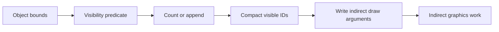

A **predicate** is a true/false condition, here “does this object survive the culling test?” A **compaction** packs the surviving items into a dense output range. A **dispatch** is one launch of a compute grid. An **indirect command** is a command whose count or dimensions are read by the GPU from a buffer, so the CPU does not need to know the result before submission.

Two common compaction strategies expose a fundamental GPU design choice. In an atomic append, each passing thread increments a shared counter and writes its ID to the returned slot:

```text
if visible[i]:
    slot = atomic_fetch_add(count, 1)
    visibleIDs[slot] = i
```

For 3,700 visible items, the final count is 3,700 and every output slot from 0 through 3,699 is filled. The order is generally scheduling-dependent: object 814 might obtain slot 0 in one run and slot 12 in another. If the consumer treats the result as a set, that is fine. If stable ordering matters, it is not. A hot counter can serialize many lanes, and a single global atomic may become a bottleneck.

A scan-based method does more phases but gives each item a unique deterministic destination. Let $p_i$ be 1 when item $i$ passes and 0 otherwise. The exclusive prefix sum is

$$
o_i=\sum_{j=0}^{i-1}p_j.
$$

Each passing item writes to `visibleIDs[o_i]`. If item 0, 2, and 4 pass, their offsets are 0, 1, and 2. In a large GPU, the prefix sum itself is built hierarchically: each workgroup scans a local segment, a later phase scans workgroup totals, and a final phase adds each segment’s base offset. A workgroup barrier coordinates threads in one workgroup; it is not a global barrier that safely coordinates every workgroup in an arbitrarily large dispatch. Dispatch boundaries, with appropriate resource dependencies, become global phase boundaries.

Then a final one-thread or small compute operation writes an indirect argument structure such as a draw count or dispatch grid. The CPU records that a later operation will consume the argument buffer, but the GPU determines its contents. This changes the CPU’s role from “calculate all visible work” to “submit a valid dependency chain.” A direct draw is still better for tiny fixed work; GPU-generated commands are valuable when they remove CPU readback, reduce submission count, or keep a large variable workload on the device. They are not automatically faster: scan has multiple launches and temporary storage, while atomic append has contention and unstable ordering.

## Keep separate kinds of ping-pong separate

Suppose a particle update reads positions $x_t$ and velocities $v_t$, computes a new state, and writes $x_{t+1},v_{t+1}$. If each thread reads and writes the same arrays without a carefully proven in-place scheme, one particle may observe another particle’s partially updated state. Two state buffers solve that problem: read from A, write to B, then swap roles. That is **algorithmic ping-pong**; it separates old simulation state from new simulation state.

A frame ring solves another problem. While frame 0 is still executing, the CPU may prepare frame 1. If both frames write the same upload bytes, frame 1 can overwrite data frame 0 has not read yet. A **frame slot** is a set of per-frame temporary resources that can be reused only after the submission using them has completed. Two or three slots can let CPU and GPU overlap. A slot count does not by itself prove safety: code must associate each slot with the command buffer that last used it and wait, poll, or receive a completion signal before recycling it.

Consider three slots, S0, S1, and S2. At time $t=0$, CPU prepares S0 and submits command buffer C0. At $t=1$, while C0 executes, CPU fills S1 and submits C1. At $t=2$, CPU fills S2 and submits C2. At $t=3$, CPU wants S0 again. It may reuse S0 only if C0 has completed; “three loop iterations elapsed” is not a completion proof. If the GPU stalls, C0 may still be reading S0. If completion arrives, S0 is retired and can be filled with a later frame. More slots may improve throughput under some loads, while increasing memory use and input-to-display latency.

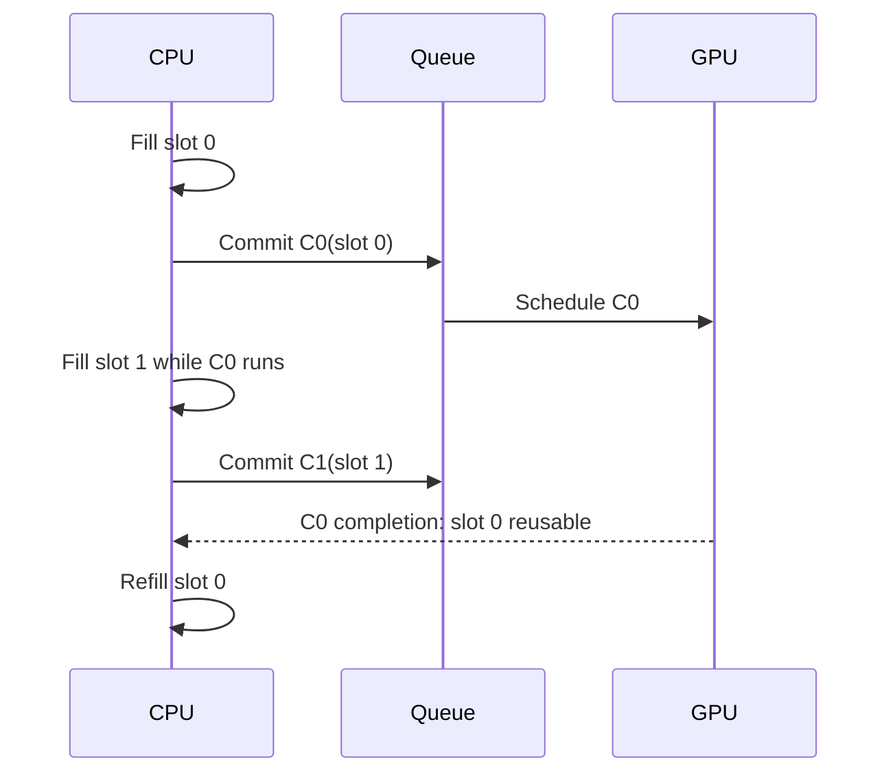

The source material describes a per-frame bump arena and ring buffers. A **bump arena** allocates by advancing a cursor through a larger allocation; reclaiming the whole arena at once is cheap. A **ring buffer** reserves a contiguous logical stream whose physical allocation wraps around. Both need a retirement rule: the CPU may not reclaim a range while the GPU still refers to it. A fixed 256-byte alignment often appears as a project policy for uniform or argument records, but it is not a universal rule for every Metal binding. The correct alignment depends on resource type, binding path, platform capability, and documented API requirements. Store the chosen alignment beside the allocator contract rather than teaching a magic number as a law.

## Dependency graphs are the real meaning of asynchrony

An asynchronous command submission lets the CPU continue without waiting for GPU completion. It does not mean the GPU work is independent. If a culling compute pass writes visible IDs and an indirect draw reads them, the draw depends on the compute pass. If a copy engine uploads a texture and a render pass samples it, rendering depends on the copy. If a readback buffer is consumed by the CPU, CPU access depends on the GPU finishing and on any required visibility/coherency operation.

Represent each operation as a node and each “must happen before and be visible to” relation as an edge. For example, `upload → cull → compact → indirect draw → present` is one path. A second independent shadow-map pass might overlap part of it, but only if it does not contend for the same constrained resources and has no data dependency. Two queues or command streams do not guarantee overlap. If both saturate memory bandwidth, or one waits on the other’s output, additional scheduling machinery can increase overhead without shortening the critical path.

Apple’s command-structure guidance says command buffers on a queue are scheduled after earlier committed buffers waiting in that queue; the perceived order is preserved, though implementation reordering is possible when it does not change observable behavior. A committed command buffer cannot be reused. Its scheduled callback marks scheduling, not completion; `addCompletedHandler` runs when the GPU has finished the commands. A blocking `waitUntilCompleted` stalls the calling CPU thread and is usually inappropriate in an interactive frame loop. See Apple’s [command structure guide](https://developer.apple.com/documentation/Metal/setting-up-a-command-structure) and [MTLCommandBuffer reference](https://developer.apple.com/documentation/metal/mtlcommandbuffer).

Metal hazard tracking and explicit synchronization must be understood at the resource-access level. In classic `MTLCommandQueue` paths, Metal can automatically synchronize conflicts for directly bound resources using tracked hazard mode; heap-created resources default to untracked, and newer Metal 4 queue paths require explicit resource synchronization regardless of the resource hazard-tracking property. Check the exact queue/API generation and resource provenance. A fence, event, or barrier is not a universal “flush everything” switch. `MTLFence` orders GPU memory operations between passes; Apple documents its supported scopes and encoding rules. Events coordinate workloads across queues, and shared events extend synchronization to CPU code and, where supported, other devices. Do not transplant Vulkan’s host fence meaning onto `MTLFence`; the word “fence” is reused by APIs for different synchronization layers. When correctness depends on a cross-queue producer-consumer edge, state which resource is written, which operation consumes it, and which Metal mechanism establishes ordering and visibility.

There is a subtle but important distinction between a **lifetime edge** and a **data dependency edge**. A resource can stay alive for the entire frame and still be read before its producer’s writes are visible. Conversely, a dependency may be correct while the CPU frees an object or recycles its memory too early. For every transient resource, write down: who allocates it, who writes it, who reads it, what event makes the write available, and what completion permits reuse. This five-question habit catches many “works on my GPU” failures.

## Arithmetic intensity tells you what to measure next

A kernel’s **arithmetic intensity** is the number of floating-point operations performed per byte transferred at a chosen level of the memory hierarchy. “Chosen level” matters: data can be fetched from external memory once and reused many times from a cache or threadgroup memory. A byte count that ignores reuse can misclassify the bottleneck.

For a vector multiply $y_i=a_i b_i$ with 32-bit floats, each element performs one multiplication and, in an ideal streaming pass, reads 4 bytes from $a$, reads 4 from $b$, and writes 4 to $y$. Thus

$$
I=\frac{1\text{ FLOP}}{12\text{ bytes}}\approx0.0833\text{ FLOP/byte}.
$$

This low intensity suggests that memory bandwidth may dominate on a device capable of far more floating-point work per second than this stream can feed. But the conclusion must be tested: cache behavior, launch overhead, CPU synchronization, and the actual memory traffic may dominate a small benchmark. A benchmark that calls `waitUntilCompleted` after every dispatch measures an intentionally serialized path, not necessarily the throughput of a pipelined application.

For matrix multiplication, $C_{ij}=\sum_k A_{ik}B_{kj}$, a naïve output-at-a-time implementation reloads many values. A tiled kernel loads a tile of A and B into fast local storage and reuses each value across multiple multiply-adds. For square tile width $T$, one tile step performs about $2T^3$ floating operations (counting multiply and add separately) and moves about $8T^2$ bytes of 32-bit A/B inputs, before output traffic and cache effects. So the simplified intensity is

$$
I\approx\frac{2T^3}{8T^2}=\frac{T}{4}\text{ FLOP/byte}.
$$

At $T=16$, that model gives about 4 FLOP/byte. This is an idealized comparison, not a benchmark prediction: it omits output stores, padding, edge tiles, synchronization, register spills, and whether the cache already retains data.

The roofline model bounds attainable performance by

$$
P\le \min(P_{\max}, B_{\max} I),
$$

where $P_{\max}$ is peak compute throughput, $B_{\max}$ is sustainable bandwidth at the memory level under study, and $I$ is arithmetic intensity at that level. If an illustrative GPU sustains 10 TFLOP/s and 500 GB/s, its “ridge point” is $10{,}000/500=20$ FLOP/byte. A vector multiply at 0.083 FLOP/byte lies far to the bandwidth side of this simplified roof. A tiled matrix operation at 4 FLOP/byte is improved, but still below the example ridge. The values are hypothetical and should never be reported as a device measurement.

The model suggests choices, not guarantees. Fusion can remove an intermediate write/read and increase useful operations per byte, but may extend register lifetimes or reduce occupancy. Fission can add memory traffic but make each kernel simpler, increase parallelism, or lower register pressure. Reducing registers per thread may permit more resident workgroups, yet additional spills can make the kernel slower. Measure GPU time separately from CPU submission time, warm-up, allocation, and synchronization. Inspect a representative workload and a profiler capture before deciding which roof is relevant.

## Metal is a chain of objects with distinct jobs

Metal’s core object model is easier to remember if each object answers one question. `MTLDevice` represents a GPU and creates resources or pipeline states. `MTLCommandQueue` accepts command buffers for that device. `MTLCommandBuffer` records a sequence of work to submit. A **command encoder** writes one kind of work into it: render commands, compute commands, or blits (resource copies and related transfer operations). A render pipeline state packages compiled vertex/fragment stages and fixed configuration such as attachment formats. A compute pipeline state represents a compiled kernel and exposes device/pipeline properties relevant to dispatch.

An encoder is not a reusable global command stream; it is the scoped place where commands of that type are encoded into a command buffer. End the encoder before starting another encoder on the same command buffer. The sequence might be: create command buffer, encode compute culling, end compute encoder, encode a blit or another compute stage if needed, end it, encode render, end render, register presentation, commit. The command buffer owns the ordered command recording; the encoder configures and emits one segment. Pipeline state is reusable across frames; command buffer and encoder are per-submission work objects. Mixing these lifetimes obscures bugs.

A drawable is a scarce presentation image supplied through a view or layer. Apple recommends obtaining it as late as practical—ideally just before encoding the onscreen pass—and holding it as briefly as possible. `MTKView.currentRenderPassDescriptor` implicitly obtains the current drawable; `currentDrawable` may be nil if all drawable objects are in use. Encode into that drawable’s texture, register its presentation on the command buffer, then commit. See [MTKView](https://developer.apple.com/documentation/metalkit/mtkview/) and [currentDrawable](https://developer.apple.com/documentation/MetalKit/MTKView/currentDrawable). This is why expensive CPU scene preparation should generally happen before acquiring the drawable.

Render attachments also have a begin/end contract. A load action says whether an attachment’s previous contents are needed, should be cleared, or need not be preserved. A store action says whether the result must survive the pass. If depth is only used during one pass and discarded afterward, storing it to external memory is unnecessary. Apple-family tile rendering can keep eligible temporary attachment data in tile memory, and Metal memoryless resources are explicitly temporary pass-local resources; they cannot be loaded from or stored to. This is a useful optimization when its constraints match the render graph, not a universal promise that a pass will run faster. Resource type, GPU family, attachment action, format, and later consumers matter. See Apple’s [storage-mode guide](https://developer.apple.com/documentation/metal/setting-resource-storage-modes) and [`storageModeMemoryless`](https://developer.apple.com/documentation/metal/mtlresourceoptions/storagemodememoryless).

Metal storage modes describe where a resource lives and who can access it. Shared storage gives CPU and GPU access to system memory; private storage is GPU-only; managed storage can represent separate CPU/GPU copies on platforms that support it; memoryless storage is temporary render-pass memory on supported Apple GPUs. Defaults vary by architecture. Apple advises using the system default when suitable and checking feature support rather than assuming a particular machine from a product label. “Unified memory” removes a separate-copy topology for many resources; it does not remove the need to avoid CPU/GPU races or to observe completion before changing data that GPU work still uses.

## C++, Objective-C++, and Swift have different ownership rules

A renderer commonly has a C++ engine core and an Objective-C/Swift presentation shell. Objective-C++ (`.mm`) lets one translation unit speak both C++ and Objective-C, making it a practical narrow bridge: C++ contracts and data structures remain on one side, Metal objects and Cocoa view types on the other. Keep that boundary deliberate. A generic renderer should not expose `id<MTLDevice>` through every public engine interface if a small backend-specific implementation can own the handle.

Objective-C ARC (Automatic Reference Counting) manages strong and weak object references inserted by the compiler. It is not C++ RAII (resource acquisition is initialization): C++ destructors govern C++ object lifetime, while Objective-C objects follow ARC ownership. `__bridge`, `__bridge_retained`, and `__bridge_transfer` express different transfer behavior between Objective-C object pointers and opaque C pointers. A bridge cast does not, by itself, prove that a GPU submission has stopped using a resource. The CPU object’s retain lifetime and the allocation’s safe-to-reuse lifetime are related but distinct questions.

A completion handler is an asynchronous callback. It should capture only what it needs, avoid unprotected mutation of renderer state, and move UI changes onto the main queue when required by the UI framework. A safe pattern is often: completion signals a slot-retirement mechanism or publishes a small immutable result; the main thread consumes it at an appropriate point. Do not block the render/UI thread waiting for every command buffer unless the operation inherently requires an immediate answer, such as a deliberately synchronous picking path. For ordinary rendering, asynchronous submission plus per-slot completion tracking is the shape that allows overlap.

For a C++/Swift boundary, prefer a narrow C-compatible interface or Objective-C++ wrapper with explicit ownership and error semantics. A Swift closure retained by C++ needs a clear release path; a raw pointer must state whether it is borrowed, retained, or owned. An `NSError` should preserve a meaningful domain, code, and description rather than being flattened into a generic failure. These are interface design principles; they do not certify any particular Kairo or Maveb bridge implementation, which was not checked against source code here.

## A repeatable design and debugging walk-through

Take GPU culling as a concrete exercise. First write the CPU baseline and measure separately: scene traversal, culling, list construction, command submission, and GPU rendering. Next define the output contract: visible object IDs, exact count, allowed ordering, and capacity. If order does not matter and the count is modest, start with atomic append. If stable order or per-item offsets matter, build a scan pipeline and account for all intermediate arrays and dispatch boundaries. Then keep the count on the GPU and produce indirect work rather than reading it back only to issue a draw.

Now draw the dependency graph: bounds upload must be complete before culling reads; culling writes predicates; scan reads predicates; scatter writes the compact list; indirect-argument generation writes count fields; render consumes list and arguments. Mark every producer-to-consumer edge and every lifetime end. Assign temporary memory to a frame slot or a transient pass, and refuse to recycle it until the last consumer’s command buffer completes. If resources cross queues, encode the exact synchronization relationship. If they stay on one queue, rely only on documented queue and hazard rules, not an intuition that “GPU commands happen in order.”

Then inspect the cost model. Estimate arithmetic intensity for the kernel’s data movement. Estimate bytes uploaded and whether persistent/ring allocation can reduce CPU allocation overhead. Measure GPU timestamps around the actual stages and CPU wall time around preparation and submission. An optimization that shortens culling but adds two dispatches may lose for 100 objects and win for 100,000. A change that cuts average frame time may increase worst-case latency if it adds queued frames. Report workload size, device, configuration, warm-up, and whether the measurement waited for completion.

Finally construct a failure trace deliberately. For a frame-slot overwrite: CPU writes slot 0 for C0; GPU starts C0; CPU wraps and writes slot 0 for C3 before C0 completes; C0 now reads some old and some new values. The symptom may be intermittent geometry corruption. For a missing dependency: compute writes an indirect count; render consumes it without an ordering/visibility edge; GPU may see stale or partial arguments. For wrong scan math: exclusive offset uses an inclusive sum; first passing item writes to slot 1, leaving a hole and potentially exceeding capacity. For the wrong roofline diagnosis: benchmark blocks after every tiny kernel, reporting CPU launch/sync overhead as if it were shader throughput. Each trace begins with a violated contract, not with a mysterious graphics driver.

The reliable mental model is compact: a GPU algorithm produces data; a dependency graph makes that data ready for its consumer; a frame-slot lifetime makes its storage safe to reuse; a command buffer carries the ordered work to a Metal queue; a completion signal retires work that has truly finished; a performance model tells you which measurement to improve. Keep these contracts explicit and API details become easier to place.

## Give one image an explicit path through the machine

Imagine the workshop scene is ready: meshes, materials, a camera and an editor panel waiting for the next image. The rendering mathematics tells us which values to calculate. An explicit graphics API asks a different set of questions: where will those values live, which operations will read them, and what proves the previous user has finished? Vulkan exposes those contracts through resource objects, recorded commands and dependencies. Its handles are names for parts of this agreement, not a sequence of unrelated incantations.

### Start by separating discovery from permission

An instance connects the application to a Vulkan implementation. A physical-device handle identifies an enumerated adapter; a logical device opens the selected features and queues of that adapter for the application. A surface represents a particular window-system presentation target. Presentation support must therefore be checked for the chosen surface and queue family. A queue family describes compatible operation capabilities and command allocation; a queue is a submission channel, not a CPU thread or proof of an independent hardware engine.

A property reports a limit or characteristic, such as an alignment or maximum image size. A feature reports a capability that may need enabling. An extension adds an API capability beyond a declared baseline. Support, enablement and actual use are three separate facts. Record the capability that each renderer path requires and what happens when it is unavailable. This is more useful than ranking adapters only by a familiar vendor or assuming the first enumerated adapter works.

On a portability implementation, instance enumeration policy and the device's portability-subset contract are separate steps. A loader can hide portability adapters unless the appropriate enumeration extension and creation flag are used; a device advertising the portability-subset extension brings additional device requirements. Validation and diagnostic extensions likewise need discovery. An example that requests a recent command or feature cannot quietly assume it is part of a Vulkan 1.1 baseline.

### Create storage and then describe how to interpret it

A buffer describes a linear byte resource. An image describes structured storage with a format, extent, mips, layers, sample count and usage. Device memory supplies backing allocation. A view selects an interpretation and subresource range; a sampler supplies filtering and addressing behavior. A descriptor connects a shader binding to the intended buffer or image view and sampler. A descriptor's layout field describes the image layout expected during access; writing that field does not transition the image.

Before binding ordinary resource memory, query its size, alignment and compatible memory-type mask. A type is usable only if the resource permits its index and its property flags meet the required properties. A preference is different from a requirement. Device-local and host-visible can coexist in one type; therefore “device-local means the CPU cannot map it” is false in general. Mapping an optimal-tiled image allocation also does not by itself provide a simple tightly packed pixel layout. A staging copy is one explicit upload design, not a synonym for every possible device-local allocation.

Suppose a suballocator has cursor $c=300$, required alignment $a=256$, and resource size $s=160$. The next start is $o=\lceil c/a\rceil a=512$, and the occupied interval is $[512,672)$. The 212-byte gap is alignment padding. A checked implementation must reject zero alignment and detect arithmetic overflow before applying a bit-mask shortcut. Mixed buffers and images can add granularity and dedicated-allocation constraints; satisfying one offset equation does not establish complete Vulkan allocation compatibility.

A pipeline layout declares the resource interface: descriptor-set layouts and push-constant ranges. The pipeline combines that interface with shader stages and rendering state. A shader module contains intermediate code, not a guarantee that every final pipeline using it has been compiled. Pipeline caches are implementation-specific acceleration data; retain enough identity and failure handling to rebuild rather than treating an arbitrary cache blob as portable executable code.

### Follow a frame slot and a presentation image separately

Let the renderer use two frame slots and a swapchain with three images. For frame number $n$, the CPU may choose slot $n\bmod2$. Acquisition returns an image index independently. A possible sequence is:

| Frame | Reusable CPU/GPU slot | Acquired image |
|---:|---:|---:|
| 0 | 0 | 2 |
| 1 | 1 | 0 |
| 2 | 0 | 1 |
| 3 | 1 | 2 |

Slot 0's fence proves when slot 0's command storage and mutable uniform region may be reused. It does not say which swapchain image will be acquired next. Keep slot-indexed command pools, descriptors and upload regions separate from image-indexed image views and presentation state. A readback also needs its frame, camera and resource generation so a delayed result is interpreted against the state that produced it.

Use an acquire semaphore associated with the frame slot, after its previous wait is known to have completed. For present-wait semaphores, a robust basic pattern associates one with each swapchain image. Waiting for graphics completion alone does not prove that presentation has finished consuming a semaphore. Reacquiring the same image and establishing the acquire wait provides the relevant reuse ordering. This is the specific distinction documented in the [Khronos swapchain semaphore guide](https://docs.vulkan.org/guide/latest/swapchain_semaphore_reuse.html).

The safe frame loop is a small transaction. First wait for the chosen slot's previous work, collect eligible retired payloads, and handle completed readbacks. Then acquire an image. An out-of-date result before a usable acquisition must not leave a reset fence that no submission will signal. Prepare and record the new work; reset its completion fence only when entering a path that will submit, with an explicit failure policy. Submit waits on acquisition at a stage covering the first relevant image use. Presentation waits on rendering's signal.

After successful acquisition, an arbitrary exception cannot simply abandon both the image and a signaled binary semaphore and then repeat the ordinary loop. The recovery policy must resolve that acquired-image/semaphore state, for example by completing a defined fallback frame or performing controlled presentation-resource recovery. A supported maintenance API may offer more explicit operations, but it requires its own feature and synchronization handling. Likewise, submission failure is not a successful frame: device loss stops normal work, and other failures require a documented recovery path before waiting on a fence that has no pending signal.

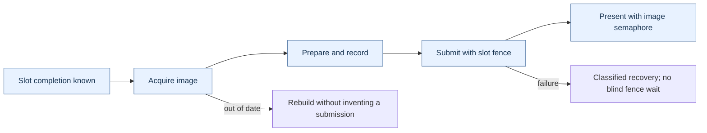

This diagram shows control obligations. Its arrows do not mean the CPU waits between every box: semaphores carry device-side dependencies while the CPU continues preparing independent work.

### A command buffer is reusable only under its actual state contract

Recording turns commands into an executable stream. Submission makes that stream pending. It cannot be reset while pending. After completion, an ordinary reusable command buffer can become executable again; one recorded with one-time-submit usage instead becomes invalid and must be reset before another recording. Destroyed referenced resources or invalidated secondary recordings can also invalidate a previously recorded stream. “The fence signaled” establishes a completion fact, not permanent validity of everything ever referenced.

A command pool is externally synchronized allocation state. Recording a buffer allocated from a pool participates in that synchronization contract; having one command-buffer handle per worker does not automatically make a shared pool safe. A common organization is one pool for each recording worker, queue family and reusable lifetime class. Reset only when every submission using the relevant buffers is finished. The [command-buffer specification](https://docs.vulkan.org/spec/latest/chapters/cmdbuffers.html) defines these state and synchronization obligations.

### Derive a dependency from the real producer and consumer

Suppose compute culling writes indirect arguments. The consumer is the draw-indirect stage reading commands, not a vertex shader reading ordinary data. If the same compute pass also produces instance attributes consumed by vertex fetch, that second resource use requires the corresponding vertex-input read scope. One dependency tuple does not automatically cover all other outputs of the dispatch.

Distinguish read-after-write, write-after-read and write-after-write. A later reader must observe the producer's values. A later writer must wait until earlier readers no longer need the overwritten contents. A later writer must be ordered against an earlier writer when the result depends on their order. An execution-only dependency can suffice for a pure write-after-read hazard; visibility operations are needed when values must be carried from a write to a later access. This distinction is illustrated by the [Khronos synchronization examples](https://docs.vulkan.org/guide/latest/synchronization_examples.html).

For a shadow map, include every stage in which the actual depth writes can occur. Early and late fragment tests are distinct possibilities; naming only late tests is not a universal shadow barrier. For an image, also identify the aspect, mip and layer range, old and new layouts, and any required queue-family ownership transfer. Layout, access, ownership and completion are related contracts, not alternative spellings for the same thing.

Readback completes a longer path. Make the GPU's writes available to the host through the required memory dependency, establish completion, and invalidate a noncoherent mapped range before CPU reads where required. Host-coherent memory removes explicit cache-maintenance operations; it does not replace producer/consumer dependencies or authorize a CPU read before the copy finishes. The retained source's fence-plus-coherency description assumes the rest of that path is correctly established; it is not a complete readback proof by itself.

### Retire a resource after every user, not after one convenient clock

The C++ owner answers who will eventually destroy a payload. The GPU dependency system answers when destruction is legal. Releasing a logical texture handle can remove it from future scene use while an owning retirement record keeps its old native image, view and memory alive. Capture that payload by ownership; a callback that refers to an already destroyed wrapper does not preserve it.

For a resource used on graphics, compute and transfer queues, write a completion stamp $r=(r_g,r_c,r_t)$. If the observed completion values are $d=(d_g,d_c,d_t)$, the payload is ready only when

$$
d_g\ge r_g\quad\land\quad d_c\ge r_c\quad\land\quad d_t\ge r_t.
$$

The example $r=(9,5,3)$ is not ready at $d=(10,4,100)$: compute is still using it. Values from separate timeline semaphores cannot be compared as if they were one global timestamp. A single joined completion token can be sufficient if a dependency chain proves that its signal follows every relevant use. A host counter that merely assigns increasing numbers to independent queues does not prove that order.

A FIFO retirement queue also has a data-structure assumption. If entries arrive with retirement values 100 and then 3, a collector that checks only the front will keep the second entry even when completion reaches 5. It remains safe but delays reclamation. Enforce ordered insertion, use a structure appropriate to the ordering, or scan ready entries independently. With multiple queue stamps there may be no single scalar order at all.

The complete CPU model below tests ownership and the completion predicate. It deliberately does not call Vulkan: passing the model tests establishes those bookkeeping rules, not correct native API barriers, device lifetime, presentation or GPU execution.

```cpp
#include <algorithm>
#include <array>
#include <cassert>
#include <cstdint>
#include <memory>
#include <stdexcept>
#include <utility>
#include <vector>

// CPU bookkeeping model. These values are not native GPU handles.
using Stamp = std::array<std::uint64_t, 3>; // graphics, compute, transfer

struct Payload {
    int id;
    std::vector<int>* destructionLog;
    Payload(int value, std::vector<int>& log) : id(value), destructionLog(&log) {}
    Payload(const Payload&) = delete;
    Payload& operator=(const Payload&) = delete;
    ~Payload() { destructionLog->push_back(id); }
};

class RetirementQueue {
    struct Entry {
        Stamp required;
        std::unique_ptr<Payload> payload;
    };
    std::vector<Entry> entries;
    Stamp observed{};

    static bool covers(const Stamp& completed, const Stamp& required) {
        for (std::size_t i = 0; i < completed.size(); ++i)
            if (completed[i] < required[i]) return false;
        return true;
    }

public:
    void retire(Stamp required, std::unique_ptr<Payload> payload) {
        if (!payload) throw std::invalid_argument("missing payload");
        entries.push_back({required, std::move(payload)});
    }

    std::size_t collect(Stamp completed) {
        if (!covers(completed, observed))
            throw std::invalid_argument("completion counters regressed");
        observed = completed;
        const auto before = entries.size();
        std::erase_if(entries, [&](const Entry& entry) {
            return covers(completed, entry.required);
        });
        return before - entries.size();
    }

    std::size_t size() const { return entries.size(); }
};

int main() {
    std::vector<int> destroyed; // outlives every Payload in this test
    RetirementQueue queue;

    queue.retire({100, 0, 0}, std::make_unique<Payload>(1, destroyed));
    auto payload = std::make_unique<Payload>(2, destroyed);
    queue.retire({3, 0, 0}, std::move(payload));
    assert(!payload); // retirement queue now owns it
    queue.retire({9, 5, 3}, std::make_unique<Payload>(3, destroyed));
    assert(destroyed.empty());

    // Unordered insertion must not block a ready entry behind value 100.
    assert(queue.collect({5, 0, 0}) == 1);
    assert((destroyed == std::vector<int>{2}));

    // A large transfer completion cannot replace unfinished compute work.
    assert(queue.collect({10, 4, 100}) == 0);
    assert(queue.size() == 2);
    assert(queue.collect({10, 5, 100}) == 1);
    assert((destroyed == std::vector<int>{2, 3}));
    assert(queue.collect({100, 5, 100}) == 1);
    assert(queue.size() == 0);
    assert((destroyed == std::vector<int>{2, 3, 1}));

    bool rejected = false;
    try { queue.collect({99, 5, 100}); }
    catch (const std::invalid_argument&) { rejected = true; }
    assert(rejected);

    rejected = false;
    try { queue.retire({0, 0, 0}, nullptr); }
    catch (const std::invalid_argument&) { rejected = true; }
    assert(rejected);
    // A real renderer must likewise drain/resolve all payload uses at shutdown.
}
```

The test drains every payload before the queue dies. A real shutdown must first resolve all relevant device uses and keep the device, allocation machinery, and destruction dependencies alive until retirement finishes. A default C++ container destructor is not a substitute for that shutdown protocol. This CPU model was compiled and run with address and undefined-behavior sanitizers; no native Vulkan execution is claimed.


## Build variable GPU workloads without a CPU round trip

### + M132

Pass 10 completes **Phase 22: GPU Architecture, SIMT Execution, Memory Hierarchy, Compute, and Parallel GPU Algorithms**.


The mastery cards make the intent explicit: M130 is the shift into **GPU-resident scheduling and GPU-driven pipelines**, M131 is about keeping CPU, GPU and memory systems overlapped without accidental stalls, and M132 asks you to predict performance from resource usage and data movement instead of treating GPU optimization as trial-and-error.

---

### GPU-RESIDENT DATA STRUCTURES & GPU-DRIVEN WORK

**The next GPU transition: from parallel computation to parallel scheduling**

Pass 9 taught:

$$
\text{map},
\quad
\text{reduce},
\quad
\text{scan},
\quad
\text{compact},
\quad
\text{sort}.
$$

Those operations become far more powerful once the GPU stops merely processing work selected by the CPU and begins deciding:

$$
\boxed{
\text{what work should exist at all}.
}
$$

A traditional renderer might do:

```text id="p10-cpu-driven"
CPU:
    inspect every object
    determine visibility
    choose LOD
    build draw list
    upload commands
    submit draws

GPU:
    execute them
```

A GPU-driven renderer tries to move toward:

```text id="p10-gpu-driven"
GPU:
    inspect object data
    determine visibility
    select LOD
    compact visible objects
    produce command arguments
    consume those arguments
```

The CPU submits the **algorithm**, not necessarily every individual piece of work.

---

**GPU hash tables**

A hash table maps:

$$
key\rightarrow value.
$$

Hash function:

$$
h(k)\in[0,M).
$$

On a CPU we might use linked buckets, trees or dynamically allocated nodes.

Those are usually poor GPU representations because they introduce:

- pointer chasing,
- random memory,
- dynamic allocation,
- divergent traversal.

A more GPU-friendly representation is frequently a flat array with open addressing.

---

**Open-addressed hash table**

Suppose table capacity is:

$$
M.
$$

Initial position:

$$
i_0=h(k)\bmod M.
$$

If occupied by another key, probe:

$$
i_j=
(i_0+j)\bmod M
$$

for linear probing.

Insertion needs an atomic compare-and-swap.

Conceptually:

```cpp id="p10-hash-insert"
constexpr uint32_t Empty =
    0xffffffffu;

void Insert(
    uint32_t key,
    uint32_t value)
{
    uint32_t slot =
        Hash(key) & (TableSize - 1);

    for (uint32_t probe = 0;
         probe < MaxProbe;
         ++probe)
    {
        uint32_t previous =
            atomic_compare_exchange(
                table[slot].key,
                Empty,
                key);

        if (previous == Empty ||
            previous == key)
        {
            table[slot].value =
                value;

            return;
        }

        slot =
            (slot + 1) &
            (TableSize - 1);
    }

    // Overflow/failure must be tracked.
}
```

The atomic ensures two lanes cannot both claim the same empty slot.

---

**Hash-table load factor matters enormously on GPUs**

Define:

$$
\boxed{
\alpha=
\frac{
N_{\text{occupied}}
}{
M_{\text{capacity}}
}.
}
$$

At low:

$$
\alpha,
$$

most lookups resolve quickly.

As:

$$
\alpha\rightarrow1,
$$

probe lengths grow dramatically.

That creates:

- more random memory traffic,
- longer divergent loops,
- greater atomic contention.

A CPU might tolerate moderate extra probing.

On SIMT hardware, one lane performing 30 probes can hold up a subgroup whose other lanes finished after two.

Thus hash-table performance is not just average lookup count.

It is also:

$$
\boxed{
\text{distribution of probe lengths across lanes in the same subgroup}.
}
$$

---

**Spatial hashing**

For spatial data, convert position:

$$
P=(x,y,z)
$$

into integer cell coordinate:

$$
c_x=
\left\lfloor
\frac{x}{s}
\right\rfloor,
$$

$$
c_y=
\left\lfloor
\frac{y}{s}
\right\rfloor,
$$

$$
c_z=
\left\lfloor
\frac{z}{s}
\right\rfloor
$$

where:

$$
s=\text{cell size}.
$$

Then hash:

$$
H(c_x,c_y,c_z).
$$

A simple conceptual mixer is:

$$
H=
(c_xp_1)
\oplus
(c_yp_2)
\oplus
(c_zp_3).
$$

Spatial hashing is useful when the conceptual grid is enormous or sparse.

A dense $1000^3$ grid contains:

$$
10^9
$$

cells.

If only 10,000 are occupied, dense storage is absurd.

Hash only occupied cells.

---

**Dense spatial binning versus spatial hashing**

Do not confuse them.

For a screen divided into:

$$
120\times68
$$

tiles, the total tile count is only:

$$
8160.
$$

A dense array of 8160 counters/offsets is cheap.

Hashing would add unnecessary collisions and indirection.

For an effectively unbounded sparse 3D world, hashing becomes attractive.

Your Gaussian renderer correctly uses **dense tile binning**, not a hash table.

That is the better data structure for its domain.

---

**Spatial binning**

Suppose object $i$ belongs to bin:

$$
b_i.
$$

We need data structure:

```text id="p10-csr-bins"
bin 0 → object indices...
bin 1 → object indices...
bin 2 → object indices...
```

The canonical GPU representation is CSR-like:

$$
counts[b],
$$

$$
offsets[b],
$$

$$
references[].
$$

For bin $b$:

$$
references[
offset_b
:
offset_{b+1}
]
$$

are that bin's objects.

Your Vulkax Gaussian scheduler's comments explicitly describe this structure: tile counts, prefix offsets and references, with a CPU oracle validating CSR shape, bounds, tile membership and deterministic ordering.

---

**Atomic append construction**

The simplest GPU builder:

```cpp id="p10-atomic-bin"
uint32_t local =
    atomic_fetch_add(
        binCounts[bin],
        1);

binEntries[
    bin * MaxEntriesPerBin +
    local
] = objectID;
```

Or one global append:

```cpp id="p10-global-append"
uint32_t dst =
    atomic_fetch_add(
        globalCount,
        1);

output[dst] =
    objectID;
```

This is extremely easy.

And often perfectly good.

---

**Atomic append problems**

Imagine every projected Gaussian overlaps the same central screen tile.

Thousands of threads execute:

$$
atomicAdd(
count[\text{center}],
1
).
$$

That one counter becomes a serialization hotspot.

Other issues include capacity management and nondeterministic ordering.

If threads race for append positions, the output order depends on execution timing.

If deterministic order matters, atomic append alone may be insufficient.

---

**Count → scan → scatter construction**

The more scalable construction from Pass 9:

First calculate each producer's output count:

$$
c_i.
$$

Then exclusive scan:

$$
o_i=
\sum_{j<i}c_j.
$$

Now producer $i$ owns:

$$
[o_i,o_i+c_i).
$$

It writes without atomics.

This is exactly how Maveb's Gaussian tile expansion works.

Projected Gaussian $i$:

$$
c_i=
\text{number of overlapping tiles}.
$$

Scan gives its base destination.

Then it writes all tile references to its private region.

---

**Atomic append versus scan is not ideological**

Atomic append costs roughly:

$$
\text{one atomic per output}
$$

and often one dispatch.

Scan construction costs multiple phases:

$$
\text{count}
\rightarrow
\text{scan}
\rightarrow
\text{scatter}.
$$

For small or sparse output:

$$
\boxed{
\text{atomic append may be faster}.
}
$$

For huge output with contention or deterministic-layout requirements:

$$
\boxed{
\text{scan construction often scales better}.
}
$$

This is a recurring engine design decision.

---

**Indirect argument buffers**

Now suppose the GPU computes that only:

$$
K
$$

items remain.

The naive route is:

```text id="p10-bad-readback"
GPU computes K
↓
CPU reads K
↓
CPU submits dispatch(K)
```

That requires a GPU→CPU synchronization/readback.

Terrible.

Instead GPU writes a buffer containing command arguments.

Later the GPU command processor consumes that buffer.

That is **indirect dispatch/draw**.

---

**Current Maveb indirect dispatch is already real**

Maveb allocates:

```text id="p10-indirect-buffer"
Gaussian Radix Indirect Dispatch
```

as a GPU-private buffer containing three `uint32_t`s.

Its scan stage writes:

$$
dispatch_x
=
\left\lceil
\frac{
N_{\text{generated entries}}
}{
256
}
\right\rceil,
$$

$$
dispatch_y=1,
\qquad
dispatch_z=1.
$$

Then later Metal executes:

```cpp id="p10-indirect-dispatch"
histogram->
    dispatchThreadgroups(
        indirectDispatchBuffer,
        0,
        {256,1,1});
```

and does the same for radix scatter.

The CPU never needs to know the dynamic entry count before launching those stages.

That is exactly Part 2161.

---

**Why indirect execution matters**

Without it:

$$
GPU\rightarrow CPU\rightarrow GPU
$$

forms a round trip.

With indirect arguments:

$$
GPU_A
\rightarrow
\text{argument buffer}
\rightarrow
GPU_B.
$$

No CPU stall.

This is a foundational primitive of GPU-driven rendering.

---

**GPU-driven culling pipeline**

Suppose there are:

$$
N=1,000,000
$$

renderable instances.

A scalable pipeline can do:

```text id="p10-cull-pipeline"
instance bounds
    ↓
frustum test
    ↓
optional occlusion test
    ↓
LOD selection
    ↓
visibility predicate/count
    ↓
compaction
    ↓
draw/dispatch arguments
    ↓
indirect rendering
```

The CPU submits a small number of passes rather than inspecting one million objects every frame.

---

**Frustum culling in compute**

A perspective frustum can be represented by six planes:

$$
P_j=(n_j,d_j)
$$

with signed distance:

$$
s_j(x)
=
n_j\cdot x+d_j.
$$

For bounding sphere center $C$, radius $r$, if:

$$
n_j\cdot C+d_j<-r
$$

for any plane $j$, sphere is entirely outside.

Therefore:

$$
\boxed{
visible_{\text{frustum}}
=
\bigwedge_j
[
n_j\cdot C+d_j\ge-r
].
}
$$

One invocation per object.

Very parallel.

---

**AABB frustum test**

For an AABB you can use the positive vertex relative to each plane normal.

For plane normal:

$$
n=(n_x,n_y,n_z),
$$

choose box corner:

$$
p_x=
\begin{cases}
x_{\max},&n_x\ge0\\
x_{\min},&n_x<0
\end{cases}
$$

and similarly for $y,z$.

If even the most positive point satisfies:

$$
n\cdot p+d<0,
$$

box is completely outside.

This avoids testing all eight corners.

---

**Visibility predicate into compaction**

Each object writes:

$$
p_i=
\begin{cases}
1,&\text{visible}\\
0,&\text{culled}.
\end{cases}
$$

Exclusive scan:

$$
o_i=
\sum_{j<i}p_j.
$$

Then:

$$
p_i=1
\Rightarrow
visible[o_i]=i.
$$

Number of visible objects:

$$
N_v=
o_{N-1}+p_{N-1}.
$$

GPU can then write indirect arguments:

$$
instanceCount=N_v.
$$

No CPU visibility list.

---

**Hi-Z occlusion culling**

Frustum culling answers:

> Could this object project onto the image?

It does not answer:

> Is it hidden behind already visible geometry?

For that we use a hierarchical depth pyramid, often called Hi-Z.

Mip 0 contains full-resolution depth.

Each higher mip summarizes a larger region.

---

**What depth should a Hi-Z level store?**

This depends on depth convention.

For conventional depth:

$$
near=0,
\qquad
far=1,
$$

a conservative occlusion hierarchy commonly stores:

$$
\boxed{
\max(\text{depths})
}
$$

for a region.

Why?

To prove an object is behind **every** occluder in that region, its nearest possible depth must be farther than the farthest stored occluder depth.

With reversed-Z:

$$
near=1,
\qquad
far=0,
$$

the relationship reverses and the conservative hierarchy stores:

$$
\boxed{
\min(\text{depths})
}.
$$

Your earlier reversed-Z work therefore changes Hi-Z reduction semantics too.

---

**Building the depth pyramid**

For conventional Z:

$$
H_{l+1}(x,y)
=
\max
\begin{cases}
H_l(2x,2y),\\
H_l(2x+1,2y),\\
H_l(2x,2y+1),\\
H_l(2x+1,2y+1).
\end{cases}
$$

For reversed Z, substitute `min`.

Each mip covers twice the linear screen extent.

This lets one coarse sample conservatively represent many full-resolution pixels.

---

**Testing an object's screen rectangle**

Project the object's bounds into screen space.

Suppose projected rectangle dimensions are approximately:

$$
w\times h.
$$

Choose a mip where one/few texels cover that rectangle:

$$
\boxed{
m
\approx
\left\lfloor
\log_2
\max(w,h)
\right\rfloor.
}
$$

Sample Hi-Z around the rectangle.

Compare object's nearest possible depth against the conservative depth value.

If object is definitely behind all represented depth, cull.

---

**Hi-Z must be conservative**

A false negative:

> object considered visible even though hidden

costs performance.

A false positive:

> visible object incorrectly culled

produces missing geometry.

Therefore culling algorithms deliberately err toward:

$$
\boxed{
\text{visible}.
}
$$

Numerical margins, previous-frame depth and fast-moving cameras make conservative bias essential.

---

**Previous-frame Hi-Z**

One practical GPU-driven renderer often culls frame $N$ using depth from frame $N-1$.

That avoids needing a complete depth prepass before all culling.

But camera/object movement can expose previously hidden geometry.

Hence conservative expansion, temporal hysteresis or a two-phase renderer may be necessary.

Occlusion culling is not merely a depth comparison; it is also a temporal correctness problem.

---

**GPU LOD selection**

An object's projected size determines how much detail is useful.

For bounding sphere radius:

$$
r
$$

at view-space depth:

$$
z,
$$

projected screen radius is approximately:

$$
\boxed{
r_{\text{px}}
\propto
\frac{
f_{\text{px}}r
}{
z
}.
}
$$

As $z$ increases, projected size falls.

LOD thresholds can then be:

$$
r_{\text{px}}>T_0
\Rightarrow
LOD_0,
$$

$$
T_1<r_{\text{px}}\le T_0
\Rightarrow
LOD_1
$$

and so forth.

---

**LOD hysteresis**

Without hysteresis, an object near a threshold can alternate:

```text id="p10-lod-flicker"
LOD 1
LOD 2
LOD 1
LOD 2
```

due to camera jitter.

Use different enter/leave thresholds.

For example:

$$
LOD_1\rightarrow LOD_2
$$

at:

$$
r_{\text{px}}<90
$$

but return:

$$
LOD_2\rightarrow LOD_1
$$

only at:

$$
r_{\text{px}}>110.
$$

State reduces temporal popping.

---

**GPU-driven command generation**

The culling/LOD kernel can output records such as:

```cpp id="p10-draw-command"
struct DrawCommand
{
    uint indexCount;
    uint instanceCount;

    uint firstIndex;
    int  vertexOffset;
    uint firstInstance;
};
```

or the equivalent command format for the backend.

Then an indirect renderer consumes those commands.

Potential CPU workload becomes:

```text id="p10-cpu-small"
update camera
submit culling
submit indirect rendering
```

instead of thousands of individual draw decisions.

---

**GPU particle simulation**

Particles are almost ideal compute workload.

Each particle might store:

$$
P,
V,
age,
lifetime,
color,
size.
$$

Simple integration:

$$
V_{t+\Delta t}
=
V_t+
a\Delta t,
$$

$$
P_{t+\Delta t}
=
P_t+
V_{t+\Delta t}\Delta t,
$$

$$
age\leftarrow age+\Delta t.
$$

One invocation per particle.

---

**Structure of arrays for particles**

Instead of:

```cpp id="p10-particle-aos"
struct Particle
{
    float3 position;
    float3 velocity;
    float age;
    float lifetime;
};
```

a compute-heavy particle system may prefer:

```text id="p10-particle-soa"
positions[]
velocities[]
ages[]
lifetimes[]
```

if different kernels touch different fields.

Simulation might need position/velocity/age.

Rendering might only need position/color/size.

SoA reduces irrelevant memory traffic.

---

**Particle spawning**

You need a dead particle slot.

One design maintains a free-index stack:

```text id="p10-free-list"
freeIndices[]
freeCount
```

Spawn:

$$
slot=
atomicSub(freeCount,1)-1.
$$

Index:

$$
particleID=
freeIndices[slot].
$$

Initialize particle.

When particle dies, return ID:

$$
slot=
atomicAdd(freeCount,1),
$$

$$
freeIndices[slot]=particleID.
$$

This works well when spawn/death volume is moderate.

---

**Free-list hazards**

You must establish ownership.

A slot must not simultaneously be:

- alive,
- in the free list,
- allocated twice.

Phase boundaries help.

For example:

```text id="p10-particle-phases"
simulate/mark dead
    ↓
collect dead IDs
    ↓
spawn using updated free list
```

is easier to reason about than arbitrary simultaneous mutation of everything.

GPU algorithms become tractable when ownership is phase-structured.

---

**Particle compaction**

Another model stores a dense alive-particle list every frame.

Predicate:

$$
alive_i=
(age_i<lifetime_i).
$$

Scan:

$$
offset_i=
\operatorname{exclusiveScan}(alive).
$$

If alive:

$$
nextParticles[offset_i]
=
particles[i].
$$

Now:

$$
N_{\text{next}}
=
\sum alive_i.
$$

Next simulation only processes live particles.

That can be far better when many particles die.

---

**Free-list versus compaction**

A free list maintains stable particle slots but leaves holes.

Compaction produces dense arrays but moves particles.

Stable IDs may require separate identity fields.

Again, no universal winner.

If rendering/simulation benefits strongly from contiguous alive data, compaction is attractive.

If stable slots and incremental spawning matter, free lists may win.

Hybrid systems are common.

---

**Particle sorting**

Transparent particles often need approximate back-to-front rendering.

Generate:

$$
key_i=
\text{depth}.
$$

Value:

$$
particleID_i.
$$

Then key-value sort.

Your Maveb Gaussian system is effectively solving a closely related problem: depth ordering translucent splats within screen tiles.

The radix infrastructure from Pass 9 transfers naturally.

---

**Ping-pong buffers**

Suppose simulation update reads old state and writes new state:

$$
S_{t+1}=F(S_t).
$$

If every thread reads and writes the same array, invocation $i$ may observe already-updated neighbor state.

Instead:

```text id="p10-pingpong"
Frame/iteration n:
    read A
    write B

Frame/iteration n+1:
    read B
    write A
```

This is ping-ponging.

It solves a **data dependency**.

---

**Ping-pong is not the same as double buffering**

They often both use two buffers, but their purposes differ.

Ping-pong:

$$
\boxed{
\text{algorithmic old state versus new state}
}
$$

Double buffering:

$$
\boxed{
\text{one frame/resource can be consumed while another is produced}
}
$$

A particle simulation may use two state buffers for ping-pong **and** three copies of other per-frame resources for frames in flight.

Keep those concepts separate.

---

**Maveb radix uses ping-pong**

You already have:

```text id="p10-radix-ping"
keysA
keysB

valuesA
valuesB
```

Pass 0:

$$
A\rightarrow B.
$$

Pass 1:

$$
B\rightarrow A.
$$

That is algorithmic ping-pong.

The same principle appears in iterative fluid solvers, temporal buffers and image processing.

---

**Double buffering**

CPU produces frame $N+1$ resource while GPU consumes frame $N$.

Two copies prevent overwrite.

Timeline:

```text id="p10-double"
time →
CPU: [prepare A] [prepare B] [wait?]
GPU:             [use A   ] [use B]
```

If GPU occasionally lags by more than one frame, CPU may catch up and stall.

Triple buffering increases slack.

---

**Triple buffering**

With three frame contexts:

```text id="p10-triple"
frame 0 → slot A
frame 1 → slot B
frame 2 → slot C
frame 3 → slot A again
```

Slot A may only be reused after GPU has finished frame 0.

Advantages:

- more overlap,
- fewer CPU waits.

Costs:

- more memory,
- potentially more frame latency.

---

**Maveb is genuinely triple buffered**

Current renderer creates three frame contexts and initializes:

```cpp id="p10-maveb-semaphore"
frameSemaphore =
    dispatch_semaphore_create(3);
```

Frame slot:

$$
\boxed{
slot=
frameNumber\bmod3.
}
$$

Before creating new GPU work the CPU waits for an available frame slot.

When the command buffer completes, its completion handler signals the semaphore.

This is a real three-frames-in-flight system, not merely a theoretical `frameIndex % 3` variable.

---

**CPU–GPU pipelining**

Without pipelining:

```text id="p10-serialized"
CPU prepare frame
GPU execute frame
CPU prepare next
GPU execute next
```

one processor is idle almost constantly.

Desired:

```text id="p10-pipeline"
time →
CPU: F0 prepare | F1 prepare | F2 prepare
GPU:            | F0 GPU     | F1 GPU     | F2 GPU
```

Total frame latency may span multiple stages, but throughput can approach the slower stage:

$$
T_{\text{frame throughput}}
\approx
\max(
T_{\text{CPU}},
T_{\text{GPU}}
).
$$

Not:

$$
T_{\text{CPU}}+T_{\text{GPU}}.
$$

That is the point of frames in flight.

---

### COMMAND EXECUTION, ASYNC WORK & MEMORY LIFETIMES

**GPU command processor**

Your CPU does not directly call an ALU and say:

> Run this shader now.

It records command data describing:

- pipeline state,
- resources,
- dispatch/draw dimensions,
- copies,
- barriers.

The GPU command processor/front-end consumes those commands and schedules work onto execution engines.

Therefore there are at least two parallel timelines:

$$
\boxed{
\text{CPU command generation}
}
$$

and:

$$
\boxed{
\text{GPU command execution}.
}
$$

A well-designed renderer prevents unnecessary synchronization between them.

---

**Submission overhead**

Imagine issuing 100,000 tiny dispatches each doing 20 arithmetic instructions.

Even if GPU arithmetic is fast, command encoding, validation, queue processing and state transitions become significant.

Hence GPU work should usually have enough granularity.

“Use more dispatches” is not free.

This is one reason kernels sometimes fuse adjacent stages.

But excessive fusion increases register pressure and divergence.

Once again:

$$
\boxed{\text{tradeoff}.}
$$

---

**KairoGPU's current compute wrapper is intentionally synchronous**

Current Kairo Metal vector operation performs:

```objc id="p10-kairo-sync"
command = queue.commandBuffer();
encode();
command.commit();
command.waitUntilCompleted();
```

for every vector add/multiply call.

That is excellent for a simple deterministic wrapper and unit-testable API.

But it destroys CPU–GPU overlap.

The caller cannot enqueue:

$$
64
$$

operations and let the GPU work asynchronously.

The CPU waits after each one.

That distinction is essential when interpreting its benchmark.

---

**Asynchronous compute**

Async compute means compute work can be scheduled independently of graphics work, potentially overlapping.

Conceptually:

```text id="p10-async"
Graphics: [shadow][gbuffer]------[lighting]
Compute :        [particles][SSAO]
```

If resource dependencies permit and hardware has available execution capacity, some work can overlap.

But:

$$
\boxed{
\text{asynchronous submission does not guarantee physical parallel execution}.
}
$$

---

**Why graphics + compute can fail to speed up**

Suppose graphics already saturates:

- shader ALUs,
- memory bandwidth,
- register capacity.

Launching compute concurrently may merely make both workloads compete.

Frame may become slower.

Async compute is valuable when workloads complement each other.

For example one phase may be raster/backend heavy while compute uses spare arithmetic capacity.

Or one workload may stall on memory while another has independent arithmetic.

You profile.

---

**Resource dependencies constrain overlap**

Suppose compute writes buffer:

$$
B.
$$

Graphics immediately reads:

$$
B.
$$

Then:

$$
Compute(B)
\rightarrow
Graphics(B)
$$

is a real dependency.

No amount of async queue magic removes it.

To overlap, find independent work:

$$
Compute(A)
$$

while:

$$
Graphics(B)
$$

runs.

Dependency graphs, not queue count, determine possible overlap.

---

**Transfer engines / copy queues**

Many GPUs provide dedicated mechanisms for:

- buffer copies,
- texture copies,
- uploads,
- readbacks.

On discrete GPUs these may correspond to separate DMA/copy engines.

Using them can allow copying while graphics/compute continue.

On Apple unified-memory systems, the physical memory model differs, but blit/copy encoders and resource synchronization still matter.

Do not blindly transfer discrete-GPU assumptions to unified memory.

---

**CPU→GPU upload bandwidth**

On a discrete GPU, uploads typically cross a PCIe-like interconnect.

If every frame uploads:

$$
1\text{ GB}
$$

at 60 FPS:

$$
60\text{ GB/s}
$$

of host→device traffic would be required before considering anything else.

That can exceed the interconnect budget.

Hence:

$$
\boxed{
\text{keep persistent data resident on the GPU}.
}
$$

Upload only changes.

---

**Apple unified memory changes the topology, not the optimization problem**

CPU and GPU can share physical memory.

That can avoid an explicit host→VRAM copy.

But memory traffic is still finite.

Caches still matter.

Synchronization still matters.

Writing massive CPU buffers that the GPU immediately streams still consumes DRAM bandwidth.

Unified memory removes one kind of transfer bottleneck; it does not create infinite bandwidth.

---

**GPU→CPU readback stalls**

This is among the easiest ways to destroy a renderer.

Bad pattern:

```cpp id="p10-bad-read"
DispatchGPU();

WaitForGPU();

count =
    ReadBuffer();

SubmitNextWork(count);
```

CPU stalls until GPU finishes.

GPU may then stall waiting for CPU to submit subsequent work.

The pipeline collapses.

---

**Indirect buffers are one answer to readback**

Instead:

```text id="p10-gpu-chain"
GPU creates count
GPU creates indirect args
GPU consumes indirect args
```

Read the result back only when the CPU actually needs it, possibly several frames later.

Maveb's radix dispatch does exactly this.

This is why indirect execution and pipelining are deeply connected topics.

---

**Asynchronous readback**

If CPU genuinely needs GPU data, copy into a CPU-visible readback buffer and process after completion.

Current Maveb frame capture does this correctly.

It encodes texture→buffer copy.

Then registers a command-buffer completion handler.

Only when GPU work has completed does the handler access buffer contents and construct the CPU capture.

The main frame function does not call:

```cpp id="p10-no-wait"
waitUntilCompleted()
```

for every screenshot copy.

That preserves normal frame pipelining.

---

**Persistent mapped upload buffers**

The inefficient model:

```text id="p10-map-everything"
create/map buffer
write 64 bytes
unmap
submit

create/map another buffer
...
```

causes allocation/mapping overhead.

Instead allocate a large CPU-visible upload buffer once and keep its CPU pointer available.

Every frame allocate slices:

$$
[offset,offset+size).
$$

Write directly.

Bind GPU buffer + offset.

This is persistent mapped arena allocation.

---

**Maveb FrameContext does exactly this**

Each frame context owns an 8 MiB `StorageModeShared` upload buffer.

Allocation:

$$
offset=
alignUp(cursor,alignment).
$$

Then:

$$
cursor\leftarrow offset+size.
$$

Returned slice contains:

```cpp id="p10-slice"
buffer
offset
size
cpuAddress
```

Default alignment:

$$
256\text{ bytes}.
$$

CPU writes directly through the shared buffer's `contents()` pointer.

No per-object Metal buffer creation.

Very good.

---

**It is technically a per-frame bump arena**

The source labels it an `"Upload Ring"`.

Inside one `FrameContext`, allocation is currently:

$$
\boxed{
\text{monotonic cursor reset at beginFrame()}
}
$$

rather than a circular buffer with independent head and tail.

The **three FrameContexts together form the frame ring**.

Slot 0's cursor is reset only when its frame context becomes reusable after GPU completion.

This architecture is simpler than managing one giant circular arena with arbitrary in-flight ranges.

---

**Ring buffer principle**

For a true single-buffer ring, maintain:

$$
head
$$

for new allocations and:

$$
tail
$$

for oldest GPU-in-use data.

Never let head overtake live tail.

If allocation reaches buffer end:

$$
head\rightarrow0
$$

only if the wrapped range is no longer in flight.

This requires fences/timeline tracking.

Per-frame arenas avoid much of that complexity.

---

**Readback arena**

Maveb also allocates a:

$$
256\text{ KiB}
$$

shared readback buffer per frame context.

Same aligned bump mechanism.

That provides bounded CPU-visible storage for GPU results without creating one tiny readback resource per query.

This is exactly the same allocation principle in the opposite data direction.

---

**GPU memory suballocation**

Suppose you need:

$$
10,000
$$

small 4 KiB GPU buffers.

Requesting 10,000 dedicated GPU memory allocations can be expensive and fragmented.

Instead reserve a large block:

$$
256\text{ MiB}
$$

and allocate slices from it.

Resource:

$$
(block,\ offset,\ size).
$$

This is suballocation.

---

**Dedicated allocations versus suballocation**

Dedicated allocation is attractive for:

- enormous textures/buffers,
- special alignment/tiling requirements,
- resources whose lifetime spans most of the application,
- allocations where backend recommends/requires dedication.

Suballocation is excellent for:

- many small resources,
- dynamic/transient resources,
- predictable lifetime pools.

A serious allocator usually supports both.

---

**Internal and external fragmentation**

Internal fragmentation:

You allocate 300 bytes from a 512-byte block.

Unused:

$$
212\text{ bytes}.
$$

External fragmentation:

There is enough total free memory, but it exists in disconnected chunks.

For example:

```text id="p10-frag"
free 10 MB
used 5 MB
free 10 MB
used 5 MB
free 10 MB
```

Total free:

$$
30\text{ MB}.
$$

A contiguous 25 MB allocation cannot fit.

Allocator design matters in long-running engines.

---

**Common suballocators**

A linear/bump allocator is ideal for:

$$
\text{reset-whole-pool-at-once}
$$

transient data.

A free-list allocator handles arbitrary lifetimes.

Buddy allocation makes split/merge efficient while restricting block sizes to powers of two.

Slab/pool allocators are excellent when many objects have equal size.

There is no single GPU allocator for every lifetime class.

---

**Resource aliasing**

Suppose texture A is only used during shadow generation.

Texture B is only used much later during bloom.

Their lifetimes do not overlap.

Instead of allocating:

$$
Memory(A)+Memory(B),
$$

the renderer may place both resources in the same physical region at different times.

That is resource aliasing.

---

**Lifetime interval view**

Represent resource lifetime as:

$$
[l_i,r_i].
$$

Two resources may alias if:

$$
[l_A,r_A]
\cap
[l_B,r_B]
=
\varnothing.
$$

This turns transient resource allocation into an interval-allocation problem.

A frame graph can compute lifetimes automatically.

---

**Aliasing requires synchronization discipline**

Memory reuse is legal only after prior resource use has truly ended.

Otherwise:

```text id="p10-alias-bug"
pass A still reading memory
pass B overwrites same bytes
```

gives corruption.

Alias transitions may require explicit API barriers or hazard tracking depending on backend.

Aliasing is memory optimization built on correct lifetime analysis.

---

**Transient memory**

A resource is transient if its contents need exist only during part of a frame.

Examples:

- blur intermediates,
- temporary visibility lists,
- scan workspace,
- G-buffer attachments not needed after lighting.

Because lifetimes are short and predictable, transient resources are ideal candidates for pooled/aliased memory.

---

**Maveb already reserves per-frame transient memory infrastructure**

Each `FrameContext` creates a private:

$$
64\text{ MiB}
$$

Metal heap labelled:

```text id="p10-transient"
Frame N Transient Heap
```

with tracked hazards.

That is exactly the kind of backing storage from which transient resources can be allocated.

From the inspected code, I would not yet claim that a general lifetime-aware frame-graph alias allocator is fully using this heap everywhere—the infrastructure is present, while full transient lifetime aliasing is a separate system.

That distinction matters.

---

**GPU timestamp queries**

CPU timing:

```cpp id="p10-wrong-gpu-time"
auto t0 = CPUClock::now();
submit();
auto t1 = CPUClock::now();
```

mostly measures:

$$
\text{command submission cost}.
$$

It does **not** measure shader execution.

To measure GPU duration, the GPU itself records timestamps around work.

Conceptually:

$$
t_0=\text{GPU timestamp before pass},
$$

$$
t_1=\text{GPU timestamp after pass}.
$$

Duration:

$$
\boxed{
T=
(t_1-t_0)\times
\text{timestamp period}.
}
$$

---

**Coarse GPU timing already exists in Maveb**

The frame command buffer completion handler reads:

```cpp id="p10-gpu-time"
GPUEndTime() -
GPUStartTime()
```

and stores milliseconds.

That gives coarse command-buffer/frame GPU duration.

Useful.

But it does not tell you:

```text id="p10-pass-timing-needed"
Gaussian projection: 0.3 ms
Radix sort: 1.1 ms
Scene pass: 2.8 ms
TAA: 0.4 ms
```

For that you need pass-level GPU timestamp/counter instrumentation.

---

**Pipeline statistics queries**

Timing tells you:

$$
\text{how long}.
$$

Pipeline statistics can tell you:

$$
\text{how much work}.
$$

Depending on API/hardware, possible counters include:

- vertices processed,
- primitives generated,
- fragments,
- compute invocations,
- clipping statistics.

If frame suddenly doubles from:

$$
8\text{ ms}\rightarrow16\text{ ms},
$$

statistics help distinguish:

> Shader got slower

from:

> We accidentally submitted twice as much geometry.

Not all metrics are available on every backend.

Capability querying matters.

---

**GPU profiling zones**

A profiling system should expose named zones:

```text id="p10-zones"
Frame
 ├── Shadow
 ├── Gaussian Project
 ├── Gaussian Scan
 ├── Gaussian Radix
 ├── Gaussian Composite
 ├── Scene
 ├── TAA
 └── Presentation
```

Each zone can associate:

- CPU encoding time,
- GPU start/end timestamp,
- counters,
- command-buffer identity.

Then profiler visualizes dependency/overlap.

Without zones, optimization becomes guesswork.

---

**Current Maveb profiler status**

The inspected `Profiler.cpp` is a CPU-side `ProfileScope`.

It records:

$$
\text{name},
\quad
\text{milliseconds}
$$

under a mutex.

The renderer separately records whole-command-buffer GPU time.

So current infrastructure distinguishes some CPU/GPU timing, but a full per-pass GPU timestamp-zone system is still a useful future step.

That would be particularly valuable for your Gaussian scan/radix pipeline.

---

### PERFORMANCE MODELING & PRINCIPLED GPU REDESIGN

**Occupancy versus instruction throughput**

Pass 9 established:

$$
\text{occupancy}
=
\frac{
\text{resident warps/waves}
}{
\text{maximum}
}.
$$

Now comes the warning:

$$
\boxed{
\text{high occupancy is useful only if it helps keep execution units productive}.
}
$$

Imagine kernel A:

$$
50\%\text{ occupancy}
$$

but every active warp continuously issues FMAs.

Kernel B:

$$
100\%\text{ occupancy}
$$

but half its instructions are spill loads/stores.

Kernel A may be much faster.

---

**Register reduction can make performance worse**

Suppose original kernel uses:

$$
80
$$

registers/thread.

Compiler keeps all important state in registers.

You manually rewrite it to use:

$$
48
$$

registers and occupancy rises.

But now expensive values are recomputed repeatedly or memory accesses increase.

Total work rises.

Occupancy is not the objective.

The objective is:

$$
\boxed{
\text{useful completed work per unit time}.
}
$$

---

**Arithmetic intensity**

Arithmetic intensity is:

$$
\boxed{
I=
\frac{
\text{arithmetic operations}
}{
\text{bytes transferred from limiting memory level}
}.
}
$$

Typically measured:

$$
\text{FLOP/byte}.
$$

A low-intensity kernel spends most of its effort moving data.

A high-intensity kernel reuses data heavily and performs substantial computation per byte.

---

**KairoGPU vector multiply arithmetic intensity**

Per element:

Load:

$$
lhs[i]
$$

= 4 bytes.

Load:

$$
rhs[i]
$$

= 4 bytes.

Store:

$$
out[i]
$$

= 4 bytes.

Total:

$$
12\text{ bytes}.
$$

Arithmetic:

$$
1\text{ floating multiply}.
$$

Therefore:

$$
\boxed{
I=
\frac1{12}
\approx0.0833
\text{ FLOP/byte}.
}
$$

Extremely low arithmetic intensity.

This is almost certainly a memory-bandwidth-oriented workload on any modern GPU.

Making the multiply itself twice as fast will barely help.

---

**Effective bandwidth metric**

If vector multiply processes $N$ elements in $T$ seconds:

$$
\boxed{
B_{\text{effective}}
=
\frac{
12N
}{
T
}.
}
$$

For repeated operations, multiply by iteration count.

This metric is more informative than FLOP/s for such a kernel.

---

**Current KairoGPU benchmark**

Benchmark uses:

$$
N=2^{20}
=
1,048,576
$$

elements.

Per dispatch logical traffic:

$$
12N
=
12,582,912\text{ bytes}
$$

approximately:

$$
12\text{ MiB}.
$$

For:

$$
64
$$

iterations:

$$
768\text{ MiB}
$$

of logical buffer traffic.

But every `VectorMultiplyFloat()` currently commits and waits for GPU completion.

Therefore benchmark includes repeated command submission/synchronization overhead.

It is useful as an end-to-end dispatch benchmark, but it is **not yet a pure kernel-bandwidth benchmark**.

---

**Better benchmark separation**

Measure separately:

$$
T_{\text{submit}},
$$

$$
T_{\text{GPU}},
$$

$$
B_{\text{effective}},
$$

$$
\text{dispatch count}.
$$

Warm the pipeline first.

Batch many dispatches in one command buffer if testing kernel throughput.

Use GPU timestamps rather than CPU wall time for kernel execution.

Then also maintain an end-to-end test because application overhead still matters.

Both measurements answer different questions.

---

**Matrix multiplication arithmetic intensity**

Now examine Kairo's tiled matrix multiply.

Tile width:

$$
T=16.
$$

For one $K$-tile step, workgroup loads:

$$
T^2
$$

elements from A and:

$$
T^2
$$

from B.

Float bytes:

$$
4(2T^2)
=
8T^2.
$$

It computes:

$$
T^3
$$

multiply-adds.

Counting one FMA as two FLOPs:

$$
2T^3.
$$

Arithmetic intensity approximately:

$$
\boxed{
I=
\frac{
2T^3
}{
8T^2
}
=
\frac T4.
}
$$

At:

$$
T=16:
$$

$$
\boxed{
I\approx4\text{ FLOP/byte}.
}
$$

That is roughly:

$$
48\times
$$

the arithmetic intensity of simple vector multiply.

Threadgroup-memory reuse is why.

---

**Why larger tiles can raise intensity**

Formula:

$$
I\approx T/4.
$$

At:

$$
T=32,
$$

theoretical tile intensity becomes around:

$$
8\text{ FLOP/byte}.
$$

But a $32\times32$ group would contain:

$$
1024
$$

threads and require much more shared memory/register state.

Occupancy or hardware group-size limits may collapse.

Hence:

$$
\boxed{
\text{greater data reuse can conflict with occupancy/resources}.
}
$$

This is the kind of multi-variable optimization M132 expects.

---

**Bandwidth-bound kernel**

A kernel is bandwidth-bound when arithmetic units could process more work, but memory cannot feed them fast enough.

Symptoms include:

- measured memory bandwidth near hardware limit,
- low ALU utilization,
- increasing arithmetic throughput doesn't improve runtime,
- reducing bytes improves runtime strongly.

Typical examples:

- vector copy,
- vector addition,
- simple particle state update,
- sparse gather.

---

**Compute-bound kernel**

A kernel is compute-bound when arithmetic pipelines are the limiting resource.

Symptoms:

- high math-unit utilization,
- memory bandwidth below peak,
- reducing arithmetic improves runtime,
- more data reuse no longer matters much.

Examples can include:

- large matrix multiplication,
- expensive procedural shading,
- heavy transcendental math,
- dense numerical kernels.

---

**Roofline model**

Let:

$$
P_{\max}
=
\text{peak compute throughput}
$$

in FLOP/s.

Let:

$$
B_{\max}
=
\text{peak memory bandwidth}
$$

in bytes/s.

For arithmetic intensity:

$$
I
$$

FLOP/byte, memory can supply at most:

$$
B_{\max}I
$$

FLOP/s worth of work.

Therefore attainable performance is bounded by:

$$
\boxed{
P
\le
\min(
P_{\max},
B_{\max}I
).
}
$$

That is the roofline model.

---

**Ridge point**

The two roofs intersect when:

$$
P_{\max}
=
B_{\max}I^*.
$$

Thus:

$$
\boxed{
I^*
=
\frac{
P_{\max}
}{
B_{\max}
}.
}
$$

If:

$$
I<I^*,
$$

kernel is potentially bandwidth bound.

If:

$$
I>I^*,
$$

kernel can potentially become compute bound.

This gives you a numerical way to decide whether to optimize data movement or arithmetic.

---

**Example roofline reasoning**

Imagine hypothetical GPU:

$$
P_{\max}=10\text{ TFLOP/s}
$$

and:

$$
B_{\max}=500\text{ GB/s}.
$$

Ridge intensity:

$$
I^*
=
\frac{
10\times10^{12}
}{
500\times10^9
}
=
20\text{ FLOP/byte}.
$$

Vector multiply:

$$
I=0.083.
$$

Memory roof:

$$
500\times0.083
\approx41.7\text{ GFLOP/s}.
$$

Far below:

$$
10\text{ TFLOP/s}.
$$

Optimizing multiply instruction is pointless.

Your challenge is bandwidth and overhead.

---

**Same hypothetical GPU, tiled matmul**

Kairo's $16\times16$ tiled kernel:

$$
I\approx4.
$$

Memory roof:

$$
500\text{ GB/s}
\times
4
=
2\text{ TFLOP/s}.
$$

Still below:

$$
10\text{ TFLOP/s}.
$$

So even that hypothetical implementation may remain bandwidth-limited unless cache reuse or larger tiles raise effective intensity.

This is why high-end GEMM kernels use sophisticated blocking across multiple memory levels.

---

**Arithmetic intensity is measured at a memory level**

Important subtlety.

A value loaded once from DRAM may then be reused ten times from shared memory.

DRAM arithmetic intensity is high.

Shared-memory arithmetic intensity is different.

Cache behavior changes effective traffic.

Roofline analysis requires specifying the memory level whose bandwidth roof you are modeling.

Advanced performance analysis can use hierarchical rooflines:

$$
L1,
L2,
DRAM.
$$

---

**Shader compiler optimization**

Shader source is not hardware machine code.

Compiler performs things such as:

- constant folding,
- dead-code elimination,
- common-subexpression elimination,
- loop transformations,
- FMA formation,
- instruction scheduling,
- register allocation,
- strength reduction.

Therefore source code that “looks shorter” can generate worse machine code.

And source that appears more complicated can compile better.

---

**Common-subexpression versus register lifetime**

Suppose:

```cpp id="p10-cse"
float expensive =
    f(x);

a =
    expensive * y;

... many instructions ...

b =
    expensive * z;
```

Keeping `expensive` avoids recomputation.

But it remains live for a long time and occupies a register.

Recomputing `f(x)` later may paradoxically improve occupancy if `f` is cheap.

This is an advanced but fundamental compiler/performance tradeoff:

$$
\boxed{
\text{compute versus storage even exists at the register level}.
}
$$

---

**Loop unrolling**

Unrolling:

```text id="p10-unroll"
for i=0..7
```

into eight explicit operations can remove loop-control overhead and expose instruction-level parallelism.

But it increases:

- code size,
- live temporaries,
- register pressure.

A small fixed loop may benefit.

A giant unrolled loop can spill catastrophically.

Never assume `unroll = faster`.

---

**Fast math**

Strict IEEE-like arithmetic preserves semantics around:

- NaN,
- infinity,
- signed zero,
- rounding,
- operation ordering.

Fast-math modes may permit:

- reassociation,
- reciprocal approximations,
- reciprocal-square-root approximations,
- approximate transcendental functions,
- FMA contraction,
- assumptions about finite values.

This can increase speed substantially.

But mathematical identity under real numbers does not imply bitwise identity under floating point.

---

**Reassociation example**

Strict:

$$
(a+b)+c
$$

is not necessarily equal to:

$$
a+(b+c)
$$

in floating point.

Take:

$$
a=10^{20},
\quad
b=-10^{20},
\quad
c=3.14.
$$

First:

$$
(a+b)+c
\approx
0+3.14
=
3.14.
$$

Second:

$$
a+(b+c)
\approx
a-b
\approx0
$$

depending on rounding.

Fast math can permit such reassociation.

For shading this may be harmless.

For deterministic reductions or fragile geometric predicates it may not be.

---

**Reciprocal approximation**

Instead of:

$$
y=\frac{x}{z},
$$

compiler might use approximate reciprocal:

$$
r\approx\frac1z
$$

then:

$$
y=xr.
$$

Likewise normalization may use approximate:

$$
\frac1{\sqrt{x}}
$$

hardware instructions.

These can be excellent for normals, lighting or iterative algorithms tolerant to small error.

They require careful validation in robust intersection/codecs/synchronization counters.

---

**Half precision**

IEEE FP16 has:

$$
1\text{ sign bit},
$$

$$
5\text{ exponent bits},
$$

$$
10\text{ explicit fraction bits}.
$$

Largest finite magnitude:

$$
65504.
$$

Precision is roughly:

$$
3\text{ decimal digits}
$$

depending on magnitude.

It is not “a slightly less precise float.”

Its numerical envelope is dramatically smaller than FP32.

---

**Why FP16 can be fast**

Half precision can reduce memory traffic by half:

$$
4\text{ bytes}
\rightarrow
2\text{ bytes}.
$$

That doubles the number of values fitting in:

- cache,
- shared memory,
- memory transactions.

Many GPUs also have higher native FP16 arithmetic throughput.

So FP16 can help both:

$$
\text{bandwidth}
$$

and:

$$
\text{compute}.
$$

---

**Good FP16 candidates**

Quantities with naturally bounded ranges can work well:

$$
color\in[0,1]\text{ or moderate HDR},
$$

$$
normal\in[-1,1],
$$

$$
roughness\in[0,1],
$$

$$
texture-like intermediate values.
$$

Poor candidates include huge world coordinates or accumulated sums spanning many orders of magnitude.

---

**Mixed precision**

The mature solution is rarely:

> Make the entire renderer FP16.

Instead:

```text id="p10-mixed"
storage: half
load
convert/compute critical terms: float
accumulate: float
store: half
```

or:

$$
FP16\times FP16
\rightarrow
FP32\text{ accumulator}.
$$

This is especially common in matrix hardware.

---

**FP16 Gaussian implications**

Gaussian rendering contains values such as:

- positions,
- log scales,
- rotations,
- spherical harmonic coefficients,
- opacities.

Some may tolerate half precision.

World position may not, especially in large scenes.

Depth sorting keys certainly should not casually become FP16 because ordering precision matters.

Mixed-precision analysis should be per field.

That would be an excellent research/performance experiment for Maveb.

---

**SIMD-group matrix operations**

Modern GPUs often expose specialized cooperative matrix hardware.

Instead of each lane calculating a scalar dot product independently, a subgroup cooperatively multiplies matrix tiles:

$$
D=
AB+C.
$$

Think:

$$
\boxed{
\text{subgroup owns a matrix fragment rather than one scalar output}.
}
$$

Exact APIs differ by platform:

- tensor/matrix cores,
- cooperative matrices,
- subgroup matrix operations.

The key architectural idea is common.

---

**Why matrix units change algorithm design**

Traditional tiled GEMM:

```text id="p10-gemm-old"
load tile
each thread performs scalar FMAs
```

Matrix units:

```text id="p10-gemm-matrix"
load compatible fragments
subgroup matrix multiply-accumulate
store result
```

Throughput can be enormously higher for supported:

- dimensions,
- layouts,
- data types.

But data must be shaped appropriately.

You do not get matrix-unit performance from arbitrary irregular code.

---

**KairoGPU matmul's future path**

Current KairoGPU $16\times16$ threadgroup matrix multiply is a clean educational tiled GEMM.

A later optimized backend could dispatch a capability-dependent matrix implementation when subgroup matrix operations are available.

That should remain behind the same semantic interface:

```cpp id="p10-matmul-interface"
Device::MatrixMultiply(...)
```

so correctness remains independent of the execution path.

This is exactly where Vulkax-style capability querying becomes useful.

---

**Debugging GPU races**

GPU races are especially nasty because output may depend on scheduling.

Typical symptoms:

```text id="p10-race-symptoms"
works in debug
fails in release

works on one GPU
fails on another

adding printf/logging fixes it

random flickering values

failure rate changes with workload
```

These are classic indicators of missing synchronization or overlapping ownership.

---

**Race example**

Wrong:

```cpp id="p10-race"
threadgroup uint sum;

if (local == 0)
    sum = 0;

sum += value;
```

Problems:

Other threads may execute before lane 0 initializes.

Multiple threads perform non-atomic RMW.

Correctness requires synchronization and aggregation design.

A barrier alone after initialization does **not** make `sum += value` atomic.

This distinction is essential:

$$
\boxed{
\text{ordering}
\neq
\text{mutual exclusion/atomicity}.
}
$$

---

**Correct reduction instead of atomic race**

```metal id="p10-correct-reduction"
threadgroup uint scratch[256];

scratch[local] =
    value;

threadgroup_barrier(
    mem_flags::mem_threadgroup);

for (uint stride = 128;
     stride > 0;
     stride >>= 1)
{
    if (local < stride)
    {
        scratch[local] +=
            scratch[
                local + stride];
    }

    threadgroup_barrier(
        mem_flags::mem_threadgroup);
}

if (local == 0)
    output[group] =
        scratch[0];
```

Ownership at each stage is explicit.

Far easier to prove correct.

---

**Never “debug” a race by adding random barriers**

A common reaction:

```text id="p10-barrier-everywhere"
maybe barrier here?
maybe another here?
```

This can:

- accidentally hide the race,
- destroy performance,
- still be wrong,
- deadlock if control flow diverges.

Instead establish:

$$
\boxed{
\text{who writes each location?}
}
$$

$$
\boxed{
\text{who reads it?}
}
$$

$$
\boxed{
\text{what dependency must order those events?}
}
$$

Then choose the minimum correct primitive.

---

**Race-debugging technique: deterministic oracle**

Exactly like your BVH oracle and Vulkax Gaussian scheduler oracle:

Implement a small CPU reference.

For randomized input:

$$
GPU(x)
\stackrel{?}{=}
CPU(x).
$$

Test thousands of seeds/sizes.

Especially test:

$$
0,
1,
W-1,
W,
W+1,
$$

where:

$$
W=\text{workgroup size}.
$$

Parallel bugs love boundary sizes.

---

**Poison and sentinel values**

Initialize output to impossible values:

$$
0xDEADBEEF
$$

or NaNs.

After execution, check whether every required element changed exactly once.

For compaction, validate:

- every output index in range,
- no duplicate IDs unless allowed,
- output count exact,
- stable ordering if promised.

Structural validation often catches race bugs before pixel inspection does.

---

**Designing a GPU algorithm systematically**

Before writing shader code, write down the data model.

What are inputs?

What are outputs?

What is one unit of independent work?

Which outputs have unique writers?

Where do threads need communication?

Where does global synchronization occur?

What bytes are read/written per element?

What branch divergence exists?

What limits occupancy?

Then design kernels.

This prevents “CPU code translated into 100,000 threads.”

---

**A serial CPU visibility algorithm**

Suppose CPU code is:

```cpp id="p10-serial-cull"
std::vector<DrawCommand>
BuildDraws(
    std::span<const Object> objects,
    const Camera& camera)
{
    std::vector<DrawCommand> out;

    for (const Object& object :
         objects)
    {
        if (!InsideFrustum(
                object.bounds,
                camera.frustum))
        {
            continue;
        }

        if (Occluded(
                object.bounds))
        {
            continue;
        }

        const uint32_t lod =
            ChooseLOD(
                object,
                camera);

        out.push_back(
            MakeDrawCommand(
                object,
                lod));
    }

    return out;
}
```

Naively moving loop body to GPU is not the full solution because `push_back()` is a serial dynamic operation.

---

**First GPU translation: atomic append**

```cpp id="p10-atomic-cull"
uint i =
    globalID;

if (i >= objectCount)
    return;

if (!Visible(objects[i]))
    return;

uint dst =
    atomic_fetch_add(
        visibleCount,
        1);

draws[dst] =
    MakeDraw(objects[i]);
```

This may be excellent.

Simple.

One pass.

If visibility is sparse and contention moderate, stop here.

Do not overengineer.

---

**Scalable deterministic translation**

If atomic append becomes bottleneck or deterministic order is required:

Pass A:

$$
visible_i\in\{0,1\}.
$$

Scan:

$$
offset_i=
exclusiveScan(visible).
$$

Pass B:

```cpp id="p10-scan-cull"
if (visible[i])
{
    draws[offset[i]] =
        MakeDraw(objects[i]);
}
```

Count:

$$
drawCount=
offset_{N-1}
+
visible_{N-1}.
$$

Generate indirect args on GPU.

Now every visible object has mathematically unique output ownership.

---

**“More threads” can be slower**

Suppose CPU algorithm processes:

$$
N=128
$$

items.

GPU implementation requires:

- upload,
- dispatch,
- barriers,
- scan,
- second dispatch,
- readback.

CPU may finish before GPU submission overhead alone.

Parallel hardware is useful when:

$$
\boxed{
\text{available parallel work}
\times
\text{work per item}
}
$$

is large enough to amortize overhead.

GPU is not a magical function accelerator.

---

**Serial dependency cannot be solved by launching N threads**

Consider:

$$
x_i=
x_{i-1}+a_i.
$$

Naively:

```cpp id="p10-bad-prefix"
thread i:
    x[i] =
        x[i-1] +
        a[i];
```

All threads have a dependency chain.

Launching them simultaneously creates a race, not a scan.

You must **change the algorithm**—for example to Blelloch's tree structure.

This is the core lesson of Part 2200:

$$
\boxed{
\text{GPU optimization often requires algorithmic reformulation, not parallel syntax}.
}
$$

---

**Amdahl's law**

Suppose fraction:

$$
p
$$

is perfectly parallelizable and fraction:

$$
1-p
$$

remains serial.

With theoretically infinite processors:

$$
\boxed{
S_{\max}
=
\frac1{1-p}.
}
$$

If:

$$
p=0.95,
$$

then:

$$
S_{\max}=20.
$$

Even infinite GPU cores cannot exceed 20× if 5% remains serial.

This directly applies to Maveb's currently serial block-sum/radix-offset stages at sufficiently large workloads.

They may be insignificant today.

But if they become dominant, adding more parallelism to histogram/scatter will not help.

---

**Gustafson-style perspective**

A GPU also lets us scale the problem.

Instead of rendering the same 10,000 Gaussians faster, perhaps process:

$$
10,000,000.
$$

Parallel computing often makes larger feasible workloads possible.

Thus speedup is not the only objective.

Throughput and problem scale matter.

That is particularly relevant for reconstruction/rendering research like Maveb.

---

**Optimization order**

Before modifying code, classify bottleneck.

If bandwidth-bound:

reduce memory traffic or improve locality.

If compute-bound:

reduce arithmetic, use faster operations or specialized units.

If latency-bound due to low occupancy:

reduce registers/shared memory or expose more parallelism.

If synchronization-bound:

redesign ownership/aggregation.

If command-bound:

batch work/reduce dispatch count.

If CPU-GPU synchronization-bound:

remove waits/readbacks.

If divergent:

reorganize work or data.

Without classification, optimization is gambling.

---

**A practical roofline analysis of KairoGPU vector multiply**

Known logical work per element:

$$
F=1\text{ FLOP}.
$$

Logical traffic:

$$
Q=12\text{ bytes}.
$$

Intensity:

$$
I=0.0833.
$$

Measure GPU duration:

$$
T.
$$

Then:

$$
P_{\text{measured}}
=
\frac{
N
}{
T
}
\text{ FLOP/s}
$$

and:

$$
B_{\text{measured}}
=
\frac{
12N
}{
T
}
.
$$

If:

$$
B_{\text{measured}}
$$

is near achievable memory bandwidth, stop optimizing arithmetic.

Possible improvements become:

- fuse neighboring kernels to eliminate intermediate writes,
- operate in-place where legal,
- compress data,
- use half precision if error permits.

---

**Kernel fusion increases arithmetic intensity**

Suppose pipeline:

```text id="p10-fusion-before"
A → kernel1 → temporary B
B → kernel2 → C
```

Kernel 1 writes:

$$
B.
$$

Kernel 2 reads:

$$
B.
$$

If fused:

```text id="p10-fusion-after"
A → fused kernel → C
```

temporary B may stay in registers.

You remove global:

$$
\text{write B}+\text{read B}.
$$

Arithmetic work stays roughly the same.

Bytes fall.

Thus:

$$
\boxed{
I=\frac{FLOPs}{bytes}
}
$$

increases.

But fused kernel may increase registers and reduce occupancy.

Again, every optimization has a shadow.

---

**Kernel fission can also help**

Suppose one giant shader handles:

```text id="p10-mega"
diffuse
glass
metal
skin
hair
clearcoat
volume
debug
```

Register pressure and divergence become enormous.

Splitting into specialized kernels can improve coherence and occupancy even though it increases dispatch overhead and intermediate traffic.

Wavefront path tracing from Pass 8 is exactly this tradeoff.

---

**Performance is a constrained optimization problem**

Think of throughput as constrained by several ceilings:

$$
\boxed{
P
\le
\min(
P_{\text{compute}},
P_{\text{bandwidth}},
P_{\text{occupancy}},
P_{\text{sync}},
P_{\text{front-end}}
).
}
$$

Improving a ceiling that is not currently minimum does nothing.

If memory bandwidth is bottleneck:

doubling ALUs gives:

$$
0\%
$$

speedup.

If command submission is bottleneck:

better shared-memory tiling may barely matter.

This mindset is more important than memorizing any one optimization.

---

**Maveb performance reading from this phase**

Your Gaussian pipeline currently performs:

$$
\text{projection}
\rightarrow
\text{tile counts}
\rightarrow
\text{scan}
\rightarrow
\text{key generation}
\rightarrow
\text{radix histogram}
\rightarrow
\text{prefix}
\rightarrow
\text{scatter}
\rightarrow
\text{tile ranges}
\rightarrow
\text{composite}.
$$

Potential bottleneck classes are very different.

Projection can be arithmetic-heavy.

Key generation can be output-bandwidth-heavy.

Radix sort can be memory-bandwidth/synchronization heavy.

Serial radix-offset stage can become latency/serial-fraction limited.

Composite can become overdraw/bandwidth or arithmetic heavy depending Gaussian occupancy and SH degree.

Do not optimize “the Gaussian renderer” as one monolithic thing.

Profile each phase.

---

**Gaussian occupancy diagnostic is already useful**

The shader has a debug mode visualizing approximately:

$$
\frac{
\text{Gaussians in tile}
}{
64
}.
$$

This tells you spatial load distribution.

A screen region with huge per-tile occupancy implies composite work is highly imbalanced.

That suggests different optimization strategies than a uniform screen.

For example:

- finer tiles,
- early opacity termination,
- workload splitting.

The correct response follows from data distribution.

---

**Early opacity termination as algorithmic work reduction**

Gaussian composite accumulates opacity and stops when:

$$
opacity>0.999.
$$

This is not merely an arithmetic micro-optimization.

If sorted front-to-back for the chosen compositing formulation, opaque-enough pixels can skip many later splats.

The best optimization is often:

$$
\boxed{
\text{do less work}
}
$$

rather than:

$$
\text{do identical work 5% faster}.
$$

---

**Current Kairo/Maveb/Vulkax audit for M130–M132**

| Topic | Current state from inspected code |
|---|---|
| GPU spatial binning | Yes: Gaussian tiles |
| CPU oracle for GPU scheduling | Yes in Vulkax |
| CSR-like counts/offsets/references | Yes by scheduler design |
| Scan-based variable output | Yes |
| Atomic counters | Yes |
| GPU indirect dispatch | Yes |
| GPU-generated dynamic dispatch count | Yes |
| Frustum/Hi-Z GPU culling | Not established by inspected snippets |
| GPU LOD selection | Not established here |
| Particle system/free list | Not established here |
| Ping-pong buffers | Yes: Gaussian radix keys/values |
| Double/triple frame buffering | Yes: Maveb triple frame contexts |
| CPU-GPU frame pipeline | Yes |
| Synchronous demo compute API | KairoGPU currently waits per operation |
| Persistent CPU-visible upload arena | Yes |
| Upload arena capacity | 8 MiB/frame context |
| Readback arena | 256 KiB/frame context |
| Private transient heap | 64 MiB/frame context |
| Full lifetime-based alias allocator | Not demonstrated in inspected snippets |
| Asynchronous frame capture readback | Yes |
| Whole-command-buffer GPU time | Yes |
| Per-pass GPU timestamp zones | Not established |
| CPU profiling scopes | Yes |
| Vector multiply AI | ~0.083 FLOP/byte |
| Tiled matmul AI | ~4 FLOP/byte per tile stage at T=16 |
| FP16/matrix-specialized backend path | Not established |
| Parallel radix | Yes |
| Parallel local scan | Yes |
| Serial block-sum scan | Yes; possible scale bottleneck |
| Serial global radix-offset stage | Yes; possible scale bottleneck |
| Race/correctness validation oracle | Strong in Vulkax scheduler design |

---

**The deepest M130–M132 connection**

Notice the progression:

Pass 9 taught:

$$
scan.
$$

M130 turns scan into:

$$
\text{bin construction},
$$

$$
\text{visible lists},
$$

$$
\text{indirect commands}.
$$

M131 asks:

> How do I keep all of those results GPU-resident and avoid waiting on the CPU?

M132 asks:

> After removing the obvious waits, what physical resource is actually limiting throughput?

This is one continuous chain.

---

**Serial CPU thinking versus GPU systems thinking**

A CPU algorithm often owns one mutable container:

```cpp id="p10-cpu-push"
for (...)
{
    if (...)
        vector.push_back(...);
}
```

GPU thinking asks:

$$
\text{How many outputs does each producer create?}
$$

$$
\text{Can I derive disjoint output ownership?}
$$

$$
\text{Can I avoid CPU visibility?}
$$

$$
\text{Can the GPU construct the next dispatch itself?}
$$

$$
\text{Can data remain resident?}
$$

$$
\text{Can CPU prepare frame }N+1
\text{ while GPU executes }N?
$$

$$
\text{What roof am I hitting afterward?}
$$

That is the architectural mindset Phase 22 is trying to establish.

---

**Reconstruction: build a GPU-driven renderer from first principles**

Start with objects:

$$
O_0,\dots,O_{N-1}.
$$

Each has:

$$
bounds,
mesh,
material,
LOD data.
$$

Compute kernel maps:

$$
\text{thread }i
\leftrightarrow
O_i.
$$

Frustum:

$$
p_i^{F}.
$$

Hi-Z:

$$
p_i^{O}.
$$

Combined:

$$
p_i=
p_i^F p_i^O.
$$

Select LOD:

$$
l_i=f(projectedSize_i).
$$

Compact:

$$
offset_i=
exclusiveScan(p).
$$

If visible:

$$
visible[offset_i]
=
(i,l_i).
$$

Then grouping/sorting can arrange by mesh/material/LOD.

Generate indirect commands.

GPU consumes those commands.

CPU never needs the individual visible set.

That is a GPU-driven pipeline.

---

**Reconstruction: spatial bin construction**

Given object $i$ overlaps bins:

$$
B_i.
$$

Count:

$$
c_i=|B_i|.
$$

Scan:

$$
o_i=
\sum_{j<i}c_j.
$$

Thread $i$ writes:

$$
references[
o_i+k
]
=
(
bin_{ik},
i
).
$$

Then either sort by `bin` or directly construct per-bin counts/offsets depending algorithm.

This is exactly the intellectual pattern behind Gaussian scheduling.

---

**Reconstruction: frame pipeline**

Frame contexts:

$$
F_0,F_1,F_2.
$$

CPU frame:

$$
n
$$

uses:

$$
F_{n\bmod3}.
$$

Before reuse:

$$
wait(
F_{n\bmod3}
\text{ retired}
).
$$

Then reset:

$$
uploadCursor=0,
$$

$$
readbackCursor=0.
$$

Encode.

Submit.

Completion marks slot reusable.

CPU proceeds.

That is how Maveb's current triple-buffered frame structure should be understood.

---

**Reconstruction: choose the optimization from the roof**

Suppose measured kernel has:

$$
I=0.1\text{ FLOP/B}
$$

and already consumes most memory bandwidth.

Do not:

- unroll arithmetic,
- use matrix units,
- chase higher ALU occupancy.

Instead reduce bytes.

Suppose:

$$
I=100\text{ FLOP/B}
$$

and bandwidth utilization is low while compute pipelines are saturated.

Then reduce arithmetic or use faster precision/special units.

Suppose both are low.

Look for:

- synchronization,
- poor occupancy,
- divergence,
- front-end/dispatch overhead,
- dependency stalls.

Roofline starts the diagnosis; it does not end it.

---

**Phase 22 recall sheet**

| Concept | Core idea |
|---|---|
| GPU hash table | flat concurrent key→value structure, often open addressed |
| Load factor | occupied/capacity; high values increase probe divergence |
| Spatial hashing | quantized cell coordinate → hash |
| Spatial binning | objects grouped into spatial cells/tiles |
| Atomic append | simple dynamic output, but contention/order issues |
| Scan construction | count → scan → unique offsets → scatter |
| Indirect args | GPU writes commands later consumed by GPU |
| GPU-driven renderer | GPU decides visibility/LOD/work counts |
| Frustum culling | reject bound outside any frustum plane |
| Hi-Z | hierarchical conservative depth summary |
| Conventional Hi-Z | commonly max depth for conservative region test |
| Reversed-Z Hi-Z | corresponding min-depth hierarchy |
| GPU LOD | choose detail from projected screen size |
| Particle free list | atomic pool of reusable IDs |
| Particle compaction | alive predicate → scan → dense output |
| Ping-pong | algorithm reads old buffer, writes new one |
| Double/triple buffering | duplicate frame resources for overlap |
| CPU-GPU pipeline | CPU prepares future frame while GPU executes prior |
| Command processor | GPU consumes encoded draw/dispatch/copy commands |
| Async compute | potentially overlap compute and graphics |
| Copy engine | independent transfer mechanism where available |
| Upload buffer | CPU-visible staging/persistent memory |
| Readback | GPU→CPU path; immediate wait is dangerous |
| Ring arena | aligned slices reclaimed after GPU retirement |
| Suballocation | many resources from large memory block |
| Dedicated allocation | one allocation for one large/special resource |
| Aliasing | nonoverlapping resource lifetimes reuse physical memory |
| Transient resource | short frame-local lifetime |
| GPU timestamp | timing measured on GPU timeline |
| Pipeline statistics | counters describing amount of processed work |
| Profiling zone | named GPU interval/counter region |
| Occupancy | resident execution groups, not a performance score |
| Arithmetic intensity | FLOPs / transferred bytes |
| Bandwidth bound | memory roof limits throughput |
| Compute bound | arithmetic roof limits throughput |
| Roofline | $P\le\min(P_{\max},B_{\max}I)$ |
| Ridge point | $I^*=P_{\max}/B_{\max}$ |
| Fast math | relaxed floating semantics for throughput |
| FP16 | lower bandwidth/storage and often higher throughput, much less precision |
| Matrix units | subgroup-cooperative tiled matrix MAC hardware |
| GPU race | scheduling-dependent conflicting memory access |
| GPU redesign | change dependency structure, not merely thread the CPU loop |

---

**Blank-page mastery gate**

You should now be able to take a CPU loop that appends visible objects into a vector and produce two correct GPU versions: first an atomic-append implementation and then a deterministic predicate–scan–scatter version, while explaining exactly when each is preferable.

From there, you should be able to explain why reading the visible count back to the CPU before drawing destroys GPU-driven execution, and replace that round trip with an indirect argument buffer.

Then derive a compute frustum test from:

$$
n\cdot C+d<-r,
$$

explain why conventional and reversed-Z Hi-Z pyramids use opposite conservative reductions, and derive a projected-size LOD metric proportional to:

$$
\frac{fr}{z}.
$$

You should be able to distinguish algorithmic ping-ponging from double/triple frame buffering, reconstruct Maveb's three-frame semaphore/context system, and explain why resetting a frame's upload cursor is only safe after that frame slot has retired on the GPU.

Then take KairoGPU's vector multiply and derive:

$$
I=
\frac1{12}
\approx0.083
\text{ FLOP/B}.
$$

Take its tiled matrix multiply and derive:

$$
I\approx\frac T4,
$$

therefore:

$$
I_{T=16}\approx4.
$$

Then derive the roofline:

$$
\boxed{
P
\le
\min(
P_{\max},
B_{\max}I
)
}
$$

and the ridge point:

$$
\boxed{
I^*=
P_{\max}/B_{\max}.
}
$$

You should be able to explain why reducing register count can make a shader slower, why FP16 can improve both storage and arithmetic throughput but destroy world-space precision, why a subgroup matrix operation requires restructuring data into matrix fragments, and why adding a barrier does not repair an atomicity bug.

Finally, reconstruct the complete Maveb Gaussian compute chain from the hardware perspective:

$$
\text{project}
\rightarrow
\text{count tile references}
\rightarrow
\text{parallel scan}
\rightarrow
\text{GPU-generated indirect count}
\rightarrow
\text{generate key/value records}
\rightarrow
\text{subgroup histogram}
\rightarrow
\text{prefix}
\rightarrow
\text{stable radix scatter}
\rightarrow
\text{tile ranges}
\rightarrow
\text{composite}.
$$

Then identify its likely scaling frontiers:

$$
\text{serial block-sum scan},
$$

$$
\text{serial radix group-offset computation},
$$

$$
\text{memory traffic from repeated radix passes},
$$

$$
\text{per-tile compositing imbalance}.
$$

That is the final Phase-22 skill: not merely knowing GPU algorithms, but being able to look at a real GPU pipeline and say **which resource, dependency or data movement pattern is likely to become the next limit—and redesign the algorithm accordingly**.


We now enter **Phase 23: Vulkan — Objects, Resources, Descriptors, Commands, Synchronization, Presentation, and Profiling**. Pass 11 will go from Vulkan's explicit-control philosophy through `VkInstance`, physical/logical devices, queues and queue families, swapchains/surface capabilities, buffers/images/memory heaps and memory types, staging and mapping, image layouts and views, samplers, descriptor sets/layouts/pools, push constants and pipeline layouts, shader modules/SPIR-V, graphics/compute pipeline construction and pipeline caches, command pools/buffers, primary/secondary command buffers, and command recording—all tied directly against your current Kairo Vulkan implementation rather than taught as disconnected API calls.


## Open the device and describe its storage

**Clarification before the allocation examples:** device-local and host-visible are independent memory properties and can coexist. The explicit-execution narrative above defines the distinction.

### + M135

This pass begins **Phase 23: Vulkan — Objects, Resources, Descriptors, Commands, Synchronization, Presentation, and Profiling**. The exact ownership is: **M133 = Parts 2201–2220**, covering Vulkan's explicit design, instance/device/queues/surface/swapchain; **M134 = Parts 2221–2243**, covering buffers, images, memory, staging and resource classes; and **M135 = Parts 2244–2264**, covering descriptors, push constants, pipeline layouts, SPIR-V, graphics pipeline state, pipeline caches, dynamic rendering versus render passes/subpasses, and attachment load/store semantics.

The original curriculum sequence confirms the boundary: swapchain recreation ends at Part 2220, Vulkan resources/memory occupy 2221–2243, descriptors begin at 2244, and Part 2264 is attachment load/store. **Command pools begin at 2265, so command-buffer lifecycle belongs to Pass 12 rather than this pass.**

The important mental change is that Vulkan does not try to infer what you meant.

It asks you to state it.

That is the entire API philosophy.

---

### VULKAN PHILOSOPHY, INSTANCE, DEVICES, QUEUES, SURFACE & SWAPCHAIN

**Vulkan's central philosophy**

Older high-level graphics APIs tend to maintain substantial hidden state.

You might say:

```cpp
BindTexture(...);
Draw(...);
```

and the driver internally figures out:

- resource transitions,
- state validation,
- pipeline compilation,
- synchronization,
- memory placement,
- command batching.

Vulkan moves much of that responsibility toward the engine.

Conceptually:

$$
\boxed{
\text{more programmer responsibility}
\Longrightarrow
\text{less runtime guesswork}
}
$$

The intended advantages are:

$$
\boxed{
\text{predictability}
+
\text{parallel command construction}
+
\text{explicit synchronization}
+
\text{lower driver overhead}
}
$$

but the cost is also real:

$$
\boxed{
\text{more objects}
+
\text{more lifetime management}
+
\text{more ways to be subtly wrong}.
}
$$

---

**Vulkan is not “OpenGL with more parameters”**

The API is architecturally different.

OpenGL-like thinking:

```text
global context state
→ issue command
→ driver interprets current state
```

Vulkan thinking:

```text
construct immutable-ish state objects
→ explicitly bind resources/state
→ record commands
→ explicitly submit
→ explicitly synchronize
```

That is why a Vulkan renderer tends to have objects such as:

```text
Instance
PhysicalDevice
Device
Queue
Surface
Swapchain
Image
ImageView
Buffer
DeviceMemory
DescriptorSetLayout
DescriptorPool
DescriptorSet
PipelineLayout
Pipeline
RenderPass
Framebuffer
```

Each object corresponds to a real contract with the API.

---

**The Vulkan object hierarchy**

A useful ownership graph is:

```text
VkInstance
    ↓
VkPhysicalDevice
    ↓
VkDevice
    ↓
VkQueue

VkInstance
    ↓
VkSurfaceKHR
    ↓
VkSwapchainKHR
        ↓
    swapchain VkImage objects
        ↓
    VkImageView objects

VkDevice
    ↓
Buffers / Images
    ↓
VkDeviceMemory

VkDevice
    ↓
Descriptor layouts / pools / sets
    ↓
Pipeline layout
    ↓
Graphics / compute pipelines
```

Not all arrows imply strict C++ ownership, but they express API dependency.

Destroying things in the wrong order can violate object lifetime rules.

---

**`VkInstance`**

`VkInstance` is the connection between your application and the Vulkan implementation.

It does **not** represent the GPU.

It exists before physical-device selection.

You provide metadata:

```cpp
VkApplicationInfo app{};
app.sType =
    VK_STRUCTURE_TYPE_APPLICATION_INFO;

app.pApplicationName =
    "Kairo";

app.pEngineName =
    "Kairo";

app.apiVersion =
    VK_API_VERSION_1_1;
```

Then:

```cpp
VkInstanceCreateInfo create{};
create.sType =
    VK_STRUCTURE_TYPE_INSTANCE_CREATE_INFO;

create.pApplicationInfo =
    &app;
```

and:

```cpp
vkCreateInstance(
    &create,
    nullptr,
    &instance);
```

Kairo currently targets:

$$
\boxed{\text{Vulkan 1.1}}
$$

in `VulkanInstance.cppm`.

---

**Why instance extensions exist**

The Vulkan core cannot know every platform/window-system integration mechanism.

So optional capabilities are exposed through extensions.

For example, creating a drawable surface requires platform-specific window-system support.

GLFW provides the required instance extension names.

Kairo takes those surface extensions and passes them into instance creation.

This is exactly the correct architecture:

```text
Window system
    ↓
required Vulkan instance extensions
    ↓
VkInstance
```

---

**Extension discovery is mandatory**

You should not blindly enable an extension because your development machine supports it.

The general pattern is:

```cpp
uint32_t count = 0;

vkEnumerateInstanceExtensionProperties(
    nullptr,
    &count,
    nullptr);

std::vector<VkExtensionProperties>
extensions(count);

vkEnumerateInstanceExtensionProperties(
    nullptr,
    &count,
    extensions.data());
```

Then test by name.

Kairo's `HasExtension()` does exactly this.

---

**MoltenVK portability enumeration**

This matters specifically because you are developing on macOS.

Vulkan is not natively exposed by macOS in the same way Metal is.

MoltenVK implements Vulkan over Metal.

Portable Vulkan implementations may expose devices through:

$$
VK_KHR_portability_enumeration.
$$

Kairo checks for:

```cpp
VK_KHR_PORTABILITY_ENUMERATION_EXTENSION_NAME
```

and if present adds:

```cpp
VK_INSTANCE_CREATE_ENUMERATE_PORTABILITY_BIT_KHR
```

to the instance flags.

Without this, physical-device enumeration through portability implementations may not behave as expected.

This is a particularly important cross-platform detail in your current setup.

---

**Validation layers**

Vulkan deliberately performs relatively little runtime validation in normal production operation.

Incorrect usage may produce:

- validation errors,
- undefined results,
- GPU hangs,
- device loss,
- silent corruption.

During development, use:

$$
\boxed{
VK_LAYER_KHRONOS_validation
}
$$

when available.

Kairo checks whether the validation layer exists before enabling it.

Good.

---

**Validation is not the graphics driver**

Validation layers sit between your application and implementation.

Conceptually:

```text
application
    ↓
validation layers
    ↓
Vulkan implementation
    ↓
driver / GPU
```

They inspect API use and report mistakes such as:

- wrong object lifetime,
- missing synchronization,
- invalid descriptor bindings,
- layout mismatches,
- wrong render-pass compatibility,
- out-of-range API parameters.

They do not make invalid code valid.

They diagnose it.

---

**Kairo validation nuance**

Kairo currently enables validation only when both:

```text
VK_LAYER_KHRONOS_validation
```

and:

```text
VK_EXT_debug_utils
```

are available.

That makes sense for a debug-capable configuration.

Later M138 will go deeper into debug messengers and diagnostic naming.

---

**Physical devices**

A:

$$
VkPhysicalDevice
$$

represents a physical or logical Vulkan-capable adapter exposed by the implementation.

Examples could correspond to:

- discrete GPU,
- integrated GPU,
- software implementation,
- portability device.

You do not create a `VkPhysicalDevice`.

You enumerate it:

```cpp
uint32_t count = 0;

vkEnumeratePhysicalDevices(
    instance,
    &count,
    nullptr);
```

Then fetch handles.

Kairo does exactly this.

---

**Physical-device selection should be capability driven**

A common tutorial mistake is:

```cpp
device = devices[0];
```

Kairo correctly does not assume the first device works.

It checks each candidate for:

$$
\text{graphics queue}
$$

and:

$$
\text{presentation support}
$$

and:

$$
VK_KHR_swapchain
$$

and:

$$
independentBlend.
$$

Only then does it select the adapter.

That is much better than hardcoding enumeration order.

---

**Device properties versus device features**

These are different concepts.

**Properties** describe characteristics/limits:

```text
device name
device type
vendor/device IDs
maximum image dimensions
maximum descriptor counts
timestamp period
alignment limits
subgroup characteristics
```

These are mostly facts about the implementation.

**Features** are capabilities that may need to be explicitly enabled:

```text
geometry shaders
sampler anisotropy
independent blend
wide lines
fill mode non-solid
```

You query support before device creation, then enable selected features when creating the logical device.

---

**`vkGetPhysicalDeviceProperties`**

General usage:

```cpp
VkPhysicalDeviceProperties props{};

vkGetPhysicalDeviceProperties(
    physical,
    &props);
```

Then:

```cpp
props.deviceName;
props.deviceType;
props.limits.maxImageDimension2D;
```

These limits should feed engine capability decisions.

Do not assume desktop-NVIDIA-style limits on every backend.

---

**`vkGetPhysicalDeviceFeatures`**

Kairo currently does:

```cpp
VkPhysicalDeviceFeatures
supported{};

vkGetPhysicalDeviceFeatures(
    candidate,
    &supported);
```

and specifically requires:

```cpp
supported.independentBlend ==
VK_TRUE
```

because its viewport writes multiple attachments whose blend behavior differs.

That is a great example of feature selection being driven by renderer semantics rather than by “enable everything.”

---

**Why enabling every feature is poor practice**

The logical device declares the feature contract your application intends to use.

A feature should generally be enabled because some engine path requires it.

That makes:

- portability clearer,
- compatibility checks easier,
- fallback design explicit.

Kairo enables:

$$
\boxed{
independentBlend
}
$$

because object-ID and color attachments need distinct blending behavior.

That is disciplined capability use.

---

**Queue families**

A physical device exposes one or more queue families.

Each family supports some subset of:

$$
VK_QUEUE_GRAPHICS_BIT,
$$

$$
VK_QUEUE_COMPUTE_BIT,
$$

$$
VK_QUEUE_TRANSFER_BIT,
$$

and possibly other operations.

Presentation support is surface-specific and queried separately.

This is important:

$$
\boxed{
\text{presentation capability is not merely a queue flag}.
}
$$

You ask:

```cpp
vkGetPhysicalDeviceSurfaceSupportKHR(
    physical,
    family,
    surface,
    &supported);
```

Kairo correctly does this.

---

**Graphics, compute and transfer queues**

A graphics-capable queue generally supports graphics work and often compute/transfer too.

A compute-only queue may exist.

A transfer-only queue may exist.

Why care?

Dedicated compute/transfer families can sometimes allow:

- concurrent work,
- lower contention,
- specialized scheduling.

But they also introduce:

- queue-family ownership transfers,
- more synchronization,
- more scheduling complexity.

Therefore:

$$
\boxed{
\text{dedicated queue}
\neq
\text{automatic performance win}.
}
$$

---

**Kairo's current queue model**

Kairo finds:

$$
\boxed{
\text{one graphics family}
}
$$

and:

$$
\boxed{
\text{one present family}.
}
$$

These may be the same or different.

It does **not** yet separately search for:

- dedicated compute family,
- dedicated transfer family.

That is reasonable for the renderer's current scope.

General Vulkan engine design should still understand those distinctions.

---

**Queue-family selection heuristic**

A more advanced engine may conceptually prefer:

```text
graphics:
    family with GRAPHICS

compute:
    COMPUTE but preferably not GRAPHICS

transfer:
    TRANSFER but preferably neither GRAPHICS nor COMPUTE
```

because dedicated families may map to specialized hardware queues.

But if no dedicated queue exists:

$$
\boxed{
\text{fallback to shared graphics family}.
}
$$

Capability-driven fallback is essential.

---

**Logical device**

`VkDevice` is your application's logical interface to one selected physical device.

You tell Vulkan:

- which queue families you need,
- how many queues,
- which device extensions,
- which features.

Kairo builds one `VkDeviceQueueCreateInfo` per unique graphics/present family.

If both families are identical, only one queue-family request is created.

That avoids redundant queue-create entries.

---

**Device queues**

After device creation:

```cpp
vkGetDeviceQueue(
    device,
    graphicsFamily,
    0,
    &graphicsQueue);
```

and similarly for present queue.

A `VkQueue` is where commands are eventually submitted.

Do not think of it as a CPU thread.

It is a logical submission channel into GPU execution.

---

**Multiple queues from one family**

A family may expose:

$$
queueCount>1.
$$

You can request multiple logical queues.

That does not necessarily imply completely independent physical engines.

The implementation may schedule them onto shared hardware.

Again:

$$
\boxed{
\text{logical concurrency}
\neq
\text{guaranteed hardware parallelism}.
}
$$

---

**Window-system surfaces**

`VkSurfaceKHR` connects Vulkan presentation to a native window.

It belongs conceptually to:

$$
VkInstance.
$$

It does not itself contain rendered pixels.

It describes:

> the window-system target to which swapchain images may eventually be presented.

Kairo uses:

```cpp
glfwCreateWindowSurface(...)
```

and wraps the resulting handle in RAII.

---

**Surface lifetime**

Kairo stores:

```cpp
VkInstance m_Instance;
VkSurfaceKHR m_Handle;
```

and destroys with:

```cpp
vkDestroySurfaceKHR(...)
```

before the instance disappears.

This is exactly the sort of explicit lifetime dependency Vulkan makes visible.

---

**Surface capabilities**

Before creating a swapchain, query:

```cpp
VkSurfaceCapabilitiesKHR caps{};

vkGetPhysicalDeviceSurfaceCapabilitiesKHR(
    physical,
    surface,
    &caps);
```

This gives information such as:

$$
minImageCount,
$$

$$
maxImageCount,
$$

$$
currentExtent,
$$

$$
minImageExtent,
$$

$$
maxImageExtent,
$$

$$
currentTransform.
$$

Swapchain configuration must fit these limits.

---

**Swapchain extent**

Sometimes:

```cpp
capabilities.currentExtent
```

already specifies the required extent.

Otherwise the application selects one constrained by:

$$
[minImageExtent,maxImageExtent].
$$

Kairo correctly does:

$$
width=
clamp(
framebufferWidth,
minWidth,
maxWidth
)
$$

and similarly for height.

---

**Why framebuffer size rather than logical window size matters**

On HiDPI displays:

$$
\text{window points}
\neq
\text{framebuffer pixels}.
$$

Rendering targets need physical framebuffer dimensions.

Using logical window dimensions can produce scaling bugs.

GLFW exposes framebuffer extent separately for this reason.

---

**Surface formats**

A surface exposes supported:

$$
(format,colorSpace)
$$

pairs.

Kairo prefers:

```text
VK_FORMAT_B8G8R8A8_SRGB
+
VK_COLOR_SPACE_SRGB_NONLINEAR_KHR
```

and otherwise falls back to first available format.

This matters because swapchain images are display-facing resources.

---

**sRGB swapchain format**

With an sRGB format, color written from the shader is treated as linear input to the attachment and encoded appropriately for storage/display behavior according to the API's sRGB rules.

That is why your lighting should remain in linear space before final output.

This connects directly to Pass 3.

---

**Present modes**

Important present modes conceptually include:

$$
FIFO,
$$

$$
MAILBOX,
$$

$$
IMMEDIATE
$$

depending on platform.

`FIFO` behaves like queued vsync and is the universally required safe mode.

`MAILBOX` keeps a pending image model that can reduce latency without tearing when supported.

Kairo:

$$
\boxed{
MAILBOX\text{ if available}
}
$$

otherwise:

$$
\boxed{
FIFO.
}
$$

A sensible choice.

---

**Swapchain creation**

Swapchain is created from:

```cpp
VkSwapchainCreateInfoKHR
```

with:

- surface,
- image count,
- format,
- color space,
- extent,
- image usage,
- sharing mode,
- transform,
- present mode.

Kairo requests:

```cpp
VK_IMAGE_USAGE_TRANSFER_DST_BIT |
VK_IMAGE_USAGE_COLOR_ATTACHMENT_BIT
```

which means swapchain images can be rendering destinations and transfer destinations.

---

**Swapchain image count**

Kairo chooses:

$$
imageCount=
minImageCount+1
$$

then clamps to `maxImageCount` if nonzero.

The intuition is to request one additional image beyond the minimum to reduce chances that rendering blocks waiting for the presentation engine.

This is related to buffering, but swapchain image count is not exactly equivalent to your own frames-in-flight count.

Keep those concepts separate.

---

**Graphics and present queue-family sharing**

If graphics and present families are the same:

$$
VK_SHARING_MODE_EXCLUSIVE.
$$

If different, Kairo uses:

$$
VK_SHARING_MODE_CONCURRENT
$$

with both family indices.

Concurrent sharing avoids explicit ownership transfer between those families.

Potential cost is less optimized ownership assumptions.

An advanced renderer may choose exclusive mode plus explicit transfers, but concurrent mode simplifies the implementation.

---

**Swapchain images are not allocated by your code**

After creation:

```cpp
vkGetSwapchainImagesKHR(...)
```

returns image handles.

These images are owned by the swapchain implementation.

You do not call `vkDestroyImage()` on them.

You do, however, usually create image views for them.

Kairo does exactly that.

---

**Swapchain image views**

For every swapchain image, Kairo creates:

```cpp
VkImageViewCreateInfo view{};
view.image =
    image;

view.viewType =
    VK_IMAGE_VIEW_TYPE_2D;

view.format =
    swapchainFormat;
```

with color aspect.

Why image view?

Because many APIs do not bind raw image objects directly into render operations.

A view tells Vulkan:

> interpret this image using this format/subresource range/aspect.

The resource and its interpretation are separated.

---

**Acquiring a swapchain image**

Before rendering to a presentable image:

```cpp
vkAcquireNextImageKHR(...)
```

returns an image index.

This does not mean:

> CPU now owns the image forever.

It establishes presentation/rendering synchronization semantics through the provided semaphore/fence.

Kairo correctly handles:

$$
VK_ERROR_OUT_OF_DATE_KHR.
$$

It also permits:

$$
VK_SUBOPTIMAL_KHR
$$

as a usable-but-recreate-soon result.

---

**`VK_ERROR_OUT_OF_DATE_KHR`**

This commonly occurs when:

- window resized,
- display configuration changed,
- surface no longer matches swapchain configuration.

The existing swapchain cannot be used.

Kairo responds by recreating it.

Correct.

---

**`VK_SUBOPTIMAL_KHR`**

The swapchain can still function, but no longer perfectly matches surface conditions.

For example the surface characteristics may have changed.

The frame can often complete, then swapchain gets recreated.

Kairo treats this as recreation-worthy.

---

**Presenting**

After graphics work has produced the image, presentation uses:

```cpp
VkPresentInfoKHR present{};
```

then:

```cpp
vkQueuePresentKHR(
    presentQueue,
    &present);
```

Presentation is queue work.

It must wait for rendering completion through appropriate synchronization.

The exact semaphore mechanics come in Pass 12.

---

**Swapchain recreation**

Current Kairo's `Recreate()` does:

```cpp
vkDeviceWaitIdle(device);

Destroy();

Create(window);
```

This is simple and correct for its current one-frame-oriented architecture.

But it stalls the entire device.

For a more advanced multi-frame engine, you can create a replacement swapchain while old resources retire after fences/timeline values.

Kairo's source itself comments that a future multi-frame scheduler could do this.

Excellent comment.

---

**Resources depending on the swapchain must also be rebuilt**

When Kairo recreates the swapchain, it also recreates:

$$
\text{synchronization resources}
$$

and:

$$
\text{triangle renderer swapchain-dependent state}.
$$

Why?

Because framebuffers and render-pass compatibility may depend on:

- extent,
- format,
- image views.

A swapchain resize is not merely “replace one handle.”

It is a dependency-tree rebuild.

---

### BUFFERS, IMAGES, MEMORY & UPLOADS

**Vulkan separates resources from memory**

This is one of Vulkan's most important concepts.

Creating:

```cpp
VkBuffer
```

does not necessarily allocate its backing bytes.

Similarly:

```cpp
VkImage
```

describes an image resource but not necessarily its allocated memory.

The general model is:

```text
create resource
    ↓
query memory requirements
    ↓
allocate VkDeviceMemory
    ↓
bind memory to resource
```

This separation enables sophisticated memory allocators and aliasing.

---

**`VkBuffer`**

A buffer is an unformatted linear byte range.

Creation:

```cpp
VkBufferCreateInfo create{};
create.sType =
    VK_STRUCTURE_TYPE_BUFFER_CREATE_INFO;

create.size =
    bytes;

create.usage =
    usageFlags;

create.sharingMode =
    VK_SHARING_MODE_EXCLUSIVE;
```

then:

```cpp
vkCreateBuffer(...);
```

Its meaning comes from usage and how commands/shaders interpret its bytes.

---

**Buffer usage flags**

Possible roles include:

```text
vertex data
index data
uniform data
storage data
transfer source
transfer destination
indirect arguments
texel buffer
```

A buffer can combine roles.

For example:

```cpp
VK_BUFFER_USAGE_TRANSFER_DST_BIT |
VK_BUFFER_USAGE_VERTEX_BUFFER_BIT
```

means:

> data may be copied into this buffer, then consumed as vertex input.

Usage flags are not decorative.

They tell the driver what operations will legally use the resource.

---

**Kairo's host buffer**

Current `VulkanHostBuffer` creates a buffer with caller-provided usage flags, then chooses memory requiring:

$$
HOST_VISIBLE
$$

and:

$$
HOST_COHERENT.
$$

It maps the allocation once during construction and retains:

```cpp
void* m_Mapped;
```

for its entire lifetime.

That is essentially persistent mapping.

---

**`VkImage`**

An image is not merely “a 2D pixel array.”

Its creation specifies:

$$
\text{image type},
$$

$$
\text{format},
$$

$$
\text{extent},
$$

$$
\text{mip levels},
$$

$$
\text{array layers},
$$

$$
\text{sample count},
$$

$$
\text{tiling},
$$

$$
\text{usage},
$$

$$
\text{initial layout}.
$$

These properties determine how memory is interpreted and accessed.

---

**Kairo texture image**

Kairo creates:

```cpp
imageType =
    VK_IMAGE_TYPE_2D;

extent =
    {width,height,1};

mipLevels =
    textureMipCount;

arrayLayers =
    1;

samples =
    VK_SAMPLE_COUNT_1_BIT;

tiling =
    VK_IMAGE_TILING_OPTIMAL;

usage =
    VK_IMAGE_USAGE_TRANSFER_DST_BIT |
    VK_IMAGE_USAGE_SAMPLED_BIT;

initialLayout =
    VK_IMAGE_LAYOUT_UNDEFINED;
```

This describes a typical immutable sampled texture upload destination.

---

**Image dimensions**

Image types conceptually include:

$$
1D,\ 2D,\ 3D.
$$

A cube map is generally represented using a 2D image with six layers and cube-compatible usage/view semantics.

An array texture similarly uses:

$$
arrayLayers>1.
$$

Mipmap count:

$$
L=
1+
\lfloor
\log_2
\max(W,H,D)
\rfloor
$$

for a full chain.

---

**Mip subresources**

An image is divided into subresources by:

$$
\text{aspect},
$$

$$
\text{mip level},
$$

$$
\text{array layer}.
$$

A barrier/view/copy may affect one subset rather than the entire image.

For example:

```cpp
baseMipLevel = 2;
levelCount   = 3;
baseArrayLayer = 0;
layerCount   = 1;
```

selects mip levels 2–4.

This explicitness becomes crucial for streaming and render graphs.

---

**Image formats**

A format defines:

- channel count,
- channel size,
- numeric interpretation,
- ordering,
- possibly sRGB decoding/encoding behavior.

Examples from Kairo:

$$
VK_FORMAT_R8_UNORM,
$$

$$
VK_FORMAT_R8G8B8A8_SRGB,
$$

$$
VK_FORMAT_R16G16B16A16_SFLOAT.
$$

Kairo maps the asset's **semantic color-space metadata** to sRGB versus linear Vulkan formats.

That is exactly correct.

---

**`UNORM` versus `SFLOAT`**

`UNORM` stores integer bits interpreted as normalized values.

For 8-bit:

$$
0\rightarrow0,
$$

$$
255\rightarrow1.
$$

`SFLOAT` stores floating-point values.

Use:

$$
RGBA16F
$$

when HDR values above 1 must be represented.

Do not mistake “16-bit format” for a single numerical category.

---

**Image views**

A `VkImageView` selects how an image is accessed.

It specifies:

- view type,
- format interpretation,
- subresource range.

One underlying image may have several views.

For example, an array texture might have:

- one 2D-array view over all layers,
- separate 2D views for individual layers.

This resource/view separation is extremely useful.

---

**Kairo texture view**

Kairo creates one:

$$
VK_IMAGE_VIEW_TYPE_2D
$$

view covering:

$$
mip=0\dots L-1
$$

and:

$$
layer=0.
$$

The color aspect is selected.

So the shader can sample across the full mip chain through one view.

---

**Samplers**

A sampler describes **how** a sampled image is filtered/addressed.

This is separate from image storage.

Sampler state includes:

$$
magFilter,
$$

$$
minFilter,
$$

$$
mipmapMode,
$$

$$
addressU/V/W,
$$

$$
LOD range,
$$

$$
anisotropy,
$$

$$
comparison mode.
$$

Kairo currently uses linear min/mag and linear mip interpolation:

$$
\boxed{\text{trilinear filtering}}
$$

with configurable address modes.

---

**Sampler LOD range**

Kairo sets:

$$
minLod=0,
$$

$$
maxLod=L-1.
$$

That permits the sampler to access the entire mip chain.

The derivatives generated by fragment execution drive ordinary implicit LOD selection.

---

**Anisotropy**

Current Kairo:

```cpp
maxAnisotropy = 1.0f;
```

so anisotropic filtering is effectively disabled.

Enabling higher anisotropy generally requires:

- checking physical-device feature,
- enabling `samplerAnisotropy`,
- respecting device limit.

That would be an example of feature-driven optional quality.

---

**Device-memory heaps**

Vulkan distinguishes:

$$
\boxed{
\text{memory heaps}
}
$$

from:

$$
\boxed{
\text{memory types}.
}
$$

A heap represents a large physical memory pool/budget.

A memory type describes properties of allocations sourced from a heap.

Conceptually:

```text
heap 0: device local memory
    type 0: DEVICE_LOCAL

heap 1: host accessible memory
    type 1: HOST_VISIBLE | HOST_COHERENT
    type 2: HOST_VISIBLE | HOST_CACHED
```

Exact organization is device specific.

---

**Integrated versus discrete GPU memory types**

On a discrete GPU:

$$
DEVICE_LOCAL
$$

often means VRAM that the CPU cannot directly access efficiently.

Host-visible memory may reside in system memory or in a special host-visible region.

On an integrated/unified device, memory types may simultaneously expose combinations such as:

$$
DEVICE_LOCAL
+
HOST_VISIBLE.
$$

Never hardcode assumptions.

Query memory properties.

---

**Memory requirements**

After creating a buffer/image:

```cpp
VkMemoryRequirements req{};

vkGetBufferMemoryRequirements(
    device,
    buffer,
    &req);
```

or image equivalent.

Requirements include:

$$
size,
$$

$$
alignment,
$$

$$
memoryTypeBits.
$$

The `memoryTypeBits` mask says which memory types are legal for this resource.

---

**Finding a memory type**

Kairo's function:

```cpp
if (
    bits & (1u << index)
)
```

checks whether resource permits type `index`.

Then:

```cpp
(
propertyFlags & required
)
==
required
```

ensures requested properties are all present.

Mathematically:

$$
\boxed{
legal(i)
=
bit_i(memoryTypeBits)
\land
[(props_i\&required)=required].
}
$$

This pattern is canonical Vulkan memory selection.

---

**Host-visible memory**

$$
VK_MEMORY_PROPERTY_HOST_VISIBLE_BIT
$$

means CPU can map the allocation:

```cpp
vkMapMemory(...)
```

and access it through a pointer.

It does **not** automatically mean writes become immediately visible to the GPU without cache management.

That is where coherency matters.

---

**Host-coherent memory**

With:

$$
HOST_COHERENT
$$

you generally do not need explicit flush/invalidate calls for host/device visibility of mapped writes/reads within Vulkan's synchronization rules.

Without it, host writes may require:

```cpp
vkFlushMappedMemoryRanges(...)
```

and device-written data may require:

```cpp
vkInvalidateMappedMemoryRanges(...)
```

before CPU reads.

Kairo requests both:

$$
HOST_VISIBLE
|
HOST_COHERENT.
$$

Therefore `memcpy()` into mapped memory is sufficient from the host-cache-coherency perspective.

GPU execution ordering is still a separate concern.

---

**Coherency is not synchronization**

This deserves emphasis.

Host coherent means:

> caches do not require explicit flush/invalidate for visibility.

It does not mean:

> CPU may overwrite memory while GPU is reading it.

You still need fences/timeline ownership or per-frame buffer slices.

Similarly:

$$
\boxed{
\text{visibility/coherency}
\neq
\text{execution ordering}.
}
$$

This distinction becomes central in M137.

---

**Device-local memory**

$$
VK_MEMORY_PROPERTY_DEVICE_LOCAL_BIT
$$

is desirable for frequently GPU-accessed resources.

Kairo textures allocate device-local memory.

That is the correct default for static sampled images.

The CPU therefore cannot simply `memcpy` texture pixels directly into their final image allocation.

So we need staging.

---

**Binding memory**

After allocation:

```cpp
vkBindBufferMemory(
    device,
    buffer,
    memory,
    offset);
```

or:

```cpp
vkBindImageMemory(...)
```

connects the logical resource to bytes inside a memory allocation.

The offset must satisfy alignment requirements.

Kairo currently binds dedicated allocations at:

$$
offset=0.
$$

---

**Dedicated allocation versus suballocation**

Kairo's small wrapper currently tends to perform:

```text
resource
→ query requirements
→ vkAllocateMemory
→ bind at offset 0
```

for each resource.

That is simple.

A production Vulkan allocator often instead does:

```text
large VkDeviceMemory block
    ↓
suballocate offsets
    ↓
bind many resources to slices
```

because frequent `vkAllocateMemory()` calls are expensive and device allocation counts are limited.

---

**Suballocation math**

Suppose allocation cursor:

$$
c.
$$

Resource alignment:

$$
a.
$$

Aligned start:

$$
\boxed{
o=
\left\lceil
\frac ca
\right\rceil a.
}
$$

For power-of-two alignment:

$$
\boxed{
o=
(c+a-1)\&( \sim(a-1)).
}
$$

Then resource occupies:

$$
[o,o+size).
$$

Next cursor:

$$
c'=o+size.
$$

This is the same bump-allocation principle we saw in Maveb's Metal frame arenas.

Different API; same allocator mathematics.

---

**Staging buffers**

A staging buffer is a host-visible temporary transfer source.

Static resource upload:

```text
CPU
 ↓
mapped host-visible staging buffer
 ↓ copy command
device-local buffer/image
```

This lets final GPU resource live in fast device-local memory.

Kairo texture upload follows exactly this design.

---

**Kairo texture upload**

It packs all mip pixels into one contiguous staging buffer.

For each mip it creates a `VkBufferImageCopy` with:

$$
bufferOffset
$$

and the mip's extent.

Then issues:

```cpp
vkCmdCopyBufferToImage(...)
```

covering all mip levels in one copy command sequence.

That is a good bulk-upload design.

---

**Image layouts appear during upload**

The texture starts at:

$$
VK_IMAGE_LAYOUT_UNDEFINED.
$$

Before copy:

$$
\boxed{
UNDEFINED
\rightarrow
TRANSFER_DST_OPTIMAL.
}
$$

After copy:

$$
\boxed{
TRANSFER_DST_OPTIMAL
\rightarrow
SHADER_READ_ONLY_OPTIMAL.
}
$$

Kairo performs exactly these transitions.

Detailed barrier semantics belong to M137, but the resource-state intent belongs here.

---

**Why `UNDEFINED` is useful**

If old contents do not matter, transitioning from:

$$
VK_IMAGE_LAYOUT_UNDEFINED
$$

allows the implementation to discard previous image contents.

This can avoid preserving memory unnecessarily.

Never use `UNDEFINED` when old contents must survive.

---

**Kairo's upload synchronization is intentionally simple**

Texture upload creates a temporary command pool and command buffer, submits to the graphics queue, then calls:

```cpp
vkQueueWaitIdle(...)
```

before destroying staging resources.

This is correct.

But it serializes the queue.

A high-throughput asset streamer would instead batch uploads and retire staging buffers using fences/timeline semaphores without queue-wide idle.

That optimization belongs naturally to later synchronization work.

---

**Vertex buffers**

A vertex buffer is merely a `VkBuffer` used through:

$$
VK_BUFFER_USAGE_VERTEX_BUFFER_BIT.
$$

The pipeline's vertex-input state says how bytes are interpreted.

Your `MeshVertex` layout is:

$$
Position:float3,
$$

$$
Color:float3,
$$

$$
Normal:float3,
$$

$$
TexCoord:float2.
$$

The Vulkan pipeline specifies matching offsets and formats.

---

**Index buffers**

Index data allows multiple primitives to reuse vertices.

Kairo binds:

```cpp
vkCmdBindIndexBuffer(
    ...,
    VK_INDEX_TYPE_UINT32);
```

therefore indices are:

$$
32\text{-bit unsigned integers}.
$$

Index buffer's resource usage must permit index consumption.

---

**Uniform buffers**

Uniform buffers represent relatively small read-only shader parameter blocks.

Typical data:

- camera matrices,
- lighting constants,
- frame parameters.

Kairo has a large `CameraUniform` written through its host buffer and exposed via descriptor binding 0.

Uniform-buffer access is designed for relatively uniform reads across shader invocations.

---

**Storage buffers**

Storage buffers permit larger/general shader-readable/writable data.

Examples:

- particle arrays,
- material tables,
- visible-instance lists,
- GPU-driven draw data.

Unlike uniform buffers, storage buffers are suited to broader random/indexed access and shader writes.

Current Kairo material system does not yet use a large bindless material SSBO, but that is the natural future architecture discussed in Pass 5.

---

**Texel buffers**

A texel buffer combines a buffer with a format interpretation through a buffer view.

Instead of reading raw bytes/structs, shader accesses formatted texel values.

Useful for some large one-dimensional formatted datasets.

Less common in modern engine code than storage buffers/images, but still part of Vulkan's resource model.

---

### DESCRIPTORS, PIPELINE LAYOUTS, SHADERS & RENDERING STATE

**Descriptors solve one core question**

A shader contains something conceptually like:

```glsl
layout(set=0, binding=7)
uniform MaterialData
{
    vec4 baseColor;
};
```

The shader needs to know:

> Which actual buffer backs this declaration?

That association is represented through descriptors.

A descriptor is effectively metadata connecting a shader-visible binding slot to a resource.

---

**Descriptor types**

Important descriptor types include:

$$
UNIFORM_BUFFER,
$$

$$
STORAGE_BUFFER,
$$

$$
COMBINED_IMAGE_SAMPLER,
$$

$$
SAMPLED_IMAGE,
$$

$$
SAMPLER,
$$

$$
STORAGE_IMAGE,
$$

plus dynamic-buffer variants and others.

The descriptor type must match shader declaration semantics.

---

**Kairo's descriptor model**

Kairo's material descriptor set has ten bindings.

The important layout is approximately:

| Binding | Resource |
|---:|---|
| 0 | Camera uniform buffer |
| 1 | Shadow sampled image |
| 2 | Base-color texture |
| 3 | Normal texture |
| 4 | Metallic-roughness texture |
| 5 | Emissive texture |
| 6 | Occlusion texture |
| 7 | Material uniform buffer |
| 8 | Environment sampled image |
| 9 | Optional skin uniform buffer |

This is a conventional per-material/per-draw descriptor architecture.

---

**Descriptor-set layout**

`VkDescriptorSetLayout` defines the **shape** of a descriptor set.

For each binding:

```cpp
VkDescriptorSetLayoutBinding b{};
b.binding =
    7;

b.descriptorType =
    VK_DESCRIPTOR_TYPE_UNIFORM_BUFFER;

b.descriptorCount =
    1;

b.stageFlags =
    VK_SHADER_STAGE_FRAGMENT_BIT;
```

The layout says:

> binding 7 exists, contains one UBO descriptor, and fragment shaders may access it.

It does not yet point to a particular buffer.

---

**Descriptor pool**

Descriptor sets are allocated from a:

$$
VkDescriptorPool.
$$

Pool creation reserves capacities by descriptor type.

If you want 100 sets each containing:

- 3 UBOs,
- 7 combined samplers,

pool needs approximately:

$$
300\text{ UBO descriptors}
$$

and:

$$
700\text{ combined image-sampler descriptors}.
$$

Kairo computes exactly this for its material set rebuild.

---

**Descriptor-set allocation**

Given a pool and one or more layouts:

```cpp
VkDescriptorSetAllocateInfo info{};
```

then:

```cpp
vkAllocateDescriptorSets(...)
```

returns actual sets.

A set has a defined layout but does not yet necessarily contain meaningful resource descriptors.

That comes through update.

---

**Updating descriptor sets**

Kairo builds:

```cpp
VkDescriptorBufferInfo
```

for buffers and:

```cpp
VkDescriptorImageInfo
```

for images/samplers.

Then fills:

```cpp
VkWriteDescriptorSet
```

and calls:

```cpp
vkUpdateDescriptorSets(...)
```

This is the “connect actual resource to slot” step.

---

**Descriptor lifetime hazard**

Suppose descriptor points to:

$$
VkImageView A.
$$

You destroy image view A while GPU still executes a draw that uses the descriptor.

That is invalid even though the descriptor set object itself still exists.

Resource lifetime must extend through all GPU uses.

Kairo's comments explicitly say descriptor pools are rebuilt only after fence-safe frame boundaries.

That is the right mindset.

---

**Kairo descriptor rebuild architecture**

`VulkanMaterialDescriptors::Rebuild()` first clears the old pool.

But its precondition says:

$$
\boxed{
\text{render fence must have completed}.
}
$$

That is essential.

Otherwise destroying pool/material buffers would invalidate resources still referenced by in-flight commands.

Later M137 will formalize deferred lifetime rules.

---

**Dynamic buffer offsets**

Suppose one large uniform buffer contains:

```text id="p11-dyn-ubo"
camera 0 at offset 0
camera 1 at offset 256
camera 2 at offset 512
...
```

A dynamic uniform-buffer descriptor can bind the same buffer descriptor, while the draw call provides a dynamic offset.

This avoids creating/updating separate descriptor sets for many small per-object blocks.

Offset must obey:

$$
minUniformBufferOffsetAlignment.
$$

---

**Why dynamic offsets matter**

Without dynamic offsets:

```text
1000 objects
→ potentially 1000 descriptor updates/sets
```

With one big ring buffer:

```text
one descriptor
+ per-draw offset
```

This can reduce descriptor management overhead substantially.

Kairo's current material system instead creates separate small host buffers and sets per draw/material instance.

Simple, but not maximally scalable.

---

**Descriptor indexing / bindless**

Traditional descriptors require resources to be bound into relatively fixed slots.

Bindless-style systems instead expose a large descriptor array:

```glsl
layout(set=0,binding=0)
uniform sampler2D textures[];
```

Material record stores:

$$
textureIndex.
$$

Shader:

```glsl
color =
    texture(
        textures[
            nonuniformEXT(material.textureIndex)
        ],
        uv);
```

This makes material data far more GPU-driven.

We already explored this architecturally in Pass 5.

---

**Descriptor indexing is not one feature bit**

A robust Vulkan bindless design may involve capabilities such as:

- runtime descriptor arrays,
- partially bound descriptors,
- variable descriptor counts,
- nonuniform indexing,
- update-after-bind.

These need to be queried/enabled appropriately.

Kairo currently does not use this path.

Its descriptor system is deliberately conventional.

---

**Push constants**

Push constants are a tiny block of command-supplied shader data associated with pipeline layout.

They are ideal for:

- per-draw matrix,
- object ID,
- small scalar constants.

Kairo uses a push block containing its mesh/model transform.

---

**Kairo push constants**

Pipeline layout declares:

```cpp
VkPushConstantRange
{
    VK_SHADER_STAGE_VERTEX_BIT |
    VK_SHADER_STAGE_FRAGMENT_BIT,

    0,

    sizeof(MeshPushConstants)
}
```

Earlier we verified this is:

$$
128\text{ bytes}
$$

in the current design.

Then draw code executes:

```cpp
vkCmdPushConstants(...)
```

before each mesh draw.

---

**Why push constants differ from uniform buffers**

Uniform buffer:

```text
resource object
→ descriptor
→ memory load
```

Push constant:

```text
small command-recorded value
→ pipeline layout range
```

Push constants are limited in size.

They are excellent for data changing extremely frequently.

Do not try to store an entire material database in them.

---

**Pipeline layout**

A:

$$
VkPipelineLayout
$$

defines the shader-visible interface at the pipeline level.

It contains:

$$
\text{descriptor-set layouts}
$$

and:

$$
\text{push-constant ranges}.
$$

Think of it as the ABI between command recording and shaders.

If shader expects set/binding layout incompatible with pipeline layout, the engine contract is broken.

---

**Kairo pipeline layout**

Kairo currently uses:

$$
1
$$

descriptor-set layout:

```text
material/camera/shadow/environment/skin set
```

plus one push-constant range.

This same layout is shared across mesh/shadow pipeline variants.

That allows common draw-binding logic.

---

**Shader modules**

Vulkan consumes shader code in SPIR-V form.

SPIR-V is a binary intermediate representation.

Pipeline creation references a:

$$
VkShaderModule.
$$

Kairo loads `.spv` files into:

```cpp
std::vector<uint32_t>
```

and passes the words to:

```cpp
vkCreateShaderModule(...)
```

Exactly correct.

---

**Why SPIR-V is 32-bit word aligned**

SPIR-V binary is defined as a stream of 32-bit words.

Kairo checks file byte count is divisible by:

$$
sizeof(uint32_t).
$$

This is a useful sanity check before creating the module.

---

**Shader module is not the final executable pipeline**

`VkShaderModule` represents shader IR.

Graphics pipeline creation combines shader stages with:

- vertex input,
- assembly,
- rasterizer state,
- multisampling,
- depth/stencil,
- blending,
- render-pass compatibility,
- pipeline layout.

Driver may perform compilation/optimization during pipeline creation.

This is why pipeline creation can be expensive.

---

**Graphics pipeline state**

A Vulkan graphics pipeline packages a huge amount of state that older APIs allowed to mutate independently.

Conceptually:

```text
shader stages
vertex-input interpretation
input assembly
viewport/scissor policy
rasterization
multisampling
depth/stencil
color blending
pipeline layout
rendering/render-pass compatibility
```

Some state can be marked dynamic.

Everything else is baked into the pipeline.

---

**Shader stages**

Kairo regular mesh pipeline uses:

$$
vertex
$$

plus:

$$
fragment.
$$

Shadow pipeline uses vertex only because it writes no color.

That is efficient.

No fragment stage is needed when only depth is relevant and rasterization rules permit omission.

---

**Input assembly**

Kairo opaque mesh pipeline:

$$
VK_PRIMITIVE_TOPOLOGY_TRIANGLE_LIST.
$$

Debug pipeline:

$$
VK_PRIMITIVE_TOPOLOGY_LINE_LIST.
$$

Input assembly interprets indices/vertices into primitives before rasterization.

---

**Rasterization state**

Kairo currently configures:

$$
polygonMode=FILL,
$$

$$
cullMode=NONE,
$$

$$
frontFace=CCW,
$$

$$
lineWidth=1.
$$

Disabling culling simplifies double-sided and current rendering behavior but sacrifices potential triangle rejection.

Material-dependent culling would require pipeline variants or dynamic cull state if supported/enabled.

---

**Vertex-input state**

Kairo's main vertex binding:

$$
stride=sizeof(MeshVertex).
$$

Attributes:

$$
location0:
R32G32B32_SFLOAT
\rightarrow Position,
$$

$$
location1:
R32G32B32_SFLOAT
\rightarrow Color,
$$

$$
location2:
R32G32B32_SFLOAT
\rightarrow Normal,
$$

$$
location3:
R32G32_SFLOAT
\rightarrow TexCoord.
$$

This is the CPU↔GPU vertex ABI.

If `offsetof()` disagrees with asset/buffer layout, vertices decode incorrectly.

---

**Skinning uses a second vertex binding**

Kairo skinned pipeline adds binding 1 with:

$$
Joints:
R32G32B32A32_UINT,
$$

$$
Weights:
R32G32B32A32_SFLOAT.
$$

Both bindings use per-vertex input rate.

This is a nice example of multiple vertex streams.

The static mesh buffer and skin influence buffer remain separate.

---

**Depth/stencil state**

Kairo uses:

$$
depthTestEnable=TRUE,
$$

$$
depthCompareOp=LESS.
$$

Opaque pipeline:

$$
depthWriteEnable=TRUE.
$$

Transparent pipeline:

$$
depthWriteEnable=FALSE.
$$

That matches our Pass 2 analysis.

Transparent fragments test against opaque depth but do not overwrite it.

---

**Kairo does not currently use reversed-Z in this Vulkan path**

The depth compare is:

$$
LESS
$$

with conventional depth behavior.

Your Maveb Metal pipeline has reverse-Z work, but current Kairo Vulkan mesh pipeline remains conventional.

Do not mix assumptions between those projects.

---

**Blend state**

Opaque color attachment:

$$
blendEnable=FALSE.
$$

Transparent:

$$
src=SRC_ALPHA,
$$

$$
dst=ONE_MINUS_SRC_ALPHA,
$$

$$
op=ADD.
$$

Thus:

$$
C_{out}
=
\alpha_sC_s
+
(1-\alpha_s)C_d.
$$

For alpha channel Kairo uses:

$$
src=ONE,
$$

$$
dst=ONE-\alpha_s.
$$

---

**Independent blending**

Kairo has two attachments in the viewport path:

- shaded color,
- object ID.

Color can blend.

Object IDs must remain exact.

Therefore attachment 0 and attachment 1 have different blend behavior.

That is why Kairo explicitly requires:

$$
\boxed{independentBlend}
$$

during physical-device selection.

This is a perfect example of an API feature requirement being traceable to renderer semantics.

---

**Dynamic state**

Kairo marks:

$$
viewport
$$

and:

$$
scissor
$$

dynamic.

Shadow pipeline additionally makes:

$$
depthBias
$$

dynamic.

Therefore those values can change at command-recording time without creating a new pipeline object.

Everything not dynamic remains baked.

---

**Why not make everything dynamic?**

Historically Vulkan exposed limited dynamic state; newer extensions/core versions expand it considerably.

Even when available, fully dynamic state is not automatically ideal.

Static state lets driver optimize more aggressively and makes pipeline behavior predictable.

Dynamic state reduces pipeline permutations.

It is an engine-design tradeoff.

---

**Pipeline creation cost**

`vkCreateGraphicsPipelines()` can trigger significant compilation.

Inputs include shaders and state.

That can involve:

- shader compilation,
- specialization,
- hardware ISA generation,
- state optimization.

Doing this during gameplay can cause stutter.

Pipelines should usually be:

- created ahead of time,
- cached,
- prewarmed,
- asynchronously compiled where architecture permits.

---

**Current Kairo pipeline variants**

Kairo builds variants for:

```text
static opaque
skinned opaque
static transparent
skinned transparent
static shadow
skinned shadow
debug lines
```

This is a manageable permutation set.

It has not yet exploded features such as normal-map on/off, metallic on/off, emissive on/off into separate pipelines.

That is good.

---

**Pipeline caches**

Vulkan lets you supply:

$$
VkPipelineCache
$$

to pipeline creation.

The implementation may store reusable compilation artifacts.

A cache can potentially be serialized and reused between runs, subject to compatibility requirements.

Kairo currently calls:

```cpp
vkCreateGraphicsPipelines(
    device,
    VK_NULL_HANDLE,
    ...
);
```

So:

$$
\boxed{
\text{current Kairo uses no pipeline cache}.
}
$$

That is a concrete future optimization.

---

**Pipeline cache is not magic portable shader binary storage**

Cache data is implementation/device/driver dependent.

You cannot assume a pipeline-cache blob from one GPU/driver is valid on another.

The engine needs cache identity/version handling.

Think:

$$
\boxed{
\text{implementation-specific acceleration artifact}
}
$$

not:

$$
\text{universal compiled shader package}.
$$

---

**Dynamic rendering**

Modern Vulkan can begin rendering without constructing a traditional `VkRenderPass`/`VkFramebuffer` pair.

Instead the command specifies current attachments directly.

Conceptually:

```text
old model:
VkRenderPass
+ VkFramebuffer
→ begin render pass

dynamic rendering:
attachment descriptions at command time
→ begin rendering
```

This substantially reduces boilerplate and render-pass object management.

---

**Dynamic rendering does not remove attachment semantics**

You still need to know:

- image format,
- layout,
- load operation,
- store operation,
- synchronization,
- sample count.

Dynamic rendering removes the traditional render-pass object structure.

It does **not** make rendering state implicit again.

---

**Current Kairo uses traditional render passes**

Current `VulkanTriangle` creates:

```cpp
vkCreateRenderPass(...)
```

and creates framebuffers per swapchain image.

Pipelines reference compatible render passes.

Therefore current Kairo does **not** use Vulkan dynamic rendering.

That is completely valid, especially for Vulkan 1.1 portability.

---

**Traditional render pass**

A `VkRenderPass` describes:

$$
\text{attachments},
$$

$$
\text{subpasses},
$$

$$
\text{dependencies}.
$$

Attachment description includes:

- format,
- sample count,
- load/store operations,
- initial/final layouts.

A framebuffer supplies the actual image views used by that render pass.

So:

$$
\boxed{
\text{render pass = structural rendering contract}
}
$$

while:

$$
\boxed{
\text{framebuffer = concrete attachment instances}.
}
$$

---

**Kairo swapchain render pass**

Its swapchain pass has one color attachment.

It begins:

$$
initialLayout=
UNDEFINED.
$$

Rendering uses:

$$
COLOR_ATTACHMENT_OPTIMAL.
$$

Ends:

$$
finalLayout=
PRESENT_SRC_KHR.
$$

That is the canonical render-to-present lifecycle.

---

**Why initial `UNDEFINED` is valid here**

Attachment uses:

$$
loadOp=CLEAR.
$$

Previous swapchain image contents are irrelevant.

Therefore:

$$
UNDEFINED
$$

is appropriate.

The implementation may discard old contents freely.

If you wanted to preserve old image contents, this would be wrong.

---

**Subpasses**

A render pass may contain multiple subpasses.

Conceptually:

```text
subpass 0:
    geometry writes attachments

subpass 1:
    lighting consumes prior attachment as input

subpass 2:
    composition
```

Subpasses historically let tile-based/mobile GPUs keep data in on-chip tile memory and avoid external memory round trips.

They also formalize attachment dependencies.

---

**Why modern engines sometimes prefer dynamic rendering instead**

Subpasses are powerful but make render-pass compatibility/state management more rigid.

Modern explicit APIs increasingly favor flexible pass graphs and dynamic rendering plus explicit synchronization.

This often maps better to complex cross-platform render-graph systems.

But traditional subpasses remain important to understand because:

- many engines use them,
- Vulkan compatibility rules reference them,
- tile-based architectures may benefit.

---

**Attachment load operation**

At beginning of rendering:

$$
loadOp
$$

specifies what happens to existing attachment contents.

Main choices conceptually:

$$
LOAD,
$$

$$
CLEAR,
$$

$$
DONT_CARE.
$$

`LOAD` preserves previous contents.

`CLEAR` initializes to specified clear value.

`DONT_CARE` says previous values need not be preserved.

---

**Attachment store operation**

At end:

$$
storeOp
$$

states whether rendered results must be preserved.

$$
STORE
$$

keeps results for later use/presentation.

$$
DONT_CARE
$$

allows implementation to discard them.

Using `STORE` unnecessarily can force memory traffic, especially on tile-based GPUs.

---

**Load/store are performance semantics, not just correctness flags**

Imagine a mobile tile renderer.

Color attachment begins in system memory.

If:

$$
loadOp=CLEAR,
$$

the GPU need not load old color from memory.

It can clear tile storage on-chip.

If final result will never be read:

$$
storeOp=DONT_CARE
$$

means no writeback required.

Thus correct load/store selection can eliminate significant bandwidth.

This is one reason explicit APIs expose them.

---

**Kairo swapchain attachment**

Current main swapchain attachment:

$$
loadOp=CLEAR,
$$

$$
storeOp=STORE.
$$

Correct:

- old frame contents irrelevant,
- final image must survive for presentation.

---

**Object-ID attachment**

For the offscreen viewport path, object-ID attachment is cleared at start and stored because tools/picking need the result later.

That also makes sense.

If the ID attachment were never read after the pass, `STORE` would be wasteful.

This is the mindset to maintain across every attachment.

---

**Depth attachment store semantics**

Depth may be:

$$
load=CLEAR
$$

and:

$$
store=DONT_CARE
$$

if no later pass samples/reads depth.

But if:

- SSAO,
- Hi-Z,
- TAA,
- picking,
- depth-aware postprocess

needs it later, then:

$$
store=STORE.
$$

Load/store decisions derive from downstream consumers.

A render graph can automate this from resource lifetime analysis.

---

**Vulkan's explicitness is dependency visibility**

At first Vulkan feels verbose because it asks you to specify:

```text
which queue?
which format?
which layout?
which memory type?
which descriptor binding?
which pipeline?
which render pass?
which load/store?
```

But every one of those questions corresponds to something the hardware/driver must know anyway.

Vulkan's philosophy is to move those decisions into a form where the engine can reason about them ahead of time.

That is why it pairs so naturally with:

- render graphs,
- explicit allocators,
- pipeline caches,
- GPU-driven rendering.

---

**Current Kairo Vulkan architecture end to end**

The current path is approximately:

```text id="p11-kairo-chain"
VulkanInstance
    ↓
GLFW Vulkan extensions
+ optional portability enumeration
+ optional validation

VulkanSurface
    ↓
physical-device enumeration

VulkanDevice
    ↓
select device with:
    graphics family
    present family
    swapchain extension
    independentBlend

VkDevice
    ↓
graphics queue
present queue

VulkanSwapchain
    ↓
surface capabilities
format
present mode
extent
images
image views

resources
    ↓
VulkanHostBuffer
VulkanTexture2D

texture upload
    ↓
host-coherent staging buffer
    ↓
copy to device-local image
    ↓
shader-read layout

descriptors
    ↓
camera
shadow
material textures
material UBO
environment
skin UBO

pipeline layout
    ↓
descriptor layout
+ push constants

SPIR-V modules
    ↓
graphics pipeline variants

traditional render pass
    ↓
framebuffers
    ↓
swapchain presentation
```

That is already a coherent explicit renderer.

---

**Where current Kairo is intentionally simple**

It currently favors correctness/clarity over maximum Vulkan sophistication.

It uses:

$$
\boxed{
\text{Vulkan 1.1}
}
$$

rather than building around newer core features.

It uses:

$$
\boxed{
\text{graphics + present queues}
}
$$

without separate compute/transfer queue architecture.

It uses:

$$
\boxed{
\text{one VkDeviceMemory allocation per simple resource}
}
$$

rather than a global suballocator.

Texture upload creates a transient command pool and waits on queue idle.

Descriptors are conventional per-draw/per-material rather than bindless.

Pipeline creation uses:

$$
VK_NULL_HANDLE
$$

pipeline cache.

Rendering uses traditional render passes rather than dynamic rendering.

These are all reasonable simplifications for an engine that is still establishing correctness.

---

**Where I would evolve Kairo next**

The highest-value resource-side step is a real Vulkan memory allocator.

Instead of:

```text
every buffer
→ vkAllocateMemory
```

use:

```text
device-local pools
host-visible upload pools
readback pools
```

with aligned suballocation.

Then static vertex/index data should move toward:

```text
host staging
→ device-local vertex/index buffers
```

instead of permanently host-visible allocations for everything.

This better matches the GPU memory hierarchy.

---

**Next descriptor evolution**

Current descriptor-per-draw design is easy to reason about.

The next scalable model would likely be:

```text
frame set
    camera/light globals

material table
    SSBO of material records

global texture descriptor array
    bindless/indexed textures

per-draw
    material ID + transform
```

This reduces descriptor-set binding frequency and fits GPU-driven draw generation.

But do this only when current architecture becomes a measured bottleneck.

---

**Next pipeline evolution**

Introduce a pipeline cache.

Potentially compile pipelines asynchronously.

Separate shader permutation identity from runtime material values.

Keep variant count controlled.

If portability target later moves beyond Vulkan 1.1, consider dynamic rendering to simplify render-target management.

But do not rewrite working render-pass infrastructure merely because newer API exists.

Solve an actual architectural problem.

---

**One subtle but important resource-lifetime issue**

Kairo texture destruction currently destroys:

```text
sampler
view
image
memory
```

in that order.

Correct conceptual dependency:

$$
sampler
$$

does not own image, but descriptors may reference both.

The engine must ensure no in-flight descriptor uses them before destruction.

RAII controls CPU lifetime.

It does **not** automatically solve GPU lifetime.

This is the single most important explicit-API lifetime concept to carry into Pass 12/13.

---

**CPU lifetime versus GPU lifetime**

Suppose:

```cpp
{
    VulkanTexture texture;
    RecordDraw(texture);
}
```

C++ scope ends.

Destructor runs.

But recorded command buffer may execute 10 ms later.

Then GPU references destroyed resources.

CPU lifetime:

$$
\text{ended}.
$$

GPU lifetime:

$$
\text{still active}.
$$

Therefore:

$$
\boxed{
\text{RAII alone is insufficient for GPU resources}.
}
$$

You need retirement synchronization.

This is why fences/timeline values become so important next.

---

**Descriptor ABI reasoning**

Shader:

```glsl
layout(set = 0, binding = 7)
uniform MaterialData
{
    vec4 baseColorFactor;
    vec4 emissiveAndNormalScale;
    vec4 factors;
    vec4 flags;
};
```

CPU layout:

$$
4\times vec4
=
64\text{ bytes}.
$$

Kairo CPU uses:

```cpp
std::array<float,16>
```

also:

$$
16\times4=64\text{ bytes}.
$$

This is an intentional ABI.

Descriptors point to bytes.

They do not understand C++ classes.

If CPU/GPU layout disagrees, Vulkan will faithfully provide the wrong bytes to your shader.

Explicit API does not rescue your struct layout.

---

**Pipeline ABI reasoning**

Pipeline layout says:

$$
set_0
=
\text{MaterialDescriptors layout}
$$

and push constants:

$$
[0,128)
$$

visible to vertex+fragment.

Every shader used with that layout must conform.

Therefore:

$$
\boxed{
\text{pipeline layout is effectively a shader-resource ABI}.
}
$$

This is a better mental model than “some Vulkan object I have to create before pipeline.”

---

**Render-pass compatibility reasoning**

A pipeline created against a traditional render pass expects compatible attachment structure.

The renderer cannot arbitrarily bind it inside an unrelated render pass.

That is one reason render-pass architecture can produce many pipeline compatibility relationships.

Dynamic rendering weakens some of that object coupling but not the underlying format/sample requirements.

---

**Swapchain is not your scene framebuffer**

This is a subtle architectural distinction.

A sophisticated renderer often renders scene into:

$$
HDR\ offscreen\ texture
$$

then tone maps/composites into swapchain.

The swapchain is presentation infrastructure.

It should not necessarily dictate all internal rendering formats.

Kairo already has offscreen viewport targets elsewhere in the rendering architecture, which is the right direction.

---

**Vulkan image view versus sampler versus descriptor**

These three are often confused.

`VkImage`:

$$
\text{storage/resource}.
$$

`VkImageView`:

$$
\text{interpretation/subresource selection}.
$$

`VkSampler`:

$$
\text{filter/addressing behavior}.
$$

Descriptor:

$$
\text{shader binding referencing view/sampler}.
$$

For combined image sampler:

$$
\boxed{
descriptor
=
(imageView,sampler,layout)
}
$$

conceptually.

Kairo's `VkDescriptorImageInfo` contains exactly those three pieces.

---

**Why descriptor contains image layout**

Kairo descriptor writes:

```cpp
{
    sampler,
    view,
    VK_IMAGE_LAYOUT_SHADER_READ_ONLY_OPTIMAL
}
```

The descriptor states the layout in which the image is expected when accessed.

The actual image must truly be in that layout when shader access occurs.

Descriptor metadata does not perform the transition.

This is another crucial distinction:

$$
\boxed{
\text{descriptor declares expected state}
\neq
\text{barrier establishes state}.
}
$$

---

**Buffer memory type choice should derive from access frequency**

A static vertex buffer:

CPU writes once.

GPU reads millions of times.

Ideal:

$$
\boxed{
device-local final buffer
}
$$

with staging upload.

A frequently updated tiny uniform:

CPU writes every frame.

GPU reads once/few times.

Host-visible/coherent mapped ring buffer may be ideal.

A readback counter:

GPU writes.

CPU occasionally reads after synchronization.

Use host-visible readback memory.

Resource usage pattern should drive memory architecture.

---

**Current Kairo host buffers trade simplicity for performance**

`VulkanHostBuffer` always chooses:

$$
HOST_VISIBLE
|
HOST_COHERENT.
$$

That means even vertex/index/debug/uniform data can be straightforwardly updated.

But it does not guarantee ideal device-local bandwidth.

On some architectures host-visible memory is also device-local.

On others it is not.

A more mature allocator should distinguish:

```text
UploadBuffer
ReadbackBuffer
DeviceBuffer
DynamicUniformRing
```

rather than one universal host buffer class.

---

**Descriptor pool lifetime model**

A descriptor pool owns descriptor-set allocations.

Destroying the pool implicitly invalidates its sets.

Therefore:

```text
pool
    ↓ owns allocation storage
descriptor sets
```

Kairo's `ClearPool()` correctly clears set handles before destroying pool.

But CPU vector clearing does not itself synchronize GPU.

The method relies on its fence-safe precondition.

Again:

$$
\boxed{
\text{lifetime correctness has two layers}
}
$$

CPU ownership and GPU completion.

---

**Why descriptor pools exist at all**

If every descriptor-set allocation had to individually allocate driver memory, overhead would be high.

Pools allow bulk resource management.

They are especially useful for allocation patterns such as:

```text
per frame pool
→ reset when frame fence completes
```

or:

```text
long-lived material pool
```

Different lifetime classes can have separate pools.

---

**Pipeline creation object graph**

To create Kairo's mesh pipeline, all these contracts converge:

```text id="p11-pso-graph"
SPIR-V vertex module
SPIR-V fragment module

vertex binding/attributes

input assembly

raster state

multisample state

depth state

blend state

dynamic-state declaration

pipeline layout
    descriptors
    push constants

render-pass compatibility
```

Only after all that:

```cpp
vkCreateGraphicsPipelines(...)
```

returns a pipeline.

This is why Vulkan pipeline creation feels heavy.

The advantage is that a huge amount of state validation/compilation can happen before draw time.

---

**Draw-time state becomes relatively small**

Once pipeline/resources exist, actual draw recording mainly says:

```text
bind pipeline
bind descriptor set
set dynamic viewport/scissor
push constants
bind vertex/index buffers
draw
```

That is deliberately lightweight compared with rebuilding/validating state every draw.

This is the payoff of up-front pipeline construction.

---

**The explicit renderer lifecycle**

Before frame:

$$
\text{create stable objects/resources}.
$$

At frame time:

$$
\text{select current dynamic resources}.
$$

Then:

$$
\text{record lightweight commands}.
$$

Then:

$$
\text{submit}.
$$

Then GPU executes asynchronously.

Then resources retire only when synchronization proves they are unused.

That complete final half begins next pass.

---

**PASS 11 RECALL SHEET**

| Concept | Reconstruction |
|---|---|
| Vulkan philosophy | Explicit state, memory, synchronization and lifetime |
| `VkInstance` | Application↔Vulkan implementation connection |
| Instance extension | Optional instance-level capability |
| Validation layer | Development-time API correctness diagnostics |
| `VkPhysicalDevice` | Enumerated adapter |
| Properties | Device facts/limits |
| Features | Optional capabilities explicitly enabled |
| Queue family | Group of queues with operation capabilities |
| Present support | Surface-specific queue capability |
| `VkDevice` | Logical device created from selected physical device |
| `VkQueue` | Submission channel |
| `VkSurfaceKHR` | Window-system presentation target |
| Surface capabilities | Extent/image-count/transform constraints |
| Surface format | Image format + color space |
| Present mode | FIFO/mailbox/etc. presentation policy |
| Swapchain | Rotating presentable image set |
| Acquire | Obtain usable swapchain image index |
| Present | Queue presentation of completed image |
| Out-of-date | Swapchain no longer usable |
| Suboptimal | Still usable but should recreate |
| Buffer | Linear unformatted resource |
| Image | Structured multidimensional resource |
| Image view | Format/subresource interpretation of image |
| Sampler | Filtering/addressing state |
| Heap | Physical memory budget/pool |
| Memory type | Heap-backed memory with property flags |
| Host visible | CPU mappable |
| Host coherent | No explicit host cache flush/invalidate needed |
| Device local | Efficient GPU-local access |
| Requirements | Size, alignment, compatible memory-type mask |
| Bind memory | Attach resource to allocation/offset |
| Suballocation | Many resources from one large allocation |
| Staging | Host-visible temporary transfer source |
| Vertex buffer | Buffer consumed as vertex input |
| Index buffer | Buffer consumed as primitive indices |
| Uniform buffer | Small read-only shader parameter block |
| Storage buffer | General larger shader data |
| Texel buffer | Formatted buffer access through buffer view |
| Descriptor | Resource binding metadata |
| Descriptor set layout | Binding ABI/shape |
| Descriptor pool | Allocation arena for descriptor sets |
| Descriptor set | Concrete collection of descriptors |
| Dynamic offset | Runtime offset into dynamic buffer descriptor |
| Bindless | Large indexed descriptor/resource arrays |
| Push constant | Tiny high-frequency command-supplied data block |
| Pipeline layout | Descriptor-set + push-constant ABI |
| SPIR-V | Vulkan shader intermediate representation |
| Graphics pipeline | Shader + fixed/dynamic rendering state bundle |
| Pipeline cache | Implementation-specific pipeline compilation reuse |
| Dynamic rendering | Render directly with attachment info, no `VkRenderPass` object |
| Traditional render pass | Attachment/subpass/dependency contract |
| Subpass | Rendering phase inside one render pass |
| `LOAD` | Preserve existing attachment contents |
| `CLEAR` | Initialize attachment |
| `DONT_CARE` load | Old contents irrelevant |
| `STORE` | Preserve rendered result |
| `DONT_CARE` store | Final contents may be discarded |

---

**Blank-page mastery gate**

Without looking back, reconstruct Vulkan startup from nothing:

$$
\boxed{
VkInstance
\rightarrow
VkSurfaceKHR
\rightarrow
VkPhysicalDevice
\rightarrow
queue-family discovery
\rightarrow
VkDevice
\rightarrow
VkQueue
}
$$

and explain why presentation support cannot be inferred only from `VK_QUEUE_GRAPHICS_BIT`.

Then explain exactly why Kairo requires `independentBlend`, why it checks `VK_KHR_swapchain`, and why MoltenVK requires portability-enumeration awareness.

Then derive swapchain creation from:

$$
\text{surface capabilities}
\rightarrow
\text{format}
\rightarrow
\text{present mode}
\rightarrow
\text{extent}
\rightarrow
\text{image count}.
$$

Explain why swapchain images are not manually freed with `vkDestroyImage`, but their image views are.

Then explain:

$$
VkBuffer
\neq
VkDeviceMemory
$$

and derive the resource memory process:

$$
create
\rightarrow
requirements
\rightarrow
memory type
\rightarrow
allocate
\rightarrow
bind.
$$

Then distinguish:

$$
HOST_VISIBLE,
$$

$$
HOST_COHERENT,
$$

$$
DEVICE_LOCAL
$$

and explain why coherency does **not** remove GPU synchronization requirements.

Then reconstruct Kairo's texture upload:

$$
\text{asset mips}
\rightarrow
\text{mapped staging buffer}
\rightarrow
UNDEFINED
\rightarrow
TRANSFER_DST
\rightarrow
vkCmdCopyBufferToImage
\rightarrow
SHADER_READ_ONLY.
$$

Then explain the difference between:

$$
VkImage,
$$

$$
VkImageView,
$$

$$
VkSampler,
$$

$$
VkDescriptorImageInfo.
$$

Then reconstruct descriptors from shader declaration to actual bound resource:

$$
shader(set,binding)
\rightarrow
descriptor-set layout
\rightarrow
descriptor pool
\rightarrow
descriptor set
\rightarrow
vkUpdateDescriptorSets
\rightarrow
pipeline layout.
$$

Then explain why pipeline layout is an ABI, not merely “something Vulkan asks for.”

Then rebuild a graphics pipeline from its parts:

$$
SPIR\text{-}V
+
vertex\ input
+
assembly
+
rasterizer
+
multisampling
+
depth
+
blend
+
dynamic\ state
+
pipeline\ layout
+
rendering compatibility.
$$

Finally explain these two attachment configurations:

$$
load=CLEAR,\quad store=STORE
$$

versus:

$$
load=DONT_CARE,\quad store=DONT_CARE
$$

and identify exactly what memory traffic/correctness assumptions each permits.

If you can do all that from a blank sheet, then Vulkan stops looking like an arbitrary pile of handles. It becomes what it actually is:

$$
\boxed{
\text{a typed description of resources, execution interfaces, memory ownership and rendering contracts}.
}
$$


That will finish Phase 23 and tackle the part of Vulkan that causes most real bugs: **command pools and primary/secondary buffers, recording lifecycle, render scopes, binding and draws/dispatch, queue submissions, fences, binary/timeline semaphores, pipeline stages/access masks, execution versus memory dependencies, buffer/image barriers, queue-family ownership, Synchronization2, frames in flight, per-frame resources, deferred destruction, timestamp queries, validation synchronization diagnostics, debug naming, device loss, MoltenVK portability, the full acquire→record→submit→present frame trace, and an RAII layer that preserves—not hides—Vulkan's synchronization semantics.**


## Record, synchronize and retire explicit work

**Clarifications before the retained examples:** ordinary reusable and one-time-submit command buffers have different completion states. Frame completion does not prove present-wait semaphore consumption. Use the image-indexed present semaphore policy and late fence-reset/error handling developed above. A FIFO deletion example assumes ordered retirement values; independent queues require joined completion or a componentwise stamp. The retained `VulkanBuffer` move-constructor fragment delegates to an assignment operator that is not supplied, so it is an incomplete illustration, not a standalone compilable class. Readback additionally needs device-write-to-host-read visibility, and depth barriers must include the actual early/late writers.

### + M138

This closes **Phase 23**.

The exact curriculum ownership is: **M136 = Parts 2265–2279**, command pools/buffers, recording, draw/dispatch, submission, fences and binary/timeline semaphores; **M137 = Parts 2280–2292**, synchronization stages/accesses, execution versus memory dependencies, barriers/layouts/queue ownership, Synchronization2, frames in flight and deferred destruction; **M138 = Parts 2293–2300**, timestamp queries/readback, synchronization validation, debug naming, device loss, MoltenVK, full frame tracing and correct Vulkan RAII.

The original contract confirms the sequence: command pools begin at 2265; queue submission/fences/semaphores close M136 at 2279; synchronization starts at 2280; frame lifetime occupies 2290–2292; diagnostics and explicit RAII finish the phase at 2300.

This is arguably the most important Vulkan pass.

Most Vulkan bugs are not:

> My matrix multiplication is wrong.

They are:

> This resource was used too early, destroyed too early, transitioned incorrectly, waited at the wrong stage, reused while still in flight, or made visible without actually ordering the producer.

The central equation for this pass is therefore not numerical.

It is:

$$
\boxed{
\text{Correct GPU execution}
=
\text{ordering}
+
\text{memory visibility}
+
\text{lifetime}
}
$$

and all three are distinct.

---

### COMMAND POOLS, COMMAND BUFFERS, SUBMISSION & SEMAPHORES

**Vulkan commands are recorded before execution**

When you call:

```cpp
vkCmdDraw(...);
```

the GPU does **not** necessarily draw at that moment.

You are recording an instruction into a command buffer.

Conceptually:

```text
CPU recording time:
    vkCmdBindPipeline
    vkCmdBindDescriptorSets
    vkCmdDrawIndexed
    vkCmdPipelineBarrier
    ...

                ↓

VkCommandBuffer

                ↓ later

vkQueueSubmit

                ↓

GPU execution
```

This separation is one of Vulkan's fundamental architectural properties.

---

**Command pools**

A `VkCommandPool` owns allocation backing for command buffers.

It is created for one:

$$
\boxed{\text{queue family}}
$$

not one particular queue handle.

Kairo:

```cpp
VkCommandPoolCreateInfo pool{};
pool.sType =
    VK_STRUCTURE_TYPE_COMMAND_POOL_CREATE_INFO;

pool.flags =
    VK_COMMAND_POOL_CREATE_RESET_COMMAND_BUFFER_BIT;

pool.queueFamilyIndex =
    device.GraphicsFamily();
```

So command buffers allocated from this pool are compatible with queues belonging to Kairo's graphics family.

---

**Why the queue-family index belongs to the pool**

Command-buffer implementation may maintain internal state optimized for a particular family of commands.

If a command buffer was allocated from a pool associated with graphics family $G$, it is intended to be submitted to compatible queues from that family.

This makes pool organization naturally follow threading/queue architecture.

---

**Command pools are externally synchronized**

A subtle Vulkan rule:

$$
\boxed{
\text{simultaneous host access to the same command pool must be synchronized}.
}
$$

This matters when multithread-recording.

A good design is often:

```text
thread 0
    own command pool

thread 1
    own command pool

thread 2
    own command pool
```

rather than all CPU workers allocating/resetting from one pool behind a mutex.

---

**Kairo currently has one command pool**

Current `VulkanCommandBuffer` owns:

$$
1\text{ command pool}
$$

and:

$$
1\text{ primary command buffer}.
$$

The source comment explicitly says this is a:

$$
\boxed{\text{single-frame renderer baseline}}
$$

and that the buffer is not safe for concurrent recording.

This is simple and correct for the current architecture.

---

**Command-pool reset strategies**

There are several ways to reuse command storage.

You can reset a particular command buffer if pool supports:

$$
VK_COMMAND_POOL_CREATE_RESET_COMMAND_BUFFER_BIT.
$$

Or reset the entire pool:

```cpp
vkResetCommandPool(...);
```

which can be more efficient when all command buffers have the same frame lifetime.

A multi-frame renderer often has:

```text
FrameContext 0 → command pool
FrameContext 1 → command pool
FrameContext 2 → command pool
```

and resets the whole pool only when that frame's fence/timeline proves completion.

---

**Primary command buffers**

Primary buffers can be submitted directly to a queue.

Kairo allocates:

```cpp
allocate.level =
    VK_COMMAND_BUFFER_LEVEL_PRIMARY;
```

Primary buffer can contain:

- render pass begin/end,
- pipeline bindings,
- barriers,
- draws,
- copies,
- dispatches,
- secondary command-buffer execution.

This is what Kairo records every frame.

---

**Secondary command buffers**

Secondary command buffers cannot ordinarily be independently submitted like primaries.

They are executed from primary buffers:

```cpp
vkCmdExecuteCommands(
    primary,
    count,
    secondaryBuffers);
```

They are particularly useful for multithreaded command generation.

For example:

```text
CPU thread 0 → secondary for opaque batch A
CPU thread 1 → secondary for opaque batch B
CPU thread 2 → secondary for opaque batch C

main thread:
    primary
        begin render pass
        execute A/B/C
        end render pass
```

This lets several CPU threads record rendering work in parallel.

---

**Secondary rendering inheritance**

If a secondary command buffer executes inside a render pass, Vulkan needs enough inherited render-state context to validate/execute it.

Traditional render-pass secondary command recording uses:

```cpp
VkCommandBufferInheritanceInfo
```

and flags such as:

```cpp
VK_COMMAND_BUFFER_USAGE_RENDER_PASS_CONTINUE_BIT
```

to describe the render pass/subpass context.

This is one of the complexities secondary command buffers introduce.

---

**Secondary buffers are not automatically faster**

They can reduce CPU command-recording bottlenecks.

But they also add:

- more command buffers,
- execution indirection,
- pool management,
- synchronization between CPU workers.

If command recording costs only:

$$
0.2\text{ ms},
$$

parallelizing it may be pointless.

Use them when CPU profiling establishes a recording bottleneck.

---

**Command-buffer lifecycle**

A simplified state model is:

```text
Initial
   ↓ vkBeginCommandBuffer
Recording
   ↓ vkEndCommandBuffer
Executable
   ↓ vkQueueSubmit
Pending
   ↓ GPU completes
Executable again
   ↓ reset
Initial
```

The key dangerous state is:

$$
\boxed{Pending}.
$$

A pending command buffer is still potentially being consumed by the GPU.

You cannot simply reset/re-record it.

---

**Kairo's `Begin()`**

Current Kairo performs:

```cpp
vkResetCommandBuffer(
    m_Handle,
    0);
```

then:

```cpp
vkBeginCommandBuffer(
    m_Handle,
    &begin);
```

but its comment explicitly states the precondition:

$$
\boxed{
\text{GPU work previously submitted with this buffer has completed}.
}
$$

That precondition is guaranteed because `DrawFrame()` waits on the one in-flight fence before re-recording.

Correct.

---

**Why resetting a pending command buffer is disastrous**

Suppose GPU still reads command data:

```text
draw mesh A
draw mesh B
```

while CPU resets and overwrites buffer with:

```text
draw mesh C
```

You have violated lifetime/execution ownership.

The API may report validation errors or behavior may be undefined.

The fence is therefore protecting not just “the image.”

It protects reusable CPU-side Vulkan state too.

---

**Beginning and ending rendering**

Traditional Vulkan:

```cpp
vkCmdBeginRenderPass(...);
```

then draw commands.

Finally:

```cpp
vkCmdEndRenderPass(...);
```

Current Kairo does this for:

- directional shadow pass,
- HDR editor viewport pass,
- swapchain presentation/overlay pass.

Inside a render pass, attachment semantics and subpass structure are active.

---

**Kairo frame recording structure**

Current `VulkanTriangle::Record()` is approximately:

```text
Begin command buffer

if meshes:
    shadow render pass

viewport render pass
    draw meshes
    draw debug lines
end viewport pass

optional object-ID copy
optional HDR color readback

swapchain presentation render pass
    tooling overlay
end presentation pass

End command buffer
```

This is already a multi-pass frame inside one primary command buffer.

---

**Binding pipelines**

Before graphics commands use a graphics pipeline:

```cpp
vkCmdBindPipeline(
    command,
    VK_PIPELINE_BIND_POINT_GRAPHICS,
    pipeline);
```

Pipeline defines the shader/fixed-state contract we covered in Pass 11.

For compute:

```cpp
VK_PIPELINE_BIND_POINT_COMPUTE.
```

Pipeline binding persists until replaced, within applicable recording semantics.

---

**Pipeline sorting**

If 10,000 objects alternate:

```text
pipeline A
pipeline B
pipeline A
pipeline B
...
```

you repeatedly change GPU state.

Sorting compatible draws by pipeline/material can reduce state changes.

But transparent rendering may impose strict depth ordering.

Therefore command ordering balances:

$$
\boxed{
\text{state locality}
}
$$

against:

$$
\boxed{
\text{rendering correctness}.
}
$$

---

**Binding vertex buffers**

Kairo uses:

```cpp
vkCmdBindVertexBuffers(...)
```

with one or two bindings.

Static mesh:

$$
binding_0=\text{MeshVertex}.
$$

Skinned mesh additionally has:

$$
binding_1=\text{SkinVertexInfluence}.
$$

Each binding has its own byte offset.

---

**Binding an index buffer**

Kairo:

```cpp
vkCmdBindIndexBuffer(
    command,
    mesh.Indices->Handle(),
    0,
    VK_INDEX_TYPE_UINT32);
```

The index type tells Vulkan how to interpret index bytes.

Then indexed drawing becomes possible.

---

**Descriptor-set binding**

Current Kairo:

```cpp
vkCmdBindDescriptorSets(
    command,
    VK_PIPELINE_BIND_POINT_GRAPHICS,
    layout,
    0,
    1,
    &descriptor,
    0,
    nullptr);
```

This means:

- graphics bind point,
- pipeline layout defines compatibility,
- first set is set 0,
- one descriptor set,
- no dynamic offsets.

Descriptor-set contents connect actual resources to shader bindings.

---

**Push constants**

Kairo also records per-draw transform/object state:

```cpp
vkCmdPushConstants(...)
```

So its per-draw resource state is currently approximately:

```text
descriptor set
    camera + material + textures + skin

push constants
    model/normal matrix + draw flags/object ID
```

This cleanly separates larger persistent resources from tiny high-frequency draw constants.

---

**`vkCmdDraw`**

Non-indexed draw:

```cpp
vkCmdDraw(
    command,
    vertexCount,
    instanceCount,
    firstVertex,
    firstInstance);
```

The vertex shader's logical vertex index derives from these parameters.

Kairo's debug line system uses:

```cpp
vkCmdDraw(
    command,
    debugVertexCount,
    1,
    0,
    0);
```

because debug lines are directly stored as a vertex stream.

---

**`vkCmdDrawIndexed`**

Kairo meshes use:

```cpp
vkCmdDrawIndexed(
    command,
    mesh.IndexCount,
    1,
    0,
    0,
    0);
```

Parameters conceptually mean:

$$
indexCount,
instanceCount,
firstIndex,
vertexOffset,
firstInstance.
$$

Per indexed vertex:

$$
vertexIndex
=
indexBuffer[firstIndex+i]
+
vertexOffset.
$$

This is how submeshes can reference ranges/base vertices without copying data.

---

**Instancing**

If:

$$
instanceCount>1,
$$

one draw launches multiple logical instances.

Vertex shader receives instance identity.

This is important for:

- repeated meshes,
- foliage,
- crowds,
- particles.

Eventually GPU-driven indirect draws extend this further.

---

**Compute dispatch**

Compute pipeline dispatch:

```cpp
vkCmdDispatch(
    command,
    groupCountX,
    groupCountY,
    groupCountZ);
```

Total invocation count depends on shader's local size:

$$
N_x=
groupCountX\times localSizeX
$$

and similarly for $y,z$.

The workgroup ideas from Pass 9 map directly onto Vulkan compute dispatch.

---

**Queue submission**

Recording produces an executable command buffer.

Execution begins when it is submitted:

```cpp
vkQueueSubmit(...)
```

Current Kairo builds:

```cpp
VkSubmitInfo submit{};
```

containing:

- semaphore to wait on,
- stage at which to wait,
- command buffer,
- semaphore to signal.

It also associates a fence with the submission.

This one call links nearly every synchronization concept in M136.

---

**Kairo's submit**

Current flow:

```text
wait:
    imageAvailable semaphore

wait stage:
    COLOR_ATTACHMENT_OUTPUT

execute:
    primary command buffer

signal:
    renderFinished[imageIndex]

CPU completion:
    inFlight fence
```

Then presentation waits on:

$$
renderFinished[imageIndex].
$$

That is a classic acquire→submit→present chain.

---

**Fence**

A fence is primarily a:

$$
\boxed{\text{GPU → CPU completion primitive}.}
$$

Create a fence.

Submit work with fence.

Later CPU does:

```cpp
vkWaitForFences(...)
```

and learns:

> work associated with that fence has completed.

This is different from a semaphore, which primarily coordinates GPU/queue operations.

---

**Why Kairo's first fence starts signaled**

Kairo creates:

```cpp
fence.flags =
    VK_FENCE_CREATE_SIGNALED_BIT;
```

Why?

At the first frame, no previous GPU frame exists.

But frame loop begins by:

```cpp
vkWaitForFences(...)
```

If the fence began unsignaled, first frame would wait forever because nothing had ever been submitted to signal it.

Starting signaled means:

$$
\boxed{
\text{frame 0's reusable resources are initially free}.
}
$$

---

**Fence reuse cycle**

Kairo performs:

```text
wait fence
    ↓
fence is signaled

acquire image

reset fence
    ↓
fence becomes unsignaled

submit graphics with fence

GPU finishes
    ↓
fence becomes signaled
```

Then next frame repeats.

The ordering is crucial.

---

**Never reset a fence before knowing you will submit**

Suppose you reset the fence first.

Then acquire returns:

$$
VK_ERROR_OUT_OF_DATE.
$$

You skip submission.

The fence remains unsignaled forever.

Next frame waits forever.

Kairo correctly acquires first and only resets the fence after successful/suboptimal acquisition.

This is a very important frame-loop edge case.

---

**Binary semaphores**

Binary semaphore has two conceptual states:

$$
unsignaled,
$$

$$
signaled.
$$

One GPU operation signals it.

Another waits.

You do not assign a numerical value.

Typical chain:

```text
presentation engine
   signal imageAvailable
          ↓
graphics submission waits
          ↓
graphics finishes
   signal renderFinished
          ↓
present operation waits
```

Exactly Kairo's model.

---

**Binary semaphore is not a CPU mutex**

You typically do not inspect its “state” on CPU.

It exists to build asynchronous dependency chains.

The virtue is that CPU does not need to stall between:

$$
acquire,
render,
present.
$$

Dependencies execute on the GPU/queue side.

---

**Why Kairo has one image-available semaphore**

Current Kairo has only:

$$
1\text{ frame in flight}.
$$

It waits the previous frame's fence before reacquiring.

Therefore the single `imageAvailable` semaphore has already been consumed before being reused.

This is safe under the current architecture.

With several frames in flight, you normally need per-frame acquire semaphores.

---

**Why Kairo uses render-finished semaphore per swapchain image**

Presentation completion is subtle because the graphics submission fence does not directly mean the presentation engine has finished consuming the present-wait semaphore.

Using one render-finished semaphore associated with each swapchain image is a robust pattern: reacquiring that image gives a natural guarantee that its previous presentation cycle has progressed far enough for reuse.

Kairo creates:

$$
renderFinished[imageIndex].
$$

Good.

---

**Timeline semaphores**

A timeline semaphore contains monotonically increasing 64-bit values.

Instead of:

```text
semaphore A
semaphore B
semaphore C
```

you can have:

$$
timeline=1
$$

for frame/job 1,

$$
timeline=2
$$

for frame/job 2,

$$
timeline=3.
$$

GPU signals values.

GPU or CPU waits for values.

---

**Timeline model**

Suppose:

$$
T
$$

is one timeline semaphore.

Upload submission signals:

$$
T=5.
$$

Graphics waits:

$$
T\ge5.
$$

Later graphics signals:

$$
T=6.
$$

CPU resource-retirement logic can ask whether:

$$
T\ge6.
$$

This creates a much more expressive completion sequence than a large collection of one-shot fences/semaphores.

---

**Timeline semaphores are excellent for resource retirement**

Suppose texture last used in submission value:

$$
137.
$$

Do not destroy immediately.

Store:

```text
resource → retireAfter = 137
```

Later query completed timeline value:

$$
C.
$$

If:

$$
C\ge137,
$$

destruction is safe.

This is vastly better than calling:

```cpp
vkDeviceWaitIdle()
```

every time a resource is destroyed.

---

**Kairo does not currently use timeline semaphores**

Current repository search shows no:

```text
VK_SEMAPHORE_TYPE_TIMELINE
```

or `VkSemaphoreTypeCreateInfo`.

So current Kairo uses:

$$
\boxed{
\text{one fence + binary semaphores}
}
$$

for its one-frame-in-flight baseline.

Timeline retirement is the natural next architectural step.

---

### VULKAN MEMORY MODEL, BARRIERS & MULTI-FRAME LIFETIMES

**Synchronization starts with pipeline stages**

A GPU command does not execute at one indivisible moment.

Graphics pipeline contains conceptual stages such as:

```text
vertex input
vertex shader
rasterization
early fragment tests
fragment shader
late fragment tests
color attachment output
```

Transfer and compute operations have their own stages.

Synchronization says not merely:

> B happens after A.

It says:

> Which **parts** of A and B participate in the dependency?

---

**Source stage and destination stage**

A dependency often has:

$$
S_{src}
$$

and:

$$
S_{dst}.
$$

Source stage identifies producer-side execution scope.

Destination stage identifies consumer-side execution scope.

If transfer writes texture and fragment shader later samples it:

$$
S_{src}
=
TRANSFER,
$$

$$
S_{dst}
=
FRAGMENT_SHADER.
$$

That matches Kairo texture upload.

---

**Stage mask is not memory type**

This is wrong reasoning:

> `FRAGMENT_SHADER` means shader-readable memory.

No.

Pipeline stage says **where in execution**.

Memory access mask says **what kind of memory operation**.

You usually need both concepts.

---

**Access masks**

Examples:

$$
VK_ACCESS_TRANSFER_WRITE_BIT,
$$

$$
VK_ACCESS_SHADER_READ_BIT,
$$

$$
VK_ACCESS_COLOR_ATTACHMENT_WRITE_BIT,
$$

$$
VK_ACCESS_TRANSFER_READ_BIT.
$$

These identify memory access types in producer/consumer scopes.

---

**A dependency has two orthogonal dimensions**

Think:

$$
\boxed{
(\text{pipeline stage},\text{memory access})
}
$$

Producer:

$$
(S_s,A_s).
$$

Consumer:

$$
(S_d,A_d).
$$

Example:

$$
(TRANSFER,\ TRANSFER_WRITE)
$$

to:

$$
(FRAGMENT_SHADER,\ SHADER_READ).
$$

That pair says far more precisely what is being synchronized.

---

**Execution dependency**

Execution dependency alone ensures:

$$
\boxed{
\text{certain destination execution does not begin before certain source execution reaches the required point}.
}
$$

Think:

$$
A_{\text{execution}}
\prec
B_{\text{execution}}.
$$

This is ordering.

It does not by itself fully express memory availability/visibility for arbitrary read/write hazards.

---

**Memory dependency**

A memory dependency additionally handles producer memory writes becoming available and visible to consumer reads/writes.

Conceptually:

Producer:

$$
W_A(x).
$$

Consumer:

$$
R_B(x).
$$

Correctness requires:

$$
\boxed{
W_A
\rightarrow
\text{available}
\rightarrow
\text{visible}
\rightarrow
R_B.
}
$$

This is deeper than “A executes before B.”

---

**Why ordering alone is insufficient**

CPU analogy:

Core 0 writes `x=5`.

Core 1 is told to execute later.

Without appropriate cache/memory-order semantics, “later” is not automatically equivalent to “observes value 5.”

GPU memory systems similarly require explicit visibility rules.

Hence Vulkan distinguishes execution and memory dependencies.

---

**Pipeline barriers**

Classic Vulkan uses:

```cpp
vkCmdPipelineBarrier(...)
```

with:

- source stage mask,
- destination stage mask,
- memory barriers,
- buffer barriers,
- image barriers.

It records a dependency into a command buffer.

A barrier is not a CPU-side blocking call.

It constrains GPU execution.

---

**The misconception: “barrier stalls the whole GPU”**

A carefully scoped barrier does not necessarily mean:

> every unit stops until all previous work finishes.

It restricts only relevant source/destination scopes.

Modern GPUs can continue unrelated work if dependency permits.

This is why overly broad barriers hurt performance.

---

**`TOP_OF_PIPE → BOTTOM_OF_PIPE` is not “extra safe”**

A common beginner habit:

```text
src = ALL_COMMANDS
dst = ALL_COMMANDS
```

for everything.

It may produce correctness in some cases but destroys useful overlap.

Worse, access/stage combinations can still be semantically wrong.

Correct synchronization is:

$$
\boxed{
\text{smallest scopes that fully cover producer and consumer}.
}
$$

---

**Buffer memory barrier**

`VkBufferMemoryBarrier` additionally identifies:

- buffer,
- byte offset/range,
- access masks,
- queue-family ownership indices.

Use when specific buffer memory requires synchronization.

Example:

```text
compute writes SSBO
↓
indirect draw reads same bytes as commands
```

Producer:

$$
COMPUTE_SHADER
+
SHADER_WRITE.
$$

Consumer:

$$
DRAW_INDIRECT
+
INDIRECT_COMMAND_READ.
$$

---

**Image memory barrier**

Images have an extra dimension:

$$
\boxed{\text{layout}.}
$$

A `VkImageMemoryBarrier` can combine:

- execution/memory dependency,
- layout transition,
- queue ownership transfer,
- subresource selection.

That is why image barriers appear everywhere in Vulkan.

---

**Kairo HDR capture barrier**

After viewport render pass, HDR color image is in:

$$
SHADER_READ_ONLY_OPTIMAL.
$$

For capture Kairo wants to copy it to a buffer.

It records:

$$
COLOR_ATTACHMENT_OUTPUT
+
COLOR_ATTACHMENT_WRITE
$$

to:

$$
TRANSFER
+
TRANSFER_READ
$$

and transitions:

$$
SHADER_READ_ONLY_OPTIMAL
\rightarrow
TRANSFER_SRC_OPTIMAL.
$$

Then performs:

```cpp
vkCmdCopyImageToBuffer(...)
```

Then transitions back:

$$
TRANSFER_SRC_OPTIMAL
\rightarrow
SHADER_READ_ONLY_OPTIMAL
$$

with:

$$
TRANSFER_READ
\rightarrow
SHADER_READ.
$$

This is a concrete correct synchronization story.

---

**Why source access says color-attachment write even though oldLayout is shader-read**

This initially looks odd.

The image's **layout at the barrier** is `SHADER_READ_ONLY_OPTIMAL` because the render pass automatically transitioned it to its final layout.

But the producer operation whose writes we need to make available was:

$$
COLOR_ATTACHMENT_WRITE.
$$

Layout describes image state.

Access mask describes the producer memory operation.

These are related but not identical.

Excellent example.

---

**Render passes can perform implicit layout transitions**

Current viewport color attachment:

$$
initialLayout=UNDEFINED
$$

is used as:

$$
COLOR_ATTACHMENT_OPTIMAL
$$

inside subpass.

Final:

$$
SHADER_READ_ONLY_OPTIMAL.
$$

The render pass handles these transitions through its declared attachment/subpass structure and dependencies.

You do not need an explicit external barrier for every internal render-pass transition.

---

**Object-ID attachment final state**

Kairo viewport target sets object-ID attachment final layout to:

$$
\boxed{
TRANSFER_SRC_OPTIMAL
}
$$

because object picking immediately copies a pixel to a readback buffer.

Its external subpass dependency covers:

$$
COLOR_ATTACHMENT_WRITE
\rightarrow
TRANSFER_READ.
$$

Therefore `Record()` can issue:

```cpp
vkCmdCopyImageToBuffer(
    ObjectIDImage,
    VK_IMAGE_LAYOUT_TRANSFER_SRC_OPTIMAL,
    ...);
```

without a separate explicit layout barrier there.

This is deliberately encoded into the render-pass contract.

---

**Shadow-map synchronization**

Shadow render pass writes depth in:

$$
EARLY/LATE_FRAGMENT_TESTS
$$

with:

$$
DEPTH_STENCIL_ATTACHMENT_WRITE.
$$

It ends in:

$$
DEPTH_STENCIL_READ_ONLY_OPTIMAL.
$$

Later fragment shading samples it with:

$$
SHADER_READ.
$$

Kairo's subpass dependency expresses exactly:

$$
\text{depth write}
\rightarrow
\text{fragment shader read}.
$$

This is the canonical shadow-map producer→consumer hazard.

---

**RAW, WAR and WAW hazards**

Synchronization reasoning gets easier when you classify hazards.

**RAW — Read After Write**

$$
W_A(x)
\rightarrow
R_B(x)
$$

Consumer must see producer.

Example:

shadow pass writes depth, lighting samples shadow map.

**WAR — Write After Read**

$$
R_A(x)
\rightarrow
W_B(x)
$$

New write must not destroy data before earlier read finishes.

**WAW — Write After Write**

$$
W_A(x)
\rightarrow
W_B(x)
$$

Ordering must define which result wins.

These are the same dependency classes render graphs track.

---

**Kairo's backend-neutral render graph already reasons in hazards**

Current `RenderGraph` compiler tracks:

```text
last writer
active readers
initialized state
```

For read:

- depend on previous writer.

For write:

- depend on previous writer,
- depend on all readers.

That is essentially RAW/WAW/WAR dependency construction.

The graph then topologically sorts passes.

This is exactly the right high-level model.

---

**But current Vulkan frame graph is not yet translating every graph transition to native barriers**

The generic `CompiledRenderGraph` exposes an `ApplyTransitions` hook intended for Vulkan/D3D12/Metal backends.

Current Vulkan frame lifecycle graph mainly uses it to establish CPU/control ordering among:

```text
Retire
Acquire
Record
Submit
Present
```

while actual image barriers remain manually recorded inside Vulkan rendering code.

This is a sensible intermediate architecture.

A future Vulkan render-graph backend can map logical state transitions into native Vulkan synchronization.

---

**Image layouts**

Layouts describe optimized usage/state of image subresources.

Common examples:

$$
UNDEFINED,
$$

$$
TRANSFER_SRC_OPTIMAL,
$$

$$
TRANSFER_DST_OPTIMAL,
$$

$$
COLOR_ATTACHMENT_OPTIMAL,
$$

$$
DEPTH_STENCIL_ATTACHMENT_OPTIMAL,
$$

$$
SHADER_READ_ONLY_OPTIMAL,
$$

$$
PRESENT_SRC_KHR.
$$

A layout transition is part of synchronization.

---

**Layout does not imply automatic synchronization**

This is important:

$$
\boxed{
\text{newLayout}
}
$$

does not alone tell Vulkan:

- which prior writes matter,
- which consumer accesses need visibility.

You must specify correct dependency scopes.

A layout is not a substitute for access/stage masks.

---

**Image subresource transitions**

Barrier can affect:

$$
aspect,
mip,
layer.
$$

You do not have to transition entire image.

Texture streaming might transition only:

$$
mip_5.
$$

Shadow atlas might transition one layer.

This granularity is essential for advanced engines.

---

**Queue-family ownership**

Resources in:

$$
VK_SHARING_MODE_EXCLUSIVE
$$

are generally owned by one queue family at a time.

If transfer queue writes a texture and graphics queue later uses it, ownership may need transfer.

This is distinct from ordinary memory visibility.

---

**Ownership transfer concept**

Transfer queue:

```text
release resource from transfer family
```

Graphics queue:

```text
acquire resource into graphics family
```

and queues also need an inter-queue execution dependency, usually semaphore.

So cross-family resource transfer requires two conceptual things:

$$
\boxed{
\text{ownership transfer}
+
\text{queue synchronization}.
}
$$

One does not replace the other.

---

**Why Kairo avoids this complexity currently**

Kairo uploads through the graphics queue itself.

Textures use:

$$
VK_SHARING_MODE_EXCLUSIVE.
$$

No queue-family transfer is needed because the resource remains within one family.

This is simpler.

A dedicated transfer queue becomes worthwhile only when the performance benefit outweighs synchronization complexity.

---

**Swapchain concurrent sharing exception**

In Pass 11 we saw Kairo uses:

$$
VK_SHARING_MODE_CONCURRENT
$$

if graphics and present families differ.

This permits both families to access swapchain image without explicit ownership transfer.

It trades some optimization opportunity for simpler correctness.

---

**Synchronization2**

Classic synchronization APIs combine many old flag types and call shapes.

Synchronization2 modernizes the model with structures such as:

```cpp
VkMemoryBarrier2
VkBufferMemoryBarrier2
VkImageMemoryBarrier2
VkDependencyInfo
VkSubmitInfo2
```

and 64-bit stage/access flags.

The conceptual model remains the same.

The API becomes easier to express locally.

---

**Synchronization2 image barrier**

Conceptually:

```cpp
VkImageMemoryBarrier2 b{};

b.srcStageMask =
    VK_PIPELINE_STAGE_2_TRANSFER_BIT;

b.srcAccessMask =
    VK_ACCESS_2_TRANSFER_WRITE_BIT;

b.dstStageMask =
    VK_PIPELINE_STAGE_2_FRAGMENT_SHADER_BIT;

b.dstAccessMask =
    VK_ACCESS_2_SHADER_SAMPLED_READ_BIT;

b.oldLayout =
    VK_IMAGE_LAYOUT_TRANSFER_DST_OPTIMAL;

b.newLayout =
    VK_IMAGE_LAYOUT_SHADER_READ_ONLY_OPTIMAL;
```

Then put it into:

```cpp
VkDependencyInfo
```

and call:

```cpp
vkCmdPipelineBarrier2(...);
```

This expresses stage/access pairs together instead of splitting stage masks into the outer function arguments.

---

**Why Synchronization2 is conceptually cleaner**

Old API:

```text
source stages supplied globally
destination stages supplied globally
barriers separately carry access masks
```

Synchronization2:

```text
each barrier describes:
    source stage + source access
    destination stage + destination access
```

This matches the mental model we actually want:

$$
(S_s,A_s)\rightarrow(S_d,A_d).
$$

---

**Kairo currently uses classic synchronization**

Repository search shows no:

```text
vkCmdPipelineBarrier2
VK_KHR_synchronization2
```

in current Vulkan renderer.

This fits its Vulkan 1.1 baseline.

The existing barriers are valid classic Vulkan barriers.

---

**Wait-stage masks in queue submission**

This deserves detailed attention.

Kairo waits on:

$$
imageAvailable
$$

at:

$$
VK_PIPELINE_STAGE_COLOR_ATTACHMENT_OUTPUT_BIT.
$$

This means commands in the submission may begin before acquire semaphore signals **until they reach relevant destination-stage work**.

That is more permissive than:

$$
TOP_OF_PIPE,
$$

which would effectively block the whole submission earlier.

---

**Why `COLOR_ATTACHMENT_OUTPUT` is common for swapchain acquisition**

The swapchain image is first used as a color attachment.

Earlier work such as:

- vertex processing,
- unrelated compute,
- unrelated shadow work

does not fundamentally need the acquired presentation image.

So waiting only when color-output stage needs the image can permit overlap.

---

**A subtle Kairo performance limitation**

Kairo places shadow rendering, offscreen viewport rendering and final swapchain presentation in **one primary submission**.

Its acquire semaphore waits at:

$$
COLOR_ATTACHMENT_OUTPUT.
$$

However the earlier offscreen viewport pass also uses color-attachment-output stage.

Therefore its color writes may also be held behind the swapchain acquire semaphore even though they do not touch the swapchain image.

The dependency is correct but broader than semantically necessary.

A more advanced architecture could separate:

```text
offscreen rendering submission
```

from:

```text
swapchain-dependent presentation submission
```

or use a more precise scheduling structure.

This is the difference between **correct synchronization** and **optimal synchronization**.

---

**Frames in flight**

Current Kairo:

$$
\boxed{1\text{ frame in flight}.}
$$

That means before recording frame $N+1$, CPU waits for GPU completion of frame $N$.

Timeline:

```text
CPU: record F0 ------- wait ------ record F1
GPU:          execute F0 ------- execute F1
```

Simple.

But CPU and GPU cannot run far ahead of one another.

---

**Two frames in flight**

With two frame contexts:

```text
CPU records F0
GPU begins F0

CPU records F1 while GPU executes F0

CPU waits for slot 0 only when preparing F2
```

This increases overlap.

Each frame needs separate mutable resources that cannot be overwritten while its GPU work is pending.

---

**Per-frame resources**

A frame context commonly contains:

```cpp
struct FrameContext
{
    VkCommandPool CommandPool;
    VkCommandBuffer Command;

    VkFence Fence;

    VkSemaphore ImageAvailable;
    VkSemaphore RenderFinished;

    DescriptorArena Descriptors;
    UniformRing Uniforms;

    DeferredDeletionQueue Garbage;
};
```

If:

$$
framesInFlight=3,
$$

you maintain three such contexts.

---

**Why descriptor resources must often be per-frame**

Suppose frame 0 descriptor references:

$$
uniform offset=0.
$$

Before GPU finishes, CPU updates descriptor to point to new frame-1 buffer.

If descriptor is modified while in use and feature/lifetime rules do not permit it, you have a hazard.

Simplest solution:

$$
\boxed{
\text{each in-flight frame gets immutable-for-that-frame descriptor state}.
}
$$

---

**Uniform ring buffering**

If one large host-visible uniform buffer is split into frame regions:

$$
[Frame0],
[Frame1],
[Frame2],
$$

CPU writes only current frame's region.

Region is reused after corresponding frame completion.

This avoids per-object buffer allocations and prevents CPU overwrite races.

---

**Command pool per frame**

Likewise:

```text
Frame 0 command pool
Frame 1 command pool
Frame 2 command pool
```

When frame 0 fence completes:

```cpp
vkResetCommandPool(
    frame0.pool,
    0);
```

You know every command buffer from that pool is no longer pending.

This is much cleaner than individually tracking hundreds of command buffers.

---

**Deferred destruction**

Suppose texture is deleted during frame 100.

GPU frame 98/99 may still reference it.

Do **not** immediately destroy.

Instead:

```cpp
garbage.push({
    .retireValue = submittedTimelineValue,
    .destroy = [...]
});
```

Later:

$$
completed\ge retireValue
$$

then execute destruction.

---

**Fence-based retirement**

With frame fences:

```text
resource scheduled for destruction
↓
attach to current frame's garbage list
↓
when that frame fence completes
↓
destroy
```

Works well when resource use is tied to frame boundaries.

---

**Timeline-based retirement**

More general:

Every submission gets increasing value:

$$
1,2,3,\dots
$$

Resource remembers last submission value using it:

$$
lastUse=417.
$$

Safe when:

$$
completedTimeline\ge417.
$$

This supports:

- async uploads,
- multiple queues,
- resources spanning different frame lifetimes.

---

**Current Kairo resource destruction strategy**

`DestroyMesh()` and `DestroyTexture()` currently call:

```cpp
vkDeviceWaitIdle(...)
```

before releasing resources.

This is:

$$
\boxed{\text{correct but globally blocking}.}
$$

No in-flight command can still use them after the device idle.

But you stop all GPU work.

A deferred destruction queue would eliminate that global stall.

---

**Same with viewport resize**

Current resize:

```cpp
vkDeviceWaitIdle(...)
```

then replace viewport resources.

Again, very safe.

A production multi-frame renderer would retire the old image-generation resources after their last-use fence/timeline instead.

The current code comments explicitly anticipate this future design.

---

### TIMESTAMPS, VALIDATION, DEVICE LOSS, MOLTENVK & EXPLICIT RAII

**GPU timestamp query pools**

CPU wall-clock around:

```cpp
vkQueueSubmit(...)
```

does not measure actual shader duration.

Submission is asynchronous.

For GPU time, create:

```cpp
VkQueryPool
```

with:

$$
VK_QUERY_TYPE_TIMESTAMP.
$$

Write GPU timestamps into slots during command execution.

---

**Timestamp recording**

Conceptually:

```cpp
vkCmdWriteTimestamp(
    command,
    VK_PIPELINE_STAGE_TOP_OF_PIPE_BIT,
    queryPool,
    beginQuery);

DrawStuff();

vkCmdWriteTimestamp(
    command,
    VK_PIPELINE_STAGE_BOTTOM_OF_PIPE_BIT,
    queryPool,
    endQuery);
```

Modern synchronization APIs provide more precise variants/stages.

Timestamp difference gives GPU clock ticks.

---

**Convert timestamp ticks to time**

Physical-device limits provide:

$$
timestampPeriod
$$

in nanoseconds per timestamp unit.

If:

$$
\Delta ticks=
t_1-t_0,
$$

then:

$$
\boxed{
T_{ns}
=
\Delta ticks
\times
timestampPeriod.
}
$$

Milliseconds:

$$
T_{ms}
=
\frac{
\Delta ticks\times timestampPeriod
}{
10^6
}.
$$

---

**Timestamp valid bits**

Queue-family properties can expose how many timestamp bits are valid.

If only $b$ bits are valid, timestamps wrap modulo:

$$
2^b.
$$

Robust profiler respects that.

Another reason GPU profiling is more subtle than subtracting arbitrary integers.

---

**Resetting query pools**

Query indices must be reset before reuse.

Depending on Vulkan version/features, this may be performed by:

- command-buffer reset commands,
- host reset extension/core functionality.

The reset itself has lifetime/order requirements.

A per-frame query region is often easiest.

---

**Safe query readback**

This is wrong:

```cpp
submit();

vkGetQueryPoolResults(...);
```

with assumptions that GPU has finished.

Correct approaches include:

- wait for frame fence,
- read an earlier frame's queries,
- use availability bits,
- use `VK_QUERY_RESULT_WAIT_BIT` when blocking is intentionally acceptable.

For a real-time profiler, avoid immediate CPU wait.

---

**Query availability**

With availability results, each query can return:

$$
(value,available).
$$

CPU can say:

> If frame $N-2$'s timestamp results are ready, consume them; otherwise skip for now.

This prevents profiler itself from stalling rendering.

---

**Kairo currently lacks Vulkan timestamp queries**

Repository inspection found no:

```text
vkCreateQueryPool
vkCmdWriteTimestamp
vkGetQueryPoolResults
```

in current Vulkan backend.

Its `RenderGraphExecutionProfile` currently measures:

$$
\boxed{\text{CPU pass callback/recording duration}}
$$

with `std::chrono`.

That is useful CPU-side information.

It is **not GPU pass timing**.

This distinction matters enormously.

---

**What Kairo's current frame profile actually measures**

For each graph pass:

```text
Retire
Acquire
Record
Submit
Present
```

it measures the CPU duration spent executing its callback.

For example:

$$
Record=0.7\text{ ms}
$$

means CPU command recording took roughly 0.7 ms.

It does not mean the GPU rendered the scene in 0.7 ms.

A future profiling system should expose both:

```text
CPU Record: 0.7 ms
GPU Shadow: 0.4 ms
GPU Viewport: 2.8 ms
GPU Present pass: 0.2 ms
```

---

**Synchronization validation**

Standard Vulkan validation catches broad API misuse.

Synchronization validation performs hazard analysis looking for cases such as:

- RAW without dependency,
- WAW without dependency,
- incorrect layout/use,
- bad stage/access scopes.

It is one of the most valuable tools for Vulkan development.

---

**Synchronization validation does not prove correctness**

If your barrier is far too broad:

```text
ALL_COMMANDS
→ ALL_COMMANDS
```

validation may be satisfied.

But performance may be terrible.

And logical mistakes outside what the validator can infer may remain.

Validation establishes:

$$
\boxed{
\text{absence of detected API hazards}
}
$$

not:

$$
\text{optimal synchronization}.
$$

---

**Kairo currently enables standard validation layer but not explicit synchronization-validation feature configuration**

Repository search found no:

```text
VK_VALIDATION_FEATURE_ENABLE_SYNCHRONIZATION_VALIDATION_EXT
```

configuration.

So current validation infrastructure is a good baseline, but enabling dedicated synchronization validation during development would be valuable as the render graph begins generating native barriers.

---

**Debug utils naming**

Opaque handles are miserable in GPU debuggers:

```text
Image 0x18F2A
Buffer 0x83CB1
```

Use:

```cpp
vkSetDebugUtilsObjectNameEXT(...)
```

to label resources:

```text
Viewport HDR Color
Viewport Object ID
Directional Shadow Map
Frame 1 Uniform Ring
Gaussian Visible List
```

Then RenderDoc/Xcode/MoltenVK diagnostics become dramatically easier to understand.

---

**Kairo currently doesn't assign Vulkan debug object names**

Repository search found no:

```text
vkSetDebugUtilsObjectNameEXT.
```

This is a low-complexity, high-value addition.

Kairo already enables `VK_EXT_debug_utils` when validation is available, so adding a helper around object naming fits naturally.

---

**Debug labels**

Debug utils can also annotate command buffers with regions:

```text
Directional Shadow
Viewport Opaque
Viewport Transparent
Object-ID Readback
Presentation
```

GPU debuggers then display meaningful nested regions.

This should mirror render-graph pass names.

Your render graph already has semantic names.

The natural next step is emitting those names into native GPU debug labels.

---

**Device loss**

Vulkan commands can return:

$$
VK_ERROR_DEVICE_LOST.
$$

This means normal operation of the logical device can no longer continue.

Causes can include:

- GPU reset,
- driver failure,
- severe invalid GPU behavior,
- hardware/OS intervention.

Do not treat it like:

$$
VK_SUBOPTIMAL_KHR.
$$

You cannot simply recreate the swapchain and continue.

---

**Device-loss strategy**

When a Vulkan call returns device lost:

First preserve diagnostic context.

Record:

- operation that failed,
- last submitted frame number,
- active passes,
- pipeline/resource IDs,
- driver/device metadata,
- validation messages.

Then stop issuing normal device work.

Depending on application class, either:

- gracefully terminate renderer,
- attempt full device recreation,
- restart application/renderer subsystem.

Full recreation is a major operation because every device object becomes invalid.

---

**Device loss and fault extensions**

On supported implementations, extensions can provide extra device-fault information.

A production renderer should query optional diagnostic capabilities rather than assuming availability.

The basic engine rule is:

$$
\boxed{
\text{device loss must have an explicit failure path}.
}
$$

Do not throw generic `"vkQueueSubmit failed"` and discard the specific `VkResult`.

---

**Current Kairo loses some diagnostic specificity**

Many current calls do:

```cpp
if (vkQueueSubmit(...) != VK_SUCCESS)
    throw runtime_error(
        "vkQueueSubmit failed.");
```

This is adequate while building the renderer.

But for robust diagnostics, store the result:

```cpp
const VkResult result =
    vkQueueSubmit(...);

if (result == VK_ERROR_DEVICE_LOST)
{
    HandleDeviceLoss(...);
}
```

and include:

$$
VulkanResultText(result).
$$

The instance code already uses result-to-text for `vkCreateInstance`; that discipline can be extended.

---

**MoltenVK portability**

Your macOS Vulkan environment matters.

MoltenVK translates Vulkan semantics onto Metal.

This means:

$$
\boxed{
\text{valid Vulkan}
}
$$

does not always mean:

$$
\boxed{
\text{identical implementation behavior/performance to native desktop Vulkan}.
}
$$

Portability matters in:

- supported extensions,
- feature availability,
- queue topology,
- memory model exposure,
- performance characteristics.

---

**Portability subset**

Kairo checks:

```text
VK_KHR_portability_subset
```

during logical-device creation and enables it when exposed.

That is correct for portability implementations such as MoltenVK.

Combined with portability enumeration at instance level, this makes Kairo more robust on macOS.

---

**Queue-family expectations under MoltenVK**

Do not expect a desktop discrete-GPU topology with:

```text
graphics queue
dedicated async compute queue
dedicated DMA queue
```

to map exactly to Apple GPU hardware.

MoltenVK must map Vulkan queue abstractions into Metal command queues/encoders.

Therefore:

$$
\boxed{
\text{query capabilities and benchmark}
}
$$

rather than designing around assumed queue hardware.

---

**Vulkan barriers on Metal-backed implementation**

Vulkan may express:

```text
pipeline stage
access mask
layout transition
```

but MoltenVK translates those semantics into what Metal needs.

This is another reason to write **correct minimal Vulkan dependencies**.

Do not rely on accidental behavior of one native Vulkan driver if you want portability.

---

**Full Kairo frame — CPU/GPU synchronization trace**

Now reconstruct current frame.

At frame start:

$$
F=\text{m\_Sync.InFlight()}.
$$

CPU waits:

```cpp
vkWaitForFences(
    device,
    1,
    &F,
    VK_TRUE,
    UINT64_MAX);
```

Meaning:

$$
\boxed{
\text{previous graphics submission using reusable frame resources is complete}.
}
$$

This also makes pending viewport readbacks safe for CPU consumption.

---

**Readback completion**

After fence:

```cpp
CompleteViewportPick();
CompleteViewportCapture();
```

This ordering is essential.

The readback buffer is host-coherent, but host coherency alone did not prove GPU had completed transfer.

The fence did.

So:

$$
\boxed{
\text{Fence gives execution completion}
+
\text{coherent memory gives host visibility}.
}
$$

Both are part of the story.

---

**Acquire**

Then:

```cpp
vkAcquireNextImageKHR(
    swapchain,
    UINT64_MAX,
    imageAvailable,
    nullptr,
    &imageIndex);
```

Presentation engine eventually signals:

$$
imageAvailable.
$$

If out of date, frame aborts and swapchain recreates.

Fence has **not** been reset yet.

Correct.

---

**Fence reset**

Only after a usable acquired image:

```cpp
vkResetFences(...)
```

Now fence represents future submission completion.

This avoids the unsignaled-fence deadlock discussed earlier.

---

**Command recording begins**

`VulkanTriangle::Record()` calls:

```cpp
command.Begin();
```

which resets and begins the single primary command buffer.

Safe because we waited its previous submission fence.

Then resource CPU updates occur before/around recording:

- material descriptor rebuild if needed,
- uniform write,
- debug vertex upload.

Current host buffers are coherent.

---

**Shadow pass**

If draws exist:

```text
begin shadow render pass
clear depth to 1
bind shadow pipeline
bind descriptors
push model transform
bind vertex/index
draw indexed
end shadow pass
```

Render-pass dependency transitions depth map into:

$$
DEPTH_STENCIL_READ_ONLY_OPTIMAL.
$$

This makes shadow writes visible to later fragment shader sampling.

---

**Viewport pass**

Begin HDR/editor render pass.

Attachments:

$$
RGBA16F\ color,
$$

$$
R32_UINT\ objectID,
$$

$$
D32\ depth.
$$

Clear all.

Draw opaque/transparent meshes and debug lines.

End pass.

Final layouts:

Color:

$$
SHADER_READ_ONLY_OPTIMAL.
$$

Object ID:

$$
TRANSFER_SRC_OPTIMAL.
$$

Depth remains depth-attachment state and can be discarded because its store op is `DONT_CARE`.

---

**Optional picking**

If object pick requested:

```cpp
vkCmdCopyImageToBuffer(
    ObjectID,
    TRANSFER_SRC_OPTIMAL,
    pickReadback);
```

The viewport render-pass external dependency already established:

$$
COLOR_ATTACHMENT_WRITE
\rightarrow
TRANSFER_READ.
$$

After the submission fence signals next frame, CPU reads one uint32 object ID.

No immediate GPU wait at request time.

Good asynchronous pattern.

---

**Optional HDR capture**

If capture requested:

Color image transitions:

$$
SHADER_READ_ONLY
\rightarrow
TRANSFER_SRC.
$$

Copy whole HDR image to host-visible buffer.

Then transition back:

$$
TRANSFER_SRC
\rightarrow
SHADER_READ_ONLY.
$$

Later frame fence signals.

CPU reads half-float pixels.

No immediate `vkDeviceWaitIdle()`.

This is a much better readback architecture than synchronous screenshot capture.

---

**Swapchain render pass**

Then current acquired swapchain framebuffer is begun.

Clear background.

Set viewport/scissor.

Tooling overlay records commands.

End render pass.

Render pass transitions swapchain image to:

$$
PRESENT_SRC_KHR.
$$

Command buffer ends.

---

**Submission**

Graphics queue submission waits on:

$$
imageAvailable
$$

at:

$$
COLOR_ATTACHMENT_OUTPUT.
$$

Executes command buffer.

Signals:

$$
renderFinished[imageIndex].
$$

Associates:

$$
inFlight fence.
$$

GPU can now execute asynchronously.

---

**Presentation**

`vkQueuePresentKHR()` waits on:

$$
renderFinished[imageIndex].
$$

Therefore presentation engine will not use image before rendering is done.

If present returns out-of-date/suboptimal, swapchain recreation happens.

Current recreation:

$$
vkDeviceWaitIdle
$$

then destroys/recreates dependent swapchain state.

Correct, though coarse.

---

**Current Kairo frame dependency diagram**

```text
CPU
│
├─ wait previous inFlight fence
│      ↓
│   read previous pick/capture
│
├─ acquire swapchain image
│      ↓ signals imageAvailable asynchronously
│
├─ reset fence
│
├─ record primary command buffer
│      ├─ shadow pass
│      ├─ viewport pass
│      ├─ optional readback copies
│      └─ swapchain pass
│
├─ queue submit
│      wait imageAvailable
│      execute command
│      signal renderFinished[image]
│      signal inFlight fence on completion
│
└─ queue present
       wait renderFinished[image]
```

This is a complete valid explicit frame.

---

**What one-frame-in-flight buys Kairo**

A huge amount of complexity disappears.

Because every frame starts with:

$$
vkWaitForFences(previousFrame),
$$

Kairo can safely reuse:

- one primary command buffer,
- one camera uniform buffer,
- one acquire semaphore,
- descriptor state,
- debug buffer,
- pick buffer.

No CPU writes can overlap prior GPU reads because there is no prior GPU frame still alive.

Correctness is exceptionally easy.

---

**What it costs**

CPU and GPU overlap is limited.

Every frame has a mandatory CPU wait for previous GPU frame.

If GPU frame takes:

$$
12\text{ ms}
$$

and CPU frame work would take:

$$
4\text{ ms},
$$

the CPU often cannot use those 4 ms productively to prepare the next frame while GPU runs.

Two/three frame contexts can improve throughput.

---

**Converting Kairo to three frames in flight**

Architecturally:

```cpp
struct VulkanFrameContext
{
    VulkanCommandPool Pool;
    VkCommandBuffer Command;

    VkFence Completion;

    VkSemaphore ImageAvailable;

    UniformRing Uniforms;
    DescriptorArena Descriptors;

    std::vector<DeferredDestroy>
        Garbage;
};
```

Create:

$$
frames[3].
$$

Current frame:

$$
F=
frames[
frameNumber\bmod3
].
$$

Wait only:

$$
F.Completion.
$$

Do not wait other frames.

---

**Present semaphores need special thought**

Naively placing one `renderFinished` semaphore per frame can be dangerous because CPU frame fence signals graphics completion, not necessarily completion of presentation wait consumption.

A robust pattern is the one Kairo already uses:

$$
\boxed{
renderFinished\ semaphore\ per\ swapchain\ image.
}
$$

Then reuse occurs naturally when same image is reacquired.

Keep that design when expanding frames in flight.

---

**Per-frame camera uniform**

Current one global camera uniform becomes:

```text
frame 0 uniform region
frame 1 uniform region
frame 2 uniform region
```

or separate buffers.

CPU writes only current frame.

GPU may simultaneously read previous frame.

This removes write-after-read races.

---

**Descriptor architecture for multiple frames**

Static material texture descriptors need not be duplicated if they never mutate in flight.

Dynamic per-frame resources do.

A sensible set architecture:

```text
Set 0 — frame
    camera/lights/environment frame state

Set 1 — material
    mostly immutable textures/material data

Set 2 — object / bindless indices
```

Then only frame set rotates per frame.

This scales better than duplicating every descriptor blindly.

---

**Correct Vulkan RAII**

Now the final curriculum part.

Naive RAII:

```cpp
class Buffer
{
public:
    ~Buffer()
    {
        vkDestroyBuffer(
            device,
            buffer,
            nullptr);
    }
};
```

This solves CPU handle ownership.

It does **not** solve GPU lifetime.

If destructor runs while command buffer still uses buffer:

$$
\boxed{\text{undefined behavior}.}
$$

---

**RAII has two lifetime axes**

CPU ownership:

$$
\boxed{
\text{Who calls }vkDestroyX?
}
$$

GPU ownership:

$$
\boxed{
\text{When is }vkDestroyX\text{ allowed?}
}
$$

A good Vulkan abstraction must preserve both.

---

**The wrong abstraction: hidden `vkDeviceWaitIdle()`**

You could make every destructor:

```cpp
~Texture()
{
    vkDeviceWaitIdle(device);
    Destroy();
}
```

Now lifetime is always safe.

But every destruction stalls the entire GPU.

The abstraction technically “works” while destroying explicit Vulkan performance semantics.

This is exactly what Part 2300 warns against.

---

**Better RAII: explicit retirement**

Resource wrapper owns native handles.

When high-level resource is released:

```cpp
renderer.Retire(
    std::move(texture),
    lastUseValue);
```

Retirement queue keeps ownership.

When GPU timeline reaches value:

$$
completed\ge lastUseValue,
$$

queue finally destroys it.

Thus C++ owner can logically release resource now while native bytes survive until GPU safety is proven.

---

**Example deferred destruction queue**

```cpp
class DeferredDeletionQueue
{
    struct Entry
    {
        uint64_t RetireAfter;
        std::function<void()> Destroy;
    };

    std::deque<Entry> m_Entries;

public:
    void Retire(
        uint64_t value,
        std::function<void()> destroy)
    {
        m_Entries.push_back(
            {
                value,
                std::move(destroy)
            });
    }

    void Collect(
        uint64_t completedValue)
    {
        while (!m_Entries.empty() &&
               m_Entries.front()
                       .RetireAfter
                   <= completedValue)
        {
            m_Entries.front()
                .Destroy();

            m_Entries.pop_front();
        }
    }
};
```

The critical point is not this exact container.

It is that destruction occurs only after explicit completion evidence.

---

**Resource wrapper can remain move-only**

```cpp
class VulkanBuffer
{
    VkDevice m_Device = VK_NULL_HANDLE;
    VkBuffer m_Buffer = VK_NULL_HANDLE;
    VkDeviceMemory m_Memory =
        VK_NULL_HANDLE;

public:
    VulkanBuffer(
        const VulkanBuffer&) = delete;

    VulkanBuffer&
    operator=(
        const VulkanBuffer&) = delete;

    VulkanBuffer(
        VulkanBuffer&& other)
        noexcept
    {
        *this =
            std::move(other);
    }

    // Destruction assumes wrapper itself owns
    // only already-retired native resources.
};
```

Move-only RAII is good.

The mistake is letting ordinary C++ destruction implicitly decide GPU retirement timing.

---

**Separate logical resource from native retired payload**

A powerful architecture:

```text
TextureHandle
    ↓
Renderer resource registry
    ↓
NativeTexture generation

DestroyTexture(handle)
    ↓
remove from future scene use
    ↓
move NativeTexture to deferred queue
    ↓
destroy after timeline completion
```

This cleanly separates:

$$
\text{logical lifetime}
$$

from:

$$
\text{physical GPU lifetime}.
$$

---

**Generation IDs**

Your `VulkanViewportTexture` already uses a:

$$
Generation
$$

counter when resize replaces views.

That is excellent.

Borrowing systems can compare:

$$
cachedGeneration
\neq
currentGeneration
$$

and know their descriptor/reference is stale.

Generation IDs are a powerful defense against handle reuse/stale-resource bugs.

---

**Explicit synchronization should remain visible in abstractions**

Avoid wrapper:

```cpp
Texture::MakeReadable();
```

if nobody can tell what stage/access dependency it emits.

Prefer something semantically explicit such as:

```cpp
TransitionImage(
    command,
    image,

    {
        .srcStage =
            Transfer,

        .srcAccess =
            TransferWrite,

        .dstStage =
            FragmentShader,

        .dstAccess =
            ShaderSampledRead,

        .oldLayout =
            TransferDst,

        .newLayout =
            ShaderReadOnly
    });
```

The helper removes boilerplate but preserves synchronization meaning.

That is good abstraction.

---

**Render graph can become the synchronization owner**

Rather than manually author every barrier:

```text
Pass A:
    writes ShadowMap as DepthAttachment

Pass B:
    reads ShadowMap as Sampled
```

render graph compiler derives:

$$
DEPTH_WRITE
\rightarrow
SHADER_READ.
$$

Then backend maps to Vulkan barrier/subpass dependency.

This is why your existing RenderGraph is strategically important.

It already tracks logical hazards and state transitions.

Phase 24 will take this much further.

---

**Validation + render graph**

A very strong development loop is:

```text
render graph
    derives dependency

Vulkan backend
    emits native barrier

synchronization validation
    verifies no detectable hazard

GPU timestamp profiler
    measures whether dependency is too broad
```

Correctness and performance become two separate feedback channels.

Exactly what an explicit renderer needs.

---

**Debug-name everything the render graph creates**

If graph knows resource name:

```text
ViewportColor
ShadowDepth
ObjectID
TAAHistory
```

then Vulkan backend should name native resources with those strings.

If graph knows pass name:

```text
Shadow
Viewport
Capture
Present
```

emit debug command labels.

Now RenderDoc/Xcode captures reflect the same vocabulary as your engine.

That dramatically reduces cognitive load.

---

**Robust Vulkan result handling**

Instead of:

```cpp
if (vkCall() != VK_SUCCESS)
    throw;
```

prefer:

```cpp
const VkResult result =
    vkCall();

switch (result)
{
case VK_SUCCESS:
    break;

case VK_ERROR_DEVICE_LOST:
    HandleDeviceLoss();
    break;

case VK_ERROR_OUT_OF_DATE_KHR:
    RecreateSwapchain();
    break;

default:
    ThrowVulkanError(result);
}
```

Not every non-success has the same recovery semantics.

Explicit APIs deserve explicit error classification.

---

**Current Kairo phase audit**

| System | Current state |
|---|---|
| Command pool | One graphics-family pool |
| Command buffers | One reusable primary |
| Secondary buffers | Not currently used |
| Reset | Per command buffer |
| Render scopes | Traditional render passes |
| Pipeline binding | Yes |
| Vertex/index binding | Yes |
| Descriptor binding | Yes |
| Draw | Yes, debug lines |
| Indexed draw | Yes, meshes/shadows |
| Compute dispatch | Conceptually supported by Vulkan, not central in inspected Kairo path |
| Queue submit | One graphics submit/frame |
| Fence | One in-flight fence |
| Binary acquire semaphore | One |
| Binary render-finished | One per swapchain image |
| Timeline semaphore | Not currently used |
| Classic barriers | Yes |
| Synchronization2 | Not currently used |
| Image transitions | Explicit + render-pass automatic |
| Queue ownership transfer | Avoided by current design |
| Frames in flight | One |
| Deferred destruction | Not yet; uses `vkDeviceWaitIdle()` at destructive boundaries |
| Async pick readback | Yes |
| Async HDR capture readback | Yes |
| Timestamp queries | Not currently used |
| CPU render-graph profiling | Yes |
| Sync validation feature | Not explicitly enabled |
| Debug object naming | Not currently used |
| Device-loss strategy | Not specialized yet |
| Portability enumeration | Yes |
| Portability subset | Yes |
| MoltenVK-aware architecture | Yes |
| Hazard-aware generic RenderGraph | Yes |
| Native graph-driven Vulkan barriers | Future integration point |

---

**The three synchronization questions**

Whenever you see a Vulkan hazard, ask in this order.

**Who produced the data?**

Example:

$$
ColorAttachmentWrite.
$$

**Who consumes it?**

Example:

$$
TransferRead.
$$

**What is the resource state/lifetime transition?**

Example:

$$
ShaderReadOnly
\rightarrow
TransferSrc.
$$

Then formulate:

$$
(S_s,A_s,L_s)
\rightarrow
(S_d,A_d,L_d).
$$

This is the most useful synchronization equation in the whole phase.

---

**Example: texture upload**

Producer:

$$
S_s=TRANSFER
$$

$$
A_s=TRANSFER_WRITE.
$$

Consumer:

$$
S_d=FRAGMENT_SHADER
$$

$$
A_d=SHADER_READ.
$$

Layout:

$$
TRANSFER_DST
\rightarrow
SHADER_READ_ONLY.
$$

Therefore:

$$
\boxed{
(TRANSFER,TRANSFER_WRITE,TRANSFER_DST)
\rightarrow
(FRAGMENT,SHADER_READ,SHADER_READ_ONLY)
}
$$

That is the barrier.

---

**Example: compute culling → indirect draw**

Compute writes indirect commands.

Producer:

$$
COMPUTE_SHADER
+
SHADER_WRITE.
$$

Consumer:

$$
DRAW_INDIRECT
+
INDIRECT_COMMAND_READ.
$$

Buffer has no image layout.

Barrier:

$$
\boxed{
(COMPUTE,SHADER_WRITE)
\rightarrow
(DRAW_INDIRECT,INDIRECT_READ)
}
$$

This exact reasoning will matter when Kairo gets GPU-driven rendering.

---

**Example: compute writes vertex data**

Producer:

$$
COMPUTE_SHADER
+
SHADER_WRITE.
$$

Consumer:

$$
VERTEX_INPUT
+
VERTEX_ATTRIBUTE_READ.
$$

Not:

$$
VERTEX_SHADER
$$

unless shader itself reads the buffer as a descriptor.

Pipeline stage must correspond to the actual consumer operation.

This is a common synchronization mistake.

---

**Example: depth prepass → fragment sampling**

Producer:

$$
LATE_FRAGMENT_TESTS
+
DEPTH_STENCIL_ATTACHMENT_WRITE.
$$

Consumer:

$$
FRAGMENT_SHADER
+
SHADER_SAMPLED_READ.
$$

Layout:

$$
DEPTH_STENCIL_ATTACHMENT
\rightarrow
DEPTH_STENCIL_READ_ONLY.
$$

Again, describe actual producer/consumer.

---

**Why “ALL_COMMANDS” hides understanding**

If you write:

```text
ALL_COMMANDS
ALL_MEMORY
→
ALL_COMMANDS
ALL_MEMORY
```

you no longer know:

- who produced resource,
- who consumes it,
- whether graph dependencies are correct.

The program may work, but architecture has lost semantic information.

Precise synchronization is both a performance tool and a correctness-documentation tool.

---

**Phase-23 mental model**

Vulkan is now no longer:

> API with thousands of structs.

It is four explicit systems.

**Resource system**

$$
Buffer/Image
+
Memory
+
Views/Descriptors.
$$

**Execution system**

$$
CommandBuffer
\rightarrow
Queue.
$$

**Dependency system**

$$
Stages
+
Accesses
+
Barriers
+
Semaphores/Fences.
$$

**Lifetime system**

$$
Frames
+
Completion values
+
Deferred retirement.
$$

Every Vulkan object fits primarily into one of those systems.

---

**PASS 12 RECALL SHEET**

| Concept | Reconstruction |
|---|---|
| Command pool | Queue-family-associated command allocator |
| Primary command buffer | Directly queue-submittable command stream |
| Secondary command buffer | Executed from primary, useful for parallel recording |
| Command lifecycle | Initial → Recording → Executable → Pending → reusable |
| Reset rule | Never reset while pending |
| Render scope | Region where render-pass/dynamic-rendering attachment contract is active |
| Bind pipeline | Select shader/fixed-state program |
| Bind vertex/index | Select geometry data |
| Bind descriptors | Connect shader bindings to resources |
| Draw | Non-indexed vertex execution |
| DrawIndexed | Index-buffer-driven primitive execution |
| Dispatch | Compute workgroup launch |
| Queue submit | Schedule recorded work |
| Fence | GPU→CPU completion |
| Binary semaphore | GPU/queue dependency token |
| Timeline semaphore | Monotonic value-based dependency/completion primitive |
| Pipeline stage | Where execution occurs |
| Access mask | What memory operation occurs |
| Execution dependency | Orders execution scopes |
| Memory dependency | Makes writes available/visible to later accesses |
| Pipeline barrier | Command-buffer dependency |
| Buffer barrier | Dependency for buffer range/ownership |
| Image barrier | Dependency + possible layout/ownership transition |
| Image layout | Image usage/state optimization contract |
| Queue ownership | Exclusive resource family ownership |
| Synchronization2 | Stage/access-paired modern sync API |
| Frame in flight | Submitted frame whose GPU work has not retired |
| Per-frame resources | Mutable state isolated by frame slot |
| Deferred destruction | Destroy only after last GPU use completes |
| Query pool | GPU-side measurements/results storage |
| Timestamp period | Nanoseconds per GPU timestamp tick |
| Safe timestamp read | Read only after availability/completion |
| Sync validation | Validation-layer hazard analysis |
| Debug name | Human-readable native GPU object identity |
| Device lost | Device no longer usable for ordinary rendering |
| MoltenVK | Vulkan portability implementation over Metal |
| Explicit RAII | CPU ownership without hiding GPU synchronization/lifetime |
| Current Kairo | One frame, classic sync, binary semaphores, async readback, device-idle destruction |
| Future Kairo | Frames in flight + timeline retirement + native graph barriers + GPU timestamps |

---

**Blank-page mastery gate**

From nothing, reconstruct the state machine of a command buffer and explain exactly why this is illegal:

```cpp
vkQueueSubmit(queue, command, fence);

vkResetCommandBuffer(command, 0);
```

unless completion has first been proven.

Then explain the difference between:

$$
\boxed{\text{fence}}
$$

and:

$$
\boxed{\text{semaphore}}.
$$

A fence tells the CPU that submitted GPU work completed.

A semaphore builds asynchronous execution dependencies.

Then derive Kairo's frame:

$$
\text{wait fence}
\rightarrow
\text{acquire}
\rightarrow
\text{reset fence}
\rightarrow
\text{record}
\rightarrow
\text{submit}
\rightarrow
\text{present}.
$$

Explain why resetting the fence **before** acquisition could deadlock after an out-of-date swapchain result.

Then explain why Kairo's acquire semaphore waits at:

$$
COLOR_ATTACHMENT_OUTPUT
$$

rather than `TOP_OF_PIPE`, and also identify why its single combined command submission can make that dependency broader than necessary for the earlier offscreen pass.

Then derive the synchronization tuple:

$$
\boxed{
(S_s,A_s,L_s)
\rightarrow
(S_d,A_d,L_d)
}
$$

for all four cases:

$$
\text{texture upload}
\rightarrow
\text{fragment sampling},
$$

$$
\text{shadow depth write}
\rightarrow
\text{shadow-map sampling},
$$

$$
\text{viewport color write}
\rightarrow
\text{readback transfer},
$$

$$
\text{compute-generated indirect commands}
\rightarrow
\text{indirect drawing}.
$$

Then explain why:

$$
HOST_COHERENT
$$

does not mean the CPU can read a GPU-written mapped buffer before its fence completes.

Then distinguish:

$$
\text{execution dependency}
$$

from:

$$
\text{memory dependency}.
$$

Then distinguish:

$$
\text{image layout}
$$

from:

$$
\text{access mask}.
$$

Then explain why a resource may have layout `SHADER_READ_ONLY_OPTIMAL` at a barrier while the source access being synchronized is still:

$$
COLOR_ATTACHMENT_WRITE.
$$

That one question proves whether you actually understand Vulkan image synchronization.

Then convert Kairo from one frame in flight to three on paper:

$$
frameIndex\bmod3
$$

with per-frame:

- command pool/buffer,
- fence,
- acquire semaphore,
- dynamic descriptors,
- uniform ring,
- deletion queue,

while keeping present-wait semaphores safely associated with swapchain images.

Then design timeline retirement:

$$
resource.lastUse=417
$$

and destroy only when:

$$
completedTimeline\ge417.
$$

Then explain why this is a terrible destructor:

```cpp
~GpuTexture()
{
    vkDeviceWaitIdle(device);
    DestroyNativeHandles();
}
```

even though it is “safe.”

Finally reconstruct the complete Kairo frame at the hardware-dependency level:

$$
\boxed{
\begin{aligned}
&\text{Fence}_{N-1}\text{ complete}\\
&\downarrow\\
&\text{CPU consumes previous readback}\\
&\downarrow\\
&\text{Acquire image}\\
&\downarrow\\
&\text{Record shadow pass}\\
&\downarrow\\
&\text{Depth write}\rightarrow\text{fragment sample}\\
&\downarrow\\
&\text{Record HDR/object-ID viewport}\\
&\downarrow\\
&\text{Optional transfer readback}\\
&\downarrow\\
&\text{Record swapchain pass}\\
&\downarrow\\
&\text{Submit waiting on imageAvailable}\\
&\downarrow\\
&\text{Signal renderFinished + fence}\\
&\downarrow\\
&\text{Present waits renderFinished}
\end{aligned}
}
$$

If you can explain which object proves **execution completion**, which dependency proves **memory visibility**, which object proves **presentation ordering**, and which mechanism proves **resource destruction safety**, then Vulkan synchronization has stopped being “barrier magic.”

It has become a dependency graph you can reconstruct.


That starts **Phase 24 — Metal, Render Graphs, Resource Lifetimes, Apple GPU Concerns, and Multi-Backend Rendering**: Metal's object model and command queues/buffers/encoders, buffers/textures/samplers/resource options, render/compute pipelines and argument buffers, drawable/present flow, Metal synchronization and resource hazards, then render-graph DAG construction, logical resource state, pass dependencies, lifetime analysis, transient-resource aliasing, barrier generation, pass culling, queue scheduling, and finally the Apple GPU/tile-based architecture consequences that explain *why* Metal wants you to structure rendering differently from a desktop immediate-memory GPU.


## Execute and measure a Metal frame

### + M141

Pass 13 begins **Phase 24 — Metal, Render Graphs, Resource Lifetimes, Apple GPU Concerns, and Multi-Backend Rendering**. The exact boundary is important: M139 owns **2301–2316**, Metal's core execution/resource/shader model; M140 owns **2317–2340**, storage modes, tile-memory implications, drawable/presentation, frames in flight, heaps and synchronization; and M141 owns **2341–2350**, profiling/debugging plus Objective-C++/Swift ownership and threading boundaries. Render-graph construction itself begins later at Part 2361, so that belongs to Pass 14.

This phase is especially useful for you because we now have three concrete implementation levels to compare:

$$
\boxed{
\text{Kairo Metal}
\rightarrow
\text{small explicit Metal backend}
}
$$

$$
\boxed{
\text{Maveb Metal}
\rightarrow
\text{multi-pass, triple-buffered production-style renderer}
}
$$

$$
\boxed{
\text{AetherStudio bridge}
\rightarrow
\text{C++ Metal core}\leftrightarrow\text{Objective-C++}\leftrightarrow\text{SwiftUI}
}
$$

The important conceptual shift from Vulkan is not that Metal is “less explicit.” It is that Metal chooses **different explicit boundaries**.

Vulkan makes state transitions, access scopes and synchronization extraordinarily visible.

Metal exposes a somewhat higher-level execution model around:

$$
\text{device}
\rightarrow
\text{queue}
\rightarrow
\text{command buffer}
\rightarrow
\text{encoder}
$$

while still giving you direct control over memory placement, render-pass semantics, heaps, hazards and GPU scheduling.

---

### METAL'S CORE EXECUTION MODEL

**Metal design philosophy**

Metal is Apple's low-overhead GPU API.

Its design goal is approximately:

$$
\boxed{
\text{minimal driver ambiguity}
+
\text{low CPU submission overhead}
+
\text{explicit resource ownership}
+
\text{tight mapping to Apple GPU architecture}
}
$$

but it intentionally exposes fewer low-level synchronization permutations than Vulkan.

A useful comparison is:

| Vulkan | Metal |
|---|---|
| `VkDevice` | `MTLDevice` |
| `VkQueue` | `MTLCommandQueue` |
| `VkCommandBuffer` | `MTLCommandBuffer` |
| command recording directly into buffer | commands grouped through encoders |
| graphics pipeline | `MTLRenderPipelineState` |
| compute pipeline | `MTLComputePipelineState` |
| descriptor sets | direct resource binding / argument buffers |
| image layouts | no direct equivalent exposed in same form |
| explicit pipeline barriers | hazard tracking + barriers/fences/events |
| swapchain | `CAMetalLayer` / `CAMetalDrawable` |
| SPIR-V | Metal library / MSL functions |

The biggest conceptual difference is the **encoder model**.

In Vulkan, one command buffer can directly contain:

```text
vkCmdDraw
vkCmdDispatch
vkCmdCopyBuffer
...
```

Metal groups commands by operation family:

```text
MTLRenderCommandEncoder
MTLComputeCommandEncoder
MTLBlitCommandEncoder
```

That is not merely cosmetic.

It gives Metal a strong phase structure.

---

**`MTLDevice`**

`MTLDevice` represents a GPU and its Metal capabilities.

Objective-C:

```objective-c
id<MTLDevice> device =
    MTLCreateSystemDefaultDevice();
```

metal-cpp equivalent:

```cpp
MTL::Device* device =
    MTL::CreateSystemDefaultDevice();
```

depending on wrapper/API style.

The device creates most GPU resources:

```text
buffers
textures
samplers
pipeline states
heaps
command queues
libraries
```

It also exposes hardware capabilities.

Maveb explicitly queries Apple GPU family support and capabilities such as:

$$
\text{ray tracing}
$$

and:

$$
\text{dynamic libraries}.
$$

Its current capability inspection iterates Apple GPU family support and records the highest family exposed.

That is preferable to saying:

> I am on an M-series Mac, therefore feature X exists.

Query actual capabilities.

---

**Kairo's device ownership**

Kairo's Metal backend creates:

```objective-c
Device =
    MTLCreateSystemDefaultDevice();
```

and throws if no device exists.

Then:

```objective-c
Queue =
    [Device newCommandQueue];
```

That gives the backend a single default device and one primary command queue.

Maveb instead receives/retains a device from its MetalKit bridge and creates its queue internally.

Both designs are legitimate.

The latter is especially useful when UI layer already owns an `MTKView` with a selected device.

---

**Device identity versus rendering context**

Unlike legacy OpenGL, there is no giant implicit global rendering context.

A Metal resource carries device association.

The application can have references to:

$$
device_A,
device_B
$$

although Apple systems commonly expose one integrated/default GPU in modern Apple-silicon environments.

The important architectural idea is:

$$
\boxed{
\text{GPU ownership is object-based, not implicit-context-based}.
}
$$

---

**`MTLCommandQueue`**

A command queue receives command buffers.

Creation:

```objective-c
id<MTLCommandQueue> queue =
    [device newCommandQueue];
```

Conceptually:

```text
CPU
 ↓
command buffer 0
command buffer 1
command buffer 2
 ↓
MTLCommandQueue
 ↓
GPU scheduling
```

Command buffers submitted to one queue have ordered queue semantics.

That does not mean every GPU instruction from one command buffer must completely finish before any useful work from the next can exist internally.

The implementation may pipeline work where legal.

But command dependencies/order must remain semantically correct.

---

**Maveb's queue**

Maveb:

```cpp
commandQueue_ =
    adopt(
        device->newCommandQueue());
```

and labels it:

```text
AETHER Primary Queue
```

This is good instrumentation.

The label becomes visible in GPU tools.

---

**One queue is often enough on Apple GPUs**

Do not import desktop Vulkan thinking too literally.

You might imagine:

```text
graphics queue
compute queue
copy queue
```

as mandatory architecture.

Metal supports multiple command queues, but Apple GPU execution and unified memory architecture mean more queues do not inherently mean more physical parallelism.

A single well-scheduled command queue can already provide excellent throughput.

Use additional queues where dependency structure and measurement justify them.

---

**`MTLCommandBuffer`**

A command buffer is a package of GPU work destined for a command queue.

Creation:

```objective-c
id<MTLCommandBuffer> command =
    [queue commandBuffer];
```

or metal-cpp:

```cpp
MTL::CommandBuffer* commandBuffer =
    commandQueue_->commandBuffer();
```

You create encoders from it.

Then:

```cpp
encoder->endEncoding();

commandBuffer->commit();
```

After commit, the GPU can execute it.

---

**Command-buffer lifecycle**

Conceptually:

```text
Created
    ↓
Encoding
    ↓
Committed
    ↓
Scheduled
    ↓
Completed
```

or:

```text
Completed with error
```

You cannot keep appending commands after committing.

This is analogous to Vulkan's command recording/submission model but without the same reusable command-buffer reset model exposed to the application.

Metal command buffers are normally short-lived command objects.

---

**Kairo's one-command-per-frame model**

Kairo does:

```objective-c
id<MTLCommandBuffer> command =
    [Queue commandBuffer];

EncodeScene(
    command,
    frame);

Present(command);

[command commit];

LastCommand =
    command;
```

So each frame produces a fresh command buffer.

That is idiomatic Metal.

---

**Maveb does the same at a larger scale**

At frame start:

```cpp
MTL::CommandBuffer* commandBuffer =
    commandQueue_->commandBuffer();
```

Then that one frame command buffer accumulates numerous passes:

$$
\text{Gaussian work},
$$

$$
\text{shadows},
$$

$$
\text{mesh scene},
$$

$$
\text{TAA},
$$

$$
\text{bloom},
$$

$$
\text{presentation},
$$

$$
\text{optional readback}.
$$

Then:

```cpp
commandBuffer->presentDrawable(
    drawable);

commandBuffer->commit();
```

That is a much richer example of the same execution model.

---

**One active encoder at a time**

Metal command buffers are generally structured as sequential encoding regions.

Conceptually:

```text
command buffer

    RenderEncoder A
        ...
    endEncoding

    ComputeEncoder B
        ...
    endEncoding

    BlitEncoder C
        ...
    endEncoding
```

You do not arbitrarily interleave commands from multiple normal encoders into the same command stream.

Each encoder defines a GPU operation domain.

This structure makes resource/hazard reasoning easier.

---

**`MTLRenderCommandEncoder`**

A render encoder records rasterization work.

Creation:

```objective-c
id<MTLRenderCommandEncoder> encoder =
    [command
        renderCommandEncoderWithDescriptor:
            renderPass];
```

The descriptor specifies attachments and their load/store semantics.

Inside encoder you bind:

```text
render pipeline
depth/stencil state
vertex buffers
fragment buffers
textures
samplers
viewport
scissor
culling state
```

then issue:

```text
drawPrimitives
drawIndexedPrimitives
```

---

**Kairo render encoder**

Kairo's scene pass creates:

```objective-c
id<MTLRenderCommandEncoder> encoder =
    [command
        renderCommandEncoderWithDescriptor:
            pass];
```

and binds:

```text
DepthState
CullMode
FrontFacingWinding
frame uniforms
shadow map
material textures
mesh buffers
```

Then draws its opaque and transparent objects.

This maps closely to its Vulkan backend semantically.

The API details differ.

---

**Metal separates pipeline state from many dynamic states**

`MTLRenderPipelineState` contains compiled shader/pipeline configuration, but states such as:

$$
cullMode,
$$

$$
frontFacingWinding,
$$

$$
viewport,
$$

$$
scissor,
$$

$$
depthStencilState
$$

are bound independently on encoder.

Compare Vulkan's more aggressively baked pipeline-state object.

Metal's split makes certain state changes less pipeline-permutation-heavy.

---

**`MTLComputeCommandEncoder`**

Compute encoder records general compute kernels.

Conceptually:

```cpp
auto* encoder =
    commandBuffer->
        computeCommandEncoder();

encoder->
    setComputePipelineState(
        pipeline);

encoder->
    setBuffer(
        buffer,
        offset,
        slot);

encoder->
    dispatchThreads(
        grid,
        group);

encoder->
    endEncoding();
```

This is where Maveb's Gaussian scan/radix pipeline from Pass 9 lives.

---

**Compute dispatch mapping**

If:

$$
N
$$

threads are needed and group size:

$$
G,
$$

you can issue:

```cpp
dispatchThreads(
    MTL::Size(N,1,1),
    MTL::Size(G,1,1));
```

Metal generates enough threadgroups to cover the logical grid.

Or explicitly dispatch threadgroups.

The MSL kernel receives IDs such as:

```metal
uint id
    [[thread_position_in_grid]]
```

exactly as we discussed in GPU architecture.

---

**Compute pipeline properties**

A `MTLComputePipelineState` can expose:

$$
threadExecutionWidth
$$

and:

$$
maxTotalThreadsPerThreadgroup.
$$

These matter for choosing good workgroup sizes.

Recall Pass 9:

$$
\boxed{
\text{workgroup size should respect subgroup/execution width}.
}
$$

Metal gives you implementation data for this rather than requiring you to assume a 32-lane warp.

---

**`MTLBlitCommandEncoder`**

Blit encoder handles data movement and utility transfer operations.

Examples include:

$$
buffer\rightarrow buffer,
$$

$$
texture\rightarrow buffer,
$$

$$
buffer\rightarrow texture,
$$

$$
texture\rightarrow texture,
$$

mipmap generation and synchronization/copy operations depending on resource/storage mode.

Maveb uses a blit encoder to generate mipmaps:

```cpp
blit->generateMipmaps(
    texture);
```

and to copy a presented drawable into a CPU-readable buffer for frame capture.

---

**Why use a blit encoder rather than a compute shader for copies?**

A compute shader can copy bytes.

But dedicated copy/blit hardware and driver paths may be more efficient.

Blit commands also clearly communicate intent:

$$
\boxed{
\text{this operation moves data}
}
$$

rather than:

$$
\text{this is arbitrary shader computation}.
$$

That can improve scheduling and optimization.

---

**Maveb frame capture**

Maveb creates a shared buffer and records:

```cpp
captureEncoder->
    copyFromTexture(
        drawableTexture,
        ...
        captureBuffer,
        ...);
```

Then completion handler reads `captureBuffer->contents()` only after command buffer has completed.

That is the correct asynchronous readback pattern.

---

**`MTLBuffer`**

A Metal buffer is a linear byte allocation.

Creation can be:

```objective-c
id<MTLBuffer> b =
    [device
        newBufferWithLength:
            size
        options:
            MTLResourceStorageModeShared];
```

or from initial bytes:

```objective-c
newBufferWithBytes:
    data
length:
    bytes
options:
    ...
```

Like Vulkan buffer, interpretation comes from binding context.

---

**Buffer offset binding**

You can bind one buffer at different offsets:

```cpp
encoder->setVertexBuffer(
    frameBuffer,
    frameOffset,
    0);
```

Thus one giant upload arena can hold:

```text
camera
draw constants
skin palette
lights
cluster data
...
```

without creating a new Metal buffer for each allocation.

Maveb's `FrameContext` is explicitly designed around this.

---

**`MTLTexture`**

Texture stores structured image data.

Descriptor specifies:

$$
type,
format,
width,
height,
depth,
mipCount,
arrayLength,
sampleCount,
storageMode,
usage.
$$

Maveb's scene HDR texture:

$$
RGBA16Float
$$

with:

$$
StorageModePrivate
$$

and usage:

$$
RenderTarget
|
ShaderRead.
$$

That is exactly the right shape for a GPU-only HDR render target later sampled by post-processing.

---

**Texture usage flags matter**

Examples:

$$
ShaderRead,
$$

$$
ShaderWrite,
$$

$$
RenderTarget,
$$

$$
PixelFormatView.
$$

Declaring correct usage lets Metal optimize resource placement/layout internally.

This is conceptually similar to Vulkan image usage flags, although Metal hides explicit image layouts from you.

---

**`MTLSamplerState`**

Sampler state controls:

$$
minification,
magnification,
mip filtering,
addressing,
comparison sampling,
anisotropy,
LOD range.
$$

Creation:

```objective-c
MTLSamplerDescriptor* d =
    [MTLSamplerDescriptor new];

d.minFilter =
    MTLSamplerMinMagFilterLinear;

d.magFilter =
    MTLSamplerMinMagFilterLinear;

id<MTLSamplerState> sampler =
    [device
        newSamplerStateWithDescriptor:d];
```

Kairo binds texture and sampler separately, unlike Vulkan's commonly used combined-image-sampler descriptor.

---

**Comparison samplers**

Maveb's shadow sampler uses:

$$
CompareFunctionLessEqual.
$$

Shader sampling can perform depth comparison directly.

This is useful for:

- PCF shadows,
- hardware comparison filtering.

Sampler state therefore has semantic impact beyond visual filtering.

---

**`MTLRenderPipelineState`**

This is a compiled render pipeline.

Descriptor includes:

- vertex function,
- fragment function,
- color formats,
- blend state,
- depth/stencil attachment formats,
- sample count,
- vertex descriptor where required.

Then:

```objective-c
id<MTLRenderPipelineState>
pipeline =
    [device
        newRenderPipelineStateWithDescriptor:
            descriptor
        error:
            &error];
```

---

**Kairo pipeline construction**

Kairo builds runtime Metal source into a library.

Then obtains:

```text
mesh_vertex
mesh_fragment
skinned_mesh_vertex
shadow_vertex
debug_vertex
...
```

and creates pipeline variants.

It configures:

$$
ViewportColorFormat=RGBA16Float
$$

and:

$$
ViewportIDFormat=R32Uint.
$$

The same semantic attachments exist in its Vulkan backend.

This is good backend agreement.

---

**Blend state belongs to pipeline descriptor**

For transparent pipeline Kairo sets:

$$
sourceRGB=
SourceAlpha,
$$

$$
destinationRGB=
OneMinusSourceAlpha.
$$

Exactly the same blend equation as Vulkan:

$$
C_o=
\alpha_s C_s
+
(1-\alpha_s)C_d.
$$

This demonstrates an important multi-backend principle:

$$
\boxed{
\text{rendering semantics can match even when API object models differ}.
}
$$

---

**`MTLComputePipelineState`**

Compute state is built from an MSL `kernel` function.

Conceptually:

```cpp
auto function =
    library->
        newFunction(
            "scan");

auto pipeline =
    device->
        newComputePipelineState(
            function,
            &error);
```

Then bind:

```cpp
encoder->
    setComputePipelineState(
        pipeline);
```

Maveb's Gaussian system contains multiple pipelines for:

- projection,
- counting,
- scan,
- key generation,
- radix histogram,
- radix scatter,
- compositing.

Each represents a specialized compute stage.

---

**Why compute pipeline state is separate**

Compute has no:

- rasterizer,
- blend state,
- color attachments,
- vertex assembly.

So its pipeline object is simpler.

It still contains compiled executable metadata and execution-width/resource usage relevant to dispatch.

---

**shader libraries**

Metal shader functions live inside a:

$$
MTLLibrary.
$$

There are two major workflows.

Runtime source compilation:

```objective-c
newLibraryWithSource
```

and offline compiled:

```text
.metal
↓
Metal compiler
↓
.metallib
```

loaded with:

```cpp
device->newLibrary(
    path,
    &error);
```

---

**Kairo versus Maveb shader strategy**

Kairo currently stores MSL source in its backend and performs:

```objective-c
newLibraryWithSource
```

during initialization.

Excellent for:

- simplicity,
- rapid testing,
- self-contained backend.

Maveb loads:

```text
AetherShaders.metallib
```

from its app bundle.

That is the more production-oriented approach because shader compilation moves out of the normal runtime path.

---

**Offline shader compilation advantages**

It reduces runtime pipeline startup cost.

It allows build-time validation.

It makes application binaries less dependent on runtime source compilation.

It enables better build-system integration.

For an engine like Kairo, you can eventually keep source in repository but compile to metallib during asset/build pipeline.

---

**MSL vertex functions**

A Metal vertex function looks conceptually like:

```metal
struct VertexOut
{
    float4 position
        [[position]];

    float2 uv;
};

vertex VertexOut vertexMain(
    uint vertexID
        [[vertex_id]],

    const device Vertex* vertices
        [[buffer(0)]])
{
    VertexOut out;

    const Vertex v =
        vertices[vertexID];

    out.position =
        ...;

    out.uv =
        v.uv;

    return out;
}
```

`vertex` is the stage qualifier.

---

**MSL address spaces**

MSL makes memory domains explicit.

Common qualifiers:

$$
device,
$$

$$
constant,
$$

$$
threadgroup,
$$

$$
thread.
$$

`device` refers to GPU-accessible device memory.

`constant` is read-only uniform-ish memory.

`threadgroup` is workgroup-shared on-chip memory.

`thread` is private per invocation.

These map directly to the GPU memory hierarchy from Pass 9.

---

**Vertex input can use buffer pointers or stage-in attributes**

Metal supports different vertex-input styles.

You can use a vertex descriptor and:

```metal
[[stage_in]]
```

or manually index a device buffer using:

$$
vertex_id.
$$

Both are valid.

Explicit buffer access can be useful when building custom geometry pipelines.

---

**MSL fragment functions**

Fragment:

```metal
fragment float4 fragmentMain(
    VertexOut in
        [[stage_in]],

    texture2d<float> albedo
        [[texture(0)]],

    sampler s
        [[sampler(0)]])
{
    return albedo.sample(
        s,
        in.uv);
}
```

Fragment function runs for generated fragment/sample work.

It can access:

- interpolated stage data,
- buffers,
- textures,
- samplers.

---

**Metal texture/sampler separation**

MSL:

```metal
texture2d<float>
    texture [[texture(0)]]

sampler
    sampler0 [[sampler(0)]]
```

lets same texture be used with different samplers.

This differs from Vulkan's commonly used:

```text
combined image sampler
```

although Vulkan can also bind images and samplers separately.

API abstraction should therefore not assume that:

$$
TextureHandle
=
Texture+Sampler
$$

is always the best universal representation.

---

**MSL compute kernels**

Compute functions use:

```metal
kernel
```

rather than `vertex` or `fragment`.

Example:

```metal
kernel void multiply(
    const device float* lhs
        [[buffer(0)]],

    const device float* rhs
        [[buffer(1)]],

    device float* output
        [[buffer(2)]],

    uint id
        [[thread_position_in_grid]])
{
    output[id] =
        lhs[id] *
        rhs[id];
}
```

This is essentially the exact execution model we derived in Pass 9.

---

**Threadgroup memory in MSL**

Example reduction:

```metal
kernel void reduce(
    const device float* input
        [[buffer(0)]],

    device float* output
        [[buffer(1)]],

    uint local
        [[thread_index_in_threadgroup]],

    uint group
        [[threadgroup_position_in_grid]])
{
    threadgroup float
        scratch[256];

    scratch[local] =
        input[
            group * 256 +
            local];

    threadgroup_barrier(
        mem_flags::mem_threadgroup);

    ...
}
```

The keyword `threadgroup` is the concrete Metal spelling of shared-memory concepts from Phase 22.

---

### STORAGE MODES, TILE MEMORY, DRAWABLES, FRAMES IN FLIGHT, HEAPS & SYNCHRONIZATION

**Metal storage modes**

Metal's storage modes describe where/how a resource's backing storage is accessible.

The major conceptual modes are:

$$
Shared,
$$

$$
Private,
$$

$$
Managed,
$$

$$
Memoryless.
$$

These are not merely performance hints.

They define CPU/GPU access rules.

---

**`Shared`**

Shared storage is directly CPU and GPU accessible.

For buffer:

```cpp
auto* b =
    device->
        newBuffer(
            bytes,
            MTL::ResourceStorageModeShared);
```

CPU pointer:

```cpp
void* p =
    b->contents();
```

Then CPU can write directly.

On Apple unified-memory architectures this maps very naturally to physical unified memory.

---

**Best uses of shared memory**

Typical:

$$
\text{per-frame constants},
$$

$$
\text{dynamic geometry},
$$

$$
\text{upload staging},
$$

$$
\text{readback}.
$$

But shared does not mean:

> use it for every large GPU resource.

GPU-only textures and large static compute buffers may be better as private resources because Metal can optimize them for GPU use.

---

**Maveb frame uploads**

Each `FrameContext` creates:

$$
8\text{ MiB}
$$

shared upload buffer.

It also creates:

$$
256\text{ KiB}
$$

shared readback buffer.

Allocation is:

$$
offset=
alignUp(cursor,alignment).
$$

Current default alignment:

$$
256.
$$

Then:

```cpp
cpuAddress =
    buffer->contents()
    + offset;
```

This is a clean per-frame arena.

---

**Why shared memory still needs lifetime synchronization**

Unified physical memory does not remove races.

Suppose CPU writes:

$$
cameraFrame1
$$

into the same bytes while GPU is still reading:

$$
cameraFrame0.
$$

Physical memory is shared.

That makes the race more direct, not less real.

You still need frame-slot ownership.

---

**`Private`**

Private resources are GPU-access-only from ordinary CPU perspective.

CPU does not obtain meaningful direct pointer to resource data.

Use for:

$$
\text{render targets},
$$

$$
\text{static geometry},
$$

$$
\text{large compute buffers},
$$

$$
\text{GPU-only intermediate textures}.
$$

Upload normally goes:

$$
Shared\ staging
\rightarrow
Blit
\rightarrow
Private.
$$

---

**Maveb uses private render targets**

Its:

```text
Scene HDR Color
Scene Reverse-Z Depth
Scene Entity IDs
Scene Motion Vectors
Bloom textures
TAA histories
Gaussian Color/Depth/IDs
Shadow arrays
```

are allocated with:

$$
MTL::StorageModePrivate.
$$

That is exactly the right architecture for GPU-resident working data.

---

**Kairo currently makes a different simplification**

Kairo's smaller Metal backend creates viewport textures with:

$$
MTLStorageModeShared.
$$

That allows simple synchronous:

```objective-c
getBytes:
```

readback for picking/capture.

This favors code simplicity.

Maveb's private targets plus explicit blit readback are the more scalable production architecture.

This is a good example of why architecture evolves with engine maturity.

---

**`Managed` storage concept**

Managed storage is primarily a macOS-oriented concept for systems where CPU and GPU may maintain distinct copies.

Conceptually:

```text
CPU-visible copy
↕ synchronization
GPU-visible copy
```

CPU writes may require notifying Metal that a range changed.

GPU-produced data may need synchronization back toward the CPU copy before CPU reads.

The exact availability/behavior is platform-dependent, so query/use it only where appropriate.

On Apple-silicon unified-memory engines, `Shared` and `Private` are usually the more central choices.

---

**Why Managed exists historically**

Discrete GPU memory architecture:

```text
CPU RAM
     ↕
interconnect
     ↕
GPU VRAM
```

A resource that both CPU and GPU use may have two copies.

Managed mode helps Metal track/coherently synchronize those representations.

This is fundamentally different from physically shared Apple-silicon DRAM.

---

**Memoryless resources**

A memoryless render target need not have persistent backing storage outside on-chip tile memory.

Conceptually:

```text
tile begins
    ↓
temporary depth/color data lives on-chip
    ↓
tile processing ends
    ↓
data discarded
```

No need to write the entire attachment to system memory if nobody needs it afterward.

This is powerful on tile-based GPUs.

---

**When memoryless is valid**

Suppose depth exists only for depth testing during one render pass.

No later pass samples depth.

Then:

$$
\boxed{
\text{depth data is temporally local to the pass}.
}
$$

A memoryless depth attachment may be ideal where supported.

But if later TAA/SSAO/Hi-Z needs depth:

$$
\boxed{
\text{depth must survive}.
}
$$

Then memoryless would be wrong.

---

**Apple tile-based deferred rendering intuition**

This is one of the most important Apple GPU concepts.

A conventional immediate mental model says:

```text
triangle
↓
rasterize
↓
write every fragment result to framebuffer memory
```

A tile-based renderer instead divides the framebuffer into screen tiles.

Conceptually:

```text
geometry processing
      ↓
bin primitives into tiles
      ↓

Tile 0:
    load/clear tile attachments
    rasterize relevant primitives
    blend/depth test in on-chip tile memory
    store needed results

Tile 1:
    same
...
```

The crucial resource is:

$$
\boxed{
\text{fast on-chip tile memory}.
}
$$

---

**Why tile rendering saves bandwidth**

Suppose the same pixel is written by 20 overlapping fragments.

Immediate external-memory mental model might imply repeated:

$$
read\ depth,
write\ depth,
read\ color,
write\ color.
$$

Tile memory lets many of those operations remain on-chip.

Only the final attachment result may need to be written to system memory.

This is why attachment `loadAction` and `storeAction` matter so much on Apple GPUs.

---

**Bandwidth is expensive**

Apple GPUs operate under power and memory-bandwidth constraints.

On-chip tile operations are much cheaper than repeatedly hitting DRAM.

Therefore one of the most important Metal performance principles is:

$$
\boxed{
\text{avoid unnecessary attachment loads and stores}.
}
$$

---

**Metal load/store actions**

At start of render pass, an attachment has a load action.

Conceptually:

$$
Load,
Clear,
DontCare.
$$

At end:

$$
Store,
DontCare
$$

plus resolve variants for multisampling.

Same semantic idea as Vulkan Pass 11.

But on tile-based GPUs the bandwidth consequences become especially tangible.

---

**LoadActionClear**

If pass overwrites entire target and old contents are irrelevant:

```cpp
attachment->
    setLoadAction(
        MTL::LoadActionClear);
```

GPU can initialize tile memory directly.

It need not load old attachment data from system memory.

This is often significantly better than:

$$
Load
$$

followed by shader overwrite.

---

**LoadActionDontCare**

If every relevant pixel will definitely be overwritten and you do not even require a defined initial clear:

$$
DontCare.
$$

The GPU may skip initialization entirely.

Only use it when shader/render coverage guarantees old values are never semantically observed.

---

**StoreActionDontCare**

If attachment is only temporary:

```cpp
depthAttachment->
    setStoreAction(
        MTL::StoreActionDontCare);
```

Metal does not need to preserve tile result after render pass.

For a transient depth buffer, this can avoid large memory writeback.

---

**Kairo's depth target**

Kairo's viewport scene pass sets:

$$
depth.loadAction=Clear
$$

and:

$$
depth.storeAction=DontCare.
$$

That is ideal if depth is used only for that pass.

It says:

> I need a fresh depth buffer during rasterization, but I do not care about its value afterward.

This is exactly how you should reason on a tile GPU.

---

**Maveb differs because it uses depth later**

Maveb's scene depth participates in later temporal/postprocessing logic.

Therefore it cannot universally throw it away at the end of the geometry pass.

Resource lifetime determines store action.

This is precisely the kind of decision a future render graph can infer.

---

**Color attachments**

A Metal render pass color attachment specifies:

$$
texture,
$$

$$
loadAction,
$$

$$
storeAction,
$$

$$
clearColor.
$$

For MSAA there may also be resolve texture.

Maveb temporal pass:

```text
destination = TAA history output
load = DontCare
store = Store
```

Correct because every result is newly written, but later presentation/bloom needs it.

---

**Multiple render targets**

Kairo/Maveb can attach multiple color targets:

```text
HDR color
Object ID
Motion vector
Normal/confidence
```

One fragment shader may output different values to different attachments.

This is Metal's equivalent of MRT.

Formats are baked into render pipeline state.

Therefore pipeline must match attachment formats.

---

**Depth attachments**

Depth attachment descriptor contains:

$$
texture,
loadAction,
storeAction,
clearDepth.
$$

Depth compare/write behavior itself lives in:

$$
MTLDepthStencilState.
$$

These are separate.

Render pass says:

> Which depth texture exists and how its lifetime begins/ends.

Depth state says:

> How fragments compare/write depth.

---

**Maveb reverse-Z**

Maveb explicitly labels scene depth:

```text
Scene Reverse-Z Depth
```

and uses reverse-Z states.

With reverse-Z:

$$
near\rightarrow1,
$$

$$
far\rightarrow0.
$$

So clear depth commonly becomes:

$$
0.
$$

Depth comparison becomes:

$$
Greater
$$

or equivalent.

This contrasts with Kairo's conventional depth path.

---

**Drawable acquisition**

To present to a screen, Metal gives you a drawable.

With `MTKView`:

```cpp
auto* drawable =
    view->
        currentDrawable();
```

or Objective-C:

```objective-c
id<CAMetalDrawable>
drawable =
    layer.nextDrawable;
```

This drawable owns/presents a texture.

You render into that texture.

---

**Acquire drawable as late as practical**

Drawable pools are finite.

Once you call:

```text
nextDrawable
```

you hold one presentation resource.

Acquiring far earlier than needed can reduce presentation pipeline flexibility and potentially block if drawable pool is exhausted.

A good rule:

$$
\boxed{
\text{acquire presentation resource near the point it becomes necessary}.
}
$$

---

**Maveb MetalKit acquisition**

Maveb obtains:

```cpp
renderPass =
    view->
        currentRenderPassDescriptor();

drawable =
    view->
        currentDrawable();
```

and immediately validates them.

If window is unavailable/minimized and drawable is nil:

$$
\boxed{
\text{skip frame cleanly}.
}
$$

Correct.

---

**`CAMetalLayer`**

`CAMetalLayer` is the lower-level Core Animation layer that supplies Metal drawables.

Kairo constructs one directly:

```objective-c
Layer =
    [CAMetalLayer layer];

Layer.device =
    Device;

Layer.pixelFormat =
    MTLPixelFormatBGRA8Unorm_sRGB;

Layer.framebufferOnly =
    YES;

Layer.displaySyncEnabled =
    YES;
```

then attaches it to the Cocoa window's content view.

---

**`framebufferOnly`**

If true, drawable texture is optimized for render-target presentation and restricted from broader shader/readback use.

This can improve performance.

Maveb temporarily sets its MetalKit view's framebuffer-only behavior differently when frame capture is required because it needs to copy/read the drawable.

That demonstrates the real tradeoff:

$$
\boxed{
\text{narrow usage permits stronger optimization}.
}
$$

---

**Drawable size**

Kairo updates:

```objective-c
Layer.drawableSize =
    CGSizeMake(
        width,
        height);
```

with physical framebuffer dimensions.

As with Vulkan, retina logical points are not necessarily framebuffer pixels.

Renderer must work in drawable pixel dimensions.

---

**presenting drawables**

You do not immediately display the drawable when you finish encoding.

You schedule presentation on a command buffer:

```objective-c
[command
    presentDrawable:
        drawable];

[command commit];
```

Presentation occurs after command buffer reaches appropriate point.

Maveb metal-cpp:

```cpp
commandBuffer->
    presentDrawable(
        drawable);

commandBuffer->
    commit();
```

---

**Why presentation belongs to command buffer**

The GPU must finish rendering the drawable before display consumes it.

By encoding presentation into the command stream, Metal naturally associates presentation with rendering completion.

This is conceptually similar to Vulkan:

$$
renderFinished
\rightarrow
vkQueuePresentKHR,
$$

but Metal makes the common dependency more integrated.

---

**command-buffer completion handlers**

Metal allows:

```cpp
commandBuffer->
    addCompletedHandler(
        [](MTL::CommandBuffer* cb)
        {
            ...
        });
```

Handler executes after GPU finishes command buffer.

This is useful for:

- releasing frame slot,
- processing readback,
- statistics,
- deferred cleanup,
- error inspection.

---

**Completion handlers are asynchronous**

Do not assume completion handler runs on:

$$
\text{main UI thread}.
$$

Treat it as arbitrary asynchronous callback context.

Therefore it should not directly mutate AppKit/SwiftUI UI state unless explicitly marshalled to main thread.

---

**Maveb completion handler**

Maveb:

```cpp
commandBuffer->
    addCompletedHandler(
        [this,semaphore](...)
        {
            ...
            dispatch_semaphore_signal(
                semaphore);
        });
```

It computes coarse GPU duration:

$$
GPUEndTime-GPUStartTime
$$

stores it atomically, increments completed-frame count and releases one frame-in-flight slot.

That is excellent use of completion handler.

---

**Frame capture completion**

Another handler copies data out of shared readback buffer only after GPU is finished.

It protects completed capture with:

```cpp
std::lock_guard
```

because completion occurs asynchronously from app/UI thread.

Again, correct cross-thread ownership.

---

**frames-in-flight semaphore limiting**

Maveb creates:

$$
dispatch_semaphore_create(3).
$$

At frame start:

```cpp
dispatch_semaphore_wait(
    frameSemaphore_,
    FOREVER);
```

At command completion:

```cpp
dispatch_semaphore_signal(
    frameSemaphore_);
```

So maximum submitted-not-completed frames is:

$$
\boxed{3}.
$$

---

**Why this prevents overwrite**

Frame slot:

$$
slot=
frameNumber\bmod3.
$$

Because semaphore guarantees no more than three incomplete frames, by the time CPU cycles back to same slot, earlier GPU work using that slot must have completed.

Then:

```cpp
frame.beginFrame();
```

can reset upload/readback cursors safely.

This is the Metal analogue of multi-frame fence slots in Vulkan.

---

**Triple buffering latency tradeoff**

More frames in flight improve CPU/GPU overlap.

But worst-case input-to-display latency can increase.

If CPU gets three frames ahead:

$$
Input_N
$$

may not be visible until several queued frames execute.

Therefore:

$$
\boxed{
\text{throughput}
\neq
\text{latency}.
}
$$

Competitive interactive applications may deliberately cap frames in flight lower.

---

**per-frame upload buffers**

Maveb has one:

$$
8\text{ MiB}
$$

shared upload arena per frame context.

At frame start:

$$
cursor=0.
$$

Each upload:

$$
offset=
alignUp(cursor,a).
$$

Then:

$$
cursor=
offset+size.
$$

This avoids hundreds/thousands of tiny allocations.

---

**Example frame allocation**

Suppose frame needs:

$$
320\text{ byte camera}
$$

with:

$$
256\text{ byte alignment}.
$$

Allocate at:

$$
0.
$$

Next 80-byte material data:

current cursor:

$$
320.
$$

Aligned:

$$
512.
$$

So:

$$
offset=512.
$$

Next cursor:

$$
592.
$$

That wasted padding is the cost of alignment.

---

**Metal buffer offsets and alignment**

Binding:

```cpp
encoder->
    setVertexBuffer(
        buffer,
        offset,
        index);
```

requires offset satisfying relevant alignment requirements.

Different resource usages have different constraints.

The safe architecture is to centralize allocation alignment rules rather than scatter magic padding throughout shaders/render code.

Maveb defaults its frame arena allocations to:

$$
256
$$

byte alignment, which is conservative and convenient for uniform-like data.

---

**Alignment formula**

For power-of-two alignment:

$$
\boxed{
alignUp(x,a)
=
(x+a-1)\&
\sim(a-1)
}
$$

Maveb uses exactly:

```cpp
(value + alignment - 1)
&
~(alignment - 1)
```

and validates alignment is power of two.

Good allocator hygiene.

---

**argument buffers**

Direct binding:

```text
setBuffer slot 0
setBuffer slot 1
setTexture slot 0
setTexture slot 1
setSampler slot 0
...
```

can become expensive for large material/resource sets.

Argument buffers package references to multiple resources into a buffer-backed structure.

MSL concept:

```metal
struct MaterialArguments
{
    texture2d<float>
        baseColor
        [[id(0)]];

    texture2d<float>
        normal
        [[id(1)]];

    sampler
        samplerState
        [[id(2)]];
};
```

Shader receives argument-buffer structure at one buffer slot.

---

**Argument buffers are Metal's route toward bindless-style resource indexing**

Instead of rebinding every texture per draw, you can build arrays/tables of:

$$
textures,
samplers,
buffers.
$$

Material stores indices.

GPU selects appropriate resources.

This aligns extremely well with:

- GPU-driven rendering,
- large material databases,
- indirect draws.

Conceptually it corresponds to Vulkan descriptor indexing/bindless architectures.

---

**Argument buffers do not erase residency/hazard concerns**

A buffer containing references to resources does not mean Metal automatically knows all intended indirect resource usage in every configuration.

Depending on argument-buffer tier/resource model, you may need to explicitly declare resource/heap usage to an encoder.

This is analogous to the principle:

$$
\boxed{
\text{indirect reference}
\neq
\text{resource lifetime magically solved}.
}
$$

---

**Current repository state**

The inspected Kairo/Maveb source paths use direct:

```text
setVertexBuffer
setFragmentBuffer
setFragmentTexture
setFragmentSamplerState
```

binding extensively.

I did not find an established argument-buffer architecture in the inspected paths.

So argument buffers are a future scalability tool, not something I will pretend is already implemented.

---

**Metal heaps**

`MTLHeap` is a large resource-memory pool from which buffers/textures can be created.

Conceptually:

```text
MTLHeap
    ↓
Texture A
Texture B
Buffer C
...
```

Benefits include:

- reduced allocation overhead,
- memory control,
- resource aliasing potential,
- predictable transient allocation.

---

**Maveb frame heap**

Each frame context creates:

$$
64\text{ MiB}
$$

private heap.

Descriptor:

$$
StorageModePrivate
$$

and:

$$
HazardTrackingModeTracked.
$$

It is labelled:

```text
Frame N Transient Heap
```

That is exactly the infrastructure you want for short-lived GPU resources.

---

**heap suballocation**

When resources are allocated from a heap, Metal manages placement within heap according to resource size/alignment requirements.

The engine still needs to reason about:

$$
\text{heap capacity},
$$

$$
\text{resource lifetime},
$$

$$
\text{reuse}.
$$

For advanced aliasing, logically non-overlapping resources can reuse backing heap space where API/resource rules allow.

---

**Heap aliasing intuition**

Suppose:

$$
Texture_A
$$

exists during passes 1–3.

$$
Texture_B
$$

exists during passes 5–7.

Their lifetimes do not overlap.

Instead of reserving:

$$
memory(A)+memory(B),
$$

they can conceptually reuse:

$$
\max(memory(A),memory(B))
$$

of physical storage.

This will become explicit render-graph lifetime analysis in Pass 14.

---

**Heaps do not automatically give optimal aliasing**

Creating a heap does not mean:

> all resources magically share memory efficiently.

Engine still needs lifetime knowledge and appropriate resource creation/reuse strategy.

Maveb has the per-frame heap infrastructure, but I would not claim its current renderer already performs a full graph-driven interval alias plan.

That belongs to the next architecture stage.

---

**hazard tracking**

A hazard occurs when memory accesses overlap in an unsafe way.

Same familiar classes:

$$
RAW,
WAR,
WAW.
$$

Metal can automatically track many hazards for tracked resources.

This is an important difference from Vulkan's normal explicit synchronization philosophy.

---

**Tracked resources**

With:

$$
MTLHazardTrackingModeTracked,
$$

Metal tracks usage dependencies and inserts required synchronization where needed across relevant encoders/command buffers according to its model.

This greatly simplifies application code.

Maveb's transient heap explicitly uses:

$$
\boxed{HazardTrackingModeTracked}.
$$

That is a deliberate correctness-first choice.

---

**explicit versus implicit hazard tracking**

Tracked mode:

$$
\boxed{
\text{driver/runtime tracks dependencies}
}
$$

Untracked mode:

$$
\boxed{
\text{application promises to synchronize correctly}
}
$$

Why ever use untracked?

Because automatic tracking has overhead.

A sophisticated render graph that already knows every producer/consumer may be able to emit precise synchronization itself.

But if the graph is wrong:

$$
\boxed{
\text{untracked resource can race silently}.
}
$$

---

**This is analogous to Vulkan philosophy**

Vulkan effectively expects you to own synchronization semantics.

Metal lets you choose a more automatic path for many resources.

A mature multi-backend renderer can have high-level resource graph semantics, then map:

```text
Vulkan:
    explicit barrier

Metal tracked resource:
    maybe no manual action

Metal untracked:
    fence/barrier/event as required
```

Same engine-level dependency.

Different backend mechanism.

---

**resource barriers in Metal**

Within compute/render encoders, Metal exposes memory barrier mechanisms for ordering shader/resource memory accesses where needed.

Exact APIs depend on encoder/resource scope and Metal version.

Conceptually:

$$
write
\rightarrow
memoryBarrier
\rightarrow
read.
$$

This is especially relevant when one dispatch/stage writes data that a later dispatch/stage inside the same encoder reads.

---

**Barrier versus encoder boundary**

Ending one encoder and beginning another can establish certain ordering/hazard behavior, especially for tracked resources.

But do not use encoder splitting as random “synchronization superstition.”

You need to know:

- which resource is written,
- where read occurs,
- whether automatic tracking covers it,
- whether same/different command buffer/queue is involved.

Same conceptual discipline as Vulkan remains.

---

**fences and events**

Metal exposes multiple synchronization primitives.

`MTLFence` is a GPU synchronization primitive suited to expressing dependencies between command encoders on a device/queue timeline.

Conceptually:

```text
encoder A
    updateFence(F)

encoder B
    waitForFence(F)
```

This is useful especially with untracked resources/heaps.

---

**Metal fence versus Vulkan fence**

They are **not semantically equivalent despite the name**.

Vulkan:

$$
VkFence
$$

is mainly CPU-visible submission completion.

Metal:

$$
MTLFence
$$

is GPU-side synchronization between encoded work.

Always translate semantics, not names.

This will matter massively in multi-backend abstraction.

---

**Events**

`MTLEvent` and especially:

$$
MTLSharedEvent
$$

support synchronization across command buffers/queues.

Events are more timeline-like than fences.

They can express signal/wait operations between asynchronous work streams.

---

**shared events as timeline synchronization**

Shared event has a:

$$
64\text{-bit value}
$$

conceptually similar to Vulkan timeline semaphore values.

GPU can encode:

$$
signal(event,v)
$$

and later:

$$
wait(event,v).
$$

CPU can also observe/signal shared event state under its API semantics.

Thus you can build:

```text
Upload queue:
    signal 52

Render queue:
    wait 52
    consume uploaded resource

Render:
    signal 53

CPU retirement:
    when completed >= 53
        free resource
```

This is much closer to Vulkan timeline semaphore thinking than `MTLFence`.

---

**Why monotonically increasing values are powerful**

With binary synchronization:

```text
Semaphore A
Semaphore B
Semaphore C
...
```

With a timeline:

$$
1,2,3,\dots
$$

one object can describe a long execution history.

Resource retirement becomes:

$$
lastUseValue
\le
completedValue.
$$

Exactly the model from Pass 12.

---

### PROFILING, OBJECTIVE-C++ OWNERSHIP, SWIFTUI & THREAD BOUNDARIES

**GPU counters and Metal profiling**

You should distinguish at least three kinds of performance measurements.

CPU encoding time:

$$
\text{how long CPU spent building commands}.
$$

Command-buffer GPU duration:

$$
\text{how long GPU command buffer occupied GPU timeline}.
$$

Detailed GPU counters:

$$
\text{what hardware was doing inside that duration}.
$$

Those answer different questions.

---

**Maveb's current coarse GPU timing**

Completion handler reads:

```cpp
completed->GPUEndTime()
-
completed->GPUStartTime()
```

then converts to milliseconds.

This gives whole-command-buffer GPU duration.

Useful for:

$$
\text{frame GPU ms}.
$$

But not sufficient to tell whether:

```text
Gaussian sort
shadow
TAA
bloom
presentation
```

is slow.

---

**Counter sample buffers**

Modern Metal profiling can use counter sampling mechanisms where supported.

Conceptually record counter samples at boundaries:

```text
sample 0
Gaussian projection
sample 1
Radix
sample 2
Composite
sample 3
```

Then resolve/read results after GPU completion.

Counters can expose architecture-dependent metrics such as timestamps and other supported statistics.

Capabilities must be queried.

---

**Profiling should not stall**

Bad profiler:

```text
commit
waitUntilCompleted
read counters
```

every frame.

That destroys CPU/GPU overlap.

Better:

```text
frame N records counters
frame N+2 reads frame N when already completed
```

This is the same latency-hiding principle as Vulkan query pools.

---

**Xcode GPU capture**

Xcode's Metal GPU capture can inspect:

- command buffers,
- encoders,
- resources,
- pipeline state,
- textures,
- draw calls,
- shader execution,
- performance.

This is the Metal equivalent of the workflow you might use RenderDoc for Vulkan, though Apple's integration can expose Apple-specific GPU details.

---

**Capture tells you execution reality**

Your source might say:

```text
Render scene
```

but GPU capture may reveal:

- five unexpected render passes,
- attachment stored and reloaded repeatedly,
- gigantic intermediate texture,
- redundant state binding,
- unexpected shader variant.

Performance optimization should eventually inspect the executed GPU workload, not merely source code.

---

**Metal labels**

Metal resources and command objects expose labels.

Maveb labels extensively:

```text
AETHER Primary Queue
AETHER Frame
Scene HDR Color
Scene Reverse-Z Depth
Gaussian HDR Color
Temporal Resolve Pass
Presentation Tone Map Pass
Mesh Upload
Presented Frame Capture
```

This is excellent.

It means GPU capture shows semantic engine names rather than anonymous resources.

---

**Encoder labels**

For every meaningful pass:

```cpp
encoder->
    setLabel(
        "Gaussian Radix Histogram");
```

or equivalent.

You can also use debug groups where useful:

```text
Frame
    Shadow
    Scene
    Gaussian
        Project
        Sort
        Composite
    TAA
    Bloom
    Present
```

A profiler/capture should reflect your engine's conceptual hierarchy.

---

**Why labels are not optional fluff**

When debugging a 200-pass renderer, names save enormous time.

Compare:

```text
Texture 0x173902
Encoder 0x77193
```

with:

```text
Scene Motion Vectors
Temporal Resolve Pass
```

Labels are part of engine observability.

---

**Objective-C retain/release intuition under ARC**

Objective-C objects use reference counting.

Conceptually:

$$
retain
\Rightarrow
refcount+1,
$$

$$
release
\Rightarrow
refcount-1.
$$

When count reaches zero:

$$
object\ destroyed.
$$

ARC automatically inserts many retain/release operations based on ownership semantics.

---

**Strong ownership**

A strong reference keeps object alive.

Objective-C property:

```objective-c
@property(strong)
id<MTLDevice> device;
```

means owner retains it.

When owner releases property, reference count can fall.

This is analogous conceptually to `shared_ptr`, but implementations and semantics are not identical.

---

**Weak references**

Weak reference:

$$
\boxed{\text{does not keep object alive}}
$$

and is automatically zeroed when referenced Objective-C object dies.

Useful for delegate relationships to avoid retain cycles.

Again, this is Objective-C object lifetime, not GPU completion lifetime.

A Metal object can be strongly alive while GPU work is unfinished, and command-buffer/resource retention semantics matter too.

---

**Autorelease pools**

Some Objective-C APIs return autoreleased temporary objects.

A tight render loop without a local autorelease pool can accumulate temporary objects until outer pool drains.

Therefore render code frequently uses:

```objective-c
@autoreleasepool
{
    ...
}
```

Kairo does this in Metal draw calls.

Maveb's C++ Metal renderer explicitly creates/releases an autorelease pool per frame.

That is correct.

---

**ARC does not manage C++ objects**

Suppose Objective-C++ object contains:

```cpp
std::unique_ptr<
    aether::metal::Renderer>
    _renderer;
```

ARC does not manage that pointer.

C++ RAII does.

So in Objective-C++ source you have **two ownership systems simultaneously**:

$$
\boxed{
\text{ARC for Objective-C objects}
}
$$

and:

$$
\boxed{
\text{C++ RAII for C++ objects}.
}
$$

You must understand which system owns each object.

---

**metal-cpp adds a third-looking syntax, but same ownership reality**

Maveb uses C++ wrappers around Objective-C Metal objects.

Its helper pattern distinguishes:

$$
adopt(x)
$$

from:

$$
retain(x).
$$

Conceptually:

`adopt()` means:

> this newly created object already carries ownership; wrap it without adding another retain.

`retain()` means:

> borrowed object must be retained because wrapper will own it.

Mix those incorrectly and you get:

- leaks,
- double releases,
- dangling pointers.

---

**Objective-C++ `.mm` translation units**

A `.mm` file can contain both:

```objective-c
id<MTLDevice>
```

and:

```cpp
std::unique_ptr<Renderer>
```

and Objective-C message syntax:

```objective-c
[object method]
```

plus ordinary modern C++.

This is the ideal bridge layer between:

$$
\text{C++ engine core}
$$

and:

$$
\text{AppKit/Metal/Objective-C APIs}.
$$

---

**Why not put Objective-C in all C++ files?**

It infects portability.

If core engine headers contain:

```objective-c
#import <Metal/Metal.h>
```

or Objective-C object syntax, Linux/Windows compilers cannot parse them.

Better architecture:

```text
portable C++ headers
        ↓
Objective-C++ implementation bridge (.mm)
        ↓
Metal / AppKit
```

This keeps platform code localized.

---

**Kairo follows this idea**

Public module:

```text
MetalRenderer.cppm
```

talks through:

```text
detail::MetalBackend
```

while raw Objective-C Metal implementation lives in:

```text
detail/MetalBackend.mm.
```

That is a good boundary.

The public renderer-neutral host does not need Objective-C syntax leaking through every module.

---

**C++ ownership across Objective-C++ bridges**

AetherStudio's bridge contains:

```cpp
std::unique_ptr<
    aether::metal::Renderer>
    _renderer;
```

inside:

```objective-c
@implementation
AetherViewportDelegate
```

This is a very clean boundary.

Objective-C object owns a C++ unique pointer.

When delegate dies, C++ renderer destructor executes.

Renderer then releases its own Metal C++ wrapper resources through its RAII mechanisms.

---

**Passing an Objective-C Metal device into C++**

Aether bridge:

```objective-c
id<MTLDevice> device
```

is converted to metal-cpp representation with a non-owning bridge cast.

Then:

```cpp
Renderer::create(
    reinterpret_cast<
        MTL::Device*>(
        (__bridge void*)device));
```

The `__bridge` cast does not transfer Objective-C ownership.

Therefore C++ renderer must establish its own ownership if it stores the device.

Maveb constructor does:

```cpp
device_(retain(device))
```

which is exactly what you want.

---

**Ownership equation**

At bridge:

$$
\boxed{
\text{borrow ObjC device}
}
$$

then inside persistent C++ renderer:

$$
\boxed{
\text{retain device for C++ lifetime}.
}
$$

If it merely stored borrowed pointer, Objective-C owner could disappear and leave dangling C++ Metal pointer.

The retain is the lifetime bridge.

---

**error bridging C++ → Objective-C/Swift**

Never casually allow C++ exceptions to cross into Swift/Objective-C API boundaries.

Different exception runtimes/ABI semantics make that unsafe architecture.

Instead transform:

$$
C++\ Result<T,Error>
$$

into:

$$
Objective\text{-}C\ return\ value
+
NSError.
$$

---

**Example bridge**

C++:

```cpp
Result<void>
SaveThing(...);
```

Objective-C++:

```objective-c
BOOL SaveThingBridge(
    NSURL* destination,
    NSError** error)
{
    auto result =
        SaveThing(...);

    if (!result)
    {
        if (error)
        {
            *error =
                [NSError
                    errorWithDomain:
                        @"com.engine"
                    code:
                        1
                    userInfo:
                        @{
                          NSLocalizedDescriptionKey:
                            ...
                        }];
        }

        return NO;
    }

    return YES;
}
```

This is exactly the pattern Aether uses in `AetherWriteDiagnostics`.

---

**Current Aether error bridge has multiple levels**

`AetherWriteDiagnostics()` converts failures into:

$$
NSError**.
$$

Many viewport operations currently instead:

- return `BOOL`,
- return `nil`,
- return empty arrays,
- log engine error.

That is acceptable for internal editor operations.

For APIs where caller must distinguish failure reasons, promote them to structured `NSError`/Swift `Error`.

---

**Preserve error semantics**

Do not reduce:

```text
resource exhausted
invalid argument
file not found
corrupt data
Metal command failure
```

into:

```text
"something failed"
```

A bridge should preserve:

$$
error\ code,
$$

$$
message,
$$

$$
context.
$$

Maveb's internal errors already carry:

$$
ErrorCode
+
description/context.
$$

That is useful information to carry upward.

---

**SwiftUI view versus rendering-core responsibility**

This separation is extremely important.

SwiftUI should own:

$$
\text{application/UI state}.
$$

Renderer should own:

$$
\text{GPU resources and frame execution}.
$$

Bridge translates between them.

Do not let SwiftUI understand:

```text
MTLBuffer
MTLTexture
command encoders
Gaussian radix buffers
BVH nodes
```

and do not make render core understand:

```text
@Binding
@State
@AppStorage
NSViewRepresentable
```

---

**Aether's architecture**

SwiftUI:

```text
AetherViewport
```

contains bindings:

```text
selectedGaussianId
selectedMeshId
camera
materials
lights
playback
debug settings
```

It creates:

```text
AetherViewportView
```

through `NSViewRepresentable`.

Objective-C++ view owns:

```text
MTKView
AetherViewportDelegate
```

Delegate owns:

```cpp
std::unique_ptr<
    aether::metal::Renderer>
```

This is a strong layered architecture.

---

**The responsibility chain**

```text
SwiftUI
    declarative editor state

        ↓

NSViewRepresentable
    lifecycle/update synchronization

        ↓

AetherViewportView
    AppKit input/window/view integration

        ↓

AetherViewportDelegate
    Objective-C++ conversion boundary

        ↓

aether::metal::Renderer
    C++ rendering system

        ↓

Metal
```

Every layer speaks its natural language.

That is what good platform integration looks like.

---

**Why SwiftUI should not issue GPU commands**

SwiftUI body/update execution is driven by declarative state changes.

It is not a stable real-time rendering loop.

GPU frame execution needs:

- consistent timing,
- resource lifetimes,
- command-buffer scheduling,
- frames in flight.

`MTKView`/renderer handles that.

SwiftUI configures it.

---

**`NSViewRepresentable`**

Aether:

```swift
struct AetherViewport:
    NSViewRepresentable
```

implements:

```swift
makeNSView(...)
```

and:

```swift
updateNSView(...)
```

`makeNSView` constructs native Metal-backed view once.

`updateNSView` propagates changes in Swift state into existing native renderer/view.

That is exactly how a long-lived renderer should integrate with SwiftUI.

---

**Coordinator prevents redundant work**

Aether's `Coordinator` caches previously applied:

```text
scenePath
dynamicMeshPath
transform overrides
materials
lights
camera
playback
```

Then `updateNSView` compares.

Only changed values are pushed into renderer.

This matters because SwiftUI may call update many times.

You do not want to reload a scene or re-upload every material because some unrelated UI state changed.

---

**main-thread UI constraints**

AppKit and SwiftUI state/view operations generally belong on the main thread.

Examples:

```text
creating/changing NSView hierarchy
mutating SwiftUI-observed UI state
handling many AppKit events
```

GPU completion handlers, worker threads and asset loaders may run elsewhere.

The rule becomes:

$$
\boxed{
\text{renderer thread may produce data}
\rightarrow
\text{main thread consumes UI-facing result}.
}
$$

---

**Why this matters with Metal completion handlers**

Completion handler might do:

```cpp
completedFrameCapture_ =
    capture;
```

under mutex.

Good.

It should not directly do:

```swift
selectedImage = capture
```

or manipulate `NSView` from unknown callback thread.

Instead:

```text
GPU callback
    ↓
thread-safe result queue/state
    ↓
DispatchQueue.main
    ↓
UI update
```

---

**Aether Swift code already uses main dispatch for deferred state updates**

Examples in `updateNSView`:

```swift
DispatchQueue.main.async {
    selectedMeshTransform =
        snapshot
}
```

and similar material/selection updates.

This avoids mutating SwiftUI binding synchronously in problematic update cycles and keeps UI mutation on main.

---

**cross-thread renderer callbacks**

Once renderer becomes asynchronous, events can originate from:

```text
GPU completion
asset loader
simulation
network
background reconstruction
```

while UI exists on main thread.

A callback boundary therefore needs an explicit threading contract.

For every callback answer:

$$
\boxed{
\text{What thread invokes it?}
}
$$

$$
\boxed{
\text{Who owns captured data?}
}
$$

$$
\boxed{
\text{May receiver outlive sender?}
}
$$

$$
\boxed{
\text{Must callback be marshalled to main thread?}
}
$$

---

**Bad cross-thread callback**

Imagine:

```cpp
commandBuffer->
    addCompletedHandler(
        [this]
        {
            uiView->
                setProgress(1.0);
        });
```

Problems:

`uiView` may have been destroyed.

Callback thread may not be main.

`this` may have died.

UI state may race.

This is several bugs hidden in five lines.

---

**Safer architecture**

GPU callback produces plain data:

```cpp
struct CompletedFrameInfo
{
    uint64_t Frame;
    double GpuMs;
};
```

Then places it into thread-safe storage.

Main/UI side polls or receives main-thread dispatch.

Conceptually:

```cpp
commandBuffer->addCompletedHandler(
    [weakState](...)
    {
        if (auto state =
                weakState.lock())
        {
            state->
                PushCompleted(...);
        }
    });
```

Then UI:

```swift
DispatchQueue.main.async {
    consumeResult()
}
```

Ownership and threading are explicit.

---

**Completion handlers and renderer destruction**

Maveb's renderer destructor drains its three frame-semaphore tokens.

Conceptually it waits until all submitted frames have completed before destruction continues.

That protects callbacks/resources referencing renderer state.

This is the Metal analogue of waiting/retiring in-flight frames before Vulkan teardown.

---

**Deferred cleanup in Maveb FrameContext**

Each frame context contains:

```cpp
deferredCleanup_
```

and:

```cpp
deferUntilReusable(...)
```

At:

```cpp
beginFrame()
```

it runs those cleanup functions.

Because frame slot is only reusable after semaphore completion discipline, this provides a simple frame-retirement mechanism.

Same idea as Vulkan deferred destruction.

Different synchronization primitive.

---

**This is the recurring cross-API pattern**

Vulkan:

$$
frameFence/timeline
\rightarrow
resource retirement.
$$

Metal:

$$
completion handler/frame semaphore/shared event
\rightarrow
resource retirement.
$$

The high-level engine concept is identical:

$$
\boxed{
\text{destroy only when last GPU use has completed}.
}
$$

This is precisely why the upcoming multi-backend abstraction must model **intent**, not API object names.

---

**Kairo Metal versus Maveb Metal**

The two backends represent two maturity points.

| Concern | Kairo Metal | Maveb Metal |
|---|---|---|
| Device | default Metal device | supplied/retained device |
| Queue | one command queue | one labelled primary queue |
| Shader library | runtime source compilation | offline `.metallib` |
| Frame command buffer | one/frame | one complex command buffer/frame |
| Frames in flight | effectively simple/last-command model | 3 |
| Frame limiting | waits where needed | semaphore count 3 |
| Uploads | direct/shared buffers | per-frame 8 MiB shared arena |
| Readback | direct/shared + waits for simple operations | 256 KiB frame readback + async capture |
| Render targets | shared in simple backend | private |
| Transient heap | none in simple backend | 64 MiB private/frame |
| Hazard mode | default | tracked transient heap |
| Presentation | direct `CAMetalLayer` | `MTKView` drawable |
| Capture | waits on `LastCommand` | asynchronous blit + completion callback |
| GPU timing | not central | `GPUStartTime/GPUEndTime` |
| Labels | limited | extensive |
| UI bridge | renderer-neutral runtime | Objective-C++ + SwiftUI editor bridge |

Neither codebase is “wrong.”

Kairo prioritizes:

$$
\boxed{
\text{small comprehensible backend}
}
$$

while Maveb prioritizes:

$$
\boxed{
\text{overlapped multi-pass production behavior}.
}
$$

---

**A more production-oriented Kairo Metal evolution**

The most useful progression would be:

$$
\text{single LastCommand wait}
$$

to:

$$
\text{FrameContext[2 or 3]}.
$$

Each frame context gets:

```cpp
struct MetalFrameContext
{
    id<MTLBuffer> Upload;
    size_t UploadCursor;

    std::vector<
        std::function<void()>>
        DeferredCleanup;
};
```

At frame begin, wait only if rotating into a still-busy slot.

Then encode/commit.

Completion handler releases slot.

Exactly the model Maveb proves works.

---

**Kairo static meshes should eventually become private**

Current Metal mesh buffers are created with:

$$
StorageModeShared.
$$

For static geometry:

$$
CPU writes once,
GPU reads repeatedly.
$$

Better architecture:

```text
shared upload buffer
    ↓
blit
    ↓
private vertex/index buffer
```

Whether this materially improves Apple-silicon performance should be benchmarked, but it is the more general GPU-local architecture and mirrors Maveb's static upload path.

---

**Maveb's upload path demonstrates this**

Its static mesh upload creates destination and staging buffers.

Then:

```cpp
blit->
    copyFromBuffer(
        staging,
        destination);
```

Completion handler keeps staging object alive until copy finishes.

This is a subtle but important lifetime technique.

The lambda captures `staging`.

Therefore staging cannot be destroyed before GPU finishes copy.

Very elegant.

---

**Command-buffer retention of resources**

Metal generally retains resources referenced by encoded commands sufficiently for execution semantics, but your wrapper/application ownership still matters around buffers not directly retained in the same way, indirect pointers, callbacks and CPU-side state.

Do not treat command-buffer retention as an excuse to forget logical resource lifetime.

The engine still needs a coherent ownership model.

---

**Apple GPU thinking versus desktop immediate thinking**

The biggest practical mental shift is this:

Desktop-style intuition often optimizes around:

$$
\boxed{
\text{VRAM bandwidth + large caches + immediate framebuffer writes}.
}
$$

Apple GPU intuition should additionally prioritize:

$$
\boxed{
\text{tile locality}
}
$$

$$
\boxed{
\text{attachment lifetime}
}
$$

$$
\boxed{
\text{load/store elimination}
}
$$

$$
\boxed{
\text{unified-memory traffic}
}
$$

$$
\boxed{
\text{render-pass grouping}.
}
$$

This does not mean every Apple GPU is identical.

It means the tile-based architecture strongly affects good rendering structure.

---

**Why unnecessary pass splitting can hurt**

Imagine:

```text
Pass A
    render color
    STORE to memory

Pass B
    LOAD color
    modify
    STORE

Pass C
    LOAD
    modify
    STORE
```

Each pass boundary can force memory traffic.

If operations could legally remain in one rendering scope or use tile-local mechanisms, you may save enormous bandwidth.

This is one motivation behind render-pass/subpass/tile-aware graph optimization.

---

**Why over-fusing can also hurt**

One giant pass can:

- require too many attachments,
- increase shader complexity,
- force resources to remain live,
- prevent async compute,
- reduce modularity.

Again, the objective is not:

> fewer passes at any cost.

It is:

$$
\boxed{
\text{minimize unnecessary external memory traffic while preserving useful execution structure}.
}
$$

---

**Attachment lifetime equation**

For attachment $R$:

If previous content is irrelevant:

$$
LoadCost(R)=0
$$

using Clear/DontCare semantics.

If result never needed after pass:

$$
StoreCost(R)=0.
$$

Ideal transient attachment:

$$
\boxed{
Load=DontCare/Clear
,\quad
Store=DontCare
}
$$

and memoryless where supported.

That resource can conceptually live entirely inside tile execution.

---

**Why temporal buffers cannot be transient**

TAA history:

$$
H_t
$$

must be consumed by frame:

$$
t+1.
$$

Therefore its lifetime crosses frame boundary.

It must:

$$
Store
$$

and remain allocated.

This is the opposite of memoryless.

The renderer must distinguish:

$$
\boxed{
\text{transient frame-local resource}
}
$$

from:

$$
\boxed{
\text{history/persistent resource}.
}
$$

#### First-use completion — lifetime analysis for a frame-local attachment and a history image

Here is the actual render-graph reasoning now, while transient and persistent storage first affect the result. Consider four operations: **geometry** writes a screen-space normal attachment $N_k$; **lighting** reads $N_k$ and writes a linear HDR image $C_k$; **temporal accumulation** reads $C_k$ and the preceding history $H_{k-1}$ and writes new history $H_k$; **presentation** reads $H_k$. These are logical resource *versions*. The graph edges are
$$
\text{geometry}\to\text{lighting}\to\text{temporal}\to\text{present}
$$
with another edge $H_{k-1}\to\text{temporal}$ arriving from the preceding frame. An edge describes both the required execution ordering and the visibility of the producer's writes to the consumer, using the exact API's synchronization mechanisms. A memory allocation remaining alive is not proof that this happens-before relationship exists.

The graph can find a resource's logical **live interval** by recording the first writing pass and the last pass that must read it. The normal attachment $N_k$ is needed from geometry through lighting but does not have to survive the frame when no later pass samples it. In a compatible tile-local rendering scope, and only where the platform/API supports the requested attachment usage, that can permit clear/dont-care load/store decisions or memoryless storage. The HDR image $C_k$ must survive until the temporal pass reads it, so the compiler cannot discard it immediately after lighting. The history $H_{k-1}$ must survive from its previous producer through *this* temporal read, and $H_k$ must survive until the following frame's temporal pass. Memoryless storage cannot fulfill that cross-frame read contract.

For an ordinary RGBA16F history, each pixel stores four 16-bit channels: $4\times2=8$ bytes. At $1920\times1080$ pixels one history uses $1920(1080)(8)=16{,}588{,}800$ bytes, about $15.82$ MiB, before alignment, tiling or additional metadata. Two such images alone account for about $31.64$ MiB. The word **persistent** does not say they must always live in dedicated physical allocations, but it says that their contents cannot be thrown away while future work still needs them.

Two history versions are also not automatically sufficient for safe frames-in-flight. Frame $k$ can read image A and write B. Frame $k+1$ may read B and intend to write A, but A can be recycled only after the last asynchronous read that uses A has completed. A ring of physical images plus completion-aware retirement may be necessary. The distinction is between a **logical version** (the meaning of a frame's history) and a **physical allocation** (memory that can carry one version when no overlapping use forbids it). Conversely, allocating a separate texture for every named graph version may waste large amounts of memory if two transient versions have provably disjoint lifetimes and compatible usage.

```text
geometry:
    WRITE N[k]                   # valid normal/color encoding, declared format
lighting:
    READ  N[k]                   # require producer-write visibility
    WRITE C[k]
temporal:
    READ  C[k]
    READ  H[k-1]                 # prior-frame content, not memoryless
    WRITE H[k]                   # new version, not an alias of a live input
present:
    READ H[k]

# The compiler can alias physical storage only if lifetime/schedule
# non-overlap, format/usage restrictions and synchronization all hold.
```

One important qualification is that a linear list of passes does **not** automatically establish safe aliasing. With asynchronous compute or multiple command queues, two apparently non-overlapping entries in a textual schedule may actually execute concurrently. Aliasing is safe only after the compiler proves no overlapping physical access in the *scheduled* dependency graph and establishes the required reuse barrier or completion. If a pass writes a resource and the next reads it, aliasing does not fix a missing visibility edge; if a pass reads a resource after its allocation has been reused, a correct barrier elsewhere does not restore the lost contents.

Temporal **validity** adds a second, semantic condition. Keeping $H_{k-1}$ allocated and synchronized does not make its pixels meaningful after a camera teleport, resolution change, projection-convention change, material edit, estimator change or discontinuity in object identity. A history epoch should identify which camera/scene state produced the previous estimate; reset or deliberately reproject according to documented validity rules. A renderer that displays a stable but ghosted image can have perfectly correct GPU lifetime synchronization and still have incorrect history semantics.

At first use, therefore, a render-graph resource requires five answers: **who creates this version, who last consumes it, which operation makes writes visible, what completion permits storage reuse, and what semantic state makes its contents valid?** A test should intentionally delay one GPU submission and verify no buffer is recycled early; another should change the camera and verify history invalidation. Those are different tests. This is the complete reasoning needed here, not a placeholder for a later render-graph pass.

---

**Metal resource synchronization mental model**

You can now think in four levels.

Same encoder:

$$
\text{use barriers where shader memory dependency requires}.
$$

Different encoders, tracked resource:

$$
\text{Metal hazard tracking commonly orders required use}.
$$

Different encoders, untracked resource:

$$
\text{explicit fence/barrier semantics may be necessary}.
$$

Different queues/command streams:

$$
\text{events/shared events encode inter-stream dependency}.
$$

This hierarchy prevents treating all Metal synchronization as one thing.

---

**Metal/Vulkan naming trap**

Never build a cross-platform abstraction by matching names:

```text
VkFence ↔ MTLFence
```

because semantics are different.

Instead map concepts:

| Engine concept | Vulkan | Metal |
|---|---|---|
| CPU knows GPU submission completed | `VkFence` / timeline value | completion handler / shared event value |
| GPU queue-to-queue timeline | timeline semaphore | shared event |
| encoder-local GPU dependency | barrier | memory barrier |
| resource dependency between phases | pipeline/image/buffer barrier | tracked hazard / fence / event depending scope |
| presentation image | swapchain image | drawable texture |

This is the beginning of correct multi-backend thinking.

Pass 14 will formalize it.

---

**ARC versus GPU lifetime**

ARC answers:

$$
\boxed{
\text{Is the Objective-C object alive?}
}
$$

It does not answer:

$$
\boxed{
\text{Has GPU stopped using the object's underlying resource?}
}
$$

Those are different questions.

Likewise C++ `unique_ptr` answers CPU ownership.

GPU completion remains another dimension.

Same lesson as Vulkan RAII.

---

**A robust bridge lifetime diagram**

```text
SwiftUI AetherViewport
       ↓ owns
AetherViewportView
       ↓ owns
AetherViewportDelegate
       ↓ C++ unique_ptr owns
aether::metal::Renderer
       ↓ MetalPtr owns
MTL resources

GPU command buffer
       ↓ temporarily uses
MTL resources

completion
       ↓
frame slot becomes reusable
```

Every arrow has a different ownership/synchronization meaning.

Understanding those arrows is much more valuable than memorizing ARC syntax.

---

**Swift closure lifetime**

A view property such as:

```objective-c
@property(copy)
void (^onEntityPicked)(...);
```

owns a copied block.

Swift closure assigned to it can capture values/objects.

If it strongly captures the same object that strongly owns the view, you can form a retain cycle.

Therefore class-heavy bridges often use:

```swift
[weak self]
```

when appropriate.

In Aether's current `NSViewRepresentable` closures, the bindings/value context differs from a typical view-controller retain cycle, but the general rule remains:

$$
\boxed{
\text{inspect closure capture graph explicitly}.
}
$$

---

**Thread ownership is part of API design**

Instead of documentation:

> callback occurs later.

Write:

> callback may execute on a Metal completion thread; callback must be nonblocking and may not access AppKit. Results are marshalled to main thread.

That is a real API contract.

Similarly:

> `draw()` is invoked by MTKView frame lifecycle.

> `setCameraState()` must be called from UI/main integration layer.

Threading assumptions should be first-class.

---

**Avoid holding locks in GPU completion handlers**

Completion handlers should be quick.

A callback that blocks on:

$$
heavy\ disk\ IO
$$

or a contended mutex can delay callback processing.

Good handler:

```text
copy minimal metadata
move finished payload
atomic counter
signal semaphore
enqueue lightweight task
```

Then larger work occurs elsewhere.

Maveb's handler mostly follows this pattern.

---

**Synchronous picking caveat in Maveb**

Some current picking paths create a command buffer, blit one pixel and call:

```cpp
waitUntilCompleted();
```

This is simple and correct.

But it stalls caller until GPU finishes.

For occasional editor clicks that may be acceptable.

For continuous hover picking at 60–120 Hz, convert to asynchronous frame readback just like Kairo's Vulkan pick path.

This is exactly the kind of design decision that depends on workload frequency.

---

**Kairo Metal's `WaitForLastCommand()`**

Kairo's destruction/pick/capture path waits for:

$$
LastCommand.
$$

Again:

$$
\boxed{
\text{simple and correct}
}
$$

but it serializes.

Its next maturity step is not “remove the wait.”

It is:

$$
\boxed{
\text{replace global wait with explicit frame/resource retirement}.
}
$$

Never remove synchronization without adding an ownership model.

---

**The three Metal memory questions**

For every resource ask:

$$
\boxed{
\text{Does CPU need direct access?}
}
$$

If yes, Shared/Managed may be appropriate.

Then:

$$
\boxed{
\text{Does data need survive the render pass/frame?}
}
$$

If no, memoryless/transient strategy may apply.

Then:

$$
\boxed{
\text{Who synchronizes hazards?}
}
$$

Tracked mode or explicit synchronization.

These three questions often determine the correct Metal resource architecture.

---

**The three encoder questions**

Before adding an encoder ask:

$$
\boxed{
\text{Is this rasterization, compute, or transfer?}
}
$$

Then:

$$
\boxed{
\text{What resources does it read/write?}
}
$$

Then:

$$
\boxed{
\text{Can its work remain on-chip or does it force resource store/load?}
}
$$

This prevents accidental pass fragmentation.

---

**Practical Maveb optimization candidates revealed by M140**

Your current architecture already does many strong things:

$$
Private\ render\ targets,
$$

$$
3\ frames\ in\ flight,
$$

$$
Shared\ per-frame\ upload,
$$

$$
Shared\ readback,
$$

$$
Private\ transient\ heap,
$$

$$
Tracked\ hazards,
$$

$$
offline\ metallib,
$$

$$
labels,
$$

$$
async\ frame\ capture.
$$

The next questions are therefore not basic Metal correctness.

They are more advanced:

Can some strictly transient attachments become memoryless where supported?

Can graph lifetime analysis allocate actual temporary resources from the per-frame heap and alias them?

Can direct bindings become argument-buffer/resource-table architecture where material scale demands it?

Can synchronous pick commands become asynchronous if interaction frequency rises?

Can detailed counter sampling show whether Gaussian work is compute-, bandwidth- or tile-pressure-limited?

Those are mature optimization questions.

---

**PASS 13 RECONSTRUCTION TABLE**

| Topic | Reconstruction |
|---|---|
| `MTLDevice` | GPU/capability/resource factory |
| `MTLCommandQueue` | ordered command-buffer submission stream |
| `MTLCommandBuffer` | one asynchronously executed GPU work package |
| Render encoder | rasterization commands |
| Compute encoder | general thread-grid kernels |
| Blit encoder | copies/mip generation/transfer work |
| `MTLBuffer` | linear byte resource |
| `MTLTexture` | structured image resource |
| `MTLSamplerState` | filtering/addressing/comparison |
| Render pipeline | compiled vertex+fragment and attachment-format/blend contract |
| Compute pipeline | compiled `kernel` state + execution properties |
| Metal library | container of compiled/runtime MSL functions |
| MSL vertex | `vertex` function producing `[[position]]` |
| MSL fragment | `fragment` function consuming interpolants/resources |
| MSL compute | `kernel` over thread grid |
| Shared | CPU+GPU accessible |
| Private | GPU-only optimized resource |
| Managed | CPU/GPU copies synchronized on applicable macOS configurations |
| Memoryless | transient tile-only attachment where supported |
| TBDR | bin geometry, rasterize per tile in on-chip memory |
| Load action | how attachment begins |
| Store action | whether tile result survives pass |
| Drawable | presentable texture instance |
| `CAMetalLayer` | drawable provider / Core Animation presentation layer |
| `presentDrawable` | schedule presentation through command buffer |
| Completion handler | asynchronous post-GPU callback |
| Frame semaphore | cap frames in flight |
| Upload arena | one shared per-frame buffer + aligned slices |
| Argument buffer | table of indirectly bound resources |
| Heap | pooled resource memory |
| Hazard tracking | automatic dependency tracking |
| Untracked resource | application owns synchronization |
| Memory barrier | shader/resource ordering within relevant execution scope |
| `MTLFence` | GPU encoder dependency primitive |
| Shared event | timeline-style inter-command/queue/CPU synchronization |
| GPU counters | hardware/timestamp measurements |
| Xcode capture | GPU workload inspection |
| Labels | semantic names for GPU tools |
| ARC | Objective-C reference-count automation |
| `.mm` | Objective-C++ translation unit |
| C++ bridge ownership | RAII and ARC coexist |
| Error bridge | C++ Result → NSError/BOOL/nil/etc. |
| SwiftUI role | declarative application/editor state |
| Renderer role | GPU resources/execution |
| Main-thread rule | UI work stays on UI thread |
| Renderer callback rule | thread and ownership contract must be explicit |

---

**Blank-page mastery gate**

Reconstruct a Metal frame from nothing.

Start with:

$$
MTLDevice
$$

then create:

$$
MTLCommandQueue.
$$

At frame $N$, acquire one frame context:

$$
F_{N\bmod3}.
$$

Explain why the frame semaphore must guarantee that $F$'s previous GPU use has completed before resetting:

$$
uploadCursor=0.
$$

Then create:

$$
MTLCommandBuffer.
$$

Encode a shadow render encoder.

End it.

Encode a compute encoder.

End it.

Encode the scene render encoder.

End it.

Encode TAA/bloom.

Acquire drawable.

Encode final presentation pass.

Schedule:

$$
presentDrawable.
$$

Add completion handler.

Commit.

Then explain why the CPU can immediately begin preparing a future frame without waiting for current GPU completion.

From there, derive why this resource:

```text
CPU updates every frame
small
GPU reads
```

should usually be:

$$
Shared.
$$

Why this:

```text
large HDR render target
CPU never directly reads it
```

should usually be:

$$
Private.
$$

Why this:

```text
depth used only during one tile-local pass
never sampled later
```

can potentially be:

$$
Memoryless.
$$

Then explain exactly why:

$$
LoadActionClear
$$

can save external memory bandwidth relative to `Load`, and why:

$$
StoreActionDontCare
$$

can eliminate writeback.

If you cannot connect load/store actions to Apple's tile memory, you do not yet understand Metal performance.

Then compare:

$$
MTLFence
$$

against:

$$
VkFence.
$$

Explain why mapping them by name would be wrong.

Then compare:

$$
MTLSharedEvent(value=N)
$$

with:

$$
VkTimelineSemaphore(value=N).
$$

Then reconstruct Maveb's `FrameContext`:

$$
8\text{ MiB Shared Upload}
+
256\text{ KiB Shared Readback}
+
64\text{ MiB Private Tracked Heap}.
$$

Explain why:

$$
offset=
(value+a-1)\&
\sim(a-1)
$$

requires $a$ to be a power of two.

Then explain why:

```cpp
frame.beginFrame();
```

is safe only after that frame slot has retired.

Then reconstruct the ownership boundary:

$$
SwiftUI
\rightarrow
AetherViewport
\rightarrow
AetherViewportView
\rightarrow
AetherViewportDelegate
\rightarrow
std::unique_ptr<Renderer>
\rightarrow
MetalPtr<MTLResource>.
$$

Explain where ARC is responsible.

Explain where C++ RAII is responsible.

Explain why neither one by itself proves GPU completion.

Then explain why this bridge cast:

```objective-c
(__bridge void*)device
```

does not transfer ownership, and why the persistent C++ renderer must retain the device if it stores it.

Then explain why a Metal completion handler must not blindly mutate SwiftUI state.

Correct chain is:

$$
GPU\ completion
\rightarrow
thread\text{-}safe\ result
\rightarrow
DispatchQueue.main
\rightarrow
UI.
$$

Finally compare your two implementations.

Kairo Metal currently chooses:

$$
\boxed{
\text{shared resources + simple last-command waiting}
}
$$

for clarity.

Maveb chooses:

$$
\boxed{
\text{private GPU resources + triple buffering + per-frame arenas + async completion}
}
$$

for throughput.

The difference is not API knowledge.

It is **lifetime and scheduling architecture**.

Once you can see that, Metal stops looking like a collection of Objective-C calls and becomes a coherent execution machine:

$$
\boxed{
\text{resources}
+
\text{encoder phases}
+
\text{tile locality}
+
\text{frame ownership}
+
\text{async lifetime}
}.
$$


This is where Phase 24 becomes genuinely engine-architectural: **backend-neutral handles and resource descriptions without lowest-common-denominator design; feature/capability contracts and backend escape hatches; then the complete render-graph system—resources, passes, reads/writes, dependency inference, cycle detection, topological scheduling, lifetime intervals, transient allocation and aliasing, barrier/state inference, cross-queue dependencies, pass culling, imported/history/swapchain resources and graph debugging—followed by Metal↔Vulkan conversion boundaries, portable mesh/material/scene extraction, private native handles, shader/reflection/layout strategy, coordinate/depth convention adaptation, backend visual agreement, and designing a multi-backend renderer that shares engine intent without pretending Vulkan and Metal are identical.**


Graph connections: [[GPU workgroups and synchronization]] and [[Prefix scan and stream compaction]]. The shared spatial/order/lifetime visual is [[University - Worlds, Images and Inference - Graphics, Vision and Photography#Figure ER1 - Footprint, compositing order and storage lifetime|Figure ER1]].

### Distinguish host allocation callbacks from device-memory allocation

There are two allocator conversations inside a Vulkan renderer. An application allocates and binds device memory for buffers and images. Separately, Vulkan implementation code may need host memory for its own internal bookkeeping. `VkAllocationCallbacks` lets the application supply functions for that second purpose. A host allocation callback is not a replacement for `vkAllocateMemory`, and a counter attached to that callback is not a measurement of all resident graphics memory.

The allocation function receives a requested byte count and an address alignment. **Size** answers how many usable bytes must exist. **Alignment** answers which addresses are permitted for the returned pointer. A request for 37 bytes at 16-byte alignment does not require a 64-byte logical size: the returned address must be divisible by 16 and the block must contain at least 37 usable bytes. An allocator may round its internal consumption upward, but that is its storage policy. In particular, the power-of-two requirement belongs to alignment. An extracted caption claim that assigns it to the byte count must be corrected; the original subtitle text explicitly refers to alignment.

Reallocation asks to change a block while retaining the shared prefix of its contents. If an old 37-byte block becomes a 70-byte block, its first 37 bytes must remain. If it shrinks to 20 bytes, its first 20 remain. A replacement strategy can allocate the new block, copy the smaller byte count, then free the old block. It must not free the old block before it knows replacement succeeded. Otherwise failure destroys the caller's only valid copy.

Three boundary cases deserve explicit branches. A null original pointer requests allocation behavior. A zero requested size requests free behavior. When a non-null original block cannot be reallocated, the application must leave the old allocation intact. The requested alignment for reallocation of an existing block must agree with the alignment originally used. Free must also accept a null pointer safely. These are callback semantics, rather than a reason to guess at an apparent documentation typo. They are defined in the [Khronos allocation-callback specification](https://docs.vulkan.org/spec/latest/chapters/memory.html).

A useful trace begins with a 37-byte block containing an identifier and payload. A request for 70 bytes fails: the returned replacement is null, the original pointer still owns the same 37 bytes, and the caller can retry or report failure. A later successful request returns a valid aligned block with the prefix intact; only then does ownership move and the original block cease to be valid. Finally a zero-size request releases that allocation through the specified free behavior. An adapter must preserve these cases even if its underlying allocator uses a different convention.

The source episode also distinguishes internal-allocation notifications from application-supplied allocation/free callbacks. A notification reports an event for accounting; it does not hand the engine a new memory block to destroy. Mixing those paths can double-free memory or make diagnostics look more complete than they are. Keep each counter's measured scope beside its display: hooked host requests, application device allocations, driver estimates, and resident hardware usage answer different questions.

This clarification resolves the uncertainty noted in [[Game Engine - From First Frame to Living Worlds#Bridge Vulkan allocation callbacks to an engine allocator|the engine allocator walkthrough]]. It checks the interface contract against primary documentation; it does not certify the episode's implementation or every allocation path in Kohi.


## A generated binding is still an API boundary

A code generator can remove repetitive wrapper work, but it does not erase the difference between languages. The Sparky branch in this devlog experiments with exposing selected C++ engine operations through C++/CLI. C++/CLI is a C++ extension for working with the .NET managed runtime while interoperating with native C++ code. The language extension is not a language-neutral ABI. Its wrapper calls the native API and converts values at the boundary—for example, a managed string must be converted into the representation expected by the native C++ method. The episode also describes limiting exposure to public or protected operations and says that the branch is a learning project with substantial work remaining. Treat this as a prototype snapshot rather than a production generator or complete C# integration (Sparky Engine Dev Log #12, 00:29:20–00:30:03; source `src-a539341c398d4c55cdb1`, unit `u-486c51f3035705147bf6ac71`, with the branch status in `u-461e47c9ea075d3a77cdba67`).

This small example exposes the actual generator contract. The native API has types, ownership rules, error behavior, and lifetimes. The target language has its own strings, arrays, exceptions, and object model. A wrapper must decide which native operations are visible, how each type is represented, who owns the converted value, how errors cross the boundary, and whether callbacks can safely outlive the wrapper object. Generating a method signature is easy compared with preserving those semantics.

A reliable binding workflow starts from a narrow API surface and an explicit mapping table. For each supported native type, define its target-language form and conversion, including ownership and nullability. For each function, identify which side allocates and releases memory, how errors are reported, and whether references are borrowed or retained. Generate a small wrapper, compile it, and exercise one call in both directions where callbacks are involved. Keep generated output reproducible from the declared source and tool version; inspect representative generated code during development so an accidental mapping does not become hundreds of opaque failures.

The devlog’s filesystem section offers a parallel lesson: a virtual path such as `/models/hero` decouples an asset reference from a workstation’s physical directory, while ordered mounts determine where a request resolves. Both mechanisms insert a stable vocabulary between a client and an implementation. The vocabulary is useful only when its resolution and ownership rules are explicit. The source says packed-asset support is future work, so no archive format or package performance is implied here (00:04:01–00:05:40, unit `u-700ebba84bd2d2a5f5cabfeb`, and future-plan point `p-000011`).


A generator does not bypass C++ access control: protected native operations still need a valid class/access context and a deliberate exposure policy. A managed string conversion must specify encoding and temporary-buffer lifetime, not merely make the types compile. A generated signature is evidence of a proposed interface; a compiled wrapper, a successful call and a correct ownership/error path are separate verification steps.


### Choose the language boundary before choosing a generator

**Managed code** runs with a runtime's type and execution model; **native code** follows its compiled platform's binary interface and its own ownership contracts. C++/CLI can combine managed and native operations in a .NET bridge. That does not make a native pointer a garbage-collected owner or define how long a borrowed buffer remains valid. Microsoft documents mixed managed/native interoperability and describes C++/CLI as a Windows bridge retained primarily for existing systems. The old Sparky experiment is useful for understanding the boundary, rather than as a default architecture for every new engine. [Microsoft native/.NET interoperability](https://learn.microsoft.com/en-us/cpp/dotnet/native-and-dotnet-interoperability), [C++/CLI scope](https://learn.microsoft.com/en-us/cpp/dotnet/).

For a cross-language engine interface, another design exposes a narrow C-compatible boundary: create an opaque engine handle, perform operations through functions, return explicit status/results, and destroy the handle through its owning module. Keep C++ object layouts, exceptions and allocator assumptions behind that boundary. This does not make one binary portable across all operating systems; each target still has a platform ABI. It does make the supported calling surface easier to specify and bind. Microsoft's .NET guidance recommends a C-style boundary for ordinary C++ interoperability because C++ has no single consistent ABI across its supported compilers and platforms. Choose the actual runtime, platforms, callback needs and ownership model first; then select tooling that can preserve that contract. [Microsoft native interoperability ABI guidance](https://learn.microsoft.com/dotnet/standard/native-interop/abi-support).


### A visual description does not identify a shader operator

The 2D-API narration describes leaving a red control at one and lowering green and blue controls to 0.9. It calls the effect “subtracting” those channels “in a way.” That language describes the visible suppression of green and blue; it does not identify the arithmetic operator in an uninspected shader. A standard multiplicative tint is fully compatible with the explanation:

$$
C_{out}=C_{texture}\odot(1,0.9,0.9),
$$

where $\odot$ means component-wise multiplication in the declared shader working space. The red component is unchanged and the others are reduced. White factors $(1,1,1)$ are neutral for multiplication. A literal subtraction of those control values would have a very different neutral point, while subtraction of a separately computed offset could again look similar for a particular image.

To distinguish models, use known input texels and inspect the shader or measured output. For a channel value of $0.5$, multiplying by $0.9$ yields $0.45$, whereas subtracting an offset of $0.1$ yields $0.4$. A saturated white input may hide that difference. This small witness explains why visual similarity and casual words are weak evidence about implementation. It does not prove what the historical episode's shader executed. Preserve the mathematical teaching model and label the exact episode operation unverified until its code or a controlled test establishes it.

## A platform escape hatch must also restore process-wide state

The Linux-windowing episode gives a concrete example of why a backend boundary needs to include side effects, not only function signatures. The Kohi #005 Linux platform episode uses Xlib and XCB together for an X11 window. It calls Xlib to disable key-repeat events because repeated key presses would complicate the engine's input handling. The presenter explicitly warns that the call is global to the X server/session rather than scoped to this window. If the process exits without turning repeat back on, the user may continue to experience changed keyboard behavior outside the game. The same episode therefore adds an explicit shutdown action to re-enable repeat before destroying its window. (Kohi #005, source `src-994a368b666ebd1bf250`, units `u-81fe6c39aad8fdcf8055e768`, `u-f4883a4974cbd13730aea658`.)

The transferable engineering lesson is to model a platform call as a resource or state transition with a matching cleanup obligation. Record: what state is changed, who else can observe it, how the change is scoped, and what cleanup runs on normal close and failure. A platform adapter that exposes only `disable_key_repeat()` hides the important contract. A safer boundary either avoids changing global behavior, uses a window-scoped mechanism where available, or makes acquisition and restoration explicit and testable. If initialization fails after changing the setting, rollback still needs to occur. This is proposed API design based on the tutorial's warning, not a claim about all X11 input systems.

The episode’s choice to use both Xlib and XCB is also a reminder to distinguish protocol concepts from bindings and libraries. It demonstrates one historically specific implementation path; its remarks about documentation and deprecation are the speaker's assessment at recording time, not current Linux platform guidance. A modern engine should first identify the presentation and input contracts it needs, then select and verify supported platform APIs for its target environments. The supplied source does not establish present-day X11 recommendations or behavior under Wayland.

### Restore the state that existed before the adapter changed it

Unconditionally enabling repeat on close is not the same as restoring the user's previous setting. Xlib exposes the current keyboard controls, including global auto-repeat mode, through `XGetKeyboardControl`; its global repeat calls affect the keyboard for the selected display. Record the initial state before a deliberate global change and restore that state on the supported cleanup paths. [X.Org Xlib keyboard controls](https://www.x.org/releases/X11R7.6/doc/libX11/specs/libX11/libX11.html).

A destructor or rollback handler can organize normal cleanup, but it cannot guarantee restoration after every abrupt process termination. Global state can also be changed by another client while the application runs. These limitations strengthen the case for an input design that avoids changing shared session preferences. If a platform workaround must change them, its scope, rollback and competing-user assumptions belong in the adapter contract alongside its function signatures. This is a design qualification of the historical tutorial, not a native X11 test on this machine.

### Range count, byte capacity and API guarantees are different quantities

An array containing 32 `VkPushConstantRange` records stores 32 descriptions in host memory. It does not create 128 bytes of push-constant capacity on a device. Each record describes a byte offset, a byte size and the shader stages that use that range. Counting records and counting bytes answer different questions.

For a declared range, its end offset must fit the queried `maxPushConstantsSize`. For example, offset 64 and size 96 end at byte 160: this fails a 128-byte device limit and passes that particular extent check against 256 bytes. Alignment, stage flags and the pipeline's interface still have their own requirements. Passing one byte-count check does not validate an entire pipeline layout. [Khronos physical-device limits](https://docs.vulkan.org/spec/latest/chapters/limits.html).

The name `maxPushConstantsSize` reports this device's supported maximum; the specification separately defines a minimum capability that an implementation must provide. Vulkan 1.0 through 1.3 guarantee at least 128 bytes, while Vulkan 1.4 raises that required minimum to 256 bytes. A device can report more than its baseline minimum. Query the actual property and state the application's supported baseline before designing a block layout. A tutorial's 128-byte example is a useful portable baseline for its version, not a universal maximum for all Vulkan devices. [Khronos versions and limit changes](https://docs.vulkan.org/guide/latest/versions.html).

This distinction applies far beyond push constants: a wrapper's array length, an allocation's host byte size, an API version's guaranteed floor and a device's advertised limit are four separate facts. Keep their units and owners beside their names so a local implementation constant cannot quietly become a claimed hardware rule.
