---
tags:
  - game-engine
  - continuous-notes
  - architecture
  - cumulative-volume
source_scope: Named-channel engine series, supplied books, inspected primary references, and original teaching laboratories
---
# Game Engine — From First Frame to Living Worlds

Imagine a small workshop game. A player walks toward a crate, picks it up, carries it onto a pressure plate, and watches a door open. You can describe that experience in one sentence. Making it happen repeatedly, saving it, editing it, and diagnosing a failure requires several cooperating systems.

The keyboard produces a message. The player interprets it as an intention to move. The world advances. A collision prevents the player walking through the crate. The crate's position changes. The plate detects its weight. The door changes state. A camera chooses a view. The **renderer**, the part that turns scene data into an image, builds a **frame**, one displayed image in the ongoing sequence. The sound system plays the latch. The player sees and hears the result, then makes another choice.

The **CPU** is the main processor executing the application; the **GPU** is a processor used for highly parallel graphics and other computation. The engine coordinates their work rather than assuming everything completes in one function call.

An **engine** is the reusable machinery that supports that cycle. The game supplies particular rules, characters, and content. The boundary is a decision: a small game may keep the engine and game in one program, while a larger project separates reusable services from a particular game. We learn the boundary by following actual work, rather than declaring dozens of empty systems before anything happens.

This is the cumulative home for game-engine teaching in this vault. Future supplied engine lessons belong in this same volume, woven into the relevant explanation. Existing curriculum part numbers remain their own source records; independent video and book study does not manufacture missing curriculum coverage. [[Supplementary/Game Engine - Sources and Coverage|The source ledger]] records the enumerated videos, caption availability, reading status, book passages, and remaining gaps.

Read a concept where it first helps solve a problem. If a word is unfamiliar, its first useful appearance should supply enough explanation to continue. The mathematics volume and C++ volume are deeper companions, but a link does not replace the explanation needed here: [[Continuous Notes/00 - From Vectors to Images - Integrated Mathematics for Visual Computing]] and [[Continuous Notes/02 - C++ - From Objects to Reliable Programs]].


> [!info] Source coverage
> 746 selected videos are inventoried; 448 English YouTube caption tracks are saved: 448 fully read and 0 sampled. Separately, 5 local ASR transcripts are fully read. 293 selected candidates remain unreviewed. Reading covers transcript text; it does not establish video/frame/code inspection, engine execution, or full-book coverage. The all-source pass remains incomplete.

Read by the problem you need: [[#Let one input produce one intended change|input and time]] · [[#Keep identity, storage, and ownership in agreement|identity and memory]] · [[#Give the renderer a clear job, then meet the graphics API|rendering]] · [[#Prepare and publish content before promising it is ready|assets]] · [[#Make a world that can be authored, saved, and run|editor and scenes]] · [[#Let motion and contact answer the same world rules|physics]] · [[#Reconstruct the working loop and test its contracts|runnable laboratory]].

## Start with an observable promise

Our first promise is small: starting the program creates a world, one update changes a known value, and closing it releases the resources it acquired. A **resource** is something with a limited lifetime that the program must manage: memory, an open file, a window, an audio device, or a GPU allocation. A **lifetime** is the interval during which that thing is valid to use.

Before drawing, write down what success would look like. The player moves one metre after a measured simulation interval. A closed door blocks passage. Saving and reloading preserves the crate's identity. Asking for an absent texture produces a visible fallback and an error record. These are **contracts**: conditions the implementation promises to maintain and that a test or person can observe.

A **subsystem** is a group of related work with an agreed boundary. Rendering produces images; physics advances motion and resolves interactions; an asset service prepares reusable content. The important question is not how many subsystems exist. Ask what each receives, what it changes, who owns the result, and how failure reaches its caller.

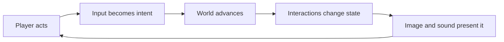

For the pressure plate, the input is not “play door animation.” Input is the player's attempted action. A world rule decides whether the crate actually reaches the plate. Only then does the plate's state change and the door respond. Keeping those steps distinct prevents a beautiful animation from claiming success when the underlying game state never changed.

The first engineering exercise is to trace one action through the entire cycle. Record the input, the decision, the state change, and the visible result. If the door opens twice from one crate contact, find the duplicated transition. If it opens visually but remains blocking, find the disagreement between the door's appearance and its collision state. The useful architecture is the one that makes these disagreements visible and repairable.

#### Centralize subsystem lifecycle without hiding order

A system manager can centralize memory sizing, initialization, update, and shutdown callbacks, but it does not eliminate dependencies. The Kohi migrations expose several ordering failures: a resize arrives before event callbacks are registered; jobs stop loading after the manager is added because its update loop never runs systems; shader resources must be released before the renderer/device; and a local console system record is initialized but never copied into persistent manager storage. [Kohi system-manager migrations](https://www.youtube.com/watch?v=l6QDHJ7_rPk) · [Lifecycle callback manager](https://www.youtube.com/watch?v=vOrkxRPWDVA)

Make each lifecycle phase observable and order teardown against actual ownership, usually releasing dependents before the systems they use. Some systems need staged initialization because application configuration is not ready at the first startup point. The episodes use hand-authored order, leave static system state in place, and report one platform framebuffer-size bug unresolved; they do not implement dependency-graph ordering or complete rollback after partial startup.

## Give startup and shutdown a direction

An application cannot use a service before that service exists. If rendering needs a window and the window needs a platform connection, startup follows those dependencies. A **dependency** is simply a condition or service another operation relies on. Shutdown usually follows the reverse order, while also waiting for outstanding work that still uses the resource.

For example, finish or cancel world jobs, finish the rendering work that references GPU resources, destroy the renderer's objects, destroy the window, and finally release platform services. A **job** is a bounded unit of work scheduled to run; it may finish later than the function that requested it. An object's destruction is safe only when its last user is finished, not merely when a local variable goes out of scope.

Write the failed-startup case before hiding initialization inside a constructor. Suppose the window succeeds, the GPU device succeeds, but a required shader fails. Which steps have completed? Which resources must be released? Can the caller receive a useful error? This is a small **state machine**: a system whose legal operations depend on its current state and whose transitions are explicit.

| State | What is valid now? | Failure or exit action |
|---|---|---|
| No platform | No window or device use | Report why platform setup failed |
| Platform ready | Platform calls and window creation | Release platform if window creation fails |
| Window ready | Window events and graphics-surface setup | Destroy the window on later failure |
| Renderer ready | Resource preparation and frame submission | Finish in-flight use, then release graphics objects |
| Running | World update and presentation | Request exit and wind down in agreed order |

This table is a teaching model, not a required class hierarchy. In C++, ownership can be represented with objects whose destructors release what they acquire. That pattern is called **RAII**, or resource acquisition is initialization: a valid owning object's lifetime controls the resource's lifetime. In C, the same obligation can be expressed with explicit initialization and cleanup functions and carefully organized failure paths. The language changes the mechanism; the obligation remains.

Do not solve every possible extension yet. Add a new boundary when a concrete need appears: supporting a second platform, testing without a window, running an editor and a game, or replacing a graphics backend. An **API**, or application programming interface, is the set of operations and rules one part of software offers another. A **backend** is a particular implementation behind a shared interface, such as one renderer implemented with Vulkan and another with a different graphics API. The shared interface should express the engine's actual needs, not expose every operation of every possible API.

### Make system ownership match the work

A window should own window events and lifecycle; a renderer should own render passes and decide when buffers are bound. A render buffer can allocate attachments and report its dimensions, but it does not need to know what a “shadow pass” means. That separation gives the renderer authority over multiple views, editor/play scenes, and pass ordering without turning every resource object into a partial renderer. The C# code review uses these as architectural recommendations for one prototype, not as proof that one class layout is universally correct (C# Game Engine code review, 00:28:57–00:32:29).

Graphics resources also have prerequisites. A shader that calls OpenGL cannot be created until a context exists and its function entry points have been loaded. Constructing such an object during global initialization can run too early. Make startup order visible: create the window/context, load the graphics functions, then create programs and other GPU resources (Game Engine by 11-Year-Old code review, 00:21:34–00:30:37).

A release candidate benefits from a similarly explicit owner. Freeze one commit on a pending-release branch, test that fixed snapshot, and merge accepted fixes back into development. Testing a branch that keeps changing makes it unclear which exact state passed. Before replacing the current release, verify the branch ancestry and ensure hot fixes are not stranded. This is the historical Hazel team’s workflow in the devlog; the useful principle is a stable candidate plus traceable fixes, not the particular branch names (Fixing Hazel office devlog, 00:02:10–00:05:47, 00:14:20–00:15:30).

## Know which story each source can tell

The named series show evolving implementations. A video can intentionally build an awkward version, encounter a bug, and repair it later. The teaching should retain that cause and correction: what failed, why it failed, and what the replacement costs. Current repository code is evidence about an identified revision, not automatic proof of what an older video explained.

The two channels also make different choices. Kohi's official description identifies a C-and-Vulkan engine and says its current source authority has moved to SVN, with GitHub acting as a mirror. The Hazel public repository is an educational project associated with the series; public source access does not establish access to paid or private Hazel versions. These facts constrain provenance, rather than declaring one architecture the universal solution. [Kohi official repository](https://github.com/travisvroman/kohi), [Hazel public repository](https://github.com/TheCherno/Hazel).

The supplied books provide another useful perspective: runtime architecture, motion and contact, design requirements, and the connection between rules and player experience. Their editions and actually read page ranges are in the ledger. Their age matters when applying an API or platform-specific example; a durable architectural argument and a current API signature are different kinds of evidence.


### Choose an explanation format that matches the learner and the work

Not every teaching goal benefits from watching every line be typed. A creator’s livestream discussion proposes doing complex planning, debugging, and implementation in a long development stream, then producing shorter episodes that explain the result, code changes, and design decisions. The creator frames this as a proposal shaped by audience feedback and time constraints, not a proven course format. It is useful as a teaching distinction: a complete process record, a concise conceptual explanation, and a line-by-line beginner exercise serve different learners. [Format discussion](https://www.youtube.com/watch?v=lwDdMYzUnxs&t=8m2s)

A separate project announcement proposes an AI-assisted open-source engine workflow with architecture diagrams, generated implementation, senior review, tests, scripts, documentation, and reading generated code carefully. The presenter emphasizes that generated code must be understood and verified rather than accepted blindly. These are intentions and opinions, not evidence of a completed engine or measured productivity gain. The durable lesson is to keep authorship, review, tests, and comprehension explicit whichever tools are used. [Engine-series introduction](https://www.youtube.com/watch?v=-paLdjChPxo&t=8m32s)

An Unreal Engine 5 Early Access reaction is likewise a historical response to a vendor demonstration, not an independent implementation test. It draws attention to virtualized geometry, dynamic global illumination, world partitioning, data layers, animation tools, and audio synthesis, but those capabilities should be understood from version-specific primary documentation and hands-on tests before being treated as current guarantees. The reaction is valuable as a map of questions to investigate, especially around streaming and collaborative world editing. [Early Access reaction](https://www.youtube.com/watch?v=nyZnRxvSJrY&t=4m40s)
### Treat renderer and asset plans as plans until tested

Early engine logs often list a long roadmap: forward and deferred rendering, physically based materials, editor serialization, platform ports, or code generation. Those are not features just because they appear on a board. For example, the Sparky planning log describes deferred rendering as a possible fit for scenes with many dynamic lights, but its own note says that support depends on multiple render targets. Likewise, it proposes converting source models into a runtime-friendly layout and adding serialization before a scene editor can save levels. Keep the dependency visible, then confirm each stage with an implemented path and a test (Sparky Engine Dev Log #2, 00:12:19–00:18:05).

The same care applies to claims about borrowed algorithms. In a C# engine review, the presenter says a bloom shader closely matches code and comments from Hazel. That is a source-attribution concern raised by the reviewer; this review has not independently compared the repositories or established ownership. When importing an algorithm, keep a provenance note and check the license and source before presenting the implementation as original (C# Game Engine code review, 00:44:06–00:45:26).

## Make the first game ask the architecture a question

The workshop gives us a small result to pursue. Before choosing a framework, make that result precise enough that a player and a programmer can recognize the same success or failure.

### Let players read cause and consequence

Consider a sword attack that sometimes misses. The physics and collision code may know the exact reason: the target was out of range, blocked the strike, or dodged. If the player sees no difference between these cases, the world feels inconsistent even when the simulation is deterministic. A short impact sound, a visible block pose, a clear distance cue, or a readable dodge can connect the attempted action to its immediate outcome. The goal is not to expose internal engine state verbatim; it is to make the relevant cause legible at the moment it matters. (Game Design: Theory and Practice, PDF pp. 33-35; Rules of Play, PDF pp. 50-51.)

That immediate signal should also connect to something that matters later. If repeated hits lower an enemy’s guard and create an opening, players should be able to perceive both the present hit and the developing opportunity. The immediate result is discernable; the accumulated tactical consequence is integrated into the larger play. A hit spark alone may confirm contact but say little about whether the player is making progress. A changing stance, a stagger threshold, or a readable guard meter can show the longer relationship. The right presentation depends on the game: the selected theory pages explicitly leave room for different forms of meaningful feedback. (Rules of Play, PDF pp. 49-52.)

Player needs differ. One player may want mastery and a hard challenge; another may want exploration, a social activity, a solitary responsive world, fantasy, status, or an emotional arc. These are not a checklist that every game must satisfy. They are prompts for engine and interface choices. If a game promises exploration, streaming and world transitions should preserve player agency and show what new paths are available. If it promises competition, timing and outcomes should be consistent enough that practice teaches skill. If it promises a quiet solitary experience, interruptions and social prompts may undermine the desired mood. (Game Design: Theory and Practice, PDF pp. 27-33.)

Direction and progress can coexist with player freedom. A player may be free to choose a route through a level while still needing to know the current objective and whether actions move them closer. A useful engine-facing design question is: what state change can the game communicate after each meaningful action? A quest objective can update, a door can respond to a key, or an NPC can react to a choice. The player should not have to infer invisible progression from unrelated events. At the same time, a sandbox may intentionally let players define their own goals, provided its world gives understandable material to work with. (Game Design: Theory and Practice, PDF pp. 35-36.)

#### Design systems that produce readable outcomes

In the interview, Doug Church recalls design work around LookingGlass titles and discusses player choice, state, events, and emergent sequences. An event can describe a particular occurrence; a state describes what is currently true. For example, a guard hearing a sound is an event, while the guard being alerted is a state that can influence later decisions. Systems built from states and responses can create a sequence the designer did not script step by step. This distinction is presented as a useful way to think about game behavior, not a replacement for narrative or scripting in every game (*Game Design Theory and Practice*, interview with Doug Church, PDF pp. 537–542 / printed pp. 512–517).

Emergence still needs legibility. If the player cannot tell what the guard saw or heard, the resulting response may feel arbitrary rather than earned. The interview’s stealth and AI examples emphasize visible cues, plausible line of sight, and repeated behavior that the player can learn. **Illustrative design test:** show a guard turning toward a noise, then let the player see whether the guard is searching or has returned to patrol. The precise cue example is ours; the principle is grounded in the interview’s discussion of readable behavior and player inference (PDF pp. 542–544 / printed pp. 517–519).

Church’s account also connects prototyping with design judgment: try the interacting mechanics, observe what they let the player do, and revise the system when its results do not support the intended experience. Production and commercial constraints shape which ideas survive. The interview supports these statements as Church’s recollections and opinions, not as an independently verified history of every project or a universal process prescription (*Game Design Theory and Practice*, PDF pp. 545–548 / printed pp. 520–523).

### Keep the rules distinct from the machinery

A digital game contains much more code than its rules. In a falling-block game, the rules include how input moves and rotates a block, when it locks, how completed rows score, and what ends a round. The memory allocator and file reader help the program run, but they do not define the player's move choices. This distinction helps engine teams avoid confusing implementation complexity with game complexity. It also helps designers ask whether a proposed system change affects the game contract or only its implementation. (Rules of Play, PDF pp. 149-152.)

The source separates three rule layers. Constituative rules describe the abstract system: for example, selecting a cell in a grid and winning by completing a line. Operational rules describe how a player enacts those choices: click an empty square, see a mark, hear a cue, and learn whose turn comes next. Implicit rules are shared expectations that may not be written down. For an engine, this is a reminder that the same underlying game logic can be presented through different devices and feedback without changing the core logic, while a cue that reveals hidden information can change the actual strategic choices and therefore the game's formal structure. (Rules of Play, PDF pp. 146-147, 149-155.)

For example, changing the color palette of a game piece may be purely aesthetic if its identity remains clear. Making an enemy disappear in shadow may change what the player knows and when they can act, so the visual system becomes part of the rules as experienced. Similarly, a win sound or flashing line can communicate a formal outcome. A prototype can use placeholders for effects that do not affect choices, but it still needs enough feedback to test whether players understand the rules. The distinction is functional, not merely “graphics versus code.” (Rules of Play, PDF pp. 152-155.)


#### Production rules and player-facing meaning belong in the same conversation

Technical features are only part of what makes a game shippable. The *Game Engine Architecture* excerpt closes by distinguishing engine technology from gameplay systems: rules, objectives, entities, and the experience they create still have to be designed. A different production example makes the connection practical: a team’s game prototype drove prefabs, dynamic meshes, scene transitions, and packaging needs, while an engine release overview describes asset packs and runtime features tested through a game jam. A first playable can therefore test both whether a system works and whether its behavior communicates clearly to the player.

Mechanics also require examining how players interpret and exploit them. A chance mechanism can be biased by a small implementation error or strategically manipulated through the order in which a counting rhyme is spoken. A player’s subjective uncertainty may also differ from the formal probability table. This links implementation review to playtesting: verify the randomizer mathematically, then observe whether people understand the risk and make the choices the designer intended. The Rules of Play pages are conceptual design theory, not a replacement for probability testing; the creator reactions are opinions, not user studies.

Source boundaries: the dated Sparky and Hazel accounts are historical prototypes and release descriptions. They do not verify current SDK, API, platform, or runtime behavior. The trailer reactions are subjective commentary with no code or capture analysis. The chapter-specific Rules of Play and *Game Engine Architecture* points are integrated separately in `pdf-additions.md`; this section adds creator workflow examples and labels inferences as such.
#### The engine runs the rules; the game gives them a purpose

The assigned architecture pages end with an important boundary. A physics solver, renderer, animation system, and asset pipeline provide machinery; they do not decide what players are trying to accomplish. A game also needs entities that matter to its rules, goals that define progress or failure, and an experience that makes those rules meaningful. That is why a feature-complete engine and a complete game are different achievements: the first supplies capabilities; the second chooses and connects them for a particular player situation (*Game Engine Architecture*, PDF p. 711 / printed p. 13).

For example, a destruction system may turn a wall into moving fragments, but gameplay design determines whether that wall blocks progress, protects a player, reveals a route, or merely decorates the scene. The same physical result can serve different rules. Ask both questions during implementation: “Can the subsystem produce this state?” and “What can the player understand or do because it happened?” The example is an explanatory application of the chapter’s distinction, not a quoted scenario from the page.

### Design decisions as authored experiments

The interview excerpt in *Game Design: Theory and Practice* is most useful as a record of how its interviewee remembers a particular production, not as independently verified studio history. It describes a small group exploring a 3D dungeon idea, early working prototypes, and design changes shaped by the team’s available technology, experience, and publisher context. It repeatedly links design to iteration: try movement or combat in a small slice, observe what feels compelling, then expand the world around the strongest interactions. The inspected pages include period game images that anchor the discussion, but those images are illustrations, not evidence for every recollected production detail (PDF pp. 526 and 529 / printed pp. 501 and 504).

A small “minute of play” is a useful design instrument: specify a short sequence of player actions, feedback, and consequences, then build only enough content and technology to test it. A screenshot or rough room map can similarly make a spatial assumption visible. For example, before building a full stealth system, sketch one corridor, one light source, one hiding place, and one patrol. Ask whether the player can infer when they are seen and whether a choice changes the next moment. If not, expanding the world makes the uncertainty larger rather than resolving it. Treat the interview’s specific project history as a case study, while using the experiment format as a transferable method.

The excerpt also discusses how authored spaces, logs, dialogue, sound, and simulation can share the job of communicating a world. A player may reconstruct the story by exploring a room and comparing records rather than receiving one uninterrupted explanation. That freedom needs legible signals: a choice is meaningful when the player can understand the available actions and later perceive a consequence. The interview criticizes rules that hide their consequences behind opaque calculations; translate this into a design test: can a player form a useful expectation, act, and recognize what changed?

#### An interview separates a designer’s view from the editor’s conclusion

The assigned Doug Church pages continue an interview rather than introduce it. Church discusses market expectations, LookingGlass, Deus Ex, Frequency, game perspective, player agency, and independent experimentation. He describes a tradeoff between focused depth and broad scope: he sees Thief as focused and deep, while describing Deus Ex as broad but shallower in places. He does not declare one approach universally correct; his point is that ambitious scope can create a different set of production and coherence problems (*Game Design Theory and Practice*, interview with Doug Church, PDF pp. 549–552 / printed pp. 524–527).

Church also describes his role on Frequency as primarily engineering and low-level sound work, with design suggestions and meetings, rather than as one of the game’s main designers. When discussing first- and third-person viewpoints, he weighs fidelity, animation, aiming, stealth, and what the player can see. Perspective is a way to shape the player’s relationship with the character and world; the interview presents tradeoffs tied to a particular game and technology era, not a ranking of camera modes (*Game Design Theory and Practice*, PDF pp. 552–554 / printed pp. 527–529).

His comments on player agency frame the designer as authoring systems that create an experience with the player. He values what players remember doing and the choices they made, while recognizing commercial pressures and the difficulty of making less familiar interactions legible. His Indie Game Jam remarks treat short experiments as valuable for discovery and community, without claiming they will automatically transform a large studio’s production model (*Game Design Theory and Practice*, PDF pp. 554–556 / printed pp. 529–531). These are Church’s recollections and opinions in an edited interview.

The pages after that interview change authorship. PDF pp. 557–559 / printed pp. 532–534 are Richard Rouse’s conclusion, discussing games as an interactive medium and the designer’s motivation. PDF p. 560 / printed p. 535 begins a sample design document for *Atomic Sam*, which Rouse says was never developed into a finished game. Do not attribute those passages to Church or treat the sample document as a shipped game (*Game Design Theory and Practice*).

### Rules, emergence, and meaningful outcomes

*Rules of Play* separates the formal rules a design specifies from the implementation that executes them and from assumptions players bring implicitly. The distinction matters because a game can run exactly as coded while failing to communicate its actual rule. For example, a pressure plate may technically activate only above a mass threshold, but if the game gives no visual or audio cue when that threshold is crossed, players may interpret the result as random. A designer should test the written rule, the implemented rule, and the player’s inferred rule as three related but distinct things.

**Emergence** describes larger patterns that arise from repeated interactions among simpler parts. It is not a synonym for randomness. The excerpt’s messenger-city thought experiment asks the reader to imagine messages moving between locations under local rules: each messenger follows simple constraints, yet their combined paths and exchanges can form patterns. The inspected “Four Kinds of Systems” figure and text place fixed, periodic, chaotic, and complex behavior in a qualitative diagram (PDF pp. 163–164; chapter 14 local pp. 5–6). It is a conceptual aid, not a calibrated scale or a claim that every game belongs to one exclusive category. A perfectly static screen is fixed; a repeated two-state blinking signal is periodic; random-looking pixels illustrate the typology’s disordered category; an organized but changing crowd path can illustrate structured complexity.

To test a game rule, start with the smallest playable action/outcome loop. A coin toss with no stake or consequence is a random event, but it may not make meaningful play. Add a choice the player can understand—such as choosing a risk level before the toss—and a persistent consequence that changes later options. Now the outcome can carry meaning because the player’s action and the system’s response are connected. This does not mean randomness is inherently bad; randomness can create uncertainty while rules and feedback make its consequences interpretable. The excerpt’s Heads-or-Tails variants are exercises in that distinction (PDF pp. 165–167).

A practical design review can ask: what may the player do; what state changes; what feedback reveals the change; what repeated interactions produce a pattern; and can the player attribute the result to a rule they could learn? That review joins formal mechanics to implementation without collapsing one into the other. When the result feels arbitrary, inspect the rule, the feedback, and the player’s assumed rule before adding complexity.

Here the disordered category is a qualitative design label, not a demonstration of mathematical chaos. Deterministic rules can make nearby starting states diverge strongly without injecting independent random inputs; a random-looking image alone does not establish that behavior.


#### Information is uncertainty about a signal, not its meaning

The next chapter of *Rules of Play* changes schemas from uncertainty to information theory. It uses “information” in a technical sense: a measure related to uncertainty in a signal, not the ordinary meaning or importance of a message. A nonsense string and a meaningful sentence can have the same information-theoretic structure if their possible symbols and probabilities match. This distinction helps keep the formal question separate from what a game’s story or clue means to its players (*Rules of Play*, PDF pp. 199–201 / printed pp. 1–3 of Chapter 16).

Imagine trying to guess whether a stranger ate breakfast: there are only two answers. Guessing the stranger’s favorite color has more possible answers, and guessing a favorite word has many more. A correct response to the larger-choice question resolves more uncertainty. The excerpt connects this to game decisions: a player selecting among many possible actions navigates a larger possibility space than a player whose next action is already determined. This is a conceptual bridge, not an equation for scoring game choices (*Rules of Play*, PDF pp. 200–202 / printed pp. 2–4 of Chapter 16).

In Mastermind, feedback from each guess narrows the remaining candidate codes. The solution remains fixed, so deductions can reduce uncertainty. If the opponent changed the hidden code after every guess, earlier feedback would not constrain the next guess in the same way. Twenty Questions applies a similar process to a culturally meaningful answer: each yes/no question partitions the possibilities, while the answer itself remains stable. These examples distinguish information flow from semantic content without denying that context matters to players (*Rules of Play*, PDF pp. 202–203 / printed pp. 4–5 of Chapter 16).

A signal also travels through a channel. The book’s examples follow a message from source through a signal and channel to a receiver; noise interferes with that transmission. A whispered message in Telephone changes as it passes among people, and that distortion is part of the activity’s fun. For an engine designer, this offers a useful way to ask where information is produced, transformed, displayed, and misunderstood. The excerpt does not provide a software networking protocol or a modern information-theory calculation; it provides a framework for thinking about signals and uncertainty in game systems (*Rules of Play*, PDF pp. 203–204 / printed pp. 5–6 of Chapter 16).

#### Information can be a formal signal or knowledge held by players

The two adjacent *Rules of Play* chapters use “information” differently. Chapter 16 uses the information-theory sense: a measure of uncertainty across possible messages, not the semantic importance of the message. A yes/no answer distinguishes two possibilities; a question with many plausible answers can distinguish more. The chapter then describes a signal moving from source through a channel to a receiver, with **noise** as distortion that can make the signal harder to recover. Charades makes that difficulty part of play, while ordinary communication treats it as a problem (PDF pp. 205–208 / printed pp. 7–10 of Chapter 16).

**Redundancy** means that some parts of a message help recover it when other parts are missing. In a crossword, crossing answers constrain one another: a clue that is hard to solve can become easier after neighboring answers supply letters. The design point is that noise and redundancy interact. Too much constraint leaves little meaningful choice; too little structure makes actions unrelated to outcomes. The chapter uses this as a conceptual lens on meaningful play, not as a networking protocol or a quantitative balancing formula (PDF pp. 205–208 / printed pp. 7–10 of Chapter 16).

Chapter 17 switches back to the ordinary game-design meaning of information: knowledge or content that can be hidden, revealed, transformed, remembered, or forgotten. **Perfect information** means all players know the complete current game position; **imperfect information** means some game information is hidden from one or more players. This distinction is independent of randomness: Backgammon has dice but can still be a perfect-information game because the board state and moves are public; Stratego has hidden piece identities without requiring random outcomes during play (PDF pp. 209–211 / printed pp. 1–3 of Chapter 17).

Celia Pearce’s four categories ask who knows a piece of information: everyone, one player, the game system alone, or no one until a random process generates it. These categories are a useful design checklist, though the chapter itself notes ambiguity between information hidden in a deck and a freshly randomized outcome. In *Enchanted Forest*, the board and current treasure are public; each player privately remembers what they saw beneath trees; the still-hidden treasure locations are initially unknown to players; dice create random movement values. As turns reveal clues, information shifts between categories. Players can navigate toward unvisited trees, infer from another player’s movement, or bluff about what they know (PDF pp. 211–214 / printed pp. 3–6 of Chapter 17; the illustrated board/game example visually inspected on PDF p. 212).

The value of information depends on its **information economy**: how one fact relates to other facts and available choices. A player who remembers a card or has seen a hidden location can use that knowledge only in relation to the current objective and the other players’ likely knowledge. Designers can make exploration meaningful by revealing locations, abilities, items, or rules over time, but hidden content alone does not guarantee interest. If information cannot be perceived, used, or connected to a decision, it adds volume without meaningful play. The chapter’s examples include fog of war, hidden locations and moves, item progression, and learning a simulation’s rules by experimenting (PDF pp. 214–216 / printed pp. 6–8 of Chapter 17).

#### Use feedback loops to shape how a game state moves

A feedback loop has a sensor that measures something, a comparator that decides whether the measured state needs correction, and an activator that changes the world. A thermostat senses room temperature, compares it with a chosen threshold, and turns cooling on or off. In a game, the sensor might read score difference, race position, or deaths at a level location; the comparator classifies the state; the activator grants an extra player, adjusts an opponent, drops a helpful item, or changes the enemy count. [Rules of Play, PDF pp.220–224 (printed chapter 18, pp.2–6)]

“Negative” feedback opposes a deviation and tends to stabilize a measured difference; “positive” feedback amplifies it and tends toward a runaway. These labels describe the direction of the loop, not whether it is good or bad. If a team is five points behind and receives an extra player, it may catch up; when it is fewer than five points behind, the bonus player is removed. This is a negative feedback rule because it pushes the score difference toward zero. If the team in the lead receives the extra player instead, the advantage can compound and produce a blowout. That positive loop may suit a short, chaotic game, but it can erase meaningful choices if it becomes irreversible too early.

A racing example uses position as the sensor: when the human player is first, the second-place opponent accelerates; when the player is last, nearby opponents slow down. The system adjusts the competitive backdrop instead of changing the player's own vehicle. This can keep rivals close, but if the adjustment is too visible or too strong, players may feel the game is manipulating the result. A different example gives trailing racers more useful power-ups. These rules create catch-up pressure through different mechanisms, so test how players perceive them as well as whether they narrow the rank gap. [Rules of Play, PDF pp.225–227 (printed chapter 18, pp.7–9)]

Positive feedback can also be deliberate: a successful attack in Powerstone stuns an opponent, making further hits easier. The loop is eventually interrupted by an effect that hurls the stunned character away. In a strategy game, gathering resources can create more units that gather still more resources; rival players' loops and combat tactics provide counterpressure. A useful design trace records the state variable, threshold, action, next-state effect, and release/limit condition. If there is no limit, ask whether an early lead can decide the match before players have meaningful counterplay.

Dynamic difficulty adjustment is a stronger intervention: the sample describes counting repeated deaths at a location, then adding helpful objects or reducing enemies. It can help a stuck player progress, but it raises a design question absent from a basic catch-up mechanic: does the game tell the player, hide the change, or let them opt out? A player may value support or may prefer a fixed challenge. Use a playtest to check understanding and trust; feedback logic cannot guarantee meaningful play by itself. [Rules of Play, PDF pp.227–228 (printed chapter 18, pp.9–10)]

#### Feedback rules and player agency

A **feedback loop** observes the current state, compares it with a target or condition, and changes the system in response. A thermostat is the simple example: sense room temperature, compare it to the set point, and switch cooling on or off. Negative feedback reduces deviation and tends to stabilize; positive feedback reinforces change and can amplify a lead. In a game, an early resource advantage that creates more resources can be positive feedback, while a catch-up rule can reduce the gap. Neither label says whether a mechanic is fun: too much correction can flatten meaningful differences or make players feel the game is taking control away. [Rules of Play, PDF pp. 230–233 / Chapter 18, printed pp. 12–15]

Chutes and Ladders’ exact-finish rule is a useful caution about naming. The authors say it can stretch the ending and let trailing players catch up, but it is not a strict cybernetic loop because no sensor, comparator, and activator are operating as separate parts of the system. The book offers a conditional “pseudo-feedback” reading of the rule. When evaluating a game, distinguish an effect that resembles negative feedback from a mechanic that explicitly detects a state and changes a rule or action because of it. Also inspect emergent loops players can discover even if designers did not intend them. Dynamic difficulty adjustment is one deliberate intervention; whether it feels helpful or unfair depends partly on perceived agency. [PDF pp. 229–232 / Chapter 18, printed pp. 11–14]
#### Map choices without pretending outcomes are certain

A **decision tree** maps possible decisions and resulting branches. Tic-Tac-Toe is small enough to enumerate: each open square creates a branch, and a win or full board ends that path. The tree becomes useful for analysis even when too large to draw completely. The text gives three conditions for a complete tree: play moves in discrete units, each decision has a finite set of clear choices with knowable outcomes, and the game itself is finite. A continuous-action sports play does not fit this cleanly because choosing a play does not determine its outcome. A mission-selection map may still help even if the combat within each mission cannot be fully enumerated. [PDF pp. 236–238 / Chapter 19, printed pp. 2–4]

In ordinary design talk, “strategy” can mean a general opening plan. In game theory, it means a complete contingent plan that prescribes what to do at every point, including every response to an opponent’s possible move. That distinction exposes assumptions: a rational player is modeled as knowing the game and choosing to maximize a defined utility. The book describes this as a deliberately narrow mathematical model, often involving two players and simultaneous strategy revelation. Use it to ask precise questions about choices and outcomes, not to claim that real players always behave as perfectly rational optimizers. [PDF pp. 239–240 / Chapter 19, printed pp. 5–6]

#### Use game theory as a narrow lens on choices and conflict

**Game theory** is an economic theory of rational decisions in situations where outcomes depend on more than one decision-maker. It is not a general theory of games or a step-by-step design recipe. The text models a rational player as an idealized person who knows the rules and chooses to maximize a measured outcome, without ordinary emotional, ethical, social, or memory limits. A **strategy** is a complete plan that covers every possible game state and anticipated opponent strategy. Most examples use two players because analysis grows more complicated with more players. These assumptions make small decision problems easier to inspect; they do not describe how all real players behave. (Rules of Play, Chapter 19, PDF pp. 241–243, 248–249 / printed pp. 7–9, 14–15.)

A **utility** is a number used to represent how much a player prefers an outcome. It can represent cake, money, time in prison, or a score; the number is a modeling choice, not a measurement of a person’s complete feelings. A **payoff matrix** places one player’s choices on one axis and the other player’s choices on the other; each cell records the outcome for one or both players. In the cake example, one child cuts and the other chooses. If the cutter divides unevenly, the chooser takes the larger piece. Anticipating this, the cutter’s safest choice is an even cut. The matrix makes the incentives visible without requiring a long sequence of turns. (PDF pp. 243–244 / printed pp. 9–10; cake payoff matrix visually inspected on both pages.)

A **zero-sum** game is one where one player’s gain is exactly another’s loss. In a dollar game, if the winner gains $1, the loser loses $1, so the total payoff is zero. Not every competitive situation is zero-sum: players can both gain or both lose. A **saddle point** is a cell that is best for one player’s worst-case choice and worst for the other’s best-case choice; in the cake example it gives the cutter and chooser a stable outcome. The chapter warns that an always-best move can become a **degenerate strategy** or exploit: if repeating one attack defeats every opponent, much of the game’s designed choice becomes irrelevant. Designers can inspect the rules, but playtesting is needed to find strategies people actually discover. (PDF pp. 244–245 / printed pp. 10–11.)

Not every matrix has a fixed best move. In **Matching Pennies**, each player simultaneously reveals heads or tails; one wins if they match and the other wins if they differ. A player who always chooses heads can be countered, so the book’s mixed strategy chooses heads or tails with equal 50/50 probability. Over many plays the expected average payoff is zero. This example shows how randomness in a strategy can prevent an opponent from exploiting a predictable choice. (PDF pp. 245–246 / printed pp. 11–12; matrix visually inspected on PDF p. 246.)

The **Prisoner’s Dilemma** is non-zero-sum: two prisoners independently choose whether to cooperate or testify, with sentence lengths as the payoff. Each has an incentive to testify regardless of the other’s choice, leading to two years each, even though mutual cooperation would give each only one year. The text presents two competing readings of the solution and calls the problem unresolved: minimax reasoning favors defection, while a symmetry argument chooses the better mutual outcome. Preserve that tension instead of teaching it as a single settled rule. The point for design is that even simple rules can create complex choices, and the payoff model must be stated before interpreting the outcome. (PDF pp. 246–248 / printed pp. 12–14; payoff grid visually inspected on PDF p. 247.)

The final two assigned pages begin Chapter 20, which shifts from formal game theory to **conflict** as the struggle to achieve a game goal against obstacles or other forces. The excerpt lists player structures such as one versus one, team versus team, one against many, free-for-all, player versus game system, and cooperative group versus game system. Conflict may be direct, as in arm wrestling, or indirect, as in separate figure-skating performances judged by score; a real-time strategy game can move from parallel development to direct encounters. These two pages are only the chapter’s introduction and examples, not a complete account of game conflict. (Rules of Play, Chapter 20, PDF pp. 251–252 / printed pp. 1–2.)

### Begin with a player situation

Suppose a player swings a sword at an enemy beside a ledge. The attack misses. What should the player understand? Did the enemy step away? Was the player too far away? Was the attack blocked by a wall? Did the input arrive during recovery? Is the attack still in cooldown? A developer may be able to inspect the collision system and see the answer, but that does not help the player if the game communicates none of it.

This scene turns a vague requirement like “combat should feel responsive” into a testable question: when a reasonable attack fails, does the player receive enough information to understand the outcome and make a better next choice? Rouse discusses players’ expectations of consistent rules, understandable world bounds, reasonable actions working, direction, incremental accomplishment, fairness, and acting rather than merely watching (Rouse, *Game Design: Theory & Practice*, 2nd ed., Ch. 1, PDF pp. 33–40, printed pp. 8–15). That is design analysis, not an API contract. We turn it into one only after choosing the game’s intended behavior.

Salen and Zimmerman give an especially useful lens. In their definition, an action and the system’s outcome form a relationship; a designed experience becomes stronger when that outcome is perceivable and carries significance into the larger game (Salen & Zimmerman, *Rules of Play*, Ch. 3, PDF pp. 49–52, printed pp. 3–6). Apply that idea carefully. A combat cue is not automatically “meaningful” because it is loud or colorful. The cue should correspond to the actual outcome: blocked, out of range, invulnerable target, interrupted attack, or successful hit. If an animation shows a hit while the rules register a miss, feedback makes the mismatch more visible rather than repairing it.

Translate intent through five questions:

1. **Action:** What can the player do, and what input expresses it?
2. **Rule:** Under what conditions does the action succeed or fail?
3. **Outcome:** Which authoritative state changes, and at what time boundary?
4. **Communication:** What does the player see, hear, feel, or infer immediately?
5. **Continuation:** How does the outcome shape later options, resources, or goals?

This is a proposed working checklist. Its value is that it joins design and implementation at a seam where misunderstandings often occur. The designer can state the intended action/outcome relationship, while engineering can identify the state transition, collision query, event, and display path that must make it real.

#### Separate chance, risk, and uncertainty

A game outcome may be hard to predict for different reasons. The excerpt distinguishes macro-uncertainty about which broad result happens from micro-uncertainty among the individual outcomes that make it up. Risk describes a situation where players know the nature of the uncertainty in advance; in the roulette example, both the possible outcomes and their odds can be calculated. Uncertainty, in the book’s chess example, comes from not knowing enough about the opponent to estimate how the match will resolve. A single game may mix risk and uncertainty, and changing the time frame can change how it feels (*Rules of Play*, PDF pp. 181–185 / printed pp. 1–5).

Two fair six-sided dice make the probability distinction concrete. There are 36 equally likely ordered pairs because each of the first die’s six results can pair with each of the second die’s six results. Four pairs sum to five—$(1,4),(2,3),(3,2),(4,1)$—so $P(\text{sum}=5)=4/36=1/9$. Six pairs are doubles—$(1,1)$ through $(6,6)$—so $P(\text{doubles})=6/36=1/6$. A total of seven occurs in six pairs, while a total of two occurs only in $(1,1)$. Thus the eleven possible sums from two through twelve are not equally likely. The book’s table of outcome counts on PDF pp. 186–187 / printed pp. 6–7 was visually inspected; the example calculation here is explanatory arithmetic from those counts.

A random mechanism is only one source of uncertainty. A player may not know an opponent’s intention, may not yet understand a system, or may face a difficult choice whose outcomes are known but costly. Those cases can feel uncertain without dice. Separating the mechanism from the player’s knowledge helps a designer ask what they actually want: a probability distribution, hidden information, a skill test, or a choice with risk. This section follows the assigned excerpt and does not claim to summarize the full book’s probability theory (*Rules of Play*, PDF pp. 188–192 / printed pp. 8–12).

##### Chance has a mechanism, a strategy, and a player’s interpretation

Chance in a game is not only the random-number operation. *Rules of Play* distinguishes micro-level chance operations from macro-level uncertainty about how the whole game will end. A deterministic game can still feel unpredictable when players cannot know one another’s plans. The chapter also separates certainty, risk, and uncertainty. In its formulation, risk means players know the nature of the possible outcomes ahead of time; uncertainty means they cannot confidently predict the result. Roulette is its example of a known risk distribution, while a match against an unknown chess opponent illustrates outcome uncertainty. Most games combine these conditions, and the overall game can feel more uncertain than one isolated action (*Rules of Play*, PDF pp. 193–194 / printed pp. 13–14; chapter summary on PDF p. 197 / printed p. 17).

The reading gives two useful reminders for anyone implementing a random feature. First, a small coding bias can compound through a complex system. In the microbe example, one direction was accidentally counted twice in a random choice; a small probability imbalance gradually pulled the simulated population toward one corner. Second, players can turn an apparent chance procedure into a strategy. Children in the cited counting-out study changed rhyme length, count order, or their position to influence who became “It.” A game designer should test both the random mechanism and the ways players may manipulate it (*Rules of Play*, PDF pp. 193–194 / printed pp. 13–14).

Players also reason about chance imperfectly. The excerpt lists overvaluing rare high-payoff outcomes, adding successive probabilities as if they were independent chances in a simple sum, assuming a streak makes the opposite result “due,” and remembering unlikely positive outcomes differently from negative ones. These are described as fallacies that designers may need to account for, or may choose to build into a game’s decisions. Treat them as the book’s design discussion, not as a complete taxonomy of cognitive biases (*Rules of Play*, PDF pp. 194–195 / printed pp. 14–15).

The chapter’s summary includes the broad statement that computer programs cannot generate true randomness. That assertion is presented here only as a historical statement from the 2004 text, not as current technical guidance about random-number generators. The more durable design question in this excerpt is whether the probability procedure gives the player the intended experience and whether its outcomes support meaningful choices (*Rules of Play*, PDF p. 197 / printed p. 17).

### Turn adjectives into observations

“Responsive,” “fair,” “clear,” and “satisfying” are useful design words, but they are not yet measurable specifications. Ask what a tester would observe.

| Design word | Observable question | Possible instrument |
|---|---|---|
| Responsive | How long from accepted input to visible action? | Input timestamp, tick id, animation-start time, frame-present time |
| Fair | Can players predict why an attack failed? | Failure-reason telemetry plus observed playtest explanation |
| Clear | Can a player identify the attack’s effective range? | Hit/miss boundary trials and post-trial explanation |
| Satisfying | Does a confirmed hit read as a consequential event? | Animation, sound, haptic and target-reaction review with players |
| Consistent | Do equivalent conditions produce equivalent results? | Repeated scenario, fixed seed, rule assertions |
| Learnable | Does the player improve after receiving feedback? | Success rate across attempts, plus observed strategy changes |

These instruments can help answer a question but cannot replace judgment. Telemetry may say players hit more often after a brighter flash, while observation reveals that the flash hides an enemy’s attack. A survey may report enjoyment, while behavior shows that players leave the encounter. Pair counts with direct observation and keep the design hypothesis explicit.

A combat action can be represented as a state transition:

$$
(S_t, a_t) \xrightarrow{\text{rules}} (S_{t+1}, o_t),
$$

where (S_t) is the authoritative game state at time $t$, $a_t$ is a player action, and $o_t$ is the outcome exposed to the rest of the game. This is a compact model for requirements, not a formula quoted from either design book. It forces a distinction between the event and the interpretation of the event. A `DamageApplied` event says health changed. A “hit confirmed” cue may also need hit location, armor absorption, target state, and whether the target died. A miss can still be a valid outcome, but the system should be able to explain it in terms that match design.

#### Treat screenshots and trailers as observations, not implementation proofs

A reaction video may identify a frame that looks reflective, realistic, or unusually detailed, but it rarely reveals how the image was made. In one trailer review, the presenter first mistakes a reflection and later corrects the interpretation after seeing more footage. Another reviewer explicitly cannot tell whether rocks use Nanite, whether reflections are ray traced, or whether a scene is offline-rendered until the presentation clarifies it. A disciplined review writes down the visible cue—highlight movement, blur, fog, a reflection, or a camera change—and then marks the technique as confirmed, inferred, or unknown. ([GAME ENGINE DEVELOPER Reacts to Ratchet & Clank: Rift Apart](https://www.youtube.com/watch?v=qCSyy5BTDuc&t=0m0s), [THE MOST PHOTOREALISTIC Unreal Engine 5 Demo So Far!](https://www.youtube.com/watch?v=jbEfCcl7gOw&t=0m0s)).

The same restraint applies to official demonstrations. A GDC video can show a layered material or procedural assembly and state its hardware and experimental status, while a commentator speculates about how the feature works. Keep the speaker’s claims separate from the reaction’s hypotheses. A beautiful frame can inspire an engine experiment; it cannot establish current support, performance, or game-ready behavior without a build and measurements.
#### A visual review should describe the frame before naming its technique

A trailer can show the effect of rendering without revealing the method. A reaction reviewer may see depth of field, particles, blur, a bright reflection, or a distorted background and infer a particular technique. But compression, camera motion, and art direction can hide or imitate those details. One reviewer initially misread a reflection, then corrected the claim after viewing gameplay; another called possible photogrammetry, Nanite, and Lumen use speculation because the pipeline was unknown. Describe the visible evidence first, then label the technique as confirmed, inferred, or unknown ([Is this TOO REALISTIC? Unreal Engine 5 UNRECORD Gameplay Trailer // Game Engine Dev Reacts](https://www.youtube.com/watch?v=p4aAMPtNIsQ&t=0m0s), [GAME ENGINE DEVELOPER Reacts to Ratchet & Clank: Rift Apart](https://www.youtube.com/watch?v=qCSyy5BTDuc&t=0m0s), [GAME ENGINE DEV REVIEWS Ratchet & Clank: Rift Apart GAMEPLAY](https://www.youtube.com/watch?v=d5_9EEfN-Mw&t=0m0s), [GAME ENGINE DEV REACTS to Halo Infinite | Campaign Gameplay Trailer](https://www.youtube.com/watch?v=HWtEcbiuLBQ&t=0m0s)).

That distinction helps teams give useful review feedback. “The visor highlight moves with the scene” is an observation. “It is ray traced” is an implementation claim that needs stronger evidence. “I cannot read the far terrain through the fog” may be a usability observation even if the fog is artistically intended. A trailer review can generate questions for a capture or developer interview; it cannot replace those checks.

### Focus the prototype on the risky question

A prototype should answer a design uncertainty, not simply demonstrate that the team can assemble a small piece of the final technology. Salen and Zimmerman describe iterative design as a cycle of playable prototyping, playtesting, evaluation, and refinement; they emphasize that actual play reveals things that documents and advance reasoning cannot settle (Ch. 2, PDF pp. 31–32, printed pp. 1–2). They also recommend getting an early interactive prototype into play rather than waiting for polished presentation. Rouse likewise gives a detailed design-process account through early concepts, working gameplay, design tools, and playtesting (chapters inventoried at PDF pp. 9–15). The design move is to find the question whose answer could invalidate the current plan.

For the sword attack, possible uncertainties include:

- Can the player recognize the attack wind-up and recovery windows?
- Is the target’s movement readable enough to make timing feel fair?
- Does a short input buffer improve accessibility without making combat feel automatic?
- Does generous target selection help or undermine spatial mastery?
- Does combat remain legible when two enemies overlap?

A paper mock-up can test whether the rules are understandable. A primitive interactive version can test input timing and collision shape. A graybox arena can test spacing and camera framing. A physics stress scene can test contact stability separately. Do not use a polished character model to answer a timing question unless animation readability itself is the uncertainty. Reducing irrelevant detail makes the experiment cheaper and its result easier to interpret.

Write each prototype brief in one paragraph: the player situation, the uncertain design claim, the smallest playable test, the observation to collect, and a result that would change the design. Example: “We believe players can distinguish a blocked sword attack from a miss by reading a brief spark at the blocking surface. Test in a graybox room with varied distances and shield angles. After each attack, ask the player what happened before showing debug text. If players confuse blocked and out-of-range cases, revise the feedback or rule separation.”

The last sentence matters. A prototype without a decision attached becomes a demo. A team can spend weeks polishing a mechanic and still not know what it proved.

### Protect useful ambiguity; eliminate accidental ambiguity

Some games intentionally leave uncertainty. A mystery may not tell the player whether an ally is trustworthy. A tactical game may conceal enemy intent. A horror game may obscure the location of a threat. These are designed ambiguities. The player may not know what will happen, but should be able to understand what they did and what the system revealed. Salen and Zimmerman’s broader framing of games through formal rules, play experience, and cultural context (introduced in *Rules of Play*, PDF pp. 26–28, printed pp. 4–6) is helpful here: rule clarity does not mean every narrative or strategic question must be answered.

By contrast, accidental ambiguity arises when feedback contradicts the rule, the control fails without reason, or two similar actions produce different results with no perceivable distinction. The job of architecture is not to make the game predictable in every outcome. It is to make the designed uncertainty legible enough that player choices remain meaningful.

### Specify both allowed actions and boundaries

Players learn a game by forming expectations. Rouse’s chapter on player expectations includes consistency, understandable boundaries, reasonable solutions working, direction, gradual achievement, fairness, and avoiding situations where the player becomes hopelessly stuck (Ch. 1, PDF pp. 33–40). Requirements should therefore describe both positive actions and limits. “The player can attack” is incomplete. Specify when attack is accepted, what interrupts it, whether holding the button repeats it, what happens when the target leaves range, and which cues signal those cases.

Boundaries need not all be spelled out to the player. A mystery game may keep a door locked until a clue is found. But the lock should behave consistently enough that players can reason about the world. If a key opens one visually identical door but not another without explanation, the system teaches arbitrary behavior. A game can be surprising; it should still make its own surprises coherent in retrospect.

A requirements table can separate player-facing promise from engine mechanism:

| Promise | Rule owner | Runtime support | Evidence |
|---|---|---|---|
| An attack can be interrupted by a dodge | Combat state machine | Tick-ordered commands and state transition | Scenario replay with simultaneous inputs |
| A shield blocks attacks from its front | Combat rules | Contact/query and shield orientation | Boundary cases around shield arc |
| The player can tell a block from a miss | Presentation design | Outcome event with impact point/reason | Blind playtest plus event trace |
| Repeated attacks have consistent timing | Combat rules | Fixed-step timing and stable input ordering | Replay and low-frame-rate scenario |
| The player can recover from a mistake | Level/gameflow design | Checkpoint and progression state | Full encounter playthrough |

This table deliberately does not equate implementation with proof. “Outcome event exists” is not evidence that players can tell a block from a miss. Each promise needs an appropriate observation.

#### A design document can specify a playable contract without pretending a game exists

The selected pages finish an author’s discussion of document detail, then begin *Atomic Sam*, a sample design document. The author says the sample deliberately omits detail because the author expects to guide development; a team without that continuing author involvement would need more explicit descriptions. A **focus statement** summarizes the intended experience and helps decide which mechanics belong. In the sample, the focus is a non-violent action game about defeating robots creatively with projectiles and environmental devices, in a whimsical retro-future setting. This frames the following controls and systems as a coherent proposal (PDF pp. 561, 564–566 / printed pp. 536, 539–541).

The document separates camera behavior, in-game information, saving, controls, and movement. That makes requirements inspectable: the camera should stay behind the character smoothly, avoid blocking the view, and move closer when space is tight; an on-screen flight meter should reveal a resource the player must manage; checkpoints should define where failure restarts. Those statements guide design and implementation but do not prove that a camera or checkpoint system was built. The source is an authored sample for a game that the book says was never developed (PDF pp. 565–568 / printed pp. 540–543; title page and contents visually checked on PDF p. 562).

The rocket-pack illustrates how a movement system becomes a set of player-readable rules. Holding the control accelerates until a limit; releasing it does not stop Sam instantly; burst movement spends charge faster; hovering also consumes charge; landing recharges it. The interface displays remaining charge so the player can plan a route. Flat surfaces permit landing, while slopes and dangerous floors change the consequences. This is more useful than specifying only “the character can fly”: it gives designers, animators, programmers, and testers observable conditions to implement and check (PDF pp. 569–572 / printed pp. 544–547).

The projectile inventory also distinguishes carrying capacity, ready state, throwing, and recovery after a miss. Sam can carry up to fifty of each type, and missed projectiles may be retrieved after combat. This shows how a control document can explain both state and feedback, although the selected range ends before all throwing details. Treat the numbers and mechanics as part of this fictional design, not as reusable engineering standards (PDF pp. 567–572 / printed pp. 542–547).

##### A design document connects mechanics to the world

The *Atomic Sam* sample design document shows a different kind of engine-facing work: specify what the player can do, what each tool works against, and how allies or enemies change the play situation. Goo-balls stick certain ground or wall-crawling enemies; water balloons short exposed wiring; a magnet-and-weight pulls metallic flyers down. Each item also has limits, so the player must read the target and choose a response. This is a prototype of a mechanic catalog, not implementation evidence. A useful entry records the intended effect, valid targets, exceptions, and what feedback tells the player it worked. [Game Design Theory and Practice, PDF pp. 586–588 / printed pp. 561–563]

The proposed friends are designed to follow without getting stuck, point out threats and secrets, and deliver story while Sam is in safe situations. These requirements connect AI behavior to the experience: an ally that trails behind or talks during danger would violate the design intent even if its movement routine technically ran. The boss examples also connect mechanics to level geometry. The Visionary can be defeated by activating and aiming fans so their airflow pushes it back into a ceiling crate; Zeffir can be weakened through projectiles or by disabling the posts supporting his platform. These alternatives make observation and interaction part of combat. They remain intended behaviors in a sample proposal, not evidence of a shipped game or a tested AI system. [PDF pp. 585–595 / printed pp. 560–570]

The story outline then ties those mechanics to progression: Sam searches three locations, gathers allies and pieces of a message, and discovers why his parents were taken. A design document is strongest when these pieces reinforce one another: the world gives the player reasons to move, tools create readable choices, characters reveal information during play, and level objects support the intended encounters. [PDF p. 596 / printed p. 571]

##### Turn a design document into an observable route through the game

A design document can define a progression that gives players goals and gives the team testable states. In the *Atomic Sam* sample, the player begins in an apartment where a rocket-pack tutorial can be followed or skipped. A hub then offers three middle regions—Benthos, Harmony, and New Boston—in any order. Each region supplies a clue fragment and introduces a companion or local story. The player must complete all three before returning to the hub and unlocking the final airship level. This is a useful distinction between player choice and progression gates: the order is flexible, while the requirement to visit each branch is not. (Game Design Theory and Practice, Appendix A, PDF pp. 598–603 / printed pp. 573–578.)

The document connects movement and story to locations. The city confines the rocket-pack below tall buildings; the undersea dome limits flight height; the Moon colony requires a spacesuit and a surface trip to a character excluded from the dome; the finale shifts combat to narrow corridors aboard a flying fortress. These details imply different navigation, combat, and environment constraints, but they remain written requirements and story content, not evidence that a game was built. The fictional setting also presents an unjust social hierarchy among Moonies and robots; that is part of this sample’s authored world, not an endorsed design rule. (PDF pp. 597–603 / printed pp. 572–578.)

The next appendix gives an unusually candid account of a shipped project’s document. The *Suffering* document is dated eight months before the game shipped, was edited down for publication, and retained outdated names, cut quest items, an abandoned targeting system, and a planned introduction never attempted. Other late changes—storytelling, morality/reputation, creature behavior—were handled in separate documents and never merged into the main one. The author notes that some requested sections were included for apparent completeness even though they were vague or did not match final implementation. The lesson is not that documentation is useless; it is that a document’s revision, scope, and authority must be visible. A design brief is evidence of intended behavior, not proof of shipped behavior. (Appendix B, PDF pp. 604–608 / printed pp. 579–583.)

#### Design a mechanic as a state transition, not just a button label

A design document becomes useful to programmers when it states what the player can do, what state the game checks, and what changes after an input. In the Atomic Sam sample, tapping “Next Projectile” switches to the next available item, while holding it opens a selectable list; releasing commits the centered choice. The character may visually put the projectile away after five seconds, yet the throw input still uses the selected projectile immediately. That is a valuable distinction between presentation state (“arm lowered”) and gameplay state (“projectile remains readied”). [Game Design: Theory & Practice, PDF pp.573–574 (printed pp.548–549)]

The generic Action button is context-sensitive: near a switch it toggles it, near a pushable object it moves it, and holding it near a carryable object begins a carry that ends on release. The same control saves input complexity, but the player needs contextual cues so the engine's choice is legible. A “Look” hold temporarily changes camera control while leaving Sam in place. These cases can be specified as small transition tables before implementation:

| Current situation | Input | State change | Feedback the player should see |
|---|---|---|---|
| Near a switch | Action press | Switch activates | Switch movement and world response |
| Near a carryable object | Action hold | Object attaches to hands; projectile throw disabled | Pose and carry animation |
| Carrying object | Action release | Object detaches with defined placement/physics | Drop animation and resulting motion |
| Projectile ready | Next press and release | Select next available projectile | Held-item change |
| Projectile ready | Next held, directions, release | Choose from inventory list | Carousel highlight and committed item |

This is not a claim that the sample shipped these mechanics; it is a way to turn its written intentions into testable state transitions. Each row raises engine questions—input edges versus held state, interaction query, animation event, collision response, and UI prompt—without confusing the engine service with the design rule.

The same document describes combat puzzles in which a player positions an enemy near a steam vent, waits for the right moment, then activates a switch; a fan can redirect an enemy into the hazard. A safe training room teaches rocket-pack movement before hostile play. These examples show how environment, timing, and feedback can teach a mechanic. The design should specify what clue lets the player predict the trap and what happens when timing is wrong, including whether the trap can hurt the player. [Game Design: Theory & Practice, PDF pp.575–580 (printed pp.550–555)]

AI behavior is also a player-facing rule. The sample varies enemy perception cones and memory, from a robot that forgets the player after line of sight breaks to one that remains locked on; pathfinding ranges from beelining to navigating around obstacles. This can create difficulty through readable limitations instead of only increasing health or speed. If a trap is meant to work, an enemy can be authored to patrol near its trajectory—but the level must communicate the opportunity rather than relying on invisible designer intent. [Game Design: Theory & Practice, PDF pp.580–584 (printed pp.555–559)]

### Failure feedback and accessibility

A game should not require every player to infer a failed action from the absence of an effect. But not every failure needs a pop-up explanation. Use the smallest cue that makes the relevant distinction clear in the game’s sensory language. A tactical game may use a combat log. An action game may use sound, a brief hit-stop, silhouette, or controller vibration. A screen-reader user may need a textual cue or a configurable audio channel. A player with low vision may rely more on sound and haptics; a player who cannot hear may rely on animation and visual indicators.

The rule event should be presentation-neutral and complete enough for alternate renderings. `Blocked` plus an impact point can drive a spark, sound, haptic, subtitle, and accessibility description. If the only output is a particle spawned by the collision function, accessibility options and replay analysis may be difficult. The engine’s job is to preserve outcome meaning across channels; the game’s design determines how many channels to use and how strong each signal should be.

Feedback also has timing. A cue emitted three frames after the hit may be interpreted as a separate event, especially in a fast encounter. Record the time between command, rule outcome, and presentation. If the simulation runs ahead of presentation, attach the simulation tick to the event so the renderer can place a cue at the correct world position and time. In multiplayer, a speculative local cue may need later confirmation. The game should avoid training players to trust a visual hit marker that sometimes appears without a real outcome.

### Decide what the first game must be able to do

Imagine you want to make a top-down game with a character, a few rooms, collisions, a user interface, and a way to restart after losing. You might be tempted to start by designing an all-purpose engine: support every graphics API, every physics model, multiplayer, asset hot reload, and a visual scripting language. That list sounds ambitious, but it does not yet say what the first playable game needs. It also creates dependencies before you have seen how the systems need to work together.

Instead, write the first game’s path in plain verbs: open a window; show a scene; read input; move an object; draw it; save the scene; press Play; return to editing. Each verb identifies a responsibility. “Open a window” points to platform code. “Read input” points to a boundary between the operating system and gameplay. “Draw” points to a renderer. “Save” points to a stable description of scene data. “Press Play” points to a difference between authoring and runtime state. That list can grow, but it gives the first architecture a reason to exist.

The opening Hazel captions explicitly take time to define and plan. The author pauses to say that scope should be discussed before construction, and that planning an event system matters because the reason for an architectural decision is part of learning how to write an engine. That is more than presentation style. A learner who can explain why a system exists can later replace or narrow it. A learner who only memorizes class names tends to cargo-cult interfaces that do not fit the next project.

A practical first scope statement might read: “This engine will support a desktop 2D game with a window, keyboard and mouse input, layered application code, a sprite renderer, editable scenes, save/load, and a runtime Play mode. It will target one rendering backend first. 3D, networking, audio, multiple backends, and mobile deployment are future decisions.” The statement is neither a product promise nor a permanent limit. It is a way to make costs visible. If the game later needs 3D lighting, you can add it against a working 2D application rather than trying to validate every system at once.

#### Choose the game you want to make before choosing how much engine to build

A game engine and a game are related but different products. A team making a game needs rules, content, interaction, and a way to ship them; an engine team builds reusable technology and tools that let games do those things. If the goal is to ship a game with a small team, rebuilding graphics, asset management, animation, and platform layers can consume the time that should go to the game. If the goal is to study engine technology, the engine itself may be the intended result. This is the creator’s opinion in an older vlog, but it yields a practical question: what is the actual deliverable, and which layer is the user trying to learn? ([Do you want to make GAMES or game ENGINES?](https://www.youtube.com/watch?v=Y4J4ZdQGEgo&t=0m20s), [Why you NEED to use a GAME ENGINE!](https://www.youtube.com/watch?v=QQ9MTzrsldo&t=0m1s)).

When the engine is the goal, a small game is still a useful test. One developer proposed a simple Mario-like platformer and worked backward to ask which editor, scene, input, rendering, and gameplay features Hazel needed. Another small-team example began with a Space Invaders prototype, then used the translation to Hazel to expose missing prefabs, dynamic meshes, and scene transitions. The game is a set of requirements that exercises the engine; it is not merely a showcase placed on top after engine work is done. ([The Importance of LONG-TERM PLANNING (Hazel Roadmap)](https://www.youtube.com/watch?v=OsnwKYxPX1A&t=5m29s), [He MADE A GAME using my GAME ENGINE](https://www.youtube.com/watch?v=56ISmbJE9S4&t=2m10s)).

A useful planning sequence is to pick one representative game action, build the smallest prototype that tests it, and record the friction. If many identical enemies must spawn, a prefab may reduce repeated setup. If a menu must lead to a game scene, scene loading is a real requirement. If a project has to run outside the editor, packaging becomes part of the feature. The roadmap should express those dependencies and assign owners, rather than list every engine feature anyone might want. The historical roadmap video explicitly notes that a visible team board can prevent two volunteers from unknowingly building the same feature. ([The Importance of LONG-TERM PLANNING](https://www.youtube.com/watch?v=OsnwKYxPX1A&t=6m35s)).

Keep the schedule proportionate to the team. One creator says he works better with a broad target and manageable milestones than with an imitation of a studio sprint calendar. That is personal experience, not a universal productivity rule. A strong plan makes the next step legible while leaving room to adjust when a prototype uncovers a different need.

### Keep an audio front end separate from its playback backend

The narrated audio system exposes load, play, stop, pause, resume, and volume operations through a front end, while an optional OpenAL plugin handles device playback. A single listener has position and orientation; positional sources have emitters whose locations update with the world. The initial implementation targets stereo output, and the presenter describes mono effects as spatially positioned while stereo tracks are non-spatial in this OpenAL path. Keep that behavior attributed to this backend rather than assuming it applies to every API. [Kohi #142](https://www.youtube.com/watch?v=xb23Y9o7tP4)

Playback channels are not the same as output channels. The source describes 16 playback channels, each tied to one OpenAL source and one active sound; requesting a specific channel replaces its sound, while a negative ID requests a free channel and drops playback if none is available. Master, channel, and emitter volume combine. The channel minimum and stereo/mono assumptions are the presenter’s claims, not independently verified backend guarantees. [Kohi #142](https://www.youtube.com/watch?v=xb23Y9o7tP4)

Short effects can load as one decoded buffer. Long music or voice tracks can reuse two buffers: queue both, unqueue each after playback, refill it with the next samples, then queue it again. The source reports a worker per playback source guarded by a mutex and a brief sleep between work checks; its reason that audio playback blocks is specific narration, not a general OpenAL contract. The implementation uses stb_vorbis and minimp3, and MP3 cleanup remains flagged. Error recovery, format coverage, and stress behavior are not established by the stream. [Kohi #142](https://www.youtube.com/watch?v=xb23Y9o7tP4)


#### Shared systems should pay for themselves

A reusable engine system exists to make repeated game work cheaper. If a helper saves one line once, it may not deserve a subsystem. If every feature needs a consistent way to receive resize events, draw textures, or identify entities, a shared API can prevent many features from inventing incompatible conventions. The cost of a subsystem includes more than its source code: it must be named, tested, documented, integrated into tools, and kept compatible with saved projects.

One useful test is to ask whether two independent game features would otherwise solve the same problem differently. If both need to draw a textured quad, a renderer API can provide common behavior. If only one game needs a custom dialogue graph, forcing it into a generic node framework may be overdesign. Engine design is the repeated choice between a local solution and an abstraction whose future value is uncertain. Hazel’s public series is valuable here because many episodes show the discussion and implementation as a progression, not just a polished list of completed components.


## Turn the application into a portable working foundation

Now turn the promise into a program that starts, reports failure, and closes reliably. The C and C++ implementations offer different mechanisms for the same responsibilities.

#### Make subsystem memory needs visible before startup

A subsystem that owns a small, fixed state block can describe its memory need before it begins doing work. Give initialization two phases: with a null state pointer, it returns the required byte count; after the application reserves that many bytes, initialization receives the block and sets up the subsystem. The first call is a size query, not a partially initialized subsystem. Document that distinction in the function contract and make failure explicit in the second call.

This makes memory ownership visible at the application boundary. The application can reserve one startup arena, ask each subsystem for its state size, hand out non-overlapping blocks, and keep ownership outside a reloadable engine module. Opaque `void*` state at the boundary avoids requiring every caller to know the private state structure, while the subsystem itself casts and interprets its own block. The tradeoff is that a raw opaque pointer has no type or lifetime checking; the API must state who retains it and when it becomes invalid.

A fixed arena does not grow safely by itself. If it is full, return a failure and leave its offset unchanged. Reallocating and moving the arena could invalidate every pointer already handed to subsystems. Capacity should be a measured/configured budget, not a magic constant: the stream starts with 64 MiB as a temporary allowance, and does not establish that amount as a generally suitable target. Also distinguish the allocator's CPU-side bookkeeping from GPU resource storage: resizing the free metadata alone does not move or resize GPU payloads.

A robust requirements query should state alignment as well as byte count, use the same configuration as the later initialization call, and avoid acquiring live resources during the query. Keeping bytes outside a reloadable module does not guarantee state-layout compatibility with replacement code; version that contract if reload is supported.

Source reading: [caption source](https://www.youtube.com/watch?v=3ZFcvBjRFN0). Captions document the narrated development state; on-screen code and reported builds were not independently reproduced.


#### Keep engine lifecycle separate from game-specific frame work

The engine should provide lifecycle hooks and rendering services; a consuming game should choose its own test meshes, fonts, skybox, and render views. Kohi moves testbed setup into game boot/configuration/render/shutdown callbacks so an editor or another application can make different choices. Metrics calculation similarly belongs in a metrics system, while the game decides how to display FPS or frame time. [Kohi application/game boundary](https://www.youtube.com/watch?v=UWaUUhOFCec)

A later refactor groups delta time, elapsed time, and a frame allocator into a constant `FrameData` pointer passed to input, system updates, renderer hooks, and game callbacks. The engine owns/resets the allocator; an application may request an opaque per-frame block for its own transient data. A render-packet geometry array moves from persistent game state into that frame block. This reduces duplicated parameters but adds a cast/configuration contract: the block must be sized before use, initialized before callbacks that read it, and not retained past frame reset. The stream reports a rebuild/run; its generic scene lifecycle remains a sketch. [Kohi frame context](https://www.youtube.com/watch?v=xRag4sy8Kyk)

##### Freeze features, then move game behavior out of the core

Before attempting an Emscripten build, the Sparky series pauses feature work and removes portability hazards and project-specific code. The episode distinguishes desktop audio from browser audio, expects JavaScript audio in the web build, and plans to compile the other dependencies through Emscripten. It also corrects declarations that the author expects Clang to reject.

A texture batch has a finite number of texture slots. When the renderer fills those slots, it must flush and begin another batch; a deliberately tiny slot count increases draw calls and sharply reduces the observed frame rate in this test. The source uses this as a concrete reason to track batch limits and flush behavior, while its measured numbers remain specific to the sample scene and machine.

The episode moves a hard-coded tile layer and its projection out of the engine core into the example game, then removes obsolete simple-renderer and static-sprite examples. It sketches an application base class with initialization, a once-per-second tick, a separately paced update, rendering, and a window loop. A small game subclass creates its layer and shader, displays FPS text, handles keyboard movement, and draws a texture. This is an evolving architecture shown before the promised browser build; it is not evidence that the cross-platform port succeeded.

##### Keep frame phases visible so game work and engine work stay separate

A small engine example can teach more than where its methods are declared. It can show when each method is allowed to do work. In a historical Sparky devlog, the creator describes layer hooks for initialization, events, periodic ticks, updates, and rendering. Initialization happens after renderer and scene setup; a tick is intended for low-frequency diagnostics; update advances gameplay at a fixed interval; rendering follows the display. The narrator also doubts whether the shown render interval is really synchronized, so the schedule is a design sketch rather than verified behavior. See [Sparky devlog #5](https://www.youtube.com/watch?v=zqmgcQd6ayc&t=6m30s).

This separation helps answer practical questions. A key press belongs on an event path. Movement and simulation belong on a time-defined update path. Drawing belongs on a render path that can happen at a different rate. A diagnostic counter can run less often than either. If one callback silently performs all four jobs, frame pacing and side effects become hard to reason about. The source describes an update rate of 60 Hz, but projects should state and verify their own timestep rather than copy that value as a universal rule.

A code review of a small Hazel-inspired engine makes the complementary API point: application code should describe the scene and requested draw, while the engine owns unavoidable startup steps and graphics state transitions. The reviewer recommends hiding buffer binding/linkage details behind a vertex-array or geometry-construction API, so a caller supplies vertex data, indices, and layout without manually managing every OpenGL bind. This is a design recommendation from a historical OpenGL example, not a mandate to hide every backend operation. Abstractions earn their place when they remove repeated state choreography while preserving a clear way to inspect what work will be submitted. [The cube-focused review](https://www.youtube.com/watch?v=sIAXLH7ZqCw&t=10m26s)

### Keep example behavior in the example application

A reusable engine library should provide capabilities, while a particular demo or game decides how to use them. This Hazel episode moves camera, shader, vertex-array, and drawing behavior out of the engine's general `Application` class and into the Sandbox example layer. It also groups commonly used rendering headers in the public Hazel API header, while keeping names explicit in the example so readers can distinguish engine types from sample code.

The episode tests two input styles. Handling repeated key-press events moves the camera in discrete, uneven steps because key-repeat events are not a continuous per-frame signal. Polling held keys from the update method produces continuous movement, but the shown fixed per-update speed still depends on frame rate. The author identifies delta time as the next correction. Rotation is also wired into the camera state, with its sign adjusted to match the camera's rotation convention.

This is a teaching refactor and an input experiment in the Hazel codebase at this point in the series. It does not demonstrate frame-rate-independent movement or per-object transforms; those are identified as follow-up work. [Source:](https://www.youtube.com/watch?v=4zj-0FQ7Xbg)

#### Add a feature by following its data across the engine

A circle that appears on screen and a circle that participates in physics are two different facts. Rendering answers what the player sees; a collider answers what the solver sees. The Hazel example starts from that distinction: an entity can have a circle sprite, yet fail to collide until it also has a circle collider and a rigid body. Its offset test overlays a separately rendered circle so the author can compare the visible reference with the collider's intended location. This is a useful debugging method because it makes the hidden physics state observable without pretending that the debug drawing is the physics itself. [Hazel circle collider, 00:00:00–00:01:10; 00:11:46–00:14:36]

A new component is a vertical slice through an engine, not just a new struct. In the example, adding a circle collider touches runtime component retrieval, the inspector controls, entity duplication, scene serialization and deserialization, and the physics fixture. Missing any one of those paths creates a feature that works only in one context: it may collide during play but disappear after duplication, fail after saving and reopening, or remain invisible in the editor. Trace a test object through each path and keep the evidence for each separate. [Hazel circle collider, 00:08:31–00:11:46]

This pattern also applies to a render feature. The circle-rendering episode separates circle parameters and shader behavior from ordinary sprite rendering, while reusing quad geometry where the underlying geometry is shared. Its first draw failure came from a missing vertex-array bind; later, a missing component-copy path caused circles to disappear in a duplicated runtime scene. Those failures occurred at different boundaries, so a correct fragment shader alone could not prove the feature complete. [Circle rendering, 00:19:51–00:28:40; 00:49:13–00:51:57; 00:59:24–01:02:12]

### Choose a module boundary that matches how the game is developed

A renderer can work on screen while the engine remains awkward to consume. In this episode, the author begins from link errors: ImGui had been compiled into a static library, then linked into Hazel's DLL, but a sandbox executable that called an ImGui function not referenced by Hazel could not resolve it. The linker removes unused symbols from the DLL, so the apparent dependency chain did not export everything the client needed. The episode traces static-library input, the Hazel DLL, and the sandbox's unresolved call at 02:30–05:20, then demonstrates the export/import macro workaround at 06:30–09:15. [Rendering and Maintenance](https://www.youtube.com/watch?v=695SyEyFwWU&t=150s) [Rendering and Maintenance](https://www.youtube.com/watch?v=695SyEyFwWU&t=390s)

A module definition file (`.def`) can explicitly list DLL exports, but the speaker describes maintaining such a list by hand as error-prone. The video looks at that option around 09:20–11:00 before considering a different build boundary: make Hazel a static library so its required objects are linked into the final executable. The discussion compares deployment and rebuild needs, symbol visibility, template/shared-pointer boundaries, and link-time optimization at 11:00–16:30. These are the author's reasons for preferring a static-library workflow for this project at that moment; they are not a universal verdict that DLLs are bad. [Rendering and Maintenance](https://www.youtube.com/watch?v=695SyEyFwWU&t=550s) [Rendering and Maintenance](https://www.youtube.com/watch?v=695SyEyFwWU&t=660s) [Rendering and Maintenance](https://www.youtube.com/watch?v=695SyEyFwWU&t=780s) [Rendering and Maintenance](https://www.youtube.com/watch?v=695SyEyFwWU&t=930s)

The useful design question is: which part must change independently? If game code changes every minute while the engine stays stable, hot-reloading the game module may matter more than hot-reloading the engine. If you ship a single executable and do not promise binary plugin compatibility, static linking can simplify deployment and avoid cross-DLL C++ ABI problems. If users need plugins, separately updated engine binaries, or a C# editor loading a native core, a DLL/shared library may be the right boundary, but its exported ABI and ownership rules need design. The source explicitly contrasts hot-swapping game code with reloading the engine at about 16:00–18:00 and discusses its intended native, cross-platform tools around 18:00–20:00. It closes by sketching rendering-context/swap-chain work and asks readers to try a static-library conversion and warning cleanup as future tasks around 22:00–24:50; those later features and cleanup are plans, not completed work in this episode. [Rendering and Maintenance](https://www.youtube.com/watch?v=695SyEyFwWU&t=960s) [Rendering and Maintenance](https://www.youtube.com/watch?v=695SyEyFwWU&t=1080s) [Rendering and Maintenance](https://www.youtube.com/watch?v=695SyEyFwWU&t=1320s)

When diagnosing a link failure, first identify the target types and the edge where the symbol disappears: static library into shared library, then shared library into executable is not equivalent to static library directly into executable. Inspect the final link inputs and exports. A local workaround that forces a function to be referenced can confirm the diagnosis, but it does not create a complete export contract. The episode demonstrates such a temporary forced-use test around 07:00–09:00; do not mistake that demonstration for a maintainable public API.


### Design the next engine layer backward from a small finished game

A feature list can grow without bringing the engine closer to a usable game workflow. Start with a small game the engine should support, then write down the authoring steps a developer would need to complete it. Work backward from those steps to find missing engine capabilities. This keeps a renderer, scripting system, scene model, and editor tied to an end-to-end use rather than treating each as a goal on its own.

A 2020 Hazel roadmap episode uses a Flappy Bird-sized game as this target. It describes a public 2D learning branch and a faster development branch, while explicitly treating the roadmap as a plan. The presenter wants users eventually to place entities and appearance data into a scene, allowing the scene to drive rendering; lower-level direct drawing remains useful for controlled rendering work. The source does not show these later features being completed. [Hazel 2020](https://www.youtube.com/watch?v=6BHhNELSnDU)

This backward design also clarifies API shape. A user making a game should describe the intended result, such as drawing a textured quad or attaching a sprite to an entity. The renderer may need to batch geometry internally, but callers should not need to manage the batch's begin/end mechanics for ordinary scene drawing. A direct renderer API can remain available for specialized use, while the common route hides mechanical steps behind scene data and simple operations.

A vertical-slice checklist might be: create a project; load a sprite; place and move an entity; respond to input; detect a collision; show a score; restart after a loss; save and reopen the scene. For every step, ask what the author writes, what the editor stores, what engine service runs it, and how a learner can tell it worked. If a proposed engine feature does not unblock one of these steps or improve a measured bottleneck, defer it until the slice reveals a reason to build it.

#### Source-to-volume map

- Existing foundations: `### Focus the prototype on the risky question`, `### A step-by-step build order for a small Hazel-like engine`, and `### Put a render API under scene-level submission calls`.
- The roadmap adds a specific method for choosing feature order: derive it from a small completed game and keep public API simplicity separate from internal renderer mechanics.
- Limits: this is a dated planning episode as transcribed in English captions; no implementation, scripting runtime, scene workflow, or performance target is verified here.

### Prototype the game loop, then list what the engine lacks

The Flappy-style one-hour prototype is presented as a postmortem. It makes missing capabilities visible: collision, particles, and post-processing were absent or incomplete, so the author chose a triangle texture to include a glow, pooled a fixed set of pillar pairs, and used screen-space falloff for a vignette. The game state determines whether particles keep updating after game over. These choices show how constraints shape a prototype; they should not be elevated into general engine recommendations ([42aqVsdcxwU](https://www.youtube.com/watch?v=42aqVsdcxwU), 00:09–10:00; 21:34–30:17).

A separate Hazel rendering experiment adapts particles from an unrelated OpenGL demo and uses a bounded pool to stress rendering. It reports that a 100,000-particle allocation behaves differently in debug and release and calls its memory layout inefficient. The camera-bounds first-frame bug is attributed in the video to C++ member initialization order and resolved by reordering fields. This is a useful diagnostic example: when a value is read during construction, inspect declaration-order initialization rather than assuming the constructor’s textual order controls it. The result remains an observed video demonstration, not an independently reproduced test ([q39GnqVhLf8](https://www.youtube.com/watch?v=q39GnqVhLf8), 03:49–08:25; 19:21–22:52).


#### Let a short game expose the engine’s next concrete need

A feature request is easier to judge when it comes from a game someone is trying to finish. In a 72-hour Hazel jam, the team made *Forest* while streaming. The prototype forced practical decisions: place papers only in the village to simplify content placement, decide whether the player picks up or carries a gun, and remove a planned title screen so the game can fade directly into play. This is a useful engine-development loop: build a small playable, record the friction that blocks the intended experience, then choose the smallest change that removes that friction. The jam account also shows the limit of that evidence: the team discusses ideas and unfinished experiments in real time, so a suggestion in the stream is not proof of a shipped system ([How We Made a Game in 72 HOURS using OUR OWN GAME ENGINE](https://www.youtube.com/watch?v=tQ_pjZDfm-0&t=0m1s)).

A second jam, *Saving Captain Chino*, makes the connection between world rules and player choices especially clear. The player carries coffee through a randomly generated battlefield. Enemies spill the coffee, so the objective itself becomes a resource the player must protect. The player can put it down while fighting, scout the route, clear enemies from newly revealed areas, and retrieve the coffee for the final trip. Here “chunk” means a tile region generated as the player nears its edge; the presenter says new chunks may add enemies, while visited chunks do not respawn them. That rule creates a tactical choice between carrying the fragile objective forward and preparing the route first. The same demonstration reveals a bad dead end: ammunition is finite, and if the player runs out before clearing enemies, there may be no way to obtain more. A mechanic that generates tension can also make progress impossible, so test for both intended risk and accidental lockout ([We Made a Game About Delivering Coffee in a War Zone in Hazel in 72 Hours!](https://www.youtube.com/watch?v=ahrdtYwBLTk&t=6m42s)).

The coffee game also exposes how presentation settings can make a build more usable across machines. Its launcher offers a render scale rather than listing every display mode. Lowering the internal image width and height can reduce rendering cost while leaving the window’s presentation size alone. This is a useful quality knob, but the video does not provide a benchmark or claim a particular performance gain. A function-key overlay reports counters, and the developer describes the game as GPU-limited because of its effects; that is a diagnosis from the creator, not a measured comparison. Separate the player-facing control, the diagnostic signal, and the performance conclusion when documenting such a feature ([We Made a Game About Delivering Coffee in a War Zone in Hazel in 72 Hours!](https://www.youtube.com/watch?v=ahrdtYwBLTk&t=1m7s)).

### Build a minimal application before building game systems

An empty application is a valuable checkpoint. It proves that the compiler, build generator, dependencies, program entry, and operating-system window can cooperate. If this foundation is unstable, every later error will be harder to classify. A linker issue can look like a renderer issue. A bad working directory can look like missing assets. A broken event callback can look like a frozen game loop.

The first Hazel episodes establish the project’s terms: the engine is a library that the example application uses; the application has an entry point; the window and core services belong to the engine; and the game-specific code is supplied by a client. In the 2023 public repository, `Application.h` declares `CreateApplication` as a function to be defined by the client, while `EntryPoint.h` supplies the common program entry that calls that factory. This is a familiar engine pattern: the engine owns the long-lived platform loop, while the client supplies project behavior through a narrow hook.

A conceptual entry arrangement looks like this:

```cpp
// Engine-owned startup, shown as pseudocode.
int main() {
    auto game = CreateProjectApplication();
    game->Run();
}

// Project-owned customization.
Application* CreateProjectApplication() {
    return new MyGameApplication();
}
```

The point is not whether the factory returns a raw pointer or a smart pointer. The point is that the engine controls startup while the project chooses its concrete application. A useful public contract should make this ownership clear and should not hide global lifetime assumptions behind many unrelated helpers. The public Hazel snapshot uses a singleton pointer for `Application::Get()` and asserts that only one application exists. That is simple and practical for one desktop application, but it also creates a constraint: tests or tools that need multiple independent application instances will need a different design. This is a design tradeoff, not a universal recommendation to use singletons.

### Generate platform projects from one configuration, then verify each target

The Premake walkthrough replaces manually maintained IDE projects with one Lua project description for source files, include paths, libraries, defines, platform filters, and build configurations. It separates debug, optimized release, and distribution intent, and derives output/intermediate paths from configuration, system, architecture, and project name to avoid collisions. A post-build copy step places the engine DLL next to the sandbox executable. The stream fixes a project-generation include syntax error and a sandbox dependency path, then reports successful Visual Studio 2017 generation and F5 execution. Other platform project generation is prospective, not demonstrated. [Premake walkthrough](https://www.youtube.com/watch?v=sULV3aB2qeU)

The later cross-platform symbol work addresses a different boundary: the shared library can compile while a consuming application still cannot resolve a required API. Hiding GCC/Clang symbols by default and explicitly exporting public APIs makes that boundary resemble Windows’ explicit exports. A link-time undefined-symbol check catches a missing export earlier than a runtime loader failure. The stream reports the Linux check; Mac flags were researched but not tested, so do not generalize this as cross-platform verification. [Symbols and mipmaps](https://www.youtube.com/watch?v=xb23Y9o7tP4)


#### Make platform and lifecycle assumptions visible

Cross-platform support is a series of host-specific contracts, not a compiler switch alone. The Emscripten walkthrough changes the main-loop handoff, resource packaging and paths, shader dialect, buffer update path, and texture selection strategy for its browser target. It also builds native dependencies as bitcode and defers browser audio. These are evidence of the changes that particular historical project needed; they are not a current recipe or a claim that one build configuration makes a desktop engine portable. [Emscripten experience, 00:07:42–00:09:03; 00:23:38–00:28:28; 00:35:13–00:58:47; 01:12:52–01:38:03; 02:06:47]

Similarly, an audio system owns more than a sound filename. It must initialize a backend, create playback handles, update the backend, and release or stop resources under an explicit lifecycle. The example only begins playback after the manager's update function is called from the loop; its callback and pause/resume details are still implementation-specific. Keep the game-facing command separate from the desktop or browser playback backend, and verify each target independently. [Sounds and sound managers, 00:08:13–00:14:04; 00:20:24–00:25:00; 00:41:43–00:54:56; 01:18:12–01:29:33]

Vulkan makes selection and presentation another explicit chain. The surface belongs to a window-system path; physical-device suitability depends on the surface, required features/extensions, and queue families; presentation support is checked against that surface rather than inferred from a graphics queue flag. The Kohi source is a generated Whisper transcript, and its described work stops before logical-device creation. It is a useful design trace, not proof of a complete renderer or a current API recipe. [Kohi #015, generated ASR, 00:05:52–00:10:29; 00:13:30–00:20:50; 00:27:22–00:37:24; 00:43:32–00:47:24]

### Packaging changes the host, not the engine’s obligations

An older Java lesson gives a useful delivery test: can someone start the game without opening your IDE? Its runnable JAR needs the intended entry point, required libraries, and resources. An export failure caused by an out-of-sync project is repaired by refreshing the IDE’s view of the filesystem. That is a build-input problem rather than a rendering bug. Once the game runs outside the IDE, its console may no longer be visible; useful diagnostics need an intentional destination. The narrated cross-machine frame rates are observations, not a controlled portability or performance test. [Runnable JAR export](https://www.youtube.com/watch?v=velhSXA2CnQ)

A Windows executable wrapper changes how that JAR is launched; it does not, by itself, turn the Java program into a self-contained native engine. The source supplies the runnable JAR and runtime-version setting to a wrapper tool, saves its configuration, and reports a successful launch. A file icon and the application window’s icon are separate pieces of presentation. The tutorial’s old runtime versions, tool settings, and informal FPS comparison are historical evidence, not current compatibility recommendations or proof of a speedup. For any packaging system, test the actual runtime requirements on a machine without your development environment. [Executable wrapper](https://www.youtube.com/watch?v=ucW3mBoTyTw)

The applet lesson explores a different host: it embeds the existing display in a container, forwards start/stop lifecycle calls, and packages classes and resources in an archive referenced by an HTML page. Archive paths are resolved relative to that page. The example assumes a browser Java plugin; keep it as a historical host-adapter example rather than a present-day browser deployment recipe. Its use of synchronized methods alone does not establish a complete threading contract, and its visual glitch remains unresolved. The lasting question is which responsibilities belong to the reusable game loop and which belong to its host—window creation, cursor behavior, lifecycle, resource location, and shutdown. [Applet host](https://www.youtube.com/watch?v=WkBMoCbbgO0)


#### Project generation is part of the foundation

C++ projects often separate the build description from generated IDE files. A generator script can describe targets, source groups, include paths, and dependencies once, then emit projects for the chosen IDE. The opening series captions discuss using Premake as the project-generation tool and later implementing the application’s basic pieces. This is an example of treating build setup as a real engine concern: a contributor must be able to reproduce the project’s structure rather than rely on one person’s machine state.

Keep the dependency graph understandable. The engine core should not have to include every editor header. A sample game should not secretly compile a second copy of the renderer. A third-party library should have one documented route into the build. When setup fails, record the tool version, command, and first meaningful error. “It works in my IDE” does not tell the next developer how to reproduce the build.

#### Logging and diagnostics belong early

The opening sequence introduces logging before the engine grows. That is good sequencing. A first log facility can separate engine messages from application messages, assign severity, and provide a consistent output route. When a window does not resize or an asset fails to load, a clear diagnostic saves more time than a sophisticated feature that cannot explain its own failure.

A practical log record answers: which subsystem emitted this; what operation failed; what input or path was involved; and is the message informational, a warning, or an error? Do not hide recoverable failures behind assertions. An assertion is useful when the program has violated an internal condition that should never happen. A missing texture file selected by a user is an expected failure path and should usually produce an actionable error instead of terminating the editor.

The series also covers precompiled headers after the basic event design. A precompiled header is a build optimization: the compiler stores a prepared representation of frequently included headers to avoid repeating expensive parsing. It can speed up iteration in a large C++ project, but it should not be used to conceal missing includes or create unclear dependencies. A source file should still include what it logically depends on, and the project’s build configuration must apply the precompiled header consistently. This sequence makes sense: get the project compiling, then optimize a measured compile bottleneck.

#### Separate a diagnostic message from the operation it describes

A **log level** classifies a message, for example as a trace of ordinary work, a warning about a recoverable condition, or an error describing a failed operation. The level helps people and tools filter the record. It does not itself decide whether the caller should retry, return failure, or stop. An asset loader that logs an error and then returns an apparently valid resource has broken its contract despite producing a useful message.

An **assertion** checks a condition that the programmer expects to hold. A release configuration can disable some assertion mechanisms. Required work therefore belongs outside an assertion: performing a required operation only inside `assert(open_window())` can remove the operation when standard assertions are disabled. Open the window through the normal startup path, handle failure there, and assert appropriate invariants separately.

Give startup failures enough context to diagnose: the operation, relevant path or requested capability, and the platform/API result. A message saying only "initialization failed" leaves the user guessing which resource was missing. At the same time, a logging callback must not interpret an arbitrary message as a formatting program or retain a borrowed temporary string beyond its valid lifetime. Formatting, storage ownership, and routing to console/file are separate responsibilities.

The fully read Kohi logging lesson builds formatted messages, platform output, and assertions. These examples expand the surrounding contract rather than treating the presence of a logger as complete error handling or claiming that a particular debug macro is safe in every configuration. [Caption source: Logging and Assertions](https://www.youtube.com/watch?v=l9e8PJskYnI).


#### Put ownership and lifetime into the first application loop

A platform abstraction becomes useful when the rest of the engine has a clear owner for it. The initial window loop can prove that the OS can create a surface, deliver queued messages, and close cleanly, but putting that loop in user `main` leaves platform details in the game entry point. Move startup, message pumping, and shutdown behind an application lifecycle. Let the engine call a user-supplied `create_game` function to obtain a small game interface: configuration, opaque game state, and callbacks for initialize, update, render, and resize. The engine can validate that required callbacks exist before calling them. This boundary keeps OS handles and game implementation details on their respective sides.

The order of teardown matters as systems acquire dependencies. A renderer may hold platform surface data; input may register event callbacks; both must be shut down before the platform state disappears. Write the lifecycle in dependency order and reverse it for cleanup. A callback contract should also say when it runs: in this tutorial scaffold, update and render run only while the application is not suspended, resize updates stored dimensions before notifying the game, and the first delta-time value is temporarily a placeholder. A `void*` state pointer is useful for hiding user state from the engine, but allocation through platform functions is a temporary coupling; a later engine allocator should own this responsibility.

Source reading: [caption source](https://www.youtube.com/watch?v=jEbqCf-MsZs) · [caption source](https://www.youtube.com/watch?v=ojEPsZFPj2Q) · [caption source](https://www.youtube.com/watch?v=nGgvWzoCsyk). Captions document the narrated development state; on-screen code and reported builds were not independently reproduced.


### Precompiled headers as a measured project choice

When many translation units repeatedly parse the same stable headers, a precompiled header (PCH) lets the compiler reuse a prepared representation of that shared prefix. In this Hazel episode, the instructor creates `HazelPCH.h` and a corresponding `.cpp`, puts common standard-library headers there, and conditionally includes `Windows.h` when the project's Windows platform define is active. The useful design rule is to keep this shared set relatively stable: frequently changed headers can invalidate the prepared state and reduce the benefit.

The build description names the PCH header and, for Visual Studio's workflow shown here, the source file that creates it. The project regenerates its Visual Studio files, then includes the PCH first in each current `.cpp` translation unit. That ordering is part of the demonstrated setup: the compiler must encounter the precompiled prefix before ordinary includes. Because the project is small at this point, the author can update its few translation units before the codebase grows.

The episode reports clean and incremental build timings with PCH enabled and disabled and sees improvement in its own sample. Treat those numbers as a local observation, not a general ratio: compiler, machine, project size, header stability, and build configuration all affect results. This is a Hazel/Premake/Visual Studio workflow from the cited episode, not a universal prescription for every compiler or current toolchain. [Source:](https://www.youtube.com/watch?v=UQ718BrbQ5E)

### Build boundaries: library choice, runtime assumptions, and warning scope

A game project can compile cleanly and still have a fragile binary boundary. In this Hazel episode, the presenter makes the core engine a static library and links it into the application. The practical motivation is to remove a DLL boundary that had become unnecessary for the project’s current design. A static core does not prevent later modules from being loaded dynamically: it only changes how Hazel itself is packaged.

The most important compatibility issue here is the C/C++ runtime (CRT), which provides services such as allocation and deallocation. If one DLL allocates an object with one runtime configuration and another DLL frees it with a different one, the two sides may disagree about the allocator’s bookkeeping. The result can be a crash or memory corruption. In this episode the engine core becomes a static library linked into the application, which removes that particular engine/application DLL boundary. It does not establish a universal cross-DLL ownership fix. This is a constraint of the shown Windows toolchain setup, not a universal rule that every library must always use static linkage. A dynamic module boundary still needs an explicit, compatible ownership and ABI policy.

The build cleanup follows a useful sequence: edit Premake configuration for the intended library kind and runtime, regenerate IDE projects, reload them, clean old outputs, rebuild, and launch. The presenter also moves settings into clearer language, platform, and configuration scopes so that a setting such as the C++ dialect is not accidentally treated as Windows-only. This is configuration hygiene tied to a specific Premake/Visual Studio workflow; generated project files are outputs of that process and should reflect the checked-in build description.

Warning cleanup demonstrates why suppression scope matters. A third-party implementation emits deprecated-CRT warnings. A macro defined in the implementation file seemed appropriately narrow, but that file is compiled through a unity build and the relevant declarations had already entered through a precompiled header. Since the compiler saw the declarations before the macro, that attempt could not suppress the warnings. The episode first explores include-order adjustments, then concludes that the shared build configuration is the effective place for the macro in this setup. The tradeoff is broader suppression: a project-level setting can also hide warnings in code beyond the third-party source. The episode leaves warning-as-error enforcement off, so the reported zero-warning build is a demonstrated result rather than an enforced invariant.

Use this example when teaching students to reason about build boundaries: ask who creates and destroys an object, which runtime owns that memory, and whether the build configuration matches at both ends. Then ask where a warning originates, when the affected declaration is parsed, and how wide a suppression applies. The caption-reported zero-warning build and successful launch are evidence for the demonstrated configuration only; source code and other platforms need their own checks.

Source: [Static Libraries and ZERO Warnings | Game Engine series](https://www.youtube.com/watch?v=TlvmnoDlrI0)

Microsoft documents that separately linked CRT copies can retain separate state and heap managers: using `/MT` in both a DLL and its executable does not by itself make cross-boundary allocation/free safe. Keep destruction in the allocating module, pass an agreed allocator, or otherwise establish the required compatible ownership contract. [Microsoft CRT boundary guidance](https://learn.microsoft.com/en-us/cpp/c-runtime-library/potential-errors-passing-crt-objects-across-dll-boundaries?view=msvc-170)

### Make build and source organization part of maintenance

A project generator is a tool that turns a build description into IDE or build-system files. In the historical Hazel walkthrough, the repository's checked-in Premake executable does not recognize the newly selected Visual Studio 2019 action. The fix is to replace that tool binary with a release that supports the requested action; the recording reports that VS2017 generation still works afterward. This sequence is shown at 06:00–11:20. A generator upgrade is therefore part of the toolchain change, not an incidental download: pin and document the version so contributors generate the same project model. [Maintenance](https://www.youtube.com/watch?v=e9uTV44oOiw&t=360s) [Maintenance](https://www.youtube.com/watch?v=e9uTV44oOiw&t=600s)

The same episode makes a Windows batch script's scope visible by moving it into a `scripts` directory and naming it for Windows, while noting that Mac and Linux need their own scripts and build checks. It adjusts directory handling after the move and reruns project generation around 12:20–15:00. The general lesson is to label platform-specific tooling honestly and make the command reproducible; one `.bat` file does not demonstrate cross-platform support. The speaker discusses potential Mac/Linux support and CI but explicitly describes those as future work around 08:45–10:00. [Maintenance](https://www.youtube.com/watch?v=e9uTV44oOiw&t=740s) [Maintenance](https://www.youtube.com/watch?v=e9uTV44oOiw&t=525s)

Upgrading a compiler or IDE can expose old code assumptions even when the project file itself converts cleanly. The lesson builds the solution under VS2019, explains why compiler changes can affect templates and macros at 16:00–17:20, and then reorganizes Hazel headers and source folders. After moving files, it regenerates the project and uses compiler errors to find stale include paths; it says the Debug and Release configurations both built and launched in that snapshot around 17:30–23:35. This is evidence for those configurations on the author's machine at that time, not a compatibility guarantee for all machines or platforms. [Maintenance](https://www.youtube.com/watch?v=e9uTV44oOiw&t=960s) [Maintenance](https://www.youtube.com/watch?v=e9uTV44oOiw&t=1050s) [Maintenance](https://www.youtube.com/watch?v=e9uTV44oOiw&t=1320s) [Maintenance](https://www.youtube.com/watch?v=e9uTV44oOiw&t=1410s)

A good maintenance change has a short verification loop: record the old and new tool versions; regenerate from a clean checkout; compile every supported configuration; run the executable; and inspect warnings separately from errors. The video specifically cautions against checking Debug alone and requests a community warning cleanup near 22:00–24:20. Warnings were not all eliminated in the recording. Organizing files can improve navigation, but avoid moving code solely for visual neatness when ownership is unclear: a camera controller may span renderer and application concerns, so state the dependency rule before choosing its folder.


#### Keep declarations, ownership, and implementation visible

The Sparky C++ introduction presents the syntax needed to follow the engine series: functions and overloaded operators, integer and floating types, the preprocessor, pointers and references, classes and structs, arrays, headers, namespaces, and inheritance. Several contrasts with Java are useful when reading later engine code: a function can exist outside a class, a pointer is an address that must be dereferenced, and a reference lets a function work with the caller's value without making a copy.

The examples also show why C++ needs visible ownership choices. Stack objects are destroyed at scope exit; raw heap allocations created with `new` require matching cleanup. A virtual destructor matters when deleting a derived object through a base pointer. Const references express that an argument is read-only, and const member functions promise not to change the object through that method. Header declarations can be included in many translation units while `.cpp` definitions are compiled separately; include guards or `#pragma once` prevent repeated declarations. Namespaces help keep unrelated names from colliding.

This is a compressed orientation, not a safe ownership manual. It demonstrates raw arrays and `new`/`delete` but does not develop modern RAII or standard containers, and it acknowledges that later videos will cover more detail. Keep platform/compiler-specific statements about integer widths tied to the environment shown in the source.
#### Dependency setup is an engineering task, not a version guarantee

The adjacent GLEW episode shows a source-era Windows/Visual Studio integration: include paths, library paths, static-versus-DLL linking, a preprocessor definition, and initialization after an OpenGL context exists. An attempted modern OpenGL call is used as a smoke check. The steps are specific to that historical project and environment; they should not be copied as current dependency setup instructions without checking contemporary official documentation. Likewise, the Visual Studio walkthrough teaches navigation, build configurations, breakpoints, watches, and call stacks in the version shown, not every modern IDE layout (The Cherno, “Ep. 2: OpenGL Extensions,” 00:00–00:21:43; “Introduction to Visual Studio,” transcript timestamps across the episode).

#### Keep project organization useful and proportionate

A small team can lose work in the gaps between meetings, code, bugs, and plans. In one historical Hazel workflow account, the technical director uses a Notion page as a dashboard linking Jira issues, recent commits, documentation, and a calendar. Longer collaborative documents go into Google Docs; Jira issues carry ownership, estimates, and progress, while epics group related tasks into a larger objective. The key mechanism is the shared index: a person returning to work can find what is active and where the details live. Its limitation is also explicit—status views help only if people update their issues. These are one team’s period-specific tool choices, not requirements for engine teams or current product recommendations ([What tools I use to manage Game Engine Development](https://www.youtube.com/watch?v=XGYEk9rbGjU&t=3m11s)).

Process choices should serve the work being done. A separate announcement proposes week-long live streams to get through editor UI and other tedious work, with prepared edited episodes for the instructional channel. Later, the creator moves the long game-engine series to a separate channel because its niche audience and hour-long sessions do not fit the main channel’s short edited format. These examples show how teaching and production formats can affect what work is visible; they do not demonstrate that a planned sprint, upload schedule, or channel move was completed. Preserve that distinction between an announced plan and an observed result ([Game Engine Series Week!](https://www.youtube.com/watch?v=Q4wHOx5av0w&t=0m1s), [Goodbye Game Engine series. 👋](https://www.youtube.com/watch?v=4w9NYltdaew&t=0m3s)).

Visual reactions can suggest questions for a technical review, but they cannot identify a renderer implementation. A reaction to the Cyberpunk 2077 trailer praises dense environments and neon lighting, speculates about reflections, and explicitly admits the capture platform and reflection method are unknown. Treat “I see a bright reflection” as an observation; “it is ray traced” requires stronger evidence. Likewise, the horror prototype playthrough gives subjective feedback about lighting, sound, repeated enemy reveals, and the loading hitch before a scare. Such reactions can identify perceived effects or friction worth testing, but they are not code inspection, a systematic playtest, or a performance measurement ([GAME ENGINE DEV REACTS to Cyberpunk 2077 — Official Trailer —](https://www.youtube.com/watch?v=ZyfFCIFHYuk&t=1m11s), [Game Engine Dev Plays Horror Game - Deppart Prototype](https://www.youtube.com/watch?v=Y3-p6MlTjLA&t=0m0s)).

Source boundary: these creator accounts describe specific historical Hazel and Sparky branches, jam builds, and personal workflow. They do not establish current engine APIs, current product features, or reproducible performance results. The Cyberpunk trailer reaction and prototype playthrough are subjective visual/gameplay commentary. The roadmap and channel announcements are plans unless a source demonstrates completion.
#### Documentation is part of the build and release path

Documentation becomes easier to maintain when its source is plain text and the publishing steps are repeatable. A historical Hazel docs tutorial stores Markdown pages in Git, uses mdBook to produce HTML, and defines navigation in `SUMMARY.md`. A webhook asks a server to pull and rebuild after a push. The tutorial’s own debugging is instructive: assumptions about a webhook payload are wrong, a root-owned directory causes permission errors, and inspecting actual responses plus logs reveals the issues. The concrete lesson is to make the source list, build command, worker permissions, and failure logs explicit. This describes one old deployment, not a secure current production recipe; it does not cover webhook signature verification or deployment hardening. ([How I made a DOCUMENTATION WEBSITE for my Game Engine](https://www.youtube.com/watch?v=tJDof3nrfHU&t=3m18s)).

Documentation should also describe the maturity of a feature. A checklist that labels an OpenGL path “not yet done,” a noisy shadow prototype, or a missing import path is more useful than a release note that implies completion. A roadmap can explain intent; a test, release artifact, or clean package run provides stronger evidence. Keep these layers separate when communicating engine progress.

Evidence boundary: the examples above come from dated creator accounts, release walkthroughs, roadmap videos, and subjective trailer reactions. They do not establish present API contracts, platform support, compatibility, licensing, or current performance. No repository code or current SDK was inspected in this caption pass.

### Start a tool project from the build recipe

A new editor or test application should be generated from the project’s build description, not assembled by copying IDE settings that can drift. In the project setup lesson, Premake is treated as the source for compiler, include, link, and output-directory rules; a Sandbox target provides a pattern, while a separate editor target gets its own source files and layer. Keep the distinction clear: a game-facing sandbox exercises runtime behavior, while an editor creates and changes authored data. The video reports a build and link followed by a crash when the expected assets were absent; copying the Sandbox assets is the demonstrated workaround, not a general resource-lifetime solution ([Qbt-1rcSqZc](https://www.youtube.com/watch?v=Qbt-1rcSqZc), 01:53–10:08).

The same setup lesson catches a viewport image flipped vertically by inspecting texture coordinates. That is a useful diagnostic pattern: when geometry appears correct but the image is upside down, check UV orientation before changing camera or transform math (16:29). Its input routing and scrolling remain unresolved at the end of the lesson (17:51), so do not teach the viewport as a finished interaction system.


#### Keep build work incremental and validate dependency tracking

A build script becomes slow when every source file is compiled on every run. A make-based build can model each object file as the output of a source file plus its dependencies. The first build creates the directory structure, compiles translation units into intermediate object files, then links the engine library and testbed. Later builds can reuse unchanged object files and relink only what changed. Keep these generated object directories out of version control, and provide a clean target for a deliberate rebuild. Separate engine and testbed rules when their output type, include paths, or link dependencies differ; use platform-specific rule files where DLL and shared-object conventions differ. The tutorial reports faster rebuilds, but the transcript does not establish dependency tracking for included headers or modern compiler portability, so those need separate validation.

Source reading: [caption source](https://www.youtube.com/watch?v=WR0tAQj-og8). Captions document the narrated development state; on-screen code and reported builds were not independently reproduced.


### Begin with a runnable program and a visible failure

A game engine tutorial can start with a grand architecture diagram, but a learner needs a small result that can be built and broken. Kohi’s opening episodes establish the project and its Windows and Linux build environments, then lay down platform, logging/assertion, application and renderer foundations. The captions for [Kohi #000](https://www.youtube.com/watch?v=teg23SJlyl8), [#001](https://www.youtube.com/watch?v=F6_WdnzQIQ4), [#002](https://www.youtube.com/watch?v=NIv1mygBOcg), [#003](https://www.youtube.com/watch?v=l9e8PJskYnI), [#004](https://www.youtube.com/watch?v=ojEPsZFPj2Q), [#005](https://www.youtube.com/watch?v=nGgvWzoCsyk), and [#006](https://www.youtube.com/watch?v=jEbqCf-MsZs) repeatedly frame the work as a cross-platform engine built from scratch in C with Vulkan. A full read of #000 sets an important learning boundary: the presenter says an existing engine is the faster route when the primary goal is shipping a game; building Kohi is for understanding the underlying technology. The announced first target is Windows and Linux with C, Clang and Vulkan, and the architecture is explicitly provisional. The planned layout separates a shared engine library, lightweight executable, reloadable game library, testbed and separate editor; these are plans in the opening episode, not proof they are all implemented at that point. The full #016 logical-device caption makes ownership distinctions visible: the physical device is obtained and its query arrays are freed, the logical device is created/destroyed, while graphics/present/transfer queues are obtained as handles rather than created or destroyed. Queue-family indices are deduplicated when roles share a family; enabled features and the swapchain extension are still hard-coded at this tutorial stage, with configuration deferred. The early code creates a foundation on which each later feature can be demonstrated, rather than pretending the engine exists before it can open a window or report an error.

The first practical problem is that a program needs a place to start and a way to stop. If application logic is scattered through `main`, platform setup, event processing, and renderer startup become entangled with game behavior. A small application layer gives those steps a lifecycle: initialize, run the loop, process input/events, update and render, then shut down. “Lifecycle” means the ordered stages in which a subsystem becomes valid and is later released. Initialization order matters because the renderer depends on a window, while rendering resources depend on a live graphics device. Shutdown order matters for the inverse reason: a resource must be destroyed before the device that owns it.

This is also why logging and assertions arrive early. A log records what the program observed; an assertion states an assumption that must hold at a particular point. Together, they turn a silent blank screen or null handle into a localized explanation. A useful failure report names the subsystem and failed operation. An assertion is not a substitute for handling ordinary runtime errors, but it can expose programmer mistakes at the boundary where the invalid state was created. The caption for [Kohi #003: Logging and Assertions](https://www.youtube.com/watch?v=l9e8PJskYnI) presents these as utilities needed “for the rest of our application development,” a sensible dependency ordering: diagnostics pay for themselves before the complicated systems arrive.

Build scaffolding is part of this design. A build is a repeatable translation from source files plus platform/compiler settings into a runnable program. It is not merely a one-time compiler command. When a project supports Windows and Linux, those configurations should be explicit and reproducible. Kohi’s early captions separate Windows and Linux setup ([#001](https://www.youtube.com/watch?v=F6_WdnzQIQ4), [#002](https://www.youtube.com/watch?v=NIv1mygBOcg)); the corresponding lesson is to keep platform-specific compiler, dependency, and linker decisions visible. Hidden machine-local setup makes a tutorial appear to work while making it impossible to reproduce elsewhere.

A learner should therefore maintain a tiny “known-good” milestone: build, start, log a startup line, run until a close event, then release resources. Each new subsystem should preserve that milestone. This habit narrows debugging. If the known-good program stops building after a change, the error is in the changed layer or its contract, not somewhere in an imagined future engine.

#### Keep a window milestone small enough to verify

This Hazel implementation puts a platform-independent `Window` interface in front of a GLFW window, passes per-window `WindowData` through GLFW’s user pointer, and initializes GLFW once for the demonstrated setup. The per-window records do not by themselves prove a complete multi-window lifecycle. The first visible milestone is deliberately small: create a window and clear it pink; VSync is configured through the implementation. The caption runs on Windows and defers close, resize, keyboard, and mouse event routing to the next episode, so it does not prove those platform paths. [Caption source](https://www.youtube.com/watch?v=88dmtleVywk).


### Put operating-system differences behind a narrow platform boundary

A window, clock, file read, and key event are ordinary needs, but operating systems provide them through different APIs. If every subsystem calls Win32 on one machine and X11 or another Linux facility on another, portability becomes a search-and-replace problem that never ends. A platform layer owns those differences and exposes a small engine-shaped interface. “Abstraction” here simply means a stable operation name and contract that hide how a platform performs it.

The Kohi captions explicitly build Windows and Linux platform code in separate steps: [#004](https://www.youtube.com/watch?v=ojEPsZFPj2Q) takes on the platform layer, and [#005](https://www.youtube.com/watch?v=nGgvWzoCsyk) completes the Linux platform code. The two environment-setup episodes also acknowledge that setup is not identical. This is a concrete reason to avoid pretending cross-platform means identical implementation. The public source snapshot contains separate platform files, including `kohi.core/src/platform/platform_nix.c` and renderer-specific platform files under `kohi.plugin.renderer.vulkan/src/platform/` for macOS, Windows, and Linux. Those files are code evidence from the 2026 snapshot, not proof that every historical video used the current exact implementation.

The boundary should be small enough that it can be understood and tested. For example, an engine-facing window interface can ask for a window with a title and dimensions, query whether it is open, and receive normalized events. The platform backend translates those operations into native calls. The game should not have to know which native message means “close requested.” The translation is a one-way adaptation: native details enter the platform module, while engine concepts leave it.

The platform layer is not a license to abstract everything. A boundary earns its cost when multiple systems need the same behavior or when platform variance is real. If a helper only renames a native call without reducing coupling or clarifying ownership, it may add indirection without making the system easier to change. The Kohi retrospective itself values cross-platform support as a strength while identifying complexity elsewhere, a reminder that abstractions are tools with maintenance costs, not automatic improvements.

### Start with one visible event

Imagine a player presses jump while standing on a moving platform. A good game must do much more than draw a character a little higher. It samples the button, decides whether the character is allowed to jump, changes a simulation state, advances that state in time, resolves the platform contact, selects an animation, places the character in the world, renders a new image, and communicates whether the jump worked. If any layer disagrees, the result feels broken: the character visibly jumps but remains grounded in the physics; the animation lifts the feet while collision keeps the body pinned; or the jump succeeds but the camera and sound imply failure.

This small event gives us a useful way to understand an engine. An engine is a set of reusable runtime systems and authoring tools that coordinate data and computation so a particular game can run. Gregory describes a layered architecture in which foundational facilities support higher-level gameplay foundations, while the boundary between engine and game varies by project (Gregory, *Game Engine Architecture*, PDF pp. 25–28, printed pp. 1–4; the contents map runtime architecture in §1.6 and gameplay foundations in Chs. 13–14, PDF pp. 9–13). That is not a rigid universal taxonomy. It is a practical question: which services are general enough to reuse, and which express this game’s own rules?

For our jump, a likely dependency chain is:

```text
input event -> gameplay command -> simulation state -> contacts -> animation/camera
             -> render submission -> display + sound/haptics + diagnostic trace
```

The arrows are contracts, not necessarily calls on one thread. A jump command needs a stable definition: actor identity, intended action, and the simulation tick to which it belongs. Physics needs to know which entities have bodies, how they move, and what counts as a valid support contact. Rendering needs a pose and camera snapshot. The player needs the result to be visible and consistent. Keeping these responsibilities explicit makes it possible to change the renderer without rewriting jump rules, or tune jump response without changing memory allocation policy.


## Let one input produce one intended change

Once the program can receive events, decide exactly when they become world actions. Time and routing must agree before a larger scene can behave predictably.

### Let input enter without handing it the whole world

A window system reports events such as a key press, pointer movement, resize, or request to close. An **event** is a report that something happened, with data describing it. An **input state** answers a different question: which controls are currently held? A press transition and a held state should not be confused. “Jump” often uses a transition; continuous walking uses a state or a sampled action value.

Drain the pending event queue, translate device details into actions, then let the appropriate world update consume those actions. A **queue** stores items for later processing in an agreed order. If a key goes down and up before the next simulation step, a single final “held” boolean loses the press. Preserve transitions until the intended consumer receives them. If one display frame contains three fixed simulation steps, decide which step consumes a one-shot action so it does not fire three times.

SDL's official polling documentation shows processing pending events in a loop and documents its main-thread restriction. This is a concrete platform contract, not a guarantee that every window library has the same rule. [SDL3 event polling](https://wiki.libsdl.org/SDL3/SDL_PollEvent).

For the workshop, translate a physical key into `Interact`. The editor's text field may currently own keyboard focus, so decide whether the action should reach the game. **Focus** means which interface is receiving input now; **capture** means an interface temporarily claims a category of input. If entering a file name also picks up a crate behind the dialog, input routing is crossing the wrong boundary.

Do not make every service subscribe to every raw event. A **callback** is a function given to another part of the program so it can call back when a specified event occurs. A narrow callback can be enough for a small program. A typed event queue helps when producers and consumers operate at different points in the frame. A direct function call is often clearer when the caller needs an immediate result. Choose the mechanism from timing, ownership, and error requirements. Indirection is not a measure of sophistication.

### Separate elapsed time from the time the world advances

The operating system measures elapsed real time. Rendering may take a different duration each frame. A physics or gameplay update can instead advance in constant increments. One such update is a **tick**. If a tick is $h=1/60$ second, sixty ticks represent one simulated second, regardless of how many images are displayed between them.

An **accumulator** holds elapsed time not yet simulated. Add the latest real frame duration, perform as many whole ticks as the chosen budget permits, and keep the remainder. If the remainder is $a$ with $0\le a<h$, the fraction $\alpha=a/h$ tells presentation how far it lies between two saved simulation states. **Interpolation** estimates a value between known values; for position the simple model is

$$
\mathbf{x}_{\mathrm{draw}}=(1-\alpha)\mathbf{x}_{\mathrm{previous}}+\alpha\mathbf{x}_{\mathrm{current}}.
$$

Here drawing blends the two completed states, so it normally presents the simulation approximately one tick behind rather than predicting the future. Do not feed the blended position back into physics. That would let display timing alter the authoritative world state. **Authoritative** means the state from which decisions are made, as opposed to a temporary visual estimate.

An overloaded simulation needs a policy. Unlimited catch-up can make a slow frame demand still more work and keep the program behind. Clamping a long wall-time interval or limiting updates can keep the application responsive, but discards simulated elapsed time or lets simulation lag. Those choices are visible behavior. A networked lockstep game cannot casually drop ticks while claiming to preserve the same timeline. **Lockstep** means peers advance an agreed simulation using corresponding inputs for each tick. Fiedler's timestep article motivates fixed increments, an accumulator, presentation interpolation, and the catch-up failure commonly called a spiral of death. [Fix Your Timestep!](https://gafferongames.com/post/fix_your_timestep/).

Constant ticks alone do not establish **determinism**, the property that the same initial state and inputs produce the same later state. Floating-point operations, iteration order, random-number state, asynchronous completions, and unrecorded inputs can still differ. For a replay, record the tick's accepted actions and relevant state-changing decisions, then compare a defined state representation at checkpoints. A **replay** is reconstruction from recorded information, not necessarily a video.

**Trace:** after a $10$ ms frame with $h\approx16.667$ ms, there is no full tick. After another $20$ ms, accumulated time is $30$ ms: run one tick and keep about $13.333$ ms. The draw fraction is about $0.8$. One tick updated the world; two display opportunities did not mean two updates. Now repeat the trace with a one-second pause and specify what the overload policy does before you judge the result.

### Give the application a clock and a loop

A real-time application repeatedly updates state and presents a new image. At first the loop can be described in one sentence: process platform events, update the world, draw, present, and repeat until close. The order and timing of those steps become the skeleton that future systems share.

Hazel’s public `Application::Run` takes a current time reading, computes a delta from the previous frame, executes queued main-thread work, calls each layer’s update method, asks layers to draw their ImGui content, and calls the window’s update operation. It skips updates and UI rendering when the application is minimized. This is a concrete loop, not merely a list of concepts. The code also reveals the boundary of the snapshot: it organizes updates and editor UI, while renderer-specific work is called through separate systems.

A delta time is the elapsed time between two updates. If a character moves at five world units per second, its displacement for one update should be proportional to elapsed seconds:

```cpp
position += velocity * elapsedSeconds;
```

If movement is instead “five units per frame,” the character moves faster on a machine that produces more frames. Passing a timestep helps gameplay logic express rates in real units. It does not automatically make simulation deterministic. Variable frame duration can still affect physics, collision ordering, and replay results. A fixed-step simulation is often useful when the game needs stable physics; rendering can then interpolate between simulation states. The simple Hazel loop in this repository uses the measured timestep directly in layer updates, so do not claim that this snapshot implements a fixed-step loop merely because it defines a `Timestep` wrapper.

#### Put a mutex around shared allocation bookkeeping

A mutex protects a critical section: shared state that must not be updated concurrently. In the Kohi Linux threading installment, the allocator free list and allocation statistics are protected by one mutex around allocation/free bookkeeping. Keeping the lock around only those updates reduces the time competing workers wait. The same installment adds pthread wrappers for create, detach, cancellation request, sleep, and current thread ID, but it is groundwork rather than a worker pool. Its “active thread” check merely tests whether a joinable handle is stored and does not describe detached-thread state. [Kohi Linux threading primitives](https://www.youtube.com/watch?v=NxtqrN6Jw-4)

A POSIX cancellation request is not confirmation of completion. With the default deferred cancellation mode, it takes effect at a cancellation point; state and type settings can change that behavior. For a joinable thread, join it to confirm completion before releasing resources it can still use. An engine-level stop flag is a separate cooperative protocol. [Linux pthread cancellation contract](https://man7.org/linux/man-pages/man3/pthread_cancel.3.html). Protecting one allocator path also does not make unrelated engine state thread-safe. The stream reports a clean integration build but says concurrent jobs are not yet available to exercise; treat the thread wrappers and processor-based worker cap as implementation stage, not proof of safe concurrency.

#### A wait result can change ownership even when recovery is needed

A mutex wrapper must preserve the operating system's ownership rules. For Windows `WaitForSingleObject`, a zero timeout polls rather than waiting; a successful mutex acquisition and an abandoned mutex also need distinct treatment.

| Result | Relevant meaning |
|---|---|
| `WAIT_OBJECT_0` | The wait is satisfied; for a mutex, ownership is acquired. |
| `WAIT_TIMEOUT` | The wait was not satisfied before its deadline. |
| `WAIT_FAILED` | The wait operation failed; obtain the error information. |
| `WAIT_ABANDONED` | The caller acquires the mutex, but its previous owner terminated without releasing it; protected state may need consistency checks. |

Collapsing the last case into a plain false result can conceal acquired ownership. Define recovery and release behavior explicitly. A result type can carry both ownership and recovery status instead of forcing callers to infer them from one boolean. [Microsoft wait contract](https://learn.microsoft.com/en-us/windows/win32/api/synchapi/nf-synchapi-waitforsingleobject).

The resumed full Kohi Windows-thread review records how the tutorial classifies wait outcomes. The table above checks the platform contract independently; it is not a claim that the narrated wrapper already implements every recovery path. [Caption source: Windows Multithreading](https://www.youtube.com/watch?v=jmt_BE6ny1g).


#### Main-thread work and threads

The public application keeps a queue of functions to execute on the main thread. A worker can prepare a resource or perform file work and then schedule an operation that must touch a main-thread-owned system. This queue is protected by a mutex, which prevents concurrent modifications to the queue container. The implementation executes queued functions at a clear point in the loop before layer updates.

That design creates a useful boundary, but it is not a complete job system. A general job system needs worker lifecycle, cancellation or shutdown, dependency scheduling, error propagation, and safe ownership of data passed to tasks. The queue’s presence should therefore be taught as a narrow handoff mechanism, not as evidence that all engine work is thread safe. A basic rule for a small engine is: decide which thread owns each mutable system, then make crossings explicit. Rendering APIs and UI frameworks often have strict thread requirements, so “background” is not synonymous with “safe.”

#### Minimized, resized, and closing states

Window lifecycle events affect the loop. A zero-width or zero-height resize may mean the user minimized the application. Hazel marks the application minimized and skips layer updates and ImGui rendering until a nonzero size arrives. That prevents rendering work against a viewport with no area. When the window is restored, the renderer receives the new dimensions and the application can continue.

This illustrates why platform events should not leak unpredictably into every game feature. The application can handle global window close and resize behavior, then forward events to layers. A game layer may care about keyboard input; a scene hierarchy panel may care about selection; the renderer may care about viewport size. The event system provides a common message form, while clear ownership decides who responds.

#### Make event delivery behavior explicit

An event needs an identifier, a small payload, an optional sender, and a callback registration. A fixed-size union can carry a few integers, floats, coordinates, or a short inline character array without allocating a separate heap object for every event. Keep payloads small and define who may use each code range; the tutorial reserves low codes for engine events and asks application events to begin above that range. Multiple listeners can subscribe to one code, while duplicate registration should be rejected or diagnosed so a stale callback cannot remain after an object is destroyed.

The described dispatcher calls listeners immediately, on the calling thread. A callback returning “handled” stops dispatch to later listeners. That is a specific contract: it is neither a queued message bus nor a background job system. It can be appropriate for short input or lifecycle notifications, but a slow listener stalls its caller. Priorities, deferred queues, per-frame processing budgets, and multithreaded delivery are possible later designs; they should be added only when the engine has clear ordering and ownership rules.

Source reading: [caption source](https://www.youtube.com/watch?v=XQ6qljkh2KI). Captions document the narrated development state; on-screen code and reported builds were not independently reproduced.


#### Make event identity and input values explicit

A listener may register more than one callback, so event uniqueness can depend on both listener identity and callback identity. Mouse button state is boolean; wheel direction is a signed delta and should not be collapsed into the same representation. The Kohi maintenance stream reports fixes for both contracts. [Kohi renderer maintenance](https://www.youtube.com/watch?v=x8ao57nbMlY)

### Keep the event API explicit about payload, timing, and propagation

Before a window exists, list the events the application needs and decide how they reach the application without making Window depend on the Application class. The planning stream compares a direct callback with an event-listener collection and a queued buffer. A direct callback is simple and synchronous, but a slow handler blocks the caller; a queue adds storage, ordering, and a defined drain phase. The choice is an implementation tradeoff, not a property of events in general. [Planning the event system](https://www.youtube.com/watch?v=5mlziHwq90k)

The later implementation presents a base event with runtime type, name, categories, handled state, and debug formatting. Category bits let one event be filtered as both input and mouse or keyboard. Typed dispatch checks the requested event type before invoking its handler. Key presses carry repeat information; mouse events carry position, scroll, or button data. The demonstrated path is immediate and synchronous. The source reports event delivery and category logging, while window integration and a queryable current-input API remain future work. [Event system implementation](https://www.youtube.com/watch?v=xnopUoZbMEk)

Treat “handled” as a route-control signal with a documented meaning. In this implementation, a handler returning handled stops propagation to later listeners/layers; a UI overlay can consume a key before gameplay sees it. Categories are convenient filters, not a replacement for a typed payload. The planning and implementation episodes establish the event contract and delivery model, not a queued bus or complete UI/game arbitration policy. [Planning the event system](https://www.youtube.com/watch?v=5mlziHwq90k) · [Event system implementation](https://www.youtube.com/watch?v=xnopUoZbMEk)


#### Separate application events from game messages

The same review argues that the engine’s event mechanism handles application-level events such as window and input events, while gameplay messages belong at the game layer. This boundary can keep engine architecture independent of game-specific communication. The stream also discusses whether a bitmask-like event category should remain a plain enum, a choice tied to the code’s usage and compiler warnings. These are maintainership judgments about that Hazel version, not universal C++ rules (The Cherno, “Finishing the Pull Requests!,” 00:07:00–00:30:18).

### Treat events as messages with an explicit route

An event is a structured description of something that happened: a key was pressed, the window resized, the mouse moved, or a close request arrived. A system that only polls the current state can answer “is this key held now?” but can miss transitions such as the exact press or release moment. A system that reports events can capture those transitions and route them to whichever layer is active.

The reviewed planning episode specifically frames the problem around window close, window resize, and input such as mouse and keyboard events. The next episode implements the event system, followed by the precompiled-header episode referring back to that event work. This is direct evidence of a deliberate sequence: list the event kinds the application needs, choose a dispatch approach, then add it before more systems depend on it.

In the inspected public code, event types are named in an enum. Event categories are represented as bit flags, so a keyboard event can be categorized as input and keyboard. Each event exposes its type, name, category, and optional string representation. A dispatcher checks whether an event’s runtime type matches a requested concrete event and invokes a callback if it does. Events also carry a handled flag. The application first tries global close and resize handlers, then walks the layer stack from the top toward the bottom until a handler marks the event handled.

A simplified picture is:

```text
OS callback -> Window -> Application
                         ├─ global window handler
                         └─ top layer -> lower layers -> stop if handled
```

The implementation is synchronous. The event is delivered where it was raised and handled immediately, in the current call path. The public `Event.h` comments explicitly describe that behavior and contrast it with a possible future event bus that buffers messages for a later event phase. Those two approaches solve different problems.

#### Synchronous dispatch versus a queued bus

Synchronous dispatch is easy to follow. A resize callback arrives; the application updates renderer dimensions; layers can inspect the same event before control returns. It avoids an extra queue and avoids having to decide when buffered events are drained. The cost is reentrancy: a handler may modify a structure that the current dispatch loop is traversing, or trigger more application work before the original callback returns. The call stack can also become deep if handlers cause more events.

A queued event bus separates production from consumption. A window callback appends a resize event; the application processes it in a known phase. That can help when multiple threads produce events or when deterministic ordering matters. It adds latency, storage, overflow policy, and a defined rule for events generated during event processing. It is also easier to lose the causal connection between the native callback and the eventual handler.

Choose based on the problem. A small single-threaded desktop engine can start with immediate dispatch, as this public code does. If event mutation, cross-thread producers, replay, or deterministic simulation becomes a real concern, introduce buffering with explicit ordering rules. Do not adopt an event bus just because it sounds more scalable. Conversely, do not treat a synchronous callback chain as harmless if callbacks can outlive or mutate their recipients.

#### Removing a layer pointer does not define who destroys it

The Hazel layer stack updates layers from bottom to top, places overlays after ordinary layers, and dispatches events in reverse so the topmost overlay gets first chance to handle them. A handled event stops that reverse walk. The episode’s vector-backed implementation also distinguishes the insertion boundary for overlays; its pop operation removes a pointer without deleting the object, so ownership and destruction must follow the caller’s actual contract. Layer enable/disable and fuller removal behavior remain unfinished in this snapshot. [Caption source](https://www.youtube.com/watch?v=_Kj6BSfM6P4).


#### Propagation and “handled” semantics

The handled flag creates a propagation rule: a UI overlay near the top can consume an event before gameplay receives it. This is useful when the editor has text input, menus, or gizmos. A selected text field should be allowed to interpret a key without the active game also treating it as a movement command. But the meaning of “handled” must be consistent. It could mean “a listener has seen this,” “the event’s default action was suppressed,” or “stop forwarding.” Hazel’s application uses it as a stop-propagation signal. That convention should be documented and used by every layer.

Categories are filters, not security boundaries. They help a listener cheaply ask whether an event belongs to keyboard or mouse input. The concrete type still carries the payload, such as a key code or cursor position. Avoid building a system where clients must repeatedly cast opaque event pointers without a type guarantee. Hazel’s dispatcher couples a type check with a cast in one template helper; the pattern keeps call sites short, though such a design must maintain the invariant that each enum type matches the correct concrete class.

### Layers give features a place to live

As soon as the engine has input, an editor UI, debugging overlays, and game logic, placing everything in one application class becomes difficult. A layer is a feature-shaped unit that receives a set of lifecycle callbacks: attach, detach, update, event, and UI rendering. A layer stack provides an order for those units.

In the public snapshot, ordinary layers are inserted before overlays. Overlays are appended at the end. Event dispatch walks the stack backward, so the topmost layer can handle input first; update and ImGui rendering walk forward. A useful arrangement might put core game behavior beneath editor panels and a diagnostic overlay. The topmost UI can consume a mouse click; unhandled input can flow down to lower layers.

Layers are an organizational seam rather than a substitute for all modularity. A physics simulation may be a service used by a scene rather than a layer. A resource cache may have longer lifetime than any particular UI panel. Use a layer when something needs to participate in the application’s update, event, or UI lifecycle. Use a service or component for behavior whose lifetime and data ownership differ.

The public layer stack owns layer pointers in this implementation: its destructor calls detach and then deletes the layers. Push operations call attach from the application after insertion. That makes lifecycle and ownership visible, but it also means callers must not hand the stack a pointer whose lifetime they expect to control elsewhere. Modern designs often use owning smart pointers to encode the same fact in the type system. Either way, answer four questions for every plugin-like object: who creates it, who destroys it, when does it attach, and what callbacks can still arrive during shutdown?

#### Overlays and the editor

An overlay is useful for UI that should sit above the main feature order: immediate-mode UI, debug tools, or a modal tool. Hazel’s application constructs its ImGui layer and pushes it as an overlay. The application run loop brackets UI drawing with begin/end calls, then asks layers to contribute their panels. That keeps the GUI backend from becoming the owner of every editor feature. A scene hierarchy panel and a content browser can each render through the editor layer while the engine still owns the ImGui frame lifecycle.

The same ordering idea appears in event propagation. A panel should receive a click before the scene viewport or game scene if it visually sits above them. Rendering order and input priority should agree closely enough that users are not clicking one thing and activating something underneath. This requirement becomes especially important when panels overlap or when a viewport is docked and resized.

### Transform a pointer into the control’s local space before testing a hit

For a two-dimensional affine UI control, keep its simple bounds in local coordinates and transform the pointer into that space. A screen-space axis-aligned bounding box can be useful for a cheap preliminary rejection, but it includes areas outside a rotated control.

Take a local rectangle $0\leq u\leq2$, $0\leq v\leq1$. Rotate it by 45 degrees about its local origin, then translate it by $(3,4)$. The screen coordinates are

$$
x_s=3+\frac{u-v}{\sqrt2},\qquad
y_s=4+\frac{u+v}{\sqrt2}.
$$

To reverse that transformation, first remove the translation. With $a=x_s-3$ and $b=y_s-4$, add and subtract the two equations:

$$
u=\frac{a+b}{\sqrt2},\qquad
v=\frac{b-a}{\sqrt2}.
$$

Now test the recovered local coordinates against the original rectangle. For example, the screen-space bounding box includes its corner

$$
\left(3-\frac1{\sqrt2},\;4+\frac3{\sqrt2}\right).
$$

The inverse maps that point to $(u,v)=(1,2)$, outside the rectangle because $v>1$. Accepting every point in the screen-space bounding box would therefore accept a click outside the visible button. The local test makes the distinction explicit.

This method requires an invertible control transform. A zero scale can make inversion undefined; choose a disabled/unpickable policy or another documented behavior instead of passing invalid numbers into a hit test. After the geometric test, apply the control's visibility, enabled state, ancestor clipping, and interaction-order rules. Being inside the local rectangle is necessary for this rectangular control, but need not be sufficient to receive the click.

A three-dimensional interface needs another step: screen coordinates alone do not specify a unique world position. Build the appropriate camera ray and intersect it with the control's surface under that interface's contract. Do not reuse a two-dimensional inverse-point shortcut without the missing depth information.

The full Kohi button lesson motivates transforming input into the control's local space. The equations and explicit false-positive case above are original teaching extensions, not a claim that the tutorial uses these exact numbers or implements every clipping policy. [Caption source: Button Rotation and Mouse Input](https://www.youtube.com/watch?v=VuPFUCVGy9U).

After the geometric test, state and routing still matter. The button demo updates nine-slice geometry and bounds together when its size changes; its initial click routing treats release as a click only if it was not part of a drag. The later hover/pressed work keeps the pressed appearance through drag-out and restores it on re-entry, but release outside does not activate the button. These streams do not establish a complete nested-control propagation or cancellation policy. [Kohi #141](https://www.youtube.com/watch?v=VuPFUCVGy9U) · [Kohi #143](https://www.youtube.com/watch?v=jLSfss8YrXE)

### Treat input capture as a route, not a hit-test result

Platform input first reaches the UI so it can update hover, focus, dragging, and text fields. A separate decision determines whether the game below should act on that input. A control can be geometrically hit yet decline to handle an event; a drag or focused text field can continue receiving events after the pointer leaves its rectangle. Keep visibility, enabled state, ancestor clipping, z-order, press/release pairing, and propagation semantics explicit. The Kohi prototype’s UI handler initially consumes events needed for object selection; returning false for unhandled events restores scene selection. [Kohi #143](https://www.youtube.com/watch?v=jLSfss8YrXE)

### Keep the standard UI optional and stateful, but name its current limits

The standard UI is scoped as an optional editor-style library, distinct from a possible animated or world-space in-game UI. Its early control tree stores transform, children, active/visible flags, and optional callbacks. Active controls are kept in a contiguous list for update, with transitions moving pointers between active and inactive arrays; the initial system sets an explicit maximum control count. At that stopping point it is a registry/system scaffold: panels, images, buttons, input, layout, and visible drawing are not yet shown. Later, controls are walked into compact renderable records in tree order and drawn without depth, so traversal order determines overlap. Registering a control is distinct from attaching it beneath the root or activating it. [Kohi #136](https://www.youtube.com/watch?v=IGt08az4bLA) · [Kohi #137](https://www.youtube.com/watch?v=ptdE4nbVN0U) · [Kohi #138](https://www.youtube.com/watch?v=xqExSNvOc6A)

A nine-slice divides an atlas region into fixed corners, stretchable edges, and a stretchable center. Source pixels and screen units are different measurements: a three-pixel corner may be drawn as ten screen units. Generating all nine quads into one geometry shares a draw path, but each quad needs its own four-vertex and six-index base. The reported implementation has an unresolved bottom-center placement error and temporarily hard-codes atlas dimensions because the atlas is not loaded when the control requests its size. Input is still deferred in that session. [Kohi #140](https://www.youtube.com/watch?v=C_uF9W2niD0)

For an atlas-backed panel, derive UVs from atlas pixel bounds and texture dimensions, independently of the panel’s screen rectangle. The source uses nearest filtering and clamp-to-edge for pixel-styled UI, checks orientation with colored corner markers, and corrects a one-pixel max-bound error. Atlas coordinates remain hard-coded temporarily; default-texture fallback and fatal map-acquisition failure are separate initialization paths. [Kohi #139](https://www.youtube.com/watch?v=-V5z1bVjl_c)

### Track text length, allocation capacity, cursor, and selection separately

A label can use the renderer’s shared geometry buffers instead of private per-label buffers, but then each text record needs buffer offsets, element counts, element sizes, and a material identity. The allocator must reserve and release ranges when text capacity grows. Maximum capacity and current string length are different values: draw only the current glyph count. In this prototype’s simple text path, capacity is corrected to count UTF-8 code points rather than encoded bytes because it emits one glyph quad per code point. That is a prototype policy, not a general text-layout rule: shaping can combine, split, or reorder characters, so production geometry capacity should follow emitted glyphs/vertices, while cursor movement and user-visible selection may need grapheme boundaries. The label conversion remains an unfinished refactor in its source episode. [Kohi #145](https://www.youtube.com/watch?v=HXJbWldxfj0)

For editable text, keep focus ownership, logical cursor, selection range, and horizontal scroll offset synchronized. The textbox prototype composes a nine-slice frame and label, clips both, and routes keyboard input only to the focused control. The following pass uses font measurement to keep the cursor visible with proportional glyph widths; selection replacement and deletion expose stale-buffer and copy-count bugs. The sources leave select-all, some whole-string deletion cases, command-history navigation, and other behaviors unresolved. [Kohi #147](https://www.youtube.com/watch?v=faESVT5N9gg) · [Kohi #149](https://www.youtube.com/watch?v=aWv2-QSOuO8)

The debug-console refactor adds a related capacity lesson: resizing its background must update the quad as well as the stored rectangle, and changing a label to shorter text must reduce the draw count rather than reveal old glyphs. Its panel composition and text editing are useful concrete stages, not proof that the full console or textbox is finished. [Kohi #146](https://www.youtube.com/watch?v=g7ZqqsMHZNo)

### Use stencil when a rotated UI shape cannot be represented by a scissor rectangle

A scissor clips to an axis-aligned rectangle, so it cannot exactly contain a rotated text box. A stencil mask can follow arbitrary geometry: draw the mask with writes enabled and a chosen 8-bit reference value, then draw the content only where stencil equals that reference. Stencil state also includes compare/write masks, a comparison, and distinct operations for stencil failure, depth failure, and pass. The episode changes to a depth-plus-stencil attachment format and configures the two attachment roles separately. For a masked item, it disables depth testing during the mask draw, disables stencil writes for the content draw, then resets stencil state. A captured render pass and a stencil-test overlay show the accepted/rejected mask region; rotating the box confirms the mask follows the transformed shape. [Kohi #148](https://www.youtube.com/watch?v=_VDD8wzUMuY)

The demo’s mask uses a hard-coded reference ID of 1, so it does not establish a unique-ID policy for overlapping or nested masks. The same episode moves key-repeat control into the input layer and enables repeats while the console is visible, disabling them when focus ends. It reports a Vulkan 1.2 support floor after consolidating dynamic-state variants; some feature-detection fixes remain under review. The text box’s horizontal scroll, Home/End, selection, and replacement remain unfinished, so working clipping is not a completed editor control. [Kohi #148](https://www.youtube.com/watch?v=_VDD8wzUMuY)

### Display scale and persistent identity need explicit platform policies

The UI scaling work introduces device-pixel ratio for sizing and font generation, but platform reporting differs. Windows has a DPI-change event and macOS exposes content scale; the X11 setup described cannot reliably derive one per-monitor value, so a manual override is considered and Wayland is left for investigation. A fallback must be explicit rather than pretending a desktop-wide number is correct everywhere. The same maintenance stream introduces 64-bit generated IDs and restoration of serialized IDs: randomness reduces collision likelihood but does not guarantee uniqueness, so loading still needs duplicate detection and a policy. [Kohi #144](https://www.youtube.com/watch?v=YCYZtc2PrtY)


#### Let the UI observe input before the game acts on it

Typing a console command should not also move the player. The input still needs to reach the UI so it can update focus, dragging, and text fields. Routing therefore has two decisions: deliver the event to the UI integration, then decide whether the underlying game should act on it. Dear ImGui documents `WantCaptureMouse` and `WantCaptureKeyboard` for that second decision; hiding input from ImGui itself when capture is false would prevent some of its focus behavior. [Dear ImGui input guidance](https://github.com/ocornut/imgui/blob/master/docs/FAQ.md#q-how-can-i-tell-whether-to-dispatch-mousekeyboard-to-dear-imgui-or-my-application).

Pairing press and release matters. If a text field consumes a key-down and then loses focus, the later release may arrive when capture is false. Record which recipient owns the interaction when needed, so a game action is not inferred from an unmatched release. Mouse hover alone is also an incomplete substitute for a capture policy: dragging and modal interfaces can retain an interaction beyond the initial hovered rectangle. These are integration policies to test with the actual UI backend, not just button hit tests.

The generated transcript of the historical Hazel lesson narrates handlers returning false to let later layers see events; it explicitly leaves more selective handling unfinished. That is a development stage, not a complete UI/game arbitration contract. Use the input API and backend appropriate to the version you build rather than copying old ImGui field writes from a noisy transcript. [Generated-ASR source: ImGui Events](https://www.youtube.com/watch?v=yBP1gSbQPPM).

#### A physical key is not a typed character

A key callback tells the game about a physical key action. Text input instead follows keyboard layout, modifiers, and character composition. A key and a character need not correspond one-to-one. GLFW supplies typed text through a character callback carrying Unicode code points; keep that meaning distinct from an engine's physical-key enumeration. [GLFW text input](https://www.glfw.org/docs/latest/input_guide.html#input_char).

A code point such as `U+1F600` does not fit into one unsigned 16-bit value. Truncating it to `0xF600` changes the character. Nor is one 16-bit unit by itself a general representation of a complete UTF-16 character. Choose an explicit text representation and perform the proper encoding conversion at the boundary. The generated lesson transcript contains an apparently casual 16-bit-cast justification; uncertain historical wording is not grounds to narrow the engine's text model.

A callback also retains a relationship to its target. Binding an object's member function through `this` does not extend the object's lifetime. Unregister or invalidate the callback before the target disappears, and account for already queued work if delivery is deferred. The handler's ownership, input meaning, and propagation result are three separate parts of its contract.

This source was read through a locally generated Whisper `base.en` transcript, 4,286 words. Technical spellings and a repeated outro remain uncertain; no manual listening or source-frame/code inspection is claimed. The current input-contract details above were checked against the linked primary documentation.


### Turning platform callbacks into engine events

A native window library reports concrete callbacks, while engine code benefits from a stable event vocabulary. In this Hazel episode, the window layer converts GLFW callbacks into Hazel event objects and forwards them through a callback stored in `WindowData`. GLFW's user pointer provides a route from its opaque window handle back to that data. The application registers its handler without making the window implementation depend directly on the application class.

For resize, the callback first updates the stored width and height, then emits a resize event. That ordering matters if a handler reacts by querying the window dimensions. Key callbacks distinguish press, repeat, and release; mouse callbacks cover button press/release, scroll offsets, and cursor position. The source explicitly leaves platform key-code conversion for later, so GLFW codes remain a portability gap in this stage. An error callback logs GLFW's code and description.

The application uses an event dispatcher to call a matching handler for window-close events. That handler clears the run flag, allowing the existing application loop to terminate. The episode demonstrates this path in its sample and notes that event routing will later extend toward layers. These are the design and behavior shown in this Hazel/GLFW episode; the source does not establish a current API contract for later Hazel revisions. [Source:](https://www.youtube.com/watch?v=r74WxFMIEdU)

### Poll current input while routing input events

An event answers “what just happened?” Polling answers “what is true now?” If a camera rotates only while Alt and a mouse button are held, a current-state query is convenient. If a text field needs to react to the exact press or release transition, an event carries that moment and can be routed through the layer stack. A responsive engine often needs both models, with clear ownership of the native window and a defined policy for which focused window supplies the polled state.

In the narrated Hazel desktop prototype, the public input facade offered static calls, while a platform-specific implementation queried GLFW through the application's window. The native-window accessor returned an opaque `void*` at the shared interface and was cast to GLFW's window type inside the Windows implementation. That boundary keeps the backend type out of callers, but the episode still couples the implementation to GLFW and a single global application/window. For multiple windows, the API would need to identify which window's input is requested. A global singleton is a simplifying design choice, not a universal input architecture. [Caption source: Input Polling](https://www.youtube.com/watch?v=yuhNj8yGDJQ)

Mouse coordinates illustrate a smaller API choice. GLFW writes the horizontal and vertical values through two output pointers. The Hazel facade returns them together as a pair; with C++17 structured bindings, a caller can write `auto [x, y] = Input::GetMousePosition();`. This keeps one position query coherent and avoids confusing an X-only result with a full coordinate. The source reports a console trace of mouse position, then leaves key and mouse-button checks as follow-up work. Treat that as the evidence boundary: the described demo exercised cursor coordinates, while the captions do not establish testing of every polling method or multi-window behavior. [Caption source: Input Polling](https://www.youtube.com/watch?v=yuhNj8yGDJQ)

#### Input callbacks and state queries serve different questions

The early Sparky input episode builds keyboard and mouse support around GLFW callbacks and arrays indexed by key/button codes. A callback records transitions; an `is key pressed` query asks for the current held state. The demonstration also distinguishes press, repeat, and release, and uses GLFW’s window user pointer to recover the owning window object in a callback. It revises the API from static access toward per-window instance methods for cursor state. This is historically useful for understanding one callback-based design. It does not prove the code’s bounds safety, multi-window correctness, or suitability as a current GLFW recipe (The Cherno, “Ep. 3: Input,” 00:00–00:34:44).

A previous-frame key snapshot can be copied as a value, so every consumer sees the same transition rather than the first query consuming it. The maintenance episode copies state-array bytes ([00:37:40](https://www.youtube.com/watch?v=CKhGMoTNPOo&t=2260)). For plain fixed-size arrays of key flags, a byte copy can preserve the values when the element type is trivially copyable: its representation can be copied without running a custom copy operation. Use valid source and destination storage, the correct complete byte count, and nonoverlapping ranges for `std::memcpy`; a straightforward safe case copies between live arrays of the same flag type and size. This is not a recipe for copying `std::string`, `std::vector`, ownership-bearing objects or scene components wholesale. Copying also does not synchronize concurrent writers. Ordinary array assignment through a suitable container is often clearer; choose by correctness first and measure any claimed speed difference. The language qualification follows the [C++ working draft's trivially-copyable rules](https://eel.is/c++draft/basic.types#basic.types.trivial), rather than a general performance claim from the historical stream.

### Keep application key names independent of a windowing library

Suppose game code asks whether the Tab key is pressed. If it must name `GLFW_KEY_TAB`, every client that uses the engine now needs GLFW's headers, and a later backend change can alter the meaning of that integer. Define an engine-owned key-code vocabulary at the public boundary instead. The platform backend translates its native code to that vocabulary when producing events, and translates the engine value back when making a native polling query. The conversion point is the adapter boundary, where both code systems are known.

There are two broad policies. One can compile different numeric values for each platform, which avoids repeated conversion but makes serialized bindings platform-dependent. Or the engine can keep stable internal values and map to/from each backend. A stable serialized control map can use symbolic names such as `Tab` or a versioned engine code; it should not silently assume an operating system's integer assignments are portable. The Hazel episode copies a particular GLFW-era key table into engine headers and discusses conversion against Win32's different virtual-key assignments. That is a historical prototype decision; for a current project, choose and document a stable scheme and verify mappings for every supported backend. [Caption source: Key and Mouse Codes](https://www.youtube.com/watch?v=zaJGn8pur5I)

The demonstration notes that letter codes align with ASCII and can be cast to characters, but this convenience applies only to that part of the chosen table. A key code is not generally text: Shift, layout, dead keys, IME composition, and keyboard layout can make text input differ from physical-key identity. Use key events for controls and a separate text-input path for user-entered characters. Likewise, a modifier bitmask describes modifiers accompanying an event; it is not the same thing as a durable key identity. These distinctions prevent a shortcut system from accidentally becoming a text-entry implementation. [Caption source: Key and Mouse Codes](https://www.youtube.com/watch?v=zaJGn8pur5I)

### A held button and a completed tap carry different information

Imagine a player taps jump while a slow frame is being rendered. At $0\,\mathrm{ms}$ the button is up, at $5\,\mathrm{ms}$ it goes down, and at $9\,\mathrm{ms}$ it comes up again. The next update samples the stored state at $16\,\mathrm{ms}$. Both update-time samples say “up,” even though a complete tap occurred between them. A **state** answers “is the button down at this sampling point?” An **edge** records a change, such as “a press arrived.” A state sample cannot reconstruct every intervening change.

| Time | Input transition | Held state after processing it | Pending press count |
|---|---|---:|---:|
| Start | None | false | 0 |
| $5\,\mathrm{ms}$ | Press | true | 1 |
| $9\,\mathrm{ms}$ | Release | false | 1 |
| $16\,\mathrm{ms}$ | Simulation consumes the press | false | 0 |

Only genuine down transitions increment this example’s press counter; repeated-key actions need a separate policy. This table is an original trace for a deliberately simple policy: delivered press transitions increment a counter, release transitions change held state, and simulation consumes a pending press exactly once. It assumes the input layer has actually received and processed the transitions. A counter preserves how many presses arrived, but not their exact ordering relative to other inputs. A timestamped event queue is a better fit when that ordering matters. Neither structure means that a jump is permitted: grounded state, cooldowns and game rules still decide the action.

For movement, read the held state during the update and scale the motion by the chosen time step. For a one-shot action, consume an edge under an explicit rule. If several simulation steps occur during one rendered frame, decide which step receives a new press; do not make every catch-up step consume the same edge. If no step runs, retain the edge until its intended boundary. Focus loss, UI capture, pause and replay need policies for clearing, routing or retaining that pending input.

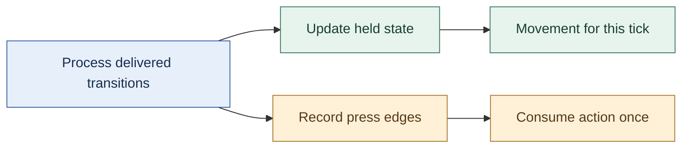

GLFW’s state query returns the last reported cached key state; it does not directly resample the physical keyboard. Its guide warns that a press and release can be missed between queries and describes callbacks and sticky-key mode as alternatives. Sticky mode retains a press until queried; it is not a complete ordered event history. OS key-repeat timing is also unsuitable for driving held-key movement. Those API facts support the distinction above; the counter, tick-consumption policy and numeric trace are original engine-design examples. [GLFW input guide](https://www.glfw.org/docs/latest/input_guide.html)


### Normalize input before gameplay consumes it

A keyboard key press is delivered differently by operating systems. Gameplay, however, wants to ask a simple question: “Is the jump action pressed?” If game code tests native key codes directly, a later platform port spreads through every gameplay feature. Input should therefore have two stages. The platform captures native events; the engine converts them to stable key/button or action states; gameplay consumes those states.

The series develops input in parts: [Kohi #009](https://www.youtube.com/watch?v=ZZhfCYNbVp8) introduces input, [#010](https://www.youtube.com/watch?v=6zjpgUX1TRY) connects the Windows-specific part, and [#011](https://www.youtube.com/watch?v=kIWFdKcGQPM) adds Linux. Those captions make an important architectural relationship explicit: the engine-level input system and platform implementation meet at a seam. The window receives events; a translation step updates the input state; gameplay queries an engine-level representation. In the full #011 caption, Linux key events pass through an X keycode-to-keysym conversion and then a switch mapping to engine key enums; upper/lowercase symbols are folded to one engine key. Mouse button indices are normalized and pointer motion forwards X/Y coordinates, while wheel handling is explicitly left for a later episode. The same build step exposes a missing portable string-duplication helper, prompting a first core string abstraction. This is useful evidence that portability work often discovers non-window dependencies in unrelated core code.

A key state has at least two useful notions. “Down” describes whether the key is held now. “Pressed this frame” describes a transition from up to down since the previous update. The latter avoids repeated actions every frame when a player intended one tap. Similarly, “released this frame” captures the opposite transition. A robust input update compares current state with prior state rather than trying to reconstruct a gameplay action from every raw event.

This design also prevents a common timing bug. If event pumping happens after gameplay reads input, the game sees the prior frame’s state and appears to respond one frame late. If input state is updated several times during a single frame with inconsistent reset rules, short presses may disappear or repeat. A clear loop order—collect events, update normalized input, run gameplay update, render—gives those states an understandable meaning. “Frame” means one iteration of this update/render cycle.

The captions later show input enabling a mock camera so the learner can move around the scene while the engine evolves ([stream](https://www.youtube.com/watch?v=s9xSwQvbG2w)). That is a useful test fixture: an engine can be visually complicated while still offering a simple camera control that confirms event delivery, frame updates and transforms are connected. The camera is not itself proof that all input semantics are finished; it is a visible end-to-end check for the specific path it exercises.

#### Preserve input edges as well as the final held state

A held-state snapshot answers "is this key down now?" It does not necessarily describe everything that happened since the previous simulation step. Suppose the player taps a key quickly while the program is processing platform messages:

| Observation | Held state |
|---|---|
| Previous simulation step | Up |
| Platform delivers key-down | Down |
| Platform delivers key-up | Up |
| Next simulation step | Up |

Comparing only the two simulation snapshots sees Up followed by Up and loses the tap. Preserve the press and release edges as events, or accumulate explicit transition flags until the intended consumer has processed them. A **transition** is a change of state; a **repeat** message for a key already held is not automatically another physical press.

Now consider several fixed simulation ticks occurring before one displayed frame. A one-shot action such as opening a door should consume the press according to the input policy, rather than firing once in every catch-up tick. A continuous action such as walking can use the held state across those ticks. That difference belongs in the gameplay command boundary, not in an accidental placement of the previous-state copy.

Focus loss needs a policy too. If the window loses focus after a key-down and receives no corresponding release, a purely event-updated held flag can remain stuck. Clear or reconcile relevant state on focus changes, and decide whether outstanding one-shot commands remain valid. Timestamp input when ordering matters, then specify how it maps to simulation ticks.

The fully read Kohi input lessons develop current/previous state tracking, key and button processing, and platform event routing. The quick-tap and catch-up examples extend that foundation to expose information a final-state snapshot cannot retain. They are original worked cases, not a claim that every edge policy is implemented in the early tutorial. [Input state](https://www.youtube.com/watch?v=ZZhfCYNbVp8), [Windows event processing](https://www.youtube.com/watch?v=6zjpgUX1TRY).


#### Derive frame time from a monotonic clock, then treat pacing as a separate choice

A minimal clock stores a start reading and an elapsed duration. On each update, elapsed seconds are `now - start`; a frame delta is `current_elapsed - previous_elapsed`. Feed that delta into game update and input update instead of passing zero. Keep the absolute timer monotonic: wall-clock time can jump when the system clock is corrected, while frame measurement needs a steadily increasing source. Platform code should normalize each OS timer to seconds so the application does not depend on counter units.

Measuring a frame and limiting its rate are distinct operations. The loop can measure work time, accumulate elapsed time for an FPS counter, and calculate the remaining portion of a target interval such as 1/60 second. Sleeping for that remainder is an optional pacing policy; it should not be mistaken for a guarantee of a precise frame rate because sleep resolution and scheduling vary by OS. A debugger pause also produces a large delta, so test observations taken while stepping are not representative of normal frame timing. The tutorial leaves limiting disabled in its scaffold, which is a useful reminder to make the policy explicit.

Source reading: [caption source](https://www.youtube.com/watch?v=bbPdEkRaVNE). Captions document the narrated development state; on-screen code and reported builds were not independently reproduced.


#### Pace the quiet period after a resize

A frame-count debounce can expire almost immediately if the loop keeps iterating while rendering is skipped. In a Kohi fix, waiting 30 frames before rebuilding swapchain resources returned early without beginning or ending a normal frame; increasing the threshold to 120 still reached it rapidly. The presenter adds a 16 ms sleep to pace the path, then reports rebuilding about half a second after resizing stops. This is an expedient frame-count-plus-sleep fix, not a general time-based debounce or robust pacing policy. [Resize debounce fix](https://www.youtube.com/watch?v=x8ao57nbMlY)

### Scale movement by elapsed time, and state what the clock means

Suppose an arrow key moves a camera by a fixed 0.1 units each update. At 60 updates per second, that is 6 units per second; at 10 updates per second, it is 1 unit per second. Frame-based movement makes simulation speed depend on rendering speed. The lesson reproduces this mismatch and motivates delta time at 00:30–03:30, then works through the 60-versus-30 frame examples around 03:40–08:30. [TIMESTEPS and DELTA TIME](https://www.youtube.com/watch?v=pctGOMDW-HQ&t=30s) [TIMESTEPS and DELTA TIME](https://www.youtube.com/watch?v=pctGOMDW-HQ&t=220s) [TIMESTEPS and DELTA TIME](https://www.youtube.com/watch?v=pctGOMDW-HQ&t=500s)

Let $\Delta t$ be elapsed seconds since the previous update and $v$ be a velocity in world-units per second. Then the frame's displacement is

$$\Delta x=v\Delta t, \qquad x_{n+1}=x_n+v\Delta t.$$

At 60 Hz, $\Delta t\approx 1/60$ s; at 30 Hz, $\Delta t\approx 1/30$ s, so each slower update advances about twice as far. Over the same real-time interval, ideal constant-velocity motion covers the same distance, while the lower frame rate displays fewer, larger steps. The episode states this distinction at 08:30–10:00 and then introduces a small time-step value object that stores seconds and offers milliseconds at 11:00–13:00. [TIMESTEPS and DELTA TIME](https://www.youtube.com/watch?v=pctGOMDW-HQ&t=510s) [TIMESTEPS and DELTA TIME](https://www.youtube.com/watch?v=pctGOMDW-HQ&t=660s)

The demonstrated loop reads the current platform time, subtracts the previous frame time, stores the new value, and passes the resulting interval through application/layer updates. The caption notes that GLFW is used directly as a temporary clock source and suggests a platform abstraction later around 13:00–18:30. The first interval is unusual because there is no prior frame timestamp; initialize the baseline before the first measured update or explicitly accept a one-frame startup artifact. The video prints seconds and milliseconds and observes about 16.6 ms per frame with VSync at 18:00–19:00. [TIMESTEPS and DELTA TIME](https://www.youtube.com/watch?v=pctGOMDW-HQ&t=780s) [TIMESTEPS and DELTA TIME](https://www.youtube.com/watch?v=pctGOMDW-HQ&t=1080s)

The camera then multiplies movement and rotation speeds by elapsed time. With VSync disabled, the old fixed-per-frame motion becomes visibly too fast; after scaling movement by $\Delta t$, the episode reports roughly the same speed when VSync is restored. That before/after experiment is shown around 20:30–25:00. Treat it as evidence for the input-to-camera update path, not a proof of frame pacing, deterministic simulation, or physics stability. [TIMESTEPS and DELTA TIME](https://www.youtube.com/watch?v=pctGOMDW-HQ&t=1230s) [TIMESTEPS and DELTA TIME](https://www.youtube.com/watch?v=pctGOMDW-HQ&t=1350s)

A variable delta solves frame-rate-scaled movement, but it does not make every simulation robust to arbitrarily large stalls. Physics engines often use a fixed simulation step with an accumulator while rendering interpolates between simulation states; this episode does not implement that pattern. Decide whether each update is visual input, gameplay simulation, or physics, and define what happens after a long pause, debugger stop, or minimized window. Clamp or subdivide unusually large intervals only with an explicit policy. The speaker says a fixed-rate update can fall behind under load at about 08:20–10:10; the lesson's next topic is object transforms at 26:50–27:30, not a fixed-step physics implementation. [TIMESTEPS and DELTA TIME](https://www.youtube.com/watch?v=pctGOMDW-HQ&t=500s) [TIMESTEPS and DELTA TIME](https://www.youtube.com/watch?v=pctGOMDW-HQ&t=1610s)

### Make timestep and integration choices explicit

Suppose a particle begins at position $p$ with velocity $v$, acceleration $a$, and is advanced for a duration $\Delta t$ seconds. A simple game integrator may first advance position using the current velocity,

$$p_{n+1}=p_n+v_n\Delta t,$$

then compute acceleration from forces and advance velocity,

$$v_{n+1}=v_n+a_n\Delta t.$$

That ordering is meaningful: the position step uses the old velocity, while the newly computed velocity affects the next step. A different integrator can produce a different result even with the same force and timestep. So “integrate the particle” is not a neutral implementation detail; it defines when inputs influence visible motion. (Game Physics Engine Development, PDF pp. 73-76.)

The selected chapter also shows a deliberate approximation. The constant-acceleration position equation contains an extra term, $\frac{1}{2}a\Delta t^2$, but the sample engine drops it and uses current velocity only. For a small timestep and ordinary acceleration, the omitted displacement may be small. For a short, strong force, it can visibly matter. A designer who needs a punchy recoil kick or a fast launch should not assume that the approximation is harmless just because it works for falling particles. It is a measurable design and simulation choice. (Game Physics Engine Development, PDF pp. 74-76.)

Damping is another place where a formula silently becomes a player-facing rule. If a factor $d$ is applied once per rendered frame, then changing the frame rate changes how quickly motion dies away: more updates mean more multiplications. If instead $d$ represents the fraction retained over one second, the chapter applies $d^{\Delta t/(1\,\mathrm{s})}$ each update, where $\Delta t$ is the elapsed duration. This keeps the intended decay closer across different frame durations, though it costs a power operation. An engine may choose a cheaper per-step approximation for huge particle counts, but then should treat the visual difference as part of the behavior, not as an invisible optimization. (Game Physics Engine Development, PDF p. 75.)

The practical contract around an integrator should state at least: the units of duration, whether duration must be positive, which state fields the caller may set, whether forces are accumulated or persistent, and when accumulated forces are cleared. The example implementation asserts positive duration, advances position, derives acceleration from force times inverse mass, updates velocity, then applies damping. The pages do not show the complete force accumulator lifecycle, so that final clearing policy must be verified elsewhere before copying the interface. (Game Physics Engine Development, PDF p. 76.)

Inverse mass is particularly useful for static world geometry. A wall with inverse mass zero receives no acceleration contribution from accumulated force in this model, while a dynamic crate has positive inverse mass. Zero inverse mass alone does not erase an object's existing velocity or separately configured base acceleration, so the engine must also keep those values appropriate for an immovable body. Storing inverse mass avoids dividing by mass each time. But the name matters: accidentally storing mass in an inverse-mass field reverses the expected response. A small API that accepts ordinary mass and converts internally can keep content authors from making that mistake. (Game Physics Engine Development, PDF pp. 70-71, 76.)


### Time is part of the design

A frame is not simply “run every subsystem once.” The amount of real time between frames varies with hardware load, background work, and display cadence. The simulation therefore needs an explicit relationship between wall-clock time and game time. Gregory treats rendering loops, game loops, timelines, measuring time, and multiprocessing as separate but related architectural choices (Gregory, Ch. 7, contents PDF pp. 10–11; implementation passages in §7.1–7.5, PDF pp. 326–345, printed pp. 304–323). The important design decision is not to copy an old loop pattern. It is to decide which state must advance deterministically, which work can be asynchronous, and how the rendered frame observes the latest coherent simulation state.

A basic fixed-step simulation accumulates elapsed time and advances in slices of a chosen duration $h$:

$$
A \leftarrow A + \Delta t_{real}, \qquad
\text{while } A \ge h: \; S \leftarrow \operatorname{step}(S,h),\; A \leftarrow A-h.
$$

Here (S) is simulation state and (A) is accumulated time. The display can render at a different rate. If the renderer interpolates between the two latest simulation states, it can present smooth motion without making the physics step size depend on display speed. This pattern is a teaching example, not an attributed algorithm from a specific cited paragraph. Its tradeoffs are concrete: too large an $h$ increases numerical error and tunneling risk; too small an $h$ costs CPU; a long pause can create a “spiral of death” if the engine tries to catch up forever. A game may cap catch-up steps and deliberately drop excess simulation time, but that changes world-time semantics and must be an explicit product choice.

The jump system should consume input at a defined boundary. One clean arrangement is to timestamp raw input, turn it into a gameplay command, and apply that command on the next simulation tick. The renderer may show a prediction to reduce perceived lag, but prediction and authoritative state should remain distinguishable. For networked games, a tick identifier and stable input ordering become critical because two peers must agree which command affected which state. Gregory’s contents specifically call out networked and multiprocessor loops (§7.6–7.7, contents PDF p.11); those topics are only inventoried here, not deeply read. This section therefore recommends the concepts but does not claim a particular network protocol.


## Keep identity, storage, and ownership in agreement

The first object can live in a local variable. A world that creates, removes, saves, and reloads objects needs a more deliberate lifetime model.

### A live object needs an identity that survives storage changes

A crate's position in an array is not necessarily its permanent identity. Removing another item can move it, and reusing an old slot can accidentally make an old reference point at a new object. **Identity** answers “which logical object?”; **storage** answers “where do its current bytes live?”

An arena can reclaim a region of bytes together, but reclaiming bytes is not the same as running C++ destructors. If an arena stores objects that own other resources, arrange their cleanup before reset or deliberately restrict what may be stored there. Likewise, releasing CPU scratch memory does not prove that a GPU copy has finished reading it.

A **handle** is a small token that the owner resolves into the current object. A common teaching design stores a slot number and a **generation**, a counter that changes when a slot is reused. The owner accepts a handle only when both parts match an alive slot. Suppose crate A occupied slot 7 at generation 4. After A is destroyed, slot 7 is reused for crate B at generation 5. A's old handle is rejected instead of silently selecting B.

This does not make a handle automatically thread-safe, nor does it stop a caller keeping a raw pointer after validation. The validation and use must follow a lifetime rule. A bounded-width generation can eventually wrap; the laboratory retires a slot at the maximum generation instead of cycling into an old identifier. Other engines choose different tradeoffs and must state their assumptions.

An **entity** is a world object's identity. A **component** stores one kind of data associated with it. A **transform** records placement, orientation, and scale. A **collider** supplies the geometry and settings used to test physical interactions; it need not be identical to the visible mesh. A **system** performs work over suitable data. **ECS**, entity-component-system, names a family of ways to organize these relationships; it is not a command to put every behavior into one universal framework. A small object-oriented world, tables of components, or a hybrid can all be reasonable if access and ownership are clear.

During an iteration, defer changes that would invalidate the iterator or change the meaning of the current pass. **Deferred destruction** means recording a removal request and applying it at an agreed safe boundary. A raw pointer that happened to work before a container reallocated is not a lifetime guarantee. The C++ companion develops these ownership and borrowing issues in more detail: [[Concepts/Ownership and non-owning views]].


Notice that the GPU may extend the final lifetime. Removing a crate from the scene does not prove that a submitted graphics command has stopped reading its mesh. CPU and GPU completion are different facts.

### Keep submitted render resources alive until their users finish

Imagine a layer submits a draw using a shader and vertex array, then the layer is removed before the renderer processes that draw. The game thread may already have destroyed the layer and released its last references, while a queued render command still needs those resources. “The caller is done” and “the renderer is done” are different moments.

A useful lifetime trace is:

```text
Game thread                 Render queue / render thread
submit(shader, geometry) -> retain draw data and resource references
release layer's handles     process queued draw
                            release queued references
```

The `Refs, Scopes and Smart Pointers` episode introduces `Scope<T>` as an alias for unique ownership and `Ref<T>` as an alias for shared ownership. Its point is that public engine code can express intent without spelling `std::unique_ptr` or `std::shared_ptr` at every resource boundary, and could later change the implementation behind those aliases. A shared reference is appropriate when several parties must independently keep a CPU resource object alive; it is not a reason to make every pointer shared. A uniquely owned layer or short-lived local helper can remain uniquely owned. The choice answers who may keep the object alive, not merely who calls `delete`. [Caption source: Refs, Scopes and Smart Pointers](https://www.youtube.com/watch?v=HkGZ378nArE)

CPU object lifetime and GPU-use lifetime are separate contracts. A reference count can prevent the CPU-side wrapper from being destroyed while the render queue holds a reference. It does not, by itself, prove that previously submitted GPU commands have finished reading the underlying buffer or image. GPU storage still needs an API-appropriate completion rule—such as a fence or timeline value—before it is destroyed or recycled. Keep those two questions explicit: “Can CPU code still access this object?” and “Can in-flight device work still use this allocation?” The episode motivates retaining renderer assets across deferred work; the GPU completion rule is a general extension, not an implementation demonstrated there. [Caption source: Refs, Scopes and Smart Pointers](https://www.youtube.com/watch?v=HkGZ378nArE)

The speaker also notes shared ownership costs, including a separately managed control block and atomic reference-count operations in the standard shared-pointer implementation. Treat those as a measured tradeoff, not an automatic performance failure: first establish the required lifetime, then profile if reference counting appears in a hot path. The episode's `Ref` and `Scope` aliases improve vocabulary and preserve a possible implementation seam, but do not replace an asset manager. An asset manager may add identity, caching, load state, eviction policy, and explicit retention rules that a shared pointer alone does not provide. [Caption source: Refs, Scopes and Smart Pointers](https://www.youtube.com/watch?v=HkGZ378nArE)


### State ownership and memory lifetime

Now consider what “the player is grounded” means. If animation, gameplay, and physics each keep their own unrelated grounded flag, drift is inevitable. The engine should identify one authoritative source and define how derived representations are refreshed. A common choice is: physics owns the contact facts for a tick; gameplay consumes a grounded/support result and decides whether jump is permitted; animation consumes gameplay movement intent and the resulting pose inputs. The result sent to rendering is a snapshot, not a second authority.

Memory choices affect these contracts. Gregory’s support-systems contents point to allocator design and memory management (Ch. 5, contents PDF p.10); his text explains that custom allocation can better match known usage patterns, but relocating allocations requires pointer discipline or indirection such as handles (PDF pp. 229–241, printed pp. 207–219). Translate that into a practical rule: use a short-lived arena for temporary per-frame contact candidates; use a pool or stable slot table for entities whose identity must persist; avoid retaining raw pointers into a buffer that may move or be reset. These are not interchangeable allocator recipes. Pick based on lifetime and access pattern, measure, and document invalidation.

For example, a `BodyHandle` can be a slot plus generation counter. A contact manifold stores handles, not raw addresses. If a body is deleted and its slot reused, the old generation no longer resolves. This protects delayed events and debug overlays from accidentally referring to a different object. The cost is an indirection and validation check. For tightly packed solver arrays, the engine can resolve handles once per step into local indexed data, preserving both safety and cache-friendly iteration.

Resource memory has another lifecycle. Gregory’s resource chapter distinguishes raw authoring data, processing/conditioning, packaging, loading, and runtime use; the asset build must understand dependencies so an edit causes dependent outputs to be rebuilt (Ch. 6 contents PDF pp. 10–11; selected text PDF pp. 301–307, printed pp. 279–285). His discussion also identifies streaming as loading data in the background while the main program continues (PDF p.291, printed p.269). A jump on a platform in the next streamed region raises a boundary question: does physics wait for collision data, use a conservative placeholder, or prevent entry until the region is ready? That is a gameplay contract as much as a file-I/O problem.

A resource manager gives the rest of the engine one place to request resource types and apply type-specific initialization (Gregory, PDF pp. 304–307, printed pp. 282–285). It can coalesce duplicate loads and track references, but it should not hide every cost. If a gameplay call that appears cheap can trigger disk I/O, decompression, GPU upload, and memory growth, frame-time spikes will be difficult to reason about. Offer explicit asynchronous request/completion states where cost is uncertain. Let the editor and build pipeline validate missing dependencies before the player sees a broken jump animation.

#### Read memory statistics as a ledger with a stated boundary

A memory report becomes useful when its numbers answer a precise question. **Live bytes** are the tracked allocations not yet released. **Cumulative allocated bytes** count allocations over time, including memory already released. **Peak live bytes** are the largest simultaneously live total observed. They can differ even in a program that releases everything correctly.

Consider a wrapper that records requested heap bytes:

| Operation | Live bytes | Cumulative allocated bytes | Peak live bytes |
|---|---:|---:|---:|
| Allocate a 1,024-byte texture staging block | 1,024 | 1,024 | 1,024 |
| Allocate a 256-byte temporary block | 1,280 | 1,280 | 1,280 |
| Free the staging block | 256 | 1,280 | 1,280 |
| Free the temporary block | 0 | 1,280 | 1,280 |

A cumulative total that keeps rising is not by itself evidence of a leak. Conversely, a zero total from one wrapper does not prove that the process has released every allocation. Third-party libraries, platform APIs, GPU allocations, and unwrapped calls can live outside its accounting boundary. Also distinguish bytes requested by callers from the allocator's actual reserved space, padding, and metadata.

A **memory tag** assigns a category such as texture loading, arrays, or application state. Tags help locate responsibility; they do not change ownership. For the counts to remain meaningful, deallocation must subtract the same size and category that allocation recorded. Depending entirely on a caller's guessed size or tag makes the report vulnerable to its own bookkeeping mistakes. Store or otherwise verify allocation metadata where the allocator contract permits it.

An arena adds a second boundary. Resetting its logical allocation position can make its objects unavailable while retaining the arena's backing storage for reuse. Report reserved backing bytes separately from currently occupied space. Calling a reset "freeing all memory" conceals this distinction and can mislead both optimization and lifetime reasoning.

The fully read Kohi memory-subsystem lesson motivates tagged allocation and accounting. The ledger and arena distinction above are original teaching extensions; they do not claim that the early wrapper measures every allocation in an operating-system process. [Caption source: Memory Subsystem](https://www.youtube.com/watch?v=_GBUCo2FbUk).


#### Align the address the caller receives

A pool beginning on a 32-byte boundary does not guarantee that every payload returned from it is 32-byte aligned. If a 12-byte header precedes the payload, a block starting at `0x1000` returns `0x100C`, which is twelve bytes past that boundary. Alignment belongs to the final address, after metadata and padding have been considered.

One layout can reserve space for a size breadcrumb, align the user pointer, and retain enough information to recover the allocator's original range on release. The contract needs more than a rounding expression: the alignment must be supported, all size additions must fit, the payload and metadata must remain inside the reserved block, and deallocation must recover exactly the range originally allocated.

Metadata has alignment rules too. A payload satisfying a byte-aligned request may not leave a preceding typed integer aligned; a header immediately after a 15-byte payload may also be misaligned. Add suitable padding or use a representation that permits safe byte copying into an aligned local object. Do not assume that hardware tolerating an unaligned load makes an arbitrary typed C access portable.

Test a range of payload sizes and alignments, not only a rounded size such as 64 bytes. Include alignment one, small odd payloads, exact-capacity requests, requests that cannot fit, and the representable-size limit of any compact size field. Failure must not advance the allocator or discard a still-valid old allocation.

The fully read Kohi correction rearranges metadata to repair the caller-visible alignment guarantee. The numerical address and additional metadata checks here expand that contract; they are not independent verification of the tutorial's allocator implementation. [Caption source: Memory Alignment Correction](https://www.youtube.com/watch?v=VQ6Q9B_WDlM).

Related foundations: [[Concepts/Alignment and padding|Alignment and padding]].

##### Recover the original allocation range

The corrected source layout stores a four-byte payload size immediately before the aligned pointer and a trailing header retaining the original block start. That compact breadcrumb imposes a 32-bit representability limit. [Alignment correction](https://www.youtube.com/watch?v=VQ6Q9B_WDlM).

The free-list layer may also return an alignment offset. Free must receive that offset and the original consumed range; adding a base offset twice shifts the allocation, while forgetting padding on release strands or overlaps free space. A later allocator walkthrough uses a header before the pointer to record size, alignment, and offset, and adds report-only memory tags. Report-only accounting must not be confused with freeing driver-owned memory. [Allocator offset and accounting walkthrough](https://www.youtube.com/watch?v=Fo9ri9DMu74)

These reported repairs do not establish exhaustive allocator correctness.


#### Bridge Vulkan allocation callbacks to an engine allocator

Vulkan allocation callbacks can route driver requests through an engine allocator, but the bridge must honor the requested alignment and preserve existing bytes when reallocation succeeds. A replacement should allocate first, copy the old contents, and release the old block only after the replacement is valid. The Kohi implementation checks that the requested alignment matches its original allocation, but its captioned discussion is uncertain about zero-size reallocation semantics; verify edge behavior against the Vulkan specification before treating the bridge as conformant. [Kohi Vulkan allocator callbacks](https://www.youtube.com/watch?v=F9hN1PrxnHE)

Separate allocations the application owns from driver-internal allocation notifications. The former provide a pointer that the engine can later free; the latter report size for accounting but do not transfer ownership. Counters for hooked buffer/image paths are useful diagnostics, not a census of all driver or resident GPU memory. The episode reports GPU-local and ordinary Vulkan totals and explicitly calls its allocator an early version; its measurements exclude unhooked resources.

### Give memory a lifetime that matches the work

Imagine loading a cave level. Its collision mesh, room graph, and encounter records are all created together. When the player leaves the cave, none of those objects need to outlive the level. A stack allocator fits this job: reserve a level region, remember a marker before loading, and return to that marker when unloading. The useful guarantee is not that every object can be freed whenever convenient. It is that the group has one clear storage-reclamation point. Allocations made after the marker are reclaimed with a constant-time pointer reset. That does not automatically run object destructors or release external resources such as file handles; the engine must arrange that work separately. The tradeoff is strict: a cave object cannot be individually freed while later allocations remain live, and a pointer into the region becomes invalid after rollback. (Game Engine Architecture, PDF pp. 229-231.)

Now consider per-frame visibility work: a list of lights visible to the camera, temporary sorting keys, and a scratch list of draw commands. If every entry is consumed before the frame ends, a single-frame allocator can reset the whole scratch region at the next frame. The question for the engine API is therefore not merely “how many bytes?” but “until when may a caller use this pointer?” A name such as `FrameScratch` can make the boundary obvious, and an API should avoid storing its result in persistent world state. A two-buffer version is useful when a worker job writes results that the next frame consumes: the buffer from frame (i) remains available during frame (i+1), then becomes reusable. This only works if the consumer finishes before the reuse boundary. (Game Engine Architecture, PDF pp. 235-237.)

For thousands of short-lived projectile records of exactly one size, a pool is a better shape. Every slot can be handed out or returned independently, so one projectile can die while others remain. Equal-sized slots avoid the “enough total free bytes, but no large enough hole” failure common to a general heap. The pool is not a universal allocator: if a caller needs a differently sized object or retains a slot after returning it, the pool contract no longer protects that caller. (Game Engine Architecture, PDF pp. 231-232, 238-239.)

This gives a useful engine review habit: draw a lifetime beside each allocation category. Level data lives from load to unload; frame scratch lives until frame completion; asynchronous output may live through the next frame; entity records may need independent lifetimes. Then choose storage whose reset/free rule matches that lifetime. The source’s double-ended stack example makes this concrete: level data grows from one end while temporary frame data grows from the other, sharing capacity while keeping separate rollback directions. But neither side may cross the other, so capacity planning and high-water instrumentation still matter. (Game Engine Architecture, PDF pp. 229, 231, 235-237.)

Alignment and relocation expose another boundary: a pointer is not just an address if the allocator needs hidden information to recover its original block, and moving blocks invalidates outstanding pointers unless every reference is relocated. For a compact engine, stable addresses may be a deliberate simplification. A movable heap can reclaim holes, but only if the engine owns references well enough to update them. Handles or indices can make relocation possible; unrestricted raw pointers make it difficult. The selected pages explain the relocation problem, but do not prescribe handles as its solution. (Game Engine Architecture, PDF pp. 233-235, 240.)

#### Two scratch buffers still need a completion rule

Suppose a visibility job reads a temporary list from scratch buffer A. The main thread moves on and writes the next frame's list into buffer B. Alternating buffers has bought the job extra time; it has not proved the job finished. If the main thread resets A while that job still holds a pointer into it, the pointer may still name allocated memory whose contents now belong to different work. This is a lifetime error even if no allocator reports a use-after-free.

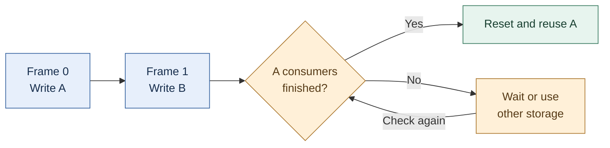

The source's double-buffered allocator gives a useful way to separate adjacent frames' data. The completion gate above is an original extension for asynchronous consumers, not a claim that two buffers are a universal scheduling solution. For a CPU job, its completion token can release the borrow. For GPU-visible storage, use the completion condition for the actual submission that reads it. A frame counter or a CPU smart pointer alone does not establish that condition. Extra buffers reduce pressure under some workloads, but the reuse rule still needs proof that all relevant consumers are done. Storage capacity and safe reuse are separate questions. (Gregory, *Game Engine Architecture*, supplied 2009 edition, PDF pp. 235–237; asynchronous example and diagram are original teaching.)

The same distinction helps when reading [[Concepts/Storage duration and object lifetime|storage duration and object lifetime]] and [[Concepts/Ownership and non-owning views|ownership and non-owning views]]: keeping bytes allocated, keeping an object alive, and allowing a borrowed view to remain valid are related contracts that must agree.


### Give memory a purpose, then choose an allocator to fit it

General-purpose allocation is convenient but can become expensive or unpredictable in systems that create many short-lived objects. An allocator is a component that decides how a region of memory is handed out and reclaimed. The right allocator depends on the lifetime pattern, not on fashion. The series introduces a memory subsystem in [Kohi #007](https://www.youtube.com/watch?v=_GBUCo2FbUk), and later captions cover dynamic allocation, freelists and allocator work: [dynamic allocator](https://www.youtube.com/watch?v=BSBFBWwG8Ds), [freelists](https://www.youtube.com/watch?v=sP7xRUyP3e0), [wrapping up freelists and allocators](https://www.youtube.com/watch?v=SNDJ-rGJd5A), and a live stream that identifies a first simple allocator as its main task ([stream](https://www.youtube.com/watch?v=3ZFcvBjRFN0)).

A linear allocator is a good first example. It owns a fixed block and advances an offset as allocations are requested. Allocation is cheap: align the current offset, return that address, advance by size. Releasing individual objects is not supported; the whole block is reset at once. This is ideal for temporary data whose lifetime naturally ends together, such as per-frame scratch data. It is a poor fit for objects that must be freed independently or survive an unpredictable time.

A pool allocator handles a known set of same-sized objects. It divides a block into slots and tracks which slots are free. Allocation and release can be constant-time, but the object size and pool capacity constrain use. A freelist is a linked list of free slots; the link may be stored inside each free slot itself. The lesson is not “use a freelist everywhere.” It is that known, repeated allocation patterns can be served with predictable behavior by a specialized structure.

A dynamic allocator can serve varying sizes in a managed region, but then fragmentation, alignment, metadata and coalescing become concerns. Fragmentation means usable bytes are split into pieces too small for a particular request. Alignment means an address must satisfy a boundary requirement for the object or API that will access it. The current repository contains allocator modules under `kohi.core/src/memory/allocators/`, including linear, pool and dynamic allocators. Its roadmap explicitly says the freelist should be reworked to account for alignment and calls out carrying alignment into renderbuffer allocation. That is direct evidence that “size fits” is not enough: GPU-facing buffers can have stricter alignment requirements than a generic byte allocation.

A good allocator API needs observable failure. If a fixed arena is exhausted, silently returning overlapping memory corrupts unrelated objects. If a pool cannot supply a slot, the caller must know. A useful debug build tracks requested sizes, tags or allocation sites, but debug metadata should not obscure the basic contract. Start with the lifetime story: who allocates, who owns, who releases, and when is bulk reset safe? Only then select the allocator.

The later GitHub mirror has concrete allocator variants beyond the early videos. In the pinned [linear allocator source](https://github.com/travisvroman/kohi/blob/05a5193d5ed4890703cfcbbeb5c5e947feefecf6/kohi.core/src/memory/allocators/linear_allocator.c), allocation advances a byte offset and `free_all` optionally clears the full arena; the inspected allocator does not align each request. The [pool allocator source](https://github.com/travisvroman/kohi/blob/05a5193d5ed4890703cfcbbeb5c5e947feefecf6/kohi.core/src/memory/allocators/pool_allocator.c) uses fixed element slots plus a free-node array. Its `pool_allocator_destroy` body is empty in this mirror even though creation allocates its backing memory, an apparent cleanup gap that deserves verification before relying on that snapshot. The [dynamic allocator](https://github.com/travisvroman/kohi/blob/05a5193d5ed4890703cfcbbeb5c5e947feefecf6/kohi.core/src/memory/allocators/dynamic_allocator.c) combines a freelist with per-allocation size storage, alignment metadata, and optional debug guards/source-location fields. These code observations describe the later GitHub revision, not what the earlier videos had already implemented; no build or allocator test was run.
The source retrospective says the engine had 77.5 thousand lines, 472 commits and 265 full episodes by its writing point, and it praises the organization while acknowledging areas to improve. Those figures are from the repository retrospective and should not be mistaken for a live count at this revision. They illustrate a broader practical risk: custom allocation can be educational and useful, but every custom policy becomes code that must be tested, profiled and explained. Avoid building an allocator subsystem before a real allocation pattern needs it.

#### Total free space is not necessarily one usable range

A **free list** records ranges available for allocation. For a simple 64-byte example, let each requested range start at an eight-byte boundary and use half-open notation: `[0,16)` includes offsets zero through fifteen. This is a logical byte-offset example, not a claim about a graphics device's required alignment.

| Operation | Allocated ranges | Free ranges |
|---|---|---|
| Start | None | `[0,64)` |
| Allocate A: 16 bytes | A at `[0,16)` | `[16,64)` |
| Allocate B: 16 bytes | A at `[0,16)`, B at `[16,32)` | `[32,64)` |
| Release A | B at `[16,32)` | `[0,16)`, `[32,64)` |
| Release B and merge adjacent free ranges | None | `[0,64)` |

After releasing A, 48 bytes are free in total, but the largest contiguous free range is only 32 bytes. A request for one contiguous 48-byte block cannot fit. This is **external fragmentation**: available space is separated by live allocations. After B is released, **coalescing** merges neighboring free ranges, restoring one 64-byte span.

An allocator must also represent its own bookkeeping. Running out of free-list nodes can be different from running out of payload bytes. Resizing that metadata does not itself resize a GPU buffer or move uploaded mesh data. A GPU-buffer resize needs its own allocation, copy, synchronization, and publication path. Returning a byte range to the free list before earlier GPU work finishes can allow a new mesh to overwrite data still in use.

Reallocation needs a failure policy: if a larger replacement cannot be obtained, preserve the old valid allocation unless the contract explicitly states otherwise. Validate sizes and range arithmetic before copying. A byte-offset allocator, a CPU pointer allocator, and a GPU resource manager can share ideas without sharing all alignment or lifetime rules.

The fully read Kohi free-list and dynamic-allocator lessons motivate these structures. The 64-byte trace and separation of bookkeeping from GPU payload are original teaching extensions. [Free list](https://www.youtube.com/watch?v=sP7xRUyP3e0), [dynamic allocator](https://www.youtube.com/watch?v=BSBFBWwG8Ds).


#### Dynamic arrays in C: track capacity separately from length

A small generic C array can store a header containing capacity, logical length, and element stride, followed by contiguous element storage. Return a pointer to the element region so ordinary indexing still works; recover the header with a documented pointer offset in helper functions. Macros can provide `sizeof(element)` and make push calls accept a value, while implementation functions operate on byte pointers. This is a compact technique, but it depends on careful alignment, pointer arithmetic, overflow checks, and strict ownership. Those details deserve tests before treating the container as production-ready.

Capacity is reserved storage; length is the number of initialized elements. Growing capacity (for example, doubling it) preserves existing bytes, but popping need not shrink the allocation. Reserving room does not make elements logically present: after a bulk copy into reserved storage, explicitly set the length before iteration. A middle removal shifts the tail left, and insertion shifts it right; both should validate the index and compute byte counts from stride. Keep these invariants visible in the API so callers do not confuse allocated room with valid elements.

A growing allocation can invalidate pointers into its old storage. Reject overflowing `count * stride` and capacity-growth arithmetic before allocating or copying; a larger capacity is not evidence that arbitrary byte counts are safe.

Source reading: [caption source](https://www.youtube.com/watch?v=XQ6qljkh2KI). Captions document the narrated development state; on-screen code and reported builds were not independently reproduced.


### Separate state ownership from state use

Many engine bugs are ownership bugs with a graphics symptom. The code that creates a buffer must know when it can be destroyed. The code that submits work must not free a resource still referenced by an in-flight command buffer. A material should not own a shared texture accidentally if multiple materials use it. A scene unload should release its references without invalidating a global asset cache. Thinking in terms of ownership makes these relationships explicit.

A useful rule is to ask four questions whenever a subsystem API returns an object: Who owns it? How long is it valid? Who releases it? What happens if the operation fails? A raw pointer only answers “where is it now,” not any of these lifetime questions. An opaque handle may improve safety if the manager validates it, but then the manager owns the storage and must document whether handles survive reload or relocation.

GPU execution makes lifetime less intuitive because the CPU and GPU do not share one timeline. Suppose the CPU records a draw using a texture, submits it, and immediately destroys the texture. The CPU has finished issuing commands, but the GPU may not yet have executed them. A safe design tracks completion or defers destruction until the relevant fence signals. This is why synchronization and resource lifetime belong in the same mental model.

The repository’s retrospective highlights verbose asset requests and API differences between asset and resource systems, while its TODO proposes per-type request/release operations. Those observations are best converted into design questions, not copied as a universal API: Does this type need asynchronous creation? Is it safe to share? Should the API return a handle, callback result or ready pointer? Is release a decrement of a reference count or an explicit owner action? A consistent answer reduces accidental leaks and double frees.


### Preserve ownership, freshness, and intent in engine APIs

Several review comments connect seemingly small APIs to larger contracts. Physics queries may observe the previous completed simulation step unless the caller waits for fresh data. Working directories distinguish engine resources from project assets. UV offsets should be represented in a way that supports the renderer’s batching model and the editor’s eventual crop workflow. Unbinding graphics state may make debugging clearer even where a later draw would bind new state. Each example asks the same design question: which subsystem owns this data, when is it valid, and what user or caller intent does the API expose? The review is a historical discussion and its implementation comments are not evidence about current runtime behavior (The Cherno, “Finishing the Pull Requests!,” 01:09:00–01:30:52).

#### Treat ownership proposals as questions about lifetime and identity

Code reviews often recommend “use a shared pointer,” “put it in a pool,” or “make it a scene member.” These are not interchangeable fixes. First ask: who creates the object, who may keep using it, what event ends that use, and what identity survives replacement or relocation?

A borrowed reference is safe only while its owner guarantees the object remains alive and stable. An owning handle can extend lifetime, but shared ownership can obscure which subsystem must shut down first. An index survives vector reallocation because it does not store an element address, but it may refer to a different object after compaction unless the container preserves slot identity or checks a generation. A stable ID answers “which object?” while a pointer answers “where is it now?” A pool may improve locality for frequently traversed components, but it also needs a deletion/reuse policy and a way to validate handles. These are different contracts, not automatic performance upgrades.

The Hazel guest review raises these distinctions for queued callbacks, layer pointers, intrusive reference counting, buffer views, and scene teardown. A queued callback that captures shared ownership may be appropriate if the task must outlive its producer; a synchronous borrowed reference may be enough if the call cannot escape. A buffer described as pointer-plus-length can be a non-owning view, while a separate explicit release operation suggests ownership exists elsewhere. Read the actual type and call sites before concluding what owns the bytes. The episode's discussion of interpreting raw file bytes as objects is explicitly unsettled; casting does not itself settle object lifetime, alignment, padding, or serialization rules. [Hazel code review](https://www.youtube.com/watch?v=Glq1oDBy1cQ), 00:14–00:24 and 00:45–00:52

The same caution applies to suggested data-oriented redesigns. A component-per-heap-allocation design can scatter hot data, but replacing it with packed arrays is beneficial only if traversal is important and the storage/handle rules remain correct. Measure the workload and define mutation/deletion semantics before treating a reviewer's cache-locality argument as a measured win. Likewise, returning a reference to a current scene is only a defect if the caller can outlive or observe replacement of that scene without a valid contract. The 13-year-old engine review, Hazel 2D review, terminal engine review, and no-library engine review all contain useful design questions, but their source-level claims are not independent builds or reproductions.

## Give the renderer a clear job, then meet the graphics API

The world now owns meaningful state. Rendering needs a view of that state, not permission to become its accidental owner. The next explanations move from the engine boundary to the work behind a graphics submission.

### See a frame as a small, inspectable grid

Before asking a graphics API to draw a mesh, make a tiny image whose storage you can explain. A **pixel** is one sample in that image. It stores values interpreted as color, and sometimes opacity; it is not a little triangle or a game entity. A **pixel buffer** is memory holding those samples. Getting values into a buffer and getting that buffer displayed are separate jobs.

Imagine an image four pixels wide and three pixels high. Give its upper-left pixel the coordinates `(0, 0)`. In this example, horizontal coordinates increase to the right and vertical coordinates increase downward. Those are our image conventions; they do not establish how every graphics API or camera defines its axes.

A **row-major** layout puts one whole row in memory, then the next. For a tightly packed array containing one element per pixel, the element index is `y * width + x`:

| Row | First pixel | Next | Next | Last pixel |
|---|---|---|---|---|
| `y = 0` | `(0,0) → 0` | `(1,0) → 1` | `(2,0) → 2` | `(3,0) → 3` |
| `y = 1` | `(0,1) → 4` | `(1,1) → 5` | `(2,1) → 6` | `(3,1) → 7` |
| `y = 2` | `(0,2) → 8` | `(1,2) → 9` | `(2,2) → 10` | `(3,2) → 11` |

The calculation counts the `y` complete rows before our pixel, then moves `x` elements along its row. At `(2,1)`, one complete row contributes four elements and the horizontal move contributes two: the index is six. Twelve pixels occupy indices zero through eleven. A width of four allows horizontal coordinates zero through three; four is the count, not a valid horizontal coordinate.

Use an outer loop for rows and an inner loop for horizontal positions. Initially, write the index into each pixel element instead of trying to make an attractive image. Print the coordinates for this tiny buffer and check that each location is visited once. For a real display, replace those diagnostic integers with correctly encoded colors. Do not keep printing every pixel of every frame: the logging can dominate the work you intended to measure.

There is an important limit to the simple formula. An **element index** is not necessarily a byte address. If one pixel occupies four bytes, the tightly packed byte offset is four times its element index. Some image interfaces add padding between rows. Their **row pitch**, also called row stride, is the byte distance from one row's beginning to the next. With a 24-byte row pitch and four bytes per pixel, `(2,1)` begins at byte offset `1 * 24 + 2 * 4 = 32`, rather than the tightly packed offset 24. Use the interface's actual format and pitch when copying image data.

The short Cherno lesson demonstrates row-by-row traversal through printed coordinates. The four-by-three trace and pitch example here are original teaching extensions, not a claim that the video implements padded image transfer. [Caption source: How Rendering Works, episode 4.5](https://www.youtube.com/watch?v=6dOIju7--Jg).


### Put a rendering boundary between games and graphics APIs

A game needs to describe what it wants drawn; a graphics backend needs to translate that description into GPU commands. If every game feature directly calls OpenGL, then replacing the backend or testing the gameplay logic becomes difficult. An engine can introduce interfaces for renderer API, buffers, vertex arrays, shaders, textures, framebuffers, and commands. The interfaces give game and editor code a stable vocabulary while a backend supplies platform-specific implementations.

The Hazel public code exposes this separation. Core renderer classes delegate commands through a `RendererAPI`; platform-specific OpenGL classes implement buffers, vertex arrays, textures, shaders, and framebuffers. A `RenderCommand` acts as a high-level call site for operations such as clearing and drawing. The repo has a renderer API abstraction, an OpenGL implementation, shader and buffer classes, and a 2D renderer. That evidence is from the 2023 snapshot and should be described as its architecture at that revision, not as a claim about the latest Hazel development branch.

A useful learning progression is:

1. Create a graphics context and clear the window to a known color.
2. Upload a small vertex buffer and draw a triangle.
3. Define how vertex data is laid out and how a shader consumes it.
4. Add a texture and sample it in a shader.
5. Add transforms and a camera so objects can be moved in world space.
6. Batch compatible 2D draws to reduce repeated state changes.
7. Add off-screen framebuffers when the editor needs a scene viewport, picking, or post-processing.

This sequence is conceptual general guidance. It follows the public Hazel renderer abstractions and the Game Engine playlist’s renderer-focused episodes, but a video title alone is not enough to attribute every step to a specific explanation. The code is the checkable evidence for which abstractions existed in the inspected commit.

#### API abstraction has a price

An abstraction is worthwhile when it lets a meaningful part of the engine survive a backend change. It can also become the least common denominator that hides useful backend capabilities. For example, a simple “draw indexed” interface is portable across many APIs; a complex render graph with transient resources and synchronization needs a more deliberate model. Start with the operations the engine actually uses. Add capabilities when a real feature needs them, and expose backend-specific escape hatches only when you can define their lifecycle and portability cost.

Do not claim that an interface means multiple backends are implemented. In the public repository snapshot, an interface and an OpenGL implementation are visible; the README’s roadmap mentions native APIs as future goals. The existence of `RendererAPI` is proof of a seam, not proof that DirectX, Vulkan, and Metal are all supported. This distinction is a good example of evidence discipline: a design intention, an interface, and a working backend are three different facts.

#### From vertices to useful render operations

A vertex is structured data that describes a point or attribute for the GPU. A vertex buffer stores those records. A layout explains which fields the shader will read, such as position, texture coordinate, and color. An index buffer lets the renderer reuse vertices when forming triangles. A vertex array or equivalent binding object associates those resources with the expected layout. Shaders transform vertices and calculate pixel color. A texture provides image data that the shader can sample.

An engine renderer can expose either low-level primitives or more useful operations such as “draw sprite.” For 2D games, a sprite call can bundle a transform, texture, tint, and UV rectangle. Hazel’s 2D renderer is an example of raising the abstraction above raw vertices. The renderer can combine compatible requests into batches, preserving draw order where transparency requires it. Batching reduces per-draw overhead, but it introduces capacity limits, texture binding rules, and flush decisions. The engine should make those limits measurable and visible through renderer statistics rather than treating “batching” as an unlimited magic optimization.

##### Submit work, then flush it

The simple 2D renderer separates describing a shape from issuing graphics commands. A renderable quad stores position, size, color, a vertex array, and an index buffer. Its four vertices and six indices describe the quad; color values are uploaded alongside the geometry. A z coordinate is retained so a 2D scene can express drawing order.

A small renderer interface has two operations: submit a renderable and flush pending submissions. The example implementation queues renderable pointers. During flush it binds each renderable’s vertex array and index buffer, sets a model transform from its position, issues an indexed triangle draw, unbinds the resources, and removes the front queue item. The live coding exposed an important queue-loop bug: reading the front without popping it repeats the same item forever. Every successful iteration needs to advance the queue.

The demonstration gets two differently sized and colored sprites on screen, but it is deliberately simple. It issues one draw call per renderable and rebuilds a model matrix for each object on every flush. Queue ownership, shader lifetime, batching, and optimization are left for later design work. Treat these as limitations of this tutorial implementation, not guarantees about a modern engine renderer.

#### Give named cameras an owner and a release path

A camera can compute its own view matrix while a camera system owns named instances and their lifetime. In the Kohi system, setters mark a cached view dirty; a later getter recomputes rotation and translation, inverts the camera transform, and clears the dirty flag. This is correct only when callers use the setters or otherwise invalidate the cache. Named acquisition increments a reference count, release makes a slot reusable at zero, and a special default camera remains as a fallback. The renderer holds an active camera pointer and obtains its view during frame drawing, while game movement goes through the camera API. [Kohi camera system](https://www.youtube.com/watch?v=6UMJzh1RdOo)

This removes duplicated camera state across game and renderer code, but reference counts only work if acquisition and release are paired. If the renderer keeps only a borrowed active-camera pointer, that pointer must stop being used before the camera resource is released and its slot can be recycled; it must not outlive the owning reference. The source reports a clean build; it does not independently verify every lifetime path.

#### Camera and coordinate spaces

A camera defines how world positions become positions on screen. In 2D, an orthographic projection can map a chosen world rectangle to the viewport without perspective foreshortening. In 3D, a perspective projection makes distant objects appear smaller. A transform says where an object is positioned, rotated, and scaled in world space; the camera transform and projection determine how that world is viewed.

Keep coordinate spaces explicit. A position in screen pixels is not automatically a world position. Mouse picking must convert cursor coordinates through the viewport rectangle and camera transform before it can identify a scene object. If the editor scales or docks the viewport, stale pixel coordinates can select the wrong thing. This is why editor camera controls, framebuffers, picking, and transformation gizmos become connected features rather than isolated buttons.

##### Give vectors clear value semantics

The Sparky math episode begins with vectors as tuples of coordinates: a 2D vector stores x and y, a 3D vector adds z, and a 4D vector adds w. It implements component-wise arithmetic, equality, and stream output before adding direction-specific geometry operations. A shared header gathers the vector types under one include.

The live coding makes a useful C++ rule concrete. Mutating member methods can return a reference to the object they changed so calls can be chained. A free `+` operator has a different job: it should leave its operands unchanged and return a new value. Passing the left operand by reference initially changes the original unexpectedly; changing it to a value copy fixes that. Returning a reference to that local copy would then dangle, so the operator must return the result by value as well. These corrections matter more than the initial syntax sketch.

The lesson is limited to this introductory point-vector library. The episode defers dot products, cross products, normalization, and other direction-vector tools to later work, so it should not be used as a complete math API specification.
##### Compose parent and child transforms

A transformation stack lets a child be positioned relative to its parent. Push the parent's matrix, submit the child geometry, then pop back to the previous transform. Nested children inherit every matrix pushed above them. Each push composes the new matrix with the current top; the stack begins with the identity matrix so ordinary rendering remains unchanged. A guarded pop preserves that identity entry.

During submission, the renderer multiplies each vertex position by the current matrix. A 4 × 4 matrix can transform a 3D position by treating it as a homogeneous vector with w = 1 and using the first three output components. The base renderer can provide stack operations, but each concrete rendering path still has to apply the top matrix.

The tutorial then finds a design boundary: if a layer only submits a flat list of renderables, it has no clear scope for pushing a parent's transform around a group of children. That nested UI case is deferred to a later groups episode. The stack operation alone does not provide grouping semantics.
###### Move a rotation between coordinate bases by conjugation

Suppose $M_t$ performs a transformation in basis $B_1$, but the same physical action must be expressed in basis $B_2$. Let $M_b$ convert between the bases. The equivalent transform is

$$
M'_t=M_bM_tM_b^{-1}.
$$

With column vectors, the rightmost operation acts first: convert the point back to $B_1$, apply the known transform, then convert the result into $B_2$. For a concrete 2D trace, let the new origin be shifted to $a=(2,0)$ and let $M_t$ rotate by 90 degrees around the old origin. To express the same turn around the shifted origin, apply $T(a)RT(-a)$. Starting from $x=(3,0)$:

$$
x-a=(1,0),\qquad R_{90}(1,0)=(0,1),\qquad (0,1)+a=(2,1).
$$

The point rotates around $(2,0)$ and lands at $(2,1)$. This example assumes the conventional homogeneous column-vector layout described here; matrix storage and multiplication conventions must be made explicit in code. The text notes that this basis-change operation is especially useful when transforming an inertia tensor, with a dedicated implementation deferred to the next chapter. [Game Physics Engine Development, PDF pp.208–209 (printed pp.185–186)]

##### Transform a point with its rigid body

Suppose a headlamp is mounted off-center on a car. Its local coordinate describes where it sits relative to the car, while the car’s position is a world-space coordinate. If the car turns, rotate the local offset first; then translate by the car’s position. This order is the heart of a rigid-body transform: every attached point follows the same body orientation and translation, provided its offset from the body origin stays fixed (*Game Physics Engine Development*, PDF pp. 172–174 / printed pp. 149–151).

For a two-dimensional angle $\theta$, the assigned pages use the rotation matrix

$$
\Theta = \begin{bmatrix}
\cos\theta & -\sin\theta \\
\sin\theta & \cos\theta
\end{bmatrix}.
$$

If the headlamp’s body-relative coordinate is $q_b$, its rotated offset is $q' = \Theta q_b$. To get its world coordinate, add the body position $p$:

$$
q = \Theta q_b + p.
$$

**Worked example derived from the book’s values.** Let $q_b = (1.5,-0.75)$, $p=(4,3.85)$, and $\theta=3\pi/8$ (67.5 degrees). Using unrounded trigonometric values (the final coordinates are rounded below for readability),

$$
q' \approx \begin{bmatrix}0.382683&-0.923880\\0.923880&0.382683\end{bmatrix}
\begin{bmatrix}1.5\\-0.75\end{bmatrix}
= \begin{bmatrix}1.26699\\1.09880\end{bmatrix},
\qquad
q \approx \begin{bmatrix}1.26699\\1.09880\end{bmatrix}
+ \begin{bmatrix}4\\3.85\end{bmatrix}
= \begin{bmatrix}5.26699\\4.94880\end{bmatrix}.
$$

Rounding those results to two decimal places gives $q'\approx(1.27,1.10)$ and $q\approx(5.27,4.95)$. The transformed point is not the same as the body origin. This local-to-world conversion is what lets a renderer place a mesh vertex, or a physics system locate a point attached to a body. The numbers and matrix above follow the book’s printed example; the worked layout here is an explanatory reformatting, not a copied paragraph (PDF pp. 173–174 / printed pp. 150–151).

The book then explains why the body origin matters. A rigid body assumes its parts keep fixed offsets from that origin. Choosing the center of mass makes linear motion and angular motion easier to treat separately: the center moves like a particle, and rotation is computed around it. An artist may prefer a different pivot for an unsimulated object, but that convenient pivot is not automatically a convenient physics origin (*Game Physics Engine Development*, PDF pp. 174–175 / printed pp. 151–152).
##### Choose an orientation representation with its failure mode in mind

An orientation is the object’s current rotational pose. In 2D one angle is enough; in 3D an object can turn around three axes. Euler angles name those turns (often yaw, pitch, and roll), but a three-number representation does not by itself settle the order in which to apply them. Turning, then pitching can produce a different pose from pitching, then turning. This noncommutativity means rotations cannot be combined as if they were ordinary vectors. Near a gimbal-lock configuration, two rotational axes align and one independent direction of control is lost in that parameterization. That is a representation problem, not a physical inability of the object to turn (*Game Physics Engine Development*, PDF pp. 176–178 / printed pp. 153–155).

An axis-angle representation says “rotate by $\theta$ around this unit direction.” It directly describes an intuitive single turn, but combines a direction with an angle and needs conventions for angle range and composition. A 3-by-3 rotation matrix composes turns through matrix multiplication and avoids storing a bounded angle, but its nine values contain more degrees of freedom than the three needed for orientation. Floating-point updates can make its axes drift away from perpendicular unit vectors, so the matrix may need correction. The useful design question is not “which representation is always best?” but “what operations will this system perform, and how will it preserve a valid rotation?” (*Game Physics Engine Development*, PDF pp. 178–179 / printed pp. 155–156).

The excerpt presents a unit quaternion as a practical orientation representation. Given a unit axis $u=(u_x,u_y,u_z)$ and angle $\theta$, it stores four values:

$$
\hat q = (q_w,q_x,q_y,q_z) = \left(\cos\frac{\theta}{2},
 u_x\sin\frac{\theta}{2},
 u_y\sin\frac{\theta}{2},
 u_z\sin\frac{\theta}{2}\right).
$$

The four coordinates are constrained to unit length, $q_w^2+q_x^2+q_y^2+q_z^2=1$, so they still represent three rotational degrees of freedom. Multiplying two orientation quaternions composes rotations, and multiplication order still matters. Normalizing a nonzero quaternion rescales it to unit length, putting it back on the unit sphere required by this rotation representation. That does not undo accumulated orientation error, and a zero quaternion cannot be normalized (PDF pp. 180–182 / printed pp. 157–159). The rendered pages were checked because extraction obscures the formula layout.
###### Integrate angular velocity with a quaternion and renormalize

A quaternion $q=(r,i,j,k)$ represents a valid orientation when its magnitude is one. Floating-point rounding can slowly move it away from unit length, so normalize by

$$
q\leftarrow\frac{q}{\sqrt{r^2+i^2+j^2+k^2}}.
$$

The sample implementation handles a zero magnitude by returning to the identity/no-rotation value $(1,0,0,0)$. Its structure uses both named components and a four-element array in a union; that is a historical implementation excerpt, not a universal recommendation for a modern C++ representation. [Game Physics Engine Development, PDF pp.209–211 (printed pp.186–188)]

For angular velocity $\omega=(\omega_x,\omega_y,\omega_z)$, the book embeds the vector as a pure quaternion $\hat\omega=(0,\omega_x,\omega_y,\omega_z)$ and uses the first-order update

$$
q' = q+\frac{\Delta t}{2}\hat\omega q.
$$

The multiplication side is meaningful: the book's code constructs the angular increment and multiplies it by the current orientation in this order. Other libraries may choose another convention for handedness, active/passive rotations, or multiplication order; match the API's contract instead of copying symbols alone.

For a short worked step, start at the identity $q=(1,0,0,0)$, rotate about $z$ with $\omega=(0,0,2)$ radians/second for $\Delta t=0.1$ seconds, and use the book's first-order update. Then $\hat\omega=(0,0,0,2)$ and

$$
q'=q+0.05(\hat\omega q)=(1,0,0,0.1).
$$

Its magnitude is $\sqrt{1.01}\approx1.005$, so normalization gives approximately $(0.9950,0,0,0.0995)$. This is a small-step approximation; it is not exactly the same as constructing the exact finite rotation quaternion $({\cos(0.1)},0,0,{\sin(0.1)})$. A practical integration pass should update position and orientation, then refresh the cached transform matrix before rendering or querying it.

##### Advance orientation and find a moving point’s velocity

An object can rotate at an angular velocity $\boldsymbol{\omega}$, a vector whose direction is the spin axis and whose magnitude is the rate in radians per second. The text represents orientation with a quaternion but angular velocity with a three-component vector. That split is useful: orientation is a pose, while angular velocity is a rate and has no angle-wrap boundary. Two angular-velocity contributions can be added as vectors in the treatment given by the book when both are expressed in the same coordinate frame (PDF p. 182 / printed p. 159).

The excerpt gives a first-order quaternion update. With $\hat{\omega}=(0,\omega_x,\omega_y,\omega_z)$ and timestep $\Delta t$, it writes $\hat q' = \hat q + \frac{\Delta t}{2}\hat{\omega}\hat q$. Since this update is approximate, the resulting orientation should be normalized. **Illustrative calculation from that formula:** start at identity orientation $\hat q=(1,0,0,0)$; spin around $z$ at $\pi/2$ radians per second for $0.1$ seconds. The update gives approximately $(1,0,0,0.0785)$; normalizing yields about $(0.9969,0,0,0.0783)$, which corresponds to roughly a 9-degree turn. This is an example of the page’s equation, not a stability comparison or a recommendation for a production integrator. Timestep selection, higher-order integration, error bounds, and engine-specific stabilization are outside these pages (PDF p. 183 / printed p. 160).

A point away from the body center has velocity from both translation and rotation. If $r=q-p$ is the offset from body origin $p$ to world-space point $q$, then

$$
\dot q = \dot p + \boldsymbol{\omega} \times r.
$$

A point at the center has $r=0$, so its velocity is just the body’s linear velocity. A point to the side gains tangential velocity from the spin. The order in the cross product matters: the page uses angular velocity crossed with the point offset. **Illustrative example:** with linear velocity $v=(1,0,0)$ meters per second, angular velocity $\boldsymbol{\omega}=(0,0,2)$ radians per second, and point offset $r=(0.5,0,0)$ meters, the tangential part is $\boldsymbol{\omega}\times r=(0,1,0)$ meters per second, so the point moves at $(1,1,0)$ meters per second. This example is ours; the equation and operand order are from the page. It is a useful bridge from pose transforms to collision response and contact-point calculations (*Game Physics Engine Development*, PDF p. 183 / printed p. 160).

##### Make transform conventions visible in the data layout

A matrix is a rectangular array used here to transform vectors. The implementation excerpt stores a 3-by-3 matrix for a basis transformation and a compact 3-by-4 matrix for a 3D orientation plus a position. The 3-by-4 form stores twelve values because its implicit fourth row is always $[0,0,0,1]$. That row allows the transform to be written as a 4-by-4 homogeneous matrix while avoiding storage for the constant values (*Game Physics Engine Development*, PDF pp. 184–185 and 189–190 / printed pp. 161–162 and 166–167).

The text uses column vectors and post-multiplication: the matrix is on the left of the vector. In a 3-by-3 transform, the columns show where the three basis axes land. In a 3-by-4 transform, the first three columns describe those transformed axes, and the fourth column is the new position of the origin. “Row-major” in the excerpt describes how the `Matrix3` values are stored in a C++ array; it does not change the stated matrix-times-column-vector operation. When comparing this code with another math library, check both memory layout and multiplication convention—one does not determine the other (PDF pp. 184–188 / printed pp. 161–165).

**Worked example built from the chapter’s 3-by-4 form.** Let a transform rotate 90 degrees around $z$ and translate by $(5,2,0)$:

$$
M = \begin{bmatrix}
0 & -1 & 0 & 5 \\
1 & 0 & 0 & 2 \\
0 & 0 & 1 & 0
\end{bmatrix}.
$$

For point $x=(2,1,0)$, append the homogeneous coordinate $1$ and multiply:

$$
M\begin{bmatrix}2\\1\\0\\1\end{bmatrix}
= \begin{bmatrix}4\\4\\0\end{bmatrix}.
$$

The rotation first sends $(2,1,0)$ to $(-1,2,0)$; the translation then yields $(4,4,0)$. This example is ours; it illustrates the book’s matrix layout and multiplication convention (PDF pp. 189–190 / printed pp. 166–167).

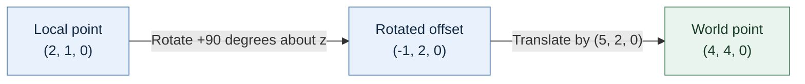

**Read the figure from left to right.** The first arrow changes the offset's direction; the second places that offset relative to the world origin. These are the same operations as the worked matrix product, in the same order. This is our explanatory diagram, not a figure copied from the book.


Matrix multiplication composes transforms, but order must be read alongside the vector convention. In the book’s convention, multiplying $A B$ and then applying that result to a column vector applies $B$ first, then $A$. A transform hierarchy therefore cannot be implemented by swapping operands casually. Likewise, inverse transforms are useful when a point must travel from world space back into local coordinates—for example, to locate which part of a car was hit. The excerpt gives the inverse formula for a 3-by-3 matrix and shows that it exists only when the determinant is nonzero. A zero determinant means the mapping has collapsed at least one direction, so it cannot be uniquely reversed. The displayed multiplication and inverse formulas were visually checked on PDF pp. 193 and 195 / printed pp. 170 and 172 (PDF pp. 191–195 / printed pp. 168–172).

A compact 3-by-4 implementation can save memory, but the book cautions that target hardware may already provide optimized matrix support. The transferable lesson is to understand the representation and measure it on the target; the historical Cyclone code and its performance assumptions are not a current graphics-library prescription (PDF p. 194 / printed p. 171).

##### A transform matrix can move points and directions, but not in the same way

A **point** names a location; a **direction vector** names an orientation or offset without a location. Translation should move a point but must not move a direction. The chapter’s compact 3-by-4 transform stores a 3-by-3 rotation basis plus a translation column. It represents the homogeneous 4-by-4 matrix whose implicit final row is $[0,0,0,1]$. With column-vector convention, a point is extended with homogeneous coordinate $w=1$ so rotation and translation happen in one multiplication. The code stores the compact values row by row, but storage order and vector multiplication convention are separate choices; the implementation has to make both explicit (PDF pp. 202–205 / printed pp. 179–182; code and formula layout visually inspected on PDF pp. 202–203).

For a concrete example, rotate 90 degrees around $z$ and then translate by $(5,2,0)$:

$$
M = \begin{bmatrix}0&-1&0&5\\1&0&0&2\\0&0&1&0\end{bmatrix}.
$$

For point $(2,1,0)$, the homogeneous form yields

$$
M\begin{bmatrix}2\\1\\0\\1\end{bmatrix}=\begin{bmatrix}4\\4\\0\end{bmatrix}.
$$

The rotation changes the point to $(-1,2,0)$; the translation then adds $(5,2,0)$. This is an explanatory calculation built from the chapter’s compact transform convention, not a quoted sample result (PDF pp. 202–204 / printed pp. 179–181).

Going back from world coordinates to local coordinates requires the inverse transform. For a rigid transform made only of rotation $R$ and translation $t$, first subtract $t$, then apply $R^T$, because an orthonormal rotation matrix has inverse equal to transpose: $R^{-1}=R^T$. For a general invertible matrix, use its inverse; the determinant must be nonzero. A transpose is not an inverse for arbitrary matrices, and transposing a translated 3-by-4 homogeneous transform is not a meaningful shortcut (PDF pp. 196–201, 204–205 / printed pp. 173–178, 181–182; transpose material visually inspected on PDF pp. 202–203 for adjacent implementation context).

Directions omit translation. The book’s `transformDirection` uses only the 3-by-3 linear portion, and `transformInverseDirection` uses the rotational inverse. That is the right distinction for a rigid rotation/translation transform. If the transform includes scale or shear, those routines do not automatically preserve direction magnitude or transform surface normals correctly; normal vectors under general nonuniform scale need a separately derived rule, such as an inverse-transpose matrix when the linear transform is invertible. Do not read the chapter’s rigid-body convenience methods as a complete shader-normal specification (PDF pp. 205–207 / printed pp. 182–184; direction-transform code visually inspected on PDF p. 206).

The `Matrix4::setInverse` listing on PDF pp. 198–199 (printed pp. 175–176) declares an argument `m` but calls `getDeterminant()` without qualifying it with `m`; the following cofactor expressions use `m.data`. This is an apparent inconsistency in the printed listing, not proof about the original source implementation. For a zero determinant, the shown method returns before writing inverse elements, so the destination retains its prior state; the `inverse()` helper’s result depends on construction/initialization behavior not shown here. Do not treat the listing as a verified general inverse implementation. The design lesson is that singular transforms have no unique inverse, so a robust API should report that case and define the output state. This is a visual and extracted-text observation; no code was compiled.

#### Keep renderer contracts small while the backend grows

An engine-facing renderer can accept a frame packet rather than exposing an expanding list of graphics-API parameters. At first the packet may contain only delta time; later it can gather camera, environment, mesh, and material data. The frontend owns the common frame contract, while a backend interface owns API-specific initialization, shutdown, resize, begin-frame, and end-frame operations. A backend can decline a frame without treating every decline as fatal: a resize may temporarily invalidate swapchain resources. A failed end-frame operation, by contrast, may signal a more serious submission or presentation problem.

A render pass describes the attachments and subpass use for a rendering operation. Start with one color image and one depth image, make load/store and layout transitions explicit, then bind image views to a framebuffer sized for the actual render surface. With a swapchain, framebuffers commonly correspond one-to-one with swapchain images. This scaffold is still not visible rendering: successful Vulkan instance creation or a validation-clean render-pass setup demonstrates only those stages. Keep that evidence boundary clear until a clear operation or draw is actually presented.

Synchronization names describe different relationships. A fence gives the host a way to wait for submitted work to complete; a semaphore orders GPU work or coordinates rendering with presentation. Keep per-frame synchronization objects distinct from per-image ownership tracking. Before destroying resources still referenced by device work, wait for the device to become idle. Destroy dependent objects before their parent device and free command buffers before destroying their pool/device according to the ownership path used. These rules make cleanup a testable part of the rendering design, not an afterthought.

Source reading: [caption source](https://www.youtube.com/watch?v=70q9jtjWP4o) · [caption source](https://www.youtube.com/watch?v=4M1hKSFxhWw) · [caption source](https://www.youtube.com/watch?v=Is6CwlsaCFE). Captions document the narrated development state; on-screen code and reported builds were not independently reproduced.


##### Reading a matrix column without rebuilding it

A 4 × 4 matrix made from sixteen floats occupies 64 bytes when each float is four bytes. In the column-major example, each of its four columns contains four adjacent floats. A `getColumn` helper can return a vec4 value assembled from four array elements. That is a value result; it does not imply a heap allocation, and an optimizing compiler may remove or avoid a physical copy.

The historical MSVC demonstration overlays a sixteen-float array and four vec4 columns in a union, then observes matching storage addresses and mutually visible writes. Treat that observation as specific to the demonstrated compiler and representation, not portable C++ guidance: accessing an inactive union member and the active member object's lifetime require care. See the C++ draft rule for [union members and lifetime](https://eel.is/c++draft/class.union) and its narrow common-initial-sequence exception. The caption does not introduce an anonymous struct; if one is added to expose named components, identify it as a compiler extension rather than standard C++.

#### What the graphics pipeline stages do

A vertex buffer supplies per-vertex values and an optional index buffer lets primitives reuse those vertices. The input assembler interprets that data as points, lines, or triangles. The vertex shader runs per vertex and transforms positions while passing attributes onward. Optional tessellation can subdivide geometry; the geometry shader can discard or emit primitives. Rasterization turns primitives into fragments, interpolating per-vertex attributes across their coverage. Depth testing can reject fragments behind nearer opaque geometry. The fragment shader computes fragment outputs such as color and depth, and color blending combines outputs that map to the same pixel, including common transparency cases. The lesson presents this as a simplified overview and defers exceptions and detailed behavior.

It distinguishes fixed-function stages, whose behavior is configured through parameters, from programmable stages driven by shaders. Vulkan consumes compiled shader modules. The episode describes GLSL/HLSL being compiled to SPIR-V ahead of runtime, then sketches a post-build task that invokes the Vulkan SDK's `glslc`, writes vertex and fragment SPIR-V files, checks compiler failure, and copies assets beside the executable. A Windows batch file and Linux shell script are prepared. The task is exercised only far enough to report that shader compilation fails because the input shader file has not been created yet. Thus this source establishes the intended tool flow, not a successful shader compile or a working graphics pipeline.

Depth/stencil operations may occur early or late depending on the pipeline and shader behavior; the conceptual stage description is not a promise of one hardware execution order.

Source reading: [caption source](https://www.youtube.com/watch?v=KanKG-vd9GA). Captions document the narrated development state; on-screen code and reported builds were not independently reproduced.


#### Load a renderer through a small, platform-aware plugin contract

A dynamic plugin boundary needs a library name and an exported creation entry point. The platform layer turns a base name into an OS-specific filename, keeps the native handle opaque, resolves exported symbols, and calls them through a shared function type. Kohi first extracts Vulkan and game code into libraries; missing Windows export annotations become visible only after the hard link is removed. State-size and lifecycle entry points let the engine allocate application-owned state without knowing the concrete struct. Runtime hot reload remains planned until persistent state and callback ownership are designed. [Kohi dynamic renderer and game libraries](https://www.youtube.com/watch?v=oigQGZJ1Yc0)

A renderer plugin still needs a native window handle. One Windows approach copies application/window handles through a sized platform struct; redeclaring that struct in the plugin contains OS headers but risks layout drift. A typed adapter or stable opaque-handle contract can mature the boundary. The macOS port separately required Objective-C/AppKit/QuartzCore build work, Retina backing-pixel dimensions, POSIX thread/mutex code, explicit keycode translation, and Vulkan portability enumeration for MoltenVK. Its reported run covers one Apple Silicon/Monterey setup, not Intel or all OS versions. [Plugin platform bridge](https://www.youtube.com/watch?v=gLP3WWSvICs) · [Kohi macOS renderer port](https://www.youtube.com/watch?v=g9tvP4qf5sA)

A plugin test stream reports that a frame packet held a pointer to a local skybox value; copying it into frame-owned memory kept it alive through rendering until the frame allocator reset. Frame-scoped copies are appropriate only when every consumer finishes before that reset.

#### Rendering features emerge through visible experiments

The shader tutorial creates a shader class, compiles and links stages, handles errors, then draws a triangle and adds uniforms. The group tutorial adds a parent/child collection and recursively submits child renderables through a transform stack. The font episodes extend rendering toward glyph atlases, metrics, advances, kerning, and blending; their stream includes failed builds and experiments with texture formats. These episodes are best read as process records: build a visible test, inspect a failure, and add the smallest missing concept. Their legacy OpenGL and FreeType-GL implementation details belong to the period and project that produced them; the captions alone do not establish current compatibility or a complete text-rendering system (The Cherno, “Ep. 6: Shaders,” “Ep. 13: Groups,” “Ep. 18: FreeType and FreeType-GL,” and “Ep. 19: Font Rendering”).
#### Start with the surface the application must present to

Vulkan makes you answer a question before it can create the device your renderer will use: which physical GPU should this application target? A computer may expose one GPU or several, and each device reports its own features, memory, extensions, queue families, and ability to present images to the window's surface. A `VkPhysicalDevice` represents a Vulkan implementation exposed to the application; the implementation may be discrete, integrated, virtual, or CPU/software. The logical device is the application-facing object that later Vulkan work uses. The tutorial's episode ends before creating that logical device, so selection is the work demonstrated here.

The renderer cannot judge presentation support without a Vulkan surface connected to the window system. The example therefore moves surface creation ahead of physical-device selection. Its Win32 path calls the Win32 surface extension, while its Linux path calls the XCB surface extension. The implementation temporarily keeps the surface in both platform state and Vulkan context while the design is being worked out. That duplication is described as temporary, not as a settled ownership pattern. (00:05:52–00:09:00)

The platform layer needs enough Vulkan-specific information to create the surface. This is one of the tradeoffs surfaced by the tutorial: platform code owns the window-system details, but surface creation itself uses Vulkan types and extension functions. Keep the boundary explicit so each platform supplies its surface path while the Vulkan backend can query presentation support against the resulting surface.

Source: [Kohi #015](https://www.youtube.com/watch?v=6Kj3O2Ov1RU), 00:05:52–00:09:00; local Whisper base.en ASR, not a caption transcript.
#### Turn requirements into a suitability check

The example enumerates physical devices, then checks each candidate against a set of needs. Its starting requirements include a discrete GPU, sampler anisotropy, the swap-chain device extension, and queues for graphics, presentation, and transfer. Compute is tracked as an optional requirement that can be enabled if the renderer needs it. These are the tutorial's engine choices, not universal Vulkan requirements: another application may accept integrated GPUs, require different features, or need different queue capabilities. (00:10:29–00:16:22)

For each candidate, collect the properties, supported features, memory properties, extension names, and queue-family properties. Reject the device as soon as a required capability is missing. This is easier to reason about when the requirements are stated separately from the probing code: one structure describes what the application asks for; the query routine reports what a candidate offers; the suitability check compares the two. The tutorial uses this decomposition to keep its selection routine understandable as it grows. Reported support is not enabled use: required device features must still be explicitly enabled when a logical device is created. Robust count-then-fill loops must handle `VK_INCOMPLETE` and re-query if the available count changes. (00:13:30–00:20:50)

Source: [Kohi #015](https://www.youtube.com/watch?v=6Kj3O2Ov1RU), 00:10:29–00:20:50; local Whisper base.en ASR, not a caption transcript.
#### A queue family is a pool of queues with declared capabilities

A physical device reports queue families. Each family has capability flags, such as graphics, compute, or transfer, and a count that says how many queues can be created from that family. A family can support several capabilities at once; another may offer a narrower capability set, and a graphics-capable family is not guaranteed to support presentation. The tutorial inspects these properties with `vulkaninfo` and records family indices for the queue roles it needs. (00:20:50–00:25:39)

Presentation is queried separately because it is tied to a particular surface. A queue family's capability flags alone do not establish that it can present to the application's window. The example therefore checks presentation support for each family using the selected surface. For transfer work, it attempts to prefer a family with fewer overlapping capabilities, since a dedicated transfer family may allow transfer work to be scheduled separately. That preference is a heuristic shown in the tutorial, not a guarantee of faster transfers or better performance on every GPU. (00:25:39–00:29:03)

Source: [Kohi #015](https://www.youtube.com/watch?v=6Kj3O2Ov1RU), 00:20:50–00:29:03; local Whisper base.en ASR, not a caption transcript.
#### Check swap-chain support for the actual surface

The example asks each candidate device for surface capabilities, supported surface formats, and present modes. The format and mode lists use Vulkan's count-then-fill query pattern: first obtain the number of entries, then provide storage and retrieve them. The tutorial expects to query this support again later, so it sketches retaining allocated arrays and refreshing their contents. It then rejects a candidate with no formats, no present modes, or a missing required device extension or feature. (00:17:59–00:18:40; 00:30:36–00:37:24)

This query is surface-specific. The device alone is not enough: the combination of GPU and window surface determines whether the desired presentation path is supported. Later swap-chain creation must still choose settings from the reported capabilities; merely finding a non-empty list does not complete that work.

Source: [Kohi #015](https://www.youtube.com/watch?v=6Kj3O2Ov1RU), 00:17:59–00:37:24; local Whisper base.en ASR, not a caption transcript.
##### A window is part of the presentation contract

Companion-source provenance: public GitHub mirror `travisvroman/kohi`, pinned commit `05a5193d5ed4890703cfcbbeb5c5e947feefecf6` (commit message: mirror SVN revision r96). Its README identifies SVN trunk as the source of truth and says GitHub is periodically mirrored. This material is a read-only companion source review, separate from the PDF/caption/ASR source set; no video was reviewed from this code, and no code was built or run.

Imagine a renderer that can draw a triangle perfectly but has no agreement with the operating system about which window should show it. The missing piece is a presentation path: native window handles are used to create a Vulkan surface, and a swapchain is then created for presenting images to that surface.

Kohi’s pinned mirror revision makes the dependency visible in its call order. Per-window renderer state is allocated; the platform layer creates a surface from the native window; then the renderer creates a swapchain. The teardown reverses that relationship: swapchain first, surface second, per-window renderer state last. This ordering illustrates a general ownership question: which object depends on which other object, and which one must remain alive until its dependents are released?

The word **surface** here means Vulkan’s connection to a platform presentation target. It is distinct from the OS window and from the pixels eventually shown. The platform code supplies the OS-specific details: the Linux/XCB implementation obtains connection and window handles, while the broader platform interface leaves room for different implementations. This is why window-system integration belongs behind a platform boundary rather than being assumed to be one universal handle recipe.

Before making a swapchain, a device must be suitable for that surface. A **physical device** is the selected GPU; a **logical device** is the application-created interface used to issue most Vulkan work. A device may support graphics commands yet lack a queue family that can present to a particular surface. Kohi’s support query takes both the physical-device handle and the surface, and its cached result includes capabilities, supported formats, and presentation modes. Thus “this GPU works” is incomplete unless the presentation target is part of the question.

The **swapchain** is the presentation-owned collection of images exchanged with the display system. In this snapshot, Kohi stores its swapchain handle, image count/current image index, format, and a texture wrapper handle in a per-window record. It asks Vulkan for the swapchain images and creates image views for its renderer wrapper. At teardown, it frees the views/wrapper array and destroys the swapchain, while deliberately not destroying the images one by one: the code comments that the swapchain owns those images.

Trace one window through the lifetime:

1. Create the platform surface while the native window and platform connection are valid.
2. Query presentation support for the selected GPU against that surface.
3. Create the swapchain and renderer-side views/wrappers for its images.
4. The checked code places synchronization and frame resources with the per-window/swapchain state; the focused review did not inspect the frame-acquire/present loop.
5. On teardown, the checked swapchain path releases image views/wrappers before destroying the swapchain; the backend then destroys the surface before freeing per-window state. Keep any synchronization and frame-resource cleanup consistent with the owning window lifecycle.

This trace is a teaching model based on one code revision, not a universal Vulkan checklist. In particular, the snapshot’s helper destroys and recreates the swapchain, and the creation code shown sets `oldSwapchain` to null. Applications may choose other recreation strategies and synchronization policies; consult the Vulkan version and platform requirements being targeted. Kohi’s README itself describes the repository as an educational project and warns against treating it as production-ready or as the single correct design.

**Evidence boundary.**

The observations above come from the public GitHub mirror pinned to commit `05a5193d5ed4890703cfcbbeb5c5e947feefecf6` (mirror revision r96). The README identifies SVN trunk as the source of truth, so the mirror may lag. This companion reading does not inspect or verify any Kohi video, compile or run the engine, or establish current API behavior.

#### Save the selected device facts for later stages

When a candidate passes, the example stores its physical-device handle, chosen queue-family indices, properties, features, memory properties, and swap-chain support. It prints the device name, type, driver and Vulkan API versions, and memory heaps as diagnostics. In the recorded run, the machine reports an RTX 2080 Super and several queue families. Those values describe that one tutorial machine only; they do not establish behavior on other systems. (00:39:02–00:45:30)

The important boundary is visible at the end of the episode: the selection routine may find and report a suitable physical device, while logical-device creation remains unfinished. The current build-and-run demonstration reaches initialization diagnostics, but the source explicitly returns failure from the not-yet-implemented device-creation path. Treat this episode as a design and partial implementation walkthrough, not as proof of a complete Vulkan renderer. (00:43:32–00:47:24)

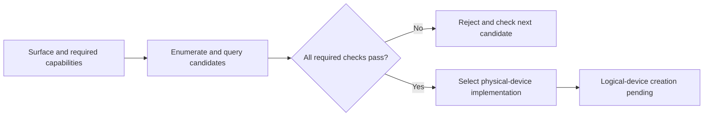

This decision path summarizes suitability selection. Selecting a device does not complete logical-device creation or prove renderer functionality.

Source: [Kohi #015](https://www.youtube.com/watch?v=6Kj3O2Ov1RU), 00:39:02–00:47:24; local Whisper base.en ASR, not a caption transcript.

### Choosing and integrating a graphics math library

Rendering quickly requires vectors and matrices: positions, directions, colors, transforms, and camera state all need structured math operations. A tiny library can be written quickly, but performance-oriented implementations also use SIMD (single instruction, multiple data), where one CPU instruction operates on several numeric components at once. Writing SIMD support directly brings compiler-specific intrinsics and platform concerns. This series instead adopts GLM, a header-only library whose familiar GLSL-style type names do not make it dependent on OpenGL.

The integration is deliberately modest: vendor GLM as a submodule, add its include directory to both the engine and sandbox projects, and optionally list its headers in generated IDE projects for browsing. These are separate concerns: an include path lets the compiler find headers, while a project file listing mostly affects IDE navigation. A small sandbox compile then checks the include setup; a debugger view confirms a sample matrix value. Neither proves every compiler's SIMD path nor every renderer convention.

The episode also identifies useful follow-up tooling rather than pretending it is already present: readable logging for vector and matrix types, and ImGui controls for inspecting or editing them during graphics debugging. Its stated next step is docking and multi-viewport support, with the aim of keeping close to upstream ImGui and reducing custom divergence.

Source: [Maths | Game Engine series](https://www.youtube.com/watch?v=Idr1G1KyPNg)

#### Reuse geometry while varying the object transform

In this early Hazel/OpenGL exercise, the same square geometry is submitted repeatedly while a model matrix supplies each square’s translation and scale; the shader combines that per-object transform with camera data. The episode uses a 20-by-20 arrangement to make repeated geometry visible and distinguishes the model transform from view-projection state. It explicitly treats this as a per-object 3D-style submission path, not the intended batched 2D renderer. [Caption source](https://www.youtube.com/watch?v=cbB2fh0UxZ0).


### Make each 2D draw describe its own transform

A quad can be present in a vertex buffer and still be useless as a game object if every draw places it at the same coordinates. The missing idea is a per-object transform: a map that takes a vertex from the quad's local coordinates into the renderer's next coordinate space. In the lesson's minimal 2D API, the caller supplies a position and size, while the renderer builds the matrix and sends it to the vertex shader. This keeps the easy-to-use call small while reserving matrix math for the rendering implementation. The source first frames the fixed-buffer problem and introduces translation, rotation, and scale at 00:00:24–01:26; it then narrows the public parameters to position and size and leaves rotation as an extension exercise at 01:35–02:08. [2D Renderer Transforms](https://www.youtube.com/watch?v=-Qt12lcAF0Y&t=24s) [2D Renderer Transforms](https://www.youtube.com/watch?v=-Qt12lcAF0Y&t=95s)

For a unit-size 2D quad centered on the origin, translation by $(x,y)$ and scaling by $(w,h)$ can be represented in homogeneous coordinates as

$$
T(x,y)=\begin{bmatrix}1&0&x\\0&1&y\\0&0&1\end{bmatrix},\qquad
S(w,h)=\begin{bmatrix}w&0&0\\0&h&0\\0&0&1\end{bmatrix}.
$$

If a vertex is a column vector, the lesson's intended composition is $M=TRS$: scale the local quad, rotate it if needed, then translate it. Matrix multiplication acts right-to-left on the vector. Thus $p'=TRSp$. Reordering changes the result: translation before scaling in the product can scale the offset too. The caption calls out the order and describes the shader's view-projection, object transform, and vertex position at 01:09–01:31 and 09:51–10:42; matrix construction and GLM helper setup follow at 10:53–12:16. [2D Renderer Transforms](https://www.youtube.com/watch?v=-Qt12lcAF0Y&t=69s) [2D Renderer Transforms](https://www.youtube.com/watch?v=-Qt12lcAF0Y&t=591s) [2D Renderer Transforms](https://www.youtube.com/watch?v=-Qt12lcAF0Y&t=653s)

Keep the API and the GPU representation distinct. A two-component position and size are convenient authoring values; the shader needs a matrix. The CPU can form that matrix per draw and set a transform uniform before issuing the draw. In the tutorial, the uniform-setting interface gains matrix and scalar/vector setters so the 2D renderer no longer has to downcast to an OpenGL shader. The distinction between a high-level `set` operation and a backend-specific upload is deliberate: a later material or buffer implementation could store values differently. The API change and rationale appear at 02:10–05:13; the lesson then discovers a missing GLM include during a build and adds it before continuing at 08:48–09:51. [2D Renderer Transforms](https://www.youtube.com/watch?v=-Qt12lcAF0Y&t=130s) [2D Renderer Transforms](https://www.youtube.com/watch?v=-Qt12lcAF0Y&t=528s)

A small visual witness is more useful than trusting the matrix expression by inspection. Draw one quad at the origin with unit size, another shifted left and reduced, and a third moved down/right with unequal width and height. The source performs this check at 12:29–13:36 and notes the next renderer limitation at 14:30–15:10: each quad still costs an individual draw call, so tilemaps and text will need batching to scale. It explicitly defers textures to a later episode at 15:10–15:30. These are the demonstrated result and stated roadmap of this historical episode, not evidence of a performance benchmark or of a completed batching system. [2D Renderer Transforms](https://www.youtube.com/watch?v=-Qt12lcAF0Y&t=749s) [2D Renderer Transforms](https://www.youtube.com/watch?v=-Qt12lcAF0Y&t=870s)

A robust implementation should additionally verify the matrix convention shared by CPU math and shader upload, including row/column interpretation and any transpose flag; the caption does not resolve those details. It also does not show rotation implemented, a hierarchy, or batching. Treat those as follow-up work rather than silently crediting the lesson with them.

### Load modern OpenGL entry points at the platform edge

A graphics context exposes functions through the platform driver, but modern OpenGL entry points are not all ordinary symbols that an application can assume are directly linked. A loader asks the active context/driver for function addresses and makes the supported entry points callable. The lesson introduces this requirement as preparation for using Dear ImGui, and chooses GLAD for that Hazel episode while comparing it with GLEW. It stresses that this is a project choice, not a claimed rendering-performance difference. That motivation and comparison are at 01:40–03:20. [Modern OpenGL (Glad)](https://www.youtube.com/watch?v=HFyHIc89z1g&t=100s)

The demonstrated setup generates a C/C++ loader for OpenGL 4.6 core, adds the generated source and headers under Hazel's vendor tree, gives the loader a premake static-library project, and links/includes it from Hazel. The source discusses core-profile selection and leaving extensions unselected for that snapshot at 04:30–06:05; the explicit source-file and include setup follows at 06:50–10:55. [Modern OpenGL (Glad)](https://www.youtube.com/watch?v=HFyHIc89z1g&t=270s) [Modern OpenGL (Glad)](https://www.youtube.com/watch?v=HFyHIc89z1g&t=410s) [Modern OpenGL (Glad)](https://www.youtube.com/watch?v=HFyHIc89z1g&t=650s)

Initialization has an ordering dependency: create the window and make its OpenGL context current before asking the loader to resolve procedures. The video calls `gladLoadGLLoader` with GLFW's procedure lookup after context creation, checks its return status, and temporarily verifies a modern function pointer. Those steps occur at 11:00–13:35. It also encounters header overlap: GLAD's header and GLFW's OpenGL include need coordinated configuration; the shown fix defines `GLFW_INCLUDE_NONE`, regenerates the project, rebuilds, and checks initialization at 14:20–16:20. [Modern OpenGL (Glad)](https://www.youtube.com/watch?v=HFyHIc89z1g&t=660s) [Modern OpenGL (Glad)](https://www.youtube.com/watch?v=HFyHIc89z1g&t=860s)

This episode's exact generator output and build recipe are version-specific. Regenerate for the chosen profile and required extensions, inspect the generated license and files, and verify the loader against the actual context profile and platform. Selecting a 4.6 core header does not prove that every target GPU supports 4.6. The lesson itself says it will later revisit a renderer-backed ImGui integration; at 16:30–18:55 it explains that the current engine renderer is not yet in place, so the near-term integration will use raw OpenGL calls, with the intended renderer-backed path deferred at 18:29–18:55. That is a temporary historical compromise, not a general recommendation to put UI backend calls into a game-facing API. [Modern OpenGL (Glad)](https://www.youtube.com/watch?v=HFyHIc89z1g&t=990s) [Modern OpenGL (Glad)](https://www.youtube.com/watch?v=HFyHIc89z1g&t=1109s)

### Keep the renderer frontend useful without pretending backends are identical

A rendering backend translates engine requests into a graphics API's commands. A renderer frontend decides what the engine wants drawn and organizes that work. This episode draws that boundary explicitly: backend primitives include a context, swap chain, buffers, textures, shaders, and state; frontend systems include materials, cameras, sorting, culling, LOD, effects, and the code that assembles a scene. It introduces the split and primitive examples at 03:30–06:00, then names frontend responsibilities at 11:00–16:40. The labels are the speaker's working vocabulary for Hazel, not a standard taxonomy every engine must adopt. [Rendering Architecture](https://www.youtube.com/watch?v=YPWNNmlIUIo&t=210s) [Rendering Architecture](https://www.youtube.com/watch?v=YPWNNmlIUIo&t=330s) [Rendering Architecture](https://www.youtube.com/watch?v=YPWNNmlIUIo&t=660s) [Rendering Architecture](https://www.youtube.com/watch?v=YPWNNmlIUIo&t=890s)

A useful boundary lets scene code issue a stable intent such as “draw this mesh with this material” while each backend handles its own buffers and submission details. But an abstraction cannot erase real differences for free. The episode warns that Vulkan command queues, synchronization, render passes, and descriptor sets do not line up one-for-one with OpenGL's state-oriented model; advanced techniques may need a backend-specific path. Its discussion of deferred rendering, Vulkan-only controls, and the cost of moving code into the backend occurs at 07:50–11:20 and 17:30–20:50. Keep a common API for work that is truly common; add an explicit extension when a backend capability materially improves a measured workload. Do not claim the episode implements any of these systems: it is a design discussion before the renderer is built. [Rendering Architecture](https://www.youtube.com/watch?v=YPWNNmlIUIo&t=470s) [Rendering Architecture](https://www.youtube.com/watch?v=YPWNNmlIUIo&t=630s) [Rendering Architecture](https://www.youtube.com/watch?v=YPWNNmlIUIo&t=1050s) [Rendering Architecture](https://www.youtube.com/watch?v=YPWNNmlIUIo&t=1220s)

The renderer command queue is presented as a way to record commands and execute them later, potentially on a render thread, while the main thread prepares more work. The episode contrasts an API with built-in command queues against constructing a similar model around OpenGL at 20:00–23:00. A queue introduces ordering, resource lifetime, synchronization, and failure-reporting responsibilities; it is not automatically faster because it exists. The recording's chosen progression is to start with OpenGL for quick visible results, get a complete renderer working, then consider another API or additional engine systems. That learning roadmap is stated around 23:00–25:00; it is not a claim that OpenGL is the best production backend for every target. [Rendering Architecture](https://www.youtube.com/watch?v=YPWNNmlIUIo&t=1200s) [Rendering Architecture](https://www.youtube.com/watch?v=YPWNNmlIUIo&t=1380s)

A practical design test follows from the split: list one feature such as a textured triangle; mark which steps require API-specific resources, which are renderer policy, and which are game intent. Then implement the simplest path and observe where the backend leaks into the frontend. If moving one operation behind an interface makes the common path clearer, the abstraction is earning its cost. If a generic interface hides essential synchronization or forces multiple backends into an inefficient least-common-denominator path, keep a deliberate extension seam. The source calls out that tradeoff at 10:00–11:00 and again at 17:30–18:20. [Rendering Architecture](https://www.youtube.com/watch?v=YPWNNmlIUIo&t=600s) [Rendering Architecture](https://www.youtube.com/watch?v=YPWNNmlIUIo&t=1050s)

### Give a 2D renderer a clean place to be exercised

A test harness should isolate the feature under development without deleting earlier examples that still test lower-level systems. In this episode, the existing sandbox layer mixes buffers, shaders, textures, camera control, and UI. The author keeps it for broad engine checks and creates a separate 2D sandbox layer with only the pieces needed to draw a colored quad and move an orthographic camera. The source frames this goal at 00:00–02:30 and starts the new layer around 13:00–15:50. That is a useful test-design move: preserve a general integration scene, then add a smaller fixture whose inputs and expected output are easy to recognize. [Preparing for 2D Rendering](https://www.youtube.com/watch?v=sEiZZ2APlDs&t=0s) [Preparing for 2D Rendering](https://www.youtube.com/watch?v=sEiZZ2APlDs&t=780s)

The new layer uses attach/detach callbacks to own its setup and teardown, and update/render/event hooks for its ongoing work. In the episode, the constructor is kept light while initialization is moved into `OnAttach`; the code is then narrowed from the old example to one flat-color shader, a square vertex array, a camera controller, and a color value. That sequence appears around 15:00–18:00, 20:00–25:00. A layer is a unit of application behavior in this Hazel design, not a GPU render pass. Keeping those meanings distinct prevents game/test organization from becoming entangled with backend submission. [Preparing for 2D Rendering](https://www.youtube.com/watch?v=sEiZZ2APlDs&t=900s) [Preparing for 2D Rendering](https://www.youtube.com/watch?v=sEiZZ2APlDs&t=1200s) [Preparing for 2D Rendering](https://www.youtube.com/watch?v=sEiZZ2APlDs&t=1380s)

The refactor exposes an include-boundary bug: Hazel's umbrella header includes an entry-point header that defines `main`. Including that umbrella from the new layer therefore defines another program entry point. The recording diagnoses the duplicate definition around 26:40–27:50 and moves the entry-point include to the source file that actually owns `main`. This illustrates a strong header rule: a convenience “include everything” header should not silently inject an executable entry point into every client translation unit. [Preparing for 2D Rendering](https://www.youtube.com/watch?v=sEiZZ2APlDs&t=1600s) [Preparing for 2D Rendering](https://www.youtube.com/watch?v=sEiZZ2APlDs&t=1670s)

The final demonstration shows the isolated layer drawing a colored square, accepting camera movement, and editing color and alpha in the UI at about 27:50–29:00. It is a focused smoke check of that layer's visible path, not a test suite for every renderer API. The episode also reports community contributions to platform macros, an OpenGL version assertion, and camera movement, then discusses how a teaching repository must balance contributions with explaining major systems at 02:30–12:30. Those statuses and decisions describe the recorded week only. [Preparing for 2D Rendering](https://www.youtube.com/watch?v=sEiZZ2APlDs&t=1670s) [Preparing for 2D Rendering](https://www.youtube.com/watch?v=sEiZZ2APlDs&t=150s) [Preparing for 2D Rendering](https://www.youtube.com/watch?v=sEiZZ2APlDs&t=600s)

### Start a 2D renderer with one visible, deliberately limited draw path

A useful first renderer should prove a complete path from caller intent to pixels. This episode proposes a static `Renderer2D` interface with begin-scene, draw-quad, and end-scene calls, while warning that it is a deliberately simple first step. Its motivation for isolating profiling and memory metrics comes early at 00:00–06:00, and it creates the public API and storage-less static class around 10:00–18:00. [Starting our 2D Renderer](https://www.youtube.com/watch?v=r_5fF1AxgpU&t=0s) [Starting our 2D Renderer](https://www.youtube.com/watch?v=r_5fF1AxgpU&t=360s) [Starting our 2D Renderer](https://www.youtube.com/watch?v=r_5fF1AxgpU&t=600s)

The visible operation begins with position, size, and color. The episode supports only an origin/constant transform first, then notes that a 3D position could reserve z for ordering before choosing a 2D position API for its immediate example at 17:00–21:00. In the current implementation, `drawQuad` sets a color and transform uniform and submits one vertex array through one indexed draw; the source explains this call path at 29:00–34:30. This is an immediate, one-draw-per-quad baseline, not a batching renderer. [Starting our 2D Renderer](https://www.youtube.com/watch?v=r_5fF1AxgpU&t=1020s) [Starting our 2D Renderer](https://www.youtube.com/watch?v=r_5fF1AxgpU&t=1260s) [Starting our 2D Renderer](https://www.youtube.com/watch?v=r_5fF1AxgpU&t=1740s) [Starting our 2D Renderer](https://www.youtube.com/watch?v=r_5fF1AxgpU&t=2040s)

The static class stores shared renderer resources because there is one active submission path in this small OpenGL prototype. “Static” is not inherently better: it makes the API convenient but also makes current-scene state global and harder to use for multiple viewports or concurrent scenes. The speaker's explanation around 10:00–16:30 emphasizes that the class is a wrapper over ordered graphics commands, not an object with independent instances. If the engine later needs several render targets or independent scene submissions, make that ownership explicit rather than assuming the static storage model still fits. [Starting our 2D Renderer](https://www.youtube.com/watch?v=r_5fF1AxgpU&t=600s) [Starting our 2D Renderer](https://www.youtube.com/watch?v=r_5fF1AxgpU&t=840s)

Explicit shutdown matters because GPU wrapper destructors call OpenGL while a context must still exist. The lesson moves storage into renderer-owned data and insists on releasing it before the context is destroyed at about 22:30–27:00. It momentarily uses shared ownership, then remarks that a scoped owner would better communicate exclusive lifetime but is not yet supported in the API. That leaves a real design question: resource ownership must be compatible with renderer shutdown order. A process-exit cleanup is not sufficient if GPU objects require a live context. [Starting our 2D Renderer](https://www.youtube.com/watch?v=r_5fF1AxgpU&t=1350s) [Starting our 2D Renderer](https://www.youtube.com/watch?v=r_5fF1AxgpU&t=1500s)

The first run displays a blank screen because the shader also expects a transform uniform; setting it to the identity matrix makes the square appear at about 32:30–34:00. This is a good debugging trace: a vertex array and valid draw call can still produce no visible result when shader inputs are incomplete. The episode ends with position and size explicitly deferred to the next lesson. Do not attribute a completed transform system, multi-quad batching, texture support, or measured performance improvement to this source. [Starting our 2D Renderer](https://www.youtube.com/watch?v=r_5fF1AxgpU&t=1950s) [Starting our 2D Renderer](https://www.youtube.com/watch?v=r_5fF1AxgpU&t=2040s)

### Put a render API under scene-level submission calls

A draw call is the command that tells the graphics API to consume previously configured geometry and shader state. The episode begins because a raw `glDrawElements` remains in application code, then works upward from the inputs needed for a scene: camera/environment state, object transform, geometry, and material. Its opening explanation covers draw calls and scene/object data at 00:00–09:00. The larger categories are conceptual scaffolding; at this point the Hazel sample has no full camera, lighting, material, or 3D mesh system. [Renderer Flow and Submission](https://www.youtube.com/watch?v=akxevYYWd9g&t=0s) [Renderer Flow and Submission](https://www.youtube.com/watch?v=akxevYYWd9g&t=270s)

The public flow becomes `BeginScene`, one or more `Submit` operations, and `EndScene`. `BeginScene` is where frame or scene-wide inputs such as a camera can later be established; each submit describes an object to draw. The episode introduces this submission pattern and contrasts it with a future command queue around 09:00–14:00. In the immediate prototype, however, `Submit` directly dispatches a draw. The command queue, sorting, batching, and separate render thread are explicitly deferred, not implemented by the presence of the high-level API. [Renderer Flow and Submission](https://www.youtube.com/watch?v=akxevYYWd9g&t=540s) [Renderer Flow and Submission](https://www.youtube.com/watch?v=akxevYYWd9g&t=720s)

A renderer API defines backend operations; a render command is a small static forwarding layer; the renderer owns higher-level scene/submission policy. The recording distinguishes clear color/clear commands from scene and mesh work around 14:00–18:00. It names the backend contract `RendererAPI`, implements an OpenGL version, and uses a `RenderCommand` façade around 18:00–28:00. The exact class layering is Hazel's historical choice. Its value is that application code can stop including GLAD and directly issuing OpenGL calls; its limit is that one OpenGL implementation is not proof of multiple working backends. [Renderer Flow and Submission](https://www.youtube.com/watch?v=akxevYYWd9g&t=840s) [Renderer Flow and Submission](https://www.youtube.com/watch?v=akxevYYWd9g&t=1080s) [Renderer Flow and Submission](https://www.youtube.com/watch?v=akxevYYWd9g&t=1380s) [Renderer Flow and Submission](https://www.youtube.com/watch?v=akxevYYWd9g&t=1560s)

The first OpenGL backend supports clearing, setting clear color, and indexed drawing of triangles using an index count obtained from the vertex array's index buffer. The concrete implementation is shown around 25:00–31:00. It assumes triangles and one index type because that is all the tutorial has built so far. A more complete API must make topology, index type, offsets, instances, and resource lifetime explicit when actual features need them. [Renderer Flow and Submission](https://www.youtube.com/watch?v=akxevYYWd9g&t=1500s)

The final integration removes the application-level GL calls, preserves the visible result, and removes the GLAD include from that client code at about 31:00–35:30. The episode's own closing identifies missing camera and object transforms, plus the future command queue and multithreading, at 34:00–38:00. Thus the demonstrated claim is narrow: a basic OpenGL triangle/quad draw path now goes through Hazel's renderer façade. It does not establish a complete scene renderer or that each class abstraction is independently necessary. [Renderer Flow and Submission](https://www.youtube.com/watch?v=akxevYYWd9g&t=1860s) [Renderer Flow and Submission](https://www.youtube.com/watch?v=akxevYYWd9g&t=2040s) [Renderer Flow and Submission](https://www.youtube.com/watch?v=akxevYYWd9g&t=2220s)


#### A graphics context still has a concrete backend

The Hazel prototype moves context creation and buffer swapping behind a small graphics-context interface: initialization receives the native window handle, while the GLFW/OpenGL implementation owns the GLAD loading and makes its context current. This gives the window/application a narrow lifecycle call without pretending that the context is API-neutral internally. Only the GLFW/OpenGL path is built and exercised in the episode; DirectX and Vulkan contexts remain hypothetical alternatives. [Caption source](https://www.youtube.com/watch?v=YZKEjaCnsjU).


#### Separate a renderer plan from an implemented command queue

This episode is a design discussion that walks from the visible goal of a triangle through context, buffers, shaders, draw work, and presentation, then separates renderer-level scene or batching decisions from graphics-API calls. It proposes a renderer abstraction and discusses command encoding as a possible way to queue work; the speaker qualifies multithreading and private-branch status rather than demonstrating a completed command queue. Use it as rationale and a milestone outline, not proof that the proposed architecture was implemented. [Caption source](https://www.youtube.com/watch?v=Hoi-Gzk-How).


### Build a renderer interface before investing in one graphics API

A renderer backend knows the details of a graphics API. A renderer frontend expresses engine-level requests such as creating geometry, materials, textures and render passes. If game code creates Vulkan command buffers and descriptors directly, the renderer is not replaceable and the rest of the engine inherits Vulkan’s vocabulary. A frontend/backend boundary contains that complexity.

Kohi’s caption sequence moves from renderer overview ([#012](https://www.youtube.com/watch?v=70q9jtjWP4o)) into Vulkan setup, devices, render passes, framebuffers, command pools and buffers. The later shader-system captions explicitly say the frontend and backend are being changed to provide a renderer-agnostic interface ([stream/video](https://www.youtube.com/watch?v=4E0v_5Wva-8)). This order is instructive: early learning uses a concrete backend to make results visible; as more engine systems begin to depend on it, a stable frontend becomes more valuable.

A frontend contract should describe what callers mean, not how Vulkan accomplishes it. For example, “begin a frame,” “create a texture,” or “draw this geometry with this material” should not expose Vulkan handles to gameplay. The backend translates those operations to Vulkan objects and commands. The distinction is similar to a restaurant order: a caller asks for a meal; it does not need to know which pan or burner is used. The analogy has limits because renderers expose capabilities and performance constraints, but it helps explain why callers should be insulated from implementation details.

An abstraction can become too generic. If the frontend exposes the lowest common denominator of all possible APIs, it may prevent useful backend capabilities. If it mirrors Vulkan exactly, it provides little insulation. A practical contract models engine needs and provides explicit extension points for capabilities that matter. The cost of supporting a second backend is the honest test of whether the interface is truly independent; merely naming a module “frontend” does not prove it.

The current public source separates `kohi.plugin.renderer.vulkan` from core and includes Vulkan platform-specific files. That confirms a plugin-shaped renderer backend in the later project state. The retrospective praises the renderer frontend/backend organization and says the Vulkan renderer was coming along well. The same retrospective warns that the rendergraph worked but created code complexity and overhead. That paired judgment matters: architecture that works can still cost too much to maintain.

#### Add a second graphics API only after shared assumptions are ready
A renderer port starts with the assumptions shared by the old and new backends. In a Hazel Vulkan sprint, the creator first repairs shader compatibility and a uniform-buffer binding-point bug in the OpenGL renderer. He says Vulkan is being added alongside OpenGL, not replacing it. The narrated progression then goes through Vulkan instance and device setup, queue families, a resizable swapchain, shaders, pipelines, vertex and index buffers, descriptor sets, and uniform buffers. The reported end result is a camera-controlled sphere after an initial goal of drawing a triangle. This is a progress account; it does not explain synchronization, resource lifetime, or portability details. [[caption source](https://www.youtube.com/watch?v=zUdaT19aSxA), full cleaned transcript]


#### Constructing a Vulkan graphics pipeline

The pipeline is the object that joins shader stages, vertex input description, render pass compatibility, viewport/rasterization/depth/blend state, and a pipeline layout. The tutorial wraps creation, destruction, and command-buffer binding in a helper. It starts with one vertex binding and a position-only vertex format, a triangle-list input assembly, one color attachment, and no descriptors yet. The vertex stride comes from the `Vertex3D` structure size; an attribute's format, offset, and shader location describe how bytes map to the shader input.

The selected rasterization settings include fill versus line mode for a separate wireframe pipeline, front-face winding, and back-face culling. Depth testing and depth writes are enabled; multisampling and stencil are left at simple defaults. Blending state is wired for later alpha work. Viewport, scissor, and line width are treated as dynamic state so those values can be changed without recreating the pipeline; other immutable choices require a different pipeline. These settings are starter choices and assumptions, not universal defaults.

Pipeline creation succeeds in the narrated run with `VK_SUCCESS` and no reported validation errors, but it still draws nothing. Shutdown first exposes a missing pipeline destroy call; adding that cleanup removes the validation errors. This provides a useful resource-lifetime lesson: every created pipeline and its layout must be destroyed before the device is destroyed.


#### Keep Vulkan inputs alive through the call that consumes them

A Vulkan descriptor write may retain a pointer to a `VkDescriptorBufferInfo` supplied by the caller, so that structure must remain alive through the descriptor update that consumes it. The Kohi maintenance stream reports fixing this temporary-lifetime mistake. The same stream moves device-extension array preparation outside a physical-device loop and frees the array after device selection, rather than allocating it repeatedly. These are specific fixes reported in the stream, not independent source verification. [Kohi renderer maintenance](https://www.youtube.com/watch?v=x8ao57nbMlY)

#### Share a renderer contract while keeping backend facts explicit

When a game may run on more than one graphics API, shared code needs a stable vocabulary for requesting work: create a texture, describe a vertex buffer, set material values, submit geometry. Each backend then translates those requests into its own resource types and operations. Sparky’s historical multi-API refactor sketches this arrangement with platform-independent interfaces and API-specific context, texture, vertex-buffer, index-buffer, and shader implementations. It also shows the cost: factories, duplicated implementations, shader differences, and a large increase in files. The Direct3D path is explicitly unfinished; Vulkan is only planned. Treat it as an architecture experiment, not evidence that arbitrary backends are interchangeable. [Sparky devlog #7](https://www.youtube.com/watch?v=yGggmfDGGv0&t=2m43s)

The same caution applies to shader inputs. One backend may expose uniform values in ways another backend does not. In that devlog, the author groups renderer-owned values such as camera data separately from material-owned values such as colors and textures, then maps resources to slots during shader setup. This is an attempt to make one renderer contract fit historical OpenGL and Direct3D 11. The author says OpenGL uniform-buffer support is not yet present and calls the work difficult. A shared API should therefore preserve differences that matter: resource binding rules, supported formats, synchronization, and failure modes cannot be assumed away merely because two implementations have matching method names.

A useful workflow is to begin with one backend and one narrow operation, record the concrete assumptions, and add another backend only when there is a real need to test the shared contract. Keep the backend choice visible in diagnostics. Avoid an interface that suggests a feature is available everywhere when one implementation is a stub or has not been tested. The live book’s renderer-boundary and backend sections develop this idea further.

### Understand Vulkan setup as a chain of explicit dependencies

Vulkan does not give an application a single “draw a triangle” call. The application chooses and connects explicit objects. A physical device is the GPU and its supported features. A logical device is the application’s opened connection to selected device functionality and queues. A queue is where work is submitted. A surface connects presentation to a native window. A swapchain is a set of images used to present rendered frames. Command buffers record work for later submission. Render passes or equivalent rendering scopes describe how attachments are used. A pipeline packages shaders and fixed-function state used to draw.

The playlist catalog titles lay out that dependency chain: extensions/validation (#014), physical device/surface (#015), logical device/queues (#016), swapchain/images/depth (#017), render pass (#018), command pools/buffers (#019), framebuffers/synchronization (#020), and a clear-screen milestone (#021). Captions for #014, #016, and #018–#020 were retrieved and sampled; captions for #015, #017, and #021 were unavailable in this pass, so their titles establish catalog order only. In #014, the presenter wires required Vulkan extensions and wraps result checking; #016 creates and stores the logical device; #018 configures color/depth attachment layouts; #019 pairs command-buffer allocation with freeing and submits a single-use buffer; #020 tracks fence status. These inspected details support the broader dependency model, while the missing episodes are not treated as transcript evidence.

A synchronization object coordinates when GPU work can proceed. The CPU and GPU run asynchronously: after the CPU submits a command buffer, the GPU may still be using images when the CPU begins the next frame. Semaphores and fences express those dependencies. A semaphore typically orders GPU submissions or presentation; a fence lets the CPU know a submission has finished. The exact synchronization design depends on the frame-in-flight strategy. A frame-in-flight is a frame whose GPU work has been submitted but may not yet be complete.

The playlist catalog labels #021 as a clear-screen milestone, but its caption was unavailable here. Independently of that title, clearing a window in an explicit graphics API requires a surface, a compatible device, swapchain images, a render target and a valid submission/presentation sequence. When the screen stays blank, debugging can walk those dependencies: Did device selection find graphics and presentation support? Was the swapchain recreated after resize? Is the acquired image attached to the framebuffer? Is the command buffer recording the expected pass? Is the submit wait stage correct? Is presentation waiting on the right semaphore? A clear is a useful first integration check because it avoids geometry and material complexity, but this description is technical analysis rather than a claim about the unavailable #021 transcript.

Validation layers and debug callbacks are not optional decoration during development. They report invalid API use near the source. The caption for #014 puts extensions, validation layers and debugger together early. A learner should treat those diagnostics as a second compiler: the C compiler catches language-level errors, while Vulkan validation catches many API contract errors. A validation warning may not explain the conceptual mistake, but it sharply reduces the search area.

A bug-fix appendix shows why a milestone is evidence only for a tested configuration. [Kohi #029.1](https://www.youtube.com/watch?v=U4QvUeUL37Y) follows viewer reports of a Vulkan crash/time-out around fence waits. In the full captioned diagnosis, the presenter compares `vkinfo` feature output from his GPU and a viewer’s GPU, identifies support for descriptor binding uniform-buffer update-after-bind as a difference, moves descriptor updates before binding, records whether each per-image descriptor was updated, and allocates three global uniform objects with an image-indexed offset. He reports that affected viewers tested the fix. A separate full-caption read of [#034.1](https://www.youtube.com/watch?v=aD6fZ7tQSAY) finds the object uniform buffer was incorrectly requiring host-visible plus device-local memory on all devices; that path is changed to host-visible/coherent, while the global uniform path feature-detects device-local+host-visible availability and uses it only when supported. The fixes address different contracts: descriptor update timing and uniform-buffer memory flags.

#### Buffer storage, reuse, and the first backend allocation

A command buffer and a data buffer solve different problems. The command buffer records operations for the GPU to execute. A vertex or index buffer holds the values those operations use. For a quad made from two triangles, naively listing three vertices for each triangle stores six positions, even though two corners are shared. Instead, store the four unique vertices once and let an index buffer refer to them in triangle order. This saves repeated vertex data and makes the triangle assembly explicit. The index order also carries winding information, so the sequence must match the renderer's front-face convention.

The episode builds a small Vulkan buffer wrapper around the raw handle and its allocation. Besides the handle and size, the wrapper tracks usage, memory flags, and whether its allocation is currently mapped. The planned interface makes common steps explicit: create and destroy; bind; map and unmap; copy data; copy between buffers; and resize. Mapping provides a CPU pointer to a mapped allocation, and that pointer is only valid during the mapping interval. A convenience load operation can map, copy bytes, and unmap in sequence.

Creating a Vulkan buffer does not by itself provide its backing memory. First create the buffer with its intended size and usage. Then ask Vulkan for the memory requirements, including compatible memory-type bits and allocation size. Select a memory type satisfying both those requirements and the requested properties. If none exists, creation must fail instead of pretending the requested allocation is available. Allocate the required memory and bind it to the buffer. The tutorial uses exclusive queue sharing based on its current single-queue assumption; that assumption must be revisited if a buffer is shared across queues.

Buffer size is not changed in place in the shown approach. Resize allocates a replacement, copies the old contents, waits until the device is idle, and then releases the old allocation. This preserves contents in the simple case, but a device-wide idle wait can stall unrelated work. The episode prioritizes a straightforward first implementation and does not show a narrower synchronization strategy.

The backend then allocates large, fixed-capacity device-local vertex and index buffers and tracks a running offset for each geometry stream. The offsets avoid overwriting earlier uploads, but this starter design does not yet address reclamation or capacity growth. Although the wrapper includes mapping and loading operations, the geometry buffers are requested as device-local for GPU access. The source explicitly leaves geometry upload to a later episode, so it does not yet explain or demonstrate how CPU-produced geometry reaches these allocations. The narrated successful application startup verifies only this initialization stage, not rendered indexed geometry.

Host-visible memory can be mapped, but visibility to the CPU does not alone settle cache coherency or GPU synchronization. In particular, unmapping non-coherent memory does not implicitly flush pending host writes. Use the required mapped-range flush and synchronization rules for the allocation. [Vulkan mapped-memory requirements](https://docs.vulkan.org/refpages/latest/refpages/source/vkFlushMappedMemoryRanges.html).


#### Dynamic allocation inside renderer buffers

A free list stores bookkeeping about which byte ranges in a separately managed region are available; it does not itself own or copy the payload bytes. A renderer buffer can use that metadata to allocate and release ranges as individual resources come and go. The buffer wrapper can retain its older whole-buffer upload path, while tracked subranges use allocate to obtain an offset, upload into that range, then free it when the resource is removed. Upload must report failure and return the chosen offset; geometry creation records that offset separately for vertex and index data. This is the groundwork for variable-size resources such as text controls. (Kohi #044, 00:01–00:11)

Resizing the free-list metadata allocates a replacement bookkeeping block and returns the old metadata block for release. That alone does not copy or relocate payload bytes in a Vulkan buffer; the buffer layer must preserve or upload its resource data separately when changing the GPU allocation. The implementation described here rejects shrinking, since allocated ranges might fall outside the smaller buffer. Creation and failure cleanup must keep the Vulkan allocation and free-list bookkeeping paired. (Kohi #044, 00:03–00:07)

Keep success separate from the selected byte offset: use an output parameter or a result carrying both validity and location. Zero is a perfectly valid first allocation offset and must not automatically mean failure.

Source reading: [caption source](https://www.youtube.com/watch?v=SNDJ-rGJd5A). Captions document the narrated development state; on-screen code and reported builds were not independently reproduced.


#### Give render buffers an API-neutral owner

An engine buffer wrapper can own purpose, total capacity, subrange allocation, and free-list bookkeeping while a backend owns graphics handles and memory properties. The Kohi wrapper describes vertex, index, uniform, staging, read, and storage uses, but its Vulkan implementation still rejects storage buffers. The contract should distinguish a tracked suballocation (offset and length recorded for later release) from a write to an explicit range owned elsewhere. [Kohi generic render buffer](https://www.youtube.com/watch?v=7mNgC7dGkZs)

Device-local storage may need a host-visible staging buffer: load bytes into staging, then copy to the target. Readback reverses that path when direct mapping is unavailable. In the narrated run, a successful build still showed a broken scene because a staging buffer was copied before pixel data had been loaded into it. The copy path also assumes a graphics queue. Treat API-neutral purpose as a boundary, not evidence that all usage types or queues are implemented.

### Read a triangle's bytes as the GPU will read them

A first indexed triangle is a compact exercise in turning a CPU array into a draw the GPU can interpret. In clip space, a triangle can use three 3D positions such as $(-0.5,-0.5,0)$, $(0.5,-0.5,0)$, and $(0,0.5,0)$. An index list $(0,1,2)$ says to form a triangle from those three vertex records in that order. The vertex buffer stores the records; the index buffer stores references to records; a vertex array (in OpenGL) remembers the bound buffers and attribute interpretation needed by the draw.

The bytes need a layout contract. If each record is three 32-bit floats, the position attribute has three components and the distance from one vertex to the next (the stride) is $3\times4=12$ bytes. Its offset is zero when position is the only field. Once color or texture coordinates are added, the stride becomes the full record size and each attribute gets its own byte offset. The source walks through setting the attribute index, component count, stride and offset before issuing an indexed triangle draw. This is the bridge between “the array looks like three vectors to me” and the GPU's view of a sequence of bytes. [Caption source: Our First Triangle!](https://www.youtube.com/watch?v=bwFYXo0VgCc)

The tutorial reports that a triangle appeared on its tested Intel and NVIDIA drivers without an application shader, while also warning that driver behavior may differ. Treat that as a diagnostic shortcut in that historical environment, not as a portable modern rendering contract: a renderer should create and bind its own shader and explicitly define how vertex positions reach the rasterizer. A visible triangle proves that one path produced pixels; it does not prove the path is portable, that the buffer lifetime is correct, or that the resources are cleaned up. [Caption source: Our First Triangle!](https://www.youtube.com/watch?v=bwFYXo0VgCc)

### Read vertex records as bytes before asking the backend to draw them

Suppose each vertex stores a 3D position followed by a 2D texture coordinate. The GPU receives a flat byte range; it does not know where one field ends and the next begins. A **vertex layout** is the contract that maps those bytes to named shader inputs. With 32-bit floats, position occupies $3\cdot4=12$ bytes, UV occupies $2\cdot4=8$ bytes, and each interleaved vertex occupies $20$ bytes. The position begins at byte offset $0$; UV begins at byte offset $12$; the next vertex begins $20$ bytes later. In general, the stride is the total bytes per vertex, while each attribute offset is its starting byte within that record.

| Attribute | Components | Type | Offset | Bytes |
|---|---:|---|---:|---:|
| Position | 3 | 32-bit float | 0 | 12 |
| UV | 2 | 32-bit float | 12 | 8 |
| Next vertex | — | — | 20-byte stride | — |

Keep that description in data and let the backend turn it into its API's attribute declarations. A count of components alone is insufficient: the backend also needs the element type, whether integer values should be normalized into a floating range, and the byte stride and offset. For example, a four-byte color stored as unsigned bytes can be exposed as values from $0$ to $1$ when normalized; without normalization the shader receives integer-scale values instead. Making offsets and stride visible beside the format turns a mysterious corrupted attribute into a checkable byte calculation. The Hazel episode develops this layout abstraction for its OpenGL vertex attributes; the exact API calls are backend-specific. [Caption source: Vertex Buffer Layouts](https://www.youtube.com/watch?v=jIJFM_pi6gQ)


#### Treat vertex data as an agreement between CPU and GPU

A vertex buffer is a byte sequence interpreted according to an agreed record layout. If a record contains position, UV coordinates, color, and an entity identifier, the CPU's offsets and stride must match the shader's attribute locations and types. Attribute locations connect the two sides; a shader reading location 2 does not magically discover which C++ member was intended. The Sparky buffer and texture walkthroughs show the layout growing as new data is added, with member offsets used to keep interleaved records aligned with the declared shader inputs. [Buffers and vertex arrays, 00:14:11–00:17:05; 00:38:01–00:44:08; batch renderer textures, 00:04:14–00:09:37]

This is a contract to verify, not a claim that a particular C++ type is portable or that a GPU driver will accept every primitive. A signed index type caused an OpenGL error in the example, and native line rendering is subject to target implementation behavior. Check the actual API's required formats and the actual target's limits. Where one draw call batches sprites with different textures, the texture choice must travel with each sprite's submitted data or another batching strategy must split the work; changing a per-draw uniform between sprites cannot choose different textures inside one already-issued draw. [Buffers and vertex arrays, 00:27:45–00:38:01; 00:55:52; line rendering, 00:02:08–00:06:54; batch renderer textures, 00:14:40–00:18:57]

### Make geometry, buffers and memory visibility explicit

A triangle on screen seems simple because graphics APIs hide many steps. In an explicit API, geometry data must be represented in buffers, uploaded or made visible to the GPU, bound to a pipeline, and referenced by a draw command. Kohi’s progression includes Vulkan buffers ([#027](https://www.youtube.com/watch?v=jHSYJXs7VJQ)), a triangle and quad ([#028](https://www.youtube.com/watch?v=kgnc_hHVz_M)), matrices and quaternions ([#022](https://www.youtube.com/watch?v=nk3KNPrSRqc)), uniforms and descriptors ([#029](https://www.youtube.com/watch?v=yc40ixalLtU)), and model matrix/push constants ([#030](https://www.youtube.com/watch?v=xGonaV-OB7E)). The catalog titles establish episode order, while captions for #027–#030 were retrieved and inspected in part. In #027 the presenter describes a Vulkan buffer structure with a buffer handle, usage and device-memory allocation; #028 shows binding a vertex buffer before drawing; #029 distinguishes scene-wide uniforms such as projection/view from per-object values such as a model transform. #030 is titled push constants and model matrix. This evidence describes the tutorial implementation at those episodes, not every later renderer.

A vertex buffer stores per-vertex attributes such as position, normal, UV coordinate or color. An index buffer stores references that let a triangle reuse vertices. This reduces duplicated data, but it introduces a contract: index values must be within the vertex range and the pipeline’s vertex layout must match the bytes in memory. A mismatch can produce plausible garbage rather than an obvious crash.

A uniform is a small block of values supplied to a shader, often values that are constant for a draw or a group of draws: transform matrices, lighting parameters, camera data. A descriptor is Vulkan’s way of binding a resource such as a uniform buffer or sampled image for shader use. A push constant is a small amount of data sent directly with command recording; it is useful for compact per-draw values, but it is not a substitute for large arbitrary data.

Host-visible memory can be mapped by the CPU; device-local memory is optimized for GPU access. Some devices and memory heaps do not support the exact combination an application might wish to use for every buffer. That is why a common design stages data: CPU writes to a host-visible staging buffer, then a transfer command copies it into device-local memory. The captioned buffer fix (#029.1) concretely underlines that flags are constraints to query, not a wish list that the hardware guarantees.

The allocator and renderer systems meet here. GPU buffer allocations have alignment and lifetime rules; a render buffer suballocator must satisfy both the engine’s object-size needs and Vulkan’s device requirements. The project roadmap’s note to carry alignment into renderbuffer allocations is evidence of that practical coupling. The clean boundary is not “memory has nothing to do with rendering,” but “the allocator obeys an explicit alignment and lifetime contract supplied by the renderer.”

#### A shared position is not always a shared vertex

A cube has eight geometric corners, but a conventional flat-shaded mesh often stores twenty-four vertex entries: four for each of six faces. Why repeat a position? A **vertex entry** contains all the attributes the draw fetches together, not only a location. At one cube corner, three faces meet and need three different outward normals. If those faces share an entry with just one normal, they cannot all receive their intended flat-face normal. Texture coordinates can introduce further seams where positions match but attribute values differ.

In this representation, each face's four entries feed two triangles, giving six indices per face and thirty-six indices overall. This is one common indexed representation, not a law that every cube renderer must store twenty-four entries. Other representations can derive face information differently. The important rule is to decide whether the entire required attribute tuple can be shared.

The CPU layout and shader input layout must agree on each attribute. A **stride** is the byte distance from one vertex entry's beginning to the next. An attribute **offset** is its byte distance from the beginning of that entry. C++ can add padding to structures, so counting floats by eye is insufficient: use the actual structure size and valid member offsets, then declare matching formats in the graphics API. A normal mistakenly fetched from a color field can produce plausible-looking but incorrect lighting. Displaying normals as diagnostic colors is one way to see unexpected directions before debugging the lighting equation.

Normals also need a different transformation from positions. A normal represents a direction perpendicular to the surface. Consider a tangent and normal in the same local plane, with a nonuniform scale:

$$
\mathbf{t}=(1,-1,0),\qquad \mathbf{n}=(1,1,0),\qquad S=\operatorname{diag}(2,1,1).
$$

Their original dot product is zero. Scaling both vectors directly gives a tangent `(2,-1,0)` and a supposed normal `(2,1,0)` whose dot product is three: perpendicularity has been lost. For an invertible linear transform, transform the normal by the inverse transpose instead:

$$
\mathbf{t}'=S\mathbf{t}=(2,-1,0),\qquad
\mathbf{n}'=(S^{-1})^{\mathsf T}\mathbf{n}=(1/2,1,0),\qquad
\mathbf{t}'\cdot\mathbf{n}'=0.
$$

Normalize the result when the shading equation needs a unit normal. The inverse is undefined for a singular transform such as a zero scale; that case needs a policy rather than an attempted inverse. The translation part of an affine position transform does not move a normal direction.

The fully read Vulkan continuation discusses cube vertex duplication, normal diagnostics, structure layout, and normal transformation. The explicit tangent calculation above is an original numerical witness, not a claim that the transcript provides this exact derivation. [Caption source: Textures, Descriptors and Vertex Attributes](https://www.youtube.com/watch?v=QFf91u8bZlk).


##### Read a vertex as position plus the attributes the surface needs

A cube can be described by eight corner positions if the only goal is to connect those corners into triangles and shade the whole object uniformly. A vertex in a rendered mesh is usually a record containing several attributes, such as position, normal, texture coordinates, and color. A hard-edged cube needs a different normal for each face. At one geometric corner, the three touching faces therefore require three attribute records even though they share the same position. For six separately normaled faces, that commonly means 24 vertex records. Indices select complete records; they do not independently select a position from one array and a normal from another unless the renderer is explicitly designed that way.

This explains why a flat white cube can look acceptable before lighting and then fail when per-vertex normals are introduced. The review also catches a naming trap: an array of indices should be called indices rather than positions. A model loader or primitive factory can generate this repetitive data later, but manually constructing a cube is a useful way to understand the CPU-to-GPU data contract. [Cube topology discussion](https://www.youtube.com/watch?v=sIAXLH7ZqCw&t=13m50s)

Scale is part of that contract too. The reviewed cube spans from -1 to +1 on each axis, so it is two units wide. A consistent primitive convention makes camera framing, collision dimensions, imported assets, and physical quantities easier to compare. There is no universal unit choice; what matters is that the engine and its assets agree and that transforms are used to scale instances intentionally.

#### Load six sky directions into one cubemap resource

A cubemap asset is commonly authored as six directional images but sampled by a shader with a three-dimensional direction vector. The Kohi skybox loader builds filenames from a base name and face suffix, requires compatible dimensions/channel counts, copies each image into a contiguous face region, and releases the individual CPU images before creating the cube texture. Vulkan still represents the storage as a cube-compatible 2D image with six array layers, a cube view, and copy/transition operations across all layers. The source's face-name and orientation convention must match the asset. [Kohi cubemap loading](https://www.youtube.com/watch?v=-6yPOAwbjSI)

The first narrated run sized its staging buffer for one face, then copied six; multiplying the size by six fixed the reported result. This is a useful dimension check at every boundary: one face byte count, total six-face allocation, each copy offset, and view layer count. The book's HDR environment section already explains cubemap meaning and lighting use; retain this topic only for the resource-loading/layout trace, not as another general cubemap introduction.

#### Let the engine prepare HDR environments for image-based lighting
**Image-based lighting** uses an image of surrounding light as an input to surface shading. **HDR**, high dynamic range, preserves a wider range of brightness values than an ordinary display-ready image. An **equirectangular image** lays spherical directions out as longitude and latitude; a **cubemap** stores directional data on six faces. **Irradiance** describes incident light integrated over directions, while a **mip level** is a lower-resolution level in a texture hierarchy. Their preparation and filtering must match the shading model.


An HDR environment contains a wider range of light values than an 8-bit image can preserve. In one Hazel workflow, an artist loads a 32-bit equirectangular HDR image and the engine converts it to a cubemap, filters a mip chain for roughness-dependent reflections, and generates an irradiance texture. The developer contrasts this with an older process that required an 8-bit cubemap and a separately generated irradiance map. This makes the authoring change concrete: one source environment can feed several lighting resources prepared by the engine. [[caption source](https://www.youtube.com/watch?v=mzJ60W8I_bk), full cleaned transcript]

Exposure controls how much of the HDR range is visible in the rendered image. The demonstration shows bright areas initially looking blown out, then recovering detail when exposure is reduced. The creator also varies material roughness and metalness to show reflections becoming sharper or blurrier, and adds a normal map to change the reflected surface detail. This connects environment data, exposure, and material response in one visible workflow. The creator reports preprocessing in about half a second on his own computer, which should remain attributed to that setup rather than treated as a general timing guarantee. [[caption source](https://www.youtube.com/watch?v=mzJ60W8I_bk), full cleaned transcript]


#### Shader modules as pipeline inputs

The shader lesson separates writing a shader from giving Vulkan executable shader code. GLSL is compiled ahead of time to SPIR-V; Vulkan then creates a shader module from the binary bytes. A small wrapper owns that handle and centralizes creation and destruction. The example vertex shader writes a position to `gl_Position`, and its fragment shader produces white, giving the later pipeline work minimal inputs.

The episode also adds temporary file operations and reads shader binaries in binary mode, passing both the byte count and code pointer into module creation. A post-build script is drafted to call the Vulkan SDK compiler. Its first run is blocked by file permissions; after the presenter changes the script's executable bit, the build emits SPIR-V, and the debugger narration reports a module load and matching vertex-file byte size. Module creation is not yet a complete graphics pipeline and no rendered result is shown.

Source reading: [caption source](https://www.youtube.com/watch?v=01KQiQ4fdXs). Captions document the narrated development state; on-screen code and reported builds were not independently reproduced.


#### Keep sampling policy with the texture use

A texture stores pixels; a sampler defines how those pixels are filtered and addressed. The same image may be used with nearest filtering in one map and linear filtering in another, so the sampler belongs with the texture-map use rather than the shared image resource. Kohi's generic map records minification/magnification filters, U/V/W address modes, and opaque backend data translated to a Vulkan sampler. Unsupported generic values fall back to defaults; anisotropy remains fixed in the described version. [Kohi sampler configuration](https://www.youtube.com/watch?v=hGA2veSznn8)

Moving ownership changes the whole path: map configuration acquires a sampler, shader instances retain map pointers, descriptors pair image and sampler, and teardown releases them. The first run passed the map but stored only its image texture, so later sampler lookup used the wrong object. Tracing configuration, acquire, binding, and release together exposed the mistake. The stream presents configurable views/material editing as future use, not completed behavior.

#### Connecting per-object material data and texture sampling

A global uniform can carry camera state shared by every draw, but each object may need its own color and texture. This episode introduces a geometry render record containing the object's model matrix, an object ID, and texture pointers. The ID indexes fixed arrays and is also used to calculate the per-object uniform offset; the tutorial reserves the maximum 32-bit unsigned value as “no ID” so index zero remains available. That is a useful sentinel pattern, but its safety depends on validating IDs before indexing.

The first implementation uses a fixed pool of 1,024 objects and a monotonically increasing index. The presenter calls out the missing free list and dynamic capacity as future work. Each object gets descriptor state for each frame and a descriptor set. A shared object uniform buffer stores a padded diffuse-color record per object. A time accumulator feeds a sine wave, which is remapped from [-1, 1] into [0, 1] and written to RGB, yielding a reported black-to-white pulse. This tests the per-object descriptor path before image sampling is added.

For a texture that does not depend on external files, the renderer builds a 256×256 blue-and-white checkerboard in memory and keeps it as a default fallback. It adds a combined image sampler descriptor, texture coordinates to the vertex format, and a vertex-to-fragment interface carrying those coordinates. The fragment shader samples the image and multiplies the result by diffuse color. Descriptor generations are compared with texture generations so later texture replacement can refresh bindings. The narrator reports a successful build and a checkerboard mapped to the quad with smooth filtering; disk loading is left for the next episode.

Two implementation details need careful review in a real renderer: the offset calculation must obey the actual buffer-descriptor alignment rules, and `vkDeviceWaitIdle` before destruction is safe but can stall all queued GPU work. A scalable engine can retire resources after the specific submissions that reference them complete.

Source reading: [caption source](https://www.youtube.com/watch?v=n7qS96720yI). Captions document the narrated development state; on-screen code and reported builds were not independently reproduced.


### Treat a material file as a versioned contract between authoring data and shader inputs

A named material description can carry its version, material category, shader name, typed properties, and named texture maps with sampling choices. Version-aware loading can translate older records and supply defaults; an OBJ importer needs its own translation into the same normalized form. This creates a trace from source material to parser/importer, normalized runtime values, and shader binding. The early redesign is unfinished: later parser work reports version-state scope and dynamic-array push failures, plus pipeline-layout/push-constant validation errors. An explicit `Unknown` type is safer than treating the default numeric value as a valid material. [Kohi #112](https://www.youtube.com/watch?v=-Ps-749SEs4) · [Kohi #113](https://www.youtube.com/watch?v=-lHaaoIrdFM)

The UI material regression shows why material category must match the geometry and pipeline. Applying the ordinary default material to UI geometry points the UI shader at incompatible uniform/pipeline data. The proposed repair introduces an explicit material type, migrates version-one UI files, and gives UI a dedicated fallback material. Parser mode and closing-tag errors are corrected in stages, but another default/empty-array issue remains when the source ends. [Kohi #114](https://www.youtube.com/watch?v=K-EFytY5Pmg)

#### Treat materials as data contracts, and validate the lighting behind them

A material is not just a label for a shader. It binds surface parameters and texture references to the shader inputs that consume them. A historical Sparky experiment shows material instances overriding a base material’s gloss with a constant or a map, then demonstrates how a painted gradient changes reflections across a cube. It also describes albedo, specular, gloss/roughness, and normal maps. The author explicitly warns that the equations are not fully checked, that bright artifacts remain, and that the environment-map seams are visible. Use these examples to understand data flow and iteration, not as a validated physically based shading recipe. [Sparky PBR experiment](https://www.youtube.com/watch?v=zqmgcQd6ayc&t=17m30s)

In that specific older model, gloss is described as the inverse of roughness. Roughness influences how broadly reflected environment detail is distributed; the video says rougher surfaces sample a lower-detail mip level. A normal map perturbs the surface direction used by lighting, adding small-scale detail without changing the mesh silhouette. These descriptions are conceptual and source-specific. Modern material systems may choose different parameterization or defaults; name the convention in the asset/shader contract and test representative surfaces rather than relying on channel names alone.

Environment maps need preprocessing too. A lat-long panorama can be converted into six cube faces; mip levels made by simply averaging each face can leave seams or poor results when sampled for rough reflections. The devlog compares a basic generated mip chain with a filtered cubemap and shows a visibly smoother result, while admitting that some seams remain and the filter settings were barely tuned. This is a concrete example of why a texture’s import path can affect lighting even when the shader code is unchanged.

### Follow terrain material identity all the way to its draw

The first terrain material path composes several named Phong materials into one terrain runtime record. This reuses the ordinary material loader, but assumes three maps and a Phong property layout for each layer; custom shaders do not automatically fit. A parsed texture name can still disappear before runtime acquisition if the loader fails to copy it into the texture record. Trace the value from parsed config through resource identity, acquired texture, instance map array, descriptor, and rendered pixels. The #115 debugging session repairs one missing name but ends with invalid instance-map entries and no terrain result. The earlier terrain work also gets past startup but finds unsupported global image samplers; the intended terrain image never appears. [Kohi #115](https://www.youtube.com/watch?v=IaFdiRqQ-jw) · [Kohi #111](https://www.youtube.com/watch?v=J7qBRwaPxv8)

The later terrain material pass aligns CPU and shader layouts with explicit padding, reserves maximum map slots, fills absent maps with defaults, and creates altitude weights with smooth transitions. The terrain/material render is reported working; terrain picking is a separate shader path that still fails to return an ID at the end. Keep the visible material result separate from the unfinished picking result. [Kohi #116](https://www.youtube.com/watch?v=b_L8RSQlu48)

### Move from Phong maps to metallic and roughness with explicit defaults

The PBR migration replaces a standalone specular map with albedo, normal, metallic, roughness, and ambient-occlusion inputs. The sample curtain makes the per-pixel meaning concrete: cloth is rough and nonmetallic; its gold decoration is smoother and metallic. Missing maps receive explicit defaults, such as a neutral normal, black metallic, mid-gray roughness, and white AO. The material configs move to a new version, and the terrain shader blends each property across up to four layers. Sampling five maps per layer is intentionally simple for the first pass but expensive; packing metallic, roughness, and AO into channels is proposed, not implemented in that session. [Kohi #150](https://www.youtube.com/watch?v=SNdjjeRAFc4)

The lighting shader uses a Cook–Torrance microfacet BRDF. The normal-distribution term estimates facet alignment to the halfway direction; the geometry term accounts for self-shadowing among facets; Schlick Fresnel approximates angle-dependent reflectance. Direct directional and point lights accumulate reflected radiance (light reaching the viewer), weighted by material response and light geometry, followed by a small ambient term, tone mapping, and gamma correction. The testbed reports the new material response working, while scenes remain dark because environment lighting is missing. This is a direct-lighting PBR milestone, not a complete environment-lighting result. [Kohi #150](https://www.youtube.com/watch?v=SNdjjeRAFc4)

### Keep environment-light precedence and capability requirements visible

The PBR continuation defines a useful fallback order for a cubemap: material override first, scene environment second, engine default last. Clearing an override returns to the default; an invalid non-cubemap should leave the previous value unchanged. During the narrated work, the scene skybox stands in for an irradiance map, which is described as a blurred/convolved environment for diffuse illumination. A red/white checker cubemap confirms sampler connectivity, not physically plausible lighting. The scene loses terrain while ambient-color changes are being removed; the rollback makes it visible again, but the root cause is not isolated. [Kohi #151](https://www.youtube.com/watch?v=OME4d4Zwd7k)

That episode also enables partially bound descriptor behavior assuming Vulkan 1.2 without capability discovery or a fallback. Requesting a feature is not proof that every target supports it. Earlier, the #150 attempt to alias a 2D sampler array and cube sampler fails validation because the image-view dimension does not match the shader’s cube expectation; the source ends without working IBL. Keep the desired precedence contract distinct from the incomplete, capability-sensitive implementation. [Kohi #151](https://www.youtube.com/watch?v=OME4d4Zwd7k) · [Kohi #150](https://www.youtube.com/watch?v=SNdjjeRAFc4)


#### Materials combine surface values with texture references

A texture supplies sampled pixels, but a rendered surface also needs values such as diffuse color. The material resource groups those properties with a diffuse texture map and a generation number. A material system lets callers acquire by name from a file or create from a configuration in code. It tracks named entries, reference counts and optional auto-release, and uses a default white material with a default texture as a fallback. When a material is destroyed, it releases its texture references and renderer-side descriptor resources.

The episode introduces a small `.kmt` text format: each meaningful line is a key and value separated by `=`, `#` begins a comment, and ordering and blank lines are flexible. The parser trims whitespace, extracts the key/value substrings, parses a four-float diffuse color, and accepts a diffuse map name. Missing values use defaults; malformed colors warn and fall back to white. It also adds string parsing helpers and changes file reading to fill a caller-provided line buffer. This is a small configuration format, not a full serialization grammar: the line and key buffers are fixed, and partial numeric parses need stronger validation if the format grows.

Renderer material state uses a material's internal ID to select per-material uniform storage and tracks the generation so descriptor updates happen when material data changes. Sampler use identifies which material map belongs at each shader sampler slot. The initial run reports an out-of-bounds uniform buffer offset because the buffer was sized for one material rather than the configured capacity; multiplying by the maximum material count fixes the reported problem. A deliberately missing diffuse texture exercises the default fallback, and later changing the file to name `paving` is reported to load the texture. The fallback is resilient for rendering but should be paired with clear diagnostics so bad asset paths do not go unnoticed.

Allocate for the actual number of material slots using a checked, properly aligned slot stride. Shader member layout, descriptor range, and device offset alignment are separate constraints. Vulkan uniform-buffer descriptor offsets must satisfy the device-reported alignment; a stride that happens to work on one GPU is not a portable contract. [Vulkan device limits](https://docs.vulkan.org/refpages/latest/refpages/source/VkPhysicalDeviceLimits.html).

Source reading: [caption source](https://www.youtube.com/watch?v=K_jD7--h7F8). Captions document the narrated development state; on-screen code and reported builds were not independently reproduced.


#### A general shader layer and material binding

A shader configuration file can describe what a shader needs without embedding all of that setup in renderer code: render pass, stages and files, vertex attributes, and uniforms grouped by global, instance, or local scope. The shader system turns that description into backend resources, tracks shader IDs and uniform indices, and offers name lookup for setup plus cached numeric lookup for repeated draws. A renderer can then bind a shader, apply global camera data once, set per-material instance data, set per-object local data, and draw geometry. (Kohi #046–#048)

The boundary between frontend and backend matters here. Attribute layouts and uniform bookkeeping apply across render backends, while descriptor sets and shader modules are backend concerns. Materials can store shader IDs, making it possible to group geometry that shares a shader and reduce repeated switches. The example implementation still uses known built-in shader types and fixed render-pass assumptions, and its custom raw-pointer uniform setter cannot verify the caller's data size. Treat those as stated limitations, not guarantees of a finished general system. (Kohi #047–#048)

Source reading: [caption source](https://www.youtube.com/watch?v=T8-Tv4UsKCk) · [caption source](https://www.youtube.com/watch?v=4E0v_5Wva-8) · [caption source](https://www.youtube.com/watch?v=9nP3aBsrCXs). Captions document the narrated development state; on-screen code and reported builds were not independently reproduced.


#### Why tangent space is needed for normal maps

A flat triangle has one geometric normal, but a normal map describes smaller apparent bumps per texel. To align those texture directions with the triangle, the mesh needs a tangent direction along the texture's horizontal axis. The bitangent can be reconstructed from the normal and tangent with a cross product. Tangents can be derived per triangle from its edges and UV differences; a handedness sign stored in tangent.w corrects mirrored UV layouts. In the shader, subtracting the tangent component parallel to the normal and normalizing the remainder (Gram-Schmidt orthogonalization) improves the tangent basis, then a TBN matrix converts the sampled tangent-space normal into the space used by lighting. (Kohi #051)

A flat fallback normal map uses a neutral outward direction, so absent normal maps preserve the existing smooth appearance. This keeps the material pipeline uniform: every material can bind a normal sampler, while the default texture contributes no artificial bumps. The tutorial's generated maps and exaggerated settings are visual demonstrations, not production assets. (Kohi #051)

For a common RGB normal encoding, convert each sampled component from the zero-to-one range into the minus-one-to-one range. The ideal neutral sample is $(1/2,1/2,1)$, representing the tangent-space direction $(0,0,1)$; an eight-bit texture approximates the midpoint. Other encodings need their own decoding contract.

A normal map changes the direction used for lighting; it does not by itself move vertices or change the silhouette. Decode it as direction data, not as sRGB color. Degenerate texture coordinates can make tangent construction undefined, so an importer needs a rejection or fallback policy. The tangent, bitangent, and normal form the TBN basis; the stored sign resolves mirrored orientation.

Source reading: [caption source](https://www.youtube.com/watch?v=I0259XQnKng). Captions document the narrated development state; on-screen code and reported builds were not independently reproduced.


#### Transparency needs an explicit ordering strategy

Opaque depth testing can keep the nearest fragment. Blended transparency also needs color behind the surface, so writing depth too early can prevent farther translucent fragments from contributing. In the Kohi foliage example, artifacts lead to separating opaque and transparent draw records, drawing opaque first, then sorting transparent objects approximately back-to-front by transformed mesh center. A quicksort orders whole mesh records and appends them to the packet after opaque geometry. [Kohi transparency sorting](https://www.youtube.com/watch?v=duQSUgdrBk0)

Whole-object center sorting is only an approximation: a mesh can span the depth ordering, so surfaces may need interleaving. The episode shows popping/clipping as the camera moves. For the usual blended-transparent pass, keep depth testing enabled against opaque geometry and disable depth writes for transparent draws; back-to-front sorting alone does not prevent a nearer transparent fragment from hiding farther transparent fragments if it writes depth. This is the general policy, and the caption does not establish that every part of the narrated prototype used this exact state. Hard-edged foliage may use alpha cutout/discard and depth testing, while glass-like translucency still needs blending. The shader-global frame cache added alongside the pass must use an invalid marker distinct from the first real frame; copied render-view names also need a destruction path. The stream documents a working baseline with known limitations, not a universal transparency solution.

### Keep descriptor arrays and image-array layers separate

The next two episodes make a distinction that is easy to blur because both mechanisms contain the word “array.” A **descriptor array** is a list of separate resource descriptors under one shader binding. For example, a shader may declare `sampler2D materialTextures[5]`; each element can refer to its own 2D image, and the shader chooses an element such as `materialTextures[i]`. The Vulkan descriptor layout still has one binding, with a descriptor count of five. This is what the descriptor refactor makes explicit in shader configuration. [Kohi #157](https://www.youtube.com/watch?v=ZmZUmsqUN6Q) (00:10:12-00:10:45; 00:17:43-00:18:30)

A **2D array texture** is one image resource that contains multiple same-shaped layers. The shader uses one `sampler2DArray` descriptor, then supplies ordinary image coordinates plus a layer coordinate. For texture coordinates $(u,v)$ and layer index $\ell$, the lookup is conceptually

$$\operatorname{sample}(T,(u,v,\ell)),\qquad \ell\in\{0,1,\ldots,L-1\}.$$

The layers share the image's dimensions and format; they are not five unrelated image handles. This makes an array texture useful for shadow cascades because each cascade can occupy one layer of a same-sized depth image, while one shader binding addresses the whole set. The word **texture array** is sometimes used ambiguously; always ask whether it means many descriptor entries or many layers inside one image. [Kohi #159](https://www.youtube.com/watch?v=FrtHF-9K1HI) (00:04:48-00:05:20; 00:07:49-00:13:35)

That difference changes what the shader must declare and what the renderer must bind. A descriptor array of five `sampler2D` values is not interchangeable with one `sampler2DArray` value holding five layers. The former is five image descriptors selected by an index. The latter is one image descriptor and a discrete layer coordinate. A `samplerCube` is different again: it uses a direction and a cube image view. The earlier descriptor episode adds type-aware bindings precisely because the engine can no longer pretend every sampler is the same kind of thing. [Kohi #157](https://www.youtube.com/watch?v=ZmZUmsqUN6Q) (00:07:47-00:08:40; 00:17:43-00:18:30) · [Kohi #159](https://www.youtube.com/watch?v=FrtHF-9K1HI) (03:36:33-03:41:45)

The #157 stream ends with texture-map-to-uniform/array-element mapping still under investigation. Its typed-binding refactor is not proof that every sampler path was completed. [Kohi #157](https://www.youtube.com/watch?v=ZmZUmsqUN6Q)

#### A factory selects an implementation whose behavior still needs testing

Hazel’s prototype puts buffer and draw operations behind renderer-facing interfaces, then uses an API choice and factory to construct OpenGL-specific implementations. Callers request an engine operation while the backend owns the concrete OpenGL object and calls. The episode discusses runtime selection and virtual dispatch, but shows no completed second backend; the abstraction’s portability is therefore an architectural aim tested only by the OpenGL path. The useful boundary is the one matching current engine needs, not a guarantee that all APIs behave alike. [Caption source](https://www.youtube.com/watch?v=BwCqRqqbB1Y).


### Separate shader interface from backend implementation

A shader is a GPU program; a shader abstraction is the engine-facing contract used to create and set up that program without requiring every caller to know OpenGL details. At the start of this episode, Hazel's `Shader` class contains OpenGL code and sandbox code creates it directly. The change extracts an OpenGL-specific implementation and leaves a generic interface with virtual operations and a factory. The speaker motivates the split at 05:40–09:40 and explains that uniform upload should eventually be coordinated with materials and renderer data at different update frequencies around 09:40–12:00. [Shader Abstraction and Uniforms](https://www.youtube.com/watch?v=d5wL6eZnWMU&t=340s) [Shader Abstraction and Uniforms](https://www.youtube.com/watch?v=d5wL6eZnWMU&t=580s)

The temporary bridge is revealing: because OpenGL is the only backend in this lesson, call sites that need raw uniform operations cast the interface pointer to `OpenGLShader`. The recording uses a dynamic pointer cast and binds the shader before sending values at 14:00–17:30. This keeps the code working while the abstraction grows, but it is not backend-independent use; when a second renderer exists, either the interface must expose the needed operation or a material/renderer layer must own it. The source explicitly describes this cast as transitional, to be removed when the material system replaces individual uniform calls. [Shader Abstraction and Uniforms](https://www.youtube.com/watch?v=d5wL6eZnWMU&t=840s) [Shader Abstraction and Uniforms](https://www.youtube.com/watch?v=d5wL6eZnWMU&t=960s)

Uniforms are named inputs to a shader program. The episode adds scalar, vector, integer, and matrix upload methods as needed, including integer values for future samplers, then demonstrates a color vector changing through an ImGui color picker at runtime. That sequence appears around 18:00–24:00. A material is a higher-level bundle of shader choices, textures, and parameter values; the speaker says a mature system would gather values and upload coherent buffers rather than issue many individual OpenGL calls. That is future architecture in the recording, not implemented there. [Shader Abstraction and Uniforms](https://www.youtube.com/watch?v=d5wL6eZnWMU&t=1080s) [Shader Abstraction and Uniforms](https://www.youtube.com/watch?v=d5wL6eZnWMU&t=1350s) [Shader Abstraction and Uniforms](https://www.youtube.com/watch?v=d5wL6eZnWMU&t=1430s)

Uniform lookup has a cost. The lesson obtains a location by name whenever it uploads and notes that a renderer can cache the location because it remains stable for a linked program. A simple map from uniform name to location is one option; the source points this out around 19:30–21:00 and mentions a separate caching explanation. Cache lifetime must follow shader relinking or replacement: locations belong to a particular linked program, so stale entries must be invalidated when that program changes. [Shader Abstraction and Uniforms](https://www.youtube.com/watch?v=d5wL6eZnWMU&t=1170s)

The color-picker demonstration initially renders black because the shader expects a four-component color while the newly added path supplies three components; the recording notices this and restores an alpha component at about 23:00–24:00. This is a useful contract failure: API names such as `uploadFloat3` do not tell you whether the shader's uniform is `vec3` or `vec4`. Match the declared shader type, inspect program/link errors, and verify one known color before expanding the abstraction. The source's final color change is a visual check for that narrow path, not a test of all uniform types or a second graphics backend. [Shader Abstraction and Uniforms](https://www.youtube.com/watch?v=d5wL6eZnWMU&t=1380s)

### A material is shared shading code plus surface-specific data

A shader answers “how should this surface be drawn?” A material answers “which inputs make this use of that shader look like wood, paint, or metal?” The material episode starts with a fixed-color shader and motivates making it take data instead of hard-coding one color at 00:20–05:55. A uniform is a named shader input set for a draw or group of draws. In the demonstration, the same flat-color program receives red or blue values and produces an alternating grid at 13:00–17:00. This is a prototype showing why reusable shader code and per-surface data belong together; it is not yet a complete asset or material system. [Material Systems](https://www.youtube.com/watch?v=2k5FjtMNQsM&t=20s) [Material Systems](https://www.youtube.com/watch?v=2k5FjtMNQsM&t=210s) [Material Systems](https://www.youtube.com/watch?v=2k5FjtMNQsM&t=330s) [Material Systems](https://www.youtube.com/watch?v=2k5FjtMNQsM&t=780s) [Material Systems](https://www.youtube.com/watch?v=2k5FjtMNQsM&t=960s)

Separate data by who owns its meaning. The camera's view-projection matrix belongs to the scene or frame; an object's transform belongs to that object; surface color, roughness, and texture references belong to its material. A light direction affects shading, but it is not a property of the bunny's fur or a wooden table. The speaker makes this ownership distinction around 18:30–22:00 and explicitly asks whether light direction should be stored in a surface material. This becomes important when shader uniform storage grows: a material system must know which parameters it owns instead of blindly treating every uniform as material data. [Material Systems](https://www.youtube.com/watch?v=2k5FjtMNQsM&t=1080s) [Material Systems](https://www.youtube.com/watch?v=2k5FjtMNQsM&t=1230s)

A base material and a material instance solve different authoring needs. The base can describe the reusable shading model and common defaults; an instance can supply a particular color, texture, or roughness for one use. A mesh often refers to a material in authored data, while a renderer may accept an override for debugging or special passes. The caption sketches these relationships with a flat-color example and a silver PBR surface at 21:20–25:10. It does not implement serialization, shader reflection, validated parameter storage, or reference-counted material instances; those are discussed as later work. [Material Systems](https://www.youtube.com/watch?v=2k5FjtMNQsM&t=1280s) [Material Systems](https://www.youtube.com/watch?v=2k5FjtMNQsM&t=1440s)

Material organization also affects renderer work. If many opaque objects share one material, grouping compatible draws can avoid rebinding shader state and repeatedly uploading the same values. The lesson proposes rendering red instances together and then blue instances at about 25:00–27:10, but it does not measure the gain or resolve transparency ordering. Treat sorting as a renderer policy constrained by correctness: opaque draws may often be reordered, while blended transparent objects commonly depend on depth order. [Material Systems](https://www.youtube.com/watch?v=2k5FjtMNQsM&t=1500s)

Textures fit the same ownership model. A material may hold references to an albedo or normal texture and the shader interprets those inputs. The episode describes that extension around 27:00–29:00, then concludes that file-backed shaders and a better shader class are prerequisites. It asks viewers to choose a 2D or 3D development direction around 29:00–32:00; the poll and roadmap are time-specific, not current project decisions. [Material Systems](https://www.youtube.com/watch?v=2k5FjtMNQsM&t=1620s) [Material Systems](https://www.youtube.com/watch?v=2k5FjtMNQsM&t=1740s)

### Compile shader stages, link a program, and inspect both failure points

A shader stage is a small GPU program for one part of the graphics pipeline. A vertex shader runs for each vertex and computes its clip-space position; a fragment shader runs for covered fragments and chooses output values such as color. The lesson first explains those roles and how interpolated values pass between them at roughly 07:00–12:00. “Runs per pixel” is a useful beginner shorthand, but fragments are not always one-to-one with final displayed pixels because of multisampling, coverage, and later tests. [OpenGL Shaders](https://www.youtube.com/watch?v=QBCCHm_9HV8&t=420s) [OpenGL Shaders](https://www.youtube.com/watch?v=QBCCHm_9HV8&t=540s) [OpenGL Shaders](https://www.youtube.com/watch?v=QBCCHm_9HV8&t=660s)

In OpenGL, source text is compiled into shader objects; compatible compiled stages are then attached and linked into a program object. Compilation and linking are distinct failure points, so check and report both status and info logs. The episode adapts the OpenGL wiki's example around 13:00–18:00, shows separate shader compile diagnostics around 20:00–24:00, and program link checks around 24:00–27:00. Its cleanup deletes stage objects after successful linking and deletes failed objects on error. This lifecycle describes the demonstrated OpenGL implementation, not a backend-neutral shader API. [OpenGL Shaders](https://www.youtube.com/watch?v=QBCCHm_9HV8&t=780s) [OpenGL Shaders](https://www.youtube.com/watch?v=QBCCHm_9HV8&t=1200s) [OpenGL Shaders](https://www.youtube.com/watch?v=QBCCHm_9HV8&t=1440s)

The sample vertex stage declares a position input at a fixed attribute location, writes `gl_Position`, and the fragment stage writes an RGBA output. It demonstrates a constant red color around 29:00–34:00, then passes a value from the vertex stage to the fragment stage to create a gradient at 35:00–40:00. The graphics pipeline interpolates the output across the primitive; changing vertex values changes the gradient. It also maps a signed position range into a nonnegative color range using $c'=0.5c+0.5$, since the example's positions range from $-1$ to $1$ while normalized color channels are in $[0,1]$. This visualization is an instructional experiment, not a color-space-correct material model. [OpenGL Shaders](https://www.youtube.com/watch?v=QBCCHm_9HV8&t=1740s) [OpenGL Shaders](https://www.youtube.com/watch?v=QBCCHm_9HV8&t=2040s) [OpenGL Shaders](https://www.youtube.com/watch?v=QBCCHm_9HV8&t=2220s) [OpenGL Shaders](https://www.youtube.com/watch?v=QBCCHm_9HV8&t=2340s)

For the tutorial, raw GLSL strings make it quick to experiment, and a raw string literal avoids escaping every newline. The recording uses this style around 28:00–30:00, but later explicitly says the shaders should move to files and the OpenGL-only code should move behind an API-specific class around 40:00. Treat the inline source as a teaching scaffold. A production asset pipeline still needs file loading, version/profile selection, diagnostics with the file name, and reload behavior. [OpenGL Shaders](https://www.youtube.com/watch?v=QBCCHm_9HV8&t=1680s) [OpenGL Shaders](https://www.youtube.com/watch?v=QBCCHm_9HV8&t=2400s)

The episode previews a physically based renderer from a separate development branch, but that preview does not mean the just-written flat-color shader implements PBR. Its public lesson ends with a red triangle and a roadmap toward API-specific shader classes. Keep those evidence layers separate. [OpenGL Shaders](https://www.youtube.com/watch?v=QBCCHm_9HV8&t=0s) [OpenGL Shaders](https://www.youtube.com/watch?v=QBCCHm_9HV8&t=2460s)

### Centralize shader lookup without hiding identity and capacity rules

A shader library is a named collection that lets the renderer or client retrieve a shared shader without manually carrying a separate pointer through every object. This is useful for common programs such as a flat-color or PBR shader; it is not a requirement that every shader live in one global map. The episode motivates library ownership at 00:00–06:00 and frames the intended renderer ownership near 18:00–20:00. [Shader Library](https://www.youtube.com/watch?v=Z9LE3ksHEQQ&t=0s) [Shader Library](https://www.youtube.com/watch?v=Z9LE3ksHEQQ&t=1080s)

The walkthrough begins by correcting a `std::vector` mistake: constructing a vector with a size creates elements, while `reserve(n)` changes capacity without changing size. Pushing shader IDs after constructing two zero elements made cleanup iterate over the unintended entries as well as the actual IDs. That bug and the distinction between size and capacity are demonstrated around 06:00–10:00. The speaker then replaces the vector with a fixed `std::array` because this OpenGL program has at most a vertex and fragment stage, guarded by an assertion that the number of stages stays within that capacity around 10:00–17:00. The fixed bound is specific to this implementation; a compute or geometry stage would require a deliberate update. [Shader Library](https://www.youtube.com/watch?v=Z9LE3ksHEQQ&t=360s) [Shader Library](https://www.youtube.com/watch?v=Z9LE3ksHEQQ&t=540s) [Shader Library](https://www.youtube.com/watch?v=Z9LE3ksHEQQ&t=660s) [Shader Library](https://www.youtube.com/watch?v=Z9LE3ksHEQQ&t=900s)

The proposed library maps a human-readable name to a shader reference and offers `Add`, `Load`, and `Get` operations. If the caller does not supply a name, the file basename can be used: strip directory components and the final extension. The source develops the map and API around 18:00–24:00 and string parsing around 24:00–29:00. The basename is convenient but not guaranteed unique: two directories can contain `flat_color.glsl`. A mature asset system should use a stable asset ID or detect duplicate names and report both paths. The episode asserts on duplicates and missing lookup in its sketch, but the broader identity/version policy is left open. [Shader Library](https://www.youtube.com/watch?v=Z9LE3ksHEQQ&t=1080s) [Shader Library](https://www.youtube.com/watch?v=Z9LE3ksHEQQ&t=1320s) [Shader Library](https://www.youtube.com/watch?v=Z9LE3ksHEQQ&t=1500s) [Shader Library](https://www.youtube.com/watch?v=Z9LE3ksHEQQ&t=1680s)

An unordered map makes lookup by string straightforward, while a `Get` operation should distinguish a missing name from a valid shader. The lesson adds an `Exists` helper and exercises the library in the sandbox around 29:00–39:00. The demonstration reports the same triangle output after retrieval; it does not benchmark lookup cost, prove thread safety, or show reload invalidation. The speaker also notes that a renderer-owned library would load common programs during renderer initialization, while isolated libraries remain possible for separate groups of shaders. Those are design choices from this prototype, not a finished asset manager. [Shader Library](https://www.youtube.com/watch?v=Z9LE3ksHEQQ&t=1740s) [Shader Library](https://www.youtube.com/watch?v=Z9LE3ksHEQQ&t=2040s) [Shader Library](https://www.youtube.com/watch?v=Z9LE3ksHEQQ&t=2220s)

Shader identity and lifetime need to stay connected: the library owns or shares references, while the graphics context owns backend program objects whose destruction must occur before context teardown. The episode implements reference lookup but does not demonstrate hot reload or device/context shutdown. Treat those as additional contracts before extending the map into a production asset system. [Shader Library](https://www.youtube.com/watch?v=Z9LE3ksHEQQ&t=2400s) [Shader Library](https://www.youtube.com/watch?v=Z9LE3ksHEQQ&t=2460s)

### Model descriptor arrays as indexed data, and keep backend limits at the backend boundary

When a shader uses several shadow maps or matrices, the interface needs to describe a sequence of resources and values, not only a single sampler or uniform. In this Kohi refactor, shader metadata gains typed sampler declarations and array lengths; uniform-setting calls gain an array index and compute the destination as the uniform offset plus element size times index. The same idea applies to a matrix array: with base byte offset $o$ and declared array stride $s$, element $i$ starts at $o+i\,s$, for $0\leq i<N$, where $N$ is the array element count. Array stride includes any required padding and must agree with the shader layout; it is not automatically the host language’s payload size. The captioned prototype uses its recorded element size in this calculation, so that representation needs its own alignment/stride check. The stream distinguishes array length from element index after an initial verbal slip: a non-array has one element and its first index is zero. These rules belong in a stable front-end contract, while OpenGL/Vulkan descriptor details stay in their backend implementations. [Descriptor refactor, 3:49](https://www.youtube.com/watch?v=HahgZzF2Dfo&t=229s) [Descriptor refactor, 5:21](https://www.youtube.com/watch?v=HahgZzF2Dfo&t=320s) [Descriptor refactor, 8:06](https://www.youtube.com/watch?v=HahgZzF2Dfo&t=484s) [Descriptor refactor, 10:54](https://www.youtube.com/watch?v=HahgZzF2Dfo&t=653s) [Descriptor refactor, 11:14](https://www.youtube.com/watch?v=HahgZzF2Dfo&t=673s)

The immediate workload is cascaded shadow maps. The old setup exposes one render-graph pass per cascade; the refactor tries to expose one shadow-map pass that internally executes the cascade work. Each cascade still needs its own view/projection data and depth resources. This changes who owns the loop: the application configures one conceptual pass, while the pass handles its several backend executions. It does not make the graph an automatic scheduler: the recording describes explicit sources and sinks, and leaves the relationship between a cascade's attachments and the single graph-level source unresolved. [Descriptor refactor, 13:42](https://www.youtube.com/watch?v=HahgZzF2Dfo&t=820s) [Descriptor refactor, 14:06](https://www.youtube.com/watch?v=HahgZzF2Dfo&t=844s) [Descriptor refactor, 16:40](https://www.youtube.com/watch?v=HahgZzF2Dfo&t=998s) [Descriptor refactor, 24:27](https://www.youtube.com/watch?v=HahgZzF2Dfo&t=1464s) [Descriptor refactor, 25:48](https://www.youtube.com/watch?v=HahgZzF2Dfo&t=1548s)

The refactor also discovers a backend-specific constraint around Vulkan push constants. The attempted design assigns separate ranges to local values, but validation rejects ranges with duplicate shader-stage flags and reports a pipeline-layout range that is too small. The developer changes direction: treat local values as a bounded block (128 bytes in this implementation), copy each value into that block at its offset, then issue one local apply/push operation. A local bind/apply pair is added to the renderer-facing API so another backend can implement the same contract differently. This is a design response to the Vulkan validation encountered here, not a universal requirement that every graphics API use a 128-byte push block. [Descriptor refactor, 39:19](https://www.youtube.com/watch?v=HahgZzF2Dfo&t=2358s) [Descriptor refactor, 10:54](https://www.youtube.com/watch?v=HahgZzF2Dfo&t=653s) [Descriptor refactor, 11:05](https://www.youtube.com/watch?v=HahgZzF2Dfo&t=662s) [Descriptor refactor, 30:01](https://www.youtube.com/watch?v=HahgZzF2Dfo&t=1801s) [Descriptor refactor, 33:13](https://www.youtube.com/watch?v=HahgZzF2Dfo&t=1991s) [Descriptor refactor, 36:54](https://www.youtube.com/watch?v=HahgZzF2Dfo&t=2212s)

Keep the completion boundary explicit. The source reports shader compilation errors, validation errors, later successful compilation steps, and then an attachment lookup/rebuild problem caused by the altered source-population contract. The speaker identifies that the graph-level pass cannot yet choose among per-cascade resources when regenerating targets, and ends by describing that mapping as unresolved; they commit the partial work for continuation. Thus the episode contributes a useful indexed-uniform and backend-boundary design, but it does not demonstrate a completed cascade attachment mapping or a fully correct final render. [Descriptor refactor, 39:19](https://www.youtube.com/watch?v=HahgZzF2Dfo&t=2358s) [Descriptor refactor, 42:12](https://www.youtube.com/watch?v=HahgZzF2Dfo&t=2532s) [Descriptor refactor, 45:23](https://www.youtube.com/watch?v=HahgZzF2Dfo&t=2722s) [Descriptor refactor, 53:05](https://www.youtube.com/watch?v=HahgZzF2Dfo&t=3183s) [Descriptor refactor, 57:28](https://www.youtube.com/watch?v=HahgZzF2Dfo&t=3447s)

### A vertex array records OpenGL binding state; it does not own the buffers

OpenGL's **vertex array object** (VAO) is often mistaken for the place where vertex data lives. The vertex buffer stores the bytes; the index buffer stores indices; the vertex layout explains how those bytes form attributes. The VAO records the association between buffer bindings and attribute descriptions for later draws. Binding an index buffer while the VAO is active associates that index-buffer binding with the VAO in the traditional OpenGL state model. The VAO therefore remembers draw setup; it does not copy buffer contents or automatically own the CPU objects that wrap those buffers.

This distinction matters when an engine adds a renderer-neutral interface. A Direct3D-style backend may not need an equivalent VAO object at all, so the interface must describe the engine's useful draw contract rather than promise identical native objects in every backend. In the Hazel prototype, adding a vertex buffer first binds the VAO and buffer, applies the buffer's layout, and retains a shared CPU reference in its own bookkeeping; setting the index buffer similarly binds it while the VAO is active. The author adds an assertion for a missing layout because binding a buffer before its attribute layout is ready would leave the draw setup incomplete. These details are specific to the older OpenGL binding model; newer direct-state-access calls provide a more explicit way to associate objects without relying on as much ambient binding state. [Caption source: Vertex Arrays](https://www.youtube.com/watch?v=rkxrw8dNrvI)

### Pack scalar material maps only under an explicit channel contract

Kohi's later material pass turns separate metallic, roughness, and ambient-occlusion images into one four-channel image. In that episode's convention, red stores metallic, green stores roughness, blue stores ambient occlusion, and alpha is reserved and filled with one. This is a project-specific swizzle. It is not the glTF metallic-roughness channel convention, where metalness and roughness use different specified channels; an importer must preserve the format's contract instead of assuming these orders are interchangeable. [Kohi, C/Vulkan Game Engine Dev Ep. 162](https://www.youtube.com/watch?v=C2zceJ88k7w)

The conversion utility reads each provided image, requires the same width and height, copies the selected scalar value per pixel into the output channels, and writes an RGBA PNG. Missing maps receive explicit episode defaults: black for metallic, mid-gray for roughness, and white for ambient occlusion; alpha is one. The stream checks one generated example by viewing its individual color channels and reports matching source maps. This is a useful asset-pipeline stage because it reduces three scalar-map samples to one packed-map sample, while preserving each value in its own component. The report is specific to that example; the episode ends with bulk conversion and material-config migration still to do, so it does not establish a complete converted asset set or tested runtime rollout. The source does not specify color-space metadata for the packed scalar channels, compression, or validation beyond matching dimensions; these must remain explicit pipeline decisions. [Kohi, C/Vulkan Game Engine Dev Ep. 162](https://www.youtube.com/watch?v=C2zceJ88k7w)

### Keep descriptor input arrays alive until the update call consumes them

A descriptor update often needs several `VkDescriptorImageInfo` records: one for each image view, sampler, and layout in a binding. In Kohi's stream, those records were assembled in a loop, while the corresponding `VkWriteDescriptorSet` records were submitted after the loop. The episode traces a wrong image view reaching unrelated material bindings, then identifies that each local image-info array had already gone out of scope before the batch update consumed its pointer. The repair passes frame data into the shader application path and allocates the temporary records from that frame's linear allocator. Its storage remains valid through the update call and is reclaimed when the frame arena resets. [Kohi, C/Vulkan Game Engine Dev Ep. 160](https://www.youtube.com/watch?v=Zcxl3BmmxJA)

This is a concrete instance of a general lifetime rule: the data named by an API pointer must outlive the operation that reads it. The frame allocator is a fitting scratch owner when the records are built and consumed within one frame; it does not make resources safe for GPU use after submission. Keep CPU-side descriptor-write inputs, descriptor-set contents, and GPU resource lifetime as separate questions. The presenter reports that the scene and cascade debug view render again after the fix, but the caption is not an independent code review or validation run. [Kohi, C/Vulkan Game Engine Dev Ep. 160](https://www.youtube.com/watch?v=Zcxl3BmmxJA)

The same stream replaces four separately held cascade depth textures with one layered array image and adjusts the shader sampler and descriptor setup to match. An array image stores multiple layers selected through one image resource and one array-sampler binding; an array of descriptors instead contains several independent image descriptors. Those shapes are not interchangeable, and a view used for whole-array sampling differs from a view of an individual layer used as a render attachment. The episode moves from an earlier broken state with image-view dimension mismatches and dozens of validation issues to a later reported result: after correcting descriptor setup and keeping image-info arrays alive through the update, the scene loads and the cascade-color view appears again. This result is explicitly separate from the earlier failed captures, and is still only the narrated prototype result. It does not remove the work of rendering scene geometry into the cascades. The source reports the shadow result visible again, with a remaining seam and jitter. It also explicitly leaves performance work open: the whole terrain is drawn without chunking, every object is submitted for every cascade, dynamic lights do not yet cast through this path, and shutdown still reports resource-cleanup errors. Treat the episode as a working prototype milestone with unfinished costs and cleanup, not as an optimized shadow system. [Kohi, C/Vulkan Game Engine Dev Ep. 160](https://www.youtube.com/watch?v=Zcxl3BmmxJA)


#### A file-backed shader is not yet hot reload

The Hazel prototype reads one text file in binary mode, splits it at `#type` markers into vertex and fragment sources, then compiles the parsed stages and links them. Keeping the stage marker and parser next to a file-backed shader makes the authoring path concrete, but the parser has limited syntax and error handling. Although reloadability is given as a reason to use files, this episode does not implement hot reload; cross-compilation and binary shader formats are only discussed as future options. [Caption source](https://www.youtube.com/watch?v=8wFEzIYRZXg).


### One shader source can target two APIs through SPIR-V

A shader written for Vulkan GLSL cannot always be handed directly to OpenGL. The Hazel shader episode uses a cross-compilation pipeline: ShaderC compiles Vulkan-style GLSL into SPIR-V; SPIRV-Cross inspects the SPIR-V resources and produces OpenGL-compatible GLSL; the OpenGL path compiles that GLSL into an OpenGL SPIR-V program. Keeping a Vulkan-targeted source lets the engine avoid building all shader interfaces around OpenGL-only assumptions. [SPIR-V and the New Shader System](https://www.youtube.com/watch?v=SXDlZRDjtXg)

This affects how shared data is described. The source moves the camera view-projection matrix from a per-shader uniform into a uniform buffer at a shared binding. Each shader that needs camera data declares that binding, and the renderer updates it once for the scene. Push constants are discussed as another Vulkan data path, more appropriate for small per-draw values; the episode's camera buffer is shared scene data. Explicit sampler bindings and input/output locations make resource connections visible across stages. Backend-specific calculations, such as depth-range conversion, can use preprocessor definitions before compilation.

SPIR-V reflection can report a shader's uniform buffers, binding numbers, sizes, members, and sampled images. That gives a material system information to validate or use when assembling resources. In the episode, reflection mainly prints diagnostics; a full material-binding layer is future work. The implementation also keeps both Vulkan-targeted SPIR-V and OpenGL-generated GLSL/SPIR-V, including text output for debugging. These artifacts take space, so a production cache needs source/options/backend hashes and a clear invalidation policy. The episode checks whether cache files exist but does not detect source changes automatically.

The reported first launch takes roughly 6.8 seconds to compile the shader artifacts; a subsequent cached launch takes about 19 milliseconds. These are observations from that development setup, not general performance claims. They show why compilation output is cached, while also making correctness of cache keys important: a stale shader binary can be as misleading as a slow first launch.

#### Source-to-volume map

- Existing foundations: `### Separate shader interface from backend implementation`, `### Compile shader stages, link a program, and inspect both failure points`, and `### Treat shaders and materials as a pipeline, not just files`.
- This source adds the source-to-SPIR-V-to-cross-compiled-GLSL flow, shared camera uniform-buffer binding, reflection outputs, and the missing cache invalidation boundary.
- Limits: English automatic captions describe a specific implementation snapshot. No build pipeline, generated shader binary, runtime, or cross-backend equivalence was independently verified; dependency packaging is deferred in the source.


### Treat shaders and materials as a pipeline, not just files

A shader is a program stage executed by the GPU. A graphics pipeline combines shader stages with vertex layout, rasterization, depth, blending and other state. A material packages the choices that make a surface look a certain way: shader/parameters and texture bindings, for example. These terms become easier when tied to a problem: a mesh can be uploaded correctly and still render as the wrong color because its shader does not receive the intended material values.

A full read of [Kohi #028](https://www.youtube.com/watch?v=kgnc_hHVz_M) records a useful first-render path. Temporary test geometry is copied through a host-accessible staging buffer into device-local vertex/index buffers, then the command buffer binds the pipeline and indexed geometry. The quad uses two triangles and six indices, reusing shared vertices. The presenter explicitly labels initialization and begin-frame drawing as temporary scaffolding and notes aspect ratio is not yet corrected. He then routes vertex position through the vertex shader and interpolates it as fragment color, making interpolation visible before texture coordinates are introduced. This episode demonstrates both a working path and the deliberate need to move demo code into proper resource/draw systems later.

The Kohi series covers shader modules ([#025](https://www.youtube.com/watch?v=01KQiQ4fdXs)), graphics pipeline setup ([#026](https://www.youtube.com/watch?v=OmPmftW7Kjg) and [#024](https://www.youtube.com/watch?v=KanKG-vd9GA)), uniforms ([#029](https://www.youtube.com/watch?v=yc40ixalLtU) and [#030](https://www.youtube.com/watch?v=xGonaV-OB7E) adjacent series), textures ([#032](https://www.youtube.com/watch?v=u-eyZCV_MRs), [#033](https://www.youtube.com/watch?v=n7qS96720yI), [#034](https://www.youtube.com/watch?v=2IxHj52-Kag)), a texture system ([video](https://www.youtube.com/watch?v=hDpzfAdW3vw)), and material/shader integration ([material](https://www.youtube.com/watch?v=K_jD7--h7F8), [final shader integration](https://www.youtube.com/watch?v=9nP3aBsrCXs)). The renderer-agency stream cited earlier then adjusts the frontend/backend interface around the shader system.

A texture on disk is not yet a GPU texture. It must be decoded into pixel data, represented by an image allocation with appropriate dimensions and format, populated (often through a staging copy), transitioned to a layout suitable for sampling, and bound through a descriptor. Image layout is a declared usage state that affects how Vulkan may access image memory. Forgetting a required transition can lead to validation errors or invalid sampling. A texture system hides repeated lifecycle steps from the game, but its contract should make ownership clear: who releases the image and sampler, and what happens if loading fails?

The later shader captions make this boundary concrete. In [Shader System Part 1](https://www.youtube.com/watch?v=wXLsGqck100), the presenter describes looking up uniforms by name but recommends storing the resulting location when the uniform is registered. [Part 3](https://www.youtube.com/watch?v=4E0v_5Wva-8) checks a shader’s maximum supported texture count before changing bindings. The finalization episode [#048](https://www.youtube.com/watch?v=9nP3aBsrCXs) sketches grouping geometry by shader identifier and remembering the current shader to avoid redundant state changes. These are implementation choices from the tutorial, and the caption does not provide a performance benchmark. Their teaching value is the lifecycle: discover a shader input, retain a stable lookup result, validate resource capacity, bind only supported inputs, and minimize repeated state changes when grouping draws.

A material API should save the caller from repeating low-level bindings while remaining honest about what can vary. A simple first material might identify a shader and values. A later material can add texture slots, render state and specialization. It is a mistake to make every material parameter dynamically typed before a real use demands that generality. Keep the first visible result legible: draw the same geometry with two material values and confirm the change comes from the material data path.

#### Find the missing triangle before rebuilding the renderer

A blank viewport leaves several possibilities open: no draw was submitted, the positions are outside the camera's view, the shader cannot read the data, or the renderer is discarding the triangle. Give the first test a deliberately small contract: draw one triangle with known positions and a constant visible color into a known target. Confirm that result before adding textures, lighting, and imported geometry.

**Face culling** discards triangles classified as front-facing or back-facing according to the configured rule. **Winding** is the order in which triangle vertices appear around the projected face. Temporarily disabling culling can help determine whether geometry exists but is classified unexpectedly; it is a diagnostic, not a permanent repair for inconsistent geometry. Compare the vertex order, front-face setting, projection, and viewport orientation together. Flipping an axis can reverse orientation, so correcting an upside-down image can expose a second culling problem.

A **viewport** maps the projected coordinates into a region of the render target. A **scissor rectangle** restricts which rectangular area can receive the draw's fragments. An accidentally empty or misplaced scissor can hide a correctly transformed triangle. A camera's forward direction is another explicit convention: which way it looks in world coordinates is chosen by the camera mathematics, not inferred merely from the name Vulkan or OpenGL. Give the test scene labeled axes and place one object in front of the camera according to that convention.

Next separate the transformations. The object's transform places its vertices into the world. The view transform expresses them relative to the camera. Projection maps the view into clip coordinates before later viewport mapping. Change one object transform while keeping the camera fixed, then move the camera while keeping the object fixed. If those operations affect unexpected objects or appear reversed, inspect the data path and multiplication conventions before compensating with arbitrary sign changes.

The fully read second Cubed stream progresses from a triangle to buffered geometry and cubes, using culling, viewport orientation, winding, and camera assumptions to diagnose unexpected results. Its initial draws reuse the UI render pass; separate off-screen targets and later effects are future steps in that session. The diagnostic sequence above develops the lesson rather than claiming that its unlit cube already implements lighting or a complete renderer. [Caption source: Vulkan — From 2D to 3D](https://www.youtube.com/watch?v=hSL9dCjwoCU).


#### A first input-driven camera

The camera lesson first repairs projection state: compute a perspective matrix at initialization and recreate it when the window size changes, using width divided by height as a floating-point aspect ratio. Near and far clip values become stored state. It then stores a view matrix and exposes a renderer setter, while explicitly warning that the test game reaches into renderer internals through a temporary hack that should later be replaced by a camera system.

The prototype camera state holds position, Euler angles, a view matrix, and a dirty flag. When changed, it constructs rotation and translation transforms and derives a view matrix using the inverse camera transform. Yaw and pitch helpers update angles and mark the view dirty; pitch is clamped to about ±89 degrees to avoid approaching the Euler singularity commonly called gimbal lock. Keyboard input applies yaw and pitch at a delta-time-scaled rate. Movement uses the camera's forward/right directions for forward, backward, and strafing, while vertical motion stays along world Y so looking downward does not turn an upward command into forward motion. It normalizes combined movement before applying speed and delta time, avoiding faster diagonal movement.

The debugging sequence matters: an initially incorrect camera sign put the view on the wrong side; correcting the transform/inversion made A/D movement visible. The presenter then tunes movement speed and reports the scene can be navigated. This remains explicitly temporary testbed code, not a complete camera abstraction; mouse look, robust input architecture, and production camera behavior are outside this episode.

A pitch clamp is a camera-control policy, not a general cure for every rotation singularity or a replacement for documenting axis and rotation-order conventions.

Source reading: [caption source](https://www.youtube.com/watch?v=s9xSwQvbG2w). Captions document the narrated development state; on-screen code and reported builds were not independently reproduced.


#### Per-surface response and specular light

Diffuse color answers what color a surface returns under light; a specular term adds the concentrated highlight that makes a surface appear shinier. A material's shininess controls how tightly concentrated the highlight is, while a specular map varies reflectivity across the surface. In the examples, brighter map regions reflect more and dark regions less. The shader derives a view direction from camera and fragment positions, combines it with the light direction into a halfway direction, compares that direction with the surface normal, clamps negative results, and raises the result to the shininess power. The specular result is added to ambient and diffuse contributions. (Kohi #050, 00:01–00:12)

Texture transparency needs to participate in that calculation. In the tutorial shader, the specular sample is multiplied by diffuse alpha so transparent texels in that example do not gain highlights. This is one illustrative material convention; transparency treatment depends on a renderer's blending and material model. A default black specular texture provides a neutral fallback, so materials without an authored map do not acquire unintended shine. The presenter notes the camera-position plumbing is still a temporary extension of an existing set-view hack, and that the example maps are auto-generated illustrations. (Kohi #050, 00:12–00:16; 00:21–00:30)

This ambient/diffuse/specular example is an illustrative lighting model. Its shininess exponent and specular map are not automatically interchangeable with the roughness and metallic parameters of a physically based material.

Source reading: [caption source](https://www.youtube.com/watch?v=9O--xSmf5NU). Captions document the narrated development state; on-screen code and reported builds were not independently reproduced.


#### Reject a bound only when the plane test proves it is outside

A camera frustum is the viewing volume bounded by its clipping planes. To test an axis-aligned bounding box, express a plane with a nonzero inward-facing normal and define the allowed side as

$$
\mathbf n\cdot\mathbf x+d\geq0.
$$

A codebase using $\mathbf n\cdot\mathbf x-q$ stores the opposite scalar convention: set $d=-q$ when translating it into this notation. Here the normal points toward the accepted half-space and the scalar $d$ places the boundary. Let the box have center $\mathbf c$ and nonnegative half-extents $\mathbf e$. The center's signed plane expression is $s$, and the box's largest displacement along the normal is $r$:

$$
s=\mathbf n\cdot\mathbf c+d,
\qquad
r=|n_x|e_x+|n_y|e_y+|n_z|e_z.
$$

The whole box is outside this plane when $s+r<0$. It is wholly on the accepted side when $s-r\geq0$. Otherwise it crosses or touches the plane. For this box formula, a unit-length normal is unnecessary: scaling both the normal and $d$ by the same positive factor scales $s$ and $r$ together.

For example, accept positions with nonnegative X. A box centered at X = −3 with X half-extent 1 reaches only X = −2, so it is outside. A box centered at −0.5 with the same extent crosses the boundary and must remain a candidate. Do not reject it merely because its center is outside.

A sphere uses a different projected extent. With a unit normal its radius is the required bound; with an unnormalized normal, multiply the radius by the normal's length. Mixing a raw plane expression with an unscaled sphere radius changes the test and can wrongly remove visible objects.

Reject against any frustum plane that proves exclusion. Passing the tests means keep the bound as a candidate; it does not prove that the detailed mesh is visible, unoccluded, or even tightly bounded. Expand bounds conservatively for motion or deformation when required, and use world-space bounds if the planes are world-space too. A culling optimization that removes a visible crate has changed correctness, not merely performance.

The fully read Kohi frustum lesson motivates sphere and box tests and their object/geometry granularity. The equations, sign convention, and numeric boundary cases above are original teaching extensions. [Caption source: Frustum Culling](https://www.youtube.com/watch?v=vJrfcI_bMTA).

Related foundations: [[Concepts/Dot products and orthogonality|Dot products and orthogonality]] · [[Concepts/Camera view and clip-space pipeline|Camera view and clip-space pipeline]].

##### Filter at geometry granularity

A mesh can contain hundreds of independently cullable geometries. The Kohi frustum implementation changes the render view from receiving whole mesh records to an explicit list of geometry render records, so the game-side selection can omit off-frustum pieces before the renderer builds its packet. The source episode first uses a sphere bound, then an AABB that reports fewer false positives; the result remains limited by approximate geometry bounds. Camera field of view and clip distances are temporarily hard-coded, and aspect ratio comes from window dimensions. A drawn-count display makes the filter observable during camera motion, but a zero count while looking away is only a basic witness, not an exhaustive correctness test. [Kohi frustum culling](https://www.youtube.com/watch?v=vJrfcI_bMTA)

The source build and visual observations were not independently reproduced.


### Resize the drawable area, then decide what the camera should show

Resizing a window changes more than its outer rectangle. The drawable pixel area may change, so the OpenGL viewport must be updated to map normalized device coordinates into the new drawable dimensions. A viewport is the pixel rectangle used for that mapping; it does not resize a camera's projection or every off-screen render target. The episode demonstrates a clipped region because the viewport remains at its startup size, introduces `glViewport`, and explains why framebuffers may also need resize notifications at 00:00–06:00. [Resizing](https://www.youtube.com/watch?v=7LswjvgRqbw&t=0s) [Resizing](https://www.youtube.com/watch?v=7LswjvgRqbw&t=120s) [Resizing](https://www.youtube.com/watch?v=7LswjvgRqbw&t=240s)

Send resize information through a window event so interested systems can respond. The Hazel walkthrough logs incoming width and height, then finds that minimizing the window reports zero dimensions at roughly 12:00–15:00. Zero-sized targets are not valid render areas; mark the application minimized and avoid updating expensive scene layers when there is no visible output. The first attempt to skip too much of the loop makes the window unresponsive, so the example narrows the change to skipping layer updates while still processing enough application work, as discussed at 14:00–17:00. This is a source-specific implementation experiment, not a universal prescription for every event loop. [Resizing](https://www.youtube.com/watch?v=7LswjvgRqbw&t=720s) [Resizing](https://www.youtube.com/watch?v=7LswjvgRqbw&t=840s) [Resizing](https://www.youtube.com/watch?v=7LswjvgRqbw&t=900s)

The concrete renderer path forwards the size through renderer and backend interfaces to call `glViewport`; after that, the lesson reports that content fills the resized window at about 18:30–21:30. Treat this viewport update as one part of resize handling. Once a renderer draws to off-screen targets, those targets need an explicit sizing policy too: match the drawable size, use a scale factor, or remain fixed-size. The episode discusses a framebuffer pool and buffers whose size is not necessarily the window at 04:00–07:30 and revisits future framebuffer notifications near 29:00–30:00. [Resizing](https://www.youtube.com/watch?v=7LswjvgRqbw&t=1110s) [Resizing](https://www.youtube.com/watch?v=7LswjvgRqbw&t=240s) [Resizing](https://www.youtube.com/watch?v=7LswjvgRqbw&t=1740s)

The camera asks a separate design question: when the drawable grows, should objects keep their apparent size while more of the world becomes visible, or should the same world region scale up to fill the new area? The source contrasts those choices around 09:30–11:00 and 21:30–29:00. In an orthographic camera, changing the projection bounds changes the visible world region. Aspect ratio and zoom policy determine what the player sees; updating only `glViewport` cannot choose that policy for you. The speaker experiments with adjusting zoom, finds the current controller's zoom state does not rebuild projection as expected, backs out the attempt, and concludes that the current width-based aspect behavior is a hybrid at 24:00–28:00. Preserve that unresolved camera policy instead of claiming a complete resize solution. [Resizing](https://www.youtube.com/watch?v=7LswjvgRqbw&t=570s) [Resizing](https://www.youtube.com/watch?v=7LswjvgRqbw&t=1290s) [Resizing](https://www.youtube.com/watch?v=7LswjvgRqbw&t=1440s)

Test resize behavior with a matrix of cases: maximize and restore, drag each axis, change aspect ratio, minimize and restore, and resize while a target is active. Check both viewport dimensions and projection bounds. For an editor, also resize an individual scene panel: its drawable rectangle and camera may differ from the main OS window. Those broader tests are engineering extensions; the episode's reported successful result is the main window viewport and the camera behavior in its existing orthographic setup.

### Keep camera data separate from camera behavior

An orthographic camera can be represented by projection and view matrices; a camera controller decides how user input changes those values. The lesson keeps keyboard and mouse behavior out of the camera's math/data class and creates a separate controller, explaining the separation at 04:00–08:00. The reason is practical: renderer code needs camera matrices, while input bindings and movement policy belong to the application or game layer. Adding controls directly to the matrix object would make this small data type depend on input, events, timing, and key codes. [Camera Controllers](https://www.youtube.com/watch?v=q7rwMoZQSmw&t=240s) [Camera Controllers](https://www.youtube.com/watch?v=q7rwMoZQSmw&t=420s)

The controller stores an aspect ratio and zoom level, constructs orthographic bounds from them, and exposes update and event methods. The example chooses a vertical range of roughly $[-z,z]$ and horizontal bounds $[-az,az]$, where $a$ is aspect ratio and $z$ is zoom. It initializes this state before the camera because member initialization follows declaration order; the source develops these choices at 08:00–14:30 and describes member order around 11:00–13:30. [Camera Controllers](https://www.youtube.com/watch?v=q7rwMoZQSmw&t=480s) [Camera Controllers](https://www.youtube.com/watch?v=q7rwMoZQSmw&t=660s) [Camera Controllers](https://www.youtube.com/watch?v=q7rwMoZQSmw&t=810s)

On each update, movement uses input state and elapsed time; event handling responds to window resize and mouse-wheel scroll. The sample maps WASD to translation, Q/E to optional rotation, and wheel offset to zoom, with the event dispatcher routing typed events to controller handlers at 14:00–19:30. The movement and rotation speeds are tunable policy, not a universal camera feel. For a real game, camera behavior may be game-specific or scripted; the controller is a useful editor/basic-navigation default, as the source notes at 00:50–03:30. [Camera Controllers](https://www.youtube.com/watch?v=q7rwMoZQSmw&t=50s) [Camera Controllers](https://www.youtube.com/watch?v=q7rwMoZQSmw&t=840s) [Camera Controllers](https://www.youtube.com/watch?v=q7rwMoZQSmw&t=960s)

Scrolling changes zoom and therefore rebuilds the projection. Clamp the inward zoom so the bounds do not cross or invert. The lesson experiments with a minimum zoom of 0.25, scales wheel sensitivity, and multiplies translation speed by zoom so movement feels faster when viewing a larger world region; these experiments occur around 20:00–22:30 and 30:00–34:00. Such coupling is a feel choice. A logarithmic zoom scale or a nonlinear speed curve may feel better across a wide range, but was only proposed as future exploration. [Camera Controllers](https://www.youtube.com/watch?v=q7rwMoZQSmw&t=1200s) [Camera Controllers](https://www.youtube.com/watch?v=q7rwMoZQSmw&t=1800s) [Camera Controllers](https://www.youtube.com/watch?v=q7rwMoZQSmw&t=1980s)

The sample's first run shows why a controller must actually be wired into the layer's update and event hooks; creating the class alone does nothing. It fixes an uninitialized aspect ratio and reports WASD/scroll/optional rotation working at roughly 27:00–33:30. It also reports that resizing still clips because viewport handling is not implemented yet, around 34:00–35:00. This is a useful incomplete-result boundary: the controller changes camera state, but the renderer's viewport and projection resize contract remains separate work. [Camera Controllers](https://www.youtube.com/watch?v=q7rwMoZQSmw&t=1620s) [Camera Controllers](https://www.youtube.com/watch?v=q7rwMoZQSmw&t=1740s) [Camera Controllers](https://www.youtube.com/watch?v=q7rwMoZQSmw&t=2040s)

### Derive a camera from the data the renderer actually consumes

A camera is not a graphics-API object. It is a collection of choices that eventually become matrices and frame inputs: where the viewpoint is, which way it faces, the projection type, field of view, aspect ratio, and depth range. This lesson deliberately spends most of its time on that design rather than writing a controller; it motivates the topic at 00:20–04:00, then separates camera transform, optics, and aspect ratio at 06:00–10:00. The numerical range for field of view is an illustrative preference from the speaker, not a universal rule for every lens or game. [CAMERAS and How They Work](https://www.youtube.com/watch?v=LfbqtmqxX04&t=20s) [CAMERAS and How They Work](https://www.youtube.com/watch?v=LfbqtmqxX04&t=360s)

For a column-vector convention, let the camera's world transform be $C$ and a point's model transform be $M$. The view matrix is the inverse camera transform, $V=C^{-1}$: when the camera moves right, the stationary world appears to move left. The projection matrix $P$ maps view-space positions into clip space. A point on a model is transformed as

$$p_{clip}=PVMp_{local}.$$

The source derives the inverse view relationship and the projection/model/view chain at about 10:00–22:00. Matrix convention matters: multiplication order and whether vectors are rows or columns must match the math library and shader. The transcript briefly generalizes row-major/column-major conventions too broadly; storage order alone does not dictate the mathematical convention. Verify the actual GLM and shader expressions used in your project. [CAMERAS and How They Work](https://www.youtube.com/watch?v=LfbqtmqxX04&t=600s) [CAMERAS and How They Work](https://www.youtube.com/watch?v=LfbqtmqxX04&t=960s) [CAMERAS and How They Work](https://www.youtube.com/watch?v=LfbqtmqxX04&t=1140s) [CAMERAS and How They Work](https://www.youtube.com/watch?v=LfbqtmqxX04&t=1320s)

A perspective projection encodes field of view, aspect ratio, and near/far clipping planes. The view and projection matrices are scene-wide; the model transform changes per object; mesh vertices are local to their mesh. That ownership split explains why a scene begins with a camera and each object submission supplies its own transform. The episode discusses framebuffers, projection bounds, perspective versus orthographic behavior, and the near/far planes at roughly 22:00–36:00. An orthographic projection keeps apparent size independent of depth, which suits many 2D and CAD views; perspective projection produces depth-dependent size. [CAMERAS and How They Work](https://www.youtube.com/watch?v=LfbqtmqxX04&t=1320s) [CAMERAS and How They Work](https://www.youtube.com/watch?v=LfbqtmqxX04&t=1560s) [CAMERAS and How They Work](https://www.youtube.com/watch?v=LfbqtmqxX04&t=1800s) [CAMERAS and How They Work](https://www.youtube.com/watch?v=LfbqtmqxX04&t=2100s)

The renderer can calculate $PV$ once per scene and combine it with each object's $M$. A shader may receive a view-projection uniform plus a model/transform uniform, then multiply by each vertex. The episode weighs CPU-side versus vertex-shader multiplication around 26:00–30:00 and explains why scene-level data belongs in `BeginScene` while object transforms are per submission around 29:00–34:00. Its proposed multi-threading warning is valuable: copying the camera matrices into frame-owned submission data avoids a later render thread reading a camera object that gameplay has already changed. That safety rationale is raised at about 32:00–34:00; a full command queue is not implemented here. [CAMERAS and How They Work](https://www.youtube.com/watch?v=LfbqtmqxX04&t=1560s) [CAMERAS and How They Work](https://www.youtube.com/watch?v=LfbqtmqxX04&t=1740s) [CAMERAS and How They Work](https://www.youtube.com/watch?v=LfbqtmqxX04&t=1920s)

The lesson closes by identifying the next implementation as an orthographic camera for the current 2D work, with a controllable perspective camera later. Those are roadmap statements from the recording, not features proven by this planning episode. [CAMERAS and How They Work](https://www.youtube.com/watch?v=LfbqtmqxX04&t=2220s)

### Keep an orthographic camera's view and projection jobs separate

A 2D camera still uses two different transformations. The **view matrix** moves world coordinates relative to the camera; the **orthographic projection** maps a chosen world rectangle into clip coordinates without making distant objects smaller. For horizontal bounds $L,R$ and vertical bounds $B,T$, the unclipped mapping is

$$
x_{clip}=2\frac{x-L}{R-L}-1,\qquad y_{clip}=2\frac{y-B}{T-B}-1.
$$

The renderer applies the camera projection and view to a world position, in the order required by its matrix convention: $p_{clip}=P V p_{world}$ for column vectors. Moving the camera right changes the view of the world in the opposite direction; changing the projection bounds changes how much of the world fits on screen. Keeping those effects separate makes “camera moved” and “zoom changed” different operations in both code and debugging.

If the design keeps a fixed world height $H$ while the viewport changes size, derive the horizontal span from the viewport aspect ratio $a=w/h$: choose $R-L=aH$, with centered bounds $[-aH/2,aH/2]$ and vertical bounds $[-H/2,H/2]$. Recompute those bounds after a resize, or explicitly choose a different policy such as letterboxing or stretching. The fully read Hazel example constructs an orthographic projection from left/right/bottom/top, stores camera position and a Z rotation, forms the camera transform, inverts it for the view, and uploads $PV$ to the shader. It also discovers that its GLM position field was not initialized to zero; explicitly initialize every camera field before matrix composition. This camera is a teaching prototype, not a complete resize-aware camera controller. [Caption source: Creating an Orthographic Camera](https://www.youtube.com/watch?v=NjKv-HWstxA)


### Use math to answer questions the renderer can test

The math library becomes valuable when it solves a visible uncertainty. A model matrix converts a vertex from the object’s local coordinates into the world; a view matrix expresses the camera’s position and orientation; a projection matrix maps the camera view into the clipped space the graphics pipeline expects. A quaternion is a compact way to represent rotation without the same gimbal-lock behavior that can affect chained Euler angles. The series treats vector and matrix foundations before the first geometry milestones, then returns to matrices and quaternions in [Kohi #022](https://www.youtube.com/watch?v=nk3KNPrSRqc) and model transforms in [#030](https://www.youtube.com/watch?v=xGonaV-OB7E).

This order gives each equation a job. A vector is a direction or point represented by components. Addition can move a position or combine directions; dot products measure alignment and are used for lighting and camera tests; cross products construct a perpendicular direction in 3D. A matrix represents a transformation that can be applied consistently to many points. Instead of teaching a matrix as a table of numbers, take a triangle whose vertices are in local coordinates and ask how all three should move when the object translates, rotates and scales. The model matrix provides one reusable answer.

Coordinate conventions must be explicit. Is the engine right-handed or left-handed? Which direction is up? Is the matrix multiplied on the left or right? Are matrices stored row-major or column-major? Does the projection depth range match Vulkan? A single inconsistent convention creates bugs that masquerade as renderer issues: mirrored winding, upside-down textures, inverted depth, or camera movement in a surprising direction. A good math module names these choices and tests them with simple witnesses: identity transform leaves a point unchanged; translating by `(1,0,0)` moves it one unit on X; a 90-degree rotation maps a known basis vector to the expected axis.

The mock camera stream is a practical convergence point: input changes camera movement, transforms change view, projection determines what is in frame, and geometry provides a visible witness. A tiny triangle and a controllable camera expose mistakes faster than a complex scene. Add one operation at a time and retain the witness after each change.

#### Per-object transforms with push constants

A global uniform describes values shared across a frame, such as the camera's view and projection. An individual object's model matrix changes per object, so the tutorial adds a renderer update-object path and sends that matrix as a Vulkan push constant to the vertex shader. The push-constant range is declared in the pipeline layout, restricted here to the vertex stage, and sized to hold two 4×4 matrices (128 bytes in the example). The presenter calls out 128 bytes as the guaranteed limit and chooses to stay within it. This is an example-sized use; applications still need to respect the device limit and layout/stage declarations.

The first test sends an identity-like model and expects no visual change. An initial validation error says a draw uses a push constant before one has been set. The presenter moves the object update ahead of the draw; a subsequent null command buffer issue is resolved by a clean rebuild. Then a quaternion-generated rotation is converted to a matrix, and a slowly incremented angle visibly rotates the test cube. Reintroducing camera motion demonstrates that the model and view transforms affect the scene together.

The shader applies model, view, and projection transforms to a vertex position, with order affecting the result. In the tutorial's convention, projection maps the 3D view into normalized device coordinates, view represents the inverse camera transform, and model places/orients the object. Read the product from right to left when reasoning about which transform acts first on the vertex. These are explanatory claims for this code's matrix convention; matrix storage, multiplication convention, and coordinate-system choices must be checked in an actual engine.

Source reading: [caption source](https://www.youtube.com/watch?v=xGonaV-OB7E). Captions document the narrated development state; on-screen code and reported builds were not independently reproduced.


### Render the state the simulation actually produced

The renderer turns a coherent world snapshot into pixels through visibility, transformation, material/shader work, rasterization and presentation. Gregory’s rendering chapter is broad; the contents identify depth-buffered triangle rasterization, pipeline, lighting, visual effects, and overlays (Ch. 10, contents PDF pp. 11–12; chapter begins printed p.399 at PDF p.421). The present reading inspected the beginning of that chapter, not every rendering section, so this section gives the architecture-level link rather than a detailed graphics tutorial.

Separate simulation ownership from render submission. The render thread can consume immutable transforms and resource references from a completed tick. This avoids the renderer reading half-updated transforms while physics is writing them. The cost is snapshot memory and possible latency. Double-buffered snapshots or carefully synchronized queues can provide a coherent view. A debug draw system should share the same frame and camera snapshot so its contact normals line up with the world geometry.

Resource formats matter here too. A mesh source authored by an artist is often processed into a runtime-friendly representation; texture and geometry upload costs should not unexpectedly occur in the middle of a jump or collision burst. The asset pipeline and runtime resource manager let the engine validate and prepare content before it is requested during play (Gregory, Ch. 1.7 listed contents PDF p.9; selected processing/manager discussion PDF pp. 301–307).

#### Inspect cascades and fade shadows before their quality runs out
Cascaded shadows trade detail for coverage: the camera’s view is split into regions so nearer areas can use more of the shadow map’s resolution. A useful editor diagnostic is to tint each cascade differently and inspect the shadow maps and split positions. In the Hazel log, the creator uses those controls to check cascade boundaries and adjusts the maximum shadow distance and fade region so shadows disappear gradually when the last cascade can no longer provide useful quality. The excerpt says seam quality improved but does not explain the implementation. [[caption source](https://www.youtube.com/watch?v=qbDrqARX07o), full cleaned transcript]

Soft shadows also have a visible cost in the example: roughly 3–4 ms per frame versus 0.8 ms for hard shadows, with VSync off. Setting light source size to zero still left the soft-shadow path active and slow, so the creator recommends disabling that path when hard shadows are acceptable. Treat these as measurements from one scene and setup, not general costs. [[caption source](https://www.youtube.com/watch?v=qbDrqARX07o), full cleaned transcript]


#### Use controlled simplification and hardware counters to find a GPU bottleneck
On a discrete-GPU system, **PCIe** is commonly the interconnect carrying data between host and GPU. A **staging buffer** is temporary transfer storage used to upload data into its intended GPU allocation. NVIDIA profiling terminology calls a scheduled group of shader threads a **warp**. These details are device-specific: a unified-memory system need not have the same transfer path.


A slow frame is not automatically caused by a complex pixel shader. In this Vulkan investigation, the developer starts with per-scope CPU timers and temporarily uses one frame in flight so a fence wait gives a clearer view of GPU completion time. He then reduces the rendered area and simplifies the fragment shader; the frame remains slow. Disabling shadow passes also leaves substantial cost. This narrows the problem before deeper profiling. [[caption source](https://www.youtube.com/watch?v=bUUZ1iD9_e4), full cleaned transcript]

Nsight GPU trace then shows high PCIe throughput and pixel-shader warp launch stalls. A colleague suggests that vertex and index data may be in system memory. Inspecting the buffer setup reveals that Vulkan buffers were marked CPU-only after a memory allocator refactor, so each draw needed geometry across PCIe. Switching to staging-buffer uploads produces a large reported improvement: the scene falls from roughly 22–30 ms to 9–10 ms with the fuller render path, and shadow passes from around 6 ms to under 1 ms each. The author says this is still not fully optimized and that remaining overdraw persists. Keep the measurements attributed to this setup; the transcript describes one project-specific investigation. [[caption source](https://www.youtube.com/watch?v=bUUZ1iD9_e4), full cleaned transcript]


#### Choose font storage around glyph coverage and layout needs

A bitmap font pre-renders a fixed glyph set into an atlas; metadata maps each code point to a rectangle, offsets, advance, and optional pair kerning. UTF-8 must be decoded into code points before glyph lookup: byte count is not character count, and recognizing one-to-four-byte leading patterns is not complete validation of malformed sequences. The Kohi bitmap loader parses BMFont text, writes a KBF cache, but stores one texture map and therefore assumes the asset fits on one atlas page. Its binary writer blits structs directly, coupling the cache to layout, padding, and byte order. [Kohi bitmap fonts and UTF-8](https://www.youtube.com/watch?v=zvGIp-S2mxA)

A system-font variant can rasterize needed glyphs from a TTF/TTC face into a per-size atlas instead of storing every possible glyph up front. The described version starts with ASCII and an unknown glyph, expands on missing code points, rebuilds a fixed 1024-square atlas, and tracks metrics and kerning. It demonstrates Japanese/Korean coverage but not right-to-left or connected-script shaping; only one atlas page is available and its binary KSF writer is unfinished. stb_truetype's warning about untrusted font files is noted by the presenter. [Kohi system-font atlas](https://www.youtube.com/watch?v=ek_37ALWCqU)

A fixed-size index representation must still fit every code point it claims to support. Tests should include supplementary-plane values, malformed sequences, missing-glyph fallback, atlas growth, and page overflow. These are contract extensions; the streams' build/demo claims are presenter-reported.

#### Choose glyph storage for the scale range you need
A **glyph** is a drawable shape used by a font. Its **advance** is the distance the text cursor moves after placing it; **kerning** adjusts spacing for particular glyph pairs. A glyph atlas packs many shapes into one texture so the renderer can draw them using texture coordinates.


A raster atlas stores glyph pixels and makes drawing straightforward, but enlarging those pixels reveals blur or blockiness. A signed distance field stores how close a sample is to the glyph edge, letting the shader reconstruct a smooth boundary at different display scales. That shifts work from pre-rasterizing every size to evaluating the edge during rendering. It is useful for world-space labels that may approach the camera, but it does not solve text layout: advances, kerning, line spacing, wrapping, glyph coverage, and batching still need explicit handling. If the text pass skips lighting or bloom, explain that as a compositing choice and state whether it still tests depth. (Full caption read: [caption source](https://www.youtube.com/watch?v=od_aKE_m38Y).)


The sign in a signed distance field distinguishes the sides of the contour as well as the distance to it. The shader interprets that encoding to estimate edge coverage; matching the generation scale and rendering filter still matters. Distance fields do not preserve unlimited detail at every magnification.


#### Debugging lighting and surface direction

A point light differs from a directional light because it has a position and its effect weakens with distance. The example uses constant, linear, and quadratic terms in an attenuation denominator, then combines ambient, diffuse, and specular contributions for each light. That makes the scene respond to nearby red and green lights, while a lighting-only render mode removes material color to reveal where light is landing. A normal visualization mode maps absolute normal components to RGB, making face orientation and normal-map detail easier to inspect. (Kohi #052)

The example hard-codes light values in the fragment shader because a general lighting system has not yet been built. Debug modes also require platform key handling: the presenter adds numeric-key mappings for Linux and documents a shift-mask workaround whose cause is not understood. (Kohi #052)

Taking absolute normal components hides the sign: opposite axis directions can receive the same color. For diagnosing flipped normals, use an encoding that preserves sign, and interpret the color in the documented coordinate space.

Source reading: [caption source](https://www.youtube.com/watch?v=uD_vLeHvM1M). Captions document the narrated development state; on-screen code and reported builds were not independently reproduced.


##### Debug the coordinate data that reaches the shader

A visual symptom can point to a transform omitted from one stage of the rendering path. In the Hazel animation walkthrough, an animated gun’s reflection rotates with the weapon incorrectly. Scrubbing the animation reveals the reflection does not follow translation or rotation. The speaker traces the path from skeletal animation to the vertex shader: bone matrices moved vertices, but world positions and normals used for image-based lighting did not include the bone transform. Adding the appropriate bone transform to those quantities restored the expected reflection behavior in the demonstrated scene ([Fixing Skeletal Animation Image-Based Lighting in Hazel](https://www.youtube.com/watch?v=fs9ChRr4VHM&t=4m18s)).

For a debugging session, write down the data each stage expects. A vertex’s animated position should be in the same world-space frame as the camera and environment lookup; its normal should follow the object’s orientation so the reflection direction is meaningful. Translation must not affect a direction vector. The speaker uses the linear part of the bone matrix for normals, but the video does not work through nonuniform scale or the general inverse-transpose normal matrix. So treat the fix as a diagnosis of that example, not a complete normal-transform rule. Check the exact transform convention and scale assumptions in the renderer you are using.

A related architecture change appears in a Hazel asset-viewer prototype. The renderer was initially shaped around producing one final frame for one scene. An asset viewer needed a second scene and view, while Vulkan’s command-buffer model offered a path to build rendering work across CPU threads. The developer then tried another viewport over the same scene, exposing a broader capability than the original asset viewer required. Separate viewports need their own camera and input behavior; rendering a static model may allow reuse of much of its command buffer, while a moving camera still changes uniform data. This is a useful architectural lesson: a concrete feature can reveal a reusable boundary, but extra flexibility should be measured rather than assumed to be free ([Another Week of Game Engine Development](https://www.youtube.com/watch?v=Dr6ly-PO9nM&t=2m12s)).

### Diagnose a frame as a pipeline

When the jump fails only on a moving platform, inspect the complete transaction in order. First verify the raw input edge. If the device reports held state but the gameplay system expects a press transition, the command may never be created. Next verify the command’s target tick. If input is sampled on the render thread and consumed by the simulation after a variable delay, repeated tests can produce different outcomes. Then verify the actor state machine permits jumping, the support contact is current, the platform velocity is accounted for, and the resulting trajectory is not immediately clamped by a ceiling or wall contact.

A timeline view can display a row per subsystem and a vertical marker per simulation tick. It should answer whether animation and physics refer to the same accepted jump. If animation starts from the command before gameplay acceptance, it may show a jump even when the rule rejected it. If animation waits for the confirmed outcome, response might feel delayed. That is a design choice: local prediction can start a provisional animation and then correct it if the simulation rejects the action, provided the correction is visually acceptable.

This illustrates why frame debugging and design validation need shared identifiers. A log line saying “jump started” is ambiguous unless it tells us whether that means the input was received, the command was accepted, the vertical velocity changed, or the animation began. Name events after the specific stage they describe. This small vocabulary prevents teams from arguing over one overloaded phrase.

The following case describes the OpenGL-era Hazel path. A vertex-array object is an OpenGL state object; Vulkan expresses its vertex-input and binding responsibilities through different API structures. The portable lesson is to make byte interpretation and draw state explicit.

#### Reuse geometry while keeping each object’s state
One geometry-batching approach combines small geometry into a larger buffer; instancing keeps a reusable mesh and supplies per-object data such as transforms separately. Use batching when merging small primitives is practical. Use instancing when many objects share a mesh but need different transforms or a small set of per-instance values. If the same object is drawn in several render passes, store its transform data in a buffer and reference it across those passes instead of resending it as a per-draw constant each time. Measure the full path: draw submission can fall sharply while entity traversal, asset lookup, physics, or pixel overdraw remains the limiting cost. (Full caption read: [caption source](https://www.youtube.com/watch?v=81uFrHwhQg4).)

Only group draws whose geometry and rendering requirements can be represented by the chosen path. Material bindings, render state, transparency ordering, buffer capacity, and visibility can constrain the grouping. Instancing reduces repeated geometry description; it does not eliminate the cost of processing the resulting instances or shading their pixels.


#### A capacity target needs a later measurement

This whiteboard episode sketches a separate `Renderer2D` surface with begin-scene and draw-quad calls, then proposes batching textured sprites and using atlases to reduce texture switches. It also inventories later possibilities such as sprite-sheet animation, responsive UI, glyph packing, post effects, and particles. The stated 100,000-sprite capacity is a target in the discussion, not a measured result, and none of these systems is implemented in the episode. The citation therefore documents the proposed roadmap and its context only. [Caption source](https://www.youtube.com/watch?v=ULO8JhM9FsQ).


#### Measure the actual path, then keep time and network work bounded

A multiplayer demonstration can pass a local test and still fail when latency appears. In one reviewer-run project, clients connect and move locally, but a remote client becomes extremely slow. The reviewer uses Tracy to identify a long client update region and finds a wait for a server acknowledgement on the main thread. Removing the wait makes the demonstration more responsive, but the reviewer then notices tight loops and unbounded message production. The experiment is incomplete; it does not establish a robust protocol or a measured server capacity. [Remote multiplayer review](https://www.youtube.com/watch?v=lAXOmE481j4&t=17m3s)

The transferable design question is what each message means. A rapidly changing position can often be superseded by a newer position, while a chat message or a confirmed gameplay event may need reliable delivery. These categories may need different transport, acknowledgement, ordering, and retry policies. Do not simply label all state “UDP” and all events “TCP”: the application contract must define what loss, delay, duplication, or reordering means. Keep network waits off the frame-critical path, and bound how frequently updates are produced. A nonblocking send alone does not provide a rate limit or congestion policy.

Profiling is useful here because it turns a vague “the game feels slow” report into a question about where time is spent. The reviewer uses a timing capture to locate a slow region and inspect active threads. Such a capture is only meaningful for the build, machine, and test scenario shown. It should guide a hypothesis, followed by a controlled change and a repeat measurement. In particular, local loopback is not a substitute for a remote-latency test.

A related rendering-performance devlog compares two render paths on one machine and one project. The creator reports substantially lower render-thread CPU time in a newer path but also notes that passes were removed when the game did not use them, GPU waiting complicated the timing, and broader stress tests remained future work. The result motivates profiling the work that the game actually submits; it does not justify a general speedup claim. [Renderer timing comparison](https://www.youtube.com/watch?v=ddfMzq0CNTw&t=11m16s)
#### Diagnose the first slow action before blaming the steady-state loop

A scene can run smoothly for several minutes and still hitch the first time the player triggers an effect. That pattern is useful evidence: it points toward work that is paid once, such as loading or decoding an asset, creating a script/runtime object, allocating a pool, initializing a logger, or populating a cache. It does not identify which one. A Hazel performance investigation starts with a first collision that pauses, followed by later collisions that appear smooth. The presenter tries changing the collider and inspects the prefab, but those edits do not remove the pause. The symptom is therefore not enough to name the cause. [Diagnosing Performance Issues in Hazel](https://www.youtube.com/watch?v=iY6QbL_3L2I), 00:00–05:30

Capture one representative slow frame and follow the call path. A frame profiler groups measured time by instrumented function; a sampling profiler estimates where execution spent time by periodically recording the active stack. They answer related but different questions. In the Hazel session, a capture points toward a C# projectile update, then added markers divide that update into prefab instantiation, logging, and force application. Individual marked calls look short, while a gap remains between them. The presenter experiments with moving the first random-number call and the hitch changes, but the available episode ends before a final timer measurement or confirmed explanation. The responsible cause is unresolved; this is a model for narrowing a hypothesis, not proof that a particular random API is generally slow.

Keep the investigation honest and repeatable:

1. Describe the trigger and compare its first occurrence with later ones.
2. Record build mode, scene, hardware, and what the measurement includes.
3. Capture the slow frame before adding instrumentation; markers can themselves alter timing.
4. Add a small number of markers around suspected boundaries, then remove markers that add noise or are not useful.
5. Change one candidate at a time and repeat the same trigger.
6. Stop at the strongest evidence actually obtained. “The cost moved when I moved this operation” is weaker than a final trace showing exactly which operation consumed the frame.

A logged frame duration is not a controlled benchmark. A profiler screenshot is not a root cause unless the relevant path is measured and interpreted. This distinction matters when a creator gives a specific millisecond value from one machine: retain it as a report from that session, never as an expected cost for the engine or language.
#### Find the stage that sets the frame time

Suppose a frame reports that the render thread spent time waiting for the GPU. That wait can be useful slack: if the main thread has independent work and still finishes before the render thread needs it, moving some work there may not change frame duration. But the conclusion is local to this game, machine, and capture. It does not mean “the CPU is free” on every system or that GPU work can be moved without dependencies. The Sparky performance log reads thread and GPU timers this way, then warns that PC hardware varies widely and a profiler can distort the result by instrumenting thousands of calls. If a counter says thousands of lookups take only a few microseconds, question the measurement before rewriting code. Narrow the experiment, compare with less instrumentation, and validate on representative hardware (Performance Bottlenecks in My Game Engine, 00:04:13–00:12:58, 00:15:12–00:21:42).

A useful profile is a map of where time goes, not a verdict about architecture. In the log, repeated world-transform composition and many separate static tile entities are suspects. Caching world transforms or batching static geometry are proposed next experiments, not completed optimizations. Keep that distinction in the record: measured timing, suspected cause, proposed fix, and post-change measurement are four different claims.

### Reuse geometry and choose a batch boundary from the data path

The debug renderer supports triangle list/strip/fan, line list/strip, and point-list topologies. Dynamic topology changes can stay within a topology class; crossing classes requires another pipeline path. Configuring only the topologies a shader needs bounds fallback pipeline variants. The color shader handles line and triangle geometry; vertex updates can animate a debug object without recreating it, but the demonstrated update path cannot grow the original capacity. [Kohi #117](https://www.youtube.com/watch?v=FYpNGvexM0g)

The renderer also separates CPU geometry description from GPU storage. Keeping the geometry records on the CPU supports queries such as face inspection, while the backend owns allocation and upload; re-upload should update an existing GPU allocation rather than reserve a second one. A related shader path updates shared global descriptors on first use and reuses them later, avoiding repeated same-frame descriptor updates. [Kohi #119](https://www.youtube.com/watch?v=pPWshwZB7eo)

The orthographic-view episode also describes a linear frame allocator contract: allocation, individual free as a no-op, and free-all/reset, with reset skipping a clear because the frame’s memory will be overwritten. The presenter attributes a frame-rate gain to this change, but captions contain no benchmark capture, so retain it as a reported profile result. [Kohi #127](https://www.youtube.com/watch?v=5i66-I3x9ug)

A reusable staging buffer removes repeated temporary-buffer creation, but every upload in the same frame needs its own byte range. Reserve an offset, write there, and carry that same offset through buffer and buffer-to-image copies; restarting at zero overwrites earlier uploads. The refactor uses a free list cleared during synchronized frame preparation and a fixed 256 MiB capacity. Profiling shifts visible work toward frame preparation/free-list clearing, but the source reports no comparable before/after frame rate and sends the branch for further testing. Readback staging remains separate. [Kohi #135](https://www.youtube.com/watch?v=zdZP0uQ4Pi8)

In the allocator profile, per-frame free-list clearing becomes a measured hotspot. A linear allocation track resets its offset rather than traversing and clearing nodes; staging buffers move to the linear track while geometry buffers keep free-list behavior. The stream also fixes sentinel initialization and adds update/prepare/render/present timing. It reports much higher rates after the changes, but no repeatable benchmark protocol is shown. A transfer-queue idle wait remains as a workaround after long runs segfaulted, with the cause unresolved. [Kohi #143](https://www.youtube.com/watch?v=jLSfss8YrXE)

### Keep the OpenGL ASR example separate from the Kohi Vulkan renderer

In a separate Sparky Game Engine source, a 2D batch writes four vertices and six indices per rectangle into a mapped dynamic OpenGL buffer, then issues an indexed draw at flush. Its vertex record stores position and color; the API’s stride and byte offsets must match the CPU struct and shader locations. The narrated begin/submit/end/flush path maps once per batch, but capacity overflow handling and automatic batch splitting are left for later. [Sparky Game Engine Ep. 9](https://www.youtube.com/watch?v=ImtWD_9OAeY)

The Whisper transcript reports a 57,600-sprite display after the speaker temporarily changes to 32-bit indices, but the identifiers and exact code are ASR-uncertain and no audio/frame/code inspection was performed. Do not treat that narration as proof the capacity and draw type were consistently implemented or as a measured frame-rate result. Independently, if each quad has four unique vertices and indices are unsigned 16-bit values from 0 through 65,535, one contiguous batch can address at most 16,384 quads; larger draws need wider index values or splitting. Keep CPU index storage, upload bytes, and draw index type consistent. This OpenGL example is not evidence for Kohi’s Vulkan implementation. [Sparky Game Engine Ep. 9](https://www.youtube.com/watch?v=ImtWD_9OAeY)


### A sprite texture is an authoring reference that reaches a batched draw

A visible textured sprite requires several layers to agree. The scene component must retain the texture choice and its tint or tiling settings. The scene renderer must pass those values into the 2D draw call. The batch renderer must preserve the texture identity for each submitted quad, and the shader must sample the matching resource. A successful drag-and-drop interaction proves only that the editor wrote a value; it does not by itself prove every later stage uses the correct texture.

In the Hazel episode, the sprite-renderer component gains a nullable texture and a tiling factor that defaults to one. The scene draw path forwards the texture, tiling, tint color, and entity ID. A content-browser drag payload supplies a path; the editor creates a 2D texture from that path and stores it on the component. This is a useful first vertical slice because it joins an editor action to rendered output. [Textures for Entities](https://www.youtube.com/watch?v=woSa-ZMJl-Q)

The initial renderer already uses a white texture for a sprite with no image. Sampling white and multiplying by a tint leaves the tint unchanged, so the same shader path can draw plain colored quads and textured ones. With an image present, the tint multiplies the sampled color, while the tiling factor controls repeated texture coordinates. That shared path is simple, but the texture identity must travel with each sprite through the batch. The episode shows visual artifacts with a channel-logo image and leaves a suspected texture-ID or vertex-data bug unresolved. Treat this as a debugging lead, not as proof of a particular root cause.

A component-level texture is a practical first step, while a reusable material asset becomes useful when multiple sprites should share a collection of rendering settings. Keep the distinction clear: the component says which asset this entity references; a material can package reusable shading choices and parameters; the renderer translates those choices into GPU bindings. The source leaves that larger 2D material design open, so the teaching extension here is the boundary between the three responsibilities, not a claim that the episode completed a material system.

A useful diagnostic trace follows one sprite. Drop `art/hero.png` onto the component; confirm the component stores a texture reference. Inspect the draw submission and verify it names that texture and the expected tint and tiling values. Then inspect the batch’s per-quad texture slot and shader sample. If the component shows the correct image but the GPU shows a neighbor’s image, the editor assignment worked and the fault lies downstream. If the artifact appears only after a batch fills or texture slots are reused, inspect slot allocation and vertex encoding before changing image alpha or sampler settings. This localizes the fault without treating the episode’s unresolved visual glitch as solved.

#### Source-to-volume map

- Existing foundations: `#### Connecting per-object material data and texture sampling`, `### Treat assets as references plus a pipeline`, and `### Reuse geometry and choose a batch boundary from the data path` in the game-engine volume.
- This source adds the editor-to-component-to-batch trace and preserves the recorded unresolved texture-ID/rendering artifact as unresolved; it does not duplicate general texture sampling or material foundations.
- Limits: English automatic captions only; the rendered demo, source code, and runtime behavior were not independently inspected.

### A tile map needs both a symbol table and a row convention

A tile map is a grid of cells where each cell names a tile. In a small prototype, a flat string can stand in for a two-dimensional array: `W` might mean water, `D` dirt, and each character occupies one cell. A separate symbol table maps each character to a subtexture from a sprite sheet. This keeps the level layout readable while the tile artwork remains in one atlas. The Hazel episode uses this approach for a hand-authored island, while identifying image-based authoring and procedural generation as alternatives. [Creating a Map of Tiles](https://www.youtube.com/watch?v=mj7qCwHTtK8)

A flat buffer needs an explicit width. For coordinates $(x,y)$ with $x$ increasing across a row, the row-major offset is

$$
 i = x + yW,
$$

where $W$ is the map width. The height can be inferred only if the data length is an exact multiple of $W$; production loaders should reject a zero width, incomplete last row, and symbols absent from the tile table. In the episode, the height is computed from string length divided by width, and unknown symbols are intended to use a fallback tile. The demo's fallback path itself crashes when its selected fallback texture is null, a useful reminder that error handling must also use valid assets.

Visit $y$ in the outer loop and $x$ in the inner loop so consecutive reads walk the contiguous row. The episode explains this as a cache-locality choice, but its small map does not report a timing comparison. Keep the memory convention separate from the screen convention: top-to-bottom authored rows may need a vertical flip when the renderer's texture or world origin is bottom-to-top. A map that looks upside down is often a coordinate mapping disagreement, not a wrong tile atlas.

For a concrete trace, let $W=4$ and let row 0 be `WDDD`. The cell at $(2,0)$ has offset $2+0\cdot4=2$ and selects the third symbol, `D`. The first cell of row 1 has offset $0+1\cdot4=4$. If drawing converts the row to $y'=H-1-y$, preserve the data lookup using the original $y$ and apply the flip only when computing the world position; otherwise the lookup and placement can accidentally reverse together and hide the bug.

#### Source-to-volume map

- Existing foundations: `#### Camera and coordinate spaces`, `### See a frame as a small, inspectable grid`, and `### Debug texture coordinates before changing sampling policy`.
- The source adds an explicit row-major map-layout example and distinguishes data indexing from vertical screen placement; it does not duplicate coordinate-space fundamentals.
- Limits: English automatic captions only; no editor or runtime map loader was inspected. The cache-locality explanation was not benchmarked.

### A batch limit must trigger a flush before the next quad is written

A batch buffer has finite capacity. If the renderer writes another quad after the last free vertex slot, it corrupts memory before any draw can happen. The capacity check belongs before writing the new quad: when the next submission will not fit, submit the current batch, reset its write pointers and per-batch counters, then append the quad to the fresh batch. Keep frame-level statistics separate from these per-batch values so a flush does not erase the totals the editor is displaying.

The Hazel episode makes this failure visible by setting the maximum to two quads. The initial path crashes after overflowing the vertex buffer; a flush-and-reset path then draws five quads in three calls. A 405-quad grid gives a second arithmetic check: a capacity of 100 produces five draw calls, while a capacity of one produces 405. These counts test the batching rule, not performance by themselves. [Renderer Stats and Batch Improvements](https://www.youtube.com/watch?v=KKv_pZvn2rM)

A compact renderer panel can report draw calls and submitted quads, deriving vertices as $4Q$ and indices as $6Q$ for quads, where $Q$ is the quad count. Reset the totals at a deliberate boundary, such as the start of a frame, so the display answers a stable question. If batch flushes also increment draw-call totals, the frame count remains meaningful across multiple batches. A test should verify both image output and counters at capacities of one, an exact divisor, and one less than the submission count; also test a single scene versus multiple scene boundaries so implicit flushes are visible.

#### Source-to-volume map

- Existing foundations: `### Reuse geometry and choose a batch boundary from the data path`, `### Measure the renderer, then choose a batch boundary`, and `### Make a performance claim identify its workload, measurement, and unfinished work`.
- This source adds the concrete pre-write overflow failure and arithmetic expectations for batch-capacity tests.
- Limits: captioned test scene and reported timings only; no executable or hardware benchmark was independently run.

### Rotating one rectangle inside a batch

A batch renderer prepares many rectangles together so it can submit them with fewer draw calls. That creates a constraint: a transform supplied once to the vertex shader applies to the whole submitted batch. It cannot rotate just one rectangle while leaving its neighbors fixed. The Hazel episode solves this by transforming the four corners of the requested rectangle on the CPU before appending them to the batch. [Drawing Rotated Quads](https://www.youtube.com/watch?v=-SQ8TlFZHbY)

Think first of the rectangle as a unit square centered at its own origin. Its four corners have coordinates $(\pm 0.5, \pm 0.5)$. To place, rotate, and size it, form a matrix from translation $T$, rotation $R_z(\theta)$, and scale $S$, then apply that matrix to each corner $p_i$:

$$p_i' = T R_z(\theta) S p_i, \qquad i \in \{0,1,2,3\}.$$

The order encodes the intended motion. Scale and rotation act around the rectangle's local center; translation places that center in the scene. The recording checks this by moving a quad away from the world origin and rotating it. If the matrix order is wrong, it can orbit the scene origin instead of spinning in place. A homogeneous four-component point lets the 4×4 matrix combine these operations in one multiplication.

The same transformed-corner path is reused for textured and solid-color drawing calls. That keeps their geometry generation consistent, but it also means even an unrotated rectangle pays for matrix operations in this version. The author explicitly leaves that tradeoff for later profiling. Angle units are also a small API decision with real consequences: the example accepts degrees and converts to radians for GLM, while the speaker considers radians as a cleaner caller-facing contract. Make the unit explicit at the function boundary.

The demo reports one draw call and more than 60 FPS for the shown scene; it does not provide a benchmark setup. The author identifies the more useful next checks: counters, a stress scene, adjustable batch size, and tests that cross batch and texture-slot capacity. Those remain proposed work in this episode, so the visible rotating quad should not be mistaken for proof that overflow handling is correct. Caption narration is evidence of what the speaker describes, not independent inspection of code or a runtime capture.

### Keep common quad options in the renderer API

A small game made with Hazel exposed several places where the caller had to edit engine internals. Texture repetition was hard-coded in the shader, so the episode adds a tiling factor to textured-quad drawing and sets it through a float uniform. It also notes that wrap mode is a separate texture property: repeating coordinates tile the image, while clamp-to-edge stretches the border pixel. Repeat remains the current default. [Improving our 2D Rendering API](https://www.youtube.com/watch?v=Q86V5DnSPPs)

Rotation gets explicit `DrawRotatedQuad` entry points instead of silently adding matrix work to every ordinary quad. The example accepts radians and supports both color and texture variants. That keeps a simpler path available for unrotated sprites, while acknowledging that the growing overload set is harder to maintain. A properties struct could consolidate tiling, tint, and other reusable defaults, but that idea is only discussed.

Textured quads also gain a tint color, defaulting to white so existing output is unchanged. The shader multiplies the sampled texel by the requested color, making a red shift possible without a custom shader edit. These APIs address practical game-authoring friction, but they remain in development: uniform buffers, a properties struct, triangle drawing, font rendering, and post-processing glow are future work in this episode. The narrated examples are not a build or performance audit.

### A sprite sheet is a texture plus a region

A sheet or atlas is one texture containing many images. The renderer can select one image by passing a rectangle in normalized texture coordinates. If a rectangular tile begins at pixel $(x,y)$ in an image of dimensions $(W,H)$ with cell width $c_w$ and height $c_h$, then its UV bounds are

$$u_0=\frac{x}{W},\quad v_0=\frac{y}{H},\quad u_1=\frac{x+c_w}{W},\quad v_1=\frac{y+c_h}{H}.$$

For a grid, use tile indices to derive $(x,y)$ from the sheet’s cell dimensions. Keep the cell size distinct from the drawn sprite size: one tree can occupy two vertical cells while still using one UV rectangle and a taller quad. Subtexture objects package the shared texture reference and four UV corners so callers can render a named region through the same quad path as a standalone texture ([FATUxECqhbg](https://www.youtube.com/watch?v=FATUxECqhbg), 08:24–12:00; [raj1Y5bF_wk](https://www.youtube.com/watch?v=raj1Y5bF_wk), 05:00–14:00; 22:57–24:34).

The practical benefit is reducing texture state changes and making many tiles convenient to address; fewer draw calls can follow from batching, but an atlas alone does not guarantee fewer calls. Nearest filtering tends to retain sharp pixel-art edges when magnified; linear filtering blends neighboring samples and can soften those edges. The video demonstrates these visual differences and tests multiple subregions, but the captions do not give a complete sampling/bleed solution for atlases with mipmaps or rotated packing. State those as separate engineering questions, not as solved by the lesson ([FATUxECqhbg](https://www.youtube.com/watch?v=FATUxECqhbg), 19:32–21:26).

### Batch the data that actually travels together

A batch is a group of compatible primitives submitted together. The first quad-batching lesson chooses a temporary maximum of 10,000 quads, writes vertices into CPU-side memory, then uploads the used byte range when flushing. A capacity boundary must account for vertices, indices, and bytes; drawing the full allocated index capacity would include unused entries, so the active index count must be tracked explicitly. If a batch fills, flush it and begin another. The episode reports two quads drawn in one batch after fixing index generation ([biGF6oLxgtQ](https://www.youtube.com/watch?v=biGF6oLxgtQ), 03:35–03:49; 15:00–31:42).

A capacity is a hypothesis, not a universal optimum. The tutorial says its limit needs target-hardware testing. Later, texture batching adds a second boundary: each unique texture used by a batch needs a sampler slot. The lesson temporarily uses 32 OpenGL sampler slots and says a robust limit should be queried from the active device. Slot zero is reserved for a white texture so untextured quads can use the same shader path. Repeated use of the same texture should reuse its existing slot rather than consume another. The sequence also shows debugging through sampler setup, vertex data, shader variable mismatch, and a missed slot increment ([Fz1VySWaad8](https://www.youtube.com/watch?v=Fz1VySWaad8), 01:31–06:48; 22:00–44:37).

A texture slot limit and a quad-capacity limit are independent constraints. Flush when either one is exhausted, and make the flush behavior observable in statistics. The source videos show prototype decisions and debugging, not a cross-backend guarantee: OpenGL sampler indexing, hardware capability queries, and resource binding rules differ by API.

#### Choose textures inside a batch

A batch renderer cannot bind a different texture between every sprite if it plans to draw all those sprites in one call. The Sparky example instead binds a set of textures to available texture units. Each renderable carries its texture, and the renderer maps that texture's GPU identifier to a compact sampler slot. The slot is written into the sprite's vertex data; the fragment shader uses it to choose the matching sampler. A sprite without a texture keeps its vertex color.

When a new texture arrives, the renderer can append it to the current set while capacity remains. Once the set is full, the renderer must flush the pending geometry, bind a fresh set, and continue in another batch. The demo shows multiple different textures in one batch and uses shader output to debug a wrong sampler index. It does not exercise overflow, so its fallback path remains unverified in the source. The 32-slot count belongs to this historical OpenGL example, not every device or graphics API.

### Definitions and a compact applied exercise

- **Atlas:** one texture storing multiple image regions.
- **Subtexture:** a texture reference plus UV bounds for one region.
- **Batch capacity:** a limit on compatible data submitted in one group; this may be constrained by vertex/index storage or resource slots.
- **Primary camera:** the selected runtime camera whose view/projection drives a scene render.
- **Serializer:** code that maps runtime or authored objects to a persistent representation and reconstructs them.
- **Typed drag payload:** a value tagged with a type so a drop target can interpret the data it receives.
- **Gizmo:** an on-screen manipulation control tied to a selected object and a view.

Try an explicit region calculation. Assume a $4\times4$ atlas with $64$-pixel cells, a $256\times256$ image, and a chosen convention in which row zero starts at the bottom. A cell at $(2,1)$ starts at pixel $(128,64)$, with UV bounds $(0.5,0.25)$ to $(0.75,0.5)$.

A tree region that starts at the same cell and spans two rows ends at pixel $(192,192)$. Its upper UV is therefore $(0.75,0.75)$, not $(0.75,0.5)$. Keeping the one-cell bounds while making the quad taller would stretch that one cell; it would not select the two-cell tree region. Match this row convention to the actual decode/upload and display policy.

World size is a separate choice. At a scale of $0.5$ world units per cell, the single-cell quad is $0.5\times0.5$ world units, while the one-column, two-row tree quad is $0.5\times1.0$ world units. Pixel dimensions do not automatically become world dimensions.

Now use two repeated textures, one color-only sprite, and the tree. Record which flushes are caused by quad/index capacity and which by unique texture slots, holding camera and object set fixed. This is an original exercise for the atlas and batching concepts, not a performance measurement supplied by the episodes.


### Measure the renderer, then choose a batch boundary

The renderer episodes give a practical progression from a single triangle to a 2D batch. First expose the data path: a vertex buffer contains packed attributes; a layout tells the graphics API how to interpret those bytes; a vertex array groups the attached buffers and index data; a render command submits the draw. This decomposition is valuable because each layer answers a different question. The byte layout is about data interpretation, the vertex array is about bound draw state, and the renderer owns submission order. (The Cherno, “Vertex Buffer Layouts,” [jIJFM_pi6gQ](https://www.youtube.com/watch?v=jIJFM_pi6gQ), ~00:00–05:00 and 16:09–21:00; “Vertex Arrays,” [rkxrw8dNrvI](https://www.youtube.com/watch?v=rkxrw8dNrvI), ~00:00–05:00; “Renderer Flow and Submission,” [akxevYYWd9g](https://www.youtube.com/watch?v=akxevYYWd9g), ~00:00–05:00.)

For 2D, accumulating quads before drawing can reduce repeated submission overhead. But the batch turns state into a capacity and ordering problem. The renderer must know how many vertices/indices fit, when to flush, and whether a texture/material change requires a new batch. A white texture can serve the untextured path while keeping a shared shader; real textures occupy other sampler slots, which must match the shader’s selection logic. Counters for quads and draw calls make these rules inspectable. The videos include a capacity/multiple-of-six correction and an observed matrix-multiplication hotspot, showing why measurement should follow the feature rather than rely on an assumed bottleneck. (“BATCH RENDERING,” [biGF6oLxgtQ](https://www.youtube.com/watch?v=biGF6oLxgtQ), ~00:00–05:00 and 11:43–16:43; “Batch Rendering Textures (+ Debugging!),” [Fz1VySWaad8](https://www.youtube.com/watch?v=Fz1VySWaad8), ~00:00–05:00 and 15:15–20:15; “Renderer Stats and Batch Improvements,” [KKv_pZvn2rM](https://www.youtube.com/watch?v=KKv_pZvn2rM), ~00:00–05:00 and 22:57–34:47; “Testing Hazel’s Performance!,” [Yw7RpvmqvSE](https://www.youtube.com/watch?v=Yw7RpvmqvSE), ~00:00–05:00 and 13:30–20:28.)

An effective exercise is to render the same fixed scene with batching enabled and disabled. Capture frame time, draw calls, quad count, texture binds, and a CPU profile. Change one variable at a time: batch capacity, texture count, or transform work. Repeat enough runs to avoid treating one noisy measurement as a conclusion. The video measurements are specific demonstrations; this protocol is a synthesis for making the result reproducible.

#### A frame can preserve one pass while preparing another

A frame does not have to be one uninterrupted drawing operation. In this episode, the world pass owns the 3D scene attachments: it clears color and depth/stencil, then draws world geometry. A following UI pass works on the same frame color result but does not need a depth buffer for flat interface elements. Its color attachment uses a load operation so the world image remains underneath the interface. This gives each phase a clear contract: the world pass establishes the image; the UI pass layers later work onto it.

That distinction makes attachment operations concrete. **Clear** starts an attachment from a chosen value. **Load** preserves the value already present, so the next pass can build on earlier output. An attachment is not just “a texture”; its role and operations at each pass matter. Pass ordering, attachment layouts, and synchronization must agree with the intended data flow. For a real renderer, validate that the prior contents are defined and that transitions are correct; a load cannot recover contents that were never produced or preserved.

The pass boundary also exposes renderer responsibilities. The backend chooses the Vulkan render pass and the framebuffer matching the acquired swapchain image. The frontend brackets work with begin/end operations and updates the state intended for that pass. A built-in pass identifier lets the frontend express “world” or “UI” without issuing Vulkan calls itself. A separate UI geometry list is prepared here, but the episode initializes its count to zero; the reported run therefore exercises the pass setup rather than actual interface drawing.

Different passes can need different pipeline assumptions. World vertices contain 3D position plus texture coordinates and use depth testing; the UI uses 2D position/UV data, a smaller vertex stride, and no depth test. Its orthographic projection maps a flat coordinate rectangle to the viewport. Because the graphics coordinate convention places the origin differently from common top-left UI coordinates, the presenter flips the UI projection vertically, then flips texture V in the vertex shader to keep images upright. These coordinate choices should be treated as one connected mapping, including viewport and asset origin, rather than isolated fixes.

A graphics capture tool such as RenderDoc can help answer whether the recorded command sequence matches the intended pass structure: inspect begin/end pass calls, pipeline and descriptor binds, buffer binds, and draw calls. In this narrated capture, the world pass contains a draw and the UI pass is described as a load pass with no draw. The presenter is uncertain why the second color pass is not displayed as expected, so the capture description is diagnostic evidence, not proof that every pass detail is correct.

Source reading: [caption source](https://www.youtube.com/watch?v=sXuf_wHIHgM). Captions document the narrated development state; on-screen code and reported builds were not independently reproduced.


#### Screen-space geometry as a separate rendering concern

A UI quad can share some material machinery with world geometry, but its needs are narrower. The Kohi implementation makes that difference explicit with world and UI material types, then routes resource acquisition, destruction, and drawing to the matching shader. That separation keeps the UI pass from inheriting world-only behavior, while making invalid types visible as errors. The presenter leaves switch statements as temporary scaffolding, so this is an intermediate design rather than a finished material-dispatch abstraction. (Kohi #040, 00:01–00:03; 00:15–00:17)

The same lesson applies to geometry data: a rendering API should carry the layout information it needs rather than assume one vertex struct. Passing element size, count, and an untyped data pointer allows 2D or 3D vertices to use one creation path. Upload code then computes byte length as `element_size * count`; that distinction matters because a buffer upload range needs total bytes, whereas the geometry description needs the size of one element. The UI's index winding also follows its projection convention, so its quad uses counterclockwise indices in this example. (Kohi #040, 00:10–00:14; 00:17–00:20; 00:26–00:28)

A separate UI render pass gives geometry stable screen-layer behavior while the camera moves through the world. The demo's test quad is deliberately simple: create a UI material, configure a 2D quad, submit it through the UI renderer, and observe that it remains over the world. This is a foundation for controls and editor overlays, not a complete interface system. (Kohi #040, 00:29–00:33)

Source reading: [caption source](https://www.youtube.com/watch?v=IolJ9Zt57uE). Captions document the narrated development state; on-screen code and reported builds were not independently reproduced.


### Turn a visible object into a dependable frame pipeline

One textured crate proves that vertices can become pixels. A useful scene adds many objects, lights, shadows, transparency, interface elements, and diagnostic views. Keep asking what information each operation needs and what it produces. A **render pass** is a grouping of drawing or related graphics work with defined inputs and outputs. An **attachment** is an image used as an output or depth/stencil target under that operation's rules.

The first conceptual pipeline can remain small. Collect visible objects, choose materials, draw opaque geometry, deal with transparent objects according to the selected technique, draw the interface, and present. **Opaque** surfaces hide what is behind them. Transparent composition combines contributions, so ordering and the chosen transparency model matter. A depth buffer alone does not solve every transparent-overlap case.

**Extraction** prepares drawing information from the world. For a crate, that can be a mesh handle, material handle, world transform, and flags. The renderer should not need to invoke arbitrary gameplay scripts while consuming the list. This makes a useful boundary for testing, parallel work, and preserving a coherent view of state.

#### Let render views assemble frame-specific work

A render view describes one operation such as world, UI, skybox, or a minimap: its pass configuration, matrices, callbacks, internal state, and packet-building/render functions. Each view packet carries the data for that operation; an outer frame packet holds ordered view packets. This separates scene ownership from renderer-facing work and allows an orthographic UI view to coexist with a perspective world view. The first Kohi version hard-codes world/UI views and performs name lookups and temporary geometry allocation each frame; it does not yet implement a general frame graph or dependency scheduler. [Kohi render-view system](https://www.youtube.com/watch?v=f8fx0HB6GgY)

A scene may own mesh and terrain populations while a view turns them into separate render records. Typed world data replaces an opaque array cast when the view needs multiple populations. The episode exposes two simple but important setup errors: passing an address instead of a value yielded garbage geometry, and an uninitialized terrain array failed at runtime. The scene decides what exists; the view decides how to express it to rendering; the packet is temporary frame data. [Scene/view render data](https://www.youtube.com/watch?v=JgMCoxs0nqo)

A render target combines texture attachments with backend framebuffer state. A pass and target should both be explicit at begin time so one pass can be reused against the current swapchain image or an off-screen target. The #059 refactor moves named pass registration, lookup, render-target wrappers, and resize refresh through a backend callback. It delays resize work until 30 frames after the last event, a debounce policy rather than a general scheduler. The episode reports finding and fixing an address-versus-value mistake while wrapping the depth image; this is presenter-reported build/run evidence. [Configurable passes and target lifetime](https://www.youtube.com/watch?v=tZjc_hSaUA4)

Later view configuration explores attachment kind/source, load/store behavior, and presentation as distinct choices. A `load` must preserve earlier contents; `dont-care` allows discard; final presentation is not implied for intermediate outputs. One refactor ends without compiling or running, so it establishes design direction rather than verified backend support. A prior view-system episode reports its final-color presentation flag and per-view resize regeneration; view creation alone does not prove GPU allocation succeeded. [Configurable attachment refactor](https://www.youtube.com/watch?v=wjiCBUXFVow) · [Render-view ownership and picking groundwork](https://www.youtube.com/watch?v=akxXEfbZcrk)

### A graph describes dependencies before choosing an order

A render graph describes rendering work and the resources that connect it. A pass is one unit of work with declared inputs and outputs. Imagine a renderer that prepares surface attributes for lighting, often called a G-buffer:

| Pass | Needs | Produces |
|---|---|---|
| Shadow | Scene geometry and light view | Shadow map |
| Surface | Scene geometry and camera | Surface attributes |
| Lighting | Shadow map and surface attributes | Lit image |
| UI composite | Lit image and UI data | Final image |
| Present | Final image and acquired presentation target | Displayed result |

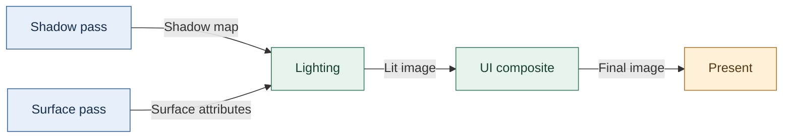

The two first passes have no dependency on each other in this simplified graph. Either may run first, but both must precede lighting. A topological order is any ordering that satisfies every declared dependency: repeatedly select a pass with no remaining incoming edges, emit it, and remove its outgoing edges. If no pass is ready before all passes are emitted, inspect cycles or unresolved dependencies. A temporal effect may read an explicitly declared previous-frame image while writing a new current-frame image; folding those into one unnamed resource can create a false cycle or hide a real hazard.

The graph must also validate each resource’s format, dimensions, allowed uses, lifetime, and ownership. Expressing order does not by itself generate barriers, queue dependencies, or safe transient allocations. Two passes without a dependency are only candidates for parallel execution; shared resources, device queues, and backend policy still constrain them.

Kohi’s prototype uses named sources and sinks, checks links at setup, and handles global window targets. Its passes still run in insertion order; automatic topological scheduling is not shown. If a pass forgets to declare a read, the graph cannot infer that hidden dependency from a function name. These definitions and the scheduling example are general teaching structure, while the source-specific implementation remains an insertion-ordered dependency representation. [Kohi #129](https://www.youtube.com/watch?v=oPvx_v1RGvs) · [Kohi #130](https://www.youtube.com/watch?v=zxB7Ug95G08)

### Keep pass lifetime separate from frame data and scene ownership

A pass’s longer-lived state can hold shader and resource handles, while its extended data describes the inputs it needs for a particular execution. In the first conversion, creation allocates pass state, initialization loads resources and sets up the render pass, execution records drawing work, and destruction releases the state. The scene or application can own the objects and prepare the draw records; the pass consumes those records without deciding how the scene was traversed. [Kohi #131](https://www.youtube.com/watch?v=lFl_jtkfEDg)

Frame arrays belong to a frame allocator and must be prepared within that frame’s lifetime. Pass-owned data belongs to the pass and survives across frames. Confusing the allocators caused a freed-block failure during UI text array growth in the migration. Eligibility also needs an explicit per-frame flag: even with no scene loaded, the skybox pass may need to clear the output, and the final/UI pass may need to leave it presentable. The graph migration later gets past some setup failures, but bitmap text remains broken and old view cleanup remains unfinished at the reported endpoint. [Kohi #134](https://www.youtube.com/watch?v=AR6c1Bn57G4)

The preceding pass-conversion session is an earlier failure stage: it reports allocator and resize failures while replacing views and ends with output still broken. A later graph integration gets farther but still has invalid bitmap-text data. Keep those endpoints distinct; neither proves a completed graph-backed frame. [Kohi #132](https://www.youtube.com/watch?v=qxGXHap7GU0) · [Kohi #134](https://www.youtube.com/watch?v=AR6c1Bn57G4)

### Prepare each pass’s inputs according to its ordering rules

The data-gathering refactor moves renderer-facing collection to the application boundary that knows both the scene policy and the pass inputs. It gathers mesh, terrain, debug, UI, and text records into transient per-frame storage. Opaque geometry can be appended as it is found; transparent geometry needs camera-distance ordering; final UI overlap order belongs to the UI system. Terrain culling is deferred until terrain has useful chunks rather than one large object. For private debug lists, a count query followed by a caller-provided output array gives the application allocation control, at the cost of a second traversal and a failure path. The episode moves toward this design but still lacks attachment and view setup at the end, so it does not demonstrate an executable graph. [Kohi #133](https://www.youtube.com/watch?v=wIdIXUnaIL0)

### Rebuild image references only after the swap chain has changed

Resize invalidates more than dimensions: regenerating the swap chain replaces images and image views that graph targets may reference. The safe sequence is to prepare the backend resize, recreate the swap-chain resources, then notify the application-owned graph so it can rebuild targets and update its references. Repeated interactive resize events are debounced in the reported implementation after 30 stable frames; that is a selected heuristic, not a measured optimum. [Kohi #134](https://www.youtube.com/watch?v=AR6c1Bn57G4) · [Kohi #135](https://www.youtube.com/watch?v=zdZP0uQ4Pi8)


#### A frame can be drawn only after the presentation image is acquired

A renderer cannot assume it owns the image that is currently visible. In a Vulkan-style presentation path, the swap chain makes a set of presentation images available. The application acquires one image, records rendering that targets it, and queues that image for presentation when the rendering work is ready. The queue may contain more than one image, so the renderer needs to carry the acquired image index through the frame rather than guessing which attachment to draw into.

Treat the swap chain as an immutable configuration object in this example: when its size or compatible surface configuration changes, recreate it and rebuild the dependent views and attachments. That gives the application a clear recovery path for window resizing. Keep object ownership explicit: the swap chain supplies and destroys its presentation images; the engine creates and destroys the image views that describe how those images are used. The depth attachment is a separate engine-created image because the swap chain's color images do not provide it.

The historical Kohi episode also shows a useful construction order: inspect surface capabilities and formats, select a supported format and present mode, clamp the requested extent to supported limits, choose an image count within the reported bounds, then create the swap chain and retrieve its images. For each retrieved color image, create a view. Separately, select a depth format supported for depth/stencil attachment use, create the depth image, allocate compatible device memory, bind it, and create its view.

A small image helper can make that ownership visible by grouping an image handle, its allocated memory, an optional view, and dimensions. Its destroy path must release only resources it owns and must wait until submitted GPU work no longer uses them. Destroy the view before the image; then release the image's memory allocation. The historical episode narrates freeing memory before destroying the image, but a teaching implementation should use a clear resource-first teardown order and verify allocator-specific rules. For swap-chain images, destroy the engine-created views before destroying the swap chain, but do not separately destroy the swap-chain-owned images.

This episode's implementation is historical evidence, not a current Vulkan recipe. Its own code leaves mip levels, array layers, memory offsets and several image parameters fixed or marked for later work. Verify synchronization, result handling, format selection and lifetime rules against the Vulkan version and engine code actually in use. The successful build and lack of validation messages are reported by the speaker and were not independently reproduced here. Current Vulkan documentation requires pending device work that refers to an image to have completed before destroying it; see [vkDestroyImage](https://docs.vulkan.org/spec/latest/chapters/resources.html) and [vkFreeMemory](https://docs.vulkan.org/spec/latest/chapters/memory.html). The cleanup order above is a recommended ownership presentation, not a claim that freeing bound memory first is categorically forbidden in all Vulkan versions. The transcript also places render passes, framebuffers, command buffers, frame synchronization and the completed render loop in later episodes.

Source: Kohi #017, “Vulkan Swapchain, Images and Depth Buffer,” [video](https://www.youtube.com/watch?v=jWKVb_QdSNM). Reviewed from the complete local Whisper base.en transcript (11,007 canonical spoken words; 4 acknowledged reading chunks). Caption access had returned HTTP 429; this does not show that English captions are unavailable. No manual audio, frame, code or runtime verification was performed.

### A small software renderer makes order dependence visible

A viewer’s near-wall clipping report leads an older Java renderer lesson to separate wall drawing from floor drawing. Moving the wall code exposes a hidden input: the camera’s forward value had been local to the old method. The source copies it into a field before invoking the new operation. The broader lesson is to name every input when extracting rendering work; an explicit parameter can make that dependency easier to inspect than mutable state whose update order is implicit. [Wall-rendering repair](https://www.youtube.com/watch?v=98K5Bm2sApY)

The render-distance limiter also has a place in the image-building sequence. In this source, applying it before the walls means the later wall operation overwrites that result; moving it after the walls changes the visible outcome. This is the same practical question a pass graph asks at a larger scale: which operation consumes the completed result of which other operation? It does not establish a universal floor/wall order for GPU rendering with depth tests and blending. The episode reports the wall result and shows method folding as a navigation aid; neither observation replaces a visibility or regression test of your own renderer. [Wall-rendering repair](https://www.youtube.com/watch?v=98K5Bm2sApY)


#### Describe what every pass reads and writes

An original three-stage frame might first produce a shadow-depth image from the light's view, then produce a lit scene image from the camera's view, then combine that image with interface graphics. The lighting stage cannot read a completed shadow image before the shadow work exists and has the right access state. The final stage cannot read the current scene image from an uninitialized allocation.

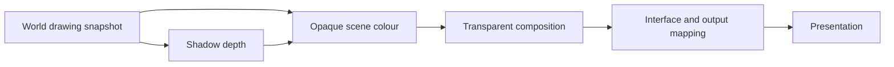

A **render graph** records passes and their resource dependencies. It can help determine an order, plan temporary image lifetimes, and generate synchronization under a particular backend. It is not automatically a correct scheduler. If a pass forgets to declare a read, the graph cannot infer that hidden dependency from a friendly function name.

For each image, specify format, dimensions, sample count, lifetime, and permitted uses. A resize can invalidate dimensions without changing logical identity. Rebuild the dependent resources at a safe boundary and handle a zero-sized window explicitly. Temporary allocations may share physical memory only when their lifetimes and API rules permit it. **Aliasing** is that reuse of storage for different logical resources; an overlap mistake can corrupt another pass even when every logical handle appears valid.

**Exercise:** give the three passes separate input/output records. Deliberately remove the shadow read from lighting's declaration. Can a validation layer or a graph check detect the missing dependency? If not, identify which correctness obligations still depend on the programmer. Then resize the scene target and verify that the interface does not sample the retired image.

#### Forward and deferred rendering move costs to different places

In **forward rendering**, geometry's shading computes its contribution to the scene image using the relevant lights and material. In **deferred rendering**, an earlier geometry stage stores surface information, then a later stage lights that stored information. That intermediate surface data is often called a **G-buffer**.

The choice changes bandwidth, memory, lighting work, material flexibility, antialiasing, and transparency handling. A small scene with few lights can favor a simple forward path. A scene with many lights may benefit from a different arrangement, but “many” needs a workload and hardware context. **Tiled** or **clustered** lighting partitions screen or view space and selects lights affecting each region; it is another way to reduce irrelevant work, not a synonym for deferred rendering.

The Khronos subpasses sample is a concrete deferred example with a geometry stage storing depth, albedo, and normals, followed by lighting. Its comparison shows why keeping intermediate data in tile memory can reduce external-memory traffic on relevant tile-based GPUs. That observation does not prove that one pass arrangement wins on every GPU. [Khronos subpasses sample](https://docs.vulkan.org/samples/latest/samples/performance/subpasses/README.html).

Define a fair comparison scene before choosing. Include the same image quality, lights, resolution, target formats, and transparency policy, then measure frame time and memory traffic where available. A renderer that omits expensive materials is doing different work, even if its frame counter is higher.

#### A material is data interpreted by an agreed shading model

A **material** describes how a surface should respond to light and which textures or parameters supply that description. A **shader** executes calculations at a stage of the graphics pipeline. The material is not identical to a shader file: many instances can share code but supply different values, and one material may need different passes or variants.

**Physically based rendering**, often shortened to **PBR**, uses models guided by physical light/material behavior. It still contains approximations and artistic decisions. A **BRDF**, bidirectional reflectance distribution function, describes how light arriving from one direction contributes toward another direction at a surface. Lighting, geometry, visibility, and output mapping must cooperate with the model; merely naming a texture `roughness` does not establish physical consistency.

As a concrete interchange contract, glTF defines a metallic-roughness material model. Its base-color RGB texture uses sRGB encoding and must be decoded for linear computations; its roughness and metalness texture values are linear data, sampled from the green and blue channels respectively. Such per-input interpretation belongs in the import and material contract, rather than being guessed from a PNG filename. [glTF material and texture specification](https://registry.khronos.org/glTF/specs/2.0/glTF-2.0.html#materials).

**Original debugging example:** the crate appears too glossy only after an artist's roughness texture is imported. First inspect the value sampled by the shader and the channel used. Then inspect whether an inappropriate colour transfer conversion was applied. Increasing a light's intensity may hide the symptom in one view while preserving the import error. Diagnostic views for normals, roughness, metalness, depth, and object identity let you test the representation before judging the final image.

### Choose shadow bias and filtering with the receiver geometry in view

The first directional-light shadow attempt wires a depth pass and verifies that geometry reaches the shadow map, but the scene comparison remains black or incorrect. The source ends without resolving light-space projection and depth comparison. Treat later shadow work as a recovery path, not as proof the first pass already worked. [Kohi #152](https://www.youtube.com/watch?v=2IxH8C9OUzg)

Depth comparisons can self-shadow when stored and receiving depths nearly match. A constant bias can reduce acne, but too much bias detaches shadows from casters (Peter Panning). Front-face culling in the shadow pass can move stored depth through thick objects without that offset, but single-sided planes have no back face to cast from. The right choice depends on the geometry in the scene, not a universal checkbox. [Kohi #153](https://www.youtube.com/watch?v=32RYiLA3OBs)

The same source softens jagged edges with nine equal-weight depth samples around the projected coordinate and averages them. This PCF kernel spends more samples for a softer boundary; it is not a Gaussian reconstruction. Clamp-to-border with a white border means positions outside shadow coverage are lit; a black border would darken them incorrectly. A console toggle initially works for meshes but breaks terrain until the terrain shader’s uniform locations are initialized, illustrating that shared visual controls still have per-shader binding contracts. [Kohi #153](https://www.youtube.com/watch?v=32RYiLA3OBs)

### Fit light coverage to the camera only after validating every coordinate transform

The frustum-fit attempt reconstructs eight camera-view corners, averages a center, transforms the corners into light space, and derives an orthographic shadow box. Expanding depth bounds can prevent clipping, but uses more map resolution; the reported margin of 20 is a temporary hard-coded value. The debug box stretches and flips, and the episode ends before the projection is corrected. This is a debugging case, not a finished camera-fitted shadow recipe. [Kohi #154](https://www.youtube.com/watch?v=GfpDnw66Ue8)


### Why a single map loses detail

Picture a camera looking across a large landscape toward a nearby car. A single directional-light shadow map must cover the whole camera view depth. If its image is $2048\times2048$ but spans roughly $400$ world units, then each texel covers a substantial patch of ground. Moving the camera can shift a shadow edge by a texel, which looks like a large jump near the player. The episode identifies a one-pixel shadow step and jitter as the visible failure; simply increasing texture size cannot keep fine detail across an arbitrarily long view. [Kohi #156](https://www.youtube.com/watch?v=coWS_saBPBk) (00:09:30-00:11:15)

The important distinction is between image resolution and world coverage. Keeping a $2048\times2048$ texture while projecting it onto a smaller near region makes each texel represent less world space. Another texture can cover the next region, and another can cover the distance. This is the cascade idea: divide the camera's visible depth into bands, then render a shadow map fitted to each band. Every map still uses finite resolution, but the nearest band spends that resolution where a small shadow movement is most visible. The episode diagrams four bands and assigns the same nominal 2K resolution to each. [Kohi #156](https://www.youtube.com/watch?v=coWS_saBPBk) (00:48:18-00:50:35)

### Choose split distances that spend precision near the camera

Let the camera's near and far distances be $n$ and $f$, with $0<n<f$, a positive integer $N$ cascades, indices $i=1,\ldots,N$, and $0\leq\lambda\leq1$. A purely uniform split puts boundaries at equal world-distance intervals:

$$u_i=n+(f-n)\frac{i}{N}.$$

That gives each band equal depth length, but perspective makes nearby regions occupy much more screen space than distant ones. A logarithmic split instead uses

$$\ell_i=n\left(\frac{f}{n}\right)^{i/N}.$$

The narrated implementation blends the two kinds of spacing with a reported multiplier of $0.95$:

$$s_i=\lambda\ell_i+(1-\lambda)u_i,\qquad \lambda=0.95.$$

This formula is a mathematical reading of the caption's described ratio/power plus uniform-distance calculation, not a transcription verified against source code. The episode presents $0.95$ as the value used in its prototype and says it should eventually be tunable. [Kohi #156](https://www.youtube.com/watch?v=coWS_saBPBk) (01:31:15-01:34:30)

For a worked illustration, assume $n=1$, $f=400$, and $N=4$. These are explanatory inputs; the stream mentions a view distance around $400$, but does not establish that the near plane is $1$. The first uniform boundary is $u_1=100.75$, while the first logarithmic one is $\ell_1=400^{1/4}\approx4.47$. With $\lambda=0.95$, the blended split is

$$s_1=0.95(4.47)+0.05(100.75)\approx9.29.$$

The next boundaries are approximately $29.03$, $99.98$, and $400$. So a fragment at view depth $40$ belongs to the third band, $[29.03,99.98]$. The near cascades are narrow, giving their maps more detail per world unit; the last cascade covers most of the remaining distance at lower detail. The exact numeric example is ours, while the use of logarithmic/uniform blending and four split values is source-supported. [Kohi #156](https://www.youtube.com/watch?v=coWS_saBPBk) (01:18:49-01:21:40; 01:31:15-01:34:30)

### Fit a light projection to each slice of the camera view

The current book's earlier Kohi #154 note records a camera-fitted shadow attempt whose debug box stretched and flipped. This episode revisits the camera frustum and then narrows it cascade by cascade. Begin with the camera-frustum corners. For the current band, keep the near-plane corners at the previous split and move the corresponding far-plane corners inward to the new split. The result is a truncated sub-frustum: exactly the camera-visible slice that this cascade must cover. The stream describes applying the previous and current split distances to those corner rays. [Kohi #156](https://www.youtube.com/watch?v=coWS_saBPBk) (01:35:02-01:36:20)

Next express that slice in the light's view. Find a center and an enclosing radius for the slice corners, then build a square orthographic light projection around it. Track the light-space minimum depth and depth range as well. In the earlier single-map version, the presenter says the shadow projection bounds came from the largest corner distance from the frustum center; cascade fitting repeats the process on each smaller corner set. A square bound is easy to update and avoids fitting independent width and height, though it may include unused space. [Kohi #156](https://www.youtube.com/watch?v=coWS_saBPBk) (00:07:26-00:07:38; 00:27:05-00:27:57; 01:35:02-01:36:20)

The per-cascade projection is not just a texture-size setting. Each slice has its own light-space matrix, shadow depth image, and split distance. In the fragment shader, transform the fragment into camera/view space, use its depth to choose a band, then use that band's light-space position and map for the visibility comparison. This is how the engine changes from “one map covers the camera” to “each visible point chooses the map sized for its distance.” The stream describes the depth and split inputs, four matrix/map slots, and indexed selection. [Kohi #156](https://www.youtube.com/watch?v=coWS_saBPBk) (01:16:16-01:21:40)

Use a consistent positive camera-forward depth when selecting a split. In a right-handed view convention looking along negative $z$, that depth can be $d=-z_{\mathrm{view}}$; it is not generally Euclidean distance from the camera. The exact shader sign convention must match the matrices and stored split values. Also distinguish the receivers fitted by a camera slice from their possible shadow casters: a tree behind the camera can still cast a shadow onto visible ground. That thought experiment explains why camera visibility alone is not a complete shadow-caster culling rule. These are original contract checks, not claims that the tutorial implements them.

### Read the debug view as evidence, not as a finished quality claim

The cascade-color mode makes band selection visible. In the caption-described demo, the closest band is red, followed by green and blue, with yellow farthest away. Walking toward an object shows the higher-detail shadow becoming active; zooming the inspection back out reveals transitions between bands. A visible seam and slight jitter remain. This is a useful debug result: it demonstrates range selection and improved nearby detail in that scene, while also exposing that camera-relative projection changes can still move texels. Cascades reduce the coverage burden on a map; they do not by themselves stabilize its texel grid or hide every boundary. [Kohi #156](https://www.youtube.com/watch?v=coWS_saBPBk) (00:58:58-01:03:00)

### Keep the prototype's costs and open work visible

The demonstrated implementation creates four independent shadow passes, four depth sources, and links each source into the scene pass. It also expands material/shader inputs to four light-space matrices, four shadow maps, and split values. The presenter says the repeated-pass version was chosen to get a working result and that later work could pack the maps into an atlas or texture array and use a specialized cascade pass. Rendering the scene for multiple light projections still has a cost even when the maps share an allocation. [Kohi #156](https://www.youtube.com/watch?v=coWS_saBPBk) (01:08:44-01:10:20; 01:16:16-01:18:49; 01:37:48-01:38:45)

Do not call this implementation tuned or production-ready from the episode alone. The presenter explicitly leaves a performance pass, configurable cascade count/splits, and cleanup for later. The visible color bands still show a seam and slight jitter, and the multiplier is hardcoded. There is no benchmark protocol, test result, or comparison against an alternative split policy in the caption. A useful next validation would hold scene, camera path, light, and output resolution fixed; capture per-cascade depth images; record which cascade each test point selects; then measure frame cost and inspect transitions while moving the camera. [Kohi #156](https://www.youtube.com/watch?v=coWS_saBPBk) (00:58:58-01:03:00; 01:31:15-01:34:30; 01:45:42-01:46:05)

The end of the stream moves into a separate Vulkan descriptor issue. Mixed 2D and cube samplers sharing an aliased binding are reported to fail through MoltenVK on macOS; explicit sampler types and separate bindings are proposed but not implemented before the caption ends. Treat that as an unresolved portability task, not as a cascade defect or a verified general statement about all MoltenVK versions. [Kohi #156](https://www.youtube.com/watch?v=coWS_saBPBk) (01:50:26-01:52:10; 01:58:22-01:59:45)

### Use different views of one image for rendering and sampling

An image and an image view answer different questions. The image is the resource backed by storage; allocation and ownership of that memory are separate lifetime decisions. A view tells a command or shader which part and interpretation of that storage to use. The cascade implementation needs two view shapes over the same four-layer image:

- A **single-layer 2D view** for rendering one cascade: use base layer $i$ and layer count $1$.
- A **whole-array view** for sampling cascades in the lighting shader: use base layer $0$ and layer count $L$.

The source first treats each layer view as though it could serve both jobs. Vulkan validation then reports a subresource range mismatch: a nonzero base layer combined with a count that reaches across all layers exceeds the image. The presenter works back to the two-view model. This is the core rule: an attachment view selects the layer to write; the shader's array view exposes the layers to read. [Kohi #159](https://www.youtube.com/watch?v=FrtHF-9K1HI) (00:30:58-00:39:30; 00:45:06-00:46:30; 02:22:18-02:28:00)

The engine-facing creation path therefore needs an image layer count and a selected layer index at the render-target boundary. For an ordinary one-layer 2D texture, defaults preserve the old path. For an array texture, the image is created with $L$ layers, one whole-array sampling view covers all of them, and each render-target attachment gets its own one-layer view. The stream also adds cleanup for the allocated layer-view handles; every extra view adds lifetime work as well as flexibility. [Kohi #159](https://www.youtube.com/watch?v=FrtHF-9K1HI) (00:07:49-00:13:35; 00:36:40-00:46:30)

### Consolidate shadow storage without claiming fewer scene renders

The shadow pass moves from separate cascade images and render-graph sources to one color array image and one depth array image. For four cascades, those images have four layers each. The pass still creates a render target for each cascade and frame: cascade $i$ writes to color layer $i$ and depth layer $i$, then the lighting pass samples from the full depth-array view. This simplifies shader/resource binding and render-graph wiring, but it does not show a reduction in the number of times the scene is rendered for shadows. The episode still describes a pass per cascade. [Kohi #159](https://www.youtube.com/watch?v=FrtHF-9K1HI) (01:06:57-01:08:00; 01:16:33-01:18:30; 03:04:08-03:05:00)

The render graph remains responsible for declaring that the scene pass reads the shadow depth source. Temporarily removing the source and attachment-population callbacks causes graph regeneration or source-link validation to fail. The renderer can manage cascade-specific framebuffer targets internally, but the graph still needs a declared shadow resource edge so the producer/consumer dependency is visible to validation and scheduling policy. A declared edge alone does not prove that this prototype derives execution order or emits every required transition. A resource can have internal subresources while the graph sees one array image. [Kohi #159](https://www.youtube.com/watch?v=FrtHF-9K1HI) (02:45:13-02:47:00; 02:58:28-03:05:00)

### Treat the final array-texture state as unfinished

This stream adds a writable 2D-array texture path with a layer count; it does not add a general array-image asset importer. Ordinary texture types retain a layer count of one, and the added path begins with no pixel data. It also needs separate views for layer attachments and whole-array sampling. The implementation's own validation failures expose how easy it is to pass the wrong view type, base layer, or layer count. [Kohi #159](https://www.youtube.com/watch?v=FrtHF-9K1HI) (00:07:49-00:13:35; 02:22:18-02:28:00)

Most importantly, the episode ends with sampler/image dimensionality mismatches still reported. The presenter then notices that some shader code still samples the consolidated image as independent 2D textures and changes it to use array coordinates, but the rerun continues to produce errors. The pass is described as work to continue later. The source supports the design distinction and debugging trail; it does not support a claim that the final cascaded shadow render works. [Kohi #159](https://www.youtube.com/watch?v=FrtHF-9K1HI) (03:36:33-03:47:03)


#### A shadow is a visibility question with a coordinate convention

For a shadow map, the light first records which surfaces are nearest from its view. During scene shading, transform the current surface point into that light's coordinates and compare the relevant depth against the stored depth. A **bias** offsets the comparison to reduce self-shadowing caused by precision and sampling errors. Excessive bias can detach the apparent shadow from the object.

This is a useful place to use the mathematics immediately. A point begins in the object's local coordinates, moves into world coordinates with its object transform, and then into the light's view/projection coordinates. The **homogeneous divide** converts a projected four-component point into normalized coordinates by dividing the appropriate components by its fourth component. The exact depth range and image-coordinate convention belong to the chosen graphics path. Do not paste a projection formula from another API and diagnose the resulting mismatch as a mysterious shadow bug.

An orthographic sun-shadow view and a perspective spotlight view answer related questions with different projections. **Cascades** divide a larger view range into separate shadow-map regions to distribute useful resolution. Their boundaries, stabilization, and blending are additional engineering choices, not automatic consequences of using several textures. A first implementation should prove one shadow comparison before adding those choices.

**Test:** render one plane and one cube under a fixed light. Display the shadow depth image directly, inspect the transformed coordinates for one selected point, and move the cube through the expected boundary. Then change only bias. You now have separate evidence for geometry, coordinates, sampling, and the tuning parameter.

#### Hierarchies make transform ownership visible

The crate can carry a label, and a character can hold the crate. A **local transform** describes a child's placement relative to its parent. A **world transform** describes placement in the world's frame. With the column-vector convention, if $W_p$ is the parent's world matrix and $L_c$ the child's local matrix, then

$$
W_c=W_pL_c.
$$

The order follows the question: first interpret the point in the child's local placement, then place that result through the parent. Changing the parent invalidates the cached world transforms of dependent descendants. A **dirty flag** records that a cached result needs recomputing. It must propagate or be checked in a way that does not leave a grandchild using an old parent transform.

Reparenting has two different promises. Keeping the local transform preserves the child's relationship to its new parent but can move it in world space. Keeping the world transform requires deriving a new local transform, which needs an appropriate inverse and may not preserve a simple translation/rotation/scale representation under every hierarchy. State which operation the editor is performing.

This same discipline matters for camera attachments, animated joints, audio emitters, and collision shapes. They are consumers of transforms with distinct timing needs. A physics object that owns its world pose should not simultaneously inherit an incompatible animated parent pose without an explicit policy.

#### Name GPU objects and inspect uniform bytes before changing equations

Validation can report a live sampler or in-use allocation without identifying its engine owner. Vulkan debug-utils object names and command-buffer labels make handles visible in RenderDoc and validation logs. Kohi dynamically loads naming/tagging callbacks, labels images, views, swapchain images, textures, and samplers, and uses debug-only wrappers. A labeled skybox sampler exposed shutdown ordering: unload had been deferred to the next frame, but application quit meant there would be no next frame. An immediate-unload option was added for shutdown while ordinary scene unload stayed deferred. [Kohi Vulkan object names and shutdown](https://www.youtube.com/watch?v=0ILGxLqvlsA)

A separate RenderDoc investigation finds a shader data-layout mismatch rather than a lighting equation error. In the cited C/shader declarations, a 12-byte `vec3` direction left the next `vec4` color at an unexpected offset; changing both declarations to aligned four-component values restored the expected layout. This describes that observed interface mismatch, not a universal rule to pad every shader `vec3`; offsets depend on the declared shader layout and matching host representation. Another upload metadata size field is one byte: a 480-byte light array wraps to 224, corrupting following fields. Widening that size field fixes the reported values. The version still caps lights at ten and allocates/copies during material application. [Kohi light uniform layout](https://www.youtube.com/watch?v=nhEHfkiarV8)

The streams report clean shutdown/rendering after their fixes; they do not prove general GPU-memory accounting or a generalized light-selection system.

#### Per-frame uniform data and descriptor binding

A uniform buffer carries values that shaders need, while a descriptor set connects that buffer to a shader binding. This episode builds the descriptor layout, pool and sets, then allocates a set for each swapchain image so each in-flight frame can use corresponding uniform data. The example includes view and projection matrices in a padded structure. Its 256-byte size is the presenter's example choice for an asserted hardware concern; alignment requirements should be obtained from the actual device limits and descriptor rules rather than copied as a universal constant.

During command recording, the renderer updates the current image's data and binds the matching descriptor set. Validation reports a draw without a bound set; the speaker adjusts command ordering and reports that the error clears. An identity setup is replaced with a perspective camera transform, and the presenter narrates that changing camera distance changes the square's apparent size. Correct per-frame updates still depend on synchronization that prevents rewriting memory while the GPU is using it.

Source reading: [caption source](https://www.youtube.com/watch?v=yc40ixalLtU). Captions document the narrated development state; on-screen code and reported builds were not independently reproduced.


### Treat submission and completion as separate events

The CPU builds commands. The GPU may execute them later. A **command buffer** records graphics work for submission; a **queue** accepts work in an API-defined order. A **fence** or a timeline value can let the host determine when specified work completes. A **semaphore** coordinates operations under its API's synchronization rules. These names describe different contracts; using one somewhere does not synchronize every resource everywhere.

The engine must answer two questions: does the next operation see the data it needs, and has the last user finished before storage is changed or freed? **Execution ordering** controls when operations occur. **Memory visibility** controls which writes a later operation may observe. A resource can be alive and still contain data that has not been made visible to the intended reader.

In Vulkan presentation, a frame slot and an acquired swapchain-image index need not be equal. A **swapchain** is the set of presentation images managed with the window/display system; the application acquires one for rendering and presents it later. Per-frame temporary resources and per-image resources have different indexing needs. Current Khronos guidance specifically warns that presentation may still be waiting on a semaphore even after a frame fence completes; its example associates presentation-ready semaphores with swapchain images. Follow the exact API guidance for the chosen presentation path rather than copying an older two-arrays-of-everything pattern. [Khronos frames in flight](https://docs.vulkan.org/tutorial/latest/03_Drawing_a_triangle/03_Drawing/03_Frames_in_flight.html).

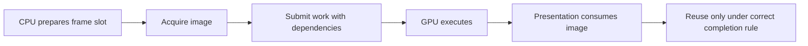

Multiple **frames in flight** allow CPU preparation to overlap work that the GPU is already doing. More overlap can improve utilization but consumes more memory and can increase latency. It also multiplies lifetime obligations. Describe which data belongs to a frame slot, an image, a persistent asset, or a transient pass before choosing the array size.

Do not infer thread safety from the word “Vulkan.” Its official threading guide states that many externally synchronized objects require application coordination and discusses separate command pools for threads. That is an explicit API obligation. [Khronos threading guide](https://docs.vulkan.org/guide/latest/threading.html).

### Grow concurrency from a dependency you can draw

A **thread** is an independently scheduled path of execution. A job system breaks work into smaller tasks and schedules them onto workers. Sharing a pointer does not say when its data is ready or who can write it. Begin with the dependency graph: if world update writes transforms and render extraction reads them, either extraction waits, reads a published snapshot, or uses another explicitly safe arrangement.

A **snapshot** is a defined view of state at a boundary. It need not copy every byte of the world. It may hold compact drawing data or a versioned immutable structure, but its lifetime must be long enough for the consumer. A **data race** occurs under the language's rules when conflicting unsynchronized accesses occur; “it only writes occasionally” is not protection.

For the workshop, allow background workers to decode different texture files into separate buffers. Let a controlled graphics path schedule uploads and publish readiness. This makes the work's dependencies clearer than allowing every decoder to mutate the global renderer. If two jobs must append into the same output list, give them separate ranges, private lists followed by a merge, or proper synchronization. Choose from measured work and ownership, rather than adding a lock to every function.

**Failure exercise:** a texture appears correctly once in ten runs. Record request ID, asset version, producer completion, publication time, and consumer version. If the consumer sees an unpublished buffer, the problem is ordering. If it sees the right version with a wrong row pitch, the problem is representation. If the buffer was freed, the problem is lifetime. Each demands a different fix.


#### Make light overlap visible before promising a faster frame

A room containing a hundred lights does not imply that every visible surface needs to evaluate all hundred. **Light assignment** prepares a smaller candidate list for the region being shaded. In a tiled forward-plus renderer, divide the screen into small rectangles called tiles, use the camera and scene depth to constrain the volume represented by each tile, and decide which lights may affect it. The forward shading pass then consults the tile's list. The assignment step has its own cost and storage requirements; skipping irrelevant light evaluations is the intended benefit, not a guarantee that the whole frame becomes faster.

For an original counting example, imagine four tiles containing 256 shaded samples each, with six lights in the scene. Testing all six at every sample gives 6,144 possible light evaluations. Suppose the four candidate lists instead contain one, three, zero, and two lights. Evaluating those lists gives 1,536 possible evaluations. This calculation explains the opportunity; it leaves out list construction, depth processing, memory access, branching, visibility, and the cost of each light. It is not a measured speedup. If all six lights overlap every tile, the lists do not reduce that count at all.

A **light-complexity view** colors regions by their candidate count. A crowded color means "inspect this area's light overlap," rather than "the GPU spent exactly this many milliseconds here." Compare that view with measured pass times and the scene's actual appearance. A decorative glow may be better served by an emissive surface than an additional dynamic light if it need not illuminate surrounding objects, but those choices produce different images and must be evaluated against the scene's requirements.

Shadow testing needs a similarly deliberate scene. Place objects near and far, move the camera away from the origin, and move it through the world while inspecting both the final image and shadow coverage. A shadow frustum is the volume whose contents the shadow-map setup covers. Enlarging that volume without increasing the map resolution spreads the available samples over more space, which can reduce detail. A correct-looking shadow around one centered object does not establish adequate coverage for the level.

The fully read Hazel lighting log describes tiled light assignment and a light-complexity display; the shadow follow-up describes moving through a larger test scene to find coverage problems. Their reported frame times and light limits belong to those development snapshots. The counting exercise and interpretation above are teaching extensions, not measurements of Hazel or promises for another GPU. [Lighting log](https://www.youtube.com/watch?v=e0YTiO0Ur4o), [scene-shadow log](https://www.youtube.com/watch?v=16zctOwxGXM).


#### Separate a dead resource from an unfinished workload

Two GPU failures can look similar at the application boundary while needing different fixes. In one fully read Hazel debugging account, an environment texture could be released on the CPU while GPU work might still refer to it. A later graphics command could therefore use an invalid resource. The developer reports that deferring deletion through the render queue fixed the observed fault. [Caption source: I Fixed Vulkan](https://www.youtube.com/watch?v=EXgXMa5kapI).

Turn that story into a lifetime trace. The renderer records work using an environment image. Submission allows the GPU to execute it later. The scene replaces the environment image. The old image is no longer wanted by new scene work, but it is still needed by an earlier submission. Put it on a **retirement list**, a collection of objects awaiting safe destruction, with a completion condition for the GPU work that uses it. Destroy it only after that condition is satisfied. Moving deletion to a render thread or waiting an arbitrary number of CPU updates does not by itself prove GPU completion. Queues, fences, and the engine's resource-use records must agree on when the old image is safe to release.

The same account describes a different failure during irradiance computation: a heavy compute workload hung on slower hardware in the developer's tests. Reducing the generated resolution and sample count stopped that reported reproduction, and the parameters became configurable. This is not a universal safe resolution or proof that all device-loss failures mean excessive shader work. It shows why useful diagnostics must distinguish invalid resource access from a workload that takes too long or otherwise fails on a device.

For a reproduction, record the input image, processing resolution, sample count, GPU and driver, validation output, crash information, and whether a resource replacement was occurring. Change one suspected cause at a time. If you simultaneously lower quality, remove a resource swap, and change synchronization, a successful run does not identify which change mattered. The debugging narrative supplies evidence for these two reported incidents; the retirement-list contract and controlled reproduction checklist are general teaching extensions.


#### Separate a glowing image from illumination of the room

Make the workshop's warning sign bright red. Three different things might now be intended: the sign's surface looks self-lit, a soft glow spreads around it in the image, and nearby walls receive red light. These require different mechanisms.

An **emissive material** contributes a self-lit appearance to the surface being drawn. **Bloom** spreads a filtered bright contribution over neighboring image pixels. A **light source** contributes illumination when shading surrounding surfaces. In a renderer without a mechanism that transports emissive surface light into the scene, increasing emission and bloom will not by itself light the wall. A nearby point light can approximate that desired illumination, but it remains an additional light with its own position, range, and cost.

Bloom controls describe image processing rather than physical light transport. A threshold chooses which brightness values contribute; a knee can soften the transition around that threshold. Filtering at reduced resolutions and combining levels can produce a wider glow, while intensity controls the strength of the result. These descriptions do not specify a unique bloom algorithm. Inspect the effect with exposure held constant: changing exposure at the same time can make it unclear which control changed the appearance.

The fully read Hazel bloom log explicitly distinguishes emissive appearance from illumination supplied by a colocated point light. It demonstrates controls and describes a compute-based implementation, but does not establish a complete algorithm or that adaptive exposure is finished. The warning-sign example connects those distinctions to an authoring decision. [Caption source: HDR, Bloom and Emission](https://www.youtube.com/watch?v=ThA9pueKvus).


## Prepare and publish content before promising it is ready

A mesh or texture becomes useful only when identity, preparation, lifetime, and visibility agree. The file-loading path is part of the engine rather than a temporary detail around the renderer.

### Allocate every mip level and keep the sampler synchronized with it

A mipmap chain contains progressively smaller versions of the same image. For a positive integer largest dimension $d$, the described number of levels is $L=\lfloor\log_2 d\rfloor+1$; a 256-pixel side therefore has levels 256, 128, 64, 32, 16, 8, 4, 2, and 1. A one-level image is not mipmapped. Lower-resolution samples can reduce minification noise and the amount of texture detail filtered for a distant surface, but this episode does not isolate which effect produces its reported improvement. [Kohi #142](https://www.youtube.com/watch?v=xb23Y9o7tP4)

The full resource contract includes image allocation for all levels, views and layout transitions covering those levels, and a sampler whose maximum LOD matches them. The narrated Vulkan path generates each level by blitting from the previous one with linear filtering, after checking that the format supports it. If filtering is unsupported, generation stops. Resize recomputes the level count; reload that changes the count may require a new sampler. Updating only an image’s level count would leave the view, layouts, and sampler inconsistent. [Kohi #142](https://www.youtube.com/watch?v=xb23Y9o7tP4)

The presenter reports a 4K terrain view moving from roughly 16–18 FPS to around 60 and looking smoother. VSync and test conditions vary, with no controlled benchmark or profiler comparison, so this is an observation from the session rather than a verified speedup. [Kohi #142](https://www.youtube.com/watch?v=xb23Y9o7tP4)


### Treat texture layout and transparency as two separate questions

When an image is loaded, first ask how many components each pixel has and in what order. RGB has three color components; RGBA adds alpha, a coverage/opacity value. If a loader reports four components but the upload describes three-component pixels, subsequent bytes are grouped at the wrong boundaries and colors appear corrupted. The lesson demonstrates that mismatch with a logo over a checkerboard at 00:30–03:20 and observes three versus four channels at 02:40–03:00. [BLENDING](https://www.youtube.com/watch?v=N94fHNZEHas&t=30s) [BLENDING](https://www.youtube.com/watch?v=N94fHNZEHas&t=160s)

The source distinguishes the GPU's internal storage format from the format of incoming pixel data. For its example, it chooses an RGB8 internal format with RGB input for three-channel data, and RGBA8 with RGBA input for four-channel data; it rejects other channel counts rather than pretending they work. The branch is built at 03:30–06:55. This is a useful minimum contract, but it does not prove support for grayscale, two-channel, floating-point, compressed, or platform-specific image formats. [BLENDING](https://www.youtube.com/watch?v=N94fHNZEHas&t=210s) [BLENDING](https://www.youtube.com/watch?v=N94fHNZEHas&t=390s)

Correctly uploading alpha does not itself combine a translucent texel with the color already in the framebuffer. Blending is a separate render state that combines a source fragment with a destination pixel. For the common straight-alpha rule shown, the output color is

$$C_{out}=\alpha_s C_s+(1-\alpha_s)C_d,$$

where $C_s$ is the source color, $C_d$ is the existing destination color, and $\alpha_s$ is source alpha. The source enables blending and selects source-alpha and one-minus-source-alpha factors; the explanation starts around 08:35, turns to renderer initialization and API layers around 10:30–16:10, and confirms the resulting checkerboard/logo composite around 16:10–17:35. [BLENDING](https://www.youtube.com/watch?v=N94fHNZEHas&t=515s) [BLENDING](https://www.youtube.com/watch?v=N94fHNZEHas&t=630s) [BLENDING](https://www.youtube.com/watch?v=N94fHNZEHas&t=970s)

The lesson's architecture adds an initialization route through application, renderer, render command, and backend API so OpenGL state is set at the backend boundary. This is a historical Hazel implementation choice described around 11:00–15:50, not a mandatory number of abstraction layers for every engine. The broader principle is to set persistent GPU state deliberately and make the state owner clear. The broken white/transparent areas before blending is corrected are described by the captions around 07:40–09:00, making clear that channel interpretation and compositing are separate fixes. The lesson corrects the output later at 16:10–17:35. A missing blend setup may leave transparent sprites opaque or otherwise incorrect; a state leak can also affect later draws. [BLENDING](https://www.youtube.com/watch?v=N94fHNZEHas&t=460s)

One subtlety is that the shown blend factors are the usual straight-alpha color factors. If textures instead store premultiplied RGB (RGB already multiplied by alpha), the source factor normally changes; mixing these conventions creates dark or bright fringes. Blending for color does not settle alpha-channel accumulation, sRGB/linear-light correctness, sorting of translucent objects, depth writes, or the behavior of cutout materials. Those are unresolved by this episode and need explicit pipeline policy and tests.

Here alpha is opacity for the demonstrated compositing rule. A fourth channel does not inherently mean opacity: the asset format and consuming shader assign its role, which could instead be a mask or another data value.

### Debug texture coordinates before changing sampling policy

A renderer receives geometry and tells the graphics API how to turn it into pixels. Add a texture to a quad and the renderer must carry more than an image handle: each vertex needs a texture coordinate, the shader needs a sampler, and the draw path must bind the matching texture. A **texture coordinate** (often called UV) says which part of an image is sampled at a point on the geometry. For a whole image, the four quad corners commonly use $(0,0)$, $(1,0)$, $(1,1)$, and $(0,1)$. If the vertex layout or buffer omits those values, the texture may bind successfully while every fragment samples the same coordinate. That is a useful debugging distinction: a visible flat patch can indicate valid draw and binding work but invalid UV data.

A disciplined diagnosis isolates each stage. First substitute the UV pair into visible color channels: red should vary with $u$, green with $v$. Then verify the sampler uniform points at the texture unit that the draw code actually binds. After the UVs vary correctly, restore sampling. The described Hazel prototype found that its quad vertex data and layout carried positions but no UVs; adding four corner coordinates and the matching layout element fixed the sample. The example's order matters: “texture is gray” is an observation; checking the coordinates identifies the broken link. [Caption source: 2D Renderer Textures](https://www.youtube.com/watch?v=mW8eW3pLtmk)

Sampling controls explain why the same image can look crisp, blurred, or tiled. A **filter** decides how texels (individual image samples) contribute when the rendered image size differs from the source. Nearest filtering chooses a nearby texel and can preserve sharp pixel edges; linear filtering blends neighboring texels. A **wrap mode** decides what happens when a UV leaves the interval $[0,1]$. Repeat maps the excess back into another copy of the image, so multiplying UVs by $k$ tiles the image about $k$ times across that axis. Clamp-to-edge keeps sampling the border texel instead. These are per-use choices: a repeating floor and a one-off portrait may need different address behavior. The tutorial demonstrates a prototype that hard-codes UV scaling in the shader, then suggests making it a uniform; that is an exercise, not an implemented material system. [Caption source: 2D Renderer Textures](https://www.youtube.com/watch?v=mW8eW3pLtmk)

A texture does not decide which quad appears in front. With a depth buffer, each fragment's depth is compared with the stored depth, and accepted fragments update color and depth according to the configured test and write rules. The prototype discovered that its expected layering did not work because depth testing had not been enabled, then corrected the sign of the depth offset after recalling its right-handed coordinate convention. This is a reminder to check the entire visibility contract: coordinate convention, depth test, depth clear, and draw state. Enabling a depth test alone does not establish a correct ordering policy. Nor does this small 2D example prescribe how every engine should layer sprites; many renderers deliberately use draw order or separate passes instead. [Caption source: 2D Renderer Textures](https://www.youtube.com/watch?v=mW8eW3pLtmk)

### Trace an image from file bytes to a correctly sampled texel

A texture upload crosses several formats and coordinate conventions. The decoder returns CPU bytes plus width, height, and channel count. The renderer must choose a compatible GPU storage format, describe the incoming byte format, upload the bytes, and bind the texture to a unit that the shader sampler reads. Those values answer different questions: an internal format describes GPU storage; the incoming format and element type describe the CPU buffer. A three-channel image, for instance, must not be uploaded as four-channel data simply because the shader declares a sampler.

A useful first test is a tiny asymmetric checkerboard with labeled or contrasting corners. It reveals vertical inversion immediately. The episode finds that the image decoder traverses rows top-to-bottom while the OpenGL path expects its image orientation in the opposite direction, then enables vertical flipping during decode. Only after orientation is correct does it change magnification filtering: nearest filtering preserves hard pixel edges, while linear filtering blends neighboring texels and blurs an enlarged checkerboard. Neither choice is universally right; photographs often benefit from smooth interpolation, while pixel art usually needs crisp sampling. The sample binds the texture to unit zero and sets the sampler uniform to that same unit, making the binding-to-shader link explicit. [Caption source: TEXTURES](https://www.youtube.com/watch?v=qEfohFgQ1-I)

Treat this episode's PNG decoder, OpenGL upload, one-level storage, and manually assigned sampler unit as a historical prototype path. A production asset pipeline may convert source images into engine formats and must make channel policy, color space, mip levels, filtering, wrapping, alpha blending, and resource lifetime explicit. The video itself calls several of those extensions future work; its successful checkerboard is evidence for that narrow path only.


#### From decoded pixels to a sampleable Vulkan texture

A decoded image is only the starting point. The renderer needs a Vulkan image for storage, an image view that describes the usable format and subresource range, and a sampler that says how texture coordinates become filtered pixel values. The lesson introduces these as separate pieces and wraps them in a texture resource carrying size, channel/transparency information, a backend handle, and a generation value. The renderer front end exposes create and destroy operations while the backend owns Vulkan-specific details.

The narrated upload path stages pixels through a CPU-visible, coherent buffer into a device-local image. It transitions the image from undefined to transfer-destination layout, copies the pixels, and then transitions it to shader-read layout. The image view and sampler are created with example settings: linear filtering, repeat addressing, and anisotropy. Those choices depend on the resource's intended use and the device features actually enabled. Layout transitions and upload synchronization also need queue-appropriate scopes; the caption does not provide enough exact code to certify those details.

A build initially fails because shared renderer types do not see the new resource declaration. The narrator moves the include to a common types header used by both front and back ends, reports a successful build and startup, then ends before loading test pixels or changing shaders. This is therefore texture-resource plumbing and upload preparation, not a demonstrated textured draw.

Source reading: [caption source](https://www.youtube.com/watch?v=u-eyZCV_MRs). Captions document the narrated development state; on-screen code and reported builds were not independently reproduced.


#### A completed load still needs permission to enter the world

The workshop can keep drawing while a worker decodes a door texture. The difficult boundary is not just starting the worker. The result must still belong to a live request when it reaches the world.

One workable policy keeps decoding on a worker and publishes through an owning thread:


"Owned input" means that the job can safely use its path, settings, and other parameters until it finishes. A pointer to a local request structure is not safe after that function returns. The result likewise needs an owner until the completion path consumes or releases it. A queue can move ownership without moving a raw allocation; its contract must say which side may free the data at each step.

Consider the request's identity:

| Moment | State |
|---|---|
| Tick 20 | Door slot 7, generation 3 requests a texture; its request identity is copied into the job. |
| Tick 21 | That door is removed. Slot 7 can later be reused with another generation. |
| Tick 23 | The worker completes the old request for slot 7, generation 3. |
| Completion | Resolve the full identity. If it is stale or canceled, release the result instead of applying it to a replacement door. |

A generation check protects logical identity; it does not retroactively make borrowed job memory safe. The worker must already have valid inputs while it runs. Cancellation must also define whether work stops cooperatively or finishes and is discarded. A flag cannot make an object safe to destroy while another thread is still reading it.

Before publication, validate the decoded data and perform any required upload and synchronization. A failed load keeps the documented old or fallback asset. A successful CPU decode is not proof that a GPU image is ready to sample. The simple policy drawn above uploads on the owning thread; engines can choose another arrangement only with explicit graphics-API threading, queue, and lifetime contracts.

This trace extends the fully read jobified-loading lesson by connecting it to the identity and publication rules already developed in this book. It is an original teaching scenario, not a claim that the tutorial implements cancellation and generation validation exactly this way. [Caption source: Jobifying Texture and Mesh Loading](https://www.youtube.com/watch?v=dRxw-C-eBGU).


##### Publish the result of a worker load

Worker-based loading changes the renderer contract: a material may refer to an asset whose GPU resource is not ready. The Kohi loader adds generation markers; packet construction filters meshes until their generation is valid, while texture maps select type-appropriate fallback textures and warn for unknown map uses. Workers read files and decode image data; a completion callback creates and swaps GPU textures on the renderer thread. Resource names are copied before dispatch so jobs do not borrow short-lived caller strings. [Kohi jobified texture and mesh loading](https://www.youtube.com/watch?v=dRxw-C-eBGU)

This keeps GPU upload on the render thread and does not demonstrate synchronization for resources still referenced by submitted GPU work. The stream also invalidates the live texture generation while building a temporary replacement, leaving fallback behavior possible during reload. A stronger policy keeps the old resource published until a validated candidate can be swapped at a safe boundary and retired after users finish; that policy is design guidance, not the demonstrated implementation. The video reports assets appearing during a live scene but provides no controlled performance measure.

#### Reloading code needs a quiet boundary, not just a new file

A library can export the same function names while old pointers still target code about to be unloaded. Event listeners, console commands, function tables, and worker entry points can all retain those pointers. Replacing only the main update callback leaves the rest of the program exposed.

A reload protocol therefore needs a **quiescent boundary**: a point at which the old module will receive no new calls and its relevant calls already in progress have finished. Stop dispatch into it, account for outstanding work, unregister or replace its callbacks, unload and load according to the platform rules, resolve required exports, validate the state contract, then resume. The exact order depends on which code owns teardown, so test both successful reload and failure to load the replacement.

Keep module lifetime distinct from state lifetime. Holding game state outside the library can preserve bytes across reload, but new code must still understand their layout and invariants. A changed structure or callback signature can invalidate that promise. Likewise, a file watcher observing a changed file does not prove that linking has finished or that the file is ready to copy.

The fully read hot-reload session encounters callback ownership and file-sharing problems. The protocol above generalizes the dependency problem rather than claiming that its development implementation is safe for arbitrary concurrent reload. [Caption source: Finalizing Hot-Reloading](https://www.youtube.com/watch?v=U1C9mMrpyF4).

Related foundations: [[Concepts/Ownership and non-owning views|Ownership and non-owning views]].


#### Loading image data means interpreting its layout

The FreeImage episode chooses a library so the engine does not need to write a decoder for every image format. Its example first asks the file signature what format the bytes contain, with the filename extension as a fallback, then loads a bitmap and reads its width, height, and pixel data. The integration also requires the application to find the library headers, linker files, and runtime DLL.

A pointer to pixel bytes is not yet a complete description of an image. The reader must know the bits per pixel, channel representation and order, row pitch, and which direction the rows are traversed. The live debugging mistakes in this episode show why guessing from width × height or treating one-byte channels as larger integers leads to misleading values. The author eventually uses library documentation and examples, then tests a deliberately simple image with distinct color blocks to expose the vertical row order. The transcript does not finish a general-purpose texture loader or specify all error and lifetime behavior.
#### From a pixel buffer to a visible sprite

A texture tutorial often looks like a short path: decode an image, create a GPU texture, bind it, draw a quad. The Sparky episode shows why every arrow in that path deserves a check. The author verifies a known pixel in a tiny image, then discovers that channel order (RGB versus BGR) changes the displayed result. He also questions whether FreeImage retains, copies, or releases the pixel buffer after upload. The episode ends with a texture finally visible after correcting the format, while noting that clean integration into the batch renderer is future work. That is a useful debugging sequence: validate decoded bytes independently, identify channel layout, then test GPU upload and sampling. It is not a finished texture-resource design, and the memory-lifetime question is left unresolved (The Cherno, “Ep. 15: Textures,” 00:00–00:50:24).

The later maintenance episode supplies the missing lifetime step: copy decoded pixels into engine-owned bytes before calling `FreeImage_Unload` on the bitmap. A borrowed pixel pointer refers to storage controlled by the bitmap; releasing the bitmap ends that borrow. Keep the image's dimensions, row pitch, channel layout and row direction with the owned bytes so a later upload interprets them correctly. A different design could retain the decoder object until its pixels are consumed, but it must still give that object an owner. The GPU backend also defines when upload staging data can be released; copying CPU pixels does not settle that separate lifetime. This completes the earlier texture experiment's unresolved question without treating its guessed ownership as a rule ([maintenance episode, 01:11:12](https://www.youtube.com/watch?v=CKhGMoTNPOo&t=4272)).

### Make loading a state transition rather than a hopeful pointer

A texture on disk is not yet a texture the renderer can sample. The file may need reading, decoding, format conversion, GPU allocation, upload, and synchronization. An **asset** is authored content identified and prepared for use; a **runtime resource** is its usable representation. One source asset can produce several runtime variants.

Represent the important states. `Unrequested` has no scheduled work. `LoadingCPU` means file and decoding work is underway. `WaitingForGPU` means prepared bytes await graphics work. `Ready` means the promised representation is usable under its synchronization contract. `Failed` retains a useful diagnostic. Use the state to decide whether to draw the real texture, a fallback, or nothing.

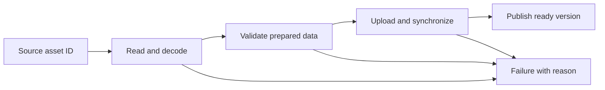

**Original example:** two crates use the same painted metal. They can share an immutable texture while keeping different transforms. If an editor brush changes the shared texture in place, both may change. If only one should change, create or identify a distinct resource instance. Godot's documentation provides a concrete example of separating behavior-bearing nodes from resource data and sharing loaded resources. Its particular loading and caching rules are Godot rules, not automatic properties of C++ pointers. [Godot resources](https://docs.godotengine.org/en/stable/tutorials/scripting/resources.html).

A **cache** retains a result for reuse. Its key must include what affects the result: asset identity, relevant import settings, target platform or format, and content version. If two requests use the same filename but different color-space assumptions, filename-only caching can return the wrong texture. **Invalidation** means recognizing that a retained result is no longer appropriate. It is part of correctness before it is a performance technique.

For **hot reload**, replace a resource while the application continues running. Read and validate the new version independently. Publish it at a safe boundary only after it is complete. Preserve the old working version if replacement fails, and retire its GPU storage only after outstanding users finish. A half-decoded replacement should never become the globally visible “current” texture.

#### Runtime texture replacement and safe publication

The texture-loading example decodes PNG data through `stb_image`, requests four channels, and flips vertically to match the engine's coordinate convention. It creates a GPU texture and tracks a generation number used by the renderer's handle resolution. A key event asks the system to load alternate named textures while the application runs. The speaker describes the resulting swap, but no independent frame inspection was performed.

For a robust reload, keep the currently published texture usable while the replacement is decoded and fully created. Publish the candidate only after its image, view, sampler and any dependent descriptor state have passed validation. If any step fails, discard the candidate and preserve the old texture. After publication, retire the old GPU resources only when all submissions that could reference them have completed. The captioned sequence does not establish these transactional or GPU-lifetime guarantees; invalidating the active generation during load and destroying the previous image immediately can cause a fallback interruption or race with in-flight work.

Source reading: [caption source](https://www.youtube.com/watch?v=2IxHj52-Kag). Captions document the narrated development state; on-screen code and reported builds were not independently reproduced.


#### A named texture system with reference counting

As texture loading grows, keeping filenames, GPU uploads, fallback handling and lifetime rules inside the renderer makes unrelated parts depend on renderer internals. This episode moves those responsibilities into a texture system. Callers acquire a texture by name and receive a pointer; repeated acquisitions share the same loaded texture. A reference count tracks how many users hold it. The caller chooses auto-release on the first acquisition; when the count later reaches zero, an auto-release texture is destroyed, while a retained texture stays loaded. The in-memory default texture has a separate accessor and cannot be released through the ordinary name-based path.

The system preallocates one memory block for its state, texture array and name lookup table. A fixed maximum controls capacity. An invalid handle marks unused array entries, and a linear scan finds the next free slot. This avoids per-texture allocation but means acquisition cost can grow with the configured capacity, and a full array returns failure. The example later configures 65,536 entries. File loading still assumes a particular asset path; the presenter leaves a separate resource-loader layer as future work.

The new hash table can store copies or pointers and accepts caller-provided backing memory. It does not own pointer values. Its deliberately simple hash maps a name to one array slot and overwrites on collision. That is a teaching shortcut with a serious production implication: distinct names can map to the same slot, so this implementation does not reliably preserve every key. A real lookup structure needs collision resolution and must check the original key rather than treating a hash bucket as a unique identity. The episode reports 14 unit tests passing for the implemented table, including pointer/value paths and invalid API combinations. That narrated result is not independently reproduced.

When a material's texture changes, a descriptor cannot be considered current based on generation number alone: two different textures may each have generation one. The debug swapping path initially misses this distinction. Adding texture identity to per-frame descriptor state lets the update check compare both identity and generation, after which the presenter reports the swap behavior works.

Source reading: [caption source](https://www.youtube.com/watch?v=hDpzfAdW3vw). Captions document the narrated development state; on-screen code and reported builds were not independently reproduced.


### Put file access behind an engine contract

Imagine the same level package ships on a console disc, a developer machine, and a downloaded patch. If gameplay code opens a platform-specific path directly, every feature that loads an asset inherits that platform detail. A filesystem service can give the rest of the engine one stable set of operations: normalize or combine paths, open and close files, read data, enumerate directories where needed, and submit asynchronous reads for streaming. The platform layer then maps those operations to the available storage. The useful boundary is narrow: wrap the operations the engine actually uses, rather than copying every function from each operating system's API. (Game Engine Architecture, PDF pp. 284-290.)

Path strings also have meaning beyond their characters. `assets/levels/cave.pack` might be relative to a known content root; `/` could mean a mount point; a list of candidate roots could be a search path. If a shipped build already knows where every asset is, resolving a name by searching several directories on every request adds work and makes it harder to know which copy was loaded. A cooked asset manifest can instead map a stable asset identifier to one package location. This is an application of the source's distinction between a path and a search path, not a format mandated by the book. (Game Engine Architecture, PDF pp. 286-288.)

The thread and buffering examples connect storage to frame-time budgets. A synchronous read makes the caller wait for the transfer. That may be acceptable on a loading screen; it is risky in the middle of a frame if the asset is not already available. A streaming request should therefore have an explicit completion point and a destination whose lifetime outlasts the I/O. Logging has a similar pattern: collect bytes in memory, then let a worker write them, so formatting and disk stalls do not block the main loop. The engine still needs a policy for a full log buffer, shutdown flushing, and worker errors; those details are outside the assigned pages. (Game Engine Architecture, PDF pp. 288-290.)


#### Give game code a stable asset address

A model can live in `D:/Projects/MyGame/Assets/Characters/Hero/hero.fbx` on one workstation, in a packaged archive on a build server, and somewhere else on a player’s machine. If gameplay code stores each machine’s physical path, moving a project or packaging it changes the game code too. A virtual file system inserts a stable address between the game and storage: gameplay asks for `/models/hero.fbx`, while the project mounts that virtual directory onto one or more physical locations. The 2016-era Sparky development log describes mounts searched in order, so a later location can supply a file missing from the first. This keeps references stable while storage layout changes. The same interface could eventually read a packed binary archive, but that was presented as future work in this log, not as an implemented feature (Sparky Engine Dev Log #12, 00:03:56–00:06:25).

A stable address does not by itself guarantee a correct asset. The lookup still needs defined precedence, readable error messages, and tests for missing or duplicate names. A mount table is part of the project’s content contract: it determines what a path means at runtime. Treating it as explicit data makes a build easier to reproduce than relying on a developer’s accidental local directory structure.

### A content browser starts with a root and a navigation rule

A directory panel needs to know which files it is allowed to show and how the current location changes when a user opens a folder. The Hazel prototype starts with an `assets` root, enumerates entries with the C++17 filesystem directory iterator, and tracks a current path. Clicking a directory joins its filename to the current path; a back action moves to the parent until the root is reached. The panel uses `filename()` for labels, because `stem()` removes the final dotted suffix even when the entry is a directory. [Content Browser/Asset Panel](https://www.youtube.com/watch?v=aBuPmOGC7hU)

Keep filesystem paths as paths while navigating. Convert them to display text only at the UI boundary. The episode tries to create a directory with a Russian name and crashes in its string conversion path. That is evidence the shown implementation has a Unicode bug, not evidence that `std::filesystem::path` itself cannot represent the name. A project should define its path encoding and conversion policy, then test names that include accents, CJK characters, and emoji on each supported platform.

Scanning the directory every UI frame makes new files appear immediately in this prototype, but it also makes filesystem work part of the immediate-mode rendering path. For larger projects, maintain a cached listing and refresh it when the user requests it or when a file watcher reports a change. That requires the root to come from the active project rather than a hard-coded relative directory. The episode discusses these improvements but implements neither a project model nor a cache.

#### Source-to-volume map

- Existing foundations: `### Keep source assets, import choices, and runtime packages distinct`, `### Treat assets as references plus a pipeline`, and `### Publish a cache only after it is a valid asset`.
- This source adds the browser's root/navigation mechanism and the observed non-ASCII path failure; it does not repeat import or runtime asset-pipeline foundations.
- Limits: English automatic captions; the panel is a basic browser, with no thumbnail rendering, cached scan, project-relative root, or texture drag-and-drop in this episode.


### Resource and asset systems are about reliable identity and lifetime

The word “asset” often means a source or imported file that the project can identify and package. A “resource” often means a runtime object ready for use. A texture image on disk is an asset; a GPU image and sampler currently loaded for rendering are runtime resources. The exact naming varies by engine, but the distinction helps reason about import, load, cache, hot reload and release.

The series contains a resource-system episode ([video](https://www.youtube.com/watch?v=ubin1HH_kqw)) and later a texture system. The current retrospective says the asset/resource systems needed more work: requests were verbose, the asset system did not immediately return a pointer the way the resource system did, and the author planned to offload resource-handler logic to bespoke systems per resource type. The TODO reference API shows synchronous and callback-based binary asset requests, package-aware requests, release functions and explicit null/error handling. This is valuable design evidence: the author is weighing simpler API calls against central generic machinery.

A request API has several tradeoffs. A synchronous request is easy to use because the object is ready when the function returns, but it can block the main thread while reading, decoding or uploading. An asynchronous request returns before completion and needs a callback, future, event or state object. That is more flexible for large assets but complicates failure and lifetime. A request that returns a pointer immediately may return a placeholder or a handle whose readiness must be queried. The word “immediately” can hide this semantic question, so the API must say whether the caller receives loaded content, a stable handle, or a future result.

A handle is a small stable identifier used to refer to an object without exposing its raw address. Handles can help prevent stale pointers, support relocation, and centralize ownership. But they also require validation and generation or lifetime rules. If a resource is unloaded and its slot reused, an old handle must not accidentally refer to the new resource. The roadmap’s movement away from a generic resource system toward per-type asset operations should be taught as one project’s current design direction, not a universal rule.

Hot reloading means noticing that a source asset changed, rebuilding its runtime form, then notifying or updating systems that use it. The retrospective TODO proposes an event such as `KASSET_HOT_RELOADED`. That implies a key contract: consumers must either update their references or rely on stable handles. Otherwise one system can keep a pointer to the old object after the asset system replaces it.

#### Loading different asset types through resource loaders

A texture system should not need to know every detail of file I/O, and a material system should not each invent its own path rules. The resource system centralizes that boundary: a caller names a resource type and name, and a registered loader returns the corresponding data plus metadata. Built-in types include text, binary, image, material and static mesh; custom loaders can register a string type. Each loader declares its folder path and load/unload callbacks. The system keeps these loaders in a fixed-capacity array and dispatches requests by type.

The image loader wraps `stb_image` and returns pixels, dimensions and channel count. The texture system then uploads that image and releases the temporary CPU resource. The material loader reads a material configuration, while the binary loader reads shader SPIR-V from a supplied full path and the text loader reads character data. This lets the texture, material and shader consumers depend on resource data instead of implementing their own file reads. The file helpers are adjusted so callers first query size, allocate a buffer, then ask the file system to fill it.

The application initializes the resource system after the platform layer and before systems that consume resources; shutdown follows the reverse dependency order. The example points its configurable relative base path at the project's assets and writes compiled shader output there rather than copying assets into the executable directory. That simplifies this development setup, but still depends on a valid working directory and on shader compilation running before the application loads SPIR-V. The loaders also allocate paths and data directly; allocator integration and a more flexible resource-loading layer remain future work.

Source reading: [caption source](https://www.youtube.com/watch?v=ubin1HH_kqw). Captions document the narrated development state; on-screen code and reported builds were not independently reproduced.


#### Runtime loading and an engine-oriented mesh cache

An OBJ file is flexible but can require expensive parsing and vertex deduplication. A custom engine-oriented binary cache can save already processed arrays in the layout the renderer consumes. The KSM example writes a version, length-prefixed names, geometry count, vertex and index element sizes/counts/raw arrays, material names, and bounds data. Reading reverses that order, allocating arrays from the stored counts and loading bulk data directly. Tangents are generated after deduplication, avoiding work on vertices that will be thrown away. (Kohi #056, 00:01–00:12)

This cache still needs defensive boundaries. The demonstrated reader does not yet validate every returned byte count, and the debugging session shows why checking only whether a file exists is not enough: a failed write left a small invalid file that was later selected for loading. Versioned parsing and file integrity checks are natural follow-ups before treating this format as robust. The presenter reports a much faster repeat load, but provides no benchmark measurement. (Kohi #056, 00:08–00:19)

The stored schema, byte-order rules, count bounds, and safe cache replacement are separate from the speed benefit; use the cache-publication contract explained beside this importer.

Source reading: [caption source](https://www.youtube.com/watch?v=Uk2p3vKBMXE). Captions document the narrated development state; on-screen code and reported builds were not independently reproduced.


#### Invalidate derived assets when vertex layouts change

A tangent-layout change moved handedness out of a four-component tangent and into a three-component tangent value. Mesh generation, shader inputs, shader configuration, and vertex layout all needed coordinated updates. The first run crashed because cached KSM mesh files still used the old layout; deleting and rebuilding those derived files resolved the reported mismatch. A data-layout change therefore needs a cache invalidation or versioning path, and a check that loads freshly generated data. [Kohi renderer maintenance](https://www.youtube.com/watch?v=x8ao57nbMlY)

#### Importing a readable mesh format, then caching it

An OBJ loader has to turn a stream of text records into renderer-ready geometry. In the Kohi example, `v`, `vt`, and `vn` records provide positions, texture coordinates, and normals; face records refer to those arrays with one-based indices. The first loader intentionally accepts a narrow subset: triangulated faces and a Blender-style layout. Each object/material group becomes a geometry configuration, then tangents, bounds, and engine material references are prepared. Treat that as a staged importer, not a claim of complete OBJ compatibility. (Kohi #055, 00:17–02:26)

OBJ can repeat a vertex whenever its position, UV, or normal tuple repeats. Deduplicating identical complete vertex records and remapping face indices can substantially reduce GPU data, but the shown runtime pass is slow because it compares candidates directly. The presenter uses a large Sponza scene to show thousands of removed vertices, then explicitly identifies preprocessing and a binary cache as the way to avoid repeating that cost at runtime. (Kohi #055, 02:08–02:34)

The material-library step translates a limited set of MTL values into engine KMT files. It extracts map filenames, maps diffuse/specular/bump-or-normal fields, supplies defaults for missing textures, and writes the material's shader choice. The source also surfaces practical boundaries: duplicate material names overwrite, normal/specular inputs vary across exporters, and the chosen 4K test textures make load time visible. These are reasons to validate inputs and keep importer scope explicit. (Kohi #055, 00:17–00:36; 02:26–02:34)

During debugging, one partially written binary cache can be selected just because it exists, and the loader later reports missing vertex data. That motivates more than a file-exists check: a binary asset pipeline needs a version, valid lengths/counts, integrity checks, and safe replacement behavior before stale or truncated data can be trusted. The later KSM lesson adds an explicit version and bulk arrays, but its own caption still calls for stronger read-count validation. (Kohi #056, 00:08–00:19)

Source reading: [caption source](https://www.youtube.com/watch?v=kIbW4Kv6p4c) · [caption source](https://www.youtube.com/watch?v=Uk2p3vKBMXE). Captions document the narrated development state; on-screen code and reported builds were not independently reproduced.


### Treat assets as references plus a pipeline

A game scene should not embed every texture’s pixel data or every model’s vertex array directly into its serialized file. A scene generally stores a reference to an asset, while an asset system locates, imports, caches, and loads the actual resource. This separation lets multiple entities reuse the same texture and keeps scene files small.

An asset pipeline commonly has four stages. First, discover source files under project directories. Second, import or process them into a runtime-friendly form. Third, assign stable asset identity and metadata. Fourth, load and cache them when a scene or runtime asks for them. The content browser is the editor face of that pipeline; the runtime loader is its execution path. If an artist renames a file, a stable asset identity can preserve references even when the path changes.

The public Hazel repository at this pinned commit contains a content browser panel and project/scene serialization, but the later asset workflows advertised by titles in the channel should be checked against their captions and code before attributing specific details. The safe general lesson is to distinguish path from identity. Paths are useful for organizing and displaying assets; persistent IDs are better for references in saved content. An import cache should be reproducible: generated data should be rebuildable from source assets and recorded import settings.

#### Quiesce every callback before unloading a code module

A hot-reloaded game library can replace its update function while engine event listeners, console consumers, key bindings, and commands still point into the old library. Before unload, stop dispatching into the module and unregister every callback it owns; after load, register callbacks against the current module and state. A stable engine-owned consumer ID can let the new code replace an old callback without leaving the engine's console entry behind. Kohi's reload streams report these stale-pointer failures and explicitly warn that changed in-memory state layout or exported function signatures exceed the working reload contract. [Hot-reload callback cleanup](https://www.youtube.com/watch?v=U1C9mMrpyF4) · [Lifecycle stages and callback owners](https://www.youtube.com/watch?v=W-y6qSUOTw0)

A file watcher noticing a new DLL does not mean the compiler has released it. On Windows, the episode encounters a sharing violation and retries copying after a short delay; it reports unresolved console callback stability. A later Linux implementation adds a fixed 100 ms pause because the destination can remain busy, explicitly described as a workaround rather than synchronization. File readiness, callback quiescence, and state compatibility are separate conditions. The streams report selected reload demonstrations, not safe concurrent unloading in all cases.

A generic Windows file watcher is a separate bridge: registration validates and owns the path, stores a last-write timestamp, and assigns a reusable watch ID; polling emits written/deleted events when the timestamp or file existence changes. The narrated test first missed changes because an inverted null check skipped updates. The DLL workflow also finds that the debugger's PDB handle can block rebuilds, so the presenter gives symbol files unique names. This is a reported Windows prototype, not a portable, race-free file notification service. [Kohi file watcher and DLL reload](https://www.youtube.com/watch?v=SBG-qrT8wmg)

#### Failure handling and hot reload

Assets fail for ordinary reasons: the file is missing, corrupt, encoded in an unsupported variant, or changed while the engine is running. The editor should show a useful placeholder and report the cause. A project file that references an unavailable asset should remain inspectable rather than crashing on load. A hot-reload system can watch for changes and refresh resources, but it must avoid replacing a texture in the middle of a render command that still uses it.

Resource caching also raises lifetime questions. If ten sprites use one texture, they should generally share one loaded resource. If one scene closes, should the resource remain cached for the next scene? If import settings change, which cache entries become stale? These questions are part of an asset system, not incidental implementation details.


#### Let a material survive the model that introduced it

Suppose the artist imports a workshop containing three metal machines. The model's material slots describe which surface settings belong to which mesh pieces. That is enough to reproduce the imported appearance, but the project may also need one reusable "painted steel" material shared by later models. A **material asset** gives that reusable description an independent identity. A mesh slot can refer to it instead of owning a private, accidental copy.

This distinction changes editing behavior. Editing the shared material may intentionally update all three machines. Editing a per-instance override should affect only the selected machine. Make the scope visible before the user changes a value. Also define what clearing a slot means: use the imported default, use a fallback material, or leave the surface unassigned. An empty field is not a sufficient specification of runtime behavior.

Saving the scene should preserve the reference to the logical material, rather than a transient memory address. An asset manager resolves that persistent handle to currently loaded data. If resolution fails, show which reference failed and use the documented failure behavior. Stable identity makes replacement and reloading possible, but identity by itself does not implement safe hot reload or asynchronous loading. Those require the publication and lifetime rules discussed earlier.

When the material looks wrong, compare controlled inputs before changing the shader. A bright environment can create a strong edge highlight on a curved object. **Fresnel reflectance** describes how reflection changes with viewing angle; many ordinary dielectric surfaces reflect more strongly near grazing angles. A reference-renderer comparison can help diagnose a discrepancy only when material parameters, geometry, environment, exposure, and relevant color handling are sufficiently matched. Agreement is useful evidence; it is not proof that every stage of either renderer is correct.

The fully read material-workflow log describes independent materials, serialized handles, and asset-manager inspection. A second log describes comparing a suspect sphere highlight against another renderer. Their statements about possible later loading features remain plans in those sources. The workshop example expands the ownership and editing implications rather than claiming an exact Hazel API. [Material workflow](https://www.youtube.com/watch?v=YIpqGPepQAs), [reference-renderer comparison](https://www.youtube.com/watch?v=ZtJ5AYpBgUM).


## Make a world that can be authored, saved, and run

Drawing one object makes a graphics demonstration. A useful engine also lets someone create and inspect the data behind many objects, then run that data without confusing authored state with temporary play state.

#### From geometry pieces to objects and transforms

Geometry is a drawable piece; a mesh groups one or more geometries and associates them with a transform so the group can behave as one object. Different pieces can keep different materials, which fits imported assets containing multiple subobjects. The renderer still only needs each geometry and the matrix at which to draw it, so the application can flatten mesh contents into geometry render records. The video's dynamic allocation on every frame is explicitly temporary. (Kohi #053, 00:01–00:03; 00:10–00:17)

A transform packages position, quaternion rotation, scale, a cached local matrix, a dirty flag, and an optional parent. The dirty flag is a correctness mechanism: changing a component means the cached matrix is stale, so changes should go through setters that mark it dirty. Absolute setters and relative operations have different meanings: setting position replaces it, while translating adds an offset; rotation and scale have corresponding relative operations. Local matrices can then be recomputed only when needed, and world transforms combine the local transform with the parent's world transform up the hierarchy. (Kohi #054, 00:01–00:15)

Parent pointers impose a lifetime requirement. If a mesh is copied from a temporary stack variable into another collection, a pointer to the original transform becomes invalid when that function returns. Keeping meshes in stable application-owned storage makes parent references usable. In the demo, a child inherits its parent's rotation while retaining its local offset and its own rotation. (Kohi #054, 00:15–00:27)

Source reading: [caption source](https://www.youtube.com/watch?v=73KBx90cD0M) · [caption source](https://www.youtube.com/watch?v=r2535XLneiI). Captions document the narrated development state; on-screen code and reported builds were not independently reproduced.


### Model a scene as data, then make it executable

A scene is a set of entities and the data attached to them, plus systems that interpret that data. The entity is a handle or identity; components hold facts such as transform, sprite, camera, collider, or script reference. Systems query entities that have the components they need and update or render them.

Hazel’s public snapshot uses EnTT’s registry. The `Scene` creates entities, destroys them, duplicates them, finds them by UUID or name, and provides views over component sets. A `TransformComponent` can describe position and orientation, while other components describe renderable or behavioral data. The entity wrapper gives editor-facing code a convenient handle while the registry stores component data. This is an entity-component system (ECS): instead of building deep class inheritance such as `AnimatedEnemyWithColliderAndSprite`, the game can assemble an entity from independent pieces.

The advantage appears when combinations vary. One entity might have a transform and camera. Another might have transform, sprite, and physics body. A third might have transform and script state. A system can process exactly the component combinations it needs. The cost is indirection and the need to manage identity, component relationships, and system scheduling. ECS is not automatically faster or simpler for every project. It is useful when the project needs flexible composition and data-oriented queries. A small game with a few stable object types may be clearer with direct objects.

#### Stable identity matters for saving

An ECS registry often uses compact internal indices that can change when entities are destroyed or storage is reorganized. A saved scene needs stable identities across a reload. Hazel’s `Scene` keeps UUIDs associated with registry entities, and its API exposes lookup by UUID. This separates a persistent identifier from a transient storage handle.

A UUID is a large identifier intended to be unique enough that independently created objects can be distinguished. It is not a human-readable name and it does not encode ordering. Names are useful for searching and display; UUIDs are useful for references that should survive rename. A saved camera target, parent relationship, or script reference should not depend only on an editable label like “Player.”

When cloning or duplicating a scene, choose whether IDs should be preserved or regenerated. Copying a scene for runtime play often needs a separate runtime instance, while the editor copy remains intact. Reusing the same UUID in two simultaneously active scenes can confuse global lookup or asset references. Define the lifetime and uniqueness domain: per scene, per project, or globally.

#### Keep authored data visible to both code and the editor

A designer should be able to move a boundary or tune a speed without finding a magic number in source. An empty scene entity with only a transform can mark an upper or lower bound; a script can read that transform at runtime. The same pattern applies to spawn regions: represent the region as a visible collider or volume, then let the script use its bounds. This makes the level itself carry spatial decisions, while code describes what those decisions mean (Hazel game code review, 00:28:11–00:30:20).

Gameplay values can follow the same route. A script’s public speed or dash fields can be exposed in the scene editor, while update logic applies elapsed time to cooldowns. If a cooldown starts at half a second, subtract the frame’s elapsed seconds and trigger when it reaches zero; this keeps the duration stable as frame lengths vary. For a small prototype, a few local timers may be clearer than a generalized scheduler. When many behaviors need timed callbacks, a shared system may become worth the design and testing cost (Hazel game code review, 00:14:23–00:21:48).

Visual appearance and collision are separate representations. In a 3D tile world, the creator renders thousands of repeated tiles through instancing while a separate ground plane provides collision. This avoids treating every visual tile as a physics entity, but it also means a visible shoreline does not automatically block movement. The rule at a land/water boundary must be designed explicitly, because an invisible collider may contradict what the player sees (Remaking My First Game in 3D, 00:17:43–00:23:33).

### White is the identity texture for a color-only quad

A 2D renderer can draw a solid color and a textured sprite through one shader. Let $T$ be the sampled texture color and $C$ the per-quad tint; output $T\odot C$, where $\odot$ means channel-wise multiplication. For an ordinary color quad, bind a one-pixel white texture, so $T=(1,1,1,1)$ and the result is exactly $C$. For a textured quad, bind its image and use white as $C$ when no tint is wanted. The same shader and binding path now handles both cases. [Single Shader 2D Renderer](https://www.youtube.com/watch?v=-myXuS3t1W4)

The Hazel episode removes its separate flat-color shader, adds a color uniform to the texture shader, and binds that shader once at `BeginScene`. It creates the white texture directly in GPU memory rather than depending on an extra image file. This simplifies shader state changes, but the episode does not benchmark the size of any speedup; the demonstrated result is one shared path and fewer shader switches.

Creating a texture and filling it are different operations. The source adds a size-based constructor and a `SetData` upload method. For a full uncompressed image with width $W$, height $H$, and $B$ bytes per pixel, the data buffer must contain $W H B$ bytes. For example, a $1\times1$ RGBA8 white image uses four bytes. That check is valid only when the supported format and upload region are known; a generalized API must account for row pitch, subregions, compressed formats, channel order, and overflow in the size calculation. The episode explicitly leaves texture formats and sampling options for later refinement.

#### Source-to-volume map

- Existing foundations: `### Treat shaders and materials as a pipeline, not just files`, `#### Connecting per-object material data and texture sampling`, and `### Reuse geometry and choose a batch boundary from the data path`.
- This source adds the white-texture identity trick and a concrete full-image byte-count contract; it does not repeat material or sampling foundations.
- Limits: English automatic captions; the shader, texture API, and measured performance were not independently verified.

### An entity wrapper can hide registry vocabulary without owning component storage

An ECS registry stores component data; an entity is an identity used to associate that data. An editor-facing API can still make the common operation read naturally: create an entity, then ask it to add or retrieve a component. A thin wrapper can carry the registry identity and the scene context needed to perform that query, while leaving component storage in the registry. Its convenience methods do not mean the entity object owns its components.

The Hazel episode builds this wrapper around an EnTT handle and a scene pointer. `HasComponent<T>`, `GetComponent<T>`, `AddComponent<T>(args...)`, and `RemoveComponent<T>` forward to registry operations. Forwarding constructor arguments lets the registry construct a component in place. The scene also adds a transform and a tag when creating a named entity. This is one API design choice, not a requirement of ECS. [The ENTITY Class](https://www.youtube.com/watch?v=GfSzeAcsBb0)

The ownership boundary needs care. The presenter considers a weak scene reference but uses a raw pointer in this snapshot, keeping the wrapper small and non-owning. That means its validity depends on the scene outliving every operation performed through the wrapper. A wrapper copied into a panel or retained across scene replacement can dangle. A nonzero handle check is also not a complete liveness test: the registry may have destroyed that ID, and zero may or may not be reserved by the particular entity library. Check both context lifetime and registry validity before dereferencing, or arrange for wrappers to be short-lived and scoped to a known scene operation.

This source extends the existing scene/ECS explanation with the boundary between a convenient facade and actual ownership. For the broader system overview, see `### Model a scene as data, then make it executable` and `### Treat editor panels as clients of live engine state`.

#### Source-to-volume map

- Existing foundation: `### Model a scene as data, then make it executable`, which already identifies the entity as a handle and components as registry data.
- The source adds the wrapper's concrete method surface, in-place argument forwarding, and the raw-scene-pointer lifetime tradeoff.
- Limits: English automatic captions; the wrapper implementation and EnTT behavior were not independently inspected.

### Clear the entity-ID attachment to a deliberate sentinel

An editor can identify an object under the mouse by rendering entity IDs into a separate integer color attachment. The scene color attachment can keep its usual background color, but the ID attachment needs a value that means “no entity.” Otherwise empty pixels inherit whatever clear value happens to be configured and can look like valid IDs. In this episode, the object test pixels contain `50`, so the chosen background sentinel is `-1`. [Clearing Framebuffer Texture Attachments](https://www.youtube.com/watch?v=LPhBiIvDOs0)

The captioned prototype performs its ordinary scene clear, then explicitly initializes the ID texture with `glClearTexImage`, using an integer format and an `int` value. The integer guarantee comes from that type-matched operation: ordinary `glClear` has undefined results for integer color buffers. For a signed integer attachment, a correctly targeted `glClearBufferiv` is another typed path; use the intended draw-buffer index and matching framebuffer state. [OpenGL specification](https://registry.khronos.org/OpenGL/specs/gl/glspec30.pdf) The public framebuffer operation becomes `ClearAttachment(index, value)`. This narrowly typed interface makes accidental float input harder for the shown integer attachment. The episode notes that a broader typed API might be useful later, and that clear responsibility could ultimately belong to a render pass or another layer. The demo confirms the intended data result in its displayed picking buffer: object pixels show `50`, empty pixels show `-1`.

The accompanying Git lesson explains why unfinished feature work lives on a branch. Keep a usable main branch as the known baseline, isolate an in-progress mouse-picking feature, then merge it when ready. Branching allows the development snapshot to be incomplete, but does not itself make that snapshot stable. This source stops before actual selection: its next step is to read the ID when the mouse points at or clicks an entity. The narrated buffer values are not independent runtime verification, and exact API spelling comes from automatic captions.

The signed `R32I` example reserves $-1$ for empty pixels; declare the supported ID range rather than assuming every unsigned 32-bit identifier is a positive signed value. An unsigned `R32UI` design needs matching shader outputs, transfer types, and a reserved unsigned sentinel. Neither format creates an extra out-of-band value: reserve an ID or carry validity separately.

### Inspect and edit the selected entity

A properties panel can start with one reliable fact the scene hierarchy already knows: which entity is selected. The Hazel editor uses that selection context to show the entity's tag and transform. The tag is copied into a bounded character buffer for the ImGui input field, then written back to the tag string if the user edits it. A compiler warning prompts replacement of an unsafe copy with a size-aware version. The episode explicitly leaves Unicode support open. [Properties Panel](https://www.youtube.com/watch?v=NBpB0qscF3E)

For translation, the panel exposes the transform matrix's translation vector through a three-component drag control. The control reports whether a value changed; that matters for fields such as rotation that may require decomposing and rebuilding a matrix, although translation is edited in place in this example. A collapsible component heading uses a type-specific hash as its UI identifier and is open by default. The episode notes that polished labels, stable ID conventions, and a reusable style layer still need attention.

Selection should also be reversible. Clicking blank space in the hierarchy panel clears the selection, while clicking an entity row still selects it. The handler checks whether the panel is hovered and whether the left mouse button is down; ImGui's active-item blocking prevents the blank-area handler from swallowing a row click. This episode does not yet select objects by clicking the rendered scene, and its inspector still lacks broad component editing, add/remove controls, and a camera panel. Those limits keep the example a first working inspector step rather than a finished authoring workflow.

### Carry entity identity through a batched draw

The integer attachment from the previous step can only help if each rendered entity writes its own ID. A uniform is set for a draw call, but Hazel's 2D renderer batches many quads into one call. The episode therefore adds an integer ID to each quad's vertex data and forwards it through the editor shader to the integer color attachment. The entity identifier is unsigned in the entity system, while the picking buffer is signed so `-1` can represent empty space; the narrator notes that zero is a valid entity ID. [Mouse Picking](https://www.youtube.com/watch?v=GKERbQ7Sqyg)

Integer vertex attributes need the integer attribute setup path (`glVertexAttribIPointer`), rather than the floating-point conversion path. The speaker admits the existing vertex-layout code is not fully understood during the walkthrough, which is a cue to verify the exact API and types in code before copying the pattern. The renderer API is also still in flux: generic quads serve UI and debug drawing, while a sprite-specific entry point can take a sprite component, transform, and entity ID.

With IDs written, the editor can read a pixel and map its value back to a scene entity, then display that entity's tag while the pointer hovers. This episode does not yet implement click-to-select. It calls out the interaction cases that must be handled: dragging an entity should not accidentally select another, and a click over a front face should not replace the intended manipulation target. The extra buffer is presented as editor tooling; the episode gives no profiler evidence and does not argue that shipped games should pay for this path.

### Treat entities as IDs and components as data

Hazel adopts EnTT for its entity-component system rather than building a robust registry from scratch. The episode's reasons are practical: a reliable ECS is a large subsystem, and the author wants to spend more time on graphics. The library is vendored as a single header with its license, and exposed to both engine and client code because templates must be instantiated where client-defined component types are used. [Intro to EnTT](https://www.youtube.com/watch?v=D4hz0wEB978)

A scene owns a registry. The registry creates entity identifiers and stores their components; an entity itself is just an ID, not a nested object that owns fields. A component can therefore be a plain data struct, such as a transform wrapper around a matrix. The registry emplaces a component on an entity, retrieves it by reference, checks whether it exists, or removes it. No shared component base class is required.

Systems need sets of entities with the data they consume. A view iterates entities with one component type; a group can expose entities with several required component types, such as both transform and sprite data for rendering. The episode shows structured bindings for the retrieved references. EnTT also offers runtime views when component types are not known at compile time, and lifecycle signals for construct/destroy/replace events. Those features are described but not benchmarked or fully integrated here. Snapshot serialization is mentioned, then deferred in favor of the author's existing hand-written approach because the API did not feel clear. Verify exact methods against the EnTT version in use; this transcript is an introductory development recording, not a current API reference.

### Build a scene through entity and component menus

An editor becomes useful when a blank scene can be assembled without writing setup code. Hazel adds a right-click menu on empty hierarchy space to create an entity, and a separate context menu on an entity row to delete it. Deletion is deferred until the current UI pass finishes, because the row and properties panel may still read the entity during that frame. If the removed entity was selected, the selection context is cleared as well. [Adding/Removing Entities and Components UI](https://www.youtube.com/watch?v=PsyGmsIgp9M)

The properties panel adds a component menu for camera and sprite-renderer components. A per-component header control offers removal, while the transform stays mandatory and cannot be removed. Removal is likewise delayed until the current UI drawing is done. The options are hard-coded in this version; a component registry would be needed for extensible or user-defined component menus.

A lifecycle issue appears when a camera is added after the viewport's initial resize: it missed the earlier event and has no matching projection. The scene therefore handles component-added notifications and initializes a new camera with the stored viewport size. The example uses explicit template specializations for each built-in component and notes that this may not scale to custom types. Finally, the episode still needs a camera entity to display the scene; a separate editor camera is not part of this implementation yet. These mechanics produce a basic scene-building path, while camera ownership, extensibility, and UI polish remain incomplete.

### Bind native C++ behavior to an entity

A camera entity needs behavior such as moving in response to input, but that behavior belongs to the game scene rather than the editor layer. Hazel introduces a `NativeScriptComponent` that binds a C++ script type and gives the script access to its entity and scene through a `ScriptableEntity` base. This native path is presented as a choice alongside the planned C# scripting system; it does not require an external language runtime. [Native Scripting](https://www.youtube.com/watch?v=iIUhg88MK5M)

The initial binding stores callbacks for deferred construction, destruction, and the `OnCreate`, `OnDestroy`, and `OnUpdate` lifecycle methods. A scene update walks entities with native-script components, constructs an instance when needed, supplies its entity/scene context, calls `OnCreate`, then calls `OnUpdate` with the timestep. The camera-controller example changes a transform using keyboard input, illustrating how the script can use Hazel's C++ APIs directly.

This first implementation has important limits. It assumes all lifecycle methods exist, so a small script cannot omit unused hooks; the author proposes compile-time detection for a later episode. The scene has no proper play/stop lifecycle, and destruction is not fully connected. The callback approach is later revised in a separate episode to use virtual lifecycle methods. Performance concerns about callable wrappers are discussed but not measured. The recording is live coding, including a camera-selection false alarm, so treat the transcript as an implementation story rather than independent runtime proof.

### Use component pools for the work a system needs

A scene can contain a player, a light, an audio source, a mesh, and behavior in many combinations. Inheritance tends to turn those combinations into a growing family of special subclasses: an audio mesh, a lighted audio mesh, an enemy that is all of those, and so on. Composition represents each capability as a separate data component attached to an entity. The entity's key role is to associate the components that belong together. [Entity Component System](https://www.youtube.com/watch?v=Z-CILn2w9K0)

A simple entity-owned list of component pointers is flexible but can make systems scan every entity, test which components exist, and follow pointers to scattered memory. An ECS instead stores component types in pools so a job can iterate the data it needs together. A renderer can work on mesh and transform data; physics can use rigidbody and transform data; script updates can walk script components. The narrator explains cache locality conceptually, without benchmark measurements.

“System” describes the work over one or more component pools; it does not require a rigid separate class hierarchy. EnTT is chosen to provide registry storage, relationships, and iteration, while Hazel should keep components mostly as data and expose a convenient API. This episode is a design explanation, not an implementation walkthrough; the integration comes later. Treat its performance discussion as a motivation and mental model, not a quantified result.

### Write color and entity identity in one render pass

Editor picking needs a screen-space record of which entity produced each pixel. Hazel adds a second color attachment to the scene framebuffer: the usual color target remains visible, while a separate integer target stores entity IDs. Because the 2D renderer batches many quads into one draw call, the ID travels with each vertex; a per-object uniform cannot change between quads inside that call. Writing both outputs in one pass avoids drawing the geometry a second time. [Multiple Render Targets and Framebuffer Refactor](https://www.youtube.com/watch?v=f-GbHye1VFQ)

The previous framebuffer API always created one RGBA8 target and one depth24-stencil8 target. A specification list lets a caller describe color attachments and an optional depth attachment, so later passes can request different layouts such as a depth-only shadow map or multiple floating-point color targets. On invalidation, the implementation recreates textures from that fixed specification while resize changes dimensions. OpenGL also needs its active draw-buffer list configured for multiple fragment outputs; this episode caps that list at four and uses `GL_NONE` for a depth-only pass.

The experiment writes ordinary color at output location 0 and red at location 1, then displays attachment 1 in the viewport. This demonstrates two targets and confirms that the second texture can be read. The specification looks extensible, but the implementation here supports only RGBA8 and depth24-stencil8; filtering/wrap configuration, richer type conversion, other formats, and capability-based draw-buffer limits remain unfinished. Treat the API as a developing abstraction, not a complete framebuffer format system or general OpenGL reference.

### Drag and manipulate without confusing identity

In a content browser, a drag operation carries a typed payload that identifies what the target should load. The lesson uses the asset path and joins a relative item path with the content root. It finds several practical traps: path strings may be wide, a drop payload may be null, and repeated icons need distinct immediate-mode UI IDs or they all behave like one item. An asset path payload is a locator, not automatically a durable asset identity; validate it at the receiver and define how moved or renamed files resolve ([yjVSs1HtAng](https://www.youtube.com/watch?v=yjVSs1HtAng), 06:14–13:00; 26:11–37:36).

A transform gizmo is a viewport tool that maps pointer movement into an object transform. The selected entity and camera matrices go into a manipulation library; a viewport rectangle scopes drawing and input. Decompose the transform only while the gizmo actively changes it, and keep selection ownership separate so future mouse picking can replace the hierarchy-only selection source. The tutorial uses local manipulation, applies rotation as deltas, offers Q/W/E/R modes, and adds Control snapping with steps for translation, rotation, and scale. It also exposes a hover/focus boolean bug: accept a shortcut when the viewport is hovered or focused, not only when both are true ([Pegb5CZuibU](https://www.youtube.com/watch?v=Pegb5CZuibU), 12:32–27:12; 34:15–49:30). These are UI behavior details from the tutorial; they do not prove a general decomposition is numerically stable for every matrix or transform hierarchy.


#### Components and invariants

Components should describe data with a clear owner and meaning. A transform component should define its units, coordinate convention, and whether its matrix is derived or stored. A camera component should state its projection parameters and how viewport resizing updates aspect ratio. A sprite component should distinguish the source texture from tint and UV selection. A rigid body component should define whether physics or the editor owns the transform while simulation is running.

The public Hazel `Scene` listens for component additions through an internal template hook. This allows the scene to respond when a camera component appears, for example by initializing it against the current viewport size. That is an important pattern: component data and scene invariants should remain synchronized. But avoid making every component addition trigger hidden global work. A future maintainer should be able to locate where invariants are enforced.

##### ECS performance claims need a memory-layout argument

During the pull-request review stream, The Cherno argues against caching a transform matrix by adding substantial cached fields to every transform component. His explanation is that the extra bytes can reduce how many adjacent components fit in CPU cache, while checks and memory traffic can outweigh recomputing a small matrix. The useful lesson is methodological: identify what data a loop touches, account for the added component size, and profile before declaring a cache faster. The stream’s rough byte arithmetic is illustrative rather than a benchmark, and the specific code proposal is not independently inspected here (The Cherno, “Finishing the Pull Requests!,” 00:38:00–00:51:44).

#### Let the world own a changing population

One hard-coded player can be updated directly. Once the workshop contains a player, several moving crates, and temporary projectiles, the world needs a collection of live objects and a rule for visiting them. Adding another object should mean registering it with that collection, not adding another special update call to the application loop.

An inheritance-based design can give objects shared identity, position, and update operations in a base entity type, with concrete types specializing behavior. An entity-component design instead associates identity with selected data and lets systems process the relevant combinations. These are different arrangements of responsibility; an early tutorial using subclasses is not evidence that it has implemented an ECS. In either arrangement, explain who owns the objects, when they are registered, and which pass is allowed to remove them.

Suppose a projectile hits a crate while the world is iterating its object list. A removal request can mark the projectile inactive or queue its identity for retirement. The collection owner then performs removal at a defined boundary. Decide whether an object marked for removal can receive another update, event, render request, or query result before that boundary. Removing an entry during an index-based traversal can shift the next entry and accidentally skip it; immediate destruction can also invalidate borrowed references. The existing handle-and-deferred-removal lab makes this boundary executable for its small model.

A resizable collection does not promise stable element addresses. Adding objects may move storage, even though the logical objects still exist. Keep the identity/storage distinction from the earlier memory section when choosing how other systems refer to these objects.

The fully read early Cherno entities lesson moves from one player to a level-owned collection and describes removal as a state request. The ownership rules and cautions above complete the explanation without treating its live-coded timer, movement formulas, or constructor-access narration as verified implementation. [Caption source: 3D Game Programming — Entities](https://www.youtube.com/watch?v=J3wfaJk_IMw).


#### Geometry as a managed renderable resource

A model can contain several parts, often one geometry for each material. The geometry resource groups vertex and optional index data with its material, while a render record supplies that geometry and a model matrix. This separates “what mesh data exists” from “where this instance is placed.” The renderer packet can then carry an array of geometry draws, and the renderer simply loops through it.

The geometry system owns the higher-level lifetime: callers can acquire an existing geometry by ID, create one from a configuration, and release it. Reference counts and an auto-release option mirror the texture/material systems. Creating geometry asks the renderer to upload vertices and indices, then acquires the named material; if that lookup fails, it uses a default material. Releasing at zero can destroy geometry and release its material. The Vulkan backend stores geometry metadata in a fixed array and records each geometry's vertex/index count, byte size and offsets into shared buffers.

The test plane generator provides a practical way to exercise this path. It creates a grid from width, height, segment counts and texture tiling values. Each cell gets four vertices and six indices, with UVs scaled to repeat the texture. Because it duplicates vertices between adjacent cells and allocates arrays dynamically, the presenter explicitly treats it as test code rather than a production mesh builder; callers must free those arrays.

The draw path binds the shared vertex buffer at the geometry's recorded offset and chooses indexed drawing when index data exists, otherwise a non-indexed draw uses the vertex count. Material application and model push constants become separate steps, which can help when batching objects that share material state. Important infrastructure remains unfinished: ranges are not actually returned to a free list, offsets grow monotonically, and destruction waits for the whole device to idle. The demo reports a fallback texture when a referenced file is absent, then corrects the named asset and shows changed tiling; these are narrated outcomes.

Source reading: [caption source](https://www.youtube.com/watch?v=tHW0T6a0h5E). Captions document the narrated development state; on-screen code and reported builds were not independently reproduced.


#### Trace terrain from authored samples to submitted geometry

Terrain passes through several contracts before pixels appear. A height-map image is authored input; one pixel can become one normalized height sample and one grid vertex. The Kohi prototype steps RGBA data by four bytes, averages RGB while ignoring alpha, and divides by 255; a mistaken extra index multiplication skipped most samples. Image dimensions and samples must be copied into terrain-owned data before the temporary image resource is released. Large maps also exceeded fixed vertex/index buffer capacities in a later stream, where increasing those capacities enabled the reported sample render. [Height-map import](https://www.youtube.com/watch?v=hSvbfxOPCZ0) · [Terrain-owned data and buffer limits](https://www.youtube.com/watch?v=vLzvpFaX50A)

A grid's tile counts set resolution; extents and origin set placement and scale. Each cell becomes two triangles, with UVs following grid coordinates. One source proposes generating this geometry during initialization with flat placeholder heights; sampled elevation and derived normals/tangents remain later work. A terrain section in a scene file is not a runtime terrain: parse it, validate its record, create runtime config and object, register it with the scene, then include it in render data. One parser-to-runtime stream ends with both terrain and render-path counts still zero. [Terrain grid design](https://www.youtube.com/watch?v=unypFSvg7gI) · [Terrain scene parsing](https://www.youtube.com/watch?v=o3VS8tbwaRI)

When terrain exists but draws incorrectly, inspect each representation boundary: CPU vertices before upload, GPU attributes after upload, uniforms after binding, and final draw state. One debugging stream first finds 60,000 vertices at the origin, then incorrect matrix block layout; correcting generation and alignment produces a plane, still upside down. Another scene/render-view refactor replaces an opaque geometry-array pointer with typed scene-owned mesh and terrain arrays; a pointer/value mismatch and an uninitialized terrain array each cause separate failures. These streams report partial progress, not a complete terrain feature. [Terrain rendering diagnostics](https://www.youtube.com/watch?v=N34cyDfZVtA) · [Scene and view packet separation](https://www.youtube.com/watch?v=JgMCoxs0nqo)

A temporary terrain path may remove texture sampling, use fixed colors, or duplicate uniform handling to isolate geometry. Keep such scaffolding marked as provisional; the source ends before a finished terrain render. [Terrain bring-up slice](https://www.youtube.com/watch?v=X9EYh-EfOz4)

### A game world is a changing state inside a larger designed space

A level is not the same thing as an objective. A **world chunk** is a discrete playable region of the authored world; it may correspond to a level, map, stage, or area and can be managed by a small team. An **objective** is a player goal with a success condition and, usually, a consequence for failure. A game may connect one objective to several chunks, and a chunk may host multiple objectives. That separation lets designers revise the order or meaning of goals without rebuilding the world boundaries around them. The chapter diagrams a typical world split into chunks and a separate objective graph that maps goals onto chunks (PDF pp. 715–717 / printed pp. 693–695; Figure 13.2 and 13.3 inspected on PDF pp. 715 and 717).

The runtime **game state** is the current state of the world elements that change over time. A moving character, a projectile, or a trigger volume can be dynamic; terrain and buildings are often static. The boundary is a design and optimization choice rather than a universal property of an asset: animated waterfalls may still be treated as static if they do not participate in gameplay interactions. Knowing that geometry will not move can permit precomputation or omission of work, while destructible scenery may swap between authored intact, damaged, and destroyed versions. Static and dynamic are therefore ends of a spectrum shaped by interaction and the cost of updating (PDF pp. 712–715 / printed pp. 690–693; Figure 13.1 inspected on PDF p. 713).

Large worlds are divided for more than memory limits. Chunks can control pacing and progression, make an open world manageable, and let different teams create separate regions. A hub-and-spoke layout gives a central area access to branches; a graph can connect regions in less regular ways. These are structural options, not mandatory level-loading architectures. Likewise, **instancing** means drawing or placing repeated copies of a small set of meshes at different transforms, creating variety without authoring every repeated piece as unique geometry. **Brush geometry** describes shapes as bounded convex volumes and can speed up early blockout; if the layout proves useful, artists can refine or replace it with detailed meshes (PDF pp. 714–716 / printed pp. 692–694).

## Blend a small, explicit set of terrain materials

A terrain layer needs several maps, but sampler limits constrain how many can be bound in one draw. One proposed model uses four layers and four per-vertex weights; the fragment shader samples each layer and blends the material properties before passing them to lighting. Another earlier design explores eight layers but notes the device sampler limit. Array/packed textures can reduce sampler count at the cost of more complex loading and UV offsets. These are design discussions; the cited shader edits stop before sampler binding and terrain attribute wiring are complete. [Terrain material design](https://www.youtube.com/watch?v=vLzvpFaX50A) · [Earlier layer/sampler tradeoff](https://www.youtube.com/watch?v=unypFSvg7gI)

### Add scenes only after the lower path can display an object

A scene answers what exists in a world and how those objects are related. A camera answers from where and how that world is viewed. A transform describes position, rotation and scale. These may sound basic, but introducing a scene graph before the renderer can display one object creates several moving targets at once. The caption sequence first creates geometry and movement/camera experiments, then the later livestreams develop scenes and rendering hookups. A live episode describes scene loading/unloading mostly working ([Kohi Ep. 99](https://www.youtube.com/watch?v=N7sc-i-wryw)); related streams include simple scene file parsing ([Ep. 101](https://www.youtube.com/watch?v=q8AfndGO-Ms)) and terrain/render-view work. These later livestream links are inventory evidence; not every one was captioned in this pass.

A scene loader must distinguish serialized descriptions from live runtime objects. A file can say “create an entity named X with a mesh asset and transform.” The loader resolves that description into runtime structures, requests the assets, and handles missing or malformed fields. Loading and unloading are paired operations: if a scene creates resources, unloading must release references without destroying resources still shared elsewhere. This is an ownership problem as much as a parsing problem.

The current retrospective is candid about scene complexity. It calls the existing scene “okay” but says it could be better, specifically naming object management, hierarchy, and leaning too far toward the entity-component-system direction. An entity-component system (ECS) stores objects as identities plus separately organized component data; it can be powerful, but it is not automatically simpler than a scene graph or object-oriented scene model. The correct choice depends on scale, iteration patterns and tools. The retrospective also schedules a future scene refactor. That is evidence that an implemented architecture remained open to reconsideration.

Scene complexity should be earned. First render a static object. Then add a transform. Then add a camera. Then add multiple objects and hierarchy if the game actually needs parent-child transforms. A hierarchy is useful when moving a parent should move its children, such as a character with attached equipment. If all objects are flat and independent, a tree may add work without benefit.

### Let the editor change a document, then let the world run it

The workshop needs a crate, door, plate, camera, and light. A programmer can construct them in code, but a level designer needs to arrange them repeatedly. An **editor** is a tool for creating and inspecting game data. Its first useful feature may be selecting a crate, changing its position, saving, and getting the same arrangement back after restarting.

Separate the saved **document** from the running **world**. A document records intended content: object identities, properties, relationships, and asset references. A running world also holds temporary state: current contacts, timers, animation phases, unfinished jobs, and device objects. Saving raw memory is not a general serialization strategy. Pointers refer to this process; padding, byte order, layout, and versions can differ. **Serialization** means turning chosen information into a representation that can be stored or transmitted, with rules for reconstructing it.

For a door, save its stable identity, initial pose, required plate identity, and opening settings. On load, create entities, resolve references, validate required components, and only then activate dependent behavior. A missing plate should produce a diagnostic naming the door and unresolved reference. It should not become an arbitrary null-pointer crash during the first update.

**Schema** means the defined shape and meaning of saved data. A schema version allows the loader to recognize old representations. If `speed` once meant degrees per second and later means seconds per opening, retaining the same numeric field without a migration changes the game silently. A **migration** deliberately transforms an old version into the new meaning. Test a known old file, not only the latest file your own writer just emitted.

Treat an edit as a **command** with an intended effect and enough information to reverse it. Moving a crate from A to B records the entity's identity and old and new positions. Undo restores A if the command is still valid. A hundred mouse-motion samples can become one drag command, so one undo reverses one user action. If deleting a parent also deletes children or modifies references, define the whole transaction rather than pretending deletion has only one scalar effect.

An **immediate-mode UI** describes the current interface again on each update while the UI library handles interaction. It does not mean the game document has no persistent state or that undo happens automatically. Dear ImGui's official getting-started material distinguishes platform and renderer integration and the frame sequence needed to display the interface. Those backends connect the tool to a window and graphics API; the document model remains an engine/tool responsibility. [Dear ImGui integration](https://github.com/ocornut/imgui/wiki/Getting-Started).

When the user presses Play, choose the policy. One useful design copies or reconstructs a runtime world from the document. Running the game can then change the crate without rewriting the authored initial level. Another editor deliberately supports applying selected runtime changes back into the document. Both need explicit state ownership. A “Stop” button that leaves half the runtime timers active has not restored editing mode.

**Laboratory:** save a level with one plate and door, close the application, reopen it, and operate the plate. Move the plate, undo the move, save again, and reload. Delete the plate and confirm that the unresolved door dependency is visible and recoverable. This test crosses editing, identity, serialization, loading, and gameplay; a screenshot of a property panel cannot establish these behaviors.

#### Let the editor describe authored state without dictating runtime representation

A **game object** in this chapter is a broad name for a dynamic world element; engines may call such things entities, actors, or agents. It has attributes (current state) and behavior (how that state changes). A type defines the shared attribute schema and behavior for instances. For example, four ghost instances can share a ghost type while having different positions and health values. This terminology describes one object-oriented model; it is not an API requirement (PDF pp. 717–719 / printed pp. 695–697).

The object model shown to designers need not match the runtime data structures. A tool may present a rich object with components and editable properties, while runtime code stores a unique ID and keeps state in tables. Conversely, a tool-facing object can map to several runtime classes. The **tool-side object model** is what authoring tools expose; the **runtime object model** is what the program actually uses. Keeping this distinction visible lets a team design a useful editor without forcing the simulation to mirror every editor widget or inheritance relationship (PDF pp. 718–720 / printed pp. 696–698).

A **data-driven** engine lets content values or behavior be supplied by designers and artists as data rather than hard-coded solely by programmers. This can shorten iteration because a content creator can change a parameter or revise a level and see the result without waiting for a code change. That freedom carries real costs: the team must build authoring tools, validate broad inputs, preview results, diagnose content errors, and maintain the runtime paths. A useful test is whether the time saved through repeated project use exceeds the time spent building and supporting the tool. The excerpt warns that overbuilding a generalized tool can reduce productivity; it recommends choosing the specific parts of a game to expose rather than making every property configurable (PDF pp. 720–722 / printed pp. 698–700).

A world editor manages chunks and lets designers populate them with static and dynamic elements. Its role may include dedicated terrain/water tools or may rely on external content tools that tag assets for special runtime treatment. A chunk can be a mesh-backed level, or it may be an independent region that can contain multiple meshes—or none. The editor also needs to make world contents visible to its user; the cited Radiant and Hammer screenshots are historical examples of that role, not current interface recommendations (PDF pp. 721–723 / printed pp. 699–701; figures on PDF p. 722 are described in the extracted text, but were not separately rendered in this review).

#### When a game object is more than a class

A world editor lets a designer place an abstract “enemy,” “door,” or “pickup.” At runtime the engine must give that placement working identity, behavior, and links to rendering or simulation. Those two models need to agree on what the object means, but they do not need to use the same internal representation. One runtime may use a class instance; another may store a stable object ID and keep health, transform, and mesh data in separate tables. The design question is how the runtime can find an object, refer to it safely, update it, replicate its state, and reconstruct it from saved data. These are system requirements, not an argument for a specific language or architecture. [Game Engine Architecture, PDF pp. 736–737 / printed pp. 714–715]

The book contrasts two broad arrangements. In an **object-centric** model, one object instance or a small connected group owns most of an entity’s data and behavior. In a **property-centric** model, a unique ID is the join key for separate stores: one table might hold health, another a mesh, and another a transform. An object’s capabilities emerge from the properties it has. A useful test is to ask what a query such as “find enemies within 20 meters” must touch: object references in one collection, or a spatial/indexed view over distributed property data. The source names both patterns; it does not prescribe modern ECS implementation details. [PDF p. 737 / printed p. 715]

An older C example illustrates that object-like behavior does not require language-level classes. Hydro Thunder’s shared object structure held common data and a pointer to per-type user data, plus update and draw function pointers. The shared functions let the engine process many object types through one interface; the custom data and callbacks supplied type-specific state and behavior. This resembles inheritance and virtual dispatch, but is a hand-built convention: the programmer must keep the data and callbacks consistent. It is an historical example from the book, not a recommended universal pattern. [PDF pp. 738–740 / printed pp. 716–718]

### Separate editing from running

An editor scene and a running game scene have different jobs. The editor allows objects to be selected, moved, duplicated, and inspected. The runtime advances gameplay, physics, and scripts. If pressing Play mutates the only scene instance, stopping can leave the editor in a state the user never saved. A safer common pattern is to make a runtime copy, start the copy, run it, then discard it or apply explicitly chosen changes when stopping.

The Hazel public `Scene` has distinct editor, simulation, and runtime update paths. It exposes start/stop functions for runtime and simulation, pause state, and a `Step` method for advancing a chosen number of frames. This gives the editor a vocabulary for different modes: edit freely; simulate without necessarily running game scripts; run the game; pause; advance stepwise. These are not merely UI labels. They determine which systems update and which scene owns the changes.

A useful user-facing flow is:

1. Open a project and load an editable scene.
2. Select an entity in the hierarchy and inspect its components.
3. Change a value and see the viewport update.
4. Press Play; the runtime begins from a deliberate snapshot.
5. Pause and inspect runtime behavior without silently editing the source scene.
6. Stop; the editor returns to its authored state.
7. Save when the user intentionally commits authoring changes.

That flow requires a clear distinction between “save the source scene” and “capture a runtime state.” If the game supports a save game, that is a separate data format and lifecycle from the editor’s scene file. Avoid conflating project assets, authored scenes, and player save data.

#### Stopping play must account for shared assets too

Duplicating scene entities for play mode does not necessarily duplicate the assets they reference. Imagine that both the editor's crate and its runtime copy refer to the same red material. A script changes that material to blue. Destroying the runtime entity at Stop leaves the shared material blue, so the editor appears to have retained a gameplay change even though the scene objects were copied correctly.

Choose a policy for each mutable resource. Create a runtime material instance, store overrides on the runtime object, restore a recorded value, or explicitly allow an authored edit. The right choice depends on intended behavior, but it must be deliberate. Test it by changing both a transform and a shared material during play, stopping, and inspecting both. Restoring the transform alone does not establish a complete reset boundary. A fully read early Hazel physics log reports precisely this distinction: script-driven material changes persisted because they affected shared data. [Caption source](https://www.youtube.com/watch?v=RlQ4YVnQN40).

Physics introduces another state that may be invisible in a static inspector: a **sleeping body** is temporarily excluded from active simulation work when the engine judges it sufficiently at rest. Applying an impulse through an API that does not wake the body can then appear to have no effect. Define whether a gameplay force or impulse wakes it, expose that choice where needed, and test the same action on both an active and sleeping body. The early log identifies a wake option as necessary for its scripted movement; this is a behavior contract to check against the physics library actually used.

Finally, run repeated Play/Stop cycles while inspecting runtime ownership. An internal panel can list runtime scenes, entities, script instances, and exposed fields. If every stop leaves another empty runtime scene in the list, one successful launch has hidden a lifetime leak. The fully read script-inspector log uses such a panel to expose retained scenes. An organizational panel is useful here because it turns an invisible ownership mistake into a count that can be observed after every cycle. [Caption source](https://www.youtube.com/watch?v=g9HGp3icrIg).


#### Copy authored scene data; rebuild runtime state

Suppose an editor scene contains a character with a position, a rigidbody setting, and a script class name. Pressing Play should usually let the simulation move without quietly changing the scene the designer is still editing. One simple arrangement is to make a runtime copy, then build the simulation’s temporary objects from that copy.

In the inspected public Hazel snapshot, the editor does this explicitly: it calls `Scene::Copy` on the editor scene, switches the active scene to the result, and starts runtime on the result. The copy routine first creates new entities with matching UUIDs and tags, then copies each component listed in `AllComponents`. During runtime start, the scene creates a physics world and constructs bodies from each entity’s authored transform and rigidbody settings. This gives a concrete sequence: copy the design state, then create runtime state for the copy.

The word **authored** means values that describe what the designer saved or configured: for example, a body type, collider dimensions, a script class name, or a transform. **Runtime state** means objects that only exist while the simulation is running: for example, a Box2D world and body, a managed script instance, or a native script object. These have different lifetime owners. The scene owns the physics world in this implementation; body pointers refer to objects managed by that world; the script engine holds C# instances in a map keyed by entity UUID.

Now look closely at the component fields. A rigidbody component contains both authored settings and `RuntimeBody`, a `void*`. Collider components also declare `RuntimeFixture`, and the native-script component contains an `Instance` pointer. The generic scene copier copies whole component values, so it would also copy pointer values if they were non-null; it does not make a deep copy of a physics object or native script instance. The inspected physics-start path assigns a newly created body pointer to `RuntimeBody`, but does not assign its created fixtures to the `RuntimeFixture` fields. The editor’s usual Play flow copies before runtime starts, so runtime pointers in the source edit scene are ordinarily null. That safety comes from the flow, not from `Scene::Copy` clearing or rebuilding every pointer.

At stop, the scene deletes its physics world, and the script engine clears its scene context and entity-instance map. The inspected physics-stop routine does not walk components to clear `RuntimeBody`, which was assigned during physics start. A retained stopped runtime scene can therefore contain a body pointer value after its world has been destroyed. This is a conditional code-level stale-value risk, not an observed crash or failure in the standard Play flow, which returns to the separate authored scene. The inspected physics-start code does not populate `RuntimeFixture`, so this review does not establish a stale fixture pointer. Code that retains or restarts a stopped copy needs a deliberate invalidation/rebuild policy.

The practical design question is therefore not simply “can I copy this component?” Ask instead: **is this field durable authored data, or a borrowed/runtime handle whose owner has a shorter lifetime?** Copy durable data into a fresh scene. Recreate runtime objects from that data after the new scene’s world/context exists. When the runtime owner is destroyed, invalidate handles—or ensure the whole object holding them is discarded before any later access. A plain struct copy cannot create a new physics body, preserve a script object’s ownership, or make a stale pointer valid.

This snapshot is an educational example, not a claim of ideal or complete ownership handling. The README labels the public engine early-stage and distinguishes it from a more advanced private `Hazel-dev` codebase. The source review did not build or run the engine, inspect the private repository, or verify any episode.

### Keep camera identity separate from a render view

A render view describes a kind of work; a camera describes how one viewport sees the world. Passing a camera into packet preparation lets the same view use a world camera, an editor camera, or no camera when its pass is screen-space. The Kohi camera remains a named, reference-counted resource, so the application must hold a valid reference while a view borrows its pointer. The episode reports the camera/frame-data refactor, but only begins the separate wireframe view: shader compilation and scaffolding do not prove a visible wireframe frame. [Kohi #126](https://www.youtube.com/watch?v=xCA1MY94Hh0)

The application-owned view registration from #118 follows the same separation. Each application supplies its view callbacks and pass setup; the engine stores and registers the view pointer. The testbed’s refactor reports a working build, object picking, and hover after a callback copy/paste error is corrected. Its editor gizmo and editor-world view remain unrun scaffolding and are not connected to visible rendering. [Kohi #118](https://www.youtube.com/watch?v=CjJqa3iILAQ)

That session also adds concrete diagnostic geometry: mesh extents are calculated per subgeometry and folded into the outer mesh bounds, while a 3D line marks directional-light direction/color and the grid gains an optional third axis. The visible mesh box surrounds only the outer mesh, although submesh bounds are available. Picking and physics are proposed later uses, not features proven by the debug box itself. [Kohi #118](https://www.youtube.com/watch?v=CjJqa3iILAQ)

### Give each editor view its own projection and visibility policy

An orthographic editor view can center the world around the origin, while UI coordinates often start at the top-left. Those are different mappings. Reusing a UI projection for a scene viewport can shift the scene; a zero zoom value can collapse it. The wireframe prototype also borrows the world view’s geometry list and visibility filtering, then observes objects disappear as the editor camera moves. A diagnostic view needs a visibility rule appropriate to its purpose rather than inheriting camera-dependent culling accidentally. [Kohi #127](https://www.youtube.com/watch?v=5i66-I3x9ug)

The multiple-viewport work introduces a separate draw index as well as a frame number because descriptor/uniform updates can be limited per submission. Drawing the same scene for multiple viewports is a useful editor capability, but the testbed visibly renders it twice and the presenter notes the frame-rate cost. Per-viewport cameras, culling, and interleaving object draws remain follow-up work. [Kohi #125](https://www.youtube.com/watch?v=7ejRGnfNiU0)

A dedicated wireframe path can use a flat-color shader and a pipeline flag rather than paying for material sampling and lighting. Existing mesh or terrain records may have more attributes than that shader consumes, so the pipeline’s vertex-input description still needs to match the actual bound record layout. Terrain wireframe uses a separate six-input configuration; its first launch draws nothing until packet/array addressing is fixed. Terrain appears afterward, but terrain picking remains absent and validation still finds descriptor/fill-mode issues in the ongoing scaffold. [Kohi #126](https://www.youtube.com/watch?v=xCA1MY94Hh0) · [Kohi #128](https://www.youtube.com/watch?v=ZTC7Lryt6uQ)

### Separate drawing a Gizmo from manipulating the selected object

A Gizmo has both a visual pass and an interaction contract. The #119 editor-world view draws after the main world so scene depth does not hide its handles; distance and field of view scale the Gizmo to a useful screen size. That source demonstrates visual mode changes but not dragging a handle to change an object. [Kohi #119](https://www.youtube.com/watch?v=pPWshwZB7eo)

The preceding macOS/editor pass session treats missing dynamic topology as a backend capability issue and selects an internal pipeline variant by topology class. Its first drag test moves along X only; Y/Z, scale, rotation, selected-object synchronization, and distance-sensitive movement remain follow-up work, with occasional snapping observed. This is a narrow platform fallback and interaction milestone, not a complete cross-platform Gizmo. [Kohi #121](https://www.youtube.com/watch?v=dU6XqDBJJO4)

For interaction, build a ray from the camera and intersect a plane through the Gizmo. Consecutive hit points provide a delta; project that delta onto the chosen world axis for single-axis motion, or retain the plane delta for a two-axis move. The camera-facing plane needed by a Y handle is a specific correction after reusing the wrong plane logic; the center/all-axis handle remains erratic in that episode. Keep the Gizmo’s transform independent of the selected object’s scale, or a tiny imported model can make the handles unusably small. [Kohi #122](https://www.youtube.com/watch?v=MWraFUbYBN4)

The following Gizmo work reports usable move/rotate/scale and selection, but cancellation/undo and multi-axis rotation remain open. It keeps local rotation aligned with the object and global axes aligned with world orientation. These interaction results do not resolve rendering correctness: negative scale can reverse winding and make back-face culling hide a surface. [Kohi #123](https://www.youtube.com/watch?v=SdMihp51X_o)

For a mirrored object, the transform determinant can mark winding inversion in the draw record. Vulkan may switch front-face state dynamically when the capability exists, load an extension on older versions, or select an alternate prebuilt pipeline. The alternate-pipeline path multiplies variants and is not shown running; the stream reports the negative-scale test working but leaves Mac/MoltenVK validation open. [Kohi #124](https://www.youtube.com/watch?v=sCX_Sw0G4Ag)


### Let editor windows move without owning the application shell

Dear ImGui docking lets users arrange UI windows inside a dock space; platform viewports let a UI window become a separate native OS window. The lesson adopts the docking branch of ImGui and replaces Hazel's hand-copied GLFW/OpenGL backend work with the library's example backend files. It explains the motivation and feature set at 00:00–06:00, changes the submodule to the docking branch around 08:00–10:30, and compiles the backend translation units at 10:30–13:00. This is a historical dependency choice: the branch was active and not yet merged into ImGui master in the recording. Pin a commit and verify current upstream support before reusing that recipe. [ImGui Docking and Viewports](https://www.youtube.com/watch?v=lZuje-3iyVE&t=0s) [ImGui Docking and Viewports](https://www.youtube.com/watch?v=lZuje-3iyVE&t=480s) [ImGui Docking and Viewports](https://www.youtube.com/watch?v=lZuje-3iyVE&t=630s)

The architectural change is that Hazel owns the ImGui layer and calls each game/editor layer's `OnImGuiRender` between one backend `Begin` and `End` frame. A layer can then build its own window contents without initializing the backend or issuing the platform frame calls itself. The source removes custom event plumbing, adds begin/end helpers and a render callback at 13:00–20:00, then moves the ImGui layer under application ownership at 20:30–22:30. In the caption-described demo, detached windows and dockable panels appear around 23:00–27:30. This simplifies client use, but it does not mean every application configuration must ship editor UI; the engine should make that policy explicit. [ImGui Docking and Viewports](https://www.youtube.com/watch?v=lZuje-3iyVE&t=780s) [ImGui Docking and Viewports](https://www.youtube.com/watch?v=lZuje-3iyVE&t=1020s) [ImGui Docking and Viewports](https://www.youtube.com/watch?v=lZuje-3iyVE&t=1380s)

There are two instructive implementation hazards. First, Hazel's umbrella header accidentally imports the program entry point, which produces duplicate `main` definitions when a layer includes Hazel; the video ends by making that include local to the real entry-point translation unit at 28:00–30:00. Second, a vector iterator that marks the boundary between ordinary layers and overlays can become invalid when the vector reallocates. The presenter proposes replacing it with an insertion index around 24:30–26:30. These are concrete code review findings from the shown project, not inherent ImGui requirements. [ImGui Docking and Viewports](https://www.youtube.com/watch?v=lZuje-3iyVE&t=1680s) [ImGui Docking and Viewports](https://www.youtube.com/watch?v=lZuje-3iyVE&t=1470s)

Platform viewports are not just an extra UI flag: they create additional native windows and graphics contexts, so the backend must make the correct context current and render each platform window. The lesson uses the GLFW/OpenGL backend's viewport support at 15:00–18:30 and demonstrates floating windows around 23:00–25:00. In a multi-backend engine, keep backend-specific context work in the matching ImGui backend or a clearly owned platform layer. The recording explicitly accepts that this code is OpenGL/GLFW-specific rather than trying to write one generic implementation for every renderer. [ImGui Docking and Viewports](https://www.youtube.com/watch?v=lZuje-3iyVE&t=900s) [ImGui Docking and Viewports](https://www.youtube.com/watch?v=lZuje-3iyVE&t=1380s)

A useful verification checklist for this feature is lifecycle and input focused: create/destroy a detached viewport, move focus between windows, confirm events reach the right UI context, close and re-dock panels, and ensure shutdown releases all platform windows before destroying the graphics context. The episode shows the happy-path floating and docking visuals and identifies linking failures for user-authored ImGui calls around 27:30–30:00; it does not show shutdown stress, repeated window creation, multiple graphics APIs, or a production editor. [ImGui Docking and Viewports](https://www.youtube.com/watch?v=lZuje-3iyVE&t=1650s)

### Put a diagnostic interface behind a clear frame lifecycle

A debug UI helps inspect and adjust an engine while it runs, but rendering one inside an unfinished engine can expose layering and ownership problems. The Hazel episode explicitly calls its ImGui integration a temporary hack: it vendors a third-party UI library, uses its GLFW and OpenGL backends directly, and draws a demo panel over the scene. It attaches setup to layer lifecycle methods, creates the GUI context, sets display dimensions and frame delta, starts a GUI frame, builds widgets, renders draw data, and defers proper renderer abstraction and event forwarding. This is a useful prototype trace, not a recommended finished architecture. [Caption source: ImGui](https://www.youtube.com/watch?v=st4lgNI6_F4)

The ordering constraints are still instructive. The context and graphics backend must exist before GUI setup; the display size must be valid before frame creation; each frame begins once, gathers UI commands, and submits draw data while the graphics context is current. Input callbacks must be forwarded if widgets should respond to mouse and keyboard. The captions report an initial invalid-display-size failure, then show setting the size before beginning the frame; they also state that interaction was not yet wired and leave event callbacks as the next lesson. In a production design, hide backend calls behind a platform/renderer integration layer, forward events with an explicit capture policy, and tear down backend resources before destroying the graphics context. Those are design lessons inferred from the prototype's visible dependencies, not features completed in that episode. [Caption source: ImGui](https://www.youtube.com/watch?v=st4lgNI6_F4)

### Make tools support short edit-test loops

A level designer places a jump across a gap. A useful tool shows the level through the same renderer the game uses, so lighting, materials, and camera framing are not guesses. But a rendered view alone may hide the data needed to edit the level. Add an editing view or overlays for navigation paths, trigger volumes, collision bounds, and walkable slopes. Let each overlay be toggled, and show it in the player view when placement relative to the visible world matters. The source's slope-boundary example is useful because a debugging visualization became a better design tool: the same lines exposed where the player could stand or move. (Game Design: Theory and Practice, PDF pp. 419-422.)

Then make it fast to test what the level feels like. A designer may need to jump the gap, walk stairs, or follow a curved corridor as the actual character. A reversible test mode should start from the authored level state and restore it on exit, so runtime movement does not overwrite carefully placed entities. If entering test mode requires a long build or launch cycle, designers will try fewer variations. The source treats playtesting as repeated action: change, play, inspect, change again. Tool latency affects how many of those cycles fit into a project. (Game Design: Theory and Practice, PDF pp. 422-423.)

This suggests a modest editor architecture: persistent authored data is separate from transient simulation state; “Play Here” snapshots or reloads the authored scene; exit discards test mutations; and navigation, collision, and trigger overlays read the same runtime data used by the game. That keeps the visualization honest while making iteration cheap. This architecture is a synthesis from the source's tool concerns, not a verbatim system design in the pages.

Behavior tuning needs a similar boundary. If a designer must change an enemy's detection radius by editing C++ and waiting for a full compile, balance changes become expensive. Expose carefully chosen parameters in a data file or editor, while keeping core behavior code in the engine. A scripting language can support unique events and reusable behaviors, but adds interpreter, debugging, performance, and portability work. There is no free “designer editable” switch: choose the smallest content interface that serves the team's actual iteration needs. (Game Design: Theory and Practice, PDF pp. 425-427.)


### A click becomes scene selection only after the editor settles event ownership

A scene viewport can identify an entity beneath the pointer by reading an integer ID from an off-screen framebuffer attachment. That read answers “which entity projects to this pixel?” It does not yet answer whether the editor should change selection. A click may belong to a docked panel, the camera-navigation gesture, or a transform gizmo. Treat the picking result as a candidate, then let editor interaction policy decide whether to apply it.

In the Hazel episode, the first implementation handles a left mouse-button press, checks that the viewport is hovered, and assigns the hovered entity to the scene hierarchy’s selection context. This produces the expected path: click a rendered object, then show its selected state and properties. Clicking empty space can intentionally assign an empty entity and clear selection. These are two distinct outcomes, so a robust API should state whether “no entity” means clear selection or leave the current selection unchanged. [Clicking to Select Entities](https://www.youtube.com/watch?v=CU9v3uUgRaE)

The first working version also exposes why picking is a chain of contracts. A readback outside the framebuffer bounds can return an arbitrary integer rather than the sentinel used for “no entity.” If that integer is treated as a valid entity handle, a later component lookup may assert. The source describes a viewport-bound correction merged from a community contribution; the broader lesson is to validate coordinates before readback, validate the returned ID against the active scene, and make the empty-pixel representation explicit. This report is about the episode’s captions, not an inspection of the implementation.

The same click can overlap other editor operations. A gizmo handle may be visually in front of an entity, but the entity-ID buffer can still report the object beneath it. If the editor changes selection during a drag, the manipulation target can unexpectedly change. Camera navigation may use Alt plus the mouse, and a click intended to start or continue that gesture should not also clear selection. Route input according to an explicit priority: active drag/manipulation first, then navigation, then scene picking, with UI panels taking their own clicks. A helper such as `CanMousePick()` can collect the viewport-hover, gizmo-hover, navigation-key, and button checks so the policy has one named home.

A small event trace makes the rule concrete. Suppose a click arrives at window position $(x_w,y_w)$, the scene viewport occupies rectangle $R$, the cursor is inside $R$, the gizmo is not hovered, and Alt is not held. Convert to viewport-local coordinates, account for any vertical origin flip, and read the entity ID. If the ID maps to a live entity in the active scene, set selection. If it is the no-entity sentinel, apply the editor’s documented empty-space policy. If any preceding ownership test fails, leave selection alone and let the owning interaction consume the event.

#### Source-to-volume map

- Existing foundations: [[Continuous Notes/Game Engine - From First Frame to Living Worlds#Selection and picking]] and [[Continuous Notes/Game Engine - From First Frame to Living Worlds#Use framebuffer attachments for editor interaction]].
- This source adds a focused editor event-arbitration trace and the invalid-ID failure path; it does not replace the existing framebuffer or coordinate-space foundations.
- Limits: English automatic captions only; video, code repository, and running editor were not inspected.

### Replacing a scene must replace every panel's scene-bound selection

An editor operation often changes more than the document pointer. Opening or creating a scene changes which entities exist, while the hierarchy and properties panels may still hold a selection from the previous scene. If a panel dereferences that old entity after replacement, it can crash or show data from the wrong document. Treat scene replacement as one coordinated state transition: install the new scene, update each panel's scene context, and clear or restore a selection that is valid in that scene.

The Hazel episode exposes this through the New command. With an entity selected, creating a fresh scene leaves the properties panel holding the old selection context; its next access asserts because the selected entity belonged to the replaced scene. Clearing selection along with the context fixes the demonstrated case. If an editor later supports multiple open scene tabs, it needs an explicit policy: either store selection per scene and restore it when switching, or clear selection on every switch. [Open/Save File Dialogs](https://www.youtube.com/watch?v=zn7N7zHgCcs)

File dialogs should participate in this state transition carefully. A cancelled dialog returns an empty path; that must be a no-op, not a request to deserialize an empty filename. The episode wraps open/save dialogs in a platform utility and uses Windows common-dialog APIs, with the application window as the dialog owner. It also sets a flag to preserve the current working directory, because changing directories can make other relative paths resolve from the newly selected folder. The platform abstraction is demonstrated as a boundary, but this clip does not deliver the non-Windows implementations.

#### Source-to-volume map

- Existing foundations: `### Model a scene as data, then make it executable`, `### Make serialization a compatibility contract`, and `### Treat editor panels as clients of live engine state`.
- The source adds a concrete stale-selection failure during scene replacement and the empty-path cancellation rule; it does not duplicate general serialization design.
- Limits: English automatic captions cover a Windows implementation. No macOS/Linux dialog, multi-tab editor, file corruption path, or runtime was inspected.

### A docked viewport needs separate focus and hover decisions

An editor viewport may need keyboard and mouse input for different reasons. Camera movement should usually receive keyboard commands only while the viewport has focus. Mouse-wheel zoom or picking should require the pointer to hover inside its bounds. Focus means the viewport owns keyboard interaction; hover means the pointer is over it. A docked ImGui viewport is itself an ImGui window, so a blanket “ImGui wants the mouse/keyboard” capture rule can swallow input that the scene viewport needs, while bypassing capture altogether can leak input into another panel.

The Hazel episode debugs this by tracing event propagation: overlays receive events first, and the layer stack stops when an event is marked handled. The presenter distinguishes viewport focus from hover and adjusts the ImGui layer's event-blocking state using both. This is tied to the docked viewport arrangement in that development snapshot; it is not a universal replacement for widget-level capture or pointer-button ownership. [Code Review + ImGui Layer Events](https://www.youtube.com/watch?v=ETIhjdVBH-8)

A useful routing table is: focused + hovered permits camera keyboard and viewport mouse actions; focused + not hovered may keep keyboard focus but should not trigger pointer-based viewport actions; not focused + hovered can permit a click to activate the viewport but should not also run camera keys until focus is established; neither state routes the event to other panels or the game according to the editor's normal priority. If a press begins inside a widget or drag operation, retain its owner through release even if the pointer crosses a boundary. These rules are a design synthesis; the episode specifically demonstrates focus/hover gating and leaves broader capture behavior open.

The same code-review segment contrasts runtime renderer selection with platform input selection. A renderer backend may be selected at runtime from several compiled implementations, while a Windows input implementation is chosen by the platform build. The episode therefore replaces a virtual singleton-style input facade with static functions linked to the platform-specific implementation. This is an architectural choice contingent on compile-time platform selection, not a universal rule that every input abstraction should be static.

#### Source-to-volume map

- Existing foundations: `### Keep the event API explicit about payload, timing, and propagation`, `### Treat editor panels as clients of live engine state`, and the input-routing passage in the UI section.
- This source adds a concrete focus-versus-hover routing case for a docked scene viewport and the compile-time versus runtime platform-selection distinction.
- Limits: English automatic captions; the input refactor and UI behavior are described from a recorded code session and were not independently built or exercised.

### Repeated editor controls need one shared layout rule

An editor becomes easier to scan when repeated components share the same header, spacing, removal control, and width behavior. The Hazel episode factors common component framing into a templated `DrawComponent` helper, then passes a component-specific lambda for the fields that differ. This keeps the inspector behavior consistent while allowing a transform, camera, or sprite component to draw its own controls. [Making the Hazelnut Editor Look Good](https://www.youtube.com/watch?v=oESRecjuLNY)

The same principle applies to interaction and typography. Full-width tree rows make the entire entity line selectable, not only its text. Open Sans regular and bold fonts distinguish ordinary labels from compact axis controls. A width-aware add-component button uses the remaining content region, so a scrollbar does not cover it. The episode sets a minimum docked width around 370 pixels and a default editor window size around 1600 by 900; those are tuned for the shown layout, not universal constants.

A shared helper reduces visual drift, but it should not hide meaningful differences. A transform component may be required, while other components can be removed; an API should represent that policy instead of giving every header an identical destructive action. Font access by vector index is quick for two fonts, but a larger UI should address fonts by semantic names or roles so adding a new font does not change what index zero means. The source leaves font management, high-DPI scaling, light theme, and some default ImGui colors for later.

#### Source-to-volume map

- Existing foundations: `### Treat editor panels as clients of live engine state` and `### Build the editor around inspectable operations`.
- The source adds a reusable component-header pattern and concrete full-row selection/layout refinements.
- Limits: the style choices are one recorded Hazel/ImGui snapshot; no DPI behavior, native rendering, or full visual review was verified.

#### Size a thumbnail grid from the space each cell actually consumes

A content browser is a grid of repeated controls. Each tile has a thumbnail and a label, while the available panel width changes as the editor is resized. If tile width is fixed, the number of columns can be computed from the usable width and the full cell width. Let $W$ be the panel's available content width, $T$ the thumbnail width, and $P$ the gap between neighboring cells. $C$ columns fit when $CT+(C-1)P\leq W$, so the exact maximum is

$$
C = \max\left(1,\left\lfloor\frac{W+P}{T+P}\right\rfloor\right).
$$

For example, if $W=1072$ pixels, $T=256$, and $P=16$, then four columns exactly fit: $4(256)+3(16)=1072$. Using $\lfloor W/(T+P)\rfloor$ would incorrectly return three because it charges a gap after the final cell. The lower bound prevents a very narrow panel from producing zero columns, though a single tile wider than the panel may still need clipping or a smaller thumbnail. This formula is a simple layout rule, not a promise that the UI library's own padding, borders, text wrapping, or scrollbars have already been included. Measure the actual available region and account for style spacing once, without counting the same padding twice.

In the Hazel content-browser session, a fixed column grid provided a quick first layout, while a slider changed thumbnail size and a separate value changed the intended gap. The presenter used the UI library's available content width and distinguished this custom spacing from the library's style padding. This is a useful prototype method: first use buttons as visible rectangles to validate the grid; then replace them with image buttons and labels. However, the demonstrated implementation is tied to that historical ImGui API and session. Check the version in the project before copying column flags or double-click behavior. [ImGui Thumbnail Layout](https://www.youtube.com/watch?v=uQljBVVb-lU), 03:20–26:16

Navigation and drawing should also have separate conditions. A directory tile can open a directory; a file tile may open an editor or import flow, but should not pretend to be a directory. The content-browser review distinguishes editor resources such as folder icons from game assets owned by a project. That separation prevents an editor's own UI textures from being mistaken for assets the game must package. The session leaves texture transparency, final label sizing, and file-type previews unfinished, so it is evidence for a layout experiment—not a completed asset workflow.

### Let the editor panel size the scene render target

A scene view inside an editor is only useful if its image fits the panel that contains it. In this Hazel snapshot, the viewport panel reports its available content width and height; when those dimensions change, the editor resizes the framebuffer that holds the scene image. The framebuffer rebuild deletes its old color and depth textures before creating replacements, and binding it sets the graphics viewport to the target's dimensions. [Scene Viewport](https://www.youtube.com/watch?v=xiSW4UgjLKU)

The camera has to follow the same size change. For an orthographic camera, recomputing the projection bounds from the panel width and height preserves the intended image proportions as the panel is docked, detached, or resized. Setting the ImGui window padding to zero makes the rendered texture fill the panel, with the style restored after that window so unrelated UI keeps its spacing.

Two rough edges are part of the lesson. The demo flashes black for a frame during some resize operations; the speaker suspects the displayed texture ID may briefly be invalid, but does not resolve it. Input routing is also incomplete: removing an earlier event-blocking change restores interaction, but keyboard and mouse input can move the camera while the pointer is over other controls. A production editor needs explicit viewport hover/focus rules. Thus the episode demonstrates the resize path, while also recording transient rendering and event-capture defects that remain open.

### Resize only cameras tied to the viewport

A camera used to fill the game window should follow that viewport's aspect ratio. A security-screen camera or a shadow-map camera may need to keep a fixed ratio even when the editor window changes. Hazel's episode introduces a `FixedAspectRatio` flag to make this intent explicit, defaulting to false for cameras that should track the viewport. [Scene Camera](https://www.youtube.com/watch?v=UKVFRRufKzo)

The renderer's base `Camera` stores a projection matrix, while a scene-facing `SceneCamera` stores the parameters needed to rebuild it. For an orthographic camera, the example treats size as the vertical extent and derives horizontal extent from the current aspect ratio. A viewport resize updates every scene camera that is not fixed, rather than assuming only one main camera exists. Changing orthographic size also triggers projection recalculation, and the demo exposes that setting for a second camera.

The lifecycle edge case matters: a camera added after the resize notification may never receive a viewport size, leaving its projection unset or stale. Recomputing just on resize requires the scene to remember aspect ratio and recalculate whenever camera parameters change. The episode contrasts that with recalculating before every render, which Hazel dev uses. The demonstrated approach reports correct proportions while resizing, but it does not solve late-added camera initialization or establish perspective-camera behavior.

### Establish the editor shell before adding scene tools

The episode sets a goal for Hazel: a cross-platform 2D workflow where a standalone editor can arrange scenes, entities, sprites, and behaviors, then export or preview a game. That target is still a plan in this recording. It separates the Sandbox runtime project from a planned editor application, and starts by turning ImGui's docking support into the editor shell. Panels only dock once they are created inside the dockspace scope. [Next Steps + Dockspace](https://www.youtube.com/watch?v=UljMVrQ_zYY)

A small File/Exit menu exposes the need for an application-level close request, and a texture display experiment adds a renderer-ID accessor so `ImGui::Image` can show an existing texture. These steps demonstrate editor infrastructure, not a scene viewport. The intended viewport path is to render the scene into a framebuffer texture and show that texture in a dockable panel sized to the available space; both framebuffer and viewport behavior are deferred.

The episode also reports a portability problem in dynamic sampler-array indexing: community users say the shader works on Nvidia but fails on some AMD drivers. The author changes to a manual texture-index branch strategy but has no AMD graphics card to test it. Treat this as a reported compatibility workaround, not a locally verified cross-vendor fix. The broader lesson is to label engine goals separately from implemented editor infrastructure and from hardware-verified behavior.

### Give the editor its own camera

A scene editor needs to inspect and arrange a world before the game has a playable camera. Requiring a camera entity just to see the scene also leaves gizmos without a view when the scene contains no camera. Hazel separates editor and runtime paths: runtime updates use scene cameras and run scripts, while editor rendering uses a dedicated editor camera and does not run gameplay scripts by default. [Editor Camera](https://www.youtube.com/watch?v=8zVtRpBTwe0)

The example camera follows familiar 3D editor controls: Alt+middle drag pans, Alt+left drag orbits, and Alt+right drag or the scroll wheel zooms around a focal point. It uses viewport dimensions to build the perspective projection, so the editor must set its size after the panel layout is known. The renderer receives the editor camera's view-projection matrix through a separate `BeginScene` overload; the geometry path remains the same.

A zero yaw and pitch lock makes the perspective camera act like a fixed 2D view while keeping objects in 3D space for manipulation. That is a workaround, not an orthographic editor-camera mode. Input focus is visibly rough in the episode: controls do not respond until the viewport is focused, and middle-click does not establish focus as desired. The camera feel constants came from a hand-tuned older class, so they should be treated as interaction choices rather than universal values. The narrated demo shows the intended control path but is not independent code or build verification.

### Reject invalid viewport sizes before rebuilding targets

An editor can briefly receive a negative content size while a window is minimized or restored. If that signed value is cast to an unsigned framebuffer dimension, it becomes an enormous number and can trigger graphics errors or corrupt the camera aspect ratio. The episode adds a defensive framebuffer-size check and logs rejected requests. Its temporary maximum is hard-coded at 1920, while the author says the long-term limit should come from device capabilities. [Where to go next + Code Review](https://www.youtube.com/watch?v=ZVy81M-IST0)

The broader review distinguishes scene data from immediate drawing. A rendered quad is not yet a persistent game object, so editor selection and movement should follow an entity-component scene model rather than add tools directly to transient renderer commands. The proposed progression is ECS, scenes and components, authoring tools, then scripting. The episode also discusses platform macros, assertion ergonomics, shared versus intrusive references, key-code portability, and OpenGL vertex-array abstractions. These are review opinions and future questions; aside from the resize guard, the episode does not implement them or report cross-platform tests.

### Store transform parts separately and compose when needed

A transform matrix is convenient for rendering, but it is a poor place to preserve the editor's intended rotation value. Rotations wrap, while a user may want to retain a value such as 7,000 degrees in a scene file or workflow. Hazel changes its transform data to separate translation, rotation, and scale fields, then composes them into a matrix when drawing. Rotation stays in radians in the component, where trigonometric code can use it directly. [Transform Component UI](https://www.youtube.com/watch?v=8JqcXYbzPJc)

The properties panel converts rotation to degrees for people editing it and converts back to radians when storing the change. A reusable three-axis control places its label at the left and gives x, y, and z separate red, green, and blue buttons. Each axis button resets that component: translation and rotation return to zero, while scale returns to one. Unique ImGui IDs keep the translation, rotation, and scale controls independent.

The example uses two decimal places and a 0.1 drag speed. The narrator points out a real usability cost: a value such as 0.0001 can display as 0.00 even while the underlying value changes. Exact numeric entry or adaptive precision may be preferable when small values matter. The widget also borrows ImGui internal width helpers, which can need updates as that library changes. This is a demonstrated UI design, not a universal transform representation or verified cross-version widget contract.

### Let scene ownership shape editor components

An entity wrapper gives tools a stable place to add and inspect components without exposing the registry as the permanent public interface. The entity/component lesson proposes a scene-owned create operation, followed by tag, transform, and sprite-renderer components; scene update and draw submission should live with the scene, not be scattered through editor UI code ([Entities and Components](https://www.youtube.com/watch?v=-B1iu4QJTUc), 10:18–12:46). The presenter still exposes the registry temporarily in the demo, which is evidence of an intermediate API, not a recommended final boundary. When reporting an integration, distinguish the desired interface from temporary access used to get a prototype moving.

The component UI lesson supplies a small interface principle: shared UI structure can be a helper, while each component supplies its own controls. A sprite renderer’s color, texture, material, and shader are different responsibilities. The lesson shows color editing and proposes a white one-pixel texture to unify color-only and textured sprites; texture assignment and material workflows are explicitly deferred. Overlapping translucent squares reveal that blending order and depth behavior are visible design decisions. In the lesson, same-depth draws fail to produce the expected blend, and changing depth/order changes the result; for ordinary 2D content, explicit sort order and depth-test policy need to be part of the renderer contract ([u3yq8s3KuSE](https://www.youtube.com/watch?v=u3yq8s3KuSE), 02:53–15:33).

### Camera data belongs to a view contract

Keep an editor navigation camera distinct from cameras owned by runtime entities. The camera lesson separates projection behavior from entity transform: the component chooses projection, while position and orientation come from the transform. The scene searches for a primary camera and combines its projection with the inverse of its transform to form a view-projection; the video demonstrates switching between two cameras ([ubZn7BlrnTU](https://www.youtube.com/watch?v=ubZn7BlrnTU), 06:45–08:38; 23:22–36:02). The presentation also notes that zero can be a valid entity value, so a sentinel such as the library’s explicit null value is safer than assuming zero means “none” (01:55).

The camera UI lesson makes each projection mode’s settings explicit. Preserve orthographic size or perspective field of view and clipping planes when switching modes; recalculate the projection when a value changes. The UI displays degrees for field of view while the API stores radians, so convert at the boundary and label the units. A fixed-aspect option and primary-camera flag express separate decisions: whether the view owns a target aspect and whether the scene uses it. In the demonstration, no primary camera means no camera-driven scene render; selecting one restores the view ([RIMt_6agUiU](https://www.youtube.com/watch?v=RIMt_6agUiU), 04:43–10:00; 25:10–33:56). Another video contains a crash resolved by rebuilding but gives no established cause; do not infer one ([ubZn7BlrnTU](https://www.youtube.com/watch?v=ubZn7BlrnTU), 34:01).


### Build the editor around inspectable operations

A visual editor is not one giant panel. It is a group of tools that expose the engine’s data and workflows. In the public Hazelnut source, the editor layer coordinates a scene hierarchy panel and a content browser panel, and it uses the scene viewport for rendering. Each panel focuses on a job: list entities, inspect or modify components, navigate files, or view the scene through a camera.

An editor control is complete only when it acts on real state. A play button should start the runtime scene. A save command should serialize the intended scene. A content browser drag should create or assign an asset reference. A transform gizmo should convert pointer movement into a consistent world-space transform. A visual mock with inert buttons can demonstrate layout but not an editor workflow.

#### An object-ID image must preserve identity, not appearance

An ID-color picking pass uses color channels as data. The visible scene's processing can corrupt that data: blending, antialiasing, color-space conversion, or post-processing can produce a pixel value that encodes no intended object. Use an identity representation and render state that preserve the required bits, such as a suitable integer attachment where supported, or an explicitly controlled color encoding.

Define the background value and valid ID range, then keep the mapping from rendered IDs to live objects. If a delayed readback refers to an older frame, an object's slot may already have been reused. Resolve against the appropriate mapping and validate identity before selecting anything. A faster readback is not useful if it sometimes selects the wrong generation of an object.

Coordinates have a boundary too. UI pointer coordinates, viewport coordinates, framebuffer pixels, and the attachment's vertical origin can differ. Reject clicks outside the actual viewport rather than always clamping them onto a border pixel and selecting a border object. Resizing, display scaling, and docking should preserve this mapping.

Finally choose the interaction policy. Should transparent glyph gaps expose the object behind the label? Should an invisible helper remain selectable? Should a lower-resolution or periodically updated picking target permit delayed hover feedback? Rendering a frontmost ID answers the query you encoded, so the pass must encode the intended editor behavior.

The fully read Kohi picking session demonstrates RGB-encoded identity, periodic updates, and UI/text edge cases with known cleanup limits. These precision and policy rules extend the technique; they do not claim that the development version already resolves every case. [Caption source: Object Picking](https://www.youtube.com/watch?v=mx1TyxNFrdo).

##### Trace the RGB picking pass

A GPU picking pass can encode each candidate object's integer ID in RGB, draw world and UI candidates into an off-screen target with depth testing, and read the pixel under the cursor. The frontmost world ID wins; UI drawn afterward can cover it. A reserved clear color represents “no selection.” In the Kohi example, one packet combines world geometry, UI, and text, assigns sequential IDs, grows shader-instance capacity as needed, updates the target periodically (about every third frame), clamps coordinates, and emits a hover-ID-changed event. RenderDoc is used to inspect adjacent encoded values. [Kohi pixel-perfect object selection](https://www.youtube.com/watch?v=mx1TyxNFrdo)

The demonstration includes all current geometry rather than a pickable-only filter, text glyph gaps make hover IDs flicker, and shutdown still reports an undisposed buffer/device-memory allocation. A production editor must define ID range/background, preserve ID bits through blending/color-space state, map asynchronous readback to the correct live object generation, reject clicks outside the viewport, and decide whether transparent gaps or invisible helpers are selectable. These are extensions to the demonstrated method, not claims that its prototype already handles them.


#### A tool is part of the engine’s workflow

The Hazel 2D play-button episode links editor controls to scene state and a runtime camera view. The author explicitly points out unfinished gizmo, scene-renderer, and project-workflow pieces. That makes the example valuable as a boundary test: a play button needs a clear distinction between editing a scene and running it, with a way to return to the editable state. The later pull-request review stream reproduces a new-scene/play-mode state problem and discusses keeping an editor scene distinct from the active runtime scene. These are historical Hazel iterations, not claims about current Hazel behavior (The Cherno, “PLAY BUTTON!,” 00:00–approx. 00:55; “Finishing the Pull Requests!,” 02:11:00–02:15:25).

#### Give world editing tools that match the question being asked

A level designer may need to place a light, compare a camera view, or edit the same property on many selected objects. Those jobs do not all fit one generic list. A world editor usually combines a viewport, a navigation scheme, selection tools, a property grid, special object editors, and a save/load path. Each feature should make one kind of work observable and editable.

For example, an orthographic top view is useful when spacing objects along a floor; a perspective view answers whether those placements read correctly in the playable camera. A ray cast can select an object in perspective, but dense scenes make the nearest hit ambiguous. A good editor can cycle through intersected objects, let the designer hide obstructions, or provide a named hierarchy list. Layers also reduce clutter: lighting artists can hide unrelated geometry, while independently stored layers can let multiple contributors change one world chunk without overwriting each other's work. These are complementary interaction paths, not a single “selection algorithm.” [Game Engine Architecture, PDF pp.724–725 (printed pp.702–703)]

A property grid becomes more interesting when several objects are selected. If three lights share the same intensity, the grid can show that common value and apply an edit to all three. If their values differ, it can show a mixed/blank state; typing a value then intentionally brings them into agreement. With a heterogeneous selection, only common fields such as position may be editable. This avoids falsely presenting one object's specific property as universal. The same tool can offer per-instance free-form key/value properties for prototyping, while keeping transforms and asset links as special fields because changing a mesh or position must also update the viewport. [Game Engine Architecture, PDF pp.725–727 (printed pp.703–705)]

A practical selection trace:

1. Select a light and see position, color, and intensity.
2. Add a second light whose intensity differs; show the intensity as mixed rather than silently selecting one value.
3. Enter `4.0`; update both selected lights and mark the document dirty.
4. Hide the lighting layer to inspect geometry, then show it again without deleting objects.
5. Save just the lighting layer if the project's storage model supports independent layers, then reload it and verify the edits.

The final step matters: a property widget that changes an in-memory value is not yet a reliable editing workflow until save/load preserves that value. Layers can aid collaboration only if the file format and merge process preserve their separation.

### Picking needs an integer attachment and a viewport-local pixel

A color image usually stores normalized color channels. An entity identifier is an integer label, so storing it as ordinary color can clamp or reinterpret the value. The Hazel picking preparation uses a single-channel signed integer attachment: the shader can write an entity ID directly, and a reserved value such as $-1$ can mean “no entity.” The source uses an R32I-style attachment and reads one pixel with `glReadPixels`; it first tests the path with a hard-coded value of 50. [Preparing Framebuffers for Mouse Picking](https://www.youtube.com/watch?v=wYVaIOUhz6s)

Use the rectangle of the displayed scene image, excluding the panel's toolbar and padding. Express its minimum corner $(x_0,y_0)$ and the cursor $(x,y)$ in the same UI coordinate system. Let the image extent be $(W_u,H_u)$ in UI units and its attachment size be $(W_p,H_p)$ in pixels. Both extents must be positive. Define $u=x-x_0$ and $v=y-y_0$; reject the cursor unless

$$0\leq u<W_u,\qquad0\leq v<H_u.$$

Now choose the image-orientation contract. For an upright display whose top corresponds to the framebuffer's upper row, the integer readback pixel is

$$
i=\left\lfloor u\frac{W_p}{W_u}\right\rfloor,
\qquad
j=H_p-1-\left\lfloor v\frac{H_p}{H_u}\right\rfloor.
$$

The factors convert UI units to attachment pixels; the subtraction converts a top-origin image position to the lower-left framebuffer coordinates used by `glReadPixels`. This is a readback contract, not a universal statement that every texture is displayed with the same UV orientation. If the displayed image uses another UV mapping, derive the corresponding conversion instead of blindly flipping twice. [Khronos readback reference](https://github.com/KhronosGroup/OpenGL-Refpages/blob/main/gl4/glReadPixels.xml)

For example, an image begins at $(120,80)$, occupies $400\times300$ UI units, and renders into $800\times600$ pixels. Cursor $(135,90)$ becomes local $(15,10)$, then readback pixel $(30,579)$. At equal UI/pixel dimensions the scale factors are one, but the upper row still has index $H_p-1$. A cursor exactly on the excluded right or bottom boundary should not be clamped into a false pick. Check the final integer bounds before calling the API.

For this same orientation, the four attachment-corner pixel centers correspond to local UI positions $(0.25,0.25)$, $(399.75,0.25)$, $(0.25,299.75)$ and $(399.75,299.75)$. They map to $(0,599)$, $(799,599)$, $(0,0)$ and $(799,0)$. These are original numeric checks, not claims about test coverage in the episode. Docking, resizing and render scale can all invalidate previously cached dimensions.


- Existing foundations: `### A framebuffer specification separates a target's purpose from its OpenGL object

An editor viewport needs an off-screen image so it can display a scene inside a dockable panel. A framebuffer therefore needs an allocation description: dimensions, attachments, and eventually format/sample choices. Grouping those choices in a specification keeps a constructor from accumulating a long, order-sensitive list of arguments. The Hazel episode also introduces a swap-chain-target flag to represent the screen as a render destination, even though OpenGL expresses that destination by binding framebuffer zero. The flag is an engine-level description, not an OpenGL framebuffer object. [Framebuffers](https://www.youtube.com/watch?v=93bavRgVcwA)

The first OpenGL implementation creates a color texture, attaches it to the framebuffer, and also creates a depth-stencil attachment. It checks framebuffer completeness and uses the color attachment's renderer ID as an ImGui image. During the live implementation, the framebuffer is incomplete because the texture was not bound before its allocation/attachment calls; checking completeness at construction made the setup mistake visible. This is a concrete debugging lesson: validate the target immediately after all attachments and dimensions are established.

A fixed 1280 by 720 texture is enough to prove the off-screen path, but it is not a finished viewport. If the docked panel changes size, the framebuffer should be resized to its actual pixel dimensions, respecting the UI scale and any rendering resolution policy. The episode's first image size is wrong because an older render path uses a separate size; matching the panel is explicitly future work. Attachment formats, multisampling, and whether a 2D pass needs depth are also choices to make from the pass requirements, not universal defaults.

#### Source-to-volume map

- Existing foundation: `### Use framebuffer attachments for editor interaction`.
- This source adds the framebuffer-specification concept, screen-target abstraction, and the incomplete-framebuffer debugging trace.
- Limits: English automatic captions; no code/API or native render output was independently inspected. Dynamic panel resize is left for subsequent work.


### Use framebuffer attachments for editor interaction`, `#### Selection and picking`, and `#### Camera and coordinate spaces`.
- This source adds an end-to-end coordinate mapping and readback trace, with explicit integer/background and one-pixel boundary questions.
- Limits: English automatic captions only; no framebuffer implementation or readback latency was independently measured. The episode does not yet connect live entity IDs to the shader.


#### Selection and picking

Selection bridges the image and the scene data. A user clicks a visible object; the editor determines which entity was under the cursor. There are several approaches, from CPU ray intersection to a GPU picking buffer that writes an object ID per pixel. The appropriate method depends on geometry complexity and rendering requirements. A 2D editor can often use simpler geometric tests; a 3D editor may benefit from a dedicated picking pass.

Whatever method is used, selection must account for viewport bounds, camera projection, depth, transparency, and UI overlays. The editor should not pick behind an opaque object unless that is intentional. A gizmo handle should receive the click before the object itself. The selected entity should remain selected when the hierarchy panel is used, and deletion should clear or repair stale selection handles.

#### Inspector changes are data changes

An inspector presents component fields in a human-editable form. It must validate input, preserve units and ranges, and update derived state. Changing a transform may affect the world matrix, physics, and render bounds. Changing a camera field may update projection. Changing a texture path may require asset loading or a placeholder state. A panel that writes raw memory without keeping these relationships coherent will produce confusing bugs.

Undo and redo add another layer: an edit becomes a command with before and after values. This is often more reliable than trying to infer all changes after the fact. It can also make save prompts meaningful by tracking whether authored state has changed. An engine need not implement full undo at the start, but it should keep edit operations structured enough that undo can be added later.

#### Narrow a click to an actual surface

Suppose two crates overlap on screen and the user clicks the nearer visible face. CPU picking can turn the pointer into a **ray**: an origin and a direction extending through the scene. The ray is a query, not a physics object. Its purpose is to ask which selectable surface it encounters first.

Testing that ray against every triangle in every mesh may do unnecessary work. A **bounding box** is a simple enclosing volume. If the ray misses a box that genuinely contains the whole mesh, it also misses that mesh. If it hits the box, however, it has found only a candidate: the empty space inside the box is not necessarily part of the surface. A chair's box includes the gaps between its legs.

A useful search therefore has two levels. First reject entities whose bounds the ray misses. Then examine the remaining submesh bounds and their actual triangles, retaining the nearest acceptable surface hit. An entity bound encloses the object as a whole; submesh bounds enclose smaller pieces. This hierarchy avoids asking detailed questions about geometry that a cheap test has already ruled out. Keep bounds updated when an object moves, changes scale, or deforms; a stale or too-small bound can incorrectly reject visible geometry.

There is a subtle correctness trap: the box entered first does not necessarily contain the nearest surface. For a ray with unit-length direction, imagine one loose box beginning at distance one, with its mesh's first actual hit at distance nine. A second box begins at distance two, with a surface hit at distance three. Selecting only the first box would return the wrong object. You may visit candidate boxes in entry-distance order, but continue until the remaining candidates cannot beat the closest actual hit already found. In this example, retain distance three rather than nine. A ray parameter measures physical distance only when its direction has unit length; comparisons across transformed objects must use a consistent parameter or convert their hit positions back to a common space.

Selection also needs a policy. Should transparent decoration block selection? Should an invisible helper be selectable? Do we select back faces? These are editor decisions, so make them explicit rather than letting whichever intersection routine happens to run first decide the user experience.

The full caption read of the Hazel development log motivates bounds followed by triangle tests and discusses an additional entity-level filter. The counterexample, consistency conditions, and selection-policy questions here are original teaching extensions; they are not claims that the demonstrated implementation already handles every case. [Caption source: The Importance of Debug Code](https://www.youtube.com/watch?v=mdJtdKA6H4s).


#### Parse descriptions first, then instantiate the world

A scene parser can read a file successfully without creating any runtime objects. In Kohi's section-based formats, the current parser mode determines whether `color`, `attenuation`, or another `name=value` field belongs to a light, mesh, or scene record. A version field gives loaders a place to reject or adapt incompatible layouts. Store parent names during parsing and resolve them after all records exist so files need not list parents before children. [Kohi scene parser](https://www.youtube.com/watch?v=q8AfndGO-Ms) · [KSS format design](https://www.youtube.com/watch?v=tjQWdtn9FgY)

Keep parse records separate from scene construction and resource acquisition. A later stage validates records, creates objects, resolves hierarchy, acquires resources, and publishes renderable data. Compact transforms need an explicit contract: position and scale use three components, quaternion rotation four, and Euler conversion requires a specified axis/order. The streams report copy/paste field routing errors, shared repeated-name storage, pointer-level mistakes, incomplete fixtures, and uncertain Euler conversion; repeated point-light names and final hierarchy construction remain unresolved. These accounts establish a development state, not a validated scene format.

Scene load/unload also has dependencies. A default material may need a shader before the first empty frame; a Skybox may own a cubemap outside the material reference system; shared materials must not be destroyed while still referenced. Unload requested from an input callback can invalidate the current render packet, so one Kohi stream defers teardown to the next update and skips packet generation unless the scene remains loaded. Another defers unload until the next frame but misses that frame on application quit, leaving a sampler alive; shutdown therefore needs an immediate-unload path. A separate load/unload trace finds a material name used after destroying the object and a point-light array mutated while iterating upward. These reported fixes illustrate why repeated load/unload and shutdown paths need their own checks. [Scene startup dependency and repeated-load issue](https://www.youtube.com/watch?v=N7sc-i-wryw) · [Deferred unload and render packet lifetime](https://www.youtube.com/watch?v=FSW72FbVUJk) · [Material/light teardown bugs](https://www.youtube.com/watch?v=BYZLgM0bZpU) · [Immediate shutdown cleanup](https://www.youtube.com/watch?v=0ILGxLqvlsA)

A scene can also own hierarchy and visibility policy while the renderer receives a filtered packet. A proposed generic scene interface separates CPU structure initialization from later resource loading and release, allowing a connector scene to remain active while another scene loads. This remains architecture planning in its source. [Scene boundary and unload experiment](https://www.youtube.com/watch?v=BzBkhZ_FAqw)

Scene-object initialization order matters too: a generation marker reset after mesh setup made loaded geometry appear invalid, and creation after scene initialization skipped an object under an earlier-state-only check. Setting a transform before mesh creation also failed because creation zeroed the object. Construct, initialize/load, then set transforms and register renderability; the reported fixes are not an independent audit. [Scene object initialization](https://www.youtube.com/watch?v=FSW72FbVUJk)

Deferred teardown protects packet references, but a pass may still need to run to clear its attachments after scene data disappears. “No geometry to draw” is not always permission to skip the pass. Repeated scene switching and complete cleanup remain follow-up work in that stream. [Deferred scene teardown](https://www.youtube.com/watch?v=FSW72FbVUJk)

### Make serialization a compatibility contract

Serialization converts project or scene data into a durable representation and restores it later. The editor needs it for save/load; runtime games may need a different format for player progress. A useful scene file should be readable enough to debug, stable enough to compare, and versioned enough to migrate when component schemas change.

Hazel’s public repository contains project and scene serializer classes. The scene API exposes entity identity and component storage, while the editor needs to save and reopen authored work. Together these make serialization a first-class engine responsibility rather than an afterthought. Before storing a component, define its defaults and stable identity. When a field is added, older projects should either receive a safe default or a clear migration error.

Do not serialize raw C++ memory layouts. Padding, pointers, compiler versions, and container internals are not a durable file format. Serialize named fields or a versioned binary schema. Keep asset references as stable IDs or managed paths, not memory addresses. Validate input before allocating large resources. A corrupted project should produce a useful error and preserve the original file if a recovery path is possible.

The simplest useful test is round-trip behavior: create a scene with representative entities, save it, close it, load it into a fresh scene, then compare stable fields. Also test missing fields, unknown fields, missing assets, duplicate IDs, and older file versions. A serializer that only writes a file is not yet a complete save/load workflow.

#### Count the cost you actually changed

Imagine a floor built from a thousand repeated tiles. The scene might contain a thousand entities, each with a transform and mesh reference. The renderer might already combine those repeated meshes into a small number of **instanced draws**, commands that draw shared geometry with different per-instance data. Replacing those scene entities with one tile-map object can reduce editing and entity-management work without reducing draw calls further. A thousand fewer entities is useful evidence about one representation; it is not automatically a thousand fewer GPU commands.

Follow the whole path when measuring: authored object count, runtime object count, transforms updated, draw submissions, vertices processed, pixels shaded, and elapsed CPU/GPU time. These are different quantities. If the engine still submits the same instanced geometry, the frame may be limited elsewhere and show little improvement. A better workflow can still be valuable even when the frame time stays the same; say which benefit you observed.

Make a small sandbox scene that lets someone inspect those systems. A camera frustum overlay reveals a camera's intended view; a preview shows the image it actually produces. A collider overlay reveals the physics shape rather than asking the user to infer it from decorative geometry. A trigger can start a sound so the learner can follow one action through scene data and script behavior. Keep the scene small enough to inspect, with explicit expectations for each action.

Tool completeness needs similarly specific language. If Undo restores a moved transform but cannot undo changing a component, label those operations separately. A toolbar button named Undo is not evidence that all editor mutations are reversible. A useful operation test starts from known data, performs one change, undoes it, and verifies the intended previous state; repeated undo/redo should preserve the defined history behavior.

The fully read Hazel editor tour distinguishes tile/entity representation from already-instanced rendering and identifies limited undo coverage. The counting framework and workshop sandbox above generalize that lesson without claiming measured speedups or a complete undo implementation. [Caption source: October 2025 Hazel Dev Log](https://www.youtube.com/watch?v=-XT9R2P3I7M).


#### Keep console state, command execution, and input priority distinct

A developer console needs an observable command contract: create or find a named value, change it, print it back, and reject duplicate names or the wrong argument count. Kohi's KVar and console episodes show why input strings and history entries need owned copies; a history entry cannot borrow the current text widget's temporary buffer. Command recall belongs in the console UI, while command execution can stay independent of arrow keys and cursor behavior. The described parser splits on spaces, so it does not support quoted arguments with embedded spaces, and its shifted-symbol mapping assumes a US keyboard layout. [KVar/debug-console development](https://www.youtube.com/watch?v=vPaRWwSjki4) · [Console commands and key maps](https://www.youtube.com/watch?v=MM73i0sVXsc)

Input maps can be stacked by priority. The top map receives press, release, and per-frame hold callbacks first; modifier requirements refine a binding, and an override-all map prevents lower gameplay bindings from firing while a modal console owns keyboard input. A KVar-changed event can route a console command or key binding through one state-change path—for example, notify a listener that VSync changed—instead of having each input source call renderer internals. The source episodes describe early implementations; quoted parsing, platform-independent text entry, and fuller lifecycle behavior remain open.

A console consumer is separate from a command: consumers receive log messages and can display or persist them; commands parse user requests and call behavior. The roadmap stream proposes moving file logging onto a queued worker but does not implement that consumer. Treat its microsecond update/render figures as one diagnostic snapshot, not a benchmark. [KVar change notifications](https://www.youtube.com/watch?v=6cn8Ip0IJsw) · [Console roadmap and profiler display](https://www.youtube.com/watch?v=MM73i0sVXsc)

History has a second edge: recalled input must be copied before the editable field changes, and command splitting must initialize its scratch buffer and terminate every string. In the KVar stream, a malformed buffer later appears as invalid UTF-8 in console output; page navigation also initially fails because key recognition differs across platforms. Debugging confirms event arrival, binding type/modifiers, and key mapping before attributing failure to the command handler. The KVar session ends with command/registration work still in progress and a separate console text-buffer issue unresolved. [KVar history and parser debugging](https://www.youtube.com/watch?v=tXPhFa7GGMs) · [History navigation](https://www.youtube.com/watch?v=vPaRWwSjki4)

#### Serialize meaning instead of dumping addresses

Saving an object means writing enough information to reconstruct its value later. A pointer is only an address in the current process; writing its bytes does not save the array or object it points to. A manual serializer therefore writes fields in an explicit order and writes referenced content as content. On read, the matching reader consumes the same fields in the same order and allocates or fills the destination appropriately. The Hazel example makes this concrete: a string is stored as a length followed by its characters; a pointer-backed buffer is written as a buffer and size rather than as a raw pointer value (Serialization in Hazel, 00:14:13–00:16:27, 00:22:54–00:26:16).

One way to keep destinations interchangeable is to separate the operations from the storage. A stream writer exposes operations such as “write these bytes”; a file writer sends them to a file and a memory writer sends them to a buffer. Reader interfaces mirror the same arrangement. The data format can then use the same field-writing logic for disk or memory, while each backend owns its storage details (Serialization in Hazel, 00:08:29–00:12:59, 00:27:17).

For arrays and maps, write a count when the reader cannot otherwise know how many elements follow, then encode each key or element using a rule that matches its type. Simple fixed-layout values may be written directly only when their representation is safe for the intended format. More complex values need a defined serializer. A raw struct dump can bind a file to compiler layout, padding, byte order, and version assumptions; the historical implementation discussed in the video was deliberately simple and itself called out weak error handling and endianness as concerns. For durable saves or network formats, add explicit field/version rules, bounds checks, and failure behavior rather than treating the demo as a production specification.

When an index contains byte offsets that are not known until payloads are written, reserve space first, write payloads, then seek back and fill the index. The asset-pack example uses this two-pass shape. It also shows why a reader should validate a recognizable header and version before trusting offsets or counts (Serialization in Hazel, 00:19:34–00:20:41). A malformed length must not be allowed to trigger an enormous allocation or read beyond the file.

##### Separate a world chunk’s authored description from its live objects

A **world chunk** is a portion of the game world stored and managed as a unit. The chapter’s example includes static content such as meshes, collision shapes, trigger volumes, navigation data, and climbable edges, alongside dynamic game objects. A dynamic object’s initial state includes its attribute values and a type that determines which runtime behavior and components are created. The chunk file is therefore both spatial content and a recipe for starting the world. (Game Engine Architecture, §14.3, PDF pp. 756–759 / printed pp. 734–737.)

One tempting recipe is a **binary object image**: copy the in-memory representation of a C++ object directly into a file and restore it later. This can make loading appear simple, but a live object contains process-specific pointers and virtual-table references, and its data may need endianness conversion. Its byte layout is also coupled to the exact runtime class definitions. Changes to gameplay data can therefore break old files or require migration. The book says this representation is usually a poor fit for frequently changing game-object data, while it may suit more stable data such as mesh or collision data. (PDF p. 757 / printed p. 735.)

**Serialization** writes enough logical state to reconstruct an object, rather than preserving its exact memory image. A loader creates the appropriate class, then reads back its fields. A class can implement its own read/write functions, or a reflection system can describe class names, field types, and offsets so generic tools can process it. C++ does not provide a standard built-in serializer, so a class factory is commonly used to map saved type IDs to constructor functions. Text formats such as XML are readable and support hierarchy but may be slow to parse; a compact binary format can be faster and smaller. Neither choice makes schema evolution, malformed input, bounds, or compatibility disappear. (PDF pp. 757–759 / printed pp. 735–737.)

Serialization still risks coupling an editor to engine classes: the editor may need those classes linked in, or it may need their reflection metadata. A **spawner** offers a data-only boundary. It stores a tool-side type ID and simple key/value attributes—often including a model-to-world transform—then the runtime maps that description to one or more implementation classes and initializes them. A spawner may instantiate immediately or wait until runtime asks it to. The same kind of record can describe a locator or point of interest instead of an object to create. This lets the editor describe authored intent without copying the engine’s memory layout. (PDF p. 759 / printed p. 737.)

### Tooling is part of engine architecture

An editor, debugger view, terrain tool or asset browser is not separate from the engine’s technical design. It reveals which data is easy to inspect and which operations are safe to expose. The roadmap includes material editor, texture browser, terrain editor, collision meshes, generic scene property editing and UI improvements. The retrospective also notes rendergraph complexity and scene management concerns. These are not merely future polish: tools can make engine concepts visible and can expose poor APIs early.

A rendergraph describes rendering as passes and dependencies over render targets/resources. It can schedule work and reason about dependencies, but it also introduces a representation that the engine must maintain. The retrospective says Kohi’s rendergraph worked but added substantial code complexity; planned alternatives included removal. That is an excellent architecture lesson: a system’s conceptual elegance is not enough. Ask what concrete scheduling, debugging or reuse benefit it provides, and measure whether that benefit outweighs the additional state and indirection.

Likewise, a UI system may begin with renderables, panels and buttons, then discover it needs input, layout, text, hover states, drag behavior, symbols and image atlases. The channel Videos list includes Kohi livestreams on UI renderables, panels, nine-slice, buttons and mouse input. The titles identify topics but do not prove implementation details; they mark a stream sequence worth reading if UI design is in scope. A good UI toolkit keeps input hit testing and visual rendering coordinated while allowing both to be debugged independently.

### A design tool is part of the design system

Engine tools can shape which ideas a team can explore cheaply. Rouse includes a chapter on designing design tools and gives a sample design document that communicates detailed behavior across player movement, inventory, health, interactions, and feedback (Ch. 21 listed in contents PDF pp. 9–10; sample design document appendix examples include pickup, inventory, HUD, and cue behavior in PDF pp. 632–634). The sample content is a historical example, not a template to copy literally. It demonstrates why a design document must answer questions at the level a team can implement and test.

For our attack, a tool might expose range, wind-up duration, recovery duration, hitbox shape, target filtering, cancel windows, audio cue, effect cue, and a table of rejection reasons. But an editor with many knobs can make the design worse if those values do not correspond to understandable concepts. Use a friendly label such as “early input buffer” only if the team agrees what it means and the runtime implements it consistently. Validate ranges and show the consequence of an edit in a real playable scene.

An effective tuning tool should help designers compare variants without destroying context. Save named snapshots, record the build and level, show before/after values, and permit returning to the previous known-good state. A histogram of hit distances might reveal that the nominal range and effective range differ due to animation pose. A timeline view that overlays input, wind-up, query, outcome, and cue can expose a delayed response. A visualized collision volume helps distinguish art silhouette from gameplay geometry. These are proposed tool features based on the design question, not features prescribed by Rouse.

Tools also need limits. If a designer can set a sword range to 100 meters, the editor should say whether that value is legal. If attack state data is authored in multiple places, the tool should identify the authoritative value. If a change is not hot-reloadable because it affects a compiled resource or network schema, make that boundary visible. The editor is an interface to game rules; it should make the actual rule easier to inspect rather than imply flexibility that the runtime cannot provide.

### Architecture should expose the decisions design needs

The engine should turn a player command into a rule decision, an outcome, and a presentation response. One possible event contract is:

```text
AttackCommand { actor, sequence, targetTick, direction }
AttackOutcome { actor, sequence, tick, result, target?, impactPoint?, reason }
```

`result` might be Hit, Blocked, Missed, Interrupted, or Rejected. `reason` should be an enumerated value useful in tools and tests, not a player-facing sentence hard-coded into the simulation. A presentation layer can map it to animation, particles, sound, haptics, camera motion, and text appropriate to context. This separation allows localization and accessibility work without changing collision logic. It also supports different game modes that communicate the same rule in different ways.

The event needs a stable identity so input and outcome can be correlated. Its tick provides deterministic ordering. The game simulation decides the hit or miss once; UI should not independently re-run collision tests to guess what happened. The renderer receives a result, not authority to alter health. This pattern follows the broad separation of runtime gameplay foundation systems and presentation layers in Gregory’s table of contents (Chs. 13–14, PDF pp. 12–13) and is an engineering recommendation synthesized for this example.

Keep the internal result richer than the player feedback. During development, “BlockedByShield at tick 7221” is precise. For players, a crisp metallic sound, visible spark at the shield, and no health reduction may communicate it without text. In another game, a compact label could be necessary. The rule outcome stays stable; the player-facing presentation adapts to the design and accessibility needs.

The trace should let a developer answer:

- Was the command received, and on which simulation tick?
- Was the actor in an allowed state?
- Which target and collision geometry were considered?
- What rule rejected or accepted the attack?
- Which state changed?
- Which presentation events were emitted and displayed?

Do not emit every internal variable continuously by default. Use filtered traces, circular buffers, and captured scenarios to avoid overhead. Gregory’s contents identify logging/tracing, debug drawing, console, pausing, and in-game profiling as engine development facilities (Ch. 9, contents PDF p. 11). In the selected engine reading, the profiling section also warns that hierarchical timing includes child work in its parent’s elapsed time (PDF pp. 411–413, printed pp. 389–391). That matters if you want to compare total attack cost to time spent in collision queries: do not add inclusive parent and child figures as if they were disjoint.

### Tooling as a shared language

Design tools and runtime tools should use the same names for rule concepts. If a designer sets “recovery” in an editor but the runtime calls it `cooldown`, and playtest logs show only `locked`, discussions become translation exercises. A shared schema can define attack phases and result codes; the authoring tool presents them in accessible language, while logs and tests preserve stable identifiers.

This shared language has three benefits. First, a designer can ask a specific question such as “does the early buffer window make interrupted attacks feel less responsive?” Second, engineers can correlate the authored setting with runtime behavior. Third, test cases can be generated from the same data, including just-before and just-after boundary values. This is a design-tool recommendation built from the problem framing in Rouse’s design-tools chapter and the systems/interaction concerns in Salen and Zimmerman; it is not asserted as a direct prescription in either source.

Do not let the tool hide complexity that matters. If an attack can hit multiple targets, display the targeting order or make it inspectable in debug mode. If collision shapes are independent of the visible sword model, draw both. If an animation marker controls when the query occurs, show that marker on the timeline. Tools can invite a false mental model just as player feedback can. A “damage radius” slider is misleading if the game uses an oriented sweep and a separate target filter.

#### Choose UI state lifetime and module boundaries deliberately

Immediate-mode UI rebuilds descriptions each frame; retained controls keep state between frames. The Kohi architecture discussion sees value in both: immediate mode can suit editor tooling, while runtime UI may prefer retained state to avoid repeating setup. It proposes a shared UI library for editor/testbed controls and a smaller game-specific UI library so a game need not link every editor feature. These are design directions, not a completed two-library UI architecture. [Kohi UI and plugin architecture](https://www.youtube.com/watch?v=6cn8Ip0IJsw)

The same modularity idea applies to renderer, audio, physics, and other systems: applications choose implementations behind agreed interfaces. The episode demonstrates flexible build-script linkage and a new Vulkan renderer library, but the renderer implementation is not fully removed from the engine and platform variants are not all validated. A module boundary is useful only when its state, callback, symbol, and dependency contracts are explicit.

### Treat editor panels as clients of live engine state

The editor episodes make an important architectural shift visible: the hierarchy, properties panel, viewport, and play controls are separate clients that inspect or mutate the active scene. Each panel needs an explicit scene context and a valid selection handle. Replacing a scene can invalidate that handle, so selection should be cleared or rebound; a panel should not keep a raw pointer into a scene whose lifetime it does not own. Likewise, deleting an entity while the current render/update iteration is traversing ECS storage can invalidate iteration. The demonstrated solution is to mark it for deletion and perform the mutation after the frame’s traversal. (The Cherno, “Scene Hierarchy Panel,” [wziDnE8guvI](https://www.youtube.com/watch?v=wziDnE8guvI), ~00:00–05:00 and 22:25–33:59; “Adding/Removing Entities and Components UI,” [PsyGmsIgp9M](https://www.youtube.com/watch?v=PsyGmsIgp9M), ~00:00–05:00 and 11:20–16:20.)

This leads to a useful panel contract: read from a named scene snapshot, issue edits through scene/entity APIs, and apply structural changes at a safe point. Inspector widgets should call setters that maintain derived state—for example, changing a camera’s projection should update its projection matrix—rather than writing internal fields independently. That keeps editor convenience from bypassing runtime invariants.

#### Discover script fields, then bind them to runtime state

An editor can expose a script field so designers can tune a value without editing code. The same field can also show live state during play, which is useful for debugging. The Hazel 2D episode uses Mono's class and field APIs to enumerate fields, read their names and type names, and check access flags. It initially exposes public fields; a custom editor attribute is only a future possibility.

Field metadata belongs to the loaded script class: it describes which fields exist and their types. The runtime values belong to each instantiated script object. The episode maps Mono type names into engine field categories and retains a field descriptor to read or write a particular field. That descriptor is metadata associated with the loaded class/image/domain; it does not own or pin a managed object. A `MonoObject*` or native cached reference has separate GC and app-domain lifetime rules. Cached metadata and objects must be invalidated or reacquired across unload/reload. The editor initially displays float fields with a drag control, then reads current float values and writes edits back into the live C# object.

The feature remains runtime-only here. Before Play, there is no managed object to edit. Persistent authoring requires a separate store for field values, then applying those values when the runtime instance is created. That edit-time serialization path is explicitly deferred. Other field types are mapped or discussed but do not yet have editor controls.

### Use framebuffer attachments for editor interaction

An editor viewport can render visible color and a second integer attachment containing entity identity. On click, read the integer at the pointer, resolve it to a live entity in the active scene, and update selection. This is a compact way to reuse the renderer for picking instead of testing every object on the CPU. It creates strict data requirements: the attachment must be cleared each frame, the shader must output the ID, the vertex attribute must use an integer path, and pointer coordinates must be converted from UI coordinates to framebuffer coordinates with the correct vertical origin. The reviewed Hazel clips show each of these issues appearing in turn, including a flipped Y coordinate and stale attachment values. (The Cherno, “Preparing Framebuffers for Mouse Picking,” [wYVaIOUhz6s](https://www.youtube.com/watch?v=wYVaIOUhz6s), ~00:00–05:00 and 19:09–29:09; “Clearing Framebuffer Texture Attachments + Git Branching,” [LPhBiIvDOs0](https://www.youtube.com/watch?v=LPhBiIvDOs0), ~00:00–05:00 and 08:53–13:53; “Mouse Picking,” [GKERbQ7Sqyg](https://www.youtube.com/watch?v=GKERbQ7Sqyg), ~00:00–05:00 and 09:58–14:58.)

Picking also needs interaction arbitration. If the cursor is over a properties panel or a transform gizmo is active, the same mouse click should not select an object behind it. Reuse the GUI/gizmo system’s authoritative capture state where possible; duplicated flags tend to drift. This is a good example of editor behavior emerging from several systems at once: framebuffer readback, entity identity, scene lifetime, and UI focus.

### Evidence boundary

This source study uses selected English auto-caption segments from later Hazel development videos by The Cherno. It describes specific development snapshots and demos, not a specification for every Hazel version or a claim that the presented systems are production-complete. The source captions are noisy in technical names and occasionally mistranscribe code terms. References below identify video ID, title, and the approximate caption timeline; claims about the demos are paraphrased. Design recommendations are labeled as synthesis. The per-video JSON records exactly which time ranges were inspected and which portions remain unread.

A useful way to follow the engine work is to track one object—say, a crate in a small game—from authoring, through scene storage, into runtime, and then through debugging. The most important engine boundary is not “editor versus game” as a pair of windows. It is the movement of data and ownership across stages: source asset, import description, authored scene, runtime instance, simulation state, and diagnostic view.

#### A cached world transform depends on its parent too

The crate has a local position relative to a moving platform. Its local transform can remain unchanged while its world position changes because the platform moves. A **dirty flag** says a cached result needs recomputation. Marking only the crate's local fields dirty cannot detect this parent change if the engine also caches the crate's world matrix.

Separate the dependencies. The local matrix depends on the object's position, rotation, and scale. The world matrix depends on that local matrix and the parent's current world matrix. One design recursively calculates the world result when needed; another caches it and tracks a parent revision or propagates invalidation to descendants. Either must preserve the same observable behavior. Keep the multiplication convention consistent with the math contract already established in this book.

Test the dependency with a short trace: place the crate one unit to the platform's right; move only the platform; observe that the crate follows; then move only the crate locally and observe the additional relative motion. Reparenting introduces another decision: preserve the current world pose or preserve the current local transform. These produce different results, so an editor operation must specify which one it performs.

The parent reference has a lifetime too. A pointer into a temporary mesh object is not repaired by copying that mesh elsewhere. Nor does putting meshes in a growing array guarantee that their addresses stay fixed. Use stable ownership or identity resolution for persistent relationships, reject hierarchy cycles, and define what happens when a parent is removed.

The fully read Kohi transform lesson motivates local/world composition, dirty local state, and parent-pointer lifetime. The parent-cache and reparenting traces above expand the dependency contract; they do not claim that the narrated implementation already provides a revision-based world cache or every editor policy. [Caption source: Transforms](https://www.youtube.com/watch?v=r2535XLneiI).


#### Scope and evidence

This addition covers only GEA PDF pp. 712–723 / printed pp. 690–701; *Game Physics Engine Development* PDF pp. 196–207 / printed pp. 173–184; Rouse PDF pp. 561–572 / printed pp. 536–547; and *Rules of Play* PDF pp. 205–216 / printed pp. 7–10 of Chapter 16 and pp. 1–8 of Chapter 17. The books were text-extracted with pypdf. Rendered pages visually inspected: GEA 713, 715, 717; Physics 202, 203, 206; Rouse 562; Rules 210, 212. The Atomic Sam design is a sample document, not a shipped game. No whole-book claim is made. The matrix worked example is original arithmetic over the cited convention; no source code was compiled. The apparent inverse-listing issue is a text-reading observation, not a runtime test.

### A scene is authored data with identity

Imagine an empty level. You create an entity, give it a transform, add a mesh or camera, and later attach behavior. The Entity Component System episode frames the scene as a collection of entity identities paired with component data. Hazel used an existing ECS library rather than presenting the project as an original ECS implementation; the choice reduces the amount of infrastructure the engine must invent, while leaving the engine free to wrap it with its own user-facing conventions (Z-CILn2w9K0, 00:00–16:00, partial review). The Entity class episode shows that wrapper purpose: code can call `AddComponent` or `GetComponent` on an entity even though the registry owns component storage (GfSzeAcsBb0, 00:00–09:40, partial review).

This separation is practical. The editor manipulates an understandable object handle; the underlying registry can store component collections in a layout suited to iteration. An entity handle is not the scene itself and should not be confused with ownership of the scene. When the scene goes away, handles that refer into it become invalid. A later hierarchy-panel discussion explicitly raises the scene-context and lifetime concern: a panel must be tied to the right scene and must not retain a stale scene reference after replacement (wziDnE8guvI, 04:03–07:46, partial review). That is a concrete reminder that UI selection is a reference into mutable engine state, not merely a label in a tree.

Stable identity becomes important as soon as data refers to other data. Names help humans, but two entities can both be named “Crate.” A persistent identifier lets serialized scene references and editor selections point at the intended object even after renaming. In the scene-system demo, entities include names and UUIDs alongside transforms and components; the serializer lets the editor save and reopen a scene, and lets runtime code load one (yot7ZHTrAS4, 00:00–07:10, reviewed). The takeaway is not that every internal object must be globally UUID-addressable. Rather, decide which references need to survive save/load, renaming, or asset movement, then give those references stable identity.

The add/remove UI episode shows the editor gradually becoming a scene authoring tool: users can create an empty entity from the hierarchy, attach components, and construct a scene from scratch rather than editing only a prebuilt example (PsyGmsIgp9M, 00:00–02:45, partial review). This shifts complexity into validation and UI rules. A component-add menu should only offer valid choices; removing a required component must either be rejected or have a defined cascade; entity deletion must clear selection and references. These are recommendations derived from the demonstrated workflow, not claims that the episode implements every guard.

### Keep source assets, import choices, and runtime packages distinct

A model file such as FBX or glTF is source material. It may contain meshes, materials, skeletons, and other data, while a game scene needs a predictable engine-facing asset. In the Editor-to-Runtime walkthrough, a source file is discovered as a mesh source and then receives an engine import description containing choices such as submeshes and materials. The editor keeps the original as a dependency, so changing or re-exporting source content can feed a refreshed import. The walkthrough describes metadata sidecars and UUID-based asset references, a content browser, and an asset manager as separate responsibilities (Z2U-S3fxAg8, 07:29–12:00, reviewed).

The useful mental model is a chain:

```text
artist source -> importer settings/metadata -> engine asset identity -> scene reference -> packaged runtime bytes
```

A source path answers “where did this come from?” An asset identity answers “which logical asset does this scene use?” Import metadata answers “how should the engine interpret it?” The package answers “what bytes and dependencies must ship?” Conflating these questions makes renames, reimports, and packaging fragile. The video notes that automatic file watching had been disabled after problems, leaving manual refresh/scan/reopen behavior in that development state. This is a useful correction to assumptions that a content browser necessarily means robust hot reimport.

The same walkthrough demonstrates that a scene file alone is not a runnable game. A runtime package also needs shader data, scripting assemblies and runtime libraries, fonts, and other dependencies. The first launch failed because the shader pack was missing; after adding it, the runtime reached a missing C# assembly; after adding scripting libraries, it then reported missing fonts. Copying those resources allowed the demo runtime to launch the scene (Z2U-S3fxAg8, 13:05–23:43, reviewed). These successive failures are valuable because each one exposes a missing edge in the dependency graph.

A packaging checklist should therefore be generated from references, not kept as a list of guesses. Start from the selected scene; walk references to materials, textures, meshes, shaders, fonts, scripts, and native runtime libraries; resolve each to a package entry; then run from a clean distribution directory that has no accidental access to editor source folders. The video shows a development distribution demonstration, not a release certification or proof of cross-machine portability.

#### A running game and a distributable game answer different questions

Launching the workshop scene in a separate executable is an important test: gameplay no longer depends on the editor's panels or its update loop. But the runtime may still read files from the development project. It can work on its author's machine because source models, scene text, shaders, and script assemblies happen to be available there. That is a successful playtest path, not yet evidence that the game can be distributed.

Make the distinction observable. First run the standalone program with the normal development assets. Then build a distribution directory and run it from a location where those original paths cannot accidentally satisfy a missing dependency. Record failures by dependency: missing shader, missing script runtime, missing texture, unsupported import. A package format only solves part of this problem. The more fundamental contract is that everything required to start and play the selected scene is discoverable and available through the runtime's intended loading path.

The early Hazel playtest described in the fully read captions explicitly still uses source assets and YAML scene text; custom formats, compression, and virtual filesystems are future possibilities in that update. This historical example helps explain why "standalone runtime" and "finished packaging pipeline" must remain separate milestones. [Caption source: First-Person Camera Controller and Physics](https://www.youtube.com/watch?v=nVZM2zSXaiY).

The same scene reveals another useful split: a render mesh supplies visible detail, while a collision representation supplies the geometry used for interaction. A decorative plant may need many visible triangles but only a simple collision shape, or no blocking collider at all. Conversely, a thin visible surface may need a deliberately more robust gameplay boundary. Choose the collision shape for the intended interaction and query precision. Simplification saves work but changes where contact happens, so show the collider in the editor and test walking, jumping, and object placement against it. The video identifies separating render and collision geometry as work still needed, rather than a completed feature.


#### Separate editable assets from runtime-ready data
During development, keep an asset in the format the artist or tool can still edit. At packaging time, convert it into a representation the runtime can load directly, and place those payloads in a container with an index. A compact header can identify the container and its format version; scene and asset handles can map to byte offsets and sizes. Load the index up front, then read only the payload needed by the active scene. This design trades packaging work and format maintenance for less runtime conversion. It also makes explicit the evidence needed for future changes: version compatibility, malformed-file handling, and actual load-time measurements are separate questions. (Full caption read: [caption source](https://www.youtube.com/watch?v=_k4TaZmSteY).)


Treat the index as input to validate, not as trusted pointers. Confirm the format version, entry count, and each payload range before reading. For unsigned offsets, first require the offset to be at most the file size, then require the payload length to be at most `file_size - offset`; this avoids trusting an overflowing `offset + length` calculation. An entry beginning at byte 96 with length 8 cannot fit in a 100-byte file. Define dependency and unsupported-version failures before promising that any recorded handle can be loaded.


##### Move repeated asset work out of the player’s launch path

An artist-friendly file is not necessarily the best runtime file. FBX and glTF are useful interchange formats because artists and tools can author and exchange models with them. A game that reads those files on every launch may repeatedly parse a hierarchy, decode image data, construct engine-side structures, and prepare GPU resources even though the same conversion is needed each time. Hazel’s historical *Dichotomy* release instead packed scene-referenced assets into a binary asset pack. The speaker says model data, node and bone hierarchy, vertex buffers, and index buffers were stored in Hazel’s own layout so runtime loading could read prepared data rather than ship the Assimp importer. The described build step starts from assets referenced by scenes, so unused project assets can be omitted ([TWO MAJOR NEW HAZEL ENGINE FEATURES shipped in our latest game](https://www.youtube.com/watch?v=VjlKwQoKluI&t=4m28s)).

This is an offline conversion pipeline: do work once in an editor or build step, store the result, then load the result in the game. It can reduce repeated conversion and keep authoring files out of the player-facing package, but it adds a format and a conversion boundary that must be maintained. The source does not show corruption handling, format migration, compression, security, a measured load-time comparison, or the binary schema in enough detail to reproduce it. It also shows a deliberate exception: levels remain loose PNG files so players can create or delete levels. A package need not force every asset into one container; keep content loose when user editing is part of the product. The pack and executable are separately versioned in this historical build, so diagnose compatibility as a relationship between two artifacts rather than assuming their version numbers are interchangeable ([TWO MAJOR NEW HAZEL ENGINE FEATURES shipped in our latest game](https://www.youtube.com/watch?v=VjlKwQoKluI&t=7m59s)).

A parallel historical Sparky experiment shows why backend and content boundaries often arrive together. A standalone Direct3D 11 demo reused the engine’s math and resembled its resource API, then a branch began separating API-independent interfaces from concrete OpenGL and Direct3D resources. The stated goal was runtime API selection on supported platforms, with compile-time constraints where Direct3D could not be built. This was an active prototype: the demo lacked cube maps and framebuffers, Vulkan and Metal were future ideas, and the promised full parity had not yet been shown. A second older Sparky log says adding Direct3D also exposed unclear uniform ownership and layer responsibilities in the OpenGL path. The transferable lesson is not “one backend is better”; it is that a second implementation tests whether shared contracts actually name the work both backends need ([Sparky Engine Dev Log #6 - The Start of Direct3D 11](https://www.youtube.com/watch?v=AsNE-eGmGxs&t=2m47s)).

###### Place asset conversion cost where iteration can tolerate it

A source model or animation is not necessarily in the format a target platform wants to load. An asset-conditioning pipeline can first convert source files into a platform-independent intermediate representation, then build target-specific optimized assets. For a project targeting two platforms, one intermediate mesh may feed two optimized outputs.

The timing of that second conversion changes the artist's feedback loop. Converting as soon as an asset is imported can make level iteration fast because the engine already has the target-ready data. But when the source asset changes, the cost is paid during the editing cycle. Converting while baking the level moves that cost later, before a run or package; this can make iteration slower at bake time but keep the source-editing step lighter. Converting on first load and caching the result defers the cost to runtime's first use, then avoids repeating it if the cache remains valid. These are placement choices for the same work, each with different latency and invalidation requirements. [Game Engine Architecture, PDF pp.729–731 (printed pp.707–709)]

Suppose a mesh takes 8 seconds to optimize for each target, and a level uses it on two platforms. If the pipeline converts at import, the artist waits for both target variants after changing the source. If it converts during a cook, the artist can continue editing before the 16-second combined build cost. If it converts on first load, the first run pays the wait, and the cache must be keyed by source content plus the target settings so stale optimized data is not reused. The 8-second values are an illustrative trace, not measurements from the book. Decide from how often artists change the source, when the game must be ready to run, and whether derived assets can be invalidated reliably.

#### Publish a cache only after it is a valid asset

A text importer and a runtime loader solve different problems. The importer interprets an authoring format and makes choices: triangulation, complete vertex identity, material mapping, tangent generation, bounds, and engine conventions. A runtime cache stores the prepared result so the game does not repeat that work every time it starts.


The arrows are acceptance boundaries. A file that merely exists has not passed them. Write a replacement cache to a temporary location, validate its structure and expected content, then publish it using a replacement procedure appropriate to the filesystem. Keep the previous valid asset available when conversion fails. An interrupted writer must not leave a partial file that a later loader mistakes for a complete cache.

Define the stored representation explicitly. Serializing a native C structure's bytes can also serialize padding, native widths, and byte order. A durable format needs agreed field widths, byte order, version handling, count/length limits, and a way to identify when source data or importer settings have changed. GPU-facing runtime data may still need conversion for a different target or layout; "binary" does not automatically mean portable or ready for every device.

Validate offsets and lengths before allocating or copying. A count multiplied by an element size can overflow before the allocator sees it. Validate the multiplication, checked offset/length addition, the remaining file size, and the requested destination capacity. Reject unreasonable counts before allocating. For a truncated cache, report which field or payload failed and return a defined failure or rebuild path rather than exposing partially initialized geometry.

The fully read Kohi OBJ and binary-mesh sessions encounter a tiny partial cache that passes a file-existence check and a loader whose read-length checks remain incomplete and motivate prepared arrays and versioning. The pipeline and publication rules above expand those observations into a loader contract; they do not claim that the demonstrated cache already satisfies every validation rule. [OBJ importer](https://www.youtube.com/watch?v=kIbW4Kv6p4c), [binary mesh cache](https://www.youtube.com/watch?v=Uk2p3vKBMXE).


#### Keep source assets, engine choices, and runtime packages distinct

An artist’s model and an engine’s use of that model answer different questions. The source file contains geometry, materials, and possibly skeletons or animation. An engine metadata asset can record which submeshes to use, whether the object is static or dynamic, what colliders to generate, and which animation data to keep. In the narrated Hazel workflow, a `.glb` or FBX file is discovered under the project’s Assets folder; creating an `.hsmesh` metadata file makes a selected interpretation usable in a scene while keeping the source as the data reference. ([From Editor to Runtime - The Hazel Engine Workflow](https://www.youtube.com/watch?v=Z2U-S3fxAg8&t=8m48s)).

This approach can make iteration convenient: re-exporting the source changes the input while metadata preserves intended use. But identity and file watching need care. In a separate Hazel postmortem, version control replaced a mesh by deleting and recreating it. A watcher treated those as separate events, removed the registry handle, then assigned a new one; scenes still referred to the old identity and only appeared broken after restart because in-memory objects survived. The report describes disabling automatic watching as a workaround and criticizes silent destructive changes. For a robust system, preserve asset identity across replacement or make the change explicit and recoverable; these are design deductions from the story, not verified fixes in the historical project. ([The WORST BUG in my Game Engine](https://www.youtube.com/watch?v=x5dy8T9dRPk&t=0m3s)).

A separate historical design discussion describes asset reload as a development-time promise: what the editor shows should follow the files currently on disk. Editing a material refreshes both its thumbnail and scene object because thumbnail generation loads the same asset. The creator views a brief reload pause during editing as acceptable. That does not mean a shipping game should read files from disk during every draw; changed files are reloaded into memory, and rendering still consumes memory-resident resources. ([I ACCIDENTALLY Created Hazel's Greatest Feature](https://www.youtube.com/watch?v=yMRp9DVZYnI&t=13m14s)).

The path from authoring to shipping is another boundary. In one development walkthrough, a scene is built, its used assets and shader data are packed, and a runtime is configured with a project path and scene UUID. First runs fail because the shader pack, C# runtime, and fonts are absent; copying those resources makes the sample launch. A later Hazel release overview presents a simpler “Build All” flow that produces asset and shader packs, sound banks, and project data. These are different points in a changing toolchain. A successful run inside the editor does not prove a clean standalone distribution; test the packaged output and record which files it actually needs. ([From Editor to Runtime](https://www.youtube.com/watch?v=Z2U-S3fxAg8&t=18m4s), [Hazel 2024.1 - Our New Biggest Release Ever](https://www.youtube.com/watch?v=10OVd1VHEZ4&t=9m45s)).

The same separation applies to model conversion. Sparky’s historical SPM build tool turns FBX interchange files into a packed engine-oriented binary layout. The author says direct buffer upload avoids parsing text per line and reports one old debug-mode timing, but the format was immature and lacked multiple-mesh support then. The pattern—validate source attributes, convert offline, load runtime-friendly data—is useful. The example is not evidence that a custom format is always faster or that this 2016 tool remains usable. ([Sparky Engine Dev Log #4 - Sparky Model Format](https://www.youtube.com/watch?v=EUy8G3uMitI&t=3m47s)).

### Save scenes as a versioned authoring contract

A text scene file can make authored data inspectable and easier to merge, but the format is only one part of the contract. The scene saving lesson separates serializer code from scene runtime behavior, uses a root scene map and an entity list, stores identifiers and component data, and handles math types through explicit encoders/decoders ([IEiOP7Y-Mbc](https://www.youtube.com/watch?v=IEiOP7Y-Mbc), 01:45–11:00; 24:00–31:06). Missing component nodes are skipped; transform is treated as a required default. The source favors YAML over JSON based on the author’s merge experience—this is a preference grounded in that workflow, not proof that one format always merges better.

Deserialization must also account for context. A camera projection can depend on viewport size, yet a file may load before the editor supplies that size (34:03). Loading into an existing scene can append duplicate entities; the demo leaves reset/replacement to external code (36:00). A robust design should specify whether load replaces, merges, or appends, define how IDs are preserved or regenerated, and provide a validation path for unsupported versions. The video demonstrates a prototype serializer; it does not establish compatibility behavior for future file revisions.


### Serialization is an interface between tools and execution

Saving is not just writing memory to disk. It chooses what representation is durable, what names and identities survive, how version changes are handled, and whether humans can review edits. The scene-system demonstration uses readable text for the editable scene, emphasizing that text can be inspected and merged in source control, and contrasts it with a compact binary runtime representation (yot7ZHTrAS4, 03:26–07:10). Another scene-saving episode discusses YAML as a human-readable choice (IEiOP7Y-Mbc, 00:14–06:20, partial review). These examples support a design option, not a universal rule: readable source data helps review; binary can be useful for efficient packaged loading; either format still needs validation and versioning.

A separate serialization video discusses a lower-level binary serializer and memory stream, specialized serialization for particular object types, and an asset pack whose index/offset information precedes payload data. It also mentions checking a magic value and format version before trusting the data (EK4QSO_qO9Q, approximate reviewed windows 00:20–06:00 and 13:50–23:45; partial coverage). Those are distinct layers from scene YAML. A robust pipeline can use readable authoring files and binary packed data, but must document conversion and failure behavior. On load, reject the wrong file type, unsupported version, invalid lengths, impossible indices, and unresolved dependencies with actionable errors. Do not treat raw in-memory object layout as a stable file format merely because a quick prototype can write and read it.

### Play mode needs an explicit state boundary

Early in the scene-system work, Play directly changes the same scene that the editor is displaying. Stopping does not restore the original transform. The developer identifies this as a defect. In the later play/stop discussion, the proposed architecture is clearer: preserve an editor-authored scene, create a runtime copy for Play, and discard that copy on Stop. Scripts and physics may create or destroy entities, add components, change state, or alter referenced resources; restoring only transforms would miss those mutations. Opening a different scene while play is active had caused a crash, so the observed fix is to stop before replacing the scene (EAC6_h07izo, 00:08–05:26, partial review; yot7ZHTrAS4, scene system).

This is a separation of ownership and lifetime. The authoring scene is a document. The runtime scene is a temporary execution state. The renderer may display either; panels must know which one they edit or inspect. A state machine with `Edit`, `Simulate`, and `Play` is clearer than a collection of loosely related booleans. The physics-simulation episode specifically distinguishes simulating physics while keeping the editor camera from full gameplay (WPmR4F_-nc4, 09:45–11:15, partial review). That distinction enables a designer to inspect a falling object without surrendering editor controls.

A testable contract is: entering Play clones or instantiates runtime state; runtime scripts and physics mutate only that state; Stop destroys it; the authoring scene hash remains unchanged unless the user explicitly applies runtime changes. Opening another document first exits simulation. This contract follows from the development issues shown in the videos and is a recommended invariant, not a claim about every later implementation.

#### Run a copy so Play cannot damage the edited scene

A physics simulation changes transforms, and a real game can also spawn entities, run scripts, and create other state. Trying to remember and restore only selected values will not undo arbitrary runtime work. Hazel's editor therefore keeps the edited scene and creates a separate runtime copy for Play. Stop switches back to the original and releases the runtime scene.

Copying an ECS scene requires more than making new entities. The copy must preserve each entity's UUID so references can still point to the corresponding entity, while accepting that the ECS registry may assign different internal handles. The tutorial builds a UUID-to-new-entity map, then copies component data to the mapped destination. Components already present on new entities are replaced; others are inserted. The list of component types is manually enumerated in this version, with a registry-driven approach left for future work. Do not blindly byte-copy runtime-only resources: Box2D body/fixture handles, Mono instances or GC handles, cached GPU objects, and backend pointers must be excluded from authored scene data and cleared or rebuilt for the runtime scene.

The live debugging identifies two practical hazards: forgetting to populate the UUID map crashes component copying, and keeping a reference to a tag string while entity creation grows the registry can leave that reference invalid. It also switches editor panels to follow the active editor/runtime scene. The episode adds entity duplication and Ctrl+S path tracking, but those steps are still tutorial code that would need separate completeness checks.

### Physics tools should reveal what the solver sees

The physics episodes repeatedly expose the difference between rendered appearance and collision geometry. A sprite or detailed mesh does not have to define the collision shape. Static bodies participate in collision but are not moved by the solver; dynamic bodies respond to simulation. The 2D episode describes world stepping in Play and collider geometry/offsets; the 3D walkthrough warns that a detailed mesh collider can be costly and suggests a simpler collision mesh when appropriate (B1nO5wbPbwg, selected ranges around 18:01–20:11 and 33:58; oqTAHwwSA9I, 05:56–14:25, partial review). A first-person setup uses a capsule for the player and separately handles the camera because parent-child hierarchy support was not yet present in that snapshot (KuenrFVlm2E, 00:20–02:04 and 03:58–10:00, partial review).

An invisible collider is hard to tune. In the collider visualization episode, the developer adds rectangle/circle debug drawing and deliberately keeps it in an editor/debug layer instead of mixing it into the runtime scene renderer (rr1GPVzyG00, 00:07–04:12, partial review). This separation gives a clean switch: the game view renders game content, while diagnostics overlay solver inputs. It also helps catch scale coupling: the circle-collider episode discusses decoupling radius from visual transform scale so a decorative size change does not silently change gameplay collision (08rcY_YDWNc, 00:31–08:08, partial review).

The earlier 2D physics debug video notes a practical bug: script input could fail to affect a sleeping body until it was explicitly awakened. It also shows a shared material being changed persistently when the intention was an instance-level visual change (RlQ4YVnQN40, selected ranges 13:50–20:50). Both are ownership problems visible through behavior: simulation has a sleep state that affects input response, while a shared asset mutation leaks one object's temporary effect into future uses. Debug controls should expose sleep/wake state and distinguish asset defaults from per-instance overrides.

#### Draw physics colliders as editor overlays

Collider values are easier to tune when the editor can show the shape the physics system uses. The Hazel 2D episode keeps these debug drawings in the editor layer: render the scene first, then draw collider outlines as overlays. A scene query for entities with collider and transform components supplies the data without making ordinary scene rendering responsible for editor controls.

The overlay transform must represent the collider itself. The historical branch draws a circle from entity translation, collider offset, radius, and entity scale; it draws a box from offset, half extents, entity scale, and z rotation, with a factor of two to obtain full drawing dimensions. This is editor-visualization behavior, not a general Box2D shape-scaling rule. A Box2D circle has one scalar radius; nonuniform scaling cannot represent a true ellipse without changing the shape. The overlay must follow the same unit conversion, effective scale policy, offsets, and dimensions as the fixture, without applying radius or scale twice. Edit mode uses the editor camera; play mode uses the scene camera.

The episode's debugging is instructive: a wrong begin-scene call initially draws nothing, and later play-mode tests expose transform-scale issues. It ends with a real unresolved case: the circle overlay is not reliably visible from the opposite camera side. The proposed community issue or pull request means this source demonstrates an incomplete feature, not a finished depth solution.

### Scripts need a host, a lifecycle, and inspectable state

Native scripting begins with a concrete need: moving a runtime camera with input or making it follow a player. Hard-coding every behavior into the editor layer is the wrong place because gameplay behavior belongs with runtime entities (iIUhg88MK5M, 00:00–02:25, partial review). In the later C# workflow, script classes expose public fields in the editor, and hot reload makes it possible to change code and see the behavior during iteration (g9HGp3icrIg, around 08:00 onward; yot7ZHTrAS4, script component example). The development path can evolve from native scripts to managed scripts, but each adds a host/runtime boundary: class discovery, assembly loading, entity binding, field reflection, and reload policy.

That boundary must answer lifecycle questions. When does a script instance get constructed? Is its field value authored data or a live runtime value? What happens on scene reload? Does reloading code preserve state, recreate instances, or reset the runtime? Can a script safely create/destroy entities during iteration? These questions are exposed by the debug-code episode, where runtime scene cleanup is complicated by scripts that spawn or remove entities/components and by the need to keep a script engine available for editor field reflection (g9HGp3icrIg, 02:18–04:10, partial review).

The episode’s strongest practical lesson is observability. A debug panel that exposes maps of scenes, entities, and scripts revealed duplicate runtime scenes accumulating after repeated Play/Stop cycles. The visible state made a resource-lifetime leak apparent instead of leaving the developer to infer it from symptoms (around 05:58–07:43). Design debug views for the objects whose ownership is subtle: active scene contexts, script instances, asset handles, physics bodies, and pending reloads. A graph view or counts are often enough to reveal that “Stop” did not release something.

#### Keep behavior independent from the asset it acts on
A projectile script can depend on a prefab reference rather than hard-coding the projectile's appearance and components. The script asks the engine to instantiate that asset, receives an entity identity, then applies runtime behavior such as position and force. This creates a useful collaboration seam: gameplay logic can be tested with a placeholder while the asset changes from a sphere to a finished rocket. The seam depends on the instantiation bridge validating the asset and returning a usable entity identity; missing assets need a defined failure path. (Full caption read: [caption source](https://www.youtube.com/watch?v=ogQTYSokqAI).)


### Prefabs and iteration shift design cost to identity management

A prefab is presented as a reusable, preconfigured entity or entity hierarchy with components. Rather than creating a rocket from code each time—with render mesh, script, particles, light, physics and child objects—the user can author one in the editor, inspect it, and place copies (3QJsmsN0Pcg, 00:26–08:00, reviewed). The demonstration’s important caveat is that dragging the prefab into a scene copies its entities; instances are no longer linked, so later changes to the prefab do not update those copies. The video identifies a special linked prefab-instance identity/reference as future work (08:10–10:00).

That caveat is a design fork. Copy-on-place is simple and predictable, but duplicates maintenance. Linked instances reduce repeated edits, but require stable asset identity, instance overrides, nested-prefab behavior, and conflict rules when the source changes. A useful exercise is to define an instance as `(prefab asset id, local override set, stable instance id)` and specify what happens when a source component is deleted or a property changes. Do this before claiming “prefab support”; the word can mean anything from copy templates to a complete override system.

### Practice: trace one object end to end

Build a tiny test scene with one crate and one player. Give the crate a mesh source plus import metadata, a stable scene identity, transform, and simple collider. Save the editor document in a readable format; produce a runtime package with a dependency manifest. Enter simulation and verify the collider overlay without moving the editor camera. Enter Play and let a script change the crate; Stop and confirm the authoring document remains byte-for-byte or semantically unchanged. Package the scene in a clean directory and report every missing dependency as a path plus expected asset identity. Finally, create a prefab from the crate and document whether placement is a copy or linked instance.

The point of the exercise is not breadth. It is following the same object through each ownership boundary and asking what survives each transition. For every stage, record the owner, stable identifier, mutable state, and diagnostic view. Most of the later-engine problems in these demos become understandable in those terms: scene selection is a lifetime reference, runtime reset is state isolation, asset packaging is dependency closure, debug panels expose hidden ownership, and linked prefabs need identity and override semantics.


### Build contacts that can support stable physical response

Suppose a box rests on a slightly uneven floor. A broad collision test might say “these two bounds overlap.” That answers whether to investigate, but it does not say how the physical solver should keep the box supported. Fine collision checks determine the actual shape interaction; contact generation returns usable point data. This separation matters because a rendering mesh may contain thousands of triangles while the physical approximation can use a few boxes, spheres, or capsules. The simpler shape may be less visually exact but faster to test and easier to make stable. (Game Physics Engine Development, PDF pp. 286-288.)

Now place a wide crate on a flat floor. Reporting only one corner as the contact can make the crate tip or jitter even though most of its bottom face is supported. A contact patch represented by a small set of points gives the solver a better account of the support. Each contact needs a location, a direction, and a penetration measure: the point says where, the normal says which way the separating impulse acts, and the depth says how far the surfaces overlap along that direction. The normal convention must be consistent across the pair; this supplied book states a first-object-to-second-object convention. Other solvers may choose the opposite sign; their impulse and separation equations must match their declared convention. If one part of the engine flips body order without also flipping the normal, the solver can push objects together instead of apart. (Game Physics Engine Development, PDF pp. 289-292.)

The geometry of the touching features guides the contact recipe. A point pressing into a face uses the face normal and distance to the projected surface point. Two edges can use a normal perpendicular to both edge directions. Curved features need cases such as edge-face or face-face. These recipes do not have equal priority: the described engine focuses first on common point-face and edge-edge cases and omits rare point-point or point-edge cases. That is an explicit coverage tradeoff. For an engine, the contact test suite should include the support cases the game actually uses, such as a box on a plane, a sphere on a plane, and a crate edge against a wall, plus the intentionally unsupported edge cases so their limitations are visible. (Game Physics Engine Development, PDF pp. 292-295.)

The same page selection connects accuracy to authoring. Designers can build collision shapes manually, but this costs time; imported geometry can be simplified automatically, but the assigned pages do not supply such an algorithm. A practical engine can support both: use imported coarse shapes as a starting point, then let designers inspect and adjust them in an editor. Contact generation should use the authored physical representation, not silently depend on every visual triangle. (Game Physics Engine Development, PDF pp. 287-288.)


### Sleeping physics bodies without losing a collision chain

A quiet pile need not be fully integrated every step. A sleeping body is one the simulation temporarily excludes from routine motion updates because its motion has remained small. A practical sleep policy needs both a quietness measure and an eligibility policy. The *Game Physics Engine Development* excerpt combines a scalar motion estimate from linear and angular velocity with a recency-weighted average. Its illustrative sum, $|v|^2 + |\omega|^2$, is a motion heuristic, not physical kinetic energy: it does not include mass, inertia, or consistent unit scaling. It is useful as a threshold signal only after tuning to the engine’s units and object scale.

A recency-weighted average can be written as

$$m_t = \beta m_{t-1} + (1-\beta)q_t,$$

where $q_t$ is the latest motion sample and $0\leq\beta\leq1$ controls how much history remains. For a retention $0<\beta_0<1$ over reference interval $h_0>0$, choose $\beta(h)=\beta_0^{h/h_0}$ for step $h>0$; the exponent is dimensionless. A high $\beta$ smooths brief spikes but can delay sleep; a low value reacts quickly but may flicker around the threshold. If the simulation step changes, preserve a comparable time response by adjusting the per-step weight. The source gives a duration-adjustment strategy equivalent to raising a base retention to elapsed-step duration. A cap is also needed: stale high history should not keep a body awake indefinitely after it has settled. The book’s constants are examples for its implementation, not universal defaults.

Sleeping is correct only while nothing relevant can disturb the body. If an awake object collides with a sleeping object, wake the latter before resolving that contact. The same can propagate through a chain: an incoming ball wakes a block; the block’s changed contact wakes the next block; further contacts wake the next object. Figure 16.3 shows this propagation and was visually inspected (PDF p. 413 / printed p. 390). The rule is about preserving causal response: ignore contacts wholly inside an inactive, settled group, but do not let an active object pass through the group because its members were asleep. Non-gravity forces or torques can also require a wake-up. The excerpt’s exact policy is specific to its solver design and should be compared with the target engine’s force, joint, and contact lifecycle.

The book also distinguishes numerical correction from visible motion. Iterative contact solvers may leave a tiny penetration or velocity after a pass. If a later pass makes only a visually imperceptible correction, repeatedly processing it can waste time or introduce jitter. A tolerance defines when the remaining error is small enough to stop revisiting. This trades precision for work, so scale matters: a tolerance suitable for a small tabletop object may be conspicuous for a giant world unit. Figure 16.4 shows a penetration being reduced over iterations, eventually to a fractional amount; inspected PDF p. 414 / printed p. 391. It supports the visual explanation of the example, not a general claim that any particular epsilon is safe.

Contacts can sometimes be grouped into independent sets. Treat bodies and their contacts as a graph: two contact constraints belong in the same connected group when they are linked through shared bodies; disconnected groups can be solved independently. In the inspected figure, contacts A–C form one connected cluster, D–E another, and F stands alone (PDF p. 416 / printed p. 393; figure 16.5). The potential benefit comes from parallel or localized solving, but the data structure must expose adjacency cheaply. If finding each connected set requires repeatedly scanning every contact, the bookkeeping can erase the saved solve time. Profile the whole collision step and measure the actual graph density before adopting the grouping.

When extending this contact example to full engine islands, include other active constraints, such as joints, when deciding whether bodies are mechanically independent. A disconnected mathematical graph does not by itself provide thread-safe storage, scratch allocation or job scheduling. These are engine-level contract checks beyond the contact-only illustration.


## Let motion and contact answer the same world rules

A crate can now exist and be edited. It must also move, collide, rest, and trigger the plate under an explicitly chosen approximation. Begin with an isolated numerical witness, then add interacting contacts.

### The physics step: predict, detect, resolve, commit

Physics should be understood as a pipeline rather than a mysterious “apply gravity” function. At minimum, a simple rigid-body update needs state (position, orientation, linear and angular velocity, mass/inertia, and flags), forces/torques, integration, collision candidate generation, contact construction, constraint resolution, and a committed result. Millington’s contents lay out that progression from particle laws and an integrator through constraints, rigid bodies, collision detection, contacts, friction, and stability (Millington, *Game Physics Engine Development*, contents PDF pp. 8–16). The paragraphs read in detail here are concentrated in Chs. 7, 12, and 13 rather than the whole book.

#### 4.1 Integration is a numerical approximation

Newton’s law says that force changes momentum; for a constant mass, acceleration is force divided by mass. In continuous time, acceleration is the rate at which velocity changes, and velocity is the rate at which position changes. A computer does not solve the continuous path exactly for every game object. It samples state at discrete times and approximates the change across a finite interval.

A simple explicit Euler update is:

$$
\mathbf{v}_{n+1}=\mathbf{v}_n+h\mathbf{a}_n,
\qquad
\mathbf{x}_{n+1}=\mathbf{x}_n+h\mathbf{v}_n.
$$

A semi-implicit variant uses the newly updated velocity for position:

$$
\mathbf{v}_{n+1}=\mathbf{v}_n+h\mathbf{a}_n,
\qquad
\mathbf{x}_{n+1}=\mathbf{x}_n+h\mathbf{v}_{n+1}.
$$

The second formula often behaves better for game motion, but neither makes arbitrary time steps safe. Millington devotes Ch. 3 to laws of motion and “the integrator” (contents PDF p.9, printed pp. 43–54), and Ch. 16 includes integration stability (contents PDF p.15, printed pp. 375–397). The formulas above are standard teaching forms; inspect the chosen implementation and its assumptions before substituting one. A stiff spring, for example, can demand a much smaller step than free fall. A platformer may use authored character motion and only use rigid-body physics for selected objects; fidelity to laboratory mechanics is not always the game’s goal.

For the jump, gravity is one acceleration term. A jump impulse or velocity change is another rule, and the game may intentionally set vertical speed to a tuned value when the command is accepted. If the code only adds a force for one variable frame, jump height changes with frame duration. If the game wants responsive, repeatable jump height, put the rule at a fixed simulation boundary and test it at the largest allowed step and under low frame rates.

#### 4.2 Find candidate pairs before detailed contact

Checking every polygon of every object against every other polygon is too expensive. Millington describes two distinct phases: coarse detection filters likely pairs; fine detection determines actual contact geometry, including contact location and normal (Ch. 12 §12.1, PDF p.255, printed p.232; Ch. 13 begins at contents PDF p.13, printed p.263). The broad phase must be conservative: false positives merely spend extra work, while false negatives allow objects to pass through each other. Bounding volumes such as spheres and boxes provide cheap tests, and hierarchies or spatial structures reduce the number of object pairs examined (PDF pp. 256–259, printed pp. 233–236).

This is a useful place to make one clear performance tradeoff. A bounding sphere is cheap but can be loose for a long, thin object. The loose bound creates extra candidate checks. A tighter oriented box may save fine checks but cost more to maintain and test. “More accurate” is not automatically faster overall; profile the whole stage. For a moving platform game, a spatial grid might work well in a mostly flat level, while a hierarchy might suit a highly varied world. Those are hypotheses to benchmark, not universal rules.

Fine detection should output contacts in a shared, inspectable representation. At minimum: body handles, world-space point, unit normal with a documented orientation convention, penetration depth or separation, and material/feature identifiers if needed. Millington emphasizes the contact normal as an explicit direction, especially when contact geometry does not align with the vector between object centers (Ch. 7 §7.1.3, PDF pp. 129–130, printed pp. 106–107). Debugging code should draw this normal, not just a red dot. A wrong normal often looks like a solver bug even when the solver faithfully follows bad input.

#### 4.3 Resolve velocity and overlap

A contact has two visible problems. Bodies may be moving into one another, and they may already overlap due to discrete stepping or imperfect geometry. An impulse changes velocity immediately; it is conceptually different from a force that accelerates over time. Millington introduces this distinction and a contact resolver that receives a set of contact records (Ch. 7 §7.1.4–7.2, PDF pp. 130–131, printed pp. 107–108). In a simple collision along normal $\mathbf{n}$, compute relative velocity along the normal. If it is closing, choose an impulse that stops or reverses the closing motion according to the material’s restitution. Restitution is a parameter controlling rebound; it is not a free source of energy.

The contact normal convention must be consistent, because reversing it flips the sign of “closing.” Unit tests should include two bodies approaching each other, separating already, one moving body against static scenery, and equal/opposite momentum expectations. Use tolerances and state the simplifications: a particle-only solver does not capture rotational effects of a contact away from the center of mass.

Penetration correction is separate. One can shift positions apart by a bounded amount, distribute correction by inverse mass, or use a more sophisticated projection. If correction is too aggressive, stacks jitter and fast objects appear to teleport. If too weak, objects sink into floors. Millington’s contents identify interpenetration handling and the resolution pipeline as substantial parts of Ch. 14 (PDF p.14, printed pp. 301–349); this guide read the contact/impulse and broad-phase passages but does not claim a complete survey of all projection methods.

Contact order matters when many contacts interact. A stack of crates can be unstable if each pair is resolved once in a poor order. Sequential iterative solving revisits constraints, but consumes time and remains approximate. Resting contacts need special care because gravity continually pushes objects into support surfaces. Friction adds a tangential constraint: static friction resists sliding up to a limit; dynamic friction opposes motion while sliding. Millington’s contents locate resting forces, micro-collisions and friction in Ch. 15, and stability/optimizations in Ch. 16 (PDF p.15). Those topics deserve focused follow-up reading before implementing production stacking, joints, or high-speed contact.

#### 4.4 Discrete time can miss collisions

A body can move from one side of a thin wall to the other between two samples. Neither sampled position overlaps the wall. This is tunneling, and no amount of better contact resolution fixes it if detection never reports a contact. The remedies include smaller fixed steps, swept tests/continuous collision detection for selected fast bodies, thicker collision geometry, or game-specific speed limits. Each costs something. A racing game may need continuous checks for a few fast vehicles; a slow puzzle game may not. Collision tests should include maximum speeds and thinnest obstacles, not only ordinary scenes.

### A discrete update is a choice

A physics engine knows position and velocity at one instant, but needs to estimate them at the next. Let $x_n$ be position, $v_n$ velocity, $a_n$ acceleration, and $h$ the elapsed simulation time. With constant acceleration over the step, the familiar continuous-motion solution is

$$
x_{n+1}=x_n+v_n h+\tfrac12 a_n h^2, \qquad v_{n+1}=v_n+a_n h.
$$

Millington’s particle integrator uses a first-order Newton–Euler update: it advances position with the current velocity, then updates velocity from acceleration and applies time-adjusted damping (Millington, *Game Physics Engine Development*, PDF pp. 73–76, printed pp. 50–53). The text also compares this first-order approach to a position equation with the acceleration term, and later discusses integration stability and a second-order alternative (PDF pp. 402–403, printed pp. 379–380).

There are two common update orders worth distinguishing:

**Explicit Euler** uses old velocity to advance position:

$$
x_{n+1}=x_n+h v_n, \qquad v_{n+1}=v_n+h a_n.
$$

**Semi-implicit (symplectic) Euler** updates velocity first and uses the new velocity for position:

$$
v_{n+1}=v_n+h a_n, \qquad x_{n+1}=x_n+h v_{n+1}.
$$

The formulas differ only in which velocity is used for the position step, yet that difference accumulates. Worked example: start at $x_0=0\,\mathrm{m}$, moving right at $v_0=4\,\mathrm{m/s}$, with constant acceleration $a=-10\,\mathrm{m/s^2}$ and $h=0.2\,\mathrm{s}$. The new velocity is $v_1=4-10(0.2)=2\,\mathrm{m/s}$.

- Explicit Euler gives $x_1=0+4(0.2)=0.8\,\mathrm{m}$.
- Semi-implicit Euler gives $x_1=0+2(0.2)=0.4\,\mathrm{m}$.
- The constant-acceleration equation gives $x_1=0+4(0.2)+\frac12(-10)(0.2)^2=0.6\,\mathrm{m}$.

The two first-order schemes land on opposite sides of the exact result in this example. Neither is universally “the right one”; the result depends on the system and step size. Semi-implicit Euler is often favored for game dynamics because its energy behavior is frequently more manageable for oscillatory systems, though stiff constraints and large steps can still destabilize it. That comparison is an additional standard numerical-analysis explanation; Millington’s specific integrator is the position-first Newton–Euler form above, not the semi-implicit formula.

A useful code-reading habit follows: locate the order of operations. If code updates position before velocity, it is using old velocity for that position step. Do not infer the integrator from a method name like `integrate`. Confirm how forces become acceleration, when damping is applied, and whether the state is advanced with fixed or variable $h$. Millington’s implementation computes acceleration from base acceleration plus force times inverse mass, advances position, advances velocity, then damps it (PDF p.76, printed p.53).

### Mass and inverse mass

Newton’s second law is $\mathbf{F}=m\mathbf{a}$, so acceleration is $\mathbf{a}=\mathbf{F}/m$. Engines often store **inverse mass**, $w=1/m$, because it is the multiplier used in acceleration and impulse calculations. A dynamic object with mass $m=2\,\mathrm{kg}$ has inverse mass $w=0.5\,\mathrm{kg^{-1}}$. Double the mass, and the same force or impulse produces half the acceleration or velocity change.

Millington points out that an immovable wall is naturally represented as infinite mass, which has inverse mass zero; it cannot gain acceleration from a finite force. Zero physical mass, by contrast, would imply unbounded acceleration and is unsuitable for an ordinary simulated particle (PDF pp. 70–71, printed pp. 47–48). In code, a **static body** therefore has $w=0$, not $m=0$. The static object participates in collision detection and provides a contact normal, but solver corrections do not move it.

Inverse mass also gives a simple way to share a contact response. A light object (large inverse mass) changes velocity more; a heavy object (small inverse mass) changes velocity less. If both bodies are static, their inverse-mass sum is zero, so there is no movable degree of freedom for an impulse to affect. A robust solver should detect that case rather than divide by zero.

### One-dimensional collision impulse, with signs made explicit

We will define the contact unit normal $n$ to point from body A toward body B. Let their velocities along that axis be $v_A$ and $v_B$. Define relative speed

$$
u=(v_B-v_A)\cdot n.
$$

Under this convention, (u<0) means the bodies are closing; $u\ge 0$ means they are already separating or stationary along the normal. Let $w_A=1/m_A$, $w_B=1/m_B$, and coefficient of restitution $e\in[0,1]$. For a closing contact, the desired post-impact relative speed is $u'=-e u$. Apply an impulse of magnitude $j$ along $n$: body A receives (-j n), while B receives (+j n). Thus

$$
v_A'=v_A-w_A j n,\qquad v_B'=v_B+w_B j n,
$$

and along the normal $u'=u+(w_A+w_B)j$. Solving for $j$ gives

$$
j=\frac{-(1+e)u}{w_A+w_B}\quad\text{when }u<0\text{ and }w_A+w_B>0.
$$

Do nothing if $u\ge0$, since an impulse there would add energy to an already separating pair. Do nothing if the inverse-mass sum is zero, since both bodies are immovable. Millington’s particle contact code uses a contact-normal convention from the first body’s perspective and applies opposite impulses scaled by each inverse mass; its contact resolver tests for separating velocity before applying a restitution response (PDF pp. 129–134, printed pp. 106–111). The signs above deliberately define the normal from A to B and use (v_B-v_A), so they should not be mixed with a solver using the opposite convention.

Numeric check: A has $m_A=2\,\mathrm{kg}$, $v_A=3\,\mathrm{m/s}$; B has $m_B=1\,\mathrm{kg}$, $v_B=-1\,\mathrm{m/s}$; $n$ points right and $e=0.5$. Then $u=-1-3=-4\,\mathrm{m/s}$, and inverse-mass sum is $0.5+1=1.5\,\mathrm{kg^{-1}}$. The impulse is

$$
j=\frac{-(1+0.5)(-4)}{1.5}=4\,\mathrm{N\,s}.
$$

A changes by $-0.5(4)=-2\,\mathrm{m/s}$, so $v_A'=1\,\mathrm{m/s}$. B changes by $+1(4)=4\,\mathrm{m/s}$, so $v_B'=3\,\mathrm{m/s}$. The new separating speed is $3-1=2\,\mathrm{m/s}$, which is $e|u|=0.5(4)=2\,\mathrm{m/s}$. Momentum checks: before, $2(3)+1(-1)=5\,\mathrm{kg\,m/s}$; after, $2(1)+1(3)=5\,\mathrm{kg\,m/s}$.

If B is a static wall, set $w_B=0$; the same formula still works, and only A changes. In 3D, this simple equation ignores rotation. A contact away from the center of mass creates angular velocity too, so the effective mass along the contact direction includes rotational inertia. The 1D example teaches sign and inverse-mass distribution, not the complete rigid-body solver.

### Broad phase, narrow phase, and contact data

Collision detection should reduce expensive geometry checks without missing real contact. Millington separates **coarse** collision detection from **fine** collision detection. The coarse pass quickly proposes candidate pairs; the fine pass verifies contact and determines details such as point and normal (Ch. 12 §12.1, PDF pp. 255–256, printed pp. 232–233). This distinction is commonly called broad phase and narrow phase.

A broad phase uses inexpensive bounds or spatial organization. A sphere bound is simple to test but may be loose around a long, thin object; an AABB may be tighter in some orientations but can cost more to update/test. Hierarchies can prune many pairs by rejecting parent bounds before visiting their children (Millington, §12.3, PDF pp. 256–259, printed pp. 233–236). A false positive creates extra work for the narrow phase. A false negative is worse: a real collision is omitted entirely, so the solver cannot repair it.

The narrow phase uses the actual simplified collision shapes to determine whether a pair intersects and, if so, produces contact data. Keep this geometry work separate from the dynamics solver. The detector knows shape-specific details; the solver consumes a stable contact representation. Millington explicitly describes this separation in Ch. 7’s collision-processing discussion (PDF pp. 134–135, printed pp. 111–112). A contact record typically needs the bodies, contact point, normal, penetration/separation measure, and material response data. The normal’s orientation must be documented because the sign test for closing velocity depends on it.

### Friction lives in the contact plane

The normal direction prevents bodies from moving into each other. Motion tangent to that normal lies in the **contact plane**. Friction resists sliding in this plane. Millington distinguishes static friction, which can cancel an applied tangential force up to a limit, from dynamic/kinetic friction, which opposes existing tangential motion; the limit scales with normal reaction force and a material coefficient (Ch. 15 §15.3, PDF pp. 381–384, printed pp. 358–361). He then explains how an impulse-based engine adapts this idea to tangential velocity impulses (PDF pp. 385–388, printed pp. 362–365).

For a simplified impulse solver, first compute the tangential relative velocity $\mathbf{v}_t$ by removing its normal component:

$$
\mathbf{v}_t=\mathbf{v}_{rel}-(\mathbf{v}_{rel}\cdot n)n.
$$

If its magnitude is near zero, there is no sliding direction to oppose. Otherwise, the solver can calculate the tangent impulse needed to stop the slide. But it must bound that impulse. In a Coulomb-style approximation, the tangent impulse magnitude cannot exceed $\mu j_n$, where $j_n$ is the normal impulse magnitude and $\mu$ is the friction coefficient. Below that limit, the contact can behave like static friction and cancel the tangential motion; above it, clamp the tangent impulse to the bound, leaving some residual slide. This is a conceptual bounded-tangent model; a full rigid-body solver also accounts for effective mass, multiple tangent axes, accumulated impulses, and friction cones.

A numeric sketch: suppose the normal impulse magnitude is $j_n=4\,\mathrm{N\,s}$, and $\mu=0.5$. The maximum tangent impulse magnitude is 2 N·s. If stopping the slide would require 1.2 N·s, the solver can cancel it. If it would require 3 N·s, the solver applies at most 2 N·s and the object continues sliding. This prevents friction from reversing tangent velocity and adding energy. The coefficients are design parameters; Millington notes that in game development they are often tuned empirically rather than calculated from exact material microstructure (PDF p.382, printed p.359).

### Resting contacts, iteration, and stability

A body resting on a floor is still affected by gravity. Each step gravity creates a small downward velocity; the contact solver must cancel it. Millington describes treating resting contacts as repeated small impulses (“micro-collisions”) rather than explicitly solving every reaction force, while noting the risk of visible vibration if restitution bounces the body at each step (Ch. 15 §15.2, PDF pp. 377–381, printed pp. 354–358). A common response is to remove the velocity contribution caused by the previous step’s acceleration and reduce restitution for low-speed contacts. These choices are approximations; they should be tested with the actual game’s contact scenes.

Several contacts can interact. Resolve one corner of a box against the floor, and another corner may become more deeply embedded. A sequential solver therefore often revisits contacts for a bounded number of iterations. Millington’s particle resolver repeatedly selects the most severe closing contact, re-evaluates after each change, and stops when contacts separate or the iteration budget is reached (Ch. 7 §7.3.1, PDF pp. 144–145, printed pp. 121–122). In his rigid-body collision pipeline, position correction similarly repeats on the deepest penetration up to a limit; tightly packed contacts may consume the entire budget and still leave small overlap (Ch. 14 §14.4, PDF pp. 361–363, printed pp. 338–340).

An engineering implementation may introduce **contact slop**: ignore or tolerate a small penetration band so floating-point noise and tiny corrections do not cause jitter. Slop is a practical solver parameter, not a guarantee of physical accuracy and not a term from the specific passages cited above. Pair it with bounded positional correction (often called a correction fraction) so a deep overlap does not teleport bodies apart in one step. Too much slop lets objects visibly sink; too little can create endless correction jitter. Measure the distribution of penetration depths and watch representative scenes.

A bounded iteration count is a performance budget and an approximation. Too few iterations can leave stacks loose, corners penetrating, or constraints visibly stretching. More iterations cost time and may improve convergence, but do not repair incorrect contact normals, missing broad-phase pairs, bad mass ratios, or a poor time step. Track both the maximum/average iteration count used and the residual penetration or closing speed. A stack that consumes every iteration each frame is a signal that the solver is under pressure, not simply an invitation to raise the cap indefinitely.

Millington catalogs stability failures such as unexpected motion, missed fast collisions, slow drift down slopes, and errors when numerical values span very different scales (Ch. 16 §16.1, PDF pp. 399–405, printed pp. 376–382). He also explains why first-order Newton–Euler can be insufficient when acceleration changes sharply, and discusses second-order updates and RK4 with costs and limitations (PDF pp. 402–403, printed pp. 379–380). For a resting body on a slope, he shows how acceleration-induced tangential velocity can be separated from contact-normal motion and removed only when friction is sufficient (PDF pp. 401–402, printed pp. 378–379). This is a good example of a “physics bug” emerging from the interaction between integration, contact correction, and friction rather than from any one formula alone.

### A practical validation ladder

Use simple scenes that isolate assumptions before building complex gameplay:

1. **Free fall:** compare position/velocity against an analytic constant-acceleration witness over a fixed duration. State whether the integrator is explicit, semi-implicit, or another scheme.
2. **Impulse pair:** use the 2 kg and 1 kg example above; verify momentum conservation and the requested restitution along the normal.
3. **Static floor:** verify a static body with inverse mass zero stays fixed while a dynamic sphere rebounds or settles.
4. **Resting contact:** drop a low-restitution body onto a plane and inspect vertical jitter, penetration, and energy drift.
5. **Friction threshold:** compare a tangent impulse below and above $\mu j_n$; the first should stop slide, the second should leave residual motion.
6. **Broad-phase oracle:** for generated pairs, compare the candidate list with a brute-force narrow-phase pass; no true overlap may be missing.
7. **Slope and stack:** test one body on a slope, then two, then a small stack; record iteration usage and residual overlap.
8. **Fast body:** sweep a projectile past a thin obstacle at maximum intended speed to determine whether discrete detection tunnels.

These are original suggested tests, informed by the failure modes and algorithms in Millington’s inspected chapters. A successful numeric witness establishes only the tested equation and setup. It does not establish production solver stability, player feel, or correctness for every geometry. Record the time step, units, mass range, collision margin, restitution/friction settings, and iteration caps with the result so the evidence remains reproducible.

### Integrate physics without surrendering the scene model

Physics adds continuous motion, collision detection, constraints, and contact events. It is tempting to represent the physics library’s body as the entity itself, but that ties the game’s identity and serialized authoring model to a runtime simulation object. A cleaner arrangement keeps a physics component on the entity and creates a runtime body from that component when simulation starts.

The public Hazel scene code declares a Box2D world and separates runtime, simulation, and editor update paths. That is code evidence for a 2D physics integration in the 2023 snapshot. It does not imply 3D rigid body support in that version. A later video title mentions 3D physics, but a title is not enough evidence for implementation details. The current public repository and later teaching series need distinct citations in the source ledger.

The key design decision is transform authority. While editing, the scene transform is the authored value. During simulation, the physics world may be authoritative for dynamic bodies. The engine must synchronize results back to render transforms at a defined point. If both the editor gizmo and physics system write the same transform concurrently, the object jitters or snaps. Kinematic, static, and dynamic bodies have different authority rules and should be represented explicitly.

Physics time should be advanced in fixed steps or in a controlled accumulator to reduce variation. A render frame may contain zero, one, or several physics steps. Collision callbacks should not destroy bodies in the middle of a physics library’s locked simulation phase; instead, queue structural changes until a safe point. These are common integration rules, not claims about unreviewed Hazel video implementation.

#### Connect simulation bodies to logical objects and rendered meshes

A physics body, a game object, and a renderable mesh answer different questions: what moves under the solver, what the game logic identifies, and what appears on screen. *Game Engine Architecture* draws these as linked but distinct entities (PDF p. 688 / printed p. 666, Figure 12.35). A logical object may have no physics body, one body, or several. The chosen relationship determines how position and orientation pass between systems (PDF pp. 689–691 / printed pp. 667–669).

Consider a heavy door that the game animates open, then releases into physics after the player lets go. While animation owns the motion, the game updates the body’s transform. After release, the physics system owns it; the game object and mesh follow the simulated body. This is an illustrative example based on the text’s distinction among game-driven, physics-driven, and fixed bodies. A fixed object does not move; a game-driven body receives transforms from game logic; a physics-driven body publishes simulation results back to the logical object. The system needs an explicit owner at each phase to avoid competing writes.

A frame loop gives this ownership a time order. In the book’s sequence, update game-driven bodies and query-helper shapes first, apply forces/impulses and adjust constraints, step the physics world, then copy physics-driven transforms back to game objects. Rendering follows so it sees a consistent completed state. A query issued before the next simulation step may return the previous completed state. Waiting for a fresh simulation result improves freshness but can delay dependent work. That is a latency/freshness tradeoff, not merely an API detail (*Game Engine Architecture*, PDF pp. 692–695 / printed pp. 670–673).

The chapter also compares synchronous and asynchronous simulation and job-based work. Parallel execution can divide tasks, but consumers must know when a result is ready; reading a body while a worker is still updating it can expose races or stale data. Begin with an explicit dependency chain, then parallelize independent work and synchronize before consumers need the result. These pages discuss historical Havok/PhysX-era patterns; they are architectural context and do not document current SDK contracts (*Game Engine Architecture*, PDF pp. 696–699 / printed pp. 674–677).

#### Turning a push into a spin

Push a rigid body through its center of mass and it accelerates linearly. Push at a point away from the center and the same force also twists the body. The turning effect is **torque**, written in the source as $\tau = p_f \times f$, where $p_f$ is the application point relative to the center and $f$ is force. The perpendicular distance from the center is the lever arm: a force directed along the line through the center has zero cross product and produces no torque. For example, pushing a door near its hinge turns it less than applying the same push at the handle. As an illustrative unit check, a perpendicular $10\,\mathrm{N}$ push applied $0.5\,\mathrm{m}$ from the hinge gives torque magnitude $5\,\mathrm{N\cdot m}$; a push directed along the hinge-to-point line gives zero torque. This numerical example is a derivation from $|\tau|=|r||f|\sin\phi$, not a number stated by the book. The book’s equation and accompanying text were checked against the rendered page. [Game Physics Engine Development, PDF pp. 220–221 / printed pp. 197–198]

A body’s **moment of inertia** is the rotational counterpart to mass, but it depends on the axis. A long stick is easier to spin about an axis through its length, because most of its mass lies close to that axis; it is harder to spin about an axis across the stick, because more mass lies farther from that axis. For point masses, the scalar moment is $I=\sum_i m_i d_i^2$, with each $d_i$ measured perpendicular to the chosen axis. In three dimensions, a $3\times3$ inertia tensor collects the axis moments and the cross-axis **products of inertia**. Those off-diagonal terms encode coupling: torque around one axis can produce angular acceleration with components along another. The book’s displayed convention places negative products off the diagonal. [PDF pp. 221–224 / printed pp. 198–201]

For a rectangular block of mass $m$ and side lengths $d_x,d_y,d_z$ aligned with the axes, the diagonal moments shown are $I_x=\frac{m}{12}(d_y^2+d_z^2)$, $I_y=\frac{m}{12}(d_x^2+d_z^2)$, and $I_z=\frac{m}{12}(d_x^2+d_y^2)$. For example, a $12\,\mathrm{kg}$ block with dimensions $(2,1,1)\,\mathrm{m}$ has $I_x=2$ and $I_y=I_z=5\,\mathrm{kg\,m^2}$ under these formulas. It is harder to rotate about $y$ or $z$ because the 2 m dimension puts more mass farther from those axes. This numerical example is calculated from the displayed equations, not given by the book. The rendered formula matches the extracted listing. [PDF p. 224 / printed p. 201]

The book writes the rotational response as $\ddot{\theta}=I^{-1}\tau$ and stores an inverse inertia tensor to avoid inverting the matrix during each update. In this compact chapter notation, $\theta$ and its derivatives describe angular motion: the angular velocity and angular acceleration are vectors, while the body’s orientation is stored separately as a quaternion $q$. Do not read $\ddot{\theta}$ as a generic list of second derivatives of three Euler angles. Its code notes that the body-space tensor must be nondegenerate. The text then explains a coordinate mismatch: torque and angular acceleration are in world coordinates, while the body’s inertia tensor is defined in its local body coordinates. A box may have easy-to-use principal moments in its own axes; after the box rotates, a world-space torque no longer lines up with those body axes. Rotate the tensor into world space as the body turns, and use that derived tensor for the current step. A vector or matrix must be interpreted in a named coordinate frame before its components can be combined; adding a body-space torque to a world-space torque is meaningless until one is transformed. The source gives an optimized matrix expression; the high-level lesson is to make coordinate spaces explicit at API boundaries. The chapter’s compact equation is its stated model; the excerpt alone does not validate every general rigid-body rotational formulation or integration method. [PDF pp. 224–228 / printed pp. 201–205]
#### Keep force and torque bookkeeping separate

Several forces can be accumulated before calculating acceleration, but force and torque need separate accumulators. An off-center force contributes to both; two forces can cancel in net translation while still combining into a turning effect. A force applied at the center of mass contributes no torque, which is why the API can offer a center-force path. For a spring attached to a body, the attachment point can be authored in body space and transformed to a world-space point each frame. The historical API expects the force direction in world space and the attachment point in body space for that helper. Mixing those conventions silently creates incorrect torque, so names and comments should state the expected frame. [PDF pp. 228–231 / printed pp. 205–208]

#### Advance rotation with torque, then check the exact integration listing

A force applied away from a rigid body’s center can change both its linear motion and its rotation. The spring example stores connection points in each body’s local coordinates, transforms them to world positions, computes a direction between the anchors, and applies the resulting force at the first world-space point. Applying a force at a point is what lets the engine derive a torque. The author notes that torque generators can use the same force-generator pattern, such as driving a fan or car wheel. (Game Physics Engine Development, §10.3, PDF pp. 232–233 / printed pp. 209–210.)

The rotational analogue of mass is the **moment of inertia**; in 3D it is represented by an inertia tensor. Torque changes angular velocity through angular acceleration, just as force and mass govern linear acceleration. The rigid-body integration example computes linear acceleration from accumulated force and inverse mass, and angular acceleration by applying the world-space inverse inertia tensor to accumulated torque. It then updates velocity and angular velocity, applies time-scaled damping, advances position and orientation, recomputes derived transform data, and clears the accumulators. A world prepares a frame by clearing forces/torques and recalculating derived quantities; after force generators run, `runPhysics(duration)` integrates each registered body. The world updates object transforms before rendering. (PDF pp. 234–239 / printed pp. 211–216.)

A damped velocity can be scaled by a factor raised to elapsed time, as in $v' = v\,d^{\Delta t}$, so damping is tied to elapsed time instead of a fixed per-frame multiplier. In the printed `RigidBody::integrate` listing, however, the “Impose drag” block appears once before position/orientation advancement and again after orientation advancement. The rendered pages and extracted text both show this repetition. Treat it as an apparent listing issue; no source code was compiled, and the passage does not establish what the original implementation did. If copied literally, it applies the damping operations twice per integration call. (PDF pp. 234–235 / printed pp. 211–212; both pages visually inspected.)

The chapter is explicit about a major boundary: this 3D rigid-body engine has not yet restored collision detection and hard constraints. It demonstrates uses for forces without contact resolution, rather than a complete general-purpose physics engine. Its flight and boat examples should be understood within that stage of the book’s progression. (PDF pp. 235–239 / printed pp. 212–216.)

### Physics exists to serve the game’s rules

Gregory’s engine architecture places collision and rigid-body systems beside gameplay foundations and game-specific logic, rather than treating physics as the game itself (Gregory, contents PDF pp. 12–13; physics integration is Ch. 12.5, printed p.666, contents PDF p.12). Millington also asks whether a game needs a physics engine and describes advantages and weaknesses in the introduction (contents PDF p.8, printed pp. 2–4). This leads to an engineering test: before buying or building a general solver, list which interactions the game needs, what visual/feel qualities matter, and what failure modes players will notice.

For the jump example, a physically accurate character controller may be less useful than a controlled capsule and authored jump arc. But physics is still valuable for the moving platform, debris, and environmental props. The engine can offer several motion models under a common query interface: kinematic actors with authored trajectories, dynamic rigid bodies, and static collision geometry. The common contract is contact and query behavior, not identical simulation.

#### A physics system supplies motion; gameplay decides what that motion should mean

A physics engine can calculate contacts and impulses, but it does not decide that every character should move like a freely simulated object. The assigned architecture pages distinguish mechanisms by who controls motion. A physics-driven body follows forces and collisions; a game-driven body follows animation, scripted movement, or player input; a fixed body participates in collision without being dynamically moved. This division lets a game use simulation where it improves the experience and retain direct control where it does not (*Game Engine Architecture*, PDF pp. 700–706 / printed pp. 678–684).

For a humanoid, the book describes game-driven capsule bodies as useful for hit detection and secondary contacts, while movement itself is often controlled by casts and game logic. Picture a character moving diagonally into a wall. A controller can cast the capsule along the intended path, detect the wall, remove the component of motion that points into it, and let the character slide along the surface. Similar probes and custom rules let the character step over a curb or refuse a slope that is too steep. The solver does not hand the game all of these movement decisions for free; the controller defines them. The page’s Havok figure shows a capsule phantom with a contact-plane manifold, a set of cleaned-up surface constraints that can inform those decisions (PDF p. 702 / printed p. 680, Figure 12.37; visually inspected).

A camera that follows a character is another collision client. A sphere cast can reveal that a camera’s desired position would pass through a wall, but the recovery choice is a design choice. Zooming inward preserves aim direction; swinging sideways may keep the character visible but disrupt camera-relative controls or aiming; changing pitch can make the horizon and character hard to read. If a pillar blocks the view of the character, the game might move the camera, fade the pillar, or tolerate temporary obstruction. The chapter stresses that camera collision needs testing in the actual game situations because a mathematically valid adjustment can still feel wrong (*Game Engine Architecture*, PDF pp. 703–704 / printed pp. 681–682).

Ragdolls make the ownership shift especially visible. While a character is conscious, animation drives its pose and game-driven collision shapes may intentionally overlap to close gaps in hit detection. When the character becomes unconscious, physics-driven bodies and constraints take over. Those bodies may need a different collision setup: shapes that overlap harmlessly during animation can generate large impulses if treated as colliding rigid bodies. A simple blend between the animated pose and a physics pose may look poor because the physics body quickly moves away from the animation. A robust transition may need powered constraints, careful death animation, and detection of nearby geometry before enabling dynamic response. This is an integration problem across animation, collision, and physics, not just a toggle on one body (PDF pp. 704–706 / printed pp. 682–684).

The same boundary appears in destructible objects. Several rigid bodies can represent breakable pieces, but the game may need structural roles, health, secondary explosions, cover rules, or collapse that propagates over time. A physics simulation can move the pieces after release; it does not automatically determine which pieces break, in what order, or how the collapse should read to the player (*Game Engine Architecture*, PDF pp. 700–701 / printed pp. 678–679). The following pages point to deformable bodies, cloth, hair, water and buoyancy, and fluid simulation as extensions beyond a rigid-body solver. They are distinct systems with separate stability, collision, and rendering questions, not a routine consequence of adding rigid bodies (PDF pp. 706–707 / printed pp. 684–685).

### Make simulation behavior inspectable with focused tests

A physics system benefits from tests at several scales. A formula test checks a small invariant such as momentum before and after a one-dimensional collision. A contact test checks that a sphere above a plane does not collide, one crossing the plane does, and the normal points in the documented direction. A replay test checks that an input sequence leads to the same state under the same build and settings. A gameplay scenario test checks that a character can jump from a platform and that the support velocity is handled as intended. A full game run checks whether the result still feels right with camera, animation, sound, and streaming active.

These tests answer different questions. A contact unit test cannot prove the broad phase includes all valid pairs in a complex level. A replay can reproduce a bug but cannot establish player comprehension. A playtest can show that jumping feels inconsistent without identifying whether the root cause is input sampling, collision geometry, or moving-platform velocity. Keep evidence at the layer where the claim lives and connect those layers with traces.

For a fixed-step contact solver, useful properties include:

- A body with zero inverse mass does not acquire velocity from solver impulses.
- A contact with positive separation and no predicted crossing does not create an impact.
- A closing velocity along the normal is reduced or reversed according to the chosen restitution model.
- Applying a pairwise impulse changes two dynamic bodies in opposite directions.
- A separating contact does not receive a bounce impulse simply because it is geometrically close.
- The reported contact normal has length near one and points according to the documented A/B convention.
- A broad-phase candidate list may include extras, but must include every pair that the narrow phase reports as intersecting.

The final bullet expresses a particularly powerful differential test: generate random shapes and positions, compare a conservative broad phase against an expensive all-pairs narrow-phase oracle, and fail if the broad phase omitted a true collision. This test does not validate the narrow-phase algorithm itself, but it isolates broad-phase false negatives. The property comes from the broad/fine distinction described by Millington (Ch. 12 §12.1–12.2, PDF pp. 255–256, printed pp. 232–233); the testing strategy here is original engineering advice.

### Physics scope and safe approximation

A general-purpose solver offers reusable behavior, but every feature expands the space of failure. Restitution, friction, sleeping, joints, continuous collision, soft bodies, and constraints interact. A stack resting on a slope combines detection accuracy, stable normals, gravity, friction, positional correction, and iteration order. If the game only needs a character to stand on a nearly flat authored surface, a specialized controller may be easier to tune and test than a universal rigid-body stack.

Conversely, if the core play depends on emergent object interactions, rigid bodies may be central. The right question is not whether the engine can simulate “real physics” in general. Ask what the player may do, what the world must respond to, and which approximations remain believable. A pinball game needs precise, repeatable collision timing. A comic platformer might intentionally bend gravity, tune air control, and snap characters to platforms. The numerical model must serve the rules, but the rules may deliberately depart from physical realism.

Document each approximation near its design purpose. “Character jump uses a designed launch speed and air-control acceleration; it is not a force-driven body” makes the behavior testable. “Crates use dynamic rigid bodies with discrete collision at fixed step; extremely fast projectiles use swept tests” tells the team where tunneling risk remains. “Static level pieces are merged into broad-phase chunks” communicates a performance assumption that tools can validate.


#### Approximate aerodynamic forces with a body-space tensor

A real aircraft depends on fluid dynamics; the book deliberately avoids claiming to simulate that full discipline. Instead, it describes an **aerodynamic tensor**, a 3-by-3 matrix that maps the air’s velocity into a force for a surface: $\mathbf{f}_a = A\mathbf{v}_w$. Here $A$ is stored in body coordinates, while the velocity and resulting force are expressed in world coordinates. The tensor must therefore be transformed into the appropriate basis as the body rotates. (Game Physics Engine Development, §11.2.1, PDF p. 240 / printed p. 217.)

The sample `Aero` force generator stores the tensor, the surface’s attachment position in body space, and a pointer to the environment’s wind velocity. The body’s motion and the prevailing wind determine the air velocity relative to the surface; the generator computes the corresponding force and applies it at the surface point. A flight game may omit wind to avoid adding a player-facing variable, while a sailing model benefits from it. Figure 11.1 is referenced as the aircraft demonstration, but that image falls outside the assigned page range and was not inspected here. (PDF pp. 240–242 / printed pp. 217–219; the class listing on PDF p. 241 visually inspected.)

A control-surface setting interpolates among minimum, base/neutral, and maximum aerodynamic tensors. The base tensor is inherited; the control-surface structure stores the minimum and maximum variants. The input ranges from $-1$ through $0$ to $+1$. The implementation blends the appropriate neighboring tensors to approximate the current surface orientation, then transforms the result and applies the force. The excerpt warns that values outside this input range produce undefined results in this historical API. This is a low-cost approximation, not a substitute for a full aerodynamic solver. (PDF pp. 242–243 / printed pp. 219–220; listings visually inspected on PDF pp. 242–243.)

### Treat orientation as state, then refresh its convenient transform

A rigid body needs position and orientation as simulation state. A 4×4 transform matrix is useful for rendering and coordinate conversion, but it is derived from those state variables. The book keeps a matrix on the body as a cache and says to rebuild it after direct state changes or during integration. If code changes position or orientation and reads the matrix before refreshing it, the matrix is stale. There are now two representations of the same pose, so make one authoritative and name the refresh point. [Game Physics Engine Development, PDF pp.217–219 (printed pp.194–196)]

A compact update trace is:

```text
body.position/orientation change
        ↓
calculateDerivedData()
        ↓
transformMatrix refreshed
        ↓
renderer or physics query consumes it
```

If no consumer needs the matrix between the edit and the next integration step, recomputing it immediately may be unnecessary; if a renderer reads it now, skipping the refresh is incorrect. This makes “derived data” a cache-invalidation contract, not a second source of truth.

For linear motion, the text represents acceleration as $\ddot{p}=m^{-1}f$. It then gives a deliberately compact rotational analogue: $\ddot{\theta}=I^{-1}\tau$, where $I$ is the inertia tensor and $\tau$ the torque. Read this as the book’s simplified update model, not as the general 3D rigid-body law. In body-fixed coordinates, let $\omega$ be angular velocity, $\dot{\omega}$ its component derivative in those rotating axes, $I$ the body-frame inertia tensor, and $\tau$ the torque expressed in the same body frame. The general Euler equation is

$$
\tau=I\dot{\omega}+\omega\times(I\omega).
$$

The cross-product term accounts for the fact that the body frame rotates while angular momentum $I\omega$ is being differentiated. It vanishes for a spherical body with $I=\lambda\mathbf{1}$, because then $\omega\times(I\omega)=\lambda(\omega\times\omega)=0$; it also vanishes whenever angular momentum is parallel to angular velocity. Here $\dot{\omega}$ is not generally the list of second derivatives of three Euler angles. The book’s assigned excerpt does not derive this fuller equation; this paragraph is physics enrichment, checked against [MIT OpenCourseWare, *3D Rigid Body Dynamics: Euler’s Equations*, pp. 1–2](https://ocw.mit.edu/courses/16-07-dynamics-fall-2009/5e1d8699338146e5127080b880b906d6_MIT16_07F09_Lec28.pdf). Real-time integration still approximates continuous motion over finite time steps.

## Grow behaviour and presentation without losing ownership

With a stable scene model, new features become other consumers and producers of world information. For each one, keep its clock, accepted commands, published results, and lifetime obligations visible.

### Give each native script its own lifecycle

A native script is C++ behavior attached to an entity. The early callback design stores setup and update lambdas in a component, but the episode backs away from that indirection: a `ScriptableEntity` base class can expose virtual `OnCreate`, `OnUpdate`, and `OnDestroy` methods. They have default bodies, so a derived camera controller can override only what it needs. `Scene` invokes the protected callbacks, while the script author supplies the behavior. [Native Scripting (now with virtual functions!)](https://www.youtube.com/watch?v=1cHEcrIn8IQ)

The script type is not instantiated when editor code attaches it. Construction is deferred until the scene starts, leaving a place for instance data to be loaded before behavior begins. A noncapturing function pointer records how to create the derived type later; its return type is the common `ScriptableEntity` interface. Because destruction happens through that base pointer, the base needs a virtual destructor. The compiler catches the derived-to-base return mismatch in the recording, and the example adds an explicit cast.

Lifecycle ownership is still incomplete in this snapshot. The scene update path makes an instance, calls `OnCreate`, then calls `OnUpdate` with the frame timestep. The speaker explicitly leaves scene stop and `OnDestroy` integration for later, noting the editor cannot yet repeatedly play and stop a scene. That is an important boundary: virtual hooks make the intended interface clearer, but they do not by themselves guarantee teardown or repeated-play correctness.

A practical review detail appears in the same episode. EnTT's grouped component access returns a tuple whose elements are references, so copying that tuple into a structured binding preserves access to the referenced components. A direct `get` result is different: binding it with plain `auto` copies the component, while `auto&` refers to the stored component. Check the expression's return type when deciding which binding is correct. These are narrated code-review notes, not an independent source diff or runtime audit.


### Make scripts cooperate with the same lifetime rules

A **script** is game behavior supplied through an embedded language or another controllable programming layer. It might say that a door opens after a plate is occupied, or that an enemy changes destination when it hears a sound. The engine still owns the world and resources. Exposing raw internal pointers to scripts does not remove the need for validation.

Offer a small API expressed in game concepts: query a transform, request a spawn, send an interaction, or set a target. A **binding** connects a script-visible operation to native code. Define what happens when the entity no longer exists, the component is absent, a type is wrong, or an exception occurs. A script error should identify the script, object, and operation. Decide whether it disables that behavior, stops Play, or produces a recoverable diagnostic.

Reloading a script combines code lifetime and data lifetime. Old functions may still be executing, old instances may refer to a previous module, and the replacement may change field types. Pause or reach a safe boundary, validate the new code, choose which state is preserved, and publish the replacement. A scripting language's garbage collector handles its own managed allocations; it does not automatically wait for GPU work or repair native dangling references.

Keep execution phases visible. If scripts change transforms before physics, say whether those writes set a desired pose, teleport the body, or affect forces. If scripts run afterward, say whether they may only react or can schedule a change for the next tick. Two services both “owning position” creates disagreement unless there is a deliberate synchronization rule.

#### Design a scripting boundary around what game behavior needs
A game script usually needs to manipulate game concepts such as entities, scenes, and components. It may not need access to every low-level engine API. One Hazel development log compares a script to a puppeteer: the engine provides the objects and controls, while the script pulls the strings that make gameplay happen. Keeping that boundary deliberate can limit complexity and cross-language data movement. The speaker also cautions that some work may be faster inside the scripting language, so the boundary should be chosen based on the task rather than an absolute rule. [[caption source](https://www.youtube.com/watch?v=ilqJfU3bUtM), full cleaned transcript]

Before committing to a language, prototype the integration points. The speaker describes separate sandbox tests for function binding, resource handling, and reference counting. He first tries C# in a smaller codebase, then moves the work into Hazel-dev, where an early inspector exposes entity components and a script component runs an update function. He explicitly says the C# API is still very limited. This is a useful distinction for teaching: the demonstration establishes a first integration seam, not a finished scripting contract. The comparison of Lua, Python, and C# is historical and specific to the speaker’s goals; do not present it as current language guidance. [[caption source](https://www.youtube.com/watch?v=ilqJfU3bUtM), full cleaned transcript]


### Add scripting at a deliberate boundary

Scripting lets a game author change behavior without rebuilding the engine for every gameplay adjustment. It can mean native C++ classes compiled into a project, a managed runtime such as C#, or an embedded language. Each choice changes iteration speed, safety, debugging, deployment, and the complexity of the engine-to-script bridge.

The public Hazel snapshot includes `ScriptEngine`, `ScriptGlue`, script-related components, and a `ScriptableEntity` abstraction. That shows a scripting boundary existed in the inspected code. It does not establish that every later scripting feature or public release is production-ready. The Game Engine playlist also contains distinct videos on native scripting; title discovery alone cannot tell us which exact feature appeared in which episode. For a specific claim about the explanation, use that video’s transcript and mark it read.

A simple script lifecycle might offer create, update, and destroy callbacks. The engine must decide whether scripts can access entities by stable ID, whether they may add or remove components, how errors are reported, and what happens if a script is reloaded while running. The bridge should expose a small, stable set of operations rather than raw pointers into engine internals. An invalid entity handle should fail safely and visibly.

#### Native versus managed scripting

Native scripting gives direct C++ access, high performance, and easy reuse of existing libraries. It also means compilation is part of iteration, and a crashing script can crash the whole process. ABI compatibility and module unloading can be difficult. Managed scripting can offer faster code reload and stronger runtime checks, but it introduces a language runtime, bindings, garbage-collection interactions, packaging, and deployment concerns. A small engine should choose based on the project’s users, not on a general belief that one language is always better.

A practical boundary includes explicit value types and handles: a transform value, an entity ID, a vector type, and functions to read or write components. The C++ side validates the handle and owns component storage. The script side calls documented operations. This boundary is also where versioning matters; a saved script reference should survive a class rename only if the project has a migration or stable identifier scheme.

##### Check an in-memory layout before treating it as a bridge

A C++ type called `Vec3` is not automatically a safe C# bridge type. Names tell us intent, not object representation. An engine may define its vector with different field order, extra state, custom invariants, alignment, or non-trivial copy behavior. A managed `Vector3` can have its own layout rules too. Before exchanging raw bytes, inspect both concrete definitions and the marshalling contract; do not infer compatibility from the shared name.

The lab defines a deliberately plain `BridgeVec3` with three `float` members. Compile-time checks constrain this native build target to 8-bit bytes, 32-bit IEC 559 floats, standard-layout and trivially-copyable members, twelve total bytes, and offsets 0, 4, and 8. `memcpy` copies a live value into another live object of the same type, then checks finite exact sample values. A second struct has the same size but reverses its first and last fields. Copying the bytes into it succeeds as a memory operation yet produces the wrong meaning: its `x` reads the original `z` and its `z` reads the original `x`. Equal size alone is not a field contract.

`memcpy` here avoids union type punning and pointer reinterpretation. It demonstrates only the native target's stated layout and a same-process copy. It does **not** test Mono or .NET marshalling, calling conventions, native/managed type agreement, garbage-collector pinning or lifetime, network serialization, or integration with an engine. Raw in-memory bytes are not a portable wire format.

For a real boundary, define the native and managed structures explicitly, state field order and representation on both sides, and validate the ABI with tests at that boundary. Also write down ownership and lifetime: who creates and frees a resource, whether a pointer is borrowed or owned, how long a borrow remains valid, how null is handled, and whether managed memory must be pinned. This lab has no pointers or retained resources, so it makes no claim about those contracts.

###### Run the native lab

The exact C++20 source is retained in the following inline block; a verified source copy remains in the batch cache. The normal and UBSan-only commands compiled and ran successfully on the local macOS target, each producing `roundtrip: x=1.25 y=-2.50 z=9.00` and `same-size wrong order: x=9.00 y=-2.50 z=1.25`. The ASan+UBSan build succeeded, but execution produced no output and timed out; sanitizer execution is unverified.

```sh
clang++ -std=c++20 -Wall -Wextra -Wpedantic -Werror bridge_layout_lab.cpp -o /tmp/bridge_layout_lab && /tmp/bridge_layout_lab
# exit 0

clang++ -std=c++20 -Wall -Wextra -Wpedantic -Werror -fsanitize=undefined -fno-omit-frame-pointer bridge_layout_lab.cpp -o /tmp/bridge_layout_lab_ubsan && /tmp/bridge_layout_lab_ubsan
# exit 0; no UBSan diagnostic

clang++ -std=c++20 -Wall -Wextra -Wpedantic -Werror -fsanitize=address,undefined -fno-omit-frame-pointer bridge_layout_lab.cpp -o /tmp/bridge_layout_lab_san
# build exit 0

timeout 10s env ASAN_OPTIONS=detect_leaks=0 /tmp/bridge_layout_lab_san
# timeout status 124, no output; ASan run unverified
```

```cpp
#include <climits>
#include <cstddef>
#include <cstdio>
#include <cstring>
#include <limits>
#include <type_traits>

struct BridgeVec3 {
    float x, y, z;
};

struct WrongOrderVec3 {
    float z, y, x;
};

static_assert(CHAR_BIT == 8, "requires 8-bit bytes");
static_assert(sizeof(float) == 4 && std::numeric_limits<float>::is_iec559,
              "requires 32-bit IEC 559 float");
static_assert(std::is_standard_layout_v<BridgeVec3>);
static_assert(std::is_trivially_copyable_v<BridgeVec3>);
static_assert(sizeof(BridgeVec3) == 12);
static_assert(offsetof(BridgeVec3, x) == 0);
static_assert(offsetof(BridgeVec3, y) == 4);
static_assert(offsetof(BridgeVec3, z) == 8);
static_assert(sizeof(WrongOrderVec3) == sizeof(BridgeVec3));

int main() {
    const BridgeVec3 sent{1.25f, -2.5f, 9.0f};
    BridgeVec3 received{};
    std::memcpy(&received, &sent, sizeof sent);
    if (received.x != sent.x || received.y != sent.y || received.z != sent.z)
        return 1;

    WrongOrderVec3 wrong{};
    std::memcpy(&wrong, &sent, sizeof sent);
    if (wrong.x != sent.z || wrong.y != sent.y || wrong.z != sent.x)
        return 2;

    std::printf("roundtrip: x=%.2f y=%.2f z=%.2f\n",
                received.x, received.y, received.z);
    std::printf("same-size wrong order: x=%.2f y=%.2f z=%.2f\n",
                wrong.x, wrong.y, wrong.z);
}
```

#### Embed a managed runtime behind an engine boundary

The Hazel 2D scripting episode builds a native host around Mono so the engine can load a C# class library and invoke managed code. Keep the boundary explicit: the engine initializes the runtime, sets the managed assembly search path, creates an application domain, loads an assembly, and resolves types and methods through metadata. A managed object is allocated from its class and its constructor is invoked; later method calls pass arguments in the representation Mono expects. Strings need a managed string object created in the active domain, while primitive arguments are passed by address. A native pointer to a managed object is not automatically rooted or pinned: its use must follow Mono's GC and domain rules, and metadata pointers do not extend the object's lifetime. Mono's [embedding guide](https://www.mono-project.com/docs/advanced/embedding/) distinguishes internal calls from P/Invoke and documents object-movement and foreign-thread attachment concerns.

This setup is useful because the host can inspect the assembly before trying to call arbitrary names. The episode prints discovered types and argues that the editor should use that metadata to offer valid script classes and fields, rather than making users type class names without feedback. It also exposes a useful sequencing lesson: managed assemblies such as mscorlib must be placed where the runtime's configured search path expects them, and native Mono libraries must be linked alongside any platform libraries their build references.

The source is an exploratory Windows build using a particular Mono release, Visual Studio solution, and Premake setup. The choice to vendor binaries, attempt static linking, and include managed libraries reflects that historical experiment; the discussion does not prove a portable packaging policy. More importantly, cleanup is not solved: app-domain unloading races or aborts in the demonstration, and the author leaves reliable shutdown/restart unresolved. The episode calls C# from native Hazel code but defers the internal-call bridge back into engine functionality, ECS lifecycle integration, durable editor-authored values, and a finished script workflow. Treat it as a first runtime-hosting slice, not a completed scripting system.

### Managed scripts extend the host, not the engine's storage model

The later C# clips are best understood as a bridge between a managed runtime and native ECS storage. Native engine components remain native; a C# wrapper carries enough entity/context identity to request values such as transform translation through interop. The C# object is therefore a view/proxy, not the owner of component memory. The engine also needs to load managed assemblies, reflect supported fields for the editor, and decide how those values cross the boundary. (The Cherno, “Using C# Scripting with the Entity Component System,” [MVw9m47xLQw](https://www.youtube.com/watch?v=MVw9m47xLQw), ~00:00–05:00 and 19:44–24:44; “C++ Engine Components in C#,” [K7bJnLmyzto](https://www.youtube.com/watch?v=K7bJnLmyzto), ~00:00–05:00 and 19:47–24:47; “Reading/Writing C# Fields in Editor,” [YEPkLqPW15I](https://www.youtube.com/watch?v=YEPkLqPW15I), ~00:00–05:00 and 19:47–24:47.)

A small native API is safer to evolve than exposing raw component pointers. A native call should define string/array representation, copy versus borrow behavior, lifetime, and error reporting. Managed reflection should expose only field types the editor can read/write correctly; a visible but nonfunctional field is worse than an explicit unsupported-type message. Moving game code into a separate assembly also means the runtime package needs a project root, script assembly, and managed runtime libraries. This connects the C# feature to the earlier clean-distribution failure sequence: scripting adds dependencies that must be included and loaded deliberately.

#### Keep managed scripts as clients of native engine state

A C# component wrapper can represent an entity/component capability without becoming the owner of the engine's component storage. In the example, the managed wrapper carries entity identity; calls such as querying a rigid body or applying an impulse cross back to native code, where the component remains stored. This keeps the engine's ECS storage authoritative while giving scripts a convenient surface. A wrapper reference therefore needs an explicit validity rule: which entity it names, how long that identity remains valid, and what happens after deletion or scene replacement. The historical demonstration introduces wrapper and registration patterns but does not establish a complete lifetime-safe contract. [C++ Engine Components in C#, 00:16:45–00:26:02; 00:32:50–00:39:01]

A native/managed call has several independent agreements: the registered method name and signature, argument representation, ownership of returned or borrowed memory, and how long referenced objects stay alive. The C++/C# episode demonstrates Mono internal-call registration and string conversion, then discusses structs whose field layout must agree on both sides. Matching a type name such as `Vector3` is insufficient; compare concrete definitions and validate both declarations plus the actual managed/native boundary. Native `sizeof` and field offsets alone do not establish managed ABI compatibility. Managed references also need explicit GC roots/pinning and app-domain lifetime rules. The [Mono embedding guide](https://www.mono-project.com/docs/advanced/embedding/) covers object movement, thread attachment, and internal-call argument representation. The small companion lab checks one native target's assumptions only. It does not test Mono/.NET marshalling, calling conventions, garbage-collector pinning, or engine integration. [Calling C++ from C#, 00:16:11–00:19:01; 00:33:46–00:41:26; 00:48:24–01:01:33]

Prefer a small, explicit bridge function over exposing a large engine type wholesale. For example, a managed “apply impulse at center” operation can deliberately hide a lower-level physics API's world-point parameter. That convenience is safe only when its semantics are stated clearly and the native call implements them. The tutorial adapts the historical Box2D API used by that Hazel/Mono branch after checking what the point parameter means; that is a good reminder to read the backend contract instead of guessing from a method name. Its C++ signature and pointer idioms are version-specific and are not a current Box2D API recommendation. [C++ Engine Components in C#, 01:27:16–01:42:23]

### A moving picture needs a pose, not only a position

The door can be moved as one rigid object, but a walking person needs changing internal shape. A **skeleton** is a hierarchy of joints. A **pose** gives their transforms at a moment. A **clip** provides recorded or authored changes over time. **Skinning** uses joint influence weights to deform mesh vertices from that pose. These are separate data and computation stages; an animation file is not automatically a ready character.

For two clips, identify the pose representation before blending. Positions can often be blended componentwise; rotations need a representation and interpolation rule appropriate to rotations. A quaternion is a four-component representation of a rotation, with unit length for the usual rotation interpretation. Linear blending without normalization and attention to sign equivalence can produce unintended results. The integrated mathematics volume develops that mechanism, but the immediate architectural lesson is that a transform is structured data, not an arbitrary float array to average.

An animation **state machine** selects and transitions between modes such as idle, walk, and carry. A **blend tree** combines poses according to parameters such as speed. **Root motion** is displacement carried by the animation's root rather than computed only by movement code. Decide how it meets physics: does animation request a displacement that collision can restrict, or does it override position? If the feet appear to walk while the collider stands still, examine that contract before changing the mesh.

**Worked pipeline:** accept the player's movement intent, compute permitted locomotion, update the animation's speed parameter, evaluate the joint pose, combine it with the object's world transform, prepare drawing data, and render. A physics-driven ragdoll uses a different owner for some joint transforms. The transition should explain who writes each transform on each side of the handoff.

**Test:** freeze game time while allowing the editor camera to move. The character's pose should remain frozen if animation uses game time, while interface motion can continue if it uses another clock. Then single-step one tick and inspect the pose change. This catches accidental use of wall time inside one animation component.

### Sound has another clock and another deadline

An **audio buffer** is a block of sample values the device will play. A **sample rate** states how many samples represent a second. A **mixer** combines active sounds into output channels. The audio device requests work according to its own schedule; it does not wait politely for a slow rendering frame.

The game's `PlayLatch` event can request a sound, but decoding a large compressed file or taking a contested lock inside a time-critical mixing callback can cause an audible gap. Prepare data outside that path where possible. Send bounded requests through an explicitly safe mechanism and decide what happens if requests arrive faster than they can be consumed.

A **voice** is an active playback instance. Two doors can use the same audio asset while having different voices, start times, volumes, and positions. A shared file buffer is not the same as a shared playback cursor. A **streamed** sound keeps feeding data as it plays rather than requiring the entire decoded recording to remain resident. Long music and short latch sounds may therefore need different preparation and memory policies.

For spatial sound, define the listener and source coordinate frames. Attenuation changes loudness with distance; panning distributes signal across outputs; occlusion models obstruction. Those are chosen approximations and artistic controls, not guarantees that a source's physical energy is simulated. If the sound moves backward when the camera rotates, check frame conventions and listener orientation before changing the audio file.

**Test:** repeatedly trigger the latch while moving the camera, then force an asset load and a slow graphics frame. Listen for missed starts or gaps, and record request/voice counts. A system that sounds fine while idle may fail under the engine workload that matters.

#### Author the sound's cause, location, and environment

Return to the workshop door. The motor hums while it is moving; its latch clicks once when it closes. These need different controls. A continuously playing loop has a start, a stop, and parameters that change during playback. A one-shot sound is requested by a discrete event. If a script requests the latch sound on every update while the door is closed, it can accidentally start many overlapping playback instances. Detect the transition into the closed state, or consume a single close event, rather than treating a persistent state as a new event every frame.

A **sound source** describes where a sound originates and how it plays. A **listener** describes the viewpoint from which the mix is heard. In a first-person scene, the listener commonly follows the player or camera, while a machine's source remains with the machine. Moving the listener is not the same operation as moving every source. Decide explicitly which camera owns the listener when the editor has several views, and what happens when the player changes cameras.

A **trigger volume** is a region that detects entry, continued overlap, or exit. Entering a reverberant chamber might start an ambient loop or change an acoustic parameter. These are separate choices: playing a recording of a room does not itself make all other sounds behave as if they are in that room. Define entry and exit behavior, including what happens when the player teleports, reloads a scene, or is destroyed while inside the volume.

An audio effect changes a signal before it reaches the final mix. A **low-pass filter** attenuates higher frequencies; a **high-pass filter** attenuates lower frequencies. Their names describe which frequency region they let pass more readily. A low-pass change can suggest muffling, but it is only an approximation of what a wall does. **Reverberation** adds a decaying pattern of reflected sound. A **bus** groups signals for routing and shared processing. A **send** routes some signal into another processing path, so a reverb send can combine a direct sound with a separately processed reverberant contribution. The amount sent is a parameter, not a second request to start the source.

Keep persistent asset data separate from playback state. Two identical motors can share a sound asset while having different source positions, playback cursors, filter settings, and start times. Stopping one must not accidentally stop the other. When play mode ends, release or stop its voices deliberately; otherwise sound can outlive the world that caused it.

The fully read Hazel audio log connects scene sources, a player listener, scripted ambience, and a trigger-driven sound. It names filters and reverb while describing work in progress. The door example and definitions above expand those ideas for teaching; they do not claim that the video exposes a complete mixer implementation or establishes a particular audio backend. [Caption source: Adding Audio to a Game Engine](https://www.youtube.com/watch?v=BmGHojuQMbk).


### An enemy needs an answerable question at each layer

An enemy trying to reach the player poses several different problems. **Decision-making** chooses what it wants now. **Pathfinding** finds a route through a representation of traversable space. **Steering** turns the route into local motion intent. Physics or a movement controller determines what actually happens against current obstacles.

A **navigation mesh** approximates walkable areas with connected polygons. A graph of room connections can be enough for another game; a grid can suit tile movement. A route is not a collision guarantee. The crate may have moved after the route was computed, a door may have shut, or the enemy may not fit through a gap.

For a simple enemy, use explicit states: patrol, investigate, pursue, recover. Define transitions from observable conditions such as a sound event, visibility result, or lost-target timeout. A **behavior tree** organizes choices and tasks in a tree with evaluation rules. A **utility model** scores alternatives. Neither name removes the need to specify when a task succeeds, fails, remains active, or is cancelled.

**Worked failure:** the enemy alternates rapidly between pursuing and investigating at a doorway. Perhaps two thresholds are identical and noisy visibility switches the state every tick. Add a deliberate memory or transition condition, not an arbitrary wait everywhere. A lower threshold for staying in a state than entering it is **hysteresis**: the system resists switching from a small fluctuation. First confirm that this behavior serves the design; a decisive enemy and a skittish enemy may need different rules.

The useful debugging tool shows the current intent, chosen route, last perception, active task, and reason for the latest transition. “The AI is broken” becomes a specific question: did perception fail, did the decision use stale information, did routing reject the goal, or did movement fail to follow a valid route?

#### Start multiplayer design from the game’s authority needs
A multiplayer engine does not need to synchronize every entity by default. First decide which simulation the server owns, which behavior stays local to the client, and what information crosses the network. A small server and client prototype can expose the right boundary: run server-side gameplay code and physics in a stripped runtime, then report or validate relevant state. Labels such as client, server, or shared can guide which scripts and entities participate. Treat this as an architectural experiment; a working server simulation does not establish secure authority, latency handling, reconciliation, or packet-loss behavior. (Full caption read: [caption source](https://www.youtube.com/watch?v=miNInZ806a0).)


### A remote world is an estimate with an authority rule

Networking is not merely serializing every entity each frame. A **protocol** defines messages, their meanings, and how receivers handle order, loss, duplication, and incompatible versions. **Authority** states which participant can decide each kind of truth. An input request from a client is not automatically permission to teleport an authoritative server object.

Three approaches illustrate different contracts. Lockstep exchanges inputs and relies on sufficiently matching simulation. **Snapshot replication** sends selected state. **Prediction** lets a client estimate the effect of its own recent inputs before an authoritative answer arrives. **Reconciliation** brings that estimate back into agreement, often by replaying inputs after the corrected state. These can be combined, but only with clearly defined timelines.

A remote object may be drawn from buffered snapshots, accepting some display delay to smooth irregular arrivals. Fiedler's snapshot-interpolation article explains this different contract from deterministic lockstep and the tradeoff between buffering, bandwidth, and smooth presentation. It does not imply that the local predicted player and every remote entity should use an identical treatment. [Snapshot interpolation](https://gafferongames.com/post/snapshot_interpolation/).

For the door, send a command with identity and sequence information, then replicate a permitted state change or its inputs according to the protocol. If the same packet arrives twice, it should not necessarily create two crates or charge twice for opening the door. **Idempotent** handling means that repeating a request has the same effect as applying it once, where that is the intended contract. Other events need deduplication records or explicit sequence rules.

**Test:** introduce delay, dropped messages, duplicates, and out-of-order delivery in a controlled harness. Observe world state, not only a network counter. Distinguish a delayed visual estimate from a disagreement about the authoritative door. A stable local frame rate says nothing about protocol correctness.

#### Prove a connection with rectangles before adding a 3D renderer

For the first multiplayer workshop test, draw each player as a rectangle. The local player changes position, a client sends a message, the server stores player state, and other clients draw the updated rectangles. A **headless server** runs without a graphical presentation. A **snapshot** describes selected state at a point in the server's processing. Sending a simple collection of player IDs and states makes this path observable before meshes, lighting, and animation can obscure a network error.

Keep the packet contract explicit. A packet type tells the receiver what kind of message it is parsing. A stable player identifier distinguishes one player's state from another's. Serialization defines how those fields become bytes and how the receiver reconstructs them. A successful local demonstration establishes that those particular messages traveled and were understood; it does not establish behavior under delayed, duplicated, malformed, or lost messages.

There is a critical authority distinction. If a client sends its desired position and the server copies that position into the shared state, the server is a relay and store for client-supplied movement. Calling the process a server does not make the movement securely authoritative. A stronger design might have the server accept permitted inputs, advance movement itself, and reject impossible actions. That change introduces prediction and reconciliation needs on clients; it cannot be obtained merely by renaming a packet.

Threading belongs in the contract too. A network callback may run while the game thread is reading the same player collection. A **mutex** permits mutually exclusive access to protected data. One prototype pattern locks briefly to copy a consistent snapshot, then unlocks before serialization and sending. This avoids keeping the state locked during potentially expensive work, but the copy itself still needs valid ownership and a consistent lifetime. Another pattern queues received messages for processing by the thread that owns the world. Define queue limits and disconnect handling; neither pattern automatically solves every concurrency issue.

The fully read Cubed live tutorial uses 2D player rectangles and a headless server before introducing 3D Vulkan rendering. It narrates local-client and Linux-VPS demonstrations, while acknowledging prototype limitations in state validation, callbacks, timing, and thread coordination. The architecture above expands those learning points; no remote server deployment or networking correctness test was performed for these notes. [Caption source: C++ 3D Multiplayer Game from Scratch](https://www.youtube.com/watch?v=W1MSxy90BLg).


#### Treat a real deployment as part of the prototype
An **ABI**, application binary interface, specifies machine-level calling and data conventions between compiled components. **Marshalling** converts values into the representation expected across a language or process boundary. A platform change can expose mismatches that a same-machine demonstration did not reveal.


A multiplayer server that runs on a developer desktop has not yet demonstrated the deployment path. Build a headless configuration, run it under the target operating system, copy the actual project and runtime assets, then connect clients over the network. Each transition tests a different assumption: platform-specific build behavior, server-only resource needs, packaging, address resolution, and firewall reachability. Keep a small client/server scenario that can be repeated after fixes. Cross-platform failures can come from mundane causes such as path case or ABI/marshalling behavior; narrow them with a reproducible failing call, sanitizer output, and a known working platform comparison. (Full caption read: [caption source](https://www.youtube.com/watch?v=hDCnTTyxLl8).)


##### Separate server responsibilities and prove the deployment target

A server that does not draw a window still may accidentally link client graphics libraries if client and server share one executable and build configuration. A reviewer tests a historical SDL2/ZeroMQ project on Linux and argues for a headless target: remove display and rendering dependencies when the server does not need them, or use a framework’s no-window mode when that is the right tradeoff. A dedicated server target can reduce irrelevant dependencies and clarify which code is expected to run without a display. The source also demonstrates a successful build and server launch, then observes poor client behavior under remote latency; those are separate outcomes and should be reported separately. [Headless deployment review](https://www.youtube.com/watch?v=lAXOmE481j4&t=5m33s)

Build organization affects iteration as well as deployment. The same review observes each game recompiling all engine source files and recommends a shared static library. This can reduce repeated compilation and make ownership boundaries clearer, while still linking the engine code into each final executable. The correct target arrangement depends on the project, but repeated source inclusion should be a deliberate choice rather than an unnoticed build-file accident.

A Linux VPS test is a useful portability check only when the exact environment and commands are recorded. The reviewer installs a compiler and CMake, configures and builds, launches the server, and then tests an actual remote client. That sequence distinguishes “the code compiles on Linux,” “the process launches without a display,” and “the multiplayer experience remains usable with network delay.” Each is a separate claim requiring its own evidence.

#### Bound the work queued between network peers
Sending state every frame can overwhelm a client’s event queue when its frame rate falls behind. Choose an update cadence, measure queue depth, and keep packets limited to the state needed for the next simulation step. Validate payload-size calculations against the number and type of replicated values, then test reconnects and multiple clients. A successful short demo establishes that the path can work; it does not show the queue remains bounded under slow clients, high latency, or many entities. (Full caption read: [caption source](https://www.youtube.com/watch?v=hDCnTTyxLl8).)


### Shipping is another consumer of the same data

The editor may find raw images through a developer's absolute paths. A packaged game must find prepared assets through a stable runtime layout. **Cooking** is preparation for a target: converting formats, resolving dependencies, stripping unnecessary data, and recording versions. A **build artifact** is an output of that preparation, such as an executable or an asset bundle. Neither should depend silently on a file that happens to exist on one developer's desktop.

Keep the dependency graph explicit. If a material uses a texture and a mesh uses that material, changing the texture's relevant input should invalidate the appropriate prepared result. A **content hash** is a digest of bytes used to identify a particular content version; it helps recognize change but does not by itself define compatibility or every relevant input.

The packaged workshop test starts from a clean output directory, launches without the editor, loads the level, operates the plate, saves user state where permitted, closes, and reloads. Missing optional content should follow a fallback policy; missing essential content should fail with a useful error. A demo that runs from the repository root is evidence for that environment, not yet for distribution.


### Use pull requests to make collaboration inspectable

A pull request is a proposed change from one branch or fork into another, accompanied by a reviewable diff and discussion. The practical teaching point is that collaboration includes explaining intent, responding to review, testing a proposed change, and deciding who owns the merge. The episode frames PRs as a team workflow at 00:15–02:15; its first example shows a suggestion that receives discussion and is ultimately closed by its author, not an automatic acceptance. [Pull Requests](https://www.youtube.com/watch?v=h0OgLT6KJi8&t=15s) [Pull Requests](https://www.youtube.com/watch?v=h0OgLT6KJi8&t=210s)

The video then triages several proposals: some are stale or superseded, one is merged, another is liked but blocked by a conflict, and a build-script change is reproduced locally before being accepted as a candidate fix. The captions walk through discussion and stale state at 04:20–10:30, including a check that a proposed runtime-library change had already become obsolete at 09:20–10:00; they merge a startup-project change around 10:50–12:00, then reproduce a missing-output-directory build failure at 14:40–18:10. The useful general rule is to validate the actual proposed diff against the current base; a friendly review comment or an apparently small patch is not proof it builds. [Pull Requests](https://www.youtube.com/watch?v=h0OgLT6KJi8&t=260s) [Pull Requests](https://www.youtube.com/watch?v=h0OgLT6KJi8&t=560s) [Pull Requests](https://www.youtube.com/watch?v=h0OgLT6KJi8&t=650s) [Pull Requests](https://www.youtube.com/watch?v=h0OgLT6KJi8&t=880s)

A branch is a named line of development. A fork is a server-side copy under another account; a contributor can make a branch there and propose merging it back to the upstream repository. The episode outlines that path near 21:20–22:20. Before merge, check the diff, conflicts, build/test evidence, and whether the base branch changed since the proposal was opened. The lesson itself leaves Linux support open pending a Linux VM check around 20:00–21:00, which is a useful example of recording an unverified platform claim instead of treating source changes as portability proof. [Pull Requests](https://www.youtube.com/watch?v=h0OgLT6KJi8&t=1280s) [Pull Requests](https://www.youtube.com/watch?v=h0OgLT6KJi8&t=1200s)

These are process lessons from a historical public-repository walkthrough. The exact proposal statuses, people, build commands, and repository state belong to that recording; they are not current Hazel status. Generalize the habits, not the old decisions: write a focused description, keep the patch narrow, test the changed path, respond to review, and state what remains unverified. The captions also mention a README contribution guide as future work, so do not infer a complete contribution policy from this video alone.

#### Review contributions against the current direction

A repository review has two jobs: decide whether a change fits the current code, and decide whether it fits the project's purpose. In the Hazel 2D series, the author merges a physics branch, resolves a component-copy conflict, updates the manually enumerated component list, and adjusts old Vulkan SDK assumptions that broke the debug build. The review distinguishes a missing optional debug library from the minimum SDK needed to compile.

Older pull requests are judged against both the planned renderer rewrite and the educational format. A repeat-count request becomes a simpler repeat boolean after checking what the input callback actually reports. Some old profiling or key-mapping work is left out as obsolete or out of scope. A triangle-based line renderer is kept for later review because its approach may survive a backend change. The question of physical key positions across keyboard layouts remains unresolved.

The practical lesson is specific: a contribution can be technically plausible yet stale, incompatible with the next architectural step, or mismatched with a teaching series where the author needs to explain the implementation. Record what was accepted, revised, deferred, or rejected, and why, rather than treating every open request as a generic feature backlog.

### Make a performance claim identify its workload, measurement, and unfinished work

A frame-time number only answers a useful question when we know what scene, camera, hardware, and measurement produced it. In this Kohi stream, the developer first observes roughly 42 ms per frame in a scene with Sponza, terrain, a car, cascaded shadow maps, and an animated text HUD. That is a symptom and a baseline for this run, not a general benchmark for Vulkan, the engine, or a shipping game. RenderDoc captures initially fail to open or save, and the developer suspects the tool, driver, or machine; moving the capture output to another drive eventually makes a capture work. That sequence is a reminder to separate tool failures from application measurements. [Performance session, 7:34](https://www.youtube.com/watch?v=dJYWL9YAelY&t=454s) [Performance session, 8:00](https://www.youtube.com/watch?v=dJYWL9YAelY&t=480s) [Performance session, 8:22](https://www.youtube.com/watch?v=dJYWL9YAelY&t=499s) [Performance session, 44:17](https://www.youtube.com/watch?v=dJYWL9YAelY&t=2656s)

The first experiment enables frustum culling for the shadow work. In this context, a frustum is the volume a camera or light can see; culling avoids submitting geometry outside that volume. The displayed frame time improves when culling is enabled, but objects and shadows pop in and out because the per-cascade shadow frusta are not yet being combined or selected correctly. A faster image with missing geometry is not a successful optimization. The lesson then sketches distance-to-light-line testing using a bounding sphere: for a point $p$, a line with point $a$ and nonzero direction $d$, the perpendicular distance is

$$
\operatorname{dist}(p,\ell)=\frac{\lVert(p-a)\times d\rVert}{\lVert d\rVert}.
$$

A mesh's transformed center and conservative radius can be compared with the light's relevant radius. The prototype initially used an unset / wrong center, produced invalid values, and failed sorting; after splitting cascade-data preparation from geometry gathering and correcting the transformed center, the demo showed fewer shadow geometries as the camera moved away. That is evidence of a working local experiment in this scene, not proof of robust shadow culling across arbitrary transforms or scenes. [Performance session, 84:21](https://www.youtube.com/watch?v=dJYWL9YAelY&t=5061s) [Performance session, 84:48](https://www.youtube.com/watch?v=dJYWL9YAelY&t=5088s) [Performance session, 93:53](https://www.youtube.com/watch?v=dJYWL9YAelY&t=5633s) [Performance session, 109:16](https://www.youtube.com/watch?v=dJYWL9YAelY&t=6556s) [Performance session, 127:47](https://www.youtube.com/watch?v=dJYWL9YAelY&t=7667s) [Performance session, 151:03](https://www.youtube.com/watch?v=dJYWL9YAelY&t=9063s) [Performance session, 169:36](https://www.youtube.com/watch?v=dJYWL9YAelY&t=10176s)

The source keeps a useful list of work that remains: split the large terrain into visible chunks; add mesh LOD; investigate many scene and shadow draw submissions; inspect the text/HUD cost; review staging-buffer uploads and queue use; and obtain trustworthy GPU timing. The developer explicitly doubts the GPU timer because it measures command preparation/submission without a reliable GPU completion wait, and the units shown in the overlay are inconsistent with observed frame duration. RenderDoc later points at shadow passes and UI/text in this particular capture, but the speaker still concludes that CPU-side work may be dominant and that more profiling is required. Do not turn that tentative diagnosis into a confirmed CPU bottleneck or a measured speedup. [Performance session, 178:32](https://www.youtube.com/watch?v=dJYWL9YAelY&t=10712s) [Performance session, 181:00](https://www.youtube.com/watch?v=dJYWL9YAelY&t=10857s) [Performance session, 184:19](https://www.youtube.com/watch?v=dJYWL9YAelY&t=11059s) [Performance session, 194:04](https://www.youtube.com/watch?v=dJYWL9YAelY&t=11644s)

The distance formula is for an infinite line and requires $\lVert d\rVert>0$. It does not by itself test a finite ray, cone, cascade volume or complete shadow visibility. A conservative culling rule must still retain every caster that can affect the intended receivers.

#### Measure the workload, then state what the evidence proves

Hardware features become useful through workloads, constraints, and software behavior. In a reaction to a PlayStation 5 presentation, the reviewer separates headline clock and throughput numbers from evidence that a shipped game can sustain a frame rate. Heat, room conditions, power use, and workload all affect sustained behavior; a specification alone does not show every game’s outcome. This is a useful engineering habit: translate a hardware claim into a testable question, then measure the workload that matters (ROAD TO PS5 reaction, 00:00:00–00:08:12).

The same distinction applies to audio. A head-related transfer function (HRTF) describes how a listener’s ears and head filter sound arriving from different directions. The presentation describes measuring responses at sampled positions, then using those filters to make a sound appear to come from a location. A real game must also deal with positions between samples, moving or extended sources, and different speaker or headphone setups. That makes “3D audio” a set of workload and listener-fit problems, not one checkbox. The cited video is a creator’s reaction to a presentation; its hardware facts and roadmap statements remain attributed claims, not independent measurements (ROAD TO PS5 reaction, 00:13:31–00:20:33, 00:23:14–00:27:17).

### Separate an issue report from a proposed fix

A repository can make learning reproducible: when each lesson has a commit, a reader can inspect the diff to see what changed and browse the repository at that commit to recover the exact teaching state. The history answers “what did this episode add?”; the checked-out revision answers “what files and behavior existed immediately afterward?” These are different views of the same versioned project.

Use an issue to describe a problem, desired behavior, or proposed direction before investing in a large change whose fit is uncertain. Use a pull request to present an actual patch for review. A small change such as selecting the runnable sandbox as the generated IDE startup target can often be assessed from a narrow diff. A new platform backend or build-system migration carries broader assumptions; agreeing on direction and expected verification first reduces wasted implementation. A milestone groups related issues and patches around a deliverable, while a project board tracks work state. These tools organize decisions; they do not prove the change builds, runs on every platform, or fits the maintainers’ roadmap. [Caption source: GitHub and Hazel](https://www.youtube.com/watch?v=DJEprZioFmU)

A useful contribution loop is: state the observed failure and environment; reproduce or narrow it; agree on the smallest change that addresses the behavior; submit a focused diff; then report exactly which configurations were built and exercised. In the episode, the creator distinguishes a simple Premake startup-project patch from Linux support or CMake support, which would require broader testing and design discussion. That is a historical example of review scope, not a statement about the repository's current policy or build setup. [Caption source: GitHub and Hazel](https://www.youtube.com/watch?v=DJEprZioFmU)

### Connect implementation changes to play tests

When changing allocation strategy, test the player-visible scenario that motivated it: load and unload several levels, run repeated frame scratch allocations, and leave asynchronous work in flight across a buffer swap. Confirm that no old pointer is used after its lifetime ends and that pressure does not silently overwrite neighboring storage. These checks follow from the lifetime rules in the selected memory-management pages; this batch does not include an implementation or test result. (Game Engine Architecture, PDF pp. 229-240.)

When changing integration order, timestep policy, or damping, replay the same action at different frame durations and compare movement, stopping distance, and collision timing. Then ask whether the result is understandable to a player. A numerically stable update that makes a jump feel unexpectedly weak can still break the design contract. Conversely, a tuned physical exaggeration can be valid when the outcome remains consistent and legible. The physics selection establishes approximations and time semantics; the game-design selections explain why perceptible consistency and meaningful consequences matter. (Game Physics Engine Development, PDF pp. 73-76; Game Design: Theory and Practice, PDF pp. 33-35; Rules of Play, PDF pp. 49-52.)


#### Treat iteration evidence as part of the feature

The jam streams show why an engine feature should be tested in the game context that motivated it. A transform copy/paste action lets a developer transfer tuned values from a running scene into editing without relying on screenshots and manual re-entry. A depth-based fog experiment blends scene color toward a configurable fog color; the team then tries to make a ghost transparent, hits a crash, changes a shader setting, and judges the visual result in the prototype. Those are useful steps in an investigation, but the stream does not establish a general transparency contract or a finished renderer feature. Name the state accurately: experiment, working in this scene, integrated path, tested workflow, or released feature ([How We Made a Game in 72 HOURS using OUR OWN GAME ENGINE](https://www.youtube.com/watch?v=tQ_pjZDfm-0&t=1m10s)).

That distinction matters for renderer work too. The historical Sparky Direct3D demo draws blended textures with an updating model matrix, but still lacks cube maps and framebuffers. A PBR dagger then reveals unsupported ambient-occlusion and cavity maps, mismatched gloss response, and absent post-processing; debug gloss controls make one variable easier to inspect while low-gloss behavior remains an open question. A clear demonstration of one material is not full format support. Record the tested scene, missing inputs, remaining edge cases, and which roadmap items are still plans ([Sparky Engine Dev Log #6 - The Start of Direct3D 11](https://www.youtube.com/watch?v=AsNE-eGmGxs&t=7m34s)).

A shipped jam build gives another kind of test: does the player understand the objective and can the game recover from common mistakes? In *Saving Captain Chino*, a compass is introduced because some players did not know which way to go; the player can use the compass again after its cooldown. The narrator also identifies a duplicated coffee pickup and weapon replacement behavior as bugs. The project reports a world around 50 by 50 chunks, each 16 by 16 tiles, with four terrain tile types, but those are details of this build—not universal Hazel limits. When a short game becomes an engine test, preserve the evidence at the level it supports: observed usability issue, game-specific implementation, stated dimension, or unresolved bug ([We Made a Game About Delivering Coffee in a War Zone in Hazel in 72 Hours!](https://www.youtube.com/watch?v=ahrdtYwBLTk&t=2m10s)).

## Use tools and evidence to keep the design revisable

A feature that worked once is a starting point. The next task is to find what happens under failure, content changes, heavy scenes, and actual play, and to preserve enough evidence to improve it.

#### Measure allocation churn with a per-frame delta

A cumulative allocation counter answers “how many allocations have happened since this state was initialized?” To find allocations on a particular frame, retain the prior frame's counter and subtract it from the current value. This creates a simple diagnostic signal that can be logged on demand without printing every frame. It measures allocation calls only; it does not show requested bytes, freed allocations, retained memory, or whether a rare later frame will allocate. Expand the instrumentation only when those questions matter.

**Evidence boundary:** these additions synthesize the full caption read of Kohi #24.5. The presenter reports local builds and allocator tests passing after fixes, and reports zero allocations on the demonstrated frame; those are not independent build or runtime verification. The shown subsystem conversion is partial, and later migration/CI work is described as future or off-stream work.

Source reading: [caption source](https://www.youtube.com/watch?v=3ZFcvBjRFN0) · [caption source](https://www.youtube.com/watch?v=KanKG-vd9GA). Captions document the narrated development state; on-screen code and reported builds were not independently reproduced.


### Measure the whole action before optimizing one function

A **profiler** records where time or other resources are spent. A **trace** records events across time so relationships become visible. CPU time, wall time, GPU time, memory use, allocations, and frame-to-frame variation answer different questions. An averaged frames-per-second number can hide a repeated hitch every two seconds.

First ask what the player experiences. If picking up the crate freezes the game, trace the interaction through asset work, script callbacks, physics, render preparation, and device waits. A slow-looking function may be waiting for another system, not doing expensive local computation. Optimize the measured cause and preserve the intended result.

Name workloads. “Faster renderer” is incomplete without a scene, resolution, device, synchronization policy, and comparison. Record the before/after work, counts, and timing distribution. If batching reduces draw submissions but increases CPU sorting and memory traffic, the result depends on the workload. A **batch** groups compatible work to amortize overhead; it does not guarantee a speedup.

Useful invariants include valid handles, finite transforms, bounded queues, legal resource transitions, and coherent component requirements. An **invariant** is a condition that should remain true at the relevant boundaries. Assert it where the violation first becomes visible, and include enough context to identify the entity, asset, frame/tick, and operation. An assertion that merely says “something went wrong” turns a precise failure into another search.

### Put diagnostic costs beside the feature

The profiling sequence starts with labeled scoped timers, moves to a visual trace, and instruments object lifecycle operations. That progression is instructive: a single duration says how long one chosen region took; a trace shows where nested work and scheduling overlap; lifecycle instrumentation can reveal repeated creation/destruction costs. A trace’s names need to identify useful operations without generating so much noise that the timeline becomes unreadable. Use the captured profile to form a new question, then measure again after the change. (“Intro to Profiling,” [YbYV8rRo9_A](https://www.youtube.com/watch?v=YbYV8rRo9_A), ~00:00–05:00 and 16:12–24:34; “Visual Profiling,” [qiD39bB7DvA](https://www.youtube.com/watch?v=qiD39bB7DvA), ~00:00–05:00 and 09:26–14:26; “Instrumentation,” [FtsehM4xoDw](https://www.youtube.com/watch?v=FtsehM4xoDw), ~00:00–05:00 and 24:37–37:19.)

### Debugging and profiling are design features

When the player reports “jump does not work on moving platforms,” reproduce the state and expose the hidden decisions. A useful in-game debug view can show: raw jump input and tick; grounded result and support body; actor velocity; contact point and normal; broad-phase candidate count; solver iteration count; and frame/tick duration. Gregory has dedicated sections for logging/tracing, debug drawing, in-game menus/console, pausing, debug cameras, and in-game profiling (Ch. 9, contents PDF p.11; selected profiling discussion PDF pp. 411–413, printed pp. 389–391). The specific tool design below is original synthesis from that architecture.

Add a deterministic reproduction record: seed, level/build identifier, simulation tick, relevant actor transforms/velocities, input commands, and physics settings. A single captured failure can be replayed after a code change. Be cautious: logging every object every frame can perturb performance and generate huge files. Prefer bounded circular buffers and targeted trace categories. For a one-second defect window, retain the last few hundred ticks and dump only when a diagnostic trigger fires.

Measure before optimizing. A profiler should answer both “which systems dominate?” and “why did this frame spike?” Inclusive timing of a parent function includes its children, so nested timings can be double-counted if summed blindly. Gregory discusses profiling tools and in-game profiling in the contents and inspected passages (Ch. 2.3 and Ch. 9.8; PDF pp. 411–413). Track frame-time distributions and spikes, not just average FPS. A physics broad phase that is cheap on average but explodes in a crowded level may be the real defect. Pair time with counts: active bodies, candidate pairs, contacts, iterations, bytes allocated, resources streamed.

### A compact architecture contract

For the jump-platform system, a small contract could be:

```text
InputCommand { actor, action=Jump, inputSequence, targetTick }
PhysicsSnapshot { tick, bodyTransforms, linearVelocities, contacts, supportByActor }
GameplayResult { tick, actor, jumpAccepted, rejectionReason }
RenderSnapshot { tick, actorPose, cameraPose, visibleEffects }
```

Every field is an example of a contract, not a prescribed public API. The core design questions are: who writes each value, who may read it, what time boundary it belongs to, how long it remains valid, and how a developer can inspect it. `jumpAccepted` should be decided once. Physics can expose a support body and contact details; gameplay decides whether a command is legal. The renderer and audio can then respond to the same accepted result. If the command is rejected, a subtle cue might explain why, if that supports the design.

A reliable implementation sequence is:

1. Build one actor, one static floor, and a reproducible fixed-step update.
2. Add a visible debug marker for support state and the contact normal.
3. Add a moving platform and decide whether it is kinematic or dynamic.
4. Specify how support velocity contributes to the actor’s motion.
5. Add jump input at a tick boundary and log acceptance/rejection.
6. Test low frame rates, maximum platform speed, and collision edge cases.
7. Profile a crowded stress scene and inspect frame-time tails.
8. Add streaming only after the loading and collision availability contract is defined.

This order narrows the search space. If the actor falls through the platform, the contact pipeline is suspect. If contact exists but jump is rejected, inspect gameplay policy. If it works at 60 Hz but fails when the frame stalls, inspect time accumulation and input-to-tick mapping. If it works but feels unresponsive, measure input latency and revise the experience deliberately instead of making arbitrary physics changes.

### Instrument costs in terms of gameplay content

A physics profiler becomes more useful when it records workload as well as duration. “Collision detection took 2.1 ms” is a starting point. Add numbers of active bodies, broad-phase node visits, candidate pairs, narrow-phase calls, contacts generated, solver iterations, sleeping bodies, and allocations. Then a designer can run a crowded encounter and see whether the spike is caused by actual complexity or an accidental pathological layout.

Keep the measurement overhead bounded. Sampling every entity’s complete state each frame may change cache behavior and distort the result. Use counters, selected traces, and representative captures; compare instrumented and minimally instrumented runs if timing is close to a budget limit. Inclusive time should be reported as such. If `Physics::Step` includes `BroadPhase`, `NarrowPhase`, and `Resolve`, summing all four figures double-counts child work. Gregory’s profiling discussion explicitly raises the nested measurement problem (PDF pp. 411–413, printed pp. 389–391).

The same principle applies to asset loading. Track request-to-ready latency, bytes read, decompression time, upload time, and peak memory by resource type. An average load time can hide a one-time shader or texture upload spike. A seamless level transition is a user-facing promise and needs evidence across worst-case travel routes, not just a fast desktop development machine.

### Use measurement to decide what to optimize

The public channel inventory includes a number of profiling and performance-oriented Hazel episodes, but this chapter’s direct caption reading is strongest in the opening Game Engine sequence; do not attribute detailed profiling advice to a particular episode without consulting its transcript. The general engineering principle is still clear: measure where time is spent before optimizing. An engine can expose frame time, update time, draw-call counts, memory use, and asset load time. The measures should answer a decision, not exist as decoration.

If the renderer is CPU-bound, reducing draw submissions or asset state changes may help. If GPU-bound, reducing overdraw, shader cost, or resolution may matter more. If stutters occur during asset loading, background import and controlled main-thread handoff may help. If editor responsiveness suffers while serializing, incremental saving or a worker may help. Each fix has costs and should be tested against the observed bottleneck.

A profiler overlay is useful, but profiling itself can distort timing. Record build mode, hardware, scene, and capture method. Compare like with like. Do not infer that a feature is “fast” because it has batching or a multithreaded queue; these are techniques, not results.

### Architectural tradeoffs worth making explicit

#### Small interface now or generalized framework later?

Choose the smallest interface that allows two real clients to share behavior. If a renderer abstraction only supports OpenGL today, label it as an abstraction with one implementation. If a generic asset interface has no second asset type, avoid predicting all future needs. Generalization is cheaper when based on a real second use case because the constraints become visible.

#### Global access or explicit dependencies?

Global singletons shorten call sites and can be practical in a small educational engine. They make dependencies less visible and complicate tests or multiple application instances. An explicit service reference adds plumbing but makes ownership and substitution easier to understand. The public Hazel snapshot uses a static `Application::Get()` accessor; treat it as a deliberate simplicity tradeoff rather than a rule that all engine systems should be global.

#### Immediate event handling or queued events?

Immediate dispatch keeps cause and effect near each other. Queued processing gives a defined phase and can support multiple producers or replay. The former needs careful reentrancy rules; the latter needs ordering, memory, and overflow rules. Start with the simpler model that meets current requirements and revisit when observed constraints change.

#### Native code or scriptable behavior?

Native C++ gives performance and direct API use, with slower iteration and crash risk. A managed runtime may improve reload and safety, but brings a runtime, bindings, and deployment burden. A narrow interface lets either approach coexist with engine-owned data. The right choice depends on who authors gameplay and how frequently it changes.

#### One renderer backend or several?

One backend reduces implementation and validation cost. Several backends improve reach and can expose architectural assumptions, but every feature must be tested across them. A renderer abstraction is not equivalent to a second backend. State exactly what has been built and on which hardware or operating systems it has been verified.

#### Entity-component composition or direct objects?

ECS supports flexible combinations and batch queries. It can make control flow indirect and identity management more involved. Direct classes are easy to follow for a small stable set of objects but can create inheritance tangles as combinations grow. Use the model whose costs are visible in the game’s actual object variety.

##### Why deep inheritance gets brittle

A class tree is appealing when objects form one clear family. A `RenderableObject` can be a kind of `MovableObject`, which can be a kind of `GameObject`. The trouble begins when the game asks for traits that cut across that single family tree. A flying crate, amphibious vehicle, animated trigger, and physical-but-invisible volume are not easily classified by one axis. Multiple inheritance can create diamond-shaped ancestry and duplicated base state; moving shared features upward can burden every descendant with capabilities it does not use. The “floating crate” example shows how a feature requested for unrelated types can bubble into a common ancestor, turning a lean root class into a catch-all. [PDF pp. 741–745 / printed pp. 719–723]

Composition offers another way to build an object: give it the services it needs. For example, a door entity can own a transform, mesh instance, and rigid body; destroying the door also destroys those owned parts. “Has a transform” expresses the relationship more accurately than making every window or renderable object a specialized rectangle or movable object. The distinction between **composition** and **aggregation** is about lifetime: in composition, the containing object owns and creates/destroys the component; aggregation links objects without controlling the other object’s lifetime. For example, a game object can refer to a shared mesh asset without owning the asset itself. That choice affects who is responsible for cleanup and whether a component can be shared. [PDF pp. 745–747 / printed pp. 723–725]

The chapter’s component diagram places optional services around a central `GameObject`. Its example lets derived object types create the components they need while a default destructor cleans up owned parts. Treat this as a teaching sketch, since the book explicitly says implementation details vary. A real design still has to answer how components are registered, how references survive deletion, how save/load restores them, and what update order connects physics, animation, and rendering. [PDF p. 747 / printed p. 725]

##### Choose an object architecture by deciding who owns the connections

Suppose a vehicle needs a transform, a mesh instance, an animation controller, a rigid body, a chassis, and an engine. One direct design gives a `GameObject` a fixed pointer for each standard component and lets `Vehicle` add its own fixed fields. This is easy to understand and lets constructors create a known object shape. It also means adding a new universally supported component changes the root class, and each instance has the slots whether or not it uses them. The example explicitly deletes derived components in the vehicle destructor and standard components in the base destructor, so the ownership path is part of the design rather than a detail to leave implicit. (Game Engine Architecture, §14.2.1.4, PDF pp. 748–749 / printed pp. 726–727.)

A **component** is a separate unit that owns a piece of an object’s data or behavior. A generic component model places components behind a common interface, often in a linked list. The root object can ask each component for its type, send it an event, or update it without knowing the concrete component classes. This permits arbitrary numbers of components and lets new component types be added without changing the root class. The tradeoff is that both the root and each component must make fewer assumptions: implementation becomes more generic, and cross-component coordination needs an explicit route. Figure 14.9 shows a `GameObject` hub pointing to a linked list of components that inherit the shared interface. The book presents fixed fields and a generic list as alternatives with different costs, not a universally superior choice. (PDF pp. 749–750 / printed pp. 727–728; Figure 14.9 inspected on PDF p. 749.)

A **pure component model** removes the hub object too. Components carry the same unique object ID, and a lookup system groups them logically. The ID substitutes for direct object ownership, but code still needs a way to construct the right component set for each kind of object. The chapter suggests factories or data-defined types for construction. Communication becomes another design problem: components might look up peers by ID, be pre-wired, or receive messages through another system. Figure 14.10 depicts the shared-ID relationship. It is a conceptual architecture sketch, not evidence that removing an object wrapper automatically improves performance or simplifies every engine. (PDF pp. 750–751 / printed pp. 728–729; Figure 14.10 inspected on PDF p. 750.)

The text then changes perspective to a **property-centric** design. Instead of storing each object as a bundle of fields, the engine stores values of the same property together and keys them by object ID. For example, one table may map IDs to positions, another to orientations, and another to health. This can store only properties an object actually has and can make uniform property iteration more cache-friendly. The familiar **array of structures** layout stores complete records one after another; **structure of arrays** stores each field in its own contiguous array. The book illustrates both with fixed-size sample storage. That example explains a memory-layout distinction; it does not prove that a property-centric engine is faster for every workload. A property bag can also make relationships and behavior harder to inspect or enforce. (PDF pp. 751–755 / printed pp. 729–733.)

The chapter distinguishes its use of *component* from *property object*: components in the object-centric discussion often link to engine subsystems such as rendering, animation, or collision; a property object represents an attribute such as health or inventory and may carry the behavior for that attribute. The boundary can be subtle, and the book says the practical result may be similar. The important design question is what data and behavior a unit owns and how other units find or notify it. Both property classes and scripts can implement behavior; the Dungeon Siege example is given as a historical case of designers adding property types through scripts. (PDF pp. 752–754 / printed pp. 730–732.)

### A complete worked example: place, play, and inspect a door

Consider a room with a door that opens when the player presses a key nearby. This tiny feature crosses nearly every important engine boundary.

First, the editor creates an entity with a stable scene ID and a transform. A sprite component refers to a door texture asset. A collider component describes the area that blocks movement. A script or behavior component stores the action to perform. The content browser locates the texture, and the scene serializer saves entity identity, transform, component values, and asset references. The file does not save a pointer to an OpenGL texture or the memory address of a Box2D body.

Second, on scene load, the asset system resolves the texture ID and either loads it or reports a missing asset. The scene creates component data in its registry. When simulation starts, the physics integration creates a body from the collider component. The render system reads transform and sprite data. The script system receives an entity handle that can query nearby state through a documented interface.

Third, the player presses the interaction key. The window backend translates the platform key event into an engine key event. The application offers it to the topmost editor overlay first. If the editor has text focus, the overlay consumes it; the game does not open the door. In runtime mode, the UI does not consume the key, so the game layer or script sees it. The behavior checks that the player is close enough and sends a door-open state change.

Fourth, the simulation updates the door’s state. If opening changes its collider, the physics system applies that change at a safe point. If it only changes sprite animation or rotation, the render transform updates. The renderer submits the sprite draw through the active backend. The editor’s viewport displays the rendered frame in a framebuffer; the hierarchy panel can still select the door and show its components.

Finally, the user stops Play. The runtime copy is discarded, leaving the authored door closed in the editor scene. If the user had moved or reconfigured the door while editing, those changes belong to the authored scene and can be saved. If the game offered a player save, the door’s in-game open state would be serialized through the game save system, not silently written into the editor’s project scene.

This example demonstrates why a game engine is a connected system rather than a pile of independent features. Identity links scene data. Asset references link files to rendering. Input events cross the platform boundary. Layers decide who handles events. The scene connects components to systems. Physics and scripts participate in runtime update. The renderer turns state into an image. The editor wraps all of it in an authoring workflow. Each responsibility can be small, but the contracts between them determine whether the engine is usable.

### Playtesting is a measurement practice

Rouse’s chapter on playtesting describes planning what to monitor, recording game flow, analyzing results, changing the design, and testing again. The chapter also warns against relying on a single group or allowing design-by-committee to turn every suggestion into a requirement (Rouse, Ch. 25, PDF pp. 509–524, printed pp. 483–498). The examples and recommendations here are based on those passages. The operational protocol below is my synthesis.

Before a test, state the question and the behaviors that would support or weaken the current hypothesis. For the attack feedback test:

- Recruit players with varied experience rather than only developers who know the implementation.
- Give the same instructions and scenario to each participant.
- Record button press, state transition, hit query result, damage outcome, cue playback, and frame presentation on one timeline.
- Ask open-ended questions before explaining the internal rules.
- Separate “what did you think happened?” from “did you like it?”
- After the session, compare observation to the intended rule and decide what to change.

A precise event trace might look like:

```text
12:04.100 input attack received (sequence 481)
12:04.117 command assigned to sim tick 7221
12:04.133 attack state entered: windup
12:04.267 hit query: blocked by shield, target=Enemy_04
12:04.267 outcome event: AttackBlocked
12:04.300 impact cue presented
12:05.900 tester says: "I think I was too far away"
```

The timestamps are illustrative. This log says the game’s internal event was blocked, while the player inferred out-of-range. The next design question is whether the cue is indistinct, the shield is visually hidden, the presentation is delayed, or the rules themselves are too subtle. Do not immediately tune damage or widen the hitbox; neither change necessarily fixes the misunderstanding.

Keep production QA, playtesting, and broad preference research distinct. QA seeks defects relative to specification. Playtesting investigates how a game’s rules and presentation are experienced. Preference research asks what people like or want in a broader market context. They may inform each other, but they answer different questions. Rouse explicitly distinguishes playtesting from general focus-group activity in his discussion (PDF pp. 522–524, printed pp. 496–498). A focus group might discuss whether combat sounds appealing; it cannot establish whether the player correctly understood a particular attack outcome during live play.

Good playtest notes capture context rather than merely verdicts. “Player was confused” is weak evidence. “Player attacked twice while the enemy’s shield remained raised; after the second spark, player said the attack had hit but health did not decrease” suggests a concrete mismatch between visual signal and health outcome. Preserve both the tester’s words and the observer’s factual timeline. Mark inference as inference.

### A compact requirement-to-evidence chain

A useful requirement includes intent, rule, observable outcome, and verification evidence.

**Intent:** The player should understand why an attack did not damage an enemy.

**Rule:** A raised shield blocks attacks arriving from within a defined front-facing arc. Attacks from outside that arc may hit. Attacks outside weapon range miss. Interrupted attacks produce no hit query.

**Outcome contract:** Each attack command produces exactly one terminal result, with an optional target and impact location. The result is recorded at a specific simulation tick.

**Player communication:** A block produces a spark and shield impact sound at the contact point. A miss produces no hit effect. A rejected command may produce a short response appropriate to the game’s pacing.

**Test scenarios:** Front shield hit; rear shield hit; attack just inside/outside range; attack interrupted during wind-up; simultaneous player and enemy attack; low frame rate; presentation dropped or delayed.

**Evidence:** Automated rule tests verify the state transitions. A deterministic replay verifies the timeline. Playtest sessions verify whether players infer the outcome. Profiling verifies the instrumentation does not create unacceptable spikes. These checks support separate claims; passing a rule test does not prove player comprehension.

This chain makes acceptance criteria possible without reducing design to metrics. It also identifies which evidence belongs to which discipline. A combat designer can own the intended outcome. An engineer can own event ordering and contact query behavior. An animator and sound designer can own presentation. A researcher or design team can observe player interpretation. The outcome is shared, but the proof is layered.

### A working loop for design and engineering

For every risky mechanic:

1. Describe one player situation in ordinary language.
2. State the player action and the intended system response.
3. Name the uncertainty in the design.
4. Build the smallest playable prototype that isolates it.
5. Record the input, rule decision, state change, and visible outcome.
6. Watch varied players and capture their interpretation before explaining.
7. Compare intended and perceived outcomes.
8. Change either the rule, feedback, or both—but identify which hypothesis the change addresses.
9. Replay the same scenario and test adjacent edge cases.
10. Preserve a working snapshot so future changes can be compared.

This is a cycle, not a gate sequence. A new animation may alter perceived attack timing, which changes the playtest question. A new collision volume can change both fairness and engineering cost. New observations should update the specification rather than be forced into old assumptions.

#### Scope a 2D engine around the game it should make

The Hazel series draws a clear boundary: Hazel 2D may keep three-dimensional coordinates, perspective math, and an editor camera, but the series will focus on 2D rendering and physics rather than adding mesh rendering or a 3D physics engine. The motivating target is a layered game like Hollow Knight, where parallax, particles, lighting, and shader effects add depth to 2D art.

The roadmap groups the work around the full path from authoring to a shipped game. Rendering needs textured quads, batches, atlases, sprite animation, custom effects, and post-processing. C# scripting should reach entity/component behavior and expose selected properties through reflection so designers can edit and serialize them. Box2D should support collision callbacks and authored body/constraint settings. Particles, text, responsive UI layouts, audio playback/effects/mixing, asset streaming/hot reload, controller and platform support, profiling, runtime saves, packaging, localization, and stripped distribution builds all belong to the broader plan.

This is a scope map, not an implementation report. The speaker calls some ideas stretch goals or leaves them uncertain, including visual scripting, cinematic authoring, GPU particle simulation, and exact UI layout choices. The breadth explains why the series focuses on 2D and why systems outside rendering matter as much as the renderer itself.
#### A roadmap should produce something observable

The Sparky introduction frames the engine as preparation for a 48-hour game jam, with a 2D-first path inside a longer-term 3D ambition, Windows as the initial target, and web portability as a possibility. The return episode later talks about delivering a small game and debates graphics API work. In the later pull-request stream, the proposed sequence changes: add C# scripting and build a small game first, then move the renderer to Vulkan, initially single-threaded, and consider concurrency afterward. These are plans and personal tradeoffs expressed at different points in time, not evidence that the targets were achieved or remain current (The Cherno, “Intro: Sparky Engine,” 00:00–00:16:14; “Return of the Game Engine Series!,” throughout; “Finishing the Pull Requests!,” 02:47:12–02:53:40).

##### Keep roadmap statements separate from working features

A roadmap can reveal intended boundaries: which tasks need engine source access, which can be scripted by game authors, who expects to own a subsystem, and what kind of QA is planned before release. It cannot demonstrate that those features work or that the dates remain current. One Hazel announcement describes preliminary multiplayer as persistent connections plus raw byte buffers and game-authored serialization, rather than automatic entity replication; it also names prefab update behavior and a standalone GPU-particle prototype as future work. Record those as dated product intentions, not current capability. Similarly, a code-review video can demonstrate a failure in one setup without proving the whole project is broken. Keep three columns in your own notes: observed in the session, inferred by the reviewer, and planned for later.

This is especially important for technical commentary that quotes platform presentations. The PS5 reaction episode relays historical claims about SSD throughput, decompression, cache coherency, geometry processing and ray tracing, but it is neither the original technical talk nor a current hardware reference. Use it to identify questions—where data is copied, which stage decompresses it, how priority is represented—not as an authoritative API or benchmark. The episode itself cuts off before its promised power discussion.

###### Scope and evidence

This addition covers only Game Engine Architecture PDF pp. 748–759 / printed pp. 726–737; Game Physics Engine Development PDF pp. 232–243 / printed pp. 209–220; Game Design Theory and Practice PDF pp. 597–608 / printed pp. 572–583; and Rules of Play PDF pp. 241–252, covering Chapter 19 printed pp. 7–16 and only the opening of Chapter 20 printed pp. 1–2. All assigned extracted text was read. Rendered pages visually inspected: GEA 749–750; Physics 234–235 and 241–243; Rules of Play 243–247. Figures on these pages were visually checked where present. The Physics damping repetition is reported only as an apparent issue in the printed listing; no code was compiled or executed. Rouse’s Atomic Sam is a sample design document and The Suffering excerpt is a dated, edited design document, not a complete or authoritative statement of final shipped behavior. No whole-book reading claim is made.

#### Let the game’s next question justify the engine’s next feature

An engine does not become useful by accumulating a list of impressive subsystems. A feature earns its place when a real project exposes a repeated need and the team can explain how solving it improves the game-making path. A useful example is a content browser full of placeholder art: when a team must compare hundreds of models, textures, and environment maps during preproduction, thumbnails reduce the cost of browsing. That need is much more concrete than “editors should have thumbnails.” It also explains why thumbnails may be a priority for a prototyping workflow without being required to run every game. The creator describes thumbnails emerging from a Hazel prototype goal and asset-pack browsing, while noting the work grew well beyond the original spare-hours estimate ([How New Game Engine Features are Implemented](https://www.youtube.com/watch?v=z1O6AZWuWm4&t=8m54s)).

A small game can serve as an engine test even when the game itself is simple. In the Space Invaders example, the developer first prototyped in Unity, then rebuilt the game in Hazel to learn the workflow and discover missing engine pieces. That process surfaced prefabs for repeated invaders, dynamic meshes for destructible pieces, and scene loading for menu-to-gameplay transitions. A prefab is a reusable saved entity setup: create a bullet’s transform, renderer, script, and collider once, then instantiate that prepared object when the player fires. This can reduce duplicated setup in game code and make authoring more consistent. It is not automatically a runtime performance optimization; the source corrects that claim in the conversation ([He MADE A GAME using my GAME ENGINE](https://www.youtube.com/watch?v=56ISmbJE9S4&t=2m10s)).

This makes a useful planning loop: select a game-sized experiment, record the friction it exposes, estimate whether the need is local or reusable, then build the smallest engine feature that changes the workflow. The same approach has limits. The creator describes Hazel as a project with volunteers and a learning audience, so decisions were sometimes made for faster implementation or clearer teaching rather than for the staffing and extensibility expected of a decades-old commercial engine ([Another Week of Game Engine Development](https://www.youtube.com/watch?v=Dr6ly-PO9nM&t=1m45s)). The transferable practice is to state which constraint a design serves, not to copy an old engine’s roadmap.

### Use player observation to refine one hypothesis at a time

Playtests are most useful when the team can connect a player’s interpretation to a concrete event trace. Before testing, define a few observable behaviors rather than a vague goal like “combat should feel good.” For instance:

- Players notice when an attack is blocked.
- Players do not repeatedly press attack while the character is visibly in an uninterruptible recovery.
- Players can learn to attack around a shield after seeing a block outcome.
- Players do not attribute a miss to input failure when the actual cause is range.

After a session, classify findings: rule misunderstood, feedback absent, feedback mistimed, control mapping unexpected, animation inconsistent, or technical defect. A single event can belong to more than one category. If testers report the attack “feels random,” verify determinism and state logs before making a design diagnosis. The same symptom could come from a truly random rule, an untelegraphed but deterministic enemy pattern, inconsistent frame timing, or nondeterministic collision ordering.

Change one coherent part of the experience when possible. If the first test changes both hitbox size and sound cue, improvement does not reveal which change mattered. In exploratory design, combined changes may be acceptable, but record the uncertainty that remains. The goal is not laboratory purity; it is making decisions with enough evidence to avoid confident guesses.

### The bridge from design loop to architecture loop

Design iteration and engine development operate at different but connected speeds. A designer may revise attack timing several times in one afternoon. A change to the underlying simulation tick, event schema, or resource format may require a broader migration. Build the architecture so common design experiments are cheap while keeping expensive structural changes deliberate.

A useful separation is:

- **Content parameters** change often: timing windows, ranges, damage, cue references.
- **Rules structure** changes sometimes: new attack phases, new block categories, target-selection policy.
- **Engine capability** changes less often: event ordering, collision query type, animation synchronization, rollback/replay support.

The boundary is project-specific. A highly systemic game may change rules structure frequently and should make those rules data-driven. A tightly authored cinematic game may benefit from fewer generic knobs and more specific tools. Gregory’s contents identify data-driven gameplay and game-world tooling in the gameplay foundation chapters (PDF pp. 12–13); the architecture choice should follow how designers actually need to explore the system.

When design change is expensive, prototypes can decouple the question from the final technology. A paper test may determine whether attack recovery creates a useful decision. A small interactive prototype may compare input buffer lengths. Only after the rule is understood does it make sense to invest in a robust authoring interface, network prediction, or production animation pipeline. Conversely, if the question is specifically whether a complex collision interaction can be read in 3D space, a paper prototype is not enough. Pick the cheapest prototype that preserves the uncertainty under study.

### A case study checklist: make the shield readable

**Design question:** Can a player learn that a shield protects its forward arc and choose a flank attack?

**Rule sketch:** Shield orientation defines a front arc. Contact from the front produces `Blocked`; contact from outside the arc proceeds to damage evaluation. State exact angle boundaries and whether vertical angle matters. These numeric rules are design choices; set them in a prototype rather than assuming a universal value.

**Presentation sketch:** A blocked attack produces a contact-position spark, a short shield sound, and a small recoil in the defender. A successful flank hit uses the normal hit cue. Keep the effects distinct enough to identify without covering the player or enemy silhouette.

**Prototype:** A flat graybox with one player and one shield enemy. Use a visible debug arc and show outcome reason in a developer overlay. Remove the overlay for players.

**Playtest:** Ask players to defeat the enemy and narrate their interpretation after a few attempts. Record whether they change position after a block, whether they misread a blocked attack as a missed input, and whether their successful flank feels earned.

**Engine support:** Stable facing direction; collision contact point and normal; shield arc check; outcome event with reason; replayable input log; debug drawing; adjustable parameters; event-to-cue presentation mapping.

**Follow-up:** If players understand the rule but do not enjoy repositioning, the issue is likely strategic pacing or enemy behavior, not cue clarity. If they enjoy the tactic but cannot identify the arc, tune the visual silhouette or feedback. If results differ across runs with the same inputs, inspect timing, collision ordering, and random seeds before revising the design.

This small study shows why a design requirement must name both experience and mechanism. “Shield is readable” is not enough. The team needs to know which behavior should be learned, which state transition creates it, how it is communicated, and what observation counts as evidence.

### Debug by finding the earliest broken contract

A black window is a symptom, not a diagnosis. Debugging is faster when every subsystem has a small contract and an observable checkpoint. Platform initialization should say whether a window exists. Input should show normalized event state. The renderer should report selected device and swapchain dimensions. A resource request should say whether it found, decoded, uploaded and bound an asset. Each stage narrows the possible cause.

The practical chain is: source/build configuration; application startup; platform/window; event delivery; renderer instance and device; surface and swapchain; command recording; submission and presentation; geometry and pipeline; shader inputs; resources and descriptors. Test the earliest stage first. If there is no window, looking at a texture sampler is wasted effort. If validation reports an invalid image layout, inspect transitions before editing the model matrix.

Useful diagnostics preserve context. A generic “failed” line is weak. A better message includes the operation, resource identifier, requested dimensions/format or platform, and error code. Assertions should guard invariants that would otherwise cause confusing downstream faults, while recoverable errors should return control to a caller that can choose another path. For example, a missing optional texture may use a fallback; an unsupported required graphics feature may prevent renderer initialization with a clear explanation.

The buffer correction appendix is especially pedagogical because a problem was surfaced by viewers and isolated into a short follow-up rather than hidden in the main tutorial. It reinforces regression thinking: once the failure is understood, preserve a small test or reproducible startup path that would catch it again. The caption describes a reported memory-property assumption; the lesson is that API constraints should be verified against the actual selected device.

A debugging display is a tool that renders information about the engine itself: axes, bounds, wireframes, camera frustum, selected entity or texture atlas. The later Kohi livestream inventory includes debug displays and editor gizmos. These tools shorten feedback loops but should be optional and easy to turn off. A debug path should consume the same core renderer contracts as normal geometry wherever practical; otherwise the diagnostic view can hide a broken production path.

#### Trace a visual bug through the data path

When an animated model’s reflections move incorrectly, inspect the values the fragment shader receives, not only the final pixels. In a Hazel devlog, a gun’s cubemap reflection rotates and translates with the wrong parts of the animation. Scrubbing reveals that skeletal bone transforms affect vertex positions but were missing from the world-space position and normal values used for image-based lighting. Updating those values changes the reflection behavior in the demonstrated animation. ([Fixing Skeletal Animation Image-Based Lighting in Hazel](https://www.youtube.com/watch?v=fs9ChRr4VHM&t=4m18s)).

The practical diagnostic chain is: identify what appears wrong, vary one pose to isolate translation or rotation, inspect the vertex-stage transforms, then compare the vectors used by the fragment shader. Translation should affect a point position but not a direction. The video does not fully explain normal transforms under nonuniform scale, so its matrix edit should not be copied as a general formula without checking the renderer’s scale assumptions. Another animation update shows the next missing layer: imported clips all play in sequence, while mouse picking, choosing a clip, and triggering it through the editor or script remain open work. A working deformation path is not yet a complete animation-authoring system. ([Skeletal Animation! // Hazel Engine Dev Log](https://www.youtube.com/watch?v=8-wAi--vW1o&t=4m18s)).

Renderer features have the same prototype-to-system gap. A standalone Vulkan GPU-particle prototype emits, simulates, sorts, and indirectly draws particles on the GPU, reducing per-particle CPU/entity work; the creator says it is not yet Hazel’s renderer. A path-tracing experiment builds acceleration structures from a Hazel scene and accumulates samples as the camera stops. These demonstrations show feasibility, not production readiness: editor controls, memory lifetime, denoising, performance targets, and automated tests still need design. The roadmap itself acknowledges that runtime automation does not test editor tools such as undo/redo. ([The Future of the Sparky Game Engine](https://www.youtube.com/watch?v=hUFHzuIyK0g&t=6m27s)).

A concise measurement rule also comes from Sparky’s profiling log: do not compare a Debug frame time with a Release frame time and call the difference an engine optimization. The presenter showed one scene at roughly 6–8 milliseconds in Debug and 3–4 in Release, then asked contributors to profile optimized builds and state the scene and hardware. That is a useful warning, not a universal performance ratio. ([Sparky Engine Dev Log #11 - Profiling and Planning](https://www.youtube.com/watch?v=cimYa67cR-U&t=6m30s)).

### Keep architecture revisable with evidence, not taste

As a codebase grows, each subsystem creates pressure to generalize. A scene system might grow from a list of objects to hierarchy and components. A resource system might evolve toward asynchronous loading and hot reload. A rendergraph might encode dependencies and transient lifetimes. Every additional capability should answer a concrete use case and should be evaluated against its maintenance cost.

The Kohi retrospective is unusually useful because it does not present the current design as final. It calls the engine organized, cross-platform support stable and the Vulkan renderer promising, while also criticizing the rendergraph’s code complexity, describing the scene as overly complex in object/hierarchy management, saying the asset/resource API needed work, and questioning whether a lighting system served much purpose. Those are project author assessments preserved in the repository at the cited revision. They demonstrate how to review an engine: list what the architecture made easier, what it made harder, and what evidence motivates a refactor.

The #041 roadmap episode also states a preference for authoring scenes procedurally in code while retaining the ability to load scenes containing entities and components ([Kohi #041](https://www.youtube.com/watch?v=SS8Zn13cZus)). The author explicitly says an entity-component system does not solve every problem and not everyone prefers it. That supports a modest design takeaway: preserve more than one authoring route when the engine must serve both programmers and content creators, but do not promise that multiple routes are free. They need to converge on the same validated runtime scene contract.

A refactor should name the observable pain. “The API feels bad” is vague. “Every texture request requires five parameters repeated across call sites, and no call site can tell loading from ready” is concrete. “The rendergraph is too complicated” improves when measured in the number of concepts a renderer caller must learn, the debugging path for a pass dependency, or the code required to add a simple shadow pass. “Scene management is too ECS-like” is a preference until it is attached to actual operations that became awkward, such as finding an object by name or updating parent transforms.

The safest refactor keeps behavior witnesses. Before changing the renderer interface, preserve a triangle, a textured quad, a material variation and resize behavior. Before changing resource ownership, exercise request, shared use, unload and reload. Before changing a scene model, load a small scene with a parent-child transform and a missing asset. These witnesses turn a design discussion into a change with observable before-and-after behavior.

“Legacy” should also be evidence-based. Old code may be redundant, but it may also encode behavior the new path has not reproduced. Remove a system only after identifying its callers, migration path and replacement behavior. The retrospective’s plan to remove legacy lighting/camera systems shows an intended direction, not proof those systems were already removed. The current roadmap still contains future work and unfinished stability tasks, so readers should separate stated plans from completed features.

#### Grow the quality process with the project
A few features can be checked by running the editor and trying them. As the engine grows, that same manual pass becomes too expensive and still misses combinations. Keep unit tests for deterministic pieces such as math, then add repeatable workflow checks for opening sample scenes, entering runtime, detecting errors, and comparing captured images where stable output is expected. Treat these as different kinds of evidence. A proposed CI job is not proof until the build, launch, and scene checks are actually running. A release branch can then collect changes less often after a defined QA pass, giving users a clearer expectation about what has been tested. (Full caption read: [caption source](https://www.youtube.com/watch?v=tHjJHmDxhug).)


#### Let a focused test reveal the bug

A compact allocator test set can exercise the boundary conditions that ordinary startup may never hit: create then destroy; consume exactly the full capacity; fill it through repeated smaller requests; request one more byte block and verify failure does not advance the offset; then reset and verify reuse. Each test should control its inputs and assert specific state, so failures point to one behavior. In the stream, these checks caught a stale memory pointer after destroy and an incorrect remaining-capacity calculation. Those were implementation defects, not allocator theory.

An assertion macro can attach the source file and line to a failure, while a small runner keeps pass, fail, and bypass counts. Keep bypass visible in the report so an unfinished test is not mistaken for a pass. Deterministic inputs matter: for example, a time-related test should use a fixed timestamp rather than the current clock. Unit tests are useful for deterministic memory logic; GPU behavior may need integration coverage because it depends on device/runtime state. A manually run test program is still only manually run: adding it to a build does not imply CI executes it.

Source reading: [caption source](https://www.youtube.com/watch?v=3ZFcvBjRFN0). Captions document the narrated development state; on-screen code and reported builds were not independently reproduced.


### Turn engine features into headless tests

A physics test scene can be a small, self-contained program that creates bodies with different properties, steps the world, and reports expected outcomes. This is a better automation target than driving the full editor through mouse clicks when the question is whether a subsystem behaves correctly. Keep the test inputs deterministic, state the expected values or tolerances, and run the same scene in CI on each supported platform. A successful compile or launch is a different proof from a physics assertion passing. The reviewed Hazel testing discussion specifically imagines feature test scenes and emphasizes running them on another computer. (The Cherno, “Automatically Testing Hazel,” [0RDI41oBcmQ](https://www.youtube.com/watch?v=0RDI41oBcmQ), ~00:00–00:30, 07:57–08:27, 15:55–19:54; “Hazel Engine ON LINUX!,” [I4TQI7st0pc](https://www.youtube.com/watch?v=I4TQI7st0pc), ~00:00–00:30, 07:34–08:04, 15:08–18:56.)

### Asset reload should follow file identity and dependency edges

An asset changing on disk and appearing in a running game is a useful iteration loop, but a refresh button is not yet a reload system. The observed Hazel behavior first places an asset in the asset directory, then refreshes the browser before the runtime reflects the changed file. A robust design must know which imported asset came from that path, which runtime resources depend on it, and whether existing instances should be recreated or updated in place. That requires separating source identity, import settings, runtime object lifetime, and active references. (“I ACCIDENTALLY Created Hazel’s Greatest Feature,” [yMRp9DVZYnI](https://www.youtube.com/watch?v=yMRp9DVZYnI), ~00:00–00:30, 07:19–07:49, 14:39–18:19.)

#### Make assets keep their identity across edits, imports, and reloads

An asset file and the engine’s reference to that asset are different things. A project may store a mesh file on disk and also keep a registry handle that scenes use to find it. If an external version-control operation replaces that file by deleting it and creating a new one, an automatic file watcher may process those events separately. In the narrated Hazel bug, the watcher removed the registry entry on deletion and assigned a fresh handle on creation; existing scenes still referred to the old handle. The breakage appeared after restart because already-loaded assets remained alive until then ([The WORST BUG in my Game Engine](https://www.youtube.com/watch?v=x5dy8T9dRPk&t=0m3s)).

That failure suggests concrete safeguards: preserve identity when a file is replaced, coalesce filesystem events into a transaction, make destructive registry changes visible, and provide a recovery or refresh path. These are design options inferred from the reported sequence, not claims about a present Hazel fix. The same report warns against relying on disconnected notes: suspected bugs should become an owned, searchable issue or a short reproducible investigation so that another feature does not bury them ([The WORST BUG in my Game Engine](https://www.youtube.com/watch?v=x5dy8T9dRPk&t=4m55s)).

The asset pipeline also has two distinct representations. Artists need an interchange format that supports their tools and rich source data; a runtime may prefer a compact, engine-specific representation arranged for direct upload or predictable loading. A historical Sparky demonstration converts FBX files to SPM, a binary layout whose vertex and index data can be read into buffers with little runtime parsing. The presenter describes SPM as a rushed prototype and reports that it lacked multiple-mesh support at that stage. Treat the example as a pipeline pattern, not a recommendation to invent a format casually or a benchmark proving binary files are always faster ([Sparky Engine Dev Log #4 - Sparky Model Format](https://www.youtube.com/watch?v=EUy8G3uMitI&t=3m47s)).

Imported data has to match the renderer’s assumptions. The same demonstration requires tangents and binormals for its normal-mapping path, and shows how the converted model is loaded, paired with a material, and attached to an entity. This makes a good review question for any asset importer: which attributes are mandatory, who validates them, and does the tool report the missing data before runtime? The video shows one historical FBX/engine path; it does not establish today’s FBX, glTF, or Hazel contracts. In a later animation-system account, the team says it selected glTF as its supported model format while continuing to revise its animation design ([The Story of Animation in Hazel](https://www.youtube.com/watch?v=HPZo1oFESYQ&t=2m45s)).

### Release claims need distinct evidence layers

Several clips discuss releases, CI, and games made with Hazel. These are different evidence types. A trailer or game-jam showcase demonstrates that one project ran in one environment; a release video summarizes features; a CI workflow demonstrates a configured build/test path; and a test scene provides repeatable evidence for a specific subsystem. Hazel’s Linux discussion explicitly notes incomplete automated test coverage, while release planning debates whether a renderer branch is suitable to ship. Report the supported platform, tested configurations, feature state, and known gaps separately. Do not collapse “it ran once,” “it builds on CI,” and “it is release-ready” into one claim. (The Cherno, “What it Takes to Release a Game Engine,” [wv6KQWrV4KA](https://www.youtube.com/watch?v=wv6KQWrV4KA), ~00:00–00:30, 05:40–06:10, 11:20–14:11; “Hazel 2024.1,” [10OVd1VHEZ4](https://www.youtube.com/watch?v=10OVd1VHEZ4), ~00:00–00:30, 07:37–08:07, 15:14–19:03.)

#### Separate a working prototype from a shippable feature

A renderer experiment may show a roughness-controlled reflection, shadow, or deferred buffer before it is reliable enough for a project. Sparky’s development logs repeatedly label features as unfinished: shadow maps are noisy, image-based lighting is partial, deferred rendering may be present but broken, and some debug or reload paths may not work. A release walkthrough later distinguishes those experiments from features included after testing and stabilization. It describes a release branch, a main/render thread split, asset packaging, sound graphs, depth of field, spotlights, sprite rendering, and debug drawing; it also explicitly says thumbnails were still planned rather than included. These are dated statements about particular releases, not current engine guarantees ([Sparky Engine March 2016 Release!](https://www.youtube.com/watch?v=o4_tPhgslcU&t=4m34s), [Sparky Dev Log #3 - The Start of Physically Based Rendering](https://www.youtube.com/watch?v=YRd2F1JDGlg&t=0m8s), [Our biggest release ever... Hazel 2023.1](https://www.youtube.com/watch?v=L_XLGmG2Ct8&t=0m1s)).

A safe progression is to name the evidence level: idea, prototype, integrated path, tested workflow, and packaged release. For example, a deferred renderer writing normals and positions to multiple targets is a prototype until lighting consumes those buffers and the frame is validated. A thumbnail generator is a prototype until cache reload, file replacement, invalid image data, and editor restart are tested. In a debugging story, the Hazel author found that a constructor accepted an image buffer but did not use it; a solid pink diagnostic image helped separate thumbnail generation from disk-cache loading. The key technique is to make each stage observable and test one boundary at a time ([How New Game Engine Features are Implemented](https://www.youtube.com/watch?v=z1O6AZWuWm4&t=13m56s)).

This evidence ladder also applies to performance. A presenter may say two threads could nearly double CPU performance, or that a binary model loads nearly instantly compared with parsing a small OBJ file. Without a benchmark with the same content, machine, build mode, and workload, these remain claims or motivating hypotheses. Measure the operation the game actually performs, and include tooling and synchronization costs in the comparison ([Our biggest release ever... Hazel 2023.1](https://www.youtube.com/watch?v=L_XLGmG2Ct8&t=1m12s), [Sparky Engine Dev Log #4 - Sparky Model Format](https://www.youtube.com/watch?v=EUy8G3uMitI&t=4m30s)).

### A profiler result belongs to its exact build and scene

A batch renderer should be judged with a workload that resembles the work users ask it to do. This Hazel episode examines a community-made Balderdash-style game, then enlarges its map to create a repeatable quad-heavy scene. The same scene behaves very differently in debug and release configurations, and removing the editor/debug ImGui layer changes the measured frame time again. The reported roughly 13,000-quad result near 2.8–3 ms per frame is therefore an observation from one scene, machine, build, and UI configuration—not a general Hazel capability claim. [Testing Hazel's Performance](https://www.youtube.com/watch?v=Yw7RpvmqvSE)

When comparing frame rates, convert them to frame time: $t=1000/F$ milliseconds for $F$ frames per second. This makes the available budget visible. A change from 100 FPS to 200 FPS saves 5 ms per frame; a change from 1,000 FPS to 2,000 FPS saves only 0.5 ms. FPS differences do not represent equal amounts of saved work.

The source profiles `DrawQuad` in debug and release. Matrix multiplication dominates the debug profile; transform work remains a possible hotspot in release. The presenter proposes an experiment: because the displayed workload does not rotate quads, bake position and scale into vertex positions rather than constructing and multiplying a matrix for each quad. That is a hypothesis to benchmark against the existing path. Keep the output image and workload fixed, measure both configurations in the same build, and compare CPU time before claiming a gain. The episode does not implement or verify this optimization, and its speculation about SIMD/vectorization is not a demonstrated cause of every debug/release difference.

#### Source-to-volume map

- Existing foundations: `### Measure the renderer, then choose a batch boundary`, `### Make a performance claim identify its workload, measurement, and unfinished work`, and `### Read performance results with the workload attached`.
- This source adds a concrete profiling example and preserves the proposed transform-baking change as an experiment rather than a result.
- Limits: no runtime, profiler trace, source code, hardware details, or independent performance measurement was inspected; all reported numbers are captioned episode observations.

### A trace timeline shows nested work and timing gaps

A stopwatch around a function gives one duration. A **trace** keeps many timed scopes and their relationships, so a developer can see which work happened inside a frame and how long each part took. The Hazel episode integrates an instrumentation helper that writes JSON events for a Chromium-based trace viewer. The timeline makes parent work such as an application update visible alongside nested camera, renderer-preparation, draw, and UI scopes. [Visual Profiling](https://www.youtube.com/watch?v=qiD39bB7DvA)

Trace labels should identify the work being measured. A function signature can distinguish overloaded functions better than a short function name, though long labels make the timeline harder to scan. Separate capture sessions for startup, runtime, and shutdown can also make lifecycle costs easier to compare. Those are organizational choices; the source shows the runtime trace most clearly and says startup/shutdown still need more instrumentation.

The trace itself can mislead if the clock is too coarse. The episode sees two consecutive scopes with identical start timestamps, even though one call must occur before the next. The instrumented durations are small enough that timestamp resolution becomes part of the measurement system. Before interpreting ordering or tiny durations, check clock resolution and overhead, capture a known sequence, and compare trace intervals with a higher-resolution timer. The speaker proposes this improvement but does not implement it in the episode.

A visible gap between frames also needs interpretation. The source sees around 14–16 ms per frame while the measured CPU scopes total far less, and suggests vsync as a likely explanation. A timeline can reveal time not assigned to instrumented scopes, but it does not identify the cause by itself. Add instrumentation around the frame boundary and inspect wait/synchronization points before calling the difference CPU work.

#### Source-to-volume map

- Existing foundations: `### Debugging and profiling are design features`, `### Measure the whole action before optimizing one function`, and `### Read performance results with the workload attached`.
- The source adds a trace-reading example and a specific clock-resolution failure; it does not repeat the general case for profiling.
- Limits: English automatic captions; the trace file and implementation were not independently examined, and timer improvements remain proposed work.

### Profile enough to answer one question

The profiling introduction begins with a scope timer whose constructor captures a start reading and whose destructor records elapsed time. It then moves from rounded milliseconds to microseconds and finally to a named, displayable result. Line-based unique identifiers let a macro create one timer per scope. The lesson motivates an in-engine profiler because it can be used across platforms and on user machines without attaching an IDE profiler; it also warns that a per-frame table is only a rough first view and that periodic hitches need a timeline or history ([YbYV8rRo9_A](https://www.youtube.com/watch?v=YbYV8rRo9_A), 10:21–23:50).

The follow-up instrumentation lesson describes how continuous tracing can create huge JSON captures, so start/stop around a known slow region or capture a fixed number of frames. Scope placement should follow the questions: application loop, layer, renderer, or a separate lower-level graphics profiler. A hierarchy helps locate broad cost before instrumenting every small function. The demonstrated debug run includes frame work and buffer-swap waiting, and a repeated timestamp reveals timer-resolution limits ([FtsehM4xoDw](https://www.youtube.com/watch?v=FtsehM4xoDw), 00:52–07:00; 27:00–35:20). These observed measurements belong to that run only. A wall-clock scope duration does not mean the CPU executed continuously for that entire interval; waits, preemption, and timer semantics matter.

### Profiling as a question about a workload

A profiler is useful when it narrows a question: which part of this measured frame or action is consuming time, and how does that change when the workload changes? A number without its workload, capture window, and aggregation rule is not yet a diagnosis. If a frame has a hitch every few seconds, a single average can hide it; retain a sequence or timeline that can expose the periodic pattern. In the inspected *Game Engine Architecture* pages, the timeline example visually separates work across processors and a frame timeline, while its prose describes in-engine scopes and a heads-up display. That image illustrates a presentation idea; it does not establish the timing behavior of another engine or machine (PDF p. 409, printed p. 387; figure 9.12).

A hierarchical profile gives each timed region a place in its call tree. For a parent region, **inclusive time** covers the parent and the work performed by its descendants. **Exclusive time** is the parent’s own measured interval after subtracting its child intervals. For example, if `RenderScene` takes 4 ms inclusive and its measured `SubmitMeshes` child takes 2.5 ms, the parent’s residual exclusive interval is about 1.5 ms, subject to timer resolution and instrumentation overhead. Do not add parent inclusive time to child inclusive time: that counts the child twice. Invocation counts matter too; one slow call and hundreds of small calls suggest different next questions. The call-tree and stack illustrations are on visually inspected PDF p. 410 (printed p. 388; figures 9.13–9.14). The prose on PDF p. 411 (printed p. 389) explains immediate-child subtraction.

The text describes raw cycles, microseconds, percentages of frame time, and hierarchical views as possible presentations. Units must remain honest. Its sample `AutoProfile` code uses a `QueryPerformanceCounter`-style call and stores an elapsed counter difference. The excerpt does not show a conversion from counter ticks to seconds or milliseconds. Thus the sample supports the idea of recording a difference between two counter readings; it does not license labeling the raw difference as microseconds. Nor should a measured scope duration be casually called CPU execution time: wall-clock elapsed scope duration may include waits or preemption, depending on the timer and workload. On Windows, check the actual API contract and frequency conversion before assigning units.

In the excerpt, manual hierarchical “bins” are a cheaper alternative when a full call tree is too costly. They are useful for a deliberately chosen, coarse set of regions. A bin tree assumes a clear parent for each child; a real function may be called from several parents. Assigning that shared work under only one branch makes the displayed hierarchy incomplete or misleading. A useful workflow is to choose explicit scope boundaries, keep per-frame counts, export samples over frames (the text describes CSV), then compare the same workload before and after one change. The profiler helps choose where to investigate; it does not explain why a function is slow by itself.

The excerpt’s memory displays reinforce a parallel lesson: a total is meaningful only with a boundary. A custom allocator may reserve a large block and satisfy many smaller allocations inside it; observing only calls to the operating system misses those inner requests. An engine with separate heaps for world objects, streamed data, frame scratch, video memory, and debugging may need counters inside each allocator. A high-water mark answers “what was the peak tracked use during this interval?” rather than “how many bytes are live right now?” The inspected table and graphical displays are examples of forms, not portable definitions of “memory used” (PDF pp. 416–417 / printed pp. 394–395; figures 9.15–9.16). Pair a counter with an explicit ownership and allocator boundary. The book also recommends contextual diagnostics for failed or missing assets: show where an object was expected and what failed, rather than only printing a raw error string.

### Read a timing tree without counting the same work twice

A profiler reports that a frame took $12\,\mathrm{ms}$. Inside it, simulation took $4\,\mathrm{ms}$ and preparing render commands took $3\,\mathrm{ms}$. Those are nested measurements: simulation's four milliseconds are already inside the frame's twelve. Adding all three values would count some elapsed time twice.

Use this original, single-thread trace. Times are illustrative, not measurements of Hazel, Kohi, or this machine.

| Scope | Start | End | Inclusive elapsed time | Direct child scopes |
|---|---:|---:|---:|---|
| Frame | $0\,\mathrm{ms}$ | $12\,\mathrm{ms}$ | $12\,\mathrm{ms}$ | Simulation, Prepare draws |
| Simulation | $1\,\mathrm{ms}$ | $5\,\mathrm{ms}$ | $4\,\mathrm{ms}$ | Integrate |
| Integrate | $2\,\mathrm{ms}$ | $4\,\mathrm{ms}$ | $2\,\mathrm{ms}$ | None |
| Prepare draws | $7\,\mathrm{ms}$ | $10\,\mathrm{ms}$ | $3\,\mathrm{ms}$ | None |

**Inclusive elapsed time** measures from a scope's start to its end, including nested work. **Exclusive elapsed time**, sometimes called self time, removes the scope's direct child intervals. For properly nested scopes on one thread, direct children cannot overlap, so

$$
E_{\mathrm{self}}=E_{\mathrm{inclusive}}
-\sum_{c\in\mathrm{direct\ children}}E_c.
$$

The frame's exclusive elapsed time is $12-4-3=5\,\mathrm{ms}$. Simulation's is $4-2=2\,\mathrm{ms}$. Do not subtract Integrate again from Frame: it was already included in Simulation. The self-time total is $5+2+2+3=12\,\mathrm{ms}$, which reconstructs the frame duration for this complete, single-thread hierarchy.

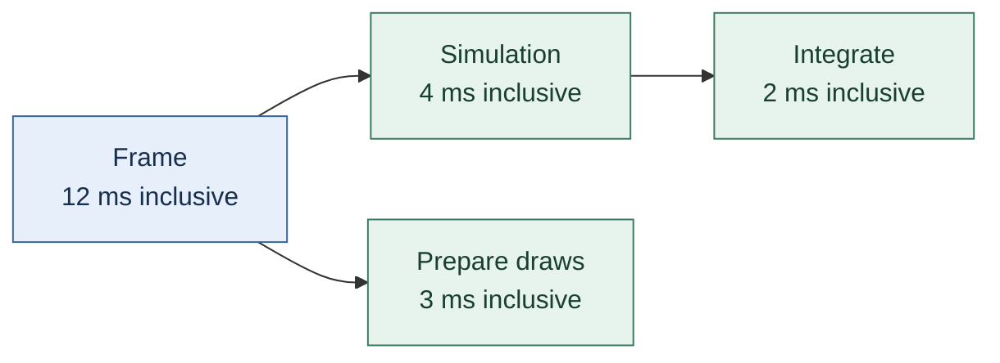

This is a containment tree, not a timeline: each arrow points from an enclosing scope to its direct child. Use the table for execution times. Hierarchical profiling is motivated by Gregory's discussion of nested measurements and scoped instrumentation (*Game Engine Architecture*, supplied edition, PDF pp. 411–414); the trace, definitions, calculations and diagram above are original teaching examples.

Even a correct subtraction needs the clock's meaning. If these are wall-clock timestamps, unscoped waiting and descheduling remain in exclusive elapsed time. The five milliseconds do not prove that the CPU executed five milliseconds of instructions in Frame itself. A profiler based on sampled CPU execution answers a different question.

Parallel work breaks another assumption. Suppose two worker tasks both begin within the same frame and their elapsed intervals overlap. Their duration sum can exceed the frame's duration; subtracting both as if they were serial children can even produce a negative result. That is a sign that the accounting model is wrong, not that execution took negative time. Show worker tracks separately, inspect dependencies and the completion path, and distinguish total worker effort from latency visible to the frame.

### Convert GPU timestamps with their own clock contract

GPU timestamps need supported queue capabilities, available results and meaningful stage boundaries. A CPU timer around submission measures host elapsed time, not completion of the submitted GPU work. The Khronos sample explains query availability, queue limitations and conversion by `timestampPeriod`. [Khronos timestamp-query sample](https://docs.vulkan.org/samples/latest/samples/api/timestamp_queries/README.html)

For a counter with $b>0$ valid bits and period $P$ nanoseconds per tick, an illustrative wrap-aware calculation is

$$
\Delta q=(q_{\mathrm{end}}-q_{\mathrm{start}})\bmod2^b,
\qquad
\Delta t=\Delta q\,P\,\mathrm{ns}.
$$

It assumes fewer than $2^b$ ticks elapsed; otherwise the number of wraps is ambiguous. With $b=36$, $q_{\mathrm{start}}=2^{36}-6$, $q_{\mathrm{end}}=6$ and hypothetical $P=2$, the interval is $12$ ticks or $24\,\mathrm{ns}$. These are synthetic values, not device measurements.

Check scale independently: at one nanosecond per tick,

$$2^{32}\,\mathrm{ns}=4.294967296\,\mathrm{s}.$$

That corrects a decimal-place slip in the linked sample's prose. Retrieving 64-bit results avoids truncating them to 32-bit storage; it does not increase the physical counter's valid width. Do not subtract timestamps from unrelated clock domains without establishing their relationship.


### Read performance results with the workload attached

Performance demos can be misleading when the result has no scene, machine, or metric attached. The reviewed faster-engine video claims improvement in a real game and shows frame-rate/resource statistics, while another diagnosis traces generated scene work into a specific operation. These examples suggest recording the workload, hardware, build configuration, CPU/GPU utilization, and the exact change. A frame rate alone cannot distinguish a CPU bottleneck, GPU bottleneck, synchronization stall, or a change in visual quality. First reproduce the workload, then profile both engine and game code before generalizing the result. (“How I Made My Game Engine MUCH Faster,” [ddfMzq0CNTw](https://www.youtube.com/watch?v=ddfMzq0CNTw), ~00:00–00:30, 09:46–10:10, 19:32–24:26; “Diagnosing Performance Issues in Hazel,” [iY6QbL_3L2I](https://www.youtube.com/watch?v=iY6QbL_3L2I), ~00:00–00:30, 19:24–19:48, 38:49–48:32.)


#### Measure before tuning, and make layout changes explicit

The Sparky maintenance episode adds a high-resolution timer, a once-per-second FPS count, and a Visual Studio profiling workflow. The profiler starts paused so initialization and test-scene creation do not dominate the capture. It shows why percentages need context: inlining hides individual calls, disabling it makes attribution easier while slowing the program, and a function's percentage is its share of the measured run rather than an absolute millisecond cost.

Comparing the simple and batch renderers points to repeated draw calls and vertex-array binds as major costs in that test. The transcript also identifies repeated uniform-location queries as a candidate for caching. To keep vertex layouts maintainable, it replaces hard-coded byte offsets with `offsetof`. It then packs four floating color channels into a normalized integer attribute and reports a speed increase, while acknowledging that the measurement is noisy.

A separate correctness fix addresses matrix multiplication: writing each result directly into the same array being read can overwrite values needed by later calculations. The final implementation computes into a temporary array, then copies the completed result into the matrix. These are historical tutorial observations and fixes; they do not substitute for current benchmarks or independent regression checks.

## Reconstruct the working loop and test its contracts

The complete small program below gives several of these ideas one inspectable executable. Then use the milestone sequences as reconstruction exercises rather than a mandate to copy a single engine.

### Rebuild the idea in a small executable laboratory

The following original C++20 program isolates four contracts: constant simulation ticks, presentation interpolation, generation-checked identity, and deferred removal. It deliberately uses a tiny fixed-capacity one-dimensional world so a reader can inspect every transition. It is a runnable teaching model, not a windowed renderer or a complete engine.

Two different partitions of one real second produce sixty simulation ticks and the same final position in this model. That test does not establish cross-platform bitwise determinism for a complete physics engine. The overload policy discards time and reports it; use a different policy when the application's timeline cannot permit that loss. The slot-retirement guard avoids generation wrap, while ordinary tests exercise stale-handle rejection after reuse.

```cpp
#include <algorithm>
#include <array>
#include <cassert>
#include <cmath>
#include <cstdint>
#include <iostream>
#include <limits>
#include <optional>
#include <stdexcept>
#include <vector>

struct Handle {
    std::size_t slot;
    std::uint32_t generation;
};

struct Body {
    double previous = 0.0;
    double position = 0.0;
    double velocity = 1.0;
};

class World {
    struct Slot {
        Body body{};
        std::uint32_t generation = 1;
        bool alive = false;
        bool retired = false;
    };
    std::array<Slot, 4> slots_{};
    std::vector<Handle> removals_;

public:
    std::optional<Handle> create(Body body) {
        for (std::size_t i = 0; i < slots_.size(); ++i) {
            auto& s = slots_[i];
            if (!s.alive && !s.retired) {
                s.body = body;
                s.alive = true;
                return Handle{i, s.generation};
            }
        }
        return std::nullopt;
    }

    Body* get(Handle h) {
        if (h.slot >= slots_.size()) return nullptr;
        auto& s = slots_[h.slot];
        return s.alive && s.generation == h.generation ? &s.body : nullptr;
    }

    void request_remove(Handle h) { removals_.push_back(h); }

    void step(double dt) {
        for (auto& s : slots_) {
            if (!s.alive) continue;
            s.body.previous = s.body.position;
            s.body.position += s.body.velocity * dt;
        }
        // Structural changes occur after the iteration, at an agreed boundary.
        for (auto h : removals_) {
            if (!get(h)) continue;
            auto& s = slots_[h.slot];
            s.alive = false;
            if (s.generation == std::numeric_limits<std::uint32_t>::max()) {
                s.retired = true; // Never wrap into an old valid generation.
            } else {
                ++s.generation;
            }
        }
        removals_.clear();
    }
};

class Clock {
    double pending_ = 0.0;
    static constexpr double fixed_ = 1.0 / 60.0;
public:
    std::uint64_t ticks = 0;
    double discarded = 0.0;

    template<class Step>
    void advance(double wall_dt, Step step) {
        if (!std::isfinite(wall_dt) || wall_dt < 0.0)
            throw std::invalid_argument("invalid frame duration");
        const double accepted = std::min(wall_dt, 0.25);
        discarded += wall_dt - accepted;
        pending_ += accepted;
        unsigned work = 0;
        while (pending_ + 1e-12 >= fixed_ && work < 8) {
            step(fixed_);
            pending_ = std::max(0.0, pending_ - fixed_);
            ++ticks;
            ++work;
        }
        if (pending_ + 1e-12 >= fixed_) {
            const auto skipped = std::floor((pending_ + 1e-12) / fixed_);
            const auto amount = skipped * fixed_;
            discarded += amount;
            pending_ = std::max(0.0, pending_ - amount);
        }
    }

    double alpha() const { return std::clamp(pending_ / fixed_, 0.0, 1.0); }
};

double rendered_position(const Body& body, double alpha) {
    return body.previous * (1.0 - alpha) + body.position * alpha;
}

bool near(double a, double b) { return std::abs(a - b) < 1e-9; }

int main() {
    World first, second;
    auto a = first.create({0, 0, 2});
    auto b = second.create({0, 0, 2});
    assert(a && b);
    Clock c1, c2;
    for (int i = 0; i < 60; ++i)
        c1.advance(1.0 / 60.0, [&](double dt) { first.step(dt); });
    for (int i = 0; i < 10; ++i)
        c2.advance(0.1, [&](double dt) { second.step(dt); });
    assert(c1.ticks == 60 && c2.ticks == 60);
    assert(near(first.get(*a)->position, second.get(*b)->position));
    assert(near(first.get(*a)->position, 2.0));
    assert(near(rendered_position(*first.get(*a), 0.5), 2.0 - 1.0 / 60.0));

    first.request_remove(*a);
    first.request_remove(*a); // Duplicate removal is harmless in this model.
    first.step(0.0);
    assert(first.get(*a) == nullptr);
    auto replacement = first.create({10, 10, 0});
    assert(replacement && replacement->slot == a->slot);
    assert(replacement->generation != a->generation);
    assert(first.get(*a) == nullptr && first.get(*replacement));
    assert(first.get({999, 1}) == nullptr);
    for (int i = 0; i < 3; ++i) assert(first.create({0, 0, 0}));
    assert(!first.create({0, 0, 0}));

    Clock overloaded;
    overloaded.advance(1.0, [](double) {});
    assert(overloaded.ticks == 8);
    assert(overloaded.discarded > 0.8);
    assert(overloaded.alpha() >= 0.0 && overloaded.alpha() <= 1.0);
    bool rejected = false;
    try {
        overloaded.advance(std::numeric_limits<double>::quiet_NaN(), [](double) {});
    } catch (const std::invalid_argument&) { rejected = true; }
    assert(rejected);
    std::cout << "PASS: time partition, interpolation, stale handles, deferred removal, capacity, overload, invalid duration\n";
}
```

Compile with `clang++ -std=c++20 -Wall -Wextra -Wpedantic -Werror runtime_lab.cpp -o runtime_lab`, then run `./runtime_lab`. The same saved body was also built and run with Apple Clang 21.0.0 using AddressSanitizer and UndefinedBehaviorSanitizer. Those instrument this CPU model; they do not validate GPU synchronization, a platform window, multithreaded access, or audio deadlines.

**Reconstruction exercises:** change the accepted frame interval and demonstrate its effect on overload; request deletion from within a simulated interaction and verify that it is applied at the safe boundary; add a second component while preserving identity; attempt a save/reload format using stable IDs rather than raw pointers; and specify a deterministic input-to-tick assignment. Each exercise should retain a test that fails when its contract is violated.

### Iterate through narrow, testable milestones

The series’ progression is strongest when each stage creates a checkable result: platform build, logged startup, window and input, clear screen, triangle, textured geometry, material, camera movement, scene load. A milestone should state what it proves and what it does not. “The screen clears” proves a working path through device, swapchain and submission for the exercised setup; it does not prove that resize, multiple frames in flight, all drivers or asset loading work. “A texture renders” proves one image and binding path; it does not prove a general importer or hot reload.

When a step fails, reduce variables. First confirm the build. Then confirm platform startup and logging. Then validate the API object chain. Then check the immediate resource contract. Use API validation and engine logs. Avoid simultaneously rewriting the renderer, allocator and scene model during a bug fix. The separate buffer correction episode is an example of making a focused follow-up once users identify a reproducible issue.

The present repository retrospective also gives an honest view of refactoring: the engine has usable features and stable cross-platform support, but its authors still identify scene, resource, rendergraph and legacy systems for redesign or removal. A durable engine is not one whose first architecture is perfect. It is one where boundaries make it possible to change a system without rewriting every caller, where ownership is explicit enough to find leaks and stale references, and where a known-good result can be re-established after each change.

The broad principle is to keep the next abstraction close to the demonstrated need. Use a platform interface because the operating systems differ. Use normalized input because gameplay should not consume native key codes. Use specialized allocators because lifetimes and alignment differ. Use a renderer frontend because game code should not speak directly to one graphics API. Use an asset system because files, imports, runtime resources and reloads have different jobs. Revisit each abstraction when the maintenance cost becomes visible. Kohi’s own retrospective models that willingness to revise.

### A compact study sequence for readers implementing their own engine

A learner can reproduce the dependency logic without copying every feature. First create a cross-platform build that logs startup and shutdown. Add a window and close event. Normalize one key and prove one press/release transition. Add a main loop with a measured delta time. Initialize one graphics backend and clear the screen. Add one triangle, then a transform and a camera. Add an indexed mesh, one texture and a simple material. Add an explicit resource lifetime. Only after these paths are stable should a larger scene loader, editor, asynchronous asset pipeline or rendergraph be considered.

At every checkpoint, write down the contract in plain language. “The platform layer reports a close request as an engine event.” “The renderer frontend accepts a mesh and material without exposing Vulkan types.” “A texture request either returns a ready resource or a result that will later become ready.” “The scene releases its resource references on unload.” If the contract cannot be stated simply, the implementation likely has unclear ownership or hidden states.

Keep a small set of diagnostics visible while learning: startup logs, API validation, resource names, allocation failures and frame timing. A frame timer tells how long one update/render iteration takes, but it should be interpreted carefully. A long frame may come from CPU work, GPU waiting, asset I/O, shader compilation or a synchronization stall. Measurement is a prompt to isolate, not proof of a cause.

Prefer adding one layer at a time. A platform-specific input path can be verified before introducing an action mapping editor. A Vulkan buffer upload can be verified before making a general resource manager. A scene file can be loaded synchronously before adding hot reload. This does not mean the simple design must remain forever; it means the more complex design is introduced with a working baseline and an explicit reason.

The series’ videos and later code show a real engine changing over time. Some decisions in the early tutorial are teaching scaffolds; later livestreams revisit, extend or replace them. That temporal quality matters. Treat a tutorial episode as evidence of what was built and taught at that point, and treat the current repository as evidence of a later code state. Do not silently combine both into a fictional single snapshot. When a later revision changes an API, document the revision and reason.

### A step-by-step build order for a small Hazel-like engine

The following sequence collects the architecture into one continuous implementation path. It is not a claim that every detail follows the exact release order of every video. It is a design-led order grounded in the reviewed opening episodes and public code structures.

#### Step 1: Establish a reproducible project

Create a repository, document the compiler and generator version, define the engine library and one client application, and verify a clean checkout can build. Keep third-party dependencies visible and record how they are obtained. Add a basic log before the system grows. The goal is a repeatable empty application, not a sophisticated installer.

#### Step 2: Own the window and application lifetime

Create a window through an interface so platform-specific details are contained. Give the application one clear owner for startup, run, close, and shutdown. Install the native event callback once. At this point, the program should open, remain responsive, and exit cleanly.

#### Step 3: Create a timestep loop

Measure elapsed time, pass it as a timestep to update code, and make minimized behavior explicit. Document whether simulation is variable-step or fixed-step. Add a simple test behavior that moves at a known rate, so the timing convention is visible.

#### Step 4: Add typed events and propagation

Start with close, resize, key, and mouse events. Give each event a concrete payload and a stable category. Decide whether dispatch is immediate or queued. Specify what the handled flag means. Test that a UI overlay can consume a key while an unhandled event reaches the game layer.

#### Step 5: Add layers for lifecycle-managed features

Create one game layer, one UI/editor overlay, and one diagnostic overlay. Define ownership and attach/detach callbacks. Keep independent services outside the layer stack when their lifecycle does not fit it. Make event order and rendering order agree.

#### Step 6: Draw a triangle, then a sprite

Initialize a graphics context and clear the window. Build a small backend abstraction around only the operations the client uses. Draw a triangle with explicit vertex layout, then draw a textured quad with a camera and transform. Keep the initial backend singular and well tested before promising portability.

#### Step 7: Turn game objects into scene data

Introduce entity handles and components. Add stable scene IDs separately from registry handles. Implement create, destroy, duplicate, and query operations. Keep component defaults explicit. Use a few systems—rendering, camera, and perhaps simple movement—to demonstrate how composition works.

#### Step 8: Make the scene editable

Add a hierarchy panel, inspector, viewport, and content browser. Connect each visible control to real scene or project state. Implement selection, resize-aware camera projection, and scene saving. Avoid accepting UI mockups as completed interaction.

#### Step 9: Separate authoring and runtime

Copy or otherwise isolate authored scene state before Play. Define edit, simulation, runtime, pause, and step behavior. Add a clean stop path that restores the editor’s view. Make source-scene saves explicit and keep player save data separate.

#### Step 10: Add assets, scripting, and physics as independent integrations

Use stable asset references and reproducible import steps. Add a small scripting boundary with explicit handles and diagnostics. Integrate 2D physics through components and define transform authority and update timing. Test each system through a representative scene rather than only compiling its classes.

#### Step 11: Add compatibility and performance work when the project demands it

Version serialized data, add migrations when schemas change, and test round trips. Profile representative scenes before optimizing. Consider extra render backends, 3D, audio, networking, or job scheduling when a real game or user needs them. Record what is implemented, what is planned, and what is still private or unavailable.


## Source map, remaining reading, and future additions

This volume will keep growing in this same file. New curriculum lessons should supply a source/part record, then deepen the relevant explanation, example, code, or failure case. Link a new concept to its actual explanation; do not leave essential definitions for an unrelated future lesson. The detailed per-video and per-book ledger is [[Supplementary/Game Engine - Sources and Coverage]].

### Evidence boundary and route through the material

This source study uses the acquired English captions for selected episodes of Travis Vroman’s Kohi Game Engine series and the public Kohi source tree at revision `05a5193d5ed4890703cfcbbeb5c5e947feefecf6` (GitHub `main`, retrieved 2026-11-05). Caption acquisition was partial: the first batch produced 49 files before HTTP 429, a later en-only probe succeeded, and the resumed batch added files before 429 recurred. The initial pass had 85 retrieved files; the per-video ledger records exact counts and review state. Current exact counts and per-video states are in the merged `work/source-audit.json`; channel-local status files retain earlier snapshots. The video inventory records 426 selected unique engine-building videos across the Kohi tutorial, Kohi implementation streams/devlogs and TypeScript Engine series, with channel-feed metadata for 573 unique IDs total. Do not read this as full transcript coverage. Captions are evidence for the videos linked below; the repository and retrospective are separate primary evidence about the later project. The code archive transfer itself truncated, but the root roadmap, retrospective and relevant source files were available. This is a source-led teaching narrative, not a transcript replacement.

The useful organizing question is not “what subsystem comes next?” but “what concrete failure or missing capability forces the next boundary?” A window cannot be opened without platform calls; input cannot be reasoned about if the platform’s key codes leak into gameplay; a renderer cannot be swapped if game code speaks Vulkan directly; a texture cannot be sampled until the application has a repeatable route from file to image, image to GPU memory, and image to shader binding. The sequence below follows those dependencies.

#### What a one-prompt engine demo can and cannot prove

The AI-engine experiment asks two models to build a cross-platform 3D engine from one short brief. That brief names a technology stack and desired capabilities, including an editor, runtime export, scripting, physics, glTF assets, and AI-controllable authoring. The models choose different names and work for very different durations. The narrator then walks through visible UI behavior and a few sample games.

The captions support a narrow account of that demonstration: Forge shows an editor/runtime, a 3D scene, some lighting and physics, and an export smoke test, while several controls are missing or ineffective. Basalt is shown with a fuller editor, asset browser, undo/redo, scripting properties, physics, audio, particles, and sample Tetris/Marble Run scenes. The narrator reports a passing Marble Run export smoke test.

This is not a code review or a controlled benchmark. The narrator explicitly says source quality, provenance, and production readiness need review, and notes that existing code and training examples may have contributed. The runs differ in duration, usage, and configuration. Describe the visible demo and reported smoke tests; do not generalize them into proof of production quality, broad test coverage, or comparative model capability.
#### Separate implementation evidence from design discussion

Several sources mix a working change with an idea for later. The layer episode describes groups and a future transform stack; the font episode leaves default-font and missing-size behavior open while developing a manager; the physics simulation episode shows an editor-camera simulation mode, then fixes state transitions and update wiring; and the maintenance episode reports file-read timing from a small local workload rather than a general performance law. Preserve these distinctions when learning from a tutorial: an observed build, a demonstrated interaction, a proposed architecture, and a measured result are different kinds of evidence. [Layers, 00:06:20–00:09:21; fonts, 00:22:12–00:32:09; Physics Simulation Mode, 00:03:16–00:16:21 and 00:29:48–00:35:00; maintenance, 00:14:45–00:18:01]

The setup episode is also historical: it installs Visual Studio Community 2013 on Windows and demonstrates a minimal program. Use it as a record of how that series began, not as present-day installation guidance. Likewise, the sample UUID implementation chooses a 64-bit random value for its engine's practical scope while noting the conventional 128-bit UUID form; do not silently treat those representations as interchangeable. [Sparky setup, 00:01:20–00:07:44; UUID/GUID, 00:10:00–00:16:08]

#### Scope and evidence

This addition covers only the assigned 48 PDF pages. PyPDF2 extracted the text layer. Rendered pages 189, 193, and 195 of the physics book were visually inspected for homogeneous-coordinate, matrix-composition, and inverse formulas; PDF page 702 of *Game Engine Architecture* was checked for Figure 12.37. The matrix example is a constructed illustration of the source’s convention. No full-book claim, current SDK guarantee, or independent visual claim is made for the textual interview and Rules of Play passages.

### Source map and evidence limits

Caption evidence acquired and read at least in part includes #000–#007 and #009–#011, sampled in both opening and middle segments; #012, #014, #016, and #018–#020; #022–#030 for files actually present; texture/material/shader episodes #032–#048 where retrieved; selected allocator videos; and selected implementation livestreams. Catalog titles were used to locate episodes but not treated as evidence of their technical explanation. The exact retrieved IDs and statuses are in `scope_ledger.json` and `caption_status.json`; caption files are in the user-specified source cache. Since HTTP 429 curtailed the batch, do not claim all 426 selected videos have transcripts. The initial pass had six full Kohi caption reads; current full and partial reading counts are in the merged source audit and the legend below. Specific transcript claims above are limited to captions and timed ranges recorded in the read ledger; links to later numbered videos identify relevant catalog entries and should be followed up before making detailed claims about their contents.

The repository facts above refer to the GitHub mirror commit `05a5193d5ed4890703cfcbbeb5c5e947feefecf6` (`Mirror SVN revision r96`), not the SVN trunk that the README identifies as the source of truth. The README describes Kohi as a learning tool that is not production-ready. Reviewed files and evidence links are listed in `repo_reviewed_files.md`; source inspection covered the allocator files, the inspected portion of `platform_nix.c`, and the inspected portion of `vulkan_device.c`. The archive was incomplete, so this module does not claim exhaustive code review, successful build, or validation of the current repository. The retrospective and TODO files express project author judgments and plans at that revision, not objective judgments about all engines.

### Closing perspective

The most transferable lesson from Kohi is a style of engineering rather than a fixed subsystem checklist. Start from a visible need. Place platform variance behind a narrow seam. Make ownership and lifetime explicit. Use a graphics milestone to validate the entire path in small pieces. Keep diagnostics close to the operation that can fail. Add specialized systems when real usage justifies them. Revisit abstractions when their costs become concrete. The project’s own retrospective makes clear that successful implementation and critical reassessment can coexist.

### Evidence, scope, and how to use this chapter

A useful way to learn engine architecture is to follow one small project from an empty window to a place where someone can build, save, run, and inspect a game. That path forces the important questions to appear at the moment they matter. What owns the window? Who receives input? Where does update code live? How does a scene become pixels? How does an artist or designer change a scene without editing C++? What does “Play” mean inside an editor? Hazel is a good case study because The Cherno’s public Game Engine series repeatedly turns these questions into implementation work and the public repository exposes a corresponding, inspectable slice of code.

This chapter treats “engine” as a working arrangement of reusable runtime systems and authoring tools. The word does not describe one universal feature list. A tiny library that opens a window, advances a loop, and draws sprites can be an engine for a narrow kind of game. A large editor with asset importing, physics, scripting, animation, and deployment tools is also an engine. The deciding question is practical: can the project creator use the systems to make and run a game without having to rebuild those systems for every game? The early public Game Engine episodes make the scope question explicit before committing to architecture. Their first videos define the intended subject, sketch the series’ scope, create the Hazel project, and plan the event system before implementing it. That order is a useful engineering habit: name the job first, then build the smallest shared mechanism that will do it.

The source boundary matters. The initial Hazel explanations were drafted from the opening episodes and public source code. The later source pass also reviewed sampled beginning, middle, and ending caption ranges across the other retrieved videos. The aggregate ledger distinguishes full-caption reads from sampled reviews; neither status claims visual inspection of all on-screen code. Those opening episodes introduce defining an engine, choosing scope, project setup, an entry point, logging, build/project generation, planning events, implementing events, and precompiled headers. The transcript for the new 3D series announcement was also retrieved and read. The broad acquisition ledger contains 320 unique channel videos: 234 entries in six engine-related playlists plus 86 additional channel-video candidates identified by title. Captions were attempted sequentially for English, with age-gated videos and some network or unavailable cases marked as access problems rather than as material reviewed. A title is only an index to a source; it cannot be used as proof of what the speaker explained. Reading status and per-video notes are in `reading_status.json` and `ledger.json` alongside this chapter.

Public source code provides a second, distinct kind of evidence. The cloned Hazel repository is pinned to commit `1feb70572fa87fa1c4ba784a2cfeada5b4a500db`, dated 2023-10-27. Its README describes the repository as an early-stage educational engine for Windows and says a more advanced Hazel-dev version exists in a private repository for supporters. This snapshot therefore gives concrete examples of public Hazel’s application loop, events, layers, renderer, scenes, serialization, scripting, and editor. It does not demonstrate the implementation of later 2025/2026 work, nor does it grant access to Hazel-dev or paid material. The newer “Introducing the NEW 3D Game Engine Series” video is a public announcement that frames a new effort and speaks in a 2026 context; it should not be read as if the 2023 repository already contains that future work. Claims below are labeled by their evidence: “in the reviewed opening captions” for directly reviewed teaching, “in the 2023 public snapshot” for repository behavior, and “design guidance” for general lessons drawn from those examples.

The aim is to teach architecture, not to copy Hazel wholesale. Code names are used when they help orient you to an inspectable source. Any code shown here is short, original pseudocode, not Hazel source. Hazel is MIT licensed in the inspected repository; code reuse must retain the license and attribution requirements in that repository’s `LICENSE`. This chapter is educational prose and does not imply an endorsement or a promise that the public repository builds on every platform.

### What a learner should inspect next

The best next step is to open the public code paths that match the feature being studied and trace one operation end to end. To understand a close request, follow the native window callback into `Window`, then `Application::OnEvent`, `EventDispatcher`, and `OnWindowClose`. To understand UI priority, follow the reverse layer traversal and inspect which layer sets `Handled`. To understand scene rendering, follow a component through `Scene::RenderScene`, `Renderer2D`, the renderer API, and the OpenGL implementation. To understand “Play,” follow the editor action into the scene runtime lifecycle and compare runtime and editor update paths. To understand persistence, follow a scene from entity creation through UUID assignment and serialization, then load it into a fresh scene.

Trace one behavior at a time. Keep a notebook with four columns: what the video says, what the public code does, what you inferred, and what remains unverified. This protects you from treating the latest public code as if it were the same version shown in an older episode. It also makes disagreements useful: a video can show an intermediate design that changed before the repository snapshot, and the ledger should preserve both facts with their dates.

A robust learning project should reproduce the behavior at the same layer it claims. A source file compiling proves compilation, not a running editor. A scene serializer writing bytes proves output, not a correct round trip. A renderer interface proves a seam, not portability. A UI button drawing proves presentation, not that it changed game state. For each claim, decide what observable evidence would settle it: build, launch, interaction, saved file, reload, or measurements.

### Closing: build the smallest complete loop

An engine becomes understandable when one feature can travel from authored data to a running result and back again. Start from the first game’s needs. Make the build repeatable. Give the application a clear owner and clock. Route events through defined handlers. Organize lifecycle-bound features into layers. Separate a game’s rendering requests from the graphics backend. Store scenes as stable data and make runtime state distinct from editing. Add tools that change real state. Integrate assets, scripts, and physics through explicit boundaries. Save data in a format that can evolve. Measure before optimizing. Expand scope when the game demonstrates why.

Hazel’s public teaching sequence supports a strong habit: explain the reason for an architectural decision before treating it as a reusable pattern. The public repository then lets us inspect what one stage of that educational engine actually implemented. Together, those sources teach a more durable lesson than any feature checklist: architecture is a set of choices about ownership, timing, identity, and change. Keep those choices visible, build a complete path through them, and the engine can grow without becoming a mystery.

### Source notes

The directly reviewed caption excerpts in this chapter come from English caption files for the opening Game Engine sequence: [JxIZbV_XjAs](https://www.youtube.com/watch?v=JxIZbV_XjAs) (series announcement), [vtWdgtMo1T4](https://www.youtube.com/watch?v=vtWdgtMo1T4) (what an engine is), [etdSXlVjXss](https://www.youtube.com/watch?v=etdSXlVjXss) and [KG8cAGvn9d4](https://www.youtube.com/watch?v=KG8cAGvn9d4) (scope/planning), [meARMOmTLgE](https://www.youtube.com/watch?v=meARMOmTLgE) (entry point), [dZr-53LAlOw](https://www.youtube.com/watch?v=dZr-53LAlOw) (logging), [sULV3aB2qeU](https://www.youtube.com/watch?v=sULV3aB2qeU) (Premake), [5mlziHwq90k](https://www.youtube.com/watch?v=5mlziHwq90k) (event planning), [xnopUoZbMEk](https://www.youtube.com/watch?v=xnopUoZbMEk) (event implementation), and [UQ718BrbQ5E](https://www.youtube.com/watch?v=UQ718BrbQ5E) (precompiled headers). The standalone newer-series announcement is [-paLdjChPxo](https://www.youtube.com/watch?v=-paLdjChPxo); it was read as an announcement, not as evidence of unobserved implementation details. These IDs and all playlist positions are in `ledger.json`.

Repository facts were inspected at TheCherno/Hazel commit `1feb70572fa87fa1c4ba784a2cfeada5b4a500db`. Relevant public files include `README.md`, `LICENSE`, `Hazel/src/Hazel/Core/EntryPoint.h`, `Application.h/.cpp`, `Layer.h`, `LayerStack.h/.cpp`, `Events/Event.h`, `Renderer/RendererAPI.h`, `Renderer/RenderCommand.h/.cpp`, `Renderer/Renderer2D.h/.cpp`, `Scene/Scene.h/.cpp`, `Scene/Components.h`, `Scene/SceneSerializer.h/.cpp`, `Scripting/ScriptEngine.h/.cpp`, `Hazelnut/src/EditorLayer.cpp`, and `Hazelnut/src/Panels/SceneHierarchyPanel.cpp` plus `ContentBrowserPanel.cpp`. Verify line-level details against the pinned snapshot before quoting these implementation specifics elsewhere.

### What to study next

The books provide broader foundations than these selected passages. Follow Gregory’s Chapters 5–7 for memory, resources, and time; Chapter 9 for debugging; Chapters 10–12 for rendering and collision; Chapters 13–14 for world and gameplay foundations. Follow Millington from the particle integrator through rigid-body integration, then study Chs. 12–16 for collision detection, contact generation, resolution, friction, and stability. The contents give precise chapter starts (inventoried in `inventory.md`). This module has not inspected all those chapters in depth, so it treats those references as a reading path, not as proof that every design alternative has been evaluated.

### Reading boundary and further work

The source reading here covered Rouse’s player-expectation discussion (PDF pp. 33–40), selected gameplay feedback pages (PDF p.33), the iterative design chapter from Salen and Zimmerman (PDF pp. 31–32), their meaningful-play account (PDF pp. 48–52), and Rouse’s playtesting discussion (PDF pp. 509–524). The four books’ complete contents and chapter ranges are inventoried separately. I have not read every chapter or validated every example in the supplied PDFs. Use the contents inventory as a study route: Rouse Chapters 5, 7, 15, 17, 19, 21, 23 and 25; Salen and Zimmerman’s systems, interactivity, rules, emergence, uncertainty, information, and play chapters; Gregory Chapters 9 and 13–14 for diagnostics and gameplay foundations. Read those sections directly before treating any broader interpretation as exhaustive.

### Follow a collision all the way back to player feedback

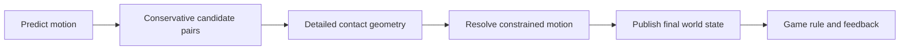

The ordering is a conceptual dependency, not a demand that every physics engine use one global pass in this exact form. A continuous collision method may repeatedly advance to intermediate impacts. A game can also use nonphysical trigger volumes. The important promise is that a confirmed rule outcome agrees with the state the simulation accepts. A temporary predicted overlap should not automatically award a pickup that later collision resolution rejects.

For the workshop, distinguish entering the plate, remaining on it, and leaving it. These are **transitions** versus **state**. Opening the door on every “still overlapping” report can retrigger sound and animation continuously; opening on the change from empty to occupied can produce one well-defined action. When two crates occupy the plate, count or otherwise identify the occupants rather than treating the first departure as proof that the plate is empty.

**Trace:** tick 10 has no occupants; tick 11 adds crate A, so the door begins opening; tick 12 adds crate B, so it remains opening; tick 13 removes A, leaving B; tick 14 removes B, so a chosen close policy begins. Delete A during tick 12 and check that identity validation and the deferred-removal rule clean up its occupancy record. This one example joins events, handles, physics, gameplay, and presentation without requiring a large game.

### Keep the authoring and runtime boundary visible


The return arrow means returning to the document under an explicit editing policy; it does not mean silently copying every runtime mutation back. If an editor offers “Apply changes,” select which supported changes become commands against the document. A collision cache, native pointer, or in-flight GPU object is not an authored level property merely because it lived near one in memory.


## Current source legend

| Channel | Selected video candidates | YouTube captions retrieved | Full-caption reads | Full generated-ASR reads | Sampled reviews | Not reviewed |
|---|---:|---:|---:|---:|---:|---:|
| Travis Vroman | 426 | 156 | 156 | 3 | 0 | 267 |
| The Cherno | 320 | 292 | 292 | 2 | 0 | 26 |

These counts separate retrieval from reading. Sampled reviews cover recorded timestamp windows, not every minute or every on-screen code change. Selected book passages and inspected code revisions are separate sources. The per-video ledger retains every selected ID and its exact state; none of the missing sources is silently counted as learned.

The latest reading pass expands 23 source teaching sections across 20 concept destinations. Its per-video source list and page receipts are in [[Supplementary/Game Engine - Sources and Coverage#batch-008 — expanded reading and integration|the cumulative source ledger]].

Reading pass batch-009 expands 24 source teaching sections across 21 concept destinations. Its per-video source list and page receipts are in [[Supplementary/Game Engine - Sources and Coverage#batch-009 — expanded reading and integration|the cumulative source ledger]].

Reading pass batch-010 expands 8 source teaching sections across 8 concept destinations. Its per-video source list and page receipts are in [[Supplementary/Game Engine - Sources and Coverage#batch-010 — expanded reading and integration|the cumulative source ledger]].

Reading pass batch-011 expands 8 source teaching sections across 6 concept destinations. Its per-video source list and page receipts are in [[Supplementary/Game Engine - Sources and Coverage#batch-011 — expanded reading and integration|the cumulative source ledger]].

Reading pass batch-012 expands 7 source teaching sections across 7 concept destinations. Its per-video source list and page receipts are in [[Supplementary/Game Engine - Sources and Coverage#batch-012 — expanded reading and integration|the cumulative source ledger]].
